常二重积分存在,则 $f(x,y)$ 在D的任何有界子区域上的积分有上界.

定理21.18 若在无界区域 $D$ 上 $f(x,y)\geqslant 0$ ，则反常二重积分(1)收敛的充要条件是:在 $D$ 的任何有界子区域上 $f(x,y)$ 可积，且积分值有上界.

例1 证明反常二重积分

$$
\iint_ {D} \mathrm{e} ^ {- (x ^ {2} + y ^ {2})} \mathrm{d} \sigma
$$

收敛,其中 D 为第一象限部分,即  $D=\left[0,+\infty\right)\times\left[0,+\infty\right)$ .

证 设 $D_{R}$ 是以原点为圆心、半径为 $R$ 的圆与 $D$ 的交集, 即该圆的第一象限部分. 因为 $\mathrm{e}^{-(x^2 + y^2)} > 0$, 所以二重积分

$$
\iint_ {D _ {R}} \mathrm{e} ^ {- (x ^ {2} + y ^ {2})} \mathrm{d} \sigma
$$

的值随着 $R$ 的增大而增大. 由于

$$
\iint_ {D _ {R}} \mathrm{e} ^ {- (  x ^ {2} + y ^ {2})}   \mathrm{d} \sigma = \int_ {0} ^ {\frac {\pi}{2}} \mathrm{d} \theta \int_ {0} ^ {R} \mathrm{e} ^ {- r ^ {2}} r \mathrm{d} r = \frac {\pi}{4} (1 - \mathrm{e} ^ {- R ^ {2}}) ,
$$

所以

$$
\lim _ {R \to + \infty} \iint_ {D _ {R}} \mathrm{e} ^ {- (x ^ {2} + y ^ {2})} \mathrm{d} \sigma = \lim _ {R \to + \infty} \frac {\pi}{4} (1 - \mathrm{e} ^ {- R ^ {2}}) = \frac {\pi}{4}.
$$

显然对 $D$ 的任何有界子区域 $D'$，总存在足够大的 $R$，使得 $D' \subset D_R$，于是

$$
\iint_ {D ^ {\prime}} \mathrm{e} ^ {- (x ^ {2} + y ^ {2})} \mathrm{d} \sigma \leqslant \iint_ {D _ {R}} \mathrm{e} ^ {- (x ^ {2} + y ^ {2})} \mathrm{d} \sigma \leqslant \frac {\pi}{4}.
$$

因此由定理 21.18 反常二重积分

$$
\iint_ {D} \mathrm{e} ^ {- (x ^ {2} + y ^ {2})} \mathrm{d} \sigma
$$

收敛,并且由定理21.17有

$$
\iint_ {D} \mathrm{e} ^ {- (x ^ {2} + y ^ {2})} \mathrm{d} \sigma = \frac {\pi}{4}. \tag {2}
$$

由(2)式还可推出在概率论中经常用到的反常积分

$$
\int_ {0} ^ {+ \infty} \mathrm{e} ^ {- x ^ {2}} \mathrm{d} x
$$

的值.为此,考察 $S_{a}=[0,a]\times[0,a]$ 上的积分

$$
\iint_ {S _ {a}} \mathrm{e} ^ {- (x ^ {2} + y ^ {2})} \mathrm{d} \sigma .
$$

因为

$$
\iint_ {S _ {a}} \mathrm{e} ^ {- (x ^ {2} + y ^ {2})} \mathrm{d} \sigma = \int_ {0} ^ {a} \mathrm{e} ^ {- x ^ {2}} \mathrm{d} x \int_ {0} ^ {a} \mathrm{e} ^ {- y ^ {2}} \mathrm{d} y = \left(\int_ {0} ^ {a} \mathrm{e} ^ {- x ^ {2}} \mathrm{d} x\right) ^ {2}.
$$

由 $D_{a} \subset S_{a} \subset D_{\sqrt{2} a}$ （图21-44）知

$$
\iint_ {D _ {a}} \mathrm{e} ^ {- (x ^ {2} + y ^ {2})} \mathrm{d} \sigma \leqslant \iint_ {S _ {a}} \mathrm{e} ^ {- (x ^ {2} + y ^ {2})} \mathrm{d} \sigma
$$

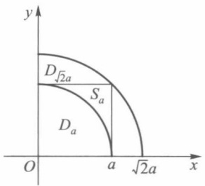

text_image

y
D_{\sqrt{2}a}
S_a
O
a
\sqrt{2}a
x

图21-44

$$
= \left(\int_ {0} ^ {a} \mathrm{e} ^ {- x ^ {2}} \mathrm{d} x\right) ^ {2} \leqslant \iint_ {D _ {\sqrt {2} a}} \mathrm{e} ^ {- (x ^ {2} + y ^ {2})} \mathrm{d} \sigma .
$$

令 $a \to +\infty$，则得

$$
\lim _ {a \to + \infty} \left(\int_ {0} ^ {a} \mathrm{e} ^ {- x ^ {2}} \mathrm{d} x\right) ^ {2} = \iint_ {D} \mathrm{e} ^ {- (x ^ {2} + y ^ {2})} \mathrm{d} \sigma = \frac {\pi}{4}.
$$

所以

$$
\int_ {0} ^ {+ \infty} \mathrm{e} ^ {- x ^ {2}} \mathrm{d} x = \frac {\sqrt {\pi}}{2}.
$$

下面的例子是应用反常二重积分补证第十九章最后提到的关于 B 函数与  $\Gamma$  函数的联系公式.

例 2 若 p>0, q>0, 则

$$
\mathrm{B} (p, q) = \frac {\Gamma (p) \Gamma (q)}{\Gamma (p + q)}. \tag {3}
$$

证 对于 $\Gamma$ 函数, 令 $x = u^2$, 则 $\mathrm{d}x = 2u\mathrm{d}u$, 于是

$$
\Gamma (p) = \int_ {0} ^ {+ \infty} x ^ {p - 1} \mathrm{e} ^ {- x} \mathrm{d} x = 2 \int_ {0} ^ {+ \infty} u ^ {2 p - 1} \mathrm{e} ^ {- u ^ {2}} \mathrm{d} u.
$$

从而

$$
\begin{array}{l} \Gamma (p) \Gamma (q) = 4 \int_ {0} ^ {+ \infty} x ^ {2 p - 1} \mathrm{e} ^ {- x ^ {2}} \mathrm{d} x \cdot \int_ {0} ^ {+ \infty} y ^ {2 q - 1} \mathrm{e} ^ {- y ^ {2}} \mathrm{d} y \\ = \lim _ {R \to + \infty} 4 \int_ {0} ^ {R} x ^ {2 p - 1} \mathrm{e} ^ {- x ^ {2}} \mathrm{d} x \cdot \int_ {0} ^ {R} y ^ {2 q - 1} \mathrm{e} ^ {- y ^ {2}} \mathrm{d} y. \\ \end{array}
$$

令  $D_{R}=[0,R]\times[0,R]$ ，由二重积分化为累次积分计算公式有

$$
\begin{array}{l} \iint_ {D _ {R}} x ^ {2 p - 1} y ^ {2 q - 1} \mathrm{e} ^ {- (x ^ {2} + y ^ {2})} \mathrm{d} \sigma \\ = \int_ {0} ^ {R} x ^ {2 p - 1} \mathrm{e} ^ {- x ^ {2}} \mathrm{d} x \cdot \int_ {0} ^ {R} y ^ {2 q - 1} \mathrm{e} ^ {- y ^ {2}} \mathrm{d} y. \\ \end{array}
$$

所以

$$
\begin{array}{l} \Gamma (p) \Gamma (q) = \lim _ {R \to + \infty} 4 \iint_ {D _ {R}} x ^ {2 p - 1} y ^ {2 q - 1} \mathrm{e} ^ {- (x ^ {2} + y ^ {2})} \mathrm{d} \sigma \\ = 4 \iint_ {D} x ^ {2 p - 1} y ^ {2 q - 1} \mathrm{e} ^ {- (x ^ {2} + y ^ {2})} \mathrm{d} \sigma , \tag {4} \\ \end{array}
$$

这里 D 为平面上第一象限部分. 和例 1 一样, 下面讨论(4)式右边的反常二重积分. 记

$$
D _ {r} = \{(x, y) \mid x ^ {2} + y ^ {2} \leqslant r ^ {2}, x \geqslant 0, y \geqslant 0 \}.
$$

于是有

$$
\begin{array}{l} \Gamma (p) \Gamma (q) = 4 \iint_ {D} x ^ {2 p - 1} y ^ {2 q - 1} \mathrm{e} ^ {- (x ^ {2} + y ^ {2})} \mathrm{d} \sigma \\ = \lim _ {r \to + \infty} 4 \iint_ {D _ {r}} x ^ {2 p - 1} y ^ {2 q - 1} \mathrm{e} ^ {- (x ^ {2} + y ^ {2})} \mathrm{d} \sigma . \\ \end{array}
$$

对上式右边积分应用极坐标变换,则可得

$$
\Gamma (p) \Gamma (q) = \lim _ {r \to + \infty} 4 \int_ {0} ^ {\frac {\pi}{2}} \mathrm{d} \theta \int_ {0} ^ {r} r ^ {2 (p + q) - 2} (\cos \theta) ^ {2 p - 1} (\sin \theta) ^ {2 q - 1} \mathrm{e} ^ {- r ^ {2}} r \mathrm{d} r
$$

$$
\begin{array}{l} = \lim _ {r \to + \infty} 2 \int_ {0} ^ {\frac {\pi}{2}} (\cos \theta) ^ {2 p - 1} (\sin \theta) ^ {2 q - 1} \mathrm{d} \theta \cdot 2 \int_ {0} ^ {r} r ^ {2 (p + q) - 1} \mathrm{e} ^ {- r ^ {2}} \mathrm{d} r \\ = 2 \int_ {0} ^ {\frac {\pi}{2}} (\cos \theta) ^ {2 p - 1} (\sin \theta) ^ {2 q - 1} \mathrm{d} \theta \cdot \Gamma (p + q). \\ \end{array}
$$

再由第十九章 §3 的(11)式就得到

$$
\Gamma (p) \Gamma (q) = \mathrm{B} (p, q) \Gamma (p + q).
$$

定理21.19 函数 $f(x,y)$ 在无界区域 $D$ 上的反常二重积分收敛的充要条件是 $|f(x,y)|$ 在 $D$ 上的反常二重积分收敛.

证 我们先证充分性. 设 $\iint_{D} |f(x, y)| \, \mathrm{d}\sigma$ 收敛, 其值为 $M$. 作辅助函数

$$
f ^ {+} (x, y) = \frac {\left| f (x , y) \right| + f (x , y)}{2}, f ^ {-} (x, y) = \frac {\left| f (x , y) \right| - f (x , y)}{2}.
$$

显然有 $0 \leqslant f^{+}(x, y) \leqslant |f(x, y)|$ 及 $0 \leqslant f^{-}(x, y) \leqslant |f(x, y)|$. 因而在 $D$ 的任何有界子区域 $\sigma$ 上，恒有

$$
\begin{array}{l} \iint_ {\sigma} f ^ {+} (x, y) \mathrm{d} \sigma \leqslant \iint_ {\sigma} | f (x, y) | \mathrm{d} \sigma = M, \\ \iint_ {\sigma} f ^ {-} (x, y) \mathrm{d} \sigma \leqslant \iint_ {\sigma} | f (x, y) | \mathrm{d} \sigma = M. \\ \end{array}
$$

所以 $f^{+}(x,y)$ 与 $f^{-}(x,y)$ 在 $D$ 上的反常二重积分收敛.由于

$$
f (x, y) = f ^ {+} (x, y) - f ^ {-} (x, y),
$$

所以  $f(x,y)$  在 D 上的反常二重积分也收敛.

关于必要性的证明,这里不讲了.有兴趣的读者可参阅菲赫金哥尔茨著的微积分学教程第三卷第一分册.

定理 21.20(柯西判别法) 设  $f(x,y)$  在无界区域 D 的任何有界子区域上二重积分存在, r 为 D 内的点  $(x,y)$  到原点的距离

$$
r = \sqrt {x ^ {2} + y ^ {2}}.
$$

(i) 若当 $r$ 足够大时，$\left|f(x,y)\right| \leqslant \frac{c}{r^p}$，其中 $c$ 为正的常数，则当 $p > 2$ 时，反常二重积分 $\iint_{D} f(x,y) \, \mathrm{d}\sigma$ 收敛；

(ii) 若 $f(x, y)$ 在 $D$ 内满足 $\left|f(x, y)\right| \geqslant \frac{c}{r^p}$, 其中 $D$ 是含有顶点为原点的无限扇形区域, 则当 $p \leqslant 2$ 时, 反常二重积分 $\iint_{D} f(x, y) \mathrm{d}\sigma$ 发散.

证明从略.

## 二、无界函数的二重积分

定义 2 设 P 为有界区域 D 的一个聚点,  $f(x,y)$  在 D 上除点 P 外皆有定义, 且在

P 的任何空心邻域内无界,  $\Delta$  为 D 中任何含有 P 的小区域,  $f(x,y)$  在  $D-\Delta$  上可积. 又设 d 表示  $\Delta$  的直径, 即

$$
d = \sup \left\{\sqrt {\left(x _ {1} - x _ {2}\right) ^ {2} + \left(y _ {1} - y _ {2}\right) ^ {2}} \mid (x _ {1}, y _ {1}), (x _ {2}, y _ {2}) \in \Delta \right\}.
$$

若极限

$$
\lim _ {d \to 0} \iint_ {D - \Delta} f (x, y)   \mathrm{d} \sigma
$$

存在且有限,并且与  $\Delta$  的取法无关,则称  $f(x,y)$  在 D 上的反常二重积分收敛,记作

$$
\iint_ {D} f (x, y) \mathrm{d} \sigma = \lim _ {d \to 0} \iint_ {D - \Delta} f (x, y) \mathrm{d} \sigma ,
$$

否则称 $f(x,y)$ 在 $D$ 上的反常二重积分 $\iint_{D} f(x,y) \, \mathrm{d}\sigma$ 发散.

与无界区域上反常二重积分一样,对无界函数的反常二重积分也可建立相应的收敛性定理.

定理 21.21(柯西判别法) 设  $f(x,y)$  在有界区域 D 上除点  $P(x_{0},y_{0})$  外处处有定义, 点  $P(x_{0},y_{0})$  为它的瑕点, 则下面两个结论成立:

(i) 若在点 $P$ 的附近有

$$
\left| f (x, y) \right| \leqslant \frac {c}{r ^ {\alpha}},
$$

其中 $c$ 为常数，$r = \sqrt{(x - x_0)^2 + (y - y_0)^2}$，则当 $\alpha < 2$ 时，反常二重积分 $\iint_{D} f(x, y) \, \mathrm{d}\sigma$ 收敛；

(ii) 若在点 P 的附近有

$$
\left| f (x, y) \right| \geqslant \frac {c}{r ^ {\alpha}},
$$

且 D 含有以点 P 为顶点的角形区域, 则当  $\alpha \geqslant 2$  时, 反常二重积分  $\iint_{D} f(x, y) \, \mathrm{d}\sigma$  发散.

## 习题 21.8

1. 试讨论下列无界区域上二重积分的收敛性:

(1) $\iint_{x^2 + y^2 \geqslant 1} \frac{\mathrm{d}\sigma}{\left(x^2 + y^2\right)^m}$;
(2) $\iint_{D} \frac{\mathrm{d}\sigma}{(1 + |x|)^p (1 + |y|)^q}, D$ 为全平面；
(3) $\iint_{0\leqslant y\leqslant 1}\frac{\varphi(x,y)\mathrm{d}\sigma}{(1 + x^2 + y^2)^p}\quad (0 < m\leqslant |\varphi (x,y)|\leqslant M).$

2. 计算积分

$$
\int_ {- \infty} ^ {+ \infty} \mathrm{d} y \int_ {- \infty} ^ {+ \infty} \mathrm{e} ^ {- (x ^ {2} + y ^ {2})} \cos (x ^ {2} + y ^ {2}) \mathrm{d} x.
$$

3. 判别下列积分的敛散性:

(1) $\iint_{x^2 + y^2 \leqslant 1} \frac{\mathrm{d}\sigma}{\left(x^2 + y^2\right)^m}$;

(2) $\iint_{x^2 + y^2 \leqslant 1} \frac{\mathrm{d}\sigma}{(1 - x^2 - y^2)^m}.$

## \* §9 在一般条件下重积分变量变换公式的证明

我们在本章 §4 中证明了重积分变量变换公式(定理 21.13). 在证明中引用了 §4 中的引理. 此引理需要较强条件: $x(u, v), y(u, v)$ 有二阶连续偏导数. 本节将在 $x(u, v), y(u, v)$ 仅有一阶连续偏导数的条件下来证明 §4 中的引理, 这样我们就完成了在一般条件下二重积分的变量变换公式. 为此, 我们把这个引理重新叙述如下.

引理 设变换  $T: x = x(u, v)$ ,  $y = y(u, v)$  把 uv 平面上的由分段光滑封闭曲线所围的闭区域  $\Delta$  一对一地映成 xy 平面上的闭区域 D，函数  $x = x(u, v)$ ,  $y = y(u, v)$  在  $\Delta$  上分别具有一阶连续偏导数且它们的函数行列式

$$
J (u, v) = \frac {\partial (x , y)}{\partial (u , v)} \neq 0, (u, v) \in \Delta ,
$$

则区域 $D$ 的面积

$$
\mu (D) = \iint_ {\Delta} \left| J (u, v) \right| \mathrm{d} u \mathrm{d} v.
$$

证 证明分以下4步:

第1步:对任意 $(u_{0},v_{0})\in\mathrm{int}\Delta$ ,任意 $\varepsilon>0$ ,存在 $(u_{0},v_{0})$ 的邻域G,当正方形 $I\subset G$ 且 $(u_{0},v_{0})\in I$ 时,

$$
\mu (T (I)) \leqslant \iint_ {I} \left| J (u, v) \right| \mathrm{d} u \mathrm{d} v + \varepsilon \mu (I).
$$

第2步:对任意正方形  $I \subset \operatorname{int} \Delta, \mu(T(I)) \leqslant \iint_{I} \left| J(u, v) \right| \, \mathrm{d}u \, \mathrm{d}v.$

第3步: $\mu (D)\leqslant \iint_{\Delta}\left|J(u,v)\right|\mathrm{d}u\mathrm{d}v.$

第 4 步:  $\mu(D)=\iint_{\Delta}\left|J(u,v)\right|\mathrm{d}u\mathrm{d}v.$

第1步的证明 设 $(u_0, v_0) \in \mathrm{int} \Delta$，对任意 $\varepsilon > 0$，取正数 $\eta < |J(u_0, v_0)|$ 满足

$$
(1 + \eta) ^ {2} \mid J (u _ {0}, v _ {0}) \mid <   \mid J (u _ {0}, v _ {0}) \mid - \eta + \varepsilon .
$$

由于 $|J(u,v)|$ 在点 $(u_0,v_0)$ 上连续，因此存在 $(u_0,v_0)$ 的邻域 $G_{1}\subset \mathrm{int}\Delta$ ，使得当 $(u,v)\in G_{1}$ 时，

$$
\mid J (u, v) \mid > \mid J (u _ {0}, v _ {0}) \mid - \eta .
$$

定义映射

$$
L: \left\{ \begin{array}{l} \hat {x} (u, v) = x (u _ {0}, v _ {0}) + x _ {u} (x _ {0}, v _ {0}) (u - u _ {0}) + x _ {v} (u _ {0}, v _ {0}) (v - v _ {0}), \\ \hat {y} (u, v) = y (u _ {0}, v _ {0}) + y _ {u} (u _ {0}, v _ {0}) (u - u _ {0}) + y _ {v} (u _ {0}, v _ {0}) (v - v _ {0}), \end{array} \right.
$$

即

$$
L (u, v) = \binom {\hat {x} (u, v)} {\hat {y} (u, v)} = \binom {x (u _ {0}, v _ {0})} {y (u _ {0}, v _ {0})} + J _ {T} (u _ {0}, v _ {0}) \binom {u - u _ {0}} {v - v _ {0}},
$$

其中  $\boldsymbol{J}_{T}(u_{0},v_{0})=\begin{pmatrix}x_{u}(u_{0},v_{0})&x_{v}(u_{0},v_{0})\\y_{u}(u_{0},v_{0})&y_{v}(u_{0},v_{0})\end{pmatrix}.$

由于 $x(u,v),y(u,v)$ 在 $(u_0,v_0)$ 处可微，因此

$$
\begin{array}{l} \mid x (u, v) - \hat {x} (u, v) \mid \\ = \left| x (u, v) - x \left(u _ {0}, v _ {0}\right) - x _ {u} \left(u _ {0}, v _ {0}\right) \left(u - u _ {0}\right) - x _ {v} \left(u _ {0}, v _ {0}\right) (v - v _ {0}) \right| \\ = o (\rho) (\rho \rightarrow 0), \\ \mid y (u, v) - \hat {y} (u, v) \mid \\ = \mid y (u, v) - y (u _ {0}, v _ {0}) - y _ {u} (u _ {0}, v _ {0}) (u - u _ {0}) - y _ {v} (u _ {0}, v _ {0}) (v - v _ {0}) \mid \\ = o (\rho) (\rho \rightarrow 0), \\ \end{array}
$$

其中

$$
\rho = \sqrt {\left(u - u _ {0}\right) ^ {2} + \left(v - v _ {0}\right) ^ {2}}.
$$

设 $\left(\boldsymbol{J}_{T}(u_{0},v_{0})\right)^{-1}=\begin{pmatrix}a&b\\c&d\end{pmatrix}$ ，令 $M=|a|+|b|+|c|+|d|$ . 存在 $(u_{0},v_{0})$ 的邻域 $G\subset G_{1}$ ，当 $(u,v)\in G$ 时，

$$
\mid x (u, v) - \hat {x} (u, v) \mid <   \frac {\eta \rho}{2 \sqrt {2} M}, \mid y (u, v) - \hat {y} (u, v) \mid <   \frac {\eta \rho}{2 \sqrt {2} M}.
$$

任取正方形 $I \subset \operatorname{int} \Delta$，满足 $(u_0, v_0) \in I$，并设 $I$ 的边长为 $\beta$. 任取 $(x(u, v), y(u, v)) \in T(I)$，其中 $(u, v) \in I$.

设 $(u_{1},v_{1})=L^{-1}(x(u,v),y(u,v))$ ，即 $\hat{x}(u_{1},v_{1})=x(u,v),\hat{y}(u_{1},v_{1})=y(u,v)$ .由于

$$
\binom {\hat {x} (u _ {1}, v _ {1}) - \hat {x} (u, v)} {\hat {y} (u _ {1}, v _ {1}) - \hat {y} (u, v)} = J _ {T} (u _ {0}, v _ {0}) \binom {u _ {1} - u} {v _ {1} - v},
$$

因此

$$
\binom {u _ {1} - u} {v _ {1} - v} = (\boldsymbol {J} _ {T} (u _ {0}, v _ {0})) ^ {- 1} \binom {\hat {x} (u _ {1}, v _ {1}) - \hat {x} (u, v)} {\hat {y} (u _ {1}, v _ {1}) - \hat {y} (u, v)} = \left( \begin{array}{c c} a & b \\ c & d \end{array} \right) \binom {\hat {x} (u _ {1}, v _ {1}) - \hat {x} (u, v)} {\hat {y} (u _ {1}, v _ {1}) - \hat {y} (u, v)}.
$$

注意到 $\rho = \sqrt{(u - u_0)^2 + (v - v_0)^2}, (u, v) \in I, (u_0, v_0) \in I$，从而 $\rho \leqslant \sqrt{2}\beta$，于是

$$
\begin{array}{l} \mid u _ {1} - u \mid = \mid a (\hat {x} (u _ {1}, v _ {1}) - \hat {x} (u, v)) + b (\hat {y} (u _ {1}, v _ {1}) - \hat {y} (u, v)) \mid \\ = \left| a (x (u, v) - \hat {x} (u, v)) + b (y (u, v) - \hat {y} (u, v)) \right| \\ <   | a | \left| x (u, v) - \hat {x} (u, v) \right| + | b | \left| y (u, v) - \hat {y} (u, v) \right| \\ \leqslant | a | \frac {\eta \rho}{2 \sqrt {2} M} + | b | \frac {\eta \rho}{2 \sqrt {2} M} \leqslant | a | \frac {\eta \beta}{2 M} + | b | \frac {\eta \beta}{2 M} \leqslant \frac {\eta \beta}{2}. \\ \end{array}
$$

同理 $|v_{1} - v|\leqslant \frac{\eta\beta}{2}$

设 $I_{1}$ 是与 $I$ 同中心的正方形，边长为 $(1 + \eta)\beta$ ，从而 $(u_{1},v_{1})\in I_{1}$ .于是

$$
T (u, v) = (x (u, v), y (u, v)) = L (u _ {1}, v _ {1}) \in L (I _ {1}),
$$

这样就证明了 $T(I)\subset L(I_1)$

设 $I_{1}$ 的二邻边向量是 $\pmb{l}_{1},\pmb{l}_{2}$，由于 $L$ 是仿射变换，$L(I_1)$ 是邻边向量为 $L(\pmb{l}_1), L(\pmb{l}_2)$ 的平行四边形，于是

$$
\mu (L (I _ {1})) = | L (\boldsymbol {l} _ {1}) \times L (\boldsymbol {l} _ {2}) | = | J (u _ {0}, v _ {0}) | | \boldsymbol {l} _ {1} \times \boldsymbol {l} _ {2} | = | J (u _ {0}, v _ {0}) | \mu (I _ {1}).
$$

因此

$$
\mu (T (I)) \leqslant \mu (L (I _ {1})) = | J (u _ {0}, v _ {0}) | \mu (I _ {1}) = | J (u _ {0}, v _ {0}) | (1 + \eta) ^ {2} \mu (I).
$$

另一方面,我们有

$$
\iint_ {I} \mid J (u, v) \mid \mathrm{d} u \mathrm{d} v \geqslant (\mid J (u _ {0}, v _ {0}) \mid - \eta) \mu (I),
$$

因此

$$
\begin{array}{l} \mu (T (I)) \leqslant | J (u _ {0}, v _ {0}) | (1 + \eta) ^ {2} \mu (I) \\ \leqslant (\mid J (u _ {0}, v _ {0}) \mid - \eta + \varepsilon) \mu (I) \\ \leqslant \iint_ {I} | J (u, v) | \mathrm{d} u \mathrm{d} v + \varepsilon \mu (I). \\ \end{array}
$$

第2步的证明 若有正方形 $I\subset \mathrm{int}\Delta$ ，使

$$
\mu (T (I)) - \iint_ {I} | J (u, v) | \mathrm{d} u \mathrm{d} v = \delta > 0,
$$

将 $I$ 等分为4个小正方形，则4个正方形中必有一个，记为 $I_{1}$，使

$$
\mu (T (I _ {1})) - \iint_ {I _ {1}} | J (u, v) | \mathrm{d} u \mathrm{d} v \geqslant \frac {\delta}{4}.
$$

再将 $I_{1}$ 等分为4个小正方形，则4个正方形中必有一个，记为 $I_{2}$，使

$$
\mu (T (I _ {2})) - \iint_ {I _ {2}} | J (u, v) | \mathrm{d} u \mathrm{d} v \geqslant \frac {\delta}{4 ^ {2}}.
$$

这样我们得到正方形序列  $I_{1} \supset I_{2} \supset \cdots \supset I_{n} \supset \cdots$ ，使

$$
\mu (T (I _ {n})) - \iint_ {I _ {n}} | J (u, v) | \mathrm{d} u \mathrm{d} v \geqslant \frac {\delta}{4 ^ {n}}.
$$

由闭域套定理(定理16.2)，存在 $(u_{0},v_{0})\in\bigcap_{n=1}^{\infty}I_{n}\subset\operatorname{int}\Delta$ 。于是任给 $\varepsilon>0$ ，存在 $(u_{0},v_{0})$ 的开邻域 $G\subset\operatorname{int}\Delta$ 满足第1步的结论，于是当n充分大时 $I_{n}\subset G$ ，从而

$$
\frac {\varepsilon \mu (I)}{4 ^ {n}} = \varepsilon \mu (I _ {n}) \geqslant \mu (T (I _ {n})) - \iint_ {I _ {n}} | J (u, v) | \mathrm{d} u \mathrm{d} v \geqslant \frac {\delta}{4 ^ {n}},
$$

即  $\varepsilon\mu(I)\geqslant\delta>0$  ,令  $\varepsilon\rightarrow0$  得到  $0\geqslant\delta>0$  ,矛盾.

第3步的证明 用平行于坐标轴的直线将uv平面分割成大小相等的闭正方形，假定与int  $\Delta$  交集不空的正方形为 $\{I_{1}, I_{2}, \cdots, I_{n}\}$ ，其中完全在int  $\Delta$  内正方形为 $\{I_{1}', I_{2}', \cdots, I_{s}'\}$ ，不完全在int  $\Delta$  内的正方形为 $\{I_{1}', I_{2}', \cdots, I_{t}'\}$ 。作 $\Delta$  的分割 $T_{\Delta} = \{I_{i} \cap \Delta \mid i = 1, 2, \cdots, n\}$ 和D的分割 $T_{D} = \{T(I_{i} \cap \Delta) \mid i = 1, 2, \cdots, n\}$ 。由于T在 $\Delta$ 上的一致连续性，当 $\|T_{\Delta}\| \to 0$ 时， $\|T_{D}\| \to 0$ 。又因为 $\partial\Delta \subset \bigcup_{i=1}^{t}(I_{i}' \cap \Delta)$ 及 $\partial D \subset \bigcup_{i=1}^{t} T(I_{i}' \cap \Delta)$ ，我们可证

$$
\lim _ {\| T _ {\Delta} \| \to 0} \sum_ {i = 1} ^ {t} \mu (I _ {i} ^ {\prime \prime} \cap \Delta) = 0 \quad \text {和} \quad \lim _ {\| T _ {D} \| \to 0} \sum_ {i = 1} ^ {t} \mu (T (I _ {i} ^ {\prime \prime} \cap \Delta)) = 0
$$

同时成立.为此,定义 $\Delta$ 上的函数 $\varphi(u,v)=\left\{\begin{aligned}1,(u,v)\in\mathrm{int}\Delta,\\ 0,(u,v)\in\partial\Delta.\end{aligned}\right.$

由于 $\varphi(u, v)$ 仅在零面积集 $\partial \Delta$ 上不连续，因此由定理21.7，$\varphi(u, v)$ 在 $\Delta$ 上可积。又由定理21.4，$\lim_{\|T_{\Delta}\| \to 0} \sum_{i=1}^{n} \omega_i \mu(I_i \cap \Delta) = 0$，其中 $\omega_i$ 是 $\varphi(u, v)$ 在 $I_i \cap \Delta$ 上的振幅。因为 $I_i''$ 不完全在 $\operatorname{int} \Delta$ 内，且至少有一个内点，$\omega''_i = 1$。而 $I_i'$ 完全在 $\operatorname{int} \Delta$ 内，$\omega'_i = 0$。所以

$$
\lim _ {\| T _ {\Delta} \| \to 0} \sum_ {i = 1} ^ {t} \mu (I _ {i} ^ {\prime \prime} \cap \Delta) = \lim _ {\| T _ {\Delta} \| \to 0} \sum_ {i = 1} ^ {n} \omega_ {i} \mu (I _ {i} \cap \Delta) = 0.
$$

类似可证 $\lim_{\| T_D\| \to 0}\sum_{i = 1}^{t}\mu (T(I_i''\cap \Delta)) = 0.$

设 $|J(u,v)|$ 在 $\Delta$ 上的上确界为 $M$ ，则

$$
\begin{array}{l} 0 \leqslant \iint_ {\Delta} \left| J (u, v) \right| \mathrm{d} u \mathrm{d} v - \sum_ {i = 1} ^ {s} \iint_ {I _ {i} ^ {\prime}} \left| J (u, v) \right| \mathrm{d} u \mathrm{d} v \\ = \sum_ {i = 1} ^ {t} \iint_ {I _ {i} ^ {\prime} \cap \Delta} \left| J (u, v) \right| \mathrm{d} u \mathrm{d} v \leqslant M \sum_ {i = 1} ^ {t} \mu (I _ {i} ^ {\prime \prime} \cap \Delta) \rightarrow 0 (\| T _ {\Delta} \| \rightarrow 0). \\ \end{array}
$$

于是我们得到

$$
\begin{array}{l} \mu (D) = \lim _ {\| T _ {D} \| \to 0} \sum_ {i = 1} ^ {s} \mu (T (I _ {i} ^ {\prime})) \leqslant \lim _ {\| T _ {\Delta} \| \to 0} \sum_ {i = 1} ^ {s} \iint_ {I _ {i} ^ {\prime}} | J (u, v) | \mathrm{d} u \mathrm{d} v \\ = \iint_ {\Delta} \left| J (u, v) \right| \mathrm{d} u \mathrm{d} v. \\ \end{array}
$$

第4步的证明 记 $J_0(x,y) = \frac{\partial(u,v)}{\partial(x,y)}$，以 $T^{-1}$ 代替 $T, I_i'$ 代替 $D, T(I_i')$ 代替 $\Delta$ 代入上式，并由积分中值定理，存在 $(u_i', v_i') \in I_i'$，使得

$$
\begin{array}{l} \mu (I _ {i} ^ {\prime}) = \mu (T ^ {- 1} (T (I _ {i} ^ {\prime}))) \leqslant \iint_ {T (I _ {i} ^ {\prime})} | J _ {0} (x, y) | \mathrm{d} x \mathrm{d} y \\ = \mid J _ {0} (x (u _ {i} ^ {\prime}, v _ {i} ^ {\prime}), y (u _ {i} ^ {\prime}, v _ {i} ^ {\prime})) \mid \mu (T (I _ {i} ^ {\prime})), \quad i = 1, 2, \dots , s. \\ \end{array}
$$

由于 $|J(u,v)|$ 在 $\Delta$ 上可积及 $|J(u,v)| |J_0(x(u,v),y(u,v))| = 1$ （定理18.5），我们有

$$
\begin{array}{l} \iint_ {\Delta} \mid J (u, v) \mid \mathrm{d} u \mathrm{d} v = \lim _ {\| T _ {\Delta} \| \rightarrow 0} \sum_ {i = 1} ^ {s} \mid J (u _ {i} ^ {\prime}, v _ {i} ^ {\prime}) \mid \mu (I _ {i} ^ {\prime}) \\ \leqslant \lim _ {\| T _ {\Delta} \| \rightarrow 0} \sum_ {i = 1} ^ {s} | J (u _ {i} ^ {\prime}, v _ {i} ^ {\prime}) | | J _ {0} (x (u _ {i} ^ {\prime}, v _ {i} ^ {\prime}), y (u _ {i} ^ {\prime}, v _ {i} ^ {\prime})) | \mu (T (I _ {i} ^ {\prime})) \\ = \lim _ {\| T _ {\Delta} \| \to 0} \sum_ {i = 1} ^ {s} \mu (T (I _ {i} ^ {\prime})) = \mu (D). \\ \end{array}
$$

最终得到

$$
\mu (D) = \iint_ {\Delta} | J (u, v) |   \mathrm{d} u \mathrm{d} v.
$$

## 第二十一章总练习题

1. 求下列函数在所指定区域 $D$ 内的平均值:

(1)  $f(x, y) = \sin^{2} x \cos^{2} y$ ,  $D = [0, \pi] \times [0, \pi]$ ;
(2) $f(x,y,z)=x^{2}+y^{2}+z^{2},D=\{(x,y,z)\mid x^{2}+y^{2}+z^{2}\leqslant x+y+z\}$.

2. 计算下列积分:

(1) $\iint_{\substack{0\leqslant x\leqslant 2\\ 0\leqslant y\leqslant 2}}[x + y]\mathrm{d}\sigma ;$ (2) $\iint_{x^2 +y^2\leqslant 4}\operatorname {sgn}(x^2 -y^2 +2)\mathrm{d}\sigma .$

3. 应用格林公式计算曲线积分

$$
\int_ {L} x y ^ {2} \mathrm{d} y - x ^ {2} y \mathrm{d} x,
$$

其中 L 为上半圆周  $x^{2}+y^{2}=a^{2}$  从  $(a,0)$  到  $(-a,0)$  的一段.

4. 求

$$
\lim _ {\rho \to 0} \frac {1}{\pi \rho^ {2}} \iint_ {x ^ {2} + y ^ {2} \leqslant \rho^ {2}} f (x, y) \mathrm{d} \sigma ,
$$

其中 $f(x,y)$ 为连续函数.

5. 求 $F'(t)$, 设

(1)  $F(t) = \iint_{\substack{0, 1 \leqslant x \leqslant t \\ 0, 1 \leqslant y \leqslant t}} \mathrm{e}^{\frac{tx}{y^2}} \mathrm{d}\sigma$ ;
(2) $F(t)=\iiint_{x^{2}+y^{2}+z^{2}\leqslant t^{2}}f(x^{2}+y^{2}+z^{2})\mathrm{d}V$, 其中 $f(u)$ 为可微函数；
(3)  $F(t)=\iiint_{0\leqslant x\leqslant t}f(xyz)\mathrm{d}V$ , 其中  $f(u)$  为可微函数.

6. 设 $f(t) = \int_{1}^{t^2} \mathrm{e}^{-x^2} \, \mathrm{d}x$，求 $\int_{0}^{1} t f(t) \, \mathrm{d}t$.

7. 证明

$$
\iiint_ {V} f (x, y, z) \mathrm{d} V = a b c \iiint_ {\Omega} f (a x, b y, c z) \mathrm{d} V,
$$

其中

$$
V: \frac {x ^ {2}}{a ^ {2}} + \frac {y ^ {2}}{b ^ {2}} + \frac {z ^ {2}}{c ^ {2}} \leqslant 1, \Omega : x ^ {2} + y ^ {2} + z ^ {2} \leqslant 1.
$$

8. 试写出单位正方体为积分区域时,柱面坐标系和球面坐标系下的三重积分的上下限.
9. 设函数 $f(x)$ 和 $g(x)$ 在 $[a, b]$ 上可积，则

$$
\left[ \int_ {a} ^ {b} f (x) g (x) \mathrm{d} x \right] ^ {2} \leqslant \int_ {a} ^ {b} f ^ {2} (x) \mathrm{d} x \cdot \int_ {a} ^ {b} g ^ {2} (x) \mathrm{d} x.
$$

10. 设 $f(x, y)$ 在 $[0, \pi] \times [0, \pi]$ 上连续，且恒取正值，试求

$$
\lim_{n\to \infty}\iint \limits_{\substack{0\leqslant x\leqslant \pi \\ 0\leqslant y\leqslant \pi}}(\sin x)(f(x,y))^{\frac{1}{n}}\mathrm{d}\sigma .
$$

11. 求由椭圆 $(a_{1}x+b_{1}y+c_{1})^{2}+(a_{2}x+b_{2}y+c_{2})^{2}=1$ 所界的面积, 其中 $a_{1}b_{2}-a_{2}b_{1}\neq0$.

12. 设

$$
\Delta = \left| \begin{array}{c c c} a _ {1} & b _ {1} & c _ {1} \\ a _ {2} & b _ {2} & c _ {2} \\ a _ {3} & b _ {3} & c _ {3} \end{array} \right| \neq 0,
$$

求由平面

$$
\begin{array}{l} a _ {1} x + b _ {1} y + c _ {1} z = \pm h _ {1}, \\ a _ {2} x + b _ {2} y + c _ {2} z = \pm h _ {2}, \\ a _ {3} x + b _ {3} y + c _ {3} z = \pm h _ {3} \\ \end{array}
$$

$(h_{1}>0,h_{2}>0,h_{3}>0)$  所界平行六面体的体积.

13. 设有一质量分布不均匀的半圆弧 $x = r\cos \theta, y = r\sin \theta (0 \leqslant \theta \leqslant \pi)$, 其线密度为 $\rho = a\theta$ ($a$ 为常数), 求它对原点 $(0,0)$ 处质量为 $m$ 的质点的引力.

14. 求螺旋线 $x = a\cos t, y = a\sin t, z = bt (0 \leqslant t \leqslant 2\pi)$ 对 $z$ 轴的转动惯量，设曲线的密度为1.

15. 求摆线 $x = a(t - \sin t), y = a(1 - \cos t) (0 \leqslant t \leqslant \pi)$ 的质心，设其质量分布是均匀的.

16. 设  $u(x,y)$ ,  $v(x,y)$  是具有二阶连续偏导数的函数, 证明:

(1) $\iint_{D} v\left(\frac{\partial^2 u}{\partial x^2} + \frac{\partial^2 u}{\partial y^2}\right) \, \mathrm{d}\sigma = -\iint_{D}\left(\frac{\partial u}{\partial x} \frac{\partial v}{\partial x} + \frac{\partial u}{\partial y} \frac{\partial v}{\partial y}\right) \, \mathrm{d}\sigma + \oint_L v \frac{\partial u}{\partial n} \, \mathrm{d}s;$
(2) $\iint_{D}\left[u\left(\frac{\partial^2v}{\partial x^2} +\frac{\partial^2v}{\partial y^2}\right) - v\left(\frac{\partial^2u}{\partial x^2} +\frac{\partial^2u}{\partial y^2}\right)\right]\mathrm{d}\sigma = \oint_L\left(u\frac{\partial v}{\partial\boldsymbol{n}} -v\frac{\partial u}{\partial\boldsymbol{n}}\right)\mathrm{d}s,$

其中 D 为光滑曲线 L 所围的平面区域, 而

$$
\begin{array}{l} \frac {\partial u}{\partial \boldsymbol {n}} = \frac {\partial u}{\partial x} \cos (\stackrel {\wedge} {\boldsymbol {n}}, x) + \frac {\partial u}{\partial y} \sin (\stackrel {\wedge} {\boldsymbol {n}}, x), \\ \frac {\partial v}{\partial \boldsymbol {n}} = \frac {\partial v}{\partial x} \cos (\stackrel {\wedge} {\boldsymbol {n}}, x) + \frac {\partial v}{\partial y} \sin (\stackrel {\wedge} {\boldsymbol {n}}, x) \\ \end{array}
$$

是  $u(x,y)$ ,  $v(x,y)$  沿曲线 L 的外法线 n 的方向导数.

17. 求指数  $\lambda$ ，使得曲线积分

$$
k = \int_ {(s _ {0}, t _ {0})} ^ {(s, t)} \frac {x}{y} r ^ {\lambda} \mathrm{d} x - \frac {x ^ {2}}{y ^ {2}} r ^ {\lambda} \mathrm{d} y
$$

与路线无关 $(r^{2}=x^{2}+y^{2})$ ，并求k.

## 第二十一章综合自测题

## 第二十二章曲面积分

## §1 第一型曲面积分

## 一、第一型曲面积分的概念

类似于第一型曲线积分, 当质量分布在某一曲面块 S（设密度函数  $\rho(x,y,z)$  在 S 上连续）时, 曲面块 S 的质量为

$$
\lim _ {\| T \| \to 0} \sum_ {i = 1} ^ {n} \rho (\xi_ {i}, \eta_ {i}, \zeta_ {i}) \Delta S _ {i},
$$

其中  $T=\{S_{1},S_{2},\cdots,S_{n}\}$  为曲面块的分割， $\Delta S_{i}$  表示小曲面块  $S_{i}$  的面积， $(\xi_{i},\eta_{i},\zeta_{i})$  为  $S_{i}$  中任意一点， $\|T\|$  为分割 T 的细度，即为诸  $S_{i}$  中的直径的最大值.

定义1 设 S 是空间中可求面积的曲面,  $f(x,y,z)$  为定义在 S 上的函数. 对曲面 S 作分割 T, 它把 S 分成 n 个小曲面块  $S_{i} (i=1,2,\cdots,n)$ , 以  $\Delta S_{i}$  记小曲面块  $S_{i}$  的面积, 分割 T 的细度  $\|T\|=\max_{1\leqslant i\leqslant n}\{S_{i}$  的直径, 在  $S_{i}$  上任取一点  $(\xi_{i},\eta_{i},\zeta_{i}) (i=1,2,\cdots,n)$ , 若极限

$$
\lim _ {\parallel T \parallel \to 0} \sum_ {i = 1} ^ {n} f (\xi_ {i}, \eta_ {i}, \zeta_ {i}) \Delta S _ {i}
$$

存在,且与分割 T 及  $(\xi_{i},\eta_{i},\zeta_{i})$  ( $i=1,2,\cdots,n$ ) 的取法无关,则称此极限为  $f(x,y,z)$  在 S 上的第一型曲面积分,记作

$$
\iint_ {S} f (x, y, z) \mathrm{d} S. \tag {1}
$$

于是前面讲到的曲面块的质量可由第一型曲面积分(1)求得.

特别地, 当  $f(x,y,z) \equiv 1$  时, 曲面积分  $\iint_{S} dS$  就是曲面块 S 的面积.

第一型曲面积分的性质完全类似于第一型曲线积分,读者可仿照第二十章§1自行写出.

## 二、第一型曲面积分的计算

第一型曲面积分可化为二重积分来计算.

定理 22.1 设有光滑曲面

$$
S: z = z (x, y), (x, y) \in D,
$$

$f(x,y,z)$ 为 $S$ 上的连续函数，则

$$
\iint_ {S} f (x, y, z) \mathrm{d} S = \iint_ {D} f (x, y, z (x, y)) \sqrt {1 + z _ {x} ^ {2} + z _ {y} ^ {2}} \mathrm{d} x \mathrm{d} y. \tag {2}
$$

定理22.1的证明与第二十章定理20.1的证明相仿,这里不再重复了.

例 1 计算  $\iint_{S}\frac{dS}{z}$ ，其中 S 是球面  $x^{2}+y^{2}+z^{2}=a^{2}$ 
被平面  $z = h (0 < h < a)$  所截的顶部(图 22-1).

解 曲面 $S$ 的方程为

$$
z = \sqrt {a ^ {2} - x ^ {2} - y ^ {2}},
$$

定义域 $D$ 为圆域 $x^{2} + y^{2}\leqslant a^{2} - h^{2}$ .由于

$$
\sqrt {1 + z _ {x} ^ {2} + z _ {y} ^ {2}} = \frac {a}{\sqrt {a ^ {2} - x ^ {2} - y ^ {2}}},
$$

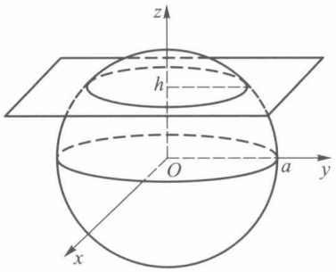

text_image

z
h
O
a
y
x

图22-1

所以由公式(2)求得

$$
\begin{array}{l} \iint_ {S} \frac {\mathrm{d} S}{z} = \iint_ {D} \frac {a}{a ^ {2} - x ^ {2} - y ^ {2}} \mathrm{d} x \mathrm{d} y = \int_ {0} ^ {2 \pi} \mathrm{d} \theta \int_ {0} ^ {\sqrt {a ^ {2} - h ^ {2}}} \frac {a}{a ^ {2} - r ^ {2}} r \mathrm{d} r \\ = 2 \pi a \int_ {0} ^ {\sqrt {a ^ {2} - h ^ {2}}} \frac {r}{a ^ {2} - r ^ {2}} \mathrm{d} r = - \pi a \ln (a ^ {2} - r ^ {2}) \Bigg | _ {0} ^ {\sqrt {a ^ {2} - h ^ {2}}} \\ = 2 \pi a \ln \frac {a}{h}. \\ \end{array}
$$

例 2 计算  $\iint_{S}(x^{2}+y^{2}+z^{2})\mathrm{d}S$ ，其中

(1) $S: x^{2} + y^{2} + z^{2} = a^{2}$; (2) $S: x^{2} + y^{2} + z^{2} = 2az$.

解 (1) $\iint_{S} (x^{2} + y^{2} + z^{2}) \, \mathrm{d}S = \iint_{S} a^{2} \, \mathrm{d}S = 4\pi a^{2} \cdot a^{2} = 4\pi a^{4}$.

(2) $\iint_{S} (x^{2} + y^{2} + z^{2}) \, \mathrm{d}S = \iint_{S} 2az \, \mathrm{d}S = \iint_{S_{1}} 2az \, \mathrm{d}S + \iint_{S_{2}} 2az \, \mathrm{d}S,$

其中

$$
\begin{array}{l} S _ {1}: z _ {1} = a + \sqrt {a ^ {2} - (x ^ {2} + y ^ {2})}, (x, y) \in D, \\ S _ {2}: z _ {2} = a - \sqrt {a ^ {2} - (x ^ {2} + y ^ {2})}, (x, y) \in D, \\ D: x ^ {2} + y ^ {2} \leqslant a ^ {2}. \\ \end{array}
$$

由于 $\sqrt{1 + \left(\frac{\partial z_1}{\partial x}\right)^2 + \left(\frac{\partial z_1}{\partial y}\right)^2} = \sqrt{1 + \left(\frac{\partial z_2}{\partial x}\right)^2 + \left(\frac{\partial z_2}{\partial y}\right)^2} = \frac{a}{\sqrt{a^2 - (x^2 + y^2)}}$ ，因此

$$
\iint_ {S _ {1}} 2 a z \mathrm{d} S = \iint_ {D} 2 a (a + \sqrt {a ^ {2} - (x ^ {2} + y ^ {2})} \frac {a}{\sqrt {a ^ {2} - (x ^ {2} + y ^ {2})}} \mathrm{d} x \mathrm{d} y,
$$

$$
\iint_ {S _ {2}} 2 a z \mathrm{d} S = \iint_ {D} 2 a (a - \sqrt {a ^ {2} - (x ^ {2} + y ^ {2})} \frac {a}{\sqrt {a ^ {2} - (x ^ {2} + y ^ {2})}} \mathrm{d} x \mathrm{d} y,
$$

$$
\begin{array}{l} \iint_ {S} \left(x ^ {2} + y ^ {2} + z ^ {2}\right) \mathrm{d} S = 4 \iint_ {D} \frac {a ^ {3}}{\sqrt {a ^ {2} - \left(x ^ {2} + y ^ {2}\right)}} \mathrm{d} x \mathrm{d} y \\ = 4 a ^ {3} \int_ {0} ^ {2 \pi} \mathrm{d} \theta \int_ {0} ^ {a} \frac {r \mathrm{d} r}{\sqrt {a ^ {2} - r ^ {2}}} = 8 a ^ {3} \pi (- \sqrt {a ^ {2} - r ^ {2}}) \Bigg | _ {0} ^ {a} = 8 a ^ {4} \pi , \quad \square \\ \end{array}
$$

对于由参量形式表示的光滑曲面

$$
S: \left\{ \begin{array}{l} x = x (u, v), \\ y = y (u, v), \\ z = z (u, v), \end{array} \right. \quad (u, v) \in D,
$$

则在 $S$ 上第一型曲面积分的计算公式为

$$
\iint_ {S} f (x, y, z) \mathrm{d} S = \iint_ {D} f (x (u, v), y (u, v), z (u, v)) \sqrt {E G - F ^ {2}} \mathrm{d} u \mathrm{d} v, \tag {3}
$$

其中

$$
E = x _ {u} ^ {2} + y _ {u} ^ {2} + z _ {u} ^ {2},
$$

$$
F = x _ {u} x _ {v} + y _ {u} y _ {v} + z _ {u} z _ {v},
$$

$$
G = x _ {v} ^ {2} + y _ {v} ^ {2} + z _ {v} ^ {2}.
$$

这里还要求雅可比行列式 $\frac{\partial(x,y)}{\partial(u,v)},\frac{\partial(y,z)}{\partial(u,v)},\frac{\partial(z,x)}{\partial(u,v)}$ 中至少有一个不等于零.

例3 计算 $\iint_{S} z \, \mathrm{d}S$，其中 $S$ 为螺旋面（图22-2）的一部分

$$
S \colon \left\{ \begin{array}{l l} x = u \cos v, \\ y = u \sin v, & (u, v) \in D, \\ z = v, \end{array} \right.
$$

$$
D: \left\{ \begin{array}{l} 0 \leqslant u \leqslant a, \\ 0 \leqslant v \leqslant 2 \pi . \end{array} \right.
$$

解 由于

$$
E = x _ {u} ^ {2} + y _ {u} ^ {2} + z _ {u} ^ {2}
$$

$$
= \cos^ {2} v + \sin^ {2} v = 1,
$$

$$
F = x _ {u} x _ {v} + y _ {u} y _ {v} + z _ {u} z _ {v}
$$

$$
= - u \sin v \cos v + u \sin v \cos v = 0,
$$

$$
G = x _ {v} ^ {2} + y _ {v} ^ {2} + z _ {v} ^ {2}
$$

$$
= u ^ {2} \sin^ {2} v + u ^ {2} \cos^ {2} v + 1 = 1 + u ^ {2},
$$

因此由公式(3)可以求得

$$
\begin{array}{l} \iint_ {S} z \mathrm{d} S = \iint_ {D} v \sqrt {1 + u ^ {2}} \mathrm{d} u \mathrm{d} v = \int_ {0} ^ {2 \pi} v \mathrm{d} v \int_ {0} ^ {a} \sqrt {1 + u ^ {2}} \mathrm{d} u \\ = 2 \pi^ {2} \left[ \frac {u}{2} \sqrt {1 + u ^ {2}} + \frac {1}{2} \ln (u + \sqrt {1 + u ^ {2}}) \right] \Bigg | _ {0} ^ {a} \\ = \pi^ {2} \left[ a \sqrt {1 + a ^ {2}} + \ln (a + \sqrt {1 + a ^ {2}}) \right]. \\ \end{array}
$$

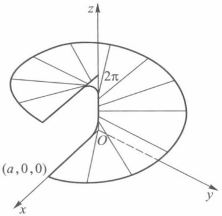

text_image

(a,0,0)
2π
O
x
y
z

图22-2

与重积分相同,利用第一型曲面积分可以求曲面块的质心、转动惯量、引力等,作为练习,请读者自行写出这些公式,这里不赘述了.

## 习题 22.1

1. 计算下列第一型曲面积分:

(1) $\iint_{S}(x + y + z)\mathrm{d}S$ ，其中 $S$ 为上半球面 $x^{2} + y^{2} + z^{2} = a^{2},z\geqslant 0;$
(2) $\iint_{S}(x^{2} + y^{2})\mathrm{d}S$ ，其中 $S$ 为立体 $\sqrt{x^2 + y^2}\leqslant z\leqslant 1$ 的边界曲面；
(3) $\iint_{S} \frac{\mathrm{d}S}{x^2 + y^2}$, 其中 $S$ 为柱面 $x^2 + y^2 = R^2$ 被平面 $z = 0, z = H$ 所截取的部分;
(4) $\iint_{S} xyz \, \mathrm{d}S$, 其中 $S$ 为平面 $x + y + z = 1$ 在第一卦限中的部分.

2. 求均匀曲面 $x^{2} + y^{2} + z^{2} = a^{2}, x \geqslant 0, y \geqslant 0, z \geqslant 0$ 的质心.

3. 求密度为  $\rho$  的均匀球面  $x^{2} + y^{2} + z^{2} = a^{2} \quad (z \geqslant 0)$  对于 z 轴的转动惯量.

4. 计算 $\iint_{S} z^2 \, \mathrm{d}S$，其中 $S$ 为圆锥表面的一部分

$$
S: \left\{ \begin{array}{l} x = r \cos \varphi \sin \theta , \\ y = r \sin \varphi \sin \theta , \\ z = r \cos \theta , \end{array} \right. \quad D: \left\{ \begin{array}{l} 0 \leqslant r \leqslant a, \\ 0 \leqslant \varphi \leqslant 2 \pi , \end{array} \right.
$$

这里 $\theta$ 为常数 $\left(0 < \theta < \frac{\pi}{2}\right)$.

## § 2 第二型曲面积分

## 一、曲面的侧

为了给曲面确定方向,先要阐明曲面的侧的概念.

设连通曲面 $S$ 上到处都有连续变动的切平面（或法线），$M$ 为曲面 $S$ 上的一点，曲面在 $M$ 处的法线有两个方向:当取定其中一个指向为正方向时，则另一个指向就是负方向。设 $M_0$ 为 $S$ 上任一点，$L$ 为 $S$ 上任一经过点 $M_0$，且不超出 $S$ 边界的闭曲线。又设 $M$ 为动点，它在 $M_0$ 处与 $M_0$ 有相同的法线方向，且有如下特性:当 $M$ 从 $M_0$ 出发沿 $L$ 连续移动，这时作为曲面上的点 $M$，它的法线方向也连续地变动。最后当 $M$ 沿 $L$ 回到 $M_0$ 时，若这时 $M$ 的法线方向仍与 $M_0$ 的法线方向相一致，则说这曲面 $S$ 是双侧曲面①；若与 $M_0$ 的法线方向相反，则说 $S$ 是单侧曲面。

我们通常碰到的曲面大多是双侧曲面. 单侧曲面的一个典型例子是默比乌斯 (Möbius) 带. 它的构造方法如下: 取一矩形长纸带 ABCD（如图 22-3(a)），将其一端扭转 $180^{\circ}$ 后与另一端黏合在一起（即让 $A$ 与 $C$ 重合，$B$ 与 $D$ 重合。如图22-3(b)所示）。读者可以考察这个带状曲面是单侧的。事实上，可在曲面上任取一条与其边界相平行的闭曲线 $L$，动点 $M$ 从 $L$ 上的点 $M_0$ 出发，其法线方向与 $M_0$ 的法线方向相一致，当 $M$ 沿 $L$ 连续变动一周回到 $M_0$ 时，由图22-3(b)看到，这时 $M$ 的法线方向却与 $M_0$ 的法线方向相反。对默比乌斯带还可更简单地说明它的单侧特性，即沿这个带子上任一处出发涂以一种颜色，则可以不越过边界而将它全部涂遍（即把原纸带的两面都涂上同样的颜色）。

<small>① 事实上, 可以证明, 只需对 $S$ 中某一点 $M_0$, 对通过 $M_0$ 且又不超出 $S$ 的边界的任何闭曲线 $L$ 上具有上述特性, 则 $S$ 是双侧曲面.</small>

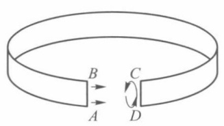

text_image

B
A
C
D

(a)

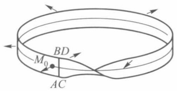

text_image

BD
M₀
AC

(b)

图22-3

通常由 $z = z(x,y)$ 所表示的曲面都是双侧曲面，当以其法线正方向与 $z$ 轴正向的夹角成锐角的一侧（也称为上侧）为正侧时，则另一侧（也称下侧）为负侧.当 $S$ 为封闭曲面时，通常规定曲面的外侧为正侧，内侧为负侧

## 二、第二型曲面积分的概念

先观察一个流量计算问题. 设某流体以一定的流速

$$
\boldsymbol {v} = (P (x, y, z), Q (x, y, z), R (x, y, z))
$$

从给定的曲面 S 的负侧流向正侧(图 22-4)，其中 P, Q, R 为所讨论范围上的连续函数，求单位时间内流经曲面 S 的总流量 E.

设在曲面 $S$ 的正侧上任一点 $(x,y,z)$ 处的单位法向量为

$$
\boldsymbol {n} = (\cos \alpha , \cos \beta , \cos \gamma).
$$

这里  $\alpha,\beta,\gamma$  是 x,y,z 的函数, 则单位时间内流经小曲面  $S_{i}$  的流量近似地等于

$$
\begin{array}{l} \boldsymbol {v} (\xi_ {i}, \eta_ {i}, \zeta_ {i}) \cdot \boldsymbol {n} (\xi_ {i}, \eta_ {i}, \zeta_ {i}) \Delta S _ {i} \\ = \left[ P (\xi_ {i}, \eta_ {i}, \zeta_ {i}) \cos \alpha_ {i} + Q (\xi_ {i}, \eta_ {i}, \zeta_ {i}) \cos \beta_ {i} + \right. \\ R (\xi_ {i}, \eta_ {i}, \zeta_ {i}) \cos \gamma_ {i} ] \Delta S _ {i}, \\ \end{array}
$$

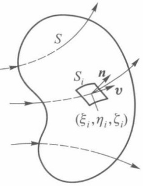

text_image

S
S_i n v
(ξ_i, η_i, ζ_i)

图22-4

其中 $(\xi_{i},\eta_{i},\zeta_{i})$ 是 $S_{i}$ 上任意取定的一点， $\cos \alpha_{i},\cos \beta_{i},\cos \gamma_{i}$ 是 $S_{i}$ 的

正侧上法线的方向余弦，又 $\Delta S_{i}\cos \alpha_{i},\Delta S_{i}\cos \beta_{i},\Delta S_{i}\cos \gamma_{i}$ 分别是 $S_{i}$ 的正侧在坐标面$yz,zx$ 和 $xy$ 上投影区域的面积的近似值，并分别记作 $\Delta S_{i_yz},\Delta S_{i_{zx}},\Delta S_{i_{xy}}$ ，于是单位时间内由小曲面 $S_{i}$ 的负侧流向正侧的流量也近似地等于

$$
P (\xi_ {i}, \eta_ {i}, \zeta_ {i}) \Delta S _ {i _ {y z}} + Q (\xi_ {i}, \eta_ {i}, \zeta_ {i}) \Delta S _ {i _ {z x}} + R (\xi_ {i}, \eta_ {i}, \zeta_ {i}) \Delta S _ {i _ {x y}},
$$

故单位时间内由曲面 $S$ 的负侧流向正侧的总流量

$$
E = \lim _ {\| T \| \to 0} \sum_ {i = 1} ^ {n} \left\{P (\xi_ {i}, \eta_ {i}, \zeta_ {i}) \Delta S _ {i _ {y z}} + Q (\xi_ {i}, \eta_ {i}, \zeta_ {i}) \Delta S _ {i _ {z x}} + R (\xi_ {i}, \eta_ {i}, \zeta_ {i}) \Delta S _ {i _ {x y}} \right\}.
$$

这种与曲面的侧有关的和式极限就是所要讨论的第二型曲面积分.

定义1 设 P, Q, R 为定义在双侧曲面 S 上的函数，在 S 所指定的一侧作分割 T，它把 S 分为 n 个小曲面  $S_{1}, S_{2}, \cdots, S_{n}$ ，分割 T 的细度  $\|T\| = \max_{1 \leqslant i \leqslant n} \{S_{i} \text{ 的直径}\}$ ，以  $\Delta S_{i_{yz}}$ ， $\Delta S_{i_{zx}}, \Delta S_{i_{xy}}$  分别表示  $S_{i}$  在三个坐标面上的投影区域的面积，它们的符号由  $S_{i}$  的方向来确定。若  $S_{i}$  的法线正向与 z 轴正向成锐角时， $S_{i}$  在 xy 平面的投影区域的面积  $\Delta S_{i_{xy}}$  为正。反之，若  $S_{i}$  法线正向与 z 轴正向成钝角时，它在 xy 平面的投影区域的面积  $\Delta S_{i_{xy}}$  为负。在各个小曲面  $S_{i}$  上任取一点  $(\xi_{i}, \eta_{i}, \zeta_{i})$ 。若

$$
\lim _ {\| T \| \to 0} \sum_ {i = 1} ^ {n} P (\xi_ {i}, \eta_ {i}, \zeta_ {i}) \Delta S _ {i _ {y z}} + \lim _ {\| T \| \to 0} \sum_ {i = 1} ^ {n} Q (\xi_ {i}, \eta_ {i}, \zeta_ {i}) \Delta S _ {i _ {z x}} + \lim _ {\| T \| \to 0} \sum_ {i = 1} ^ {n} R (\xi_ {i}, \eta_ {i}, \zeta_ {i}) \Delta S _ {i _ {x y}}
$$

存在，且与曲面 $S$ 的分割 $T$ 和 $(\xi_{i},\eta_{i},\zeta_{i})$ 在 $S_{i}$ 上的取法无关，则称此极限为函数 $P,Q,$ $R$ 在曲面 $S$ 所指定的一侧上的第二型曲面积分，记作

$$
\iint_ {S} P (x, y, z) \mathrm{d} y \mathrm{d} z + Q (x, y, z) \mathrm{d} z \mathrm{d} x + R (x, y, z) \mathrm{d} x \mathrm{d} y \tag {1}
$$

或

$$
\iint_ {S} P (x, y, z) \mathrm{d} y \mathrm{d} z + \iint_ {S} Q (x, y, z) \mathrm{d} z \mathrm{d} x + \iint_ {S} R (x, y, z) \mathrm{d} x \mathrm{d} y.
$$

据此定义,某流体以速度  $\boldsymbol{v}=(P,Q,R)$  在单位时间内从曲面 S 的负侧流向正侧的总流量

$$
E = \iint_ {S} P (x, y, z) \mathrm{d} y \mathrm{d} z + Q (x, y, z) \mathrm{d} z \mathrm{d} x + R (x, y, z) \mathrm{d} x \mathrm{d} y.
$$

又若,空间的磁场强度为

$$
(P (x, y, z), Q (x, y, z), R (x, y, z)),
$$

则通过曲面 S 的磁通量(磁力线总数)

$$
H = \iint_ {S} P (x, y, z) \mathrm{d} y \mathrm{d} z + Q (x, y, z) \mathrm{d} z \mathrm{d} x + R (x, y, z) \mathrm{d} x \mathrm{d} y.
$$

若以-S 表示曲面 S 的另一侧, 由定义易得

$$
\begin{array}{l} \iint_ {- S} P \mathrm{d} y \mathrm{d} z + Q \mathrm{d} z \mathrm{d} x + R \mathrm{d} x \mathrm{d} y \\ = - \iint_ {S} P \mathrm{d} y \mathrm{d} z + Q \mathrm{d} z \mathrm{d} x + R \mathrm{d} x \mathrm{d} y. \\ \end{array}
$$

与第二型曲线积分一样,第二型曲面积分也有如下一些性质:

1. 若  $\iint_{S} P_{i} dy dz + Q_{i} dz dx + R_{i} dx dy \quad (i = 1, 2, \cdots, k)$  存在，则有

$$
\begin{array}{l} \iint_ {S} \left(\sum_ {i = 1} ^ {k} c _ {i} P _ {i}\right) \mathrm{d} y \mathrm{d} z + \left(\sum_ {i = 1} ^ {k} c _ {i} Q _ {i}\right) \mathrm{d} z \mathrm{d} x + \left(\sum_ {i = 1} ^ {k} c _ {i} R _ {i}\right) \mathrm{d} x \mathrm{d} y \\ = \sum_ {i = 1} ^ {k} c _ {i} \iint_ {S} P _ {i} \mathrm{d} y \mathrm{d} z + Q _ {i} \mathrm{d} z \mathrm{d} x + R _ {i} \mathrm{d} x \mathrm{d} y, \\ \end{array}
$$

其中  $c_{i}$  ( $i=1,2,\cdots,k$ ) 是常数.

2. 若曲面 S 是由两两无公共内点的曲面块  $S_{1}, S_{2}, \cdots, S_{k}$  所组成，且

$$
\iint_ {S _ {i}} P \mathrm{d} y \mathrm{d} z + Q \mathrm{d} z \mathrm{d} x + R \mathrm{d} x \mathrm{d} y \quad (i = 1, 2, \dots , k)
$$

存在,则有

$$
\begin{array}{l} \iint_ {S} P \mathrm{d} y \mathrm{d} z + Q \mathrm{d} z \mathrm{d} x + R \mathrm{d} x \mathrm{d} y \\ = \sum_ {i = 1} ^ {k} \iint_ {S _ {i}} P \mathrm{d} y \mathrm{d} z + Q \mathrm{d} z \mathrm{d} x + R \mathrm{d} x \mathrm{d} y. \\ \end{array}
$$

## 三、第二型曲面积分的计算

第二型曲面积分也是把它化为二重积分来计算.

定理 22.2 设 R 是定义在光滑曲面

$$
S \colon z = z (x, y), \quad (x, y) \in D _ {x y}
$$

上的连续函数,以 S 的上侧为正侧(这时 S 的法线方向与 z 轴正向成锐角),则有

$$
\iint_ {S} R (x, y, z) \mathrm{d} x \mathrm{d} y = \iint_ {D _ {x y}} R (x, y, z (x, y)) \mathrm{d} x \mathrm{d} y. \tag {2}
$$

证 由第二型曲面积分定义

$$
\begin{array}{l} \iint_ {S} R (x, y, z) \mathrm{d} x \mathrm{d} y = \lim _ {\| T \| \to 0} \sum_ {i = 1} ^ {n} R (\xi_ {i}, \eta_ {i}, \zeta_ {i}) \Delta S _ {i _ {x y}} \\ = \lim _ {d \to 0} \sum_ {i = 1} ^ {n} R (\xi_ {i}, \eta_ {i}, z (\xi_ {i}, \eta_ {i})) \Delta S _ {i _ {x y}}, \\ \end{array}
$$

这里 $d = \max \{S_{i_{xy}}$ 的直径}. 显然由 $\| T \| = \max \{S_i$ 的直径 $\} \to 0$ 立刻可推得 $d \to 0$. 由于 $R$ 在 $S$ 上连续, $z$ 在 $D_{xy}$ 上连续（曲面光滑！), 据复合函数的连续性, $R(x,y,z(x,y))$ 也是 $D_{xy}$ 上的连续函数. 由二重积分的定义

$$
\iint_ {D _ {x y}} R (x, y, z (x, y)) \mathrm{d} x \mathrm{d} y = \lim _ {d \to 0} \sum_ {i = 1} ^ {n} R (\xi_ {i}, \eta_ {i}, z (\xi_ {i}, \eta_ {i})) \Delta S _ {i _ {x y}}.
$$

所以

$$
\iint_ {S} R (x, y, z) \mathrm{d} x \mathrm{d} y = \iint_ {D _ {x y}} R (x, y, z (x, y)) \mathrm{d} x \mathrm{d} y.
$$

类似地, 当 P 在光滑曲面

$$
S \colon x = x (y, z), \quad (y, z) \in D _ {y z}
$$

上连续时,有

$$
\iint_ {S} P (x, y, z) \mathrm{d} y \mathrm{d} z = \iint_ {D _ {y z}} P (x (y, z), y, z) \mathrm{d} y \mathrm{d} z, \tag {3}
$$

这里 $S$ 是以 $S$ 的法线方向与 $x$ 轴的正向成锐角的那一侧为正侧. 当 $Q$ 在光滑曲面

$$
S \colon y = y (z, x), \quad (z, x) \in D _ {z x}
$$

上连续时,有

$$
\iint_ {S} Q (x, y, z) \mathrm{d} z \mathrm{d} x = \iint_ {D _ {z x}} Q (x, y (z, x), z) \mathrm{d} z \mathrm{d} x, \tag {4}
$$

这里 $S$ 是以 $S$ 的法线方向与 $y$ 轴的正向成锐角的那一侧为正侧.

例 1 计算  $\iint_{S} xyz \, dx \, dy$ ,

其中 S 是球面  $x^{2}+y^{2}+z^{2}=1$  在  $x\geqslant0, y\geqslant0$  部分并取球面外侧（图 22-5）.

解 曲面 S 在第一、五卦限部分的方程分别为

$$
S _ {1}: z _ {1} = \sqrt {1 - x ^ {2} - y ^ {2}},
$$

$$
S _ {2}: z _ {2} = - \sqrt {1 - x ^ {2} - y ^ {2}},
$$

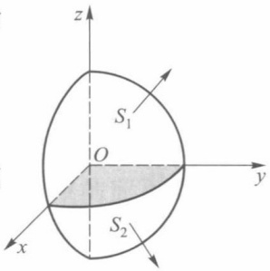

text_image

z
S₁
O
y
x
S₂

图22-5

它们在 xy 平面上的投影区域都是单位圆在第一象限部分. 依题意, 积分是沿  $S_{1}$  的上侧和  $S_{2}$  的下侧进行, 所以

$$
\begin{array}{l} \iint_ {S} x y z \mathrm{d} x \mathrm{d} y = \iint_ {S _ {1}} x y z \mathrm{d} x \mathrm{d} y + \iint_ {S _ {2}} x y z \mathrm{d} x \mathrm{d} y \\ = \iint_ {D _ {x y}} x y \sqrt {1 - x ^ {2} - y ^ {2}} \mathrm{d} x \mathrm{d} y - \iint_ {D _ {x y}} (- x y \sqrt {1 - x ^ {2} - y ^ {2}}) \mathrm{d} x \mathrm{d} y \\ = 2 \iint_ {D _ {x y}} x y \sqrt {1 - x ^ {2} - y ^ {2}} \mathrm{d} x \mathrm{d} y \\ = 2 \int_ {0} ^ {\frac {\pi}{2}} \mathrm{d} \theta \int_ {0} ^ {1} r ^ {3} \cos \theta \sin \theta \sqrt {1 - r ^ {2}} \mathrm{d} r = \frac {2}{1 5}. \\ \end{array}
$$

如果光滑曲面 S 由参量方程给出:

$$
S \colon \left\{ \begin{array}{l} x = x (u, v), \\ y = y (u, v), \\ z = z (u, v), \end{array} \right. \quad (u, v) \in D.
$$

若在 $D$ 上各点它们的函数行列式

$$
\frac {\partial (y , z)}{\partial (u , v)}, \quad \frac {\partial (z , x)}{\partial (u , v)}, \quad \frac {\partial (x , y)}{\partial (u , v)}
$$

不同时为零,则分别有

$$
\iint_ {S} P \mathrm{d} y \mathrm{d} z = \pm \iint_ {D} P (x (u, v), y (u, v), z (u, v)) \frac {\partial (y , z)}{\partial (u , v)} \mathrm{d} u \mathrm{d} v, \tag {5}
$$

$$
\iint_ {S} Q \mathrm{d} z \mathrm{d} x = \pm \iint_ {D} Q (x (u, v), y (u, v), z (u, v)) \frac {\partial (z , x)}{\partial (u , v)} \mathrm{d} u \mathrm{d} v, \tag {6}
$$

$$
\iint_ {S} R \mathrm{d} x \mathrm{d} y = \pm \iint_ {D} R (x (u, v), y (u, v), z (u, v)) \frac {\partial (x , y)}{\partial (u , v)} \mathrm{d} u \mathrm{d} v. \tag {7}
$$

注 （5），（6），（7）三式中的正负号分别对应曲面 S 的两个侧，特别当法向  $\left(\frac{\partial(y,z)}{\partial(u,v)},\frac{\partial(z,x)}{\partial(u,v)},\frac{\partial(x,y)}{\partial(u,v)}\right)$  对应于曲面 S 所选定的正向一侧时，取正号，否则取负号.

例2 计算

$$
\iint_ {S} x ^ {3} \mathrm{d} y \mathrm{d} z,
$$

其中 S 为椭球面  $\frac{x^{2}}{a^{2}}+\frac{y^{2}}{b^{2}}+\frac{z^{2}}{c^{2}}=1$  的上半部并选取外侧.

解 把曲面表示为参量方程

$$
x = a \sin \varphi \cos \theta , y = b \sin \varphi \sin \theta , z = c \cos \varphi \quad \left(0 \leqslant \varphi \leqslant \frac {\pi}{2}, 0 \leqslant \theta \leqslant 2 \pi\right).
$$

由(5)式有

$$
\iint_ {S} x ^ {3} \mathrm{d} y \mathrm{d} z = \pm \iint_ {D _ {\varphi \theta}} a ^ {3} \sin^ {3} \varphi \cos^ {3} \theta \cdot A \mathrm{d} \varphi \mathrm{d} \theta , \tag {8}
$$

其中

$$
A = \frac {\partial (y , z)}{\partial (\varphi , \theta)} = \left| \begin{array}{c c} b \cos \varphi \sin \theta & b \sin \varphi \cos \theta \\ - c \sin \varphi & 0 \end{array} \right| = b c \sin^ {2} \varphi \cos \theta ,
$$

积分是在 S 的上侧进行. 由上述的注, (8) 式右端取正号 (因为此时法向中  $\frac{\partial(x,y)}{\partial(\varphi,\theta)} = ab\sin\varphi\cos\varphi \geqslant 0$  对应 S 的正侧), 即

$$
\begin{array}{l} \iint_ {S} x ^ {3} \mathrm{d} y \mathrm{d} z = \iint_ {D _ {\varphi \theta}} a ^ {3} \sin^ {3} \varphi \cos^ {3} \theta \cdot b c \sin^ {2} \varphi \cos \theta \mathrm{d} \varphi \mathrm{d} \theta \\ = a ^ {3} b c \int_ {0} ^ {\frac {\pi}{2}} \sin^ {5} \varphi \mathrm{d} \varphi \int_ {0} ^ {2 \pi} \cos^ {4} \theta \mathrm{d} \theta = \frac {2}{5} \pi a ^ {3} b c. \\ \end{array}
$$

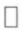

## 四、两类曲面积分的联系

与曲线积分一样,当曲面的侧确定之后,可以建立两种类型曲面积分的联系.

设 S 为光滑曲面, 并以上侧为正侧, R 为 S 上的连续函数, 曲面积分在 S 的正侧进行. 因而有

$$
\iint_ {S} R (x, y, z) \mathrm{d} x \mathrm{d} y = \lim _ {\| T \| \to 0} \sum_ {i = 1} ^ {n} R (\xi_ {i}, \eta_ {i}, \zeta_ {i}) \Delta S _ {i _ {x y}}. \tag {9}
$$

由曲面面积公式(第二十一章 §6)

$$
\Delta S _ {i} = \iint_ {S _ {i _ {x y}}} \frac {1}{\cos \gamma} \mathrm{d} x \mathrm{d} y,
$$

其中 $\gamma$ 是曲面 $S_{i}$ 的法线方向与 $z$ 轴正向的交角，它是定义在 $S_{i_{xy}}$ 上的函数。因为积分沿曲面正侧进行，所以 $\gamma$ 是锐角。又由 $S$ 是光滑的，所以 $\cos \gamma$ 在闭区域 $S_{i_{xy}}$ 上连续。应用中值定理，在 $S_{i_{xy}}$ 内必存在一点，使这点的法线方向与 $z$ 轴正向的夹角 $\gamma_{i}^{*}$ 满足等式

$$
\Delta S _ {i} = \frac {1}{\cos \gamma_ {i} ^ {*}} \Delta S _ {i _ {x y}}
$$

或

$$
\Delta S _ {i _ {x y}} = \cos \gamma_ {i} ^ {*} \cdot \Delta S _ {i}.
$$

于是

$$
R (\xi_ {i}, \eta_ {i}, \zeta_ {i}) \Delta S _ {i _ {x y}} = R (\xi_ {i}, \eta_ {i}, \zeta_ {i}) \cos \gamma_ {i} ^ {*} \Delta S _ {i}.
$$

$n$ 个部分相加后得

$$
\sum_ {i = 1} ^ {n} R (\xi_ {i}, \eta_ {i}, \zeta_ {i}) \Delta S _ {i _ {x y}} = \sum_ {i = 1} ^ {n} R (\xi_ {i}, \eta_ {i}, \zeta_ {i}) \cos \gamma_ {i} ^ {*} \Delta S _ {i}. \tag {10}
$$

现以 $\cos \gamma_{i}$ 表示曲面 $S_{i}$ 在点 $(x_{i},y_{i},z_{i})$ 的法线方向与 $z$ 轴正向夹角的余弦，则由 $\cos \gamma$ 的连续性，可推得当 $\| T\| \to 0$ 时，(10)式右端极限存在.因此由(9)式得到

$$
\iint_ {S} R (x, y, z) \mathrm{d} x \mathrm{d} y = \iint_ {S} R (x, y, z) \cos \gamma \mathrm{d} S. \tag {11}
$$

这里注意当改变曲面的侧时, 左边积分改变符号, 右边积分中角  $\gamma$  改为  $\gamma \pm \pi$ . 因而  $\cos \gamma$  也改变符号, 所以右边积分也相应改变了符号. 同理可证:

$$
\iint_ {S} P (x, y, z) \mathrm{d} y \mathrm{d} z = \iint_ {S} P (x, y, z) \cos \alpha \mathrm{d} S, \tag {12}
$$

$$
\iint_ {S} Q (x, y, z) \mathrm{d} z \mathrm{d} x = \iint_ {S} Q (x, y, z) \cos \beta \mathrm{d} S,
$$

其中 $\alpha, \beta$ 分别是 $S$ 上的法线方向与 $x$ 轴正向和与 $y$ 轴正向的夹角. 一般地有

$$
\begin{array}{l} \iint_ {S} P (x, y, z) \mathrm{d} y \mathrm{d} z + Q (x, y, z) \mathrm{d} z \mathrm{d} x + R (x, y, z) \mathrm{d} x \mathrm{d} y \\ = \iint_ {S} [ P (x, y, z) \cos \alpha + Q (x, y, z) \cos \beta + R (x, y, z) \cos \gamma ] \mathrm{d} S. \tag {13} \\ \end{array}
$$

这样,在确定了余弦函数  $\cos\alpha,\cos\beta,\cos\gamma$  之后,由(11),(12)或(13)式便建立了两种不同类型曲面积分的联系.

定理 22.3 设 S 为光滑曲面, 正侧法向量为  $(\cos \alpha, \cos \beta, \cos \gamma)$ ,  $P(x, y, z)$ ,  $Q(x, y, z)$ ,  $R(x, y, z)$  在 S 上连续, 则

$$
\begin{array}{l} \iint_ {S} P (x, y, z) \mathrm{d} y \mathrm{d} z + Q (x, y, z) \mathrm{d} z \mathrm{d} x + R (x, y, z) \mathrm{d} x \mathrm{d} y \\ = \iint_ {S} (P (x, y, z) \cos \alpha + Q (x, y, z) \cos \beta + R (x, y, z) \cos \gamma) \mathrm{d} S. \\ \end{array}
$$

定理 22.4 设 P, Q, R 是定义在光滑曲面  $S: z = z(x, y), (x, y) \in D$  上的连续函数，以 S 的上侧为正侧，则

$$
\begin{array}{l} \iint_ {S} P (x, y, z) \mathrm{d} y \mathrm{d} z + Q (x, y, z) \mathrm{d} z \mathrm{d} x + R (x, y, z) \mathrm{d} x \mathrm{d} y \\ = \iint_ {D} (P (x, y, z (x, y)) (- z _ {x}) + Q (x, y, z (x, y)) (- z _ {y}) + R (x, y, z (x, y))) \mathrm{d} x \mathrm{d} y. \\ \end{array}
$$

证 由于

$$
\cos \alpha = \frac {- z _ {x}}{\sqrt {1 + z _ {x} ^ {2} + z _ {y} ^ {2}}}, \cos \beta = \frac {- z _ {y}}{\sqrt {1 + z _ {x} ^ {2} + z _ {y} ^ {2}}}, \cos \gamma = \frac {1}{\sqrt {1 + z _ {x} ^ {2} + z _ {y} ^ {2}}}, \mathrm{d} S = \sqrt {1 + z _ {x} ^ {2} + z _ {y} ^ {2}} \mathrm{d} x \mathrm{d} y,
$$

因此

$$
\begin{array}{l} \iint_ {S} P (x, y, z) \mathrm{d} y \mathrm{d} z + Q (x, y, z) \mathrm{d} z \mathrm{d} x + R (x, y, z) \mathrm{d} x \mathrm{d} y \\ = \iint_ {S} (P (x, y, z) \cos \alpha + Q (x, y, z) \cos \beta + R (x, y, z) \cos \gamma) \mathrm{d} S \\ = \iint_ {D} (P (x, y, z (x, y)) (- z _ {x}) + Q (x, y, z (x, y)) (- z _ {y}) + \\ R (x, y, z (x, y)) \mathrm{d} x \mathrm{d} y. \\ \end{array}
$$

例 3 计算  $\iint_{S}(2x+z)\mathrm{d}y\mathrm{d}z+z\mathrm{d}x\mathrm{d}y$ ，其中  $S=\left\{(x,y,z)\mid z=x^{2}+y^{2},z\in[0,1]\right\}$ ，取上侧.

解 $z_{x} = 2x, z_{y} = 2y,$

$$
\begin{array}{l} I = \iint_ {D} \left(\left(2 x + x ^ {2} + y ^ {2}\right) (- 2 x) + x ^ {2} + y ^ {2}\right) \mathrm{d} x \mathrm{d} y = \iint_ {D} \left(y ^ {2} - 3 x ^ {2}\right) \mathrm{d} x \mathrm{d} y \\ = - \iint_ {D} 2 x ^ {2} \mathrm{d} x \mathrm{d} y = - 2 \int_ {0} ^ {2 \pi} \mathrm{d} \theta \int_ {0} ^ {1} r ^ {2} \cos^ {2} \theta r \mathrm{d} r = - \frac {\pi}{2}, \\ \end{array}
$$

其中由于 $x(x^{2} + y^{2})$ 是 $x$ 的奇函数， $\iint_{D}x(x^{2} + y^{2})\mathrm{d}x\mathrm{d}y = 0$ ；又由对称性，

$$
\iint_ {D} x ^ {2} \mathrm{d} x \mathrm{d} y = \iint_ {D} y ^ {2} \mathrm{d} x \mathrm{d} y.
$$

## 习题 22.2

1. 计算下列第二型曲面积分:

(1) $\iint_{S} y(x - z) \, \mathrm{d}y \, \mathrm{d}z + x^2 \, \mathrm{d}z \, \mathrm{d}x + (y^2 + xz) \, \mathrm{d}x \, \mathrm{d}y$，其中 $S$ 为由 $x = y = z = 0, x = y = z = a$ 六个平面所围的立方体表面并取外侧为正向；
(2) $\iint_{S}(x + y)\mathrm{d}y\mathrm{d}z + (y + z)\mathrm{d}z\mathrm{d}x + (z + x)\mathrm{d}x\mathrm{d}y$ ，其中 $S$ 是以原点为中心，边长为2的立方体表面并取外侧为正向；
(3) $\iint_{S} xy \, \mathrm{d}y \, \mathrm{d}z + yz \, \mathrm{d}z \, \mathrm{d}x + xz \, \mathrm{d}x \, \mathrm{d}y$，其中 $S$ 是由平面 $x = y = z = 0$ 和 $x + y + z = 1$ 所围的四面体表面并取外侧为正向；
(4) $\iint_{S} yz \, \mathrm{d}z \, \mathrm{d}x$，其中 $S$ 是球面 $x^{2} + y^{2} + z^{2} = 1$ 的上半部分并取外侧为正向；
(5) $\iint_{S} x^{2} \, \mathrm{d}y \, \mathrm{d}z + y^{2} \, \mathrm{d}z \, \mathrm{d}x + z^{2} \, \mathrm{d}x \, \mathrm{d}y$，其中 $S$ 是球面 $(x - a)^{2} + (y - b)^{2} + (z - c)^{2} = R^{2}$ 并取外侧为正向.

2. 设某流体的流速为  $\boldsymbol{v}=(k,y,0)$ ，求单位时间内从球面  $x^{2}+y^{2}+z^{2}=4$  的内部流过球面的流量.

3. 计算第二型曲面积分

$$
I = \iint_ {S} f (x) \mathrm{d} y \mathrm{d} z + g (y) \mathrm{d} z \mathrm{d} x + h (z) \mathrm{d} x \mathrm{d} y,
$$

其中 $S$ 是平行六面体 $0 \leqslant x \leqslant a, 0 \leqslant y \leqslant b, 0 \leqslant z \leqslant c$ 的表面并取外侧为正向，$f(x), g(y), h(z)$ 为 $S$ 上的连续函数.

4. 设磁场强度为 $E(x, y, z) = (x^2, y^2, z^2)$，求从球内出发通过上半球面 $x^2 + y^2 + z^2 = a^2$，$z \geqslant 0$ 的磁通量.

## § 3 高斯公式与斯托克斯公式

## 一、高斯公式

格林公式建立了沿封闭曲线的曲线积分与二重积分的关系,沿空间闭曲面的曲面

积分和三重积分之间也有类似的关系,这就是本段所要讨论的高斯(Gauss)公式.

定理 22.5 设空间区域 V 由分片光滑的双侧封闭曲面 S 围成. 若函数 P, Q, R 在 V 上连续, 且有一阶连续偏导数, 则

$$
\iiint_ {V} \left(\frac {\partial P}{\partial x} + \frac {\partial Q}{\partial y} + \frac {\partial R}{\partial z}\right) \mathrm{d} x \mathrm{d} y \mathrm{d} z
$$

$$
= \oiint_ {S} P \mathrm{d} y \mathrm{d} z + Q \mathrm{d} z \mathrm{d} x + R \mathrm{d} x \mathrm{d} y ^ {(1)}, \tag {1}
$$

其中 S 取外侧。(1)式称为高斯公式.

证 下面只证

$$
\iiint_ {V} \frac {\partial R}{\partial z} \mathrm{d} x \mathrm{d} y \mathrm{d} z = \oiint_ {S} R \mathrm{d} x \mathrm{d} y.
$$

读者可类似地证明

$$
\iiint_ {V} \frac {\partial P}{\partial x} \mathrm{d} x \mathrm{d} y \mathrm{d} z = \oiint_ {S} P \mathrm{d} y \mathrm{d} z,
$$

$$
\iiint_ {V} \frac {\partial Q}{\partial y} \mathrm{d} x \mathrm{d} y \mathrm{d} z = \oiint_ {S} Q \mathrm{d} z \mathrm{d} x.
$$

这些结果相加便得到了高斯公式(1).

先设 $V$ 是一个 $xy$ 型区域，即其边界曲面 $S$ 由曲面

$$
S _ {2}: z = z _ {2} (x, y), (x, y) \in D _ {x y},
$$

$$
S _ {1}: z = z _ {1} (x, y), (x, y) \in D _ {x y}
$$

及垂直于 $D_{xy}$ 的边界的柱面 $S_{3}$ 组成（图22-6），其中 $z_{1}(x,y)\leqslant z_{2}(x,y)$ .于是按三重积分的计算方法有

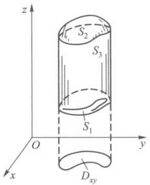

text_image

z
S₂
S₃
S₁
O
y
x
Dₓᵧ

图22-6

$$
\iiint_ {V} \frac {\partial R}{\partial z} \mathrm{d} x \mathrm{d} y \mathrm{d} z
$$

$$
= \iint_ {D _ {x y}} \mathrm{d} x \mathrm{d} y \int_ {z _ {1} (x, y)} ^ {z _ {2} (x, y)} \frac {\partial R}{\partial z} \mathrm{d} z
$$

$$
= \iint_ {D _ {x y}} (R (x, y, z _ {2} (x, y)) - R (x, y, z _ {1} (x, y)) \mathrm{d} x \mathrm{d} y
$$

$$
= \iint_ {D _ {x y}} R (x, y, z _ {2} (x, y)) \mathrm{d} x \mathrm{d} y - \iint_ {D _ {x y}} R (x, y, z _ {1} (x, y)) \mathrm{d} x \mathrm{d} y
$$

$$
= \iint_ {S _ {2}} R (x, y, z) \mathrm{d} x \mathrm{d} y - \iint_ {S _ {1}} R (x, y, z) \mathrm{d} x \mathrm{d} y
$$

$$
= \iint_ {S _ {2}} R (x, y, z) \mathrm{d} x \mathrm{d} y + \iint_ {- S _ {1}} R (x, y, z) \mathrm{d} x \mathrm{d} y,
$$

其中 $S_{1}, S_{2}$ 都取上侧. 又由于 $S_{3}$ 在 $xy$ 平面上投影区域的面积为零, 所以

① 若 S 为封闭曲面, 则曲面积分的积分号用  $\oiint$  表示.

$$
\iint_ {S _ {3}} R (x, y, z) \mathrm{d} x \mathrm{d} y = 0.
$$

因此

$$
\begin{array}{l} \iiint_ {V} \frac {\partial R}{\partial z} \mathrm{d} x \mathrm{d} y \mathrm{d} z = \iint_ {S _ {2}} R \mathrm{d} x \mathrm{d} y + \iint_ {- S _ {1}} R \mathrm{d} x \mathrm{d} y + \iint_ {S _ {3}} R \mathrm{d} x \mathrm{d} y \\ = \oiint_ {S} R \mathrm{d} x \mathrm{d} y. \\ \end{array}
$$

对于不是 xy 型区域的情形,则用有限个光滑曲面将它分割成若干个 xy 型区域来讨论.详细的推导与格林公式相似,这里不再细说了.

高斯公式可用来简化某些曲面积分的计算.

例1 计算

$$
\oiint_ {S} y (x - z) \mathrm{d} y \mathrm{d} z + x ^ {2} \mathrm{d} z \mathrm{d} x + (y ^ {2} + x z) \mathrm{d} x \mathrm{d} y,
$$

其中 S 是边长为 a 的正立方体表面并取外侧(即上节习题 1(1)).

解 应用高斯公式,所求曲面积分等于

$$
\begin{array}{l} = \iiint_ {V} (y + x) \mathrm{d} x \mathrm{d} y \mathrm{d} z = \int_ {0} ^ {a} \mathrm{d} z \int_ {0} ^ {a} \mathrm{d} y \int_ {0} ^ {a} (y + x) \mathrm{d} x \\ = a \int_ {0} ^ {a} \left(a y + \frac {1}{2} a ^ {2}\right) \mathrm{d} y = a ^ {4}. \\ \end{array}
$$

$$
\iiint_ {V} \left[ \frac {\partial}{\partial x} (y (x - z)) + \frac {\partial}{\partial y} (x ^ {2}) + \frac {\partial}{\partial z} (y ^ {2} + x z) \right] \mathrm{d} x \mathrm{d} y \mathrm{d} z
$$

若高斯公式中 $P = x, Q = y, R = z$，则有

$$
\iiint_ {V} (1 + 1 + 1) \mathrm{d} x \mathrm{d} y \mathrm{d} z = \oiint_ {S} x \mathrm{d} y \mathrm{d} z + y \mathrm{d} z \mathrm{d} x + z \mathrm{d} x \mathrm{d} y.
$$

于是得到应用第二型曲面积分计算空间区域 $V$ 的体积公式

$$
\Delta V = \frac {1}{3} \oiint_ {S} x \mathrm{d} y \mathrm{d} z + y \mathrm{d} z \mathrm{d} x + z \mathrm{d} x \mathrm{d} y.
$$

## 二、斯托克斯公式

斯托克斯(Stokes)公式是建立沿空间双侧曲面 S 的积分与沿 S 的边界曲线 L 的积分之间的联系.

在讲下述定理之前,先对双侧曲面 S 的侧与其边界曲线 L 的方向作如下规定:设有人站在 S 上指定的一侧,若沿 L 行走,指定的侧总在人的左方,则人前进的方向为边界线 L 的正向;若沿 L 行走,指定的侧总在人的右方,则人前进的方向为边界线 L 的负向,这个规定方法也称为右手法则,如图 22-7 所示.

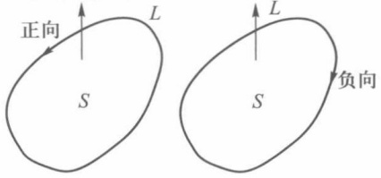

text_image

正向
L
S
L
负向
S

图22-7

定理22.6 设光滑曲面 $S$ 的边界 $L$ 是按段光滑的连续曲线. 若函数 $P, Q, R$ 在 $S$ （连同 $L$ )上连续，且有一阶连续偏导数，则

$$
\begin{array}{l} \iint_ {S} \left(\frac {\partial R}{\partial y} - \frac {\partial Q}{\partial z}\right) \mathrm{d} y \mathrm{d} z + \left(\frac {\partial P}{\partial z} - \frac {\partial R}{\partial x}\right) \mathrm{d} z \mathrm{d} x + \left(\frac {\partial Q}{\partial x} - \frac {\partial P}{\partial y}\right) \mathrm{d} x \mathrm{d} y \\ = \oint_ {L} P \mathrm{d} x + Q \mathrm{d} y + R \mathrm{d} z, \tag {2} \\ \end{array}
$$

其中 S 的侧与 L 的方向按右手法则确定.

证 先证

$$
\iint_ {S} \frac {\partial P}{\partial z} \mathrm{d} z \mathrm{d} x - \frac {\partial P}{\partial y} \mathrm{d} x \mathrm{d} y = \oint_ {L} P \mathrm{d} x, \tag {3}
$$

其中曲面 $S$ 由方程 $z = z(x,y)$ 确定，它的正侧法线方向数为 $(-z_{x}, - z_{y},1)$ ，方向余弦为$(\cos \alpha ,\cos \beta ,\cos \gamma)$ ，所以

$$
\frac {\partial z}{\partial x} = - \frac {\cos \alpha}{\cos \gamma}, \quad \frac {\partial z}{\partial y} = - \frac {\cos \beta}{\cos \gamma}.
$$

若 $S$ 在 $xy$ 平面上投影区域为 $D_{xy}, L$ 在 $xy$ 平面上的投影曲线记为 $\Gamma$. 现由第二型曲线积分定义及格林公式有

$$
\begin{array}{l} \oint_ {L} P (x, y, z) \mathrm{d} x = \oint_ {\Gamma} P (x, y, z (x, y)) \mathrm{d} x \\ = - \iint_ {D _ {x y}} \frac {\partial}{\partial y} P (x, y, z (x, y)) \mathrm{d} x \mathrm{d} y. \\ \end{array}
$$

因为

$$
\frac {\partial}{\partial y} P (x, y, z (x, y)) = \frac {\partial P}{\partial y} + \frac {\partial P}{\partial z} \frac {\partial z}{\partial y},
$$

所以

$$
- \iint_ {D _ {x y}} \frac {\partial}{\partial y} P (x, y, z (x, y)) \mathrm{d} x \mathrm{d} y = - \iint_ {S} \left(\frac {\partial P}{\partial y} + \frac {\partial P}{\partial z} \frac {\partial z}{\partial y}\right) \mathrm{d} x \mathrm{d} y.
$$

由于 $\frac{\partial z}{\partial y}=-\frac{\cos\beta}{\cos\gamma}$ ，从而

$$
\begin{array}{l} - \iint_ {S} \left(\frac {\partial P}{\partial y} + \frac {\partial P}{\partial z} \frac {\partial z}{\partial y}\right) \mathrm{d} x \mathrm{d} y = - \iint_ {S} \left(\frac {\partial P}{\partial y} - \frac {\partial P}{\partial z} \frac {\cos \beta}{\cos \gamma}\right) \mathrm{d} x \mathrm{d} y \\ = - \iint_ {S} \left(\frac {\partial P}{\partial y} \cos \gamma - \frac {\partial P}{\partial z} \cos \beta\right) \frac {\mathrm{d} x \mathrm{d} y}{\cos \gamma} \\ = - \iint_ {S} \left(\frac {\partial P}{\partial y} \cos \gamma - \frac {\partial P}{\partial z} \cos \beta\right) \mathrm{d} S \\ = \iint_ {S} \frac {\partial P}{\partial z} \mathrm{d} z \mathrm{d} x - \frac {\partial P}{\partial y} \mathrm{d} x \mathrm{d} y. \\ \end{array}
$$

综合上述结果,便得所要证明的(3)式.

同样对于曲面 S 表示为  $x = x(y, z)$  和  $y = y(z, x)$  时，可证得

$$
\iint_ {S} \frac {\partial Q}{\partial x} \mathrm{d} x \mathrm{d} y - \frac {\partial Q}{\partial z} \mathrm{d} y \mathrm{d} z = \oint_ {L} Q \mathrm{d} y \tag {4}
$$

和

$$
\iint_ {S} \frac {\partial R}{\partial y} \mathrm{d} y \mathrm{d} z - \frac {\partial R}{\partial x} \mathrm{d} z \mathrm{d} x = \oint_ {L} R \mathrm{d} z. \tag {5}
$$

将(3)，(4)，(5)三式相加即得(2)式.

如果曲面 $S$ 不能以 $z = z(x,y)$ 的形式给出，则可用一些光滑曲线把 $S$ 分割为若干小块，使每一小块能用这种形式来表示.因而这时(2)式也能成立.

公式(2)称为斯托克斯公式.

为了便于记忆,斯托克斯公式也常写成如下形式:

$$
\iint_ {S} \left| \begin{array}{c c c} \mathrm{d} y \mathrm{d} z & \mathrm{d} z \mathrm{d} x & \mathrm{d} x \mathrm{d} y \\ \frac {\partial}{\partial x} & \frac {\partial}{\partial y} & \frac {\partial}{\partial z} \\ P & Q & R \end{array} \right| = \oint_ {L} P \mathrm{d} x + Q \mathrm{d} y + R \mathrm{d} z.
$$

例2 计算

$$
I = \oint_ {L} (y ^ {2} - z ^ {2}) \mathrm{d} x + (z ^ {2} - x ^ {2}) \mathrm{d} y + (x ^ {2} - y ^ {2}) \mathrm{d} z,
$$

其中 $L$ 是立方体 $[0, a] \times [0, a] \times [0, a]$ 的表面与平面 $x + y + z = \frac{3a}{2}$ 的交线，从 $z$ 轴正向看去取逆时针方向（图22-8）.

解 令 S 为  $x+y+z=\frac{3a}{2}$  被 L 所围的一块, 取上侧, 由斯托克斯公式,

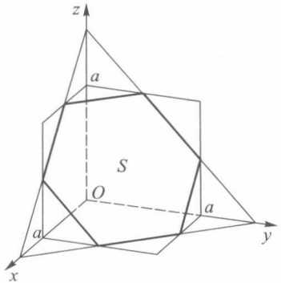

text_image

z
a
S
O
a
y
x

图22-8

$$
\begin{array}{l} I = \iint_ {S} \left| \begin{array}{c c c} \mathrm{d} y \mathrm{d} z & \mathrm{d} z \mathrm{d} x & \mathrm{d} x \mathrm{d} y \\ \frac {\partial}{\partial x} & \frac {\partial}{\partial y} & \frac {\partial}{\partial z} \\ y ^ {2} - z ^ {2} & z ^ {2} - x ^ {2} & x ^ {2} - y ^ {2} \end{array} \right| \\ = \iint_ {S} (- 2 y - 2 z) \mathrm{d} y \mathrm{d} z + (- 2 z - 2 x) \mathrm{d} z \mathrm{d} x + (- 2 x - 2 y) \mathrm{d} x \mathrm{d} y \\ = \frac {1}{\sqrt {3}} \iint_ {S} - 4 (x + y + z) \mathrm{d} S \\ = - 2 \sqrt {3} a \iint_ {S} \mathrm{d} S = - \frac {9}{2} a ^ {3}. \\ \end{array}
$$

由斯托克斯公式,可导出空间曲线积分与路线无关的条件.为此先介绍一下空间单连通区域的概念.

区域 $V$ 称为单连通区域, 如果 $V$ 内任一封闭曲线皆可以不经过 $V$ 以外的点而连续收缩于属于 $V$ 的一点. 如球体是单连通区域. 非单连通区域称为复连通区域. 如环状区域不是单连通区域, 而是复连通区域.

与平面曲线积分相仿,空间曲线积分与路线的无关性也有下面相应的定理.

定理22.7 设 $\Omega \subset \mathbf{R}^3$ 为空间单连通区域. 若函数 $P, Q, R$ 在 $\Omega$ 上连续, 且有一阶连续偏导数, 则以下四个条件是等价的:

(i) 对于  $\Omega$  内任一按段光滑的封闭曲线 L, 有

$$
\oint_ {L} P \mathrm{d} x + Q \mathrm{d} y + R \mathrm{d} z = 0;
$$

(ii) 对于  $\Omega$  内任一按段光滑的曲线 L, 曲线积分

$$
\int_ {L} P \mathrm{d} x + Q \mathrm{d} y + R \mathrm{d} z
$$

与路线无关；

(iii)  $Pdx + Qdy + Rdz$  是  $\Omega$  内某一函数 u 的全微分, 即

$$
\mathrm{d} u = P \mathrm{d} x + Q \mathrm{d} y + R \mathrm{d} z; \tag {6}
$$

(iv) $\frac{\partial P}{\partial y} = \frac{\partial Q}{\partial x}, \frac{\partial Q}{\partial z} = \frac{\partial R}{\partial y}, \frac{\partial R}{\partial x} = \frac{\partial P}{\partial z}$ 在 $\Omega$ 内处处成立.

这个定理的证明与定理 21.12 相仿, 这里不重复了.

例 3 验证曲线积分

$$
\int_ {L} (y + z) \mathrm{d} x + (z + x) \mathrm{d} y + (x + y) \mathrm{d} z
$$

与路线无关,并求被积表达式的原函数  $u(x,y,z)$ .

解 由于

$$
P = y + z, \quad Q = z + x, \quad R = x + y,
$$

$$
\frac {\partial P}{\partial y} = \frac {\partial Q}{\partial x} = \frac {\partial Q}{\partial z} = \frac {\partial R}{\partial y} = \frac {\partial R}{\partial x} = \frac {\partial P}{\partial z} = 1,
$$

所以曲线积分与路线无关.

现在求

$$
u (x, y, z) = \int_ {M _ {0} M} (y + z) \mathrm{d} x + (z + x) \mathrm{d} y + (x + y) \mathrm{d} z.
$$

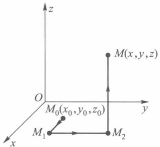

text_image

z
M(x,y,z)
O
M₀(x₀,y₀,z₀)
y
x
M₁
M₂

图22-9

取 $M_{0}M$ 如图22-9，从 $M_{0}$ 沿平行于x轴的直线到 $M_{1}(x,y_{0},z_{0})$ ，

再沿平行于 $y$ 轴的直线到 $M_{2}(x,y,z_{0})$ ，最后沿平行于 $z$ 轴的直线到 $M(x,y,z)$ .于是

$$
\begin{array}{l} u (x, y, z) = \int_ {x _ {0}} ^ {x} (y _ {0} + z _ {0}) \mathrm{d} s + \int_ {y _ {0}} ^ {y} (z _ {0} + x) \mathrm{d} t + \int_ {z _ {0}} ^ {z} (x + y) \mathrm{d} r \\ = (y _ {0} + z _ {0}) x - (y _ {0} + z _ {0}) x _ {0} + (z _ {0} + x) y - \\ (z _ {0} + x) y _ {0} + (x + y) z - (x + y) z _ {0} \\ = x y + x z + y z + c, \\ \end{array}
$$

其中 $c = -x_0y_0 - x_0z_0 - y_0z_0$ 是一个常数.若取 $M_0$ 为原点，则得

$$
u (x, y, z) = x y + x z + y z.
$$

## 习题 22.3

1. 应用高斯公式计算下列曲面积分:

(1) $\iint_{S} yz \, \mathrm{d}y \, \mathrm{d}z + zx \, \mathrm{d}z \, \mathrm{d}x + xy \, \mathrm{d}x \, \mathrm{d}y$，其中 $S$ 是单位球面 $x^2 + y^2 + z^2 = 1$ 的外侧；
(2) $\iint_{S} x^{2} \, \mathrm{d}y \, \mathrm{d}z + y^{2} \, \mathrm{d}z \, \mathrm{d}x + z^{2} \, \mathrm{d}x \, \mathrm{d}y$，其中 $S$ 是立方体 $0 \leqslant x, y, z \leqslant a$ 表面的外侧；
(3) $\iint_{S} x^{2} \, \mathrm{d}y \, \mathrm{d}z + y^{2} \, \mathrm{d}z \, \mathrm{d}x + z^{2} \, \mathrm{d}x \, \mathrm{d}y$，其中 $S$ 是锥面 $x^{2} + y^{2} = z^{2}$ 与平面 $z = h$ 所围空间区域

$(0 \leqslant z \leqslant h)$  的表面, 方向取外侧;

(4) $\iint_{S} x^3 \, \mathrm{d}y \, \mathrm{d}z + y^3 \, \mathrm{d}z \, \mathrm{d}x + z^3 \, \mathrm{d}x \, \mathrm{d}y$，其中 $S$ 是单位球面 $x^2 + y^2 + z^2 = 1$ 的外侧；
(5) $\iint_{S} x \, \mathrm{d}y \, \mathrm{d}z + y \, \mathrm{d}z \, \mathrm{d}x + z \, \mathrm{d}x \, \mathrm{d}y$，其中 $S$ 是上半球面 $z = \sqrt{a^2 - x^2 - y^2}$ 的外侧.

2. 应用高斯公式计算三重积分

$$
\iiint_ {V} (x y + y z + z x) \mathrm{d} x \mathrm{d} y \mathrm{d} z,
$$

其中 $V$ 是由 $x \geqslant 0, y \geqslant 0, 0 \leqslant z \leqslant 1$ 与 $x^{2} + y^{2} \leqslant 1$ 所确定的空间区域.

3. 应用斯托克斯公式计算下列曲线积分:

(1) $\oint_{L}(y^{2} + z^{2})\mathrm{d}x + (x^{2} + z^{2})\mathrm{d}y + (x^{2} + y^{2})\mathrm{d}z$ ，其中 $L$ 为 $x + y + z = 1$ 与三坐标面的交线，它的走向使所围平面区域上侧在曲线的左侧；
(2) $\oint_{L} x^{2} y^{3} \mathrm{~d} x + \mathrm{d} y + z \mathrm{~d} z$，其中 $L$ 为 $y^{2} + z^{2} = 1, x = y$ 所交的椭圆的正向；
(3) $\oint_{L}(z - y)\mathrm{d}x + (x - z)\mathrm{d}y + (y - x)\mathrm{d}z$ ，其中 $L$ 为以 $A(a,0,0),B(0,a,0),C(0,0,a)$ 为顶点的三角形沿ABCA的方向.

4. 求下列全微分的原函数:

(1)  $yzdx + xzdy + xydz;$
(2) $(x^{2}-2yz)\mathrm{d}x+(y^{2}-2xz)\mathrm{d}y+(z^{2}-2xy)\mathrm{d}z.$

5. 验证下列线积分与路线无关,并计算其值:

(1)  $\int_{(1,1,1)}^{(2,3,-4)}x\mathrm{d}x + y^{2}\mathrm{d}y - z^{3}\mathrm{d}z;$
(2) $\int_{(x_1,y_1,z_1)}^{(x_2,y_2,z_2)}\frac{x\mathrm{d}x + y\mathrm{d}y + z\mathrm{d}z}{\sqrt{x^2 + y^2 + z^2}}$ ，其中 $(x_{1},y_{1},z_{1}),(x_{2},y_{2},z_{2})$ 在球面 $x^{2} + y^{2} + z^{2} = a^{2}$ 上.

6. 证明:由曲面 $S$ 所包围的立体 $V$ 的体积 $\Delta V$ 为

$$
\Delta V = \frac {1}{3} \oiint_ {S} (x \cos \alpha + y \cos \beta + z \cos \gamma) \mathrm{d} S,
$$

其中  $\cos\alpha,\cos\beta,\cos\gamma$  为曲面 S 的外法线方向余弦.

7. 证明:若 S 为封闭曲面，l 为任何固定方向，则

$$
\oiint_ {S} \cos (\widehat {\boldsymbol {n}}, \boldsymbol {l}) \mathrm{d} S = 0,
$$

其中 n 为曲面 S 的外法线方向.

8. 证明公式

$$
\iiint_ {V} \frac {\mathrm{d} x \mathrm{d} y \mathrm{d} z}{r} = \frac {1}{2} \oiint_ {S} \cos (\widehat {\boldsymbol {r}}, \boldsymbol {n}) \mathrm{d} S,
$$

其中 $S$ 是包围 $V$ 的曲面，$\pmb{n}$ 是 $S$ 的外法线方向，$r = \sqrt{x^2 + y^2 + z^2}$，$\pmb{r} = (x, y, z)$.

9. 若 $L$ 是平面 $x \cos \alpha + y \cos \beta + z \cos \gamma - p = 0$ 上的闭曲线，它所包围区域的面积为 $S$，求

$$
\oint_ {L} \left| \begin{array}{c c c} \mathrm{d} x & \mathrm{d} y & \mathrm{d} z \\ \cos \alpha & \cos \beta & \cos \gamma \\ x & y & z \end{array} \right|,
$$

其中 L 依正向进行.

## \* §4 场论初步

## 一、场的概念

若对全空间或其中某一区域 $V$ 中每一点 $M$, 都有一个数量 (或向量) 与之对应, 则称在 $V$ 上给定了一个数量场 (或向量场).

温度场和密度场都是数量场. 在空间中引进了直角坐标系后, 空间中点 $M$ 的位置可由坐标确定. 因此, 给定了某个数量场就等于给定了一个数量函数 $u(x, y, z)$. 在以下讨论中, 我们总是设 $u(x, y, z)$ 对每个变量都有连续偏导数. 若这些偏导数不同时等于零, 则满足方程

$$
u (x, y, z) = c (c \text {为常数})
$$

的所有的点通常是一个曲面. 在这曲面上函数 $u$ 都取同一值, 因此常称它为等值面. 例如温度场中的等温面等.

向量场可以重力场或速度场为例. 当引进直角坐标系后, 向量场就与向量函数 $A(x, y, z)$ 相对应. 设 $A$ 在三个坐标轴上的投影分别为

$$
P (x, y, z), Q (x, y, z), R (x, y, z),
$$

则

$$
A (x, y, z) = (P (x, y, z), Q (x, y, z), R (x, y, z)),
$$

这里 P, Q, R 为所定义区域上的数量函数，并假定它们有连续偏导数.

设 $L$ 为向量场中一条曲线. 若 $L$ 上每点 $M$ 处的切线方向都与向量函数 $A$ 在该点的方向一致, 即

$$
\frac {\mathrm{d} x}{P} = \frac {\mathrm{d} y}{Q} = \frac {\mathrm{d} z}{R},
$$

则称曲线 L 为向量场 A 的向量场线. 例如电力线、磁力线等都是向量场线.

需要注意,场的性质是它自己的属性,和坐标系的引进无关.引入或选择某种坐标系是为了便于通过数学方法来研究它的性质.下面所讨论的场的一些概念虽然是在所选用的坐标系下建立的,但都可以证明它们和坐标系的选取无关.

## 二、梯度场

在第十七章 §3 中我们已经介绍了梯度的概念, 它是由数量函数 $u(x,y,z)$ 所定义的向量函数

$$
\textbf {g r a d} u = \left(\frac {\partial u}{\partial x}, \frac {\partial u}{\partial y}, \frac {\partial u}{\partial z}\right) ,
$$

而且 $\operatorname{grad} u$ 的方向就是使 $\frac{\partial u}{\partial l}$ 达到最大值的方向, 它的大小就是 $u$ 在这个方向上的方向导数值. 因此我们可以定义数量场 $u$ 在点 $M$ 处的梯度 $\operatorname{grad} u$ 为这样的向量, 它的方向是在 $M$ 处最大的方向导数的方向, 而它的大小是在 $M$ 处最大方向导数值. 由于方向导数的定义与坐标系选取无关,因此梯度定义也是与坐标系选取无关的向量.由梯度给出的向量场,称为梯度场.

又因为数量场 $u(x,y,z)$ 的等值面 $u(x,y,z) = c$ 的法线方向为

$$
\left(\frac {\partial u}{\partial x}, \frac {\partial u}{\partial y}, \frac {\partial u}{\partial z}\right)  ,
$$

所以 grad u 的方向与等值面正交, 即等值面的法线方向.

引进符号向量

$$
\nabla = \left(\frac {\partial}{\partial x}, \frac {\partial}{\partial y}, \frac {\partial}{\partial z}\right).
$$

当把它作为运算符号来看待时①,梯度可写作

$$
\text {grad} u = \nabla u.
$$

关于梯度,有以下一些基本性质:

1. 若 $u, v$ 是数量函数, 则

$$
\nabla (u + v) = \nabla u + \nabla v.
$$

2. 若 $u, v$ 是数量函数, 则

$$
\nabla (u v) = u (\nabla v) + (\nabla u) v.
$$

特别地有

$$
\nabla u ^ {2} = 2 u (\nabla u).
$$

3. 若 $r = (x, y, z)$, $\varphi = \varphi(x, y, z)$, 则

$$
\mathrm{d} \varphi = \mathrm{d} \boldsymbol {r} \cdot \nabla \varphi .
$$

4. 若 $f = f(u)$, $u = u(x, y, z)$, 则

$$
\nabla f = f ^ {\prime} (u) \nabla u.
$$

5. 若  $f=f(u_{1}, u_{2}, \cdots, u_{m})$ ,  $u_{i}=u_{i}(x, y, z)$  ( $i=1,2,\cdots,m$ ), 则

$$
\nabla f = \sum_ {i = 1} ^ {m} \frac {\partial f}{\partial u _ {i}} \nabla u _ {i}.
$$

这些公式读者可利用定义来直接验证.

例1 设质量为 $m$ 的质点位于原点, 质量为 1 的质点位于 $M(x, y, z)$, 记 $OM = r = \sqrt{x^2 + y^2 + z^2}$, 求 $\frac{m}{r}$ 的梯度.

解

$$
\nabla \frac {m}{r} = - \frac {m}{r ^ {2}} \bigg (\frac {x}{r}, \frac {y}{r}, \frac {z}{r} \bigg).
$$

若以 $r_0$ 表示 $\overrightarrow{OM}$ 上的单位向量 $\left(\frac{x}{r},\frac{y}{r},\frac{z}{r}\right)$，则有

$$
\nabla \frac {m}{r} = - \frac {m}{r ^ {2}} \boldsymbol {r} _ {0}.
$$

它表示两质点间的引力,方向朝着原点,大小是与质量的乘积成比例,与两点间的距离的平方成反比.这说明了引力场是数量函数 $\frac{m}{r}$ 的梯度场.因此我们常称 $\frac{m}{r}$ 为引力势.☐

<small>①  $\nabla$ 常称为哈密顿(Hamilton)算符,读作“Nabla”.</small>

## 三、散度场

设

$$
A (x, y, z) = (P (x, y, z), Q (x, y, z), R (x, y, z))
$$

为空间区域 $V$ 上的向量函数，对 $V$ 上每一点 $(x,y,z)$，定义数量函数

$$
D (x, y, z) = \frac {\partial P}{\partial x} + \frac {\partial Q}{\partial y} + \frac {\partial R}{\partial z},
$$

称它为向量函数 A 在  $(x, y, z)$  处的散度, 记作

$$
D (x, y, z) = \operatorname{div} A (x, y, z) ①.
$$

设 $n_0 = (\cos \alpha, \cos \beta, \cos \gamma)$ 为曲面的单位法向量，则 $\mathrm{d}S = n_0\mathrm{d}S$ 就称为曲面的面积元素向量.于是高斯公式可写成如下向量形式:

$$
\iiint_ {V} \mathrm{div} \boldsymbol {A} \mathrm{d} V = \oint_ {S} \boldsymbol {A} \cdot \mathrm{d} \boldsymbol {S}. \tag {1}
$$

在 $V$ 中任取一点 $M_0$ ，对(1)式中的三重积分应用中值定理，得

$$
\iiint_ {V} \mathrm{div} A \mathrm{d} V = \mathrm{div} A (M ^ {*}) \cdot \Delta V = \oiint_ {S} A \cdot \mathrm{d} S,
$$

其中 $M^{*}$ 为 $V$ 中某一点，于是有

$$
\mathrm{div}   A (  M ^ {*}  ) = \frac {\oint_ {S} \boldsymbol {A} \cdot \mathrm{d} \boldsymbol {S}}{\Delta V}.
$$

令 $V$ 收缩到点 $M_0$ （记成 $V\to M_0$ ），则 $M^{*}$ 也趋向点 $M_0$ ，因此

$$
\operatorname{div} \boldsymbol {A} (M _ {0}) = \lim _ {V \to M _ {0}} \frac {\oiint_ {S} \boldsymbol {A} \cdot \mathrm{d} S}{\Delta V}. \tag {2}
$$

这个等式可以看作是散度的另一种定义形式.(2)式右边的分子、分母都与坐标系的选取无关,因此它的极限也与坐标系选取无关,所以散度 div A 与坐标系选取无关.由向量场 A 的散度 divA 所构成的数量场,称为散度场.

散度的物理意义:联系本章§2中提到流速为A的不可压缩流体,经过封闭曲面S的流量是

$$
\oiint_ {S} \boldsymbol {A} \cdot \mathrm{d} \boldsymbol {S}.
$$

于是(2)式表明 $\operatorname{div} A(M_0)$ 是流量对体积 $V$ 的变化率, 并称它为 $A$ 在点 $M_0$ 的流量密度. 若 $\operatorname{div} A(M_0) > 0$, 说明在每一单位时间内有一定数量的流体流出这一点, 则称这一点为源. 相反, 若 $\operatorname{div} A(M_0) < 0$, 说明流体在这一点被吸收, 则称这点为汇. 若在向量场 $A$ 中每一点皆有

<small>① div 是 divergence(散度) 一词的缩写.</small>

$$
\operatorname{div} \boldsymbol {A} = 0,
$$

则称 A 为无源场.

由前面引进的算符 $\nabla$ ，向量场A的散度的向量形式是

$$
\operatorname{div} \boldsymbol {A} = \nabla \cdot \boldsymbol {A}.
$$

关于散度,容易由定义直接推得以下一些基本性质:

1. 若 u, v 是向量函数, 则

$$
\nabla \cdot (\boldsymbol {u} + \boldsymbol {v}) = \nabla \cdot \boldsymbol {u} + \nabla \cdot \boldsymbol {v}.
$$

2. 若  $\varphi$  是数量函数, F 是向量函数, 则

$$
\nabla \cdot (\varphi \boldsymbol {F}) = \varphi \nabla \cdot \boldsymbol {F} + \boldsymbol {F} \cdot \nabla \varphi .
$$

3. 若  $\varphi=\varphi(x,y,z)$  是一数量函数, 则

$$
\nabla \cdot \nabla \varphi = \frac {\partial^ {2} \varphi}{\partial x ^ {2}} + \frac {\partial^ {2} \varphi}{\partial y ^ {2}} + \frac {\partial^ {2} \varphi}{\partial z ^ {2}}.
$$

算符 $\nabla$ 的内积 $\nabla\cdot\nabla$ 常记作 $\Delta^{①}$ ，于是有

$$
\nabla \cdot \nabla \varphi = \Delta \varphi .
$$

例 2 求例 1 中引力场  $F = -\frac{m}{r^{2}} \left( \frac{x}{r}, \frac{y}{r}, \frac{z}{r} \right)$  所产生的散度场.

解 因为 $r^2 = x^2 + y^2 + z^2$，所以

$$
\boldsymbol {F} = - \frac {m}{(x ^ {2} + y ^ {2} + z ^ {2}) ^ {3 / 2}} (x, y, z),
$$

$$
\begin{array}{l} \nabla \cdot \boldsymbol {F} = - m \left[ \frac {\partial}{\partial x} \left(\frac {x}{\left(x ^ {2} + y ^ {2} + z ^ {2}\right) ^ {3 / 2}}\right) + \frac {\partial}{\partial y} \left(\frac {y}{\left(x ^ {2} + y ^ {2} + z ^ {2}\right) ^ {3 / 2}}\right) + \right. \\ \frac {\partial}{\partial z} \left(\frac {z}{\left(x ^ {2} + y ^ {2} + z ^ {2}\right) ^ {3 / 2}}\right) \Bigg ] \\ = 0. \\ \end{array}
$$

因此引力场 F 内每一点处的散度都为零(原点除外).

## 四、旋度场

设

$$
A (x, y, z) = (P (x, y, z), Q (x, y, z), R (x, y, z))
$$

为空间区域 V 上的向量函数. 对 V 上每一点  $(x, y, z)$ ，定义向量函数

$$
\boldsymbol {F} (x, y, z) = \left(\frac {\partial R}{\partial y} - \frac {\partial Q}{\partial z}, \frac {\partial P}{\partial z} - \frac {\partial R}{\partial x}, \frac {\partial Q}{\partial x} - \frac {\partial P}{\partial y}\right),
$$

称它为向量函数 A 在  $(x, y, z)$  处的旋度, 记作

①  $\Delta = \nabla \cdot \nabla = \frac{\partial^{2}}{\partial x^{2}} + \frac{\partial^{2}}{\partial y^{2}} + \frac{\partial^{2}}{\partial z^{2}}$  称为拉普拉斯算符.

$$
\boldsymbol {F} (x, y, z) = \mathbf {r o t} \boldsymbol {A} ^ {(1)}.
$$

设 $(\cos\alpha_{t},\cos\beta_{t},\cos\gamma_{t})$ 是曲线L的正向上的单位切线向量 $t_{0}$ 的方向余弦，向量 $\mathrm{d}s=(\cos\alpha_{t},\cos\beta_{t},\cos\gamma_{t})\mathrm{d}s=t_{0}\mathrm{d}l$ 称为弧长元素向量.于是斯托克斯公式可写成如下向量形式:

$$
\iint_ {S} \mathbf {r o t} \boldsymbol {A} \cdot \mathrm{d} \boldsymbol {S} = \oint_ {L} \boldsymbol {A} \cdot \mathrm{d} \boldsymbol {s}. \tag {3}
$$

为了说明旋度与坐标系的选取无关,我们在场 V 中任意取一点  $M_{0}$ , 通过  $M_{0}$  作平面  $\pi$  垂直于曲面 S 的法向量  $n_{0}$  (图 22-10), 且在  $\pi$  上围绕  $M_{0}$  作任一封闭曲线 L, 记 L 所围区域为 D, 则由 (3) 式有

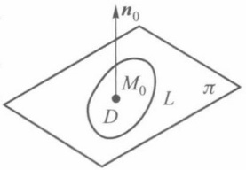

text_image

n₀
M₀
D
L
π

图22-10

$$
\iint_ {S} \mathbf {r o t} \boldsymbol {A} \cdot \mathrm{d} \boldsymbol {S} = \iint_ {S} \mathbf {r o t} \boldsymbol {A} \cdot \boldsymbol {n} _ {0} \mathrm{d} S = \oint_ {L} \boldsymbol {A} \cdot \mathrm{d} s. \tag {4}
$$

对左端曲面积分应用中值定理可得

$$
\iint_ {D} \mathbf {r o t}   A \cdot \boldsymbol {n} _ {0} \mathrm{d} S = (\mathbf {r o t}   A \cdot \boldsymbol {n} _ {0}) _ {M ^ {*}} \mu (  D  ) = \oint_ {L} A \cdot \mathrm{d} s,
$$

其中 $\mu(D)$ 为区域 $D$ 的面积, $M^{*}$ 为 $D$ 中的某一点. 因此

$$
(\mathbf {r o t}   A \cdot n _ {0}) _ {M ^ {*}} = \frac {\oint_ {L} A \cdot \mathrm{d} s}{\mu (D)}.
$$

现让 D 收缩到点  $M_{0}$  （记作  $D \rightarrow M_{0}$ ）时，于是  $M^{*}$  趋于  $M_{0}$ ，因此有

$$
(\mathbf {r o t} \boldsymbol {A} \cdot \boldsymbol {n} _ {0}) _ {M _ {0}} = \lim _ {D \to M _ {0}} \frac {\oint_ {L} \boldsymbol {A} \cdot \mathrm{d} s}{\mu (D)}. \tag {5}
$$

(5)式左边为 rot A 在法线方向上的投影,因此它也确定了 rot A 的本身,所以(5)也可以作为旋度的另一种定义形式.由于(5)式右边的极限与坐标系的选取无关,故 rot A 也与坐标系选取无关.

由向量函数 A 的旋度 rot A 所定义的向量场, 称为旋度场.

在流量问题中,我们称

$$
\oint_ {L} \boldsymbol {A} \cdot \mathrm{d} \boldsymbol {s}
$$

为沿闭曲线 L 的环流量, 它表示流速为 A 的不可压缩流体在单位时间内沿曲线 L 的流体总量, 反映了流体沿 L 时的旋转强弱程度. 当 rot A = 0 时, 沿任意封闭曲线的环流量为零, 即流体流动时不成旋涡, 这时称向量场 A 为无旋场.

公式(4)表明向量场在曲面边界线上的切线投影对弧长的曲线积分等于向量场的

<small>① rot 是 rotation(旋度)一词的缩写,有的书也用 curl 表示旋度,为便于记忆,rot A 可形式地写成</small>

<small>$\mathbf{rot}A = \left| \begin{array}{ccc}i & j & k\\ \frac{\partial}{\partial x} & \frac{\partial}{\partial y} & \frac{\partial}{\partial z}\\ P & Q & R \end{array} \right|.$</small>