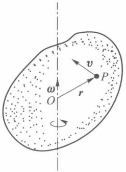
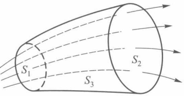
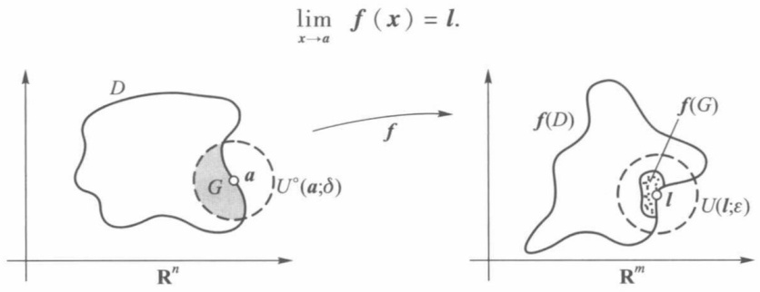
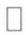

旋度的法线投影在曲面上对面积的曲面积分. 它的物理意义可以说成是: 流体的速度场的旋度的法线投影在曲面上对面积的曲面积分等于流体在曲面边界上的环流量.

为了更好地认识旋度的物理意义及这一名称的来源,我们讨论刚体绕定轴旋转的问题.设一刚体以角速度  $\omega$  绕某轴旋转,则角速度向量  $\omega$  方向沿着旋转轴,其指向与旋转方向的关系符合右手法则,即右手拇指指向角速度  $\omega$  的方向,其他四指指向旋转方向.若取定旋转轴上一点 O 作为原点(图 22-11),刚体上任意一点 P 的线速度 v 可表示为

$$
\boldsymbol {v} = \boldsymbol {\omega} \times \boldsymbol {r},
$$

其中  $r=\overrightarrow{OP}$  是 P 的径向量. 设 P 的坐标为  $(x,y,z)$ ，便有  $\boldsymbol{r}=(x,y,z)$ ，又设  $\boldsymbol{\omega}=(\omega_{x},\omega_{y},\omega_{z})$ . 于是

text_image

v
P
r
ω
O

图22-11

$$
\boldsymbol {v} = \left(\omega_ {y} z - \omega_ {z} y, \omega_ {z} x - \omega_ {x} z, \omega_ {x} y - \omega_ {y} x\right),
$$

所以 $\mathbf{rot}v = (2\omega_{x}, 2\omega_{y}, 2\omega_{z}) = 2\omega$

或  $\omega=\frac{1}{2}\mathrm{rot}v.$

这等式表明线速度向量 v 的旋度除去一个常数因子  $\frac{1}{2}$  外, 就是旋转的角速度向量  $\omega$ . 可见 v 的旋度与  $\omega$  成正比, 这也说明了旋度这个名称的来源.

应用算符 $\nabla$ 表示 $A$ 的旋度是

$$
\mathrm{rot} A = \nabla \times A.
$$

旋度有如下一些基本性质:

1. 若 u, v 是向量函数, 则

$$
\begin{array}{l} \nabla \times (\boldsymbol {u} + \boldsymbol {v}) = \nabla \times \boldsymbol {u} + \nabla \times \boldsymbol {v}, \\ \nabla (\boldsymbol {u} \cdot \boldsymbol {v}) = \boldsymbol {u} \times (\nabla \times \boldsymbol {v}) + \boldsymbol {v} \times (\nabla \times \boldsymbol {u}) + (\boldsymbol {u} \cdot \nabla) \boldsymbol {v} + (\boldsymbol {v} \cdot \nabla) \boldsymbol {u}, \\ \nabla \cdot (\boldsymbol {u} \times \boldsymbol {v}) = \boldsymbol {v} \cdot \nabla \times \boldsymbol {u} - \boldsymbol {u} \cdot \nabla \times \boldsymbol {v}, \\ \nabla \times (\boldsymbol {u} \times \boldsymbol {v}) = (\boldsymbol {v} \cdot \nabla) \boldsymbol {u} - (\boldsymbol {u} \cdot \nabla) \boldsymbol {v} + (\nabla \cdot \boldsymbol {v}) \boldsymbol {u} - (\nabla \cdot \boldsymbol {u}) \boldsymbol {v}. \\ \end{array}
$$

2. 若 $\varphi$ 是数量函数, $A$ 是向量函数, 则

$$
\nabla \times (\varphi \boldsymbol {A}) = \varphi (\nabla \times \boldsymbol {A}) + \nabla \varphi \times \boldsymbol {A}.
$$

3. 若  $\varphi$  是数量函数, A 是向量函数, 则

$$
\begin{array}{l} \nabla \cdot (\nabla \times \boldsymbol {A}) = 0, \\ \nabla \times \nabla \varphi = \mathbf {0}, \\ \nabla \times (\nabla \times \boldsymbol {A}) = \nabla (\nabla \cdot \boldsymbol {A}) - \nabla^ {2} \boldsymbol {A} = \nabla (\nabla \cdot \boldsymbol {A}) - \Delta \boldsymbol {A}. \\ \end{array}
$$

这些等式读者都可通过梯度、散度、旋度等定义来直接验证.

## 五、管量场与有势场

若一个向量场 A 的散度恒为零, 即 div A = 0, 我们曾称 A 为无源场. 从高斯公式知, 此时沿任何封闭曲面的曲面积分都等于零. 我们把场 A 称作管量场. 这是因为, 若在向量场 A 中作一向量管 (图 22-12), 即由向量线围成的管状的曲面,用断面  $S_{1}, S_{2}$  截它,以  $S_{3}$  表示所截出的管的表面,我们就得到了由  $S_{1}, S_{2}, S_{3}$  所围成的封闭曲面 S.于是由(1)式得出

text_image

S₁
S₂
S₃

图22-12

$$
\oiint_ {S} \boldsymbol {A} \cdot \mathrm{d} \boldsymbol {S} = \iint_ {S _ {1} \text {外侧}} \boldsymbol {A} \cdot \mathrm{d} \boldsymbol {S} + \iint_ {S _ {2} \text {外侧}} \boldsymbol {A} \cdot \mathrm{d} \boldsymbol {S} + \iint_ {S _ {3} \text {外侧}} \boldsymbol {A} \cdot \mathrm{d} \boldsymbol {S} = 0.
$$

而向量线与曲面 $S_{3}$ 的法线正交，所以

$$
\iint_ {S _ {3} \text {外侧}} \boldsymbol {A} \cdot \mathrm{d} \boldsymbol {S} = 0,
$$

即

$$
\begin{array}{l} \iint_ {S _ {1} \text {外侧}} \boldsymbol {A} \cdot \mathrm{d} \boldsymbol {S} + \iint_ {S _ {2} \text {外侧}} \boldsymbol {A} \cdot \mathrm{d} \boldsymbol {S} = 0, \\ \iint_ {S _ {1} \text {内侧}} \boldsymbol {A} \cdot \mathrm{d} \boldsymbol {S} = \iint_ {S _ {2} \text {外侧}} \boldsymbol {A} \cdot \mathrm{d} \boldsymbol {S}. \\ \end{array}
$$

这等式说明了流体通过向量管的任意断面的流量是相同的,所以我们把场 A 称为管量场. 如例 2, 由  $\frac{m}{r}$  的梯度  $\nabla\frac{m}{r}$  所成的引力场 F 是一个管量场.

若一个向量场 $A$ 的旋度恒为零, 即 $\operatorname{rot} A = 0$, 我们在前面称 $A$ 为无旋场. 从斯托克斯公式知, 这时在空间单连通区域内沿任何封闭曲线的曲线积分都等于零, 这种场也称为有势场. 这是因为当 $\operatorname{rot} A = 0$ 时, 由定理22.7推得此时空间曲线积分与路线无关, 且存在某函数 $u(x, y, z)$, 使得

$$
\mathrm{d} u = P \mathrm{d} x + Q \mathrm{d} y + R \mathrm{d} z,
$$

即

$$
\text {grad} u = (P, Q, R).
$$

通常称 $u$ 为势函数. 因此, 若某向量场 $\pmb{A}$ 的旋度为零, 则必存在某个势函数 $u$, 使得 $\operatorname{grad} u = A$. 这也是一个向量场是某个数量场的梯度场的充要条件. 在例1中, 引力势 $u = \frac{m}{r}$ 就是势函数. 所以

$$
\nabla u = \boldsymbol {F} = - \frac {m}{r ^ {2}} \Big (\frac {x}{r}, \frac {y}{r}, \frac {z}{r} \Big)  .
$$

因为 $\nabla \times \nabla u = 0$ 恒成立，所以 $\nabla \times F = 0.$ 它也是引力场 $F$ 是有势场的充要条件.

若一个向量场 A 既是管量场, 又是有势场, 则称这个向量场为调和场. 上述例 2 中讲到的引力场 F 就是调和场. 若 A 是一个调和场, 必有

$$
\nabla \cdot \boldsymbol {A} = 0, \qquad \nabla u = \boldsymbol {A}.
$$

显然

$$
\nabla \cdot \nabla u = \nabla^ {2} u = \Delta u = 0,
$$

即必有势函数 $u$ 满足

$$
\frac {\partial^ {2} u}{\partial x ^ {2}} + \frac {\partial^ {2} u}{\partial y ^ {2}} + \frac {\partial^ {2} u}{\partial z ^ {2}} = 0.
$$

这时称函数 u 为调和函数.

## 习题 22.4

1. 若 $r = \sqrt{x^2 + y^2 + z^2}$, 计算 $\nabla r, \nabla r^2, \nabla \frac{1}{r}, \nabla f(r), \nabla r^n (n \geqslant 3)$.

2. 求 $u = x^{2} + 2y^{2} + 3z^{2} + 2xy - 4x + 2y - 4z$ 在点 $O(0,0,0), A(1,1,1), B(-1,-1,-1)$ 处的梯度，并求梯度为零之点.

3. 证明本节第二段关于梯度的一些基本性质1—5.

4. 计算下列向量场 A 的散度与旋度:

(1) $A = (y^2 + z^2, z^2 + x^2, x^2 + y^2)$; (2) $A = (x^2yz, xy^2z, xyz^2)$;
(3)  $A=\left(\frac{x}{yz},\frac{y}{zx},\frac{z}{xy}\right)$ .

5. 证明本节第三段关于散度的一些基本性质 1—3.

6. 证明本节第四段关于旋度的一些基本性质1—3（可应用算符 $\nabla$ 推演）.

7. 证明:场 $A = (yz(2x + y + z),xz(x + 2y + z),xy(x + y + 2z))$ 是有势场并求其势函数.

8. 若流体流速 $A = (x^2, y^2, z^2)$，求单位时间内穿过 $\frac{1}{8}$ 球面 $x^2 + y^2 + z^2 = 1, x > 0, y > 0, z > 0$ 的流量.

9. 设流速  $A = (-y, x, c)$  (c 为常数)，求环流量:

(1) 沿圆周  $x^{2} + y^{2} = 1, z = 0$ ; (2) 沿圆周  $(x - 2)^{2} + y^{2} = 1, z = 0$ .

## 第二十二章总练习题

1. 设  $P = x^{2} + 5\lambda y + 3yz, Q = 5x + 3\lambda xz - 2, R = (\lambda + 2)xy - 4z.$

(1) 计算  $\int_{L} P \, dx + Q \, dy + R \, dz$ ，其中 L 为螺旋线  $x = a \cos t, y = a \sin t, z = ct (0 \leqslant t \leqslant 2\pi)$ ;
(2) 设  $\boldsymbol{A} = (P, Q, R)$ ，求 rot A;
(3) 问在什么条件下 A 为有势场？并求势函数.

2. 证明:若 $\Delta u = \frac{\partial^2 u}{\partial x^2} + \frac{\partial^2 u}{\partial y^2} + \frac{\partial^2 u}{\partial z^2}$，$S$ 为包围区域 $V$ 的曲面的外侧，则

(1)  $\iiint_{V}\Delta u\,dx\,dy\,dz = \iint_{S}\frac{\partial u}{\partial n}\,dS;$
(2) $\iint_{S} u \frac{\partial u}{\partial \boldsymbol{n}} \mathrm{d} S = \iiint_{V} \nabla \cdot \nabla u \, \mathrm{d} x \, \mathrm{d} y \, \mathrm{d} z + \iiint_{V} u \Delta u \, \mathrm{d} x \, \mathrm{d} y \, \mathrm{d} z,$

其中 u 在区域 V 及其界面 S 上有二阶连续偏导数,  $\frac{\partial u}{\partial n}$  为沿曲面 S 外法线方向的方向导数.

3. 设 $S$ 为光滑闭曲面, $V$ 为 $S$ 所围的区域. 函数 $u(x,y,z)$ 在 $V$ 与 $S$ 上具有二阶连续偏导数, 函数 $\omega(x,y,z)$ 偏导连续. 证明:

(1)  $\iiint_{V}\omega\frac{\partial u}{\partial x}dx\,dydz=\oiint_{S}u\omega\,dydz-\iiint_{V}u\frac{\partial\omega}{\partial x}\,dx\,dydz;$
(2)  $\iiint_{V}\omega\Delta u\,dx\,dy\,dz = \oint\limits_{S}\omega\frac{\partial u}{\partial n}\,dS - \iiint_{V}\nabla u \cdot \nabla\omega\,dx\,dy\,dz.$

4. 设 $A = \frac{r}{|r|^3}$, $S$ 为一封闭曲面, $r = (x, y, z)$. 证明当原点在曲面 $S$ 的外、上、内时, 分别有

$$
\oiint_ {S} \boldsymbol {A} \cdot \mathrm{d} \boldsymbol {S} = 0, 2 \pi , 4 \pi .
$$

5. 计算 $I = \iint_{S} xz \, \mathrm{d}y \, \mathrm{d}z + yx \, \mathrm{d}z \, \mathrm{d}x + zy \, \mathrm{d}x \, \mathrm{d}y$，其中 $S$ 是柱面 $x^2 + y^2 = 1$ 在 $-1 \leqslant z \leqslant 1$ 和 $x \geqslant 0$ 的部分。曲面侧的法向与 $x$ 轴正向成锐角。

6. 证明公式:

$$
\begin{array}{l} \iint_ {D} f (m \sin \varphi \cos \theta + n \sin \varphi \sin \theta + p \cos \varphi) \sin \varphi \mathrm{d} \theta \mathrm{d} \varphi \\ = 2 \pi \int_ {- 1} ^ {1} f (u \sqrt {m ^ {2} + n ^ {2} + p ^ {2}}) \mathrm{d} u, \\ \end{array}
$$

这里 $D = \{(\theta, \varphi) | 0 \leqslant \theta \leqslant 2\pi, 0 \leqslant \varphi \leqslant \pi\}, m^2 + n^2 + p^2 > 0, f(t)$ 在 $|t| < \sqrt{m^2 + n^2 + p^2}$ 时为连续函数.

## 第二十二章综合自测题

## \* 第二十三章向量函数微分学

## § 1 n 维欧氏空间与向量函数

在第十六至第十八章中所讨论的函数, 是二维(或 n 维)空间中的点集到实数集的映射, 由于函数值取实数, 故称之为实值函数, 在本章中所要讨论的函数, 则是 n 维欧氏空间中的点集到 m 维欧氏空间点集的映射, 这时函数值已不再是实数, 而是 m 维空间中的一个向量, 故称之为向量函数. 作为准备, 我们先择要地介绍一下 n 维欧氏空间概念.

## 一、$n$ 维欧氏空间

所有 n 个有序实数组  $(x_{1}, x_{2}, \cdots, x_{n})$  的全体称为 n 维向量空间，或简称 n 维空间，其中每个有序实数组称为 n 维空间中的一个向量（或一个点），记作

$$
\boldsymbol {x} = \left( \begin{array}{c} x _ {1} \\ x _ {2} \\ \vdots \\ x _ {n} \end{array} \right). \tag {1}
$$

我们约定向量总是指列向量(如(1)式);记号 $x^{T}$ 表示向量x的转置,因此 $x^{T}$ 是一个行向量.向量x中的数 $x_{1},x_{2},\cdots,x_{n}$ 是这个向量(或点)的n个分量(或坐标).

设  $\boldsymbol{x}=(x_{1},x_{2},\cdots,x_{n})^{\mathrm{T}}$  与  $\boldsymbol{y}=(y_{1},y_{2},\cdots,y_{n})^{\mathrm{T}}$  是 n 维空间中的任意两个向量， $\alpha$  为任意实数，则向量 x 与 y 之和为

$$
\boldsymbol {x} + \boldsymbol {y} = (x _ {1} + y _ {1}, x _ {2} + y _ {2}, \dots , x _ {n} + y _ {n}) ^ {\mathrm{T}}.
$$

数量 $\alpha$ 与向量 $x$ 的数乘积为

$$
\alpha \boldsymbol {x} = (\alpha x _ {1}, \alpha x _ {2}, \dots , \alpha x _ {n}) ^ {\mathrm{T}}.
$$

向量 $x$ 与 $y$ 的内积定义为

$$
\boldsymbol {x} ^ {\mathrm{T}} \boldsymbol {y} = x _ {1} y _ {1} + x _ {2} y _ {2} + \dots + x _ {n} y _ {n}.
$$

内积具有如下性质:

1.  $x^{T}x \geqslant 0$ , 当且仅当 x = 0 时,  $x^{T}x = 0$ .
2.  $x^{T}y = y^{T}x.$
3.  $\alpha(\boldsymbol{x}^{\mathrm{T}}\boldsymbol{y})=(\alpha\boldsymbol{x})^{\mathrm{T}}\boldsymbol{y}=\boldsymbol{x}^{\mathrm{T}}(\alpha\boldsymbol{y}),\alpha$  为实数.

4.  $(\boldsymbol{x}+\boldsymbol{y})^{\mathrm{T}}\boldsymbol{z}=\boldsymbol{x}^{\mathrm{T}}\boldsymbol{z}+\boldsymbol{y}^{\mathrm{T}}\boldsymbol{z}.$

定义了内积的 $n$ 维空间叫做 $n$ 维欧几里得(Euclid)空间(简称 $n$ 维欧氏空间), 记作 $\mathbf{R}^n$.

利用内积定义向量 $x \in \mathbf{R}^n$ 的模为

$$
\| \boldsymbol {x} \| = (\boldsymbol {x} ^ {\mathrm{T}} \boldsymbol {x}) ^ {1 / 2} = \left(\sum_ {i = 1} ^ {n} x _ {i} ^ {2}\right) ^ {1 / 2}. \tag {2}
$$

向量模具有如下性质:

1.  $\|x\|\geqslant0$ , 当且仅当 x=0 时,  $\|x\|=0$ .
2.  $\|\alpha x\| = |\alpha| \parallel x\|$ ,  $\alpha$  为实数.

3.  $\|x+y\|\leqslant\|x\|+\|y\|$  (三角形不等式).

4.  $\|x^{T}y\|\leqslant\|x\|\|y\|$  （柯西-施瓦茨不等式）.

$\mathbf{R}^n$ 中任意两点 $x$ 与 $y$ 的距离定义为

$$
\rho (\boldsymbol {x}, \boldsymbol {y}) = \| \boldsymbol {x} - \boldsymbol {y} \| = \left[ \sum_ {i = 1} ^ {n} (x _ {i} - y _ {i}) ^ {2} \right] ^ {1 / 2}. \tag {3}
$$

这样定义的距离显然具有与模相仿的性质,如

$$
\rho (x, z) \leqslant \rho (x, y) + \rho (y, z) \quad (\text {三角形不等式}).
$$

下面是  $R^{n}$  中点集的例子,读者不难从二维或三维空间的相应例子去理解它.

点集  $\{x \mid \|x\| = r\} \subset R^{n}$  表示以 O 为中心、以 r 为半径的 n 维球面.

点集  $\{x \mid \|x-a\| < \delta\} \subset R^{n}$  表示以点 a 为中心、半径为  $\delta$  的 n 维球形邻域； $\{x = (x_{1}, x_{2}, \cdots, x_{n}) \mid |x_{i} - a_{i}| < \delta, i = 1, 2, \cdots, n\}$  则是 n 维方形邻域。我们仍用  $U(a; \delta)$  来记点  $\boldsymbol{a} = (a_{1}, a_{2}, \cdots, a_{n})^{\mathrm{T}}$  的上述这两类邻域，而  $U^{\circ}(\boldsymbol{a}; \delta)$  则表示相应的空心邻域。

点集 $\{x \mid c^{\mathrm{T}} x = d, c \neq 0\} \subset \mathbf{R}^{n}$. 当 $n = 2$ 时，它就是平面上的一条直线；当 $n = 3$ 时，它就是 $\mathbf{R}^{3}$ 中的一个平面；当 $n > 3$ 时，称它为 $\mathbf{R}^{n}$ 中的一个超平面.

向量方程  $x=\varphi(t)$  的各个分量式即为如下方程组:

$$
x _ {i} = \varphi_ {i} (t), \quad i = 1, 2, \dots , n, \quad t \in [ \alpha , \beta ]. \tag {4}
$$

设  $\varphi_{i}$  为  $[\alpha,\beta]$  上的连续函数  $(i=1,2,\cdots,n)$ . 当 n=2 时, 它是  $R^{2}$  中的一条连续曲线; 当 n=3 时, 它是  $R^{3}$  中的一条连续曲线; 当 n>3 时, 仍称它是  $R^{n}$  中的连续曲线. 特别当 (4) 式是

$$
\varphi_ {i} (t) = a _ {i} t + b _ {i}, \quad i = 1, 2, \dots , n, \quad t \in (- \infty , + \infty)
$$

$(a_{i}, b_{i}$ 为常数, $a_{i}$ 不同时为零)时, 它表示 $\mathbf{R}^{n}$ 中的一条直线, 其向量形式是

$$
x = a t + b \quad (a \neq 0), \quad t \in (- \infty , + \infty),
$$

其中  $\boldsymbol{a}=(a_{1},a_{2},\cdots,a_{n})^{\mathrm{T}},\boldsymbol{b}=(b_{1},b_{2},\cdots,b_{n})^{\mathrm{T}}.$

过已知两点 $x^{\prime}, x^{\prime \prime}$ 的直线方程是

$$
\boldsymbol {x} = \left(\boldsymbol {x} ^ {\prime \prime} - \boldsymbol {x} ^ {\prime}\right) t + \boldsymbol {x} ^ {\prime}, \qquad t \in (- \infty , + \infty).
$$

当 $t \in [0,1]$ 时，上式表示联结 $x', x''$ 两点的直线段. $\mathbf{R}^n$ 中的折线，由首尾衔接的直线段所组成.

由于在 $\mathbf{R}^n$ 中定义了距离、邻域、直线与折线等概念，读者可以把平面点集中有关内点、界点、聚点、开集、闭集、凸集、区域、直径等概念推广到 $\mathbf{R}^n$ 中来. 并通过定义 $\mathbf{R}^n$ 中的收敛点列 $\{\boldsymbol{P}_k\}$，导出相当于定理16.1的完备性定理.

定理23.1 设 $\{P_k\} \subset \mathbf{R}^n$，则 $\{P_k\}$ 为收敛点列的充要条件是:任给 $\varepsilon > 0$，存在 $K > 0$，当 $k > K$ 时，对一切正整数 $q$ 都有

$$
\rho (\boldsymbol {P} _ {k}, \boldsymbol {P} _ {k + q}) <   \varepsilon . \tag {5}
$$

(证明从略.)

## 二、向量函数

这里我们采用集合来定义函数,它与以往的定义方式具有相同的含义.

定义1 若 $X \subset \mathbf{R}^n, Y \subset \mathbf{R}^m, f$ 是 $X \times Y^{①}$ 的一个子集，对每一个 $x \in X$ ，都有惟一的一个 $y \in Y$ ，使 $(x, y) \in f$ ，则称 $f$ 为 $X$ 到 $Y$ 的向量函数（也简称函数或称映射），记作

$$
f: X \to Y,
$$

$$
x \mapsto y,
$$

或简单地记作 $f: X \to Y$，其中 $X$ 称为函数 $f$ 的定义域.

易见, 当 n=2（或 n=3), m=1 时, 由定义 1 所确定的函数就是我们原来所熟悉的二元(或三元)实值函数.

在映射的意义下, $x\in X$ 在f下的象为 $y=f(x)\in Y,X$ 在f下的象集为 $f(X)=\{f(x)\mid x\in X\}\subset Y,x$ 称为 $f(x)$ 的原象.

设 $f: X \to Y$, 若对任何 $x', x'' \in X$, 只要 $x' \neq x''$ 就有 $f(x') \neq f(x'')$, 则称 $f$ 为 $X$ 到 $Y$ 的一一映射 (或称为单射).

其实,在解析几何和本课程以前的一些章节里,我们就曾遇到过不少向量函数.例如:平面(或空间)曲线的参数方程就可看作n=1,m=2（或m=3）的向量函数;曲面的参数方程是n=2,m=3的向量函数.又如可微的三元实值函数 $u=u(x,y,z)$ 的梯度grad $u=(u_{x},u_{y},u_{z})$ 就是一个n=m=3的向量函数.今后我们还能看到其他的一些例子.一般地,当 $f_{1},f_{2},\cdots,f_{m}$ 为f的分量函数(或坐标函数)时,可写作

$$
\boldsymbol {f} \left(\boldsymbol {x}\right) = \left( \begin{array}{c} f _ {1} (\boldsymbol {x}) \\ \vdots \\ f _ {m} (\boldsymbol {x}) \end{array} \right) = \left( \begin{array}{c} f _ {1} (  x _ {1}, \dots , x _ {n}) \\ \vdots \\ f _ {m} (  x _ {1}, \dots , x _ {n}) \end{array} \right) \quad \text {或} \quad \boldsymbol {f} = \left( \begin{array}{c} f _ {1} \\ \vdots \\ f _ {m} \end{array} \right).
$$

于是,两个相同维数的向量函数f与g在相同的定义域上的和(差)函数为

$$
\boldsymbol {f} \pm \boldsymbol {g} = \left( \begin{array}{c c} f _ {1} & \pm g _ {1} \\ & \vdots \\ f _ {m} & \pm g _ {m} \end{array} \right). \tag {6}
$$

一个实值函数 $\alpha$ 与一个向量函数 $f$ 在相同的定义域上的乘积函数是

$$
\alpha \boldsymbol {f} = \left( \begin{array}{c} \alpha f _ {1} \\ \vdots \\ \alpha f _ {m} \end{array} \right). \tag {7}
$$

两个向量函数 $f$ 与 $\pmb{h}$ 的复合函数是

$$
\boldsymbol {h} \circ \boldsymbol {f}: X \xrightarrow {f} Y \xrightarrow {h} Z (X \subset \mathbf {R} ^ {n}, \boldsymbol {f} (X) \subset Y \subset \mathbf {R} ^ {m}, Z \subset \mathbf {R} ^ {r})
$$

<small>① $X \times Y = \{(x, y) | x \in X, y \in Y\} \subset \mathbf{R}^{n+m}$ 称为 $X$ 与 $Y$ 的直积.</small>

或

$$
\boldsymbol {h} \circ \boldsymbol {f} = \left( \begin{array}{c} h _ {1} \circ \boldsymbol {f} \\ \vdots \\ h _ {r} \circ \boldsymbol {f} \end{array} \right), \tag {8}
$$

其中 $(h_{i}\circ\boldsymbol{f})(\boldsymbol{x})=h_{i}(f_{1}(\boldsymbol{x}),\cdots,f_{m}(\boldsymbol{x}))$ ,  $x\in X$ .

## 三、向量函数的极限与连续

定义2 设 $D \subset X \subset \mathbf{R}^n$, $a$ 是 $D$ 的聚点, $f: X \to \mathbf{R}^m$. 若存在 $l \in \mathbf{R}^m$, 对于 $l$ 的任意小的邻域 $U(l; \varepsilon) \subset \mathbf{R}^m$, 总有 $a$ 的空心邻域 $U^\circ(a; \delta) \subset \mathbf{R}^n$, $f(U^\circ(a; \delta) \cap D) \subset U(l; \varepsilon)$, 则称在集合 $D$ 上当 $x \to a$ 时, $f$ 以 $l$ 为极限, 记作

$$
\lim_{\substack{x\to a\\ x\in D}}f(x) = l.
$$

在不致混淆的情况下,或 D=X 时,简称  $x \rightarrow a$  时 f 以 l 为极限,并记作

text_image

lim
x→a f(x) = l.
D
G a U°(a;δ)
f
f(D)
f(G)
l
U(l;ε)
R^n
R^m

图23-1

定义 2 的几何描述如图 23-1 所示, 而且易知  $\lim_{x\to a}f(x)=l$  与以下任何一种说法是等价的:

(i) $\lim_{\| x - a\| \to 0}\| f(x) - l\| = 0.$ (9)
(ii) 设  $\boldsymbol{a}=(a_{1},\cdots,a_{n}),\boldsymbol{l}=(l_{1},\cdots,l_{m})$ ，则

$$
\lim _ {\boldsymbol {x} \rightarrow \boldsymbol {a}} f _ {i} (\boldsymbol {x}) = \lim _ {(x _ {1}, \dots , x _ {n}) \rightarrow (a _ {1}, \dots , a _ {n})} f _ {i} (x _ {1}, \dots , x _ {n}) = l _ {i}, \quad i = 1, 2, \dots , m. \tag {10}
$$

定义3 设 $D \subset X \subset \mathbf{R}^n, a \in D, f: X \to \mathbf{R}^m$. 若对任何 $\varepsilon > 0$，存在 $\delta > 0$，使得 $f(U(a; \delta) \cap D) \subset U(f(a); \varepsilon)$，则称 $f$ 在点 $a$（关于集合 $D$）连续.

如果 f 在 D 上每一点都连续, 则称 f 为 D 上的连续函数.

和多元实值函数一样,如果 a 是 D 的孤立点,则按定义 3,f 在点 a 恒连续;如果 a 是 D 的聚点,则定义 3 等价于

$$
\lim_ {\substack {\boldsymbol {x} \rightarrow \boldsymbol {a}\\\boldsymbol {x} \in D}} \boldsymbol {f} (\boldsymbol {x}) = \boldsymbol {f} (\boldsymbol {a}) \quad \text {或} \quad \lim_ {\substack {\boldsymbol {x} \rightarrow \boldsymbol {a}\\\boldsymbol {x} \in D}} f _ {i} (\boldsymbol {x}) = f _ {i} (\boldsymbol {a}), \quad i = 1, 2, \dots , m.
$$

后者表示 f 的所有坐标函数在点 a （关于 D）连续。正由于此，以往关于实值连续函数的那些运算性质大部分都可推广到向量函数中来。

定理23.2 设 $f, g: X \to Y (X \subset \mathbf{R}^n, Y \subset \mathbf{R}^m), h: Y \to Z \subset \mathbf{R}^r, \alpha: X \to \mathbf{R}, a \in X, b = f(a) \in Y.$ 若 $f, g, \alpha$ 在点 $a$ 连续，$h$ 在点 $b$ 连续，则按(6)，(7)，(8)式所定义的向量函数 $f \pm g, \alpha f, h \circ f$ 都在点 $a$ 连续.

(证明从略.)

定理23.3 函数 $f: X \to \mathbf{R}^m$ 在点 $\pmb{a} \in X \subset \mathbf{R}^n$ 连续的充要条件为:任何点列 $\{\pmb{P}_k\} \subset X$ 收敛于 $\pmb{a}$ 时，$\{f(\pmb{P}_k)\} \subset \mathbf{R}^m$ 都收敛于 $f(\pmb{a})$.

证 [充分性] 倘若 f 在点 a 不连续, 由 (9) 则存在  $\varepsilon_{0}>0$ , 对每一  $\delta=\frac{1}{k}(k=1,2,\cdots)$ , 总能取得  $P_{k}\in X$ , 使得  $\|P_{k}-a\|<\frac{1}{k}$ , 且

$$
\| f (P _ {k}) - f (\boldsymbol {a}) \| \geqslant \varepsilon_ {0}, \quad k = 1, 2, \dots . \tag {11}
$$

显然, 这里的  $\{P_{k}\}$  收敛于 a. 根据条件,  $\{f(P_{k})\}$  应该收敛于  $f(a)$ , 这与不等式(11)相矛盾. 所以 f 在点 a 必须连续.

[必要性] 任给 $\varepsilon > 0$，由于 $f$ 在点 $a$ 连续，因此存在 $\delta > 0$，使得 $\| x - a \| < \delta$ 且 $x \in X$ 时，总有 $\| f(x) - f(a) \| < \varepsilon$. 又因对任何收敛于 $a$ 的点列 $\{P_k\} \subset X$，存在 $K > 0$，当 $k > K$ 时，满足 $\| P_k - a \| < \delta$，因而也有 $\| f(P_k) - f(a) \| < \varepsilon$，即 $\lim_{k \to \infty} f(P_k) = f(a)$.

在有界闭域(或有界闭集)上实值连续函数的那些整体性质同样可推广到向量函数的情形,只是原来与函数值有关的判断必须改为适合于向量函数的形式.

定理23.4 若 $D \subset \mathbf{R}^n$ 是有界闭集, $f: D \to \mathbf{R}^m$ 是 $D$ 上的连续函数, 则 $f(D) \subset \mathbf{R}^m$ 也是有界闭集.

证 如果 $D$ 是有限点集, 则 $\pmb{f}(D)$ 也是有限的, 命题显然成立. 所以下面不妨假设 $D$ 和 $\pmb{f}(D)$ 都是无限点集.

(i) 先证 $f(D)$ 的有界性. 倘若 $f(D)$ 无界, 则存在点列 $\{P_k\} \subset D$, 使 $\| f(P_k)\| > k, k = 1, 2, \cdots$. 由于 $D$ 是有界闭集, 因此存在 $\{P_{k_j}\} \subset \{P_k\}$, 使 $\lim_{j \to \infty} P_{k_j} = P_0 \in D$. 由 $f$ 在点 $P_0$ 连续, 故 $\| f(x)\|$ 在点 $P_0$ 局部有界. 这与 $\| f(P_{k_j})\| \geqslant k_j > j (j = 1, 2, \cdots)$ 相矛盾.

（ii）再证 $f(D)$ 的闭性，即若 $\pmb{Q}_0$ 是 $f(D)$ 的任一聚点，欲证 $\pmb{Q}_0 \in f(D)$. 设 $\pmb{Q}_k \in f(D), \lim_{k \to \infty} \pmb{Q}_k = \pmb{Q}_0$，且 $\pmb{P}_k \in D, f(\pmb{P}_k) = \pmb{Q}_k$. 则存在收敛子列 $\{\pmb{P}_{k_j}\} \subset \{\pmb{P}_k\}, \lim_{j \to \infty} \pmb{P}_{k_j} = \pmb{P}_0 \in D$，且由于 $f$ 在点 $\pmb{P}_0$ 连续，从而有

$$
Q _ {0} = \lim _ {j \to \infty} Q _ {k _ {j}} = \lim _ {j \to \infty} f (P _ {k _ {j}}) = f (P _ {0}) \in f (D).
$$

定理23.5 若 $D \subset \mathbf{R}^n$ 是有界闭集, $f: D \to \mathbf{R}^m$ 是 $D$ 上的连续函数, 则 $f(D)$ 的直径可达, 即存在 $P', P'' \in D$, 使得

$$
\| f \left(\boldsymbol {P} ^ {\prime}\right) - f \left(\boldsymbol {P} ^ {\prime \prime}\right) \| = \max _ {\boldsymbol {x} ^ {\prime}, \boldsymbol {x} ^ {\prime \prime} \in D} \| \boldsymbol {f} \left(\boldsymbol {x} ^ {\prime}\right) - \boldsymbol {f} \left(\boldsymbol {x} ^ {\prime \prime}\right) \|. \tag {12}
$$

证 易见函数

$$
F (\boldsymbol {x} ^ {\prime}, \boldsymbol {x} ^ {\prime \prime}) = \| \boldsymbol {f} (\boldsymbol {x} ^ {\prime}) - \boldsymbol {f} (\boldsymbol {x} ^ {\prime \prime}) \|
$$

是定义在有界闭集 $D \times D$ 上的连续实值函数. 由连续函数性质 (定理 16.8), 存在 $(P', P'') \in D \times D$, 使得

$$
F (\boldsymbol {P} ^ {\prime}, \boldsymbol {P} ^ {\prime \prime}) = \max _ {\boldsymbol {x} ^ {\prime}, \boldsymbol {x} ^ {\prime \prime} \in D} F (\boldsymbol {x} ^ {\prime}, \boldsymbol {x} ^ {\prime \prime}).
$$

这就是(12)式的结论.

定理23.6 若 $D \subset \mathbb{R}^n$ 是有界闭集, $f$ 是 $D$ 上的连续函数, 则 $f$ 在 $D$ 上一致连续. 即任给 $\varepsilon > 0$, 存在只依赖于 $\varepsilon$ 的 $\delta > 0$, 只要 $x', x'' \in D$ 且 $\| x' - x'' \| < \delta$, 就有

$$
\| f (x ^ {\prime}) - f (x ^ {\prime \prime}) \| <   \varepsilon .
$$

读者可作为练习自行证明本定理.

定理 23.7 若  $D \subset R^{n}$  是道路连通集 $^{①}$ ，f 是 D 上的连续函数，则  $f(D) \subset \mathbf{R}^{m}$  也是道路连通集.

证 任给 $Q', Q'' \in f(D)$, 必有 $P', P'' \in D$, 使得 $Q' = f(P'), Q'' = f(P'')$. 因为 $D$ 是道路连通的, 所以存在连续曲线

$$
\boldsymbol {x} = \varphi (t) \subset D, t \in [ 0, 1 ], \text {且} \varphi (0) = P ^ {\prime}, \varphi (1) = P ^ {\prime \prime}.
$$

从而 $f \circ \varphi: [0,1] \to \mathbf{R}^m$ 是连续的，而且满足

$$
f (\varphi (t)) \subset f (D), t \in [ 0, 1 ];
$$

$$
f (\varphi (0)) = Q ^ {\prime}, f (\varphi (1)) = Q ^ {\prime \prime}.
$$

这表明 $f(D)$ 也是道路连通的.

## 习题 23.1

1. 设 $x, y \in \mathbf{R}^n$，证明

$$
\| x + y \| ^ {2} + \| x - y \| ^ {2} = 2 (\| x \| ^ {2} + \| y \| ^ {2}).
$$

2. 设 $E \subset \mathbf{R}^n$，点 $\pmb{x} \in \mathbf{R}^n$ 到集合 $E$ 的距离定义为

$$
\rho (x, E) = \inf _ {y \in E} \rho (x, y).
$$

证明:（1）若 E 是闭集， $x \notin E$ ，则  $\rho(x, E) > 0$ ;

(2) 若  $\overline{E}$  是 E 连同其全体聚点所组成的集合（称为 E 的闭包），则  $\overline{E} = \{x \mid \rho(x, E) = 0\}$ .

3. 设 $X \subset \mathbf{R}^n, Y \subset \mathbf{R}^m, f: X \to Y; A, B$ 是 $X$ 的任意子集. 证明:

(1)  $f(A \cup B) = f(A) \cup f(B)$ ;
(2)  $f(A \cap B) \subset f(A) \cap f(B)$ ;
(3) 若 f 是一一映射, 则  $f(A \cap B) = f(A) \cap f(B)$ .

4. 设 $f, g: \mathbf{R}^n \to \mathbf{R}^m, a \in \mathbf{R}^n, b, c \in \mathbf{R}^m, \lim_{x \to a} f(x) = b, \lim_{x \to a} g(x) = c.$ 证明:

(1)  $\lim_{x\to a}\|\boldsymbol{f}(x)\|=\|\boldsymbol{b}\|$ ，且当 b=0 时可逆；
(2)  $\lim_{x\to a}\left[\boldsymbol{f}\left(\boldsymbol{x}\right)^{\mathrm{T}}\boldsymbol{g}\left(\boldsymbol{x}\right)\right]=\boldsymbol{b}^{\mathrm{T}}\boldsymbol{c}.$

5. 设 $D \subset \mathbf{R}^n, f: D \to \mathbf{R}^m$. 若存在正实数 $k, r$, 对任何点 $x, y \in D$ 满足

$$
\| f (x) - f (y) \| \leqslant k \| x - y \| ^ {r},
$$

试证明 f 是 D 上的连续函数.

6. 设 $x, y \in \mathbf{R}^n$，证明下列各式:

(1) $\sum_{i=1}^{n} |x_i| \leqslant \sqrt{n} \| x\|$;
(2)  $\parallel x+y\parallel\parallel x-y\parallel\leqslant\parallel x\parallel^{2}+\parallel y\parallel^{2};$
(3) $\left|\|x\|- \|y\|\right| \leqslant \|x - y\|$,

并讨论各不等式中等号成立的条件和解释 $n = 2$ 时的几何意义.

7.（1）证明定理23.6；

(2) 设  $D \subset R^{n}$ ，试问向量函数  $f: D \rightarrow R^{m}$  在 D 上一致连续，是否等价于 f 的所有坐标函数  $f_{i} (i = 1,$

① 这是指 D 中任意两点之间, 能用一条完全含于 D 的连续曲线相连接.

$2,\cdots,m)$ 都在D上一致连续？为什么？

8. 设 $f: \mathbf{R}^n \to \mathbf{R}^m$ 为连续函数, $A \subset \mathbf{R}^n$ 为任意开集, $B \subset \mathbf{R}^n$ 为任意闭集. 试问 $f(A)$ 是否必为开集? $f(B)$ 是否必为闭集?

## § 2 向量函数的微分

## 一、可微性与可微条件

无论是一元函数还是多元函数的可微性,都是建立在局部线性近似基础上的.例如,一元函数f在 $x_{0}$ 可微,按其定义是指存在实数a,使得 $x\in U(x_{0})$ 时,有

$$
f (x) - f (x _ {0}) = a (x - x _ {0}) + o (x - x _ {0}), \tag {1}
$$

或者写成

$$
\lim _ {x \to x _ {0}} \frac {f (x) - f (x _ {0}) - a (x - x _ {0})}{x - x _ {0}} = 0. \tag {1}
$$

而且进一步知道 $a = f'(x_0)$，并把 $a(x - x_0) = f'(x_0)(x - x_0)$ 称为 $f$ 在 $x_0$ 的微分.

同样地，二元实值函数 $f$ 在 $\pmb{P}_0(x_0,y_0)$ 可微，是指存在二维向量 $\pmb {c} = (\alpha ,\beta)^{\mathrm{T}}$ ，使得$\pmb {P}(x,y)\in U(\pmb {P}_0)\subset \mathbf{R}^2$ 时，有

$$
f (\boldsymbol {P}) - f (\boldsymbol {P} _ {0}) = \boldsymbol {c} ^ {\mathrm{T}} (\boldsymbol {P} - \boldsymbol {P} _ {0}) + o (\| \boldsymbol {P} - \boldsymbol {P} _ {0} \|), \tag {2}
$$

或者写成

$$
\lim _ {P \to P _ {0}} \frac {f (P) - f (P _ {0}) - c ^ {\mathrm{T}} (P - P _ {0})}{\| P - P _ {0} \|} = 0. \tag {2}
$$

而且进一步知道  $\boldsymbol{c}=(f_{x}(\boldsymbol{P}_{0}),f_{y}(\boldsymbol{P}_{0}))^{\mathrm{T}}$ ，并把

$$
\boldsymbol {c} ^ {\mathrm{T}} (\boldsymbol {P} - \boldsymbol {P} _ {0}) = f _ {x} (x _ {0}, y _ {0}) (x - x _ {0}) + f _ {y} (x _ {0}, y _ {0}) (y - y _ {0})
$$

称为f在 $P_{0}$ 的微分.

在(1)或(1)'中的 $a(x - x_0)$ 与(2)或(2)'中的 $\pmb{c}^{\mathrm{T}}(\pmb {P} - \pmb{P}_0)$ 具有相同的形式与内涵，因而我们也把向量 $\pmb{c}$ 称做二元函数 $f$ 在 $\pmb{P}_0$ 处的“导数”（以前叫梯度），并记作 $f^{\prime}(\pmb{P}_{0})$ 尤其是把 $a(x - x_0)$ 和 $\pmb{c}^{\mathrm{T}}(\pmb {P} - \pmb{P}_0)$ 作为线性变换来认识时，我们能很自然地建立起一般向量函数的可微性概念.

定义1 设 $D \subset \mathbf{R}^n$ 为开集, $x_0 \in D$, $f: D \to \mathbf{R}^m$. 如果存在某个线性变换 $A$ (只依赖于 $x_0$), 使得 $x \in U(x_0) \subset D$ 时, 有

$$
\boldsymbol {f} (\boldsymbol {x}) - \boldsymbol {f} (\boldsymbol {x} _ {0}) = A (\boldsymbol {x} - \boldsymbol {x} _ {0}) + o (\| \boldsymbol {x} - \boldsymbol {x} _ {0} \|) \tag {3}
$$

或

$$
\lim _ {x \to x _ {0}} \frac {f (x) - f (x _ {0}) - A (x - x _ {0})}{\| x - x _ {0} \|} = 0, \tag {3}
$$

则称向量函数 f 在点  $x_{0}$  可微（或可导）。若与上述线性变换 A 相联系的矩阵为  $A_{m \times n}$ ，则称  $A(x - x_{0}) = A(x - x_{0})$  为 f 在点  $x_{0}$  的微分，并称 A 为 f 在点  $x_{0}$  的导数，记作  $Df(x_{0})$  或  $f'(x_{0})$ 。因而

$$
\begin{array}{l} A \left(\boldsymbol {x} - \boldsymbol {x} _ {0}\right) = A \left(\boldsymbol {x} - \boldsymbol {x} _ {0}\right) = D f \left(\boldsymbol {x} _ {0}\right) \left(\boldsymbol {x} - \boldsymbol {x} _ {0}\right) \\ = f ^ {\prime} \left(x _ {0}\right) \left(x - x _ {0}\right) \tag {4} \\ \end{array}
$$

同样是 $f(x) - f(x_0)$ 的一个线性逼近，只是当 $m > 1$ 时它不再是一实数，而是一个 $m$ 维的向量.

如果 $f$ 在 $D$ 中任何点处可微, 则称 $f$ 为 $D$ 上的可微函数. 下面来导出矩阵 $\pmb{A}$ 的元与 $\pmb{f}$ 的坐标函数的偏导数之间的联系. 为此设

$$
\boldsymbol {f} = \left( \begin{array}{c} f _ {1} \\ \vdots \\ f _ {m} \end{array} \right), \quad \boldsymbol {A} = \left( \begin{array}{c c c} a _ {1 1} & \dots & a _ {1 n} \\ \vdots & & \vdots \\ a _ {m 1} & \dots & a _ {m n} \end{array} \right) = \left( \begin{array}{c} \boldsymbol {A} _ {1} ^ {\mathrm{T}} \\ \vdots \\ \boldsymbol {A} _ {m} ^ {\mathrm{T}} \end{array} \right),
$$

其中  $\boldsymbol{A}_{i}=(a_{i1},\cdots,a_{in})^{\mathrm{T}}, i=1,2,\cdots,m.$  此时，可微条件(3)等价于

$$
f _ {i} (\boldsymbol {x}) - f _ {i} \left(\boldsymbol {x} _ {0}\right) = \boldsymbol {A} _ {i} ^ {\mathrm{T}} \left(\boldsymbol {x} - \boldsymbol {x} _ {0}\right) + o \left(\| \boldsymbol {x} - \boldsymbol {x} _ {0} \|\right), \quad i = 1, 2, \dots , m, \tag {5}
$$

即 f 的所有坐标函数  $f_{i}(i=1,2,\cdots,m)$  在  $x_{0}$  可微. 由实值函数可微性的结论知道

$$
a _ {i j} = \frac {\partial f _ {i}}{\partial x _ {j}} \Bigg | _ {x = x _ {0}}, \quad j = 1, 2, \dots , n; \quad i = 1, 2, \dots , m. \tag {6}
$$

于是当 $f$ 在 $\pmb{x}_0$ 可微时，$f$ 在 $\pmb{x}_0$ 的导数矩阵为

$$
\boldsymbol {A} = \left( \begin{array}{c c c} \frac {\partial f _ {1}}{\partial x _ {1}} & \dots & \frac {\partial f _ {1}}{\partial x _ {n}} \\ \vdots & & \vdots \\ \frac {\partial f _ {m}}{\partial x _ {1}} & \dots & \frac {\partial f _ {m}}{\partial x _ {n}} \end{array} \right) ^ {①} \quad (= \boldsymbol {f} ^ {\prime} (\boldsymbol {x} _ {0}) = \mathrm{D} \boldsymbol {f} (\boldsymbol {x} _ {0})). \tag {7}
$$

由于向量函数的可微性等价于它的所有坐标函数的可微性,因此,实值函数可微的必要条件与充分条件同样适用于向量函数.

定理23.8 若向量函数 $f$ 在 $x_0$ 可微，则 $f$ 在 $x_0$ 连续.

定理 23.9 若向量函数 f 在  $x_{0}$  可微，则 f 的所有 m 个坐标函数  $f_{i}$  ( $i=1,2,\cdots,m$ ) 在  $x_{0}$  关于每个自变量  $x_{j}$  ( $j=1,2,\cdots,n$ ) 的一阶偏导数  $\left.\frac{\partial f_{i}}{\partial x_{j}}\right|_{x=x_{0}}$  都存在。由这些偏导数组成的矩阵(7)便是 f 在  $x_{0}$  的导数。

定理 23.10 若向量函数 f 在点  $x_{0}$  的某邻域  $U(x_{0})$  内处处存在一阶偏导数  $\frac{\partial f_{i}}{\partial x_{j}} (i=1,2,\cdots,m; j=1,2,\cdots,n)$ ，且所有这些偏导数在点  $x_{0}$  连续，则 f 在点  $x_{0}$  可微.

例1 设 $X = \{(x_{1}, x_{2}) | -\infty < x_{1} < +\infty, x_{2} > 0\} \subset \mathbf{R}^{2}$, 向量函数 $f: X \to \mathbf{R}^{4}$ 为

$$
f (\boldsymbol {x}) = f (x _ {1}, x _ {2}) = (x _ {1} ^ {2} x _ {2} ^ {3}, \mathrm{e} ^ {x _ {1} + x _ {2}}, x _ {2}, x _ {1} \ln x _ {2}) ^ {\mathrm{T}}.
$$

求 $f'(x)$, $x \in X$ 和 $f'(1,1)$.

解 这里

$$
f _ {1} (x _ {1}, x _ {2}) = x _ {1} ^ {2} x _ {2} ^ {3}, f _ {2} (x _ {1}, x _ {2}) = \mathrm{e} ^ {x _ {1} + x _ {2}}, f _ {3} (x _ {1}, x _ {2}) = x _ {2}, f _ {4} (x _ {1}, x _ {2}) = x _ {1} \ln x _ {2}.
$$

对 $x \in X$ ，由(7)式有

<small>① 如此形式的矩阵又叫做 f 的雅可比矩阵, 也常记作  $J_{f}(x_{0})$ . 只要其中的所有偏导数存在, 便可构成  $J_{f}(x_{0})$ , 但此时并不表示它必定是 f 的导数, 因为由此并不能保证 f 在  $x_{0}$  可微.</small>

$$
f ^ {\prime} (\boldsymbol {x}) = \left( \begin{array}{c c} 2 x _ {1} x _ {2} ^ {3} & 3 x _ {1} ^ {2} x _ {2} ^ {2} \\ \mathrm{e} ^ {x _ {1} + x _ {2}} & \mathrm{e} ^ {x _ {1} + x _ {2}} \\ 0 & 1 \\ \ln x _ {2} & \frac {x _ {1}}{x _ {2}} \end{array} \right), \quad f ^ {\prime} (1, 1) = \left( \begin{array}{c c} 2 & 3 \\ \mathrm{e} ^ {2} & \mathrm{e} ^ {2} \\ 0 & 1 \\ 0 & 1 \end{array} \right).
$$

进而还可由定理 23.10 知, 函数 f 在 X 上每一点都可微.

下述定理给出了可微函数与连续函数之间进一步的联系,它可使不少可微性命题的证明更加简便.

定理23.11 设 $D \subset \mathbf{R}^n$ 为开集, $x_0 \in D$, $f: D \to \mathbf{R}^m$. 则 $f$ 在 $x_0$ 可微的充要条件是: 存在一个 ($m$ 行 $n$ 列的) 矩阵函数 $F: D \to \mathbf{R}^{mn}$, 它在 $x_0$ 连续 (相当于它的 $n$ 个列向量函数都在 $x_0$ 连续), 并使得

$$
f (\boldsymbol {x}) - f (\boldsymbol {x} _ {0}) = \boldsymbol {F} (\boldsymbol {x}) (\boldsymbol {x} - \boldsymbol {x} _ {0}), \boldsymbol {x} \in D. \tag {8}
$$

证 为了证明的需要,我们把定义4中的(3)式改写成如下等价形式,即存在  $\eta: D \rightarrow R^{m}$ , 使得

$$
f (x) - f (x _ {0}) = A (x - x _ {0}) + \eta (x) \| x - x _ {0} \|, \tag {9}
$$

$$
\lim _ {x \to x _ {0}} \boldsymbol {\eta} (x) = \mathbf {0}.
$$

现从(9)式出发来证明条件的必要性: 当  $x \neq x_{0}$  时,

$$
\begin{array}{l} \boldsymbol {f} (\boldsymbol {x}) - \boldsymbol {f} \left(\boldsymbol {x} _ {0}\right) = \boldsymbol {f} ^ {\prime} \left(\boldsymbol {x} _ {0}\right) \left(\boldsymbol {x} - \boldsymbol {x} _ {0}\right) + \boldsymbol {\eta} (\boldsymbol {x}) \| \boldsymbol {x} - \boldsymbol {x} _ {0} \| \\ = \boldsymbol {f} ^ {\prime} \left(\boldsymbol {x} _ {0}\right) \left(\boldsymbol {x} - \boldsymbol {x} _ {0}\right) + \frac {\boldsymbol {\eta} (\boldsymbol {x})}{\| \boldsymbol {x} - \boldsymbol {x} _ {0} \|} \left(\boldsymbol {x} - \boldsymbol {x} _ {0}\right) ^ {\mathrm{T}} \left(\boldsymbol {x} - \boldsymbol {x} _ {0}\right) \\ = \left[ \boldsymbol {f} ^ {\prime} \left(\boldsymbol {x} _ {0}\right) + \frac {\boldsymbol {\eta} (\boldsymbol {x})}{\| \boldsymbol {x} - \boldsymbol {x} _ {0} \|} \left(\boldsymbol {x} - \boldsymbol {x} _ {0}\right) ^ {\mathrm{T}} \right] \left(\boldsymbol {x} - \boldsymbol {x} _ {0}\right). \tag {10} \\ \end{array}
$$

若令

$$
\boldsymbol {F} (\boldsymbol {x}) = \left\{ \begin{array}{l l} \boldsymbol {f} ^ {\prime} (\boldsymbol {x} _ {0}) + \frac {\boldsymbol {\eta} (\boldsymbol {x})}{\| \boldsymbol {x} - \boldsymbol {x} _ {0} \|} (\boldsymbol {x} - \boldsymbol {x} _ {0}) ^ {\mathrm{T}}, & \boldsymbol {x} \neq \boldsymbol {x} _ {0}, \\ \boldsymbol {f} ^ {\prime} (\boldsymbol {x} _ {0}), & \boldsymbol {x} = \boldsymbol {x} _ {0}. \end{array} \right. \tag {11}
$$

因为

$$
\| \boldsymbol {F} (\boldsymbol {x}) - \boldsymbol {F} (\boldsymbol {x} _ {0}) \| ^ {(1)} = \left\| \boldsymbol {\eta} (\boldsymbol {x}) \frac {(\boldsymbol {x} - \boldsymbol {x} _ {0}) ^ {\mathrm{T}}}{\| \boldsymbol {x} - \boldsymbol {x} _ {0} \|} \right\| \leqslant \| \boldsymbol {\eta} (\boldsymbol {x}) \|,
$$

而 $\lim_{x\to x_{0}}\|\boldsymbol{\eta}(x)\|=0$ ，所以 $F(x)$ 在 $x_{0}$ 连续。于是存在由(11)所确定的函数F，使得(10)式符合定理条件。

反之,若存在  $F(x)$ , 在  $x_{0}$  连续且满足(8)式, 则有

$$
\begin{array}{l} f (\boldsymbol {x}) - f \left(\boldsymbol {x} _ {0}\right) = \boldsymbol {F} \left(\boldsymbol {x} _ {0}\right) \left(\boldsymbol {x} - \boldsymbol {x} _ {0}\right) + \left[ \boldsymbol {F} (\boldsymbol {x}) - \boldsymbol {F} \left(\boldsymbol {x} _ {0}\right) \right] \left(\boldsymbol {x} - \boldsymbol {x} _ {0}\right) \\ = F (x _ {0}) (x - x _ {0}) + \frac {F (x) - F (x _ {0})}{\| x - x _ {0} \|} (x - x _ {0}) \| x - x _ {0} \|\cdot \\ \end{array}
$$

<small>① 这里  $\|F(x)-F(x_{0})\|$  是矩阵的模. 一般地, 矩阵  $A=(a_{ij})_{m\times n}$  的模可以采用多种定义方式, 其中之一是  $\|A\|=\sqrt{\sum_{i=1}^{m}\sum_{j=1}^{n}a_{ij}^{2}}$ , 这相当于把 A 看作 mn 维向量, 所以向量模的性质对矩阵模同样成立.</small>

$$
\boldsymbol {\eta} (\boldsymbol {x}) = \left\{ \begin{array}{l l} \frac {\boldsymbol {F} (\boldsymbol {x}) - \boldsymbol {F} \left(\boldsymbol {x} _ {0}\right)}{\| \boldsymbol {x} - \boldsymbol {x} _ {0} \|} \left(\boldsymbol {x} - \boldsymbol {x} _ {0}\right), & \boldsymbol {x} \neq \boldsymbol {x} _ {0}, \\ \boldsymbol {0}, & \boldsymbol {x} = \boldsymbol {x} _ {0}. \end{array} \right. \tag {12}
$$

因 F 在  $x_{0}$  连续, 可知  $\lim_{x\to x_{0}}\eta(x)=0$ . 所以 (12) 式符合 f 在  $x_{0}$  可微的等价条件 (9). 而且线性变换 A 由矩阵  $\boldsymbol{F}(\boldsymbol{x}_{0})$  所确定, 即

$$
\boldsymbol {f} ^ {\prime} (\boldsymbol {x} _ {0}) = \boldsymbol {F} (\boldsymbol {x} _ {0}). \tag {13}
$$

## 二、可微函数的性质

如定义 4 那样, 下列定理中的集合  $D \subset R^{n}$  均设为开集.

定理23.12 设 $f, g: D \to \mathbf{R}^m$ 是两个在 $x_0 \in D$ 可微的函数，$c$ 是任意实数。则 $cf$ 与 $f \pm g$ 在 $x_0$ 也可微，且有

$$
(c f) ^ {\prime} (x _ {0}) = c f ^ {\prime} (x _ {0}), \quad (f \pm g) ^ {\prime} (x _ {0}) = f ^ {\prime} (x _ {0}) \pm g ^ {\prime} (x _ {0}). \tag {14}
$$

证明留作练习.

定理23.13 设 $f: D \to \mathbf{R}^m$ 在 $x_0 \in D$ 可微；$D' \subset \mathbf{R}^m$ 亦为开集，$f(D) \subset D'; g: D' \to \mathbf{R}^r$ 在 $y_0 = f(x_0)$ 可微。则复合函数 $h = g \circ f: D \to \mathbf{R}^r$ 在 $x_0$ 可微，且

$$
\boldsymbol {h} ^ {\prime} \left(\boldsymbol {x} _ {0}\right) = (\boldsymbol {g} \circ \boldsymbol {f}) ^ {\prime} \left(\boldsymbol {x} _ {0}\right) = \boldsymbol {g} ^ {\prime} \left(\boldsymbol {y} _ {0}\right) \boldsymbol {f} ^ {\prime} \left(\boldsymbol {x} _ {0}\right). \tag {15}
$$

证 由定理23.11关于可微的充要条件,存在矩阵函数 $F: D \to \mathbf{R}^{mn}$ 在 $x_0$ 连续, $G: D' \to \mathbf{R}^{rm}$ 在 $y_0$ 连续,且满足

$$
f (x) - f (x _ {0}) = F (x) (x - x _ {0}), \quad x \in D,
$$

$$
\boldsymbol {g} (\boldsymbol {y}) - \boldsymbol {g} (\boldsymbol {y} _ {0}) = \boldsymbol {G} (\boldsymbol {y}) (\boldsymbol {y} - \boldsymbol {y} _ {0}), \quad \boldsymbol {y} \in D ^ {\prime}.
$$

于是就有

$$
\begin{array}{l} \boldsymbol {h} (\boldsymbol {x}) - \boldsymbol {h} \left(\boldsymbol {x} _ {0}\right) = \boldsymbol {g} (\boldsymbol {f} (\boldsymbol {x})) - \boldsymbol {g} \left(\boldsymbol {f} \left(\boldsymbol {x} _ {0}\right)\right) \\ = G (f (x)) [ f (x) - f (x _ {0}) ] \\ = G (f (x)) F (x) (x - x _ {0}) \\ = H (x) (x - x _ {0}), \tag {16} \\ \end{array}
$$

其中 $H(x) = G(f(x))F(x)$. 由连续函数性质可知, 当 $f, F$ 在 $x_0$ 连续, $G$ 在 $y_0 = f(x_0)$ 连续时, $H$ 在 $x_0$ 连续. 所以复合函数 $h = g \circ f$ 所满足的 (16) 式符合定理 23.11 的条件, 即 $h$ 在 $x_0$ 可微. 而且由 (13) 式可知 $f'(x_0) = F(x_0), g'(y_0) = G(y_0)$, 从而证得

$$
\begin{array}{l} \boldsymbol {h} ^ {\prime} \left(\boldsymbol {x} _ {0}\right) = \boldsymbol {H} \left(\boldsymbol {x} _ {0}\right) = \boldsymbol {G} \left(\boldsymbol {f} \left(\boldsymbol {x} _ {0}\right)\right) \boldsymbol {F} \left(\boldsymbol {x} _ {0}\right) \\ = \boldsymbol {G} (\boldsymbol {y} _ {0}) \boldsymbol {F} (\boldsymbol {x} _ {0}) = \boldsymbol {g} ^ {\prime} (\boldsymbol {y} _ {0}) \boldsymbol {f} ^ {\prime} (\boldsymbol {x} _ {0}). \\ \end{array}
$$

上述公式(15)也称为链式法则.

在上述复合过程中,若令  $\boldsymbol{u}=\boldsymbol{g}(y)$ ,  $y=f(x)$ , 当用雅可比矩阵表示复合函数  $(g\circ f)(x)$  的导数的链式法则(15)时, 则有

$$
\left( \begin{array}{c c c} \frac {\partial u _ {1}}{\partial x _ {1}} & \dots & \frac {\partial u _ {1}}{\partial x _ {n}} \\ \vdots & & \vdots \\ \frac {\partial u _ {r}}{\partial x _ {1}} & \dots & \frac {\partial u _ {r}}{\partial x _ {n}} \end{array} \right) _ {x = x _ {0}} = \left( \begin{array}{c c c} \frac {\partial u _ {1}}{\partial y _ {1}} & \dots & \frac {\partial u _ {1}}{\partial y _ {m}} \\ \vdots & & \vdots \\ \frac {\partial u _ {r}}{\partial y _ {1}} & \dots & \frac {\partial u _ {r}}{\partial y _ {m}} \end{array} \right) _ {y = y _ {0}} \left( \begin{array}{c c c} \frac {\partial y _ {1}}{\partial x _ {1}} & \dots & \frac {\partial y _ {1}}{\partial x _ {n}} \\ \vdots & & \vdots \\ \frac {\partial y _ {m}}{\partial x _ {1}} & \dots & \frac {\partial y _ {m}}{\partial x _ {n}} \end{array} \right) _ {x = x _ {0}}. \tag {17}
$$

例2 设 $D \subset \mathbf{R}^2, f: D \to \mathbf{R}^2, f(D) \subset D' \subset \mathbf{R}^2, g: D' \to \mathbf{R}$, 则当 $f, g$ 均可微时, 它们的复合函数 $h = g \circ f: D \to \mathbf{R}$ （注意, 这里 $h$ 是实值函数）依定理23.13在 $D$ 上可微, 且有导数

$$
h ^ {\prime} (\boldsymbol {x}) = (g \circ \boldsymbol {f}) ^ {\prime} (\boldsymbol {x}) = g ^ {\prime} (\boldsymbol {y})   f ^ {\prime} (\boldsymbol {x}).
$$

按(17)式的写法,则是

$$
\begin{array}{l} \left( \begin{array}{c c} \frac {\partial u}{\partial x _ {1}} & \frac {\partial u}{\partial x _ {2}} \end{array} \right) = \left( \begin{array}{c c} \frac {\partial u}{\partial y _ {1}} & \frac {\partial u}{\partial y _ {2}} \end{array} \right) \left( \begin{array}{c c} \frac {\partial y _ {1}}{\partial x _ {1}} & \frac {\partial y _ {1}}{\partial x _ {2}} \\ \frac {\partial y _ {2}}{\partial x _ {1}} & \frac {\partial y _ {2}}{\partial x _ {2}} \end{array} \right) \\ = \left(\frac {\partial u}{\partial y _ {1}} \frac {\partial y _ {1}}{\partial x _ {1}} + \frac {\partial u}{\partial y _ {2}} \frac {\partial y _ {2}}{\partial x _ {1}} \quad \frac {\partial u}{\partial y _ {1}} \frac {\partial y _ {1}}{\partial x _ {2}} + \frac {\partial u}{\partial y _ {2}} \frac {\partial y _ {2}}{\partial x _ {2}}\right). \\ \end{array}
$$

这个结果正是第十七章 §2 链式法则(4).

例3 设

$$
\boldsymbol {w} = \left[ f (x, u), g (y, v) \right] ^ {\mathrm{T}}, \quad u = \psi (x, y, v), \quad v = \varphi (x, y).
$$

试计算  $w'(x,y)$ .

解 利用定理 23.13 的一般方法来求解时,须把  $\boldsymbol{w}=(w_{1},w_{2})^{\mathrm{T}}$  看作以下三个变换的复合

$$
(x, y) ^ {\mathrm{T}} \mapsto (x, y, v) ^ {\mathrm{T}} \mapsto (x, y, u, v) ^ {\mathrm{T}} \mapsto (w _ {1}, w _ {2}) ^ {\mathrm{T}},
$$

亦即

$$
\begin{array}{l} \left( \begin{array}{c} x \\ y \\ v \end{array} \right) = \left( \begin{array}{c} x \\ y \\ \varphi (x, y) \end{array} \right), \\ \left( \begin{array}{c} x \\ y \\ u \\ v \end{array} \right) = \left( \begin{array}{c} x \\ y \\ \psi (x, y, v) \\ v \end{array} \right), \\ \binom {w _ {1}} {w _ {2}} = \binom {f (x, u)} {g (y, v)}. \\ \end{array}
$$

则有

$$
\boldsymbol {w} ^ {\prime} (x, y) = \left( \begin{array}{c c c c} \frac {\partial w _ {1}}{\partial x} & \frac {\partial w _ {1}}{\partial y} & \frac {\partial w _ {1}}{\partial u} & \frac {\partial w _ {1}}{\partial v} \\ \frac {\partial w _ {2}}{\partial x} & \frac {\partial w _ {2}}{\partial y} & \frac {\partial w _ {2}}{\partial u} & \frac {\partial w _ {2}}{\partial v} \end{array} \right) \left( \begin{array}{c c c} \frac {\partial x}{\partial x} & \frac {\partial x}{\partial y} & \frac {\partial x}{\partial v} \\ \frac {\partial y}{\partial x} & \frac {\partial y}{\partial y} & \frac {\partial y}{\partial v} \\ \frac {\partial u}{\partial x} & \frac {\partial u}{\partial y} & \frac {\partial u}{\partial v} \\ \frac {\partial v}{\partial x} & \frac {\partial v}{\partial y} & \frac {\partial v}{\partial v} \end{array} \right) \left( \begin{array}{c c} \frac {\partial x}{\partial x} & \frac {\partial x}{\partial y} \\ \frac {\partial y}{\partial x} & \frac {\partial y}{\partial y} \\ \frac {\partial v}{\partial x} & \frac {\partial v}{\partial y} \end{array} \right)
$$

$$
\begin{array}{l} = \left( \begin{array}{c c c c} f _ {x} & 0 & f _ {u} & 0 \\ 0 & g _ {y} & 0 & g _ {v} \end{array} \right) \left( \begin{array}{c c c} 1 & 0 & 0 \\ 0 & 1 & 0 \\ \psi_ {x} & \psi_ {y} & \psi_ {v} \\ 0 & 0 & 1 \end{array} \right) \left( \begin{array}{c c} 1 & 0 \\ 0 & 1 \\ \varphi_ {x} & \varphi_ {y} \end{array} \right) \\ = \left( \begin{array}{c c} f _ {x} + f _ {u} \psi_ {x} + f _ {u} \varphi_ {x} \psi_ {v} & f _ {u} \psi_ {y} + f _ {u} \varphi_ {y} \psi_ {v} \\ g _ {v} \varphi_ {x} & g _ {y} + g _ {v} \varphi_ {y} \end{array} \right). \\ \end{array}
$$

定理23.14(微分中值不等式) 设  $D \subset R^{n}$  是凸开集,  $f: D \to R^{m}$ . 若 f 在 D 内可微, 则对任何两点  $a, b \in D$ , 必存在点  $\xi = a + \theta (b - a), 0 < \theta < 1$ , 使得

$$
\| f (\boldsymbol {b}) - f (\boldsymbol {a}) \| \leqslant \| f ^ {\prime} (\boldsymbol {\xi}) \| \| \boldsymbol {b} - \boldsymbol {a} \| ①. \tag {18}
$$

证令

$$
\varphi (\boldsymbol {x}) = \left[ \boldsymbol {f} (\boldsymbol {b}) - \boldsymbol {f} (\boldsymbol {a}) \right] ^ {\mathrm{T}} \boldsymbol {f} (\boldsymbol {x}),
$$

则  $\varphi$  是 D 上的一个实值函数, 且满足中值定理 (定理 17.8) 的条件. 所以存在  $\xi = a + \theta (b - a), 0 < \theta < 1$ , 使得

$$
\varphi (\boldsymbol {b}) - \varphi (\boldsymbol {a}) = \varphi^ {\prime} (\boldsymbol {\xi}) ^ {\mathrm{T}} (\boldsymbol {b} - \boldsymbol {a}),
$$

其中

$$
\begin{array}{l} \varphi^ {\prime} (\boldsymbol {\xi}) ^ {\mathrm{T}} = \left[ \varphi_ {x _ {1}} (\boldsymbol {\xi}), \dots , \varphi_ {x _ {n}} (\boldsymbol {\xi}) \right] \\ = [ \boldsymbol {f} (\boldsymbol {b}) - \boldsymbol {f} (\boldsymbol {a}) ] ^ {\mathrm{T}} \boldsymbol {f} ^ {\prime} (\boldsymbol {\xi}). \\ \end{array}
$$

由于  $\varphi(\boldsymbol{b})-\varphi(\boldsymbol{a})=\left[\boldsymbol{f}(\boldsymbol{b})-\boldsymbol{f}(\boldsymbol{a})\right]^{\mathrm{T}}\left[\boldsymbol{f}(\boldsymbol{b})-\boldsymbol{f}(\boldsymbol{a})\right]=\parallel\boldsymbol{f}(\boldsymbol{b})-\boldsymbol{f}(\boldsymbol{a})\parallel^{2}$

因此又有

$$
\begin{array}{l} \| \boldsymbol {f} (\boldsymbol {b}) - \boldsymbol {f} (\boldsymbol {a}) \| ^ {2} = \left[ \boldsymbol {f} (\boldsymbol {b}) - \boldsymbol {f} (\boldsymbol {a}) \right] ^ {\mathrm{T}} \boldsymbol {f} ^ {\prime} (\boldsymbol {\xi}) (\boldsymbol {b} - \boldsymbol {a}) \\ \leqslant \| f (\boldsymbol {b}) - f (\boldsymbol {a}) \| \| f ^ {\prime} (\boldsymbol {\xi}) \| \| \boldsymbol {b} - \boldsymbol {a} \|\. \\ \end{array}
$$

由此得不等式(18).

## 三、黑塞矩阵与极值

在讨论高阶导数时,这里只限于考察两种情形:一元向量函数的高阶导数和多元实值函数的二阶导数.

对于一元向量函数  $x: I \rightarrow R^{n}, I \subset R$ ，即

$$
x _ {1} = x _ {1} (t), \dots , x _ {n} = x _ {n} (t), t \in I.
$$

只要  $x_{i}^{(k)}(t)(i=1,2,\cdots,n)$  存在，按向量函数的导数定义，x 的 k 阶导数  $\boldsymbol{x}^{(k)}(t)=\left[x_{1}^{(k)}(t),\cdots,x_{n}^{(k)}(t)\right]^{\mathrm{T}}$ .

对于 n 元实值函数  $f: D \rightarrow R, D \subset R^{n}$  为开集, 如果 f 在 D 上可微, 则由

$$
f ^ {\prime} (x) = \left(\frac {\partial f}{\partial x _ {1}}, \dots , \frac {\partial f}{\partial x _ {n}}\right)
$$

确定了 $f$ 的导函数 $f': D \to \mathbf{R}^n$, 它是一个向量函数 (即 $f$ 的梯度向量函数). 如果 $f'$ 还在 $D$ (或 $D$ 内某一点) 上可微, 则称 $f$ 在 $D$ (或 $D$ 内某一点) 上二阶可微, 并定义 $(f')^\mathrm{T}$ 的导数为 $f$ 的二阶导数, 记作 $f''(x)$ 或 $\mathrm{D}^2 f(x)$. 由公式 (7) 得

<small>① 这里的  $\left\|\boldsymbol{f}^{\prime}(\boldsymbol{\xi})\right\|$  是矩阵的模.</small>

$$
f ^ {\prime \prime} (\boldsymbol {x}) = \left( \begin{array}{c c c} \frac {\partial^ {2} f}{\partial x _ {1} ^ {2}} & \dots & \frac {\partial^ {2} f}{\partial x _ {1} \partial x _ {n}} \\ \vdots & & \vdots \\ \frac {\partial^ {2} f}{\partial x _ {n} \partial x _ {1}} & \dots & \frac {\partial^ {2} f}{\partial x _ {n} ^ {2}} \end{array} \right). \tag {19}
$$

此矩阵又称为函数 f 的黑塞矩阵, 当 f 的二阶混合偏导数连续时, 它是一个对称矩阵.

这时 $f$ 在 $\pmb{x}_0$ 的二阶泰勒公式可简单地写成

$$
\begin{array}{l} f (\boldsymbol {x}) = f (\boldsymbol {x} _ {0}) + \boldsymbol {f} ^ {\prime} (\boldsymbol {x} _ {0}) (\boldsymbol {x} - \boldsymbol {x} _ {0}) + \frac {1}{2} (\boldsymbol {x} - \boldsymbol {x} _ {0}) ^ {\mathrm{T}} \boldsymbol {f} ^ {\prime \prime} (\boldsymbol {x} _ {0}) (\boldsymbol {x} - \boldsymbol {x} _ {0}) + \\ o \left(\| \boldsymbol {x} - \boldsymbol {x} _ {0} \| ^ {2}\right). \tag {20} \\ \end{array}
$$

利用它还能把第十七章里对二元极值问题的讨论引向更一般的形式.

为此我们把定理 17.10 和定理 17.11 中的二维极值点改为 n 维极值点, 即得以下相应结论(详细证明从略).

定理23.15（极值必要条件）设 $D\subset \mathbf{R}^n$ 为开集，实值函数 $f:D\to \mathbf{R}$ 在 $\pmb {x}_0\in D$ 可微，且取极值，则

(i)  $x_{0}$  必为 f 的稳定点, 即  $f'(x_{0}) = 0$ ;
（ii）又若 $f$ 在 $\pmb{x}_0$ 的某邻域 $U(\pmb{x}_0)\subset D$ 存在连续二阶偏导数，则当 $f(x_0)$ 为极小值时，$f$ 在 $\pmb{x}_0$ 的黑塞矩阵 $f''(x_0)$ 为正定或半正定；当 $f(x_0)$ 为极大值时，$f$ 在 $\pmb{x}_0$ 的黑塞矩阵 $f''(x_0)$ 为负定或半负定.

此定理的直接推论是: 若 f 在  $x_{0}$  的黑塞矩阵  $f''(x_{0})$  为不定时, 则 f 在  $x_{0}$  不取极值.

定理23.16（极值充分条件）上述函数 $f$ 若在 $U(x_0) \subset D$ 存在连续二阶偏导数，且 $f'(x_0) = 0$ ，则当 $f''(x_0)$ 为正定（负定）时，$f$ 在 $x_0$ 取严格极小（极大）值.

例4 试讨论二次函数

$$
f (\boldsymbol {x}) = \frac {1}{2} \boldsymbol {x} ^ {\mathrm{T}} \boldsymbol {A} \boldsymbol {x} + \boldsymbol {b} ^ {\mathrm{T}} \boldsymbol {x} + c \tag {21}
$$

的极值. 其中  $x \in R^{n}$  为变量, A 为  $n \times n$  对称矩阵, b 为  $n \times 1$  向量, c 为实数.

解 由方程

$$
\boldsymbol {f} ^ {\prime} (\boldsymbol {x}) = \boldsymbol {x} ^ {\mathrm{T}} \boldsymbol {A} + \boldsymbol {b} ^ {\mathrm{T}} = \boldsymbol {0}
$$

求得 $f$ 的稳定点 $\pmb{x}_0 = -\pmb{A}^{-1}\pmb{b}$ （这里设 $\pmb{A}$ 可逆）.再求得 $f$ 的黑塞矩阵

$$
f ^ {\prime \prime} (x) = A,
$$

便可知道当 $\mathbf{A}$ 为正定时 $f(x_0)$ 为极小值；$\mathbf{A}$ 为负定时 $f(x_0)$ 为极大值. 可以验证 $f(x_0)$ 为 $f$ 的最小值和最大值，其值为

$$
\begin{array}{l} = \frac {1}{2} \boldsymbol {b} ^ {\mathrm{T}} \boldsymbol {A} ^ {- 1} \boldsymbol {b} - \boldsymbol {b} ^ {\mathrm{T}} \boldsymbol {A} ^ {- 1} \boldsymbol {b} + c \\ = - \frac {1}{2} \boldsymbol {b} ^ {\mathrm{T}} \boldsymbol {A} ^ {- 1} \boldsymbol {b} + c. \\ \end{array}
$$

$$
f \left(\boldsymbol {x} _ {0}\right) = \frac {1}{2} \left(\boldsymbol {A} ^ {- 1} \boldsymbol {b}\right) ^ {\mathrm{T}} \boldsymbol {A} \left(\boldsymbol {A} ^ {- 1} \boldsymbol {b}\right) - \boldsymbol {b} ^ {\mathrm{T}} \left(\boldsymbol {A} ^ {- 1} \boldsymbol {b}\right) + c
$$

当 A 为不定阵时, 求得的稳定点  $x_{0}$  相当于一个鞍点, 这时  $x_{0}$  不是 f 的极值点.

□

## 习题 23.2

1. 证明定理23.12.

2. 求下列函数的导数:

(1) $f(x_{1},x_{2})=(x_{1}\sin x_{2},(x_{1}-x_{2})^{2},2x_{2}^{2})^{\mathrm{T}}$, 求 $f'(x_{1},x_{2})$ 和 $f'\left(0,\frac{\pi}{2}\right)$;
(2) $f(x_{1},x_{2},x_{3})=(x_{1}^{2}+x_{2},x_{2}\mathrm{e}^{x_{1}+x_{3}})^{\mathrm{T}}$, 求 $f'(x_{1},x_{2},x_{3})$ 和 $f'(1,0,1)$.

3. 设 $D \subset \mathbf{R}^n$ 为开集, $f, g: D \to \mathbf{R}^m$ 均为可微函数. 证明: $f^\mathrm{T}g$ 也是可微函数, 而且

$$
(f ^ {\mathrm{T}} g) ^ {\prime} = f ^ {\mathrm{T}} g ^ {\prime} + g ^ {\mathrm{T}} f ^ {\prime}.
$$

4. 设函数 $f, g, h, s, t$ 的定义如下:

$$
\begin{array}{l} f \left(x _ {1}, x _ {2}\right) = x _ {1} - x _ {2}, \\ \boldsymbol {g} (x) = (\sin x, \cos x) ^ {\mathrm{T}}, \\ \boldsymbol {h} (x _ {1}, x _ {2}) = (x _ {1} x _ {2}, x _ {2} - x _ {1}) ^ {\mathrm{T}}, \\ s (x _ {1}, x _ {2}) = (x _ {1} ^ {2}, 2 x _ {2}, x _ {2} + 4) ^ {\mathrm{T}}, \\ \boldsymbol {t} (x _ {1}, x _ {2}, x _ {3}) = (x _ {1} x _ {2} x _ {3}, x _ {1} + x _ {2} + x _ {3}) ^ {\mathrm{T}}. \\ \end{array}
$$

试依链式法则求下列复合函数的导数:

(1) $(f \circ g)'$ ;
(2) $(\boldsymbol{g} \circ f)'$;
(3) $(\pmb{h} \circ \pmb{h})'$;
(4) $(s\circ h)'$ ;
(5)  $(t \circ s)'$ ;
(6)  $(s \circ t)'$ .

5. 设  $u = f(x, y)$ ,  $v = g(x, y, u)$ ,  $w = h(x, u, v)$ , 应用链式法则计算  $\boldsymbol{w}'(x, y)$ .
6. 设  $D \subset R^{n}$  为开域,  $f: D \rightarrow R^{m}$  为可微函数. 利用定理 23.14 证明:

(1) 若在 D 上  $f'(x)$  恒为 0（零矩阵），则  $f(x)$  为常向量函数；
(2) 若在 D 上  $f'(x) \equiv c$  （常数矩阵），则  $f(x) = cx + b, x \in D, b \in \mathbf{R}^{m}$ .

7. 设  $f: R^{n} \rightarrow R^{m}$  为可微函数, 试求分别满足以下条件的函数  $f(x)$ :

(1)  $f'(x) \equiv I$  (单位矩阵);
(2) $f'(x) = \text{diag}(\varphi_i(x_i))$, 即以 $\varphi_1(x_1), \varphi_2(x_2), \cdots, \varphi_n(x_n)$ 为主对角线元的对角矩阵, $x = (x_1, \cdots, x_n)^{\text{T}}$.

8. 求下列函数 f 的黑塞矩阵, 并根据例 4 的结果判断该函数的极值点:

(1)  $f(x) = x_{1}^{2} - 2x_{1}x_{2} + 2x_{2}^{2} + x_{3}^{2} - x_{2}x_{3} + x_{1} + 3x_{2} - x_{3};$
(2)  $f(x) = -x_{1}^{2} + 4x_{1}x_{2} - 2x_{2}^{2} + 4x_{3}^{2} - 6x_{2}x_{3} + 6x_{1}x_{3}.$

9. 设 $f, g, h, s, t$ 为第4题中的五个函数.

（1）试问:除第4题6个小题中的两个函数的复合外，还有哪些两个函数可以进行复合，并求这些复合函数的导数；
(2) 求下列复合函数的导数:

(i)  $(\boldsymbol{g} \circ f \circ \boldsymbol{h})'$ ;

(ii)  $(s \circ t \circ s)'$ .

10. 设 $D \subset \mathbf{R}^n$ 为开集, $f: D \to \mathbf{R}^m$ 在 $x_0 \in D$ 可微. 试证明: (1) 任给 $\varepsilon > 0$, 存在 $\delta > 0$, 当 $x \in U(x_0; \delta)$ 时, 有

$$
\| f (x) - f (x _ {0}) \| \leqslant (\| f ^ {\prime} (x _ {0}) \| + \varepsilon) \| x - x _ {0} \|;
$$

(2) 存在  $\delta>0, K>0$  ，当  $\boldsymbol{x}\in U(\boldsymbol{x}_{0};\delta)$  时，有

$$
\| f (x) - f (x _ {0}) \| \leqslant K \| x - x _ {0} \|\cdot
$$

(这称为在可微点邻域内满足局部利普希茨条件.)

11. 设 $D \subset \mathbf{R}^n$ 是凸开集, $\pmb{g}: D \to \mathbf{R}^n$ 是可微函数, 且满足: 对任何 $\pmb{x} \in D$ 和任何非零的 $\pmb{h} \in \mathbf{R}^n$, 恒有

$$
\boldsymbol {h} ^ {\mathrm{T}} \boldsymbol {g} ^ {\prime} (\boldsymbol {x}) \boldsymbol {h} > 0.
$$

试证明 $\pmb{g}$ 在 $D$ 上是一一映射.（提示:若 $\pmb{g}(\pmb{x}_1) = \pmb{g}(\pmb{x}_2),\pmb{x}_1,\pmb{x}_2\in D.$ 令 $\pmb {h} = \pmb{x}_2 - \pmb{x}_1\neq \mathbf{0},f(\pmb {x}) = [\pmb {g}(\pmb {x})-$ $\pmb {g}(\pmb{x}_1)]^{\mathrm{T}}\pmb {h}.$ 对 $f$ 应用中值定理.）

12. 设 $\varphi: \mathbf{R} \to \mathbf{R}$ 二阶可导，且有稳定点；$f: \mathbf{R}^n \to \mathbf{R}$，且 $f(x) = \varphi(a \cdot x), a, x \in \mathbf{R}^n, a \neq \mathbf{0}$.

(1) 试求 f 的所有稳定点；

（2）证明 $f$ 的所有稳定点都是退化的，即在这些稳定点处，$f''(x)$ 是退化矩阵（即在稳定点处 $\det f''(x) = 0^{①}$）.

## § 3 反函数定理和隐函数定理

在第十八章里,我们对隐函数定理和反函数定理的基本形式作了比较详细的讨论.这里要在更一般的形式上来完成对这两个定理的叙述和论证.

## 一、反函数定理

考虑定义在开集 $D\subset \mathbf{R}^n$ 上的向量函数

$$
f: D \to \mathbf {R} ^ {n}.
$$

如果向量函数 $f$ 是一一映射. 即不仅对每一个 $x \in D$ 只有一个 $y \in \mathbf{R}^n$ 与之对应, 且对每一个 $y \in f(D)$ 也只有惟一确定的 $x \in D$, 使得 $f(x) = y$. 于是由后者能确定一个定义在 $f(D)$ 上的函数, 记为

$$
f ^ {- 1}: f (D) \to D,
$$

称它为函数 $f$ 的反函数. 函数 $f$ 及其反函数 $f^{-1}$ 显然满足

$$
(f ^ {- 1} \circ f) (x) = x, \quad x \in D, \tag {1}
$$

$$
(f \circ f ^ {- 1}) (y) = y, \quad y \in f (D). \tag {2}
$$

定理 23.17(反函数定理) 设  $D \subset R^{n}$  是开集, 函数  $f: D \to R^{n}$  满足以下条件:

(i) 在 D 上可微, 且  $f'$  连续,
(ii) 存在  $x_{0} \in D$ ，使  $\det f'(x_{0}) \neq 0$ ，

则存在邻域  $U = U(\boldsymbol{x}_{0}) \subset D$ ，使得

$1^{\circ}$ $f$ 在 $U$ 上是一一映射，从而存在反函数 $f^{-1}:V\to U$ ，其中 $V = f(U)$ 是开集；
$2^{\circ} \quad f^{-1}$ 在 $V$ 上存在连续导数 $(f^{-1})'$，且

$$
(f ^ {- 1}) ^ {\prime} (y) = (f ^ {\prime} (x)) ^ {- 1}, \quad x = f ^ {- 1} (y), y \in V. \tag {3}
$$

证 1）将函数 f 变换为定义在零点邻域内的函数.

设 $T = f'(x_0)$，由(i)(ii)存在点 $x_0$ 的邻域 $W \subset D$，使得 $f'(x)$ 在 $W$ 内非零。在 $W - x_0 = \{x - x_0 \mid x \in W\}$ 上定义函数

$$
\boldsymbol {F} (\boldsymbol {x}) = \boldsymbol {T} ^ {- 1} \left[ \begin{array}{l l} \boldsymbol {f} (\boldsymbol {x} _ {0} + \boldsymbol {x}) & - \boldsymbol {f} (\boldsymbol {x} _ {0}) \end{array} \right], \quad \boldsymbol {x} \in W - \boldsymbol {x} _ {0}. \tag {4}
$$

<small>① 若 A 为方阵, 则记号  $\det A$  表示 A 的行列式.</small>

记 $W - x_0$ 为 $W_{1}$ ，即有

$$
\mathbf {0} \in W _ {1}, \quad \boldsymbol {F} (\mathbf {0}) = \mathbf {0}, \quad \boldsymbol {F} ^ {\prime} (\mathbf {0}) = \boldsymbol {I},
$$

这里 I 是单位矩阵, 而且 F 在  $W_{1}$  上可微,  $F'$  连续, 对所有  $x \in W_{1}, F'(x) \neq O$ .

2）证明存在邻域 $W_{2} \subset W_{1}$，使得 $\pmb{F}$ 在 $W_{2}$ 上是一一映射.

设 $\varphi (x) = x - F(x),\qquad x\in W_1,$ (5)

则 $\varphi^{\prime}(\mathbf{0}) = \mathbf{0}$. 取定 $0 < \alpha < 1$, 由 $\varphi^{\prime}(x)$ 的连续性, 存在中心在原点的开球 $W_{2} \subset W_{1}$, 使得对 $x \in W_{2}$, 有

$$
\| \varphi^ {\prime} (x) \| <   \alpha . \tag {6}
$$

应用定理 23.14 微分中值不等式, 我们有

$$
\| \varphi (x ^ {\prime \prime}) - \varphi (x ^ {\prime}) \| \leqslant \alpha \| x ^ {\prime \prime} - x ^ {\prime} \|, \quad x ^ {\prime}, x ^ {\prime \prime} \in W _ {2}.
$$

由(5)式及三角不等式可以推出

$$
\| \boldsymbol {F} (\boldsymbol {x} ^ {\prime \prime}) - \boldsymbol {F} (\boldsymbol {x} ^ {\prime}) \| \geqslant (1 - \alpha) \| \boldsymbol {x} ^ {\prime \prime} - \boldsymbol {x} ^ {\prime} \|, \tag {7}
$$

所以 F 在  $W_{2}$  内是一一映射. 若定义 F 的反函数  $H: F(W_{2}) \rightarrow W_{2}$ ,

$$
\boldsymbol {H} (\boldsymbol {F} (\boldsymbol {x})) = \boldsymbol {x}, \quad \boldsymbol {x} \in W _ {2}.
$$

由(7)式,即有 H 是连续的.

3）证明  $\boldsymbol{F}(W_{2})\supset(1-\alpha)W_{2}, U=\boldsymbol{H}(V)$  是开集，其中  $V=(1-\alpha)W_{2}$ .

任取  $y \in (1 - \alpha) W_{2}$ ，对任何 n > 1，应用迭代法构造  $x_{0}, \cdots, x_{n}$ ，使得  $x_{0} = 0, x_{i} = y + \varphi(x_{i-1}), x_{i-1} \in W_{2}$ ，且

$$
\| \boldsymbol {x} _ {i} - \boldsymbol {x} _ {i - 1} \| \leqslant \alpha^ {i - 1} \| \boldsymbol {y} \|, \quad 1 \leqslant i \leqslant n. \tag {8}
$$

于是有

$$
\| \boldsymbol {x} _ {n} \| \leqslant \sum_ {i = 1} ^ {n} \| \boldsymbol {x} _ {i} - \boldsymbol {x} _ {i - 1} \| \leqslant \sum_ {i = 1} ^ {n} \alpha^ {i - 1} \| \boldsymbol {y} \| <   \frac {1}{1 - \alpha} \| \boldsymbol {y} \|,
$$

即  $x_{n} \in W_{2}$ ,

$$
\boldsymbol {x} _ {n + 1} = \boldsymbol {y} + \boldsymbol {\varphi} (\boldsymbol {x} _ {n}), \tag {9}
$$

$$
\| \boldsymbol {x} _ {n + 1} - \boldsymbol {x} _ {n} \| = \| \varphi (\boldsymbol {x} _ {n}) - \varphi (\boldsymbol {x} _ {n - 1}) \| \leqslant \alpha \| \boldsymbol {x} _ {n} - \boldsymbol {x} _ {n - 1} \|,
$$

所以将 n 换成  $n+1$  时归纳法假设也成立.

由于 $\alpha < 1$ ，因此 $\{\pmb{x}_n\}$ 是 $\mathbf{R}^n$ 中的柯西序列，于是有 $x_{n}\rightarrow x\in W_{2}$ .由(5)式和(9)式令$n\to \infty$ ，即有 $F(x) = y.$ 设 $V = (1 - \alpha)W_{2}$ ，于是有 $U = F^{-1}(V)$ .因为 $\pmb{F}$ 连续，而开集的原象是开集，所以 $U$ 是开集.

4）若  $y \in V, x = H(y)$ ，则  $H'(y) = [F'(x)]^{-1}$ .

设 $y \in V, y + k \in V, k \neq 0, x = H(y), x + h = H(y + k), S = F'(x)$，于是有

$$
\begin{array}{l} H (y + k) - H (y) - S ^ {- 1} k = h - S ^ {- 1} k \\ = S ^ {- 1} (S h - k) = - S ^ {- 1} [ F (x + h) - F (x) - S h ]. \\ \end{array}
$$

由(7)

$$
(1 - \alpha) \|   \boldsymbol {h}   \| \leqslant \|   \boldsymbol {k}   \| ,
$$

因此 $\frac{\|H(y + k) - H(y) - S^{-1}k\|}{\|k\|}$

$$
\leqslant \| S ^ {- 1} \| \frac {\| \boldsymbol {F} (\boldsymbol {x} + \boldsymbol {h}) - \boldsymbol {F} (\boldsymbol {x}) - \boldsymbol {S h} \|}{(1 - \alpha) \| \boldsymbol {h} \|}. \tag {10}
$$

当  $k \rightarrow 0$  时,  $h \rightarrow 0$ , 即有(10)式右边趋于零, 因此

$$
\boldsymbol {H} ^ {\prime} (\boldsymbol {y}) = \left[ \boldsymbol {F} ^ {\prime} (\boldsymbol {x}) \right] ^ {- 1}.
$$

5)  $H'(x)$  在 V 内连续.

我们有下述不等式:

$$
\begin{array}{l} \| \boldsymbol {H} ^ {\prime} (\boldsymbol {y} + \boldsymbol {k}) - \boldsymbol {H} ^ {\prime} (\boldsymbol {y}) \| \\ \leqslant \left\| \left[ \boldsymbol {F} ^ {\prime} (\boldsymbol {x} + \boldsymbol {h}) \right] ^ {- 1} - \left[ \boldsymbol {F} ^ {\prime} (\boldsymbol {x}) \right] ^ {- 1} \right\| \\ \leqslant \left\| \left[ \boldsymbol {F} ^ {\prime} (\boldsymbol {x} + \boldsymbol {h}) \right] ^ {- 1} \right\| \left\| \boldsymbol {F} ^ {\prime} (\boldsymbol {x} + \boldsymbol {h}) - \boldsymbol {F} ^ {\prime} (\boldsymbol {x}) \right\| \left\| \left[ \boldsymbol {F} ^ {\prime} (\boldsymbol {x}) \right] ^ {- 1} \right\|. \tag {11} \\ \end{array}
$$

由  $F'$  的连续性, 当  $\|h\|$  充分小时,

$$
\| \boldsymbol {F} ^ {\prime} (\boldsymbol {x} + \boldsymbol {h}) - \boldsymbol {F} ^ {\prime} (\boldsymbol {x}) \| \| [ \boldsymbol {F} ^ {\prime} (\boldsymbol {x}) ] ^ {- 1} \| <   \frac {1}{2}.
$$

由(11)式,可以得到

$$
\| \left[ \boldsymbol {F} ^ {\prime} (\boldsymbol {x} + \boldsymbol {h}) \right] ^ {- 1} \| \leqslant 2 \| \left[ \boldsymbol {F} ^ {\prime} (\boldsymbol {x}) \right] ^ {- 1} \|,
$$

于是 $\| H^{\prime}(y + k) - H^{\prime}(y)\|$

$$
\leqslant 2 \left\| \left[ \boldsymbol {F} ^ {\prime} (\boldsymbol {x}) \right] ^ {- 1} \right\| ^ {2} \left\| \boldsymbol {F} ^ {\prime} (\boldsymbol {x} + \boldsymbol {h}) - \boldsymbol {F} ^ {\prime} (\boldsymbol {x}) \right\|.
$$

由  $F'$  的连续性, 即有  $H'$  的连续性.

例1 记 $\boldsymbol{w} = (x, y, z)^{\mathrm{T}}, \boldsymbol{p} = (r, \theta, \varphi)^{\mathrm{T}}$，求函数

$$
\boldsymbol {w} = \boldsymbol {f} (\boldsymbol {p}) = (r \sin \theta \cos \varphi , r \sin \theta \sin \varphi , r \cos \theta) \tag {12}
$$

的反函数的导数.

解 由公式(3)

$$
\begin{array}{l} (\boldsymbol {f} ^ {- 1}) ^ {\prime} (\boldsymbol {w}) = [ \boldsymbol {f} ^ {\prime} (\boldsymbol {p}) ] ^ {- 1} = \left( \begin{array}{c c c} \sin \theta \cos \varphi & r \cos \theta \cos \varphi & - r \sin \theta \sin \varphi \\ \sin \theta \sin \varphi & r \cos \theta \sin \varphi & r \sin \theta \cos \varphi \\ \cos \theta & - r \sin \theta & 0 \end{array} \right) ^ {- 1} \\ = \frac {1}{r ^ {2} \sin \theta} \left( \begin{array}{c c c} r ^ {2} \sin^ {2} \theta \cos \varphi & r ^ {2} \sin^ {2} \theta \sin \varphi & r ^ {2} \sin \theta \cos \theta \\ r \sin \theta \cos \theta \cos \varphi & r \sin \theta \cos \theta \sin \varphi & - r \sin^ {2} \theta \\ - r \sin \varphi & r \cos \varphi & 0 \end{array} \right) \\ = \left( \begin{array}{c c c} \sin \theta \cos \varphi & \sin \theta \sin \varphi & \cos \theta \\ \frac {\cos \theta \cos \varphi}{r} & \frac {\cos \theta \sin \varphi}{r} & - \frac {\sin \theta}{r} \\ - \frac {\sin \varphi}{r \sin \theta} & \frac {\cos \varphi}{r \sin \theta} & 0 \end{array} \right) \quad (r ^ {2} \sin \theta \neq 0). \\ \end{array}
$$

若用 $w = f(p)$ 代入上式后则得

$$
\left(\boldsymbol {f} ^ {- 1}\right) ^ {\prime} (\boldsymbol {w}) = \left( \begin{array}{c c c} \frac {x}{r} & \frac {y}{r} & \frac {z}{r} \\ \frac {x z}{r ^ {2} \sqrt {x ^ {2} + y ^ {2}}} & \frac {y z}{r ^ {2} \sqrt {x ^ {2} + y ^ {2}}} & - \frac {\sqrt {x ^ {2} + y ^ {2}}}{r ^ {2}} \\ - \frac {y}{x ^ {2} + y ^ {2}} & \frac {x}{x ^ {2} + y ^ {2}} & 0 \end{array} \right) \tag {13}
$$

$(x^{2}+y^{2}\neq0)$ ，其中  $r=\sqrt{x^{2}+y^{2}+z^{2}}$ .

注 并不是每一个函数的反函数都能像上述那样经代入后得到(13)式. 这是因为所存在的反函数(即使它可导)并不都能由它的自变量用显式来表示.

## 二、隐函数定理

设 $X \subset \mathbf{R}^n, Y \subset \mathbf{R}^m, \Omega = X \times Y \subset \mathbf{R}^{n+m}, F: \Omega \to \mathbf{R}^m$. 考察向量函数方程

$$
F (x, y) = 0, \quad x \in X, y \in Y. \tag {14}
$$

如果存在向量函数 $f: U \to Y (U \subset X)$, 当用 $f(x), x \in U$ 去替换方程(14)中的 $y$ 时, 能使方程(14)变成恒等式

$$
\boldsymbol {F} (\boldsymbol {x}, \boldsymbol {f} (\boldsymbol {x})) \equiv \boldsymbol {0}, \quad \boldsymbol {x} \in U, \tag {15}
$$

这时我们称函数 f 是由方程(14)所确定的定义在 U 上的隐函数.

用以前(第十八章)的话来说,方程(14)是一组含有  $n+m$  个变元的 m 个方程;而  $y=f(x)$  则是(14)的“解”,即由(14)所确定的隐函数组.

出于叙述定理的需要,我们引入向量函数关于一部分变元的偏导数符号:对上述函数 F, 当固定  $y \in Y$  时, 它关于 x 的偏导数记为

$$
F _ {x} ^ {\prime} (  x, y) \quad \text {或} \quad \mathrm{D} _ {x} F (  x, y) \quad (\text {为} m \times n \text {矩阵}). \tag {16}
$$

当固定  $x \in X$  时, 它关于 y 的偏导数记为

$$
\boldsymbol {F} _ {y} ^ {\prime} (\boldsymbol {x}, \boldsymbol {y}) \quad \text {或} \quad \mathrm{D} _ {y} \boldsymbol {F} (\boldsymbol {x}, \boldsymbol {y}) \quad (\text {为} m \times m \text {矩阵}) \tag {17}
$$

定理 23.18（隐函数定理）设  $X \subset R^{n}, Y \subset R^{m}$  都是开集， $\Omega = X \times Y \subset R^{n+m}$ （亦为开集）， $F: \Omega \to R^{m}$ . 如果 F 满足下列条件:

(i) 存在  $x_{0} \in X, y_{0} \in Y$ ，使得  $F(x_{0}, y_{0}) = 0$ ，
(ii) F 在  $\Omega$  上可微, 且  $F'$  连续,
(iii)  $\det F_{y}^{\prime}(x_{0},y_{0})\neq0,$

则存在点  $x_{0}$  的 n 维邻域  $U = U(x_{0}) \subset X$  和点  $y_{0}$  的 m 维邻域  $V = V(y_{0}) \subset Y$ ，使得在点  $(x_{0}, y_{0})$  的  $n + m$  维邻域  $W = U \times V \subset \Omega$  内，由方程（14）惟一地确定了隐函数 f:  $U \to V$ ，它满足

$1^{\circ}$   $y_{0}=f(x_{0})$ ;
$2^{\circ}$ 当 $\pmb {x} \in U$ 时 $(\pmb{x}, \pmb{f}(\pmb{x})) \in W$，且有恒等式(15)，即

$$
F (x, f (x)) \equiv 0;
$$

$3^{\circ}$ $f$ 在 $U$ 内存在连续偏导数 $f'$，且

$$
f ^ {\prime} (x) = - \left[ F _ {y} ^ {\prime} (x, y) \right] ^ {- 1} F _ {x} ^ {\prime} (x, y), \quad (x, y) \in W. \tag {18}
$$

证 定义函数  $G: \Omega \rightarrow R^{n} \times R^{m}$ ,

$$
\boldsymbol {G} (\boldsymbol {x}, \boldsymbol {y}) = (\boldsymbol {x}, \boldsymbol {F} (\boldsymbol {x}, \boldsymbol {y})),
$$

即有  $\det G^{\prime}(x_{0},y_{0})=\det F^{\prime}_{y}(x_{0},y_{0})\neq0,$

$$
\boldsymbol {G} (\boldsymbol {x} _ {0}, \boldsymbol {y} _ {0}) = (\boldsymbol {x} _ {0}, \boldsymbol {F} (\boldsymbol {x} _ {0}, \boldsymbol {y} _ {0})) = (\boldsymbol {x} _ {0}, \boldsymbol {0}).
$$

应用定理 23.17, 存在  $R^{n} \times R^{m}$  中包含  $(x_{0}, 0)$  的开集  $U \times V'$ ,  $U \subset R^{n}$ ,  $V' \subset R^{m}$  和  $R^{n} \times R^{m}$  中包含  $(x_{0}, y_{0})$  的开集  $U' \times V$ ,  $U' \subset R^{n}$ ,  $V \subset R^{m}$ , 使得  $G: U' \times V \to U \times V'$  具有可微反函数

$$
\boldsymbol {H}: U \times V ^ {\prime} \rightarrow U ^ {\prime} \times V. \tag {19}
$$

因为  $\boldsymbol{G}(\boldsymbol{x},\boldsymbol{y})=(\boldsymbol{x},\boldsymbol{F}(\boldsymbol{x},\boldsymbol{y}))$ ，所以 H 也具有类似形式:

$$
\boldsymbol {H} (\boldsymbol {x}, \boldsymbol {y}) = (\boldsymbol {x}, \boldsymbol {k} (\boldsymbol {x}, \boldsymbol {y})), \tag {20}
$$

其中  $k(x,y)$  是从  $U \times V'$  到 V 的可微向量函数.

定义映射  $\pi:R^{n}\times R^{m}\rightarrow R^{m}$ ,

$$
\pi (x, y) = y. \tag {21}
$$

由于  $\pi \circ G = F$ ，于是

$$
\begin{array}{l} F (x, k (x, y)) = F \circ H (x, y) = (\pi \circ G) \circ H (x, y) \\ = \pi \circ (\boldsymbol {G} \circ \boldsymbol {H}) (\boldsymbol {x}, \boldsymbol {y}) = \pi (\boldsymbol {x}, \boldsymbol {y}) = \boldsymbol {y}, \\ \end{array}
$$

因此  $F(x,k(x,0))=0.$

若定义 $f(x) = k(x,0)$，即有 $x \in U, f(x) \in V$

$$
F (x, f (x)) = 0, \quad y _ {0} = f (x _ {0}).
$$

为了证明结论 $3^{\circ}$ ，引入向量增量符号

$$
\Delta f = f (x + \Delta x) - f (x), \quad x, x + \Delta x \in U.
$$

于是有

$$
\begin{array}{l} F (x + \Delta x, f (x + \Delta x)) - F (x, f (x)) \\ = F (x + \Delta x, f (x) + \Delta f) - F (x, f (x)) = 0. \tag {22} \\ \end{array}
$$

把它的各分量式写成微分中值公式:

$$
\begin{array}{l} F _ {i} (x + \Delta x, f (x) + \Delta f) - F _ {i} (x, f (x)) \\ = \sum_ {k = 1} ^ {n} \frac {\partial F _ {i}}{\partial x _ {k}} (\boldsymbol {x} + \theta_ {i} \Delta \boldsymbol {x}, \boldsymbol {f} (\boldsymbol {x}) + \theta_ {i} \Delta \boldsymbol {f}) \Delta x _ {k} + \sum_ {j = 1} ^ {m} \frac {\partial F _ {i}}{\partial y _ {j}} (\boldsymbol {x} + \theta_ {i} \Delta \boldsymbol {x}, \boldsymbol {f} (\boldsymbol {x}) + \theta_ {i} \Delta \boldsymbol {f}) \Delta f _ {j} \\ = 0 \quad (i = 1, 2, \dots , m). \tag {23} \\ \end{array}
$$

从这些方程首先可证明 $f_{j}$ 对 $x_{k}$ 的偏导数存在 $(j = 1,2,\dots ,m;k = 1,2,\dots ,n)$，这些偏导数可由 $\Delta f_{j} / \Delta x_{k}$ 的极限（ $\Delta x_{k}\rightarrow 0,\Delta x_{1} = \dots = \Delta x_{k - 1} = \Delta x_{k + 1} = \dots = \Delta x_{n} = 0$）而求得，其中间过程为（这里用到 $\Delta f\to 0$ ，即 $f$ 的连续性）

$$
\begin{array}{l} \sum_ {j = 1} ^ {m} \frac {\partial F _ {i}}{\partial y _ {j}} (\boldsymbol {x}, \boldsymbol {f} (\boldsymbol {x})) \frac {\partial f _ {j}}{\partial x _ {k}} = - \frac {\partial F _ {i}}{\partial x _ {k}} (\boldsymbol {x}, \boldsymbol {f} (\boldsymbol {x})) \tag {24} \\ (i = 1, 2, \dots , m; k = 1, 2, \dots , n). \\ \end{array}
$$

把这  $m \times n$  个式子列成矩阵式, 即为

$$
\boldsymbol {F} _ {y} ^ {\prime} (\boldsymbol {x}, \boldsymbol {y}) \boldsymbol {f} ^ {\prime} (\boldsymbol {x}) = - \boldsymbol {F} _ {x} ^ {\prime} (\boldsymbol {x}, \boldsymbol {y}), \quad \boldsymbol {y} = \boldsymbol {f} (\boldsymbol {x}), \quad (\boldsymbol {x}, \boldsymbol {y}) \in U \times V.
$$

由于  $F_{y}^{\prime}$  在 U 内可逆, 从而立即就可解出  $f^{\prime}(x)$  如(18)式所示, 且由条件(ii)推得  $f^{\prime}(x)$  在 U 上是连续的.

在定理 23.18 中, 当 n = m = 1 和 n = m = 2 时可分别得到定理 18.1, 18.2 和定理

18.4 的结果, 只是定理 23.18 所给的条件更一般些, 这是为了证明上的简便.

例2 设 $\Omega \subset \mathbf{R}^4, F, G: \Omega \to \mathbf{R}$. 若向量 $H = (F, G)^{\mathrm{T}}$ 在点 $(z_0, w_0)^{\mathrm{T}} \in \Omega$ （其中 $z_0 = (x_0, y_0)^{\mathrm{T}}, w_0 = (u_0, v_0)^{\mathrm{T}}$）的某邻域内满足定理23.18的条件，且 $\det H_w' (z_0, w_0) \neq 0$，则方程

$$
\boldsymbol {H} (x, y, u, v) = \boldsymbol {0}
$$

在点 $z_0$ 的某邻域内能确定一个可微的隐函数 $w = f(z)$，并由公式(18)求得它的导数

$$
f ^ {\prime} (z) = - \left[ H _ {w} ^ {\prime} (z, w) \right] ^ {- 1} H _ {z} ^ {\prime} (z, w).
$$

现按 §2 公式(7)，上式可详细地写作

$$
\begin{array}{l} \boldsymbol {f} ^ {\prime} (\boldsymbol {z}) = \left( \begin{array}{c c} \frac {\partial u}{\partial x} & \frac {\partial u}{\partial y} \\ \frac {\partial v}{\partial x} & \frac {\partial v}{\partial y} \end{array} \right) = - \left( \begin{array}{c c} \frac {\partial F}{\partial u} & \frac {\partial F}{\partial v} \\ \frac {\partial G}{\partial u} & \frac {\partial G}{\partial v} \end{array} \right) ^ {- 1} \left( \begin{array}{c c} \frac {\partial F}{\partial x} & \frac {\partial F}{\partial y} \\ \frac {\partial G}{\partial x} & \frac {\partial G}{\partial y} \end{array} \right) \\ = - \frac {1}{J} \left( \begin{array}{c c} \frac {\partial G}{\partial v} & - \frac {\partial F}{\partial v} \\ - \frac {\partial G}{\partial u} & \frac {\partial F}{\partial u} \end{array} \right) \left( \begin{array}{c c} \frac {\partial F}{\partial x} & \frac {\partial F}{\partial y} \\ \frac {\partial G}{\partial x} & \frac {\partial G}{\partial y} \end{array} \right) \\ = - \frac {1}{J} \left( \begin{array}{c c} \frac {\partial (F , G)}{\partial (x , v)} & \frac {\partial (F , G)}{\partial (y , v)} \\ \frac {\partial (F , G)}{\partial (u , x)} & \frac {\partial (F , G)}{\partial (u , y)} \end{array} \right), \\ \end{array}
$$

这里 $J = \frac{\partial(F, G)}{\partial(u, v)}$. 这个结果正是第十八章 §2 公式 (5).

## 三、拉格朗日乘数法

条件极值问题在第十八章 §4 中进行过初步的讨论. 现在证明高维情况下的拉格朗日乘数法.

设  $D \subset R^{n}$  是开集， $f: D \to R, \varphi: D \to R^{m}, n = m + r$ ，并改用行向量记  $\boldsymbol{x} = (x_{1}, \cdots, x_{n}) = (x_{1}, \cdots, x_{r}, x_{r+1}, \cdots, x_{r+m}) = (\boldsymbol{y}, z), \boldsymbol{y} \in \mathbf{R}^{r}, z \in \mathbf{R}^{m}$ 。现在讨论在条件

$$
\varphi (x) = \varphi (y, z) = 0 \tag {25}
$$

限制下,求函数 $f(x)=f(y,z)$ 的极值.对于这个条件极值问题,它的拉格朗日函数为

$$
L (\boldsymbol {x}, \boldsymbol {\lambda}) = L (\boldsymbol {y}, z, \boldsymbol {\lambda}) = f (\boldsymbol {y}, z) + \boldsymbol {\lambda} ^ {\mathrm{T}} \boldsymbol {\varphi} (\boldsymbol {y}, z), \tag {26}
$$

其中  $\boldsymbol{\lambda}=(\lambda_{1},\cdots,\lambda_{m})^{\mathrm{T}}$  为拉格朗日乘数向量.于是定理18.6的向量形式是:

定理 23.19 对以上所设的函数 f,  $\varphi$  若满足条件:

(i)  $f, \varphi$  在 D 内有连续导数；
(ii)  $\varphi(x_{0})=\varphi(y_{0},z_{0})=0;$
(iii) rank  $\boldsymbol{\varphi}^{\prime}(\boldsymbol{x}_{0})=\mathrm{rank}\left[\boldsymbol{\varphi}_{y}^{\prime}(\boldsymbol{y}_{0},\boldsymbol{z}_{0}),\boldsymbol{\varphi}_{z}^{\prime}(\boldsymbol{y}_{0},\boldsymbol{z}_{0})\right]=m^{①}$ ;
(iv)  $\boldsymbol{x}_{0}=(\boldsymbol{y}_{0},\boldsymbol{z}_{0})$  是 f 在条件 (25) 下的条件极值点，

<small>① rank A 表示矩阵 A 的秩.</small>

则存在  $\Lambda_{0} \in R^{m}$ ，使得  $(x_{0}, \Lambda_{0})$  是 (26) 式所设函数 L 的稳定点，即满足

$$
L ^ {\prime} (x _ {0}, \Lambda_ {0}) = [ L _ {x} (x _ {0}, \Lambda_ {0}) + L _ {\lambda} (x _ {0}, \Lambda_ {0}) ] = 0. \tag {27}
$$

但因 $L_{\lambda}(x_0, \Lambda_0) = [\varphi(x_0)]^{\mathrm{T}} = 0$ （条件（ii）），故(27)式等同于

$$
\boldsymbol {L} _ {x} (\boldsymbol {x} _ {0}, \boldsymbol {\Lambda} _ {0}) = f ^ {\prime} (\boldsymbol {x} _ {0}) + \boldsymbol {\Lambda} _ {0} ^ {\mathrm{T}} \boldsymbol {\varphi} ^ {\prime} (\boldsymbol {x} _ {0}) = \boldsymbol {0}. \tag {28}
$$

证 为简单起见,由条件(iii),不妨设

$$
\det \varphi_ {z} ^ {\prime} (y _ {0}, z _ {0}) \neq 0, \tag {29}
$$

于是条件(i)，(ii)连同(29)式满足定理23.18.故由方程(25)确定了惟一的隐函数

$$
z = g (y), \quad (y, z) \in U (y _ {0}) \times U (z _ {0}) \subset D,
$$

使得

$$
z _ {0} = g (y _ {0}), \quad \varphi (y, g (y)) \equiv 0, \quad y \in U (y _ {0})
$$

且 $\pmb{g}$ 在 $U(\mathbf{y}_0)$ 存在连续导数. 于是由复合函数求导法则得到

$$
\varphi_ {y} (y _ {0}, z _ {0}) + \varphi_ {z} (y _ {0}, z _ {0}) g ^ {\prime} (y _ {0}) = 0. \tag {30}
$$

另一方面, 因为  $(\mathbf{y}_{0}, \mathbf{z}_{0})$  是 f 的条件极值点, 所以  $y_{0}$  是  $h(\mathbf{y}) = f(\mathbf{y}, \mathbf{g}(\mathbf{y}))$  的极值点. 于是有

$$
f _ {y} (y _ {0}, z _ {0}) + f _ {z} (y _ {0}, z _ {0}) g ^ {\prime} (y _ {0}) = 0. \tag {31}
$$

取  $\Lambda_{0} \in R^{m}$  为下列方程的解:

$$
f _ {z} (\boldsymbol {y} _ {0}, z _ {0}) + \boldsymbol {\Lambda} _ {0} ^ {\mathrm{T}} \boldsymbol {\varphi} _ {z} (\boldsymbol {y} _ {0}, z _ {0}) = \boldsymbol {0}. \tag {32}
$$

由于条件(29)，上述方程的解是存在的. 最后，以  $\Lambda_{0}^{T}$  乘(30)式，用(32)式代入，并与(31)式相加，得到

$$
f _ {y} (y _ {0}, z _ {0}) + \Lambda_ {0} ^ {\mathrm{T}} \varphi_ {y} (y _ {0}, z _ {0}) = 0.
$$

把它与(32)式合起来,便是所要证明的(28)式.

## 习题 23.3

1. 设方程组

$$
\left\{ \begin{array}{l} 3 x + y - z + u ^ {2} = 0, \\ x - y + 2 z + u = 0, \\ 2 x + 2 y - 3 z + 2 u = 0. \end{array} \right.
$$

证明:除了不能把 x,y,z 用 u 惟一表出外,其他任何三个变量都能用第四个变量惟一表出.

2. 应用隐函数求导公式(18)，求由方程组

$$
x = u \cos v, \quad y = u \sin v, \quad z = v
$$

所确定的隐函数(其中之一) $z=z(x,y)$ 的所有二阶偏导数.

3. 设方程组

$$
\left\{ \begin{array}{l} u = f (x - u v, y - u v, z - u v), \\ g (x, y, z) = 0. \end{array} \right.
$$

试问:(1) 在什么条件下,能确定以 x,y,v 为自变量,u,z 为因变量的隐函数组?

(2) 能否确定以 x, y, z 为自变量, u, v 为因变量的隐函数组;
(3) 计算 $\frac{\partial u}{\partial x}, \frac{\partial u}{\partial y}, \frac{\partial u}{\partial v}.$

4. 设  $f(x,y)=(\mathrm{e}^{x}\cos y,\mathrm{e}^{x}\sin y)^{\mathrm{T}}$ .

(1) 证明: 当  $(x, y) \in \mathbf{R}^{2}$  时,  $\det f'(x, y) \neq 0$ , 但在  $R^{2}$  上 f 不是一一映射;
(2) 证明: $f$ 在 $D = \{(x, y) | 0 < y < 2\pi\}$ 上是一一映射, 并求 $(f^{-1})'(0, e)$.

5. 利用反函数的导数公式, 计算下列函数反函数的偏导数  $\frac{\partial x}{\partial u}, \frac{\partial x}{\partial v}, \frac{\partial y}{\partial u}, \frac{\partial y}{\partial v}$ :

(1) $(u, v)^{\mathrm{T}} = \left(x \cos \frac{y}{x}, x \sin \frac{y}{x}\right)^{\mathrm{T}}$;
(2) $(u, v)^{\mathrm{T}} = (\mathrm{e}^{x} + x\sin y, \mathrm{e}^{x} - x\cos y)^{\mathrm{T}}$.

6. 设 $n > 2, D \subset \mathbf{R}^n$ 为开集，$\varphi, \psi: D \to \mathbf{R}, f: D \to \mathbf{R}^2$，且

$$
f (\boldsymbol {x}) = \left[ \varphi (\boldsymbol {x}), \varphi (\boldsymbol {x}) \psi (\boldsymbol {x}) \right] ^ {\mathrm{T}}, \boldsymbol {x} \in D.
$$

证明: 在满足  $f(x_{0})=0$  的点  $x_{0}$  处,  $\operatorname{rank} f'(x_{0})<2$ . 但是由方程  $f(x)=0$  仍可能在点  $x_{0}$  的邻域内确定隐函数  $g:E\to R^{2}, E\subset R^{n-2}$ .

7. 设  $D \subset R^{n}$ ,  $f: D \to R^{n}$ , 而且适合

(i) f 在 D 上可微, 且  $f'$  连续;
(ii) 当  $x \in D$  时,  $\det f'(x) \neq 0$ ,

则  $f(D)$  是开集.

8. 设 $D, E \subset \mathbb{R}^n$ 都是开集, $f: D \to E$ 与 $f^{-1}: E \to D$ 互为反函数. 证明: 若 $f$ 在 $x \in D$ 可微, $f^{-1}$ 在 $y = f(x) \in E$ 可微, 则 $f'(x)$ 与 $(f^{-1})'(y)$ 为互逆矩阵. (可望有一个比定理23.17更为简单的证明.)
9. 对 n 次多项式进行因式分解

$$
F _ {n} (x) = x ^ {n} + a _ {n - 1} x ^ {n - 1} + \dots + a _ {0} = (x - r _ {1}) \dots (x - r _ {n}).
$$

从某种意义上说,这也是一个反函数问题.因为多项式的每个系数都是它的 n 个根的已知函数,即

$$
a _ {i} = a _ {i} (r _ {1}, \dots , r _ {n}), \quad i = 0, 1, \dots , n - 1. \tag {33}
$$

而我们感兴趣的是要求得到用系数表示的根,即

$$
r _ {j} = r _ {j} (a _ {0}, a _ {1}, \dots , a _ {n - 1}), \quad j = 1, 2, \dots , n. \tag {34}
$$

试对 n=2 与 n=3 两种情形, 证明: 当方程  $F_{n}(x)=0$  无重根时, 函数组(33)存在反函数组(34).

## 第二十三章总练习题

1. 证明: 若 $D \subset \mathbf{R}^n$ 为任何闭集, $f: D \to D$, 且存在正实数 $q \in (0,1)$, 使得对任何 $x', x'' \in D$, 满足

$$
\| f (x ^ {\prime}) - f (x ^ {\prime \prime}) \| \leqslant q \| x ^ {\prime} - x ^ {\prime \prime} \|,
$$

则在 $D$ 中存在 $\pmb{f}$ 的惟一不动点 $x^{*}$，即 $f(x^{*}) = x^{*}$。（本命题称为不动点原理或压缩映射定理。）

2. 设 $B = \{x \mid \rho(x, x_0) \leqslant r\} \subset \mathbf{R}^n, f: B \to \mathbf{R}^n$，且存在正实数 $q \in (0,1)$，对一切 $x', x'' \in B$，满足

$$
\| f \left(x ^ {\prime}\right) - f \left(x ^ {\prime \prime}\right) \| \leqslant q \| x ^ {\prime} - x ^ {\prime \prime} \| \quad \text {与} \quad \| f \left(x _ {0}\right) - x _ {0} \| \leqslant (1 - q) r.
$$

利用不动点定理证明: f 在 B 中有惟一的不动点.

3. 应用定理 23.11 证明: 设  $D \subset R^{n}$ ,  $f, g: D \rightarrow R$ , 若 f 在  $x_{0} \in D$  可微,  $f(x_{0}) = 0$ , g 在  $x_{0}$  连续, 则  $f \circ g$  在  $x_{0}$  可微.
4. 设 $D \subset \mathbf{R}^n$ 是开集, $f: D \to \mathbf{R}^n$ 为可微函数, 且对任何 $x \in D$, $\det f'(x) \neq 0$. 试证: 若 $y \notin f(D)$, $\varphi(x) = \| y - f(x) \|^2$, 则对一切 $x \in D, \varphi'(x) \neq 0$.
5. 证明: 若 $D \subset \mathbf{R}^n$ 是凸开集, $f: D \to \mathbf{R}^m$ 是 $D$ 上的可微函数, 则对任意两点 $\boldsymbol{a}, \boldsymbol{b} \in D$, 以及每一常向量 $\boldsymbol{\beta} \in \mathbf{R}^m$, 必存在点 $c = a + \theta (b - a) \in D, 0 < \theta < 1$, 满足

$$
\boldsymbol {\beta} ^ {\mathrm{T}} [ \boldsymbol {f} (\boldsymbol {b}) - \boldsymbol {f} (\boldsymbol {a}) ] = \boldsymbol {\beta} ^ {\mathrm{T}} \boldsymbol {f} ^ {\prime} (\boldsymbol {c}) (\boldsymbol {b} - \boldsymbol {a}).
$$

(本命题也称为向量函数的微分中值定理.)

6. 利用上题结果导出微分中值不等式

$$
\| f (b) - f (a) \| \leqslant \| f ^ {\prime} (c) \| \| b - a \|,
$$

$$
c = a + \theta (b - a), \quad 0 <   \theta <   1.
$$

7. 设  $f(t)=(\cos t,\sin t)^{\mathrm{T}}, a=0, b=2\pi.$

(1) 是否存在  $c \in (0, 2\pi)$ ，满足

$$
f (b) - f (a) = f ^ {\prime} (c) (b - a).
$$

（2）按第5题所示的中值定理，对每一 $\pmb{\beta} \in \mathbb{R}^2$ ，应该存在 $c \in (0, 2\pi)$ ，使得 $\pmb{\beta}^{\mathrm{T}}[\pmb{f}(b) - \pmb{f}(a)] = \pmb{\beta}^{\mathrm{T}}\pmb{f}'(c)(b - a)$，试求用 $\pmb{\beta}$ 表示这里的中值点 $c$

8. 设 $f: \mathbf{R}^n \to \mathbf{R}^n$ 可微，且 $f'$ 在 $\mathbf{R}^n$ 上连续。若存在常数 $c > 0$，使对一切 $x_1, x_2 \in \mathbf{R}^n$，均有

$$
\| f (x _ {1}) - f (x _ {2}) \| \geqslant c \| x _ {1} - x _ {2} \|\cdot
$$

试证明:

(1) f 是  $R^{n}$  上的一一映射；
(2) 对一切  $x \in R^{n}$ ,  $\| f'(x) \| \neq 0$ .

9. 设 $A \subset \mathbf{R}^n$ 是有界闭集, $f: A \to A$, 如果对任意的 $x_1, x_2 \in A, x_1 \neq x_2$, 都满足

$$
\| f (x _ {1}) - f (x _ {2}) \| <   \| x _ {1} - x _ {2} \|,
$$

则 A 中有且仅有一点 x，使得  $f(x)=x$ .

## 部分习题答案与提示

## 第十二章 数项级数

## 习题12.1

1. (1)  $\frac{1}{5}$ ; (2)  $\frac{3}{2}$ ; (3)  $\frac{1}{4}$ ; (4)  $1-\sqrt{2}$ ; (5) 3.

6. (1)  $\frac{1}{a}$ ; (2) 1; (3)  $\frac{1}{2}$ .

7.（1）收敛；（2）发散；（3）收敛；（4）发散.

10. 提示: 对任意 n, 必有某 k, 使  $n_{k} < n \leqslant n_{k+1}$ , 则  $S_{n_{k}} < S_{n} \leqslant S_{n_{k+1}}$  和  $S_{n_{k}} > S_{n} \geqslant S_{n_{k+1}}$  必有其中之一成立.

## 习题12.2

1.（1）收敛；（2）收敛；（3）发散；（4）收敛；（5）收敛；

(6) 发散；(7) 发散；(8) 收敛；(9) 收敛；(10) 收敛.

2.（1）发散；（2）发散；（3）收敛；（4）收敛；

(5) 收敛；(6) a > b，收敛；a < b，发散.

9.（1）收敛；（2）发散；（3）发散；

(4) p>1, 收敛; p=1, q>1, 收敛;  $p=1, q \leqslant 1$ , 发散; p<1, 发散.

10.（1）发散；（2）收敛；（3）收敛；（4）收敛；（5）发散；（6）收敛（提示: $3^{\ln n}=n^{\ln3}$ ）；

(7) 收敛.

12.（1）收敛；（2）x>1，收敛； $x\leqslant1$ ，发散.

14. (1) 0; (2) 0.

## 习题12.3

1.（1）绝对收敛；（2）发散；（3）当 $p > 1$ 时绝对收敛，当 $0 < p \leqslant 1$ 时条件收敛，当 $p \leqslant 0$ 时发散；（4）条件收敛；（5）发散；（6）条件收敛；（7）绝对收敛；（8） $|x| < e$ 时绝对收敛，$|x| \geqslant e$ 时发散；（9）条件收敛；（10）发散.

2.（1）收敛；（2）收敛；（3）收敛.

5. (1)  $1 + 2x^{2} + \cdots + nx^{2n-2} + \cdots$ ; (2) 1.

8. 提示: 先证  $\sum(-1)^{m}\left(\frac{1}{m^{2}}+\frac{1}{m^{2}+1}+\cdots+\frac{1}{m^{2}+2m}\right)$  收敛.

# 第十二章总练习题

7. 提示: 用 §2 习题 15 的结论.

# 第十三章 函数列与函数项级数

## 习题13.1

1.（1）一致收敛；（2）一致收敛；（3）不一致收敛；（4）不一致收敛，内闭一致收敛；（5）不一致收敛，内闭一致收敛.
3.（1）一致收敛；（2）一致收敛；（3）r>1时一致收敛，r=1时不一致收敛；（4）一致收敛；（5）一致收敛；（6）不一致收敛.
9.（1）一致收敛；（2）不一致收敛；（3）不一致收敛；（4）一致收敛；（5）一致收敛；（6）不一致收敛.

## 习题13.2

1. (1) $f_{n}(x) \Rightarrow f(x) = 1, f_{n}'(x) \Rightarrow g(x) = 0$, 三定理条件皆满足;
(2) $f_{n}(x)\Rightarrow f(x)=x,\{f_{n}^{\prime}\}$ 不一致收敛,定理13.9和13.10条件满足;
(3) $\{f_n\}$ 与 $\{f_n'\}$ 都不一致收敛, 三定理条件均不满足, 但定理 13.9 结论仍成立.

4.  $\sum_{n=1}^{\infty}\frac{x^{n}}{n^{3}}.$
5.  $\sum_{n=1}^{\infty}\frac{\sin nx}{n^{2}\sqrt{n}}.$
6.  $\frac{1}{2}$ .

9. (1) $f_{n} \Rightarrow f(x) = 0$; (2)(i) $\{f_{n}\}$ 不一致收敛, 极限函数不连续、不可微但可积; (ii) $f_{n} \Rightarrow f(x) = 1$.

## 第十三章总练习题

1.（1）k<1 时一致收敛；（2）k<1 时一致收敛.

## 第十四章 幂级数

## 习题14.1

$$
\begin{array}{l} 1. (1) R = 1, (- 1, 1); (2) R = 2, [ - 2, 2 ]; (3) R = 4, (- 4, 4); (4) R = + \infty , (- \infty , + \infty); (5) R = \\ + \infty , (- \infty , + \infty); (6) R = \frac {1}{3}, \left[ - \frac {4}{3}, - \frac {2}{3}\right); (7) R = 1, (- 1, 1); (8) R = 1, [ - 1, 1 ]. \\ \end{array}
$$

$$
2. (1) \frac {1}{2} \ln \frac {1 + x}{1 - x}, x \in (- 1, 1); (2) \frac {2 x}{(1 - x) ^ {3}}, x \in (- 1, 1); (3) \frac {x + x ^ {2}}{(1 - x) ^ {3}}, x \in (- 1, 1).
$$

$$
8. (1) (- R, R), R = \max \{a, b \}; (2) \left(- \frac {1}{\mathrm{e}}, \frac {1}{\mathrm{e}}\right).
$$

$$
9. (1) R = \frac {1}{4}; (2) R = 1.
$$

$$
1 0. (1) S (x) = \left\{ \begin{array}{l l} \frac {1 - x}{x} \ln (1 - x) + 1, & x \in [ - 1, 0) \cup (0, 1), \\ 0, & x = 0, \\ 1, & x = 1; \end{array} \right.
$$

$$
S (x) = - \frac {(1 - x) ^ {2}}{2 x ^ {2}} \ln (1 - x) + \frac {3}{4} - \frac {1}{2 x}, x \in [ - 1, 0) \cup (0, 1); x = 1 \text {时} S (x) = \frac {1}{4}; x = 0 \text {时} S (x) = 0,
$$

$$
S (x) = \left\{ \begin{array}{l l} \frac {1}{(1 - x) ^ {2}} - \frac {4}{(1 - x)} - \frac {4}{x} \ln (1 - x), & x \in (- 1, 0) \cup (0, 1), \\ 1, & x = 0. \end{array} \right. \tag {3}
$$

$$
1 1. (1) R = 1; (2) 2 a _ {0} + 2 d (d \text {为公差}).
$$

## 习题 14.2

$$
2. (1) \sum_ {n = 0} ^ {\infty} \frac {x ^ {2 n}}{n !}, x \in (- \infty , \infty); \quad (2) \sum_ {n = 0} ^ {\infty} x ^ {n + 1 0}, x \in (- 1, 1);
$$

$$
x + \sum_ {n = 1} ^ {\infty} \frac {(2 n - 1) ! !}{n !} x ^ {n + 1}, x \in \left[ - \frac {1}{2}, \frac {1}{2}\right); \tag {3}
$$

$$
\sum_ {n = 1} ^ {\infty} (- 1) ^ {n + 1} \frac {2 ^ {2 n - 1} x ^ {2 n}}{(2 n) !}, x \in (- \infty , + \infty); \tag {4}
$$

$$
\sum_ {n = 0} ^ {\infty} \left(\sum_ {k = 0} ^ {n} \frac {1}{k !}\right) x ^ {n}, x \in (- 1, 1); \tag {5}
$$

$$
\frac {1}{3} \sum_ {n = 0} ^ {\infty} (1 - (- 1) ^ {n} 2 ^ {n}) x ^ {n}, x \in \left(- \frac {1}{2}, \frac {1}{2}\right); \tag {6}
$$

$$
\sum_ {n = 0} ^ {\infty} \frac {(- 1) ^ {n}}{(2 n + 1) !} \frac {x ^ {2 n + 1}}{(2 n + 1)}, x \in (- \infty , + \infty); \tag {7}
$$

$$
\sum_ {n = 0} ^ {\infty} \frac {(- 1) ^ {n} (1 - n)}{n !} x ^ {n}, x \in (- \infty , + \infty); \tag {8}
$$

$$
x + \sum_ {n = 1} ^ {\infty} \frac {(- 1) ^ {n}}{(2 n) ! !} \frac {(2 n - 1) ! !}{(2 n + 1)} x ^ {2 n + 1}, x \in [ - 1, 1 ]. \tag {9}
$$

3. (1) $8 + 15(x - 1) + 17(x - 1)^2 + 7(x - 1)^3$; (2) $\sum_{n=0}^{\infty} (-1)^n (x - 1)^n$;
(3) $1 + \frac{3}{2} (x - 1) + \sum_{n = 0}^{\infty}(-1)^{n}\frac{(2n)!}{(n!)^{2}}\frac{3}{(n + 1)(n + 2)2^{n}}\left(\frac{x - 1}{2}\right)^{n + 2}, x \in [0,2].$

4. (1) $\frac{1}{2} \sum_{n=0}^{\infty} \left( n + 1 - \frac{1 + (-1)^n}{2} \right) x^n, x \in (-1,1)$;

(2) $\sum_{n=0}^{\infty}(-1)^{n} \frac{x^{2n+2}}{(2n+1)(2n+2)}, x \in [-1,1]$.

5. $\sum_{n=1}^{\infty} \frac{2}{2n-1}\left(\frac{x-1}{x+1}\right)^{2n-1}, x \in (0, +\infty)$.

## 第十四章总练习题

2. (1) $x + \sum_{n=2}^{\infty} (-1)^{n} \frac{1}{n(n-1)} x^{n}, x \in (-1,1]$; (2) $\frac{1}{4} \sum_{n=2}^{\infty} (-1)^{n} \frac{3^{2n-1} - 3}{(2n-1)!} x^{2n-1}$,

$$
x \in (- \infty , + \infty); (3) \sum_ {n = 0} ^ {\infty} \frac {(- 1) ^ {n}}{(2 n) !} \frac {x ^ {4 n + 1}}{4 n + 1}, x \in (- \infty , + \infty).
$$

3. (1) $\frac{1 + x}{(1 - x)^3}$, $x \in (-1, 1)$; (2) $\frac{2 + x^2}{(2 - x^2)^2}$, $x \in (-\sqrt{2}, \sqrt{2})$;

(3) $\frac{1}{(2 - x)^2}, x \in (0, 2)$; (4) $\frac{x^2}{2} \arctan x + \frac{1}{2} \arctan x - \frac{x}{2}, x \in [-1, 1]$.

4. (1) 1; (2)  $\frac{1}{3}\ln 2 + \frac{\pi}{3\sqrt{3}}$ .

6. (1) $\frac{1}{2}$; (2) $-\frac{1}{6}$.

## 第十五章 傅里叶级数

## 习题15.1

1. (1) (i) $2\sum_{n=1}^{\infty} \frac{(-1)^{n+1}}{n} \sin nx$, (ii) $\pi - 2\sum_{n=1}^{\infty} \frac{\sin nx}{n}$;
(2) (i)  $\frac{\pi^{2}}{3} + 4\sum_{n=1}^{\infty}(-1)^{n}\frac{1}{n^{2}}\cos nx$ , (ii)  $\frac{4}{3}\pi^{2} + 4\sum_{n=1}^{\infty}\left(\frac{\cos nx}{n^{2}} - \frac{\pi\sin nx}{n}\right)$ ;
(3) $\frac{b - a}{4}\pi + \frac{2(a - b)}{\pi} \sum_{n=1}^{\infty} \frac{\cos(2n - 1)x}{(2n - 1)^2} + (a + b) \sum_{n=1}^{\infty} (-1)^{n+1} \frac{\sin nx}{n}$.

3. $\sum_{n=1}^{\infty} \frac{1}{2n-1} \sin(2n-1)x$.

7. (1) $\sum_{n=1}^{\infty} \frac{\sin nx}{n}, x \in (0,2\pi)$; (2) $\frac{2\sqrt{2}}{\pi}\left(1 - 2\sum_{n=1}^{\infty} \frac{\cos nx}{4n^2 - 1}\right), x \in [-\pi, \pi]$;

(3) (i) $\frac{4}{3} a\pi^2 + b\pi + c + \sum_{n=1}^{\infty} \frac{4a}{n^2} \cos nx - \frac{4\pi a + 2b}{n} \sin nx,$

(ii) $\frac{a}{3}\pi^2 + c + \sum_{n=1}^{\infty} \left( \frac{(-1)^n 4a}{n^2} \cos nx - \frac{(-1)^n 2b}{n} \sin nx \right);$

(4) $\frac{\operatorname{sh} \pi}{\pi} + \frac{2}{\pi} \sum_{n=0}^{\infty} \frac{\operatorname{sh} \pi}{1 + n^2} (-1)^n \cos nx;$ (5) $\frac{2}{\pi} \operatorname{sh} \pi \sum_{n=1}^{\infty} \frac{(-1)^{n-1} n}{n^2 + 1} \sin nx.$

8.  $\sum_{n=1}^{\infty}\frac{\cos nx}{n^{2}}$ .

## 习题 15.2

1. (1) $\frac{2}{\pi} + \frac{4}{\pi} \sum_{n=1}^{\infty} \frac{(-1)^{n+1}}{4n^2 - 1} \cos 2nx$;
(2) $\frac{1}{2} - \frac{1}{\pi} \sum_{n=1}^{\infty} \frac{\sin 2\pi nx}{n}$;
(3) $\frac{3}{8} - \frac{1}{2} \cos 2x + \frac{1}{8} \cos 4x$;
(4) $\frac{4}{\pi} \sum_{n=0}^{\infty} \left[ (-1)^{n} \frac{\cos(2n+1)x}{2n+1} \right].$

2. $\frac{2}{3} + \frac{3}{\pi^2} \sum_{n=1}^{\infty} \left( (-1)^n \cos \frac{n\pi}{3} - 1) \frac{1}{n^2} \cos \frac{2n\pi x}{3}. \right.$

3.  $\frac{4}{\pi}\sum_{n=1}^{\infty}\frac{\cos(2n-1)x}{(2n-1)^{2}}.$

4.  $\frac{8}{\pi}\sum_{n=1}^{\infty}\frac{n}{4n^{2}-1}\sin nx.$

5. $\frac{8}{\pi^2}\sum_{n = 0}^{\infty}\frac{1}{(2n + 1)^2}\cos \frac{(2n + 1)\pi x}{2}.$

6. $\frac{1}{3} +\frac{4}{\pi^2}\sum_{n = 1}^{\infty}\frac{\cos n\pi x}{n^2}.$

7. (1) $\frac{4}{\pi} \sum_{n=1}^{\infty} \frac{(-1)^{n+1}}{(2n-1)^2} \sin(2n-1)x$; (2) $\frac{4}{\pi} \sum_{n=1}^{\infty} \frac{\cos(2n-1)x}{(2n-1)^2}$.

## 第十五章总练习题

4. (1) $\alpha_{n} = a_{n}, \beta_{n} = -b_{n}$; (2) $\alpha_{n} = -a_{n}, \beta_{n} = b_{n}$.

## 第十六章 多元函数的极限与连续

## 习题 16.1

7. (1) $\frac{9}{16}$; (2) $\frac{2xy}{x^2 + y^2}$; (3) $t^2(x^2 + y^2 - xy \tan \frac{x}{y})$.

9. (1)  $y \neq \pm x$ ; (2)  $(x, y) \neq (0, 0)$ ; (3)  $xy \geqslant 0$ ; (4)  $\{(x, y) || x| \leqslant 1, |y| \geqslant 1\}$ ;