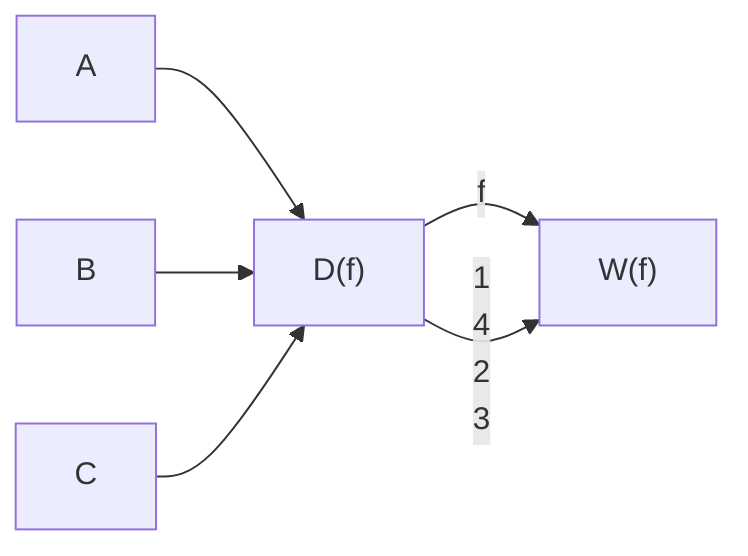
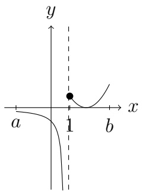
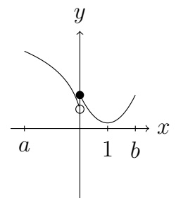
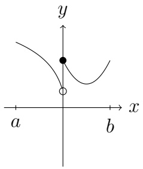
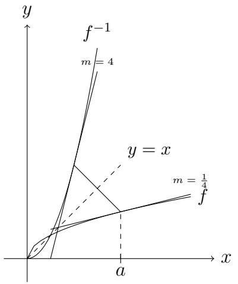
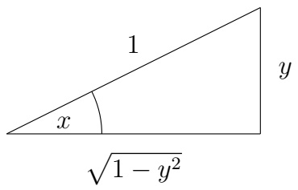

# Höhere Mathematik I – Skript

MinerU 4.0.12 Advanced；FULL 视图保留页眉、页脚、页码和边栏。

# Höhere Mathematik I für Elektrotechniker und Physiker

Maria G. Westdickenberg und Michael Westdickenberg

22. Juli 2026

---

© Maria G. Westdickenberg and Michael Westdickenberg
All Rights Reserved, 2016

Please email comments and corrections to maria@math1.rwth-aachen.de

---

## Acknowledgements

These notes are based on the first semester course on mathematics for students from Physics and Electrical Engineering at the RWTH Aachen University. Many thanks go to Josef Bemelmans for generously sharing the lecture notes that he had written while teaching the course for many years at the RWTH. In addition, Till Knoke is gratefully acknowledged for his help in compiling the original notes and creating the first figures. We thank Harald Günzel and Sebastian Noelle for additional comments on the document. We also gratefully acknowledge Philippe Suchsland for his careful editing, expansion, and enhancement of the notes during Summer Semester, 2016. Finally, thanks go to all of the students who have asked and answered questions each term.

---

## Inhaltsverzeichnis

## 1 Die reellen Zahlen 1

1.1 Mengen und Mengenschreibweise 1
1.2 Eine axiomatische Beschreibung der reellen Zahlen ..... 5

1.2.1 Die algebraischen Axiome von $\mathbb{R}$ 6
1.2.2 Die Anordnungsaxiome von $\mathbb{R}$ 12
1.2.3 Das Vollständigkeitsaxiom 15

1.3 Wohlordnungsprinzip und die vollständige Induktion 22
1.4 Absolutbetrag und Abstand 25
1.5 Einige elementare Ungleichungen 29

## 2 Vektorräume 35

2.1 Der Vektorraum $\mathbb{R}^n$ 35
2.2 Weitere Ungleichungen 40

## 3 Reelle Funktionen 44

3.1 Definition und erste Eigenschaften ..... 44
3.2 Die Umkehrfunktion 51
3.3 Neue Funktionen aus Alten 54
3.4 Polynome und rationale Funktionen ..... 55
3.5 Trigonometrische Funktionen 61

## 4 Zahlenfolgen 62

4.1 Einleitung 62
4.2 Allgemeine Konvergenz und Divergenz 70
4.3 Die Exponentialfunktion und der Logarithmus ..... 77
4.4 Bolzano-Weierstraß 88

## 5 Grenzwerte und Stetigkeit reeller Funktionen 94

5.1 Grenzwerte von Funktionen 94
5.2 Stetigkeit 104
5.3 Eigenschaften stetiger Funktionen ..... 109
5.4 Gleichmäßige Stetigkeit ..... 118

## 6 Differentialrechnung 123

6.1 Lineare Approximation 123
6.2 Die Ableitung in einem Punkt ..... 126

---

6.3 Die abgeleitete Funktion 130
6.4 Rechenregeln 132
6.5 Der Mittelwertsatz der Differentialrechnung 137
6.6 Optimierungsprobleme, Monotonie und Konvexität 142
6.7 Randextrema 150
6.8 Das Newtonsche Verfahren (reprise) ..... 151
6.9 Globale Optimierung 153
6.10 Ableitung der Umkehrfunktion . . . . . . . . . . . . . . . . . . . . . . . . . . 156
6.11 Zusammenfassendes Beispiel mit Kurvendiskussion ..... 157

## 7 Unendliche Reihen 158

7.1 Reihen reeller Zahlen 159
7.2 Weitere Konvergenzkriterien 165
7.3 Potenzreihen 170
7.4 Taylor-Formel 176
7.5 Eine Reihe von Beispielen 180

## 8 Lineare Algebra 183

8.1 Einleitung und erste Definitionen 183
8.2 Lineare Abbildungen 189
8.3 Matrizen 194
8.4 Lineare Gleichungssysteme ..... 198
8.5 Matrixinverse 204
8.6 LU-Zerlegung 207
8.7 Determinanten 209
8.8 Weitere Aufgaben in LA 217

## 9 Klausur 219

9.1 Struktur der Klausur und Beispielaufgaben ..... 222
9.2 Weitere Klausurähnlichefragen ..... 223
9.3 Formelblatt 224

## Appendices 225

## A Notation 226

## B Ausgewählte Lösungen zu den Übungen 227

B.1 Die reellen Zahlen 227
B.1.1 Eine axiomatische Beschreibung der reellen Zahlen ..... 227
B.1.2 Einige Elementare Ungleichungen ..... 228
B.2 Allgemeine Konvergenz und Divergenz 228
B.3 Grenzwerte und Stetigkeit reeller Funktionen ..... 230
B.3.1 Grenzwerte von Funktionen 230
B.4 Unendliche Reihen 231
B.4.1 Potenzreihen 231
B.5 Lineare Algebra 232
B.5.1 Einleitung und erste Definition 232

---

B.5.2 Lineare Abbildung 233
B.5.3 Lineare Gleichungssysteme 234

---

## Kapitel 1

## Die reellen Zahlen

## 1.1 Mengen und Mengenschreibweise

Wir werden sehr oft mit Mengen arbeiten. Eine Menge A ist eine Zusammenfassung von Objekten (für uns, oft von Zahlen, aber manchmal auch von Funktionen oder Gleichungen). Die Objekte, die zu einer Menge A gehören, heißen Elemente von A. Wenn x ein Element von A ist, schreiben wir

$$
x \in A.
$$

Wir sagen, dass A das Element x enthält, dass x in A enthalten ist, oder, dass x zu A gehört. Wenn x nicht zu A gehört, schreiben wir

$$
x \notin A.
$$

Für jedes Objekt x gilt entweder  $x \in A$  oder  $x \notin A$ .

Die Menge, die keine Elemente enthält, wird leere Menge genannt und mit ∅ bezeichnet. Man kann eine Menge definieren, indem man die Elemente in der Menge aufzählt.

Beispiel.

$$
A = \{1, 3, 5 \}, \quad B = \{0, 1, 5, - 1 \}.
$$

Die geschweiften Klammern {...} zeigen an, dass wir es mit einer Menge zu tun haben.

Alternativ kann man Mengen definieren, indem man eine definierende Eigenschaft angibt.

Beispiel. Die Menge aller natürlichen Zahlen x, die die Gleichung  $x^{2}-3x+2=0$  erfüllen.

$$
\{x \colon x \in \mathbb {N} \text {und} x ^ {2} - 3 x + 2 = 0 \}.
$$

Der Doppelpunkt : zeigt an, dass danach die definierende Eigenschaft folgt.

Vier Mengen, die Sie schon kennen und mit denen wir oft arbeiten werden, sind

- die natürlichen Zahlen: $\mathbb{N} = \{1, 2, 3, 4, \ldots\}$,
- die ganzen Zahlen: $\mathbb{Z} = \{0, 1, -1, 2, -2, \ldots\}$,

---

HMI ETech/Phys

WS 2021-22

Seite 2

• die rationalen Zahlen:

$$
\mathbb {Q} = \left\{x \colon x = \frac {p}{q} \text {mit} p, q \in \mathbb {Z} \text {und} q \neq 0 \right\},
$$

\- die reellen Zahlen: (Darstellung als Dezimalbruch)

$$
\mathbb {R} = \left\{x \colon x = m, \alpha_ {1} \alpha_ {2} \alpha_ {3} \dots \text {mit} m \in \mathbb {Z} \text {und} \alpha_ {i} \in \{0, 1, \dots , 9 \} \right\}.
$$

Beispiel. 0,5 ist eine rationale Zahl und eine reelle Zahl. 2 gehört zu N, Z, Q und R.

Bemerkung. Die Darstellung einer reellen Zahl als Dezimalbruch ist nicht eindeutig, zum Beispiel sind 1,000... und 0,999... dieselbe Zahl, nämlich 1.

Jede natürliche Zahl ist auch eine ganze (rationale, reelle) Zahl. Das führt uns zu folgender

## Definition 1.1.1: Teilmenge

Wenn jedes Element von $A$ auch ein Element von $B$ ist, dann sagen wir, $A$ ist in $B$ enthalten oder $A$ ist eine Teilmenge von $B$. Wir schreiben

$$
A \subseteq B.
$$

Bemerkung. Nützlich ist: A ist eine Teilmenge von B, falls gilt

$$
x \in A \quad \Longrightarrow \quad x \in B.
$$

Hierbei bedeutet  $\Longrightarrow$  “impliziert” oder “zieht nach sich.”

Beispiel. Betrachte die beiden Mengen

$$
A = \{x \colon x ^ {2} - x - 6 <   0 \text {und} x \in \mathbb {N} \}, \qquad B = \{- 1, 0, 1, 2, 3 \}.
$$

Wir werden zeigen, dass  $A \subseteq B$ . Wenn  $x \in A$  ist, dann gilt (Nachrechnen)

$$
x ^ {2} - x - 6 <   0 \text {und} x \in \mathbb {N}
$$

$$
\Longleftrightarrow \quad - 2 <   x <   3 \text {und} x \in \mathbb {N},
$$

also ist x = 1 oder x = 2. In beiden Fällen gilt auch x ∈ B. Also ist A ⊆ B.

Hierbei bedeutet $\Longleftrightarrow$ “genau dann, wenn” oder “ist äquivalent zu.”

Im Beispiel oben ist  $A \subseteq B$  und A ist „kleiner als“ B in dem Sinne, dass A weniger Elemente enthält. Das Intervall  $(0,1) \subseteq [0,1]$  ist auch „kleiner als“  $[0,1]$  in einem gewissen Sinn, aber beide Mengen enthalten unendlich viele Elemente. Der Begriff, den wir hier formulieren möchten, ist der Begriff einer echten Teilmenge.

---

HMI ETech/Phys

WS 2021-22

Seite 3

## Definition 1.1.2: Gleichheit und echte Teilmenge

Wenn $A$ und $B$ genau die gleichen Elemente besitzen, dann sagen wir, dass $\underline{A}$ und $\underline{B}$ gleich sind. Wir schreiben $A = B$. Wenn $A \subseteq B$ und $B$ ein Element enthält, das nicht in $A$ ist, dann sagen wir, dass $\underline{A}$ eine echte Teilmenge von $B$ ist und wir schreiben

$$
A \subsetneq B.
$$

Bemerkung (Notation). Manche Mathematiker schreiben  $A \subset B$  für A ist eine Teilmenge von B. Manche Mathematiker schreiben  $A \subset B$  für A ist eine echte Teilmenge von B. Wie immer in der Mathematik muss man die Notation präzise definieren und konsequent benutzen. In diesem Kurs benutzen wir die Notation aus Definition 1.1.1 und 1.1.2.

Beispiel (Gleichheit). Zeigen Sie, dass

$$
C := \{x \in \mathbb {Z}: x ^ {2} + y ^ {2} <   2 x + 8 \text {und} y \in \mathbb {Z} \}
$$

gleich der Menge B ist, die wir im obigen Beispiel definiert haben. Wir bemerken, dass C die Menge aller Zahlen beschreibt, die die x-Koordinate eines Paares ganzer Zahlen ist, das in einem offenen Kreis mit dem Radius 3 und dem Ursprung (1,0) liegt. Tatsächlich gilt

$$
\begin{array}{l} \Leftrightarrow \quad x ^ {2} + y ^ {2} <   2 x + 8 \text {und} x \in \mathbb {Z} \text {und} y \in \mathbb {Z} \\ \Leftrightarrow (x - 1) ^ {2} + y ^ {2} <   9 \quad \text {und} x \in \mathbb {Z} \quad \text {und} y \in \mathbb {Z}. \\ \end{array}
$$

Hier wählen wir nun y = 0, da wir so den größtmöglichen Bereich für x bekommen:

$$
\begin{array}{l} (x - 1) ^ {2} <   9 \quad \text {und} x \in \mathbb {Z}, \\ \Leftrightarrow \quad - 2 <   x <   4 \text {und} x \in \mathbb {Z}. \\ \end{array}
$$

Also ist $C = \{-1, 0, 1, 2, 3\}$, wie zu zeigen war.

Um Gleichheit zweier Mengen zu zeigen, ist die folgende Bemerkung oft sehr nützlich.

Bemerkung (Beweisen). Es gilt A = B genau dann, wenn

$$
A \subseteq B \text {und} B \subseteq A. \tag {1.1.1}
$$

Beweis. Für jedes x bestehen nur die Möglichkeiten

(i)  $x \in A$  und  $x \in B$ , ☐
(ii)  $x \in A$  und  $x \notin B$ , ☐
(iii) $x \notin A$ und $x \in B$,
(iv)  $x \notin A$  und  $x \notin B$ .

text_image

A
B

---

HMI ETech/Phys

WS 2021-22

Seite 4

Wir bemerken, dass

$$
\begin{array}{l} A \subseteq B \quad \Leftrightarrow \quad \nexists x, \text {so dass (ii) gilt}, \\ \text {und} B \subseteq A \quad \Leftrightarrow \quad \nexists x, \text {so dass (iii) gilt.} \\ \end{array}
$$

Also gilt  $A \subseteq B$  und  $B \subseteq A$  genau dann, wenn jedes x entweder (i) oder (iv) erfüllt, was A = B entspricht.

Wenn wir beweisen möchten, dass zwei Mengen gleich sind, ist es oft am einfachsten (1.1.1) in zwei Schritten zu beweisen. Dies üben wir unten, nachdem wir an die Begriffe von Vereinigung und Schnitt erinnert haben.

## Definition 1.1.3: Vereinigung und Schnitt

Die Vereinigung von $A$ und $B$ ist

$$
\{x: x \in A \text {oder} x \in B \} =: A \cup B.
$$

Der Schnitt von $A$ und $B$ ist

$$
\{x: x \in A \text {und} x \in B \} =: A \cap B.
$$

Bemerkung. In der vorigen Grafik entspricht $A \cup B$ den Mengen (i), (ii) und (iii). $A \cap B$ entspricht (i).

Beispiel. Zeigen Sie, dass

$$
A \cap (B \cup C) = (A \cap B) \cup (A \cap C). \tag {1.1.2}
$$

Lösung.

$$
\begin{array}{l} \operatorname{Sei} x \in A \cap (B \cup C). \\ \Rightarrow \quad x \in A \text {und} x \in B \cup C \\ \Rightarrow \quad x \in A \text {und} (x \in B \text {oder} x \in C) \\ \Rightarrow \quad (x \in A \text {und} x \in B) \text {oder} (x \in A \text {und} x \in C) \\ \Rightarrow \quad x \in A \cap B \text {oder} x \in A \cap C \\ \Rightarrow \quad x \in (A \cap B) \cup (A \cap C). \\ \end{array}
$$

Also gilt

$$
A \cap (B \cup C) \subseteq (A \cap B) \cup (A \cap C). \tag {1.1.3}
$$

---

HMI ETech/Phys

WS 2021-22

Seite 5

Andersherum gilt

$$
\begin{array}{l} \operatorname{Sei} x \in (A \cap B) \cup (A \cap C). \\ \Rightarrow \quad x \in A \cap B \text {oder} x \in A \cap C \\ \Rightarrow \quad (x \in A \text {und} x \in B) \text {oder} (x \in A \text {und} x \in C) \\ \Rightarrow \quad x \in A \text {und} (x \in B \text {oder} x \in C) \\ \Rightarrow \quad x \in A \text {und} x \in B \cup C \\ \Rightarrow \quad x \in A \cap (B \cup C). \\ \end{array}
$$

Also gilt

$$
(A \cap B) \cup (A \cap C) \subseteq A \cap (B \cup C). \tag {1.1.4}
$$

Aus (1.1.3) und (1.1.4) schließen wir (1.1.2).

Wir brauchen auch den Begriff vom Komplement.

## Definition 1.1.4: Komplement

Das Komplement von $B$ in $A$ ist

$$
\{x \in A: x \notin B \} =: A \setminus B.
$$

## Übung 1.1.5

Zeigen Sie, dass

$$
(A \setminus B) \setminus C = A \setminus (B \cup C).
$$

## Übung 1.1.6: DeMorgansche Gesetze

Zeigen Sie, dass

$$
\begin{array}{l} A \setminus (B \cup C) = (A \setminus B) \cap (A \setminus C), \\ A \setminus (B \cap C) = (A \setminus B) \cup (A \setminus C), \\ \end{array}
$$

Bemerkung. Vereinigung und Schnitt können analog für mehr als zwei (beliebig viele) Mengen definiert werden. Ebenso lassen sich die DeMorgansche Gesetze verallgemeinern.

## 1.2 Eine axiomatische Beschreibung der reellen Zahlen

In diesem Abschnitt schauen wir uns die reellen Zahlen aus einer axiomatischen Perspektive an. Insbesondere listen wir die Axiome der reellen Zahlen auf. Diese Axiome sind die Eigenschaften der reellen Zahlen, die wir als wahr annehmen. Dann fragen wir uns, welche weitere Eigenschaften von R wir daraus schließen können. Wir trennen die Axiome wie folgt

---

HMI ETech/Phys

WS 2021-22

Seite 6

(i) algebraische Axiome
(ii) Anordnungsaxiome
(iii) das Vollständigkeitsaxiom.

## 1.2.1 Die algebraischen Axiome von $\mathbb{R}$

Die Menge der reellen Zahlen ist ein „Körper“ im folgenden Sinn.

## Axiom

R zusammen mit Addition (bezeichnet mit +) und Multiplikation (bezeichnet mit ·) erfüllt die folgenden Eigenschaften:

(G) (Geschlossenheit)
$a + b \in \mathbb{R}$ und $a \cdot b \in \mathbb{R}$ für alle $a, b \in \mathbb{R}$.
(A1) (Kommutativgesetz der Addition)
$a + b = b + a$ für alle $a, b \in \mathbb{R}$.
(A2) (Assoziativgesetz der Addition)
$a + (b + c) = (a + b) + c$ für alle $a, b, c \in \mathbb{R}$.
(A3) (Existenz eines neutralen Elements der Addition)
Es existiert eine Zahl $0 \in \mathbb{R}$, so dass für jedes $a \in \mathbb{R}$ gilt: $a + 0 = a$.
(A4) (Existenz eines inversen Elements der Addition)
Zu jedem $a \in \mathbb{R}$ existiert eine reelle Zahl $b$, so dass gilt: $a + b = 0$.
(M1) (Kommutativgesetz der Multiplikation)
$a \cdot b = b \cdot a$ für alle $a, b \in \mathbb{R}$.
(M2) (Assoziativgesetz der Multiplikation)
$a \cdot (b \cdot c) = (a \cdot b) \cdot c$ für alle $a, b, c \in \mathbb{R}$.
(M3) (Existenz eines neutralen Elements der Multiplikation)
Es existiert eine von 0 verschiedene Zahl $1 \in \mathbb{R}$, so dass für jedes $a \cdot 1 = a$.
(M4) (Existenz eines inversen Elements der Multiplikation)
Zu jedem $a \in \mathbb{R}$ mit $a \neq 0$ existiert eine reelle Zahl $b$, so dass gilt:
$a \cdot b = 1$.
(D) (Distributivgesetz)
$a \cdot (b + c) = (a \cdot b) + (a \cdot c)$ für alle $a, b, c \in \mathbb{R}$.

Bemerkung. Ein Körper ist eine Menge zusammen mit einer Addition + und einer Multiplikation ·, so dass (G), (A1)-(A4), (M1)-(M4) und (D) gelten. Welche der Körpereigenschaften erfüllen N, Z, Q, R \ Q (mit +, · aus R)?

Bemerkung. Oft schreiben wir „ab“ anstatt „a·b“. Wenn a·b+a·c oder ab+ac geschrieben wird, interpretieren wir den Ausdruck als  $(a\cdot b)+(a\cdot c)$ . Das heißt, wir folgen der Regel, dass Multiplizieren zuerst ausgeführt wird.

---

HMI ETech/Phys

WS 2021-22

Seite 7

Ein Hauptziel der ersten Vorlesung ist zu verstehen, wie wir aus den 10 oben genannten Axiomen Folgerungen ziehen. Zum Beispiel haben wir nicht angenommen, dass das neutrale Element der Addition und das neutrale Element der Multiplikation eindeutig bestimmt sind. Anstattdessen beweisen wir jetzt, dass Eindeutigkeit aus den algebraischen Axiomen folgt. Ähnlich folgt, dass das zu a inverse Element der Addition und das zu a inverse Element der Multiplikation eindeutig sind.

## Satz 1.2.1: Eindeutigkeit

Es gilt folgendes.

(i) Das neutrale Element der Addition und das neutrale Element der Multiplikation sind eindeutig bestimmt.
(ii) Wenn für $a, b, c \in \mathbb{R}$ gilt $a + b = 0$ und $a + c = 0$, dann ist $b = c$.
(iii) Wenn für  $a, b, c \in R$  mit  $a \neq 0$  gilt  $a \cdot b = 1$  und  $a \cdot c = 1$ , dann gilt b = c.

Bemerkung. Angesichts der Eindeutigkeit ergibt es Sinn dem inversen Element einen Namen zu geben:

- das zu a inverse Element der Addition wird mit $-a$ bezeichnet, und
- das zu a inverse Element der Multiplikation wird mit $a^{-1}$ oder $\frac{1}{a}$ bezeichnet.

Ab jetzt definieren wir Subtraktion und Division durch

- $a - b := a + (-b)$,
$\bullet \frac{a}{b} := a \cdot b^{-1}$.

Beweis von Satz 1.2.1. zu (i): Wir nehmen an, dass für $0, x \in \mathbb{R}$ gilt

$$
a + 0 = a \quad \text {und} \quad a + x = a
$$

für alle $a \in \mathbb{R}$. Dann gilt insbesondere

$$
0 + x = 0.
$$

Aus (A1) und (A3) folgt $x = 0$. Analog, wenn für $1 \neq 0$, $x \neq 0$ gilt

$$
a \cdot 1 = a \quad \text {und} \quad a \cdot x = a
$$

für alle $a \in \mathbb{R}$, dann gilt insbesondere

$$
1 \cdot x = 1.
$$

Aus (M1) und (M3) folgt x = 1.

---

HMI ETech/Phys

WS 2021-22

Seite 8

zu (ii): Angenommen, es gilt für irgendeine  $b, c \in R$ :

$$
a + b = 0 \text {und} a + c = 0. \tag {1.2.1}
$$

Also gilt

$$
\begin{array}{l} \Rightarrow \\ (1. 2. 1), (A 2) \quad \Longrightarrow \\ (\mathrm{A} 3), (\mathrm{A} 1) \\ \begin{array}{r c l} a + b & = & a + c \\ b + (a + b) & = & b + (a + c) \end{array} \\ b + 0 \quad = \quad (b + a) + c \\ b \quad = \quad (a + b) + c \\ \stackrel {(1. 2. 1)} {=} \quad 0 + c \\ \stackrel {(\mathrm{A1})} {=} \quad c + 0 \\ \stackrel {\text {(A3)}} {=} \quad c. \\ \end{array}
$$

zu (iii): Übung

Bemerkung. Wir werden Eindeutigkeit sehr oft (wenn nicht immer) durch diese Methode beweisen. (Man nimmt an, man hat zwei Elemente/Lösungen/... und zeigt, dass sie gleich sind.)

Aus den algebraischen Axiomen kann man außerdem die üblichen algebraischen Regeln der reellen Zahlen schließen, zum Beispiel:

## Satz 1.2.2

Es gilt

$$
\begin{array}{l} (i) a \cdot 0 \quad = 0 \quad \text {f ü r a l l e} a \in \mathbb {R}, \\ (i i) - a \quad = (- 1) \cdot a \quad \text {f ü r a l l e} a \in \mathbb {R}, \\ (i i i) - (- a) = a \quad \text {f ü r a l l e} a \in \mathbb {R}, \\ (i v) (- 1) ^ {2} = 1 \\ (v) (a ^ {- 1}) ^ {- 1} = a \quad \text {f ü r a l l e} a \in \mathbb {R}, a \neq 0. \\ \end{array}
$$

Beweis. zu (i): Es gilt für alle $a, b \in \mathbb{R}$

$$
\begin{array}{c c c c} & a \cdot (b + 0) & \stackrel {{(\mathrm{D})}} {{=}} & a \cdot b + a \cdot 0 \\ \stackrel {{(\mathrm{A3})}} {{\Rightarrow}} & a \cdot b & = & a \cdot b + a \cdot 0 \\ (\mathrm{A4}), (\mathrm{A1}), (\mathrm{A2}), (\mathrm{A3}) & 0 & = & a \cdot 0. \end{array}
$$

---

HMI ETech/Phys

WS 2021-22

Seite 9

zu (ii): Für alle  $a \in R$  gilt:

$$
\begin{array}{l} a + (- a) \quad = \quad 0 \\ \stackrel {(i)} {=} \quad (1 - 1) \cdot a \\ \stackrel {(\mathrm{D})} {=} \quad 1 \cdot a + (- 1) \cdot a \\ \stackrel {(\mathrm{M3})} {=} \quad a + (- 1) \cdot a. \\ \end{array}
$$

Daraus folgt insgesamt

$$
\begin{array}{r c l} - a + a + (- a) & = & - a + a + (- 1) \cdot a \\ \stackrel {{(\mathrm{A} 1)}} {{\Rightarrow}} & - a & = & (- 1) \cdot a. \end{array}
$$

zu (iii): Es gilt  $a + (-a) = 0$  und mit (A1) auch  $(-a) + a = 0$ . Außerdem gilt  $(-a) + (-(-a)) = 0$ . Mit Satz 1.2.1 (ii) folgt  $-(-a) = a$ .

zu (iv): Mit (ii) für $a = -1$ folgt $-(-1) = (-1)^{2}$, andererseits folgt aus (iii) für $a = 1$, dass $-(-1) = 1$.

zu  $(v)$ : Sei  $a \neq 0$  gegeben. Angesichts Satz 1.2.1 reicht es aus, wenn wir  $a^{-1} \cdot a = 1$  zeigen. Dies folgt aus

$$
a \cdot a ^ {- 1} = 1
$$

und (M1).

Noch „praktischer“ ist die Folgerung, dass wir Gleichungen der Form

$$
a + x = b \quad \text { oder } \quad a \cdot x = b
$$

lösen können.

## Satz 1.2.3: Existenz von Lösungen

Seien $a, b \in \mathbb{R}$ gegeben.

(i) Es existiert genau eine reelle Zahl x, so dass

$$
a + x = b.
$$

(ii) Wenn  $a \neq 0$ , dann existiert genau eine reelle Zahl x, so dass

$$
a \cdot x = b. \tag {1.2.2}
$$

Bemerkung. Das „genau“ oben sagt uns, dass wir beweisen müssen, dass die Lösung eindeutig definiert ist. Wir werden in einem Schritt Existenz einer Lösung zeigen und in einem zweiten Schritt Eindeutigkeit der Lösung zeigen.

---

HMI ETech/Phys

WS 2021-22

Seite 10

Beweis von Satz 1.2.3. zu (i): Übung.

zu (ii): Schritt 1: Hier zeigen wir, dass es mindestens eine Zahl x gibt, so dass  $a \cdot x = b$ . Der natürliche „Kandidat“ ist  $x := a^{-1} \cdot b$ . Wir rechnen

$$
a \cdot x \quad = \quad a \cdot (a ^ {- 1} \cdot b)
$$

$$
\stackrel {(\mathrm{M} 2)} {=} \quad (a \cdot a ^ {- 1}) \cdot b
$$

$$
\stackrel {(\mathrm{M} 4)} {=} \quad 1 \cdot b
$$

$$
\stackrel {(\mathrm{M} 1)} {=} b \cdot 1
$$

$$
\stackrel {(\mathrm{M} 3)} {=} b.
$$

Also löst x die Gleichung (1.2.2).

Schritt 2: Angenommen, x und  $\tilde{x}$  sind zwei Lösungen von (1.2.2). Wir möchten zeigen, dass  $x = \tilde{x}$ . Aus  $a \cdot x = b$  und  $a \cdot \tilde{x} = b$  erhalten wir

$$
\begin{array}{l} \begin{array}{r c l} a \cdot x & = & a \cdot \tilde {x} \\ \Rightarrow \quad (a \cdot x) \cdot a ^ {- 1} & = & (a \cdot \tilde {x}) \cdot a ^ {- 1} \end{array} \\ \stackrel {(\mathrm{M} 1)} {\Rightarrow} \quad (x \cdot a) \cdot a ^ {- 1} = (\tilde {x} \cdot a) \cdot a ^ {- 1} \\ \stackrel {(\mathrm{M} 2)} {\Rightarrow} \quad x \cdot (a \cdot a ^ {- 1}) = \tilde {x} \cdot (a \cdot a ^ {- 1}) \\ \stackrel {(\mathrm{M} 4)} {\Rightarrow} \quad x \cdot 1 = \tilde {x} \cdot 1 \\ \stackrel {(\mathrm{M} 3)} {\Rightarrow} \quad x = \tilde {x}. \\ \end{array}
$$

## Exkurs: Die komplexen Zahlen

In der Elektrotechnik und Physik arbeiten Sie auch oft mit den komplexen Zahlen. Eine komplexe Zahl kann als ein geordnetes Paar  $(x, y)$  reeller Zahlen mit folgender Addition und Multiplikation dargestellt werden:

- Addition: $(x_{1},y_{1})\oplus (x_{2},y_{2}):= (x_{1} + x_{2},y_{1} + y_{2})$
- Multiplikation: $(x_{1},y_{1})\odot (x_{2},y_{2}):= (x_{1}\cdot x_{2} - y_{1}\cdot y_{2},x_{1}\cdot y_{2} + x_{2}\cdot y_{1}).$

Der Körper der komplexen Zahlen wird mit C bezeichnet.

Bemerkung. Die Verknüpfungszeichen  $\oplus,\odot$  sind so gewählt um deutlich zu machen, dass es sich nicht um die aus R bekannte Addition bzw. Multiplikation handelt. Später werden die Verknüpfungen aber ebenfalls mit +,· bezeichnet werden.

Behauptung: C erfüllt (G), (A1)-(A4), (M1)-(M4) und (D).

Beispiel. Was ist das neutrale Element der Addition? Was ist das neutrale Element der Multiplikation?

---

HMI ETech/Phys

WS 2021-22

Seite 11

Lösung. (0,0) und (1,0). Man überprüft, dass

$$
\begin{array}{l} (x, y) \oplus (0, 0) \quad = \quad (x + 0, y + 0) \\ \stackrel {(\mathrm{A} 3) \text {für} \mathbb {R}} {=} (x, y), \\ \end{array}
$$

und, dass

$$
\begin{array}{l} (x, y) \odot (1, 0) \quad = \quad (x \cdot 1 - y \cdot 0, x \cdot 0 + y \cdot 1) \\ \stackrel {(\mathrm{M} 3) \text {f ü r} \mathbb {R}, \text {Satz} 1. 2. 2 (i)} {=} (x - 0, 0 + y) \\ \stackrel {\text {(A3)} \text {für} \mathbb {R}} {=} \quad (x, y). \\ \end{array}
$$

Bemerkung. Die algebraischen Axiome der reellen Zahlen werden benutzt um zu zeigen, dass $\mathbb{C}$ (G), (A1)-(A4), (M1)-(M4) und (D) erfüllt. Das heißt, wir nehmen die Eigenschaften für $\mathbb{R}$ an, aber wir zeigen, dass $\mathbb{C}$ die Eigenschaften erfüllt.

Sie können selber die verschiedenen Aussagen für C testen. Als Beispiel zeigen wir, dass

$$
(x _ {1}, y _ {1}) \odot ((x _ {2}, y _ {2}) \odot (x _ {3}, y _ {3})) = ((x _ {1}, y _ {1}) \odot (x _ {2}, y _ {2})) \odot (x _ {3}, y _ {3}).
$$

Es gilt:

$$
\begin{array}{l} (x _ {1}, y _ {1}) \odot ((x _ {2}, y _ {2}) \odot (x _ {3}, y _ {3})) \quad = \quad (x _ {1}, y _ {1}) \odot (x _ {2} \cdot x _ {3} - y _ {2} \cdot y _ {3}, x _ {2} \cdot y _ {3} + x _ {3} \cdot y _ {2}) \\ \stackrel {\text {(D)}} {=} \mathrm{aus} \mathbb {R} \quad \left(x _ {1} \cdot x _ {2} \cdot x _ {3} - x _ {1} \cdot y _ {2} \cdot y _ {3} - \left(y _ {1} \cdot x _ {2} \cdot y _ {3} + y _ {1} \cdot x _ {3} \cdot y _ {2}\right), \right. \\ \left. x _ {1} \cdot x _ {2} \cdot y _ {3} + x _ {1} \cdot x _ {3} \cdot y _ {2} + x _ {2} \cdot x _ {3} \cdot y _ {1} - y _ {2} \cdot y _ {3} \cdot y _ {1}\right) \\ \stackrel {{\text {Satz 1.2.2 (ii)}}} {{=}} \quad \left(x _ {1} \cdot x _ {2} \cdot x _ {3} - x _ {1} \cdot y _ {2} \cdot y _ {3} - y _ {1} \cdot x _ {2} \cdot y _ {3} - y _ {1} \cdot x _ {3} \cdot y _ {2}, \right. \\ \left. x _ {1} \cdot x _ {2} \cdot y _ {3} + x _ {1} \cdot x _ {3} \cdot y _ {2} + x _ {2} \cdot x _ {3} \cdot y _ {1} - y _ {2} \cdot y _ {3} \cdot y _ {1}\right) \\ \stackrel {{(\mathrm{A} 1), (\mathrm{M} 1)} {=}} {\text {aus} \mathbb {R}} \quad \left(x _ {1} \cdot x _ {2} \cdot x _ {3} - y _ {1} \cdot y _ {2} \cdot x _ {3} - x _ {1} \cdot y _ {2} \cdot y _ {3} - x _ {2} \cdot y _ {1} \cdot y _ {3}, \right. \\ \left. x _ {1} \cdot x _ {2} \cdot y _ {3} - y _ {1} \cdot y _ {2} \cdot y _ {3} + x _ {3} \cdot x _ {1} \cdot y _ {2} + x _ {3} \cdot x _ {2} \cdot y _ {1}\right) \\ \end{array}
$$

Andererseits gilt:

$$
\left(\left(x _ {1}, y _ {1}\right) \odot \left(x _ {2}, y _ {2}\right)\right) \odot \left(x _ {3}, y _ {3}\right) \quad = \quad \left(x _ {1} \cdot x _ {2} - y _ {1} \cdot y _ {2}, x _ {1} \cdot y _ {2} + x _ {2} \cdot y _ {1}\right) \odot \left(x _ {3}, y _ {3}\right)
$$

$$
\stackrel {\text {(D)} \text {aus} \mathbb {R}} {=} \quad (x _ {1} \cdot x _ {2} \cdot x _ {3} - y _ {1} \cdot y _ {2} \cdot x _ {3} - (x _ {1} \cdot y _ {2} \cdot y _ {3} + x _ {2} \cdot y _ {1} \cdot y _ {3}),
$$

$$
\left. x _ {1} \cdot x _ {2} \cdot y _ {3} - y _ {1} \cdot y _ {2} \cdot y _ {3} + x _ {3} \cdot x _ {1} \cdot y _ {2} + x _ {3} \cdot x _ {2} \cdot y _ {1}\right)
$$

$$
\stackrel {{\text {Satz 1.2.2 (ii)}}} {{=}} \left(x _ {1} \cdot x _ {2} \cdot x _ {3} - y _ {1} \cdot y _ {2} \cdot x _ {3} - x _ {1} \cdot y _ {2} \cdot y _ {3} - x _ {2} \cdot y _ {1} \cdot y _ {3}, \right.
$$

$$
\left. x _ {1} \cdot x _ {2} \cdot y _ {3} - y _ {1} \cdot y _ {2} \cdot y _ {3} + x _ {3} \cdot x _ {1} \cdot y _ {2} + x _ {3} \cdot x _ {2} \cdot y _ {1}\right)
$$

Beide Seiten sind also gleich.

Wenn man

$$
(1, 0) =: \mathbf {1} \text {reelle Einheit}
$$

$$
(0, 1) =: \mathbf {i} \text {imaginäre Einheit}
$$

---

HMI ETech/Phys

WS 2021-22

Seite 12

definiert, dann kann man eine komplexe Zahl  $z = (x, y)$  als

$$
z = x + \mathbf {i} y
$$

schreiben. Da $(0,1)\odot (0,1) = (0 - 1,0 + 0) = (-1,0)$, gilt die Regel

$$
\mathbf {i} ^ {2} = - \mathbf {1}.
$$

## Definition 1.2.4

Für eine komplexe Zahl  $z = x + iy$  nennen wir x den Realteil und y den Imaginärteil der Zahl. Wir schreiben dafür

$$
x = \Re (z), \qquad y = \Im (z).
$$

Die zu z komplex konjugierte Zahl ist x - iy und wird mit

$\overline{z}$

bezeichnet.

Man bemerkt:

$$
z + \bar {z} = 2 \Re (z), \qquad z - \bar {z} = 2 \Im (z) \mathbf {i}.
$$

Wichtige Bemerkung: Da C (G), (A1)-(A4), (M1)-(M4) und (D) erfüllt, erhalten wir „umsonst“, dass die Sätze 1.2.1 - 1.2.3 auch für C gelten. Das gilt allgemein für alle Sätze, die aus den Axiomen folgen. Darin liegt der Vorteil, eine saubere, elementare Struktur zu erkennen und zu benutzen.

## 1.2.2 Die Anordnungsaxiome von $\mathbb{R}$

In diesem Abschnitt geht es darum, dass die reellen Zahlen geordnet sind.

## Axiom

Für alle $a, b, c \in \mathbb{R}$ gilt:

(O1) (Trichotomie)
Eine und nur eine der folgenden Aussagen ist wahr:

$$
a <   b, \quad \quad b <   a, \quad \quad a = b.
$$

(O2) (Transitivität)
Wenn a < b und b < c ist, so gilt a < c.
(O3) (Monotoniegesetz der Addition)
Wenn $a < b$ ist, so gilt $a + c < b + c$ für alle $c \in \mathbb{R}$
(O4) (Monotoniegesetz der Multiplikation)
Wenn $a < b$ ist, so gilt $a \cdot c < b \cdot c$ für alle $c \in \mathbb{R}$ mit $c > 0$.

---

HMI ETech/Phys

WS 2021-22

Seite 13

Man kann die folgenden Folgerungen beweisen:

## Satz 1.2.5

Für reelle Zahlen $a, b, c, d$ gilt:

(i) $a + c <   b + c\Rightarrow a <   b.$
(ii) $a < b \Leftrightarrow a - b < 0$.
(iii) $a < 0 \Leftrightarrow -a > 0$.
$(iv)\ a < b \quad \Leftrightarrow \quad -a > -b.$
(v) $a < b$ und $c < d \Rightarrow a + c < b + d$.
$(vi)\ a \cdot b > 0 \quad \Leftrightarrow \quad \text{entweder } a > 0 \text{ und } b > 0 \text{ oder } a < 0 \text{ und } b < 0.$
(vii) $a \cdot a > 0$ für alle $a \in \mathbb{R}$ mit $a \neq 0$. Insbesondere gilt $1 > 0$.

## Notation 1.2.6

Gilt für eine Zahl $a \in \mathbb{R}$, dass $a > 0$ (bzw. $a < 0$), dann nennen wir $a \underline{\text{positiv}}$ (bzw. negativ). Ein $a \in \mathbb{R}$ mit $a \geq 0$ (bzw. $a \leq 0$) nennen wir $\underline{\text{nichtnegativ}}$ (bzw. $\underline{\text{nichtpositiv}}$).

Als Beispiel zeigen wir (vi). Wenn wir eine „genau dann, wenn“-Aussage beweisen möchten, werden wir oft erst eine und danach die andere Richtung zeigen. Dies üben wir jetzt.

Beweis. Schritt 1: (Rückrichtung) Zu zeigen ist: Wenn a, b beide positiv oder beide negativ sind, dann ist das Produkt  $a \cdot b$  positiv.

Fall 1: Wir zeigen: Wenn $a > 0$ und $b > 0$, dann gilt $a \cdot b > 0$.

$\overline{\mathrm{Da}b} >0$ ist, schließen wir aus $0 < a$ und (O4), dass

$$
\begin{array}{c c c c} & 0 \cdot b & <   & a \cdot b \\ (\mathrm{M} 1), \text {Satz} 1. 2. 2 (i) \\ \Rightarrow & 0 & <   & a \cdot b. \end{array}
$$

Fall 2: Wir zeigen: Wenn $a < 0$ und $b < 0$, dann gilt

$$
a \cdot b > 0.
$$

Jetzt können wir (O4) nicht direkt anwenden, da b nicht positiv ist. Zuerst zeigen wir, dass das zu b inverse Element der Addition doch positiv ist (Teil (iii) von Satz 1.2.5). Nach (O3) gilt

$$
\begin{array}{c c c c} & b + (- b) & <   & 0 + (- b) \\ \stackrel {{(\mathrm{A1}), (\mathrm{A3})}} {{\Rightarrow}} & b + (- b) & <   & - b \\ \stackrel {{(\mathrm{A4})}} {{\Rightarrow}} & 0 & <   & - b. \end{array}
$$

---

HMI ETech/Phys

WS 2021-22

Seite 14

Also erhalten wir aus $a < 0$ und (O4), dass

$$
a \cdot (- b) <   0 \cdot (- b) = 0. \tag {1.2.3}
$$

Andererseits bemerken wir, dass $a \cdot (-b)$ das zu $a \cdot b$ inverse Element der Addition ist:

$$
\begin{array}{r l} & a \cdot b + a \cdot (- b) \stackrel {\mathrm{(D)}} {=} a \cdot (b - b) = 0 \\ \Rightarrow \quad & a \cdot (- b) = - (a \cdot b). \end{array} \tag {1.2.4}
$$

Aus (1.2.4) und (1.2.3) schließen wir  $-(a \cdot b) < 0$ , woraus folgt (wie oben), dass  $a \cdot b > 0$ .

Also impliziert $a > 0$ und $b > 0$ oder $a < 0$ und $b < 0$, dass $a \cdot b > 0$.

Schritt 2: (Hinrichtung)

Hier ist zu zeigen, dass  $a \cdot b > 0$  impliziert a > 0 und b > 0 oder a < 0 und b < 0. Nach (O1) gibt es neun Fälle:

entweder $a &gt; 0$ und $b &gt; 0$
oder $a &gt; 0$ und $b = 0$
oder $a &gt; 0$ und $b &lt; 0$
oder $a = 0$ und $b &gt; 0$
oder $a = 0$ und $b = 0$
oder $a = 0$ und $b &lt; 0$
oder $a &lt; 0$ und $b &gt; 0$
oder $a &lt; 0$ und $b = 0$
oder $a &lt; 0$ und $b &lt; 0$.

Wenn $a > 0$ und $b < 0$, dann gilt

$$
\begin{array}{c c c} a \cdot b = b \cdot a & \stackrel {{(\mathrm{O4})}} {{<  }} & 0 \cdot a \\ & \stackrel {{(\mathrm{M1})}} {{=}} & a \cdot 0 \\ & \stackrel {{\text {Satz 1.2.2 (i)}}} {{=}} & 0. \end{array}
$$

Analog, wenn $a < 0$ und $b > 0$. Also bleiben nur die einzige Möglichkeiten $a, b > 0$ oder $a, b < 0$.

Prüfen Sie, ob Sie die anderen Aussagen aus Satz 1.2.5 beweisen können.

Bemerkung. Eine Anordnung mit den Eigenschaften  $(O1)-(O4)$  kann es für die komplexen Zahlen nicht geben, denn Satz 1.2.5 (vii) würde implizieren

$$
z ^ {2} > 0 \quad \text {fur alle} z \in \mathbb {C} \text {mit} z \neq 0,
$$

insbesondere

$$
\boldsymbol {1} = \boldsymbol {1} ^ {2} > 0 \tag {1.2.5}
$$

$$
- \boldsymbol {1} = i ^ {2} > 0, \tag {1.2.6}
$$

aber nach Satz 1.2.5 (iii) impliziert (1.2.6), dass

$$
\boldsymbol {1} <   0, \tag {1.2.7}
$$

---

HMI ETech/Phys

WS 2021-22

Seite 15

und (1.2.5) und (1.2.7) widerspricht (O1).

## 1.2.3 Das Vollständigkeitsaxiom

Jetzt kommen wir zum tieferen Teil. Die Frage ist, ob die reellen Zahlen oder z.B. die rationalen Zahlen „vollständig“ sind. Was soll das heißen?

Grob gesagt möchte man wissen, ob es „Löcher gibt“ im Zahlenstrahl oder, im Gegenteil, ob es an jeder Stelle, wo man eine reelle/rationale Zahl „erwartet“, auch immer eine reelle/rationale Zahl gibt.

Das Vollständigkeitsaxiom (ein Axiom, also eine Annahme!) sagt, dass die reellen Zahlen in der Tat vollständig sind. Man würde vielleicht hoffen, dass wir dies beweisen könnten. Aber wir müssen es stattdessen annehmen.

Zuerst bemerken wir, dass die rationalen Zahlen Löcher haben. Besser gesagt: Es gibt Punkte auf der Zahlengeraden, die keiner rationalen Zahl entsprechen.

Lemma 1.2.7 (Q nicht vollständig). Es gibt kein $r \in \mathbb{Q}$, so dass $r^2 = 2$ gilt.

Bemerkung. Wir werden einen indirekten Beweis schreiben. Sobald Sie einen direkten Beweis schreiben können, machen Sie es. Sie sind oft nützlicher und leichter zu verstehen. Wenn Sie keinen direkten Weg finden, probieren Sie einen indirekten Beweis.

Beweis. Angenommen,  $r \in Q$  erfüllt  $r^{2} = 2$ . Dann existieren  $p, q \in N$ , so dass

$$
\frac {p ^ {2}}{q ^ {2}} = 2. \qquad (\text {Warum?})
$$

Also gilt

$$
p ^ {2} = 2 q ^ {2}. \tag {1.2.8}
$$

Wir dürfen annehmen (warum?), dass $p$ und $q$ keine gemeinsamen Faktoren haben. Nach (1.2.8) ist $p^2$ gerade. Wenn $p \in \mathbb{N}$ ist und $p^2$ gerade ist, dann ist $p$ gerade. (Warum?) Aber dann impliziert (1.2.8), dass $q^2$ gerade ist mit $p^2 = 4 \cdot s^2$, $s \in \mathbb{N} \Rightarrow 2 \cdot s^2 = q^2$. Wir schließen daraus, dass $q$ gerade ist, was widerspricht, dass $p$ und $q$ keine gemeinsamen Faktoren haben.

## Übung 1.2.8

Gibt es eine rationale Zahl $r$, so dass

$$
r ^ {2} = 3?
$$

$$
r ^ {2} = 4?
$$

Um das Vollständigkeitsaxiom von R zu formulieren, brauchen wir ein paar zusätzliche Begriffe.

---

HMI ETech/Phys

WS 2021-22

Seite 16

## Definition 1.2.9: Beschränkt

Die nichtleere Menge $A \subseteq \mathbb{R}$ heißt von oben beschränkt (oder: nach oben beschränkt), falls es eine Zahl $s \in \mathbb{R}$ gibt, so dass

$$
x \leq s \quad \text { für   alle } x \in A.
$$

Dann nennen wir s eine obere Schranke von A. Falls es keine solche Zahl gibt, dann sagen wir, dass A nach oben unbeschränkt ist.

Die Menge $A$ heißt von unten beschränkt (oder: nach unten beschränkt), falls es eine Zahl $s \in \mathbb{R}$ gibt, so dass

$$
x \geq s \quad \text { für   alle } x \in A.
$$

Dann nennen wir s eine untere Schranke von A. Falls es keine solche Zahl gibt, dann sagen wir, dass A nach unten unbeschränkt ist.

Wenn A eine obere und eine untere Schranke besitzt, dann sagen wir, dass A beschränkt ist.

Wenn A nach oben oder nach unten unbeschränkt ist, dann sagen wir, dass A unbeschränkt ist.

Bemerkung. Nach der Definition ist jede Menge beschränkt oder unbeschränkt.

Beispiel. Sind die folgenden Mengen nach oben/unten beschränkt? Wenn ja, was ist eine obere/untere Schranke der Menge?

①  $\{1,2,5,9\}$
② (0,5]
③  $(-∞,9)∪(8,10)$
④ Q

⑤  $\left\{x\in\mathbb{R}:x=1+\frac{1}{n},n\in\mathbb{N}\right\}.$

Man merkt, dass die obere Schranke einer (beschränkten) Menge nicht eindeutig definiert ist. Z.B. ist 6 eine obere Schranke von  $(0,5]$ , aber das Gleiche gilt auch für 5 und 7. In der Tat gilt: wenn s eine obere Schranke von einer Menge A ist, dann gilt das auch für

$$
s + n \quad \text { für   jedes } n \in \mathbb {N}.
$$

Trotzdem glaubt man, dass es eine „beste“ obere Schranke einer Menge gibt (z.B. bzgl. (0, 5] scheint 5 „besser“ als 6 oder 7 zu sein). Diese Intuition führt zu folgender Definition:

## Definition 1.2.10: Supremum/Infimum einer Menge

Sei $A \subseteq \mathbb{R}$ nicht leer und nach oben beschränkt. Dann heißt $s \in \mathbb{R}$ die kleinste obere Schranke von $A$ oder das Supremum von $A$, wenn gilt:

(i)  $x \leq s$  für alle  $x \in A$ ,
(ii) $x \leq s'$ für alle $x \in A$ $\implies s' \geq s$.

---

HMI ETech/Phys

WS 2021-22

Seite 17

Wir schreiben

$$
s = \sup A.
$$

Analog: Sei  $A \subseteq R$  nicht leer und nach unten beschränkt. Dann heißt  $s \in R$  die größte untere Schranke von A oder das Infimum von A, wenn gilt:

$(i') \ x \geq s \quad \text{ für alle } x \in A,$

$(ii') x \geq s'$ für alle $x \in A$ $\implies s' \leq s$.

Wir schreiben

$$
s = \inf A.
$$

Wenn die nichtleere Menge  $A \subseteq R$  nicht nach oben beschränkt bzw. nicht nach unten beschränkt ist, dann ist

$$
\sup A := + \infty \quad \text {bzw.} \quad \inf A := - \infty.
$$

Für die leere Menge definieren wir außerdem

$$
\sup \emptyset := - \infty \quad \text {und} \quad \inf \emptyset := + \infty .
$$

Bemerkung. (i) und (ii) besagen, dass s eine obere Schranke von A ist und dass alle anderen oberen Schranken größer gleich s sind.

Bemerkung (Eindeutigkeit). Seien  $s_{1}, s_{2}$  Suprema von A. Da  $s_{1}$  Supremum von A ist und  $s_{2}$  eine obere Schranke von A, folgt aus der Definition, dass  $s_{2} \geq s_{1}$ . Analog ist  $s_{2}$  Supremum und  $s_{1}$  obere Schranke, so dass  $s_{1} \geq s_{2}$ . Aus der Kombination der Ungleichungen folgt die Gleichheit  $s_{1} = s_{2}$ .

Wenn wir mit Suprema arbeiten, hilft es manchmal die folgende alternative Charakterisierung zu benutzen.

Lemma 1.2.11. Es sei $A \subseteq \mathbb{R}$ eine nichtleere Menge. Genau dann ist eine Zahl $s \in \mathbb{R}$ das Supremum von $A$ (also $s = \sup A$), wenn gilt:

(i)' Es existiert kein $x \in A$, so dass $s < x$, und
(ii)' Wenn für ein  $s' \in R$  gilt  $s' < s$ , dann existiert ein  $x \in A$ , so dass  $x > s'$ .

Beweis. Wie im Beweis zu Satz 1.2.5(vi) beweisen wir beide Richtungen.

„«“ Angenommen, s erfüllt (i)’ und (ii)’. Nach (i)’ ist s eine obere Schranke von A. Nach (ii)’ gilt: wenn  $s' < s$  ist, dann ist  $s'$  keine obere Schranke von A. (Also gilt (ii) in Definition 1.2.10). Damit ist die Rückrichtung bewiesen.

„⇒“ Angenommen $s = \sup A$. (i)’ folgt aus (i) aus Definition 1.2.10. Wir formulieren (ii) aus Definition 1.2.10 als

wenn  $s'$ erfüllt, dass  $s' \geq x$  für für alle  $x \in A$ , dann gilt  $s' \geq s$ .

---

HMI ETech/Phys

WS 2021-22

Seite 18

Diese Aussage ist äquivalent zu

wenn  $s' < s$ , dann existiert ein  $x \in A$ , so dass  $x > s'$ .

Also haben wir (ii)' gezeigt.

Wir betrachten jetzt die Mengen

$$
A = (0, 5 ], \quad B = (0, 5). \tag {1.2.9}
$$

A und B sind nach oben beschränkt und haben beide das Supremum 5. Der Unterschied ist, dass A sein Supremum enthält.

## Definition 1.2.12: Maximum/Minimum einer Menge

Wenn das Supremum einer Menge $A$ zu $A$ gehört (also $\sup A \in A$), dann nennen wir es das Maximum von $A$. Wenn das Infimum einer Menge $A$ zu $A$ gehört (also $\inf A \in A$), dann nennen wir es das Minimum von $A$.

Also besitzt in (1.2.9) $B$ kein Maximum. Analog besitzen beide Mengen kein Minimum.

Man könnte enttäuscht sein, dass die nach oben beschränkte Menge (0, 5) kein Maximum besitzt. Wichtig ist, dass jede nach oben beschränkte (nichtleere) Menge ein Supremum besitzt. (Glauben Sie, dass das gilt?) Dies ist unser letztes Axiom über R.

## Axiom

(V) Vollständigkeitsaxiom: Jede nach oben beschränkte, nichtleere Menge $A \subseteq \mathbb{R}$ besitzt eine kleinste obere Schranke (ein Supremum) $s \in \mathbb{R}$.

Bemerkung. Vorsicht!!! Hier bedeutet “A besitzt s” nicht, dass s zu A gehört! Das Axiom sagt nur, dass eine reelle Zahl s existiert, die das Supremum von A ist.

Es reicht aus, dies für das Supremum anzunehmen, weil die analoge Aussage für das Infimum daraus folgt, wie wir im folgenden Lemma zeigen.

Lemma 1.2.13. Jede nach unten beschränkte nichtleere Menge $B \subseteq \mathbb{R}$ besitzt eine größte untere Schranke (ein Infimum) $\sigma \in \mathbb{R}$.

Beweis. Sei $B$ eine nach unten beschränkte nichtleere Menge. Wir definieren $A := \{-\tilde{x} : \tilde{x} \in B\}$. Dann gilt $A \neq \emptyset$ und $A$ ist nach oben beschränkt.

$\lceil$ Da $B$ nach unten beschränkt ist, existiert eine Zahl $m \in \mathbb{R}$, so dass $\tilde{x} \geq m$ für alle $\tilde{x} \in B$.

Es gilt  $-\tilde{x} \leq -m$  für alle  $\tilde{x} \in B$

$\Rightarrow x \leq -m$ für alle $x \in A$.

$\lfloor \Rightarrow A$ ist nach oben beschränkt.

Nach dem Vollständigkeitsaxiom existiert das Supremum von A. Das heißt, es existiert

---

HMI ETech/Phys

WS 2021-22

Seite 19

ein $s\in \mathbb{R}$ , so dass

$$
x \leq s \quad \text { für   alle } x \in A, \tag {1.2.10}
$$

und, wenn $x \leq \tilde{s}$ für alle $x \in A$, dann gilt $\tilde{s} \geq s$. (1.2.11)

Wir zeigen jetzt, dass

$$
\sigma := - s \tag {1.2.12}
$$

das Infimum von $B$ ist. Als erstes bemerken wir, dass für jedes $\tilde{x} \in B$ gilt:

$$
\begin{array}{l} \tilde {x} \quad = \quad - x \quad \text {f ü r e i n} x \in A \\ (1. 2. 1 0) \\ \geq - s \\ (1. 2. 1 2) \\ = ^ {\prime} \sigma . \\ \end{array}
$$

Also ist $\sigma$ eine untere Schranke von $B$. Dennoch bemerken wir, dass, wenn $\tilde{x} \geq \tilde{\sigma}$ für alle $\tilde{x} \in B$ und ein $\tilde{\sigma} \in \mathbb{R}$, dann gilt

$$
\begin{array}{l} \tilde {\sigma} \leq - x \quad \text {f ü r a l l e} x \in A \\ \Rightarrow - \tilde {\sigma} \geq x \quad \text {f ü r a l l e} x \in A \\ \Rightarrow - \tilde {\sigma} \geq s ^ {(1. 2. 1 2)} = - \sigma , \quad \text {weil} s = \sup A \\ \Rightarrow \quad \tilde {\sigma} \leq \sigma . \\ \end{array}
$$

Also ist  $\sigma$  in der Tat das Infimum von B.

Obwohl man enttäuscht sein kann, dass  $B := (0, 5)$  sein Supremum nicht enthält, ist die gute Nachricht, dass wir das Supremum mit Elementen der Menge B so gut wie gewünscht approximieren können. Oft reicht uns eine gute Approximation.

## Satz 1.2.14: Approximationseigenschaft des Supremums

Sei  $A \subseteq R$  eine nichtleere nach oben beschränkte Menge und  $s = \sup A$ . Dann gibt es zu jedem y < s ein  $x \in A$ , so dass gilt

$$
y <   x \leq s. \tag {1.2.13}
$$

Beweis. Wenn $s \in A$ ist, wählen wir $x = s$ und dann gilt (1.2.13) für jedes $y < s$.

Jetzt betrachten wir den Fall $s \notin A$. Wenn (1.2.13) falsch wäre, würde $y_* \in \mathbb{R}$ existieren mit $y_* < s$, so dass $y_* \geq x$ für alle $x \in A$. Dies widerspricht, dass $s$ die kleinste obere Schranke von $A$ ist.

Wichtig sind auch die folgenden Folgerungen:

Lemma 1.2.15. Die Menge $\mathbb{N}$ besitzt keine obere Schranke.

Lemma 1.2.16 (Satz von Archimedes). Für jedes Paar positiver, reeller Zahlen $x$, $y$ existiert ein $n \in \mathbb{N}$, so dass

$$
n x > y.
$$

---

HMI ETech/Phys

WS 2021-22

Seite 20

Korollar 1.2.17 (Satz von Eudoxos). Für jede positive reelle Zahl $x$ existiert ein $n \in \mathbb{N}$, so dass

$$
\frac {1}{n} <   x.
$$

Beweis zu Lemma 1.2.15. Wir nehmen an, es gäbe eine obere Schranke $\tilde{s} \in \mathbb{R}$. Nach (V) gibt es dann eine kleinste obere Schranke $s \in \mathbb{R}$. Nach Satz 1.2.14 existiert ein $n \in \mathbb{N}$, so dass

$$
s - 1 <   n \leq s.
$$

Dies impliziert $n + 1 > s$. Außerdem gilt $n + 1 \in \mathbb{N}$. Dies widerspricht, dass $s$ eine obere Schranke von $\mathbb{N}$ ist.

Wie folgt Lemma 1.2.16 aus Lemma 1.2.15? Wenn die Aussage in Lemma 1.2.16 nicht gelte, gäbe es ein Paar positiver, reeller Zahlen $x, y$, so dass $n \leq \frac{y}{x}$ für alle $n \in \mathbb{N}$. Also wäre $\frac{y}{x}$ eine obere Schranke von $\mathbb{N}$.

Wie folgt Korollar 1.2.17 aus Lemma 1.2.16?

Wir werden Korollar 1.2.17 sehr oft benutzen, z.B., wenn wir Folgen konstruieren. Lemma 1.2.16 kann man anwenden, um die folgende wichtige Tatsache zu beweisen.

## Satz 1.2.18: Dichtheit von Q in R

Für jedes Paar $x, y \in \mathbb{R}$ mit $x < y$ existiert ein $q \in \mathbb{Q}$, so dass

$$
x <   q <   y.
$$

Satz 1.2.18 drückt aus, dass auch wenn $\mathbb{Q}$ nicht vollständig ist, es „genügend“ rationale Zahlen gibt, so dass wir jede reelle Zahl beliebig gut approximieren können. (Nehmen Sie $x \in \mathbb{R}$. Es existiert eine rationale Zahl $q_1 \in [x-1/10, x]$, eine rationale Zahl $q_2 \in [x-1/100, x]$, und so weiter. Das beantwortet die Frage, ob es Löcher gibt. Diese Eigenschaft wendet man jedes Mal an, wenn man $\pi$ zum Beispiel durch eine rationale Zahl mit gewünschter Präzision approximiert.

Den Beweis überspringen wir, aber die Werkzeuge dafür sind Lemma 1.2.16, Korollar 1.2.17 und das Wohlordnungsprinzip, das wir im Abschnitt 1.3 einführen.

Jetzt benutzen wir (V) um zu beweisen, dass “ $\sqrt{2}$ existiert”.

Lemma 1.2.19. Es gibt eine positive reelle Zahl $r$, so dass

$$
r ^ {2} = 2.
$$

Wir schreiben $r = \sqrt{2}$.

Beweisidee: Wir werden r als Infimum einer geeigneten Menge definieren. Dann werden wir  $r^{2} > 2$  und  $r^{2} < 2$  ausschließen. Aus (O1) wird folgen, dass  $r^{2} = 2$  gilt. Überlegen Sie sich: Was würde passieren, wenn  $r^{2}$  echt größer als 2 wäre? Wenn es echt kleiner als 2 wäre? Im ersten Fall werden wir zeigen, dass es ein x in der Menge gibt, s.d. x < r (widerspricht, dass r eine untere Schranke der Menge ist). Im zweiten Fall werden wir zeigen, dass es eine untere Schranke der Menge gibt, die größer als r ist (Widerspruch zum zweiten Teil der Definition von Infimum).

---

HMI ETech/Phys

WS 2021-22

Seite 21

Beweis. Sei  $A := \{x \in R : x > 0  und  x^{2} > 2\}$ . Da  $2 \in A$  gilt, ist A nicht leer. Da 0 eine untere Schranke von A ist, existiert nach (V) eine größte untere Schranke. Wir nennen diese Zahl r. Es ist klar, dass  $r \geq 0$  und auch, dass r > 0 gilt. Jetzt möchten wir zeigen, dass

$$
r ^ {2} = 2.
$$

Fall 1: Angenommen, $r^2 > 2$. Dann existiert ein $\varepsilon > 0$, so dass $r^2 = 2 + \varepsilon$. Wir definieren

$$
\tilde {\varepsilon} := \min \left\{2 r, \frac {\varepsilon}{r} \right\}. \tag {1.2.14}
$$

Dann ist $\tilde{\varepsilon} > 0$. Wir definieren

$$
x := r - \frac {\tilde {\varepsilon}}{2}.
$$

Man merkt, dass

$$
x > 0, \tag {1.2.15}
$$

$$
x <   r. \tag {1.2.16}
$$

Außerdem gilt

$$
\begin{array}{l} {x ^ {2}} = {\left(r - \frac {\tilde {\varepsilon}}{2}\right) ^ {2}} \\ = r ^ {2} - \tilde {\varepsilon} r + \frac {\tilde {\varepsilon} ^ {2}}{4} \\ > \quad r ^ {2} - \tilde {\varepsilon} r \quad (\text {weil} \tilde {\varepsilon} > 0) \\ = \quad 2 + \varepsilon - \tilde {\varepsilon} r \quad (\text {Definition von} \varepsilon) \\ \end{array}
$$

$$
\begin{array}{l} \stackrel {(1. 2. 1 4)} {\geq} 2 + \varepsilon - \varepsilon \quad \left(\text {weil} \tilde {\varepsilon} \leq \frac {\varepsilon}{r}\right) \\ = \quad 2. \tag {1.2.17} \\ \end{array}
$$

Nach (1.2.15) und (1.2.17) erhalten wir $x \in A$. Dann widerspricht (1.2.16), dass $r$ eine untere Schranke von $A$ ist.

Fall 2: Angenommen, $r^{2} < 2$. Wir definieren

$$
\varepsilon := 2 - r ^ {2}, \tag {1.2.18}
$$

$$
\tilde {\varepsilon} := \min \left\{\varepsilon , \frac {\varepsilon}{2 r}, 1 \right\}, \tag {1.2.19}
$$

$$
x := r + \frac {\tilde {\varepsilon}}{2}.
$$

---

HMI ETech/Phys

WS 2021-22

Seite 22

Dann ist $\tilde{\varepsilon} > 0$ und $x > r$. Außerdem gilt

$$
\begin{array}{l} x ^ {2} \quad = \quad \left(r + \frac {\tilde {\varepsilon}}{2}\right) ^ {2} \\ = \quad r ^ {2} + r \tilde {\varepsilon} + \frac {\tilde {\varepsilon} ^ {2}}{4} \\ \stackrel {(1. 2. 1 9)} {\leq} r ^ {2} + \frac {\varepsilon}{2} + \frac {\varepsilon}{4} \\ \stackrel {(1. 2. 1 8)} {=} 2 - \varepsilon + \frac {3 \varepsilon}{4} \\ <   \quad 2. \\ \end{array}
$$

Also ist $x < y$ für alle $y \in A$. Aber dann ist $x$ eine untere Schranke von $A$, und $x > r$ widerspricht, dass $r$ die größte untere Schranke von $A$ ist.

Analog zeigt man, dass es für jedes  $x \in [0, \infty)$  eine nicht negative, reelle Zahl gibt, deren Quadrat gleich x ist. Diese Zahl nennen wir  $\sqrt{x}$ .

Lemma 1.2.20. Für jedes $x \in [0, \infty)$ gibt es genau ein $r \in [0, \infty)$, so dass $r$ die Gleichung $r^2 = x$ löst.

## Definition 1.2.21

Wenn für  $x \in [0, \infty)$  die Zahl  $r \in [0, \infty)$  die Gleichung  $r^{2} = x$  löst, dann nennen wir r die Wurzel von x und wir schreiben  $r =: \sqrt{x}$ .

Wir nennen die Abbildung  $x \mapsto \sqrt{x}$  die Wurzelfunktion.

## 1.3 Wohlordnungsprinzip und die vollständige Induktion

Die vollständige Induktion ist ein sehr nützliches Hilfsmittel für Beweise, und wir werden sie sehr oft anwenden. (Übrigens ist vollständige Induktion eine gute Klausurfrage.)

Unser letztes Axiom ist:

## Axiom

(W) Wohlordnungsprinzip: Jede nichtleere Menge natürlicher Zahlen besitzt ein Minimum.

Wie schon erwähnt, verwendet man (W), wenn man die Dichtheit von Q in R beweist. Außerdem ist das Axiom die Grundlage des Prinzips der vollständigen Induktion:

## Satz 1.3.1: Prinzip der vollständigen Induktion

Es sei  $A \subseteq N$  eine Menge mit den folgenden Eigenschaften:

(i) $1\in A$

---

HMI ETech/Phys

WS 2021-22

Seite 23

(ii) für alle  $n \in N$  gilt

$$
n \in A \quad \Longrightarrow \quad n + 1 \in A.
$$

Dann gilt $A = \mathbb{N}$.

Beweis. Angenommen die Aussage ist falsch, dann ist die Menge

$$
E := \mathbb {N} \setminus A = \{n \in \mathbb {N}: n \notin A \} \neq \emptyset .
$$

Dann besitzt $E$ nach (W) ein Minimum, das wir $m$ nennen. Nach (i) ist $m \neq 1$. Nach $m \in E$ und $m > 1$ ist nach (ii) $m - 1 \in E$. Aber $m - 1 < m$ und $m - 1 \in E$ widerspricht, dass $m$ das Minimum von $E$ ist.

Bemerkung. Falls $n_0 \in A$ und (ii) für $n \geq n_0$ gilt, dann enthält $A$ alle $n \in \mathbb{N}$ mit $n \geq n_0$. Beispiel. Zeigen Sie, dass

$$
1 ^ {3} + 2 ^ {3} + \dots + N ^ {3} = \frac {N ^ {2} \cdot (N + 1) ^ {2}}{4} \tag {1.3.1}
$$

für jedes $N \in \mathbb{N}$ gilt.

Beweis. Schritt 1: („Base case“ oder Induktionsanfang.) Für N = 1 gilt

$$
1 ^ {3} = 1 = \frac {1 ^ {2} \cdot (1 + 1) ^ {2}}{4}.
$$

Also ist (1.3.1) für $N = 1$ wahr.

Schritt 2: (Induktionsschritt.) Wir nehmen an, dass (1.3.1) für eine gegebene natürliche Zahl n gilt.

Unsere Arbeit: Wir müssen zeigen, dass (1.3.1) auch für  $n + 1$  gilt. Wir rechnen:

$$
\begin{array}{l} 1 ^ {3} + 2 ^ {3} + \dots + n ^ {3} + (n + 1) ^ {3} = \frac {n ^ {2} \cdot (n + 1) ^ {2}}{4} + (n + 1) ^ {3} \quad \text {nach Annahme} \\ = (n + 1) ^ {2} \cdot \left(\frac {n ^ {2} + 4 (n + 1)}{4}\right) \\ = (n + 1) ^ {2} \cdot \frac {n ^ {2} + 4 n + 4}{4} \\ = \frac {(n + 1) ^ {2} \cdot (n + 2) ^ {2}}{4}, \\ \end{array}
$$

also erfüllt  $n + 1$  die Gleichung (1.3.1). Nach dem Prinzip der vollständigen Induktion gilt (1.3.1) für jedes  $N \in N$ . ☐

Bemerkung. Wir haben eben gezeigt, dass die Folge

$$
\begin{array}{l} a _ {1} = 1 ^ {3} \\ a _ {2} = 1 ^ {3} + 2 ^ {3} \\ a _ {3} = 1 ^ {3} + 2 ^ {3} + 3 ^ {3} \\ \end{array}
$$

---

HMI ETech/Phys

WS 2021-22

Seite 24

entweder durch die rekursive Definition

$$
a _ {1} = 1 ^ {3}, \quad a _ {n} = a _ {n - 1} + n ^ {3}
$$

oder durch die explizite Definition

$$
a _ {n} = \frac {n ^ {2} (n + 1) ^ {2}}{4}
$$

definiert werden kann.

Wir wenden das Prinzip der vollständigen Induktion jetzt an, um die binomische Formel zu beweisen. Zunächst erinnern wir an die Binomialkoeffizienten.

## Definition 1.3.2

Für $n \in \mathbb{N}$ definieren wir die Fakultät als $n! := 1 \cdot 2 \cdot \cdots \cdot (n - 1) \cdot n$ und $0! := 1$. Für $n \in \mathbb{N}$ und $k \in \{0, 1, \ldots, n\}$ sind die Binomialkoeffizienten definiert durch

$$
\binom{n}{k} := \frac {n !}{k ! (n - k) !}.
$$

Außerdem setzen wir  $\begin{pmatrix}0\\ 0\end{pmatrix} := 1$ .

Wir erinnern uns an das Pascalsche Dreieck

$$
\begin{array}{c c c c c c c} & & & 1 & & \\ & & & 1 & & 1 & \\ & & 1 & & 2 & & 1 \\ & 1 & & 3 & & 3 & & 1 \\ 1 & & 4 & & 6 & & 4 & & 1 \end{array} \tag {1.3.2}
$$

$$
\ldots (u s w.)
$$

in dem die Binomialkoeffizienten  $\begin{pmatrix}0\\ 0\end{pmatrix}=1,\begin{pmatrix}1\\ 0\end{pmatrix}=\begin{pmatrix}1\\ 1\end{pmatrix}=1,\begin{pmatrix}2\\ 0\end{pmatrix}=1,\begin{pmatrix}2\\ 1\end{pmatrix}=2,\begin{pmatrix}2\\ 2\end{pmatrix}=1$  in gleicher Reihenfolge vorkommen. Das folgende Lemma drückt aus, dass das  $(k+1)$ -te Element der  $(n+1)$ -ten Reihe des Dreiecks gleich dem Binomialkoeffizienten  $\begin{pmatrix}n\\ k\end{pmatrix}$  ist.

Lemma 1.3.3. Für $n \in \mathbb{N}$ und $k \in \{1, 2, ..., n\}$ gilt

$$
\binom{n + 1}{k} = \binom{n}{k - 1} + \binom{n}{k}.
$$

Beweis. Übung.

---

HMI ETech/Phys

WS 2021-22

Seite 25

## Notation 1.3.4

Für $x\in \mathbb{R}$ definieren wir

$$
x ^ {0} := 1, \qquad x ^ {n} := \underbrace {x \cdot x \cdot \ldots \cdot x} _ {n \text {mal}}.
$$

Für $x_{1},\ldots ,x_{n}\in \mathbb{R}$ schreiben wir

$$
\sum_ {k = 1} ^ {n} x _ {k} := x _ {1} + x _ {2} + \dots + x _ {n}.
$$

## Satz 1.3.5: Binomische Formel

Für $x, y \in \mathbb{R}$ und $n \in \mathbb{N}$ gilt

$$
(x + y) ^ {n} = \sum_ {k = 0} ^ {n} \binom {n} {k} x ^ {n - k} y ^ {k}.
$$

Beweis. Übung.

## 1.4 Absolutbetrag und Abstand

Wir schauen uns jetzt die Eigenschaften des Absolutbetrags und des Abstands an, erstens, weil wir diese Eigenschaften sehr oft benutzen werden und zweitens, weil sie die gleiche Struktur haben wie die, die wir später in  $R^{n}$  und in allgemeineren Vektorräumen erkennen werden.

## Definition 1.4.1

Der Absolutbetrag |x| einer reellen Zahl x ist durch

$$
| x | := \sqrt {x \cdot x} \tag {1.4.1}
$$

definiert.

Bemerkung. Wegen  $x \cdot x \geq 0$  ist (1.4.1) für alle  $x \in R$  wohldefiniert.

Bemerkung. Man merkt

$$
\sqrt {x ^ {2}} = \left\{ \begin{array}{l l} x & x \geq 0 \\ - x & x <   0. \end{array} \right.
$$

Bemerkung. Für $z \in \mathbb{C}$ gilt analog

$$
| z | := \sqrt {z \odot \overline {{z}}},
$$

---

HMI ETech/Phys

WS 2021-22

Seite 26

wobei $\odot$ die Multiplikation der komplexen Zahlen darstellt. Man bemerkt, dass für $z = x + iy$ gilt

$$
| z | = \sqrt {x ^ {2} + y ^ {2}}.
$$

## Satz 1.4.2

Der Absolutbetrag hat die folgenden Eigenschaften:

\- Positive Definitheit:

$$
| x | \geq 0 \quad \text {fur alle} x \in \mathbb {R}, \quad | x | = 0 \quad \Longleftrightarrow \quad x = 0. \tag {1.4.2}
$$

\- Homogenität:

$$
| \alpha \cdot x | = | \alpha | \cdot | x | \quad \text {fur alle} \alpha \in \mathbb {R} \text {und} x \in \mathbb {R}. \tag {1.4.3}
$$

\- Dreiecksungleichung:

$$
| x + y | \leq | x | + | y | \quad \text {furalle} x, y \in \mathbb {R}. \tag {1.4.4}
$$

text_image

x + y
y
x
x + y
y

Abbildung 1.1: Wo der Name Dreiecksungleichung herkommt, merkt man in einer Dimension nicht. Wir werden später zeigen, dass sie auch in  $R^{2}$  gilt, wo man doch den Sinne des Namens versteht. Das obige Bild stellt die Dreiecksungleichung in  $R^{2}$  dar.

## Übung 1.4.3

Wann ist $|x + y| = |x| + |y|$ für $x, y \in \mathbb{R}$?

Bemerkung. Im Allgemeinen definieren die Eigenschaften (1.4.2)-(1.4.4) eine sogenannte Norm. Später werden wir verschiedene Normen auf $\mathbb{R}^n$ anschauen.

Beweis von Satz 1.4.2. zu (1.4.2): Nach Satz 1.2.5 (vii) ist

$$
x \cdot x > 0 \quad \text { für   alle } x \in \mathbb {R}, x \neq 0.
$$

Es folgt

$$
| x | > 0 \quad \text { für   alle } x \neq 0.
$$

---

HMI ETech/Phys

WS 2021-22

Seite 27

Nach Satz 1.2.2 gilt $|x| = 0$ für $x = 0$.

zu (1.4.3): Wir betrachten nacheinander die drei Möglichkeiten

$$
\alpha \cdot x = 0, \quad \alpha \cdot x > 0, \quad \alpha \cdot x <   0.
$$

Wenn $\alpha \cdot x = 0$, dann gilt

$$
| \alpha \cdot x | = 0. \tag {1.4.5}
$$

Andererseits ist  $\alpha \cdot x = 0$  genau dann, wenn

$$
\alpha = 0 \quad \text {oder} \quad x = 0,
$$

also gilt

$$
| \alpha | \cdot | x | = 0 \stackrel {(1. 4. 5)} {=} | \alpha \cdot x |.
$$

Wenn $\alpha \cdot x > 0$, dann gilt

$$
| \alpha \cdot x | = \alpha \cdot x. \tag {1.4.6}
$$

Außerdem haben  $\alpha$  und x das gleiche Vorzeichen (Satz 1.2.5). Es folgt, dass

entweder $\alpha < 0$ und $x < 0$ oder $\alpha > 0$ und $x > 0$

gelten muss, so dass

$$
| \alpha | = - \alpha \text {und} | x | = - x \quad \text {oder} \quad | \alpha | = \alpha \text {und} | x | = x,
$$

und damit in beiden Fällen

$$
\left| \alpha \right| \cdot \left| x \right| = \alpha \cdot x \stackrel {(1. 4. 6)} {=} \left| \alpha \cdot x \right|.
$$

Der Fall $\alpha \cdot x < 0$ funktioniert genauso.

zu (1.4.4): Aus $|x + y| = \sqrt{(x + y)^2} = \sqrt{x^2 + 2xy + y^2}$ erhalten wir

$$
| x + y | ^ {2} = x ^ {2} + 2 x y + y ^ {2}. \tag {1.4.7}
$$

Andererseits ist

$$
\begin{array}{l} (| x | + | y |) ^ {2} = | x | ^ {2} + 2 | x | \cdot | y | + | y | ^ {2} \\ = x ^ {2} + 2 | x | \cdot | y | + y ^ {2}. \tag {1.4.8} \\ \end{array}
$$

Da $x \cdot y \leq |x| \cdot |y|$ ist, folgt (1.4.4) aus (1.4.7) und (1.4.8).

Die Dreiecksungleichung ist eine sehr wichtige Ungleichung, und Sie werden diese Ungleichung (in $\mathbb{R},\mathbb{R}^n,\mathbb{C}$) sehr oft anwenden.

Ein Fehler, der manchmal vorkommt, ist aus

$$
x <   y
$$

und dem Monotoniegesetz der Addition zu behaupten, dass

$$
| x + z | <   | y + z |.
$$

---

HMI ETech/Phys

WS 2021-22

Seite 28

Ein Gegenbeispiel ist x = -10, y = 1, z = 2. Allerdings gelten folgende Ungleichungen:

Korollar 1.4.4. Für alle $x, y \in \mathbb{R}$ gilt

$$
| x - y | \geq | x | - | y |,
$$

$$
\left| | x | - | y | \right| \leq | x - y | \quad \text {(umgekehrte Dreiecksungleichung)}.
$$

Beweis. Die erste Ungleichung folgt aus (1.4.4) angewendet auf

$$
\tilde {x} = y, \quad \tilde {y} = x - y,
$$

so dass

$$
| \tilde {x} + \tilde {y} | \leq | \tilde {x} | + | \tilde {y} | \quad \Rightarrow \quad | x | \leq | y | + | x - y |.
$$

Für die zweite Ungleichung kombinieren wir

$$
| x | - | y | \leq | x - y |
$$

und

$$
| y | - | x | \leq | x - y | \Rightarrow | x | - | y | \geq - | x - y |
$$

um zu schließen

$$
- | x - y | \leq | x | - | y | \leq | x - y |,
$$

was der umgekehrten Dreiecksungleichung entspricht.

Wir benutzen den Absolutbetrag um “Abstand” zu definieren.

## Definition 1.4.5

Für $x, y \in \mathbb{R}$ ist der $\underline{\text{Abstand}} d(x, y)$ zwischen $x$ und $y$ definiert als

$$
d (x, y) = | x - y |.
$$

Bemerkung. Für  $z, w \in C$  definiert man  $d(z, w) = |z - w|$ , wobei  $|\cdot|$  der Absolutbetrag in C ist.

## Satz 1.4.6

Es gilt

• Positive Definitheit:

$$
d (x, y) \geq 0 \quad \text { für   alle } x, y \in \mathbb {R}, \qquad d (x, y) = 0 \quad \Longleftrightarrow \quad x = y.
$$

\- Symmetrie:

$$
d (x, y) = d (y, x) \quad \text { für   alle } x, y \in \mathbb {R}.
$$

---

HMI ETech/Phys

WS 2021-22

Seite 29

\- Dreiecksungleichung:

$$
d (x, y) \leq d (x, z) + d (z, y) \quad \text { für   alle } x, y \in \mathbb {R}.
$$

text_image

z = Italien
x = hier
y = da

Abbildung 1.2: Wenn man von hier nach da reisen muss und einen schönen Zwischenaufenthalt in Italien möchte, kann es die Reise nur länger machen.

Beweis. Übung.

## 1.5 Einige elementare Ungleichungen

Obwohl man es in den ersten Vorlesungen kaum erkennt, können die meisten angewandten Probleme nicht exakt gelöst werden. Anstatt die genaue Lösung einer algebraischen Gleichung oder einer Differentialgleichung in der Hand zu haben, werden wir damit zufrieden sein müssen, eine Approximation der Lösung zu haben. Sehr oft werden wir auch komplizierte Probleme durch einfachere Probleme ersetzen. Um zu beurteilen, ob eine Approximation (einer Lösung oder eines Problems) gut ist oder nicht, werden wir Restterme abschätzen müssen. In diesem Abschnitt, schauen wir uns die ersten elementaren Ungleichungen an. Wir werden immer wieder zu diesen Ungleichungen zurückkehren.

Lemma 1.5.1. Für alle $x, y \in \mathbb{R}$ gilt folgendes:

(i) $x < y + \varepsilon$ für alle $\varepsilon > 0$ genau dann, wenn $x \leq y$.
(ii) $|x| < \varepsilon$ für alle $\varepsilon > 0$ genau dann, wenn $x = 0$.

Wir lassen den Beweis als Übung. Wichtig ist auch, dass das Lemma 1.5.1 nicht aussagt, dass $x < y + \varepsilon$ für alle $\varepsilon > 0$ impliziert $x < y$.

Als Nächstes betrachten wir die Bernoullische Ungleichung. Diese Ungleichung ersetzt  $(1 + x)^{n}$  (n Multiplikationen) durch  $1 + nx$  (eine Multiplikation).

---

HMI ETech/Phys

WS 2021-22

Seite 30

## Satz 1.5.2: Bernoullische Ungleichung

Für alle $x \in \mathbb{R}$ mit $x > -1$ und $n \in \mathbb{N}$ gilt

$$
(1 + x) ^ {n} \geq 1 + n x. \tag {1.5.1}
$$

Falls zusätzlich  $x \neq 0$ , dann ist

$$
(1 + x) ^ {n} > 1 + n x \quad \text { für   alle } n > 1. \tag {1.5.2}
$$

Ob (und wann) (1.5.1) oder (1.5.2) eine gute Approximation ist oder nicht, können Sie sich überlegen.

Beweis. Offensichtlich ist, dass:

- (1.5.1) für $x = 0$ und für alle $n \in \mathbb{N}$, sowie
• (1.5.1) für alle  $x \in R$  und n = 1 gilt.

Da für $n > 1$ (1.5.2) stärker ist als (1.5.1), reicht es aus zu zeigen, dass (1.5.2) für $x \neq 0, n > 1$ gilt. Wir benutzen vollständige Induktion.

Schritt 1: („Base case“ oder Induktionsanfang.) (n = 2) Für x > -1, x ≠ 0 ist

$$
\begin{array}{l} (1 + x) ^ {2} = 1 + 2 x + x ^ {2} \\ > 1 + 2 x \quad \text {weil} x \neq 0, \\ \end{array}
$$

also gilt (1.5.2) für $n = 2$.

Schritt 2: (Induktionsschritt.) („N ⇒ N+1“) Sei x > -1, x ≠ 0 gegeben. Wir nehmen an, dass (1.5.2) für ein beliebiges N ∈ N, N ≥ 2 gilt. Dann ist

$$
\begin{array}{l} (1 + x) ^ {N + 1} = (1 + x) (1 + x) ^ {N} \\ > (1 + x) (1 + N x) \quad \text {nach Annahme und, weil} 1 + x > 0 \\ = 1 + N x + x + N x ^ {2} \\ > 1 + (N + 1) x \quad \text {weil} x \neq 0 (\text {und} N \neq 0). \\ \end{array}
$$

Also gilt (1.5.2) für  $N + 1$ . Nach dem Prinzip der vollständigen Induktion (Satz 1.3.1) gilt (1.5.2) für alle  $n \geq 2$ . ☐

## Übung 1.5.3

Sie leihen sich von Ihren Eltern 1000€ und kaufen dafür Aktien. Sie sind sicher, dass die Aktien irgendwann steigen werden. Aber in den ersten Jahren verlieren sie 2 % an Wert pro Jahr. Wenn Sie mehr als 500€ verlieren, kriegen Sie Ärger. Sie fragen sich, wie lange Sie das noch durchhalten können (aber Sie haben keinen Taschenrechner dabei). Wenden Sie die Bernoullische Ungleichung an, um eine untere Schranke (ohne Taschenrechner)

---

HMI ETech/Phys

WS 2021-22

Seite 31

zu finden.

Es wird oft nützlich sein, ein Produkt durch eine Summe zu ersetzen. Das erste Ergebnis in diese Richtung ist folgendes:

Lemma 1.5.4 (Elementare Youngsche Ungleichung). Für alle $x, y \in \mathbb{R}$ gilt

$$
x y \leq \frac {1}{2} x ^ {2} + \frac {1}{2} y ^ {2}. \tag {1.5.3}
$$

Es folgt

$$
\sqrt {x y} \leq \frac {1}{2} x + \frac {1}{2} y \quad f u r a l l e x, y \geq 0, \tag {1.5.4}
$$

$$
x y \leq \frac {\varepsilon}{2} x ^ {2} + \frac {1}{2 \varepsilon} y ^ {2} \quad f u r a l l e x, y \in \mathbb {R} u n d \varepsilon > 0. \tag {1.5.5}
$$

Beweis. Die Ungleichung (1.5.3) folgt aus

$$
(x - y) ^ {2} \geq 0. \tag {1.5.6}
$$

Wenn man (1.5.3) mit  $\tilde{x} = \sqrt{x}, \tilde{y} = \sqrt{y}$  betrachtet, erhält man (1.5.4). Für (1.5.5) betrachtet man (1.5.3) mit  $\tilde{x} = \sqrt{\varepsilon}x, \tilde{y} = \frac{1}{\sqrt{\varepsilon}}y$ . ☐

Frage: Wir schauen uns (1.5.4) genauer an. Der Ausdruck

$$
\frac {x + y}{2}
$$

auf der rechten Seite ist das arithmetische Mittel von $x$ und $y$. Auf der linken Seite ist

$$
\sqrt {x y}
$$

das sogenannte geometrische Mittel von x und y. Also drückt (1.5.4) aus, dass das geometrische Mittel zweier reeller Zahlen kleiner dem arithmetischen Mittel der Zahlen ist. (Wann gilt Gleichheit?) Man kann sich fragen, ob es eine Verallgemeinerung dieser Tatsache gibt. Seien n positive reelle Zahlen  $\{x_{1}, x_{2}, ..., x_{n}\}$  gegeben. Falls es eine reelle Zahl r gibt, so dass

$$
r ^ {n} = x _ {1} \cdot x _ {2} \cdot \ldots \cdot x _ {n}
$$

gilt, nennen wir r die n-te Wurzel aus  $x_{1} \cdot x_{2} \cdot \ldots \cdot x_{n}$ . Wir schreiben

$$
r = \sqrt [ n ]{x _ {1} \cdot x _ {2} \cdot \ldots \cdot x _ {n}}.
$$

Man erhält:

## Satz 1.5.5

Es seien positive reellen Zahlen  $x_{1}, \ldots, x_{n}$  für  $n \geq 2$  gegeben. Dann gilt

$$
\sqrt [ n ]{x _ {1} \cdot x _ {2} \cdot \cdots \cdot x _ {n}} \leq \frac {x _ {1} + x _ {2} + \dots + x _ {n}}{n}. \tag {1.5.7}
$$

---

HMI ETech/Phys

WS 2021-22

Seite 32

Außerdem gilt in (1.5.7) Gleichheit genau dann, wenn

$$
x _ {1} = x _ {2} = \dots = x _ {n}. \tag {1.5.8}
$$

Bemerkung. Man kann die zweite Aussage auch als Optimierungsproblem formulieren. Sei die Summe  $x_{1} + x_{2} + \ldots + x_{n}$  gegeben. (Dies ist die Bedingung des Optimierungsproblems.) Man möchte das größte Produkt

$$
x _ {1} \cdot x _ {2} \cdot \dots \cdot x _ {n} \text {(die Zielfunktion des Optimierungsproblems)}
$$

erhalten. Was sollte man für  $x_{1}, x_{2}, \ldots, x_{n}$  wählen? (1.5.8) drückt aus, dass die eindeutige Lösung des Problems

$$
x _ {1} = x _ {2} = \dots = x _ {n}
$$

ist.

Beweis von Satz 1.5.5. Wir benutzen vollständige Induktion. Der Fall n = 2 wurde in (1.5.4) bestätigt und (1.5.8) für n = 2 folgt aus (1.5.6). Es bleibt zu zeigen, dass, wenn die Aussage für ein  $N \in N$  gilt, dann gilt die Aussage auch für  $N + 1$ . Zunächst bemerken wir, daß aus

$$
x _ {1} = x _ {2} = \dots = x _ {N + 1}
$$

(1.5.7) mit Gleichheit folgt. Also reicht es aus, wenn wir (1.5.7) mit echter Ungleichheit für  $x_{1},\ldots,x_{N+1}$  nicht alle gleich zeigen.

Also seien  $x_{1},\ldots,x_{N+1}$  nicht alle gleich gegeben. Dann gilt

$$
\min \{x _ {1}, \dots , x _ {N + 1} \} <   \underbrace {\frac {x _ {1} + \dots + x _ {N + 1}}{N + 1}} _ {=: S} <   \max \{x _ {1}, \dots , x _ {N + 1} \}. \tag {1.5.9}
$$

Ohne Beschränkung der Allgemeinheit (o.B.d.A.), nehmen wir an, daß

$$
x _ {N} = \min \{x _ {1}, \dots , x _ {N + 1} \}, \qquad x _ {N + 1} = \max \{x _ {1}, \dots , x _ {N + 1} \},
$$

so daß (1.5.9) die Form

$$
x _ {N} <   S <   x _ {N + 1} \tag {1.5.10}
$$

annimmt. Jetzt möchten wir die Induktionsannahme anwenden. Dazu bemerken wir, daß

$$
\begin{array}{l} N S = (N + 1) S - S = x _ {1} + \dots + x _ {N + 1} - S \\ = x _ {1} + \dots + x _ {N - 1} + y, \tag {1.5.11} \\ \end{array}
$$

wobei  $y := x_{N} + x_{N+1} - S$  definiert ist. Man merkt, dass y > 0 aus (1.5.10) folgt. Der Vorteil in (1.5.11) ist, daß wir auf der rechten Seite die Summe von N Zahlen haben.

---

HMI ETech/Phys

WS 2021-22

Seite 33

Des weiteren ist nach (1.5.11) das arithmetische Mittel dieser N Zahlen S, so dass die Induktionsannahme für diese N Zahlen liefert

$$
x _ {1} \cdot x _ {2} \cdot \dots \cdot x _ {N - 1} \cdot y \leq S ^ {N}. \tag {1.5.12}
$$

Aus (1.5.12) schließen wir, dass

$$
x _ {1} \cdot x _ {2} \cdot \dots \cdot x _ {N - 1} \cdot y \cdot S \leq S ^ {N + 1}. \tag {1.5.13}
$$

Jetzt reicht es aus, wenn wir

$$
y \cdot S > x _ {N} \cdot x _ {N + 1}
$$

zeigen. Wir rechnen

$$
y \cdot S = (x _ {N} + x _ {N + 1} - S) S = (S - x _ {N}) (x _ {N + 1} - S) + x _ {N} x _ {N + 1} \stackrel {(1. 5. 1 0)} {>} x _ {N} x _ {N + 1}.
$$

Es wurde 2012 im Spiegel über angewandte Probleme in der Schule berichtet. 97 Schulkindern wurde folgendes Problem präsentiert:

Auf einem Schiff befinden sich 26 Schafe und 10 Ziegen. Wie alt ist der Kapitän?

76 der 97 befragten Kinder rechneten ein Ergebnis aus. (Was ist die falsche und populäre Antwort? Jeder erkennt sie: 36 Jahre.)

Unsere Aufgaben sind fortgeschrittener, aber es ist für uns genauso wichtig, nichts auszurechnen, bevor wir uns die Logik überlegt haben.

Beispiel. Die Orte A und D seien 100 km voneinander entfernt. Die Strecke von A nach D wurde mit einer Geschwindigkeit von  $v_{1}=60$  km/h zurückgelegt, die von D nach A mit  $v_{2}=40$  km/h. Was ist die Durchschnittsgeschwindigkeit?

(Was ist die falsche und populäre Antwort? 50 km/h.)

Bemerkung. Hier ist die einzige nichttriviale Frage: Was ist die Definition von Durchschnittsgeschwindigkeit?

Lösung. 200 km wurden gereist. Für die erste Strecke wurde

$$
T _ {1} = \frac {1 0 0 \mathrm{km}}{6 0 \mathrm{km/h}} = \frac {1 0}{6} \mathrm{h}
$$

gebraucht, und für die zweite Strecke wurde

$$
T _ {2} = \frac {1 0 0 \mathrm{km}}{4 0 \mathrm{km/h}} = \frac {1 0}{4} \mathrm{h}
$$

---

HMI ETech/Phys

WS 2021-22

Seite 34

gebraucht. Also hat die Reise insgesamt

$$
T = T _ {1} + T _ {2} = \frac {2 5}{6} \mathrm{h}
$$

gedauert. Die Durchschnittsgeschwindigkeit war also

$$
\frac {2 0 0 \mathrm{km}}{\frac {2 5}{6} \mathrm{h}} = 4 8 \mathrm{km/h}.
$$

Bemerkung. Man kann es auch so formulieren: Aus 60 und 40 erhält man 48, indem man

$$
\frac {1}{\frac {1}{2} \left(\frac {1}{4 0} + \frac {1}{6 0}\right)} k m / h
$$

ausrechnet. Für n gegebene positive Zahlen  $x_{1}, x_{2}, \ldots, x_{n}$  heißt

$$
\frac {1}{\frac {1}{n} \left(\frac {1}{x _ {1}} + \frac {1}{x _ {2}} + \dots + \frac {1}{x _ {n}}\right)}
$$

das harmonische Mittel. Man kann zeigen, dass

$$
\frac {1}{\frac {1}{n} \sum_ {i = 1} ^ {n} \frac {1}{x _ {i}}} \leq \sqrt [ n ]{x _ {1} \cdot x _ {2} \cdot \dots \cdot x _ {n}} \leq \frac {1}{n} \sum_ {i = 1} ^ {n} x _ {i}.
$$

natural_image

Pure electrical circuit lines without any symbols

Abbildung 1.3: Welche Mittel spielen eine Rolle in Serien- und Parallelschaltkreisen?

Zwei Artikel, die mit dem Thema arithmetische/geometrische/harmonische Mittel zu tun haben, sind:

① L.F. Henderson, The Theorem of the Arithmetic and Geometric Mean and its Application to a Problem in Gas Dynamics, ZAMP 25 (1965) betrachtet die Frage: Was ist der minimale Entropie-Anstieg in einem System von Stoßwellen?
② C.G. Carvalhaes und P. Suppes, Approximations for the period of the simple pendulum based on the arithmetic-geometric mean, Am.J.Phys 76 (2008) leitet approximative Lösungen der Pendelgleichung her, die sehr schnell konvergieren.

---

## Kapitel 2

## Vektorräume

## 2.1 Der Vektorraum $\mathbb{R}^n$

Im Zusammenhang mit den komplexen Zahlen C haben wir bereits geordnete Paare reeller Zahlen kennengelernt. Wir haben gesagt, eine komplexe Zahl besteht aus einem Realteil  $x \in R$  und einem Imaginärteil  $y \in R$ , die wir wir folgt kombinieren

$$
\binom {x} {y} = x \underbrace {\binom {1} {0}} _ {=: \mathbf {1}} + y \underbrace {\binom {0} {1}} _ {=: \mathbf {i}} = x \mathbf {1} + y \mathbf {i}. \tag {2.1.1}
$$

In der Regel werden wir die 1 nicht mehr schreiben. Wir werden auch für jetzt keinen Unterschied machen zwischen der Spaltenschreibweise (2.1.1) und der Zeilenschreibweise  $(x, y)$ . (Wir werden erst später sehen, dass die beiden Objekte nicht dasselbe bedeuten.) Es ist aber sehr wichtig sich klarzumachen, dass die beiden reellen Zahlen geordnet sind:

$$
\binom{x}{y} \neq \binom{y}{x} \quad \text {falls} x \neq y.
$$

Wir können uns eine komplexe Zahl  $z = x + yi$  als einen Punkt in der Ebene vorstellen, wobei x die Koordinate des Punktes in horizontaler Richtung darstellt und y die Koordinate in vertikaler Richtung. Falls der Imaginärteil y gleich null ist, dann identifizieren wir  $z = x + 0i$  mit der reellen Zahl x; in diesem Sinne sind die reellen Zahlen R in den komplexen Zahlen C enthalten. Wir haben gesehen, dass man komplexe Zahlen addieren kann:

$$
\binom {x _ {1}} {y _ {1}} \oplus \binom {x _ {2}} {y _ {2}} = \binom {x _ {1} + x _ {2}} {y _ {1} + y _ {2}}, \tag {2.1.2}
$$

d.h. wir addieren die entsprechenden Komponenten miteinander und erhalten eine komplexe Zahl (ein geordnetes Paar reeller Zahlen). Wir können auch multiplizieren:

$$
\binom{x _ {1}}{y _ {1}} \otimes \binom{x _ {2}}{y _ {2}} = \binom{x _ {1} \cdot x _ {2} - y _ {1} \cdot y _ {2}}{x _ {1} \cdot y _ {2} + y _ {1} \cdot x _ {2}}.
$$

Falls einer der Faktoren eine reelle Zahl ist (d.h. der Imaginärteil ist null), dann gilt

$$
\alpha \cdot \binom{x}{y} := \binom{\alpha}{0} \otimes \binom{x}{y} = \binom{\alpha \cdot x - 0 \cdot y}{\alpha \cdot y + 0 \cdot x} = \binom{\alpha \cdot x}{\alpha \cdot y}. \tag {2.1.3}
$$

---

HMI ETech/Phys

WS 2021-22

Seite 36

Es werden also die beiden Komponenten x, y mit  $\alpha$  multipliziert.

Wir wollen jetzt diese Konstruktion verallgemeinern auf geordnete n-Tupel reeller Zahlen. Mit diesen Objekten, die wir Vektoren nennen werden, wollen wir wieder rechnen können. Wir werden deshalb eine Addition analog zu (2.1.2) definieren. Für die Multiplikation werden wir uns damit zufrieden geben, Vektoren mit reellen Zahlen multiplizieren zu können. Die Multiplikation zweier Vektoren ist im allgemeinen nicht sinnvoll. (Wir werden später sehen, dass wir in speziellen Fällen eine Multiplikation von Vektoren definieren können. Allerdings hat diese Multiplikation unerwartete Eigenschaften; sie ist z.B. nicht mehr kommutativ: Wenn wir die Reihenfolge der Faktoren ändern, ändert sich das Ergebnis.)

Wir werden im Folgenden die üblichen Symbole + und · für Addition und Multiplikation (mit reellen Zahlen) verwenden. Indem Sie Sich klarmachen, mit welchen Objekten Sie operieren (Zahlen, Vektoren, ...), werden Sie wissen, um welche Multiplikation es sich handelt. Wir werden in der Regel auch das Symbol · ganz weglassen, wie wir das für die Multiplikation reeller Zahlen vereinbart haben. Es gilt wieder: Punktrechnung geht vor Strichrechnung (Multiplikationen zuerst ausführen!). Benutzen Sie im Zweifelsfall Klammern, um die Reihen-folge der Operationen anzuzeigen.

## Definition 2.1.1

Unter dem Vektorraum $\mathbb{R}^{n}$ verstehen wir die Menge

$$
\mathbb {R} ^ {n} := \left\{\underline {{x}} = \left( \begin{array}{c} x _ {1} \\ \vdots \\ x _ {n} \end{array} \right): x _ {1}, \dots , x _ {n} \in \mathbb {R} \right\}, \tag {2.1.4}
$$

deren Element wir Vektoren nennen, versehen mit der Addition

$$
\underline {{x}} + \underline {{y}} := \left( \begin{array}{c} x _ {1} + y _ {1} \\ \vdots \\ x _ {n} + y _ {n} \end{array} \right) \quad \text {f ü r a l l e} \quad \underline {{x}} = \left( \begin{array}{c} x _ {1} \\ \vdots \\ x _ {n} \end{array} \right), \underline {{y}} = \left( \begin{array}{c} y _ {1} \\ \vdots \\ y _ {n} \end{array} \right) \in \mathbb {R} ^ {n};
$$

und der skalaren Multiplikation (d.h. einer Multiplikation mit Zahlen)

$$
\alpha \underline {{x}} := \left( \begin{array}{c} \alpha x _ {1} \\ \vdots \\ \alpha x _ {n} \end{array} \right) \quad \text {f ü r a l l e} \quad \underline {{x}} = \left( \begin{array}{c} x _ {1} \\ \vdots \\ x _ {n} \end{array} \right) \in \mathbb {R} ^ {n}, \alpha \in \mathbb {R}.
$$

Nach Definition ergeben die Addition und die skalare Multiplikation wieder Vektoren in  $R^{n}$ . Notation: In der Regel hat ein Vektor x die Komponenten  $x_{1},\ldots,x_{n}\in R$  etc.

Bemerkung. Zwei Vektoren sind gleich, wenn alle Komponenten übereinstimmen, also

$$
\underline {{x}} = \left( \begin{array}{c} x _ {1} \\ \vdots \\ x _ {n} \end{array} \right) = \left( \begin{array}{c} y _ {1} \\ \vdots \\ y _ {n} \end{array} \right) = \underline {{y}} \qquad \Longleftrightarrow \qquad x _ {i} = y _ {i} f u r \text {alle} i = 1, \dots , n.
$$

---

HMI ETech/Phys

WS 2021-22

Seite 37

Insbesondere erhält man nach Vertauschen zweier Komponenten  $x_{i} \neq x_{j}$  mit  $i \neq j$  einen Vektor, der von x verschieden ist. Wir werden zunächst nicht zwischen der Spaltenschreibweise (2.1.4) und der Zeilenschreibweise  $(x_{1}, \ldots, x_{n})$  unterscheiden.

Die Regeln für das Rechnen mit reellen Zahlen haben wir in den algebraischen Axiomen für R zusammengefasst; siehe Abschnitt 1.2.1. Da  $R^{n}$  Tupel reeller Zahlen enthält, übertragen sich einige dieser Rechenregeln auf die Addition und skalare Multiplikation von Vektoren.

Lemma 2.1.2. Es seien $\underline{x},\underline{y},\underline{z}\in \mathbb{R}^n$ und $\alpha ,\beta \in \mathbb{R}$. Dann gilt

(A1)  $\underline{x} + \underline{y} = \underline{y} + \underline{x}$  (Kommutativgesetz der Addition);
$(A2)\underline{x} +(\underline{y} +\underline{z}) = (\underline{x} +\underline{y}) + \underline{z}$ (Assoziativgesetz der Addition);
(A3)  $\underline{x} + \underline{0} = \underline{x}$  mit  $\underline{0} := \begin{pmatrix} 0 \\ \vdots \\ 0 \end{pmatrix}$  (Neutrales Element der Addition);
(A4) Zu jedem $\underline{x} \in \mathbb{R}^n$ existiert genau ein $y \in \mathbb{R}^n$ mit $\underline{x} + \underline{y} = \underline{0}$. Dieses Element ist

$$
\left( \begin{array}{c} - x _ {1} \\ \vdots \\ - x _ {n} \end{array} \right) =: - \underline {{x}} \quad (I n v e r s e s E l e m e n t d e r A d d i t i o n);
$$

$(S1)\ \alpha(\beta\underline{x}) = (\alpha\beta)\underline{x}\quad$ (Assoziativgesetz der skalaren Multiplikation);
$(S2)\ 1\underline{x} = \underline{x}\qquad (Neutrales Element der skalaren Multiplikation);$
(D1) $(\alpha + \beta)\underline{x} = \alpha\underline{x} + \beta\underline{x}$ (Distributivgesetz 1);
(D2) $\alpha (\underline{x} +\underline{y}) = \alpha \underline{x} +\alpha \underline{y}$ (Distributivgesetz 2).

Beweis. Übung.

Bemerkung. Wir nennen $\underline{0}$ den Nullvektor in $\mathbb{R}^n$ und es gilt $-\underline{x} = (-1)\underline{x}$.

Bemerkung. Wir werden später andere Vektorräume kennenlernen. Allen Vektorräumen ist gemeinsam, dass auf ihnen eine Addition und skalare Multiplikation definiert sind derart, dass die Rechenregeln in Lemma 2.1.2 erfüllt sind. Man bezeichnet diese dementsprechend auch als Vektorraumaxiome, weil sie die Eigenschaften jedes Vektorraums festlegen.

Analog zu unserem Vorgehen bei den komplexen Zahlen, die wir als Kombination von 1 und i dargestellt haben, wollen wir nun auch für den  $R^{n}$  eine solche Zerlegung angeben.

Definition 2.1.3

---

HMI ETech/Phys

WS 2021-22

Seite 38

Für jedes $j = 1, \dots, n$ nennen wir

$$
\underline {{e}} _ {j} := \left( \begin{array}{c} 0 \\ \vdots \\ 0 \\ 1 \\ 0 \\ \vdots \\ 0 \end{array} \right) \quad (\text {die 1 steht an der jten Stelle})
$$

den jten Einheitsvektor des $\mathbb{R}^{n}$. Für alle $\underline{x} \in \mathbb{R}^{n}$ gilt dann

$$
\underline {{x}} = \left( \begin{array}{c} x _ {1} \\ \vdots \\ x _ {n} \end{array} \right) = x _ {1} \underbrace {\left( \begin{array}{c} 1 \\ 0 \\ \vdots \\ 0 \end{array} \right)} _ {\underline {{e}} _ {1}} + \dots + x _ {n} \underbrace {\left( \begin{array}{c} 0 \\ \vdots \\ 0 \\ 1 \end{array} \right)} _ {\underline {{e}} _ {n}} = \sum_ {j = 1} ^ {n} x _ {j} \underline {{e}} _ {j}.
$$

Bemerkung. Indem wir 1 mit $\underline{e_1}$, i mit $\underline{e_2}$ gleichsetzen, bemerken wir, dass die komplexen Zahlen (siehe Abschnitt (1.2.1)) und der $\overline{\text{Vektorraum}} \mathbb{R}^2$ dieselben Elemente enthält. Beachten Sie aber, dass wir für $\mathbb{C}$ eine Multiplikation definiert haben (dadurch wurde $\mathbb{C}$ zu einem Körper, für den die algebraischen Axiome gelten), während $\mathbb{R}^2$ nur ein Vektorraum ist.

Wie bereits erwähnt, können wir komplexe Zahlen (und mithin Vektoren in  $R^{2}$ ) als Punkte in der Ebene auffassen. Wir wollen nun Vektoren eine Länge zuordnen. Anschaulich entspricht diese Länge dem Abstand des durch den Vektor repräsentierten Punktes zum Nullpunkt. Diesen Abstand können wir mit dem Satz von Pythagoras berechnen (in einem rechtwinkligen Dreieck ist das Quadrat der Länge der Hypothenuse gleich der Summe der Quadrate der beiden Katheten). Die Verallgemeinerung dieser Anschauung auf den Vektorraum  $R^{n}$  führt auf den Begriff der euklidischen Norm.

## Definition 2.1.4

Für zwei Vektoren  $\underline{x},\underline{y}\in R^{n}$  definieren wir das Skalarprodukt · als

$$
\underline {{x}} \cdot \underline {{y}} := x _ {1} y _ {1} + \dots + x _ {n} y _ {n} = \sum_ {i = 1} ^ {n} x _ {i} y _ {i}
$$

(wird auch inneres Produkt genannt). Alternativ werden wir die Schreibweise

$$
(\underline {{x}}, \underline {{y}}) := \underline {{x}} \cdot \underline {{y}}
$$

für das Skalarprodukt verwenden. Die euklidische Norm eines Vektors ist

$$
\| \underline {{x}} \| := \sqrt {\underline {{x}} \cdot \underline {{x}}} = \sqrt {x _ {1} ^ {2} + \cdots + x _ {n} ^ {2}}.
$$

---

HMI ETech/Phys

WS 2021-22

Seite 39

Zu zwei Vektoren  $\underline{x},\underline{y}\in R^{n}$  definieren wir den Abstand

$$
d (\underline {{x}}, \underline {{y}}) := \| \underline {{x}} - \underline {{y}} \|.
$$

Bemerkung. Beachten Sie, dass wir in der Vergangenheit das Symbol · für die Multiplikation von reellen Zahlen benutzt haben. Wir haben außerdem vereinbart, diese Schreibweise möglichst nicht mehr zu verwenden. Es ist aus dem Zusammenhang jeweils klar, ob · für die Multiplikation von reellen Zahlen oder das Skalarprodukt steht. Beachten Sie auch, dass das Skalarprodukt eine Zahl liefert, keinen Vektor. Es definiert keine Multiplikation auf dem Vektorraum  $R^{n}$ . Eine solche müsste zwei Vektoren wieder einen Vektor zuordnen.

## Satz 2.1.5: Skalarprodukt

Das Skalarprodukt · hat die folgenden Eigenschaften:

\- Positive Definitheit:

$$
\underline {{x}} \cdot \underline {{x}} \geq 0 \quad \text {f ü r a l l e} \underline {{x}} \in \mathbb {R} ^ {n}, \qquad \underline {{x}} \cdot \underline {{x}} = 0 \quad \Longleftrightarrow \quad \underline {{x}} = \underline {{0}}.
$$

\- Symmetrie:

$$
\underline {{x}} \cdot \underline {{y}} = \underline {{y}} \cdot \underline {{x}} \quad \text { für   alle } \underline {{x}}, \underline {{y}} \in \mathbb {R} ^ {n}.
$$

\- Linearität:

$$
(\alpha \underline {{x}} + \beta \underline {{y}}) \cdot \underline {{z}} = \alpha (\underline {{x}} \cdot \underline {{z}}) + \beta (\underline {{y}} \cdot \underline {{z}}) \quad \text {f ü r a l l e} \alpha , \beta \in \mathbb {R} \text {und} \underline {{x}}, \underline {{y}}, \underline {{z}} \in \mathbb {R} ^ {n}.
$$

Wegen der Symmetrie gilt dann auch Linearität im zweiten Faktor.

Beweis. Übung.

## Satz 2.1.6: Norm

Die (euklidische) Norm hat die folgenden Eigenschaften:

\- Positive Definitheit:

$$
\| \underline {{x}} \| \geq 0 \quad \text {fur alle} \underline {{x}} \in \mathbb {R} ^ {n}, \quad \| \underline {{x}} \| = 0 \quad \Longleftrightarrow \quad \underline {{x}} = \underline {{0}}.
$$

\- Homogenität:

$$
\| \alpha \underline {{x}} \| = | \alpha | \| \underline {{x}} \| \quad \text {furalle} \alpha \in \mathbb {R} \text {und} \underline {{x}} \in \mathbb {R} ^ {n}.
$$

\- Dreiecksungleichung:

$$
\| \underline {{x}} + \underline {{y}} \| \leq \| \underline {{x}} \| + \| \underline {{y}} \| \quad \text { für   alle } \underline {{x}}, \underline {{y}} \in \mathbb {R} ^ {n}.
$$

---

HMI ETech/Phys

WS 2021-22

Seite 40

Beweis. Die ersten zwei lassen wir als Übung. Die Dreiecksungleichung wird unten in (2.2.3) gezeigt.

Bemerkung. Vergleichen Sie Satz 2.1.6 mit Satz 1.4.2. Der Begriff der Norm verallgemeinert also den Begriff des Absolutbetrags, den wir für reelle Zahlen eingeführt haben. Außer der euklidischen Norm gibt es andere Möglichkeiten, einem Vektor $\underline{x} \in \mathbb{R}^n$ eine Zahl zuzuordnen derart, dass die Eigenschaften positive Definitheit, Homogenität und Dreiecksungleichung wie in Satz 2.1.6 erfüllt sind. Eine solche Zuordnung nennen wir Norm. Beispiele sind

$$
\| \underline {{x}} \| _ {1} := | x _ {1} | + \dots + | x _ {n} |, \quad \| \underline {{x}} \| _ {\infty} := \max \{| x _ {1} |, \dots , | x _ {n} | \}. \tag {2.1.5}
$$

Die Begriffe Norm und Abstand lassen sich auf viele andere Vektorräume verallgemeinern, in manchen Fällen auch der Begriff des Skalarprodukts. Die Rechenregeln in Satz 2.1.6 bezeichnet man auch als Normaxiome, weil sie die Eigenschaften jeder Norm festlegen. Analog sind die Aussagen in Satz 2.1.5 die definierenden Eigenschaften jedes Skalarprodukts.

## Übung 2.1.7

Wann ist $\| \underline{x} +\underline{y}\| = \| \underline{x}\| +\| \underline{y}\|$ für $\underline{x},\underline{y}\in \mathbb{R}^2?$

## Übung 2.1.8

Skizzieren Sie die Menge

$$
\Big \{\underline {{x}} \in \mathbb {R} ^ {2} \colon \| \underline {{x}} \| \leq 1 \Big \}.
$$

Was ändert sich, wenn Sie die euklidische Norm durch die Normen in (2.1.5) ersetzen?

## 2.2 Weitere Ungleichungen

## Satz 2.2.1

Für reelle Zahlen $x_{1}, x_{2}, \ldots, x_{n}$ und $y_{1}, y_{2}, \ldots, y_{n}$ gilt

\- die Dreiecksungleichung (für $n$ reelle Zahlen)

$$
\left| \sum_ {i = 1} ^ {n} x _ {i} \right| \leq \sum_ {i = 1} ^ {n} | x _ {i} |, \tag {2.2.1}
$$

• die Cauchy-Schwarzsche Ungleichung

$$
\left| \sum_ {i = 1} ^ {n} x _ {i} y _ {i} \right| \leq \sum_ {i = 1} ^ {n} | x _ {i} y _ {i} | \leq \sqrt {\sum_ {i = 1} ^ {n} x _ {i} ^ {2}} \sqrt {\sum_ {i = 1} ^ {n} y _ {i} ^ {2}}, \tag {2.2.2}
$$

---

HMI ETech/Phys

WS 2021-22

Seite 41

\- die Minkowski- oder Dreiecksungleichung

$$
\sqrt {\sum_ {i = 1} ^ {n} (x _ {i} + y _ {i}) ^ {2}} \leq \sqrt {\sum_ {i = 1} ^ {n} x _ {i} ^ {2}} + \sqrt {\sum_ {i = 1} ^ {n} y _ {i} ^ {2}}. \tag {2.2.3}
$$

Bemerkung. Wenn man  $\underline{x} = (x_{1}, x_{2}, ..., x_{n}), \underline{y} = (y_{1}, y_{2}, ..., y_{n})$  als Vektoren in  $R^{n}$  zusammen mit dem Vektorprodukt und der Norm

$$
(\underline {{x}}, \underline {{y}}) := \sum_ {i = 1} ^ {n} x _ {i} y _ {i}, \qquad \| \underline {{x}} \| ^ {2} := \sum_ {i = 1} ^ {n} x _ {i} ^ {2}
$$

betrachtet, dann erhält man aus (2.2.1) und (2.2.2) die Cauchy-Schwarzsche Ungleichung

$$
| (\underline {{x}}, \underline {{y}}) | \leq \| \underline {{x}} \| \| \underline {{y}} \|,
$$

und man erkennt (2.2.3) als die Dreiecksungleichung der euklidischen Norm in $\mathbb{R}^n$:

$$
\| \underline {{x}} + \underline {{y}} \| \leq \| \underline {{x}} \| + \| \underline {{y}} \|.
$$

Beweis von Satz 2.2.1. Die erste Ungleichung (2.2.1) kann man mit vollständiger Induktion aus der Dreiecksungleichung für den Absolutbetrag reeller Zahlen schließen. (Übung!)

Für die Cauchy-Schwarzsche Ungleichung (2.2.2), definieren wir

$$
X := \sqrt {\sum_ {i = 1} ^ {n} x _ {i} ^ {2}}, \quad Y := \sqrt {\sum_ {i = 1} ^ {n} y _ {i} ^ {2}}.
$$

Wenn X = 0, dann ist  $x_{i} = 0$  für alle i = 1, .., n, so dass  $\left|\sum_{i=1}^{n} x_{i} y_{i}\right| = 0$  und (2.2.2) dabei erfüllt wird. Das Gleiche gilt, wenn Y = 0. Also dürfen wir annehmen, dass X > 0, Y > 0. Wir definieren

$$
\hat {x} _ {i} := \frac {x _ {i}}{X}, \quad \hat {y} _ {i} := \frac {y _ {i}}{Y} \quad \text {f ü r a l l e} i = 1,.., n.
$$

Dann ist (2.2.2) äquivalent zu

$$
\left| \sum_ {i = 1} ^ {n} \hat {x} _ {i} \hat {y} _ {i} \right| \leq \sum_ {i = 1} ^ {n} | \hat {x} _ {i} \hat {y} _ {i} | \leq 1. \tag {2.2.4}
$$

---

HMI ETech/Phys

WS 2021-22

Seite 42

Wir erhalten (2.2.4) direkt aus

$$
\begin{array}{l} \left| \sum_ {i = 1} ^ {n} \hat {x} _ {i} \hat {y} _ {i} \right| \leq \sum_ {i = 1} ^ {n} \left| \hat {x} _ {i} \hat {y} _ {i} \right| \quad (\text {aus (2.2.1)}) \\ \leq \frac {1}{2} \sum_ {i = 1} ^ {n} \left(\hat {x} _ {i} ^ {2} + \hat {y} _ {i} ^ {2}\right) \quad \text {(Youngsche Ungleichung)} \\ = \frac {1}{2} \left(\frac {1}{X ^ {2}} \sum_ {i = 1} ^ {n} x _ {i} ^ {2} + \frac {1}{Y ^ {2}} \sum_ {i = 1} ^ {n} y _ {i} ^ {2}\right) \\ = 1. \\ \end{array}
$$

zu (2.2.3): Wir rechnen

$$
\begin{array}{l} \sum_ {i = 1} ^ {n} (x _ {i} + y _ {i}) ^ {2} = \sum_ {i = 1} ^ {n} x _ {i} ^ {2} + 2 \sum_ {i = 1} ^ {n} x _ {i} y _ {i} + \sum_ {i = 1} ^ {n} y _ {i} ^ {2} \\ \leq \sum_ {i = 1} ^ {n} x _ {i} ^ {2} + 2 \left(\sum_ {i = 1} ^ {n} x _ {i} ^ {2} \sum_ {i = 1} ^ {n} y _ {i} ^ {2}\right) ^ {\frac {1}{2}} + \sum_ {i = 1} ^ {n} y _ {i} ^ {2} \quad (\text {Cauchy - Schwarzsche Ungleichung}) \\ = \left(\sqrt {\sum_ {i = 1} ^ {n} x _ {i} ^ {2}} + \sqrt {\sum_ {i = 1} ^ {n} y _ {i} ^ {2}}\right) ^ {2}. \\ \end{array}
$$

Bemerkung (Geometrische Perspektive). Man kann den Beweis von (2.2.2) auch aus einer geometrischen Perspektive anschauen. Hier benutzen wir die Notation aus der vorherigen Bemerkung. Man möchte zeigen, dass

$$
| (\underline {{x}}, \underline {{y}}) | \leq \| \underline {{x}} \| \| \underline {{y}} \|. \tag {2.2.5}
$$

Diese Ungleichung ist sicherlich richtig, falls $\underline{x}$ oder $\underline{y}$ der Nullvektor ist. Wir betrachen also nur den Fall, dass $\underline{x} \neq \underline{0} \neq \underline{y}$. Das impliziert insbesondere, dass $\| \underline{x} \| > 0$ und $\| \underline{y} \| > 0$. Man erhält Informationen über $(\underline{x}, y)$ durch die Ungleichung

$$
\| \underline {{x}} \| ^ {2} - 2 (\underline {{x}}, \underline {{y}}) + \| \underline {{y}} \| ^ {2} = \| \underline {{x}} - \underline {{y}} \| ^ {2} \geq 0.
$$

Es folgt nämlich, dass

$$
2 (\underline {{x}}, \underline {{y}}) \leq \| \underline {{x}} \| ^ {2} + \| \underline {{y}} \| ^ {2}.
$$

Diese Ungleichung gilt auch, wenn man y durch ty mit  $t \in R$  ersetzt hat. Indem wir die Homogenität des Skalarprodukts und der  $\overline{Norm}$  ausnutzen, erhalten wir

$$
\| \underline {{x}} \| ^ {2} - 2 t (\underline {{x}}, \underline {{y}}) + t ^ {2} \| \underline {{y}} \| ^ {2} = \| \underline {{x}} - t \underline {{y}} \| ^ {2}.
$$

Diese Identität gilt für alle  $t \in R$ , insbesondere für jenes t, für das die rechte Seite (äquivalent: die Länge des Vektors x - ty) so klein wie möglich wird. Das passende Bild ist

---

HMI ETech/Phys

WS 2021-22

Seite 43

text_image

kürzester Vektor
x
x - y
y

Anschaulich erwarten wir also, dass wir t so wählen, dass der Vektor  $\underline{x}-ty$  senkrecht auf  $\underline{y}$  steht. Das bedeutet, dass das Skalarprodukt  $((\underline{x}-ty),\underline{y})$  verschwindet. Umformen ergibt das optimale  $t_{*}=(\underline{x},\underline{y})/\|\underline{y}\|^{2}$ . Mit dieser Wahl erhalten wir aus  $0\leq\|\underline{x}-t_{*}\underline{y}\|^{2}$ , dass

$$
\| \underline {{x}} \| ^ {2} - 2 \frac {(\underline {{x}} , \underline {{y}})}{\| \underline {{y}} \| ^ {2}} (\underline {{x}}, \underline {{y}}) + \left(\frac {(\underline {{x}} , \underline {{y}})}{\| \underline {{y}} \| ^ {2}}\right) ^ {2} \| \underline {{y}} \| ^ {2} \geq 0 \quad \Longleftrightarrow \quad (\underline {{x}}, \underline {{y}}) ^ {2} \leq \| \underline {{x}} \| ^ {2} \| \underline {{y}} \| ^ {2}.
$$

Das ist äquivalent zur Ungleichung (2.2.5).

## Definition 2.2.2

Zwei Vektoren  $\underline{x},\underline{y}\in R^{n}$  mit der Eigenschaft  $(\underline{x},\underline{y})=0$  nennen wir orthogonal. Orthogonale Vektoren mit Norm eins nennen wir orthonormal.

Beispiel. Die Einheitsvektoren $\underline{e}_i$ mit $i = 1,\dots ,n$ sind orthonormal.

---

## Kapitel 3

## Reelle Funktionen

Funktionen sind von zentraler Bedeutung in der höheren Mathematik. Wie immer wird es wichtig sein

- alle unsere Intuition und grundlegendes Wissen hier anzuwenden, um Verständnis für die Situation aufzubauen, und
- zwischen heuristischem Argument und rigorosen Aussagen zu unterscheiden.

Sie kennen viele Funktionen aus dem Alltag, z.B.,

$$
x (t) = h - \frac {g}{2} t ^ {2} \quad h, g \in \mathbb {R},
$$

$$
f (x) = x + 1,
$$

$$
y (\theta) = \cos \theta .
$$

Was ist eine Funktion?

## 3.1 Definition und erste Eigenschaften

## Definition 3.1.1

Seien $A, B$ Mengen. Das kartesische Produkt $A \times B$ ist die Menge aller geordneten Paare $(x, y)$ mit $x \in A, y \in B$.

## Beispiel.

$$
A := \{1, 3 \}, \quad B := \{2, 4 \}, \qquad A \times B = \{(1, 2), (1, 4), (3, 2), (3, 4) \}
$$

## Definition 3.1.2

Eine Teilmenge $f \subseteq A \times B$ wird $\underline{\text{Funktion}}$ genannt, wenn gilt:

$$
(x, y) \in f \text {und} (x, y ^ {\prime}) \in f \quad \implies \quad y = y ^ {\prime}.
$$

Das heißt, zu jedem  $x \in A$  gibt es höchstens ein  $y \in B$  mit  $(x, y) \in f$ .

---

HMI ETech/Phys

WS 2021-22

Seite 45

Wir definieren den Definitionsbereich  $\mathcal{D}(f)$  von f als

$$
\mathcal {D} (f) := \{x \in A \colon \text {es existiert ein} y \in B \text {mit} (x, y) \in f \},
$$

und den Wertebereich $\mathcal{W}(f)$ von $f$ als

$$
\mathcal {W} (f) := \{y \in B \colon \text {es existiert ein} x \in A \text {mit} (x, y) \in f \}.
$$

Anstelle von  $(x,y)\in f$  benutzen wir die eingängigere Schreibweise

$$
y = f (x)
$$

und nennen $y$ das Bild von $x$ (unter $f$) bzw. $x$ ein Urbild von $y$.

Für Teilmengen $U \subseteq B$ definieren wir das Urbild $f^{-1}(U)$ von $U$ unter $f$ als

$$
f ^ {- 1} (U) := \{x \in A \colon f (x) \in U \}.
$$

Beachten Sie, dass das Urbild immer definiert ist (kann leer sein). Es ist zu unterscheiden von der Umkehrfunktion, die wir später definieren werden!!!

Wenn A und B Mengen reeller Zahlen sind, dann heißt f eine reelle Funktion oder eine reellwertige Funktion einer reellen Variablen.

Grob gesagt: $f$ ist eine Regel, die jedem $x \in \mathcal{D}(f)$ ein eindeutiges $y \in \mathcal{W}(f)$ zuordnet. Achtung! Obwohl das Bild von $x \in \mathcal{D}(f)$ eindeutig bestimmt ist, kann ein Wert $y \in \mathcal{W}(f)$ mehr als ein Urbild haben. Beispiel: $f(x) = x^2, y = 4$.

flowchart

Abbildung 3.1: Illustration einer Funktion

## Beispiele.

①  $f = \{(x, x^{3}) : x \in \mathbb{R}\}$  oder  $f(x) = x^{3}, x \in \mathbb{R}$ ,
②  $f = \{(x, \sqrt{x}) : x \geq 0\}$  oder  $f(x) = \sqrt{x}, x \geq 0,$
③  $f(x)=\frac{1}{(1-x)^{2}}$ ,

④  $f(x)=\begin{cases}-x & x<0 \\5 & x=0 \\x^{2} & x>0.\end{cases}$

---

HMI ETech/Phys

WS 2021-22

Seite 46

## Übung 3.1.3

Was sind der Definitionsbereich und der Wertebereich der oben definierten Funktionen?

Oft wird der Definitionsbereich nicht explizit angegeben, z.B.  $f(x) = x^{2}$ ,  $g(x) = \frac{1}{(1-x)^{2}}$ ,  $h(x) = \sqrt{x^{2}-4}$ . In diesem Fall nehmen wir an, dass der Definitionsbereich so groß wie möglich ist, z.B.  $\mathcal{D}(f) = \mathbb{R}$ ,  $\mathcal{D}(g) = \{x \in \mathbb{R} : x \neq 1\}$ ,  $\mathcal{D}(h) = \{x \in \mathbb{R} : x \geq 2 \text{ oder } x \leq -2\} = (-\infty, -2] \cup [2, \infty)$ .

Es ist oft nützlich den Graphen einer Funktion anzuschauen.

Beispiel.  $f(x)=\begin{cases}1+x & x<0 \\ -1-x & x>0.\end{cases}$

natural_image

Pure geometric diagram with intersecting lines and a central point, no text or symbols present

Vom Graphen erkennt man

$$
\mathcal {D} (f) = \mathbb {R} \setminus \{0 \}, \quad \mathcal {W} (f) = (- \infty , 1).
$$

(Achtung! Hier haben wir den Graphen benutzt um zu erkennen, dass  $\mathcal{W}(f)=(-\infty,1)$ . Wenn nach einem Beweis oder einer Begründung gefragt wird, reicht es nicht aus, ein Bild zu malen. Trotzdem hilft das Bild.)

Beispiel. Finden Sie den Definitionsbereich von  $f(x) := \sqrt{-x^{3} + 2x - 1}$ .

Die Nullstellen von  $p(x) := -x^{3} + 2x - 1 \text{ sind}$

$$
x _ {1} = 1, x _ {2, 3} = \frac {- 1 \pm \sqrt {5}}{2}.
$$

Wir schreiben das Polynom in faktorisierter Form

$$
- x ^ {3} + 2 x - 1 = - (x - 1) \left(x - \frac {- 1 + \sqrt {5}}{2}\right) \left(x - \frac {- 1 - \sqrt {5}}{2}\right)
$$

um abzulesen, wo das Polynom positiv ist. Da der Definitionsbereich der Wurzel  $[0,\infty)$  ist, ist der Definitionsbereich von f genau die Menge, wo p nicht negativ ist:

$$
\left(- \infty , \frac {- 1 - \sqrt {5}}{2} \right] \cup \left[ \frac {- 1 + \sqrt {5}}{2}, 1 \right].
$$

---

HMI ETech/Phys

WS 2021-22

Seite 47

line

| Point | X | Y |
| --- | --- | --- |
| \(x_{2}\) | -1.5 | \(-1 - \sqrt{5}/2\) |
| \(x_{3}\) | 0.6 | \(-1 + \sqrt{5}/2\) |
| \(x_{1}\) | 1 | 1 |

Bemerkung. (1) Jede vertikale Linie berührt den Graph einer Funktion genau einmal.

natural_image

Pure sine wave function graph with dashed vertical line at origin (no labels or text)

(2) Eine horizontale Linie kann den Graph einer Funktion mehr als einmal berühren.

line

| X | Y |
| --- | --- |
| ~0.5 | ~0.2 |
| ~1.5 | ~0.8 |
| ~3.5 | ~0.2 |

Was bedeutet es, wenn eine waagerechte Linie y = b den Graph einer Funktion f genau einmal berührt? Dass b nur ein Urbild hat, d. h., dass es nur ein  $x \in \mathcal{D}(f)$  gibt, so dass

---

HMI ETech/Phys

WS 2021-22

Seite 48

$f(x) = b.$

Was bedeutet es, wenn jede waagerechte Linie den Graph einer Funktion f nur einmal berührt? Dass für jeden Wert  $y \in \mathcal{W}(f)$  es nur ein  $x \in \mathcal{D}(f)$  gibt, so dass  $f(x) = y$ .

Was bedeutet es, wenn jede waagerechte Linie den Graph einer Funktion f mindestens einmal berührt? Dass der Wertebereich der Funktion ganz R ist.

## Definition 3.1.4

Eine Funktion $f$ heißt injektiv (oder eins zu eins), wenn gilt:

$$
f (x _ {1}) = f (x _ {2}) \quad \implies \quad x _ {1} = x _ {2}.
$$

Das heißt, bei Gleichheit der Bilder müssen die Urbilder auch gleich sein.

Damit verbunden ist die Eigenschaft der Surjektivität.

## Definition 3.1.5

Eine Funktion  $f: X \to Y$  heißt surjektiv von X nach Y, wenn gilt:

für jedes  $y \in Y$  existiert  $x \in X$  mit  $f(x) = y$ .

Wenn $f$ sowohl surjektiv als auch injektiv ist, dann sagen wir, dass $f$ bijektiv ist.

Man merkt: $f:X\to Y$ ist surjektiv genau dann, wenn $\mathcal{W}(f) = Y$.

Eine kurze Zusammenfassung ist: Eine Funktion  $f: X \rightarrow Y$  ist

(1) injektiv, wenn kein $y \in Y$ mehr als ein Urbild in $X$ hat (bspw. $x^2$, $x \geq 0$),
(2) surjektiv, wenn jedes $y \in Y$ mindestens ein Urbild in $X$ hat (bspw. $x^3$), und
(3) bijektiv, wenn jedes $y \in Y$ genau ein Urbild in $X$ hat (bspw. $x$).

Erinnerung: Graphen helfen uns enorm, die Eigenschaften einer Funktion zu bemerken. Wenn allerdings nach einem Beweis gefragt wird, müssen wir analytisch argumentieren.

Beispiel. Finden Sie den Wertebereich  $\mathcal{W}(f)$  von  $f(x)=\frac{1}{(x-4)^{2}}$ .

Lösung.  $^{1}$ Der Wertebereich ist  $(0, \infty)$ . Dies begründen wir wie folgt. Zunächst bemerken wir, dass

$$
\mathcal {D} (f) = \{x \in \mathbb {R}: x \neq 4 \}.
$$

Für alle $x \in \mathcal{D}(f)$ ist $(x - 4)^2 > 0$, und damit auch

$$
f (x) = \frac {1}{(x - 4) ^ {2}} > 0,
$$

---

HMI ETech/Phys

WS 2021-22

Seite 49

so dass $\mathcal{W}(f)\subseteq(0,\infty)$. Andererseits können wir für alle

$$
y _ {0} \in (0, \infty)
$$

setzen:

$$
x _ {0} := \frac {1}{\sqrt {y _ {0}}} + 4.
$$

Dann ist $x_0 > 4$, so dass $x \in \mathcal{D}(f)$, und es gilt

$$
f (x _ {0}) = \frac {1}{(x _ {0} - 4) ^ {2}} = \frac {1}{\left(\frac {1}{\sqrt {y _ {0}}}\right) ^ {2}} = y _ {0}.
$$

Also gilt $\mathcal{W}(f) \supseteq (0, \infty)$. (Man hätte auch

$$
\tilde {x} _ {0} = - \frac {1}{\sqrt {y _ {0}}} + 4,
$$

das Urbild auf dem erstem Ast von f, wählen können.)

Wir erinnern uns an die Definition 1.1.2, wo wir gesehen haben, wie man die Gleichheit zweier Mengen zeigt.

Wir betrachten jetzt ein paar andere mögliche Eigenschaften einer Funktion.

## Definition 3.1.6

Eine reelle Funktion $f$ heißt gerade, wenn gilt

(1) für jedes $x \in \mathcal{D}(f)$ ist auch $-x \in \mathcal{D}(f)$, und
(2) für jedes $x \in \mathcal{D}(f)$ ist $f(x) = f(-x)$.

Analog heißt die Funktion heißt ungerade, wenn gilt

(1) für jedes $x \in \mathcal{D}(f)$ ist auch $-x \in \mathcal{D}(f)$, und
(2) für jedes $x \in \mathcal{D}(f)$ ist $f(x) = -f(-x)$.

Beispiel. Die Funktion  $f(x) = x^{2}$  ist gerade. Die Funktion  $f(x) = x$  ist ungerade. Allgemein ist  $f(x) = x^{2n}, n \in \mathbb{N}$ , gerade und  $f(x) = x^{2n-1}, n \in \mathbb{N}$ , ungerade.

Beispiel.  $\sin(x)$  ist ungerade.  $\cos(x)$  ist gerade.

## Übung 3.1.7

Geben Sie an, ob folgende Funktionen gerade, ungerade oder keins von beiden sind:

---

HMI ETech/Phys

WS 2021-22

Seite 50

$\tan (x),\sinh (x),\cosh (x),\tanh (x),\exp (x^2).$

## Definition 3.1.8

Wir nennen eine reelle Funktion $f$ monoton wachsend (bzw. monoton fallend), wenn für alle $x, y \in \mathcal{D}(f)$ die folgende Implikation gilt:

$$
\begin{array}{l} x <   y \quad \implies \quad f (x) \leq f (y) \\ ( \quad \text {bzw.} \quad x <   y \quad \implies \quad f (x) \geq f (y) \quad). \\ \end{array}
$$

Wenn $f$ monoton wachsend oder monoton fallend ist, dann nennen wir $f$ monoton. Die Funktion $f$ ist streng monoton wachsend, wenn für alle $x, y \in \mathcal{D}(f)$ gilt:

$$
x <   y \quad \implies \quad f (x) <   f (y),
$$

mit einer analogen Aussage für $f$ streng monoton fallend. Wenn $f$ streng monoton wachsend oder streng monoton fallend ist, dann nennen wir $f$ streng monoton.

Achtung! Nach der Definition ist  $f(x) \equiv 2$  monoton wachsend! Das gleiche gilt für

$$
g (x) = \left\{ \begin{array}{l l} x + 1 & x \leq - 1 \\ 0 & - 1 <   x \leq 1 \\ x - 1 & x > 1. \end{array} \right.
$$

Wir kennen den Begriff von Beschränktheit einer Menge. Was bedeutet es für eine Funktion, beschränkt zu sein?

## Definition 3.1.9

Eine reelle Funktion $f$ heißt nach unten beschränkt, wenn es eine reelle Zahl $m$ gibt, die eine untere Schranke für $\mathcal{W}(f)$ ist. Das heißt, falls gilt:

$$
\text { für   alle } x \in \mathcal {D} (f) \text { haben   wir } m \leq f (x).
$$

Analog für nach oben beschränkt. Ist f sowohl nach unten als auch nach oben beschränkt, so nennen wir f beschränkt.

Diese Eigenschaft ist wichtig, zum Beispiel für Optimierungsprobleme. Für  $f(x) = x^{3}$  besitzt das Problem

$$
\inf _ {x \in \mathbb {R}} f (x) = \inf \left\{f (x): x \in \mathbb {R} \right\}
$$

keine Lösung. Ist f nach unten beschränkt, so existiert das Infimum

$$
\inf _ {x \in \mathbb {R}} f (x).
$$

Aber Vorsicht: Dies bedeutet nicht, dass es ein $x_0 \in \mathbb{R}$ gibt, so dass $f(x_0) = \inf_{x \in \mathbb{R}} f(x)$.

Beispiel. Es gilt

$$
\inf _ {x \in \mathbb {R}} \tanh (x) = - 1
$$

aber es gibt kein $x_* \in \mathbb{R}$, so dass $\tanh(x_*) = -1$.

---

HMI ETech/Phys

WS 2021-22

Seite 51

## 3.2 Die Umkehrfunktion

Oft interessieren wir uns für die sogenannte Umkehrfunktion einer Funktion.

## Definition 3.2.1

Sei $f:X\to Y$ eine Funktion. Gibt es eine Funktion $g:Y\to X$ mit

$$
g (f (x)) = x \quad \text { für   alle } x \in X \tag {3.2.1}
$$

$$
\text {und} \quad f (g (y)) = y \quad \text {für alle} y \in Y, \tag {3.2.2}
$$

dann nennen wir $g$ die Umkehrfunktion von $f$. Wir schreiben

$$
g (y) = f ^ {- 1} (y)
$$

und sagen, dass f eine Umkehrfunktion besitzt, oder, dass f invertierbar ist.

Bemerkung. Beachten Sie, dass dasselbe Symbol  $f^{-1}$  auch für das Urbild einer Menge benutzt wird; siehe Definition 3.1.2. Falls f eine reelle Funktion ist, schreiben wir auch

$$
(f (y)) ^ {- 1} = \frac {1}{f (y)}.
$$

Auf den Kontext achten!!!

Beispiel. Bestimmen Sie, ob die folgenden Funktionen eine Umkehrfunktion besitzen. Wenn ja, finden Sie die Umkehrfunktion. Wenn nein, finden Sie das größte Intervall  $I \subseteq \mathcal{D}(f)$ , so dass f auf I eine Umkehrfunktion besitzt und geben Sie diese Funktion an.

①  $f(x) = x^{2}$  besitzt keine Umkehrfunktion, aber  $g(x) = x^{2}, x \in [0, \infty)$  besitzt die Umkehrfunktion

$$
g ^ {- 1} (y) = \sqrt {y}, \quad y \in [ 0, \infty).
$$

$(Oder g^{-1}(x) = \sqrt{x}, x \in [0, \infty).)$ Analog besitzt $g(x) = x^2, x \in (-\infty, 0]$ die Umkehrfunktion $g^{-1}(x) = -\sqrt{x}, x \in [0, \infty)$.

②  $f(x) = \begin{cases} \frac{1}{2}(x + 1) & -1 \leq x < 1 \\ -x^{2} + 2x + 4 & 1 \leq x \leq 3. \end{cases}$

---

HMI ETech/Phys

WS 2021-22

Seite 52

Auf $[-1, 1)$ gilt

$$
y = \frac {1}{2} (x + 1) \quad \Leftrightarrow \quad x = 2 y - 1.
$$

Auf [1,3] gilt

$$
y = - (x ^ {2} - 2 x - 4)
$$

$$
= - [ (x - 1) ^ {2} - 5 ]
$$

$$
\Leftrightarrow (x - 1) ^ {2} = - y + 5
$$

$$
\Leftrightarrow x = \sqrt {5 - y} + 1 \quad \text {weil} x \geq 1 \text {ist}).
$$

Also ist die Umkehrfunktion

$$
f ^ {- 1} (x) = \left\{ \begin{array}{l l} 2 x - 1 & x \in [ 0, 1) \\ \sqrt {5 - x} + 1 & x \in [ 1, 5 ]. \end{array} \right.
$$

Dieses Beispiel zeigt, dass eine Funktion nicht monoton sein muss, um eine Umkehrfunktion zu besitzen.

③  $f(x)=\left\{\begin{aligned}&\frac{1}{2}(x+1)&0\leq x<1\\ &-x^{2}+2x&1\leq x\leq3.\end{aligned}\right.$

$f$ besitzt keine Umkehrfunktion, aber $g(x) = -x^{2} + 2x$, $x \in [1,3]$ besitzt die Umkehrfunktion $g^{-1}(x) = 1 + \sqrt{1 - x}$, $x \in [-3,1]$.

Man stellt sich die allgemeine Frage: Welche Funktionen besitzen eine Umkehrfunktion?

## Satz 3.2.2

Eine Funktion  $f: X \to Y$  besitzt eine Umkehrfunktion  $g: Y \to X$  genau dann, wenn f von X nach Y bijektiv ist. Außerdem ist die Umkehrfunktion eindeutig bestimmt.

---

HMI ETech/Phys

WS 2021-22

Seite 53

Beweis. Schritt 1: Bijektivität ist hinreichend. Wenn $f: X \to Y$ bijektiv ist, dann wählen wir für jedes $y \in Y$ das eindeutig-bestimmte $x \in X$, so dass $f(x) = y$, und wir definieren $g(y) := x$. Die Funktion $g: Y \to X$ so definiert ist eine Umkehrfunktion von $f$, da für jedes $x \in X$ gilt $g(f(x)) = g(y) = x$ und für jedes $y \in Y$ gilt $f(g(y)) = f(x) = y$.

Schritt 2: Bijektivität ist notwendig. Wir nehmen an, dass $f: X \to Y$ eine Umkehrfunktion $g: Y \to X$ besitzt und zeigen, dass dann f bijektiv ist. Wenn für $x$, $\tilde{x} \in X$ gilt $f(x) = f(\tilde{x})$, dann ergibt (3.2.1), dass

$$
x = g (f (x)) = g (f (\tilde {x})) = \tilde {x}.
$$

Also ist $f$ injektiv. Jetzt betrachten wir ein beliebiges $y \in Y$. Wir definieren $x \in X$ durch $x := g(y)$. Dann gilt nach (3.2.2)

$$
f (x) = f (g (y)) = y.
$$

Also ist $f$ surjektiv.

Schritt 3: Eindeutigkeit der Umkehrfunktion. Um die Eindeutigkeit zu bestätigen, nehmen wir an, dass es für $f: X \to Y$ zwei Funktionen $g$, $\tilde{g}$ gibt, die (3.2.1) und (3.2.2) erfüllen. Wir betrachten $y \in Y$. Nach dem Argument oben ist $f$ surjektiv, also gibt es ein $x \in X$, so dass $y = f(x)$. Aus (3.2.1) schließen wir

$$
g (y) = g (f (x)) = x = \tilde {g} (f (x)) = \tilde {g} (y).
$$

Also gilt $g = \tilde{g}$ auf $Y$.

Bemerkung. Angesichts der Eindeutigkeit reden wir von der Umkehrfunktion einer Funktion. Da  $f: X \to Y$  nur eine Umkehrfunktion besitzt, wenn f surjektiv ist, nehmen wir an, wenn nur die Funktion f und nicht die Menge Y gegeben wird, dass  $Y = \mathcal{W}(f)$  gemeint wird. z.B. ist tanh invertierbar, weil tanh:  $R \to (-1, 1)$  invertierbar ist. Aber tanh:  $R \to R$  ist nicht invertierbar.

Mit der Definition 3.1.2 und nach Satz 3.2.2 wäre eine äquivalente Definition von Umkehrfunktion:

Definition 2.1.2'. Sei $f: X \to Y$ eine injektive Funktion. Dann nennt man

$$
g = \{(y, x) \in Y \times X: (x, y) \in f \}
$$

die Umkehrfunktion von f. Die Funktion g ist injektiv und

$$
\mathcal {D} (g) = \mathcal {W} (f), \quad \mathcal {W} (g) = \mathcal {D} (f).
$$

Wie das triviale Beispiel  $f(x) \equiv 2$  zeigt, impliziert f ist monoton nicht, dass  $f^{-1}$  existiert. Strenge Monotonie reicht jedoch aus.

## Satz 3.2.3

Eine streng monotone Funktion besitzt eine Umkehrfunktion

---

HMI ETech/Phys

WS 2021-22

Seite 54

Beweis. Sei $f$ eine streng monotone Funktion. Wie jede Funktion ist $f$ surjektiv auf $\mathcal{W}(f)$. Wir müssen also nur überprüfen, ob $f$ injektiv ist. Da $f$ streng monoton ist, impliziert

$$
x _ {1} <   x _ {2} \quad \text { oder } \quad x _ {1} > x _ {2},
$$

dass

$$
f (x _ {1}) <   f (x _ {2}) \quad \text { oder } \quad f (x _ {1}) > f (x _ {2}).
$$

Also gilt  $f(x_{1}) = f(x_{2})$  genau dann, wenn

$$
x _ {1} = x _ {2}.
$$

Nach Satz 3.2.2 besitzt f eine Umkehrfunktion.

## 3.3 Neue Funktionen aus Alten

Seien $f$ und $g$ reelle Funktionen. Sei $A = \mathcal{D}(f) \cap \mathcal{D}(g)$. Dann ist die Summe definiert als

$$
f + g: A \to \mathbb {R}, \quad (f + g) (x) := f (x) + g (x) \quad \text { für   alle } x \in A.
$$

Analog definiert man

$$
f - g: A \to \mathbb {R}, \quad (f - g) (x) := f (x) - g (x)
$$

$$
\text {und} f \cdot g: A \to \mathbb {R}, \quad (f \cdot g) (x) := f (x) \cdot g (x).
$$

Auf $A' = \{x \in A : g(x) \neq 0\}$ definiert man

$$
\frac {f}{g}: A ^ {\prime} \to \mathbb {R}, \quad \frac {f}{g} (x) := \frac {f (x)}{g (x)}.
$$

Die Zusammensetzung von $f$ und $g$ ist definiert als

$$
(g \circ f) (x) = g (f (x)) \quad \text { für   alle } x \in \mathcal {D} (f) \text { mit } f (x) \in \mathcal {D} (g).
$$

Beispiele der Zusammensetzung:

① Sei E potentielle Energie als Funktion von h:

$$
E (h) = m g h, \quad m, g \in \mathbb {R} ^ {+}.
$$

Sei h die Höhe eines fallenden Körpers zum Zeitpunkt t:

$$
h (t) = h _ {0} - \frac {g}{2} t ^ {2}, \quad h _ {0} \in \mathbb {R} ^ {+}, t \in \left[ 0, \sqrt {\frac {2 h _ {0}}{g}} \right].
$$

---

HMI ETech/Phys

WS 2021-22

Seite 55

Dann ist die potentielle Energie des Körpers als Funktion von t gegeben durch die Zusammensetzung:

$$
(E \circ h) (t) = m g \left(h _ {0} - \frac {g}{2} t ^ {2}\right), \quad t \in \left[ 0, \sqrt {\frac {2 h _ {0}}{g}} \right].
$$

② Sei  $d = d(t)$  die Verschiebung eines Teilchens als Funktion von t, wobei t Zeit in Minuten ist. Sei  $t(s) = \frac{s}{60}$ . Dann ist  $D(s) = d \circ t(s) = d\left(\frac{s}{60}\right)$  die Verschiebung als Funktion von s, wobei s Zeit in Sekunden ist.
③  $f(x)=\sqrt{x^{2}-4}$ ,  $g(x)=\frac{1}{x}$ . Dann ist

$$
g \circ f (x) = \frac {1}{\sqrt {x ^ {2} - 4}}.
$$

Hier ist $\mathcal{D}(f) = (-\infty, -2] \cup [2, \infty)$ und

$$
\mathcal {D} (g \circ f) = (- \infty , - 2) \cup (2, \infty).
$$

Man bemerkt, dass -2 und 2 nicht zu  $\mathcal{D}(g \circ f)$  gehören, weil  $f(-2)$  und  $f(2)$  nicht zu  $\mathcal{D}(g)$  gehören.

## 3.4 Polynome und rationale Funktionen

## Definition 3.4.1

Für $n=0,1,2,\ldots$ heißt eine Funktion $f:\mathbb{R}\to\mathbb{R}$ (reelles) Polynom vom Grad $n$, wenn es reelle Zahlen $a_{0},...,a_{n}$ mit $a_{n}\neq0$ gibt, so dass

$$
f (x) = a _ {n} x ^ {n} + a _ {n - 1} x ^ {n - 1} + \dots + a _ {1} x + a _ {0}, \quad x \in \mathbb {R}.
$$

Die Zahlen $a_0, \ldots, a_n$ heißen Koeffizienten von $f$.

Wir schreiben oft $p_n(x)$ für ein Polynom, wobei $n$ den Grad des Polynoms bezeichnet.

Wir bemerken, dass konstante Funktionen, die nicht gleich Null sind, Polynome nullten Grades sind. Das Nullpolynom  $f \equiv 0$  ist auch ein Polynom, aber das Grad des Nullpolynoms ist nicht Null, da  $a_{0} = 0$  ausgeschlossen wurde. Es ist (aus technischen Gründen) bequem zu definieren:

## Definition 3.4.2

Wir definieren das Grad des Nullpolynoms als  $-\infty$ . Wenn wir also für  $n = 0, 1, \ldots$  von Polynomen Grad n und weniger reden, ist das Nullpolynom immer mit dabei.

---

HMI ETech/Phys

WS 2021-22

Seite 56

## Satz 3.4.3

Zwei Polynome sind genau dann gleich, wenn ihre Koeffizienten gleich sind. Das heißt: Ein Polynom ist durch seine Koeffizienten bestimmt.

Beweis. Seien

$$
p _ {n} (x) = \sum_ {k = 0} ^ {n} a _ {k} x ^ {k}, \quad q _ {n} (x) = \sum_ {k = 0} ^ {n} b _ {k} x ^ {k}
$$

zwei Polynome vom Grad n. Die Tatsache, dass  $p_{n}(x) = q_{n}(x)$ , wenn  $a_{k} = b_{k}$  für alle k = 0, .., n ist klar. Für die umgekehrte Richtung müssen wir zeigen, dass

$$
p _ {n} (x) = q _ {n} (x) \quad \text {f ü r a l l e} x \in \mathbb {R} \tag {3.4.1}
$$

impliziert, dass

$$
a _ {k} = b _ {k} \quad \text {f ü r a l l e} k = 0,.., n \tag {3.4.2}
$$

gilt. Zunächst setzen wir x = 0 in (3.4.1) und erhalten

$$
a _ {0} = b _ {0}. \tag {3.4.3}
$$

Wir benutzen (3.4.3) in (3.4.1) um zu schließen, dass

$$
p _ {n} (x) - a _ {0} = q _ {n} (x) - b _ {0} \quad \text { für   alle } x \in \mathbb {R},
$$

also

$$
a _ {n} x ^ {n} + a _ {n - 1} x ^ {n - 1} + \dots + a _ {1} x = b _ {n} x ^ {n} + b _ {n - 1} x ^ {n - 1} + \dots + b _ {1} x \quad \text {f ü r a l l e} x \in \mathbb {R}.
$$

Für  $x \in R \setminus \{0\}$  dividieren wir durch x und erhalten

$$
a _ {n} x ^ {n - 1} + a _ {n - 1} x ^ {n - 2} + \dots + a _ {1} = b _ {n} x ^ {n - 1} + b _ {n - 1} x ^ {n - 2} + \dots + b _ {1} \quad \text {f ü r a l l e} x \in \mathbb {R} \setminus \{0 \}. \tag {3.4.4}
$$

Wir behaupten, dass  $a_{1}=b_{1}$  aus (3.4.4) folgt. Wir können aber nicht wie mit (3.4.3) argumentieren, da x=0 in (3.4.4) nicht erlaubt ist. Stattdessen finden wir eine obere Schranke für  $|a_{1}-b_{1}|$  wie folgt:

$$
\begin{array}{l} \left| a _ {1} - b _ {1} \right| \stackrel {(3. 4. 4)} {\leq} \left| a _ {n} x ^ {n - 1} + \dots + a _ {2} x - b _ {n} x ^ {n - 1} - \dots - b _ {2} x \right| \\ \leq \quad \left| \left(\left(| a _ {n} | + | b _ {n} |\right) x ^ {n - 2} + \dots + | a _ {2} | + | b _ {2} |\right) | x | \right| \quad \text {f ü r a l l e} x \in \mathbb {R} \setminus \{0 \} \\ \leq \quad | | a _ {n} | + | b _ {n} | + \dots + | a _ {2} | + | b _ {2} | |   | x | \quad \text {fur alle} x \in (- 1, 1) \setminus \{0 \} \\ \leq \quad C | x | \quad \text {furalle} x \in (- 1, 1) \setminus \{0 \} \\ \end{array}
$$

---

HMI ETech/Phys

WS 2021-22

Seite 57

für ein  $C < \infty$ . Da wir  $|x|$  beliebig klein wählen können, erhalten wir aus Lemma 1.5.1, dass

$$
| a _ {1} - b _ {1} | = 0, \quad \text { also } \quad a _ {1} = b _ {1}.
$$

Die Gleichheit der übrigen Koeffizienten zeigt man genauso.

Was macht man mit Polynomen? Übliche Fragen sind z.B. folgende:

(1) Was sind die Nullstellen des Polynoms, d. h., für welche $x \in \mathbb{R}$ gilt $p_n(x) = 0$?
(2) Wie kann man das Polynom in Faktoren zerlegen?
(3) Wie kann man eine komplizierte Funktion durch Polynome approximieren? (Polynome sind glatt und relativ einfach - also gäbe es einen Vorteil daran...)

Wir fangen mit Nullstellen an.

## Definition 3.4.4

Eine reelle Zahl  $x_{0} \in R$  heißt Nullstelle von  $p_{n}(x)$ , falls gilt

$$
p _ {n} (x _ {0}) = 0.
$$

Ein $x_0 \in \mathbb{R}$ heißt $m$-fache Nullstelle des Polynoms $p_n(x)$, wenn es ein Polynom $q_{n-m}$ vom Grad $n-m$ gibt mit der Eigenschaft, dass für alle $x \in \mathbb{R}$ gilt

$$
p _ {n} (x) = (x - x _ {0}) ^ {m} q _ {n - m} (x),
$$

und  $q_{n-m}(x_{0}) \neq 0$ . Man nennt m die Vielfachheit oder die Multiplizität der Nullstelle  $x_{0}$ . Man nennt  $x - x_{0}$  einen Linearfaktor des Polynoms.

## Beispiele.

①  $p(x) = x^{2} - 4$  hat zwei einfache Nullstellen  $x_{1} = 2$  und  $x_{2} = -2$ .
②  $p(x) = x^{3} - 4x^{2} + 4x = x(x - 2)^{2}$  hat eine einfache Nullstelle  $x_{1} = 0$  und eine zweifache Nullstelle  $x_{2} = 2$ .
③  $p(x) = x^{2} + 1$  kann nicht in Linearfaktoren zerlegt werden und besitzt keine reellen Nullstellen.

Das “Problem”, das wir im dritten Beispiel entdeckt haben, ist das einzige Problem, das vorkommt. Diese Tatsache machen wir in der untenstehenden Bemerkung genauer.

## Definition 3.4.5

Ein Polynom mit der quadratischen Form

$$
a _ {2} x ^ {2} + a _ {1} x + a _ {0} \quad \text {mit} a _ {0}, a _ {1}, a _ {2} \in \mathbb {R},
$$

das man nicht in der Form $a_{2}(x - x_{1})(x - x_{2})$ mit reellen Zahlen $x_{1}, x_{2}$ schreiben kann,

---

HMI ETech/Phys

WS 2021-22

Seite 58

wird ein irreduzibles quadratisches Polynom genannt.

Bemerkung (Zerlegung eines Polynoms). Was kann man im Allgemeinen über die Zerlegung eines Polynoms sagen?

(1) Der Fundamentalsatz der Algebra [Gauß] sagt, dass jedes Polynom n-ten Grades mit reellen Koeffizienten in n Linearfaktoren mit komplexen Zahlen zerlegt werden kann:

$$
p _ {n} (x) = a _ {n} (x - z _ {1}) (x - z _ {2}) \cdot \dots \cdot (x - z _ {n}), \quad z _ {1}, \dots , z _ {n} \in \mathbb {C}.
$$

(2) Wenn  $z \in C$  eine Nullstelle des reellen Polynoms  $p_{n}$  ist, dann ist auch  $\overline{z}$ , die zu z konjugierte komplexe Zahl, eine Nullstelle von  $p_{n}$ . (Aus  $p_{n}(z) = 0$  erhält man  $p_{n}(\overline{z}) = 0$ .)
(3) Es folgt, dass irreduzible Polynome das einzige potenzielle Problem sind im folgenden Sinn:

Jedes reelle Polynom n-ten Grades  $p_{n}(x)$  kann als Produkt von Linearfaktoren mit reellen Nullstellen und gegebenenfalls irreduziblen quadratischen Polynomen geschrieben werden.

(Um dies aus den vorherigen Punkten zu schließen, beachten Sie, dass für jedes $z \in \mathbb{C}$

$$
(x - z) (x - \overline {{z}})
$$

ein reelles Polynom in $x$ ist.)

Der Fundamentalsatz der Algebra impliziert nicht, dass es leicht ist, die Nullstellen zu finden! Sie kennen die Lösungsformel für quadratische Gleichungen: Das Polynom

$$
p (x) = a x ^ {2} + b x + c
$$

hat die Nullstellen

$$
x _ {\pm} = \frac {- b \pm \sqrt {b ^ {2} - 4 a c}}{2 a}.
$$

Die Formel für kubische Polynome ist viel komplizierter. Für Polynome des Grades 5 und größer kann es keine geschlossene Formel geben [Abel-Ruffini, Galois].

Trotzdem schaffen wir es, die Nullstellen in nett ausgewählten Beispielen zu finden.

Beispiel. Finden Sie alle komplexen Nullstellen von  $x^{3} + 3x^{2} + x - 5$ . Man findet durch Ausprobieren schnell die Nullstelle  $x_{1} = 1$ , sodass man durch Polynomdivision

$$
(x ^ {3} + 3 x ^ {2} + x - 5): (x - 1) = x ^ {2} + 4 x + 5
$$

auf die Faktorisierung  $(x-1)(x^{2}+4x+5)$  kommt. Nun findet man leicht die zusätzlichen Nullstellen  $x_{2}=-2+\sqrt{(-1)}=-2+i$  und  $x_{3}=-2-i$ . Daraus ergibt sich die Zerlegung in Linearfaktoren:

$$
x ^ {3} + 3 x ^ {2} + x - 5 = (x - 1) (x - (- 2 + i)) (x - (- 2 - i)) = (x - 1) (x + 2 - i) (x + 2 + i).
$$

---

HMI ETech/Phys

WS 2021-22

Seite 59

## Definition 3.4.6

Seien $p_n(x)$ und $q_m(x)$ Polynome von Grad $n$ bzw. $m$. Dann heißt

$$
R (x) = \frac {p _ {n} (x)}{q _ {m} (x)}
$$

eine rationale Funktion. Der Definitionsbereich von R ist  $\{x\in\mathbb{R}:q_{m}(x)\neq0\}$ .

Jetzt suchen wir eine äquivalente Darstellung von R in dem Fall m < n.

## Satz 3.4.7

Sei $R(x) = \frac{p_n(x)}{q_m(x)}$, wobei $p_n$ und $q_m$ Polynome vom Grad $n$ bzw. $m$ sind und $n \geq m$. Dann gibt es Polynome $s_{n-m}$ und $t_k$, so dass für alle $x \in \mathcal{D}(R)$ gilt

$$
R (x) = s _ {n - m} (x) + \frac {t _ {k} (x)}{q _ {m} (x)}. \tag {3.4.5}
$$

Die Funktion $t_k$ ist entweder identisch Null oder ein Polynom vom Grad $k < m$.

Beweis. Der übliche Divisions-Algorithmus ergibt

$$
\begin{array}{l} \frac {p _ {n} (x)}{q _ {m} (x)} = \frac {a _ {n} x ^ {n} + a _ {n - 1} x ^ {n - 1} + \dots + a _ {1} x + a _ {0}}{b _ {m} x ^ {m} + b _ {m - 1} x ^ {m - 1} + \dots + b _ {1} x + b _ {0}} \\ = \frac {a _ {n}}{b _ {m}} x ^ {n - m} + \frac {t _ {n - 1} (x)}{q _ {m} (x)}, \tag {3.4.6} \\ \end{array}
$$

wobei

$$
t _ {n - 1} (x) = p _ {n} (x) - \frac {a _ {n}}{b _ {m}} x ^ {n - m} q _ {m} (x)
$$

vom Grad kleiner gleich n-1 ist, weil der n-te Term verschwindet. Dies wiederholt man, bis der Grad des Zählerpolynoms in (3.4.6) kleiner gleich dem Grad des Nennerpolynoms ist (also, maximal  $n-m+1$  mal). ☐

## Beispiel. Schreiben Sie

$$
R (x) = \frac {x ^ {3} + x}{x - 1}
$$

in der Form (3.4.5). Zeichnen Sie den Graphen der Funktion.

Lösung. Man erhält

$$
R (x) = x ^ {2} + x + 2 + \frac {2}{x - 1}.
$$

---

HMI ETech/Phys

WS 2021-22

Seite 60

Für die Parabel zeichnet man

contour

| X | Y |
| --- | --- |
| -3 | ~8 |
| -2 | ~5.5 |
| -1 | ~2.5 |
| 0 | 2 |
| 1 | ~5.5 |
| 2 | ~8 |

Für den Restterm zeichnet man in Schritten:

contour

| X | Y |
| --- | --- |
| -2 | -4 |
| -1 | -1 |
| 0 | 4 |
| 1 | 1 |
| 2 | ~0.5 |

contour

| X | Y (Curve 1) | Y (Curve 2) |
| --- | --- | --- |
| 0 | — | -1 |
| 1 | 4 | — |
| 2 | ~1.2 | — |
| 3 | ~0.6 | — |
| 0 | — | -1 |
| 1 | — | -1 |
| 2 | — | ~-2.5 |
| 3 | — | ~-4 |

contour

| X | Y |
| --- | --- |
| ~1.5 | 4 |
| ~2.0 | ~2.5 |
| ~2.5 | ~1.5 |
| ~3.0 | 1 |

Die Summe ergibt:

contour

| X | Y |
| --- | --- |
| -1 | 0 |
| 0 | 0 |
| 1 | ~-3.5 |

Man erkennt  $\mathcal{D}(R)=\mathbb{R}\setminus\{1\}$  und  $\mathcal{W}(R)=\mathbb{R}$ .

---

HMI ETech/Phys

WS 2021-22

Seite 61

## 3.5 Trigonometrische Funktionen

Wir erinnern an die Funktionen

$$
\sin (x) = b, \quad \cos (x) = a, \quad \tan (x) = \frac {\sin (x)}{\cos (x)},
$$

wobei  $(a,b)$  ein Punkt des Einheitskreises ist und x der Winkel gegen den Uhrzeigersinn zwischen der x-Achse und dem Segment von  $(0,0)$  bis  $(a,b)$  ist.

text_image

(a,b)
y
x
(0,0)
(1,0)

Wir werden ab und zu die folgenden Eigenschaften brauchen:

- $\sin (0) = 0$, $\cos (0) = 1$,
- $|\sin (x)|\leq 1$ , $|\cos (x)|\leq 1$
- sin ist ungerade, cos ist gerade,
- sin und cos sind periodisch mit Periode $2\pi$,
- $\sin^2 (x) + \cos^2 (x) = 1$,
- $\cos (x) = 1 - 2\sin^2\left(\frac{x}{2}\right)$,
- $\sin (x\pm y) = \sin (x)\cos (y)\pm \cos (x)\sin (y),$
- $\cos (x) = \sin \left(\frac{\pi}{2} - x\right)$, $\sin (x) = \cos \left(\frac{\pi}{2} - x\right)$,
- $0 < x \cos(x) < \sin(x) < x$ für $x \in (0, \frac{\pi}{2}]$.

Man definiert Arkussinus und Arkuscosinus,

$$
\arcsin : [ - 1, 1 ] \to [ - \pi / 2, \pi / 2 ] \quad \arccos : [ - 1, 1 ] \to [ 0, \pi ],
$$

als die Umkehrfunktionen von $\sin : [-\pi / 2, \pi / 2] \to [-1, 1]$ bzw. $\cos : [0, \pi] \to [-1, 1]$.

---

## Kapitel 4

## Zahlenfolgen

Wir werden oft mit Zahlenfolgen arbeiten müssen. Außerdem werden wir Folgen als Werkzeug benutzen, z.B. um den Grenzwert einer Funktion zu definieren.

## 4.1 Einleitung

Was ist eine Folge? Eine Folge ist eine Funktion auf N oder auf einer unendlichen Teilmenge davon.

## Definition 4.1.1

Eine auf N oder auf einer unendlichen Teilmenge von N definierte reellwertige Funktion heißt Zahlenfolge oder Folge. Statt  $n \mapsto f(n)$  schreiben wir für das Bild  $f(n)$  von n meistens  $a_{n}$ . Für  $a_{1}, a_{2}, a_{3}, \ldots$  schreiben wir auch  $\{a_{n}\}_{n=1}^{\infty}$ . Die Werte  $a_{n}$  heißen Folgenglieder.

Es ist unerheblich, dass die Nummerierung mit 1 beginnt.  $a_{5}, a_{7}, a_{12}, \ldots$  ist ebenfalls eine Folge. Wie wir schon bemerkt haben, können Folgen explizit oder rekursiv definiert werden. Als Beispiel betrachten wir

$$
a _ {n} := (- 1) ^ {n} \frac {1}{2 n}, \quad n \in \mathbb {N} \quad (\text {explizit})
$$

$$
a _ {1} = 2, a _ {n} = \frac {1}{2} \left(a _ {n - 1} + \frac {2}{a _ {n - 1}}\right), \quad n = 2, 3, 4, \dots \quad (\text {rekursiv}).
$$

Wie andere Funktionen kann eine Folge monoton, beschränkt, usw. sein.

Beispiel. Ein Ball fällt aus der Höhe h auf einen Tisch und springt bis zur Höhe 0,9h zurück usw. Bestimme die jeweiligen Sprunghöhen und den Gesamtweg, den der Ball bis zum N-ten Auftreffen zurückgelegt hat. Man erhält

$$
a _ {n} = (0, 9) ^ {n} h, \quad n = 1, 2, \dots
$$

für die Sprunghöhe nach dem n-ten Auftreffen und

$$
b _ {1} = h, \quad b _ {n} = b _ {n - 1} + 2 \cdot (0, 9) ^ {n} h, \quad n = 2, 3, 4, \dots
$$

für die Länge des Gesamtwegs bis zum n-ten Auftreffen. Wir bemerken folgendes:

---

HMI ETech/Phys

WS 2021-22

Seite 63

- $\{a_n\}_{n=1}^{\infty}$ ist streng monoton fallend, nach oben durch $h$ beschränkt, nach unten durch 0 beschränkt.
- $\{b_n\}_{n=1}^{\infty}$ ist streng monoton wachsend und nach unten durch $h$ beschränkt. Ist $\{b_n\}_{n=1}^{\infty}$ auch nach oben beschränkt? $Ja$, wie wir jetzt zeigen.

Lemma 4.1.2. Definiere $s_n := \sum_{k=0}^{n} r^k$ für alle $n \in \mathbb{N}$ und $r \in \mathbb{R}$. Dann ist die Folge $\{s_n\}$

- nach oben unbeschränkt für $r \geq 1$,
- beschränkt für $r \in (0,1)$ und es gilt

$$
s _ {n} = \frac {1 - r ^ {n + 1}}{1 - r}. \tag {4.1.1}
$$

Beweis. Für  $r \geq 1$  ist  $s_{n} \geq \sum_{k=0}^{n} 1^{k}$ , also reicht es aus, wenn wir zeigen, dass  $\sum_{k=0}^{n} 1^{k}$  nach oben unbeschränkt ist. Da  $\sum_{k=0}^{n} 1^{k} = \underbrace{1 + 1 + \ldots + 1}_{n+1 \text{ mal}} = n + 1$ , folgt dies aus der Unbeschränktheit von N. Für  $r \in (0,1)$  rechnen wir aus

$$
\begin{array}{l} s _ {n} = 1 + r + \dots + r ^ {n}, \\ r s _ {n} = \quad r + \dots + r ^ {n} + r ^ {n + 1}, \\ \end{array}
$$

so dass

$$
(1 - r) s _ {n} = 1 - r ^ {n + 1}.
$$

Dies entspricht (4.1.1). Aus den Ungleichungen $1 - r^{n+1} < 1$ und $1 - r > 0$ folgt außerdem

$$
s _ {n} <   \frac {1}{1 - r},
$$

sodass $s_n$ nach oben beschränkt ist. (Wichtig ist, dass die rechte Seite unabhängig von $n$ ist.) Aus (4.1.1) und $r^{n+1} \leq r$ für $r \in (0,1)$ schließen wir, dass

$$
s _ {n} \geq \frac {1 - r}{1 - r} = 1,
$$

so dass  $s_{n}$  nach unten durch 1 beschränkt ist. Also ist  $s_{n}$  beschränkt.

Frage: Was passiert, wenn $r \in (-1,0)$?

Die geometrische Reihe taucht in vielen Anwendungen auf. Monotone Folgen sind einfacher als nicht monotone Folgen, aber

$$
\begin{array}{l} a _ {n} = (- 1) ^ {n} \frac {1}{2 n}, \\ g _ {n} = (- 1) ^ {n} \left(\frac {9}{1 0}\right) ^ {n} \cdot h \\ \end{array}
$$

---

HMI ETech/Phys

WS 2021-22

Seite 64

sind einfache Beispiele nicht monotoner Folgen. Man merkt sowohl für  $\{a_{n}\}_{n=1}^{\infty}$  als auch für  $\{g_{n}\}_{n=1}^{\infty}$ , dass die Folgenglieder sich immer mehr der Zahl x = 0 nähern. Diese Beispiele sind einfach wegen der Homogenität des Absolutbetrags (siehe Satz 1.4.2) und der Form der Folgen. Z.B. erhält man

$$
| a _ {n} | = | (- 1) ^ {n} | \left| \frac {1}{2 n} \right| = \frac {1}{2 n}.
$$

Den Begriff „sich an 0 zu nähern“ machen wir explizit in der folgenden Definition.

## Definition 4.1.3

Eine Folge $\{a_n\}_{n=1}^{\infty}$ reeller Zahlen heißt Nullfolge, wenn es zu jeder Zahl $\varepsilon > 0$ ein $N = N(\varepsilon)$ in $\mathbb{N}$ gibt, so dass

$$
| a _ {n} | \leq \varepsilon \quad \text { für   alle } n \geq N (\varepsilon).
$$

Wir sagen, die Folge hat den Grenzwert Null (oder: konvergiert gegen Null), und schreiben

$$
a _ {n} \to 0 \text {f ü r} n \to \infty \quad \text {oder} \quad \lim _ {n \to \infty} a _ {n} = 0.
$$

## Notation 4.1.4

Wenn man

$$
a _ {n} \uparrow 0 \quad \text {bzw.} \quad a _ {n} \downarrow 0
$$

schreibt, bedeutet es, dass  $\{a_{n}\}_{n=1}^{\infty}$  monoton wachsend bzw. monoton fallend gegen Null für  $n \to \infty$  konvergiert. Alternativ findet man die Notation

$$
a _ {n} \nearrow 0 \quad \text {bzw.} \quad a _ {n} \searrow 0.
$$

Bemerkung. Nach der Definition ist  $\{|a_{n}|\}_{n=1}^{\infty}$  eine Nullfolge genau dann, wenn  $\{a_{n}\}_{n=1}^{\infty}$  eine Nullfolge ist.

Bemerkung. Man denkt an $\varepsilon > 0$ sehr klein und erwartet, dass $N$ im Allgemeinen sehr groß gewählt werden muss. $\varepsilon > 0$ spielt die Rolle einer Fehlertoleranz. Diese ist das Input und wird gegeben. Zurückgeliefert wird ein passendes Output $N$, so dass der Fehler für alle zukünftigen Folgenglieder kleiner gleich der Toleranz ist.

Beispiel.  $c_{n} = 200 \left( \frac{9}{10} \right)^{n}, \varepsilon = 10^{-4}$ . Dann ist  $|c_{n}| \leq \varepsilon_{0}$  für alle  $n \geq 138$ . Also gibt man zurück N = 138.

---

HMI ETech/Phys

WS 2021-22

Seite 65

Beispiel.

$$
a _ {1} = 1,
$$

$$
a _ {2} = 0,
$$

$$
a _ {3} = \frac {1}{4},
$$

$$
a _ {4} = 0,
$$

$$
a _ {5} = 0,
$$

$$
a _ {6} = \frac {1}{4},
$$

$$
a _ {7} = 0 u s w.
$$

Wie groß auch $N \in \mathbb{N}$ ist, gibt es ein $n \geq N$, so dass $a_{n} = \frac{1}{4}$ ist. Also ist $\{a_{n}\}_{n=1}^{\infty}$ keine Nullfolge.

Bemerkung. $Ob \{b_n\}_{n=1}^{\infty}$ eine Nullfolge ist, hat nur mit dem Verhalten für große $n$ zu tun.

$$
b _ {n} = \left\{ \begin{array}{c c} 1 0 0 0 0 \cdot 5 ^ {n} & n = 1, 2, \dots , 5 0 0 \\ \left(\frac {1}{5}\right) ^ {n} & n \geq 5 0 1 \end{array} \right.
$$

ist eine Nullfolge. Dass  $\{a_{n}\}_{n=1}^{\infty}$  eine Nullfolge ist, bedeutet insbesondere nicht, dass die Folgenglieder „klein sind“, sondern dass sie für n groß genug klein sind.

Beispiel. Bestimmen Sie, ob die folgenden Folgen gegen Null konvergieren oder nicht

(1) $a_{n} = \frac{1}{n}$,
(2) $b_{n} = b + (-1)^{n}b + \frac{1}{n},\quad b\in \mathbb{R},$
(3) $c_{n} = \sqrt{n + 1} -\sqrt{n}.$

Lösung. Zu (1): Sei $\varepsilon > 0$ (beliebig klein) gegeben. Wir definieren

$$
N := \left\lceil \frac {1}{\varepsilon} \right\rceil ,
$$

wobei für  $x \in R \lceil x \rceil$  die kleinste ganze Zahl größer gleich x bezeichnet. Da  $\varepsilon > 0$ , ist  $N \in N$ . Außerdem gilt

$$
n \geq \frac {1}{\varepsilon} \quad \text { für   alle } n \in \mathbb {N} \text { mit } n \geq N,
$$

so dass

$$
\frac {1}{n} \leq \varepsilon \quad \text {fur alle} n \in \mathbb {N} \text {mit} n \geq N,
$$

wie gewünscht.

---

HMI ETech/Phys

WS 2021-22

Seite 66

Zu (2): Für $b = 0$ haben wir schon in (1) gezeigt, dass $\{b_n\}$ eine Nullfolge ist. Wir zeigen jetzt für $b \neq 0$, dass $\{b_n\}$ keine Nullfolge ist. Für $n$ gerade ist

$$
b _ {n} = 2 b + \frac {1}{n}.
$$

Wenn b > 0, dann setzen wir  $\varepsilon := 2b$ . Dann ist

$$
| b _ {n} | = b _ {n} = 2 b + \frac {1}{n} > \varepsilon \quad \text { für   alle   gerade } n \in \mathbb {N}.
$$

Wenn $b < 0$, dann setzen wir $\varepsilon := |b|$ Für $n \geq 1 / |b|$ und gerade gilt dann

$$
| b _ {n} | = 2 | b | - \frac {1}{n} \geq | b | \geq \varepsilon .
$$

Zu (3): Die „Idee“ ist, dass

$$
\sqrt {n + 1} \approx \sqrt {n} \quad \text {für $n$ groß,}
$$

so dass $\sqrt{n+1}-\sqrt{n}$ klein ist für $n$ groß. Diese Idee müssen wir irgendwie präzise machen. Der „Trick“, der hier nützlich ist, ist das Erweitern mit Eins:

$$
\begin{array}{l} 0 \leq c _ {n} = (\sqrt {n + 1} - \sqrt {n}) \cdot \frac {\sqrt {n + 1} + \sqrt {n}}{\sqrt {n + 1} + \sqrt {n}} \\ = \frac {1}{\sqrt {n + 1} + \sqrt {n}} <   \frac {1}{\sqrt {n}}. \tag {4.1.2} \\ \end{array}
$$

Sei $\varepsilon > 0$ gegeben. Wir wählen $N = \left\lceil \frac{1}{\varepsilon^2} \right\rceil$. Dann ist

$$
c _ {n} \stackrel {(4. 1. 2)} {\leq} \frac {1}{\sqrt {n}} \leq \frac {1}{\sqrt {N}} \leq \varepsilon \quad \text {for all} n \geq N.
$$

Also ist $\{c_n\}_{n=1}^{\infty}$ eine Nullfolge.

Wie im letzten Beispiel gesehen, hilft es oft, mit einer einfacheren Folge zu vergleichen.

## Satz 4.1.5: Vergleichskriterium für Nullfolgen

Seien $\{a_{n}\}_{n = 1}^{\infty},\{b_{n}\}_{n = 1}^{\infty}$ Zahlenfolgen mit

$$
| b _ {n} | \leq | a _ {n} | \tag {4.1.3}
$$

für alle $n \in \mathbb{N}$, die größer als eine feste Zahl $N_0$ sind. Wenn $a_n \to 0$ für $n \to \infty$, dann gilt auch $b_n \to 0$ für $n \to \infty$.

Beweis. Leichte Übung.

---

HMI ETech/Phys

WS 2021-22

Seite 67

## Definition 4.1.6

Wenn (4.1.3) gilt, dann nennen wir $\{a_n\}_{n=1}^{\infty}$ eine Majorante von $\{b_n\}_{n=1}^{\infty}$. Man sagt, dass $\{a_n\}_{n=1}^{\infty}$ die Folge $\{b_n\}_{n=1}^{\infty}$ majorisiert.

Beispiel. Zeigen Sie, dass  $\{\alpha^{n}\}_{n=1}^{\infty}$  für  $0 < |\alpha| < 1$  eine Nullfolge ist.

Lösung. Wir wenden die Bernoullische Ungleichung an. Da $|\alpha| \in (0,1)$, ist

$$
\frac {1}{| \alpha |} = 1 + h
$$

für ein geeignetes $h > 0$. Es folgt

$$
| \alpha | ^ {n} = \frac {1}{(1 + h) ^ {n}} \leq \frac {1}{1 + n h} \leq \frac {1}{n h}.
$$

$\mathrm{Da}\left\{\frac{1}{nh}\right\}_{n=1}^{\infty}$ eine Nullfolge ist, ist auch $\{| \alpha |^{n}\}_{n=1}^{\infty}$ eine Nullfolge und somit auch $\{\alpha^{n}\}_{n=1}^{\infty}$.

Nullfolgen besitzen folgende Eigenschaften:

## Satz 4.1.7: Eigenschaften von Nullfolgen

Seien $\{a_{n}\}_{n = 1}^{\infty}$, $\{b_n\}_{n = 1}^{\infty}$ Nullfolgen und $\{c_n\}_{n = 1}^{\infty}$ eine beschränkte Folge. Dann gilt

(i)  $\{a_{n}\}_{n=1}^{\infty}$  ist beschränkt,
(ii) $\{\alpha a_n + \beta b_n\}_{n=1}^{\infty}, \alpha, \beta \in \mathbb{R}$ ist eine Nullfolge,
$(iii)\left\{\sqrt{|a_n|}\right\}_{n=1}^{\infty}\text{ist eine Nullfolge},$
$(iv)$ $\{a_n\cdot c_n\}_{n = 1}^{\infty}$ ist eine Nullfolge.

Beweis. Zu (i): Da $\{a_n\}_{n=1}^{\infty}$ eine Nullfolge ist, existiert $N \in \mathbb{N}$, so dass

$$
| a _ {n} | \leq 1 \quad \text { for   all } n \geq N.
$$

Wir setzen

$$
C := \max _ {1 \leq n \leq N} \left\{\left| a _ {n} \right| \right\} _ {n = 1} ^ {\infty} = \max \left\{\left| a _ {1} \right|, \left| a _ {2} \right|, \dots , \left| a _ {N} \right| \right\}
$$

und definieren

$$
\tilde {C} := \max \left\{C, 1 \right\}.
$$

Dann ist $|a_n| \leq \tilde{C}$ for all $n \in \mathbb{N}$.

---

HMI ETech/Phys

WS 2021-22

Seite 68

Zu (ii): Nach der Dreiecksungleichung und der Homogenität des Absolutbetrags gilt

$$
\left| \alpha a _ {n} + \beta b _ {n} \right| \leq | \alpha | | a _ {n} | + | \beta | | b _ {n} | \quad \text {fur alle} n \in \mathbb {N}. \tag {4.1.4}
$$

Sei $\varepsilon > 0$ gegeben. Ohne Beschränkung der Allgemeinheit können wir annehmen, dass $\alpha \neq 0$ und $\beta \neq 0$. (Warum?) Da $\{a_n\}_{n=1}^{\infty}$, $\{b_n\}_{n=1}^{\infty}$ Nullfolgen sind, existieren $N_1, N_2 \in \mathbb{N}$, so dass

$$
| a _ {n} | <   \frac {\varepsilon}{2 | \alpha |} \quad \text {fur alle} n \geq N _ {1}, \qquad | b _ {n} | <   \frac {\varepsilon}{2 | \beta |} \quad \text {fur alle} n \geq N _ {2}. \tag {4.1.5}
$$

Aus (4.1.4) und (4.1.5) folgt

$$
\left| \alpha a _ {n} + \beta b _ {n} \right| \leq \frac {\varepsilon}{2} + \frac {\varepsilon}{2} = \varepsilon \quad \text {f ü r a l l e} n \geq \max \left\{N _ {1}, N _ {2} \right\}.
$$

Zu (iii): $\mathrm{Zu} \varepsilon > 0$ wählen wir $N \in \mathbb{N}$, so dass

$$
| a _ {n} | <   \varepsilon^ {2} \quad \text { für   alle } n \geq N.
$$

Zu (iv): Nach Annahme existiert $M \in \mathbb{R}$, so dass

$$
| c _ {n} | \leq M \quad \text { für   alle } n \in \mathbb {N}.
$$

Nach (ii) ist  $\{M|a_{n}|\}_{n=1}^{\infty}$  eine Nullfolge. Da  $|a_{n}\cdot c_{n}|\leq M|a_{n}|$ , schließen wir mit Satz 4.1.5, dass  $\{a_{n}\cdot c_{n}\}_{n=1}^{\infty}$  eine Nullfolge ist. ☐

Fall (iv) oben ist der einfache Fall. Sehr oft werden wir Folgenglieder der Form

$$
a _ {n} \cdot c _ {n}
$$

betrachten, wobei  $\{a_{n}\}_{n=1}^{\infty}$  eine Nullfolge ist und  $\{c_{n}\}_{n=1}^{\infty}$  eine unbeschränkte Folge ist. Die Frage ist die Rate: verschwindet  $a_{n}$  schneller oder wächst  $c_{n}$  schneller? Als Beispiel betrachten wir die Folge mit Folgengliedern

$$
n \alpha^ {n}, \quad | \alpha | <   1.
$$

Die „intuitive“ Antwort ist, dass diese Folge gegen Null konvergiert, weil „exponentielles Abfallen lineares Wachsen schlägt“. Jetzt begründen wir diese Behauptung. Die Idee ist folgende: Als wir oben gezeigt haben, dass  $\{a_{n}\}_{n=1}^{\infty}$  gegen 0 konvergiert, haben wir die Abschätzung

$$
| \alpha | ^ {n} \leq \frac {1}{h n} \quad \text { für   ein } h > 0
$$

angewendet. Hier reicht diese Abschätzung nicht aus, weil wir daraus nur

$$
| n \alpha^ {n} | \leq \frac {1}{h}
$$

erhalten. Wegen  $\frac{1}{\sqrt{|\alpha|}}>1$  können wir  $\tilde{h}$  durch

$$
\frac {1}{\sqrt {| \alpha |}} = 1 + \tilde {h}
$$

definieren und erhalten somit eine bessere Rate, wie wir jetzt zeigen.

---

HMI ETech/Phys

WS 2021-22

Seite 69

Beweis. Sei $\tilde{h}$ durch

$$
\frac {1}{\sqrt {| \alpha |}} = 1 + \tilde {h}
$$

definiert. Dann ist  $\tilde{h} > 0$  und es gilt

$$
\begin{array}{l} | n \alpha^ {n} | = n | \alpha | ^ {n} = n \cdot \frac {1}{(1 + \tilde {h}) ^ {n}} \cdot \frac {1}{(1 + \tilde {h}) ^ {n}} \\ \leq n \cdot \frac {1}{1 + n \tilde {h}} \cdot \frac {1}{1 + n \tilde {h}} \quad (\text {Bernoullische Ungleichung}) \\ \leq n \cdot \frac {1}{(n \tilde {h}) ^ {2}} \\ = \frac {1}{n (\tilde {h}) ^ {2}}, \\ \end{array}
$$

also ist $\{n\alpha^n\}_{n=1}^{\infty}$ eine Nullfolge.

Frage: Können Sie eine noch bessere Rate des Abfallens von $\{\alpha^n\}$ erhalten? Inwiefern?

Beispiel. Ist $a_{n} = \frac{x^{n}}{n!}, x \in \mathbb{R}$, eine Nullfolge?

Lösung. Ja, Abfallen durch Fakultät schlägt exponentielles Wachstum. Wir schreiben

$$
\frac {x ^ {n}}{n !} = \underbrace {\frac {x}{1} \cdot \frac {x}{2} \cdot \dots \cdot \frac {x}{m}} _ {=: C _ {m}} \cdot \underbrace {\frac {x}{m + 1} \cdot \dots \cdot \frac {x}{n}} _ {n - m \text {Terme}}, \tag {4.1.6}
$$

wobei  $C_{m} < \infty$  für m groß aber fest (endlich) gilt. Wir wählen  $m \in N$  groß genug, so dass

$$
\left| \frac {x}{m} \right| <   \frac {1}{2}. \tag {4.1.7}
$$

Dann ist

$$
\begin{array}{l} \left| \frac {x ^ {n}}{n !} \right| \stackrel {(4. 1. 6)} {\leq} C _ {m} \cdot \left| \frac {x}{m} \right| ^ {n - m} \stackrel {(4. 1. 7)} {\leq} C _ {m} \left(\frac {1}{2}\right) ^ {n - m} \\ = C _ {m} 2 ^ {m} \left(\frac {1}{2}\right) ^ {n}. \\ \end{array}
$$

Für m fest ist  $C_{m} \cdot 2^{m}$  eine feste Zahl. Da  $\left\{\frac{1}{2^{n}}\right\}_{n=1}^{\infty}$  eine Nullfolge ist, ist auch  $\left\{\frac{x^{n}}{n!}\right\}_{n=1}^{\infty}$  eine Nullfolge. (Nach Satz 4.1.7 (ii) und Satz 4.1.5.) ☐

Bemerkung. Die Formulierung „m groß aber fest“ bedeutet, dass wir zwar je nach x m sehr groß wählen müssen. Dieses so gewählte m muss jedoch nicht mehr im Laufe des Beweises geändert werden und kann somit im Folgendem auch als etwas Festes, Gegebenes betrachtet

---

HMI ETech/Phys

WS 2021-22

Seite 70

werden. Daher ist oft die Reihenfolge in Beweisen wichtig. In diesem ist x gegeben und dann wählen wir unser m. Danach ist es nicht mehr möglich x zu ändern, der Beweis müsste dann wieder von vorne betrachtet werden.

Andere mögliche Fragen sind z.B.

$$
\frac {n ^ {3}}{n !}, \qquad \frac {x ^ {n}}{n ^ {2}}, \qquad \frac {n !}{n ^ {p} \cdot x ^ {n}}, \qquad \text {usw.}
$$

## 4.2 Allgemeine Konvergenz und Divergenz

Jetzt, da wir Nullfolgen so gut verstehen, ist es leicht konvergente Folgen im Allgemeinen zu definieren.

## Definition 4.2.1

Die Folge $\{a_{n}\}_{n=1}^{\infty}$ heißt konvergent mit Grenzwert $a$, oder $a_{n}$ konvergiert gegen $a$, wenn es ein $a \in \mathbb{R}$ gibt mit der Eigenschaft, dass die Folge $\{a_{n}-a\}_{n=1}^{\infty}$ eine Nullfolge ist. Das heißt, zu jedem $\varepsilon > 0$ gibt es ein $N \in \mathbb{N}$, so dass

$$
| a _ {n} - a | <   \varepsilon \quad \text { für   alle } n \geq N.
$$

Dann schreiben wir

$$
\lim _ {n \to \infty} a _ {n} = a \quad \text {oder} \quad a _ {n} \longrightarrow a \quad \text {für} n \to \infty .
$$

## Notation 4.2.2

Analog zur Notation für Nullfolgen schreibt man

$$
a _ {n} \uparrow a \quad \text {oder} \quad a _ {n} \nearrow a \quad \text {bzw.} \quad a _ {n} \downarrow a \quad \text {oder} \quad a _ {n} \searrow a,
$$

wenn $\{a_{n}\}_{n = 1}^{\infty}$ für $n\to \infty$ monoton wachsend bzw. monoton fallend gegen $a$ konvergiert.

## Definition 4.2.3

Die Folge $\{a_n\}_{n=1}^{\infty}$ heißt konvergent, wenn es eine Zahl $a \in \mathbb{R}$ gibt, so dass $\lim_{n \to \infty} a_n = a$. Ansonsten heißt die Folge $\{a_n\}_{n=1}^{\infty}$ divergent.

Man betrachte

$$
a _ {n} = n, \qquad b _ {n} = (- 1) ^ {n} \cdot n.
$$

Beide sind divergent, aber das Verhalten ist sehr verschieden. Um über den Unterschied reden zu können, führen wir folgende Definition ein:

---

HMI ETech/Phys

WS 2021-22

Seite 71

## Definition 4.2.4

Wir sagen, dass $\{a_n\}_{n=1}^{\infty}$ gegen Unendlich divergiert, wenn es für jedes $M \in \mathbb{R}$ ein $N = N(M)$ gibt mit der Eigenschaft, dass

$$
a _ {n} \geq M \quad \text { für   alle } n \geq N.
$$

In diesem Fall schreiben wir

$$
a _ {n} \longrightarrow \infty \quad \text {oder} \quad \lim _ {n \to \infty} a _ {n} = \infty .
$$

Analog für  $a_{n} \longrightarrow -\infty$ . Wenn  $a_{n} \longrightarrow \infty$  oder  $a_{n} \longrightarrow -\infty$ , dann sagen wir, dass die Folge  $\{a_{n}\}_{n=1}^{\infty}$  bestimmt divergent ist. Wenn  $\{a_{n}\}_{n=1}^{\infty}$  divergent, aber nicht bestimmt divergent ist, dann sagen wir, dass die Folge unbestimmt divergent ist.

Die Folge $a_{n} = n$ von oben ist eine bestimmt divergente Folge. Beispiele unbestimmt divergenter Folgen:

$$
\{(- 1) ^ {n} \} _ {n = 1} ^ {\infty}, \qquad \{(- 1) ^ {n} \cdot n \} _ {n = 1} ^ {\infty}, \qquad \{(1 + (- 1) ^ {n}) n \} _ {n = 1} ^ {\infty}.
$$

Das Verhalten ist unterschiedlich.  $\{a_{n}\}_{n=1}^{\infty}$  ist unbestimmt divergent und beschränkt.  $\{b_{n}\}_{n=1}^{\infty}$  ist unbestimmt divergent und unbeschränkt.  $\{c_{n}\}_{n=1}^{\infty}$  ist unbestimmt divergent, nach unten beschränkt und nach oben unbeschränkt.

Bemerkung. Achtung! Bemerken Sie, dass

$$
\lim _ {n \to \infty} a _ {n} = \infty
$$

nicht impliziert, dass $\{a_n\}$ konvergent ist (weil Unendlich keine reelle Zahl ist; sehen Sie Definition 4.2.3).

## Satz 4.2.5

Der Grenzwert einer konvergenten Folge ist eindeutig bestimmt.

Beweis. Wir nehmen an, dass  $\{a_{n}\}_{n=1}^{\infty}$  konvergent ist mit den Grenzwerten a und  $\tilde{a}$ , wobei  $a \neq \tilde{a}$  gilt. Wir definieren

$$
\varepsilon := \frac {1}{2} | a - \tilde {a} |.
$$

Da $a_{n}\rightarrow a$ konvergiert, existiert ein $N\in \mathbb{N}$, so dass

$$
| a _ {n} - a | \leq \varepsilon \quad \text { für   alle } n \geq N.
$$

---

HMI ETech/Phys

WS 2021-22

Seite 72

Aus der Dreiecksungleichung erhält man

$$
\begin{array}{l} \left| a _ {n} - \tilde {a} \right| \geq \left| a - \tilde {a} \right| - \left| a _ {n} - a \right| \\ \geq 2 \varepsilon - \varepsilon = \varepsilon \quad \text {f ü r a l l e} n \geq N, \\ \end{array}
$$

was widerspricht, dass $a_{n}\to \tilde{a}$ für $n\to \infty$.

## Übung 4.2.6

Schreiben Sie einen direkten Beweis.

Man erhält die folgenden Verallgemeinerungen der Sätze 4.1.5 und 4.1.7.

## Satz 4.2.7: Vergleichskriterium

Es seien $\{a_{n}\}_{n = 1}^{\infty}$, $\{b_n\}_{n = 1}^{\infty}$ und $\{c_n\}_{n = 1}^{\infty}$ Zahlenfolgen mit

$$
a _ {n} \leq b _ {n} \leq c _ {n} \quad \text {f ü r a l l e} n \geq N,
$$

für ein $N\in \mathbb{N}$ . Dann gilt

(i) Wenn $a_{n} \longrightarrow a, b_{n} \longrightarrow b, c_{n} \longrightarrow c$ für $n \to \infty$, dann ist

$$
a \leq b \leq c.
$$

(ii) (Sandwichkriterium) Wenn  $a_{n} \longrightarrow a$  und  $c_{n} \longrightarrow a$  für  $n \to \infty$  (gleiche Grenzwerte für  $a_{n}$  und  $c_{n}$ ), dann ist die Folge  $\{b_{n}\}_{n=1}^{\infty}$  konvergent und

$$
b _ {n} \longrightarrow a \quad \text { für } n \rightarrow \infty .
$$

## Satz 4.2.8: Eigenschaften konvergenter Folgen

Es seien  $\{a_{n}\}_{n=1}^{\infty}$  und  $\{b_{n}\}_{n=1}^{\infty}$  konvergente Zahlenfolgen mit Grenzwerten a bzw. b. Weiter sei  $\{c_{n}\}_{n=1}^{\infty}$  eine beschränkte Folge. Dann gilt

(i) Die Folge  $\{a_{n}\}_{n=1}^{\infty}$  ist beschränkt.
(ii) Die Folge $\{\alpha a_{n} + \beta b_{n}\}_{n = 1}^{\infty}$ mit $\alpha, \beta \in \mathbb{R}$ konvergiert gegen $\alpha a + \beta b$.
(iii) Die Folge  $\{|a_{n}|\}_{n=1}^{\infty}$  konvergiert gegen  $|a|$  und  $\{\sqrt{|a_{n}|}\}_{n=1}^{\infty}$  konvergiert gegen  $\sqrt{|a|}$ .
(iv) Die Folge  $\{a_{n} \cdot b_{n}\}_{n=1}^{\infty}$  konvergiert gegen  $a \cdot b$ .
(v) Die Folge  $\{a_{n} \cdot c_{n}\}_{n=1}^{\infty}$  ist beschränkt.

---

HMI ETech/Phys

WS 2021-22

Seite 73

(vi) Wenn  $a_{n} \neq 0$  für alle  $n \in N$  und  $a \neq 0$ , dann gilt

$$
\frac {1}{a _ {n}} \longrightarrow \frac {1}{a} \quad \text {für} n \to \infty .
$$

## Übung 4.2.9

Beweisen Sie den Satz. (Hinweis: Die Ideen wurden schon im Abschnitt 4.1 eingeführt.)

Bemerkung. Satz 4.2.7 (ii) wird das „Sandwich“-Kriterium genannt, weil $b_n$ zwischen zwei Folgen eingeschlossen ist, wie der Käse zwischen zwei Brotscheiben.

Bemerkung. Satz 4.2.8 (v) ist scharf in dem Sinne: $\{a_n\}_{n=1}^{\infty}$ konvergent und $\{c_n\}_{n=1}^{\infty}$ beschränkt impliziert nicht, dass $\{a_n \cdot c_n\}$ konvergiert. Beispiel: $a_n = 1$ für alle $n \in \mathbb{N}$, $c_n = (-1)^n$. Die Ausnahme - wie in Satz 4.1.7 gesehen - ist, wenn $a_n \to 0$.

Bemerkung. Man sollte Satz 4.2.8 (ii) nicht für selbstverständlich halten. Wir schauen uns dazu das folgende Beispiele an. Sei $\{a_k\}_{k=1}^{\infty}$ eine Zahlenfolge. Man definiert die Folge

$$
x _ {n} := \sup \underbrace {\{a _ {k} , k \geq n \}} _ {\text {eine Menge}}
$$

und die Zahl

$$
\operatorname * {l i m s u p} _ {n \to \infty} a _ {n} := \lim _ {n \to \infty} x _ {n}.
$$

Es gilt

$$
\operatorname * {l i m s u p} _ {n \to \infty} (a _ {n} + b _ {n}) \leq \operatorname * {l i m s u p} _ {n \to \infty} a _ {n} + \operatorname * {l i m s u p} _ {n \to \infty} b _ {n},
$$

aber die linke Seite kann echt kleiner sein, zum Beispiel für

$$
a _ {n} = (- 1) ^ {n}, \qquad b _ {n} = (- 1) ^ {n + 1}.
$$

Wir schauen uns jetzt an, wie Satz 4.2.8 in den Hausaufgaben vorkommen könnte.

Beispiele. Bestimmen Sie, ob die folgenden Folgen konvergieren. Wenn ja, geben Sie den Grenzwert an. Begründen Sie Ihre Antwort.

①

$$
a _ {n} = \frac {5 n ^ {3} + 3 n - 2}{2 n ^ {3} - n},
$$

---

HMI ETech/Phys

WS 2021-22

Seite 74

②

$$
a _ {n} = \left(\frac {1}{2}\right) ^ {n} \frac {n}{2 n + 5},
$$

③

$$
a _ {n} = \left(\frac {1}{2}\right) ^ {n} n ^ {2},
$$

④

$$
a _ {n} = \sqrt [ n ]{x}, \quad x > 0, \tag {4.2.1}
$$

⑤

$$
a _ {n} = \sqrt [ n ]{n}. \tag {4.2.2}
$$

Lösung. zu ①: Für solche rationale Funktionen von n dividieren wir durch die größte Potenz von n um die Folgenglieder in die folgende Form zu bringen:

$$
\begin{array}{l} \lim _ {n \to \infty} \frac {5 n ^ {3} + 3 n - 2}{2 n ^ {3} - n} = \lim _ {n \to \infty} \frac {5 + \frac {3}{n ^ {2}} - \frac {2}{n ^ {3}}}{2 - \frac {1}{n ^ {2}}} \\ = \frac {5 + \lim _ {n \to \infty} \frac {3}{n ^ {2}} - \lim _ {n \to \infty} \frac {2}{n ^ {3}}}{2 - \lim _ {n \to \infty} \frac {1}{n ^ {2}}} \\ = \frac {5}{2}, \\ \end{array}
$$

wobei wir Satz 4.2.8 (ii), (iv) und (vi) angewendet haben.

zu ②: Wir wenden Satz 4.2.8 (iv) an.

$$
\begin{array}{l} \lim _ {n \to \infty} \left(\frac {1}{2}\right) ^ {n} \frac {n}{2 n + 5} = \lim _ {n \to \infty} \left(\frac {1}{2}\right) ^ {n} \cdot \lim _ {n \to \infty} \frac {n}{2 n + 5} \\ = 0 \cdot \lim _ {n \to \infty} \frac {1}{2 + \frac {5}{n}} \\ = 0 \cdot \frac {1}{2} \\ = 0. \\ \end{array}
$$

Wenn man in einer ähnlichen Situation einen Ausdruck der Form „0 · ∞“ oder „0/0“ oder „∞“ erhält, muss man einen anderen Weg nehmen.

zu ③: Die oben angewendete Methode ergibt „0·∞“. Das Abfallen von  $\frac{1}{2^{n}}$  ist „stärker“

---

HMI ETech/Phys

WS 2021-22

Seite 75

als das Wachsen von  $n^{2}$ . Wir können dies deutlich machen, wenn wir zeigen, dass

$$
2 ^ {n} > n ^ {3} \text {f ü r} n \text {g r o ß s g e n u g}, \tag {4.2.3}
$$

also für $n \geq N$ für ein $N \in \mathbb{N}$. Wenn (4.2.3) gilt, dann ist

$$
0 \leq \left(\frac {1}{2}\right) ^ {n} n ^ {2} \leq \frac {n ^ {2}}{n ^ {3}} = \frac {1}{n} \quad \text { für } n \geq N.
$$

Aus dem Vergleichskriterium für Nullfolgen und  $\frac{1}{n} \rightarrow 0$  für  $n \rightarrow \infty$  erhalten wir, dass  $\{a_{n}\}_{n=1}^{\infty}$  eine Nullfolge ist. Um (4.2.3) zu zeigen, benutzen wir vollständige Induktion. Für n = 10 ist (4.2.3) wahr. Wir nehmen an, dass (4.2.3) für ein  $N \geq 10$  gilt und müssen zeigen, dass

$$
2 ^ {N + 1} > (N + 1) ^ {3}. \tag {4.2.4}
$$

Wir rechnen

$$
2 ^ {N + 1} = 2 \cdot 2 ^ {N} \stackrel {\text {Annahme}} {>} 2 \cdot N ^ {3}.
$$

Also gilt (4.2.4) genau dann, wenn

$$
N ^ {3} > 3 N ^ {2} + 3 N + 1.
$$

Dies folgt aus den drei Relationen (die leicht nachzuweisen sind)

$$
3 N + 1 <   4 N \quad \text {fur} N > 1, \tag {4.2.5}
$$

$$
3 N ^ {2} + 4 N <   4 N ^ {2} \quad \text {fur} \mathrm{N} > 4, \tag {4.2.6}
$$

$$
N ^ {3} > 4 N ^ {2} \quad \text {fur} \mathrm{N} > 4. \tag {4.2.7}
$$

Man erhält

$$
N ^ {3} \stackrel {(4. 2. 7)} {>} 4 N ^ {2} \stackrel {(4. 2. 6)} {>} 3 N ^ {2} + 4 N \stackrel {(4. 2. 5)} {>} 3 N ^ {2} + 3 N + 1.
$$

Nach dem Prinzip der vollständigen Induktion erhalten wir, dass (4.2.3) für alle $n \in \mathbb{N}$ mit $n \geq 10$ gilt.

zu ④: Hier werden wir das Vergleichskriterium anwenden. Wir fangen mit $x \geq 1$ an. Nützlich ist, wenn man

$$
\sqrt [ n ]{x} = (1 + (\sqrt [ n ]{x} - 1)) = 1 + y _ {n}
$$

mit $y_{n}\geq 0$ für $x\geq 1$ schreibt. Also schreiben wir

$$
\begin{array}{l} x = (\sqrt [ n ]{x}) ^ {n} = (1 + (\sqrt [ n ]{x} - 1)) ^ {n} = (1 + y _ {n}) ^ {n} \\ \geq 1 + n y _ {n} = 1 + n (\sqrt [ n ]{x} - 1) \geq n (\sqrt [ n ]{x} - 1) \quad \text {(Bernoulli)}. \\ \end{array}
$$

---

HMI ETech/Phys

WS 2021-22

Seite 76

Aus $x \geq n(\sqrt[n]{x} - 1)$ schließen wir

$$
1 \leq \sqrt [ n ]{x} \leq 1 + \frac {x}{n}.
$$

Das Vergleichskriterium ergibt

$$
\sqrt [ n ]{x} \rightarrow 1 \text {f ü r} n \rightarrow \infty \text {f ü r} x > 1.
$$

Für $x \in (0,1)$ schreiben wir

$$
\sqrt [ n ]{x} = \frac {1}{\sqrt [ n ]{\frac {1}{x}}} = \frac {1}{\sqrt [ n ]{y}}, \quad y > 1,
$$

und wenden Satz 4.2.8 an. (Der Grenzwert des Quotienten ist der Quotient der Grenzwerte.)

## Übung 4.2.10

Zeigen Sie ⑤.

Die vorherigen Beispiele waren alle schön in dem Sinne, dass wir den Grenzwert identifizieren konnten. Manchmal kann man das nicht tun. Gibt es Kriterien um zu verstehen, ob eine Folge konvergiert, ohne den Grenzwert zu wissen? Wir haben gesehen, dass konvergente Folgen beschränkt sind. Gilt die Umkehrung? Sind beschränkte Folgen konvergent? Das einfache Beispiel  $a_{n} = (-1)^{n}$  zeigt, dass dies nicht der Fall ist. Monotonie ist anscheinend auch nicht ausreichend, da  $a_{n} = n$  nicht konvergiert. Wenn man allerdings Beschränktheit und Monotonie kombiniert, hat man ein ausreichendes Kriterium gefunden.

## Satz 4.2.11

Eine monotone Zahlenfolge, die beschränkt ist, konvergiert.

Anders gesagt, wenn eine Folge divergiert, müssen die Mitglieder beliebig groß im Absolutbetrag werden oder oszillieren.

Bemerkung. Meist wenden wir den Satz direkt in folgender Form an: Eine monoton wachsende Zahlenfolge, die nach oben beschränkt ist, sowie eine monoton fallende Zahlenfolge, die nach unten beschränkt ist, konvergiert.

Beweis von Satz 4.2.11. Ohne Beschränkung der Allgemeinheit (warum?) können wir annehmen, dass $\{a_n\}_{n=1}^{\infty}$ monoton wachsend ist. Wir definieren

$$
a := \sup \left\{a _ {n}: n \in \mathbb {N} \right\}.
$$

Da $\{a_{n}\}_{n = 1}^{\infty}$ beschränkt ist, ist $a < \infty$. Außerdem gilt $a_{n} \leq a$ für alle $n \in \mathbb{N}$ (weil $a$

---

HMI ETech/Phys

WS 2021-22

Seite 77

eine obere Schranke ist) und für jedes $\varepsilon > 0$ existiert ein $N \in \mathbb{N}$, so dass

$$
a _ {N} > a - \varepsilon
$$

(Approximations-Eigenschaft des Supremums). Da $\{a_n\}_{n=1}^{\infty}$ monoton wachsend ist, gilt

$$
a _ {n} \geq a _ {N} > a - \varepsilon \quad \text { für   alle } n \geq N.
$$

Also haben wir insgesamt: Für jedes $\varepsilon > 0$ existiert ein $N \in \mathbb{N}$, so dass

$$
a - \varepsilon \leq a _ {n} \leq a \quad \text { für   alle } n \geq N.
$$

Nach der Definition von Konvergenz haben wir

$$
a _ {n} \rightarrow a \quad \text { für } n \rightarrow \infty
$$

gezeigt.

Woran scheitert der Beweis, wenn $\{a_n\}_{n=1}^{\infty}$ nicht monoton ist?

“A definition or theorem is not just a static statement, it is a weapon for deducing truth.”

Charles Wells, 2016

## 4.3 Die Exponentialfunktion und der Logarithmus

Wir benutzen Zahlenfolgen um die Exponentialfunktion zu definieren. Wir werden zeigen, dass für jedes  $x \in R$  der Grenzwert

$$
\lim _ {n \to \infty} \left(1 + \frac {x}{n}\right) ^ {n} \tag {4.3.1}
$$

existiert. Diesen Grenzwert (als Funktion von x) nennen wir die Exponentialfunktion:

$$
\exp (x) := \lim _ {n \to \infty} \left(1 + \frac {x}{n}\right) ^ {n}. \tag {4.3.2}
$$

Außerdem nennen wir

$$
e := \lim _ {n \to \infty} \left(1 + \frac {1}{n}\right) ^ {n} \tag {4.3.3}
$$

die Eulersche Zahl. Nachdem wir gezeigt haben, dass der Grenzwert (4.3.1) existiert, werden wir bestätigen, dass die in (4.3.2) definierte Funktion die erwarteten Eigenschaften (z.B.  $\exp(x+y)=\exp(x)\cdot\exp(y)$ ) hat. In (4.3.3) ist es wichtig zu bemerken, dass das Kleinwerden

---

HMI ETech/Phys

WS 2021-22

Seite 78

von  $1 + \frac{1}{n}$  im Wettbewerb mit dem Größerwerden der Potenz steht. Obwohl  $1 + \frac{1}{n} \rightarrow 1$  für  $n \rightarrow \infty$ , ist

$$
\lim _ {n \to \infty} \left(1 + \frac {1}{n}\right) ^ {n} \neq 1 ^ {n} = 1.
$$

Es gilt  $1 + \frac{1}{n} \downarrow 1$  und  $(1 + \alpha)^{n} \uparrow \infty$  für alle  $\alpha > 0$ . In (4.3.3) muss man zwei konkurrierende Limiten gleichzeitig betrachten.

## Satz 4.3.1

Für alle $x \in \mathbb{R}$ existiert

$$
\lim _ {n \to \infty} \left(1 + \frac {x}{n}\right) ^ {n}.
$$

Beweis. Wir definieren

$$
e _ {n} := \left(1 + \frac {x}{n}\right) ^ {n}.
$$

Das Ziel ist zu zeigen, dass  $\{e_{n}\}_{n=1}^{\infty}$  monoton wachsend und nach oben beschränkt ist für N groß genug. Als Erstes zeigen wir, dass  $\frac{e_{n+1}}{e_{n}} \geq 1$  für n groß genug. Wir bemerken, dass  $e_{n} > 0$  für n > -x. Wir schreiben

$$
\begin{array}{l} \frac {e _ {n + 1}}{e _ {n}} = \frac {\left(1 + \frac {x}{n + 1}\right) ^ {n + 1}}{\left(1 + \frac {x}{n}\right) ^ {n}} = \left(\frac {1 + \frac {x}{n + 1}}{1 + \frac {x}{n}}\right) ^ {n + 1} \cdot \left(1 + \frac {x}{n}\right) \\ = (1 + h) ^ {n + 1} \cdot \left(1 + \frac {x}{n}\right), \\ \end{array}
$$

wobei wir

$$
h := \frac {1 + \frac {x}{n + 1}}{1 + \frac {x}{n}} - 1
$$

gesetzt haben. Für n > -x gilt  $1 + \frac{x}{n} > 0$ , s.d. h > -1. In diesem Fall ergibt die Bernoulli-Ungleichung

$$
\begin{array}{l} \frac {e _ {n + 1}}{e _ {n}} \geq (1 + (n + 1) h) \left(1 + \frac {x}{n}\right) \\ = \frac {n}{n + x} \cdot \frac {n + x}{n} \\ = 1. \\ \end{array}
$$

$$
\begin{array}{l} \left[ \begin{array}{c} 1 + (n + 1) h = 1 + (n + 1) \frac {(n + 1 + x) n}{(n + 1) (n + x)} - n - 1 = \frac {n}{n + x}. \end{array} \right. \\ \lfloor \end{array}
$$

---

HMI ETech/Phys

WS 2021-22

Seite 79

Wir brauchen noch eine obere Schranke. Da  $e_{n} = \left(1 + \frac{x}{n}\right)^{n}$  monoton wachsend ist für n > -x, ist  $\left(1 - \frac{x}{n}\right)^{n}$  monoton wachsend für n > x und deshalb ist

$$
b _ {n} := \frac {1}{\left(1 - \frac {x}{n}\right) ^ {n}}
$$

monoton fallend für n > x. Insbesondere schließen wir daraus:

$$
\{b _ {n} \colon n > x \} \text {ist nach oben beschränkt.} \tag {4.3.4}
$$

Man erhält direkt

$$
\frac {e _ {n}}{b _ {n}} = \left(1 + \frac {x}{n}\right) ^ {n} \left(1 - \frac {x}{n}\right) ^ {n} = \left(1 - \frac {x ^ {2}}{n ^ {2}}\right) ^ {n} \leq 1. \tag {4.3.5}
$$

Aus (4.3.4) und(4.3.5) folgt es, dass  $e_{n}$  für n > x nach oben beschränkt ist. Es folgt nach Satz 4.2.11, dass  $\{e_{n}\}_{n=1}^{\infty}$  konvergiert. ☐

Frage: Was können Sie über die folgenden Grenzwerte sagen?

- $\lim_{n\to \infty}\left(1 + \frac{1}{n^2}\right)^n,$
- $\lim_{n\to \infty}\left(1 + \frac{1}{n}\right)^{n^2}$,
- $\lim_{n\to \infty}\left(1 + \frac{1}{f(n)}\right)^{g(n)}.$

## Übung 4.3.2

Als alternativer Beweis, dass  $e_{n+1} > e_{n}$  für n groß genug, kann man die Ungleichung zwischen dem geometrischen und arithmetischen Mittel, auch AGM-Ungleichung genannt, verwenden; siehe (1.5.7). Verwenden Sie die AGM-Ungleichung für ein Produkt von  $(n+1)$  Faktoren, um zu zeigen, dass für  $x \in R$  und  $n \in N$  mit  $n \geq -x$ ,  $x \neq 0$ , gilt:

$$
\left(1 + \frac {x}{n}\right) ^ {n} <   \left(1 + \frac {x}{n + 1}\right) ^ {n + 1}.
$$

Jetzt bemerken wir, dass exp(·) sich „wie eine Potenz“ verhält.

## Satz 4.3.3: Eigenschaften von $\exp(\cdot)$

Für $\exp (x)$ gilt

(i)  $\exp(0)=1,$
(ii)  $\exp(x+y)=\exp(x)\cdot\exp(y)$  für alle  $x,y\in R$ ,
(iii) $\exp (x) > 0$ für alle $x\in \mathbb{R}$,

---

HMI ETech/Phys

WS 2021-22

Seite 80

$$
(i v) \exp (- x) = \frac {1}{\exp (x)} \text { für   alle } x \in \mathbb {R}.
$$

Als Hilfsmittel für den Beweis benutzen wir:

Lemma 4.3.4. Für alle $a, b \in \mathbb{R}, n \in \mathbb{N}$ gilt

$$
a ^ {n} - b ^ {n} = (a - b) \sum_ {k = 1} ^ {n} a ^ {n - k} b ^ {k - 1}.
$$

Den Beweis des Lemmas lassen wir als Übung.

Beweis von Satz 4.3.3. (i) ist klar. (iv) folgt aus (i) und (ii). (Wie?)

zu (iii): Nach (iv) reicht es zu zeigen, dass  $\exp(x) > 0$  für  $x \geq 0$ . Nach der Bernoulli-Ungleichung gilt

$$
\exp (x) = \lim _ {n \to \infty} \left(1 + \frac {x}{n}\right) ^ {n} \geq 1 + x > 0 \quad \text { für } x \geq 0.
$$

zu (ii): Seien $x, y \in \mathbb{R}$ gegeben. Nach Satz 4.2.7 gilt

$$
\begin{array}{l} \left| \exp (x + y) - \exp (x) \exp (y) \right| = \lim _ {n \rightarrow \infty} \left|\left(1 + \frac {x + y}{n}\right) ^ {n} - \left(1 + \frac {x}{n}\right) ^ {n} \left(1 + \frac {y}{n}\right) ^ {n} \right| \\ = \lim _ {n \to \infty} \left| \left(1 + \frac {x + y}{n} - \left(1 + \frac {x}{n}\right) \left(1 + \frac {y}{n}\right)\right) \right. \\ \left. \sum_ {k = 1} ^ {n} \left(1 + \frac {x + y}{n}\right) ^ {n - k} \left(\left(1 + \frac {x}{n}\right) \left(1 + \frac {y}{n}\right)\right) ^ {k - 1} \right|, \tag {4.3.6} \\ \end{array}
$$

wobei wir Lemma 4.3.4 angewendet haben. Der erste Term auf der rechten Seite ist

$$
1 + \frac {x}{n} + \frac {y}{n} - \left(1 + \frac {x}{n} + \frac {y}{n} + \frac {x y}{n ^ {2}}\right) = - \frac {x y}{n ^ {2}}. \tag {4.3.7}
$$

Andererseits gilt für jeden Term in der Summe

$$
\begin{array}{l} \left| \left(1 + \frac {x + y}{n}\right) ^ {n - k} \left(\left(1 + \frac {x}{n}\right) \left(1 + \frac {y}{n}\right)\right) ^ {k - 1} \right| \\ \leq \left(1 + \frac {| x |}{n}\right) ^ {n - k} \left(1 + \frac {| y |}{n}\right) ^ {n - k} \left(1 + \frac {| x |}{n}\right) ^ {k - 1} \left(1 + \frac {| y |}{n}\right) ^ {k - 1} \\ = \left(1 + \frac {| x |}{n}\right) ^ {n - 1} \left(1 + \frac {| y |}{n}\right) ^ {n - 1} \\ \leq \frac {1}{\left(1 + \frac {| x |}{n}\right) \left(1 + \frac {| y |}{n}\right)} \exp (| x |) \exp (| y |) \\ \leq \exp (| x |) \exp (| y |), \tag {4.3.8} \\ \end{array}
$$

---

HMI ETech/Phys

WS 2021-22

Seite 81

wobei wir uns in der vorletzten Gleichung an die Monotonie der Konvergenz gegen  $\exp(\cdot)$  erinnert haben. Die Dreiecksungleichung zusammen mit (4.3.6), (4.3.7) und (4.3.8) ergibt

$$
| \exp (x + y) - \exp (x) \cdot \exp (y) | \leq \lim _ {n \to \infty} \left| \frac {x y}{n ^ {2}} \cdot n \cdot \exp (| x |) \exp (| y |) \right| = 0.
$$

Da $e^{\frac{p}{q}} = \sqrt[q]{e^{p}}$ für $e = \exp(1)$ schon definiert ist, möchten wir jetzt

$$
\exp (x) \quad \text {und} \quad e ^ {x} \quad \text {für} x \in \mathbb {Q}
$$

miteinander vergleichen.

Lemma 4.3.5. Sei $x = \frac{p}{q}$ eine rationale Zahl. Dann gilt

$$
\exp (x) = e ^ {x}. \tag {4.3.9}
$$

Da (4.3.9) für alle $x \in \mathbb{Q}$ gilt, ergibt die folgende Definition Sinn.

## Definition 4.3.6

Wir definieren

$$
e ^ {x} := \exp (x) \quad \text { für   alle } x \in \mathbb {R} \setminus \mathbb {Q}.
$$

Angesichts Lemma 4.3.5 gilt

$$
e ^ {x} = \exp (x) \quad \text { für   alle } x \in \mathbb {R}.
$$

Beweis von Lemma 4.3.5. Für $p \in \mathbb{N}$ gilt

$$
\begin{array}{l} e ^ {p} = (\exp (1)) ^ {p} \\ = \underbrace {\exp (1) \cdot \exp (1) \cdot \dots \cdot \exp (1)} _ {p \text {mal}} \\ = \exp (\underbrace {1 + 1 + \dots + 1} _ {p \text {mal}}) \quad \text {(nach Satz 4.3.3 (ii))} \\ = \exp (p). \\ \end{array}
$$

Für  $x = \frac{p}{q}$  mit  $p, q \in N$  reicht es zu zeigen, dass  $(e^{x})^{q} = (\exp(x))^{q}$  ist. Da  $xq \in N$  ist, folgt aus dem vorherigen Schritt, dass

$$
\begin{array}{l} (e ^ {x}) ^ {q} = e ^ {x q} = \exp (x q) \\ = \exp (\underbrace {x + x + \dots + x} _ {q \text {Summanden}}) \\ = (\exp (x)) ^ {q}, \tag {4.3.10} \\ \end{array}
$$

---

HMI ETech/Phys

WS 2021-22

Seite 82

wo wir Satz 4.3.3 (ii) nochmals angewendet haben. Für $x = -\frac{p}{q}$ mit $p, q \in \mathbb{N}$ erhält man

$$
\begin{array}{l} e ^ {x} = \frac {1}{e ^ {\frac {p}{q}}} \stackrel {(4. 3. 1 0)} {=} \frac {1}{\exp \left(\frac {p}{q}\right)} = \frac {1}{\exp (- x)} \\ = \exp (x) \quad (\text {nach Satz 4.3.3 (iv)}). \\ \end{array}
$$

Als Nächstes stellen wir einige Wachstumseigenschaften der Exponentialfunktion fest.

## Satz 4.3.7

Es gilt:

(i) $\exp (\cdot)$ ist streng monoton wachsend:

$$
\exp (x) <   \exp (y) \quad \text { für   alle } x, y \in \mathbb {R} \text { mit } x <   y.
$$

(ii) 1 + x ist eine untere Schranke:

$$
\exp (x) \geq 1 + x \quad \text { für   alle } x \in \mathbb {R}. \tag {4.3.11}
$$

(iii)  $\exp(\cdot)$  kann in einer Umgebung von Null durch lineares Wachstum dominiert werden:

$$
| \exp (x) - 1 | \leq \frac {| x |}{1 - | x |} \quad \text {fur alle} x \in \mathbb {R} \text {mit} | x | <   1.
$$

(iv) Für x groß wächst  $\exp(x)$  schneller als jedes Polynom:

$$
\exp (x) > x ^ {n} \quad \text { für   alle } n \in \mathbb {N} \text { und } x > 4 n ^ {2}.
$$

Insbesondere gilt

$$
\lim _ {n \to \infty} \exp (- n) = 0, \quad \lim _ {n \to \infty} \exp (n) = \infty .
$$

Beweis. zu (ii): Für  $x \leq -1$  ist  $1 + x \leq 0$ . Mit  $\exp(x) > 0$  (nach Satz 4.3.3) ist (4.3.11) erfüllt. Nach dem Beweis vom Satz 4.3.1 ist für x > -1 die Folge mit den Folgengliedern

$$
\left(1 + \frac {x}{n}\right) ^ {n}
$$

---

HMI ETech/Phys

WS 2021-22

Seite 83

monoton wachsend. Es folgt aus der Bernoulliungleichung

$$
1 + x \leq \left(1 + \frac {x}{n}\right) ^ {n} \leq \exp (x).
$$

zu (i): Seien x < y gegeben. Es gilt

$$
\frac {\exp (x)}{\exp (y)} = \frac {1}{\exp (y - x)} \stackrel {(i i)} {\leq} \frac {1}{1 + y - x} <   1.
$$

zu (iii): Für  $x \in (-1,0)$  müssen wir

$$
1 - e ^ {x} \leq \frac {- x}{1 + x}
$$

zeigen, was äquivalent zu

$$
e ^ {x} \geq 1 + \frac {x}{1 + x}
$$

ist. Dies erhalten wir aus

$$
e ^ {x} \stackrel {(i i)} {\geq} 1 + x \geq \frac {1 + 2 x}{1 + x} = 1 + \frac {x}{1 + x}.
$$

Für  $x \in [0,1)$  müssen wir

$$
e ^ {x} - 1 \leq \frac {x}{1 - x}
$$

zeigen, also

$$
e ^ {x} \leq 1 + \frac {x}{1 - x} = \frac {1}{1 - x}.
$$

Wir erinnern an folgende Tatsache aus dem Beweis von Satz 4.3.1: Für $n > x$ gilt

$$
e ^ {x} = \lim _ {n \to \infty} \left(1 + \frac {x}{n}\right) ^ {n (4. 3. 5)} \leq \lim _ {n \to \infty} \frac {1}{\left(1 - \frac {x}{n}\right) ^ {n}} \leq \frac {1}{1 - x}, \tag {4.3.12}
$$

wobei wir die Monotonie von  $\frac{1}{\left(1-\frac{x}{n}\right)^{n}}$  für die letzte Ungleichung benutzt haben.

zu (iv): Für  $x > 4n^{2}$  ist  $\sqrt{x} > 2n$ , so dass

$$
\frac {x}{2 n} > \sqrt {x}. \tag {4.3.13}
$$

Es folgt

$$
e ^ {x} > \left(1 + \frac {x}{2 n}\right) ^ {2 n (4. 3. 1 3)} > (1 + \sqrt {x}) ^ {2 n} > (\sqrt {x}) ^ {2 n} = x ^ {n},
$$

---

HMI ETech/Phys

WS 2021-22

Seite 84

womit die Ungleichung in (iv) gezeigt ist. Es bleibt uns zu zeigen, dass die Grenzwerte wie angegeben sind. Aus  $e^{x} \geq x + 1 > x$  erhält man

$$
0 \leq \lim _ {n \to \infty} e ^ {- n} = \lim _ {n \to \infty} \frac {1}{e ^ {n}} \leq \lim _ {n \to \infty} \frac {1}{n} = 0.
$$

Andererseits gibt es für jedes $M \in \mathbb{R}$ ein $N \in \mathbb{N}$ mit $N > M$. Man erhält

$$
e ^ {n} \stackrel {(i)} {\geq} e ^ {N} > N > M \quad \text { für   alle } n \geq N.
$$

Nach Definition 4.2.4 gilt $\lim_{n\to \infty}e^n = \infty$

Satz 4.3.3 (iii) sagt, dass

$$
\mathcal {W} (\exp (\cdot)) \subseteq (0, \infty). \tag {4.3.14}
$$

Satz 4.3.7 (iv) macht es plausibel, dass  $\mathcal{W}(\exp(\cdot)) = (0, \infty)$ . Da wir noch nicht Grenzwerte und Stetigkeit reeller Funktionen definiert haben, brauchen wir einen fundamentaleren Beweis. Wir wenden uns an das Vollständigkeitsaxiom.

## Satz 4.3.8

Der Wertebereich der Exponentialfunktion ist  $(0, \infty)$ .

Beweis. Angesichts (4.3.14) müssen wir nur zeigen, dass  $(0,\infty)\subseteq\mathcal{W}(\exp(\cdot))$ . Sei  $y\in(0,\infty)$  beliebig. Wir müssen zeigen, dass es ein  $x\in R$  gibt, so dass  $\exp(x)=y$ . Wir definieren

$$
M := \left\{x \in \mathbb {R}: e ^ {x} <   y \right\}.
$$

Wegen $\lim_{n\to \infty}e^{-n} = 0$ ist $M$ nicht leer. Ferner ist $M$ nach oben durch $y$ beschränkt, da

$$
x <   1 + x \leq e ^ {x} \leq y \quad \text { für   alle } x \in M.
$$

Nach dem Vollständigkeitsaxiom besitzt M ein Supremum s. Wir behaupten, dass

$$
e ^ {s} = y.
$$

Da $s$ das Supremum von $M$ ist, gibt es in der Tat zu jedem $n \in \mathbb{N}$ ein Element $x_{n} \in M$, so dass

$$
s - \frac {1}{n} \leq x _ {n} \leq s \tag {4.3.15}
$$

(Approximation des Supremums). Außerdem ist  $s + \frac{1}{n} \notin M$ , weil s eine obere Schranke von M ist. Also erhalten wir aus der Monotonie der Exponentialfunktion, dass

$$
e ^ {s} e ^ {- \frac {1}{n}} = e ^ {s - \frac {1}{n}} \stackrel {(4. 3. 1 5)} {\leq} e ^ {x _ {n}} <   y \leq e ^ {s + \frac {1}{n}} = e ^ {s} e ^ {\frac {1}{n}},
$$

---

HMI ETech/Phys

WS 2021-22

Seite 85

wobei die vorletzte Ungleichung aus  $x_{n} \in M$  und die letzte Ungleichung aus  $s + \frac{1}{n} \notin M$  folgen. Aus  $\sqrt[n]{e} \to 1$  (Sehen Sie das Beispiel in (4.2.1)) und dem Sandwichkriterium folgt

$$
y = e ^ {s}.
$$

Die Exponentialfunktion taucht bei vielen Anwendungen auf. Sie ist auch wichtig für gewöhnliche Differentialgleichungen der Form

$$
\begin{array}{l} f ^ {\prime} (x) - f (x) = 0, \\ f ^ {\prime \prime} (x) - c ^ {2} f (x) = 0, \quad c \in \mathbb {R}, \\ f ^ {\prime \prime} (x) - c ^ {2} f (x) = h (x), \quad c \in \mathbb {R}, \\ \end{array}
$$

wie wir später sehen werden.

Die Exponentialfunktion erlaubt uns, die Hyperbelfunktionen zu definieren.

## Definition 4.3.9

Für alle $x \in \mathbb{R}$ definieren wir:

Sinus Hyperbolicus

$$
\sinh (x) := \frac {\exp (x) - \exp (- x)}{2},
$$

Kosinus Hyperbolicus

$$
\cosh (x) := \frac {\exp (x) + \exp (- x)}{2},
$$

Tangens Hyperbolicus

$$
\tanh (x) := \frac {\sinh (x)}{\cosh (x)}.
$$

Da  $\exp(\cdot)$  streng monoton wachsend ist, ist sie injektiv. Also besitzt  $\exp(\cdot)$  auf  $\mathcal{W}(\exp(\cdot))$  eine Umkehrfunktion. Diese Funktion ist auch wichtig für Anwendungen und wird Logarithmus genannt.

## Definition 4.3.10

Die Umkehrfunktion der Exponentialfunktion heißt Logarithmus und wird mit  $\log(\cdot)$  bezeichnet.

Aus der Definition folgt:

## Satz 4.3.11

Für den Logarithmus gilt

$$
\mathcal {D} (\log (\cdot)) = (0, \infty) =: \mathbb {R} ^ {+}, \quad \mathcal {W} (\log (\cdot)) = \mathbb {R}.
$$

---

HMI ETech/Phys

WS 2021-22

Seite 86

Außerdem gilt

$$
\exp (\log (y)) = y \quad \text { für   alle } y \in \mathbb {R} ^ {+},
$$

$$
\log (\exp (x)) = x \quad \text {f ü r a l l e} x \in \mathbb {R},
$$

und darüberhinaus ist

$$
\log (x) <   \log (y) \quad \text { für   alle } x, y \in \mathbb {R} ^ {+} \text { mit } x <   y.
$$

Für den Logarithmus erhalten wir die erwarteten Eigenschaften und Abschätzungen, die wir im nächsten Satz sammeln.

## Satz 4.3.12: Eigenschaften

Für $\log : \mathbb{R}^{+} \to \mathbb{R}$ gilt Folgendes:

(i) Für alle  $x, y \in R^{+}$ gilt

$$
\log (x y) = \log (x) + \log (y),
$$

$$
\log \left(\frac {x}{y}\right) = \log (x) - \log (y).
$$

(ii) Für alle  $x \in R^{+}$  und  $n \in N$  gilt

$$
\log (x ^ {n}) = n \log (x).
$$

(iii) Für alle x > -1 ist

$$
\log (1 + x) \leq x.
$$

(iv) Zu jedem $c > 0$ gibt es ein $M = M(c)$, so dass

$$
\log (x) <   c x \quad \text {f ü r a l l e} x \in \mathbb {R} ^ {+} \text {mit} x > M.
$$

Bemerkung. (iv) drückt aus, dass der Logarithmus langsamer als jede lineare Funktion wächst.

Beweis. Der Beweis basiert auf der Eigenschaft der Exponentialfunktion.

---

HMI ETech/Phys

WS 2021-22

Seite 87

zu  $((i))$ : Wir definieren  $u := \log(x)$ ,  $v := \log(y)$ . Dann ist

$$
\begin{array}{l} \log (x y) = \log (\exp (u) \cdot \exp (v)) \\ = \log (\exp (u + v)) \\ = u + v \\ = \log (x) + \log (y). \\ \end{array}
$$

Analog ist

$$
\begin{array}{l} \log \left(\frac {x}{y}\right) = \log (x y ^ {- 1}) \\ = \log (\exp (u) (\exp (v)) ^ {- 1}) \\ = \log (\exp (u) \exp (- v)) \\ = \log (\exp (u - v)) \\ = u - v \\ = \log (x) - \log (y). \\ \end{array}
$$

zu ((ii)): Man nehme $\log(x^n) = \log(\underbrace{x \cdot x \cdot \ldots \cdot x}_{n\text{ mal}})$ und wende ((i)) an.

zu ((iii)): Dies folgt aus 1 + x ≤ exp(x).

zu  $((iv))$ : Dies sollte aus dem Wachsen von  $\exp(\cdot)$  folgen. Aus  $\exp(x) > x^{n}$  für  $x > 4n^{2}$  schließen wir

$$
x > \log (x ^ {n}) = n \log (x),
$$

so dass

$$
\log (x) <   \frac {x}{n} \text {f} \text {ür} x > 4 n ^ {2}.
$$

Für $c > 0$ gegeben wählen wir $N \in \mathbb{N}$, so dass $\frac{1}{N} < c$ und wir setzen $M = 4N^2$.

Mit Hilfe der Exponentialfunktion und des Logarithmus können wir endlich die allgemeine Potenz definieren:

## Definition 4.3.13

Für $a > 0$ und $x \in \mathbb{R}$ definieren wir

$$
a ^ {x} := \exp \big (x \log (a) \big).
$$

Die Umkehrfunktion wird der Logarithmus zur Basis $a$ genannt.

Man erhält die erwarteten Eigenschaften:

## Satz 4.3.14

Für $a, b > 0$ und $x, y \in \mathbb{R}$ gilt

---

HMI ETech/Phys

WS 2021-22

Seite 88

(i) $(ab)^x = a^xb^x,$
$(ii)(a^{x})^{y}=a^{xy},$
(iii) $a^x a^y = a^{x + y}$.

Beweis. Übung.

## 4.4 Bolzano-Weierstraß

In diesem Abschnitt entwickeln wir ein tieferes Verständnis für Zahlenfolgen und kommen insbesondere zum Satz von Bolzano-Weierstraß. Dieses Werkzeug benötigen wir später, um das Verhalten von stetigen Funktionen zu analysieren.

Grob gesagt werden wir jetzt ausdrücken, dass, obwohl eine beschränkte Folge nicht konvergieren muss, die Folge unendlich oft nah an (mindestens) einen Punkt kommt. Als motivierendes Beispiel betrachten wir

$$
a _ {n} = (- 1) ^ {n} + \frac {1}{n},
$$

die viel „Zeit“ in einer Umgebung von -1 und viel „Zeit“ in einer Umgebung von +1 verbringt. Die Folge konvergiert nicht, aber ±1 sind besondere Punkte. Um über solche Ideen deutlich reden zu können, brauchen wir ein paar Definitionen.

## Definition 4.4.1

Eine Umgebung von $x_0 \in \mathbb{R}$ ist eine Menge $U \subseteq \mathbb{R}$, so dass

$$
U \supseteq (x _ {0} - \delta , x _ {0} + \delta) \quad \text { für   ein } \delta > 0.
$$

Eine punktierte Umgebung von  $x_{0} \in R$  ist eine Menge  $V \subseteq R$ , so dass  $V = U \setminus \{x_{0}\}$ , wobei U eine Umgebung von  $x_{0}$  ist.

Also ist eine punktierte Umgebung von  $x_{0}$  eine Menge V, so dass gilt

- $x_0 \notin V$, und
- es gibt ein $\delta > 0$, so dass $(x_0 - \delta, x_0) \cup (x_0, x_0 + \delta)$ in $V$ enthalten ist.

## Definition 4.4.2

Es sei $\{x_{n}\}_{n=1}^{\infty}$ eine Zahlenfolge. Dann heißt $x_{0} \in \mathbb{R}$ ein Häufungspunkt der Folge, wenn jede Umgebung von $x_{0}$ unendlich viele Folgenglieder enthält.

Es sei M eine Menge reeller Zahlen. Dann heißt  $x_{0} \in R$  ein Häufungspunkt der Menge, wenn jede Umgebung von  $x_{0}$  unendlich viele Elemente von M enthält.

---

HMI ETech/Phys

WS 2021-22

Seite 89

## Beispiele.

① -1 und +1 sind Häufungspunkte von  $\left\{(-1)^{n}+\frac{1}{n}\right\}_{n=1}^{\infty}$ .
② 1 ist ein Häufungspunkt von  $(0,2)$  und von  $(1,2)$ .
③ N besitzt keine Häufungspunkte.
④ Die Menge aller Häufungspunkte von  $\{x \in Q : 0 \leq x \leq 2\}$  ist [0, 2].

Bemerkung.  $x_{0}$  ist genau dann ein Häufungspunkt von  $M \subseteq R$ , wenn jede Umgebung von  $x_{0}$  mindestens ein  $x \in M$  mit  $x \neq x_{0}$  enthält.

Bemerkung. Eine Menge heißt abgeschlossen, wenn sie alle ihre Häufungspunkte enthält. Wir sprechen ausführlich über offene und abgeschlossene Mengen in HMII (Kapitel 3).

Im Beispiel oben bemerkt man, dass, obwohl  $\left\{(-1)^{n}+\frac{1}{n}\right\}_{n=1}^{\infty}$  nicht konvergiert, die Folge der Folgenglieder mit geradem Index

$$
(- 1) ^ {2 n} + \frac {1}{2 n}
$$

doch konvergiert.

Wir möchten jetzt ähnliches Verhalten für allgemeine Folgen bemerken. Wir fangen mit einer Definition an.

## Definition 4.4.3

Es seien  $\{a_{n}\}_{n=1}^{\infty}$  eine Zahlenfolge und  $\{n_{k}\}_{k=1}^{\infty}$  eine streng monoton wachsende Folge natürlicher Zahlen. Dann heißt

$$
\{a _ {n _ {1}}, a _ {n _ {2}}, \dots , \} = \{a _ {n _ {k}} \} _ {k = 1} ^ {\infty}
$$

eine Teilfolge von  $\{a_{n}\}_{n=1}^{\infty}$ .

Also sind

$$
\left\{(- 1) ^ {2 n} + \frac {1}{2 n} \right\} _ {n = 1} ^ {\infty} \text {und} \left\{(- 1) ^ {2 n + 1} + \frac {1}{2 n + 1} \right\} _ {n = 1} ^ {\infty}
$$

konvergente Teilfolgen von  $\left\{(-1)^{n}+\frac{1}{n}\right\}_{n=1}^{\infty}$ . Als weiteres Beispiel betrachten wir

$$
\left\{\cos \left(\frac {(- 1) ^ {n} + 1}{2} \pi\right) \right\} _ {n = 1} ^ {\infty},
$$

die die konvergente Teilfolge  $\{-1, -1, -1, \ldots\}$  besitzt.

---

HMI ETech/Phys

WS 2021-22

Seite 90

## Satz 4.4.4

Die Folge  $\{x_{n}\}_{n=1}^{\infty}$  hat  $x_{0}$  als Häufungspunkt genau dann, wenn es eine Teilfolge gibt, die gegen  $x_{0}$  konvergiert.

Beweis. (Hinrichtung): Wir nehmen zunächst an, dass  $x_{0}$  ein Häufungspunkt der Folge ist. Dann enthält  $(x_{0}-1,x_{0}+1)$  ein Folgenglied  $x_{N}, N\in N$ . Wir setzen

$$
n _ {1} := N.
$$

Analog existiert für jedes  $k \in N$  ein  $N(k) \in \mathbb{N}$ , so dass  $N(k) > N(k - 1)$  und

$$
x _ {N (k)} \in \big (x _ {0} - \frac {1}{k}, x _ {0} + \frac {1}{k} \big).
$$

Wir setzen

$$
n _ {k} = N (k).
$$

Für die Teilfolge $\{x_{n_k}\}_{k=1}^{\infty}$ so definiert gilt

$$
| x _ {n _ {k}} - x _ {0} | \leq \frac {1}{k},
$$

also konvergiert die Teilfolge gegen  $x_{0}$ .

(Rückrichtung): Wenn eine Teilfolge  $\{x_{n_{k}}\}_{k=1}^{\infty}$  gegen  $x_{0}$  konvergiert, dann gibt es für jedes  $\delta > 0$  ein  $K \in N$ , so dass

$$
x _ {n _ {k}} \in (x _ {0} - \delta , x _ {0} + \delta) \quad \text { für   alle } k \geq K.
$$

Also enthält jede Umgebung unendlich viele Folgenglieder.

Man kann auch durch Teilfolgen ein neues Konvergenz-Kriterium einführen:

## Satz 4.4.5

Die Folge $\{x_{n}\}_{n = 1}^{\infty}$ konvergiert genau dann, wenn jede Teilfolge konvergiert.

Beweis. Übung.

Bemerkung. Bemerken Sie, dass Konvergenz jeder Teilfolge einer Folge impliziert, dass jede Teilfolge den gleichen Grenzwert hat.

Die Folge  $\{n\}_{n=1}^{\infty}$ , die keinen Häufungspunkt besitzt, hat einen Mindestabstand von eins zwischen zwei beliebigen Folgengliedern. Kann eine beschränkte Folge  $\{a_{n}\}_{n=1}^{\infty}$  keinen Häufungspunkt besitzen? Können Folgenglieder alle voneinander weglaufen? Der Satz von Bolzano-Weierstraß sagt uns, dass die Antwort nein ist.

---

HMI ETech/Phys

WS 2021-22

Seite 91

## Satz 4.4.6: Bolzano-Weierstraß

Eine beschränkte Folge reeller Zahlen besitzt mindestens einen Häufungspunkt.

Äquivalent ist: Eine beschränkte Folge reeller Zahlen besitzt eine konvergente Teilfolge (cf., Satz 4.4.4).

Dieser wichtige Satz entspricht der „Kompaktheits-Eigenschaft“ von R, eine sehr wichtige Eigenschaft, die leider für viele Funktionenräume fehlt (und deren Fehlen Probleme für uns macht).

Um Satz 4.4.6 zu beweisen, benutzen wir das Prinzip der Intervallschachtelung.

## Definition 4.4.7

Eine Folge von abgeschlossenen Intervallen  $[a_{n}, b_{n}]$  (mit  $a_{n}$ ,  $b_{n}$  reelle Zahlen) heißt Intervallschachtelung, falls gilt

$$
[ a _ {1}, b _ {1} ] \supseteq [ a _ {2}, b _ {2} ] \supseteq \dots \supseteq [ a _ {n}, b _ {n} ] \supseteq \dots
$$

Lemma 4.4.8. Für eine Intervallschachtelung $\{[a_n, b_n]\}_{n=1}^{\infty}$ gibt es ein Intervall $[a, b]$ mit

$$
\bigcap_ {n \in \mathbb {N}} [ a _ {n}, b _ {n} ] = [ a, b ]. \tag {4.4.1}
$$

Falls $b_n - a_n \to 0$ für $n \to \infty$, dann ist $a = b$, so dass

$$
[ a, b ] = [ a, a ] = \{a \}.
$$

Beweis. Aus

$$
a _ {1} \leq a _ {2} \leq \dots \leq a _ {n} \leq \dots \leq b _ {n} \leq \dots \leq b _ {2} \leq b _ {1}
$$

folgt

$$
\begin{array}{l} \{a _ {n} \} _ {n = 1} ^ {\infty} \text {ist monoton wachsend und beschränkt,} \\ \{b _ {n} \} _ {n = 1} ^ {\infty} \text {ist monoton fallend und beschränkt.} \\ \end{array}
$$

Nach dem Vollständigkeitsaxiom existieren $a, b \in \mathbb{R}$, so dass

$$
a = \sup \left\{a _ {n}, n \in \mathbb {N} \right\}, \quad b = \inf \left\{b _ {n}, n \in \mathbb {N} \right\}.
$$

Einerseits folgt es aus der Definition von $a, b$ und dem Vergleichskriterium, dass

$$
a _ {n} \leq a \leq b \leq b _ {n} \quad \text { für   alle } n,
$$

woraus folgt

$$
[ a, b ] \subseteq \bigcap_ {n \in \mathbb {N}} [ a _ {n}, b _ {n} ].
$$

---

HMI ETech/Phys

WS 2021-22

Seite 92

Andererseits folgt es aus dem Beweis von Satz 4.2.11, dass

$$
a _ {n} \rightarrow a, \quad b _ {n} \rightarrow b \quad \text { für } n \rightarrow \infty ,
$$

woraus wir

$$
[ a, b ] \supseteq \bigcap_ {n \in \mathbb {N}} [ a _ {n}, b _ {n} ]
$$

schließen. Damit haben wir (4.4.1) bestätigt. Wenn $b_n - a_n \to 0$, dann gilt

$$
b = \lim _ {n \to \infty} b _ {n} = \lim _ {n \to \infty} (b _ {n} - a _ {n} + a _ {n}) = \lim _ {n \to \infty} (b _ {n} - a _ {n}) + \lim _ {n \to \infty} a _ {n} = a.
$$

## Bemerkung. Das Lemma gilt nicht, wenn

- die Intervalle nicht abgeschlossen sind. Gegenbeispiel: $I_n = (0, \frac{1}{n})$,
- die Intervalle nicht beschränkt sind. Gegenbeispiel: $I_n = [n, \infty)$.

Beweis von Satz 4.4.6. Sei $\{x_{n}\}_{n = 1}^{\infty}$ eine beschränkte Folge. Dann gibt es $a, b \in \mathbb{R}$, so dass

$$
x _ {n} \in [ a, b ] \quad \text { für   alle } n \in \mathbb {N}.
$$

Wir zerlegen $[a,b]$ in

$$
A := \left[ a, \frac {a + b}{2} \right], \quad B := \left[ \frac {a + b}{2}, b \right].
$$

Da  $\{x_{n}\}_{n=1}^{\infty}$  unendlich viele Folgenglieder hat, muss A oder B unendlich viele Folgenglieder enthalten. Wenn A unendlich viele Folgenglieder enthält, definieren wir  $a_{1}, b_{1}$  durch

$$
\left[ a _ {1}, b _ {1} \right] = A,
$$

sonst setzen wir

$$
[ a _ {1}, b _ {1} ] = B.
$$

Analog betrachten wir

$$
\left[ a _ {1}, \frac {a _ {1} + b _ {1}}{2} \right] \quad \text {und} \quad \left[ \frac {a _ {1} + b _ {1}}{2}, b _ {1} \right],
$$

---

HMI ETech/Phys

WS 2021-22

Seite 93

und wie oben definieren wir  $a_{2}$ ,  $b_{2}$  so, dass  $[a_{2}, b_{2}]$  unendlich viele Folgenglieder enthält. Die so konstruierte Folge  $\{[a_{n}, b_{n}]\}_{n=1}^{\infty}$  ist eine Intervallschachtelung mit

$$
b _ {n} - a _ {n} = \frac {b - a}{2 ^ {n}}
$$

und für jedes  $n \in N$  enthält  $[a_{n}, b_{n}]$  unendlich viele Folgenglieder von  $\{x_{n}\}_{n=1}^{\infty}$ . Aus Lemma 4.4.8 folgt, dass eine reelle Zahl  $x_{0}$  existiert mit

$$
\{x _ {0} \} = \bigcap_ {n \in \mathbb {N}} [ a _ {n}, b _ {n} ].
$$

Außerdem ist $x_0$ ein Häufungspunkt der Folge, weil jede Umgebung von $x_0$ ein Intervall $[a_n, b_n]$ für irgendein $n \in \mathbb{N}$ enthält (warum?) und deshalb auch unendlich viele Folgenglied-er von $\{x_n\}_{n=1}^{\infty}$ enthält.

---

## Kapitel 5

# Grenzwerte und Stetigkeit reeller Funktionen

## 5.1 Grenzwerte von Funktionen

Bis jetzt haben wir definiert, was der Grenzwert einer Folge für  $n \rightarrow \infty$  ist. In diesem Abschnitt möchten wir verstehen, was der Grenzwert einer Funktion in einem Punkt ist. Dies werden wir durch Konvergenz von Folgen erledigen.

contour

| X | Y |
| --- | --- |
| -1 | 0 |
| 0 | 1 |
| 1 | 0 |

contour

| X | Y |
| --- | --- |
| 0 | 2 |

Abbildung 5.1: Beide Funktionen haben den Grenzwert 1 in x = 0.

In Abbildung 5.1 haben beide Funktionen den Grenzwert 1 in x = 0. Dies kann man „sehen“, indem man eine beliebige Folge  $x_{n} \rightarrow 0$  mit  $x_{n} \neq 0$  betrachtet und sich überlegt, was mit den Funktionswerten

$$
f (x _ {n}),
$$

$$
g (x _ {n})
$$

passiert. Die relevante Frage ist, grob ausgedrückt:

Wohin „gehen“ die Funktionswerte, wenn x gegen Null „geht“?

---

HMI ETech/Phys

WS 2021-22

Seite 95

Wichtig ist, dass wir nicht nur eine Folge betrachten, sondern jede Folge. Zum Beispiel merkt man in Abbildung 5.2, dass wenn

$$
x _ {n} \rightarrow 0 \quad \text {fur} n \rightarrow \infty \quad \text {und} \quad x _ {n} > 0 \quad \text {für alle} n \in \mathbb {N},
$$

dann „geht“ $h(x_n)$ gegen 2. Dies bedeutet allerdings nicht, dass $h$ den Grenzwert 2 in Null hat, da es auch Nullfolgen gibt, so dass $h(x_n)$ nicht gegen 2 „geht“.

contour

| X | Y |
| --- | --- |
| 0 | 2 |
| -1 | 0 |
| 0 | 1 |

Abbildung 5.2: Einige Nullfolgen  $\{x_{n}\}_{n=1}^{\infty}$  haben  $h(x_{n}) \to 1$ , andere Nullfolgen  $\{x_{n}\}_{n=1}^{\infty}$  haben  $h(x_{n}) \to 2$ . Die Funktion h besitzt keinen Grenzwert in 0.

## Definition 5.1.1

Sei $f$ auf einer punktierten Umgebung $V$ von $x_0 \in \mathbb{R}$ definiert. Wir sagen, dass $f$ an der Stelle $x_0$ den Grenzwert $y_0 \in \mathbb{R}$ besitzt, wenn für jede Folge $\{x_n\}_{n=1}^{\infty}$ mit

$$
x _ {n} \neq x _ {0}, \quad x _ {n} \in V, \quad \lim _ {n \to \infty} x _ {n} = x _ {0} \tag {5.1.1}
$$

gilt

$$
\lim _ {n \to \infty} f (x _ {n}) = y _ {0}. \tag {5.1.2}
$$

Wir schreiben dafür

$$
\lim _ {x \to x _ {0}} f (x) = y _ {0}.
$$

Wir sagen, dass $f$ in $x_0$ den linksseitigen (bzw. rechtsseitigen) Grenzwert $y_0 \in \mathbb{R}$ besitzt, wenn $f$ auf $(x_0 - \delta, x_0)$ (bzw. $(x_0, x_0 + \delta)$) für ein $\delta > 0$ definiert ist und für jede Folge $\{x_n\}_{n=1}^{\infty}$ mit

$$
x _ {n} \in (x _ {0} - \delta , x _ {0}) \quad (\text {bzw.} x _ {n} \in (x _ {0}, x _ {0} + \delta)) \text {und} \quad \lim _ {n \to \infty} x _ {n} = x _ {0}
$$

(5.1.2) gilt. Wir schreiben dafür

$$
\lim _ {x \uparrow x _ {0}} f (x) = y _ {0} \quad (\text {bzw.} \lim _ {x \downarrow x _ {0}} f (x) = y _ {0})
$$

---

HMI ETech/Phys

WS 2021-22

Seite 96

oder

$$
\lim _ {x \to x _ {0} ^ {-}} f (x) = y _ {0} \quad (\text {bzw.} \lim _ {x \to x _ {0} ^ {+}} f (x) = y _ {0}).
$$

Bemerkung. Es reicht aus, Folgen  $\{x_{n}\}_{n=1}^{\infty}$  zu betrachten, bei denen  $x_{n}$  nah an  $x_{0}$  liegt. Deshalb sagt man, dass es eine „lokale Eigenschaft“ ist, den Grenzwert  $y_{0}$  in der Stelle  $x_{0}$  zu haben.

Bemerkung. Den Grenzwert  $y_{0}$  in  $x_{0}$  zu haben, hat nichts mit dem Funktionswert  $f(x_{0})$  zu tun! f muss nicht in  $x_{0}$  definiert sein. Auch wenn f in  $x_{0}$  definiert ist, muss  $f(x_{0})$  nicht gleich  $y_{0}$  sein. Sehen Sie sich g in Abbildung 5.1 oben an.

Bemerkung. Es ist unabdingbar, dass in Definition 5.1.1 punktierte Umgebungen betrachtet werden! Die Folge  $x_{1}=1, x_{2}=0, x_{3}=1/3, x_{4}=0, x_{5}=1/5, x_{6}=0, \ldots$  ist eine Nullfolge, aber für die Funktion g aus Abbildung 5.1 konvergiert  $g(x_{n})$  nicht, obwohl g in Null den Grenzwert 1 besitzt.

## Beispiele.

①  $f(x) = x^{2}$ ,  $x_{0} = 2$ . Es gilt  $\lim_{x \to 2} f(x) = 4$ .
②  $g(x)=\begin{cases}2x,&x>0\\x-1&x\leq0.\end{cases}$

Es gilt

$$
\lim _ {x \uparrow 0} g (x) = - 1, \quad \lim _ {x \downarrow 0} g (x) = 0,
$$

und g besitzt in 0 keinen Grenzwert.

③  $h(x)=\left\{\begin{aligned}&2x,&x>0\\ &x^{2}&x<0.\end{aligned}\right.$

Es gilt

$$
\lim _ {x \to 0} h (x) = 0.
$$

④  $m(x)=\left\{\begin{aligned}0,&x=\frac{1}{n},n\in\mathbb{N}\\ 1&\text{sonst.}\end{aligned}\right.$

Dann besitzt m in 0 keinen Grenzwert, aber m besitzt den linksseitigen Grenzwert 1:

$$
\lim _ {x \uparrow 0} m (x) = 1.
$$

Der Einfachheit halber haben wir in Definition 5.1.1 vorausgesetzt, dass f auf einer punktierten Umgebung von  $x_{0}$  definiert ist. Dies wird meist in den Beispielen, die wir uns anschauen, der Fall sein. Aber betrachten Sie die Folge

$$
x _ {n} = \frac {3 n}{1 + 6 n}, \quad n \in \mathbb {N}
$$

---

HMI ETech/Phys

WS 2021-22

Seite 97

und die Funktion $f$, die durch

$$
f (x _ {n}) = \frac {1}{n}, \quad n \in \mathbb {N}
$$

definiert ist. Man möchte schon ausdrücken können, dass $f$ gegen Null „geht“, wenn $x$ gegen $\frac{1}{2}$ „geht“. Allerdings ist $f$ auf keiner punktierten Umgebung von $\frac{1}{2}$ definiert. Somit ist eine Verallgemeinerung von Definition 5.1.1:

Definition 5.1.1'. Wenn es eine Folge $\tilde{x}_n$ mit

$$
\tilde {x} _ {n} \in \mathcal {D} (f), \quad \tilde {x} _ {n} \neq x _ {0}, \quad \lim _ {n \to \infty} \tilde {x} _ {n} = x _ {0}
$$

gibt, dann sagen wir, dass $f$ in $x_0$ den Grenzwert $y_0$ besitzt, wenn für jede Folge $x_n$ mit

$$
x _ {n} \in \mathcal {D} (f), \quad x _ {n} \neq x _ {0}, \quad \lim _ {n \to \infty} x _ {n} = x _ {0}
$$

gilt

$$
\lim _ {n \to \infty} f (x _ {n}) = y _ {0}.
$$

Analog für linksseitige und rechtsseitige Grenzwerte.

Wie bei Folgen möchte man wissen, ob man neue Grenzwerte aus Alten schließen kann. Aus Satz 4.2.8 für Folgen erhalten wir:

## Satz 5.1.2

Seien $f, g$ auf einer punktierten Umgebung von $x_0$ definiert. Wenn für $y_0, z_0 \in \mathbb{R}$ gilt

$$
\lim _ {x \to x _ {0}} f (x) = y _ {0}, \quad \lim _ {x \to x _ {0}} g (x) = z _ {0},
$$

dann gilt

$$
\lim _ {x \to x _ {0}} (\alpha f (x) + \beta g (x)) = \alpha y _ {0} + \beta z _ {0} \quad \text {furalle} \alpha , \beta \in \mathbb {R}, \tag {5.1.3}
$$

$$
\lim _ {x \to x _ {0}} (f (x) \cdot g (x)) = y _ {0} \cdot z _ {0}, \tag {5.1.4}
$$

$$
\lim _ {x \to x _ {0}} \left(\frac {f (x)}{g (x)}\right) = \frac {y _ {0}}{z _ {0}}, \qquad \text {sofern} z _ {0} \neq 0 \text {ist.} \tag {5.1.5}
$$

Bemerkung. Aus (5.1.3) und (5.1.4) erhalten wir, dass

$$
\lim _ {x \to x _ {0}} p (x) = p (x _ {0})
$$

für jedes Polynom p gilt.

Wenn $\lim_{x\to x_0}f(x) = y_0,\lim_{x\to x_0}g(x) = 0$ , und wir

$$
\lim _ {x \to x _ {0}} \frac {f (x)}{g (x)} \tag {5.1.6}
$$

betrachten, dann fragen wir uns:

---

HMI ETech/Phys

WS 2021-22

Seite 98

- Ist $y_0 = 0$? Wenn nicht, dann divergiert der Quotient in (5.1.6).
- Wenn $y_0 = 0$ gilt, dann gibt es eine Methode um den Grenzwert des Quotienten analysieren zu können. (Wie immer ist die entscheidende Frage, mit welcher Rate $f$ und $g$ in $x_0$ verschwinden.)

## Übung 5.1.3

Berechnen Sie den Grenzwert:

$$
\lim _ {x \to 2} \frac {x ^ {2} - 4}{x - 2}.
$$

## Beispiel. Sei

$$
R (x) = \frac {p (x)}{q (x)},
$$

wobei $p$, $q$ Polynome sind und $x_0$ eine Nullstelle von beiden ist. Sei $x_0$

eine m-fache Nullstelle von q und
eine n-fache Nullstelle von p.

## Dann gilt

- $\lim_{x\to x_0}R(x) = 0$, wenn $n > m$,
- $\lim_{x\to x_0}R(x)$ existiert und gehört zu $\mathbb{R}\setminus\{0\}$, wenn $n=m$,
- $\lim_{x\to x_0}R(x)$ existiert nicht (als reelle Zahl), wenn $n < m$.

Dies zeigt man, indem man

$$
p (x) = (x - x _ {0}) ^ {n} \tilde {p} (x), \quad q (x) = (x - x _ {0}) ^ {m} \tilde {q} (x)
$$

mit  $\tilde{p}(x_{0})$ ,  $\tilde{q}(x_{0}) \neq 0$  schreibt und gemeinsame Faktoren von  $(x - x_{0})$  kürzt.

Beispiel. Für  $x_{0}=1$  und

$$
h (x) = \frac {x ^ {n} - 1}{x - 1}, \quad n \in \mathbb {N},
$$

benutzen wir Lemma 4.3.4, um h als

$$
h (x) = \frac {(x - 1) \sum_ {k = 1} ^ {n} x ^ {n - k}}{(x - 1)}
$$

---

HMI ETech/Phys

WS 2021-22

Seite 99

darzustellen. Kürzen durch  $(x - 1)$  ergibt

$$
\begin{array}{l} \lim _ {x \to 1} h (x) = \lim _ {x \to 1} \sum_ {k = 1} ^ {n} x ^ {n - k} \\ = \sum_ {k = 1} ^ {n} \lim _ {x \to 1} x ^ {n - k} \tag {5.1.7} \\ = \sum_ {k = 1} ^ {n} 1 \\ = n, \\ \end{array}
$$

wobei wir in (5.1.7) Satz 4.2.8 angewendet haben.

Jetzt bearbeiten wir ein Beispiel, das nicht polynomiell ist.

Beispiel. Besitzt  $f(x) = \frac{e^{x}-1}{x}$  einen Grenzwert in x = 0? Nenner und Zähler verschwinden in x = 0. Wir haben in Satz 4.3.7 gesehen, dass die Exponentialfunktion in einer Umgebung von 0 linear wächst, also erwarten wir einen von Null verschiedenen Grenzwert. Aus Satz 4.3.7 (iii) erhalten wir

$$
\left| \frac {e ^ {x} - 1}{x} \right| \leq \frac {1}{1 - | x |}, \quad x \in (- 1, 1) \setminus \{0 \}. \tag {5.1.8}
$$

Andererseits haben wir

$$
\begin{array}{l} \left| \frac {e ^ {x} - 1}{x} \right| = \frac {e ^ {x} - 1}{x} \stackrel {(4. 3. 1 1)} {\geq} 1 \quad x \in (0, 1), (5.1.9) \\ u n d \quad \left| \frac {e ^ {x} - 1}{x} \right| = \frac {1 - e ^ {x}}{- x} \geq \frac {1}{1 - x} x \in (- 1, 0), (5.1.10) \\ \end{array}
$$

wobei wir (4.3.12) für die letzte Ungleichung benutzt haben. Zusammen implizieren (5.1.9) und (5.1.10), dass

$$
\left| \frac {e ^ {x} - 1}{x} \right| \geq \frac {1}{1 + | x |}. \tag {5.1.11}
$$

Insgesamt ergeben (5.1.8) und (5.1.11)

$$
\frac {1}{1 + | x |} \leq \left| \frac {e ^ {x} - 1}{x} \right| \leq \frac {1}{1 - | x |}, \quad x \in (- 1, 1) \setminus \{0 \}, \tag {5.1.12}
$$

---

HMI ETech/Phys

WS 2021-22

Seite 100

Abbildung 5.3: Visuelle Darstellung von Gleichung (5.1.12).

und da für jede Nullfolge $\{x_{n}\}_{n = 1}^{\infty}$ gilt

$$
\lim _ {n \to \infty} \frac {1}{1 + | x _ {n} |} = \lim _ {n \to \infty} \frac {1}{1 - | x _ {n} |} = 1,
$$

schließen wir aus dem Sandwich-Kriterium für Folgen, dass

$$
\lim _ {n \to \infty} \left| \frac {e ^ {x _ {n}} - 1}{x _ {n}} \right| = 1
$$

für jede Nullfolge  $\{x_{n}\}_{n=1}^{\infty}$  mit  $x_{n} \neq 0$ . Aus Definition 5.1.1 und  $\exp(x) > 1$  für x > 0,  $\exp(x) < 1$  für x < 0 schließen wir

$$
\lim _ {x \to 0} \frac {e ^ {x} - 1}{x} = 1. \tag {5.1.13}
$$

Wir haben eben gesehen, dass das Sandwich-Kriterium für Folgen benutzt werden kann, um den Grenzwert einer Funktion zu identifizieren. Dies formulieren wir in einen Satz um.

## Satz 5.1.4: Sandwich-Kriterium für Funktionen

Es seien $f, g, h$ in einer punktierten Umgebung von $x_0$ definiert. Wenn in einer punktierten Umgebung von $x_0$ gilt

$$
f (x) \leq g (x) \leq h (x),
$$

und ferner

$$
\lim _ {x \to x _ {0}} f (x) = \lim _ {x \to x _ {0}} h (x) = y _ {0},
$$

dann ist

$$
\lim _ {x \to x _ {0}} g (x) = y _ {0}.
$$

## Übung 5.1.5

Schreiben Sie den Beweis. (Hinweis: Benutzen Sie Definition 5.1.1 und das Sandwich-Kriterium für Folgen.)

Eine alternative Definition des Grenzwertes einer Funktion ist

Definition 5.1.1" (Epsilon-Delta Definition von Grenzwert). Sei $f$ auf einer punktierten Umgebung $V$ von $x_0$ definiert. $f$ besitzt an der Stelle $x_0$ den Grenzwert $y_0$, wenn es für jedes $\varepsilon > 0$ ein $\delta > 0$ gibt, so dass

$$
| f (x) - y _ {0} | <   \varepsilon \text {fur alle} x \text {mit} 0 <   | x - x _ {0} | <   \delta .
$$

Bemerkung. In Definition 5.1.1" wurden keine Folgen benutzt.

---

HMI ETech/Phys

WS 2021-22

Seite 101

Bemerkung. Hier spielt $\varepsilon > 0$ die Rolle einer Fehlertoleranz. $\delta > 0$ ist der Parameter, den wir anpassen können, damit $f(x)$ $\varepsilon$-nah an $y_0$ liegt. Wenn $\varepsilon$ sehr klein ist („der schwierige Fall“), dann muss $\delta$ vielleicht auch sehr klein gewählt werden.

contour

| Point | X-coordinate | Y-coordinate |
| --- | --- | --- |
| Point 1 | x0 | y0 |
| Point 2 | x0 | y0 - \(\epsilon\) |

Abbildung 5.4

Ein Beispiel, das die neue Definition verdeutlicht, ist in Abbildung 5.4 skizziert. Für $\varepsilon > 0$ beliebig klein gegeben, wählt man $\delta := \min\{\delta_1, \delta_2\}$. Für $x \in (x_0 - \delta, x_0 + \delta)$ mit $x \neq x_0$ ist $f(x) \in (y_0 - \varepsilon, y_0 + \varepsilon)$. Der Graph einer Funktion, die das Kriterium in der neuen Definition nicht erfüllt, ist in Abbildung 5.5 skizziert. Zu $\varepsilon = 1$ (und zu jedem positiven $\tilde{\varepsilon} < 1$) gibt es kein $\delta > 0$, so dass

contour

| Point | X | Y |
| --- | --- | --- |
| y0 | x0 | y0 |
| y0 + 1 | x0 | y0 + 1 |

Abbildung 5.5

$$
x \in (x _ {0} - \delta , x _ {0} + \delta) \setminus \{x _ {0} \} \Rightarrow f (x) \in (y _ {0} - \varepsilon , y _ {0} + \varepsilon).
$$

Sobald $x < x_0$ nah an $x_0$ liegt (und egal wie nah $x$ an $x_0$ liegt), ist $f(x) \geq y_0 + 1$.

## Übung 5.1.6

Finden Sie zu  $f(x) := 5x + 1$  den Grenzwert L in  $x_{0} = 2$ . Bestimmen Sie zu  $\varepsilon = \frac{1}{4}$  ein  $\delta > 0$ , so dass  $0 < |x - x_{0}| \leq \delta$  impliziert, dass  $|f(x) - L| \leq \varepsilon$ . Finden Sie eine quadratische Funktion g mit dem gleichen Grenzwert in  $x_{0} = 2$ . Bestimmen Sie, ob zum gegebenen  $\varepsilon$  das geeignete  $\delta$  größer oder kleiner als das zu f gefundene  $\delta$  sein müsste.

---

HMI ETech/Phys

WS 2021-22

Seite 102

## Übung 5.1.7

Finden Sie zu

$$
f (x) := \left\{ \begin{array}{l l} 5 x + 1 & x \neq 2 \\ 2 7 & x = 2 \end{array} \right.
$$

den Grenzwert L in  $x_{0}=2$ . Bestimmen Sie zu  $\varepsilon=\frac{1}{4}$  ein  $\delta>0$ , so dass  $0<|x-x_{0}|\leq\delta$  impliziert, dass  $|f(x)-L|\leq\varepsilon$ .

## Satz 5.1.8

Definition 5.1.1 und Definition 5.1.1" sind äquivalent.

Beweis. Übung.

Man redet auch von „Konvergenz gegen Unendlich“ oder vom „Verhalten von f für x gegen Unendlich“. Über diese Begriffe möchten wir auch reden können. Dafür führen wir die folgenden Definitionen ein.

## Definition 5.1.9: Uneigentliche Grenzwerte für $x \to x_0$

Sei $f$ auf einer punktierten Umgebung von $x_0$ definiert. Wir sagen, dass

$$
\lim _ {x \to x _ {0}} f (x) = \infty \quad (\text {bzw.} \lim _ {x \to x _ {0}} f (x) = - \infty),
$$

wenn für jede Folge  $\{x_{n}\}_{n=1}^{\infty}$  mit  $x_{n} \neq x_{0}$  und  $\lim_{n\to\infty}x_{n}=x_{0}$  gilt

$$
\lim _ {n \to \infty} f (x _ {n}) = \infty \quad (\text {bzw.} \lim _ {n \to \infty} f (x _ {n}) = - \infty).
$$

Analog für einseitige Grenzwerte.

## Satz 5.1.10

Definition 5.1.9 ist äquivalent zum folgenden Kriterium: Für jedes $M \in \mathbb{R}$ gibt es ein $\delta > 0$, so dass $0 < |x - x_0| < \delta$ impliziert $f(x) \geq M$.

## Beispiel.

$$
\lim _ {x \to 0} \frac {1}{x ^ {2}} = \infty , \quad \lim _ {x \to 1} \frac {- 1}{(x - 1) ^ {2}} = - \infty ,
$$

aber  $\frac{1}{x}$  besitzt in 0 keinen Grenzwert, da

$$
\lim _ {x \downarrow 0} \frac {1}{x} = \infty , \quad a b e r \quad \lim _ {x \uparrow 0} \frac {1}{x} = - \infty .
$$

---

HMI ETech/Phys

WS 2021-22

Seite 103

## Definition 5.1.11: Eigentliche Grenzwerte für $x \to \pm \infty$

Sei $f$ auf $(a,\infty)$ für ein $a\in \mathbb{R}$ definiert. Sei $y_0\in \mathbb{R}$. Wir sagen, dass

$$
\lim _ {x \to \infty} f (x) = y _ {0},
$$

wenn für jede Folge  $\{x_{n}\}_{n=1}^{\infty}$  auf  $(a,\infty)$  mit  $\lim_{n\to\infty}x_{n}=\infty$  gilt

$$
\lim _ {n \to \infty} f (x _ {n}) = y _ {0}.
$$

Analog für $\lim_{x\to -\infty}f(x) = y_0$

Beispiel. Man bemerkt

$$
\lim _ {x \to \infty} \frac {1}{x ^ {2}} = 0, \quad \lim _ {x \to \infty} \tanh (x) = 1.
$$

## Satz 5.1.12

Definition 5.1.11 ist äquivalent zu: zu jedem $\varepsilon > 0$ gibt es ein $M \in \mathbb{R}$, so dass

$$
x > M \quad \Longrightarrow \quad | f (x) - y _ {0} | <   \varepsilon .
$$

## Definition 5.1.13: Uneigentliche Grenzwerte für $x \to \pm \infty$

Sei $f$ auf $(a,\infty)$ für ein $a\in\mathbb{R}$ definiert. Wir sagen, dass

$$
\lim _ {x \to \infty} f (x) = \infty ,
$$

wenn für jede Folge  $\{x_{n}\}_{n=1}^{\infty}$  auf  $(a,\infty)$  mit  $\lim_{n\to\infty}x_{n}=\infty$  gilt

$$
\lim _ {n \to \infty} f (x _ {n}) = \infty .
$$

Analog für

$$
\lim _ {x \to \infty} f (x) = - \infty , \quad \lim _ {x \to - \infty} f (x) = \infty , \quad \lim _ {x \to - \infty} f (x) = - \infty .
$$

## Satz 5.1.14

Definition 5.1.13 ist äquivalent zu: zu jedem $K \in \mathbb{R}$ gibt es ein $M \in \mathbb{R}$, so dass

$$
x > M \quad \Longrightarrow \quad f (x) > K.
$$

---

HMI ETech/Phys

WS 2021-22

Seite 104

Wie für eigentliche Grenzwerte in  $x_{0} \in R$  kann man sich fragen, ob für diese uneigentlichen Grenzwerte der Grenzwert einer Summe die Summe der Grenzwerten ist, und das Gleiche für Produkte und Quotienten. Ein Vergleichskriterium kann man sich auch überlegen. Zum Beispiel impliziert

$$
f (x) \leq g (x) \leq h (x) \quad \text { für   alle } x \in \mathbb {R}
$$

und $\lim_{x\to \infty}f(x) = \lim_{x\to \infty}h(x) = y_0$ ,dass

$$
\lim _ {x \to \infty} g (x) = y _ {0}.
$$

Können Sie ein analoges Kriterium finden, das

$$
\lim _ {x \to \infty} g (x) = \infty
$$

impliziert?

## Übung 5.1.15

Formulieren Sie einen Satz wie Satz 5.1.2 für uneigentliche Grenzwerte.

## Übung 5.1.16

Berechnen Sie

$$
\lim _ {x \to 0} \frac {| 2 x - 1 | - | 2 x + 1 |}{x}.
$$

## 5.2 Stetigkeit

Jetzt können wir Stetigkeit einer Funktion $f$ in einem Punkt $x_0 \in \mathbb{R}$ leicht definieren. Dies bedeutet nichts Anderes als:

- $\lim_{x\to x_0}f(x)$ existiert,
- $f(x_0)$ ist definiert,
- und sie sind gleich:

$$
\lim _ {x \to x _ {0}} f (x) = f (x _ {0}).
$$

Während die Existenz des Grenzwerts in  $x_{0}$  nichts mit dem Funktionswert zu tun hat, spielt dieser Wert für Stetigkeit eine wichtige Rolle. Stetige Funktionen sind „gut“ in dem Sinne, dass sie sich so verhalten, wie man erwartet. Wir werden mehrere wichtige Sätze über stetige Funktionen beweisen können.

---

HMI ETech/Phys

WS 2021-22

Seite 105

## Definition 5.2.1

Sei $f$ auf einer Umgebung von $x_0$ definiert. $f$ ist in $x_0$ stetig, falls der Grenzwert $\lim_{x\to x_0}f(x)$ existiert und es gilt

$$
\lim _ {x \to x _ {0}} f (x) = f (x _ {0}).
$$

Sei $f$ auf $(a,b)$ definiert. $f$ ist auf $(a,b)$ stetig (oder einfach stetig), wenn $f$ in jedem Punkt von $(a,b)$ stetig ist. Sei $f$ auf $[x_0,b)$ definiert. $f$ ist in $x_0$ rechtsseitig stetig, wenn

$$
\lim _ {x \downarrow x _ {0}} f (x) = f (x _ {0}).
$$

Außerdem nennen wir $f$ auf $[x_0, b)$ stetig, wenn $f$ auf $(x_0, b)$ stetig ist und $f$ in $x_0$ rechtsseitig stetig ist. Analog für linksseitig stetig. $f$ ist auf $(a, \infty)$ oder $(- \infty, a)$ oder $(- \infty, \infty)$ stetig, wenn $f$ in jedem Punkt des Intervalls stetig ist.

Bemerkung. Stetigkeit freut uns, weil wir mehr Rechenwege zur Verfügung haben. Zum Beispiel können wir Stetigkeit von  $\exp(\cdot)$  verwenden, um den Grenzwert  $\lim_{n\to\infty}3^{\frac{1}{n}}$  jetzt als

$$
\lim _ {n \to \infty} 3 ^ {\frac {1}{n}} = \lim _ {n \to \infty} \exp (\log (3 ^ {\frac {1}{n}})) = \lim _ {n \to \infty} \exp \left(\frac {1}{n} \log (3)\right) = \exp \left(\lim _ {n \to \infty} \frac {1}{n} \log (3)\right) = 1
$$

zu berechnen. Wo haben wir Stetigkeit verwendet?

## Übung 5.2.2

Was passiert, wenn Sie diese Idee mit  $n^{1/n}$  anwenden?

Wie für Grenzwerte, können wir auch Stetigkeit durch ein  $\varepsilon-\delta$  Kriterium definieren.

Definition 5.2.1' (Epsilon-Delta Definition von Stetigkeit). Sei $f$ auf einer punktierten Umgebung $V$ von $x_0$ definiert. $f$ ist in $x_0$ stetig, wenn es für jedes $\varepsilon > 0$ ein $\delta > 0$ gibt, so dass

$$
| f (x) - f (x _ {0}) | <   \varepsilon \text {fur alle} x \text {mit} 0 \ltimes | x - x _ {0} | <   \delta .
$$

Bemerkung. Mit welcher Definition es einfacher ist, zu arbeiten, hängt vom Beispiel ab.

## Übung 5.2.3

Bestätigen Sie die folgenden Tatsachen.

- Polynome sind auf $\mathbb{R}$ stetig.
- Eine rationale Funktion $\frac{p(x)}{q(x)}$ ist auf ihrem Definitionsbereich stetig.
- Sinus und Cosinus sind stetig auf $\mathbb{R}$.
- $\exp(\cdot)$ ist stetig auf $\mathbb{R}$. $\log(\cdot)$ ist stetig auf $(0, \infty)$.

---

HMI ETech/Phys

WS 2021-22

Seite 106

\- Die Funktion

$$
f (x) = \left\{ \begin{array}{l l} 0 & x \in \mathbb {R} \setminus \mathbb {Q} \\ 1 & x \in \mathbb {Q} \end{array} \right.
$$

ist nirgendwo stetig.

\- Die Funktion

$$
f (x) = \left\{ \begin{array}{l l} 0 & x \in \mathbb {R} \setminus \mathbb {Q} \\ \frac {1}{q} & x = \frac {p}{q} \in \mathbb {Q} (\text {vollständig gekürzt}) \end{array} \right.
$$

ist in jedem $x \in \mathbb{Q}$ nicht stetig und in jedem $x \in \mathbb{R} \setminus \mathbb{Q}$ stetig.

\- Die Funktion

$$
g (x) = \left\{ \begin{array}{l l} 1 - x ^ {2} & x \neq 1 \\ 5 & x = 1 \end{array} \right.
$$

ist in $x = 1$ nicht stetig. Wir können $g$ aber stetig machen, wenn wir $g(1)$ als 0 statt 5 definieren.

\- Die Funktion $\frac{1}{x^2}$ ist in $x = 0$ nicht stetig, und dies können wir nicht „reparieren“.

Die letzten Beispiele zeigen, dass es unterschiedliche Weisen gibt, in denen Stetigkeit fehlen kann. Wir möchten zwischen diesen Typen unterscheiden können.

## Definition 5.2.4

Wenn $f$ auf einer punktierten Umgebung $\dot{U}$ von $x_0$ stetig ist und $\lim_{x\to x_0}f(x)$ existiert (als reelle Zahl), dann heißt $f$ in $x_0$ stetig ergänzbar. Die Funktion

$$
\tilde {f} (x) = \left\{ \begin{array}{l l} f (x) & x \in \dot {U} \\ \lim _ {x \to x _ {0}} f (x) & x = x _ {0} \end{array} \right.
$$

ist auf  $\dot{U} \cup \{x_{0}\}$  stetig und heißt die stetige Ergänzung oder die stetige Fortsetzung von f. Man sagt, f habe in  $x_{0}$  eine hebbare Unstetigkeit.

Falls es keine solche Fortsetzung  $\tilde{f}$  gibt (weil der Grenzwert nicht existiert), dann sagen wir, dass f eine nicht hebbare Unstetigkeit in  $x_{0}$  hat.

Jetzt möchten wir uns die ersten Eigenschaften stetiger Funktionen anschauen.

## Satz 5.2.5

(i) Es seien $f, g: (a, b) \longrightarrow \mathbb{R}$ in $x_0 \in (a, b)$ stetig. Dann sind auch $f + g$ und $f \cdot g$ in $x_0$ stetig. Falls $g(x_0) \neq 0$, dann ist $\frac{f}{g}$ in $x_0$ stetig.

---

HMI ETech/Phys

WS 2021-22

Seite 107

text_image

y
x
x₀
O

(a) hebbare Unstetigkeit

text_image

y
x
x₀

(b) nicht hebbare Unstetigkeit (c) nicht hebbare Unstetigkeit

contour

| X | Y |
| --- | --- |
| 0 | ~0.1 |
| x0 | >1.0 |

(ii) Sei $\lim_{x\to x_0}f(x) = y_0\in (c,d)$ und $g\colon (c,d)\longrightarrow \mathbb{R}$ in $y_0$ stetig. Dann gilt

$$
\lim _ {x \to x _ {0}} (g \circ f) (x) = g \left(\lim _ {x \to x _ {0}} f (x)\right) = g (y _ {0}).
$$

(iii) Es seien $f:(a,b)\longrightarrow\mathbb{R}$ in $x_{0}\in(a,b)$ stetig und $y_{0}:=f(x_{0})\in(c,d)$. Außerdem sei $g:(c,d)\longrightarrow\mathbb{R}$ in $y_{0}$ stetig. Dann ist $g\circ f$ in $x_{0}$ stetig.

(iv) Es sei  $f: (a, b) \longrightarrow \mathbb{R}$  streng monoton und stetig. Dann ist ihre Umkehrfunktion  $f^{-1}: \mathcal{W}(f) \longrightarrow \mathbb{R}$  ebenfalls streng monoton und stetig. Ferner ist  $\mathcal{W}(f)$  ein Intervall.

## Übung 5.2.6

Teil (ii) drückt aus, dass wir den Grenzübergang  $n \rightarrow \infty$  mit der Auswertung der Funktion vertauschen können, wenn g stetig ist. Geben Sie ein Gegenbeispiel an in dem Fall, dass g in  $y_{0}$  nicht stetig ist.

## Übung 5.2.7

Verwenden Sie den Satz, um

$$
\lim _ {n \to \infty} \exp \left(\sin \left(\frac {1}{n}\right)\right)
$$

zu berechnen. (In der Klausur, wäre wahrscheinlich nur nach dem Grenzwert gefragt, ohne den Hinweis, welchen Satz bzw. welche Eigenschaft zu verwenden. Sie müssten dann erwähnen, was Sie dabei verwenden.)

---

HMI ETech/Phys

WS 2021-22

Seite 108

Partieller Beweis von Satz 5.2.5. zu (ii): Wir betrachten eine beliebige Folge $\{x_{n}\}_{n=1}^{\infty}$ mit $x_{n} \in (a, b)$ und $x_{n} \neq x_{0}$ für alle $n \in \mathbb{N}$, und $x_{n} \to x_{0}$ für $n \to \infty$. Nach Annahme gilt

$$
f (x _ {n}) \rightarrow y _ {0}. \tag {5.2.1}
$$

Ferner ist $f(x_n) \in (c, d)$ für $n$ groß genug. (Warum?) Also definiert $\{f(x_n)\}_{n=1}^{\infty}$ eine Folge, die gegen $y_0$ konvergiert, und Stetigkeit von $g$ in $y_0$ impliziert

$$
g (f (x _ {n})) \rightarrow g (y _ {0}).
$$

Da $\{x_{n}\}_{n = 1}^{\infty}$ beliebig war, erhalten wir aus der Definition des Grenzwerts, dass

$$
\lim _ {x \to x _ {0}} g (f (x)) = g (y _ {0}) = g \left(\lim _ {x \to x _ {0}} f (x)\right).
$$

zu (iii): Folgt aus (ii) und Stetigkeit von $f$ in $x_0$.

Bemerkung. Wir sollten die Stetigkeit von g zu schätzen wissen. Fehlt sie, dann kann die Zusammensetzung viel schlimmer sein, als die ursprünglichen Funktionen. Zum Beispiel kann die Zusammensetzung g ∘ f nirgendwo stetig sein, obwohl f nur auf Q nicht stetig ist und g nur in einem Punkt nicht stetig ist. Ein Beispiel ist:

$$
f (x) = \left\{ \begin{array}{l l} \frac {1}{q}, & x = \frac {p}{q} \in \mathbb {Q} \text {(vollständig gekürzt)} \\ 0, & x \notin \mathbb {Q}, \end{array} \right.
$$

$$
g (x) = \left\{ \begin{array}{l l} 1, & x \neq 0 \\ 0, & x = 0. \end{array} \right.
$$

Die Zusammensetzung

$$
(g \circ f) (x) = \left\{ \begin{array}{l l} 1, & x \in \mathbb {Q} \\ 0, & x \notin \mathbb {Q} \end{array} \right.
$$

ist nirgendwo stetig.

## Übung 5.2.8

Finden Sie die Konstante $c$, so dass $g$ auf $\mathbb{R}$ stetig ist:

$$
g (x) = \left\{ \begin{array}{l l} x ^ {2} - c ^ {2} & x <   4 \\ c x + 2 0 & x \geq 4. \end{array} \right.
$$

---

HMI ETech/Phys

WS 2021-22

Seite 109

## Übung 5.2.9

Finden Sie Konstanten $c$ und $d$, so dass $h$ auf $\mathbb{R}$ stetig ist:

$$
h (x) = \left\{ \begin{array}{l l} 2 x & x <   1 \\ c x ^ {2} + d & 1 \leq x \leq 2 \\ 4 x & x > 2. \end{array} \right.
$$

## Übung 5.2.10

Bestimmen Sie ob für den gegebenen Punkt a die Funktion f eine hebbare Unstetigkeit in a hat. Falls ja, dann finden Sie die stetige Fortsetzung.

① a = 7,

$$
f (x) = \frac {x - 7}{| x - 7 |}.
$$

② a = 9,

$$
f (x) = \frac {3 - \sqrt {x}}{9 - x}.
$$

## 5.3 Eigenschaften stetiger Funktionen

Jetzt schauen wir uns ein paar wichtige und relativ tiefe Eigenschaften stetiger Funktionen an. Die Grundlage für die Sätze ist der Satz von Bolzano-Weierstraß.

## Satz 5.3.1

Eine auf  $[a,b]$  definierte Funktion, die stetig ist, ist beschränkt.

Bemerkung. Ein beschränktes, abgeschlossenes Intervall  $[a,b]\subseteq\mathbb{R}$  heißt kompakt. Im Satz 5.3.1 ist Kompaktheit sehr wichtig.

- Wenn $f$ stetig auf einem unbeschränkten Intervall ist, gilt die Aussage nicht. Gegenbeispiel: $f(x) = x$ auf $[0, \infty)$.
- Wenn $f$ stetig auf einem nicht abgeschlossenen Intervall ist, gilt die Aussage nicht. Gegenbeispiel: $f(x) = \frac{1}{x}$ auf $(0,1]$.

Bemerkung. Im Satz 5.3.1 ist auch Stetigkeit wichtig.

Erstes Gegenbeispiel:

$$
f (x) = \left\{ \begin{array}{l l} \frac {1}{x}, & x \in (0, 1 ] \\ 0, & x \in [ - 1, 0 ]. \end{array} \right.
$$

---

HMI ETech/Phys

WS 2021-22

Seite 110

Hier ist f auf  $[-1,1]$  definiert, aber nicht beschränkt.

Zweites Gegenbeispiel:

$$
g (x) = \left\{ \begin{array}{l l} q, & x = \frac {p}{q} \in \mathbb {Q} \cap [ 0, 1 ] (\text {vollständig gekürzt}) \\ 0, & x \in [ 0, 1 ] \setminus \mathbb {Q}. \end{array} \right.
$$

Auch hier ist g auf [0,1] definiert, aber nicht beschränkt.

Beweis von Satz 5.3.1. Sei $f:[a,b]\to\mathbb{R}$ stetig. Wir werden zeigen, dass $f$ nach oben beschränkt ist. Analog zeigt man, dass $f$ nach unten beschränkt ist.

Wenn $f$ nicht nach oben beschränkt wäre, würde es für jedes $n \in \mathbb{N}$ ein $x_{n} \in [a,b]$ geben, so dass

$$
f (x _ {n}) \geq n. \tag {5.3.1}
$$

Da  $\{x_{n}\}_{n=1}^{\infty}$  beschränkt ist, existiert nach dem Satz von Bolzano-Weierstraß eine konvergente Teilfolge  $\{x_{n_{k}}\}_{n=1}^{\infty}$  mit Grenzwert  $x_{0} \in R$ . Aus

$$
a \leq x _ {n _ {k}} \leq b \quad \text { für   alle } k \in \mathbb {N}
$$

folgt, dass

$$
a \leq x _ {0} \leq b,
$$

also $x_0 \in \mathcal{D}(f)$. Da $f$ stetig ist, gilt

$$
f (x _ {0}) = \lim _ {k \to \infty} f (x _ {n _ {k}}) \stackrel {(5. 3. 1)} {=} \infty ,
$$

was widerspricht, dass $x_0 \in \mathcal{D}(f)$.

Wir haben häufig bemerkt, dass eine Funktion sein Supremum und Infimum nicht annehmen muss (z.B.  $f(x) = x$  auf (0,1) oder  $\tanh(x)$  auf R). Der nächste Satz sagt uns, dass stetige Funktionen auf kompakten Mengen doch ihr Supremum und ihr Infimum annehmen. (Dies ist später z.B. für Optimierungsprobleme und den Mittelwertsatz wichtig.)

## Satz 5.3.2: Satz über die Extremwerte

Wenn $f$ auf $[a,b]$ stetig ist, existieren Punkte $x_{m}$, $x_{M} \in [a,b]$, so dass

$$
f (x _ {m}) = \inf _ {[ a, b ]} f, \qquad f (x _ {M}) = \sup _ {[ a, b ]} f.
$$

Bemerkung. Der Satz ist nicht „konstruktiv“: Er sagt uns nicht, was  $x_{m}$ ,  $x_{M}$  sind, oder wie wir die Zahlen finden oder approximieren können.

---

HMI ETech/Phys

WS 2021-22

Seite 111

Beweis von Satz 5.3.2. Seien

$$
m := \inf _ {[ a, b ]} f, \quad M := \sup _ {[ a, b ]} f.
$$

Satz 5.3.1 sagt, dass $m, M \in \mathbb{R}$. Nach der Approximations-Eigenschaft des Supremums existiert eine Folge $\{y_n\}_{n=1}^{\infty}$ und eine Folge $\{x_n\}_{n=1}^{\infty}$, so dass

$$
x _ {n} \in [ a, b ] \quad \text {f ü r a l l e} n \in \mathbb {N}, \quad y _ {n} = f (x _ {n}) \quad \text {u n d} \quad \lim _ {n \rightarrow \infty} y _ {n} = M. \tag {5.3.2}
$$

Angesichts

$$
a \leq x _ {n} \leq b
$$

existieren nach dem Satz von Bolzano-Weierstraß eine Teilfolge  $\{x_{n_{k}}\}_{k=1}^{\infty}$  und ein Grenzwert  $x_{0} \in R$ , so dass

$$
x _ {n _ {k}} \to x _ {0} \text {f ü r} k \to \infty \quad \text {und} \quad a \leq x _ {0} \leq b.
$$

Stetigkeit von $f$ liefert

$$
f (x _ {0}) = f (\lim _ {k \to \infty} x _ {n _ {k}}) = \lim _ {k \to \infty} f (x _ {n _ {k}}) \stackrel {(5. 3. 2)} {=} M.
$$

Analog für das Minimum.

## Übung 5.3.3

Begründen Sie folgende Behauptung:

Ich baue ein rechteckiges Gehege. Dafür habe ich 100m Zaun zur Verfügung. Es gibt ein größtmögliches Gehege, das ich einrichten kann.

Der nächste Satz liefert Lösungen der Gleichung

$$
f (x) = y.
$$

## Satz 5.3.4: Zwischenwertsatz

Sei $f:[a,b]\to \mathbb{R}$ stetig. Seien

$$
m := \min _ {[ a, b ]} f, \qquad M := \max _ {[ a, b ]} f.
$$

Dann gibt es zu jedem $y \in [m, M]$ mindestens ein $x \in [a, b]$, so dass

$$
f (x) = y.
$$

---

HMI ETech/Phys

WS 2021-22

Seite 112

Bemerkung. Obwohl die Aussage des Satzes nicht konstruktiv ist, geben wir einen konstrukiven Beweis an.

Bemerkung. Wissen Sie noch, wieviel Mühe es gekostet hat, zu zeigen, dass  $\mathcal{W}(\exp(\cdot)) = (0, \infty)$  gilt? Geben Sie eine Abkürzung mithilfe des Zwischenwertsatzes an. Vergessen Sie nicht, Stetigkeit zu verwenden.

Bemerkung. Eine leichte Folgerung ist, dass, wenn

$$
f (a) \cdot f (b) <   0
$$

ist, f eine Nullstelle auf  $(a,b)$  besitzt. Insbesondere besitzt jedes Polynom  $(2n-1)$ -ten Grades mindestens eine (reelle) Nullstelle.

Bemerkung. Wenn f nicht stetig ist, gilt der Satz nicht! Gegenbeispiel:

$$
f (x) = \left\{ \begin{array}{l l} x ^ {2} + 1, & x \in [ 1, 2 ] \\ x ^ {2} - 2, & x \in [ 0, 1). \end{array} \right.
$$

Dann ist

$$
\min _ {[ 0, 2 ]} f = - 2, \quad \max _ {[ 0, 2 ]} f = 5,
$$

aber es gibt z.B. kein $x \in [0,2]$, so dass

$$
f (x) = 1.
$$

## Übung 5.3.5

Begründen Sie, dass es kein  $x \in [0,2]$  gibt, so dass für die obige Funktion gilt  $f(x) = 1$ .

## Übung 5.3.6

Betrachten Sie

$$
f (x) = \left\{ \begin{array}{l l} 1 - x ^ {2} & 0 \leq x \leq 1 \\ 1 + \frac {x}{2} & 1 <   x \leq 2. \end{array} \right.
$$

① Zeigen Sie, dass f nicht stetig auf  $[0,2]$  ist.
② Zeigen Sie, dass f nicht jeden Wert zwischen  $f(0)$  und  $f(2)$  annimmt.

Beweis von Satz 5.3.4. Wenn $m = M$ ist, dann ist $f$ konstant:

$$
f (x) = m \quad \text { für   alle } x \in [ a, b ].
$$

Also nehmen wir an, dass m < M. Dass es  $x_{m}$ ,  $x_{M}$  gibt mit  $f(x_{m}) = m$ ,  $f(x_{M}) = M$ , folgt aus dem Satz über die Extremwerte. Also nehmen wir o.B.d.A. an, dass

$$
y \in (m, M). \tag {5.3.3}
$$

---

HMI ETech/Phys

WS 2021-22

Seite 113

Wir definieren

$$
g (x) := f (x) - y.
$$

Nach (5.3.3) gilt

$$
g (x _ {m}) <   0, \quad g (x _ {M}) > 0. \tag {5.3.4}
$$

Es reicht aus zu zeigen, dass es ein  $\bar{x}$  zwischen  $x_{m}$  und  $x_{M}$  gibt, so dass

$$
g (\bar {x}) = 0.
$$

Wenn $x_{m} < x_{M}$, definieren wir

$$
a _ {1} = x _ {m}, \quad b _ {1} := x _ {M},
$$

ansonsten umgekehrt. Auf jeden Fall impliziert (5.3.4), dass

$$
g (a _ {1}) \cdot g (b _ {1}) <   0.
$$

Jetzt betrachten wir

$$
c := \frac {a _ {1} + b _ {1}}{2}.
$$

Es gilt entweder

$$
g (c) = 0 \quad \text {oder} \quad g (c) \cdot g (b _ {1}) > 0 \quad \text {oder} \quad g (c) \cdot g (b _ {1}) <   0.
$$

Im ersten Fall setzen wir  $\bar{x} := c$ . Im zweiten Fall definieren wir

$$
a _ {2} := a _ {1}, \quad b _ {2} := c,
$$

und im dritten Fall definieren wir

$$
a _ {2} := c, \quad b _ {2} := b _ {1}.
$$

Falls für ein  $n \in N$  gilt  $g(c) = 0$ , dann haben wir die gewünschte Nullstelle  $\bar{x}$  gefunden. Ansonsten haben wir eine Intervallschachtelung  $\{[a_{n}, b_{n}] \}_{n=1}^{\infty}$  definiert, wobei

$$
g (a _ {n}) \cdot g (b _ {n}) <   0 \quad \text {f ü r a l l e} n \in \mathbb {N}. \tag {5.3.5}
$$

Da $b_{n} - a_{n} \leq |b - a| / 2^{n-1}$ ist, gilt nach Lemma 4.4.8

$$
\lim _ {n \to \infty} a _ {n} = \lim _ {n \to \infty} b _ {n} =: \bar {x}
$$

---

HMI ETech/Phys

WS 2021-22

Seite 114

für ein  $\bar{x} \in [a, b]$ . Da g stetig ist, gilt

$$
\lim _ {n \to \infty} g (a _ {n}) = g (\bar {x}) = \lim _ {n \to \infty} g (b _ {n}).
$$

Aus (5.3.5) schließen wir

$$
0 \geq \lim _ {n \to \infty} g (a _ {n}) g (b _ {n}) = g (\bar {x}) ^ {2},
$$

so dass

$$
g (\bar {x}) = 0.
$$

## Übung 5.3.7

Begründen Sie die Aussage:

Für jedes Polynom $(2n - 1)$-ten Grades ist der Wertebereich ganz $\mathbb{R}$.

## Übung 5.3.8

Zeigen Sie, dass  $p(x) = x^{2} + x - 1$  zwei reelle Nullstellen  $x_{\pm}$  hat und bestimmen Sie ganze Zahlen  $s_{\pm}$ , so dass gilt

$$
x _ {-} \in (s _ {-}, s _ {-} + 1), \qquad x _ {+} \in (s _ {+}, s _ {+} + 1).
$$

## Übung 5.3.9

Zeigen Sie, dass eine positive Lösung der Gleichung

$$
\cos (x) = \exp (x) - 1
$$

existiert.

## Übung 5.3.10

Zeigen Sie, dass

$$
\sin (x) = \exp (- x)
$$

eine Lösung besitzt.

---

HMI ETech/Phys

WS 2021-22

Seite 115

## Übung 5.3.11

Zeigen Sie, dass

$$
\sin \left(\frac {1}{x}\right) = \exp (- x)
$$

eine Lösung  $x_{*} \in (0, 2\pi)$  besitzt.

## Übung 5.3.12

Für die Funktion $f$ gegeben durch

$$
f (x) = x ^ {3} - \frac {1}{x},
$$

zeigen Sie, dass es einen Punkt  $x_{*}$  gibt, so dass  $f(x_{*}) = 10$ .

## Übung 5.3.13

Verwenden Sie den Zwischenwertsatz, um zu zeigen, dass es ein  $r \in R$  gibt, so dass  $r^{2} = 2$ .

## Übung 5.3.14

Sie gehen am Montag vom Marktplatz zum Hauptgebäude. Sie verlassen den Marktplatz um 10 Uhr und kommen am Hauptgebäude um 10 : 24 Uhr an. Am Dienstag nehmen Sie den gleichen Pfad vom Hauptgebäude um 10 Uhr zum Marktplatz und kommen um 10 : 24 Uhr an. Beweisen Sie, dass es einen Punkt entlang des Pfades gibt, wo Sie zum genau gleichen Zeitpunkt an beiden Tagen waren.

Methode zur Nullstellenbestimmung: Wie erwähnt, enthält der Beweis einen Algorithmus, durch den man den Punkt  $\bar{x}$  finden kann. Das so genannte Bisektionsverfahren ist eine zuverlässige Methode, Nullstellen zu finden, aber leider konvergiert es sehr langsam. In dieser Methode nimmt man immer den Mittelpunkt  $c = \frac{a_{n} + b_{n}}{2}$  um das neue Intervall zu definieren, egal wie sich f verhält. Eine andere Möglichkeit wäre es, mehr Infomation über die Funktion f zu benutzen, um ein neues Intervall zu finden.

text_image

a'α
b'
f'

---

HMI ETech/Phys

WS 2021-22

Seite 116

Stellen Sie sich vor: Wir suchen eine Nullstelle  $\bar{x}$  von f. Wir betrachten die Sekante l, die  $(a, f(a))$  und  $(b, f(b))$  miteinander verbindet. Wenn f „fast linear“ wäre, also  $f(x) \approx l(x)$  (in irgendeinem Sinne), dann wäre es schlau,  $\bar{x}$  durch die Nullstelle  $\alpha$  von l zu approximieren. Diese Idee führt zur Sekantenmethode.

Die Sekantenmethode

Gegeben seien $a, b \in \mathbb{R}$ mit

$$
f (a) \cdot f (b) <   0.
$$

Man definiere

$$
\alpha := a - f (a) \cdot \frac {b - a}{f (b) - f (a)}.
$$

Wenn  $f(\alpha) \neq 0$  ist, dann fährt man wie folgt fort:

Wenn  $f(a) \cdot f(\alpha) < 0$  ist, dann setze man

$$
a _ {1} = a, \quad b _ {1} = \alpha ,
$$

sonst

$$
a _ {1} = \alpha , \quad b _ {1} = b.
$$

Dann iteriert man mit

$$
\alpha_ {n + 1} = a _ {n} - f (a _ {n}) \cdot \frac {b _ {n} - a _ {n}}{f (b _ {n}) - f (a _ {n})}.
$$

Die Sekantenmethode ist schneller als das Bisektionsverfahren und ist relativ zuverlässig, insbesondere wenn man ungefähr weiß, wo die Lösung liegt.

## Übung 5.3.15

Betrachten Sie die Gleichung  $f(x) = x^{2} - 2 = 0$  auf [1,2].

① Finden Sie die nächsten zwei Intervalle, die Sie mit dem Bisektionsverfahren erhalten.
② Finden Sie die nächsten zwei Werte  $\alpha_{1}$  und  $\alpha_{2}$  und Intervalle, die Sie mit der Sekantenmethode erhalten.
③ Welche Methode liefert eine bessere Approximation nach zwei Schritten?

Noch schneller ist das so gennante Newtonverfahren. Wir können die Methode genauer besprechen, wenn wir die Ableitung definiert haben. Die grobe Idee ist, dass die Newtonsche Methode eine Folge  $\{\alpha_{n}\}_{n=1}^{\infty}$  erzeugt mit

$$
\alpha_ {n} = \varphi (\alpha_ {n - 1}),
$$

für eine stetige Funktion $\varphi$. Man hofft, dass

---

HMI ETech/Phys

WS 2021-22

Seite 117

$\alpha_{n}$ für $n \to \infty$ gegen $\bar{\alpha} \in R$ konvergiert.

Dann ist  $\bar{\alpha}$  die gesuchte Nullstelle. Wenn  $\{\alpha_{n}\}_{n=1}^{\infty}$  konvergiert, dann löst  $\bar{\alpha}$  die Gleichung

$$
\bar {\alpha} = \varphi (\bar {\alpha}).
$$

Also ist  $\bar{\alpha}$  ein „Fixpunkt“ von  $\varphi$ .

Bemerkung. Man kann an konkreten Beispielen sehen, dass im Allgemeinen die Rate des Newtonverfahrens besser ist.

## Definition 5.3.16

Ein Fixpunkt einer Funktion $f$ ist ein Punkt $x \in \mathbb{R}$, so dass

$$
x = f (x).
$$

line

| X | y = x | \(\phi\) |
| --- | --- | --- |
| 0 | 0 | 0 |
| \(\alpha\)̅ | \(\alpha\)̅ | \(\alpha\)̅ |

Abbildung 5.7: Der Fixpunkt  $\bar{\alpha}$  ist der Schnittpunkt zweier Graphen: dem von  $\varphi$  und dem von  $y(x)=x$ .

Beispiel. Die Funktion  $f(x) = x + 1$  hat keine Fixpunkte. Die Funktion  $f(x) = x^{2}$  hat zwei Fixpunkte, x = 0 und x = 1. Jedes  $x \in R$  ist ein Fixpunkt der Funktion  $f(x) = x$ .

Der letzte Satz dieses Abschnitts liefert Existenz eines Fixpunkts einer stetigen Funktion.

## Satz 5.3.17

Sei $f:[a,b]\to \mathbb{R}$ stetig mit $\mathcal{W}(f)\subseteq [a,b]$. Dann besitzt $f$ mindestens einen Fixpunkt.

Beweis. Wenn  $f(a) = a$  bzw.  $f(b) = b$ , dann ist a bzw. b ein Fixpunkt. Wenn nicht, dann ist  $f(a) \in (a, b]$  und  $f(b) \in [a, b)$ . Also gilt für  $\tilde{f}(x) := f(x) - x$ , dass

$$
\tilde {f} (a) > 0, \quad \tilde {f} (b) <   0.
$$

Nach dem Zwischenwertsatz gibt es ein  $\bar{x} \in (a, b)$  mit  $\tilde{f}(\bar{x}) = 0$ . Also ist  $\bar{x}$  ein Fixpunkt von f. ☐

Fixpunkte sind oft wichtig für numerische Verfahren (z.B. für Runge-Kutta Methoden) und sind auch für die Theorie wichtig (z.B. um zu zeigen, dass Lösungen von gewöhnlichen Differentialgleichungen existieren).

---

HMI ETech/Phys

WS 2021-22

Seite 118

## 5.4 Gleichmäßige Stetigkeit

## Definition 5.4.1

Eine reelle Funktion heißt gleichmäßig stetig, wenn es zu jedem  $\varepsilon > 0$  ein  $\delta > 0$  gibt, so dass

$$
| x - y | \leq \delta \quad \Longrightarrow \quad | f (x) - f (y) | \leq \varepsilon \quad \text { für   alle } x, y \in \mathcal {D} (f).
$$

War dies nicht die Definition von Stetigkeit? Was ist der Unterschied?

In der Definiton oben hängt $\delta$ von $\varepsilon$-und nur von $\varepsilon$-ab. Dass $f$ auf $\mathcal{D}(f)$ stetig ist, bedeutet, dass $f$ in jedem Punkt $x_0 \in \mathcal{D}(f)$ stetig ist. Die Funktion $f$ ist in $x_0$ stetig, wenn es zu jedem $\varepsilon > 0$ ein $\delta > 0$ gibt, so dass

$$
| x - x _ {0} | \leq \delta \quad \text {impliziert} \quad | f (x) - f (x _ {0}) | \leq \varepsilon \quad \text {für alle} x \in \mathcal {D} (f).
$$

Hier hängt $\delta$ sowohl von $\varepsilon$ als auch von $x_0$ ab.

Beispiel. Um den Unterschied besser zu verstehen, schauen wir uns das Beispiel  $f(x) = \frac{1}{x}$ ,  $x \in (0,1)$  an. Die Funktion f ist stetig. Aber was passiert mit  $\delta = \delta(\varepsilon, x)$  für x nah an 0?

area

| X | Y (Curve) | Y (Area) |
| --- | --- | --- |
| x1 | 1/x1 | 1/x1 |
| x2 | 1/x2 | 1/x2 |

Abbildung 5.8: Für $x_{1}$ nah an 0 ist $\delta = \delta (\varepsilon ,x_1)$ viel kleiner als $\delta = \delta (\varepsilon ,x_2)$ für $x_{2}$ nah an 1.

Sei $\varepsilon > 0$ gegeben und $x_0 \in (0,1)$. Wir suchen ein Kriterium, damit

$$
\left| \frac {1}{x} - \frac {1}{x _ {0}} \right| \leq \varepsilon
$$

ist. Es gilt

$$
\left| \frac {1}{x} - \frac {1}{x _ {0}} \right| = \left| \frac {x _ {0} - x}{x x _ {0}} \right| \leq \varepsilon ,
$$

wenn

$$
x \geq \frac {x _ {0}}{2} \quad u n d \quad | x - x _ {0} | \leq \frac {x _ {0} ^ {2} \varepsilon}{2}.
$$

---

HMI ETech/Phys

WS 2021-22

Seite 119

Da aus $|x - x_0| \leq \frac{x_0}{2}$ die Ungleichung $x \geq x_0 - |x - x_0| \geq \frac{x_0}{2}$ folgt, reicht es aus, wenn wir

$$
\delta = \min \left\{\frac {x _ {0}}{2}, \frac {x _ {0} ^ {2}}{2} \varepsilon \right\}
$$

wählen. Man merkt, dass  $\delta$  von  $x_{0}$  abhängt. Jetzt zeigen wir, dass f in der Tat nicht gleichmäßig stetig ist. Sei  $\varepsilon = 1$ . Wenn f gleichmäßig stetig wäre, würde es ein  $\delta > 0$  geben, so dass

$$
| x - y | \leq \delta \Rightarrow | f (x) - f (y) | \leq 1.
$$

Insbesondere würde aus

$$
| x - y | \leq \min \left\{\delta , \frac {1}{2} \right\} =: \tilde {\delta}
$$

die Ungleichung

$$
| f (x) - f (y) | \leq 1
$$

folgen. Aber für  $x = \tilde{\delta}$ ,  $y = \frac{\tilde{\delta}}{2}$  gilt

$$
| x - y | = \frac {\tilde {\delta}}{2} \leq \tilde {\delta}
$$

und

$$
| f (x) - f (y) | = \left| \frac {1}{\tilde {\delta}} - \frac {2}{\tilde {\delta}} \right| = \frac {1}{\tilde {\delta}} \geq \frac {1}{\frac {1}{2}} = 2.
$$

Im letzten Beispiel haben wir die Struktur der Funktion  $f(x) = \frac{1}{x}$  benutzt, um einen direkten Beweis zu geben. Jetzt schauen wir uns ein Beispiel an, in dem die Funktion komplizierter ist.

Beispiel. Die Funktion  $\log(\cdot):(0,\infty)\to\mathbb{R}$  ist nicht gleichmäßig stetig. Dies zeigen wir mit einem Beweis durch Widerspruch. Wir nehmen an, dass es für  $\varepsilon=1$  ein  $\delta>0$  gäbe, so dass

$$
\left| \log (x) - \log (y) \right| \leq 1 \quad f u r a l l e x, y \in (0, 1 ] \quad m i t \quad | x - y | \leq \delta . \tag {5.4.1}
$$

(Hier betrachten wir nur $|x| \leq 1$, weil das Verhalten in einer Umgebung von Null das Problem ist.) O.B.d.A. dürfen wir annehmen (warum?), dass

$$
\delta <   1. \tag {5.4.2}
$$

Wir wählen $x_0 > 0$ mit

$$
x _ {0} <   \delta , \quad | \log (x _ {0}) | > \frac {3}{\delta}. \tag {5.4.3}
$$

Dies ist möglich, weil

$$
\lim _ {x \downarrow 0} | \log (x) | = \infty .
$$

---

HMI ETech/Phys

WS 2021-22

Seite 120

Allerdings gilt

$$
\begin{array}{l} | \log (x _ {0}) | = | \log (x _ {0}) - \log (1) | \\ \leq | \log (x _ {0}) - \log (\delta) | + | \log (\delta) - \log (2 \delta) | + \dots + | \log (N \delta) - \log (1) |, \tag {5.4.4} \\ \end{array}
$$

wobei  $N = \left\lfloor \frac{1}{\delta} \right\rfloor$  (die größte ganze Zahl kleiner gleich  $\frac{1}{\delta}$ ). Aus (5.4.1) und (5.4.4) schließen wir

$$
\left| \log (x _ {0}) \right| \leq N + 1 \leq \frac {1}{\delta} + 1 ^ {(5. 4. 2)} <   \frac {2}{\delta}, \tag {5.4.5}
$$

da die Vorraussetzung  $|x-y| \leq \delta$  aus (5.4.1) für alle Summanden in (5.4.4) erfüllt ist. Die Ungleichung (5.4.5) widerspricht (5.4.3).

## Übung 5.4.2

Zeigen Sie, dass

①  $x^{2}$  auf  $(0,1)$  gleichmäßig stetig ist.
②  $x^{2}$  auf R nicht gleichmäßig stetig ist.

Wir haben eben zwei Beispiele gesehen, bei denen eine nichtbeschränkte, stetige Funktion auf einem offenen Interval nicht gleichmäßig stetig ist. Man kann den obigen Beweis anpassen, um eine allgemeine Tatsache zu zeigen:

## Satz 5.4.3

Wenn  $f: (a, b) \longrightarrow \mathbb{R}$  gleichmäßig stetig ist, dann ist f beschränkt.

## Übung 5.4.4

Beweisen Sie den Satz. Andererseits geben Sie ein Beispiel an, in dem eine auf  $(a,b)$  stetige und beschränkte Funktion nicht gleichmäßig stetig ist.

## Übung 5.4.5

Zeigen Sie, dass  $\log(x)$  auf  $(1,\infty)$  gleichmäßig stetig ist.

## Übung 5.4.6

Zeigen Sie, dass  $x^{2}$  auf  $(0,L)$  für  $L \in R$  gleichmäßig stetig ist.

Der einfache Fall ist: Wenn f auf  $[a,b]$  definiert und stetig ist, dann ist f auf  $[a,b]$  gleichmäßig stetig. Die Idee ist, dass es in diesem Fall ein „schlimmstes  $\delta$ ” gibt.

---

HMI ETech/Phys

WS 2021-22

Seite 121

## Satz 5.4.7

Eine auf einem beschränkten, abgeschlossenen Intervall definierte und stetige Funktion ist gleichmäßig stetig.

Beweis. Sei $f:[a,b]\to\mathbb{R}$ stetig. Wir nehmen für den Widerspruch an, dass $f$ nicht gleichmäßig stetig ist. Dann existiert $\varepsilon_{0}>0$ und für jedes $n\in\mathbb{N}$ Punkte $x_{n},y_{n}\in[a,b]$, so dass

$$
| x _ {n} - y _ {n} | \leq \frac {1}{n} \quad \text {und} \quad | f (x _ {n}) - f (y _ {n}) | \geq \varepsilon_ {0}.
$$

Da  $\{x_{n}\}_{n=1}^{\infty}$  und  $\{y_{n}\}_{n=1}^{\infty}$  beschränkt sind, besitzen sie nach dem Satz von Bolzano-Weierstraß konvergente Teilfolgen

$$
x _ {n _ {k}} \rightarrow x, \quad y _ {n _ {k}} \rightarrow y \quad \text { für } k \rightarrow \infty ,
$$

wobei  $x, y \in [a, b]$ . Außerdem impliziert  $|x_{n} - y_{n}| < \frac{1}{n}$ , dass

$$
x = y.
$$

Da $f$ stetig ist, gilt für $k \to \infty$

$$
f (x _ {n _ {k}}) \rightarrow f (x), \quad f (y _ {n _ {k}}) \rightarrow f (x).
$$

Aber dann erhalten wir aus dem Vergleichskriterium und dem Satz über den Grenzwert einer Summe den Widerspruch, dass

$$
\varepsilon_ {0} \leq \lim _ {k \to \infty} (f (x _ {n _ {k}}) - f (y _ {n _ {k}})) = f (x) - f (x) = 0.
$$

Angesichts Satz 5.4.7 ist $f(x) = \sqrt{x}$ auf [0, 1] gleichmäßig stetig, obwohl der Graph sehr steil ist für $x$ klein ($f'(x) \to \infty$ für $x \downarrow 0$).

Auf beschränkten, abgeschlossenen Intervallen sind alle stetige Funktionen gleichmäßig stetig. Wie sieht es auf beschränkten, offenen Intervallen aus? Was ist der Unterschied zwischen

$$
\sqrt {x}, \quad \frac {1}{x}, \quad x, \quad \text {oder} \sin \left(\frac {1}{x}\right) \qquad \text {auf} (0, 1)?
$$

Welche sind gleichmäßig stetig?

## Übung 5.4.8

Untersuchen Sie auf gleichmäßige Stetigkeit auf (0,1):

①

$$
x ^ {2} \log (x),
$$

---

HMI ETech/Phys

WS 2021-22

Seite 122

②

$$
\frac {1}{\sqrt {x}},
$$

③

$$
x \sin \left(\frac {1}{x}\right),
$$

④

$$
x ^ {\alpha} \sin \left(\frac {1}{x}\right).
$$

## Übung 5.4.9

Zeigen Sie, dass  $1/(x^{2}+1)$  auf R gleichmäßig stetig ist.

---

## Kapitel 6

# Differentialrechnung

Sei $f:[a,b]\to \mathbb{R}$ gegeben. Wenn $f$ in $x_0\in (a,b)$ stetig ist, dann ist

$$
f (x) \approx f (x _ {0}) \quad \text { für } x \approx x _ {0}.
$$

Wir erhalten allerdings keine Rate dafür wie schnell  $f(x)$  nach  $f(x_{0})$  konvergiert. Diese Rate ist in  $x_{0}=0$  in der Tat für

$$
f (x) = \sqrt {x}, \qquad g (x) = x \qquad \text {und} \qquad h (x) = x ^ {2}
$$

verschieden, obwohl alle den gleichen Grenzwert haben. Die grundlegende Frage dieses Abschnitts ist, ob—und wie—wir f noch besser durch eine geeignete lineare Funktion  $\ell(x;x_{0})$  approximieren können. Diese Frage führt uns in die Differentialrechnung.

(Achtung! Die Funktion  $\ell(x;x_{0})$  hat  $x_{0}$  als (fester) Parameter und ist linear als Funktion von x.)

## 6.1 Lineare Approximation

Um über die Qualität einer Approximation reden zu können, führen wir die  $O(\cdot)$ - und  $o(\cdot)$ -Notation ein.

## Notation 6.1.1

Wir schreiben $f(h) = o(h)$ (für $h \downarrow 0$), wenn

$$
\lim _ {h \downarrow 0} \left| \frac {f (h)}{h} \right| = 0.
$$

Wir schreiben $f(h) = O(h)$ (für $h \downarrow 0$), wenn es ein $C \in \mathbb{R}$ gibt, so dass

$$
\operatorname * {l i m s u p} _ {h \downarrow 0} \left| \frac {f (h)}{h} \right| \leq C.
$$

---

HMI ETech/Phys

WS 2021-22

Seite 124

## Beispiele.

①  $h^{2}=o(h)$  und  $h^{2}=O(h^{2})$ . (Es gilt auch  $h^{2}=O(h)$  mit C=0, aber man versucht die schärfste mögliche Rate zu identifizieren.)
②  $\exp(h)-1=O(h)$  und  $\sin(h)=O(h)$  für  $h\downarrow0$ .

Angesichts der Stetigkeit von $f$ gilt $f(x) \to f(x_0)$ für $x \to x_0$; es bleibt nur die Steigung $\alpha$ der besten linearen Funktion

$$
\ell (x; x _ {0}) = f (x _ {0}) + \alpha \cdot (x - x _ {0})
$$

zu bestimmen. Wir werden sagen, dass die lineare Funktion  $\ell$  die beste lineare Approximation der stetigen Funktion f in einer Umgebung von  $x_{0}$  ist, wenn  $\ell$  und f zu erster Ordnung miteinander übereinstimmen:

## Definition 6.1.2

Eine reelle Funktion $f$ heißt in $x_0$ linear approximierbar, wenn es ein $\alpha \in \mathbb{R}$ gibt, so dass gilt

$$
\left| f (x) - \left(f (x _ {0}) + \alpha (x - x _ {0})\right) \right| = o (| x - x _ {0} |) \quad \text { für } x \to x _ {0}.
$$

Wir nennen $\ell(x;x_0) = f(x_0) + \alpha (x - x_0)$ die beste lineare Approximation von $f$ in $x_0$.

Bemerkung. Nach der Definition ist jede Funktion, die in  $x_{0}$  linear approximierbar ist, in  $x_{0}$  stetig.

Bemerkung. Nicht jede stetige Funktion ist linear approximierbar! Zum Beispiel die Funktion  $g(x) = |x|$  ist durch  $\ell_{1}(x) = x$  für x > 0 und durch  $\ell_{2}(x) = -x$  für x < 0 gut (sehr gut!) approximiert. Aber es gibt keine lineare Funktion  $\ell(x) = \alpha \cdot x$ , die eine gute Approximation von g in einer Umgebung von Null ist.

## Definition 6.1.3

Für eine reelle Funktion $f$ ist die Differenzfunktion von $f$ in $x_0$ durch

$$
(\Delta_ {x _ {0}} f) (x) := f (x) - f (x _ {0})
$$

definiert. Wenn $f$ in $x_0$ linear approximierbar ist, dann ist das Differential von $f$ in $x_0$ durch

$$
d _ {x _ {0}} f (x) := \alpha \cdot (x - x _ {0})
$$

definiert, wobei $\alpha$ die Konstante aus Definition 6.1.2 ist.

Bemerkung. Wenn $f$ in $x_0$ linear approximierbar ist, dann ist

$$
(\Delta_ {x _ {0}} f) (x) \approx d _ {x _ {0}} f (x)
$$

im Sinne, dass die Differenzfunktion und das Differential zu erster Ordnung miteinander üebereinstimmen.

---

HMI ETech/Phys

WS 2021-22

Seite 125

Wenn $f$ linear approximierbar ist, wie finden wir die beste lineare Approximation? Wir erhalten eine lineare Approximation für $f$ in einer Umgebung von $x_0$ durch die Sekante, die $(x_0, f(x_0))$ und $(x_1, f(x_1))$ miteinander verbindet. Wie Sie wissen, ist die Steigung der Sekante

$$
\frac {f (x _ {1}) - f (x _ {0})}{x _ {1} - x _ {0}}.
$$

line

| Iteration | X-axis Position | Y-axis Value |
| --- | --- | --- |
| \(f(x_{1})\) | \(x_{1}\) | \(f(x_{1})\) |
| \(x_{2} - x_{0}\) | \(x_{2}\) | \(f(x_{2})\) |
| \(x_{3} - x_{0}\) | \(x_{3}\) | \(f(x_{3})\) |
| \(f(x_{0})\) | \(x_{0}\) | \(f(x_{0})\) |
| \(f(x_{1}) - f(x_{0})\) | \(x_{0}\) | \(f(x_{1}) - f(x_{0})\) |
| \(f(x_{2}) - f(x_{0})\) | \(x_{0}\) | \(f(x_{2}) - f(x_{0})\) |
| \(f(x_{3}) - f(x_{0})\) | \(x_{0}\) | \(f(x_{3}) - f(x_{0})\) |

Abbildung 6.1: Eine Folge  $\{x_{n}\}_{0}^{\infty}$  mit den ersten drei Folgenglieder und die dazugehörigen Sekanten. Die Steigung der Sektanten scheint zu konvergieren für  $x_{n} \rightarrow x_{0}$ .

Achtung! Weder die Sekante noch die Steigung ist für  $x_{1} = x_{0}$  definiert. Aber man bemerkt, dass, je näher  $x_{1}$  an  $x_{0}$  liegt, desto besser wird die Approximation (cf. Maple Worksheet). Sei  $\{x_{n}\}_{n=1}^{\infty}$  eine Folge mit  $x_{n} \neq x_{0}$ , so dass  $x_{n}$  gegen  $x_{0}$  konvergiert. Man könnte die Folge der Steigungen

$$
\alpha_ {n} := \frac {f (x _ {n}) - f (x _ {0})}{x _ {n} - x _ {0}}
$$

definieren und versuchen,  $\alpha$  als Grenzwert dieser Folge zu definieren. Wie das Beispiel  $g(x)=|x|$  zeigt, bedeutet die Existenz dieses Grenzwerte für eine Folge nicht, dass die ursprüngliche Funktion linear approximierbar ist. Aber wenn der Grenzwert für jede Folge existiert, dann bedeutet es doch, dass f linear approximierbar ist.

---

HMI ETech/Phys

WS 2021-22

Seite 126

## Satz 6.1.4

Eine Funktion $f:(a,b)\to\mathbb{R}$ ist in $x_{0}\in(a,b)$ linear approximierbar genau dann, wenn

$$
\lim _ {x \to x _ {0}} \frac {f (x) - f (x _ {0})}{x - x _ {0}} \tag {6.1.1}
$$

existiert. Außerdem gilt für die Steigung  $\alpha$  der besten linearen Approximation

$$
\alpha = \lim _ {x \to x _ {0}} \frac {f (x) - f (x _ {0})}{x - x _ {0}}. \tag {6.1.2}
$$

Bemerkung. Wenn der Grenzwert $\alpha$ in (6.1.2) existiert, dann wird die Funktion

$$
\ell (x; x _ {0}) = f (x _ {0}) + \alpha (x - x _ {0})
$$

die Tangente zum Graphen von $f$ in $x_0$ genannt. Ihre Steigung ist der Grenzwert der Steigungen der Sekanten.

## 6.2 Die Ableitung in einem Punkt

Angesichts Satz 6.1.4 bekommt der Grenzwert in (6.1.1) einen besonderen Namen.

## Definition 6.2.1

Sei $f:(a,b)\to\mathbb{R}$ eine Funktion und $x_{0}\in(a,b)$. Der Differenzenquotient von $f$ in $x_{0}$ ist

$$
D _ {x _ {0}} f (x) := \frac {f (x) - f (x _ {0})}{x - x _ {0}}.
$$

Wenn der Grenzwert des Differenzenquotients für  $x \rightarrow x_{0}$  existiert, dann heißt dieser Grenzwert die Ableitung von f in  $x_{0}$  und wird mit

$$
f ^ {\prime} (x _ {0}) \qquad \text {oder} \qquad \frac {d f}{d x} (x _ {0})
$$

bezeichnet. In diesem Fall sagt man, dass $f$ in $x_0$ differenzierbar ist.

Bemerkung. Differenzierbarkeit in einem Punkt ist eine lokale Eigenschaft einer Funktion.

Oben haben wir bemerkt, dass f in  $x_{0}$  stetig ist, wenn f in  $x_{0}$  linear approximierbar ist. Nach Satz 6.1.4 kann man die Bedingung in Differenzierbarkeit umformulieren. Die Verbindung zwischen Stetigkeit und Differenzierbarkeit ist für uns so wichtig, dass wir diese Bemerkung als Lemma ausdrücken.

Lemma 6.2.2. Wenn $f:(a,b)\to\mathbb{R}$ in $x_{0}\in(a,b)$ differenzierbar ist, dann ist $f$ in $x_{0}$ stetig.

Bemerkung. Wir wiederholen: Die Umkehrung gilt nicht! Das Gegenbeispiel ist  $|x|$  in 0. Ein zweites Gegenbeispiel ist  $\sqrt{|x|}$ , die in 0 stetig aber nicht differenzierbar ist. (Überprüfen Sie dies.)

---

HMI ETech/Phys

WS 2021-22

Seite 127

Beweis vom Lemma 6.2.2. Wenn $f$ in $x_0$ differenzierbar ist, dann gilt

$$
f (x) = f (x _ {0}) + f ^ {\prime} (x _ {0}) (x - x _ {0}) + o (| x - x _ {0} |).
$$

Also gilt

$$
| f (x) - f (x _ {0}) | \leq | f ^ {\prime} (x _ {0}) |   | x - x _ {0} | + o (| x - x _ {0} |),
$$

so dass insbesondere gilt

$$
\lim _ {x \to x _ {0}} | f (x) - f (x _ {0}) | = 0,
$$

was Stetigkeit von $f$ in $x_0$ entspricht.

## Beispiele.

① Im Abschnitt 5.1 haben wir

$$
\lim _ {x \to 1} \frac {x ^ {n} - 1}{x - 1} = n \quad u n d \quad \lim _ {x \to 0} \frac {e ^ {x} - 1}{x} = 1 \tag {6.2.1}
$$

gezeigt. Nach Definition 6.2.1 ist

$$
\frac {x ^ {n} - 1}{x - 1} = \frac {f (x) - f (1)}{x - 1} = D _ {1} f (x)
$$

der Differenzenquotient von $f(x) = x^n$ in $x_0 = 1$. Also impliziert der erste Grenzwert in (6.2.1), dass

$$
f ^ {\prime} (1) = n \quad o d e r \quad \frac {d}{d x} x ^ {n} | _ {x = 1} = n. \tag {6.2.2}
$$

Analog ist

$$
\frac {e ^ {x} - 1}{x} = \frac {e ^ {x} - e ^ {0}}{x - 0} = D _ {0} g (x)
$$

der Differenzenquotient von  $g(x) = e^{x}$  in  $x_{0} = 0$ . Der zweite Grenzwert in (6.2.1) sagt uns, dass

$$
g ^ {\prime} (0) = 1 \quad o d e r \quad \frac {d}{d x} e ^ {x} | _ {x = 0} = 1. \tag {6.2.3}
$$

Aus (6.2.2) und (6.2.3) schließen wir:

die Tangente zu $x^n$ in 1 ist $y = 1 + n(x - 1)$,

die Tangente zu $e^x$ in 0 ist $y = x + 1$.

(Sehen Sie das Beispiel im Maple-Worksheet.)

---

HMI ETech/Phys

WS 2021-22

Seite 128

text_image

y
exp(x)
x + 1
x

(a)

line

| X | \(x^{3}\) | 1 + 3(x - 1) |
| --- | --- | --- |
| 0 | 0 | 0 |
| ~0.5 | ~0.2 | ~0.2 |
| ~1.0 | ~0.6 | ~0.6 |
| ~1.5 | ~1.2 | ~1.2 |
| ~2.0 | ~2.0 | ~2.0 |

(b)

line

| X | \(x^{2}\) | \(1 + 2(x - 1)\) |
| --- | --- | --- |
| 0 | 0 | 0 |
| 1 | ~0.5 | ~0.5 |
| 2 | ~1.5 | ~1.5 |

(c)

② Wir haben bemerkt, dass  $g(x) = |x|$  in 0 nicht linear approximierbar ist. Nach Satz 6.1.4 ist  $|x|$  in 0 nicht differenzierbar. Dies können wir auch direkt sehen, da

$$
\frac {| x |}{x} = \left\{ \begin{array}{l l} 1 & x > 0 \\ - 1 & x <   0, \end{array} \right.
$$

so dass

$$
\lim _ {x \to 0} \frac {| x |}{x}
$$

nicht existiert.

Im zweiten Beispiel oben haben wir eine Funktion, für die der linksseitige Grenzwert und der rechtsseitige Grenzwert

$$
\lim _ {x \uparrow x _ {0}} \frac {g (x) - g (x _ {0})}{x - x _ {0}} \quad \text {bzw.} \quad \lim _ {x \downarrow x _ {0}} \frac {g (x) - g (x _ {0})}{x - x _ {0}} \tag {6.2.4}
$$

existieren, obwohl die Funktion in  $x_{0}$  nicht differenzierbar ist. Die Objekte in (6.2.4) bekommen auch einen Namen.

## Definition 6.2.3

Wenn  $(x, x_{0}] \subseteq \mathcal{D}(f)$  und der Grenzwert

$$
\lim _ {x \uparrow x _ {0}} \frac {f (x) - f (x _ {0})}{x - x _ {0}}
$$

existiert, dann nennen wir den Grenzwert die linksseitige Ableitung von $f$ in $x_0$. Wir schreiben

$$
f _ {-} ^ {\prime} (x _ {0}) \qquad \text {oder} \qquad \frac {d f ^ {-}}{d x} (x _ {0})
$$

dafür und sagen, dass $f$ in $x_0$ linksseitig differenzierbar ist. Wenn $[x_0, x) \subseteq \mathcal{D}(f)$ und der Grenzwert

$$
\lim _ {x \downarrow x _ {0}} \frac {f (x) - f (x _ {0})}{x - x _ {0}}
$$

---

HMI ETech/Phys

WS 2021-22

Seite 129

existiert, dann nennen wir den Grenzwert die rechtsseitige Ableitung von $f$ in $x_0$. Wir schreiben

$$
f _ {+} ^ {\prime} (x _ {0}) \qquad \text {oder} \qquad \frac {d f ^ {+}}{d x} (x _ {0})
$$

dafür und sagen, dass $f$ in $x_{0}$ rechtsseitig differenzierbar ist.

## Notation 6.2.4

Sei $I \subseteq \mathbb{R}$ ein Intervall, $f: I \to \mathbb{R}$ eine Funktion, und $x_0$ ein Punkt in $I$. Wir benutzen die Notation

$$
\lim_{\substack{x\to x_{0}\\ x\in I}}f(x)
$$

für den Grenzwert von  $f(x_{n})$  für alle Folgen  $\{x_{n}\}_{n=1}^{\infty}$  mit  $x_{n} \in I$ , die gegen  $x_{0}$  für  $n \to \infty$  konvergieren. Dies ergibt den linksseitigen Grenzwert, den rechtsseitigen Grenzwert, oder den (üblichen) Grenzwert (abhängig davon, ob  $x_{0}$  der rechte Endpunkt des Intervalls, der linke Endpunkt des Intervalls, oder im Inneren des Intervalls ist).

## Bemerkung.

\- Anscheinend ist $g(x) = |x|$ in 0 linksseitig und rechtsseitig differenzierbar mit

$$
\frac {d g ^ {-}}{d x} (0) = - 1, \quad \frac {d g ^ {+}}{d x} (0) = 1.
$$

\- Man überprüft, dass eine Funktion $f$ in $x_0$ genau dann differenzierbar ist, wenn

$$
\frac {d f ^ {-}}{d x} (x _ {0}) \quad u n d \quad \frac {d f ^ {+}}{d x} (x _ {0})
$$

beide existieren und

$$
\frac {d f ^ {-}}{d x} (x _ {0}) = \frac {d f ^ {+}}{d x} (x _ {0})
$$

gilt.

\- Verwechseln Sie $\frac{df^{-}}{dx}(x_0)$ mit

$$
\lim _ {x \uparrow x _ {0}} f ^ {\prime} (x)
$$

nicht.

## Übung 6.2.5

① Lösen Sie die Ungleichung

$$
| x + 1 | + | x + 2 | <   7.
$$

---

HMI ETech/Phys

WS 2021-22

Seite 130

② Skizzieren Sie den Graphen von

$$
f (x) = | x + 1 | + | x + 2 |.
$$

Wo ist $f$ stetig? Differenzierbar?

③ Skizzieren Sie den Graphen von

$$
g (x) = | x | + | x + 1 | + | x - 1 |.
$$

Wo ist $g$ differenzierbar?

## Übung 6.2.6

Angenommen f ist in a differenzierbar, berechnen Sie

$$
\lim _ {x \to a} \frac {f (x) - f (a)}{\sqrt {x} - \sqrt {a}}.
$$

## 6.3 Die abgeleitete Funktion

Nachdem wir Stetigkeit in einem Punkt definiert haben, haben wir uns gefragt, ob eine Funktion in jedem Punkt im Definitionsbereich stetig war und haben dann von „stetigen Funktionen“ gesprochen. Jetzt machen wir den gleichen Sprung mit Differenzierbarkeit.

## Definition 6.3.1

Sei $I \subseteq \mathbb{R}$ ein Intervall. Wenn $f: I \longrightarrow \mathbb{R}$ in jedem Punkt in $I$ differenzierbar ist, also wenn

$$
\lim_{\substack{x\to x_{0}\\ x\in I}}\frac{f(x) - f(x_{0})}{x - x_{0}}\quad \text{existiert für alle} x_{0}\in I,
$$

so heißt $f$ einfach differenzierbar. Die Funktion

$$
f ^ {\prime} \colon I \longrightarrow \mathbb {R}, \quad x _ {0} \mapsto f ^ {\prime} (x _ {0})
$$

heißt die Ableitung (oder die abgeleitete Funktion) von $f$. Wenn $f'$ stetig auf $I$ ist, dann heißt $f$ stetig differenzierbar und man schreibt

$$
f \in C ^ {1} (I).
$$

Wichtig: Die Ableitung in einem Punkt ist eine reelle Zahl. Die Ableitung (oder abgeleitete Funktion) ist eine Funktion.

Frage: Schauen Sie, ob Sie eine Funktion, die differenzierbar aber nicht stetig differenzierbar ist, finden können.

Beispiel. Finden Sie die Ableitungen.

---

HMI ETech/Phys

WS 2021-22

Seite 131

①  $f(x) = x^{2}$ . Dann ist

$$
\begin{array}{l} f ^ {\prime} (x _ {0}) = \lim _ {x \to x _ {0}} \frac {f (x) - f (x _ {0})}{x - x _ {0}} = \lim _ {x \to x _ {0}} \frac {x ^ {2} - x _ {0} ^ {2}}{x - x _ {0}} \quad , \frac {0}{0}. \\ = \lim _ {x \to x _ {0}} \frac {(x - x _ {0}) (x + x _ {0})}{(x - x _ {0})} \\ = 2 x _ {0}, \\ \end{array}
$$

so dass $f'(x) = 2x$ ist.

②  $f(x) = e^{x}$ . Es gilt

$$
f ^ {\prime} (x _ {0}) = \lim _ {x \to x _ {0}} \frac {e ^ {x} - e ^ {x _ {0}}}{x - x _ {0}} \quad , \frac {0}{0}.\tag {6.3.1}
$$

Um weiter zu kommen ist es nützlich, x in einer Umgebung von  $x_{0}$  als  $x = x_{0} + h$  zu schreiben. Dann nimmt (6.3.1) die Form

$$
\begin{array}{l} f ^ {\prime} (x _ {0}) = \lim _ {h \to 0} \frac {e ^ {x _ {0} + h} - e ^ {x _ {0}}}{h} = \lim _ {h \to 0} \frac {e ^ {x _ {0}} (e ^ {h} - 1)}{h} \\ = e ^ {x _ {0}} \lim _ {h \to 0} \frac {e ^ {h} - 1}{h} \\ = e ^ {x _ {0}}, \\ \end{array}
$$

wobei wir (5.1.3) und (5.1.13), angewendet haben. Also ist  $f'(x) = e^{x}$ .

Bemerkung. Also löst  $e^{x}$  die gewöhnliche Differentialgleichung  $f' - f = 0$ .

③  $f(x)=\sqrt{x}.$  Dann ist

$$
f ^ {\prime} (x _ {0}) = \lim _ {h \to 0} \frac {\sqrt {x _ {0} + h} - \sqrt {x _ {0}}}{h} \quad , \frac {0}{0}.
$$

Wir sind blockiert und brauchen eine zusätzliche Idee. Der alte Trick, der uns wieder hilft, ist Erweitern mit Eins:

$$
\begin{array}{l} f ^ {\prime} (x _ {0}) = \lim _ {h \to 0} \frac {\sqrt {x _ {0} + h} - \sqrt {x _ {0}}}{h} \cdot \frac {\sqrt {x _ {0} + h} + \sqrt {x _ {0}}}{\sqrt {x _ {0} + h} + \sqrt {x _ {0}}} \\ = \lim _ {h \to 0} \frac {h}{h \cdot (\sqrt {x _ {0} + h} + \sqrt {x _ {0}})} \\ = \lim _ {h \to 0} \frac {1}{\sqrt {x _ {0} + h} + \sqrt {x _ {0}}} \\ = \frac {1}{2 \sqrt {x _ {0}}}. \\ \end{array}
$$

Also ist  $f'(x) = \frac{1}{2\sqrt{x}}$ . Man bemerkt, dass  $\mathcal{D}(f') = (0, \infty)$  eine echte Teilmenge des Definitionsbereiches von f ist.

---

HMI ETech/Phys

WS 2021-22

Seite 132

④ Für  $f(x) = 1/x$  ist

$$
f ^ {\prime} (x) = - \frac {1}{x ^ {2}}.
$$

Wie oben hilft Erweitern mit Eins.

⑤ Für sin(·) und cos(·) kann man

$$
\frac {d}{d x} \sin (x) = \cos (x), \quad \frac {d}{d x} \cos (x) = - \sin (x) \tag {6.3.2}
$$

und verwandte Ergebnisse zeigen.

Bemerkung. Angesichts (6.3.2) lösen sin(·) und cos(·) die (gewöhnliche Differential-) Gleichung

$$
f ^ {\prime \prime} + f = 0.
$$

Wie mit Differenzierbarkeit in einem Punkt und Stetigkeit in einem Punkt gibt es eine Verbindung zwischen Differenzierbarkeit (auf $\mathcal{D}(f)$) und Stetigkeit (auf $\mathcal{D}(f)$).

Lemma 6.3.2. Sei $I \subseteq \mathbb{R}$ ein Intervall. Wenn $f: I \longrightarrow \mathbb{R}$ differenzierbar ist, dann ist $f$ (auf $I$) stetig.

Dass $f$ auf dem offenen Intervall stetig ist, folgt aus Lemma 6.2.2. Stetigkeit in einem Endpunkt zeigt man analog.

Die Umkehrung gilt nicht: Man bemerkt, dass  $|x|$  und  $\sqrt{|x|}$  stetig (auf R), aber nicht differenzierbar (auf R) sind.

## Übung 6.3.3

Skizzieren Sie den Graphen von

$$
f (x) = | x ^ {2} - 4 | - | x ^ {2} - 9 |.
$$

Berechnen Sie  $f'(x)$ .

## 6.4 Rechenregeln

Aus den Eigenschaften des Grenzwerts erhalten wir folgende Eigenschaften der Ableitung.

## Satz 6.4.1

Seien $f, g: (a, b) \longrightarrow \mathbb{R}$ in $x_0 \in (a, b)$ differenzierbar. Dann gilt

(i) (Linearität)  $\alpha f + \beta g$  mit  $\alpha, \beta \in R$  ist in  $x_{0}$  differenzierbar und  $(\alpha f + \beta g)'(x_{0}) = \alpha f'(x_{0}) + \beta g'(x_{0})$ .
(ii) (Produktregel)  $f \cdot g$  ist in  $x_{0}$  differenzierbar und  $(f \cdot g)'(x_{0}) = f'(x_{0}) \cdot g(x_{0}) + f(x_{0}) \cdot g'(x_{0})$ .

---

HMI ETech/Phys

WS 2021-22

Seite 133

(iii) (Quotientenregel) Wenn  $g(x_{0}) \neq 0$  ist, dann ist  $\frac{f}{g}$  in  $x_{0}$  differenzierbar und es gilt

$$
\left(\frac {f}{g}\right) ^ {\prime} (x _ {0}) = \frac {f ^ {\prime} (x _ {0}) \cdot g (x _ {0}) - f (x _ {0}) \cdot g ^ {\prime} (x _ {0})}{(g (x _ {0})) ^ {2}}.
$$

Insbesondere ist

$$
\left(\frac {1}{g}\right) ^ {\prime} (x _ {0}) = - \frac {g ^ {\prime} (x _ {0})}{(g (x _ {0})) ^ {2}}.
$$

Die Aussage  $(i)$  drückt aus, dass Ableiten eine lineare Abbildung ist. Diese Tatsache ist sehr wichtig. Alle drei Regeln sind sehr nützlich für uns beim Rechnen.

## Beispiele.

①  $f(x) = x^{2}e^{x}, \quad f'(x) = 2xe^{x} + x^{2}e^{x}.$
② $g(x) = \frac{x^2}{e^x + x},\quad g'(x) = \frac{2x(e^x + x) - (e^x + 1)x^2}{(e^x + x)^2}.$
③ $h(x) = x^{-n}$, $h'(x) = \frac{-nx^{n-1}}{x^{2n}} = -nx^{-n-1}$.

Partieller Beweis von Satz 6.4.1. Der Beweis folgt aus den Eigenschaften der Grenzwerte. Als Beispiel zeigen wir (ii). Es gilt

$$
\begin{array}{l} \lim _ {x \to x _ {0}} \frac {(f \cdot g) (x) - (f \cdot g) (x _ {0})}{x - x _ {0}} = \lim _ {x \to x _ {0}} \frac {f (x) \cdot g (x) - f (x _ {0}) \cdot g (x _ {0})}{x - x _ {0}} \\ = \lim _ {x \to x _ {0}} \frac {f (x) \cdot g (x) - f \left(x _ {0}\right) \cdot g (x) + f \left(x _ {0}\right) \cdot g (x) - f \left(x _ {0}\right) \cdot g \left(x _ {0}\right)}{x - x _ {0}} \\ = \lim _ {x \to x _ {0}} \frac {(f (x) - f (x _ {0})) \cdot g (x)}{x - x _ {0}} + \lim _ {x \to x _ {0}} \frac {f (x _ {0}) (g (x) - g (x _ {0}))}{x - x _ {0}} \\ = \lim _ {x \to x _ {0}} \frac {f (x) - f (x _ {0})}{x - x _ {0}} \lim _ {x \to x _ {0}} g (x) + f (x _ {0}) \lim _ {x \to x _ {0}} \frac {g (x) - g (x _ {0})}{x - x _ {0}} \\ = f ^ {\prime} (x _ {0}) \cdot g (x _ {0}) + f (x _ {0}) \cdot g ^ {\prime} (x _ {0}). \\ \end{array}
$$

Oben haben wir sowohl den Satz über den Grenzwert einer Summe als auch die Tatsache, dass

$$
\lim _ {x \to x _ {0}} \frac {f (x) - f (x _ {0})}{x - x _ {0}}, \quad \lim _ {x \to x _ {0}} g (x), \quad \lim _ {x \to x _ {0}} \frac {g (x) - g (x _ {0})}{x - x _ {0}}
$$

existieren, benutzt. (Der erste und der dritte Grenzwert existieren, weil f und g in  $x_{0}$  differenzierbar sind; der zweite Grenzwert existiert, weil g in  $x_{0}$  stetig ist.) ☐

Auch sehr wichtig ist die Kettenregel. Wir werden diese Regel—und später ihre Verallgemeinerung für Funktionen mehrerer Veränderlicher—oft benutzen.

---

HMI ETech/Phys

WS 2021-22

Seite 134

## Satz 6.4.2

Seien $f\colon (a,b)\longrightarrow \mathbb{R}$ und $g\colon (c,d)\longrightarrow \mathbb{R}$ Funktionen, wobei für ein $x_0\in (a,b)$ gilt: $y_0:= f(x_0)\in (c,d)$, $f$ ist in $x_0$ differenzierbar und $g$ ist in $y_0$ differenzierbar. Dann ist $g\circ f$ in $x_0$ differenzierbar und es gilt

$$
(g \circ f) ^ {\prime} (x _ {0}) = g ^ {\prime} (f (x _ {0})) \cdot f ^ {\prime} (x _ {0}). \tag {6.4.1}
$$

Beweisidee: Nach Definition ist

$$
(g \circ f) ^ {\prime} (x _ {0}) = \lim _ {x \to x _ {0}} \frac {g (f (x)) - g (f (x _ {0}))}{x - x _ {0}}.
$$

Die Idee ist mit  $\frac{f(x)-f(x_{0})}{f(x)-f(x_{0})}$  zu multiplizieren. Wenn  $f(x) \neq f(x_{0})$  in einer punktierten Umgebung von  $x_{0}$ , können wir dies tun, und wir erhalten

$$
\begin{array}{l} \lim _ {x \to x _ {0}} \frac {g (f (x)) - g (f (x _ {0}))}{x - x _ {0}} = \lim _ {x \to x _ {0}} \frac {g (f (x)) - g (f (x _ {0}))}{f (x) - f (x _ {0})} \cdot \frac {f (x) - f (x _ {0})}{x - x _ {0}} \\ = \lim _ {x \to x _ {0}} \frac {g (f (x)) - g (f (x _ {0}))}{\underbrace {f (x)} _ {=: y} - \underbrace {f (x _ {0})} _ {=: y _ {0}}} \cdot \lim _ {x \to x _ {0}} \frac {f (x) - f (x _ {0})}{x - x _ {0}} \\ = g ^ {\prime} (y _ {0}) f ^ {\prime} (x _ {0}) \\ = g ^ {\prime} (f (x _ {0})) f ^ {\prime} (x _ {0}). \\ \end{array}
$$

## Übung 6.4.3

Benutzen Sie diese Idee um einen sauberen Beweis zu schreiben. Hinweis: Argumentieren Sie mit Folgen.

Wir schreiben einen alternativen Beweis. Dafür bemerken wir, dass der Differenzenquotient stetig ergänzbar ist.

Lemma 6.4.4. Wenn $f\colon (a,b)\longrightarrow \mathbb{R}$ in $x_0$ differenzierbar ist, dann ist

$$
f ^ {*} (x) = \left\{ \begin{array}{l l} \frac {f (x) - f (x _ {0})}{x - x _ {0}} & x \in (a, b) \setminus \{x _ {0} \} \\ f ^ {\prime} (x _ {0}) & x = x _ {0} \end{array} \right.
$$

in $x_0$ stetig.

Beweis. Folgt aus der Definition der Ableitung.

---

HMI ETech/Phys

WS 2021-22

Seite 135

Beweis von Satz 6.4.2. Lemma 6.4.4 angewendet auf $f$ in $x_0$ und $g$ in $y_0$ ergibt

$$
f (x) = f ^ {*} (x) (x - x _ {0}) + f (x _ {0}) \quad x \in (a, b) \tag {6.4.2}
$$

$$
g (y) = g ^ {*} (y) (y - y _ {0}) + g (y _ {0}) \quad y \in (c, d). \tag {6.4.3}
$$

Ferner können wir annehmen, dass  $f(x) \in (c, d)$  für alle  $x \in (a, b)$ . (Warum?) Wir definieren  $y \in (c, d)$  durch  $y := f(x)$  für  $x \in (a, b)$  und erhalten aus (6.4.3), dass

$$
\begin{array}{l} g (f (x)) \quad = \quad g ^ {*} (f (x)) (f (x) - f (x _ {0})) + g (f (x _ {0})) \\ \stackrel {(6. 4. 2)} {=} g ^ {*} (f (x)) (f ^ {*} (x) (x - x _ {0})) + g (f (x _ {0})). \\ \end{array}
$$

Man erhält

$$
\lim _ {x \to x _ {0}} \frac {g (f (x)) - g (f (x _ {0}))}{x - x _ {0}} = \lim _ {x \to x _ {0}} g ^ {*} (f (x)) \cdot f ^ {*} (x). \tag {6.4.4}
$$

Aus der Stetigkeit von $f^{*}$ in $x_0$ folgt

$$
\lim _ {x \to x _ {0}} f ^ {*} (x) = f ^ {*} (x _ {0}) = f ^ {\prime} (x _ {0}).
$$

Aus Satz 5.2.5 (ii), Stetigkeit von $f$ in $x_0$ und Stetigkeit von $g^{*}$ in $y_0$ folgt

$$
\lim _ {x \to x _ {0}} g ^ {*} (f (x)) = g ^ {*} (f (x _ {0})) = g ^ {\prime} (f (x _ {0})).
$$

Aus (6.4.4) und dem Satz über den Grenzwert eines Produkts erhält man (6.4.1).

Alternativer Beweis von Satz 6.4.2. Nach Satz 6.1.4 reicht es aus, wenn wir

$$
(g \circ f) (x) - (g \circ f) (x _ {0}) - g ^ {\prime} (f (x _ {0})) f ^ {\prime} (x _ {0}) (x - x _ {0}) = o (| x - x _ {0} |) \tag {6.4.5}
$$

zeigen. Angesichts der Differenzierbarkeit von $g$ und $f$ in $y_0$ und $x_0$ haben wir

$$
g (y) - g (y _ {0}) - g ^ {\prime} (y _ {0}) (y - y _ {0}) = o (| y - y _ {0} |) \tag {6.4.6}
$$

$$
f (x) - f (x _ {0}) - f ^ {\prime} (x _ {0}) (x - x _ {0}) = o (| x - x _ {0} |). \tag {6.4.7}
$$

Wir setzen $y = f(x)$ und $y_0 = f(x_0)$ in (6.4.6):

$$
g (f (x)) - g (f (x _ {0})) - g ^ {\prime} (f (x _ {0})) (f (x) - f (x _ {0})) = o (| f (x) - f (x _ {0}) |). \tag {6.4.8}
$$

Ersetzen von (6.4.7) in (6.4.8) ergibt (6.4.5).

## Beispiele.

① $h(x) = e^{x^2}$. Man setzt $f(x) = x^2$, $g(y) = e^y$. Dann ist $h(x) = g \circ f(x)$ und

$$
h ^ {\prime} (x) = g ^ {\prime} (f (x)) f ^ {\prime} (x) = e ^ {x ^ {2}} \cdot 2 x.
$$

---

HMI ETech/Phys

WS 2021-22

Seite 136

② $f(x) = x^{2} + 5x,\quad g(x) = \frac{1}{x}.$ Dann ist

$$
(g \circ f) (x) = \frac {1}{x ^ {2} + 5 x}, \quad f ^ {\prime} (x) = 2 x + 5, \quad g ^ {\prime} (x) = - \frac {1}{x ^ {2}},
$$

und

$$
(g \circ f) ^ {\prime} (x) = \frac {- 1}{(x ^ {2} + 5 x) ^ {2}} \cdot (2 x + 5).
$$

③  $h(x) = \sqrt{e^{x^{2}+5x}}$ . Dann ist  $h(x) = (g \circ f)(x)$ , wobei  $g(x) = \sqrt{x}$  und  $f(x) = e^{x^{2}+5x}$ . Man erhält

$$
g ^ {\prime} (x) = \frac {1}{2 \sqrt {x}},
$$

$f^{\prime}(x) = (2x + 5)e^{x^{2} + 5x}\quad (\text{weitere Anwendung der Kettenregel}),$

$$
(g \circ f) ^ {\prime} (x) = \frac {1}{2 \sqrt {e ^ {x ^ {2} + 5 x}}} \cdot (2 x + 5) e ^ {x ^ {2} + 5 x}.
$$

Wir werden oft höhere Ableitungen betrachten.

## Definition 6.4.5

Wenn $f$ auf $(a,b)$ differenzierbar ist und $f':(a,b)\longrightarrow\mathbb{R}$ in $x_{0}$ differenzierbar ist, dann heißt

$$
\lim _ {x \to x _ {0}} \frac {f ^ {\prime} (x) - f ^ {\prime} (x _ {0})}{x - x _ {0}}
$$

die zweite Ableitung von $f$ in $x_{0}$. Wir schreiben dafür

$$
\frac {d ^ {2} f}{d x ^ {2}} (x _ {0}) \qquad \text {oder} \qquad f ^ {\prime \prime} (x _ {0})
$$

und sagen, dass $f$ in $x_0$ zweimal differenzierbar ist. Analog ist die $n$-te Ableitung von $f$ in $x_0$

$$
\frac {d ^ {n} f}{d x ^ {n}} (x _ {0}) = f ^ {(n)} (x _ {0}) = \lim _ {x \to x _ {0}} \frac {f ^ {(n - 1)} (x) - f ^ {(n - 1)} (x _ {0})}{x - x _ {0}}.
$$

## Definition 6.4.6

Wenn $f \in C^{1}((a,b))$ und $f'' : (a,b) \to \mathbb{R}$ existiert, dann sagen wir, dass $f$ (auf $(a,b)$) zweimal differenzierbar ist. Wenn zusätzlich $f''$ auf $(a,b)$ stetig ist, dann sagen wir, dass $f$ (auf $(a,b)$) zweimal stetig differenzierbar ist und kürzen dies

$$
f \in C ^ {2} ((a, b))
$$

ab. Analog für höhere Ableitungen.

Achtung!  $f^{(n)}(x_{0}) \neq (f(x_{0}))^{n}!$  Die Klammern sind wichtig.

---

HMI ETech/Phys

WS 2021-22

Seite 137

Bemerkung. Man zeichnet die ersten drei Ableitungen mit Strichen

$$
f ^ {\prime} (x _ {0}), \quad f ^ {\prime \prime} (x _ {0}), \quad f ^ {\prime \prime \prime} (x _ {0})
$$

und ab der 4. ten Ableitung verwendet man

$$
f ^ {(4)} (x _ {0}), \quad f ^ {(5)} (x _ {0}), \dots
$$

Die Ableitung  $f'$  sagt uns, wie sich die Funktion f in einer infinitessimalen Umgebung um einen Punkt verändert. Die zweite Ableitung  $f''$  sagt uns, wie  $f'$  sich verändert. Also: Wie die Steigung der Tangente sich ändert. Dieses Verhalten werden wir auch noch im nächsten Semester an Kurven im Raum genauer untersuchen.

text_image

m > 1
m = 1
m = 0

Abbildung 6.3: Die Steigung der Tangente wächst, also ist  $f''$  positiv.

Wir werden später in Definition 6.6.9 die Bedeutung der zweiten Ableitung genauer untersuchen.

## 6.5 Der Mittelwertsatz der Differentialrechnung

Ein wichtiger Satz der Differentialrechnung ist:

## Satz 6.5.1: Mittelwertsatz der Differentialrechnung

Sei $f\colon [a,b]\longrightarrow \mathbb{R}$ stetig und auf $(a,b)$ differenzierbar. Dann existiert (mindestens) ein $\xi \in (a,b)$, so dass

$$
f ^ {\prime} (\xi) = \frac {f (b) - f (a)}{b - a}.
$$

Wie interpretiert man den Satz? Sei $f$ die Verschiebung eines Massepunktes als Funktion der Zeit. Dann ist $\frac{f(b)-f(a)}{b-a}$ die Durchschnittsgeschwindigkeit. Andererseits ist $f'(x)$ die sogenannte momentane Geschwindigkeit, die beschreibt, wie schnell sich der Massepunkt zu „einem Zeitpunkt“ bewegt. Der Massepunkt kann sich schneller (oder langsamer)

---

HMI ETech/Phys

WS 2021-22

Seite 138

als die Durchschnittsgeschwindigkeit bewegen, aber nicht die ganze Zeit über. Der Mittelwertsatz sagt aus, dass der Massepunkt sich in (mindestens) einem Moment mit genau der Durchschnitts-geschwindigkeit bewegt.

Also angenommen, Sie fahren in 30 Minuten von Aachen nach Köln. Auch wenn Sie behaupten, Sie seien immer nur 130 km/h gefahren, so impliziert der Mittelwertsatz doch, dass Sie mindestens einen Moment lang mit Geschwindigkeit

$$
\frac {80 \mathrm{km}}{1 / 2 \mathrm{Stunde}} = 160 \mathrm{km/h}
$$

gefahren sind.

Ein weiteres Beispiel ist: Ich laufe von einer Seite des Raumes (in einer Linie) zur anderen Seite und zurück. Meine Geschwindigkeit ist in (mindestens) einem Moment gleich Null. Das Gleiche passiert, wenn ich einen Ball hochwerfe und ihn wieder fange. Irgendwann hat der Ball die Geschwindigkeit Null. (Vergleichen Sie mit dem Zwischenwertsatz.)

text_image

m = \frac{f(b)-f(a)}{b-a}
a	x_*	b

Abbildung 6.4: In einem Punkt $x_*$ hat die Tangente genau die Steigung $\frac{f(b) - f(a)}{b - a}$.

Im Beweis benutzen wir den Satz über die Extremwerte und die Definition der Ableitung.

Beweis von Satz 6.5.1. Es reicht, wenn wir eine Funktion $f$ mit $f(a) = f(b)$ betrachten und einen Punkt $\xi \in (a, b)$ finden mit $f'(\xi) = 0$. Das liegt daran, dass wir, wenn $f(b) \neq f(a)$ ist,

$$
\tilde {f} (x) = f (x) - \frac {f (b) - f (a)}{b - a} (x - a).
$$

definieren können. (Wir drehen das Bild in Abbildung 6.4, bis die Sekante waagerecht ist.) Dann gilt für $\tilde{f}$, dass

$$
\tilde {f} (a) = f (a), \quad \tilde {f} (b) = f (b) - (f (b) - f (a)) = f (a),
$$

---

HMI ETech/Phys

WS 2021-22

Seite 139

und, wenn für $\xi \in (a,b)$ gilt $\tilde{f}'(\xi) = 0$, dann ist

$$
f ^ {\prime} (\xi) = \frac {f (b) - f (a)}{b - a}.
$$

Also nehmen wir an, dass $f(b) = f(a)$.

Wenn  $f(x) = f(a)$  für alle  $x \in [a, b]$ , dann ist die Aussage  $f'(x) = 0$  für alle  $x \in (a, b)$  erfüllt. Angenommen, f ist nicht identisch  $f(a)$ , dann gibt es ein  $x \in (a, b)$  mit  $f(x) \neq f(a)$ . Ohne Beschränkung der Allgemeinheit nehmen wir an, dass

$$
f (x) > f (a). \tag {6.5.1}
$$

Da $f$ auf $[a,b]$ stetig ist, gibt es nach dem Satz über die Extremwerte einen Punkt $x_{*}\in [a,b]$ mit

$$
f (x _ {*}) = \max _ {x \in [ a, b ]} f (x). \tag {6.5.2}
$$

Nach (6.5.1) gilt

$$
x _ {*} \in (a, b).
$$

Nach (6.5.2) gilt außerdem

$$
\frac {f (x) - f (x _ {*})}{x - x _ {*}} \geq 0 \quad \text {fur alle} x \in [ a, x _ {*}), \tag {6.5.3}
$$

$$
\frac {f (x) - f (x _ {*})}{x - x _ {*}} \leq 0 \quad \text {fur alle} x \in (x _ {*}, b ]. \tag {6.5.4}
$$

Da f differenzierbar ist, erhalten wir aus

$$
f ^ {\prime} (x _ {*}) = \lim _ {x \uparrow x _ {*}} \frac {f (x) - f (x _ {*})}{x - x _ {*}} \stackrel {(6. 5. 3)} {\geq} 0,
$$

$$
f ^ {\prime} (x _ {*}) = \lim _ {x \downarrow x _ {*}} \frac {f (x) - f (x _ {*})}{x - x _ {*}} \stackrel {(6. 5. 4)} {\leq} 0,
$$

dass $f'(x_*) = 0$.

Bemerkung. Wenn f nicht auf  $(a,b)$  differenzierbar ist, gilt der Satz nicht. Gegenbeispiel:  $|x|$  auf  $[-1,1]$ . Wenn f auf  $(a,b)$ , aber nicht auf  $[a,b]$  stetig ist, gilt der Satz nicht. Gegenbeispiel:

$$
f (x) = \left\{ \begin{array}{l l} x & x \in [ 0, 1) \\ 0 & x = 1. \end{array} \right.
$$

## Anwendungen.

①  $f'(x) = 0 \text{ für alle } x \in (a, b) \text{ impliziert, dass } f \equiv c \text{ auf } (a, b) \text{ für ein } c \in \mathbb{R}.$  (Für Details, siehe Lemma 6.6.5 unten.)

---

HMI ETech/Phys

WS 2021-22

Seite 140

② Zeigen Sie, dass das Polynom

$$
p (x) = 2 x ^ {3} + 3 x ^ {2} + 6 x + 1
$$

genau eine Nullstelle besitzt.

Es gilt  $p(0)=1$ ,  $p(-1)=-2+3-6+1=-4$ . Nach dem Zwischenwertsatz existiert eine Nullstelle  $x_{1}$ . Wenn es eine zweite Nullstelle  $x_{2}$  gibt, dann existiert ein  $\xi$  zwischen  $x_{1}$  und  $x_{2}$ , so dass

$$
| p ^ {\prime} (\xi) | = \left| \frac {p (x _ {2}) - p (x _ {1})}{x _ {2} - x _ {1}} \right| = 0.
$$

Aber

$$
p ^ {\prime} (x) = 6 x ^ {2} + 6 x + 6 = 6 (x ^ {2} + x + 1)
$$

besitzt keine (reelle) Nullstelle. Also existiert keine zweite Nullstelle  $x_{2}$  von p.

③ Sei f auf  $(0,2)$  differenzierbar mit  $f(0)=-3$  und  $f'(x)\leq5$ . Was ist der größte Wert, den  $f(2)$  annehmen kann? Antwort:  $f(2)$  kann beliebig groß sein.

Sei f auf (0,2) differenzierbar und auf [0,2] stetig mit  $f(0) = -3$  und  $f'(x) \leq 5$ . Was ist der größte Wert, den  $f(2)$  annehmen kann? Antwort: 7.

④ Abschätzungen zeigen, wie zum Beispiel

$$
\sqrt {1 + x} <   1 + \frac {x}{2} f u r x > 0 o d e r | \sin (x) - \sin (y) | \leq | x - y |.
$$

## Übung 6.5.2

Sei $f(x) = (x + 1) / (x - 1)$. Zeigen Sie, dass es kein $c \in (0,2)$ gibt, so dass

$$
f ^ {\prime} (c) = \frac {f (2) - f (0)}{2 - 0}.
$$

Wieso ist dies kein Widerspruch zum Mittelwertsatz?

## Übung 6.5.3

Zeigen Sie, dass $x^{5} + 10 + 3 = 0$ genau eine reelle Lösung hat.

## Übung 6.5.4

Angenommen $f$ ist auf [2,5] stetig und auf (2,5) differenzierbar mit $1 \leq f'(x) \leq 4$ für alle $x$. Zeigen Sie, dass

$$
3 \leq f (5) - f (2) \leq 1 2.
$$

---

HMI ETech/Phys

WS 2021-22

Seite 141

## Übung 6.5.5

Angenommen $f$ ist ungerade und ist überall differenzierbar. Zeigen Sie, dass es zu jedem $b > 0$ ein $c \in (-b, b)$ gibt, so dass gilt $f'(c) = f(b)/b$.

## Übung 6.5.6

Verwenden Sie den Mittelwertsatz um zu zeigen, dass

$$
\left| \sin (a) - \sin (b) \right| \leq | a - b |
$$

für alle $a, b \in \mathbb{R}$.

## Übung 6.5.7

Zeigen Sie, dass  $\sqrt{1+x}<1+\frac{1}{2}x$  für alle x>0.

Es gibt auch eine verallgemeinete Version des Mittelwertsatzes.

## Satz 6.5.8: Verallgemeinerter Mittelwertsatz

Seien $a, b \in \mathbb{R}$ mit $a < b$. Wenn $f, g$ stetig auf $[a, b]$ und differenzierbar auf $(a, b)$ sind, dann existiert ein $c \in (a, b)$, so dass

$$
f ^ {\prime} (c) (g (b) - g (a)) = g ^ {\prime} (c) (f (b) - f (a)).
$$

Beweis. Man definiere

$$
h (x) = f (x) (g (b) - g (a)) - g (x) (f (b) - f (a)).
$$

Es gilt $h(a) = h(b)$. Außerdem ist $h$ auf $[a, b]$ stetig und auf $(a, b)$ differenzierbar. Also existiert ein $c \in (a, b)$, so dass

$$
h ^ {\prime} (c) = 0.
$$

Man kann Satz 6.5.8 benutzen, um die berühmte Regel von l'Hôspital zu beweisen. (Wir erinnern an die Notation 6.2.4.)

## Satz 6.5.9: l'Hôspitalsche Regel

Sei $a \in \mathbb{R}$ oder $a = \pm \infty$ und $I$ ein Intervall, das $a$ enthält oder als Endpunkt hat. Seien $f, g$ differenzierbar auf $I \setminus \{a\}$ und $g(x) \neq 0$, $g'(x) \neq 0$ für alle $x \in I \setminus \{a\}$. Angenommen

---

HMI ETech/Phys

WS 2021-22

Seite 142

- $\lim_{\substack{x\to a\\ x\in I}}f(x) = \lim_{\substack{x\to a\\ x\in I}}g(x) = 0$ oder
- $\lim_{\substack{x\to a\\ x\in I}}f(x) = \pm \infty$ und $\lim_{\substack{x\to a\\ x\in I}}g(x) = \pm \infty$ und in allen dieser Fälle
- $\lim_{\substack{x\to a\\ x\in I}}\frac{f'(x)}{g'(x)} = B$, wobei $B\in \mathbb{R}$ oder $B = \pm \infty$,

dann gilt

$$
\lim_{\substack{x\to a\\ x\in I}}\frac{f(x)}{g(x)} = B.
$$

Seien Sie bitte vorsichtig, dass Sie die l'Hôspitalsche Regel nur anwenden, wenn die Annahmen erfüllt werden! Betrachten Sie zum Beispiel

$$
\lim _ {x \to 0} \frac {5}{1 0 + 2 x}.
$$

In diesem Beispiel ist für  $f(x) := 5$ ,  $g(x) := 10 + 2x$

$$
\lim _ {x \to 0} \frac {f (x)}{g (x)} \neq \lim _ {x \to 0} \frac {f ^ {\prime} (x)}{g ^ {\prime} (x)}.
$$

Beispiele. Berechnen Sie folgende Grenzwerte:

①

$$
\lim _ {x \to \infty} \frac {\exp (x)}{x ^ {2}}
$$

②

$$
\lim _ {x \downarrow 0} \frac {\exp (x)}{x}
$$

③

$$
\lim _ {x \downarrow 0} x \log (x).
$$

## 6.6 Optimierungsprobleme, Monotonie und Konvexität

Eine andere (sehr wichtige) Anwendung des Mittelwertsatzes sind Optimierungsprobleme.

## Definition 6.6.1

Sei $f: (a, b) \longrightarrow \mathbb{R}$ eine Funktion und $x_0 \in (a, b)$. Wenn

$$
f (x _ {0}) \geq f (x)
$$

für alle x in einer Umgebung von  $x_{0}$ , dann sagen wir, dass f in  $x_{0}$  ein lokales Maximum besitzt und dass  $x_{0}$  ein lokales Maximum von f ist. Wir nennen  $f(x_{0})$  den lokalen Maximalwert. Analog für lokales Minimum. Wenn f in  $x_{0}$  ein lokales Maximum oder

---

HMI ETech/Phys

WS 2021-22

Seite 143

Minimum hat, dann sagen wir, dass $x_0$ ein lokales Extremum von $f$ ist.

Die obige Definition setzt nicht voraus, dass f stetig ist:

## Übung 6.6.2

Untersuchen Sie auf lokale Extrema:

①

$$
f (x) := \left\{ \begin{array}{l l} - x & x <   0 \\ - 1 + x & x \geq 0 \end{array} \right.
$$

②

$$
g (x) := \left\{ \begin{array}{l l} - x & x <   0 \\ - 1 - x & x \geq 0 \end{array} \right.
$$

③

$$
h (x) := \left\{ \begin{array}{l l} - x & x \leq 0 \\ - 1 + x & x > 0 \end{array} \right.
$$

④

$$
\ell (x) := \left\{ \begin{array}{l l} - x & x <   0 \\ 1 - x & x \geq 0 \end{array} \right.
$$

## Definition 6.6.3

Wenn $f$ in $x_0$ differenzierbar ist und

$$
f ^ {\prime} (x _ {0}) = 0,
$$

dann heißt  $x_{0}$  ein stationärer oder kritischer Punkt von f.

Lemma 6.6.4. Sei $f\colon (a,b)\longrightarrow \mathbb{R}$ in $x_0\in (a,b)$ differenzierbar. Wenn $f$ in $x_0$ ein lokales Extremum hat, dann ist

$$
f ^ {\prime} (x _ {0}) = 0.
$$

Beweis. Ohne Beschränkung der Allgemeinheit nehmen wir an, dass  $x_{0}$  ein lokales Maximum ist. Sei  $\{x_{n}\}_{n=1}^{\infty}$  eine beliebige Folge mit

$$
x _ {n} \neq x _ {0}, \quad x _ {n} \rightarrow x _ {0} \text { für } n \rightarrow \infty .
$$

Dann ist

$$
f ^ {\prime} (x _ {0}) = \lim _ {n \to \infty} \frac {f (x _ {n}) - f (x _ {0})}{x _ {n} - x _ {0}}. \tag {6.6.1}
$$

---

HMI ETech/Phys

WS 2021-22

Seite 144

Wenn $x_{n} > x_{0}$ für alle $n$, dann ist

$$
\frac {f (x _ {n}) - f (x _ {0})}{x _ {n} - x _ {0}} \leq 0 \text { für   alle } n \text { groß   genug },
$$

so dass aus (6.6.1) und dem Vergleichskriterium

$$
f ^ {\prime} (x _ {0}) \leq 0 \tag {6.6.2}
$$

folgt. Wenn  $x_{n} < x_{0}$  für alle n, dann gilt

$$
\frac {f (x _ {n}) - f (x _ {0})}{x _ {n} - x _ {0}} \geq 0 \text { für alle } n \text { groß genug, }
$$

aus dem folgt

$$
f ^ {\prime} (x _ {0}) \geq 0. \tag {6.6.3}
$$

Aus (6.6.2) und (6.6.3) schließen wir

$$
f ^ {\prime} (x _ {0}) = 0.
$$

Bemerkung. Die Umkehrung gilt nicht! Es ist möglich, dass f in  $x_{0}$  differenzierbar ist und

$$
f ^ {\prime} (x _ {0}) = 0,
$$

obwohl $f$ kein Extremum in $x_0$ hat. Beispiel: $f(x) = x^3$, $x_0 = 0$.

Also ist  $f'(x_{0}) = 0$  eine notwendige, aber nicht hinreichende Bedingung dafür, dass die differenzierbare Funktion f in  $x_{0}$  ein lokales Extremum hat.

Bemerkung. Wie das Beispiel

$$
f (x) = | x |
$$

zeigt, kann ein Punkt  $x_{0}$  (hier  $x_{0}=0$ ) ein lokales Extremum sein, ohne dass

$$
f ^ {\prime} (x _ {0}) = 0.
$$

Wenn wir alle lokalen Extrema einer Funktion suchen, werden wir folgendes Korollar zu Lemma 6.6.4 anwenden:

Wenn $x_0$ ein lokales Extremum von $f$ ist, dann gilt entweder $f'(x_0) = 0$ oder $f'(x_0)$ existiert nicht.

Lemma 6.6.5. Sei $f:(a,b)\longrightarrow \mathbb{R}$ differenzierbar mit

$$
f ^ {\prime} (x _ {0}) = 0 \quad f u r a l l e x \in (a, b). \tag {6.6.4}
$$

Dann ist f konstant auf  $(a,b)$ , das heißt, es existiert  $c \in R$ , sodass

$$
f (x) = c \quad f \ddot {u} r a l l e x \in (a, b).
$$

---

HMI ETech/Phys

WS 2021-22

Seite 145

Beweis. Wenn $f$ nicht konstant wäre, dann würde es $x$, $y \in (a, b)$ geben mit $x < y$ und $f(x) \neq f(y)$. Nach dem Mittelwertsatz gäbe es ein $\xi \in (x, y)$, so dass

$$
f ^ {\prime} (\xi) = \frac {f (y) - f (x)}{y - x} \neq 0.
$$

Dies ist ein Widerspruch zu (6.6.4).

Zunächst bemerken wir, dass es eine Verbindung zwischen Monotonie von $f$ und dem Vorzeichen von $f'$ gibt.

## Satz 6.6.6

Sei $f:(a,b)\longrightarrow \mathbb{R}$ differenzierbar.

(i) $f$ ist genau dann monoton wachsend bzw. monoton fallend, wenn

$$
f ^ {\prime} (x) \geq 0 \quad \text { für   alle } x \in (a, b) \quad \text { bzw. } \quad f ^ {\prime} (x) \leq 0 \quad \text { für   alle } x \in (a, b).
$$

(ii) Wenn

$$
f ^ {\prime} (x) > 0 \quad \text {fur alle} x \in (a, b) \quad \text {bzw.} \quad f ^ {\prime} (x) <   0 \quad \text {fur alle} x \in (a, b),
$$

dann ist $f$ streng monoton wachsend bzw. streng monoton fallend.

Bemerkung. Der Satz benötigt Differenzierbarkeit. Die Funktionen

$$
f (x) = \left\{ \begin{array}{l l} x & 0 <   x \leq 1 \\ x + 1 & 1 <   x <   2 \end{array} \right. \quad g (x) = \left\{ \begin{array}{l l} x & 0 <   x \leq 1 \\ x - 1 & 1 <   x <   2 \end{array} \right.
$$

erfüllen  $f'(x) = 1 \quad für\ alle\ x \in (0,2) \setminus \{1\}$ ,  $g'(x) = 1 \quad für\ alle\ x \in (0,2) \setminus \{1\}$  und f ist monoton, während g nicht monoton ist.

Bemerkung. In (ii) gilt die Umkehrung nicht.  $f(x) = x^{3}$  ist streng monoton auf R, aber

$$
f ^ {\prime} (0) = 0.
$$

Partieller Beweis von Satz 6.6.6. Wir zeigen:

$$
f \text {monoton wachsend} \quad \text {impliziert} \quad f ^ {\prime} (x) \geq 0 \text {fur alle} x \in (a, b).
$$

Sei  $x_{0} \in (a, b)$ . Da f in  $x_{0}$  differenzierbar ist, gilt

$$
f ^ {\prime} (x _ {0}) = \lim _ {n \to \infty} \frac {f (x _ {n}) - f (x _ {0})}{x _ {n} - x _ {0}} \tag {6.6.5}
$$

für jede Folge  $\{x_{n}\}_{n=1}^{\infty}$  mit  $x_{n} \neq x_{0}$ , die gegen  $x_{0}$  konvergiert. Insbesondere können wir  $x_{n}$  monoton fallend wählen; dies hat den Vorteil, dass der Differenzenquotient ein

---

HMI ETech/Phys

WS 2021-22

Seite 146

Vorzeichen hat:

$$
\frac {f (x _ {n}) - f (x _ {0})}{x _ {n} - x _ {0}} \geq 0 \quad \text {fur alle} n \in \mathbb {N}. \tag {6.6.6}
$$

Aus (6.6.5) und (6.6.6) folgt

$$
f ^ {\prime} (x _ {0}) \geq 0.
$$

Da $x_0$ beliebig war, ist $f'(x) \geq 0$ für alle $x \in (a, b)$.

Den Beweis zu (ii) und die andere Richtung in (i) lassen wir als Übungen.

Beispiel. Zeigen Sie, dass  $f(x) = \frac{x}{\sqrt{1 + x^{2}}}$  streng monoton wachsend ist. Dies folgt aus

$$
f ^ {\prime} (x) = \frac {1}{(1 + x ^ {2}) ^ {\frac {3}{2}}} > 0
$$

und Satz 6.6.6 (ii).

## Satz 6.6.7

Sei $f\colon (a,b)\longrightarrow \mathbb{R}$ stetig und auf $(a,b)\setminus \{x_0\}$ differenzierbar. Wenn für ein $\delta >0$ gilt

$$
f ^ {\prime} (x) \geq 0 \quad \text {auf} (x _ {0} - \delta , x _ {0}), \quad f ^ {\prime} (x) \leq 0 \quad \text {auf} (x _ {0}, x _ {0} + \delta), \tag {6.6.7}
$$

dann besitzt $f$ in $x_0$ ein lokales Maximum, analog für Minimum. Umgekehrt, wenn

$$
f ^ {\prime} (x) > 0 \quad \text {auf} (x _ {0} - \delta , x _ {0} + \delta) \setminus \{x _ {0} \}, \quad \text {oder} \quad f ^ {\prime} (x) <   0 \quad \text {auf} (x _ {0} - \delta , x _ {0} + \delta) \setminus \{x _ {0} \},
$$

dann ist  $x_{0}$  kein lokales Extremum.

Beweis. Übung. Wie nutzt man Stetigkeit im Beweis?

Bemerkung. Wenn $f$ in $x_0$ differenzierbar ist und (6.6.7) gilt, dann folgt $f'(x_0) = 0$. Mit dem Satz kann man allerdings auch Funktionen wie

$$
f (x) = | x | \quad o d e r \quad g (x) = \sqrt {| x |}
$$

betrachten.

Satz 6.6.7 ergibt eine Methode, durch die wir Extrema einer Funktion finden und aussortieren können.

Algorithmus #1: Um die lokalen Extrema von $f:(a,b)\to\mathbb{R}$ zu finden, für $f$ stetig und in allen außer endlich vielen Punkten differenzierbar.

(1) Finde alle Punkte  $x_{0}^{1}, \ldots, x_{0}^{n}$ , in denen

$$
f ^ {\prime} (x _ {0} ^ {i}) = 0 \text {oder} f ^ {\prime} (x _ {0} ^ {i}) \text {nicht existiert.}
$$

---

HMI ETech/Phys

WS 2021-22

Seite 147

(2) Untersuche das Vorzeichen von  $f'$  in einer Umgebung von jedem  $x_{0}^{i}, i = 1,.., n$ .

## Beispiel.

$$
f (x) = \left\{ \begin{array}{l l} \sqrt {| x | + 3} & - 1 <   x \leq 1 \\ x + 1 & 1 <   x <   2 \\ x ^ {2} - 1 0 x + 1 9 & 2 \leq x <   1 0. \end{array} \right.
$$

Dann ist f auf  $(-1,10)$  stetig (Übung!), und  $f'$  existiert nicht (Übung!) in genau den Punkten

$$
x _ {0} ^ {1} = 0, x _ {0} ^ {2} = 1, x _ {0} ^ {3} = 2.
$$

Außerdem ist $f'(x) = 0$ in

$$
x _ {0} ^ {4} = 5.
$$

text_image

f' < 0 0 f' > 0 1 f' > 0 2 f' < 0 5 f' > 0

## Man erhält

$x_0^1 = 0$ ist ein lokales Minimum
$x_0^2 = 1$ ist kein lokales Extremum
$x_0^3 = 2$ ist ein lokales Maximum
$x_0^4 = 5$ ist ein lokales Minimum

Bemerkung. Da wir alle Punkte, wo  $f'$  verschwindet, als Kandidaten haben, ist keine Vorzeichenänderung in einem anderen Punkt möglich. Das heißt, wir können einen beliebigen Punkt in  $(x_{0}^{i}, x_{0}^{i+1})$  als “Testpunkt” wählen.

Wenn $f$ so glatt ist, dass zwei Ableitungen von $f$ existieren und stetig sind, dann können wir kritische Punkte durch das Vorzeichen von $f''(x_0)$ analysieren—wenn dies ein Vorzeichen hat.

## Satz 6.6.8

Sei $f\colon (a,b)\longrightarrow \mathbb{R}$ zweimal stetig differenzierbar. Sei $x_0\in (a,b)$ ein kritischer Punkt von $f$. Es gilt:

(i) Falls  $f''(x_{0}) < 0$  ist, dann ist  $x_{0}$  ein Maximum von f.
(ii) Falls $f''(x_0) > 0$ ist, dann ist $x_0$ ein Minimum von $f$.

Was sagt der Satz, wenn  $f''(x_{0}) = 0$ ? Nichts! [KEINE AUSSAGE, WENN  $f''(x_{0}) = 0$ .] Was passiert, wenn  $f''(x_{0}) = 0$ ? Alles ist möglich. Betrachten Sie  $f_{1}(x) = x^{4}$ ,  $f_{2}(x) = -x^{4}$ ,  $f_{3}(x) = x^{3}$ . (Wir besprechen diese Situation wieder, wenn wir über die Taylorformel sprechen.)

---

HMI ETech/Phys

WS 2021-22

Seite 148

Beweis von Satz 6.6.8. zu (i): Da $f''$ stetig ist und $f''(x_0) < 0$, gibt es ein $\varepsilon > 0$, so dass

$$
f ^ {\prime \prime} (x _ {0}) <   0 \text {in einer Umgebung} (x _ {0} - \varepsilon , x _ {0} + \varepsilon) \text {von} x _ {0}.
$$

Also ist $f'$ streng monoton fallend auf $(x_0 - \varepsilon, x_0 + \varepsilon)$. Aus $f'(x_0) = 0$ folgt

$$
f ^ {\prime} (x) > 0 \quad \text {auf} (x _ {0} - \varepsilon , x _ {0}), \qquad f ^ {\prime} (x) <   0 \quad \text {auf} (x _ {0}, x _ {0} + \varepsilon)
$$

Skizze zu dem Beweis von Satz 6.6.8, die Umkreisten +,- geben das Vorzeichen der Funktion in dem Bereich an.

Aus Satz 6.6.7 folgt, dass $x_0$ eine lokale Maximalstelle von $f$ ist. Der Beweis von (ii) erfolgt analog.

Aus Satz 6.6.8 erhält man:

Algorithmus #2: Um die lokalen Extrema von $f:(a,b)\to\mathbb{R}$ zu finden, für $f$ zweimal stetig differenzierbar.

(1) Finde jeden Punkt $x_0$, in dem

$$
f ^ {\prime} (x _ {0}) = 0.
$$

(2) Untersuche das Vorzeichen von

$$
f ^ {\prime \prime} (x _ {0})
$$

für jeden solchen Punkt.

$$
f ^ {\prime \prime} (x _ {0}) > 0 \quad \Rightarrow \quad x _ {0} \text {lokale Minimalstelle}
$$

$$
f ^ {\prime \prime} (x _ {0}) <   0 \quad \Rightarrow \quad x _ {0} \text {lokale Maximalstelle}
$$

$$
f ^ {\prime \prime} (x _ {0}) = 0 \quad \Rightarrow \quad \text {Weitere Untersuchung nötig (zum Beispiel durch Algorithmus \#1).}
$$

Das Vorzeichen von  $f''$ —falls  $f''$  existiert—liefert Informationen über die sogenannte Konvexität von f.

## Definition 6.6.9: Konvex

Seien  $I \subseteq R$  ein Intervall und  $f : I \longrightarrow R$  eine reelle Funktion. Dann heißt  $f \underline{konvex}$ , falls gilt

$$
f ((1 - t) x + t y) \leq (1 - t) f (x) + t f (y) \quad \text { für   alle } x, y \in I \text { und   jedes } t \in (0, 1). \tag {6.6.8}
$$

Falls (6.6.8) mit echter Ungleichheit gilt, so heißt $f$ strikt konvex. Analog heißt $f$ konkav,

---

HMI ETech/Phys

WS 2021-22

Seite 149

falls gilt

$$
f ((1 - t) x + t y) \geq (1 - t) f (x) + t f (y) \quad \text {fur alle} x, y \in I \text {und jedes} t \in (0, 1).
$$

Analog definiert man strikt konkav.

Manchmal drückt man es so aus: Wenn $f$ konvex ist, dann sitzt der Graph von $f$ unter dem der Sekanten. Definition 6.6.9 macht deutlich, was hiermit gemeint wird.

text_image

(1 - t)f(x) + tf(y)
f((1 - t)x + ty)

## Satz 6.6.10

Sei $f\colon [a,b]\longrightarrow \mathbb{R}$ stetig.

(i) Wenn $f$ auf $(a, b)$ differenzierbar ist, dann ist $f$ genau dann konvex, wenn $f'$ auf $(a, b)$ monoton wachsend ist.
(ii) Wenn $f$ auf $(a, b)$ zweimal differenzierbar ist, dann ist $f$ genau dann konvex, wenn $f''(x) \geq 0$ für alle $x \in (a, b)$.

Den Beweis überspringen wir, aber er ist nicht schwer. Man verwendet, dass Konvexität äquivalent dazu ist, dass die Steigung der Sekanten monoton wachsend ist, also dass für alle  $x_{1} < \tilde{x} < x_{2}$  gilt

$$
\frac {f (\tilde {x}) - f (x _ {1})}{\tilde {x} - x _ {1}} \leq \frac {f (x _ {2}) - f (\tilde {x})}{x _ {2} - \tilde {x}}.
$$

Die Funktion

$$
f (x) := \left\{ \begin{array}{l l} x ^ {2} & x \leq 0 \\ \frac {1}{2} x ^ {2} & x > 0 \end{array} \right.
$$

ist konvex aber nicht zweimal differenzierbar.

Da das Vorzeichen von  $f''$  von Bedeutung ist, interessieren wir uns für Punkte, in denen das Vorzeichen sich ändert.

## Definition 6.6.11

Sei $f \in C^{2}((a,b))$. Ein Punkt $x_{0} \in (a,b)$ heißt ein Wendepunkt von $f$, wenn für ein $\delta > 0$ gilt

$$
f ^ {\prime \prime} (x) > 0 \quad \text {auf} (x _ {0} - \delta , x _ {0}) \quad \text {und} \quad f ^ {\prime \prime} (x) <   0 \quad \text {auf} (x _ {0}, x _ {0} + \delta)
$$

oder umgekehrt.

---

HMI ETech/Phys

WS 2021-22

Seite 150

Bemerkung. Da  $f \in C^{2}$  angenommen wurde, gilt in einem Wendepunkt  $x_{0}$  nach Stetigkeit der zweiten Ableitung, dass  $f''(x_{0}) = 0$ . (Achtung! Das ist nicht die Definition von Wendepunkt! Der Punkt x = 0 ist KEIN Wendepunkt der Funktion  $x^{4}$ !)

## Beispiele.

①  $f(x) = x^{3} - 3x + 1$  besitzt einen Wendepunkt in x = 0.
② Wie schon bemerkt, ist x = 0 ein kritischer Punkt der Funktion  $x^{3}$ . Jetzt sehen wir, dass der Ursprung auch ein Wendepunkt der Funktion ist, da  $f''(x) < 0$  auf  $(-1,0)$  und  $f''(x) > 0$  auf  $(0,1)$ . (Hierbei haben wir 1 nur ausgesucht, um konkret zu sein.)

Wenn man den Graphen einer Funktion zeichnet, ist es nützlich, alle Extrempunkte und Wendepunkte zu identifizieren und Informationen über das Vorzeichen von  $f'$  und  $f''$  zu benutzen. Wenn  $f \in C^{2}$ , dann kann man Informationen über das Vorzeichen von  $f''$  auf einer punktierten Umgebung von einem kritischen  $x_{0}$  benutzen, um den kritischen Punkt auszusortieren (wenn zum Beispiel  $f''(x_{0}) = 0$ ).

## 6.7 Randextrema

Bis jetzt haben wir lokale Extrema nur für Funktionen auf offenen Intervallen definiert. Für eine Funktion $f$ mit $D(f) = [a, b]$ oder $D(f) = [a, b)$ oder $D(f) = (a, b]$, kann $f$ auch ein lokales Extremum in einem Endpunkt des Intervalls haben. Um Randextrema zu definieren, geben wir diese Verallgemeinerung von Definition 6.6.1 an.

Definition 6.6.1'. Sei $I \subseteq \mathbb{R}$ ein Intervall und $f: I \longrightarrow \mathbb{R}$ eine Funktion. Ein Punkt $x_0 \in I$ heißt ein lokales Maximum von $f$, falls es eine Umgebung $U$ von $x_0$ gibt, so dass

$$
f (x _ {0}) \geq f (x) \quad \text { für   alle } x \in U \cap I.
$$

Wir nennen  $f(x_{0})$  einen lokalen Maximalwert von f. Analog für lokales Minimum. Wenn  $x_{0}$  ein lokales Maximum oder ein lokales Minimum von f ist, dann nennen wir  $x_{0}$  ein lokales Extremum von f.

Bemerken Sie, dass eine differenzierbare Funktion $f$ ein lokales Extremum in einem Endpunkt $x_0$ haben kann, ohne dass $f'(x_0) = 0$. Für eine differenzierbare Funktion $f : [a, b] \to \mathbb{R}$ erhält man nur

- $a$ ein lokales Minimum $\Rightarrow f'(a) \geq 0$,
- $a$ ein lokales Maximum $\Rightarrow f'(a) \leq 0$,
- $b$ ein lokales Minimum $\Rightarrow f'(b) \leq 0$,
- $b$ ein lokales Maximum $\Rightarrow f'(b) \geq 0$.

Andersherum gilt: Wenn $f$ auf $[a,b]$ stetig und differenzierbar ist, dann gilt:

---

HMI ETech/Phys

WS 2021-22

Seite 151

- $f'(a) > 0 \quad \Rightarrow \quad a$ ist ein lokales Minimum,
- $f'(a) < 0 \quad \Rightarrow \quad a \text{ ist ein lokales Maximum}$,
- $f'(b) > 0 \quad \Rightarrow \quad b \text{ ist ein lokales Maximum,}$
- $f'(b) < 0 \quad \Rightarrow \quad b$ ist ein lokales Minimum.

Falls  $f'(a) = 0$  oder  $f'(b) = 0$  muss man zusätzliche Information verwenden, zum Beispiel das Vorzeichen von  $f'$  für x > a bzw. x < b oder  $f''(a)$ ,  $f''(b)$ , falls die zweite Ableitung existiert und ein Vorzeichen hat.

Beispiel. Als kleines Beispiel betrachte man  $x^{2}$  auf [1,2], wobei die Funktion ein lokales Minimum in x = 1 und ein lokales Maximum in x = 2 hat.

Beispiel. Für die Funktion  $x^{2}$  auf  $[-1,2]$  ist sowohl x = -1 als auch x = 2 ein lokales Maximum. (x = 0 ist ein lokales Minimum.)

## Übung 6.7.1

Finden und klassifizieren Sie alle lokale und Randextrema:

$$
f (x) = \left\{ \begin{array}{l l} \frac {1}{8} + \left| x + \frac {1}{2} \right| & x \in [ - 1, - \frac {1}{2}) \\ x ^ {3} - 3 x ^ {2} + 1 & x \in [ - \frac {1}{2}, 4 ]. \end{array} \right.
$$

Wir bemerken, dass Differenzierbarkeit auf  $[a, b]$  nicht notwendig ist, um die Randpunkte als lokale Optima zu haben. Wenn f auf  $[a, b]$  stetig und auf  $(a, b)$  differenzierbar ist, dann impliziert

\- $f'(x) > 0$ für $x \in (a, a + \delta)$ (für ein $\delta > 0$), dass $a$ ein lokales Minimum ist.

Betrachten Sie zum Beispiel die stetige Fortsetzung von  $-x \log(x)$  auf [0, 1/2]. Dann hat die Funktion ein lokales Minimum in x = 0 aber die Ableitung in Null existiert nicht.

## 6.8 Das Newtonsche Verfahren (reprise)

In den meisten Problemen kann man die lokalen Extrema einer Funktion nicht explizit ausrechnen. Das Newtonsche Verfahren ist ein Algorithmus, um Lösungen einer Gleichung zu approximieren. Das Newtonsche Verfahren konvergiert im Allgemeinen schnell gegen eine Lösung—wenn der Anfangswert nah genug an dieser Lösung liegt. (Eine nichttriviale Bedingung!) Wenn wir die Methode auf die Gleichung

$$
f ^ {\prime} (x) = 0
$$

anwenden, approximieren wir kritische Punkte von f. Andere Anwendungen sind zum Beispiel

\- eine Nullstelle von $x^3 - 2x - 5$ finden,

---

HMI ETech/Phys

WS 2021-22

Seite 152

\- $\sqrt[6]{2}$ mit einer Genauigkeit von sechs Nachkommastellen berechnen

$$
\left(\sqrt [ 6 ]{2} = x \quad \Rightarrow \quad x ^ {6} = 2 \quad \Rightarrow \quad x ^ {6} - 2 = 0\right),
$$

\- eine Lösung von $\tan x = x$ finden.

Im Abschnitt 5.3 haben wir Lösungen einer Gleichung der Form

$$
g (x) = 0 \tag {6.8.1}
$$

durch die Sekantenmethode approximiert. Die Idee war, dass wir die Approximation  $x_{n-1}$  durch die Nullstelle einer geeigneten Sekante zu ersetzen. Im Newtonschen Verfahren ersetzen wir  $x_{n-1}$  durch die Nullstelle der Tangente des Graphen von g in  $(x_{n-1}, g(x_{n-1}))$ , also durch

$$
x _ {n} = x _ {n - 1} - \frac {g (x _ {n - 1})}{g ^ {\prime} (x _ {n - 1})}.
$$

Also ist

$$
\varphi (x) = x - \frac {g (x)}{g ^ {\prime} (x)}
$$

die Funktion, deren Fixpunkt  $\overline{x}$  wir im Abschnitt 5.3 finden wollten. Diese Funktion ist in einer Umgebung von  $\overline{x}$  stetig, wenn g und  $g'$  stetig sind und  $g'(\overline{x}) \neq 0$ . Wenn wir die Gleichung

$$
f ^ {\prime} (x) = 0
$$

lösen möchten, also  $g = f'$  in (6.8.1), dann benötigen wir für das Newtonsche Verfahren, dass  $f \in C^{2}$  in einer Umgebung der gesuchten Nullstelle  $\overline{x}$  und  $f''(\overline{x}) \neq 0$ . Sie können das Newtonsche Verfahren in Maple oder Matlab (oder ähnliches—oder mit einem einfachen Taschenrechner) ausprobieren.

## Übung 6.8.1

Berechnen Sie zwei Schritte des gegebenen Verfahrens um die Lösung von  $\cos(x) = x$  zu finden:

① das Bisektionsverfahren auf [0, 1],
② die Sekantenmethode auf [0,1],
③ das Newtonsche Verfahren mit  $x_{0}=1$ .

Welche Approximation ist am besten?

---

HMI ETech/Phys

WS 2021-22

Seite 153

## 6.9 Globale Optimierung

Das Wissen aus den vorherigen Abschnitten verwenden wir, um globale Optima einer Funktion zu bestimmen.

In der lokalen Optimierung suchen wir alle kritischen Punkte und bestimmen, ob sie ein Minimum, ein Maximum oder keins von beiden sind. In der globalen Optimierung fragen wir: In welchem Punkt ist f am kleinsten (oder am größten)? Welche Perspektive wichtiger ist, hängt von der Anwendung ab.

## Definition 6.9.1

Sei $f$ eine reelle Funktion. Ein Punkt $x_0 \in \mathcal{D}(f)$ heißt globales Minimum von $f$, wenn

$$
f (x _ {0}) \leq f (x) \quad \text { für   alle } x \in \mathcal {D} (f).
$$

Wir nennen  $f(x_{0})$  den (globalen) Minimalwert von f. Analog für globales Maximum.

Wenn wir die globalen Minima von f finden möchten, müssen wir nicht nur die kritischen Punkte von f, sondern auch die Funktionswerte in diesen Punkten betrachten. Wenn  $\mathcal{D}(f)$  ein beschränktes, abgeschlossenes Intervall  $[a,b]$  ist, dann reicht es aus, die Funktionswerte in allen kritischen Punkten und die Funktionswerte in a und b zu betrachten.

Algorithmus #3: Um das globale Minimum zu finden, für  $f : [a, b] \to R$  stetig und außer in endlichen vielen Punkten differenzierbar.

(1) Alle Punkte  $x_{0}^{i}, i = 1,.., n$  finden, in denen  $f'(x_{0}^{i}) = 0$  oder  $f'(x_{0}^{i})$  nicht existiert.
(2)  $f(x)$  berechnen für  $x \in \{a, b, x_{0}^{1}, x_{0}^{2}, ..., x_{0}^{n}\}$ .
(3) Alle Punkte aus $\{a, b, x_0^1, x_0^2, ..., x_0^n\}$ wählen, in denen $f$ am kleinsten ist.

Alternativ kann man zuerst lokale Maxima und im Allgemeinen Extrema, die nicht Minima sind, ausschließen.

Algorithmus #4: Um die globalen Minima zu finden, für  $f : [a, b] \to R$  stetig und außer in endlichen vielen Punkten differenzierbar.

(1) Alle Punkte  $x_{0}^{i}, i = 1,.., n$  finden, in denen  $f'(x_{0}^{i}) = 0$  oder  $f'(x_{0}^{i})$  nicht existiert.
(2) Aus  $\{a,b,x_{0}^{1},\ldots,x_{0}^{n}\}$  alle Punkte  $y_{0}^{1},\ldots,y_{0}^{m}$  identifizieren, die lokale Minima sind.
(3) $f(x)$ berechnen für $x \in \{y_0^1, y_0^2, \dots, y_0^m\}$.
(4) Alle Punkte aus  $\{y_{0}^{1}, y_{0}^{2}, ..., y_{0}^{m}\}$  wählen, in denen f am kleinsten ist.

## Beispiel.

① Finden Sie alle lokalen und globalen Minima von  $f(x) = x|1 - x|^{\frac{2}{5}}$  auf  $[-1,2]$ . Die Randpunkte sind als kritische Punkte zu betrachten. Wegen  $\frac{2}{5} \in (0,1)$  ist f in x = 1 stetig aber nicht differenzierbar. Also ist 1 auch ein kritischer Punkt. Um zusätzliche

---

HMI ETech/Phys

WS 2021-22

Seite 154

kritische Punkte zu finden, suchen wir Lösungen von  $f'(x) = 0$ . Für x < 1 berechnen wir

$$
0 = f ^ {\prime} (x) = (1 - x) ^ {2 / 5} - \frac {2}{5} x (1 - x) ^ {- 3 / 5} = \frac {1 - x - \frac {2}{5} x}{(1 - x) ^ {3 / 5}} = \frac {1 - \frac {7}{5} x}{(1 - x) ^ {3 / 5}} \tag {6.9.1}
$$

genau dann, wenn

$$
x = \frac {5}{7}.
$$

Für $x > 1$ berechnen wir

$$
0 = f ^ {\prime} (x) = (x - 1) ^ {2 / 5} + \frac {2}{5} x (x - 1) ^ {- 3 / 5} = \frac {\frac {7}{5} x - 1}{(x - 1) ^ {3 / 5}}, \tag {6.9.2}
$$

so dass wir keine weiteren kritischen Punkte finden. Also sind die kritischen Punkte:

$$
\left\{- 1, \frac {5}{7}, 1, 2 \right\}.
$$

Da wir nach der Aufgabenstellung die lokalen Extrema klassifizieren müssen, ist es sinnvoll, Algorithmus #4 zu verwenden. Wir berechnen:

- Für $x < 5/7$ ist nach (6.9.1) $f'(x) > 0$.
- Für $5/7 < x < 1$ ist $f'(x) < 0$.
- Für $1 < x < 2$ ist nach (6.9.2) $f'(x) > 0$

Aus der obigen Information folgern wir

- $x = -1$ ist ein lokales Minimum,
- $x = \frac{5}{7}$ ist ein lokales Maximum,
- $x = 1$ ist ein lokales Minimum,
- $x = 2$ ist ein lokales Maximum.

Um das globale Maximum zu identifizieren vergleichen wir:

$$
f (5 / 7) = \frac {5}{7} \left(\frac {2}{7}\right) ^ {\frac {2}{5}} <   1, \qquad f (2) = 2,
$$

so dass x = 2 das globale Maximum ist. Für das globale Minimum vergleichen wir:

$$
f (- 1) = - 1 \cdot 2 ^ {\frac {2}{5}} <   0, \qquad f (1) = 0,
$$

so dass $x = -1$ das globale Minimum ist.

② Wir definieren die Entropie

$$
S (x) := \left\{ \begin{array}{l l} - x \log (x) & x > 0 \\ 0 & x = 0. \end{array} \right.
$$

---

HMI ETech/Phys

WS 2021-22

Seite 155

Finden Sie das $x \in [0,1]$, das die Entropie maximiert.

Die Randpunkte sind kritische Punkte. Ist S auf [0,1] stetig? Stetigkeit auf (0,1] ist klar. In x = 0 gilt

$$
\lim _ {x \downarrow 0} S (x) = 0,
$$

also ist S auf [0,1] stetig. Um zusätzliche kritische Punkte zu finden, betrachten wir die Gleichung

$$
0 = S ^ {\prime} (x) = - \log (x) - 1,
$$

die nur in  $x_{0} := e^{-1}$  erfüllt ist. Auf  $(0, x_{0})$  ist  $S'(x) > 0$  und auf  $(x_{0}, 1]$  ist  $S'(x) < 0$ . Daraus schließen wir, dass x = 0 ein lokales Minimum,  $x_{0}$  ein lokales Maximum, und x = 1 ein lokales Minimum ist. Da  $x_{0}$  das einzige Maximum ist und S auf [0, 1] stetig ist, erhalten wir, dass  $x_{0}$  das globale Maximum ist. Falls nach dem Maximalwert gefragt wäre, müssten wir zusätzlich S in  $x_{0}$  evaluieren.

## Übung 6.9.2

① Finden Sie alle lokalen und globalen Maxima von  $f(x) = x^{3}(x - 2)^{2}$  auf  $[-1, 2]$ .
② Bestimmen Sie das globale Minimum von  $f(x) := x^{2} \log(x)$ .

Wenn $f$ für $x \to \infty$ oder $x \to -\infty$ oder auf einem offenen oder halb-offenen Intervall definiert ist (anstatt nur auf einem abgeschlossenen Interval, wie bisher angenommen), dann muss man auch das Verhalten für $x \to \infty$ bzw. $x \to -\infty$ bzw. $x \downarrow a$ bzw. $x \uparrow b$ betrachten.

## Übung 6.9.3

Finden Sie den globalen Minimalwert und das globale Minimum (bzw. angeben, wenn f nach unten unbeschränkt ist oder f ein Infimum aber kein Minimum besitzt).

①  $f(x) = x^{2} - x.$
②  $f(x) = (x^{2} - x)\log(x).$
③  $f(x) = \log(x)/x.$
④  $f(x) = (x^{2} - x) \exp(x).$

Frage: Wie muss man den Algorithmus ändern, wenn $f$ in endlich vielen Punkten $a_{1},\ldots,a_{N}$ nicht stetig ist? Dann muss man die (gegebenenfalls einseitigen) Grenzwerte und Funktionswerte von $f$ in $a_{1},\ldots,a_{N}$ auch betrachten.

---

HMI ETech/Phys

WS 2021-22

Seite 156

contour

| X | Y |
| --- | --- |
| 1 | 0 |

(a) kein globales Minimum auf  $[a,b]$ , da für  $x \uparrow 1$  nach unten unbeschränkt

text_image

y
a 1 b x

(b) globales Minimum $x = 1$

text_image

y
a
x
b

(c) kein globales Minimum auf  $[a, b]$ ; das Infimum wird für  $x \uparrow 0$  erreicht

## 6.10 Ableitung der Umkehrfunktion

Erinnern Sie sich daran, dass wir zu einer Bijektion f die Umkehrfunktion  $f^{-1}$  assoziiert haben. Man könnte sich denken, dass es eine Verbindung zwischen der Ableitung von f und der Ableitung von  $f^{-1}$  gibt.

text_image

y
f^{-1}
m = 4
y = x
m = \frac{1}{4}
f
a
x

Abbildung 6.6: Die Tangente in $(a, f(a))$ hat die Steigung $m = \frac{1}{4}$. Der Graph von $f^{-1}$ hat in $x = f(a)$ die Steigung $m = 4$.

Diese Verbindung wird im folgenden Satz deutlich gemacht.

## Satz 6.10.1

Sei $f\colon[a,b]\longrightarrow\mathbb{R}$ eine stetige Bijektion. Angenommen $f$ ist in $x_{0}\in(a,b)$ differenzierbar und $f^{\prime}(x_{0})\neq0$, dann ist die Umkehrfunktion $g$ in $y_{0}:=f(x_{0})$ differenzierbar, und es gilt

$$
g ^ {\prime} (y _ {0}) = \frac {1}{f ^ {\prime} (x _ {0})} = \frac {1}{f ^ {\prime} (g (y _ {0}))}. \tag {6.10.1}
$$

---

HMI ETech/Phys

WS 2021-22

Seite 157

Gleichung (6.10.1) ist oft nützlich, wenn man Ableitungen ausrechnen muss.

Beispiel. Zu $f(x) = \exp(x) = y$ ist die Umkehrfunktion $g(y) = \log(y) = x$ assoziiert. Nach (6.10.1) gilt

$$
g ^ {\prime} (y) = \frac {1}{f ^ {\prime} (x)} = \frac {1}{\exp (x)} = \frac {1}{\exp (\log (y))} = \frac {1}{y}.
$$

Beispiel. Zu $f(x) = \sin (x)$ für $x \in [-\frac{\pi}{2}, \frac{\pi}{2}]$ ist die Umkehrfunktion $g(y) = \arcsin (y) = x$ ($f$ für $y \in [-1,1]$) assoziiert. Nach (6.10.1) gilt

$$
\begin{array}{l} g ^ {\prime} (y) = \frac {1}{f ^ {\prime} (x)} = \frac {1}{\cos (x)} = \frac {1}{\cos (\arcsin (y))} \\ = \frac {1}{\sqrt {1 - y ^ {2}}} \quad f \ddot {u} r y \in (- 1, 1). \\ \end{array}
$$

text_image

1
x
√(1-y²)
y

Abbildung 6.7: Mithilfe des Einheitskreises lassen sich Ausdrücke wie  $\cos(\arcsin(y))$  vereinfachen.

## 6.11 Zusammenfassendes Beispiel mit Kurvendiskussion

$$
f (x) = x ^ {5} - 5 x ^ {3}
$$

Siehe Vorlesung 21.

---

# Kapitel 7

# Unendliche Reihen

Wir kennen die „Sigma-Notation“

$$
\sum_ {k = 1} ^ {3} a _ {k} = a _ {1} + a _ {2} + a _ {3}.
$$

In diesem Abschnitt stellen wir uns die Frage, was mit

$$
\sum_ {k = 1} ^ {\infty} a _ {k} \tag {7.0.1}
$$

gemeint wird. Natürlich können wir nicht unendlich viele Terme addieren (man hat nicht genug Zeit dafür). Stattdessen addiert man zunächst n Terme und dann  $n + 1$  Terme usw. und man hofft, dass man ungefähr „die richtige Zahl erhält“, wenn man genügend Terme addiert hat. Das heißt, wenn wir

$$
\begin{array}{l} s _ {1} := a _ {1} \\ s _ {2} := a _ {1} + a _ {2} \\ s _ {n} := a _ {1} + \dots + a _ {n} \\ \end{array}
$$

: :

definieren, möchten wir überprüfen, ob die Folge  $\{s_{n}\}_{n=1}^{\infty}$  konvergiert. Wenn ja, dann benutzen wir die Notation (7.0.1) für den Grenzwert. Im Abschnitt 7.1 und 7.2 schauen wir uns solche sogennante Reihen an und wir sammeln hinreichende Konvergenzkriterien. Im Abschnitt 7.3 schauen wir uns Reihen der Form

$$
\sum_ {k = 1} ^ {\infty} a _ {k} x ^ {k}
$$

an, wobei die Terme nicht einfach reelle Zahlen sind, sondern die Monome  $a_{k}x^{k}$ . Reihen dieser Form werden Potenzreihen genannt. Dies führt zum Abschnitt 7.4, wo wir die Taylor-Formel einer Funktion betrachten. Allgemeinere Reihen der Form

$$
\sum_ {k = 1} ^ {\infty} f _ {k} (x)
$$

sind komplizierter als Potenzreihen und werden hier nicht betrachtet, aber sehen Sie hierzu zum Beispiel Wade, An Introduction to Analysis, Chapter 7 an.

---

HMI ETech/Phys

WS 2021-22

Seite 159

## 7.1 Reihen reeller Zahlen

## Definition 7.1.1

Sei $\{a_k\}_{k=1}^{\infty}$ eine Zahlenfolge. Dann wird

$$
s _ {n} := \sum_ {k = 1} ^ {n} a _ {k}
$$

die $n$-te Teilsumme genannt und $\{s_n\}_{n=1}^{\infty}$ heißt die Folge der Teilsummen. Man nennt

$$
\sum_ {k = 1} ^ {\infty} a _ {k} := \lim _ {n \to \infty} s _ {n}
$$

eine (unendliche) Reihe. Wenn $\{s_n\}_{n=1}^{\infty}$ (gegen $s \in \mathbb{R}$) konvergiert, dann sagen wir, dass die Reihe (gegen $s$) konvergiert. Wir nennen $s$ den Wert (oder die Summe) der Reihe und schreiben

$$
\sum_ {k = 1} ^ {\infty} a _ {k} = s.
$$

Wenn $\{s_n\}_{n=1}^{\infty}$ divergiert, dann sagen wir, dass die Reihe divergiert. Analog schreibt man

- $\sum_{k=1}^{\infty} a_k = \infty$ (die Reihe divergiert gegen $\infty$),
- $\sum_{k=1}^{\infty} a_k = -\infty$ (die Reihe divergiert gegen $-\infty$) bzw.
- $\sum_{k=1}^{\infty} a_k$ ist unbestimmt divergent,

wenn $s_n \to \infty$, $s_n \to -\infty$ bzw. $\{s_n\}_{n=1}^{\infty}$ unbestimmt divergent ist.

Wir nennen  $a_{k}$  die Koeffizienten der Reihe  $\sum_{k=1}^{\infty}a_{k}$ .

## Beispiele.

① Wir haben in Lemma 4.1.2 gesehen, dass die endliche geometrische Reihe

$$
s _ {n} := \sum_ {k = 0} ^ {n} r ^ {k}
$$

die Gleichung

$$
s _ {n} = \frac {1 - r ^ {n + 1}}{1 - r} \quad f u r r \in (0, 1) \tag {7.1.1}
$$

erfüllt. Aus (7.1.1), Definition 7.1.1 und $r^{n+1} \to 0$ für $r \in (0,1)$ und $n \to \infty$ schließen

---

HMI ETech/Phys

WS 2021-22

Seite 160

wir, dass die (unendliche) geometrische Reihe konvergiert, sowie

$$
\sum_ {k = 0} ^ {\infty} r ^ {k} = \frac {1}{1 - r} \quad f \ddot {u} r r \in (0, 1)
$$

gilt.

② Wir betrachten die Reihe

$$
\sum_ {n = 1} ^ {\infty} (- 1) ^ {n}. \tag {7.1.2}
$$

Wir bemerken

$$
s _ {1} = - 1, \quad s _ {2} = - 1 + 1 = 0
$$

und im Allgemeinen

$$
s _ {2 k + 1} = - 1, \quad s _ {2 k} = 0, \quad k \in \mathbb {N}.
$$

Also divergiert die Reihe (7.1.2).

Wir werden uns mit verschiedenen Kriterien für Konvergenz einer Reihe und passenden Beispielen beschäftigen. Da wir sehr oft den Wert einer konvergenten Reihe nicht explizit berechnen können, ist es nützlich, das sogenannte Cauchysche Kriterium für Konvergenz einer Folge einzuführen.

## Definition 7.1.2

Eine Zahlenfolge $\{a_n\}_{n=1}^{\infty}$ wird Cauchyfolge genannt, wenn es zu jedem $\varepsilon > 0$ ein $N \in \mathbb{N}$ gibt, so dass

$$
\left| a _ {n} - a _ {m} \right| <   \varepsilon \quad \text {f ü r a l l e} n, m > N. \tag {7.1.3}
$$

Achtung! Nicht ausreichend ist die Bedingung

$$
| a _ {n} - a _ {n + 1} | <   \varepsilon \quad \text { für   alle } n > N.
$$

Ein Gegenbeispiel ist  $\{a_{n}\}=\{\sqrt{n}\}$ , für die gilt

$$
a _ {n} \rightarrow \infty \quad \text { für } n \rightarrow \infty
$$

obwohl

$$
\left| a _ {n} - a _ {n + 1} \right| = \sqrt {n + 1} - \sqrt {n} \leq \frac {1}{2 \sqrt {n}}.
$$

Das m in (7.1.3) muss beliebig groß gewählt werden können, unabhängig von n.

---

HMI ETech/Phys

WS 2021-22

Seite 161

## Satz 7.1.3: Cauchysches Kriterium für Folgen

Eine Zahlenfolge $\{a_n\}_{n=1}^{\infty}$ konvergiert genau dann, wenn sie eine Cauchyfolge ist.

Beweis. ( $\Rightarrow$ ) Sei  $\varepsilon > 0$  gegeben. Wenn  $a_{n}$  gegen  $a \in R$  konvergiert, dann existiert ein  $N \in N$ , so dass

$$
| a _ {n} - a | <   \frac {\varepsilon}{2} \quad \text {f ü r a l l e} n \geq N.
$$

Es folgt aus der Dreiecksungleichung, dass

$$
\left| a _ {n} - a _ {m} \right| \leq \left| a _ {n} - a \right| + \left| a _ {m} - a \right| \leq \varepsilon
$$

für alle $n, m \geq N$.

$(\Leftarrow)$ Wenn $\{a_n\}_{n=1}^{\infty}$ eine Cauchyfolge ist, dann ist sie beschränkt. Um dies zu sehen, setze man $\varepsilon = 1$ und wähle $N \in \mathbb{N}$ so, dass

$$
| a _ {n} - a _ {m} | \leq 1 \quad \text { für   alle } n, m \geq N.
$$

Insbesondere gilt

$$
| a _ {m} | \leq | a _ {m} - a _ {N} | + | a _ {N} | \leq 1 + | a _ {N} | \quad \text { für   alle } m \geq N,
$$

so dass

$$
| a _ {n} | \leq \max \left\{| a _ {1} |, | a _ {2} |, \dots , | a _ {N} |, | 1 + a _ {N} | \right\} \quad \text { für   alle } n \in \mathbb {N}.
$$

Nach dem Satz von Bolzano-Weierstraß existiert eine Teilfolge  $\{a_{n_{k}}\}_{k=1}^{\infty}$  und ein  $a \in R$ , so dass

$$
a _ {n _ {k}} \rightarrow a \quad \text { für } k \rightarrow \infty .
$$

Sei $\varepsilon > 0$ gegeben. Da $\{a_n\}_{n=1}^{\infty}$ eine Cauchyfolge ist, existiert ein $N \in \mathbb{N}$, so dass

$$
| a _ {m} - a _ {n} | <   \frac {\varepsilon}{2} \quad \text { für   alle } n, m \geq N.
$$

Man wähle $k \in \mathbb{N}$, so dass

$$
n _ {k} \geq N \quad \text {und} \quad | a _ {n _ {k}} - a | <   \frac {\varepsilon}{2}.
$$

Dann gilt für alle  $m \geq N$ , dass

$$
\left| a _ {m} - a \right| \leq \left| a _ {n _ {k}} - a \right| + \left| a _ {n _ {k}} - a _ {m} \right| \leq \varepsilon .
$$

□

---

HMI ETech/Phys

WS 2021-22

Seite 162

## Satz 7.1.4: Cauchysches Kriterium für Reihen

Die Reihe $\sum_{k=1}^{\infty} a_k$ konvergiert genau dann, wenn es zu jedem $\varepsilon > 0$ ein $N \in \mathbb{N}$ gibt, so dass

$$
\left| \sum_ {k = n + 1} ^ {n + j} a _ {k} \right| <   \varepsilon \quad \text {fur alle} n \geq N, j \in \mathbb {N}. \tag {7.1.4}
$$

Dies folgt direkt aus dem Cauchyschen Kriterium für Folgen angewendet auf die Folge der Teilsummen von  $\sum_{k=1}^{\infty}a_{k}$ .

Korollar 7.1.5. Eine notwendige Bedingung für Konvergenz von $\sum_{k=1}^{\infty} a_k$ ist

$$
\lim _ {k \to \infty} a _ {k} = 0. \tag {7.1.5}
$$

Beweis. Dies folgt aus (7.1.4) mit $j = 1$.

Es ist wichtig zu merken, dass (7.1.5) keine hinreichende Bedingung ist. Die sogenannte harmonische Reihe

$$
\sum_ {k = 1} ^ {\infty} \frac {1}{k}
$$

erfüllt (7.1.5) und divergiert gegen Unendlich. Dies kann man zeigen, indem man

$$
\begin{array}{l} 1 + \frac {1}{2} + \underbrace {\left(\frac {1}{3} + \frac {1}{4}\right)} _ {\geq 2 \cdot \frac {1}{4}} + \underbrace {\left(\frac {1}{5} + \frac {1}{6} + \frac {1}{7} + \frac {1}{8}\right)} _ {\geq 4 \cdot \frac {1}{8}} + \dots + \underbrace {\left(\frac {1}{2 ^ {K} + 1} + \dots + \frac {1}{2 ^ {K + 1}}\right)} _ {\geq 2 ^ {K} \cdot \frac {1}{2 ^ {K + 1}}} \\ \geq 1 + \frac {1}{2} + \frac {K}{2} \\ \end{array}
$$

rechnet. Also gilt

$$
\sum_ {k = 1} ^ {2 ^ {K + 1}} \frac {1}{k} \geq \frac {3 + K}{2}.
$$

Da die Folge der Teilsummen monoton wachsend ist und eine Teilfolge besitzt, die gegen Unendlich divergiert, divergiert die harmonische Reihe gegen Unendlich:

$$
\sum_ {k = 1} ^ {\infty} \frac {1}{k} = \infty . \tag {7.1.6}
$$

---

HMI ETech/Phys

WS 2021-22

Seite 163

Also ist es für Konvergenz nicht hinreichend, wenn die Terme einer Reihe verschwinden. Wie Sie vielleicht raten würden, ist es hinreichend, wenn die Terme schnell genug verschwinden. Wir werden zum Beispiel sehen, dass

$$
\sum_ {k = 1} ^ {\infty} \frac {1}{k ^ {2}} <   \infty , \tag {7.1.7}
$$

und sogar, dass

$$
\text {für jedes} \alpha > 0 \quad \text {gilt} \quad \sum_ {k = 1} ^ {\infty} \frac {1}{k ^ {1 + \alpha}} <   \infty .
$$

(Dies werden wir später beweisen. Sehen Sie dazu die Beweisidee des Cauchyschen Verdichtungssatzes.)

## Übung 7.1.6

Bestimmen Sie, ob die Reihe  $\sum_{k=1}^{\infty}a_{k}$  mit

$$
a _ {k} = \frac {1}{3 ^ {k}} - \frac {1}{k}
$$

konvergiert oder divergiert.

Aus Satz 4.2.8 folgt:

## Satz 7.1.7

Seien $\sum_{k=1}^{\infty} a_k$, $\sum_{k=1}^{\infty} b_k$ konvergente Reihen. Dann gilt

$$
\sum_ {k = 1} ^ {\infty} \alpha a _ {k} = \alpha \sum_ {k = 1} ^ {\infty} a _ {k},
$$

$$
\sum_ {k = 1} ^ {\infty} (a _ {k} + b _ {k}) = \sum_ {k = 1} ^ {\infty} a _ {k} + \sum_ {k = 1} ^ {\infty} b _ {k}.
$$

Unsere ersten Kriterien für Konvergenz behandeln Reihen mit positiven Termen.

## Satz 7.1.8: Vergleichskriterium

Seien $0 \leq a_{k} \leq b_{k}$ für $k$ groß.

- Wenn $\sum_{k=1}^{\infty} b_k < \infty$, dann gilt $\sum_{k=1}^{\infty} a_k < \infty$.
- Wenn $\sum_{k=1}^{\infty} a_k = \infty$, dann gilt $\sum_{k=1}^{\infty} b_k = \infty$.

---

HMI ETech/Phys

WS 2021-22

Seite 164

## Satz 7.1.9: Limes-Vergleichskriterium

Angenommen  $a_{k} \geq 0$ ,  $b_{k} > 0$  für k groß und

$$
L := \lim _ {k \to \infty} \frac {a _ {k}}{b _ {k}} \quad \text {existiert},
$$

dann gilt:

(i) Wenn $0 < L < \infty$, dann konvergiert $\sum_{k=1}^{\infty} a_k$ genau dann, wenn $\sum_{k=1}^{\infty} b_k$ konvergiert.
(ii) Wenn $L = 0$ und $\sum_{k=1}^{\infty} b_k$ konvergiert, dann konvergiert $\sum_{k=1}^{\infty} a_k$.
(iii) Wenn $L = \infty$ und $\sum_{k=1}^{\infty} a_k$ konvergiert, dann konvergiert $\sum_{k=1}^{\infty} b_k$.

Die Beweise von Satz 7.1.8 und Satz 7.1.9 lassen wir als Übung.

Im Allgemeinen kann das Vorzeichen der Terme einer Reihe eine wichtige Rolle spielen. Diese Idee entwickeln wir im folgenden Beispiel.

Beispiel. Man betrachte die alternierende harmonische Reihe

$$
\sum_ {k = 1} ^ {\infty} \frac {(- 1) ^ {k + 1}}{k}.
$$

Um Konvergenz dieser Reihe zu überprüfen, reicht es aus

$$
\sum_ {k = n + 1} ^ {n + j} \frac {(- 1) ^ {k + 1}}{k} = (- 1) ^ {n + 2} \left(\frac {1}{n + 1} - \frac {1}{n + 2} + \frac {1}{n + 3} - \dots + \frac {(- 1) ^ {j - 1}}{n + j}\right)
$$

für n groß und  $j \in N$  zu betrachten. Sei

$$
f (n, j) := \frac {1}{n + 1} - \frac {1}{n + 2} + \dots + \frac {(- 1) ^ {j - 1}}{n + j}.
$$

Wenn j ungerade ist, so gilt

$$
\frac {1}{n + j} \leq f (n, j) \leq \frac {1}{n + 1}. \tag {7.1.8}
$$

Wenn j gerade ist, so gilt

$$
0 \leq f (n, j) \leq \frac {1}{n + 1}. \tag {7.1.9}
$$

Aus (7.1.8) und (7.1.9) folgt

$$
| f (n, j) | \leq \frac {1}{n + 1} \quad \text {für alle} j \in \mathbb {N},
$$

---

HMI ETech/Phys

WS 2021-22

Seite 165

so dass für $\varepsilon > 0$ beliebig klein und $N$ groß genug gilt

$$
\left| \sum_ {k = n + 1} ^ {n + j} \frac {(- 1) ^ {k + 1}}{k} \right| \leq \varepsilon \quad f u r a l l e n \geq N, j \in \mathbb {N}.
$$

Wir fassen zusammen:

- die harmonische Reihe $\sum_{k=1}^{\infty} \frac{1}{k}$ divergiert gegen Unendlich.
- die alternierende harmonische Reihe $\sum_{k=1}^{\infty} \frac{(-1)^{k+1}}{k}$ konvergiert.

Analog beweist man das folgende wichtige Kriterium für alternierende Reihen.

## Satz 7.1.10: Leibniz-Kriterium

Sei $\{a_k\}_{k=1}^{\infty}$ eine monoton fallende Nullfolge. Dann konvergiert die alternierende Reihe

$$
\sum_ {k = 1} ^ {\infty} (- 1) ^ {k + 1} a _ {k}.
$$

Es ist nützlich zwischen Reihen zu unterscheiden, die „nur mit Hilfe des Vorzeichens“ konvergieren oder nicht.

## Definition 7.1.11

Die Reihe  $\sum_{k=1}^{\infty}a_{k}$  heißt absolut konvergent, wenn  $\sum_{k=1}^{\infty}|a_{k}|$  konvergiert. Wenn  $\sum_{k=1}^{\infty}a_{k}$  konvergiert und  $\sum_{k=1}^{\infty}|a_{k}|$  divergiert, so heißt  $\sum_{k=1}^{\infty}a_{k}$  bedingt konvergent.

Wenn eine Reihe absolut konvergent ist, dann erhält man den gleichen Wert, wenn man die Summanden umordnet. Andererseits, wenn eine Reihe bedingt konvergent ist, dann kann man jede reelle Zahl als Summe erhalten mit einer geeigneten Umordnung!

## 7.2 Weitere Konvergenzkriterien

Wir betrachten die Reihe

$$
\sum_ {k = 1} ^ {\infty} a _ {k}.
$$

Falls  $\left|\frac{a_{k+1}}{a_{k}}\right|$  konvergiert, kann man den Grenzwert benutzen um Konvergenz der Reihe zu überprüfen. (Man möchte, dass  $a_{k}$  schnell verschwindet—also ist  $\left|\frac{a_{k+1}}{a_{k}}\right|$  klein der gute Fall.)

---

HMI ETech/Phys

WS 2021-22

Seite 166

## Satz 7.2.1: Quotientenkriterium

Sei $\sum_{k=1}^{\infty} a_k$ eine Reihe mit $a_k \neq 0$ für $k$ groß. Wenn

$$
\left| \frac {a _ {k + 1}}{a _ {k}} \right| \longrightarrow \alpha \quad \text {konvergiert},
$$

dann gilt

- $\alpha < 1 \quad \Longrightarrow \quad \sum_{k=1}^{\infty} a_k$ ist absolut konvergent.
- $\alpha > 1 \quad \Longrightarrow \quad \sum_{k=1}^{\infty} a_k$ ist divergent.

Wenn  $\alpha = 1$ , dann liefert der Satz KEINE AUSSAGE. Man merkt, dass  $\left|\frac{a_{k+1}}{a_{k}}\right| \to 1$  für

- $\sum_{k=1}^{\infty} \frac{1}{k}$ (divergent),
- $\sum_{k=1}^{\infty} \frac{1}{k(k+1)}$ (konvergent).

Beweisidee Wenn  $\left|\frac{a_{k+1}}{a_{k}}\right|\rightarrow\alpha$  und  $\alpha<1$ , dann hat man ein bisschen „Spielraum“ zwischen  $\alpha$  und 1. Insbesondere gilt für jedes  $\varepsilon>0$

$$
| a _ {N + 1} | \leq (\alpha + \varepsilon) | a _ {N} | \quad \text { für   } N \text {   groß   genug. }
$$

Wenn wir  $\varepsilon := \frac{1-\alpha}{2}$  wählen, erhalten wir

$$
| a _ {N + 1} | \leq \beta | a _ {N} | \quad \text { für   } N \text {   groß   } (\beta := \frac {\alpha + 1}{2} <   1).
$$

Iteration liefert

$$
\begin{array}{l} | a _ {N + 2} | \leq \beta^ {2} | a _ {N} | \\ | a _ {m} | \leq \beta^ {m - N} | a _ {N} | \quad \text { für } m \geq N \\ = \beta^ {m} \cdot \underbrace {\beta^ {- N} | a _ {N} |} _ {\text {feste Zahl}}. \\ \end{array}
$$

:

$$
\begin{array}{l} | a _ {m} | \leq \beta^ {m - N} | a _ {N} | \quad \text { für } m \geq N \\ = \beta^ {m} \cdot \underbrace {\beta^ {- N} | a _ {N} |} _ {\text {feste Zahl}}. \\ \end{array}
$$

Dann benutzt man Konvergenz der geometrischen Reihe

$$
\sum_ {m = 1} ^ {\infty} \beta^ {m} \quad \text {fur} \beta \in (0, 1).
$$

Das Quotientenkriterium ist oft nützlich, wenn die Terme der Reihe ein Produkt oder eine Fakultät enthalten.

---

HMI ETech/Phys

WS 2021-22

Seite 167

Beispiel. Man betrachte

$$
S := \sum_ {k = 1} ^ {\infty} \frac {2 ^ {k}}{k !}.
$$

Es gilt

$$
\left| \frac {a _ {k + 1}}{a _ {k}} \right| = \left| \frac {2 ^ {k + 1}}{(k + 1) !} \cdot \frac {k !}{2 ^ {k}} \right| = \frac {2}{k + 1} \rightarrow 0 \quad f \ddot {u} r k \rightarrow \infty .
$$

Nach dem Quotientenkriterium ist S absolut konvergent.

Bemerkung. Das Quotientenkriterium ist hinreichend, aber nicht notwendig. Zum Beispiel

$$
S := \sum_ {k = 1} ^ {\infty} \frac {2 + (- 1) ^ {k}}{2 ^ {k - 1}} \tag {7.2.1}
$$

konvergiert (nach Vergleich mit  $\sum_{k=1}^{\infty}\frac{3}{2^{k-1}}$ ), obwohl

$$
\left| \frac {a _ {k + 1}}{a _ {k}} \right| = \left\{ \begin{array}{l l} \frac {3}{2} & \text {für k ungerade} \\ \frac {1}{6} & \text {für k gerade.} \end{array} \right.
$$

Das nächste Kriterium, das wir uns anschauen, ist das Wurzelkriterium. Dieses Kriterium ist allgemeiner und man kann es zum Beispiel auch für das Analysieren der Reihe in (7.2.1) anwenden (siehe unten).

## Satz 7.2.2: Wurzelkriterium

Sei $S := \sum_{k=1}^{\infty} a_k$ eine Reihe und

$$
\alpha := \operatorname * {l i m s u p} _ {k \to \infty} \sqrt [ k ]{| a _ {k} |}.
$$

- Wenn $\alpha < 1$, dann ist $S$ absolut konvergent.
- Wenn $\alpha > 1$, dann ist $S$ divergent.

Wie das Quotientenkriterium liefert auch das Wurzelkriterium für  $\alpha = 1$  keine Aussage. Man bemerkt:

$$
\operatorname * {l i m s u p} _ {k \to \infty} \sqrt [ k ]{\frac {1}{k}} = \operatorname * {l i m s u p} _ {k \to \infty} \sqrt [ k ]{\frac {1}{k ^ {2}}} = 1,
$$

aber wir erinnern an (7.1.6) und (7.1.7).

Beweisidee Die Idee ist—wie für das Quotientenkriterium—mit der geometrischen Reihe $\sum_{k=1}^{\infty} \beta^{k}$ für geeignetes $\beta$ zu vergleichen. Wieder bieten die Fälle $\alpha < 1$ und $\alpha > 1$ hinreichenden „Spielraum“ an.

---

HMI ETech/Phys

WS 2021-22

Seite 168

## Beispiele.

① Für die Reihe in (7.2.1) berechnen wir

$$
\sqrt [ k ]{| a _ {k} |} = \frac {\sqrt [ k ]{2 + (- 1) ^ {k}}}{2 ^ {\frac {k - 1}{k}}} \leq \frac {\sqrt [ k ]{3}}{2 \cdot 2 ^ {- \frac {1}{k}}} \rightarrow \frac {1}{2} <   1.
$$

Das Wurzelkriterium impliziert, dass S absolut konvergent ist.

② Wir betrachten

$$
S := \sum_ {k = 1} ^ {\infty} \left(\frac {k + 1}{2 k + 3}\right) ^ {k}.
$$

Für diese Reihe passt das Wurzelkriterium besonders gut, da die Terme in der Form einer Potenz von k sind. Man berechnet

$$
\sqrt [ k ]{\left(\frac {k + 1}{2 k + 3}\right) ^ {k}} = \frac {k + 1}{2 k + 3} \rightarrow \frac {1}{2}.
$$

Das Wurzelkriterium impliziert, dass S absolut konvergiert.

Ein noch stärkeres Werkzeug ist das sogenannte Cauchysche Verdichtungsprinzip, das die Idee benutzt, mit der wir Divergenz der harmonischen Reihe gezeigt haben. Wir geben das Prinzip an und dann stellen wir die Beweisidee durch das Beispiel  $\sum_{k=1}^{\infty}\frac{1}{k^{\alpha}}$  dar.

## Satz 7.2.3: Cauchyscher Verdichtungssatz

Sei $\sum_{k=1}^{\infty} a_k$ eine Reihe mit positiven, monoton fallenden Gliedern. Dann hat $\sum_{k=1}^{\infty} a_k$ dasselbe Konvergenzverhalten wie die Reihe

$$
\sum_ {k = 0} ^ {\infty} 2 ^ {k} a _ {2 ^ {k}}.
$$

Beweisidee Wir demonstrieren die Beweisidee anhand des Beispiels

$$
S := \sum_ {k = 1} ^ {\infty} \frac {1}{k ^ {\alpha}}, \quad \alpha \in \mathbb {R}.
$$

Für $\alpha < 1$ divergiert die Reihe gegen Unendlich nach Vergleich mit der harmonischen Reihe (siehe (7.1.6)). Für $\alpha > 1$ benutzen wir ein analoges Argument, um Konvergenz von $S$ zu

---

HMI ETech/Phys

WS 2021-22

Seite 169

zeigen. Wir sammeln die Terme der Teilsumme bis  $2^{K+1}-1$  wie folgt:

$$
\begin{array}{l} 1 + \frac {1}{2 ^ {\alpha}} + \frac {1}{3 ^ {\alpha}} + \dots + \frac {1}{(2 ^ {K + 1} - 1) ^ {\alpha}} \\ = 1 + \left(\frac {1}{2 ^ {\alpha}} + \frac {1}{3 ^ {\alpha}}\right) + \left(\frac {1}{4 ^ {\alpha}} + \dots + \frac {1}{7 ^ {\alpha}}\right) + \dots + \left(\frac {1}{(2 ^ {K}) ^ {\alpha}} + \dots + \frac {1}{(2 ^ {K + 1} - 1) ^ {\alpha}}\right) \\ \leq 1 + 2 \cdot \frac {1}{2 ^ {\alpha}} + 4 \cdot \frac {1}{4 ^ {\alpha}} + \dots + 2 ^ {K} \frac {1}{(2 ^ {K}) ^ {\alpha}} \\ = \sum_ {k = 0} ^ {K} 2 ^ {k} \cdot \frac {1}{2 ^ {k \alpha}} = \sum_ {k = 0} ^ {K} \frac {1}{\underbrace {(2 ^ {\alpha - 1}) _ {> 1} ^ {k}} _ {> 1}}. \\ \end{array}
$$

Wir erinnern daran, dass die geometrische Reihe

$$
\sum_ {k = 0} ^ {\infty} \frac {1}{q ^ {k}}, \quad q > 1
$$

konvergent und insbesondere nach oben beschränkt ist. Da die Folge der Teilsummen monoton wachsend ist und eine nach oben beschränkte Teilfolge besitzt, ist die Folge selbst nach oben beschränkt. Nach Satz 4.2.11 konvergiert die Folge der Teilsummen (also konvergiert die Reihe S).

Wir fassen zusammen: Für eine Reihe  $\sum_{k=1}^{\infty}a_{k}$  mit positiven Termen  $a_{k}\geq0$  gilt,

- wenn $a_{k} \geq \frac{c}{k}$ für ein $c > 0$, dann divergiert die Reihe. Also reicht das Verschwinden der Terme nicht für Konvergenz der Reihe aus.
- wenn $a_{k} \leq \frac{c}{k^{1 + \varepsilon}}$ für ein $c \in \mathbb{R}$ und ein $\varepsilon > 0$, dann konvergiert die Reihe. Also reicht polynomisches Verschwinden der Terme mit Rate echt größer als Eins für Konvergenz der Reihe aus.

Beweis von Satz 7.2.3. Die Aussage folgt aus der Monotonie der Teilsummen und der Bemerkung

$$
\begin{array}{l} a _ {1} + (a _ {2} + a _ {3}) + \dots + a _ {2 ^ {K + 1} - 1} \leq a _ {1} + 2 a _ {2} + \dots + 2 ^ {K} a _ {2 ^ {K}} \\ a _ {1} + (a _ {2} + a _ {3}) + \dots + a _ {2 ^ {K}} \geq a _ {1} + \frac {1}{2} (2 a _ {2} + \dots + 2 ^ {K} a _ {2 ^ {K}}). \\ \end{array}
$$

Jetzt stellen wir uns die Frage, ob die Rate

$$
a _ {k} = \frac {1}{k \log (k)}
$$

hinreichend für Konvergenz der zugehörigen Reihe ist. Bemerken Sie, dass für k groß gilt

$$
k <   k \log (k) <   k ^ {1 + \varepsilon} \quad \text { für   alle } \varepsilon > 0.
$$

---

HMI ETech/Phys

WS 2021-22

Seite 170

Also verschwindet  $a_{k}$  schneller als die Terme der (divergenten) harmonischen Reihe, aber langsamer als die Terme der konvergenten Reihe  $\sum_{k=1}^{\infty}\frac{1}{k^{1+\varepsilon}}$  für jedes  $\varepsilon > 0$ . Um Konvergenz von

$$
S := \sum_ {k = 2} ^ {\infty} \frac {1}{k \log (k)}
$$

zu überprüfen, wenden wir den Cauchyschen Verdichtungssatz an. Die Terme sind positiv und monoton fallend. Da

$$
\begin{array}{l} \sum_ {k = 1} ^ {\infty} 2 ^ {k} a _ {2 ^ {k}} = \sum_ {k = 1} ^ {\infty} 2 ^ {k} \frac {1}{2 ^ {k} \log (2 ^ {k})} \\ = \sum_ {k = 1} ^ {\infty} \frac {1}{k \log (2)}, \\ \end{array}
$$

schließen wir aus Satz 7.2.3 und Divergenz der harmonischen Reihe, dass S gegen Unendlich divergiert. Bemerken Sie, dass weder das Quotientenkriterium noch das Wurzelkriterium eine Aussage für  $\sum_{k=2}^{\infty}\frac{1}{k\log(k)}$  liefert.

## 7.3 Potenzreihen

In diesem Abschnitt betrachten wir Objekte der Form

$$
\sum_ {k = 0} ^ {\infty} a _ {k} x ^ {k} \quad \text {oder} \quad \sum_ {k = 0} ^ {\infty} a _ {k} (x - x _ {0}) ^ {k},
$$

die Potenzreihen genannt werden. Bemerken Sie, dass die Potenzreihe

$$
\sum_ {k = 0} ^ {\infty} a _ {k} x ^ {k} =: f (x)
$$

eine Funktion von x ist, also viel komplizierter als die Reihen reeller Zahlen, die wir bis jetzt betrachtet haben. Insbesondere stellen sich die Fragen:

(1) Konvergiert $\sum_{k=0}^{\infty} a_k x^k$ für alle $x \in \mathbb{R}$? Für keine $x \in \mathbb{R}$ außer 0? Oder für welche?
(2) Ist $f$ für die $x$, für die $f$ wohldefiniert ist, stetig? Differenzierbar?
(3) Wenn $f$ differenzierbar ist, gilt

$$
f ^ {\prime} (x) = \sum_ {k = 0} ^ {\infty} k \cdot a _ {k} x ^ {k - 1}?
$$

---

HMI ETech/Phys

WS 2021-22

Seite 171

Potenzreihen sind ein besonderer Fall von Reihen der Form

$$
\sum_ {k = 0} ^ {\infty} a _ {k} (x). \tag {7.3.1}
$$

Potenzreihen sind aber viel einfacher zu analysieren als allgemeine Reihen der Form (7.3.1). Außerdem sind Potenzreihen wichtig, weil die sogenannte Taylorreihe einer Funktion eine Potenzreihe ist (siehe Abschnitt 7.4).

## Definition 7.3.1

Eine Reihe der Form

$$
\sum_ {k = 0} ^ {\infty} a _ {k} x ^ {k}
$$

heißt eine Potenzreihe (in x) (um Null). Die Zahlen  $a_{k}$  heißen Koeffizienten. Die Zahl

$$
R := \sup \left\{| x |: \sum_ {k = 0} ^ {\infty} a _ {k} x ^ {k} \text {konvergiert} \right\}
$$

wird der Konvergenzradius der Potenzreihe genannt.

Bemerkung. Allgemeiner nennen wir eine Reihe der Form

$$
\sum_ {k = 0} ^ {\infty} a _ {k} (x - x _ {0}) ^ {k}
$$

für ein  $x_{0} \in R$  eine Potenzreihe um den Punkt  $x_{0}$  (mit Spezialfall  $x_{0} = 0$  oben). Der Konvergenzradius ist dann analog durch Verschieben um  $x_{0}$  definiert:

$$
R := \sup \left\{| x - x _ {0} |: \sum_ {k = 0} ^ {\infty} a _ {k} (x - x _ {0}) ^ {k} \text {konvergiert} \right\}
$$

## Satz 7.3.2

Sei $\sum_{k=0}^{\infty} a_k x^k$ eine Potenzreihe mit Konvergenzradius $R$. Es gilt

(i) Wenn R = 0, so konvergiert die Reihe nur in x = 0.
(ii) Wenn R > 0, so ist die Potenzreihe absolut konvergent für alle  $x \in (-R, R)$ .
(iii) Für alle x mit  $|x| > R$  divergiert die Potenzreihe.

Ob die Potenzreihe in  $x = \pm R$  konvergiert, muss man seperat betrachten. (An der Grenze muss man immer vorsichtig sein.)

---

HMI ETech/Phys

WS 2021-22

Seite 172

Beweis von Satz 7.3.2. (i) und (iii) folgen aus der Definition von R. Um (ii) zu zeigen, wählen wir ein  $x \in (-R, R) \setminus \{0\}$ . Nach Definition 7.3.1 existiert ein y mit

$$
| x | <   | y | <   R, \tag {7.3.2}
$$

so dass

$$
\sum_ {k = 0} ^ {\infty} a _ {k} y ^ {k}
$$

konvergiert. Insbesondere ist

$$
\left| a _ {k} y ^ {k} \right| \leq 1 \quad \text {fur alle} k \text {groß genug.} \tag {7.3.3}
$$

Um absolute Konvergenz in x zu prüfen, schätzen wir ab:

$$
\begin{array}{l} \left| a _ {k} x ^ {k} \right| = \left| a _ {k} y ^ {k} \frac {x ^ {k}}{y ^ {k}} \right| \stackrel {(7. 3. 3)} {\leq} \left| \frac {x}{y} \right| ^ {k} \\ = q ^ {k} \quad \text {fur ein} q \in (0, 1), \\ \end{array}
$$

wobei wir (7.3.2) angewendet haben. Nach Vergleich mit der geometrischen Reihe schließen wir absolute Konvergenz von  $\sum_{k=0}^{\infty}a_{k}x^{k}$ . ☐

Um den Konvergenzradius einer Potenzreihe zu bestimmen, benutzen wir unsere Werkzeuge für Reihen reeller Zahlen.

## Beispiele.

① Finden Sie den Konvergenzradius von

$$
\sum_ {k = 1} ^ {\infty} \frac {k ^ {k} x ^ {k}}{k !}.
$$

Sei  $x \in R$  fest. Um das Quotientenkriterium anzuwenden, betrachten wir

$$
\begin{array}{l} \lim _ {k \to \infty} \left| \frac {a _ {k + 1}}{a _ {k}} \right| = \lim _ {k \to \infty} \left| \frac {(k + 1) ^ {k + 1} x ^ {k + 1}}{(k + 1) !} \cdot \frac {k !}{k ^ {k} x ^ {k}} \right| \\ = \lim _ {k \to \infty} \left| x \left(\frac {k + 1}{k}\right) ^ {k} \right| \\ = | x | \cdot \lim _ {k \to \infty} \left(1 + \frac {1}{k}\right) ^ {k} \\ = | x | \cdot e. \\ \end{array}
$$

Nach dem Quotientenkriterium konvergiert die Reihe für  $|x| < \frac{1}{e}$  und die Reihe divergiert für  $|x| > \frac{1}{e}$ . Also ist  $R = \frac{1}{e}$ .

---

HMI ETech/Phys

WS 2021-22

Seite 173

② Finden Sie den Konvergenzradius von

$$
\sum_ {k = 0} ^ {\infty} \frac {(- 1) ^ {k} x ^ {2 k + 1}}{(2 k + 1) !}.
$$

Wir betrachten den Quotienten wieder:

$$
\begin{array}{l} \lim _ {k \to \infty} \left| \frac {a _ {k + 1}}{a _ {k}} \right| = \lim _ {k \to \infty} \left| \frac {x ^ {2 k + 3}}{(2 k + 3) !} \cdot \frac {(2 k + 1) !}{x ^ {2 k + 1}} \right| \\ = | x | ^ {2} \cdot \lim _ {k \to \infty} \left| \frac {1}{(2 k + 2) (2 k + 3)} \right| \\ = 0. \\ \end{array}
$$

Nach dem Quotientenkriterium konvergiert die Reihe für alle  $x \in R$ , also ist  $R = \infty$ .

Mit dem Wurzelkriterium erhält man die folgende Formel für den Konvergenzradius einer Potenzreihe.

## Satz 7.3.3

Der Konvergenzradius der Potenzreihe

$$
\sum_ {k = 0} ^ {\infty} a _ {k} x ^ {k}
$$

erfüllt die Gleichung

$$
R = \frac {1}{\limsup _ {k \to \infty} \sqrt [ k ]{| a _ {k} |}},
$$

mit der Konvention  $\frac{1}{\infty} := 0, \frac{1}{0} := \infty.$

Beweis. Das Wurzelkriterium liefert Konvergenz für

$$
1 > \operatorname * {l i m s u p} _ {k \to \infty} \sqrt [ k ]{| a _ {k} | | x | ^ {k}} = | x | \operatorname * {l i m s u p} _ {k \to \infty} \sqrt [ k ]{| a _ {k} |}
$$

und Divergenz für

$$
1 <   | x | \operatorname * {l i m s u p} _ {k \to \infty} \sqrt [ k ]{| a _ {k} |}.
$$

Also ist

$$
f (x) := \sum_ {k = 0} ^ {\infty} a _ {k} x ^ {k}
$$

auf  $(-R,R)$  wohldefiniert, das heißt  $(-R,R)\subseteq\mathcal{D}(f)$ . Ob f für x=R und x=-R wohldefiniert ist, muss man separat untersuchen.

---

HMI ETech/Phys

WS 2021-22

Seite 174

Beispiel. Finden Sie das größte Intervall I, auf dem  $\sum_{k=1}^{\infty}\frac{x^{k}}{k}$  konvergiert. Zunächst berechnen wir

$$
R = \frac {1}{\limsup _ {k \to \infty} \sqrt [ k ]{\frac {1}{k}}} = 1.
$$

$Da\sum_{k=1}^{\infty}\frac{1}{k}\text{divergiert und}\sum_{k=1}^{\infty}\frac{(-1)^{k}}{k}\text{konvergiert, ist }I=[-1,1).$

## Satz 7.3.4

Sei $f(x) = \sum_{k=0}^{\infty} a_k x^k$ eine Potenzreihe mit Konvergenzradius $R > 0$. Dann ist $f$ auf $(-R, R)$ stetig.

Beweis. Sei $x \in (-R, R)$ gegeben. Wir müssen zeigen, dass aus $|x - y|$ klein folgt

$$
\left| \sum_ {k = 0} ^ {\infty} a _ {k} x ^ {k} - \sum_ {k = 0} ^ {\infty} a _ {k} y ^ {k} \right| \text {klein}.
$$

Die Idee ist, dass wir $N_0 \in \mathbb{N}$ wählen, so dass

$$
\sum_ {k = N _ {0}} ^ {\infty} a _ {k} x ^ {k} \quad \text {und} \quad \sum_ {k = N _ {0}} ^ {\infty} a _ {k} y ^ {k} \tag {7.3.4}
$$

klein sind. Dann bleibt nur die Differenz zweier Polynome.

$$
\begin{array}{c c} \hline (\quad & \text {[1]}) \\ - R & x R \end{array}
$$

Da $x$ im Inneren des Konvergenzintervalls ist, können wir ein $N_0 \in \mathbb{N}$ finden, so dass (7.3.4) für alle $y$ hinreichend nah an $x$ gilt. Um dies deutlich zu machen, setzen wir

$$
Y := | x | + \frac {R - | x |}{2}
$$

und bemerken, dass  $|x| < Y < R$ . Wir wählen  $N_{0} \in N$ , so dass

$$
\sum_ {k = N _ {0}} ^ {\infty} | a _ {k} | Y ^ {k} <   \frac {\varepsilon}{4}.
$$

Nach dem Vergleichsprinzip ist

$$
\left| \sum_ {k = N _ {0}} ^ {\infty} a _ {k} y ^ {k} \right| \leq \sum_ {k = N _ {0}} ^ {\infty} | a _ {k} | Y ^ {k} <   \frac {\varepsilon}{4} \tag {7.3.5}
$$

---

HMI ETech/Phys

WS 2021-22

Seite 175

für alle  $y \in [-Y, Y]$ . Andererseits wählen wir  $\delta > 0$ , so dass aus  $|x - y| \leq \delta$  folgt

$$
\left| \sum_ {k = 0} ^ {N _ {0}} a _ {k} x ^ {k} - \sum_ {k = 0} ^ {N _ {0}} a _ {k} y ^ {k} \right| <   \frac {\varepsilon}{2}. \tag {7.3.6}
$$

Die Dreiecksungleichung zusammen mit (7.3.5) und (7.3.6) ergibt

$$
\begin{array}{l} \left| \sum_ {k = 0} ^ {\infty} a _ {k} x ^ {k} - \sum_ {k = 0} ^ {\infty} a _ {k} y ^ {k} \right| \leq \left| \sum_ {k = 0} ^ {N _ {0}} a _ {k} x ^ {k} - \sum_ {k = 0} ^ {N _ {0}} a _ {k} y ^ {k} \right| + \left| \sum_ {k = N _ {0}} ^ {\infty} a _ {k} x ^ {k} \right| + \left| \sum_ {k = N _ {0}} ^ {\infty} a _ {k} y ^ {k} \right| \\ \leq \frac {\varepsilon}{2} + \frac {\varepsilon}{4} + \frac {\varepsilon}{4} = \varepsilon \\ \end{array}
$$

für alle $y$, die $|x - y| \leq \tilde{\delta}$ erfüllen, wobei

$$
\tilde {\delta} := \min \left\{\delta , \frac {R - | x |}{2} \right\}.
$$

Wir werden auch in der Lage sein müssen, Potenzreihen miteinander zu multiplizieren.

## Satz 7.3.5

Seien  $\sum_{k=0}^{\infty}a_{k}x^{k}$  und  $\sum_{k=0}^{\infty}b_{k}x^{k}$  Potenzreihen mit Konvergenzradius R bzw.  $\tilde{R}$ . Dann ist das Produkt eine Potenzreihe mit Konvergenzradius größer gleich  $\min\left\{R,\tilde{R}\right\}$  und es gilt

$$
\left(\sum_ {k = 0} ^ {\infty} a _ {k} x ^ {k}\right) \cdot \left(\sum_ {k = 0} ^ {\infty} b _ {k} x ^ {k}\right) = \sum_ {k = 0} ^ {\infty} c _ {k} x ^ {k}
$$

$$
\text {mit} c _ {k} = \sum_ {m = 0} ^ {k} a _ {m} b _ {k - m}.
$$

Man kann zeigen, dass Potenzreihen auf  $(-R, R)$  viel besser als stetig sind.

## Satz 7.3.6

Sei $f(x) = \sum_{k=0}^{\infty} a_k x^k$ eine Potenzreihe mit Konvergenzradius $R > 0$. Dann ist $f$ auf $(-R, R)$ differenzierbar und es gilt

$$
f ^ {\prime} (x) = \sum_ {k = 1} ^ {\infty} k \cdot a _ {k} x ^ {k - 1} \quad \text {fur} x \in (- R, R). \tag {7.3.7}
$$

Iteration ergibt:

---

HMI ETech/Phys

WS 2021-22

Seite 176

Korollar 7.3.7. Sei $f(x) = \sum_{k=0}^{\infty} a_k x^k$ eine Potenzreihe mit Konvergenzradius $R > 0$. Dann ist $f \in C^\infty((-R, R))$ und es gilt

$$
f ^ {(n)} (x) = \sum_ {k = n} ^ {\infty} \frac {k !}{(k - n) !} a _ {k} x ^ {k - n} \quad f \ddot {u} r x \in (- R, R).
$$

Die Formel (7.3.7) soll man nicht für selbstverständlich halten! Hierbei tauscht man zwei Grenzwerte. Dabei muss man immer vorsichtig sein:

## Übung 7.3.8

Zeigen Sie, dass für

$$
f _ {n} (x) = \frac {x ^ {n + 1}}{n + 1} \quad \text {auf} [ 0, 1 ]
$$

gilt

$$
\lim _ {n \to \infty} \frac {d}{d x} f _ {n} (x) \neq \frac {d}{d x} \lim _ {n \to \infty} f _ {n} (x).
$$

## 7.4 Taylor-Formel

Im vorherigen Abschnitt haben wir mit einer Reihe angefangen, und diese Reihe als Funktion von x betrachtet. Jetzt nehmen wir eine andere Sichtweise: Wir fangen mit einer Funktion f an, und wollen f ein Polynom zuordnen. Welches Polynom? In Abschnitt 6.1 haben wir die beste lineare Approximation eingeführt. Jetzt fragen wir uns:

Gibt es Polynome höherer Ordnung, die zu f zugeordnet werden können?

Die Antwort hängt davon ab, wie glatt f ist.

Frage: Wie glatt musste f sein, damit wir eine beste lineare Approximation finden konnten?

Antwort: f musste differenzierbar (ein Mal differenzierbar) sein.

Für eine Funktion, die n-mal differenzierbar ist, werden wir jetzt “das richtige” Polynom n-ter Ordnung definieren. Aber als erstes treten wir einen Schritt zurück: Warum würden wir ein Polynom höherer Ordnung definieren wollen?? Lineare Funktionen sind doch schön! Um uns zu motivieren, schauen wir uns ein kleines Beispiel an. Wir nehmen  $f(x) := \sin(x)$ . Was ist die beste lineare Approximation in  $x_{0} = \pi/2$ ? Richtig, die Funktion  $\ell(x) \equiv 1$ .

---

HMI ETech/Phys

WS 2021-22

Seite 177

contour

| X | Y |
| --- | --- |
| \(-\pi/2\) | -1 |
| \(-\pi/4\) | ~-0.5 |
| 0 | 0 |
| \(\pi/4\) | ~0.5 |
| \(\pi/2\) | 1 |
| \(3\pi/4\) | ~0.5 |
| \(\pi\) | 0 |

line

| x | Blue Line | Green Line |
| --- | --- | --- |
| \(-\pi/2\) | ~-3.5 | -1 |
| 0 | 0 | 0 |
| \(\pi/4\) | ~0.8 | ~0.9 |
| \(\pi/2\) | 1 | 1 |
| \(3\pi/4\) | ~0.8 | ~0.9 |
| \(\pi\) | 0 | 0 |

(a) $f$ und die beste lineare Approximation in $\pi /2$. (b) Die grüne Kurve zeigt das Taylorpolynom zweiter Ordnung in $\pi /2$. Welche Approximation ist besser?

Also lohnt es sich, das beste Polynom n-ter Ordnung zu definieren:

## Definition 7.4.1

Sei $f\colon (a,b)\longrightarrow \mathbb{R}$ n-mal differenzierbar. Das Taylorpolynom $n$-ter Ordnung um $x_0\in (a,b)$ ist

$$
T _ {n} (x; x _ {0}) := \sum_ {k = 0} ^ {n} \frac {f ^ {(k)} (x _ {0})}{k !} (x - x _ {0}) ^ {k}.
$$

Der Restterm ist

$$
R _ {n} (x; x _ {0}) := f (x) - T _ {n} (x; x _ {0}).
$$

Beispiel. Finden Sie das Taylorpolynom dritter Ordnung von  $f(x) = \exp(x)$  um  $x_{0} = 0$ .
Wir brauchen f und drei Ableitungen von f im Punkt  $x_{0}=0$ :

$$
f (0) = 1, \quad f ^ {\prime} (0) = 1, \quad f ^ {\prime \prime} (0) = 1, \quad f ^ {\prime \prime \prime} (0) = 1.
$$

Jetzt tun wir sie zusammen wie in Definition 7.4.1:

$$
T _ {3} (x; 0) = \frac {1}{0 !} + \frac {1}{1 !} x + \frac {1}{2 !} x ^ {2} + \frac {1}{3 !} x ^ {3} = 1 + x + \frac {x ^ {2}}{2} + \frac {x ^ {3}}{6}.
$$

Beispiel. Finden Sie das Taylorpolynom zweiter Ordnung für das Beispiel in der obigen Abbildung.

Das Polynom ist das Taylorpolynom zweiter Ordnung von  $f(x) = \sin(x)$  um  $x_{0} = \pi/2$ . Also brauchen wir

$$
f (\pi / 2) = 1, \quad f ^ {\prime} (\pi / 2) = \cos (\pi / 2) = 0, \quad f ^ {\prime \prime} (\pi / 2) = - \sin (\pi / 2) = - 1.
$$

Die Formel aus Definition 7.4.1 ergibt:

$$
T _ {2} (x; \pi / 2) = 1 + \frac {- 1}{2 !} (x - \pi / 2) ^ {2} = 1 - \frac {1}{2} (x - \pi / 2) ^ {2}. \tag {7.4.1}
$$

---

HMI ETech/Phys

WS 2021-22

Seite 178

Bemerkung. Manche würden die Formel (7.4.1) ausmultiplizieren. Dies ist erlaubt aber nicht empfohlen.

Natürlich ist f selber im Allgemeinen kein Polynom. Aber solange f n-mal differenzierbar ist, können wir f durch ein Polynom n-ter Ordnung approximieren. Gut, aber dann fragen wir uns natürlich, Wie gut ist diese Approximation?

Wichtig!: Um zu wissen, ob die Approximation gut ist (und für welche x-Werte), müssen wir den Restterm abschätzen können. Dafür brauchen wir (nur!) noch eine zusätzliche Ableitung:

## Satz 7.4.2: Taylor-Formel, Differentialform des Restterms

Sei $f\colon (a,b)\longrightarrow \mathbb{R}(n + 1)$ -mal differenzierbar. Für $x,x_0\in (a,b)$ existiert ein $c$ zwischen $x$ und $x_0$, so dass

$$
R _ {n} (x; x _ {0}) = \frac {f ^ {(n + 1)} (c)}{(n + 1) !} (x - x _ {0}) ^ {n + 1}.
$$

Insbesondere gilt

$$
f (x) = \sum_ {k = 0} ^ {n} \frac {f ^ {(k)} (x _ {0})}{k !} (x - x _ {0}) ^ {k} + \frac {f ^ {(n + 1)} (c)}{(n + 1) !} (x - x _ {0}) ^ {n + 1}. \tag {7.4.2}
$$

Wichtig zu bemerken ist, dass (7.4.2) nicht sagt, dass jede Funktion ein Polynom ist! Warum nicht? Weil der Punkt c von x abhängt!

Für $n = 0$ ist (7.4.2) der Mittelwertsatz.

Man kann Satz 7.4.2 anwenden, um die Qualität einer Approximation zu überprüfen.

Beispiel. Sei $f \in C^3((a, b))$. Wie gut ist die Approximation für $f$ mit der Taylor-Polynom zweiter Ordnung, wenn

$$
| f ^ {\prime \prime \prime} (x) | \leq C \quad \text { für   alle } x \in (a, b)?
$$

Es gilt

$$
| f (x) - T _ {2} (x; x _ {0}) | \leq \frac {C}{6} | x - x _ {0} | ^ {3}.
$$

Beispiel. Finden Sie das Taylorpolynom zweiter Ordnung von $f(x) = \sqrt[3]{x}$ in $x_0 = 8$. Wie genau ist diese Approximation für $7 \leq x \leq 9$?

Wir berechnen

$$
T _ {2} (x) = 2 + \frac {1}{1 2} (x - 8) - \frac {1}{2 8 8} (x - 8) ^ {2}.
$$

Für $7 \leq x \leq 9$ gilt

$$
\sqrt [ 3 ]{x} \approx 2 + \frac {1}{1 2} (x - 8) - \frac {1}{2 8 8} (x - 8) ^ {2}
$$

und die Genauigkeit schätzen wir mit dem Satz von Taylor ab:

$$
| R _ {2} (x) | = \left| \frac {f ^ {\prime \prime \prime} (c)}{3 !} (x - 8) ^ {3} \right| = \frac {5 | x - 8 | ^ {3}}{8 1 c ^ {8 / 3}}, \tag {7.4.3}
$$

---

HMI ETech/Phys

WS 2021-22

Seite 179

für ein c zwischen x und 8. Für $7 \leq x \leq 9$ gilt

$$
| x - 8 | ^ {3} \leq 1 \tag {7.4.4}
$$

und aus $c \geq 7$ folgt

$$
c ^ {8 / 3} \geq 1 7 9. \tag {7.4.5}
$$

Einsetzen von (7.4.4) und (7.4.5) in (7.4.3) ergibt

$$
| R _ {2} (x) | \leq 0, 0 0 0 4.
$$

## Übung 7.4.3

Geben Sie eine Abschätzung für

$$
\left| e ^ {x} - (x + 1) \right|
$$

auf $x \in (0, \frac{1}{2})$ an.

Man kann Satz 7.4.2 auch anwenden, um zu bestimmen, ob ein kritischer Punkt  $x_{0}$  zum Beispiel ein lokales Minimum ist.

## Übung 7.4.4

Angenommen  $f \in C^{4}((a, b))$  und für  $x_{0} \in (a, b)$  gilt

$$
f ^ {\prime} (x _ {0}) = f ^ {\prime \prime} (x _ {0}) = 0.
$$

Geben Sie ein Kriterium an, so dass

(i)  $x_{0}$  ein lokales Minimum ist,

(ii)  $x_{0}$  ein lokales Maximum ist,

(iii) $x_0$ kein lokales Extremum ist.

Hinweis: Betrachten Sie

$$
f (x) = f (x _ {0}) + \frac {f ^ {\prime \prime \prime} (x _ {0})}{3 !} (x - x _ {0}) ^ {3} + \frac {f ^ {(4)} (c)}{4 !} (x - x _ {0}) ^ {4}.
$$

Wenn $f\in C^{\infty}((a,b))$ , dann heißt

$$
\sum_ {k = 0} ^ {\infty} \frac {f ^ {(k)} (x _ {0})}{k !} (x - x _ {0}) ^ {k}
$$

die Taylorreihe von $f$ um $x_0$. Wenn für jedes $x_0 \in (a, b)$ die Taylorreihe um $x_0$ für alle $x$ in einer Umgebung von $x_0$ gegen $f(x)$ konvergiert, dann heißt $f$ auf $(a, b)$ analytisch.

---

HMI ETech/Phys

WS 2021-22

Seite 180

## Übung 7.4.5

Benutzen Sie die Funktion

$$
f (x) := \left\{ \begin{array}{l l} e ^ {- \frac {1}{x ^ {2}}} & x \neq 0 \\ 0 & x = 0. \end{array} \right.
$$

um zu zeigen, dass nicht jede  $C^{\infty}$ -Funktion analytisch ist.

Man kann zeigen, dass $\sin (\cdot)$, $\cos (\cdot)$ und $\exp (\cdot)$ auf $\mathbb{R}$ analytisch sind und dass gilt

$$
\sin (x) = \sum_ {k = 0} ^ {\infty} (- 1) ^ {k} \frac {x ^ {2 k + 1}}{(2 k + 1) !},
$$

$$
\cos (x) = \sum_ {k = 0} ^ {\infty} (- 1) ^ {k} \frac {x ^ {2 k}}{(2 k) !},
$$

$$
\exp (x) = \sum_ {k = 0} ^ {\infty} \frac {x ^ {k}}{k !}.
$$

## 7.5 Eine Reihe von Beispielen

Bestimmen Sie ob konvergent (absolut oder bedingt) oder divergent.

①

$$
\sum_ {n = 1} ^ {\infty} \frac {n ^ {2}}{n ^ {3} + 1}
$$

②

$$
\sum_ {n = 1} ^ {\infty} \frac {n + n ^ {4}}{n + n ^ {2}}
$$

③

$$
\sum_ {n = 1} ^ {\infty} \frac {n + n ^ {2}}{n + n ^ {4}}
$$

④

$$
\sum_ {n = 2} ^ {\infty} \frac {n + n ^ {2}}{n ^ {4} - n}
$$

⑤

$$
\sum_ {n = 1} ^ {\infty} \frac {(- 1) ^ {n}}{\sqrt [ 4 ]{n}}
$$

---

HMI ETech/Phys

WS 2021-22

Seite 181

⑥

$$
\sum_ {n = 1} ^ {\infty} \frac {(- 1) ^ {n}}{n ^ {4}}
$$

⑦

$$
\sum_ {n = 1} ^ {\infty} \left(\frac {n}{3 n - 1}\right) ^ {n}
$$

⑧

$$
\sum_ {n = 1} ^ {\infty} \sqrt {\frac {n - 1}{n}}
$$

⑨

$$
\sum_ {n = 1} ^ {\infty} \frac {\sin (n)}{1 + n ^ {2}}
$$

⑩

$$
\sum_ {n = 1} ^ {\infty} \frac {1}{n (\log (n)) ^ {2}}
$$

⑪

$$
\sum_ {n = 1} ^ {\infty} \frac {1 \cdot 3 \cdot 5 \cdot \cdots \cdot (2 n - 1)}{5 ^ {n} n !}
$$

⑫

$$
\sum_ {n = 1} ^ {\infty} (- 1) ^ {n + 1} \frac {\log (n)}{\sqrt {n}}
$$

Berechnen Sie den Wert.

①

$$
\sum_ {n = 1} ^ {\infty} \frac {2 ^ {2 n + 1}}{5 ^ {n}}
$$

②

$$
\sum_ {n = 1} ^ {\infty} (- 1) ^ {n - 1} n ^ {- 3}
$$

③

$$
\sum_ {n = 1} ^ {\infty} \arctan (n + 1) - \arctan (n)
$$

④

$$
\sum_ {n = 1} ^ {\infty} \frac {(- 1) ^ {n} x ^ {n}}{2 ^ {2 n} n !}
$$

---

HMI ETech/Phys

WS 2021-22

Seite 182

Bestimmen Sie den Konvergenzradius und das größtmögliche Intervall, auf dem sie konvergiert.

①

$$
\sum_ {n = 0} ^ {\infty} \frac {(- 3) ^ {n} x ^ {2 n}}{n + 1}
$$

②

$$
\sum_ {n = 1} ^ {\infty} \frac {x ^ {n}}{3 ^ {n} n ^ {3}}
$$

③

$$
\sum_ {n = 1} ^ {\infty} \frac {(x + 1) ^ {n}}{n ^ {n}}
$$

④

$$
\sum_ {n = 0} ^ {\infty} \frac {2 ^ {n} (x - 3) ^ {n}}{\sqrt {n + 3}}
$$

---

## Kapitel 8

## Lineare Algebra

## 8.1 Einleitung und erste Definitionen

## Definition 8.1.1

Eine nichtleere Menge $V$ heißt $\underline{\text{Vektorraum über}}\mathbb{R}$ (bzw. über $\mathbb{C}$), wenn auf $V$ eine Addition + und eine Multiplikation $\cdot$ mit Elementen aus $\mathbb{R}$ (bzw. aus $\mathbb{C}$) erklärt sind, so dass für alle $\alpha,\beta\in\mathbb{R}$ (bzw. $\mathbb{C}$) und $\underline{a},\underline{b},\underline{c}\in V$ gilt:

(G) $\alpha \cdot \underline{a} +\beta \cdot \underline{b}\in V$ (Geschlossenheit)

(A1)  $\underline{a} + \underline{b} = \underline{b} + \underline{a}$  (Kommutativität)

(A2) $\underline{a} + (\underline{b} + \underline{c}) = (\underline{a} + \underline{b}) + \underline{c}$ (Assoziativität Add.)

(A3) Es existiert ein Element $\underline{0} \in V$, so dass $\underline{a} + \underline{0} = \underline{a}$. (Neutrales Element Add.)

(A4) Für jedes  $\underline{a} \in V$  existiert ein  $\tilde{\underline{a}} \in V$ , so dass

$$
\underline {{a}} + \tilde {\underline {{a}}} = \underline {{0}}. \quad (\text {Inverses Element Add.})
$$

(M1)  $(\alpha + \beta) \cdot \underline{a} = \alpha \cdot \underline{a} + \beta \cdot \underline{a}$  (Distributivität)
(M2)  $\alpha \cdot (\underline{a} + \underline{b}) = \alpha \cdot \underline{a} + \alpha \cdot \underline{b}$  (Distributivität)
(M3) $\alpha \cdot (\beta \cdot \underline{a}) = (\alpha \beta) \cdot \underline{a}$ (Assoziativität Mult.)
(M4) $1 \cdot \underline{a} = \underline{a}$ (Neutrales Element Mult.)

Die Elemente aus $V$ heißen Vektoren, die Elemente aus $\mathbb{R}$ (bzw. $\mathbb{C}$) Skalare. Man kann zeigen, dass das Element aus (A3) eindeutig definiert ist. Man nennt es den Nullvektor. Auch $\tilde{a}$ aus (A4) ist eindeutig definiert und statt $\tilde{a}$ schreiben wir $-\underline{a}$.

Wenn es nicht anders angegeben wird, werden wir mit Vektoren über R arbeiten.

---

HMI ETech/Phys

WS 2021-22

Seite 184

## Beispiele.

①  $R^{n}$  mit der üblichen Vektoraddition und Multiplikation mit Skalaren ist ein Vektorraum über R. (Aber nicht über C.)
② Die Menge  $P_{2}$  aller Polynome von Ordnung zwei oder weniger mit reellen Koeffizienten ist ein Vektorraum über R. (Hierbei erinnern wir an Definition 3.4.2.)

Oft betrachten wir sogenannte Teilräume eines Vektorraums.

## Definition 8.1.2

Sei $V$ ein Vektorraum über $\mathbb{R}$. Eine Teilmenge $U \subseteq V$ heißt Teilraum oder Unterraum von $V$, wenn gilt

- $\underline{0} \in U$
- $\underline{a}, \underline{b} \in U \quad \Longrightarrow \quad \alpha \cdot \underline{a} + \beta \cdot \underline{b} \in U \quad \text{für alle } \alpha, \beta \in \mathbb{R}$.

Also ist  $U \subseteq V$  ein Teilraum, wenn U den Nullvektor enthält und U abgeschlossen bezüglich Addition und Multiplikation mit Skalaren ist.

## Beispiele.

① Sei  $V = R^{2}$ .  $U = \left\{\begin{pmatrix} x \\ x \end{pmatrix} \in \mathbb{R}^{2}: x \in \mathbb{R}\right\}$  ist ein Teilraum.
② Sei V der Vektorraum aller  $2 \times 2$ -Matrizen mit reellen Koeffizienten.

(a) Dann ist

$$
U := \left\{\underline {{\underline {{A}}}} \in V: \underline {{\underline {{A}}}} = \left( \begin{array}{c c} 0 & b \\ c & 0 \end{array} \right), b, c \in \mathbb {R} \right\}
$$

ein Teilraum von V.

(b) Die Menge

$$
W := \left\{\underline {{\underline {{A}}}} \in V: \underline {{\underline {{A}}}} = \left( \begin{array}{c c} a & b \\ c & d \end{array} \right) \text {mit} a, b, c, d \in \mathbb {R} \text {und} a d = 0, b d = 0 \right\}
$$

ist kein Teilraum von $V$, weil

$$
\underline {{\underline {{A}}}} _ {1} = \left( \begin{array}{c c} 1 & 0 \\ 0 & 0 \end{array} \right) \quad u n d \quad \underline {{\underline {{A}}}} _ {2} = \left( \begin{array}{c c} 0 & 0 \\ 0 & 1 \end{array} \right)
$$

zu $W$ gehören, aber $\underline{\underline{A}}_{1} + \underline{\underline{A}}_{2} \notin W$.

---

HMI ETech/Phys

WS 2021-22

Seite 185

## Definition 8.1.3

Der Vektor $\underline{v}$ heißt eine Linearkombination der Vektoren $\underline{v}_1, \ldots, \underline{v}_n$, wenn es Skalare $\alpha_1, \ldots, \alpha_n$ gibt, so dass

$$
\underline {{v}} = \alpha_ {1} \underline {{v}} _ {1} + \dots + \alpha_ {n} \underline {{v}} _ {n}.
$$

Die Menge aller Linearkombinationen von  $\underline{v}_{1},\ldots,\underline{v}_{n}$  heißt lineare Hülle oder Spann von  $\underline{v}_{1},\ldots,\underline{v}_{n}$  und wird mit

$$
\mathrm{Sp} \{\underline {{v}} _ {1}, \dots , \underline {{v}} _ {n} \} \quad \text {oder} \quad s p a n \{\underline {{v}} _ {1}, \dots , \underline {{v}} _ {n} \}
$$

bezeichnet. Die Vektoren  $\underline{v}_{1},\ldots,\underline{v}_{n}$  heißen Erzeugendensystem für den Teilraum

$$
S p \{\underline {{v}} _ {1}, \dots , \underline {{v}} _ {n} \}.
$$

Wenn $V$ ein Vektorraum ist und $\underline{v}_1, \dots, \underline{v}_n \in V$, dann ist

$$
S p \left\{\underline {{v}} _ {1}, \dots , \underline {{v}} _ {n} \right\}
$$

ein Teilraum von V.

Beispiel. Für den Teilraum  $U = \left\{\begin{pmatrix} x \\ x \end{pmatrix} \in \mathbb{R}^{2}: x \in \mathbb{R}\right\}$  aus dem obigen Beispiel gilt

$$
U = S p \left\{\binom{1}{1} \right\}.
$$

## Übung 8.1.4

Schreiben Sie $p(x) = -1 + 2x^2$ als Linearkombination von $p_1(x) = 1 + 2x - 2x^2$, $p_2(x) = -1 - x$, $p_3(x) = -3 - 4x + 4x^2$.

## Definition 8.1.5

Die Vektoren  $v_{1},\ldots,v_{n}$  heißen linear abhängig, wenn es Skalare  $\alpha_{1},\ldots,\alpha_{n}$  gibt, von denen mindestens einer von Null verschieden ist, so dass

$$
\alpha_ {1} \underline {{v}} _ {1} + \dots + \alpha_ {n} \underline {{v}} _ {n} = \underline {{0}}.
$$

Dann sagt man, dass die Menge $\{\underline{v}_1,\dots ,\underline{v}_n\}$ linear abhängig ist. Wenn $\underline{v}_1,\dots ,\underline{v}_n$ nicht linear abhängig sind, dann heißen sie linear unabhängig.

Also, wenn  $\underline{v}_{1},\ldots,\underline{v}_{n}$  linear unabhängig sind, dann impliziert  $\sum_{i=1}^{n}\alpha_{i}\underline{v}_{i}=\underline{0}$ , dass  $\alpha_{1}=\alpha_{2}=\ldots=\alpha_{n}=0$ .

---

HMI ETech/Phys

WS 2021-22

Seite 186

Beispiel. Die Vektoren

$$
\binom{1}{1} \binom{1}{- 1}
$$

sind linear unabhängig. Tatsächlich überprüfen wir, dass aus

$$
\alpha \binom{1}{1} + \beta \binom{1}{- 1} = \underline {{0}}
$$

$folgt \alpha = \beta \ und \ 2\alpha = 0, \ so \ dass \ \alpha = \beta = 0.$

Mit den oben genannten Begriffen können wir jetzt eine Basis definieren.

## Definition 8.1.6: Basis

Sei $V$ ein Vektorraum. Eine Menge $\mathcal{B} = \{\underline{b}_1, \dots, \underline{b}_n\} \subseteq V$, $n \in \mathbb{N}$, heißt Basis des Vektorraums, wenn $\mathcal{B}$ ein minimales Erzeugendensystem von $V$ ist, d.h. $\mathcal{B}$ ist ein Erzeugendensystem von $V$ und $\mathcal{B}$ ist linear unabhängig.

Lemma 8.1.7. Wenn $\{\underline{v}_1,\dots ,\underline{v}_n\}$ ein Erzeugendensystem von $V$ ist, dann besitzt $V$ eine Basis.

Beweis. Übung.

Lemma 8.1.8 (Koordinaten). Sei $V$ ein Vektorraum und $\mathcal{B}$ eine Basis davon. Es gibt genau eine Möglichkeit, einen Vektor $\underline{v} \in V$ als Linearkombination

$$
\underline {{v}} = \alpha_ {1} \underline {{b}} _ {1} + \dots + \alpha_ {n} \underline {{b}} _ {n}
$$

zu schreiben.

Beweis. Übung.

## Definition 8.1.9

Die Zahlen $\alpha_{1},\ldots,\alpha_{n}$ heißen Koordinaten von $\underline{v}$ bezüglich der Basis $\mathcal{B}$. Wir nennen

$$
\underline {{v}} _ {[ \mathcal {B} ]} = \left( \begin{array}{c} \alpha_ {1} \\ \vdots \\ \alpha_ {n} \end{array} \right)
$$

den Koordinatenvektor bezüglich der Basis B.

---

HMI ETech/Phys

WS 2021-22

Seite 187

Beispiel. Die Vektoren

$$
\underline {{b}} _ {1} = \left( \begin{array}{c} 1 \\ 0 \\ 0 \end{array} \right) \quad u n d \quad \underline {{b}} _ {2} = \left( \begin{array}{c} 1 \\ 1 \\ 0 \end{array} \right)
$$

sind linear unabhängig, da aus

$$
\alpha_ {1} \left( \begin{array}{c} 1 \\ 0 \\ 0 \end{array} \right) + \alpha_ {2} \left( \begin{array}{c} 1 \\ 1 \\ 0 \end{array} \right) = \left( \begin{array}{c} 0 \\ 0 \\ 0 \end{array} \right)
$$

folgt, dass $\alpha_{1} = \alpha_{2} = 0$. Der Spann der Vektoren ist

$$
S p \left\{\underline {{b}} _ {1}, \underline {{b}} _ {2} \right\} = \left\{\left( \begin{array}{c} x \\ y \\ 0 \end{array} \right): x, y \in \mathbb {R} \right\}.
$$

Der Vektor $\underline{v} = \begin{pmatrix} 3 \\ 2 \\ 0 \end{pmatrix} \in Sp\{\underline{b}_1, \underline{b}_2\}$ besitzt bezüglich dieser Basis die Koordinaten $\alpha_1 = 1$, $\alpha_2 = 2$:

$$
\underline {{v}} _ {[ \mathcal {B} ]} = \binom{1}{2}.
$$

Wir werden jetzt sehen, dass es genau eine „richtige“ Anzahl von Vektoren für eine Basis gibt.

Lemma 8.1.10. Sei $\mathcal{B} = \{\underline{b}_1, \dots, \underline{b}_n\}$ eine Basis des Vektorraums $V$. Dann ist für $m > n$ jede Sammlung von $m$ Vektoren linear abhängig.

Beweis. Angenommen $\left\{\underline{y}_1,\underline{y}_2,\dots,\underline{y}_m\right\}$ ist linear unabhängig. Dann ist jedes $\underline{y}_j\neq\underline{0}$ für $j = 1,\dots,m$. Da $\mathcal{B}$ eine Basis ist, kann $\underline{y}_1$ als

$$
\underline {{y}} _ {1} = \sum_ {i = 1} ^ {n} \alpha_ {i} \underline {{b}} _ {i}
$$

dargestellt werden, und, da  $y_{1} \neq 0$ , ist ein Koeffizient von Null verschieden—zum Beispiel  $\alpha_{k} \neq 0$ . Dann kann man  $b_{k}$  als lineare Kombination der Vektoren aus

$$
\left\{\underline {{y}} _ {1}, \underline {{b}} _ {1}, \dots , \underline {{b}} _ {k - 1}, \underline {{b}} _ {k + 1}, \dots , \underline {{b}} _ {n} \right\} = \mathcal {B} _ {2}
$$

schreiben. Also wird $V$ von $\mathcal{B}_2$ aufgespannt. Jetzt wiederholt man dies mit

$$
\underline{y}_{2} = \sum_{\substack{i = 1\\ i\neq k}}^{n}\beta_{i}\underline{b}_{i} + \beta_{k}\underline{y}_{1}
$$

---

HMI ETech/Phys

WS 2021-22

Seite 188

usw., bis man  $\underline{y}_{n+1}$  als lineare Kombination von  $\underline{y}_{1}, \ldots, \underline{y}_{n}$  schreibt, was linearer Unabhängigkeit von  $\left\{\underline{y}_{1}, \ldots, \underline{y}_{m}\right\}$  widerspricht. ☐

Also besitzt jede Basis eines Vektorraums die gleiche Anzahl von Vektoren. (Warum?) Diese Zahl bekommt einen besonderen Namen.

## Definition 8.1.11

Wenn der nichttriviale Vektorraum $V$ eine Basis $\{\underline{b}_1,\dots ,\underline{b}_n\}$ besitzt, dann heißt $n$ die Dimension des Vektorraums. Wir schreiben

$$
\dim (V) = n.
$$

Die Dimension des trivialen Vektorraums $\{\underline{0}\}$ definieren wir als 0.

## Definition 8.1.12

Wenn ein Vektorraum $V$ Dimension $n \in \mathbb{N}$ besitzt, dann heißt er endlich-dimensional.

Lemma 8.1.13. Sei $V$ ein Vektorraum mit Dimension $n$. Wenn $\{\underline{v}_1, \ldots, \underline{v}_n\} \subseteq V$ linear unabhängig ist, dann bildet $\{\underline{v}_1, \ldots, \underline{v}_n\}$ eine Basis von $V$.

Beweis. Sei  $\underline{v}_{1},\ldots,\underline{v}_{n}$  linear unabhängig. Sei  $\underline{v}\in V$  ein beliebiger Vektor. Nach Lemma 8.1.10 ist

$$
\{\underline {{v}}, \underline {{v}} _ {1}, \dots , \underline {{v}} _ {n} \}
$$

linear abhängig. Also gibt es Konstanten  $\alpha_{0}, \alpha_{1}, \ldots, \alpha_{n}$ , wobei nicht alle Null sind und

$$
\alpha_ {0} \underline {{v}} + \alpha_ {1} \underline {{v}} _ {1} + \dots + \alpha_ {n} \underline {{v}} _ {n} = \underline {{0}}.
$$

Da $\underline{v}_1, \ldots, \underline{v}_n$ linear unabhängig sind, kann $\alpha_0$ nicht gleich Null sein. Also gilt

$$
\underline {{v}} = - \frac {1}{\alpha_ {0}} (\alpha_ {1} \underline {{v}} _ {1} + \dots + \alpha_ {n} \underline {{v}} _ {n}).
$$

Da  $\underline{v}$  beliebig ist, haben wir gezeigt, dass  $\{\underline{v}_{1},...,\underline{v}_{n}\}$  ein Erzeugendensystem von V ist. Da  $\{\underline{v}_{1},...,\underline{v}_{n}\}$  auch linear unabhängig ist, ist  $\{\underline{v}_{1},...,\underline{v}_{n}\}$  eine Basis. ☐

Bemerkung. Es lohnt sich, eine gute/geeignete Basis zu finden. Zum Beispiel nimmt die lineare Abbildung von  $R^{2} \rightarrow R^{2}$  definiert durch

$$
\underline {{x}} \mapsto \text {Projektion von} \underline {{x}} \text {auf die Richtung} \underline {{v}} \in \mathbb {R} ^ {2}
$$

eine besonders einfache Form an, wenn x bezüglich einer geeigneten Basis dargestellt wird. Sei v ein Einheitsvektor. Wir nehmen die Basis

$$
\mathcal {B} = \{\underline {{v}}, \underline {{w}} \},
$$

---

HMI ETech/Phys

WS 2021-22

Seite 189

wobei $\underline{w}$ ein Einheitsvektor orthogonal zu $\underline{v}$ ist. Wenn $\underline{x}$ auf die Basis bezogen wird,

$$
\underline {{x}} _ {[ \mathcal {B} ]} = \binom{x _ {1}}{x _ {2}},
$$

dann ist  $\begin{pmatrix} x_{1} \\ 0 \end{pmatrix}$  die Projektion von  $\underline{x}$ .

## Übung 8.1.14

① Finden Sie einen Vektor $\underline{v}$, so dass

$$
\left\{\binom{1}{1}, \underline {{v}} \right\}
$$

eine Basis von  $R^{2}$  ist. Schreiben Sie  $\begin{pmatrix}1\\0\end{pmatrix}$  bezüglich dieser Basis.

② Ergänzen Sie  $\underline{v}_{1}=\begin{pmatrix}1\\ 1\\ 1\end{pmatrix}$  und  $\underline{v}_{2}=\begin{pmatrix}3\\ 0\\ 2\end{pmatrix}$  zu einer Basis von  $R^{3}$ . Wie kann man
 $\underline{x}\in R^{3}$  bezüglich dieser Basis darstellen?

Jetzt zeigen wir, dass jede linear unabhängige Sammlung von Vektoren eines endlich-dimensionalen Vektorraums zu einer Basis ergänzt werden kann.

Lemma 8.1.15. Sei $V$ ein Vektorraum mit $\dim(V) = n \in \mathbb{N}$ und $\{\underline{v}_1, \ldots, \underline{v}_m\}$ linear unabhängig. Dann kann $\{\underline{v}_1, \ldots, \underline{v}_m\}$ zu einer Basis ergänzt werden, das heißt, es gibt $n - m$ Vektoren $\underline{x}_i$, so dass

$$
\mathcal {B} = \{\underline {{v}} _ {1}, \dots , \underline {{v}} _ {m}, \underline {{x}} _ {1}, \dots , \underline {{x}} _ {n - m} \}
$$

eine Basis von $V$ ist.

Beweis. Nach Lemma 8.1.10 ist $m \leq n$. Wenn $\{\underline{v}_1, ..., \underline{v}_m\} V$ aufspannt, dann ist $\{\underline{v}_1, ..., \underline{v}_m\}$ eine Basis von $V$. Wenn nicht, dann gibt es ein $\underline{x}_1 \in V$, so dass $\{\underline{v}_1, ..., \underline{v}_m, \underline{x}_1\}$ linear unabhängig ist. Entweder gilt $Sp\{\underline{v}_1, ..., \underline{v}_m, \underline{x}_1\} = V$ oder es existiert ein zusätzliches Element $\underline{x}_2$, so dass $\{\underline{v}_1, ..., \underline{v}_m, \underline{x}_1, \underline{x}_2\}$ linear unabhängig ist. Nach Lemma 8.1.10 endet dieser Prozess in $n - m$ Schritten.

## 8.2 Lineare Abbildungen

## Definition 8.2.1

---

HMI ETech/Phys

WS 2021-22

Seite 190

Seien $V, W$ Vektorräume über $\mathbb{R}$. Die Abbildung $L: V \longrightarrow W$ heißt linear, wenn gilt

$$
L (\alpha_ {1} \underline {{v}} _ {1} + \alpha_ {2} \underline {{v}} _ {2}) = \alpha_ {1} L (\underline {{v}} _ {1}) + \alpha_ {2} L (\underline {{v}} _ {2}) \quad \text { für   alle } \alpha_ {1}, \alpha_ {2} \in \mathbb {R} \text { und } \underline {{v}} _ {1}, \underline {{v}} _ {2} \in V.
$$

## Beispiele.

①  $V = W = R^{2}$ ,  $L = Drehung\ eines\ Vektors\ um\ \theta\ Grad.$
② $V = W =$ Polynome in $x$ vom Grad $< n$, $L = \frac{d}{dx}$.
③  $V = W = R^{n}$ ,  $L = skalare Multiplikation mit \alpha \in R$ .

Zu einer linearen Abbildung sind zwei wichtige Teilräume assoziiert.

## Definition 8.2.2

Sei $L: V \longrightarrow W$ eine lineare Abbildung. Das $\underline{\text{Bild}}$ von $L$ ist

$$
\{\underline {{w}} \in W \colon \underline {{w}} = L (\underline {{v}}) \text { für   ein } \underline {{v}} \in V \};
$$

dies ist ein Teilraum von $W$. Die Dimension des Bildes heißt Rang von $L$.

Der Kern (oder Nullraum) von $L$ ist

$$
\{\underline {{v}} \in V \colon L (\underline {{v}}) = \underline {{0}} \};
$$

dies ist ein Teilraum von $V$. Die Dimension des Kerns heißt Defekt von $L$.

Für Bild und Kern einer linearen Abbildung L werden wir  $B_{L}$  und  $K_{L}$  schreiben.

Bemerkung. Eine lineare Abbildung ist injektiv genau dann, wenn  $\text{Kern}(L)=\{\underline{0}\}$ .

Beispiel. In dem obigen Beispiel

$$
V = W = \text {Polynome in} x \text {vom Grad} <   n, L = \frac {d}{d x},
$$

ist der Kern von L die Menge der konstanten Funktionen.

## Übung 8.2.3

Sei $L:V\to W$ eine lineare Abbildung. Zeigen Sie, dass $\mathrm{Bild}(L)$ ein Teilraum von $W$ ist und $\mathrm{Kern}(L)$ ein Teilraum von $V$ ist.

Sehr wichtig für lineare Abbildungen ist die Tatsache:

## Satz 8.2.4

Sei $L: V \longrightarrow W$ eine lineare Abbildung. Es gilt

$$
\dim (B _ {L}) + \dim (K _ {L}) = \dim (V).
$$

---

HMI ETech/Phys

WS 2021-22

Seite 191

Beweisidee. [Ergänzen Sie die Lücken] Zunächst bemerken wir, dass

$$
\dim (B _ {L}) \leq \dim (V).
$$

[Warum?] Wenn $\dim(B_L) = \dim(V)$, dann ist $\dim(K_L) = 0$. [Warum?] Wenn $\dim(B_L) = 0$, dann ist $\dim(K_L) = \dim(V)$. [Warum?] Also reicht es aus, wenn wir

$$
1 \leq \dim (B _ {L}) <   \dim (V)
$$

betrachten. Sei  $\{\underline{w}_{1},...,\underline{w}_{r}\}$  eine Basis von  $B_{L}$  und  $\underline{v}_{1},...,\underline{v}_{r}$  zugehörige Urbilder:

$$
L (\underline {{v}} _ {i}) = \underline {{w}} _ {i}, \quad i = 1, \dots , r.
$$

Sei $\{\underline{x}_1, ..., \underline{x}_k\}$ eine Basis von $K_L$. Wir behaupten, dass $\mathcal{B} = \{\underline{v}_1, ..., \underline{v}_r, \underline{x}_1, ..., \underline{x}_k\}$ eine Basis von $V$ ist.

Schritt 1: $\mathcal{B}$ ist linear unabhängig. Tatsächlich stimmt das, denn wenn

$$
\alpha_ {1} \underline {{v}} _ {1} + \dots + \alpha_ {r} \underline {{v}} _ {r} + \beta_ {1} \underline {{x}} _ {1} + \dots + \beta_ {k} \underline {{x}} _ {k} = \underline {{0}},
$$

dann gilt

$$
\underline {{0}} = \sum_ {i = 1} ^ {r} \alpha_ {i} L (\underline {{v}} _ {i}) = \sum_ {i = 1} ^ {r} \alpha_ {i} \underline {{w}} _ {i},
$$

so dass $\alpha_{1} = \ldots = \alpha_{r} = 0$ (weil die $\underline{w}_{i}$ linear unabhängig sind), aber dann ist $\beta_{1} = \ldots = \beta_{k} = 0$ (weil die $\underline{x}_{j}$ linear unabhängig sind).

Schritt 2: $\mathcal{B}$ ist ein Erzeugendensystem von $V$. Sei $\underline{v}$ ein beliebiger Vektor aus $V$. Man kann $L(\underline{v})$ als lineare Kombination der $\underline{w}_i$ schreiben:

$$
L (\underline {{v}}) = \sum_ {i = 1} ^ {r} \alpha_ {i} \underline {{w}} _ {i} \tag {8.2.1}
$$

(weil $Sp\{\underline{w}_1,\dots,\underline{w}_r\} = B_L$). Wenn wir $\tilde{\nu}$ durch

$$
\underline {{\tilde {v}}} := \sum_ {i = 1} ^ {r} \alpha_ {i} \underline {{v}} _ {i} \tag {8.2.2}
$$

definieren, dann ist $\underline{v} -\tilde{v}\in K_{L}$, da

$$
L (\underline {{v}} - \tilde {\underline {{v}}}) \stackrel {(8. 2. 1), (8. 2. 2)} {=} \sum_ {i = 1} ^ {r} \alpha_ {i} \underline {{w}} _ {i} - \sum_ {i = 1} ^ {r} \alpha_ {i} \underline {{w}} _ {i} = \underline {{0}}.
$$

---

HMI ETech/Phys

WS 2021-22

Seite 192

Also existieren Konstanten $\beta_{1},\ldots,\beta_{k}$, so dass

$$
\underline {{v}} - \tilde {\underline {{v}}} = \sum_ {j = 1} ^ {k} \beta_ {j} \underline {{x}} _ {j}
$$

( weil $Sp\left\{\underline{x}_1, \dots, \underline{x}_k\right\} = K_L$). Aber dann haben wir die Darstellung

$$
\begin{array}{l} \underline {{v}} = \tilde {\underline {{v}}} + \sum_ {j = 1} ^ {k} \beta_ {j} \underline {{x}} _ {j} \\ \stackrel {(8. 2. 2)} {=} \sum_ {i = 1} ^ {r} \alpha_ {i} \underline {{v}} _ {i} + \sum_ {j = 1} ^ {k} \beta_ {j} \underline {{x}} _ {j}. \\ \end{array}
$$

Als Folgerung erhält man zum Beispiel für eine lineare Abbildung $L: \mathbb{R}^n \to \mathbb{R}^m$, wobei $m < n$, dass es ein $\underline{v} \neq \underline{0}$ in $\mathbb{R}^n$ gibt, so dass

$$
L \underline {{v}} = \underline {{0}}.
$$

Oder für  $L : R^{n} \to R^{n}$ , wobei  $K_{L} = \{\underline{0}\}$ , dass es für jeden Vektor  $b \in R^{n}$  eine Lösung der Gleichung

$$
L \underline {{x}} = \underline {{b}}
$$

gibt. (Übung.)

## Definition 8.2.5

Wenn eine lineare Abbildung $L: V \longrightarrow W$ bijektiv ist, dann heißt sie invertierbar. Man schreibt

$$
L ^ {- 1}
$$

für die Umkehrfunktion.

Als Folgerung von Satz 8.2.4 merkt man, dass wenn $V$, $W$ endlich-dimensional sind und $L$ invertierbar ist, dann gilt

$$
\dim (V) = \dim (W).
$$

Man kann „neue Abbildungen aus alten“ definieren: Seien  $L_{1}$ ,  $L_{2}$  lineare Abbildungen von V nach W. Dann ist

$$
(L _ {1} + L _ {2}): V \to W
$$

durch

$$
(L _ {1} + L _ {2}) (\underline {{v}}) := L _ {1} (\underline {{v}}) + L _ {2} (\underline {{v}})
$$

---

HMI ETech/Phys

WS 2021-22

Seite 193

definiert. Seien $L_{1}:V\to W$ und $L_{2}:W\to X$ lineare Abbildungen. Dann ist

$$
L _ {2} \circ L _ {1}: V \to X
$$

durch

$$
(L _ {2} \circ L _ {1}) (\underline {{v}}) = L _ {2} (L _ {1} (\underline {{v}}))
$$

definiert. Verkettung ist assoziativ  $(L_{3} \circ (L_{2} \circ L_{1}) = (L_{3} \circ L_{2}) \circ L_{1})$  und distributiv  $((L_{3} + L_{2}) \circ L_{1} = L_{3} \circ L_{1} + L_{2} \circ L_{1} \text{ und } L_{3} \circ (L_{2} + L_{1}) = L_{3} \circ L_{2} + L_{3} \circ L_{1})$ , aber im Allgemeinen nicht kommutativ  $(L_{2} \circ L_{1} \neq L_{1} \circ L_{2})!$  Weil sie assoziativ und distributiv ist, wird die Zusammensetzung zweier linearer Abbildungen oft wie Multiplikation geschrieben:

$$
L _ {2} \circ L _ {1} = L _ {2} L _ {1}.
$$

(Aber nochmals die Warnung, dass  $L_{2}L_{1} \neq L_{1}L_{2}$ .)

Beispiel. $V = W = X = \text{Polynome in } x, L_1 = \frac{d}{dx}, L_2 = \text{Multiplication mit } x.$ Dann ist

$$
L _ {1} (\alpha p _ {1} + \beta p _ {2}) = \frac {d}{d x} (\alpha p _ {1} (x) + \beta p _ {2} (x)) = \alpha p _ {1} ^ {\prime} (x) + \beta p _ {2} ^ {\prime} (x) = \alpha L _ {1} (p _ {1}) + \beta L _ {1} (p _ {2}),
$$

$$
L _ {2} (\alpha p _ {1} + \beta p _ {2}) = x (\alpha p _ {1} + \beta p _ {2}) = \alpha x p _ {1} (x) + \beta x p _ {2} (x) = \alpha L _ {2} (p _ {1}) + \beta L _ {2} (p _ {2}),
$$

$aber L_{1} \circ L_{2}(x) = \frac{d}{dx} x^{2} = 2x \neq x = L_{2} \circ L_{1}(x).$

Ein wichtiges Beispiel einer linearen Abbildung ist eine Projektion.

## Definition 8.2.6

Eine lineare Abbildung  $P: V \rightarrow V$  heißt Projektion, falls gilt

$$
P ^ {2} = P. \tag {8.2.3}
$$

Beispiel. Sei $V = \mathbb{R}^n$ und

$$
P (x _ {1}, \dots , x _ {n}) = (0, 0, x _ {3}, x _ {4}, \dots , x _ {n}).
$$

Dann ist $P$ linear:

$$
\begin{array}{l} P (\alpha \underline {{x}} + \beta \underline {{y}}) = (0, 0, \alpha x _ {3} + \beta y _ {3},..., \alpha x _ {n} + \beta y _ {n}) \\ = \alpha (0, 0, x _ {3},..., x _ {n}) + \beta (0, 0, y _ {3},..., y _ {n}) \\ = \alpha P (\underline {{x}}) + \beta P (\underline {{y}}) \\ \end{array}
$$

und P erfüllt (8.2.3):

$$
\begin{array}{l} P ^ {2} (\underline {{x}}) = P (P \underline {{x}}) = P ((0, 0, x _ {3},..., x _ {n})) \\ = (0, 0, x _ {3}, \dots , x _ {n}) \\ = P \underline {{x}}. \\ \end{array}
$$

---

HMI ETech/Phys

WS 2021-22

Seite 194

## Übung 8.2.7

Sei $V =$ stetige Funktionen auf $[-1,1]$ und

$$
(P f) (x) = \frac {f (x) + f (- x)}{2}
$$

(der gerade Teil von $f$). Zeigen Sie, dass $P$ eine Projektion auf $V$ ist.

## 8.3 Matrizen

Wir stellen lineare Abbildungen oft durch Matrizen dar.

## Satz 8.3.1

Für $\{l_{ij}\}_{\substack{i = 1,\dots ,m\\ j = 1,\dots ,n}}$ ist die Abbildung $\tilde{L}\colon \mathbb{R}^n\longrightarrow \mathbb{R}^m$, die durch $\tilde{L} (\underline{x}) = \underline{w}$ mit

$$
w _ {i} = \sum_ {j = 1} ^ {n} l _ {i j} x _ {j} \tag {8.3.1}
$$

gegeben ist, eine lineare Abbildung. Andererseits kann jede lineare Abbildung $L: \mathbb{R}^n \longrightarrow \mathbb{R}^m$ in der Form (8.3.1) mit geeigneten Zahlen $l_{ij}$ dargestellt werden.

Beweis. Sei $\tilde{L}$ durch (8.3.1) definiert. Dann ist

$$
[ \tilde {L} (\alpha \underline {{x}} + \beta \underline {{y}}) ] _ {i} = \sum_ {j = 1} ^ {n} l _ {i j} (\alpha x _ {j} + \beta y _ {j}) = [ \alpha \tilde {L} (\underline {{x}}) + \beta \tilde {L} (\underline {{y}}) ] _ {i}
$$

für jedes $i = 1, \dots, m$. Andererseits sei $L: \mathbb{R}^n \to \mathbb{R}^m$ eine gegebene lineare Abbildung. Sei $\underline{x} \in \mathbb{R}^n$ ein beliebiger Vektor, der

$$
\underline {{x}} = \sum_ {j = 1} ^ {n} x _ {j} \underline {{e}} _ {j}
$$

bezüglich der Standardbasis  $\left\{\underline{e}_{j}\right\}_{j=1}^{n}$  (mit  $\underline{e}_{j} = (0,0,\ldots,0, \underbrace{1}_{j\text{-te Stelle}}, 0,\ldots,0)$ ) dargestellt ist. Da L linear ist, gilt

$$
L (\underline {{x}}) = \sum_ {j = 1} ^ {n} x _ {j} L (\underline {{e}} _ {j}). \tag {8.3.2}
$$

---

HMI ETech/Phys

WS 2021-22

Seite 195

Man definiere  $l_{ij}$  durch die i-te Komponente von  $L\underline{e}_{j}$ :

$$
l _ {i j} := (L \underline {{e}} _ {j}) _ {i}.
$$

Nach (8.3.2) gilt

$$
[ L (\underline {{x}}) ] _ {i} = \sum_ {j = 1} ^ {n} x _ {j} [ L (\underline {{e}} _ {j}) ] _ {i} = \sum_ {j = 1} ^ {n} x _ {j} l _ {i j}. \tag {8.3.3}
$$

Da dies für jedes  $\underline{x} \in R^{n}$  gilt, ist L durch die Zahlen  $\{l_{ij}\}_{i,j}$  auf ganz  $R^{n}$  festgelegt. ☐

## Definition 8.3.2

Sei $L\colon \mathbb{R}^n\longrightarrow \mathbb{R}^m$ eine lineare Abbildung. Die $\underline{\underline{\mathrm{Matrix}}}\underline{\underline{\underline{L}}}$ von $L$ ist

$$
\underline{\underline{L}} = (l_{ij})_{\substack{i = 1,\ldots ,m\\ j = 1,\ldots ,n}} = \left( \begin{array}{ccc}l_{11} & \dots & l_{1n}\\ \vdots & & \vdots \\ l_{m1} & \dots & l_{mn} \end{array} \right),
$$

wobei $l_{ij} = (L\underline{e}_j)_i$. Die Zahlen $l_{ij}$ heißen $\underline{\text{Koeffizienten}}$ der Matrix. $(l_{i1}, \ldots, l_{in})$ heißt die $i$-te Reihe und

$$
\left( \begin{array}{c} l _ {1 j} \\ \vdots \\ l _ {m j} \end{array} \right) \quad \text {hei\ & st die j - te Spalte}.
$$

Wir nennen $\underline{\underline{L}}$ eine $m\times n$-Matrix und schreiben $\underline{\underline{L}}\in\mathbb{R}^{m\times n}$.

Bemerkung. Der Raum der  $m \times n$ -Matrizen bildet einen Vektorraum der Dimension  $m \cdot n$ .

Beispiel. Wir betrachten jetzt ein paar Abbildungen und ihre Matrixdarstellungen.

① $V = W = \mathbb{R}^2$, $L$ sei die Drehung um den Winkel $\alpha$. Dann ist

$$
L (\underline {{e}} _ {1}) = \binom{\cos \alpha}{\sin \alpha}, \quad L (\underline {{e}} _ {2}) = \binom{- \sin \alpha}{\cos \alpha},
$$

text_image

1
α
α
1

so dass die Matrix der Abbildung

$$
\underline {{\underline {{L}}}} = \left( \begin{array}{c c} \cos \alpha & - \sin \alpha \\ \sin \alpha & \cos \alpha \end{array} \right)
$$

ist.

---

HMI ETech/Phys

WS 2021-22

Seite 196

②  $V = W = R^{2}, \underline{v} \in R^{2}$  gegeben mit  $\|v\| = 1$ ,  $\underline{v} = \begin{pmatrix} v_{1} \\ v_{2} \end{pmatrix}$ . L sei die Spiegelung an der Geraden  $\{t\underline{v}, t \in R\}$ .

text_image

L(ε₁) \n\u2012
(ν, ε₁) · ν - ε₁
ε₁
(ν, ε₁) · ν

Es gilt

$$
L (\underline {{e}} _ {1}) = 2 (\underline {{v}}, \underline {{e}} _ {1}) \underline {{v}} - \underline {{e}} _ {1} = 2 v _ {1} \underline {{v}} - \underline {{e}} _ {1},
$$

$$
L (\underline {{e}} _ {2}) = 2 (\underline {{v}}, \underline {{e}} _ {2}) \underline {{v}} - \underline {{e}} _ {2} = 2 v _ {2} \underline {{v}} - \underline {{e}} _ {2},
$$

so dass

$$
\underline {{\underline {{L}}}} = \left( \begin{array}{c c} 2 v _ {1} ^ {2} - 1 & 2 v _ {1} v _ {2} \\ 2 v _ {2} v _ {1} & 2 v _ {2} ^ {2} - 1 \end{array} \right). \tag {8.3.4}
$$

③ Finden Sie eine Matrixdarstellung für  $\frac{d}{dx}$  auf dem Vektorraum aller Polynome Grades 2 und kleiner.

Die Form (8.3.4) ist nicht besonders schön, weil die Standardbasis der Abbildung nicht gut passt. Wir werden gleich eine schönere Darstellung identifizieren. Zuerst schauen wir uns Matrixaddition und -multiplikation an.

Doch wie stellt man Addition und Multiplikation linearer Abbildungen durch ihre Matrizen dar? Man merkt Folgendes:

Seien $A$, $B: V \to W$ lineare Abbildungen mit zugehörigen Matrizen $(\underline{A})_{ij} = a_{ij}$, $(\underline{B})_{ij} = b_{ij}$, $i = 1, ..., m$, $j = 1, ..., n$. Dann ist $A + B$ durch die Matrix

$$
(\underline {{A + B}}) _ {i j} = a _ {i j} + b _ {i j}, \quad i = 1, \dots , m, j = 1, \dots , n
$$

dargestellt. Seien $A:V\to W$ und $B:W\to X$ lineare Abbildungen, wobei $\dim (V) = l$, $\dim (W) = n$, $\dim (X) = m$. Seien die zu $A$ bzw. $B$ gehörigen Matrizen

$$
\begin{array}{l} (\underline {{A}}) _ {i j} = a _ {i j}, \quad i = 1, \dots , n,   j = 1, \dots , l, \\ (\underline {{B}}) _ {k i} = b _ {k i}, \quad k = 1, \dots , m, i = 1, \dots , n. \\ \end{array}
$$

Dann ist BA durch die Matrix

$$
(\underline {{\underline {{B A}}}}) _ {k j} = \sum_ {i = 1} ^ {n} b _ {k i} a _ {i j}, \quad k = 1, \dots , m,   j = 1, \dots , l
$$

---

HMI ETech/Phys

WS 2021-22

Seite 197

dargestellt. Insbesondere gilt für Matrix-Vektor-Multiplikation für  $\underline{B} \in R^{m \times n}$ ,  $\underline{v} \in R^{n \times 1}$

$$
(\underline {{\underline {{B}}}} \underline {{v}}) _ {i} = \sum_ {j = 1} ^ {n} b _ {i j} v _ {j}.
$$

Also ist der $m$-Vektor $\underline{B}v$ im Spann der Spalten von $\underline{B}$. Wenn wir $\underline{B}$ als Sammlung von Spaltenvektoren $\underline{B}_j$ schreiben:

$$
\underline {{\underline {{B}}}} = \left( \begin{array}{c c c c} \underline {{B}} _ {1} & \underline {{B}} _ {2} & \dots & \underline {{B}} _ {m} \end{array} \right),
$$

dann ist

$$
\underline {{\underline {{B}}}} \underline {{v}} = v _ {1} \underline {{B}} _ {1} + v _ {2} \underline {{B}} _ {2} + \dots + v _ {m} \underline {{B}} _ {m}.
$$

Bemerkung. Da im Abschnitt 8.2 gemerkt wurde, dass die Zusammensetzung linearer Abbildungen im Allgemeinen nicht kommutativ ist, ist Matrixmultiplikation im Allgemeinen nicht kommutativ. Beispiel:

$$
\underline {{\underline {{A}}}} = \left( \begin{array}{c c} 0 & 1 \\ 0 & 0 \end{array} \right), \quad \underline {{\underline {{B}}}} = \left( \begin{array}{c c} 0 & 0 \\ 1 & 0 \end{array} \right).
$$

Außerdem impliziert $\underline{\underline{A}}^2 = \underline{\underline{0}}$ nicht, dass $\underline{\underline{A}} = \underline{\underline{0}}$ ist. Beispiel:

$$
\underline {{\underline {{A}}}} = \left( \begin{array}{c c} 0 & 1 \\ 0 & 0 \end{array} \right).
$$

## Definition 8.3.3

Sei $L\colon \mathbb{R}^n\longrightarrow \mathbb{R}^m$ eine lineare Abbildung und $\{\underline{v}_j\}_{j = 1}^n,\{\underline{w}_i\}_{i = 1}^m$ Basen von $\mathbb{R}^n$ bzw. $\mathbb{R}^m$. Die Matrix von $L$ bezüglich dieser Basen ist $(\tilde{l}_{ij})_{i = 1,\dots,m}$, wobei $\tilde{l}_{ij}$ durch

$$
L (\underline {{v}} _ {j}) = \sum_ {i = 1} ^ {m} \tilde {l} _ {i j} \underline {{w}} _ {i}
$$

definiert ist.

Beispiel. Jetzt schauen wir uns die Spiegelung an der Geraden $\{t\underline{v}, t \in \mathbb{R}\}$ nochmals an. Für die Basis von $\mathbb{R}^2$

$$
\mathcal {B} = \{\underline {{v}}, \underline {{w}} \}, \quad w o b e i (\underline {{v}}, \underline {{w}}) = 0,
$$

gilt

$$
L (\underline {{v}}) = \underline {{v}}, \quad L (\underline {{w}}) = - \underline {{w}}.
$$

Also ist $L$ bezüglich $\mathcal{B}$ durch

$$
\underline {{\tilde {L}}} = \left( \begin{array}{c c} 1 & 0 \\ 0 & - 1 \end{array} \right)
$$

dargestellt. Da diagonale Matrizen besonders einfach sind, sehen wir wieder, dass eine geeignete Wahl der Basis hilfreich sein kann.

---

HMI ETech/Phys

WS 2021-22

Seite 198

Bemerkung. Wegen der linearen Unabhängigkeit von  $\{\underline{w}_{1},\ldots,\underline{w}_{m}\}$  in Definition 8.3.3 sind die Koeffizienten  $\tilde{l}_{ij}$  eindeutig bestimmt.

Wie sind die Matrizen $\underline{\underline{L}}$ und $\underline{\underline{\tilde{L}}}$ von $L$ bezüglich der Basen $\mathcal{B}^V$, $\mathcal{B}^W$ miteinander verbunden? Wenn wir $B$ und $C$ durch

$$
B: \underline {{v}} _ {j} \mapsto \underline {{e}} _ {j}, \quad C: \underline {{w}} _ {i} \mapsto \underline {{e}} _ {i}
$$

definieren, dann gilt

$$
\underline {{\underline {{C}}}} \underline {{\underline {{\tilde {L}}}}} \underline {{\underline {{B}}}} ^ {- 1} = \underline {{\underline {{L}}}}.
$$

## Definition 8.3.4

Seien $L\in \mathbb{R}^{n\times n}$ und $\tilde{L}\in \mathbb{R}^{n\times n}$ Matrizen, die

$$
\underline {{\underline {{L}}}} = \underline {{\underline {{B}}}} \tilde {\underline {{L}}} \underline {{\underline {{B}}}} ^ {- 1}
$$

erfüllen für eine invertierbare  $(n \times n)$ -Matrix  $\underline{B}$ . Dann werden  $\underline{L}$  und  $\underline{\tilde{L}}$  ähnlich genannt.

Wir werden später Eigenschaften ähnlicher Matrizen genauer anschauen. Da (wie oben gemerkt) sie die gleiche lineare Abbildung darstellen, würde man erwarten, dass ihre „grundliegenden“ Eigenschaften gleich sind.

## 8.4 Lineare Gleichungssysteme

Sehr oft möchte man ein System der Form

$$
\underline {{\underline {{A}}}} \underline {{x}} = \underline {{b}}
$$

für gegebene  $\underline{A} \in R^{m \times n}, \underline{b} \in R^{m}$  nach  $\underline{x} \in R^{n}$  lösen.

## Definition 8.4.1

Ein System der Form

$$
\underline {{\underline {{A}}}} \underline {{x}} = \underline {{b}} \tag {8.4.1}
$$

heißt lineares Gleichungssystem mit $m$ Gleichungen und $n$ Unbekannten $x_1, ..., x_n$. Die Zahlen $a_{ij} = (\underline{A})_{ij}$ heißen Koeffizienten. Wenn $\underline{b} = \underline{0}$ gilt, dann heißt das System homogen. Ansonsten heißt es inhomogen. Wenn $\underline{x} \in \mathbb{R}^n$ die Gleichung in (8.4.1) löst, so heißt $\underline{x}$ eine Lösung.

Wichtige Fragen sind

(1) Gibt es eine Lösung zu (8.4.1)? Äquivalent ist: Ist  $\underline{b} \in \text{Bild}(\underline{\underline{A}})$ ?

---

HMI ETech/Phys

WS 2021-22

Seite 199

(2) Ist die Lösung zu (8.4.1) eindeutig bestimmt? Äquivalent ist: Ist  $\underline{A}$  injektiv?
(3) Was ist die Lösung? Äquivalent ist: Welches  $x \in R^{n}$  ist ein Urbild von  $b \in R^{m}$  unter A? Angewandter ausgedrückt: Wie berechnet man die Lösung?

Aktuelle angewandte Frage: Wie approximiert man schnell die Lösung, wenn $\underline{A}$ sehr groß ist?

Sie wissen aus der Schule, dass es für  $\underline{A} \in R^{2 \times 2}$ ,  $b \in R^{2}$  drei Möglichkeiten gibt: Das lineare Gleichungssystem besitzt eine eindeutige Lösung, keine Lösung oder unendlich viele Lösungen.

text_image

l₁
l₂

(a) Eine eindeutige Lösung

text_image

l₁
l₂

(b) Keine Lösung

text_image

l₁ = l₂

(c) Unendlich viele Lösungen

Das Gleiche ist im Allgemeinen wahr. Um dies zu besprechen, übersetzen wir Satz 8.2.4 für Matrizen. Zunächst definieren wir:

## Definition 8.4.2

Sei $\underline{\underline{A}}$ eine $(m\times n)$-Matrix. Die maximale Anzahl linear unabhängiger Zeilenvektoren heißt Zeilenrang von $\underline{\underline{A}}$. Die maximale Anzahl linear unabhängiger Spaltenvektoren heißt Spaltenrang von $\underline{\underline{A}}$. $\underline{\underline{\mathrm{Bild}}}$, Kern, und Defekt einer Matrix werden als Bild, Kern, und Defekt der durch $\underline{\underline{A}}$ bestimmten linearen Abbildung definiert. (Sehen Sie Definition 8.2.2.) Bild und Kern werden mit $B_{\underline{A}}$ und $K_{\underline{A}}$ gekürzt. Die Dimension des Bildes wird $\underline{\underline{\mathrm{Rang}}}$ von $\underline{\underline{A}}$ genannt.

Man kann zeigen, dass diese drei Zahlen gleich sind:

## Satz 8.4.3

Sei $\underline{\underline{A}}\in\mathbb{R}^{m\times n}$. Es gilt

Zeilenrang von $\underline{\underline{A}} =$ Spaltenrang von $\underline{\underline{A}} =$ Rang von $\underline{\underline{A}}$.

Jetzt kehren wir zum System  $\underline{A}\underline{x}=\underline{b}$  zurück. Aus Satz 8.2.4 erhalten wir:

$$
\mathrm{Rang} (\underline {{\underline {{A}}}}) + \dim (K _ {\underline {{\underline {{A}}}}}) = n.
$$

---

HMI ETech/Phys

WS 2021-22

Seite 200

## Satz 8.4.4: Lösungen von $\underline{\underline{A}}\underline{x}=\underline{b}$

Seien $\underline{\underline{A}}\in\mathbb{R}^{m\times n},\underline{b}\in\mathbb{R}^{m}$. Dann gilt Folgendes:

(i) Wenn  $\mathrm{Rang}(\underline{\underline{A}})=m$ , dann existiert mindestens eine Lösung von  $\underline{\underline{A}}\underline{x}=\underline{b}$ .
(ii) Wenn $\mathrm{Rang}(\underline{\underline{A}}) = n$, dann existiert höchstens eine Lösung von $\underline{\underline{A}}\underline{x} = \underline{b}$.
(iii) Eine Lösung $\underline{x}$ von $\underline{A}\underline{x} = \underline{b}$ ist eindeutig bestimmt genau dann, wenn

$$
K _ {\underline {{A}}} = \{\underline {{0}} \}.
$$

Ansonsten gibt es unendlich viele Lösungen

$$
\underline {{x}} + \alpha \underline {{w}}, \quad \text {wobei} \underline {{w}} \in K _ {\underline {{A}}}.
$$

Wenn $m < n$, kann es insbesondere keine eindeutig bestimmte Lösung von $\underline{A}\underline{x} = \underline{b}$ geben (weil $\mathrm{Rang}(\underline{\underline{A}}) \leq m$ und $\mathrm{Rang}(\underline{\underline{A}}) + \dim(K_{\underline{A}}) = n \Rightarrow \dim(K_{\underline{A}}) > 0$). Das lineare Gleichungssystem heißt unterbestimmt. Wenn $m > n$, dann existieren $\bar{\mathsf{Vektoren}} \underline{b} \in \mathbb{R}^m$, für die es keine Lösung von $\underline{\underline{A}}\underline{x} = \underline{b}$ gibt (weil $\mathrm{Rang}(\underline{\underline{A}}) \leq n < m$). Das lineare Gleichungssystem heißt überbestimmt.

Der Algorithmus, durch den wir

- $\underline{\underline{A}}\underline{x} = \underline{b}$ lösen,
- $\operatorname{Rang}(\underline{\underline{A}})$ bestimmen und eine Basis von $B_{\underline{A}}$ finden,
- Defekt( $\underline{A}$ ) bestimmen und eine Basis von  $K_{\underline{A}}$  finden,
- die Umkehrung einer Matrix berechnen

heißt das Gaußsche Eliminationsverfahren. Wir lernen diese Methode durch Beispiele kennen.

## Beispiele.

① Lösung(en) von

$$
\begin{array}{l} x _ {1} + x _ {2} = 3, \\ x _ {1} - x _ {2} = 1. \\ \end{array}
$$

Wir bauen die erweiterte Matrix

$$
\left( \begin{array}{c c c} 1 & 1 & 3 \\ 1 & - 1 & 1 \end{array} \right).
$$

Wir nennen die erste Reihe  $R_{1}$  und die zweite Reihe  $R_{2}$  und ersetzen „die zweite Reihe durch die zweite Reihe minus (Eins mal) die erste Reihe“:

$$
R _ {2} \rightarrow R _ {2} - 1 \cdot R _ {1}.
$$

---

HMI ETech/Phys

WS 2021-22

Seite 201

Durch diese Operation erhalten wir die geänderte (erweiterte) Matrix

$$
\left( \begin{array}{c c c} 1 & 1 & 3 \\ 0 & - 2 & - 2 \end{array} \right). \tag {8.4.2}
$$

Was uns wichtig ist, ist, dass wir jetzt eine Matrix in „oberer Dreiecksform“ haben, das heißt, die Matrix

$$
\left( \begin{array}{c c} 1 & 1 \\ 0 & - 2 \end{array} \right)
$$

hat Nullen unter der Diagonalen. Jetzt, da die Matrix (8.4.2) diese Form erreicht hat, lösen wir durch sogenannte Rückwärtselimination (das heißt, wir lösen durch Einsetzen):

$$
- 2 x _ {2} = - 2 \quad \Rightarrow \quad x _ {2} = 1,
$$

$$
1 \cdot x _ {1} + 1 \cdot x _ {2} = 3 \quad \Rightarrow \quad 1 \cdot x _ {1} + 1 = 3 \quad \Rightarrow \quad x _ {1} = 2.
$$

Die eindeutige Lösung ist also  $\begin{pmatrix} x_{1} \\ x_{2} \end{pmatrix} = \begin{pmatrix} 2 \\ 1 \end{pmatrix}$ .

② Lösung(en) von

$$
x _ {1} + x _ {2} + 2 x _ {3} = 0,
$$

$$
2 x _ {1} + x _ {2} + x _ {3} = 1,
$$

$$
x _ {1} + 2 x _ {3} = - 2.
$$

Hier ist die erweiterte Matrix

$$
\left( \begin{array}{c c c c} 1 & 1 & 2 & 0 \\ 2 & 1 & 1 & 1 \\ 1 & 0 & 2 & - 2 \end{array} \right).
$$

Zunächst erhalten wir zwei Nullen unter der Eins in Reihe 1, Spalte 1, indem wir

$$
R _ {2} \rightarrow R _ {2} - 2 \cdot R _ {1} \quad u n d \quad R _ {3} \rightarrow R _ {3} - R _ {1}
$$

ersetzen:

$$
\left( \begin{array}{c c c c} 1 & 1 & 2 & 0 \\ 0 & - 1 & - 3 & 1 \\ 0 & - 1 & 0 & - 2 \end{array} \right).
$$

(Hier war uns wichtig, dass  $a_{11} \neq 0$  war. Das Element  $a_{11}$  wird hier das „Pivotelement“ gennant.) Jetzt brauchen wir nur eine Null in Reihe 3, Spalte 2, also ersetzen wir

$$
R _ {3} \rightarrow R _ {3} - 1 \cdot R _ {2}
$$

---

HMI ETech/Phys

WS 2021-22

Seite 202

und wir erhalten

$$
\left( \begin{array}{c c c c} 1 & 1 & 2 & 0 \\ 0 & - 1 & - 3 & 1 \\ 0 & 0 & 3 & - 3 \end{array} \right).
$$

Rückwärtselimination liefert

$$
3 x _ {3} = - 3 \quad \Rightarrow \quad x _ {3} = - 1,
$$

$$
- 1 \cdot x _ {2} - 3 x _ {3} = 1 \Rightarrow - 1 \cdot x _ {2} + 3 = 1 \Rightarrow x _ {2} = 2,
$$

$$
x _ {1} + x _ {2} + 2 x _ {3} = 0 \quad \Rightarrow \quad x _ {1} + 2 + 2 \cdot (- 1) = 0 \quad \Rightarrow \quad x _ {1} = 0.
$$

Die eindeutige Lösung ist

$$
\left( \begin{array}{c} x _ {1} \\ x _ {2} \\ x _ {3} \end{array} \right) = \left( \begin{array}{c} 0 \\ 2 \\ - 1 \end{array} \right).
$$

③ Lösung(en) von

$$
\left\{ \begin{array}{l l} & x _ {1} - 2 x _ {2} - x _ {3} = - 2, \\ & 2 x _ {1} + x _ {2} + 3 x _ {3} = 1, \\ & - 3 x _ {1} + x _ {2} - 2 x _ {3} = 1. \end{array} \right. \tag {8.4.3}
$$

Die erweiterte Matrix ist

$$
\left( \begin{array}{c c c c} 1 & - 2 & - 1 & - 2 \\ 2 & 1 & 3 & 1 \\ - 3 & 1 & - 2 & 1 \end{array} \right)
$$

$$
R _ {2} \rightarrow R _ {2} - 2 \cdot R _ {1}, \quad R _ {3} \rightarrow R _ {3} + 3 \cdot R _ {1}
$$

$$
\left( \begin{array}{c c c c} 1 & - 2 & - 1 & - 2 \\ 0 & 5 & 5 & 5 \\ 0 & - 5 & - 5 & - 5 \end{array} \right)
$$

$$
R _ {3} \rightarrow R _ {3} + R _ {2}
$$

$$
\left( \begin{array}{c c c c} 1 & - 2 & - 1 & - 2 \\ 0 & 5 & 5 & 5 \\ 0 & 0 & 0 & 0 \end{array} \right).
$$

Die letzte Gleichung ist trivial ($\underline{0}^T \underline{x} = 0$), und die ersten zwei Gleichungen ergeben

$$
5 x _ {2} + 5 x _ {3} = 5 \quad \Rightarrow \quad x _ {2} = 1 - x _ {3}
$$

$$
x _ {1} - 2 x _ {2} - 1 \cdot x _ {3} = - 2 \quad \Rightarrow \quad x _ {1} = 2 (1 - x _ {3}) + x _ {3} - 2 = - x _ {3}.
$$

Hier bleibt  $x_{3}$  als freier Parameter, und Lösungen haben die Form

$$
\underline {{x}} = \left( \begin{array}{c} - c \\ 1 - c \\ c \end{array} \right) = \left( \begin{array}{c} 0 \\ 1 \\ 0 \end{array} \right) + c \left( \begin{array}{c} - 1 \\ - 1 \\ 1 \end{array} \right) \quad f u r c \in \mathbb {R}. \tag {8.4.4}
$$

---

HMI ETech/Phys

WS 2021-22

Seite 203

Der Kern der Abbildung ist in diesem Beispiel

$$
S p \left\{\left( \begin{array}{c} - 1 \\ - 1 \\ 1 \end{array} \right) \right\}.
$$

In diesem Beispiel ist  $\underline{x}$  in(8.4.4) mit c als Parameter “allgemeine Lösung” von (8.4.3) genannt.

④ Lösung(en) von

$$
x _ {1} - 2 x _ {2} - x _ {3} = - 2,
$$

$$
2 x _ {1} + x _ {2} + 3 x _ {3} = 1,
$$

$$
- 3 x _ {1} + x _ {2} - 2 x _ {3} = 1, 1.
$$

$$
\left( \begin{array}{c c c c} 1 & - 2 & - 1 & - 2 \\ 2 & 1 & 3 & 1 \\ - 3 & 1 & - 2 & 1, 1 \end{array} \right)
$$

$$
R _ {2} \rightarrow R _ {2} - 2 \cdot R _ {1}, \quad R _ {3} \rightarrow R _ {3} + 3 \cdot R _ {1}
$$

$$
\left( \begin{array}{c c c c} 1 & - 2 & - 1 & - 2 \\ 0 & 5 & 5 & 5 \\ 0 & - 5 & - 5 & - 4, 9 \end{array} \right)
$$

$$
R _ {3} \rightarrow R _ {3} + R _ {2}
$$

$$
\left( \begin{array}{c c c c} 1 & - 2 & - 1 & - 2 \\ 0 & 5 & 5 & 5 \\ 0 & 0 & 0 & 0, 1 \end{array} \right).
$$

Die letzte Gleichung

$$
0 \cdot x _ {1} + 0 \cdot x _ {2} + 0 \cdot x _ {3} = 0, 1
$$

kann nicht erfüllt werden. Dieses System besitzt keine Lösung. (Und Rang( $\underline{\underline{A}}$ ) < 3.)

## Definition 8.4.5

Falls $\underline{x}_{*}$ eine partikuläre Lösung des Systems $\underline{A}\underline{x} = \underline{b}$ ist und $\underline{w}_{1}, \ldots, \underline{w}_{j}$ den Kern von $\underline{A}$ aufspannen, dann heißt

$$
\underline {{x}} _ {*} + c _ {1} \underline {{w}} _ {1} + \dots + c _ {j} \underline {{w}} _ {j}
$$

allgemeine Lösung des Systems.

---

HMI ETech/Phys

WS 2021-22

Seite 204

## Übung 8.4.6

Berechnen Sie Bild( $\underline{A}$ ) und Kern( $\underline{A}$ ) für die Matrix aus dem letzten Beispiel.

Als wir das Gaußsche Eliminationsverfahren angewendet haben, haben wir das System

$$
\underline {{\underline {{A}}}} \underline {{x}} = \underline {{b}} \tag {8.4.5}
$$

(durch Addition von Reihen usw.) in ein neues System

$$
\underline {{\tilde {A}}} \underline {{x}} = \tilde {\underline {{b}}} \tag {8.4.6}
$$

verändert und behauptet, dass die Lösungen zu (8.4.5) und (8.4.6) gleich sind. Frage: Welche Eigenschaften von $\underline{\underline{A}}$ und $\underline{\underline{\tilde{A}}}$ sind gleich und welche Eigenschaften von $\underline{\underline{A}}$ wurden durch das Verfahren verändert? Der Gaußsche Algorithmus basiert auf den Operationen

(i) zwei Zeilen vertauschen,
(ii) eine Zeile mit einem reellen  $\alpha \neq 0$  multiplizieren,
(iii) die i-te Zeile durch die Summe der Zeilen i und j ersetzen.

Wenn $\underline{\tilde{A}}$ aus $\underline{A}$ durch den Gaußalgorithmus konstruiert wird, dann sagen wir, dass $\underline{\tilde{A}}$ und $\underline{A}$ reihenäquivalent sind. Wenn $\underline{A}$ und $\underline{\tilde{A}}$ reihenäquivalent sind, dann haben sie den gleichen Zeilenspann und dadurch den gleichen Zeilenrang. Da Zeilenrang gleich Rang ist, haben sie auch den gleichen Rang. Wenn die erweiterte Matrix

$$
(\underline {{\underline {{A}}}} \quad \underline {{b}})
$$

und die erweiterte Matrix

$$
(\underline {{\tilde {A}}} \quad \underline {{\tilde {b}}})
$$

reihenäquivalent sind, dann ist die Lösung oder Lösungsmenge von

$$
\underline {{\underline {{A}}}} \underline {{x}} = \underline {{b}}
$$

gleich der Lösung/Lösungsmenge von

$$
\underline {{\tilde {A}}} \underline {{x}} = \tilde {b}.
$$

## 8.5 Matrixinverse

Man kann das Gaußsche Eliminationsverfahren benutzen, um die Inverse einer Matrix zu berechnen.

---

HMI ETech/Phys

WS 2021-22

Seite 205

## Definition 8.5.1

Sei $\underline{\underline{A}}$ eine $(n\times n)$-Matrix. $\underline{\underline{A}}$ heißt invertierbar oder nichtsingular, wenn es eine $(n\times n)$-Matrix $B$ gibt, so dass

$$
\underline {{\underline {{B A}}}} = \underline {{\underline {{A B}}}} = I := \left( \begin{array}{c c c c} 1 & 0 & \dots & 0 \\ 0 & 1 & \ddots & \vdots \\ \vdots & \ddots & \ddots & 0 \\ 0 & \dots & 0 & 1 \end{array} \right).
$$

Dann heißt $\underline{\underline{B}}$ die Inverse von $\underline{\underline{A}}$ und man schreibt dafür

$$
\underline {{\underline {{B}}}} = \underline {{\underline {{A}}}} ^ {- 1}.
$$

Wenn  $\underline{A}$  nicht invertierbar ist, so heißt  $\underline{A}$  singularär.

Was immer  $\underline{A}$  bewirkt, wird von  $\underline{A}^{-1}$  rückgängig gemacht. Nicht alle Matrizen haben eine Inverse.  $\underline{A}$  besitzt eine Inverse genau dann, wenn die assoziierte lineare Abbildung bijektiv ist, also genau dann, wenn

$$
\operatorname{Rang} (\underline {{\underline {{A}}}}) = n \quad \text {und} \quad \operatorname{Kern} (\underline {{\underline {{A}}}}) = \{\underline {{0}} \}.
$$

Nach Satz 8.2.4 gilt dies genau dann, wenn

$$
\mathrm{Kern} (\underline {{\underline {{A}}}}) = \{\underline {{0}} \}.
$$

Damit ist bewiesen:

## Satz 8.5.2

Eine  $(n \times n)$ -Matrix  $\underline{\underline{A}}$  ist nichtsingular genau dann, wenn  $\mathrm{Kern}(\underline{\underline{A}}) = \{\underline{0}\}$ .

Bemerkung. Wenn  $\underline{A}$  invertierbar ist, dann ist

$$
\underline {{\underline {{A}}}} \underline {{x}} = \underline {{b}}
$$

äquivalent zu

$$
\underline {{x}} = \underline {{\underline {{A}}}} ^ {- 1} \underline {{\underline {{A}}}} \underline {{x}} = \underline {{\underline {{A}}}} ^ {- 1} \underline {{b}}.
$$

Allerdings löst man ein lineares System so gut wie nie durch diese Vorgehensweise!

## Beispiele.

① Eine Diagonalmatrix

$$
\underline {{\underline {{A}}}} = \left( \begin{array}{c c c c} d _ {1} & 0 & \dots & 0 \\ 0 & d _ {2} & \ddots & \vdots \\ \vdots & \ddots & \ddots & 0 \\ 0 & \dots & 0 & d _ {n} \end{array} \right)
$$

---

HMI ETech/Phys

WS 2021-22

Seite 206

ist genau dann invertierbar, wenn keines der Diagonalelemente Null ist. Dann ist

$$
\underline {{\underline {{A}}}} ^ {- 1} = \left( \begin{array}{c c c c} \frac {1}{d _ {1}} & 0 & ... & 0 \\ 0 & \frac {1}{d _ {2}} & ... & 0 \\ \vdots & \ddots & \ddots & \vdots \\ 0 & ... & 0 & \frac {1}{d _ {n}} \end{array} \right).
$$

② Eine  $2 \times 2$ -Matrix

$$
\underline {{\underline {{A}}}} = \left( \begin{array}{c c} a & b \\ c & d \end{array} \right)
$$

ist genau dann invertierbar, wenn $ad - bc \neq 0$ ist. Dann ist

$$
\underline {{\underline {{A}}}} ^ {- 1} = \frac {1}{a d - b c} \left( \begin{array}{c c} d & - b \\ - c & a \end{array} \right).
$$

③ Wenn $\underline{\underline{A}}$ und $\underline{\underline{B}}$ invertierbar sind, so ist $\underline{\underline{A}}\underline{\underline{B}}$ invertierbar und es gilt

$$
(\underline {{\underline {{A}}}} \underline {{\underline {{B}}}}) ^ {- 1} = \underline {{\underline {{B}}}} ^ {- 1} \underline {{\underline {{A}}}} ^ {- 1},
$$

denn

$$
\begin{array}{l} \underline {{\underline {{B}}}} ^ {- 1} \underline {{\underline {{A}}}} ^ {- 1} \underline {{\underline {{A}}}} \underline {{\underline {{B}}}} = \underline {{\underline {{B}}}} ^ {- 1} (\underline {{\underline {{A}}}} ^ {- 1} \underline {{\underline {{A}}}}) \underline {{\underline {{B}}}} \\ = \underline {{\underline {{B}}}} ^ {- 1} \underline {{\underline {{I}}}} \underline {{\underline {{B}}}} \\ = \underline {{\underline {{B}}}} ^ {- 1} \underline {{\underline {{B}}}} \\ = \underline {{\underline {{I}}}}. \\ \end{array}
$$

(Wenn man zuerst Socken und dann Schuhe anzieht, dann muss man zuerst die Schuhe wieder ausziehen.)

Es ist fast immer unpraktisch, die Inverse zu berechnen! Allerdings schauen wir uns an, wie man die Inverse durch das sogenannte Gauß-Jordan-Eliminationsverfahren berechnen kann. Man möchte die Gleichung

$$
\underline {{\underline {{A}}}} \underline {{\underline {{A}}}} ^ {- 1} = \underline {{\underline {{I}}}}
$$

spaltenweise lösen. Als Beispiel betrachten wir eine  $3 \times 3$ -Matrix  $\underline{A}$  und wir bezeichnen die Spalten der gesuchten Matrix  $\underline{A}^{-1}$  mit

$$
\underline {{\underline {{A}}}} ^ {- 1} = \left( \begin{array}{c c c} \underline {{x}} _ {1} & \underline {{x}} _ {2} & \underline {{x}} _ {3} \end{array} \right).
$$

Man möchte

$$
\underline {{\underline {{A}}}} \underline {{\underline {{A}}}} ^ {- 1} = \underline {{\underline {{A}}}} \left( \begin{array}{c c c} \underline {{x}} _ {1} & \underline {{x}} _ {2} & \underline {{x}} _ {3} \end{array} \right) = \left( \begin{array}{c c c} \underline {{e}} _ {1} & \underline {{e}} _ {2} & \underline {{e}} _ {3} \end{array} \right)
$$

lösen - also muss man drei Gleichungssysteme lösen. Um eine  $n \times n$ -Matrix zu invertieren, muss man n Gleichungssysteme lösen!

---

HMI ETech/Phys

WS 2021-22

Seite 207

Als konkretes Beispiel betrachten wir

$$
\underline {{\underline {{A}}}} = \left( \begin{array}{c c c} 2 & - 1 & 0 \\ - 1 & 2 & - 1 \\ 0 & - 1 & 2 \end{array} \right).
$$

Im Gauß-Jordan-Verfahren bearbeitet man die erweiterte Matrix, bis die ursprüngliche Matrix $\underline{A}$ in die Einheitsmatrix verändert wird. Aus der erweiterten Matrix

$$
\left( \begin{array}{c c c c c c} 2 & - 1 & 0 & 1 & 0 & 0 \\ - 1 & 2 & - 1 & 0 & 1 & 0 \\ 0 & - 1 & 2 & 0 & 0 & 1 \end{array} \right)
$$

erhalten wir die obere Dreiecksmatrix

$$
\left( \begin{array}{c c c c c c} 2 & - 1 & 0 & 1 & 0 & 0 \\ 0 & \frac {3}{2} & - 1 & \frac {1}{2} & 1 & 0 \\ 0 & 0 & \frac {4}{3} & \frac {1}{3} & \frac {2}{3} & 1 \end{array} \right),
$$

und dann gehen wir weiter:

$$
R _ {2} \rightarrow \frac {3}{4} R _ {3} + R _ {2} \quad \left(\begin{array}{c c c c c c}2&- 1&0&1&0&0\\0&\frac {3}{2}&0&\frac {3}{4}&\frac {3}{2}&\frac {3}{4}\\0&0&\frac {4}{3}&\frac {1}{3}&\frac {2}{3}&1\end{array}\right)
$$

$$
R _ {1} \rightarrow \frac {2}{3} R _ {2} + R _ {1} \quad \left(\begin{array}{c c c c c c}2&0&0&\frac {3}{2}&1&\frac {1}{2}\\0&\frac {3}{2}&0&\frac {3}{4}&\frac {3}{2}&\frac {3}{4}\\0&0&\frac {4}{3}&\frac {1}{3}&\frac {2}{3}&1\end{array}\right)
$$

$$
R _ {1} \to \frac {1}{2} R _ {1}, \quad R _ {2} \to \frac {2}{3} R _ {2}, \quad R _ {3} \to \frac {3}{4} R _ {3} \quad \left( \begin{array}{c c c c c c} 1 & 0 & 0 & \frac {3}{4} & \frac {1}{2} & \frac {1}{4} \\ 0 & 1 & 0 & \frac {1}{2} & 1 & \frac {1}{2} \\ 0 & 0 & 1 & \underbrace {\frac {1}{4}} & \frac {1}{2} & \frac {3}{4} \end{array} \right) \quad .
$$

## 8.6 LU-Zerlegung

Eine praktischere Alternative zur Lösung eines linearen Systems durch Berechnung der Inversen ist, die LU-Zerlegung anzuwenden. Die LU-Zerlegung einer Matrix ist die Zerlegung in

$$
\underline {{\underline {{A}}}} = \underline {{\underline {{L}}}} \underline {{\underline {{U}}}}, \tag {8.6.1}
$$

wobei $\underline{L}$ eine untere Dreiecksmatrix mit Einsen auf der Diagonalen und $\underline{U}$ eine obere Dreiecksmatrix ist. Der Vorteil der Zerlegung ist, dass Gleichungssysteme mit Dreiecksmatrizen leicht zu lösen sind. (Man benutzt Vorwärts- oder Rückwärtselimination.) Sei das Problem

$$
\underline {{\underline {{A}}}} \underline {{x}} = \underline {{b}} \tag {8.6.2}
$$

---

HMI ETech/Phys

WS 2021-22

Seite 208

gegeben. Angenommen man hat eine LU-Zerlegung von $\underline{A}$ wie in (8.6.1), dann schreibt man (8.6.2) als

$$
\underline {{\underline {{L}}}} (\underbrace {\underline {{U}} \underline {{x}}} _ {\underline {{y}}}) = \underline {{b}}.
$$

Man löst

$$
\underline {{\underline {{L}}}} \underline {{y}} = \underline {{b}}
$$

nach y und anschließend

$$
\underline {{\underline {{U}}}} \underline {{x}} = \underline {{y}}
$$

nach $x$ auf.

Um die LU-Zerlegung genauer anzuschauen, schreiben wir das Gaußsche Eliminationsverfahren als Matrix-Produkt. Der erste Schritt des Algorithmus für $\underline{\underline{A}}\in\mathbb{R}^{m\times n}$, wenn $a_{11}$ (das sogenannte Pivotelement) nicht verschwindet, ist

$$
R _ {j} \rightarrow R _ {j} - \frac {a _ {j 1}}{a _ {1 1}} R _ {1} \quad \text { für } j = 2, \dots , m.
$$

Das heißt, man berechnet

$$
\underline {{\underline {{M}}}} _ {1} \underline {{\underline {{A}}}} \underline {{x}} = \underline {{\underline {{M}}}} _ {1} \underline {{b}},
$$

wobei

$$
\underline {{\underline {{M}}}} _ {1} = \left( \begin{array}{c c c c c} 1 & 0 & \dots & 0 \\ - \frac {a _ {2 1}}{a _ {1 1}} & 1 & & & \\ - \frac {a _ {3 1}}{a _ {1 1}} & 0 & 1 & & \\ \vdots & \vdots & \ddots & 0 \\ - \frac {a _ {m 1}}{a _ {1 1}} & 0 & \dots & 0 & 1 \end{array} \right)
$$

eine sogenannte Eliminationsmatrix ist. Glücklicherweise ist die Inverse von  $\underline{M}_{1}$  leicht abzulesen:

$$
\underline {{\underline {{M}}}} _ {1} ^ {- 1} = \left( \begin{array}{c c c c c} 1 & 0 & \dots & 0 \\ \frac {a _ {2 1}}{a _ {1 1}} & 1 & & & \\ \frac {a _ {3 1}}{a _ {1 1}} & 0 & 1 & & \\ \vdots & & \ddots & \ddots & \\ \frac {a _ {m 1}}{a _ {1 1}} & 0 & \dots & 0 & 1 \end{array} \right).
$$

Durch solche Eliminationsmatrizen (wenn das Pivotelement in jedem Schritt von Null verschieden ist) berechnet man

$$
\underbrace {\underline {{\underline {{M}}}} _ {n - 1} \cdots \underline {{\underline {{M}}}} _ {1} \underline {{\underline {{A}}}}} _ {=: U} \underline {{x}} = \underbrace {\underline {{\underline {{M}}}} _ {n - 1} \cdots \underline {{\underline {{M}}}} _ {1} \underline {{b}}} _ {=: \tilde {\underline {{b}}}},
$$

---

HMI ETech/Phys

WS 2021-22

Seite 209

wobei U eine obere Dreiecksmatrix ist. Es folgt

$$
\underline {{\underline {{A}}}} = (\underline {{\underline {{M}}}} _ {n - 1} \dots \underline {{\underline {{M}}}} _ {1}) ^ {- 1} \underline {{\underline {{U}}}} = \underbrace {\underline {{\underline {{M}}}} _ {1} ^ {- 1} \dots \underline {{\underline {{M}}}} _ {n - 1} ^ {- 1}} _ {=: \underline {{\underline {{L}}}}} \underline {{\underline {{U}}}},
$$

wobei  $\underline{L}$  eine untere Dreiecksmatrix mit Einsen auf der Diagonalen ist.

Im allgemeinen Fall, wenn  $a_{11}$  oder ein anderes Pivotelement  $(\underline{\underline{M}}_{j-1}\ldots\underline{\underline{M}}_{1}\underline{\underline{A}})_{jj}$  verschwindet, muss man Zeilen vertauschen. Dies tut man mittels einer Permutationsmatrix.

## Definition 8.6.1

Eine  $(n \times n)$ -Permutationsmatrix enthält die n Zeilen von  $\underline{I}$  in einer beliebigen Reihenfolge.

Beispiel. Sei

$$
\underline {{\underline {{A}}}} = \left( \begin{array}{c c} 0 & 1 \\ 1 & 1 \end{array} \right).
$$

$$
F \ddot {u} r \underline {{\underline {{P}}}} = \left( \begin{array}{c c} 0 & 1 \\ 1 & 0 \end{array} \right) i s t \underline {{\underline {{P}}}} \underline {{\underline {{A}}}} = \left( \begin{array}{c c} 1 & 1 \\ 0 & 1 \end{array} \right).
$$

Im Allgemeinen entfernt man triviale Pivotelemente durch Permutationsmatrizen und man erhält eine Matrix

$$
\underline {{\underline {{M}}}} = \underline {{\underline {{M}}}} _ {n - 1} \underline {{\underline {{P}}}} _ {n - 1} \dots \underline {{\underline {{M}}}} _ {1} \underline {{\underline {{P}}}} _ {1}.
$$

Obwohl diese keine Dreiecksmatrix ist, kann man  $\underline{M}$  trotzdem leicht invertieren. Man kann auch die Permutationen umordnen, so dass man im Allgemeinen eine Zerlegung

$$
\underline {{\underline {{P}}}} \underline {{\underline {{A}}}} = \underline {{\underline {{L}}}} \underline {{\underline {{U}}}}
$$

finden kann. Dies geben wir ohne Beweis an.

## Satz 8.6.2

Jede $(n\times n)$ -Matrix $\underline{\underline{A}}$ besitzt eine Zerlegung

$$
\underline {{\underline {{P A}}}} = \underline {{\underline {{L U}}}},
$$

wobei $\underline{L}$ eine untere Dreiecksmatrix mit Einsen auf der Diagonalen, $\underline{U}$ eine obere Dreiecksmatrix, und $\underline{P}$ eine Permutationsmatrix ist. $\underline{A}$ ist singular genau dann, wenn $\underline{U}$ eine Null auf der Hauptdiagonalen hat.

## 8.7 Determinanten

---

HMI ETech/Phys

WS 2021-22

Seite 210

## Definition 8.7.1

Es sei

$$
\underline{\underline{A}} = (a_{ij})_{\substack{i = 1,\dots ,m\\ j = 1,\dots ,n}}
$$

eine $(m\times n)$-Matrix. Dann ist die $\underline{\mathrm{zu}}\underline{\underline{A}}$ transponierte Matrix $\underline{\underline{A}}^T$ die $(n\times m)$-Matrix

$$
\underline{\underline{A}}^{T} = (a_{ji})_{\substack{j = 1,\dots ,n\\ i = 1,\dots ,m}}.
$$

Wir werden manchmal verwenden:

Lemma 8.7.2. Es gilt

$$
(\underline {{\underline {{A B}}}}) ^ {T} = \underline {{\underline {{B}}}} ^ {T} \underline {{\underline {{A}}}} ^ {T}.
$$

## Definition 8.7.3

Die Determinante det ist eine Funktion von $n\ \mathbb{R}^{n}$-Vektoren nach $\mathbb{R}$, die die folgenden Eigenschaften erfüllt:

(i)  $\det(\underline{a}_{1},\ldots,\underline{a}_{n})=0,$  wenn  $\underline{a}_{i}=\underline{a}_{j}$  für ein Indexpaar  $i\neq j$ .
(ii)  $\det(\underline{a}_{1},\ldots,\underline{a}_{n})$  ist multilinear im folgenden Sinne: Für jeden Index i und beliebige  $R^{n}$ -Vektoren  $\underline{a}_{j}, j \neq i$ , ist die folgende Abbildung linear:

$$
\underline {{a}} _ {i} \mapsto \det (\underline {{a}} _ {1}, \dots , \underline {{a}} _ {i}, \dots , \underline {{a}} _ {n}).
$$

(iii)  $\det(\underline{e}_{1},\ldots,\underline{e}_{n})=1$ , wobei  $e_{i}$  der i-te Standardbasisvektor ist.

Für eine $n \times n$ Matrix $\underline{\underline{A}} = (\underline{a}_1, \dots, \underline{a}_n)$ definieren wir die Determinante der Matrix als

$$
\det (\underline {{\underline {{A}}}}) := \det (\underline {{a}} _ {1}, \dots , \underline {{a}} _ {n}),
$$

d.h., als die Determinante der Spaltenvektoren.

Zusammenfassung (ohne Beweis) von Bedeutungen/Anwendungen:

(1)  $\det(\underline{A})$  ist gleich dem (orientierten) Volumen des Parallelepipeds, das von  $a_{1},\ldots,a_{n}$  aufgespannt ist. (Wichtig für HM III und Integrale in  $R^{n!}$ )
(2)  $\underline{\underline{A}}$  ist singular  $\Leftrightarrow$   $\det(\underline{\underline{A}}) = 0$ . (Diese Eigenschaft benutzt man, um Eigenwerte zu berechnen.)
(3)  $\det(\underline{A})$  kann benutzt werden, um Lösungen von

$$
\underline {{\underline {{A}}}} \underline {{x}} = \underline {{b}}
$$

zu finden. Dies schauen wir uns unten im Satz 8.7.6 an.

Aus den Eigenschaften  $(i)-(iii)$  schließt man Folgendes:

---

HMI ETech/Phys

WS 2021-22

Seite 211

## Satz 8.7.4: Eigenschaften der Determinante

## Es gilt:

(iv) Wenn  $\underline{\tilde{A}}$  aus  $\underline{A}$  konstruiert wird, indem  $a_{i}$  und  $a_{j}$  miteinander vertauscht werden, dann ist

$$
\det (\underline {{\tilde {A}}}) = - \det (\underline {{A}}).
$$

(v) $n$ Vektoren $\underline{a}_1, \ldots, \underline{a}_n \in \mathbb{R}^n$ sind linear abhängig genau dann, wenn

$$
\det (\underline {{a}} _ {1}, \dots , \underline {{a}} _ {n}) = 0.
$$

(vi) Wenn $\underline{\tilde{A}}$ aus $\underline{A}$ konstruiert wird, indem $\underline{a}_i = \underline{a}_i + \alpha\underline{a}_j$ für $j\neq i$, $\alpha \in \mathbb{R}$, dann gilt

$$
\det (\underline {{\underline {{A}}}}) = \det (\underline {{\tilde {A}}}).
$$

(vii) Wenn  $\underline{\underline{A}}$  eine Dreiecksmatrix ist, dann ist  $\det(\underline{\underline{A}})$  gleich dem Produkt der Diagonalelemente.

(viii) Es gilt

$$
\det (\underline {{A}}) = \det (\underline {{A}} ^ {T}), \tag {8.7.1}
$$

$$
\det (\underline {{\underline {{A B}}}}) = \det (\underline {{\underline {{A}}}}) \det (\underline {{\underline {{B}}}}),
$$

$$
\det (\underline {{\underline {{A}}}} ^ {- 1}) = \frac {1}{\det (\underline {{\underline {{A}}}})}, \quad \text {wenn} \underline {{\underline {{A}}}} \text {nichtsingulär ist.}
$$

(ix) Es gibt höchstens eine Abbildung, die die Eigenschaften aus Definition 8.7.3 erfüllt.

(x) Für  $\underline{A} \in R^{n \times n}$  und  $t \in R$  gilt

$$
\det (t \underline {{\underline {{A}}}}) = t ^ {n} \det (\underline {{\underline {{A}}}}).
$$

Beweis. zu (iv): Sei  $\underline{a}_{k}$  fest für alle k außer i und j. Wir setzen  $\underline{b} := \underline{a}_{i}$ ,  $c := \underline{a}_{j}$  und

$$
d (\underline {{b}}, \underline {{c}}) = \det (\underline {{\underline {{A}}}}), \quad d (\underline {{c}}, \underline {{b}}) = \det (\underline {{\underline {{\tilde {A}}}}}).
$$

Man bemerkt

$$
\begin{array}{l} \det (\underline {{A}}) = d (\underline {{b}}, \underline {{c}}) = d (\underline {{b}}, \underline {{c}}) + d (\underline {{b}}, \underline {{b}}) \\ = d (\underline {{b}}, \underline {{b}} + \underline {{c}}) = d (\underline {{b}}, \underline {{b}} + \underline {{c}}) - d (\underline {{b}} + \underline {{c}}, \underline {{b}} + \underline {{c}}) \\ = d (- \underline {{c}}, \underline {{b}} + \underline {{c}}) \\ = - d (\underline {{c}}, \underline {{b}}) - d (\underline {{c}}, \underline {{c}}) \\ = - d (\underline {{c}}, \underline {{b}}) = - \det (\underline {{\tilde {A}}}). \\ \end{array}
$$

---

HMI ETech/Phys

WS 2021-22

Seite 212

zu $(v)$: $(\Rightarrow)$: Wenn $\underline{a}_1, \ldots, \underline{a}_n$ linear abhängig sind, dann gibt es einen Vektor $\underline{a}_j$, der als Linearkombination der anderen geschrieben werden kann: Ohne Beschränkung der Allgemeinheit nehmen wir an, dass $j = 1$, so dass

$$
\underline {{a}} _ {1} = c _ {2} \underline {{a}} _ {2} + \dots + c _ {n} \underline {{a}} _ {n}.
$$

Dann ist

$$
\begin{array}{l} \det (\underline {{a}} _ {1}, \dots , \underline {{a}} _ {n}) = \det (c _ {2} \underline {{a}} _ {2} + \dots + c _ {n} \underline {{a}} _ {n}, \underline {{a}} _ {2}, \dots , \underline {{a}} _ {n}) \\ = c _ {2} \det (\underline {{a}} _ {2}, \underline {{a}} _ {2},..., \underline {{a}} _ {n}) +... + c _ {n} \det (\underline {{a}} _ {n}, \underline {{a}} _ {2},..., \underline {{a}} _ {n}) \\ = 0. \\ \end{array}
$$

$(\Leftarrow)$: Folgt aus der LU-Zerlegung (insb. Satz 8.6.2) und $(vii)$, $(viii)$ weil $\det(\underline{A}) = 0 \Rightarrow$ Kern $(\underline{A}) \neq \{\underline{0}\} \Rightarrow$ es existiert $\underline{x} \neq \underline{0}$, so dass $\underline{A}^T\underline{x} = \underline{0} \Rightarrow \underline{a}_1, ..., \underline{a}_n$ sind linear abhängig.

zu (vi): folgt aus (i) und (ii).

zu (vii): Wenn ein Diagonalelement gleich Null ist, dann ist  $\det(\underline{\underline{A}})=0$ . Wenn nicht, dann benutzt man Elimination, um  $\underline{\underline{A}}$  in Diagonalform zu bringen. Dann benutzt man (vi) und

$$
\det (\underline {{\underline {{D}}}}) = d _ {1 1} \cdot \dots \cdot d _ {n n} \underbrace {\det (\underline {{\underline {{I}}}})} _ {= 1}
$$

für jede Diagonalmatrix $\underline{D}$.

zu (viii): Hier benutzt man wieder Gauß-Jordansche Elimination und/oder die LU-Zerlegung. (Übung)

zu (ix): Angenommen, es gäbe zwei solche Abbildungen  $D_{1}$  und  $D_{2}$ . Wir müssen zeigen, dass

$$
D _ {1} (\underline {{\underline {{A}}}}) = D _ {2} (\underline {{\underline {{A}}}}) \quad \text { für   alle   nichtsinguläre } \underline {{\underline {{A}}}} \in \mathbb {R} ^ {n \times n}.
$$

Man erhält aus der LU-Zerlegung  $\underline{U}^{-1}\underline{\underline{L}}^{-1}\underline{\underline{P}}\underline{\underline{A}}=\underline{\underline{I}}$ , dass

$$
D _ {1} (\underline {{\underline {{U}}}} ^ {- 1} \underline {{\underline {{L}}}} ^ {- 1} \underline {{\underline {{P}}}} \underline {{\underline {{A}}}}) = D _ {2} (\underline {{\underline {{U}}}} ^ {- 1} \underline {{\underline {{L}}}} ^ {- 1} \underline {{\underline {{P}}}} \underline {{\underline {{A}}}}).
$$

Aus (viii) gilt

$$
D _ {1} (\underline {{\underline {{U}}}} ^ {- 1}) D _ {1} (\underline {{\underline {{L}}}} ^ {- 1}) D _ {1} (\underline {{\underline {{P}}}}) D _ {1} (\underline {{\underline {{A}}}}) = D _ {2} (\underline {{\underline {{U}}}} ^ {- 1}) D _ {2} (\underline {{\underline {{L}}}} ^ {- 1}) D _ {2} (\underline {{\underline {{P}}}}) D _ {2} (\underline {{\underline {{A}}}}).
$$

Aus (viii), (vii) und (iv) gilt

$$
D _ {1} (\underline {{\underline {{U}}}} ^ {- 1}) = D _ {2} (\underline {{\underline {{U}}}} ^ {- 1}) = \frac {1}{u _ {1 1} \cdot \ldots \cdot u _ {n n}},
$$

$$
D _ {1} (\underline {{\underline {{L}}}} ^ {- 1}) = D _ {2} (\underline {{\underline {{L}}}} ^ {- 1}) = 1,
$$

$$
D _ {1} (\underline {{P}}) = D _ {2} (\underline {{P}}) = \pm 1.
$$

---

HMI ETech/Phys

WS 2021-22

Seite 213

Also folgt

$$
D _ {1} (\underline {{\underline {{A}}}}) = D _ {2} (\underline {{\underline {{A}}}}),
$$

wie gewünscht.

zu  $(x)$ : Folgt aus Multilinearität.

Um Determinanten zu berechnen, benutzt man oft die folgende Rekursionsformel.

## Satz 8.7.5: Formel zur Berechnung der Determinante

Für  $n \geq 2$  und jedes  $i \in \{1, \ldots, n\}$  gilt

$$
\det (\underline {{\underline {{A}}}}) = \sum_ {j = 1} ^ {n} a _ {i j} C _ {i j}, \tag {8.7.2}
$$

wobei die Kofaktoren  $C_{ij}$  gegeben sind durch

$$
C _ {i j} = (- 1) ^ {i + j} \det (\underline {{\underline {{A}}}} _ {i j} ^ {\prime}) \tag {8.7.3}
$$

mit der Matrix  $\underline{A^{\prime}}_{ij}$ , die wir aus  $\underline{A}$  bekommen, wenn wir die i-te Reihe und j-te Spalte eliminieren.

Man nennt (8.7.2) die Entwicklung der Determinante nach der i-ten Reihe. Angesichts (8.7.1) kann man auch die Determinante einer Matrix durch die Entwicklung nach der i-ten Spalte berechnen:

$$
\det (\underline {{A}}) = \sum_ {j = 1} ^ {n} a _ {j i} C _ {j i} \quad \text {fur jedes} i \in \{1, \dots , n \}. \tag {8.7.4}
$$

Beispiel.

$$
\underline {{\underline {{A}}}} _ {4} = \left( \begin{array}{c c c c} 2 & - 1 & 0 & 0 \\ - 1 & 2 & - 1 & 0 \\ 0 & - 1 & 2 & - 1 \\ 0 & 0 & - 1 & 2 \end{array} \right).
$$

Wir betrachten eine  $4 \times 4$ -Matrix mit 2 auf der Hauptdiagonalen und -1 auf der Nebendia-

---

HMI ETech/Phys

WS 2021-22

Seite 214

gonalen. Wir entwickeln nach der ersten Zeile (und benutzen die Notation $|\underline{\underline{A}}|$ für $\det(\underline{\underline{A}})$):

$$
\begin{array}{l} | \underline {{\underline {{A}}}} _ {4} | = 2 \cdot \left| \underbrace {\left( \begin{array}{c c c} 2 & - 1 & 0 \\ - 1 & 2 & - 1 \\ 0 & - 1 & 2 \end{array} \right)} _ {=: \underline {{\underline {{A}}}} _ {3}} \right| - (- 1) \cdot \left| \left( \begin{array}{c c c} - 1 & - 1 & 0 \\ 0 & 2 & - 1 \\ 0 & - 1 & 2 \end{array} \right) \right| + 0 + 0 \\ = 2 | \underline {{\underline {{A}}}} _ {3} | + (- 1) \left| \underbrace {\left( \begin{array}{c c} 2 & - 1 \\ - 1 & 2 \end{array} \right)} _ {=: \underline {{\underline {{A}}}} _ {2}} \right| \\ = 2 | \underline {{\underline {{A}}}} _ {3} | - | \underline {{\underline {{A}}}} _ {2} |. \\ \end{array}
$$

Man berechnet $\det (\underline{\underline{A}}_3) = 4$ und $\det (\underline{\underline{A}}_2) = 3$, so dass

$$
\det (\underline {{\underline {{A}}}} _ {4}) = 2 \cdot 4 - 3 = 5.
$$

Für solche „-1 2 -1“-Matrizen erhält man im Allgemeinen

$$
\begin{array}{l} \det (\underline {{\underline {{A}}}} _ {n}) = 2 \det (\underline {{\underline {{A}}}} _ {n - 1}) - \det (\underline {{\underline {{A}}}} _ {n - 2}) \\ = n + 1. \\ \end{array}
$$

Beispiel.

$$
\det \left( \begin{array}{c c c c} 3 & 4 & 5 & 6 \\ - 1 & 0 & 1 & 0 \\ 1 & 2 & 2 & 2 \\ 2 & 6 & 8 & 6 \end{array} \right) = d.
$$

Wir ersetzen Spalte 1 durch Spalte 1 + Spalte 3 und erhalten

$$
\begin{array}{l} d = \det \left( \begin{array}{c c c c} 8 & 4 & 5 & 6 \\ 0 & 0 & 1 & 0 \\ 3 & 2 & 2 & 2 \\ 1 0 & 6 & 8 & 6 \end{array} \right) \\ = (- 1) ^ {2 + 3} \det \left( \begin{array}{c c c} 8 & 4 & 6 \\ 3 & 2 & 2 \\ 1 0 & 6 & 6 \end{array} \right). \\ \end{array}
$$

Jetzt ersetzen wir  $R_{1} \rightarrow R_{1} - 3 \cdot R_{2}$  und  $R_{3} \rightarrow R_{3} - 3 \cdot R_{2}$  (warum dürfen wir das machen?) und erhalten

$$
\begin{array}{l} d = - \det \left( \begin{array}{c c c} - 1 & - 2 & 0 \\ 3 & 2 & 2 \\ 1 & 0 & 0 \end{array} \right) \\ = - (- 1) ^ {3 + 1} \det \left( \begin{array}{c c} - 2 & 0 \\ 2 & 2 \end{array} \right) \\ = 4. \\ \end{array}
$$

---

HMI ETech/Phys

WS 2021-22

Seite 215

Man kann die Determinante benutzen, um die Lösung eines linearen Gleichungssystems zu berechnen.

## Satz 8.7.6: Cramersche Regel

Sei $\underline{\underline{A}}\in\mathbb{R}^{n\times n}$ und $\det(\underline{\underline{A}})\neq0$. Die Lösung von

$$
\underline {{\underline {{A x}}}} = \underline {{b}}
$$

ist gegeben durch

$$
x _ {i} = \frac {\det (\underline {{\underline {{B _ {i}}}}})}{\det (\underline {{\underline {{A}}}})},
$$

wobei  $\underline{B_{i}}$  die Matrix ist, die man erhält, wenn man die i-te Spalte von  $\underline{A}$  durch b ersetzt:

$$
\underline {{\underline {{B _ {i}}}}} = \left( \begin{array}{c c c c c c c c} \vdots & \vdots & & \vdots & \vdots & \vdots & & \vdots \\ \underline {{A}} _ {1} & \underline {{A}} _ {2} & \dots & \underline {{A}} _ {i - 1} & \underline {{b}} & \underline {{A}} _ {i + 1} & \dots & \underline {{A}} _ {n} \\ \vdots & \vdots & & \vdots & \vdots & \vdots & & \vdots \end{array} \right).
$$

Hier bezeichnet  $\underline{A}_{j}$  die j-te Spalte von  $\underline{\underline{A}}$ .

Beispiel. Benutzen Sie die Cramersche Regel um das folgende System zu lösen:

$$
x _ {1} - x _ {2} + x _ {3} = 0
$$

$$
x _ {1} + x _ {2} - 2 x _ {3} = 1
$$

$$
x _ {1} + 2 x _ {2} + x _ {3} = 6.
$$

In diesem Beispiel ist

$$
\underline {{\underline {{A}}}} = \left( \begin{array}{c c c} 1 & - 1 & 1 \\ 1 & 1 & - 2 \\ 1 & 2 & 1 \end{array} \right), \quad \underline {{\underline {{B}}}} _ {1} = \left( \begin{array}{c c c} 0 & - 1 & 1 \\ 1 & 1 & - 2 \\ 6 & 2 & 1 \end{array} \right), \quad \underline {{\underline {{B}}}} _ {2} = \left( \begin{array}{c c c} 1 & 0 & 1 \\ 1 & 1 & - 2 \\ 1 & 6 & 1 \end{array} \right), \quad \underline {{\underline {{B}}}} _ {3} = \left( \begin{array}{c c c} 1 & - 1 & 0 \\ 1 & 1 & 1 \\ 1 & 2 & 6 \end{array} \right).
$$

Also erhält man  $\det(\underline{\underline{A}})=9$ ,  $\det(\underline{\underline{B}}_{1})=9$ ,  $\det(\underline{\underline{B}}_{2})=18$ ,  $\det(\underline{\underline{B}}_{3})=9$  und, nach der Cramerschen Regel, gilt

$$
x _ {1} = 1, \quad x _ {2} = 2, \quad x _ {3} = 1.
$$

Man überprüft, dass dies in der Tat eine (die!) Lösung des Gleichungssystems ist.

Wo kommt die Cramersche Regel her? Zunächst erinnern wir an die Formel der Matrixinverse einer nicht singulären  $2 \times 2$  Matrix. Für

$$
\underline {{\underline {{A}}}} = \left( \begin{array}{c c} a & b \\ c & d \end{array} \right) \qquad \text {ist} \qquad \underline {{\underline {{A}}}} ^ {- 1} = \frac {1}{a d - b c} \left( \begin{array}{c c} d & - b \\ - c & a \end{array} \right),
$$

wenn $ad - bc \neq 0$. Also gilt

$$
\underline {{\underline {{A}}}} ^ {- 1} = \frac {1}{\det (\underline {{\underline {{A}}}})} \left( \begin{array}{c c} d & - b \\ - c & a \end{array} \right), \tag {8.7.5}
$$

---

HMI ETech/Phys

WS 2021-22

Seite 216

und die Matrix auf der rechten Seite ist genau die Matrix der Kofaktoren (cf. (8.7.3)) von $\underline{\underline{A}}$:

$$
d = C _ {1 1}, \quad - b = C _ {2 1}, \quad - c = C _ {1 2}, \quad a = C _ {2 2}.
$$

Das heißt, wir können (8.7.5) in der Form

$$
\underline {{\underline {{A}}}} ^ {- 1} = \frac {1}{\det (\underline {{\underline {{A}}}})} \left( \begin{array}{c c} C _ {1 1} & C _ {2 1} \\ C _ {1 2} & C _ {2 2} \end{array} \right) = \frac {1}{\det (\underline {{\underline {{A}}}})} \underline {{\underline {{C}}}} ^ {T}
$$

schreiben, wobei $\underline{C}$ die Matrix der Kofaktoren ist:

$$
\underline {{\underline {{C}}}} = (c _ {i j}).
$$

Diese Bemerkung liegt der Cramerschen Regel zugrunde.

Beweis vom Satz 8.7.6. Die Formel

$$
\underline {{\underline {{A}}}} ^ {- 1} = \frac {1}{\det (\underline {{\underline {{A}}}})} \underline {{\underline {{C}}}} ^ {T} \tag {8.7.6}
$$

gilt im Allgemeinen für eine nicht singuläre  $n \times n$  Matrix  $\underline{A}$ . Dies erkennt man, indem man das Matrixprodukt

$$
\underline {{\underline {{Y}}}} = \underline {{\underline {{A}}}} \underline {{\underline {{C}}}} ^ {T} = \left( \begin{array}{c c c} a _ {1 1} & \ldots & a _ {1 n} \\ \vdots & \ddots & \vdots \\ a _ {n 1} & \ldots & a _ {n n} \end{array} \right) \left( \begin{array}{c c c} C _ {1 1} & \ldots & C _ {n 1} \\ \vdots & \ddots & \vdots \\ C _ {1 n} & \ldots & C _ {n n} \end{array} \right)
$$

betrachtet. Man bemerkt, dass

$$
y _ {1 1} = a _ {1 1} C _ {1 1} + a _ {1 2} C _ {1 2} + \dots + a _ {1 n} C _ {1 n} = \det (\underline {{\underline {{A}}}}),
$$

gilt, weil es die Entwicklung der Determinanten bzgl. der ersten Reihe ist. Analog ist

$$
y _ {j j} = a _ {j 1} C _ {j 1} + a _ {j 2} C _ {j 2} + \dots + a _ {j n} C _ {j n} = \det (\underline {{\underline {{A}}}}),
$$

weil es die Entwicklung der Determinanten bzgl. der j-ten Reihe ist. Außerdem bemerkt man, dass

$$
y _ {1 2} = a _ {1 1} C _ {2 1} + a _ {1 2} C _ {2 2} + \dots + a _ {1 n} C _ {2 n} = 0
$$

gilt, weil es die Entwicklung der Determinanten von

$$
\left( \begin{array}{c c c} a _ {1 1} & \ldots & a _ {1 n} \\ a _ {1 1} & \ldots & a _ {1 n} \\ a _ {3 1} & \ldots & a _ {3 n} \\ \vdots & & \vdots \\ a _ {n 1} & \ldots & a _ {n n} \end{array} \right)
$$

---

HMI ETech/Phys

WS 2021-22

Seite 217

bzgl. der zweiten Reihe ist, und analog, dass  $y_{ij} = 0$  für jedes  $i \neq j$ , so dass (8.7.6) tatsächlich gilt. Der Satz ist bewiesen, wenn man die Lösung des Gleichungssystems als

$$
\underline {{x}} = \underline {{\underline {{A}}}} ^ {- 1} \underline {{b}} \stackrel {(8. 7. 6)} {=} \frac {1}{\det (\underline {{\underline {{A}}}})} \underline {{\underline {{C}}}} ^ {T} \underline {{b}}
$$

schreibt, und  $(\underline{\underline{C}}^{T}\underline{b})_{i}$  als die Determinante der Matrix  $\underline{B}_{i}$  (die in der Aussage vom Satz 8.7.6 definiert wurde) erkennt. ☐

## 8.8 Weitere Aufgaben in LA

① Finden Sie Bedingungen an  $a, b \in R$ , so dass

$$
\underline {{v}} _ {1} = \left( \begin{array}{c} 1 \\ 2 \\ 1 \end{array} \right) \qquad \underline {{v}} _ {2} = \left( \begin{array}{c} 1 \\ a \\ 3 \end{array} \right) \qquad \underline {{v}} _ {3} = \left( \begin{array}{c} 0 \\ 2 \\ b \end{array} \right)
$$

linear unabhängig sind.

② Sei  $\{v_{1}, v_{2}, v_{3}\}$  eine Menge von nicht trivialen Vektoren in  $R^{m}$ , so dass  $\underline{v_{i}}^{T} \underline{v_{j}} = 0$  für  $i \neq j$ . Zeigen Sie, dass die Menge linear unabhängig ist.
③ Wenn  $\underline{A}$  und  $\underline{B}$  n × n zwei Matrizen sind, wobei  $\underline{A}$  nichtsingular ist und  $\underline{A}\underline{B} = \underline{0}$ , dann ist  $\underline{B} = \underline{0}$ .
④ Finden Sie den Kern von

$$
\underline {{\underline {{A}}}} = \left( \begin{array}{c c c c} 1 & 2 & 1 & 3 \\ 2 & 4 & 3 & 1 \\ 3 & 6 & 6 & 2 \end{array} \right).
$$

⑤ Finden Sie die Lösungsmengen:

(a)

$$
x _ {2} + x _ {3} - x _ {4} = 0
$$

$$
x _ {1} - x _ {2} + 3 x _ {3} - x _ {4} = - 2
$$

$$
x _ {1} + x _ {2} + x _ {3} + x _ {4} = 2.
$$

(b)

$$
x _ {1} - 2 x _ {2} + x _ {3} = 2
$$

$$
2 x _ {1} + x _ {2} - x _ {3} = 1
$$

$$
- 3 x _ {1} + x _ {2} - 2 x _ {3} = - 5.
$$

(c)

$$
x _ {1} - x _ {2} - x _ {3} = 1
$$

$$
x _ {1} + x _ {3} = 2
$$

$$
x _ {2} + 2 x _ {3} = 3.
$$

---

HMI ETech/Phys

WS 2021-22

Seite 218

(d)

$$
x _ {1} + x _ {2} + x _ {3} + 4 x _ {4} = 4
$$

$$
2 x _ {1} + 3 x _ {2} + 4 x _ {3} + 9 x _ {4} = 1 6
$$

$$
- 2 x _ {1} + 3 x _ {3} - 7 x _ {4} = 1 1.
$$

⑥ Finden Sie ein kubisches Polynom  $p(x) = a + bx + cx^{2} + dx^{3}$ , so dass

$$
p (1) = 5, \quad p ^ {\prime} (1) = 5, \quad p (2) = 1 7, \quad p ^ {\prime} (2) = 2 1.
$$

⑦ Finden Sie die Matrixinverse zu

(a)

$$
\underline {{\underline {{A}}}} = \left( \begin{array}{c c c c c c} 1 & 0 & \dots & \dots & 0 \\ 0 & 1 & & & \\ & - 2 & & & \\ & 4 & 0 & & \\ & 0 & & & \\ & \vdots & & \ddots & 0 \\ 0 & 0 & 0 & \dots & 0 & 1 \end{array} \right)
$$

(b)

$$
\underline {{\underline {{B}}}} = \left( \begin{array}{c c c} 2 & 1 & 1 \\ 4 & - 6 & 0 \\ - 2 & 7 & 2 \end{array} \right)
$$

⑧ Betrachten Sie das System

$$
\left( \begin{array}{c c c} 1 & 2 & 0 \\ 2 & 1 & 0 \\ 3 & 1 & a \end{array} \right) \left( \begin{array}{c} x \\ y \\ z \end{array} \right) = \left( \begin{array}{c} 3 \\ b \\ c \end{array} \right).
$$

Für welche $a, b, c \in \mathbb{R}$ besitzt das System (i) eine Lösung, (ii) genau eine Lösung, (iii) eine nicht leere Lösungsmenge, die ein Vektorraum ist?

⑨ Betrachten Sie das System

$$
\left( \begin{array}{c c c} a & 1 & 1 \\ 1 & a & 1 \\ 1 & 1 & 1 \end{array} \right) \left( \begin{array}{c} x \\ y \\ z \end{array} \right) = \left( \begin{array}{c} b \\ c \\ 2 \end{array} \right)
$$

(a) Für welche $a, b, c \in \mathbb{R}$ besitzt das System genau eine Lösung?
(b) Für die Werte von $a$, $b$, $c$, für die das System eine nicht eindeutig definierte Lösung besitzt, beschreiben Sie die Lösungsmenge.

---

## Kapitel 9

## Klausur

Am Ende des Semesters schreiben Sie die HM I Klausur. Sie ist anders als eine Klassenarbeit aus der Schule und anders als die Übungsaufgaben. Wir sammeln hier ein paar übliche Fragen und Antworten über die Klausur.

1. Sind die Übungsaufgaben auf dem Niveau der Klausur?

Das Niveau der Aufgaben (A-, B- und Z-Teil) ist im Allgemeinen mit dem Niveau der Klausur vergleichbar. Es gibt aber ein paar Unterschiede. Einige Übungsaufgaben sind so gewählt, dass Sie gewisse Rechentechniken und Herangehensweisen durch die Aufgabe gut “trainieren”. Manchmal sind die Aufgaben vom Umfang länger oder man braucht für die Lösung eine neue/kreative Idee. Manche sind gewählt, damit wir später in der Vorlesung auf dem Stoff aufbauen können.

Klausuraufgaben unterscheiden sich zu Übungsaufgaben folgendermaßen. Sie sollen uns vor allem einen Überblick über Ihre Kenntnisse und Fähigkeiten geben. Oft verbinden sie Stoff aus mehreren Abschnitten miteinander. Klausuraufgaben können auf Grund der zeitlichen Einschränkung während der Prüfung keinen langen Umfang haben und in der Regel braucht man keine neuen/kreativen Ideen; viel wahrscheinlicher ist es, dass Sie einen “Trick” oder eine Methode aus dem Skript oder aus den Übungsaufgaben verwenden sollen. In diesem Kapitel geben wir Ihnen ein paar “klausurähnliche Aufgaben”. Sie sind Beispiele, die die Art und den Umfang einer Klausuraufgabe andeuten. Eine SEHR GUTE Methode sich auf die Klausur vorzubereiten ist es, sich selbst klausurähnliche Aufgaben auszudenken. Falls Sie uns Beispiele zeigen möchten, mit der Frage, ob Sie ungefähr richtig liegen, können Sie sie uns gerne mitteilen.

2. Reicht es für die Klausur aus, wenn ich die Übungsaufgaben lösen kann?

NEIN. Wenn dies hinreichend wäre, könnten wir Ihnen einfach zu Beginn des Semesters alle Übungsblätter zur Verfügung stellen. Trotzdem ist das Lösen der Übungsaufgaben ein wichtiger Bestandteil zur Klausurvorbereitung. Wenn Sie also große Schwierigkeiten mit den Aufgaben haben, ist dies ein schlechtes Zeichen für die Klausur. Im Abschnitt (c) und (d) finden Sie ein paar Ratschläge, was Sie in diesem Fall tun können. Wenn Sie mit den Aufgaben gut klarkommen, ist dies schon mal eine gute Voraussetzung für die Prüfung. ABER Sie müssen berücksichtigen, dass die Übungsaufgaben nur eine beliebige Auswahl aller möglichen Aufgaben sind. Wir können vorbereitend nicht eine Aufgabe zu jedem Teil der Vorlesung stellen. Selbst wenn wir das könnten, wäre dies

---

HMI ETech/Phys

WS 2021-22

Seite 220

nicht der Punkt: In einer Prüfung zeigt man, dass man den Stoff der Veranstaltung gelernt und verstanden hat, indem man neue Aufgaben (mit bekannten Methoden und Werkzeugen) bearbeiten kann. Nur die Musterlösungen zu den Übungen durchzugehen ist keine gute Vorbereitungsmethode; man kann Mathematik nicht durchs Lesen alleine lernen.

Sie werden den Stoff von HMI meistern, in dem Sie “aktives Lesen/Zuhören” üben. Dies bedeutet, dass Sie das Skript lesen und die Videos anschauen und dabei aktiv mitdenken. Jedes Mal, wenn Sie etwas neues lesen/hören, stellen Sie sich Fragen, um zu klären, ob Sie die Inhalte tatsächlich verstanden haben. Wenn eine Übung/Frage gestellt wird, dann lösen Sie sie oder stellen Sie mindestens fest, dass Sie wissen, wie Sie sie lösen würden. Wenn es für Sie NICHT klar ist, dann besprechen Sie den Punkt mit Ihren Kommiliton:innen, mit den Tutor:innen, im Forum, oder im interaktiven Skript oder besuchen Sie uns in der contact hour.

Wenn wir die Klausur erstellen, dann gehen wir davon aus, dass Sie sowohl die gestellten Übungsaufgaben und eTest-Fragen als AUCH den Stoff der Vorlesung (bzw. des Skriptes) gemeistert haben.

3. Wie bereite ich mich auf der Klausur vor? Oder: Wie kann ich mir sicher sein, dass ich die Klausur bestehen werde?

Lösen Sie die Übungsaufgaben und eTest-Fragen während des gesamten Semesters. Lesen Sie das Skript und schauen Sie die Videos aktiv. Sprechen Sie mit Ihren Kommiliton:innen über die Aufgaben und über den Stoff der Vorlesung. Tauschen Sie sich mit den Tutoren der Kleingruppenübungen aus. Auch wenn Sie denken, Sie kommen alleine mit dem Stoff klar, werden Sie ein viel tieferes Verständnis entwickeln, wenn Sie regelmäßig über den Stoff reden. Stellen Sie sich selber Fragen zu jedem Thema der Vorlesung und beantworten Sie sich diese. Holen Sie Feedback zu Ihren Lösungen, durch die Korrektur, im Austausch mit den Tutoren oder besuchen Sie uns in der contact hour.

Haben Sie bemerkt, dass wir keine Definitionen oder Theoreme in den Übungsblättern abfragen (weil das nicht zielführend wäre), aber in der Klausur erwarten, dass Sie die Definitionen und Resultate kennen und wiedergeben können!? Das bedeutet allerdings nicht, dass wir in der Klausur fragen, “Was war Satz 1.4.2?”. Stattdessen wäre eine mögliche Frage, “Geben Sie die Dreiecksungleichung für reelle Zahlen an und geben Sie einen Beweis dafür.”

Mathematik lernt man, in den man übt. Man bearbeitet neue Aufgaben. Manchmal sitzt man (länger) vor einem leeren Blatt und weiß nicht, wie man anfangen soll. Man macht sich eine Skizze, um eine erste Idee zu entwickeln. Man schreibt sich auf, was man gegeben hat und was man zeigen möchte. Und dann versucht man irgendetwas. Es funktioniert nicht. Man fängt neu an. Man freut sich, eine Lösung gefunden zu haben. Später entdeckt man eine Lücke im Beweis. Man füllt die Lücke. Versuchen und nochmals versuchen. Wenn Sie während des Semesters viele dieser Herausforderungen gemeistert haben, ist die Wahrscheinlichkeit sehr hoch, dass Sie in der Klausur erfolgreich sein werden.

Mathematik lernt man wie ein Lied. Erst hört man zu. Dann versucht man selber zu

---

HMI ETech/Phys

WS 2021-22

Seite 221

singen. Dann wiederholt man den Text, bis man das Lied auswendig gelernt hat. Gehen Sie zurück zum ersten Kapitel. Kennen Sie das Lied noch? Sehen Sie, wie die Strophen zusammenhängen? Als wir mit C gearbeitet haben, konnten wir Ergebnisse, die wir für R gezeigt haben, “übertragen”. Ähnlich ist es, wenn wir uns die allgemeine Konvergenz von Folgen anschauen. Wir werden die Beweismethodiken, die wir für Nullfolgen gemacht haben, übertragen können. Mathematik ist Struktur. Struktur erkennen, untersuchen und ausnutzen.

## 4. Ich finde den Stoff schwierig; was kann ich tun?

Falls Sie keine Lerngruppe haben, dann finden Sie eine. Falls Sie dabei Hilfe benötigen, dann können wir Ihnen helfen. Kommunikation über die großen Ideen und kleinen Details der Vorlesung ist essentiell. Falls Sie schon eine Lerngruppe haben, es Ihnen aber nicht sehr hilft, sich dort auszutauschen, dann schauen Sie, ob eine andere Gruppe für Sie hilfreicher ist. Besuchen Sie die contact hour und sprechen mit anderen Kommiliton:innen oder tauschen Sie sich in den Kleingruppenübungen mit dem Tutor, der Tutorin oder untereinander aus. Jedes Gespräch bringt etwas.

Versuchen Sie insbesondere Ihre Fragen zu formulieren und bringen Sie diese mit in die Kleingruppenübungen oder in die contact hour. Falls Sie keine konkreten Fragen formulieren können, kommen Sie trotzdem und fragen Sie, “Können Sie mir helfen, XYZ besser zu verstehen?” Das ganze HöMa Team ist daran interessiert, Ihnen zu helfen, erfolgreich zu werden.

Manchmal helfen zusätzliche Internet-Videos oder eine private Nachhilfe. Jedoch ist das HöMa Team genau auf dieser Vorlesung (und auf die zukünftige Klausur) spezialisiert.

Falls Sie Lücken in Ihrem Hintergrundswissen haben oder Schwierigkeiten mit dem Stoff vom Anfang des Semesters haben, werden Sie aktiv! Kommen Sie zu uns oder suchen Sie sich die Hilfe, die Sie brauchen. Je früher man aktiv wird, desto größer ist die Wahrscheinlichkeit, dass man Probleme lösen/vermeiden kann. Wenn man Schwierigkeiten nicht als solche anerkennt, hat man meist später ernste Probleme.

## 5. Ist in der Klausur ein Formelblatt erlaubt?

Sie dürfen kein eigenes Formelblatt, keinen Taschenrechner und keine sonstigen Hilfsmittel zur Klausur mitbringen. Es wird ein von uns erstelltes Formelblatt geben; siehe unten für ein solches Beispiel. Falls Sie während des Semesters Formeln haben, die Sie gerne auf das Formelblatt aufnehmen möchten, können Sie diese gerne im Forum "Feedback und Ergänzungswünsche" melden. Eben WEIL es kein selbst erstelltes Formelblatt geben wird, ist es sehr wichtig, dass Sie vor allem während des Semesters versuchen auch die Übungen ohne Hilfsmittel zu lösen.

---

HMI ETech/Phys

WS 2021-22

Seite 222

# 9.1 Struktur der Klausur und Beispielaufgaben

Es gibt zwei Teile.

## Teil I

In diesem Teil sind die Aufgaben 2 Punkte wert. Für die richtig/falsch Fragen ist bei einer richtigen Aussage keine Begründung verlangt und wird auch nicht bewertet; im Falle einer falschen Aussage geben Sie ein passendes Gegenbeispiel bzw. eine kurze Begründung an.

| Frage | Antwort |
| --- | --- |
| Richtig oder falsch: Für alle $a, b > 0$ gilt $\sqrt{ab} \leq \frac{1}{2}(a + b)$. |  |
| Zeichnen Sie den Graphen einer Funktion $f : [0,1] \to [0,1]$, die weder injektiv noch surjektiv ist. |  |
| Richtig oder falsch: Für alle $x > -1$ und $n \in \mathbb{N}$ gilt $(1 + x)^n \leq 1 + nx$. |  |
| Richtig oder falsch: Für jede nichtleere Menge $M \subset \mathbb{R}$ gilt inf $M \leq \sup M$. |  |
| Richtig oder falsch: Jede monotone Funktion besitzt eine Umkehrfunktion auf ihrem Wertebereich. |  |
| Richtig oder falsch: Wenn $f$ eine surjektive Funktion ist, dann ist $f$ injektiv. |  |

## TEIL II

Im zweiten Teil bekommen Sie 4 Aufgaben, die ungefähr 20 Punkte wert sind. Sie müssen ihre Lösungen begründen. Wir geben hier zwei Beispiele an.

1. (a) Geben Sie die Definition des Supremums einer Menge $A \subseteq \mathbb{R}$ an.
(b) Formulieren Sie die Approximationseigenschaft des Supremums.
(c) Beweisen Sie den Satz aus (b).
(d) Finden Sie das Supremum jeder der folgenden Mengen:

(i) $A = \{x\in \mathbb{R}\colon (x - 2)^{2} - 1 <   x - 1\}$
(ii) $B = \{x\in \mathbb{R}\colon |x - 4|\geq 6\}$
(iii) $C = \{n\in \mathbb{N}:2^n < 3n + 1\} .$

---

HMI ETech/Phys

WS 2021-22

Seite 223

2. Es sei die Funktion  $f: R \to R$  gegeben durch  $f(x) := x^{3} - 4x^{2} + x + 6$ .

(a) Ist f gerade, ungerade oder keines von beiden?
(b) Zeigen Sie, dass $f$ in $x = -1$ eine Nullstelle besitzt.
(c) Schreiben Sie $f$ als Produkt von drei reellen Linearfaktoren.
(d) Kann jedes Polynom dritten Grades als Produkt von drei reellen Linearfaktoren geschrieben werden? Wenn ja, begründen Sie warum. Wenn nicht, dann geben Sie ein geeignetes Gegenbeispiel an.
(e) Finden Sie das größte Teilintervall von  $(-\infty, 5)$ , auf dem  $p(x) := x^{2} - x - 2$  invertierbar ist und geben Sie die Umkehrfunktion, ihren Definitionsbereich und ihren Wertebereich an.

Ein paar Bemerkungen:

1. Bemerken Sie, dass in 1(d) Punkte für die Begründung gegeben werden. Wenn Sie keine Begründung schreiben, bekommen Sie diese Punkte nicht.
2. Bemerken Sie, dass in 2(a), Sie die Definitionen von gerade und ungerade angeben müssen, um die Frage zu beantworten, obwohl nicht explizit danach gefragt wurde.

## 9.2 Weitere Klausurähnlichefragen

---

HMI ETech/Phys

WS 2021-22

Seite 224

## 9.3 Formelblatt

## Beispielhafte Formelsammlung.

1. Identitäten:

$$
\sin^ {2} (x) + \cos^ {2} (x) = 1, \quad \tan^ {2} (x) + 1 = \sec^ {2} (x), \quad \cot^ {2} (x) + 1 = \csc^ {2} (x)
$$

2. Additionstheoreme:

$$
\sin (a + b) = \sin (a) \cos (b) + \cos (a) \sin (b)
$$

$$
\cos (a + b) = \cos (a) \cos (b) - \sin (a) \sin (b)
$$

$$
\tan (a + b) = \frac {\tan (a) + \tan (b)}{1 - \tan (a) \tan (b)}
$$

3. Doppelwinkel:

$$
\sin (2 \theta) = 2 \sin (\theta) \cos (\theta), \quad \cos (2 \theta) = 1 - 2 \sin^ {2} (\theta), \quad \tan (2 \theta) = \frac {2 \tan (\theta)}{1 - \tan^ {2} (\theta)}
$$

4. Halbwinkel:

$$
\sin^ {2} (\theta) = \frac {1 - \cos (2 \theta)}{2}, \quad \cos^ {2} (\theta) = \frac {1 + \cos (2 \theta)}{2}
$$

5. Sekans und Kosekans:

$$
\sec (\theta) := \frac {1}{\cos (\theta)}, \quad \csc (\theta) := \frac {1}{\sin (\theta)}
$$

6. Euklidische Norm: Für $\underline{x} = (x_1, x_2, \ldots, x_n)$ ist

$$
\| \underline {{x}} \| = \sqrt {\sum_ {i = 1} ^ {n} x _ {i} ^ {2}}
$$

7. Cauchy-Schwarz'sche Ungleichung:

$$
\left| \sum_ {i = 1} ^ {n} x _ {i} y _ {i} \right| \leq \sqrt {\sum_ {i = 1} ^ {n} x _ {i} ^ {2}} \sqrt {\sum_ {i = 1} ^ {n} y _ {i} ^ {2}}
$$

8. Binomische Formeln:

$$
(x + y) ^ {n} = \sum_ {k = 0} ^ {n} \binom {n} {k} x ^ {n - k} y ^ {k}, \qquad (x - y) ^ {n + 1} = (x - y) \sum_ {k = 0} ^ {n} a ^ {k} b ^ {n - k}
$$

---

## Appendices

---

## Anhang A

## Notation

| $x \in A$ | $x$ist ein Element von $A$ |
| --- | --- |
| $x \notin A$ | $x$ist kein Element von $A$ |
| $A \subseteq B$ | $A$ist eine Teilmenge von $B$Jedes Element von $A$ist auch in $B$ |
| $A \subsetneq B$ | $A$ist eine echte Teilmenge von $B$wie $\subseteq$ und $B$ enthält Elemente, die $A$ nicht enthält |
| $A$ oder $B$ | muss nicht zwangsläufig ausschließend sein,das heißt, es kann beides gleichzeitig gültig sein.Entweder oder ist immer ausschließend. |
| $x : x < 1$ | $x$so dass die Bedingung $x < 1$ nach dem : giltstatt : kann man auch \| verwenden |
| $(a, b)$ | Alle Zahlen zwischen $a$ und $b$ ohne $a$ und $b$bspw. $(0, 1)$ enthält Zahlen, die beliebig dicht an 0 oder 1 sind,aber nicht 0 und 1 |
| $[a, b]$ | Alle Zahlen zwischen $a$ und $b$ mit $a$ und $b$also ist $[0, 1]$ wie $(0, 1)$ mit 0 und 1. |
| $\mathbb{R}^{+}$ | Alle positiven reellen Zahlen$\mathbb{R}^{+} = \{x \in \mathbb{R} : x > 0\}$ |
| genau dann, wenn$\underline{x}$ | Die Aussage gilt in beide Richtungen |
| $\underline{A}$ | Bezeichnet den Vektor $\vec{x}$ |
| $(\underline{x}, \underline{y})$ | Bezeichnet die Matrix $A$ |
| $g \circ f$ | bezeichnet das Skalarprodukt der Vektoren $\vec{x}$ und $\vec{y}$ |
|  | $g$verkettet mit $f$$g(f(\cdot))$ |
| $\lfloor x \rfloor$ | Abrundungsklammern,$x$ wird auf eine natürliche Zahl abgerundet (“floor”) |
| $\lceil x \rceil$ | Aufrundungsklammern,$x$ wird auf eine natürliche Zahl aufgerundet (“ceiling”) |
| $f : X \rightarrow Y$ | $f$bildet $X$ auf eine Teilmenge von $Y$ ab |
| o.B.d.A. | ohne Beschränkung der Allgemeinheit |

---

# Anhang B

# Ausgewählte Lösungen zu den Übungen

## B.1 Die reellen Zahlen

## B.1.1 Eine axiomatische Beschreibung der reellen Zahlen

Beweis von Satz 1.2.3 (i). Der Beweis für (i) ist analog zu dem für (ii): Schritt 1: Hier zeigen wir, dass es mindestens eine Zahl x gibt, so dass

$$
a + x = b. \tag {B.1.1}
$$

Der natürliche „Kandidat“ ist  $x := -a + b$ . Wir rechnen

$$
\begin{array}{l} a + x \quad = \quad a + (- a + b) \\ \stackrel {(\mathrm{A} 2)} {=} (a - a) + b \\ \stackrel {(\mathrm{A} 4)} {=} \quad 0 + b \\ \stackrel {(\mathrm{A} 1)} {=} b + 0 \\ \stackrel {(\mathrm{A} 3)} {=} b. \\ \end{array}
$$

Also löst $x$ die Gleichung (B.1.1).

Schritt 2: Hier zeigen wir, dass es maximal eine solche Zahl gibt. Angenommen, x und  $\tilde{x}$  sind zwei Lösungen von (B.1.1).

$$
\begin{array}{l} a + x = a + \tilde {x} \\ \Rightarrow \quad (a + x) - a = a + \tilde {x} - a \\ \stackrel {(\mathrm{A} 1)} {\Rightarrow} \quad (x + a) - a = (\tilde {x} + a) - a \\ \stackrel {(\mathrm{A} 2)} {\Rightarrow} \quad x + (a - a) = \tilde {x} + (a - a) \\ \stackrel {(\mathrm{A} 4)} {\Rightarrow} \quad x + 0 = \tilde {x} + 0 \\ \stackrel {(\mathrm{A} 3)} {\Rightarrow} \quad x = \tilde {x}. \\ \end{array}
$$

□

---

HMI ETech/Phys

WS 2021-22

Seite 228

## B.1.2 Einige Elementare Ungleichungen

Lösung zur Übung 1.5.3. Bei 2% Wertverlust im Jahr hat man nach n Jahren mit einem Anfangskapital von 1000 €

$$
1 0 0 0 \cdot (1 - 0. 0 2) ^ {n} \stackrel {\text {Satz 1.5.2}} {\geq} 1 0 0 0 \cdot (1 - n \cdot 0. 0 2) = 1 0 0 0 - 2 0 \cdot n
$$

Unser Kapital soll auf jeden Fall nicht weniger als 500 € betragen, also immer größer gleich 500 € sein.

$$
1 0 0 0 - 2 0 \cdot n \geq 5 0 0 \Leftrightarrow n \leq 2 5
$$

Also halten wir einen jährlichen Werteverlust von 2% mindestens 25 Jahren durch. Da nun hier das n sehr groß ist, können wir uns denken, dass die Approximation keine besonders gute Approximation ist. Tatsächlich ergibt eine genaue Rechnung  $n \geq \log(0,5)/\log(0,98) \approx 34$ .

## B.2 Allgemeine Konvergenz und Divergenz

Lösung zur Übung 4.2.9.

Zu (i): Aus der Definition 4.2.1 folgt sofort, dass $\{a_n - a\}_{n=1}^{\infty}$ eine Nullfolge ist, die nach Satz 4.1.7 beschränkt ist. Das heißt, es existiert $s$ und $\sigma$, so dass

$$
\sigma \leq a _ {n} - a \leq s \quad \text { für   alle } n \in \mathbb {N}.
$$

Daraus folgt die Beschränktheit:

$$
\sigma + a \leq a _ {n} \leq s + a \quad \text {fur alle} n \in \mathbb {N}.
$$

Zu (ii): Der Beweis ist ähnlich. Nach Satz 4.1.7 ist

$$
\{\alpha (a _ {n} - a) + \beta (b _ {n} - b) \} _ {n = 1} ^ {\infty} = \{\alpha a _ {n} + \beta b _ {n} - (\alpha a + \beta b) \} _ {n = 1} ^ {\infty}
$$

eine Nullfolge. Nach Definition 4.2.1 ist somit $\{\alpha a_n + \beta b_n\}_{n=1}^{\infty}$ konvergent mit Grenzwert $\alpha a + \beta b$.

Zu (iii): Für den Grenzwert von  $\{|a_{n}|\}_{n=1}^{\infty}$  nutzen wir die umgekehrte Dreiecksungleichung um zu zeigen, dass  $\{|a_{n}|-|a|\}_{n=1}^{\infty}$  eine Nullfolge ist. Mit der Definition dieser folgt dann sofort die Aussage. Sei  $\varepsilon>0$  gegeben, so folgt aus der Vorraussetzung, dass es ein  $N\in N$  gibt, so dass  $|a_{n}-a|<\varepsilon$  für alle n>N und damit ist

$$
\left| \left| a _ {n} \right| - \left| a \right| \right| \leq \left| a _ {n} - a \right| <   \varepsilon \quad \text { für   alle } n > N.
$$

Also ist $\{|a_n| - |a|\}_{n=1}^{\infty}$ eine Nullfolge, was zu zeigen war.

Für den Grenzwert von  $\{\sqrt{|a_{n}|}\}_{n=1}^{\infty}$  sei  $a\neq0$ , für a=0 haben wir die Relation schon in 4.1.7 gezeigt. Wie eben, sei  $\varepsilon>0$  gegben, wir wählen N sodass  $|a_{n}-a|<\sqrt{|a|}\cdot\varepsilon$  für

---

HMI ETech/Phys

WS 2021-22

Seite 229

alle n > N, was nach Vorraussetzung möglich ist. Damit ist

$$
\left| \sqrt {| a _ {n} |} - \sqrt {| a |} \right| = \left| \frac {\left(\sqrt {| a _ {n} |} - \sqrt {| a |}\right) \left(\sqrt {| a _ {n} |} + \sqrt {| a |}\right)}{\sqrt {| a _ {n} |} + \sqrt {| a |}} \right| = \left| \frac {| a _ {n} | - | a |}{\sqrt {| a _ {n} |} + \sqrt {| a |}} \right| <   \epsilon .
$$

Im letzten Schritt haben wir  $\sqrt{|a_{n}|}$  weggestrichen, da es positiv ist. Somit wird der Gesamtausdruck größer, wenn wir einen Term aus dem Nenner wegstreichen.

Zu (iv): Die Folge

$$
\begin{array}{l} \{(a _ {n} - a) \cdot (b _ {n} - b) \} _ {n = 1} ^ {\infty} = \{a _ {n} \cdot b _ {n} - a _ {n} \cdot b - b _ {n} \cdot a + a \cdot b \} _ {n = 1} ^ {\infty} \\ = \{a _ {n} \cdot b _ {n} - a _ {n} \cdot b + a \cdot b - a \cdot b - b _ {n} \cdot a + a \cdot b \} _ {n = 1} ^ {\infty} \\ = \{a _ {n} \cdot b _ {n} + (a - a _ {n}) \cdot b + (b - b _ {n}) \cdot a - a \cdot b \} _ {n = 1} ^ {\infty} \\ \end{array}
$$

ist nach Satz 4.1.7 eine Nullfolge.

Nach Definition 4.2.1 ist somit $\{a_n \cdot b_n + (a - a_n) \cdot b + (b - b_n) \cdot a\}_{n=1}^{\infty}$ konvergent mit Grenzwert $a \cdot b$.

Da  $\{(a-a_{n})\cdot b\}_{n=1}^{\infty}$  und  $\{(b-b_{n})\cdot a\}_{n=1}^{\infty}$  nach Vorraussetzung mit 4.1.7 Nullfolgen sind, folgt sofort mit (ii) die zu zeigende Eigenschaft (iv).

Zu (v): Nach Satz 4.1.7 ist  $\{(a_{n}-a)\cdot c_{n}\}_{n=1}^{\infty}$  eine Nullfolge, somit beschränkt. Da die Summe zweier beschränkter Folgen beschränkt ist (was wir gleich zeigen) und  $\{a\cdot c_{n}\}_{n=1}^{\infty}$  offenbar beschränkt ist, folgt, dass  $\{a\cdot c_{n}\}_{n=1}^{\infty}$  beschränkt ist.

$$
\sigma_ {d} <   d _ {n} <   s _ {d} \quad \text { für   alle } n \in \mathbb {N}
$$

$$
\sigma_ {e} <   e _ {n} <   s _ {e} \quad \text {fur alle} n \in \mathbb {N}
$$

Daraus folgt sofort, dass die Folge der Summanden  $\{d_{n}+e_{n}\}_{n=1}^{\infty}$  durch  $\sigma_{d}+\sigma_{e}$  und  $s_{d}+s_{e}$  beschränkt ist.

Zu (vi): Die Konvergenz zeigen wir wie bei den Beweisen zu (iii). Sei $\varepsilon > 0$ gegeben. Wir wählen $N \in \mathbb{N}$, so dass $|a_n - a| < \min\left\{\frac{a^2}{2} \cdot \epsilon, \frac{|a|}{2}\right\}$ für alle $n > N$

$$
\left| \frac {1}{a _ {n}} - \frac {1}{a} \right| = \left| \frac {a - a _ {n}}{a \cdot a _ {n}} \right| <   \left| \frac {a - a _ {n}}{a \cdot (a - a / 2)} \right| = \left| \frac {2 (a - a _ {n})}{a ^ {2}} \right| <   \epsilon .
$$

Lösung zur Übung 4.2.10. Wir setzen

$$
x _ {n} := \sqrt [ n ]{n}.
$$

---

HMI ETech/Phys

WS 2021-22

Seite 230

Aus

$$
(x _ {n}) ^ {n} = n
$$

folgt  $x_{n} > 1$  für n > 1. Also können wir  $x_{n} = 1 + h_{n}$  für  $h_{n} > 0$  schreiben. Dann ist in der Gleichung

$$
n = (1 + h _ {n}) ^ {n}
$$

jeder Term in der binomischen Erweiterung der rechten Seite positiv. Insbesondere gilt

$$
n > \binom{n}{2} h _ {n} ^ {2} = \frac {n (n - 1)}{2} h _ {n} ^ {2}.
$$

Aus

$$
0 <   h _ {n} <   \frac {2}{n - 1}
$$

und dem Vergleichskriterium folgt

$$
h _ {n} \rightarrow 0 \quad \text {und somit} \quad \sqrt [ n ]{n} = 1 + h _ {n} \rightarrow 1 \quad \text {für} n \rightarrow \infty .
$$

## B.3 Grenzwerte und Stetigkeit reeller Funktionen

## B.3.1 Grenzwerte von Funktionen

Lösung zur Übung 5.1.5. Nach Definition 5.1.1 konvergiert die auf V definierte Funktion  $g(x)$  genau dann gegen  $y_{0}$  in  $x_{0}$ , wenn für jede Folge  $\{x_{n}\}_{n=1}^{\infty}$  mit

$$
x _ {n} \neq x _ {0}, \quad x _ {n} \in V, \quad \lim _ {n \to \infty} x _ {n} = x _ {0} \tag {B.3.1}
$$

$\lim_{n\to \infty}g(x_n) = y_0$ ist. Sei nun eine beliebige Folge $\{x_{n}\}_{n = 1}^{\infty}$ gegeben, die diese Vorraussetzungen (B.3.1) erfüllt. Da $f,g,h$ nach Vorraussetzung auf einer Umgebung $V$ von $x_0$ definiert sind, $f(x)\leq g(x)\leq h(x)$ für alle $x$ aus $V$ ist und jedes Folgenglied $x_{n}\in V$ ist, gilt

$$
f (x _ {n}) \leq g (x _ {n}) \leq h (x _ {n})
$$

für alle Folgenglieder  $x_{n}$ . Nun folgt mit der Vorraussetzung  $\lim_{x\to x_{0}}f(x)=\lim_{x\to x_{0}}h(x)=y_{0}$ , dass

$$
\lim _ {n \to \infty} f (x _ {n}) = \lim _ {n \to \infty} h (x _ {n}) = y _ {0}.
$$

---

HMI ETech/Phys

WS 2021-22

Seite 231

Nach dem Sandwichkriterium für Folgen 4.2.7 ist auch $\lim_{n\to \infty}g(x_n) = y_0$. Somit konvergiert $g(x_{n})$ für die gewählte Folge. Da diese beliebig war, konvergiert $g(x_{n})$ für alle Folgen mit (B.3.1) gegen $y_0$.

Lösung zur Übung 5.3.11. Wir definieren $f(x) := \sin(1/x) - \exp(-x)$ und bemerken, dass sie stetig auf $(0, \infty)$ (aber nicht auf $[0, \infty)$) ist. Dann suchen wir zwei Punkte, zwischen denen wir eine Nullstelle “einklammern” (also, finden) können. In $x = 1/\pi$ gilt

$$
f (1 / \pi) = \sin (\pi) - \exp (- 1 / \pi) = - \exp (- 1 / \pi) <   0. \tag {B.3.2}
$$

Jetzt brauchen wir einen Punkt, wo die Funktion positiv ist. In  $4/\pi$  berechnen wir

$$
f (4 / \pi) = \sin (\pi / 4) - \exp (- 4 / \pi). \tag {B.3.3}
$$

Wir schätzen nach oben mit

$$
\exp (- 4 / \pi) <   \exp (- 1) = \frac {1}{e} <   \frac {1}{2}
$$

ab. Ersetzen in (B.3.3) ergibt

$$
f (4 / \pi) \geq \frac {1}{\sqrt {2}} - \frac {1}{2} > 0. \tag {B.3.4}
$$

Da $f$ auf $[1/\pi, 4/\pi]$ stetig ist und (B.3.2), (B.3.4) erfüllt, liefert der Zwischenwertsatz Existenz eines Punktes $x_* \in [1/\pi, 4/\pi]$ wo $f(x_*) = 0$.

## B.4 Unendliche Reihen

## B.4.1 Potenzreihen

Lösung zur Übung 7.4.3. Gefordert ist eine Abschätzung für

$$
| e ^ {x} - (x + 1) |
$$

auf $x \in (0, \frac{1}{2})$.

Zunächst betrachten wir das Taylorpolynom erster Ordnung von  $\exp(\cdot)$  in Punkt  $x_{0}=0$ , welches mit Definition 7.4.1 wie folgt ist:

$$
T _ {1} (x; 0) = 1 + x
$$

Da die $\exp (\cdot)$ Funktion auf $\mathbb{R}$ unendlich oft stetig differenzierbar ist, was aus Beispiel

---

HMI ETech/Phys

WS 2021-22

Seite 232

② aus Kapitel 6.3 sowie Übung 5.2.3 folgt, können wir Satz 7.4.2 anwenden:

$$
R _ {1} (x; 0) = \frac {e ^ {c}}{2} x ^ {2} \quad \text {mit} c \in [ 0, x ] \text {und} x \in \left(0, \frac {1}{2}\right)
$$

Somit ist

$$
| e ^ {x} - (x + 1) | = \left| 1 + x + \frac {e ^ {c}}{2} x ^ {2} - (x + 1) \right| = \left| \frac {e ^ {c}}{2} x ^ {2} \right| <   \frac {\sqrt {e}}{8}.
$$

Dabei haben wir im letzten Schritt benutzt, dass die  $\exp(\cdot)$  Funktion sowie das Monom  $x^{2}$  streng monoton steigend auf  $(0,\frac{1}{2})$  sind. ☐

## B.5 Lineare Algebra

## B.5.1 Einleitung und erste Definition

Lösung zur Übung 8.1.14.

① Wir stellen fest, dass

$$
\binom{1}{1} \quad \text {und} \quad \binom{1}{0}
$$

nach Definition 8.1.5 linear unabhänging sind. Nach lemma 8.1.13 bilden sie eine Basis von $\mathbb{R}^2$. Da wir in der zu finden Basis den Vektor $(1,0)^T$ darstellen wollen, ist es nur sinnvoll, mit diesem die Basis zu bilden, also

$$
\underline {{v}} = \binom{1}{0}.
$$

Nun ist die Darstellung von  $\begin{pmatrix}1\\0\end{pmatrix}$  in dieser Basis einfach  $\begin{pmatrix}0\\1\end{pmatrix}$ . Natürlich ist diese Lösung nicht eindeutig!

② Wir denken wieder an die Definition 8.1.5 und suchen einen weiteren, linear unabhängigen Vektor. Da wir an einer möglichst einfachen Lösung interessiert sind, stellen wir fest, dass mit $\underline{v}_3 = (1,0,0)^T$ die Vektoren $\underline{v}_1$, $\underline{v}_2$ und $\underline{v}_3$ linear unabhängig sind.

Sei nun  $\underline{x}=(x_{1},x_{2},x_{3})^{T}\in\mathbb{R}$  gegeben. Wir suchen  $\alpha_{1},\alpha_{2}$  und  $\alpha_{3}$ , so dass:

$$
\underline {{x}} = \alpha_ {1} \underline {{v}} _ {1} + \alpha_ {2} \underline {{v}} _ {2} + \alpha_ {3} \underline {{v}} _ {3} = \alpha_ {1} \left( \begin{array}{c} 1 \\ 1 \\ 1 \end{array} \right) + \alpha_ {2} \left( \begin{array}{c} 3 \\ 0 \\ 2 \end{array} \right) + \alpha_ {3} \left( \begin{array}{c} 1 \\ 0 \\ 0 \end{array} \right)
$$

---

HMI ETech/Phys

WS 2021-22

Seite 233

Die Lösung lässt sich nun leicht ablesen:

$$
\alpha_ {1} = x _ {2}, \alpha_ {2} = \frac {x _ {3} - x _ {2}}{2} \text {und} \alpha_ {3} = x _ {1} - x _ {2} - 3 \frac {x _ {3} - x _ {2}}{2} = x _ {1} + \frac {x _ {2}}{2} - \frac {3}{2} x _ {3}.
$$

## B.5.2 Lineare Abbildung

Lösung zur Übung 8.2.3. Dass $B_{L} \subseteq W$ folgt aus der Definition von Bild. Dass $\underline{0} \in B_{L}$ folgt aus Linearität, da

$$
L (\underline {{0}}) = L (0 \underline {{v}} _ {1} + 0 \underline {{v}} _ {2}) = 0 L (\underline {{v}} _ {1}) + 0 L (\underline {{v}} _ {2}) = 0 \quad \text {fur alle} \underline {{v}} _ {1}, \underline {{v}} _ {2} \in V. \tag {B.5.1}
$$

Andererseits, wenn  $\underline{a},\underline{b}\in B_{L}$ , dann gibt es  $\underline{v}_{1},\underline{v}_{2}\in V$  so dass

$$
L (\underline {{v}} _ {1}) = \underline {{a}}, \qquad L (\underline {{v}} _ {2}) = \underline {{b}}.
$$

Für beliebige $\alpha, \beta \in \mathbb{R}$ folgt, dass

$$
L (\alpha \underline {{v}} _ {1} + \beta \underline {{v}} _ {2}) = \alpha L (\underline {{v}} _ {1}) + \beta L (\underline {{v}} _ {2}) = \alpha \underline {{a}} + \beta \underline {{b}}.
$$

Also ist $\alpha\underline{a} +\beta\underline{b}\in B_{L}$. Somit haben wir gezeigt, dass $B_{L}$ ein Teilraum von $W$ ist.

Jetzt wenden wir und  $K_{L}$  zu. Analog folgt aus der Definition von Kern, dass  $K_{L} \subseteq V$ . Dass  $0 \in K_{L}$  folgt aus (B.5.1), oben. Schließlich bemerken wir, dass für  $c, d \in K_{L}$  gilt

$$
L (\underline {{c}}) = \underline {{0}}, \qquad L (\underline {{d}}) = \underline {{0}},
$$

und somit gilt für beliebige  $\alpha, \beta \in R$ , dass

$$
L (\alpha \underline {{c}} + \beta \underline {{d}}) = \alpha L (\underline {{c}}) + \beta L (\underline {{d}}) = \alpha \underline {{0}} + \beta \underline {{0}} = \underline {{0}}.
$$

Also ist $\alpha\underline{c} +\beta\underline{d}\in K_{L}$. Damit haben wir gezeigt, dass $K_{L}$ ein Teilraum von $V$ ist. $\square$

Lösung zur Übung 8.2.7. Man prüft leicht nach, dass V ein Vektorraum über R ist. Als Nächstes müssen wir zeigen, dass P eine lineare Abbildung ist. Dazu sei  $\alpha_{1}, \alpha_{2} \in R, v_{1}, v_{2} \in V$ .

$$
\begin{array}{l} P (\alpha_ {1} v _ {1} + \alpha_ {2} v _ {2}) (x) = \frac {\alpha_ {1} v _ {1} (x) + \alpha_ {2} v _ {2} (x) + \alpha_ {1} v _ {1} (- x) + \alpha_ {2} v _ {2} (- x)}{2} \\ = \alpha_ {1} \frac {v _ {1} (x) + v _ {1} (- x)}{2} + \alpha_ {2} \frac {v _ {2} (x) + \alpha_ {2} v _ {2} (- x)}{2} \\ = \alpha_ {1} P (v _ {1}) (x) + \alpha_ {2} P (v _ {2}) (x). \\ \end{array}
$$

---

HMI ETech/Phys

WS 2021-22

Seite 234

Nun bleibt noch zu zeigen, dass  $P^{2}=P$  ist. Dazu sei  $v\in V$ . Wir wenden P zweimal an:

$$
\begin{array}{l} \left(P ^ {2} v\right) (x) = \left(P (P v)\right) (x) = P \left(\frac {v (x) + v (- x)}{2}\right) = \frac {\frac {v (x) + v (- x)}{2} + \frac {v (- x) + v (- (- x))}{2}}{2} \\ = \frac {v (x) + v (- x)}{2} = (P v) (x). \\ \end{array}
$$

Damit ist gezeigt, dass P eine Projektion ist.

## B.5.3 Lineare Gleichungssysteme

Teillösung zur Übung 8.4.6. Bild( $\underline{A}$ ) ist

$$
\mathrm{Sp} \left\{\left( \begin{array}{c} 1 \\ 0 \\ - 1 \end{array} \right), \left( \begin{array}{c} 0 \\ 1 \\ - 1 \end{array} \right) \right\}.
$$

