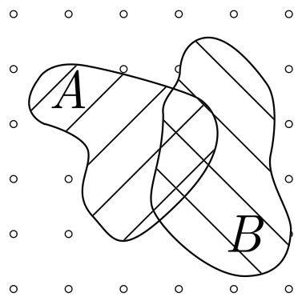
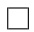
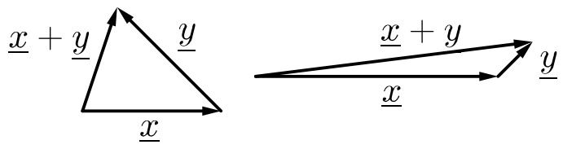
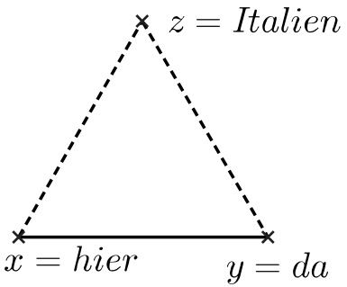
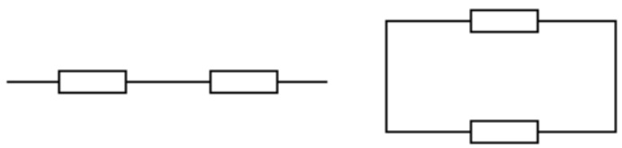

# Die reellen Zahlen

原始 PDF 第 7–40 页。

## Kapitel 1

## Die reellen Zahlen

## 1.1 Mengen und Mengenschreibweise

Wir werden sehr oft mit Mengen arbeiten. Eine Menge A ist eine Zusammenfassung von Objekten (für uns, oft von Zahlen, aber manchmal auch von Funktionen oder Gleichungen). Die Objekte, die zu einer Menge A gehören, heißen Elemente von A. Wenn x ein Element von A ist, schreiben wir

$$
x \in A.
$$

Wir sagen, dass A das Element x enthält, dass x in A enthalten ist, oder, dass x zu A gehört. Wenn x nicht zu A gehört, schreiben wir

$$
x \notin A.
$$

Für jedes Objekt x gilt entweder  $x \in A$  oder  $x \notin A$ .

Die Menge, die keine Elemente enthält, wird leere Menge genannt und mit ∅ bezeichnet. Man kann eine Menge definieren, indem man die Elemente in der Menge aufzählt.

Beispiel.

$$
A = \{1, 3, 5 \}, \quad B = \{0, 1, 5, - 1 \}.
$$

Die geschweiften Klammern {...} zeigen an, dass wir es mit einer Menge zu tun haben.

Alternativ kann man Mengen definieren, indem man eine definierende Eigenschaft angibt.

Beispiel. Die Menge aller natürlichen Zahlen x, die die Gleichung  $x^{2}-3x+2=0$  erfüllen.

$$
\{x \colon x \in \mathbb {N} \text {und} x ^ {2} - 3 x + 2 = 0 \}.
$$

Der Doppelpunkt : zeigt an, dass danach die definierende Eigenschaft folgt.

Vier Mengen, die Sie schon kennen und mit denen wir oft arbeiten werden, sind

- die natürlichen Zahlen: $\mathbb{N} = \{1, 2, 3, 4, \ldots\}$,
- die ganzen Zahlen: $\mathbb{Z} = \{0, 1, -1, 2, -2, \ldots\}$,

---

HMI ETech/Phys

WS 2021-22

Seite 2

• die rationalen Zahlen:

$$
\mathbb {Q} = \left\{x \colon x = \frac {p}{q} \text {mit} p, q \in \mathbb {Z} \text {und} q \neq 0 \right\},
$$

\- die reellen Zahlen: (Darstellung als Dezimalbruch)

$$
\mathbb {R} = \left\{x \colon x = m, \alpha_ {1} \alpha_ {2} \alpha_ {3} \dots \text {mit} m \in \mathbb {Z} \text {und} \alpha_ {i} \in \{0, 1, \dots , 9 \} \right\}.
$$

Beispiel. 0,5 ist eine rationale Zahl und eine reelle Zahl. 2 gehört zu N, Z, Q und R.

Bemerkung. Die Darstellung einer reellen Zahl als Dezimalbruch ist nicht eindeutig, zum Beispiel sind 1,000... und 0,999... dieselbe Zahl, nämlich 1.

Jede natürliche Zahl ist auch eine ganze (rationale, reelle) Zahl. Das führt uns zu folgender

## Definition 1.1.1: Teilmenge

Wenn jedes Element von $A$ auch ein Element von $B$ ist, dann sagen wir, $A$ ist in $B$ enthalten oder $A$ ist eine Teilmenge von $B$. Wir schreiben

$$
A \subseteq B.
$$

Bemerkung. Nützlich ist: A ist eine Teilmenge von B, falls gilt

$$
x \in A \quad \Longrightarrow \quad x \in B.
$$

Hierbei bedeutet  $\Longrightarrow$  “impliziert” oder “zieht nach sich.”

Beispiel. Betrachte die beiden Mengen

$$
A = \{x \colon x ^ {2} - x - 6 <   0 \text {und} x \in \mathbb {N} \}, \qquad B = \{- 1, 0, 1, 2, 3 \}.
$$

Wir werden zeigen, dass  $A \subseteq B$ . Wenn  $x \in A$  ist, dann gilt (Nachrechnen)

$$
x ^ {2} - x - 6 <   0 \text {und} x \in \mathbb {N}
$$

$$
\Longleftrightarrow \quad - 2 <   x <   3 \text {und} x \in \mathbb {N},
$$

also ist x = 1 oder x = 2. In beiden Fällen gilt auch x ∈ B. Also ist A ⊆ B.

Hierbei bedeutet $\Longleftrightarrow$ “genau dann, wenn” oder “ist äquivalent zu.”

Im Beispiel oben ist  $A \subseteq B$  und A ist „kleiner als“ B in dem Sinne, dass A weniger Elemente enthält. Das Intervall  $(0,1) \subseteq [0,1]$  ist auch „kleiner als“  $[0,1]$  in einem gewissen Sinn, aber beide Mengen enthalten unendlich viele Elemente. Der Begriff, den wir hier formulieren möchten, ist der Begriff einer echten Teilmenge.

---

HMI ETech/Phys

WS 2021-22

Seite 3

## Definition 1.1.2: Gleichheit und echte Teilmenge

Wenn $A$ und $B$ genau die gleichen Elemente besitzen, dann sagen wir, dass $\underline{A}$ und $\underline{B}$ gleich sind. Wir schreiben $A = B$. Wenn $A \subseteq B$ und $B$ ein Element enthält, das nicht in $A$ ist, dann sagen wir, dass $\underline{A}$ eine echte Teilmenge von $B$ ist und wir schreiben

$$
A \subsetneq B.
$$

Bemerkung (Notation). Manche Mathematiker schreiben  $A \subset B$  für A ist eine Teilmenge von B. Manche Mathematiker schreiben  $A \subset B$  für A ist eine echte Teilmenge von B. Wie immer in der Mathematik muss man die Notation präzise definieren und konsequent benutzen. In diesem Kurs benutzen wir die Notation aus Definition 1.1.1 und 1.1.2.

Beispiel (Gleichheit). Zeigen Sie, dass

$$
C := \{x \in \mathbb {Z}: x ^ {2} + y ^ {2} <   2 x + 8 \text {und} y \in \mathbb {Z} \}
$$

gleich der Menge B ist, die wir im obigen Beispiel definiert haben. Wir bemerken, dass C die Menge aller Zahlen beschreibt, die die x-Koordinate eines Paares ganzer Zahlen ist, das in einem offenen Kreis mit dem Radius 3 und dem Ursprung (1,0) liegt. Tatsächlich gilt

$$
\begin{array}{l} \Leftrightarrow \quad x ^ {2} + y ^ {2} <   2 x + 8 \text {und} x \in \mathbb {Z} \text {und} y \in \mathbb {Z} \\ \Leftrightarrow (x - 1) ^ {2} + y ^ {2} <   9 \quad \text {und} x \in \mathbb {Z} \quad \text {und} y \in \mathbb {Z}. \\ \end{array}
$$

Hier wählen wir nun y = 0, da wir so den größtmöglichen Bereich für x bekommen:

$$
\begin{array}{l} (x - 1) ^ {2} <   9 \quad \text {und} x \in \mathbb {Z}, \\ \Leftrightarrow \quad - 2 <   x <   4 \text {und} x \in \mathbb {Z}. \\ \end{array}
$$

Also ist $C = \{-1, 0, 1, 2, 3\}$, wie zu zeigen war.

Um Gleichheit zweier Mengen zu zeigen, ist die folgende Bemerkung oft sehr nützlich.

Bemerkung (Beweisen). Es gilt A = B genau dann, wenn

$$
A \subseteq B \text {und} B \subseteq A. \tag {1.1.1}
$$

Beweis. Für jedes x bestehen nur die Möglichkeiten

(i)  $x \in A$  und  $x \in B$ , ☐
(ii)  $x \in A$  und  $x \notin B$ , ☐
(iii) $x \notin A$ und $x \in B$,
(iv)  $x \notin A$  und  $x \notin B$ .

text_image

A
B

---

HMI ETech/Phys

WS 2021-22

Seite 4

Wir bemerken, dass

$$
\begin{array}{l} A \subseteq B \quad \Leftrightarrow \quad \nexists x, \text {so dass (ii) gilt}, \\ \text {und} B \subseteq A \quad \Leftrightarrow \quad \nexists x, \text {so dass (iii) gilt.} \\ \end{array}
$$

Also gilt  $A \subseteq B$  und  $B \subseteq A$  genau dann, wenn jedes x entweder (i) oder (iv) erfüllt, was A = B entspricht.

Wenn wir beweisen möchten, dass zwei Mengen gleich sind, ist es oft am einfachsten (1.1.1) in zwei Schritten zu beweisen. Dies üben wir unten, nachdem wir an die Begriffe von Vereinigung und Schnitt erinnert haben.

## Definition 1.1.3: Vereinigung und Schnitt

Die Vereinigung von $A$ und $B$ ist

$$
\{x: x \in A \text {oder} x \in B \} =: A \cup B.
$$

Der Schnitt von $A$ und $B$ ist

$$
\{x: x \in A \text {und} x \in B \} =: A \cap B.
$$

Bemerkung. In der vorigen Grafik entspricht $A \cup B$ den Mengen (i), (ii) und (iii). $A \cap B$ entspricht (i).

Beispiel. Zeigen Sie, dass

$$
A \cap (B \cup C) = (A \cap B) \cup (A \cap C). \tag {1.1.2}
$$

Lösung.

$$
\begin{array}{l} \operatorname{Sei} x \in A \cap (B \cup C). \\ \Rightarrow \quad x \in A \text {und} x \in B \cup C \\ \Rightarrow \quad x \in A \text {und} (x \in B \text {oder} x \in C) \\ \Rightarrow \quad (x \in A \text {und} x \in B) \text {oder} (x \in A \text {und} x \in C) \\ \Rightarrow \quad x \in A \cap B \text {oder} x \in A \cap C \\ \Rightarrow \quad x \in (A \cap B) \cup (A \cap C). \\ \end{array}
$$

Also gilt

$$
A \cap (B \cup C) \subseteq (A \cap B) \cup (A \cap C). \tag {1.1.3}
$$

---

HMI ETech/Phys

WS 2021-22

Seite 5

Andersherum gilt

$$
\begin{array}{l} \operatorname{Sei} x \in (A \cap B) \cup (A \cap C). \\ \Rightarrow \quad x \in A \cap B \text {oder} x \in A \cap C \\ \Rightarrow \quad (x \in A \text {und} x \in B) \text {oder} (x \in A \text {und} x \in C) \\ \Rightarrow \quad x \in A \text {und} (x \in B \text {oder} x \in C) \\ \Rightarrow \quad x \in A \text {und} x \in B \cup C \\ \Rightarrow \quad x \in A \cap (B \cup C). \\ \end{array}
$$

Also gilt

$$
(A \cap B) \cup (A \cap C) \subseteq A \cap (B \cup C). \tag {1.1.4}
$$

Aus (1.1.3) und (1.1.4) schließen wir (1.1.2).

Wir brauchen auch den Begriff vom Komplement.

## Definition 1.1.4: Komplement

Das Komplement von $B$ in $A$ ist

$$
\{x \in A: x \notin B \} =: A \setminus B.
$$

## Übung 1.1.5

Zeigen Sie, dass

$$
(A \setminus B) \setminus C = A \setminus (B \cup C).
$$

## Übung 1.1.6: DeMorgansche Gesetze

Zeigen Sie, dass

$$
\begin{array}{l} A \setminus (B \cup C) = (A \setminus B) \cap (A \setminus C), \\ A \setminus (B \cap C) = (A \setminus B) \cup (A \setminus C), \\ \end{array}
$$

Bemerkung. Vereinigung und Schnitt können analog für mehr als zwei (beliebig viele) Mengen definiert werden. Ebenso lassen sich die DeMorgansche Gesetze verallgemeinern.

## 1.2 Eine axiomatische Beschreibung der reellen Zahlen

In diesem Abschnitt schauen wir uns die reellen Zahlen aus einer axiomatischen Perspektive an. Insbesondere listen wir die Axiome der reellen Zahlen auf. Diese Axiome sind die Eigenschaften der reellen Zahlen, die wir als wahr annehmen. Dann fragen wir uns, welche weitere Eigenschaften von R wir daraus schließen können. Wir trennen die Axiome wie folgt

---

HMI ETech/Phys

WS 2021-22

Seite 6

(i) algebraische Axiome
(ii) Anordnungsaxiome
(iii) das Vollständigkeitsaxiom.

## 1.2.1 Die algebraischen Axiome von $\mathbb{R}$

Die Menge der reellen Zahlen ist ein „Körper“ im folgenden Sinn.

## Axiom

R zusammen mit Addition (bezeichnet mit +) und Multiplikation (bezeichnet mit ·) erfüllt die folgenden Eigenschaften:

(G) (Geschlossenheit)
$a + b \in \mathbb{R}$ und $a \cdot b \in \mathbb{R}$ für alle $a, b \in \mathbb{R}$.
(A1) (Kommutativgesetz der Addition)
$a + b = b + a$ für alle $a, b \in \mathbb{R}$.
(A2) (Assoziativgesetz der Addition)
$a + (b + c) = (a + b) + c$ für alle $a, b, c \in \mathbb{R}$.
(A3) (Existenz eines neutralen Elements der Addition)
Es existiert eine Zahl $0 \in \mathbb{R}$, so dass für jedes $a \in \mathbb{R}$ gilt: $a + 0 = a$.
(A4) (Existenz eines inversen Elements der Addition)
Zu jedem $a \in \mathbb{R}$ existiert eine reelle Zahl $b$, so dass gilt: $a + b = 0$.
(M1) (Kommutativgesetz der Multiplikation)
$a \cdot b = b \cdot a$ für alle $a, b \in \mathbb{R}$.
(M2) (Assoziativgesetz der Multiplikation)
$a \cdot (b \cdot c) = (a \cdot b) \cdot c$ für alle $a, b, c \in \mathbb{R}$.
(M3) (Existenz eines neutralen Elements der Multiplikation)
Es existiert eine von 0 verschiedene Zahl $1 \in \mathbb{R}$, so dass für jedes $a \cdot 1 = a$.
(M4) (Existenz eines inversen Elements der Multiplikation)
Zu jedem $a \in \mathbb{R}$ mit $a \neq 0$ existiert eine reelle Zahl $b$, so dass gilt:
$a \cdot b = 1$.
(D) (Distributivgesetz)
$a \cdot (b + c) = (a \cdot b) + (a \cdot c)$ für alle $a, b, c \in \mathbb{R}$.

Bemerkung. Ein Körper ist eine Menge zusammen mit einer Addition + und einer Multiplikation ·, so dass (G), (A1)-(A4), (M1)-(M4) und (D) gelten. Welche der Körpereigenschaften erfüllen N, Z, Q, R \ Q (mit +, · aus R)?

Bemerkung. Oft schreiben wir „ab“ anstatt „a·b“. Wenn a·b+a·c oder ab+ac geschrieben wird, interpretieren wir den Ausdruck als  $(a\cdot b)+(a\cdot c)$ . Das heißt, wir folgen der Regel, dass Multiplizieren zuerst ausgeführt wird.

---

HMI ETech/Phys

WS 2021-22

Seite 7

Ein Hauptziel der ersten Vorlesung ist zu verstehen, wie wir aus den 10 oben genannten Axiomen Folgerungen ziehen. Zum Beispiel haben wir nicht angenommen, dass das neutrale Element der Addition und das neutrale Element der Multiplikation eindeutig bestimmt sind. Anstattdessen beweisen wir jetzt, dass Eindeutigkeit aus den algebraischen Axiomen folgt. Ähnlich folgt, dass das zu a inverse Element der Addition und das zu a inverse Element der Multiplikation eindeutig sind.

## Satz 1.2.1: Eindeutigkeit

Es gilt folgendes.

(i) Das neutrale Element der Addition und das neutrale Element der Multiplikation sind eindeutig bestimmt.
(ii) Wenn für $a, b, c \in \mathbb{R}$ gilt $a + b = 0$ und $a + c = 0$, dann ist $b = c$.
(iii) Wenn für  $a, b, c \in R$  mit  $a \neq 0$  gilt  $a \cdot b = 1$  und  $a \cdot c = 1$ , dann gilt b = c.

Bemerkung. Angesichts der Eindeutigkeit ergibt es Sinn dem inversen Element einen Namen zu geben:

- das zu a inverse Element der Addition wird mit $-a$ bezeichnet, und
- das zu a inverse Element der Multiplikation wird mit $a^{-1}$ oder $\frac{1}{a}$ bezeichnet.

Ab jetzt definieren wir Subtraktion und Division durch

- $a - b := a + (-b)$,
$\bullet \frac{a}{b} := a \cdot b^{-1}$.

Beweis von Satz 1.2.1. zu (i): Wir nehmen an, dass für $0, x \in \mathbb{R}$ gilt

$$
a + 0 = a \quad \text {und} \quad a + x = a
$$

für alle $a \in \mathbb{R}$. Dann gilt insbesondere

$$
0 + x = 0.
$$

Aus (A1) und (A3) folgt $x = 0$. Analog, wenn für $1 \neq 0$, $x \neq 0$ gilt

$$
a \cdot 1 = a \quad \text {und} \quad a \cdot x = a
$$

für alle $a \in \mathbb{R}$, dann gilt insbesondere

$$
1 \cdot x = 1.
$$

Aus (M1) und (M3) folgt x = 1.

---

HMI ETech/Phys

WS 2021-22

Seite 8

zu (ii): Angenommen, es gilt für irgendeine  $b, c \in R$ :

$$
a + b = 0 \text {und} a + c = 0. \tag {1.2.1}
$$

Also gilt

$$
\begin{array}{l} \Rightarrow \\ (1. 2. 1), (A 2) \quad \Longrightarrow \\ (\mathrm{A} 3), (\mathrm{A} 1) \\ \begin{array}{r c l} a + b & = & a + c \\ b + (a + b) & = & b + (a + c) \end{array} \\ b + 0 \quad = \quad (b + a) + c \\ b \quad = \quad (a + b) + c \\ \stackrel {(1. 2. 1)} {=} \quad 0 + c \\ \stackrel {(\mathrm{A1})} {=} \quad c + 0 \\ \stackrel {\text {(A3)}} {=} \quad c. \\ \end{array}
$$

zu (iii): Übung

Bemerkung. Wir werden Eindeutigkeit sehr oft (wenn nicht immer) durch diese Methode beweisen. (Man nimmt an, man hat zwei Elemente/Lösungen/... und zeigt, dass sie gleich sind.)

Aus den algebraischen Axiomen kann man außerdem die üblichen algebraischen Regeln der reellen Zahlen schließen, zum Beispiel:

## Satz 1.2.2

Es gilt

$$
\begin{array}{l} (i) a \cdot 0 \quad = 0 \quad \text {f ü r a l l e} a \in \mathbb {R}, \\ (i i) - a \quad = (- 1) \cdot a \quad \text {f ü r a l l e} a \in \mathbb {R}, \\ (i i i) - (- a) = a \quad \text {f ü r a l l e} a \in \mathbb {R}, \\ (i v) (- 1) ^ {2} = 1 \\ (v) (a ^ {- 1}) ^ {- 1} = a \quad \text {f ü r a l l e} a \in \mathbb {R}, a \neq 0. \\ \end{array}
$$

Beweis. zu (i): Es gilt für alle $a, b \in \mathbb{R}$

$$
\begin{array}{c c c c} & a \cdot (b + 0) & \stackrel {{(\mathrm{D})}} {{=}} & a \cdot b + a \cdot 0 \\ \stackrel {{(\mathrm{A3})}} {{\Rightarrow}} & a \cdot b & = & a \cdot b + a \cdot 0 \\ (\mathrm{A4}), (\mathrm{A1}), (\mathrm{A2}), (\mathrm{A3}) & 0 & = & a \cdot 0. \end{array}
$$

---

HMI ETech/Phys

WS 2021-22

Seite 9

zu (ii): Für alle  $a \in R$  gilt:

$$
\begin{array}{l} a + (- a) \quad = \quad 0 \\ \stackrel {(i)} {=} \quad (1 - 1) \cdot a \\ \stackrel {(\mathrm{D})} {=} \quad 1 \cdot a + (- 1) \cdot a \\ \stackrel {(\mathrm{M3})} {=} \quad a + (- 1) \cdot a. \\ \end{array}
$$

Daraus folgt insgesamt

$$
\begin{array}{r c l} - a + a + (- a) & = & - a + a + (- 1) \cdot a \\ \stackrel {{(\mathrm{A} 1)}} {{\Rightarrow}} & - a & = & (- 1) \cdot a. \end{array}
$$

zu (iii): Es gilt  $a + (-a) = 0$  und mit (A1) auch  $(-a) + a = 0$ . Außerdem gilt  $(-a) + (-(-a)) = 0$ . Mit Satz 1.2.1 (ii) folgt  $-(-a) = a$ .

zu (iv): Mit (ii) für $a = -1$ folgt $-(-1) = (-1)^{2}$, andererseits folgt aus (iii) für $a = 1$, dass $-(-1) = 1$.

zu  $(v)$ : Sei  $a \neq 0$  gegeben. Angesichts Satz 1.2.1 reicht es aus, wenn wir  $a^{-1} \cdot a = 1$  zeigen. Dies folgt aus

$$
a \cdot a ^ {- 1} = 1
$$

und (M1).

Noch „praktischer“ ist die Folgerung, dass wir Gleichungen der Form

$$
a + x = b \quad \text { oder } \quad a \cdot x = b
$$

lösen können.

## Satz 1.2.3: Existenz von Lösungen

Seien $a, b \in \mathbb{R}$ gegeben.

(i) Es existiert genau eine reelle Zahl x, so dass

$$
a + x = b.
$$

(ii) Wenn  $a \neq 0$ , dann existiert genau eine reelle Zahl x, so dass

$$
a \cdot x = b. \tag {1.2.2}
$$

Bemerkung. Das „genau“ oben sagt uns, dass wir beweisen müssen, dass die Lösung eindeutig definiert ist. Wir werden in einem Schritt Existenz einer Lösung zeigen und in einem zweiten Schritt Eindeutigkeit der Lösung zeigen.

---

HMI ETech/Phys

WS 2021-22

Seite 10

Beweis von Satz 1.2.3. zu (i): Übung.

zu (ii): Schritt 1: Hier zeigen wir, dass es mindestens eine Zahl x gibt, so dass  $a \cdot x = b$ . Der natürliche „Kandidat“ ist  $x := a^{-1} \cdot b$ . Wir rechnen

$$
a \cdot x \quad = \quad a \cdot (a ^ {- 1} \cdot b)
$$

$$
\stackrel {(\mathrm{M} 2)} {=} \quad (a \cdot a ^ {- 1}) \cdot b
$$

$$
\stackrel {(\mathrm{M} 4)} {=} \quad 1 \cdot b
$$

$$
\stackrel {(\mathrm{M} 1)} {=} b \cdot 1
$$

$$
\stackrel {(\mathrm{M} 3)} {=} b.
$$

Also löst x die Gleichung (1.2.2).

Schritt 2: Angenommen, x und  $\tilde{x}$  sind zwei Lösungen von (1.2.2). Wir möchten zeigen, dass  $x = \tilde{x}$ . Aus  $a \cdot x = b$  und  $a \cdot \tilde{x} = b$  erhalten wir

$$
\begin{array}{l} \begin{array}{r c l} a \cdot x & = & a \cdot \tilde {x} \\ \Rightarrow \quad (a \cdot x) \cdot a ^ {- 1} & = & (a \cdot \tilde {x}) \cdot a ^ {- 1} \end{array} \\ \stackrel {(\mathrm{M} 1)} {\Rightarrow} \quad (x \cdot a) \cdot a ^ {- 1} = (\tilde {x} \cdot a) \cdot a ^ {- 1} \\ \stackrel {(\mathrm{M} 2)} {\Rightarrow} \quad x \cdot (a \cdot a ^ {- 1}) = \tilde {x} \cdot (a \cdot a ^ {- 1}) \\ \stackrel {(\mathrm{M} 4)} {\Rightarrow} \quad x \cdot 1 = \tilde {x} \cdot 1 \\ \stackrel {(\mathrm{M} 3)} {\Rightarrow} \quad x = \tilde {x}. \\ \end{array}
$$

## Exkurs: Die komplexen Zahlen

In der Elektrotechnik und Physik arbeiten Sie auch oft mit den komplexen Zahlen. Eine komplexe Zahl kann als ein geordnetes Paar  $(x, y)$  reeller Zahlen mit folgender Addition und Multiplikation dargestellt werden:

- Addition: $(x_{1},y_{1})\oplus (x_{2},y_{2}):= (x_{1} + x_{2},y_{1} + y_{2})$
- Multiplikation: $(x_{1},y_{1})\odot (x_{2},y_{2}):= (x_{1}\cdot x_{2} - y_{1}\cdot y_{2},x_{1}\cdot y_{2} + x_{2}\cdot y_{1}).$

Der Körper der komplexen Zahlen wird mit C bezeichnet.

Bemerkung. Die Verknüpfungszeichen  $\oplus,\odot$  sind so gewählt um deutlich zu machen, dass es sich nicht um die aus R bekannte Addition bzw. Multiplikation handelt. Später werden die Verknüpfungen aber ebenfalls mit +,· bezeichnet werden.

Behauptung: C erfüllt (G), (A1)-(A4), (M1)-(M4) und (D).

Beispiel. Was ist das neutrale Element der Addition? Was ist das neutrale Element der Multiplikation?

---

HMI ETech/Phys

WS 2021-22

Seite 11

Lösung. (0,0) und (1,0). Man überprüft, dass

$$
\begin{array}{l} (x, y) \oplus (0, 0) \quad = \quad (x + 0, y + 0) \\ \stackrel {(\mathrm{A} 3) \text {für} \mathbb {R}} {=} (x, y), \\ \end{array}
$$

und, dass

$$
\begin{array}{l} (x, y) \odot (1, 0) \quad = \quad (x \cdot 1 - y \cdot 0, x \cdot 0 + y \cdot 1) \\ \stackrel {(\mathrm{M} 3) \text {f ü r} \mathbb {R}, \text {Satz} 1. 2. 2 (i)} {=} (x - 0, 0 + y) \\ \stackrel {\text {(A3)} \text {für} \mathbb {R}} {=} \quad (x, y). \\ \end{array}
$$

Bemerkung. Die algebraischen Axiome der reellen Zahlen werden benutzt um zu zeigen, dass $\mathbb{C}$ (G), (A1)-(A4), (M1)-(M4) und (D) erfüllt. Das heißt, wir nehmen die Eigenschaften für $\mathbb{R}$ an, aber wir zeigen, dass $\mathbb{C}$ die Eigenschaften erfüllt.

Sie können selber die verschiedenen Aussagen für C testen. Als Beispiel zeigen wir, dass

$$
(x _ {1}, y _ {1}) \odot ((x _ {2}, y _ {2}) \odot (x _ {3}, y _ {3})) = ((x _ {1}, y _ {1}) \odot (x _ {2}, y _ {2})) \odot (x _ {3}, y _ {3}).
$$

Es gilt:

$$
\begin{array}{l} (x _ {1}, y _ {1}) \odot ((x _ {2}, y _ {2}) \odot (x _ {3}, y _ {3})) \quad = \quad (x _ {1}, y _ {1}) \odot (x _ {2} \cdot x _ {3} - y _ {2} \cdot y _ {3}, x _ {2} \cdot y _ {3} + x _ {3} \cdot y _ {2}) \\ \stackrel {\text {(D)}} {=} \mathrm{aus} \mathbb {R} \quad \left(x _ {1} \cdot x _ {2} \cdot x _ {3} - x _ {1} \cdot y _ {2} \cdot y _ {3} - \left(y _ {1} \cdot x _ {2} \cdot y _ {3} + y _ {1} \cdot x _ {3} \cdot y _ {2}\right), \right. \\ \left. x _ {1} \cdot x _ {2} \cdot y _ {3} + x _ {1} \cdot x _ {3} \cdot y _ {2} + x _ {2} \cdot x _ {3} \cdot y _ {1} - y _ {2} \cdot y _ {3} \cdot y _ {1}\right) \\ \stackrel {{\text {Satz 1.2.2 (ii)}}} {{=}} \quad \left(x _ {1} \cdot x _ {2} \cdot x _ {3} - x _ {1} \cdot y _ {2} \cdot y _ {3} - y _ {1} \cdot x _ {2} \cdot y _ {3} - y _ {1} \cdot x _ {3} \cdot y _ {2}, \right. \\ \left. x _ {1} \cdot x _ {2} \cdot y _ {3} + x _ {1} \cdot x _ {3} \cdot y _ {2} + x _ {2} \cdot x _ {3} \cdot y _ {1} - y _ {2} \cdot y _ {3} \cdot y _ {1}\right) \\ \stackrel {{(\mathrm{A} 1), (\mathrm{M} 1)} {=}} {\text {aus} \mathbb {R}} \quad \left(x _ {1} \cdot x _ {2} \cdot x _ {3} - y _ {1} \cdot y _ {2} \cdot x _ {3} - x _ {1} \cdot y _ {2} \cdot y _ {3} - x _ {2} \cdot y _ {1} \cdot y _ {3}, \right. \\ \left. x _ {1} \cdot x _ {2} \cdot y _ {3} - y _ {1} \cdot y _ {2} \cdot y _ {3} + x _ {3} \cdot x _ {1} \cdot y _ {2} + x _ {3} \cdot x _ {2} \cdot y _ {1}\right) \\ \end{array}
$$

Andererseits gilt:

$$
\left(\left(x _ {1}, y _ {1}\right) \odot \left(x _ {2}, y _ {2}\right)\right) \odot \left(x _ {3}, y _ {3}\right) \quad = \quad \left(x _ {1} \cdot x _ {2} - y _ {1} \cdot y _ {2}, x _ {1} \cdot y _ {2} + x _ {2} \cdot y _ {1}\right) \odot \left(x _ {3}, y _ {3}\right)
$$

$$
\stackrel {\text {(D)} \text {aus} \mathbb {R}} {=} \quad (x _ {1} \cdot x _ {2} \cdot x _ {3} - y _ {1} \cdot y _ {2} \cdot x _ {3} - (x _ {1} \cdot y _ {2} \cdot y _ {3} + x _ {2} \cdot y _ {1} \cdot y _ {3}),
$$

$$
\left. x _ {1} \cdot x _ {2} \cdot y _ {3} - y _ {1} \cdot y _ {2} \cdot y _ {3} + x _ {3} \cdot x _ {1} \cdot y _ {2} + x _ {3} \cdot x _ {2} \cdot y _ {1}\right)
$$

$$
\stackrel {{\text {Satz 1.2.2 (ii)}}} {{=}} \left(x _ {1} \cdot x _ {2} \cdot x _ {3} - y _ {1} \cdot y _ {2} \cdot x _ {3} - x _ {1} \cdot y _ {2} \cdot y _ {3} - x _ {2} \cdot y _ {1} \cdot y _ {3}, \right.
$$

$$
\left. x _ {1} \cdot x _ {2} \cdot y _ {3} - y _ {1} \cdot y _ {2} \cdot y _ {3} + x _ {3} \cdot x _ {1} \cdot y _ {2} + x _ {3} \cdot x _ {2} \cdot y _ {1}\right)
$$

Beide Seiten sind also gleich.

Wenn man

$$
(1, 0) =: \mathbf {1} \text {reelle Einheit}
$$

$$
(0, 1) =: \mathbf {i} \text {imaginäre Einheit}
$$

---

HMI ETech/Phys

WS 2021-22

Seite 12

definiert, dann kann man eine komplexe Zahl  $z = (x, y)$  als

$$
z = x + \mathbf {i} y
$$

schreiben. Da $(0,1)\odot (0,1) = (0 - 1,0 + 0) = (-1,0)$, gilt die Regel

$$
\mathbf {i} ^ {2} = - \mathbf {1}.
$$

## Definition 1.2.4

Für eine komplexe Zahl  $z = x + iy$  nennen wir x den Realteil und y den Imaginärteil der Zahl. Wir schreiben dafür

$$
x = \Re (z), \qquad y = \Im (z).
$$

Die zu z komplex konjugierte Zahl ist x - iy und wird mit

$\overline{z}$

bezeichnet.

Man bemerkt:

$$
z + \bar {z} = 2 \Re (z), \qquad z - \bar {z} = 2 \Im (z) \mathbf {i}.
$$

Wichtige Bemerkung: Da C (G), (A1)-(A4), (M1)-(M4) und (D) erfüllt, erhalten wir „umsonst“, dass die Sätze 1.2.1 - 1.2.3 auch für C gelten. Das gilt allgemein für alle Sätze, die aus den Axiomen folgen. Darin liegt der Vorteil, eine saubere, elementare Struktur zu erkennen und zu benutzen.

## 1.2.2 Die Anordnungsaxiome von $\mathbb{R}$

In diesem Abschnitt geht es darum, dass die reellen Zahlen geordnet sind.

## Axiom

Für alle $a, b, c \in \mathbb{R}$ gilt:

(O1) (Trichotomie)
Eine und nur eine der folgenden Aussagen ist wahr:

$$
a <   b, \quad \quad b <   a, \quad \quad a = b.
$$

(O2) (Transitivität)
Wenn a < b und b < c ist, so gilt a < c.
(O3) (Monotoniegesetz der Addition)
Wenn $a < b$ ist, so gilt $a + c < b + c$ für alle $c \in \mathbb{R}$
(O4) (Monotoniegesetz der Multiplikation)
Wenn $a < b$ ist, so gilt $a \cdot c < b \cdot c$ für alle $c \in \mathbb{R}$ mit $c > 0$.

---

HMI ETech/Phys

WS 2021-22

Seite 13

Man kann die folgenden Folgerungen beweisen:

## Satz 1.2.5

Für reelle Zahlen $a, b, c, d$ gilt:

(i) $a + c <   b + c\Rightarrow a <   b.$
(ii) $a < b \Leftrightarrow a - b < 0$.
(iii) $a < 0 \Leftrightarrow -a > 0$.
$(iv)\ a < b \quad \Leftrightarrow \quad -a > -b.$
(v) $a < b$ und $c < d \Rightarrow a + c < b + d$.
$(vi)\ a \cdot b > 0 \quad \Leftrightarrow \quad \text{entweder } a > 0 \text{ und } b > 0 \text{ oder } a < 0 \text{ und } b < 0.$
(vii) $a \cdot a > 0$ für alle $a \in \mathbb{R}$ mit $a \neq 0$. Insbesondere gilt $1 > 0$.

## Notation 1.2.6

Gilt für eine Zahl $a \in \mathbb{R}$, dass $a > 0$ (bzw. $a < 0$), dann nennen wir $a \underline{\text{positiv}}$ (bzw. negativ). Ein $a \in \mathbb{R}$ mit $a \geq 0$ (bzw. $a \leq 0$) nennen wir $\underline{\text{nichtnegativ}}$ (bzw. $\underline{\text{nichtpositiv}}$).

Als Beispiel zeigen wir (vi). Wenn wir eine „genau dann, wenn“-Aussage beweisen möchten, werden wir oft erst eine und danach die andere Richtung zeigen. Dies üben wir jetzt.

Beweis. Schritt 1: (Rückrichtung) Zu zeigen ist: Wenn a, b beide positiv oder beide negativ sind, dann ist das Produkt  $a \cdot b$  positiv.

Fall 1: Wir zeigen: Wenn $a > 0$ und $b > 0$, dann gilt $a \cdot b > 0$.

$\overline{\mathrm{Da}b} >0$ ist, schließen wir aus $0 < a$ und (O4), dass

$$
\begin{array}{c c c c} & 0 \cdot b & <   & a \cdot b \\ (\mathrm{M} 1), \text {Satz} 1. 2. 2 (i) \\ \Rightarrow & 0 & <   & a \cdot b. \end{array}
$$

Fall 2: Wir zeigen: Wenn $a < 0$ und $b < 0$, dann gilt

$$
a \cdot b > 0.
$$

Jetzt können wir (O4) nicht direkt anwenden, da b nicht positiv ist. Zuerst zeigen wir, dass das zu b inverse Element der Addition doch positiv ist (Teil (iii) von Satz 1.2.5). Nach (O3) gilt

$$
\begin{array}{c c c c} & b + (- b) & <   & 0 + (- b) \\ \stackrel {{(\mathrm{A1}), (\mathrm{A3})}} {{\Rightarrow}} & b + (- b) & <   & - b \\ \stackrel {{(\mathrm{A4})}} {{\Rightarrow}} & 0 & <   & - b. \end{array}
$$

---

HMI ETech/Phys

WS 2021-22

Seite 14

Also erhalten wir aus $a < 0$ und (O4), dass

$$
a \cdot (- b) <   0 \cdot (- b) = 0. \tag {1.2.3}
$$

Andererseits bemerken wir, dass $a \cdot (-b)$ das zu $a \cdot b$ inverse Element der Addition ist:

$$
\begin{array}{r l} & a \cdot b + a \cdot (- b) \stackrel {\mathrm{(D)}} {=} a \cdot (b - b) = 0 \\ \Rightarrow \quad & a \cdot (- b) = - (a \cdot b). \end{array} \tag {1.2.4}
$$

Aus (1.2.4) und (1.2.3) schließen wir  $-(a \cdot b) < 0$ , woraus folgt (wie oben), dass  $a \cdot b > 0$ .

Also impliziert $a > 0$ und $b > 0$ oder $a < 0$ und $b < 0$, dass $a \cdot b > 0$.

Schritt 2: (Hinrichtung)

Hier ist zu zeigen, dass  $a \cdot b > 0$  impliziert a > 0 und b > 0 oder a < 0 und b < 0. Nach (O1) gibt es neun Fälle:

entweder $a &gt; 0$ und $b &gt; 0$
oder $a &gt; 0$ und $b = 0$
oder $a &gt; 0$ und $b &lt; 0$
oder $a = 0$ und $b &gt; 0$
oder $a = 0$ und $b = 0$
oder $a = 0$ und $b &lt; 0$
oder $a &lt; 0$ und $b &gt; 0$
oder $a &lt; 0$ und $b = 0$
oder $a &lt; 0$ und $b &lt; 0$.

Wenn $a > 0$ und $b < 0$, dann gilt

$$
\begin{array}{c c c} a \cdot b = b \cdot a & \stackrel {{(\mathrm{O4})}} {{<  }} & 0 \cdot a \\ & \stackrel {{(\mathrm{M1})}} {{=}} & a \cdot 0 \\ & \stackrel {{\text {Satz 1.2.2 (i)}}} {{=}} & 0. \end{array}
$$

Analog, wenn $a < 0$ und $b > 0$. Also bleiben nur die einzige Möglichkeiten $a, b > 0$ oder $a, b < 0$.

Prüfen Sie, ob Sie die anderen Aussagen aus Satz 1.2.5 beweisen können.

Bemerkung. Eine Anordnung mit den Eigenschaften  $(O1)-(O4)$  kann es für die komplexen Zahlen nicht geben, denn Satz 1.2.5 (vii) würde implizieren

$$
z ^ {2} > 0 \quad \text {fur alle} z \in \mathbb {C} \text {mit} z \neq 0,
$$

insbesondere

$$
\boldsymbol {1} = \boldsymbol {1} ^ {2} > 0 \tag {1.2.5}
$$

$$
- \boldsymbol {1} = i ^ {2} > 0, \tag {1.2.6}
$$

aber nach Satz 1.2.5 (iii) impliziert (1.2.6), dass

$$
\boldsymbol {1} <   0, \tag {1.2.7}
$$

---

HMI ETech/Phys

WS 2021-22

Seite 15

und (1.2.5) und (1.2.7) widerspricht (O1).

## 1.2.3 Das Vollständigkeitsaxiom

Jetzt kommen wir zum tieferen Teil. Die Frage ist, ob die reellen Zahlen oder z.B. die rationalen Zahlen „vollständig“ sind. Was soll das heißen?

Grob gesagt möchte man wissen, ob es „Löcher gibt“ im Zahlenstrahl oder, im Gegenteil, ob es an jeder Stelle, wo man eine reelle/rationale Zahl „erwartet“, auch immer eine reelle/rationale Zahl gibt.

Das Vollständigkeitsaxiom (ein Axiom, also eine Annahme!) sagt, dass die reellen Zahlen in der Tat vollständig sind. Man würde vielleicht hoffen, dass wir dies beweisen könnten. Aber wir müssen es stattdessen annehmen.

Zuerst bemerken wir, dass die rationalen Zahlen Löcher haben. Besser gesagt: Es gibt Punkte auf der Zahlengeraden, die keiner rationalen Zahl entsprechen.

Lemma 1.2.7 (Q nicht vollständig). Es gibt kein $r \in \mathbb{Q}$, so dass $r^2 = 2$ gilt.

Bemerkung. Wir werden einen indirekten Beweis schreiben. Sobald Sie einen direkten Beweis schreiben können, machen Sie es. Sie sind oft nützlicher und leichter zu verstehen. Wenn Sie keinen direkten Weg finden, probieren Sie einen indirekten Beweis.

Beweis. Angenommen,  $r \in Q$  erfüllt  $r^{2} = 2$ . Dann existieren  $p, q \in N$ , so dass

$$
\frac {p ^ {2}}{q ^ {2}} = 2. \qquad (\text {Warum?})
$$

Also gilt

$$
p ^ {2} = 2 q ^ {2}. \tag {1.2.8}
$$

Wir dürfen annehmen (warum?), dass $p$ und $q$ keine gemeinsamen Faktoren haben. Nach (1.2.8) ist $p^2$ gerade. Wenn $p \in \mathbb{N}$ ist und $p^2$ gerade ist, dann ist $p$ gerade. (Warum?) Aber dann impliziert (1.2.8), dass $q^2$ gerade ist mit $p^2 = 4 \cdot s^2$, $s \in \mathbb{N} \Rightarrow 2 \cdot s^2 = q^2$. Wir schließen daraus, dass $q$ gerade ist, was widerspricht, dass $p$ und $q$ keine gemeinsamen Faktoren haben.

## Übung 1.2.8

Gibt es eine rationale Zahl $r$, so dass

$$
r ^ {2} = 3?
$$

$$
r ^ {2} = 4?
$$

Um das Vollständigkeitsaxiom von R zu formulieren, brauchen wir ein paar zusätzliche Begriffe.

---

HMI ETech/Phys

WS 2021-22

Seite 16

## Definition 1.2.9: Beschränkt

Die nichtleere Menge $A \subseteq \mathbb{R}$ heißt von oben beschränkt (oder: nach oben beschränkt), falls es eine Zahl $s \in \mathbb{R}$ gibt, so dass

$$
x \leq s \quad \text { für   alle } x \in A.
$$

Dann nennen wir s eine obere Schranke von A. Falls es keine solche Zahl gibt, dann sagen wir, dass A nach oben unbeschränkt ist.

Die Menge $A$ heißt von unten beschränkt (oder: nach unten beschränkt), falls es eine Zahl $s \in \mathbb{R}$ gibt, so dass

$$
x \geq s \quad \text { für   alle } x \in A.
$$

Dann nennen wir s eine untere Schranke von A. Falls es keine solche Zahl gibt, dann sagen wir, dass A nach unten unbeschränkt ist.

Wenn A eine obere und eine untere Schranke besitzt, dann sagen wir, dass A beschränkt ist.

Wenn A nach oben oder nach unten unbeschränkt ist, dann sagen wir, dass A unbeschränkt ist.

Bemerkung. Nach der Definition ist jede Menge beschränkt oder unbeschränkt.

Beispiel. Sind die folgenden Mengen nach oben/unten beschränkt? Wenn ja, was ist eine obere/untere Schranke der Menge?

①  $\{1,2,5,9\}$
② (0,5]
③  $(-∞,9)∪(8,10)$
④ Q

⑤  $\left\{x\in\mathbb{R}:x=1+\frac{1}{n},n\in\mathbb{N}\right\}.$

Man merkt, dass die obere Schranke einer (beschränkten) Menge nicht eindeutig definiert ist. Z.B. ist 6 eine obere Schranke von  $(0,5]$ , aber das Gleiche gilt auch für 5 und 7. In der Tat gilt: wenn s eine obere Schranke von einer Menge A ist, dann gilt das auch für

$$
s + n \quad \text { für   jedes } n \in \mathbb {N}.
$$

Trotzdem glaubt man, dass es eine „beste“ obere Schranke einer Menge gibt (z.B. bzgl. (0, 5] scheint 5 „besser“ als 6 oder 7 zu sein). Diese Intuition führt zu folgender Definition:

## Definition 1.2.10: Supremum/Infimum einer Menge

Sei $A \subseteq \mathbb{R}$ nicht leer und nach oben beschränkt. Dann heißt $s \in \mathbb{R}$ die kleinste obere Schranke von $A$ oder das Supremum von $A$, wenn gilt:

(i)  $x \leq s$  für alle  $x \in A$ ,
(ii) $x \leq s'$ für alle $x \in A$ $\implies s' \geq s$.

---

HMI ETech/Phys

WS 2021-22

Seite 17

Wir schreiben

$$
s = \sup A.
$$

Analog: Sei  $A \subseteq R$  nicht leer und nach unten beschränkt. Dann heißt  $s \in R$  die größte untere Schranke von A oder das Infimum von A, wenn gilt:

$(i') \ x \geq s \quad \text{ für alle } x \in A,$

$(ii') x \geq s'$ für alle $x \in A$ $\implies s' \leq s$.

Wir schreiben

$$
s = \inf A.
$$

Wenn die nichtleere Menge  $A \subseteq R$  nicht nach oben beschränkt bzw. nicht nach unten beschränkt ist, dann ist

$$
\sup A := + \infty \quad \text {bzw.} \quad \inf A := - \infty.
$$

Für die leere Menge definieren wir außerdem

$$
\sup \emptyset := - \infty \quad \text {und} \quad \inf \emptyset := + \infty .
$$

Bemerkung. (i) und (ii) besagen, dass s eine obere Schranke von A ist und dass alle anderen oberen Schranken größer gleich s sind.

Bemerkung (Eindeutigkeit). Seien  $s_{1}, s_{2}$  Suprema von A. Da  $s_{1}$  Supremum von A ist und  $s_{2}$  eine obere Schranke von A, folgt aus der Definition, dass  $s_{2} \geq s_{1}$ . Analog ist  $s_{2}$  Supremum und  $s_{1}$  obere Schranke, so dass  $s_{1} \geq s_{2}$ . Aus der Kombination der Ungleichungen folgt die Gleichheit  $s_{1} = s_{2}$ .

Wenn wir mit Suprema arbeiten, hilft es manchmal die folgende alternative Charakterisierung zu benutzen.

Lemma 1.2.11. Es sei $A \subseteq \mathbb{R}$ eine nichtleere Menge. Genau dann ist eine Zahl $s \in \mathbb{R}$ das Supremum von $A$ (also $s = \sup A$), wenn gilt:

(i)' Es existiert kein $x \in A$, so dass $s < x$, und
(ii)' Wenn für ein  $s' \in R$  gilt  $s' < s$ , dann existiert ein  $x \in A$ , so dass  $x > s'$ .

Beweis. Wie im Beweis zu Satz 1.2.5(vi) beweisen wir beide Richtungen.

„«“ Angenommen, s erfüllt (i)’ und (ii)’. Nach (i)’ ist s eine obere Schranke von A. Nach (ii)’ gilt: wenn  $s' < s$  ist, dann ist  $s'$  keine obere Schranke von A. (Also gilt (ii) in Definition 1.2.10). Damit ist die Rückrichtung bewiesen.

„⇒“ Angenommen $s = \sup A$. (i)’ folgt aus (i) aus Definition 1.2.10. Wir formulieren (ii) aus Definition 1.2.10 als

wenn  $s'$ erfüllt, dass  $s' \geq x$  für für alle  $x \in A$ , dann gilt  $s' \geq s$ .

---

HMI ETech/Phys

WS 2021-22

Seite 18

Diese Aussage ist äquivalent zu

wenn  $s' < s$ , dann existiert ein  $x \in A$ , so dass  $x > s'$ .

Also haben wir (ii)' gezeigt.

Wir betrachten jetzt die Mengen

$$
A = (0, 5 ], \quad B = (0, 5). \tag {1.2.9}
$$

A und B sind nach oben beschränkt und haben beide das Supremum 5. Der Unterschied ist, dass A sein Supremum enthält.

## Definition 1.2.12: Maximum/Minimum einer Menge

Wenn das Supremum einer Menge $A$ zu $A$ gehört (also $\sup A \in A$), dann nennen wir es das Maximum von $A$. Wenn das Infimum einer Menge $A$ zu $A$ gehört (also $\inf A \in A$), dann nennen wir es das Minimum von $A$.

Also besitzt in (1.2.9) $B$ kein Maximum. Analog besitzen beide Mengen kein Minimum.

Man könnte enttäuscht sein, dass die nach oben beschränkte Menge (0, 5) kein Maximum besitzt. Wichtig ist, dass jede nach oben beschränkte (nichtleere) Menge ein Supremum besitzt. (Glauben Sie, dass das gilt?) Dies ist unser letztes Axiom über R.

## Axiom

(V) Vollständigkeitsaxiom: Jede nach oben beschränkte, nichtleere Menge $A \subseteq \mathbb{R}$ besitzt eine kleinste obere Schranke (ein Supremum) $s \in \mathbb{R}$.

Bemerkung. Vorsicht!!! Hier bedeutet “A besitzt s” nicht, dass s zu A gehört! Das Axiom sagt nur, dass eine reelle Zahl s existiert, die das Supremum von A ist.

Es reicht aus, dies für das Supremum anzunehmen, weil die analoge Aussage für das Infimum daraus folgt, wie wir im folgenden Lemma zeigen.

Lemma 1.2.13. Jede nach unten beschränkte nichtleere Menge $B \subseteq \mathbb{R}$ besitzt eine größte untere Schranke (ein Infimum) $\sigma \in \mathbb{R}$.

Beweis. Sei $B$ eine nach unten beschränkte nichtleere Menge. Wir definieren $A := \{-\tilde{x} : \tilde{x} \in B\}$. Dann gilt $A \neq \emptyset$ und $A$ ist nach oben beschränkt.

$\lceil$ Da $B$ nach unten beschränkt ist, existiert eine Zahl $m \in \mathbb{R}$, so dass $\tilde{x} \geq m$ für alle $\tilde{x} \in B$.

Es gilt  $-\tilde{x} \leq -m$  für alle  $\tilde{x} \in B$

$\Rightarrow x \leq -m$ für alle $x \in A$.

$\lfloor \Rightarrow A$ ist nach oben beschränkt.

Nach dem Vollständigkeitsaxiom existiert das Supremum von A. Das heißt, es existiert

---

HMI ETech/Phys

WS 2021-22

Seite 19

ein $s\in \mathbb{R}$ , so dass

$$
x \leq s \quad \text { für   alle } x \in A, \tag {1.2.10}
$$

und, wenn $x \leq \tilde{s}$ für alle $x \in A$, dann gilt $\tilde{s} \geq s$. (1.2.11)

Wir zeigen jetzt, dass

$$
\sigma := - s \tag {1.2.12}
$$

das Infimum von $B$ ist. Als erstes bemerken wir, dass für jedes $\tilde{x} \in B$ gilt:

$$
\begin{array}{l} \tilde {x} \quad = \quad - x \quad \text {f ü r e i n} x \in A \\ (1. 2. 1 0) \\ \geq - s \\ (1. 2. 1 2) \\ = ^ {\prime} \sigma . \\ \end{array}
$$

Also ist $\sigma$ eine untere Schranke von $B$. Dennoch bemerken wir, dass, wenn $\tilde{x} \geq \tilde{\sigma}$ für alle $\tilde{x} \in B$ und ein $\tilde{\sigma} \in \mathbb{R}$, dann gilt

$$
\begin{array}{l} \tilde {\sigma} \leq - x \quad \text {f ü r a l l e} x \in A \\ \Rightarrow - \tilde {\sigma} \geq x \quad \text {f ü r a l l e} x \in A \\ \Rightarrow - \tilde {\sigma} \geq s ^ {(1. 2. 1 2)} = - \sigma , \quad \text {weil} s = \sup A \\ \Rightarrow \quad \tilde {\sigma} \leq \sigma . \\ \end{array}
$$

Also ist  $\sigma$  in der Tat das Infimum von B.

Obwohl man enttäuscht sein kann, dass  $B := (0, 5)$  sein Supremum nicht enthält, ist die gute Nachricht, dass wir das Supremum mit Elementen der Menge B so gut wie gewünscht approximieren können. Oft reicht uns eine gute Approximation.

## Satz 1.2.14: Approximationseigenschaft des Supremums

Sei  $A \subseteq R$  eine nichtleere nach oben beschränkte Menge und  $s = \sup A$ . Dann gibt es zu jedem y < s ein  $x \in A$ , so dass gilt

$$
y <   x \leq s. \tag {1.2.13}
$$

Beweis. Wenn $s \in A$ ist, wählen wir $x = s$ und dann gilt (1.2.13) für jedes $y < s$.

Jetzt betrachten wir den Fall $s \notin A$. Wenn (1.2.13) falsch wäre, würde $y_* \in \mathbb{R}$ existieren mit $y_* < s$, so dass $y_* \geq x$ für alle $x \in A$. Dies widerspricht, dass $s$ die kleinste obere Schranke von $A$ ist.

Wichtig sind auch die folgenden Folgerungen:

Lemma 1.2.15. Die Menge $\mathbb{N}$ besitzt keine obere Schranke.

Lemma 1.2.16 (Satz von Archimedes). Für jedes Paar positiver, reeller Zahlen $x$, $y$ existiert ein $n \in \mathbb{N}$, so dass

$$
n x > y.
$$

---

HMI ETech/Phys

WS 2021-22

Seite 20

Korollar 1.2.17 (Satz von Eudoxos). Für jede positive reelle Zahl $x$ existiert ein $n \in \mathbb{N}$, so dass

$$
\frac {1}{n} <   x.
$$

Beweis zu Lemma 1.2.15. Wir nehmen an, es gäbe eine obere Schranke $\tilde{s} \in \mathbb{R}$. Nach (V) gibt es dann eine kleinste obere Schranke $s \in \mathbb{R}$. Nach Satz 1.2.14 existiert ein $n \in \mathbb{N}$, so dass

$$
s - 1 <   n \leq s.
$$

Dies impliziert $n + 1 > s$. Außerdem gilt $n + 1 \in \mathbb{N}$. Dies widerspricht, dass $s$ eine obere Schranke von $\mathbb{N}$ ist.

Wie folgt Lemma 1.2.16 aus Lemma 1.2.15? Wenn die Aussage in Lemma 1.2.16 nicht gelte, gäbe es ein Paar positiver, reeller Zahlen $x, y$, so dass $n \leq \frac{y}{x}$ für alle $n \in \mathbb{N}$. Also wäre $\frac{y}{x}$ eine obere Schranke von $\mathbb{N}$.

Wie folgt Korollar 1.2.17 aus Lemma 1.2.16?

Wir werden Korollar 1.2.17 sehr oft benutzen, z.B., wenn wir Folgen konstruieren. Lemma 1.2.16 kann man anwenden, um die folgende wichtige Tatsache zu beweisen.

## Satz 1.2.18: Dichtheit von Q in R

Für jedes Paar $x, y \in \mathbb{R}$ mit $x < y$ existiert ein $q \in \mathbb{Q}$, so dass

$$
x <   q <   y.
$$

Satz 1.2.18 drückt aus, dass auch wenn $\mathbb{Q}$ nicht vollständig ist, es „genügend“ rationale Zahlen gibt, so dass wir jede reelle Zahl beliebig gut approximieren können. (Nehmen Sie $x \in \mathbb{R}$. Es existiert eine rationale Zahl $q_1 \in [x-1/10, x]$, eine rationale Zahl $q_2 \in [x-1/100, x]$, und so weiter. Das beantwortet die Frage, ob es Löcher gibt. Diese Eigenschaft wendet man jedes Mal an, wenn man $\pi$ zum Beispiel durch eine rationale Zahl mit gewünschter Präzision approximiert.

Den Beweis überspringen wir, aber die Werkzeuge dafür sind Lemma 1.2.16, Korollar 1.2.17 und das Wohlordnungsprinzip, das wir im Abschnitt 1.3 einführen.

Jetzt benutzen wir (V) um zu beweisen, dass “ $\sqrt{2}$ existiert”.

Lemma 1.2.19. Es gibt eine positive reelle Zahl $r$, so dass

$$
r ^ {2} = 2.
$$

Wir schreiben $r = \sqrt{2}$.

Beweisidee: Wir werden r als Infimum einer geeigneten Menge definieren. Dann werden wir  $r^{2} > 2$  und  $r^{2} < 2$  ausschließen. Aus (O1) wird folgen, dass  $r^{2} = 2$  gilt. Überlegen Sie sich: Was würde passieren, wenn  $r^{2}$  echt größer als 2 wäre? Wenn es echt kleiner als 2 wäre? Im ersten Fall werden wir zeigen, dass es ein x in der Menge gibt, s.d. x < r (widerspricht, dass r eine untere Schranke der Menge ist). Im zweiten Fall werden wir zeigen, dass es eine untere Schranke der Menge gibt, die größer als r ist (Widerspruch zum zweiten Teil der Definition von Infimum).

---

HMI ETech/Phys

WS 2021-22

Seite 21

Beweis. Sei  $A := \{x \in R : x > 0  und  x^{2} > 2\}$ . Da  $2 \in A$  gilt, ist A nicht leer. Da 0 eine untere Schranke von A ist, existiert nach (V) eine größte untere Schranke. Wir nennen diese Zahl r. Es ist klar, dass  $r \geq 0$  und auch, dass r > 0 gilt. Jetzt möchten wir zeigen, dass

$$
r ^ {2} = 2.
$$

Fall 1: Angenommen, $r^2 > 2$. Dann existiert ein $\varepsilon > 0$, so dass $r^2 = 2 + \varepsilon$. Wir definieren

$$
\tilde {\varepsilon} := \min \left\{2 r, \frac {\varepsilon}{r} \right\}. \tag {1.2.14}
$$

Dann ist $\tilde{\varepsilon} > 0$. Wir definieren

$$
x := r - \frac {\tilde {\varepsilon}}{2}.
$$

Man merkt, dass

$$
x > 0, \tag {1.2.15}
$$

$$
x <   r. \tag {1.2.16}
$$

Außerdem gilt

$$
\begin{array}{l} {x ^ {2}} = {\left(r - \frac {\tilde {\varepsilon}}{2}\right) ^ {2}} \\ = r ^ {2} - \tilde {\varepsilon} r + \frac {\tilde {\varepsilon} ^ {2}}{4} \\ > \quad r ^ {2} - \tilde {\varepsilon} r \quad (\text {weil} \tilde {\varepsilon} > 0) \\ = \quad 2 + \varepsilon - \tilde {\varepsilon} r \quad (\text {Definition von} \varepsilon) \\ \end{array}
$$

$$
\begin{array}{l} \stackrel {(1. 2. 1 4)} {\geq} 2 + \varepsilon - \varepsilon \quad \left(\text {weil} \tilde {\varepsilon} \leq \frac {\varepsilon}{r}\right) \\ = \quad 2. \tag {1.2.17} \\ \end{array}
$$

Nach (1.2.15) und (1.2.17) erhalten wir $x \in A$. Dann widerspricht (1.2.16), dass $r$ eine untere Schranke von $A$ ist.

Fall 2: Angenommen, $r^{2} < 2$. Wir definieren

$$
\varepsilon := 2 - r ^ {2}, \tag {1.2.18}
$$

$$
\tilde {\varepsilon} := \min \left\{\varepsilon , \frac {\varepsilon}{2 r}, 1 \right\}, \tag {1.2.19}
$$

$$
x := r + \frac {\tilde {\varepsilon}}{2}.
$$

---

HMI ETech/Phys

WS 2021-22

Seite 22

Dann ist $\tilde{\varepsilon} > 0$ und $x > r$. Außerdem gilt

$$
\begin{array}{l} x ^ {2} \quad = \quad \left(r + \frac {\tilde {\varepsilon}}{2}\right) ^ {2} \\ = \quad r ^ {2} + r \tilde {\varepsilon} + \frac {\tilde {\varepsilon} ^ {2}}{4} \\ \stackrel {(1. 2. 1 9)} {\leq} r ^ {2} + \frac {\varepsilon}{2} + \frac {\varepsilon}{4} \\ \stackrel {(1. 2. 1 8)} {=} 2 - \varepsilon + \frac {3 \varepsilon}{4} \\ <   \quad 2. \\ \end{array}
$$

Also ist $x < y$ für alle $y \in A$. Aber dann ist $x$ eine untere Schranke von $A$, und $x > r$ widerspricht, dass $r$ die größte untere Schranke von $A$ ist.

Analog zeigt man, dass es für jedes  $x \in [0, \infty)$  eine nicht negative, reelle Zahl gibt, deren Quadrat gleich x ist. Diese Zahl nennen wir  $\sqrt{x}$ .

Lemma 1.2.20. Für jedes $x \in [0, \infty)$ gibt es genau ein $r \in [0, \infty)$, so dass $r$ die Gleichung $r^2 = x$ löst.

## Definition 1.2.21

Wenn für  $x \in [0, \infty)$  die Zahl  $r \in [0, \infty)$  die Gleichung  $r^{2} = x$  löst, dann nennen wir r die Wurzel von x und wir schreiben  $r =: \sqrt{x}$ .

Wir nennen die Abbildung  $x \mapsto \sqrt{x}$  die Wurzelfunktion.

## 1.3 Wohlordnungsprinzip und die vollständige Induktion

Die vollständige Induktion ist ein sehr nützliches Hilfsmittel für Beweise, und wir werden sie sehr oft anwenden. (Übrigens ist vollständige Induktion eine gute Klausurfrage.)

Unser letztes Axiom ist:

## Axiom

(W) Wohlordnungsprinzip: Jede nichtleere Menge natürlicher Zahlen besitzt ein Minimum.

Wie schon erwähnt, verwendet man (W), wenn man die Dichtheit von Q in R beweist. Außerdem ist das Axiom die Grundlage des Prinzips der vollständigen Induktion:

## Satz 1.3.1: Prinzip der vollständigen Induktion

Es sei  $A \subseteq N$  eine Menge mit den folgenden Eigenschaften:

(i) $1\in A$

---

HMI ETech/Phys

WS 2021-22

Seite 23

(ii) für alle  $n \in N$  gilt

$$
n \in A \quad \Longrightarrow \quad n + 1 \in A.
$$

Dann gilt $A = \mathbb{N}$.

Beweis. Angenommen die Aussage ist falsch, dann ist die Menge

$$
E := \mathbb {N} \setminus A = \{n \in \mathbb {N}: n \notin A \} \neq \emptyset .
$$

Dann besitzt $E$ nach (W) ein Minimum, das wir $m$ nennen. Nach (i) ist $m \neq 1$. Nach $m \in E$ und $m > 1$ ist nach (ii) $m - 1 \in E$. Aber $m - 1 < m$ und $m - 1 \in E$ widerspricht, dass $m$ das Minimum von $E$ ist.

Bemerkung. Falls $n_0 \in A$ und (ii) für $n \geq n_0$ gilt, dann enthält $A$ alle $n \in \mathbb{N}$ mit $n \geq n_0$. Beispiel. Zeigen Sie, dass

$$
1 ^ {3} + 2 ^ {3} + \dots + N ^ {3} = \frac {N ^ {2} \cdot (N + 1) ^ {2}}{4} \tag {1.3.1}
$$

für jedes $N \in \mathbb{N}$ gilt.

Beweis. Schritt 1: („Base case“ oder Induktionsanfang.) Für N = 1 gilt

$$
1 ^ {3} = 1 = \frac {1 ^ {2} \cdot (1 + 1) ^ {2}}{4}.
$$

Also ist (1.3.1) für $N = 1$ wahr.

Schritt 2: (Induktionsschritt.) Wir nehmen an, dass (1.3.1) für eine gegebene natürliche Zahl n gilt.

Unsere Arbeit: Wir müssen zeigen, dass (1.3.1) auch für  $n + 1$  gilt. Wir rechnen:

$$
\begin{array}{l} 1 ^ {3} + 2 ^ {3} + \dots + n ^ {3} + (n + 1) ^ {3} = \frac {n ^ {2} \cdot (n + 1) ^ {2}}{4} + (n + 1) ^ {3} \quad \text {nach Annahme} \\ = (n + 1) ^ {2} \cdot \left(\frac {n ^ {2} + 4 (n + 1)}{4}\right) \\ = (n + 1) ^ {2} \cdot \frac {n ^ {2} + 4 n + 4}{4} \\ = \frac {(n + 1) ^ {2} \cdot (n + 2) ^ {2}}{4}, \\ \end{array}
$$

also erfüllt  $n + 1$  die Gleichung (1.3.1). Nach dem Prinzip der vollständigen Induktion gilt (1.3.1) für jedes  $N \in N$ . ☐

Bemerkung. Wir haben eben gezeigt, dass die Folge

$$
\begin{array}{l} a _ {1} = 1 ^ {3} \\ a _ {2} = 1 ^ {3} + 2 ^ {3} \\ a _ {3} = 1 ^ {3} + 2 ^ {3} + 3 ^ {3} \\ \end{array}
$$

---

HMI ETech/Phys

WS 2021-22

Seite 24

entweder durch die rekursive Definition

$$
a _ {1} = 1 ^ {3}, \quad a _ {n} = a _ {n - 1} + n ^ {3}
$$

oder durch die explizite Definition

$$
a _ {n} = \frac {n ^ {2} (n + 1) ^ {2}}{4}
$$

definiert werden kann.

Wir wenden das Prinzip der vollständigen Induktion jetzt an, um die binomische Formel zu beweisen. Zunächst erinnern wir an die Binomialkoeffizienten.

## Definition 1.3.2

Für $n \in \mathbb{N}$ definieren wir die Fakultät als $n! := 1 \cdot 2 \cdot \cdots \cdot (n - 1) \cdot n$ und $0! := 1$. Für $n \in \mathbb{N}$ und $k \in \{0, 1, \ldots, n\}$ sind die Binomialkoeffizienten definiert durch

$$
\binom{n}{k} := \frac {n !}{k ! (n - k) !}.
$$

Außerdem setzen wir  $\begin{pmatrix}0\\ 0\end{pmatrix} := 1$ .

Wir erinnern uns an das Pascalsche Dreieck

$$
\begin{array}{c c c c c c c} & & & 1 & & \\ & & & 1 & & 1 & \\ & & 1 & & 2 & & 1 \\ & 1 & & 3 & & 3 & & 1 \\ 1 & & 4 & & 6 & & 4 & & 1 \end{array} \tag {1.3.2}
$$

$$
\ldots (u s w.)
$$

in dem die Binomialkoeffizienten  $\begin{pmatrix}0\\ 0\end{pmatrix}=1,\begin{pmatrix}1\\ 0\end{pmatrix}=\begin{pmatrix}1\\ 1\end{pmatrix}=1,\begin{pmatrix}2\\ 0\end{pmatrix}=1,\begin{pmatrix}2\\ 1\end{pmatrix}=2,\begin{pmatrix}2\\ 2\end{pmatrix}=1$  in gleicher Reihenfolge vorkommen. Das folgende Lemma drückt aus, dass das  $(k+1)$ -te Element der  $(n+1)$ -ten Reihe des Dreiecks gleich dem Binomialkoeffizienten  $\begin{pmatrix}n\\ k\end{pmatrix}$  ist.

Lemma 1.3.3. Für $n \in \mathbb{N}$ und $k \in \{1, 2, ..., n\}$ gilt

$$
\binom{n + 1}{k} = \binom{n}{k - 1} + \binom{n}{k}.
$$

Beweis. Übung.

---

HMI ETech/Phys

WS 2021-22

Seite 25

## Notation 1.3.4

Für $x\in \mathbb{R}$ definieren wir

$$
x ^ {0} := 1, \qquad x ^ {n} := \underbrace {x \cdot x \cdot \ldots \cdot x} _ {n \text {mal}}.
$$

Für $x_{1},\ldots ,x_{n}\in \mathbb{R}$ schreiben wir

$$
\sum_ {k = 1} ^ {n} x _ {k} := x _ {1} + x _ {2} + \dots + x _ {n}.
$$

## Satz 1.3.5: Binomische Formel

Für $x, y \in \mathbb{R}$ und $n \in \mathbb{N}$ gilt

$$
(x + y) ^ {n} = \sum_ {k = 0} ^ {n} \binom {n} {k} x ^ {n - k} y ^ {k}.
$$

Beweis. Übung.

## 1.4 Absolutbetrag und Abstand

Wir schauen uns jetzt die Eigenschaften des Absolutbetrags und des Abstands an, erstens, weil wir diese Eigenschaften sehr oft benutzen werden und zweitens, weil sie die gleiche Struktur haben wie die, die wir später in  $R^{n}$  und in allgemeineren Vektorräumen erkennen werden.

## Definition 1.4.1

Der Absolutbetrag |x| einer reellen Zahl x ist durch

$$
| x | := \sqrt {x \cdot x} \tag {1.4.1}
$$

definiert.

Bemerkung. Wegen  $x \cdot x \geq 0$  ist (1.4.1) für alle  $x \in R$  wohldefiniert.

Bemerkung. Man merkt

$$
\sqrt {x ^ {2}} = \left\{ \begin{array}{l l} x & x \geq 0 \\ - x & x <   0. \end{array} \right.
$$

Bemerkung. Für $z \in \mathbb{C}$ gilt analog

$$
| z | := \sqrt {z \odot \overline {{z}}},
$$

---

HMI ETech/Phys

WS 2021-22

Seite 26

wobei $\odot$ die Multiplikation der komplexen Zahlen darstellt. Man bemerkt, dass für $z = x + iy$ gilt

$$
| z | = \sqrt {x ^ {2} + y ^ {2}}.
$$

## Satz 1.4.2

Der Absolutbetrag hat die folgenden Eigenschaften:

\- Positive Definitheit:

$$
| x | \geq 0 \quad \text {fur alle} x \in \mathbb {R}, \quad | x | = 0 \quad \Longleftrightarrow \quad x = 0. \tag {1.4.2}
$$

\- Homogenität:

$$
| \alpha \cdot x | = | \alpha | \cdot | x | \quad \text {fur alle} \alpha \in \mathbb {R} \text {und} x \in \mathbb {R}. \tag {1.4.3}
$$

\- Dreiecksungleichung:

$$
| x + y | \leq | x | + | y | \quad \text {furalle} x, y \in \mathbb {R}. \tag {1.4.4}
$$

text_image

x + y
y
x
x + y
y

Abbildung 1.1: Wo der Name Dreiecksungleichung herkommt, merkt man in einer Dimension nicht. Wir werden später zeigen, dass sie auch in  $R^{2}$  gilt, wo man doch den Sinne des Namens versteht. Das obige Bild stellt die Dreiecksungleichung in  $R^{2}$  dar.

## Übung 1.4.3

Wann ist $|x + y| = |x| + |y|$ für $x, y \in \mathbb{R}$?

Bemerkung. Im Allgemeinen definieren die Eigenschaften (1.4.2)-(1.4.4) eine sogenannte Norm. Später werden wir verschiedene Normen auf $\mathbb{R}^n$ anschauen.

Beweis von Satz 1.4.2. zu (1.4.2): Nach Satz 1.2.5 (vii) ist

$$
x \cdot x > 0 \quad \text { für   alle } x \in \mathbb {R}, x \neq 0.
$$

Es folgt

$$
| x | > 0 \quad \text { für   alle } x \neq 0.
$$

---

HMI ETech/Phys

WS 2021-22

Seite 27

Nach Satz 1.2.2 gilt $|x| = 0$ für $x = 0$.

zu (1.4.3): Wir betrachten nacheinander die drei Möglichkeiten

$$
\alpha \cdot x = 0, \quad \alpha \cdot x > 0, \quad \alpha \cdot x <   0.
$$

Wenn $\alpha \cdot x = 0$, dann gilt

$$
| \alpha \cdot x | = 0. \tag {1.4.5}
$$

Andererseits ist  $\alpha \cdot x = 0$  genau dann, wenn

$$
\alpha = 0 \quad \text {oder} \quad x = 0,
$$

also gilt

$$
| \alpha | \cdot | x | = 0 \stackrel {(1. 4. 5)} {=} | \alpha \cdot x |.
$$

Wenn $\alpha \cdot x > 0$, dann gilt

$$
| \alpha \cdot x | = \alpha \cdot x. \tag {1.4.6}
$$

Außerdem haben  $\alpha$  und x das gleiche Vorzeichen (Satz 1.2.5). Es folgt, dass

entweder $\alpha < 0$ und $x < 0$ oder $\alpha > 0$ und $x > 0$

gelten muss, so dass

$$
| \alpha | = - \alpha \text {und} | x | = - x \quad \text {oder} \quad | \alpha | = \alpha \text {und} | x | = x,
$$

und damit in beiden Fällen

$$
\left| \alpha \right| \cdot \left| x \right| = \alpha \cdot x \stackrel {(1. 4. 6)} {=} \left| \alpha \cdot x \right|.
$$

Der Fall $\alpha \cdot x < 0$ funktioniert genauso.

zu (1.4.4): Aus $|x + y| = \sqrt{(x + y)^2} = \sqrt{x^2 + 2xy + y^2}$ erhalten wir

$$
| x + y | ^ {2} = x ^ {2} + 2 x y + y ^ {2}. \tag {1.4.7}
$$

Andererseits ist

$$
\begin{array}{l} (| x | + | y |) ^ {2} = | x | ^ {2} + 2 | x | \cdot | y | + | y | ^ {2} \\ = x ^ {2} + 2 | x | \cdot | y | + y ^ {2}. \tag {1.4.8} \\ \end{array}
$$

Da $x \cdot y \leq |x| \cdot |y|$ ist, folgt (1.4.4) aus (1.4.7) und (1.4.8).

Die Dreiecksungleichung ist eine sehr wichtige Ungleichung, und Sie werden diese Ungleichung (in $\mathbb{R},\mathbb{R}^n,\mathbb{C}$) sehr oft anwenden.

Ein Fehler, der manchmal vorkommt, ist aus

$$
x <   y
$$

und dem Monotoniegesetz der Addition zu behaupten, dass

$$
| x + z | <   | y + z |.
$$

---

HMI ETech/Phys

WS 2021-22

Seite 28

Ein Gegenbeispiel ist x = -10, y = 1, z = 2. Allerdings gelten folgende Ungleichungen:

Korollar 1.4.4. Für alle $x, y \in \mathbb{R}$ gilt

$$
| x - y | \geq | x | - | y |,
$$

$$
\left| | x | - | y | \right| \leq | x - y | \quad \text {(umgekehrte Dreiecksungleichung)}.
$$

Beweis. Die erste Ungleichung folgt aus (1.4.4) angewendet auf

$$
\tilde {x} = y, \quad \tilde {y} = x - y,
$$

so dass

$$
| \tilde {x} + \tilde {y} | \leq | \tilde {x} | + | \tilde {y} | \quad \Rightarrow \quad | x | \leq | y | + | x - y |.
$$

Für die zweite Ungleichung kombinieren wir

$$
| x | - | y | \leq | x - y |
$$

und

$$
| y | - | x | \leq | x - y | \Rightarrow | x | - | y | \geq - | x - y |
$$

um zu schließen

$$
- | x - y | \leq | x | - | y | \leq | x - y |,
$$

was der umgekehrten Dreiecksungleichung entspricht.

Wir benutzen den Absolutbetrag um “Abstand” zu definieren.

## Definition 1.4.5

Für $x, y \in \mathbb{R}$ ist der $\underline{\text{Abstand}} d(x, y)$ zwischen $x$ und $y$ definiert als

$$
d (x, y) = | x - y |.
$$

Bemerkung. Für  $z, w \in C$  definiert man  $d(z, w) = |z - w|$ , wobei  $|\cdot|$  der Absolutbetrag in C ist.

## Satz 1.4.6

Es gilt

• Positive Definitheit:

$$
d (x, y) \geq 0 \quad \text { für   alle } x, y \in \mathbb {R}, \qquad d (x, y) = 0 \quad \Longleftrightarrow \quad x = y.
$$

\- Symmetrie:

$$
d (x, y) = d (y, x) \quad \text { für   alle } x, y \in \mathbb {R}.
$$

---

HMI ETech/Phys

WS 2021-22

Seite 29

\- Dreiecksungleichung:

$$
d (x, y) \leq d (x, z) + d (z, y) \quad \text { für   alle } x, y \in \mathbb {R}.
$$

text_image

z = Italien
x = hier
y = da

Abbildung 1.2: Wenn man von hier nach da reisen muss und einen schönen Zwischenaufenthalt in Italien möchte, kann es die Reise nur länger machen.

Beweis. Übung.

## 1.5 Einige elementare Ungleichungen

Obwohl man es in den ersten Vorlesungen kaum erkennt, können die meisten angewandten Probleme nicht exakt gelöst werden. Anstatt die genaue Lösung einer algebraischen Gleichung oder einer Differentialgleichung in der Hand zu haben, werden wir damit zufrieden sein müssen, eine Approximation der Lösung zu haben. Sehr oft werden wir auch komplizierte Probleme durch einfachere Probleme ersetzen. Um zu beurteilen, ob eine Approximation (einer Lösung oder eines Problems) gut ist oder nicht, werden wir Restterme abschätzen müssen. In diesem Abschnitt, schauen wir uns die ersten elementaren Ungleichungen an. Wir werden immer wieder zu diesen Ungleichungen zurückkehren.

Lemma 1.5.1. Für alle $x, y \in \mathbb{R}$ gilt folgendes:

(i) $x < y + \varepsilon$ für alle $\varepsilon > 0$ genau dann, wenn $x \leq y$.
(ii) $|x| < \varepsilon$ für alle $\varepsilon > 0$ genau dann, wenn $x = 0$.

Wir lassen den Beweis als Übung. Wichtig ist auch, dass das Lemma 1.5.1 nicht aussagt, dass $x < y + \varepsilon$ für alle $\varepsilon > 0$ impliziert $x < y$.

Als Nächstes betrachten wir die Bernoullische Ungleichung. Diese Ungleichung ersetzt  $(1 + x)^{n}$  (n Multiplikationen) durch  $1 + nx$  (eine Multiplikation).

---

HMI ETech/Phys

WS 2021-22

Seite 30

## Satz 1.5.2: Bernoullische Ungleichung

Für alle $x \in \mathbb{R}$ mit $x > -1$ und $n \in \mathbb{N}$ gilt

$$
(1 + x) ^ {n} \geq 1 + n x. \tag {1.5.1}
$$

Falls zusätzlich  $x \neq 0$ , dann ist

$$
(1 + x) ^ {n} > 1 + n x \quad \text { für   alle } n > 1. \tag {1.5.2}
$$

Ob (und wann) (1.5.1) oder (1.5.2) eine gute Approximation ist oder nicht, können Sie sich überlegen.

Beweis. Offensichtlich ist, dass:

- (1.5.1) für $x = 0$ und für alle $n \in \mathbb{N}$, sowie
• (1.5.1) für alle  $x \in R$  und n = 1 gilt.

Da für $n > 1$ (1.5.2) stärker ist als (1.5.1), reicht es aus zu zeigen, dass (1.5.2) für $x \neq 0, n > 1$ gilt. Wir benutzen vollständige Induktion.

Schritt 1: („Base case“ oder Induktionsanfang.) (n = 2) Für x > -1, x ≠ 0 ist

$$
\begin{array}{l} (1 + x) ^ {2} = 1 + 2 x + x ^ {2} \\ > 1 + 2 x \quad \text {weil} x \neq 0, \\ \end{array}
$$

also gilt (1.5.2) für $n = 2$.

Schritt 2: (Induktionsschritt.) („N ⇒ N+1“) Sei x > -1, x ≠ 0 gegeben. Wir nehmen an, dass (1.5.2) für ein beliebiges N ∈ N, N ≥ 2 gilt. Dann ist

$$
\begin{array}{l} (1 + x) ^ {N + 1} = (1 + x) (1 + x) ^ {N} \\ > (1 + x) (1 + N x) \quad \text {nach Annahme und, weil} 1 + x > 0 \\ = 1 + N x + x + N x ^ {2} \\ > 1 + (N + 1) x \quad \text {weil} x \neq 0 (\text {und} N \neq 0). \\ \end{array}
$$

Also gilt (1.5.2) für  $N + 1$ . Nach dem Prinzip der vollständigen Induktion (Satz 1.3.1) gilt (1.5.2) für alle  $n \geq 2$ . ☐

## Übung 1.5.3

Sie leihen sich von Ihren Eltern 1000€ und kaufen dafür Aktien. Sie sind sicher, dass die Aktien irgendwann steigen werden. Aber in den ersten Jahren verlieren sie 2 % an Wert pro Jahr. Wenn Sie mehr als 500€ verlieren, kriegen Sie Ärger. Sie fragen sich, wie lange Sie das noch durchhalten können (aber Sie haben keinen Taschenrechner dabei). Wenden Sie die Bernoullische Ungleichung an, um eine untere Schranke (ohne Taschenrechner)

---

HMI ETech/Phys

WS 2021-22

Seite 31

zu finden.

Es wird oft nützlich sein, ein Produkt durch eine Summe zu ersetzen. Das erste Ergebnis in diese Richtung ist folgendes:

Lemma 1.5.4 (Elementare Youngsche Ungleichung). Für alle $x, y \in \mathbb{R}$ gilt

$$
x y \leq \frac {1}{2} x ^ {2} + \frac {1}{2} y ^ {2}. \tag {1.5.3}
$$

Es folgt

$$
\sqrt {x y} \leq \frac {1}{2} x + \frac {1}{2} y \quad f u r a l l e x, y \geq 0, \tag {1.5.4}
$$

$$
x y \leq \frac {\varepsilon}{2} x ^ {2} + \frac {1}{2 \varepsilon} y ^ {2} \quad f u r a l l e x, y \in \mathbb {R} u n d \varepsilon > 0. \tag {1.5.5}
$$

Beweis. Die Ungleichung (1.5.3) folgt aus

$$
(x - y) ^ {2} \geq 0. \tag {1.5.6}
$$

Wenn man (1.5.3) mit  $\tilde{x} = \sqrt{x}, \tilde{y} = \sqrt{y}$  betrachtet, erhält man (1.5.4). Für (1.5.5) betrachtet man (1.5.3) mit  $\tilde{x} = \sqrt{\varepsilon}x, \tilde{y} = \frac{1}{\sqrt{\varepsilon}}y$ . ☐

Frage: Wir schauen uns (1.5.4) genauer an. Der Ausdruck

$$
\frac {x + y}{2}
$$

auf der rechten Seite ist das arithmetische Mittel von $x$ und $y$. Auf der linken Seite ist

$$
\sqrt {x y}
$$

das sogenannte geometrische Mittel von x und y. Also drückt (1.5.4) aus, dass das geometrische Mittel zweier reeller Zahlen kleiner dem arithmetischen Mittel der Zahlen ist. (Wann gilt Gleichheit?) Man kann sich fragen, ob es eine Verallgemeinerung dieser Tatsache gibt. Seien n positive reelle Zahlen  $\{x_{1}, x_{2}, ..., x_{n}\}$  gegeben. Falls es eine reelle Zahl r gibt, so dass

$$
r ^ {n} = x _ {1} \cdot x _ {2} \cdot \ldots \cdot x _ {n}
$$

gilt, nennen wir r die n-te Wurzel aus  $x_{1} \cdot x_{2} \cdot \ldots \cdot x_{n}$ . Wir schreiben

$$
r = \sqrt [ n ]{x _ {1} \cdot x _ {2} \cdot \ldots \cdot x _ {n}}.
$$

Man erhält:

## Satz 1.5.5

Es seien positive reellen Zahlen  $x_{1}, \ldots, x_{n}$  für  $n \geq 2$  gegeben. Dann gilt

$$
\sqrt [ n ]{x _ {1} \cdot x _ {2} \cdot \cdots \cdot x _ {n}} \leq \frac {x _ {1} + x _ {2} + \dots + x _ {n}}{n}. \tag {1.5.7}
$$

---

HMI ETech/Phys

WS 2021-22

Seite 32

Außerdem gilt in (1.5.7) Gleichheit genau dann, wenn

$$
x _ {1} = x _ {2} = \dots = x _ {n}. \tag {1.5.8}
$$

Bemerkung. Man kann die zweite Aussage auch als Optimierungsproblem formulieren. Sei die Summe  $x_{1} + x_{2} + \ldots + x_{n}$  gegeben. (Dies ist die Bedingung des Optimierungsproblems.) Man möchte das größte Produkt

$$
x _ {1} \cdot x _ {2} \cdot \dots \cdot x _ {n} \text {(die Zielfunktion des Optimierungsproblems)}
$$

erhalten. Was sollte man für  $x_{1}, x_{2}, \ldots, x_{n}$  wählen? (1.5.8) drückt aus, dass die eindeutige Lösung des Problems

$$
x _ {1} = x _ {2} = \dots = x _ {n}
$$

ist.

Beweis von Satz 1.5.5. Wir benutzen vollständige Induktion. Der Fall n = 2 wurde in (1.5.4) bestätigt und (1.5.8) für n = 2 folgt aus (1.5.6). Es bleibt zu zeigen, dass, wenn die Aussage für ein  $N \in N$  gilt, dann gilt die Aussage auch für  $N + 1$ . Zunächst bemerken wir, daß aus

$$
x _ {1} = x _ {2} = \dots = x _ {N + 1}
$$

(1.5.7) mit Gleichheit folgt. Also reicht es aus, wenn wir (1.5.7) mit echter Ungleichheit für  $x_{1},\ldots,x_{N+1}$  nicht alle gleich zeigen.

Also seien  $x_{1},\ldots,x_{N+1}$  nicht alle gleich gegeben. Dann gilt

$$
\min \{x _ {1}, \dots , x _ {N + 1} \} <   \underbrace {\frac {x _ {1} + \dots + x _ {N + 1}}{N + 1}} _ {=: S} <   \max \{x _ {1}, \dots , x _ {N + 1} \}. \tag {1.5.9}
$$

Ohne Beschränkung der Allgemeinheit (o.B.d.A.), nehmen wir an, daß

$$
x _ {N} = \min \{x _ {1}, \dots , x _ {N + 1} \}, \qquad x _ {N + 1} = \max \{x _ {1}, \dots , x _ {N + 1} \},
$$

so daß (1.5.9) die Form

$$
x _ {N} <   S <   x _ {N + 1} \tag {1.5.10}
$$

annimmt. Jetzt möchten wir die Induktionsannahme anwenden. Dazu bemerken wir, daß

$$
\begin{array}{l} N S = (N + 1) S - S = x _ {1} + \dots + x _ {N + 1} - S \\ = x _ {1} + \dots + x _ {N - 1} + y, \tag {1.5.11} \\ \end{array}
$$

wobei  $y := x_{N} + x_{N+1} - S$  definiert ist. Man merkt, dass y > 0 aus (1.5.10) folgt. Der Vorteil in (1.5.11) ist, daß wir auf der rechten Seite die Summe von N Zahlen haben.

---

HMI ETech/Phys

WS 2021-22

Seite 33

Des weiteren ist nach (1.5.11) das arithmetische Mittel dieser N Zahlen S, so dass die Induktionsannahme für diese N Zahlen liefert

$$
x _ {1} \cdot x _ {2} \cdot \dots \cdot x _ {N - 1} \cdot y \leq S ^ {N}. \tag {1.5.12}
$$

Aus (1.5.12) schließen wir, dass

$$
x _ {1} \cdot x _ {2} \cdot \dots \cdot x _ {N - 1} \cdot y \cdot S \leq S ^ {N + 1}. \tag {1.5.13}
$$

Jetzt reicht es aus, wenn wir

$$
y \cdot S > x _ {N} \cdot x _ {N + 1}
$$

zeigen. Wir rechnen

$$
y \cdot S = (x _ {N} + x _ {N + 1} - S) S = (S - x _ {N}) (x _ {N + 1} - S) + x _ {N} x _ {N + 1} \stackrel {(1. 5. 1 0)} {>} x _ {N} x _ {N + 1}.
$$

Es wurde 2012 im Spiegel über angewandte Probleme in der Schule berichtet. 97 Schulkindern wurde folgendes Problem präsentiert:

Auf einem Schiff befinden sich 26 Schafe und 10 Ziegen. Wie alt ist der Kapitän?

76 der 97 befragten Kinder rechneten ein Ergebnis aus. (Was ist die falsche und populäre Antwort? Jeder erkennt sie: 36 Jahre.)

Unsere Aufgaben sind fortgeschrittener, aber es ist für uns genauso wichtig, nichts auszurechnen, bevor wir uns die Logik überlegt haben.

Beispiel. Die Orte A und D seien 100 km voneinander entfernt. Die Strecke von A nach D wurde mit einer Geschwindigkeit von  $v_{1}=60$  km/h zurückgelegt, die von D nach A mit  $v_{2}=40$  km/h. Was ist die Durchschnittsgeschwindigkeit?

(Was ist die falsche und populäre Antwort? 50 km/h.)

Bemerkung. Hier ist die einzige nichttriviale Frage: Was ist die Definition von Durchschnittsgeschwindigkeit?

Lösung. 200 km wurden gereist. Für die erste Strecke wurde

$$
T _ {1} = \frac {1 0 0 \mathrm{km}}{6 0 \mathrm{km/h}} = \frac {1 0}{6} \mathrm{h}
$$

gebraucht, und für die zweite Strecke wurde

$$
T _ {2} = \frac {1 0 0 \mathrm{km}}{4 0 \mathrm{km/h}} = \frac {1 0}{4} \mathrm{h}
$$

---

HMI ETech/Phys

WS 2021-22

Seite 34

gebraucht. Also hat die Reise insgesamt

$$
T = T _ {1} + T _ {2} = \frac {2 5}{6} \mathrm{h}
$$

gedauert. Die Durchschnittsgeschwindigkeit war also

$$
\frac {2 0 0 \mathrm{km}}{\frac {2 5}{6} \mathrm{h}} = 4 8 \mathrm{km/h}.
$$

Bemerkung. Man kann es auch so formulieren: Aus 60 und 40 erhält man 48, indem man

$$
\frac {1}{\frac {1}{2} \left(\frac {1}{4 0} + \frac {1}{6 0}\right)} k m / h
$$

ausrechnet. Für n gegebene positive Zahlen  $x_{1}, x_{2}, \ldots, x_{n}$  heißt

$$
\frac {1}{\frac {1}{n} \left(\frac {1}{x _ {1}} + \frac {1}{x _ {2}} + \dots + \frac {1}{x _ {n}}\right)}
$$

das harmonische Mittel. Man kann zeigen, dass

$$
\frac {1}{\frac {1}{n} \sum_ {i = 1} ^ {n} \frac {1}{x _ {i}}} \leq \sqrt [ n ]{x _ {1} \cdot x _ {2} \cdot \dots \cdot x _ {n}} \leq \frac {1}{n} \sum_ {i = 1} ^ {n} x _ {i}.
$$

natural_image

Pure electrical circuit lines without any symbols

Abbildung 1.3: Welche Mittel spielen eine Rolle in Serien- und Parallelschaltkreisen?

Zwei Artikel, die mit dem Thema arithmetische/geometrische/harmonische Mittel zu tun haben, sind:

① L.F. Henderson, The Theorem of the Arithmetic and Geometric Mean and its Application to a Problem in Gas Dynamics, ZAMP 25 (1965) betrachtet die Frage: Was ist der minimale Entropie-Anstieg in einem System von Stoßwellen?
② C.G. Carvalhaes und P. Suppes, Approximations for the period of the simple pendulum based on the arithmetic-geometric mean, Am.J.Phys 76 (2008) leitet approximative Lösungen der Pendelgleichung her, die sehr schnell konvergieren.

