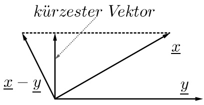

# Vektorräume

原始 PDF 第 41–49 页。

## Kapitel 2

## Vektorräume

## 2.1 Der Vektorraum $\mathbb{R}^n$

Im Zusammenhang mit den komplexen Zahlen C haben wir bereits geordnete Paare reeller Zahlen kennengelernt. Wir haben gesagt, eine komplexe Zahl besteht aus einem Realteil  $x \in R$  und einem Imaginärteil  $y \in R$ , die wir wir folgt kombinieren

$$
\binom {x} {y} = x \underbrace {\binom {1} {0}} _ {=: \mathbf {1}} + y \underbrace {\binom {0} {1}} _ {=: \mathbf {i}} = x \mathbf {1} + y \mathbf {i}. \tag {2.1.1}
$$

In der Regel werden wir die 1 nicht mehr schreiben. Wir werden auch für jetzt keinen Unterschied machen zwischen der Spaltenschreibweise (2.1.1) und der Zeilenschreibweise  $(x, y)$ . (Wir werden erst später sehen, dass die beiden Objekte nicht dasselbe bedeuten.) Es ist aber sehr wichtig sich klarzumachen, dass die beiden reellen Zahlen geordnet sind:

$$
\binom{x}{y} \neq \binom{y}{x} \quad \text {falls} x \neq y.
$$

Wir können uns eine komplexe Zahl  $z = x + yi$  als einen Punkt in der Ebene vorstellen, wobei x die Koordinate des Punktes in horizontaler Richtung darstellt und y die Koordinate in vertikaler Richtung. Falls der Imaginärteil y gleich null ist, dann identifizieren wir  $z = x + 0i$  mit der reellen Zahl x; in diesem Sinne sind die reellen Zahlen R in den komplexen Zahlen C enthalten. Wir haben gesehen, dass man komplexe Zahlen addieren kann:

$$
\binom {x _ {1}} {y _ {1}} \oplus \binom {x _ {2}} {y _ {2}} = \binom {x _ {1} + x _ {2}} {y _ {1} + y _ {2}}, \tag {2.1.2}
$$

d.h. wir addieren die entsprechenden Komponenten miteinander und erhalten eine komplexe Zahl (ein geordnetes Paar reeller Zahlen). Wir können auch multiplizieren:

$$
\binom{x _ {1}}{y _ {1}} \otimes \binom{x _ {2}}{y _ {2}} = \binom{x _ {1} \cdot x _ {2} - y _ {1} \cdot y _ {2}}{x _ {1} \cdot y _ {2} + y _ {1} \cdot x _ {2}}.
$$

Falls einer der Faktoren eine reelle Zahl ist (d.h. der Imaginärteil ist null), dann gilt

$$
\alpha \cdot \binom{x}{y} := \binom{\alpha}{0} \otimes \binom{x}{y} = \binom{\alpha \cdot x - 0 \cdot y}{\alpha \cdot y + 0 \cdot x} = \binom{\alpha \cdot x}{\alpha \cdot y}. \tag {2.1.3}
$$

---

HMI ETech/Phys

WS 2021-22

Seite 36

Es werden also die beiden Komponenten x, y mit  $\alpha$  multipliziert.

Wir wollen jetzt diese Konstruktion verallgemeinern auf geordnete n-Tupel reeller Zahlen. Mit diesen Objekten, die wir Vektoren nennen werden, wollen wir wieder rechnen können. Wir werden deshalb eine Addition analog zu (2.1.2) definieren. Für die Multiplikation werden wir uns damit zufrieden geben, Vektoren mit reellen Zahlen multiplizieren zu können. Die Multiplikation zweier Vektoren ist im allgemeinen nicht sinnvoll. (Wir werden später sehen, dass wir in speziellen Fällen eine Multiplikation von Vektoren definieren können. Allerdings hat diese Multiplikation unerwartete Eigenschaften; sie ist z.B. nicht mehr kommutativ: Wenn wir die Reihenfolge der Faktoren ändern, ändert sich das Ergebnis.)

Wir werden im Folgenden die üblichen Symbole + und · für Addition und Multiplikation (mit reellen Zahlen) verwenden. Indem Sie Sich klarmachen, mit welchen Objekten Sie operieren (Zahlen, Vektoren, ...), werden Sie wissen, um welche Multiplikation es sich handelt. Wir werden in der Regel auch das Symbol · ganz weglassen, wie wir das für die Multiplikation reeller Zahlen vereinbart haben. Es gilt wieder: Punktrechnung geht vor Strichrechnung (Multiplikationen zuerst ausführen!). Benutzen Sie im Zweifelsfall Klammern, um die Reihen-folge der Operationen anzuzeigen.

## Definition 2.1.1

Unter dem Vektorraum $\mathbb{R}^{n}$ verstehen wir die Menge

$$
\mathbb {R} ^ {n} := \left\{\underline {{x}} = \left( \begin{array}{c} x _ {1} \\ \vdots \\ x _ {n} \end{array} \right): x _ {1}, \dots , x _ {n} \in \mathbb {R} \right\}, \tag {2.1.4}
$$

deren Element wir Vektoren nennen, versehen mit der Addition

$$
\underline {{x}} + \underline {{y}} := \left( \begin{array}{c} x _ {1} + y _ {1} \\ \vdots \\ x _ {n} + y _ {n} \end{array} \right) \quad \text {f ü r a l l e} \quad \underline {{x}} = \left( \begin{array}{c} x _ {1} \\ \vdots \\ x _ {n} \end{array} \right), \underline {{y}} = \left( \begin{array}{c} y _ {1} \\ \vdots \\ y _ {n} \end{array} \right) \in \mathbb {R} ^ {n};
$$

und der skalaren Multiplikation (d.h. einer Multiplikation mit Zahlen)

$$
\alpha \underline {{x}} := \left( \begin{array}{c} \alpha x _ {1} \\ \vdots \\ \alpha x _ {n} \end{array} \right) \quad \text {f ü r a l l e} \quad \underline {{x}} = \left( \begin{array}{c} x _ {1} \\ \vdots \\ x _ {n} \end{array} \right) \in \mathbb {R} ^ {n}, \alpha \in \mathbb {R}.
$$

Nach Definition ergeben die Addition und die skalare Multiplikation wieder Vektoren in  $R^{n}$ . Notation: In der Regel hat ein Vektor x die Komponenten  $x_{1},\ldots,x_{n}\in R$  etc.

Bemerkung. Zwei Vektoren sind gleich, wenn alle Komponenten übereinstimmen, also

$$
\underline {{x}} = \left( \begin{array}{c} x _ {1} \\ \vdots \\ x _ {n} \end{array} \right) = \left( \begin{array}{c} y _ {1} \\ \vdots \\ y _ {n} \end{array} \right) = \underline {{y}} \qquad \Longleftrightarrow \qquad x _ {i} = y _ {i} f u r \text {alle} i = 1, \dots , n.
$$

---

HMI ETech/Phys

WS 2021-22

Seite 37

Insbesondere erhält man nach Vertauschen zweier Komponenten  $x_{i} \neq x_{j}$  mit  $i \neq j$  einen Vektor, der von x verschieden ist. Wir werden zunächst nicht zwischen der Spaltenschreibweise (2.1.4) und der Zeilenschreibweise  $(x_{1}, \ldots, x_{n})$  unterscheiden.

Die Regeln für das Rechnen mit reellen Zahlen haben wir in den algebraischen Axiomen für R zusammengefasst; siehe Abschnitt 1.2.1. Da  $R^{n}$  Tupel reeller Zahlen enthält, übertragen sich einige dieser Rechenregeln auf die Addition und skalare Multiplikation von Vektoren.

Lemma 2.1.2. Es seien $\underline{x},\underline{y},\underline{z}\in \mathbb{R}^n$ und $\alpha ,\beta \in \mathbb{R}$. Dann gilt

(A1)  $\underline{x} + \underline{y} = \underline{y} + \underline{x}$  (Kommutativgesetz der Addition);
$(A2)\underline{x} +(\underline{y} +\underline{z}) = (\underline{x} +\underline{y}) + \underline{z}$ (Assoziativgesetz der Addition);
(A3)  $\underline{x} + \underline{0} = \underline{x}$  mit  $\underline{0} := \begin{pmatrix} 0 \\ \vdots \\ 0 \end{pmatrix}$  (Neutrales Element der Addition);
(A4) Zu jedem $\underline{x} \in \mathbb{R}^n$ existiert genau ein $y \in \mathbb{R}^n$ mit $\underline{x} + \underline{y} = \underline{0}$. Dieses Element ist

$$
\left( \begin{array}{c} - x _ {1} \\ \vdots \\ - x _ {n} \end{array} \right) =: - \underline {{x}} \quad (I n v e r s e s E l e m e n t d e r A d d i t i o n);
$$

$(S1)\ \alpha(\beta\underline{x}) = (\alpha\beta)\underline{x}\quad$ (Assoziativgesetz der skalaren Multiplikation);
$(S2)\ 1\underline{x} = \underline{x}\qquad (Neutrales Element der skalaren Multiplikation);$
(D1) $(\alpha + \beta)\underline{x} = \alpha\underline{x} + \beta\underline{x}$ (Distributivgesetz 1);
(D2) $\alpha (\underline{x} +\underline{y}) = \alpha \underline{x} +\alpha \underline{y}$ (Distributivgesetz 2).

Beweis. Übung.

Bemerkung. Wir nennen $\underline{0}$ den Nullvektor in $\mathbb{R}^n$ und es gilt $-\underline{x} = (-1)\underline{x}$.

Bemerkung. Wir werden später andere Vektorräume kennenlernen. Allen Vektorräumen ist gemeinsam, dass auf ihnen eine Addition und skalare Multiplikation definiert sind derart, dass die Rechenregeln in Lemma 2.1.2 erfüllt sind. Man bezeichnet diese dementsprechend auch als Vektorraumaxiome, weil sie die Eigenschaften jedes Vektorraums festlegen.

Analog zu unserem Vorgehen bei den komplexen Zahlen, die wir als Kombination von 1 und i dargestellt haben, wollen wir nun auch für den  $R^{n}$  eine solche Zerlegung angeben.

Definition 2.1.3

---

HMI ETech/Phys

WS 2021-22

Seite 38

Für jedes $j = 1, \dots, n$ nennen wir

$$
\underline {{e}} _ {j} := \left( \begin{array}{c} 0 \\ \vdots \\ 0 \\ 1 \\ 0 \\ \vdots \\ 0 \end{array} \right) \quad (\text {die 1 steht an der jten Stelle})
$$

den jten Einheitsvektor des $\mathbb{R}^{n}$. Für alle $\underline{x} \in \mathbb{R}^{n}$ gilt dann

$$
\underline {{x}} = \left( \begin{array}{c} x _ {1} \\ \vdots \\ x _ {n} \end{array} \right) = x _ {1} \underbrace {\left( \begin{array}{c} 1 \\ 0 \\ \vdots \\ 0 \end{array} \right)} _ {\underline {{e}} _ {1}} + \dots + x _ {n} \underbrace {\left( \begin{array}{c} 0 \\ \vdots \\ 0 \\ 1 \end{array} \right)} _ {\underline {{e}} _ {n}} = \sum_ {j = 1} ^ {n} x _ {j} \underline {{e}} _ {j}.
$$

Bemerkung. Indem wir 1 mit $\underline{e_1}$, i mit $\underline{e_2}$ gleichsetzen, bemerken wir, dass die komplexen Zahlen (siehe Abschnitt (1.2.1)) und der $\overline{\text{Vektorraum}} \mathbb{R}^2$ dieselben Elemente enthält. Beachten Sie aber, dass wir für $\mathbb{C}$ eine Multiplikation definiert haben (dadurch wurde $\mathbb{C}$ zu einem Körper, für den die algebraischen Axiome gelten), während $\mathbb{R}^2$ nur ein Vektorraum ist.

Wie bereits erwähnt, können wir komplexe Zahlen (und mithin Vektoren in  $R^{2}$ ) als Punkte in der Ebene auffassen. Wir wollen nun Vektoren eine Länge zuordnen. Anschaulich entspricht diese Länge dem Abstand des durch den Vektor repräsentierten Punktes zum Nullpunkt. Diesen Abstand können wir mit dem Satz von Pythagoras berechnen (in einem rechtwinkligen Dreieck ist das Quadrat der Länge der Hypothenuse gleich der Summe der Quadrate der beiden Katheten). Die Verallgemeinerung dieser Anschauung auf den Vektorraum  $R^{n}$  führt auf den Begriff der euklidischen Norm.

## Definition 2.1.4

Für zwei Vektoren  $\underline{x},\underline{y}\in R^{n}$  definieren wir das Skalarprodukt · als

$$
\underline {{x}} \cdot \underline {{y}} := x _ {1} y _ {1} + \dots + x _ {n} y _ {n} = \sum_ {i = 1} ^ {n} x _ {i} y _ {i}
$$

(wird auch inneres Produkt genannt). Alternativ werden wir die Schreibweise

$$
(\underline {{x}}, \underline {{y}}) := \underline {{x}} \cdot \underline {{y}}
$$

für das Skalarprodukt verwenden. Die euklidische Norm eines Vektors ist

$$
\| \underline {{x}} \| := \sqrt {\underline {{x}} \cdot \underline {{x}}} = \sqrt {x _ {1} ^ {2} + \cdots + x _ {n} ^ {2}}.
$$

---

HMI ETech/Phys

WS 2021-22

Seite 39

Zu zwei Vektoren  $\underline{x},\underline{y}\in R^{n}$  definieren wir den Abstand

$$
d (\underline {{x}}, \underline {{y}}) := \| \underline {{x}} - \underline {{y}} \|.
$$

Bemerkung. Beachten Sie, dass wir in der Vergangenheit das Symbol · für die Multiplikation von reellen Zahlen benutzt haben. Wir haben außerdem vereinbart, diese Schreibweise möglichst nicht mehr zu verwenden. Es ist aus dem Zusammenhang jeweils klar, ob · für die Multiplikation von reellen Zahlen oder das Skalarprodukt steht. Beachten Sie auch, dass das Skalarprodukt eine Zahl liefert, keinen Vektor. Es definiert keine Multiplikation auf dem Vektorraum  $R^{n}$ . Eine solche müsste zwei Vektoren wieder einen Vektor zuordnen.

## Satz 2.1.5: Skalarprodukt

Das Skalarprodukt · hat die folgenden Eigenschaften:

\- Positive Definitheit:

$$
\underline {{x}} \cdot \underline {{x}} \geq 0 \quad \text {f ü r a l l e} \underline {{x}} \in \mathbb {R} ^ {n}, \qquad \underline {{x}} \cdot \underline {{x}} = 0 \quad \Longleftrightarrow \quad \underline {{x}} = \underline {{0}}.
$$

\- Symmetrie:

$$
\underline {{x}} \cdot \underline {{y}} = \underline {{y}} \cdot \underline {{x}} \quad \text { für   alle } \underline {{x}}, \underline {{y}} \in \mathbb {R} ^ {n}.
$$

\- Linearität:

$$
(\alpha \underline {{x}} + \beta \underline {{y}}) \cdot \underline {{z}} = \alpha (\underline {{x}} \cdot \underline {{z}}) + \beta (\underline {{y}} \cdot \underline {{z}}) \quad \text {f ü r a l l e} \alpha , \beta \in \mathbb {R} \text {und} \underline {{x}}, \underline {{y}}, \underline {{z}} \in \mathbb {R} ^ {n}.
$$

Wegen der Symmetrie gilt dann auch Linearität im zweiten Faktor.

Beweis. Übung.

## Satz 2.1.6: Norm

Die (euklidische) Norm hat die folgenden Eigenschaften:

\- Positive Definitheit:

$$
\| \underline {{x}} \| \geq 0 \quad \text {fur alle} \underline {{x}} \in \mathbb {R} ^ {n}, \quad \| \underline {{x}} \| = 0 \quad \Longleftrightarrow \quad \underline {{x}} = \underline {{0}}.
$$

\- Homogenität:

$$
\| \alpha \underline {{x}} \| = | \alpha | \| \underline {{x}} \| \quad \text {furalle} \alpha \in \mathbb {R} \text {und} \underline {{x}} \in \mathbb {R} ^ {n}.
$$

\- Dreiecksungleichung:

$$
\| \underline {{x}} + \underline {{y}} \| \leq \| \underline {{x}} \| + \| \underline {{y}} \| \quad \text { für   alle } \underline {{x}}, \underline {{y}} \in \mathbb {R} ^ {n}.
$$

---

HMI ETech/Phys

WS 2021-22

Seite 40

Beweis. Die ersten zwei lassen wir als Übung. Die Dreiecksungleichung wird unten in (2.2.3) gezeigt.

Bemerkung. Vergleichen Sie Satz 2.1.6 mit Satz 1.4.2. Der Begriff der Norm verallgemeinert also den Begriff des Absolutbetrags, den wir für reelle Zahlen eingeführt haben. Außer der euklidischen Norm gibt es andere Möglichkeiten, einem Vektor $\underline{x} \in \mathbb{R}^n$ eine Zahl zuzuordnen derart, dass die Eigenschaften positive Definitheit, Homogenität und Dreiecksungleichung wie in Satz 2.1.6 erfüllt sind. Eine solche Zuordnung nennen wir Norm. Beispiele sind

$$
\| \underline {{x}} \| _ {1} := | x _ {1} | + \dots + | x _ {n} |, \quad \| \underline {{x}} \| _ {\infty} := \max \{| x _ {1} |, \dots , | x _ {n} | \}. \tag {2.1.5}
$$

Die Begriffe Norm und Abstand lassen sich auf viele andere Vektorräume verallgemeinern, in manchen Fällen auch der Begriff des Skalarprodukts. Die Rechenregeln in Satz 2.1.6 bezeichnet man auch als Normaxiome, weil sie die Eigenschaften jeder Norm festlegen. Analog sind die Aussagen in Satz 2.1.5 die definierenden Eigenschaften jedes Skalarprodukts.

## Übung 2.1.7

Wann ist $\| \underline{x} +\underline{y}\| = \| \underline{x}\| +\| \underline{y}\|$ für $\underline{x},\underline{y}\in \mathbb{R}^2?$

## Übung 2.1.8

Skizzieren Sie die Menge

$$
\Big \{\underline {{x}} \in \mathbb {R} ^ {2} \colon \| \underline {{x}} \| \leq 1 \Big \}.
$$

Was ändert sich, wenn Sie die euklidische Norm durch die Normen in (2.1.5) ersetzen?

## 2.2 Weitere Ungleichungen

## Satz 2.2.1

Für reelle Zahlen $x_{1}, x_{2}, \ldots, x_{n}$ und $y_{1}, y_{2}, \ldots, y_{n}$ gilt

\- die Dreiecksungleichung (für $n$ reelle Zahlen)

$$
\left| \sum_ {i = 1} ^ {n} x _ {i} \right| \leq \sum_ {i = 1} ^ {n} | x _ {i} |, \tag {2.2.1}
$$

• die Cauchy-Schwarzsche Ungleichung

$$
\left| \sum_ {i = 1} ^ {n} x _ {i} y _ {i} \right| \leq \sum_ {i = 1} ^ {n} | x _ {i} y _ {i} | \leq \sqrt {\sum_ {i = 1} ^ {n} x _ {i} ^ {2}} \sqrt {\sum_ {i = 1} ^ {n} y _ {i} ^ {2}}, \tag {2.2.2}
$$

---

HMI ETech/Phys

WS 2021-22

Seite 41

\- die Minkowski- oder Dreiecksungleichung

$$
\sqrt {\sum_ {i = 1} ^ {n} (x _ {i} + y _ {i}) ^ {2}} \leq \sqrt {\sum_ {i = 1} ^ {n} x _ {i} ^ {2}} + \sqrt {\sum_ {i = 1} ^ {n} y _ {i} ^ {2}}. \tag {2.2.3}
$$

Bemerkung. Wenn man  $\underline{x} = (x_{1}, x_{2}, ..., x_{n}), \underline{y} = (y_{1}, y_{2}, ..., y_{n})$  als Vektoren in  $R^{n}$  zusammen mit dem Vektorprodukt und der Norm

$$
(\underline {{x}}, \underline {{y}}) := \sum_ {i = 1} ^ {n} x _ {i} y _ {i}, \qquad \| \underline {{x}} \| ^ {2} := \sum_ {i = 1} ^ {n} x _ {i} ^ {2}
$$

betrachtet, dann erhält man aus (2.2.1) und (2.2.2) die Cauchy-Schwarzsche Ungleichung

$$
| (\underline {{x}}, \underline {{y}}) | \leq \| \underline {{x}} \| \| \underline {{y}} \|,
$$

und man erkennt (2.2.3) als die Dreiecksungleichung der euklidischen Norm in $\mathbb{R}^n$:

$$
\| \underline {{x}} + \underline {{y}} \| \leq \| \underline {{x}} \| + \| \underline {{y}} \|.
$$

Beweis von Satz 2.2.1. Die erste Ungleichung (2.2.1) kann man mit vollständiger Induktion aus der Dreiecksungleichung für den Absolutbetrag reeller Zahlen schließen. (Übung!)

Für die Cauchy-Schwarzsche Ungleichung (2.2.2), definieren wir

$$
X := \sqrt {\sum_ {i = 1} ^ {n} x _ {i} ^ {2}}, \quad Y := \sqrt {\sum_ {i = 1} ^ {n} y _ {i} ^ {2}}.
$$

Wenn X = 0, dann ist  $x_{i} = 0$  für alle i = 1, .., n, so dass  $\left|\sum_{i=1}^{n} x_{i} y_{i}\right| = 0$  und (2.2.2) dabei erfüllt wird. Das Gleiche gilt, wenn Y = 0. Also dürfen wir annehmen, dass X > 0, Y > 0. Wir definieren

$$
\hat {x} _ {i} := \frac {x _ {i}}{X}, \quad \hat {y} _ {i} := \frac {y _ {i}}{Y} \quad \text {f ü r a l l e} i = 1,.., n.
$$

Dann ist (2.2.2) äquivalent zu

$$
\left| \sum_ {i = 1} ^ {n} \hat {x} _ {i} \hat {y} _ {i} \right| \leq \sum_ {i = 1} ^ {n} | \hat {x} _ {i} \hat {y} _ {i} | \leq 1. \tag {2.2.4}
$$

---

HMI ETech/Phys

WS 2021-22

Seite 42

Wir erhalten (2.2.4) direkt aus

$$
\begin{array}{l} \left| \sum_ {i = 1} ^ {n} \hat {x} _ {i} \hat {y} _ {i} \right| \leq \sum_ {i = 1} ^ {n} \left| \hat {x} _ {i} \hat {y} _ {i} \right| \quad (\text {aus (2.2.1)}) \\ \leq \frac {1}{2} \sum_ {i = 1} ^ {n} \left(\hat {x} _ {i} ^ {2} + \hat {y} _ {i} ^ {2}\right) \quad \text {(Youngsche Ungleichung)} \\ = \frac {1}{2} \left(\frac {1}{X ^ {2}} \sum_ {i = 1} ^ {n} x _ {i} ^ {2} + \frac {1}{Y ^ {2}} \sum_ {i = 1} ^ {n} y _ {i} ^ {2}\right) \\ = 1. \\ \end{array}
$$

zu (2.2.3): Wir rechnen

$$
\begin{array}{l} \sum_ {i = 1} ^ {n} (x _ {i} + y _ {i}) ^ {2} = \sum_ {i = 1} ^ {n} x _ {i} ^ {2} + 2 \sum_ {i = 1} ^ {n} x _ {i} y _ {i} + \sum_ {i = 1} ^ {n} y _ {i} ^ {2} \\ \leq \sum_ {i = 1} ^ {n} x _ {i} ^ {2} + 2 \left(\sum_ {i = 1} ^ {n} x _ {i} ^ {2} \sum_ {i = 1} ^ {n} y _ {i} ^ {2}\right) ^ {\frac {1}{2}} + \sum_ {i = 1} ^ {n} y _ {i} ^ {2} \quad (\text {Cauchy - Schwarzsche Ungleichung}) \\ = \left(\sqrt {\sum_ {i = 1} ^ {n} x _ {i} ^ {2}} + \sqrt {\sum_ {i = 1} ^ {n} y _ {i} ^ {2}}\right) ^ {2}. \\ \end{array}
$$

Bemerkung (Geometrische Perspektive). Man kann den Beweis von (2.2.2) auch aus einer geometrischen Perspektive anschauen. Hier benutzen wir die Notation aus der vorherigen Bemerkung. Man möchte zeigen, dass

$$
| (\underline {{x}}, \underline {{y}}) | \leq \| \underline {{x}} \| \| \underline {{y}} \|. \tag {2.2.5}
$$

Diese Ungleichung ist sicherlich richtig, falls $\underline{x}$ oder $\underline{y}$ der Nullvektor ist. Wir betrachen also nur den Fall, dass $\underline{x} \neq \underline{0} \neq \underline{y}$. Das impliziert insbesondere, dass $\| \underline{x} \| > 0$ und $\| \underline{y} \| > 0$. Man erhält Informationen über $(\underline{x}, y)$ durch die Ungleichung

$$
\| \underline {{x}} \| ^ {2} - 2 (\underline {{x}}, \underline {{y}}) + \| \underline {{y}} \| ^ {2} = \| \underline {{x}} - \underline {{y}} \| ^ {2} \geq 0.
$$

Es folgt nämlich, dass

$$
2 (\underline {{x}}, \underline {{y}}) \leq \| \underline {{x}} \| ^ {2} + \| \underline {{y}} \| ^ {2}.
$$

Diese Ungleichung gilt auch, wenn man y durch ty mit  $t \in R$  ersetzt hat. Indem wir die Homogenität des Skalarprodukts und der  $\overline{Norm}$  ausnutzen, erhalten wir

$$
\| \underline {{x}} \| ^ {2} - 2 t (\underline {{x}}, \underline {{y}}) + t ^ {2} \| \underline {{y}} \| ^ {2} = \| \underline {{x}} - t \underline {{y}} \| ^ {2}.
$$

Diese Identität gilt für alle  $t \in R$ , insbesondere für jenes t, für das die rechte Seite (äquivalent: die Länge des Vektors x - ty) so klein wie möglich wird. Das passende Bild ist

---

HMI ETech/Phys

WS 2021-22

Seite 43

text_image

kürzester Vektor
x
x - y
y

Anschaulich erwarten wir also, dass wir t so wählen, dass der Vektor  $\underline{x}-ty$  senkrecht auf  $\underline{y}$  steht. Das bedeutet, dass das Skalarprodukt  $((\underline{x}-ty),\underline{y})$  verschwindet. Umformen ergibt das optimale  $t_{*}=(\underline{x},\underline{y})/\|\underline{y}\|^{2}$ . Mit dieser Wahl erhalten wir aus  $0\leq\|\underline{x}-t_{*}\underline{y}\|^{2}$ , dass

$$
\| \underline {{x}} \| ^ {2} - 2 \frac {(\underline {{x}} , \underline {{y}})}{\| \underline {{y}} \| ^ {2}} (\underline {{x}}, \underline {{y}}) + \left(\frac {(\underline {{x}} , \underline {{y}})}{\| \underline {{y}} \| ^ {2}}\right) ^ {2} \| \underline {{y}} \| ^ {2} \geq 0 \quad \Longleftrightarrow \quad (\underline {{x}}, \underline {{y}}) ^ {2} \leq \| \underline {{x}} \| ^ {2} \| \underline {{y}} \| ^ {2}.
$$

Das ist äquivalent zur Ungleichung (2.2.5).

## Definition 2.2.2

Zwei Vektoren  $\underline{x},\underline{y}\in R^{n}$  mit der Eigenschaft  $(\underline{x},\underline{y})=0$  nennen wir orthogonal. Orthogonale Vektoren mit Norm eins nennen wir orthonormal.

Beispiel. Die Einheitsvektoren $\underline{e}_i$ mit $i = 1,\dots ,n$ sind orthonormal.
