# Reelle Funktionen

原始 PDF 第 50–67 页。

## Kapitel 3

## Reelle Funktionen

Funktionen sind von zentraler Bedeutung in der höheren Mathematik. Wie immer wird es wichtig sein

- alle unsere Intuition und grundlegendes Wissen hier anzuwenden, um Verständnis für die Situation aufzubauen, und
- zwischen heuristischem Argument und rigorosen Aussagen zu unterscheiden.

Sie kennen viele Funktionen aus dem Alltag, z.B.,

$$
x (t) = h - \frac {g}{2} t ^ {2} \quad h, g \in \mathbb {R},
$$

$$
f (x) = x + 1,
$$

$$
y (\theta) = \cos \theta .
$$

Was ist eine Funktion?

## 3.1 Definition und erste Eigenschaften

## Definition 3.1.1

Seien $A, B$ Mengen. Das kartesische Produkt $A \times B$ ist die Menge aller geordneten Paare $(x, y)$ mit $x \in A, y \in B$.

## Beispiel.

$$
A := \{1, 3 \}, \quad B := \{2, 4 \}, \qquad A \times B = \{(1, 2), (1, 4), (3, 2), (3, 4) \}
$$

## Definition 3.1.2

Eine Teilmenge $f \subseteq A \times B$ wird $\underline{\text{Funktion}}$ genannt, wenn gilt:

$$
(x, y) \in f \text {und} (x, y ^ {\prime}) \in f \quad \implies \quad y = y ^ {\prime}.
$$

Das heißt, zu jedem  $x \in A$  gibt es höchstens ein  $y \in B$  mit  $(x, y) \in f$ .

---

HMI ETech/Phys

WS 2021-22

Seite 45

Wir definieren den Definitionsbereich  $\mathcal{D}(f)$  von f als

$$
\mathcal {D} (f) := \{x \in A \colon \text {es existiert ein} y \in B \text {mit} (x, y) \in f \},
$$

und den Wertebereich $\mathcal{W}(f)$ von $f$ als

$$
\mathcal {W} (f) := \{y \in B \colon \text {es existiert ein} x \in A \text {mit} (x, y) \in f \}.
$$

Anstelle von  $(x,y)\in f$  benutzen wir die eingängigere Schreibweise

$$
y = f (x)
$$

und nennen $y$ das Bild von $x$ (unter $f$) bzw. $x$ ein Urbild von $y$.

Für Teilmengen $U \subseteq B$ definieren wir das Urbild $f^{-1}(U)$ von $U$ unter $f$ als

$$
f ^ {- 1} (U) := \{x \in A \colon f (x) \in U \}.
$$

Beachten Sie, dass das Urbild immer definiert ist (kann leer sein). Es ist zu unterscheiden von der Umkehrfunktion, die wir später definieren werden!!!

Wenn A und B Mengen reeller Zahlen sind, dann heißt f eine reelle Funktion oder eine reellwertige Funktion einer reellen Variablen.

Grob gesagt: $f$ ist eine Regel, die jedem $x \in \mathcal{D}(f)$ ein eindeutiges $y \in \mathcal{W}(f)$ zuordnet. Achtung! Obwohl das Bild von $x \in \mathcal{D}(f)$ eindeutig bestimmt ist, kann ein Wert $y \in \mathcal{W}(f)$ mehr als ein Urbild haben. Beispiel: $f(x) = x^2, y = 4$.

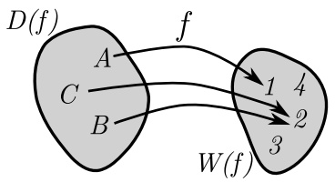

flowchart

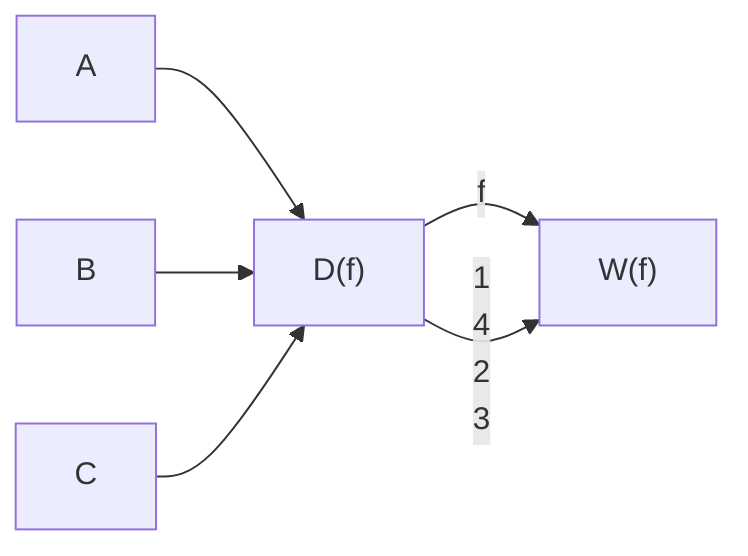

Abbildung 3.1: Illustration einer Funktion

## Beispiele.

①  $f = \{(x, x^{3}) : x \in \mathbb{R}\}$  oder  $f(x) = x^{3}, x \in \mathbb{R}$ ,
②  $f = \{(x, \sqrt{x}) : x \geq 0\}$  oder  $f(x) = \sqrt{x}, x \geq 0,$
③  $f(x)=\frac{1}{(1-x)^{2}}$ ,

④  $f(x)=\begin{cases}-x & x<0 \\5 & x=0 \\x^{2} & x>0.\end{cases}$

---

HMI ETech/Phys

WS 2021-22

Seite 46

## Übung 3.1.3

Was sind der Definitionsbereich und der Wertebereich der oben definierten Funktionen?

Oft wird der Definitionsbereich nicht explizit angegeben, z.B.  $f(x) = x^{2}$ ,  $g(x) = \frac{1}{(1-x)^{2}}$ ,  $h(x) = \sqrt{x^{2}-4}$ . In diesem Fall nehmen wir an, dass der Definitionsbereich so groß wie möglich ist, z.B.  $\mathcal{D}(f) = \mathbb{R}$ ,  $\mathcal{D}(g) = \{x \in \mathbb{R} : x \neq 1\}$ ,  $\mathcal{D}(h) = \{x \in \mathbb{R} : x \geq 2 \text{ oder } x \leq -2\} = (-\infty, -2] \cup [2, \infty)$ .

Es ist oft nützlich den Graphen einer Funktion anzuschauen.

Beispiel.  $f(x)=\begin{cases}1+x & x<0 \\ -1-x & x>0.\end{cases}$

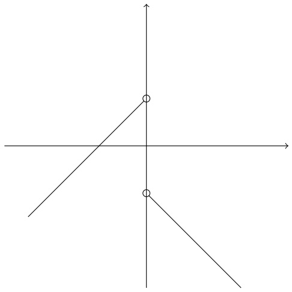

natural_image

Pure geometric diagram with intersecting lines and a central point, no text or symbols present

Vom Graphen erkennt man

$$
\mathcal {D} (f) = \mathbb {R} \setminus \{0 \}, \quad \mathcal {W} (f) = (- \infty , 1).
$$

(Achtung! Hier haben wir den Graphen benutzt um zu erkennen, dass  $\mathcal{W}(f)=(-\infty,1)$ . Wenn nach einem Beweis oder einer Begründung gefragt wird, reicht es nicht aus, ein Bild zu malen. Trotzdem hilft das Bild.)

Beispiel. Finden Sie den Definitionsbereich von  $f(x) := \sqrt{-x^{3} + 2x - 1}$ .

Die Nullstellen von  $p(x) := -x^{3} + 2x - 1 \text{ sind}$

$$
x _ {1} = 1, x _ {2, 3} = \frac {- 1 \pm \sqrt {5}}{2}.
$$

Wir schreiben das Polynom in faktorisierter Form

$$
- x ^ {3} + 2 x - 1 = - (x - 1) \left(x - \frac {- 1 + \sqrt {5}}{2}\right) \left(x - \frac {- 1 - \sqrt {5}}{2}\right)
$$

um abzulesen, wo das Polynom positiv ist. Da der Definitionsbereich der Wurzel  $[0,\infty)$  ist, ist der Definitionsbereich von f genau die Menge, wo p nicht negativ ist:

$$
\left(- \infty , \frac {- 1 - \sqrt {5}}{2} \right] \cup \left[ \frac {- 1 + \sqrt {5}}{2}, 1 \right].
$$

---

HMI ETech/Phys

WS 2021-22

Seite 47

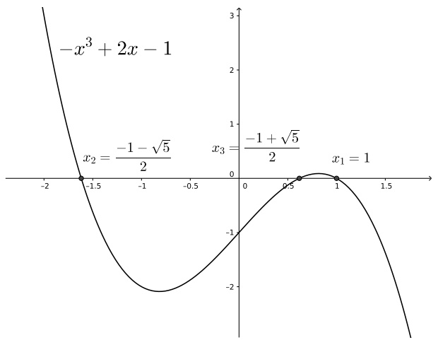

line

| Point | X | Y |
| --- | --- | --- |
| \(x_{2}\) | -1.5 | \(-1 - \sqrt{5}/2\) |
| \(x_{3}\) | 0.6 | \(-1 + \sqrt{5}/2\) |
| \(x_{1}\) | 1 | 1 |

Bemerkung. (1) Jede vertikale Linie berührt den Graph einer Funktion genau einmal.

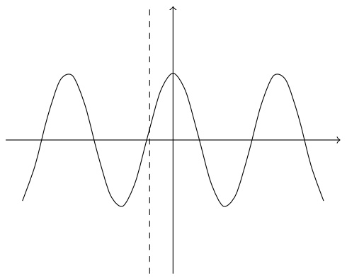

natural_image

Pure sine wave function graph with dashed vertical line at origin (no labels or text)

(2) Eine horizontale Linie kann den Graph einer Funktion mehr als einmal berühren.

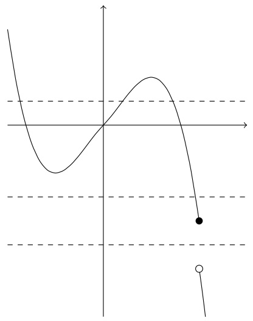

line

| X | Y |
| --- | --- |
| ~0.5 | ~0.2 |
| ~1.5 | ~0.8 |
| ~3.5 | ~0.2 |

Was bedeutet es, wenn eine waagerechte Linie y = b den Graph einer Funktion f genau einmal berührt? Dass b nur ein Urbild hat, d. h., dass es nur ein  $x \in \mathcal{D}(f)$  gibt, so dass

---

HMI ETech/Phys

WS 2021-22

Seite 48

$f(x) = b.$

Was bedeutet es, wenn jede waagerechte Linie den Graph einer Funktion f nur einmal berührt? Dass für jeden Wert  $y \in \mathcal{W}(f)$  es nur ein  $x \in \mathcal{D}(f)$  gibt, so dass  $f(x) = y$ .

Was bedeutet es, wenn jede waagerechte Linie den Graph einer Funktion f mindestens einmal berührt? Dass der Wertebereich der Funktion ganz R ist.

## Definition 3.1.4

Eine Funktion $f$ heißt injektiv (oder eins zu eins), wenn gilt:

$$
f (x _ {1}) = f (x _ {2}) \quad \implies \quad x _ {1} = x _ {2}.
$$

Das heißt, bei Gleichheit der Bilder müssen die Urbilder auch gleich sein.

Damit verbunden ist die Eigenschaft der Surjektivität.

## Definition 3.1.5

Eine Funktion  $f: X \to Y$  heißt surjektiv von X nach Y, wenn gilt:

für jedes  $y \in Y$  existiert  $x \in X$  mit  $f(x) = y$ .

Wenn $f$ sowohl surjektiv als auch injektiv ist, dann sagen wir, dass $f$ bijektiv ist.

Man merkt: $f:X\to Y$ ist surjektiv genau dann, wenn $\mathcal{W}(f) = Y$.

Eine kurze Zusammenfassung ist: Eine Funktion  $f: X \rightarrow Y$  ist

(1) injektiv, wenn kein $y \in Y$ mehr als ein Urbild in $X$ hat (bspw. $x^2$, $x \geq 0$),
(2) surjektiv, wenn jedes $y \in Y$ mindestens ein Urbild in $X$ hat (bspw. $x^3$), und
(3) bijektiv, wenn jedes $y \in Y$ genau ein Urbild in $X$ hat (bspw. $x$).

Erinnerung: Graphen helfen uns enorm, die Eigenschaften einer Funktion zu bemerken. Wenn allerdings nach einem Beweis gefragt wird, müssen wir analytisch argumentieren.

Beispiel. Finden Sie den Wertebereich  $\mathcal{W}(f)$  von  $f(x)=\frac{1}{(x-4)^{2}}$ .

Lösung.  $^{1}$ Der Wertebereich ist  $(0, \infty)$ . Dies begründen wir wie folgt. Zunächst bemerken wir, dass

$$
\mathcal {D} (f) = \{x \in \mathbb {R}: x \neq 4 \}.
$$

Für alle $x \in \mathcal{D}(f)$ ist $(x - 4)^2 > 0$, und damit auch

$$
f (x) = \frac {1}{(x - 4) ^ {2}} > 0,
$$

---

HMI ETech/Phys

WS 2021-22

Seite 49

so dass $\mathcal{W}(f)\subseteq(0,\infty)$. Andererseits können wir für alle

$$
y _ {0} \in (0, \infty)
$$

setzen:

$$
x _ {0} := \frac {1}{\sqrt {y _ {0}}} + 4.
$$

Dann ist $x_0 > 4$, so dass $x \in \mathcal{D}(f)$, und es gilt

$$
f (x _ {0}) = \frac {1}{(x _ {0} - 4) ^ {2}} = \frac {1}{\left(\frac {1}{\sqrt {y _ {0}}}\right) ^ {2}} = y _ {0}.
$$

Also gilt $\mathcal{W}(f) \supseteq (0, \infty)$. (Man hätte auch

$$
\tilde {x} _ {0} = - \frac {1}{\sqrt {y _ {0}}} + 4,
$$

das Urbild auf dem erstem Ast von f, wählen können.)

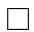

Wir erinnern uns an die Definition 1.1.2, wo wir gesehen haben, wie man die Gleichheit zweier Mengen zeigt.

Wir betrachten jetzt ein paar andere mögliche Eigenschaften einer Funktion.

## Definition 3.1.6

Eine reelle Funktion $f$ heißt gerade, wenn gilt

(1) für jedes $x \in \mathcal{D}(f)$ ist auch $-x \in \mathcal{D}(f)$, und
(2) für jedes $x \in \mathcal{D}(f)$ ist $f(x) = f(-x)$.

Analog heißt die Funktion heißt ungerade, wenn gilt

(1) für jedes $x \in \mathcal{D}(f)$ ist auch $-x \in \mathcal{D}(f)$, und
(2) für jedes $x \in \mathcal{D}(f)$ ist $f(x) = -f(-x)$.

Beispiel. Die Funktion  $f(x) = x^{2}$  ist gerade. Die Funktion  $f(x) = x$  ist ungerade. Allgemein ist  $f(x) = x^{2n}, n \in \mathbb{N}$ , gerade und  $f(x) = x^{2n-1}, n \in \mathbb{N}$ , ungerade.

Beispiel.  $\sin(x)$  ist ungerade.  $\cos(x)$  ist gerade.

## Übung 3.1.7

Geben Sie an, ob folgende Funktionen gerade, ungerade oder keins von beiden sind:

---

HMI ETech/Phys

WS 2021-22

Seite 50

$\tan (x),\sinh (x),\cosh (x),\tanh (x),\exp (x^2).$

## Definition 3.1.8

Wir nennen eine reelle Funktion $f$ monoton wachsend (bzw. monoton fallend), wenn für alle $x, y \in \mathcal{D}(f)$ die folgende Implikation gilt:

$$
\begin{array}{l} x <   y \quad \implies \quad f (x) \leq f (y) \\ ( \quad \text {bzw.} \quad x <   y \quad \implies \quad f (x) \geq f (y) \quad). \\ \end{array}
$$

Wenn $f$ monoton wachsend oder monoton fallend ist, dann nennen wir $f$ monoton. Die Funktion $f$ ist streng monoton wachsend, wenn für alle $x, y \in \mathcal{D}(f)$ gilt:

$$
x <   y \quad \implies \quad f (x) <   f (y),
$$

mit einer analogen Aussage für $f$ streng monoton fallend. Wenn $f$ streng monoton wachsend oder streng monoton fallend ist, dann nennen wir $f$ streng monoton.

Achtung! Nach der Definition ist  $f(x) \equiv 2$  monoton wachsend! Das gleiche gilt für

$$
g (x) = \left\{ \begin{array}{l l} x + 1 & x \leq - 1 \\ 0 & - 1 <   x \leq 1 \\ x - 1 & x > 1. \end{array} \right.
$$

Wir kennen den Begriff von Beschränktheit einer Menge. Was bedeutet es für eine Funktion, beschränkt zu sein?

## Definition 3.1.9

Eine reelle Funktion $f$ heißt nach unten beschränkt, wenn es eine reelle Zahl $m$ gibt, die eine untere Schranke für $\mathcal{W}(f)$ ist. Das heißt, falls gilt:

$$
\text { für   alle } x \in \mathcal {D} (f) \text { haben   wir } m \leq f (x).
$$

Analog für nach oben beschränkt. Ist f sowohl nach unten als auch nach oben beschränkt, so nennen wir f beschränkt.

Diese Eigenschaft ist wichtig, zum Beispiel für Optimierungsprobleme. Für  $f(x) = x^{3}$  besitzt das Problem

$$
\inf _ {x \in \mathbb {R}} f (x) = \inf \left\{f (x): x \in \mathbb {R} \right\}
$$

keine Lösung. Ist f nach unten beschränkt, so existiert das Infimum

$$
\inf _ {x \in \mathbb {R}} f (x).
$$

Aber Vorsicht: Dies bedeutet nicht, dass es ein $x_0 \in \mathbb{R}$ gibt, so dass $f(x_0) = \inf_{x \in \mathbb{R}} f(x)$.

Beispiel. Es gilt

$$
\inf _ {x \in \mathbb {R}} \tanh (x) = - 1
$$

aber es gibt kein $x_* \in \mathbb{R}$, so dass $\tanh(x_*) = -1$.

---

HMI ETech/Phys

WS 2021-22

Seite 51

## 3.2 Die Umkehrfunktion

Oft interessieren wir uns für die sogenannte Umkehrfunktion einer Funktion.

## Definition 3.2.1

Sei $f:X\to Y$ eine Funktion. Gibt es eine Funktion $g:Y\to X$ mit

$$
g (f (x)) = x \quad \text { für   alle } x \in X \tag {3.2.1}
$$

$$
\text {und} \quad f (g (y)) = y \quad \text {für alle} y \in Y, \tag {3.2.2}
$$

dann nennen wir $g$ die Umkehrfunktion von $f$. Wir schreiben

$$
g (y) = f ^ {- 1} (y)
$$

und sagen, dass f eine Umkehrfunktion besitzt, oder, dass f invertierbar ist.

Bemerkung. Beachten Sie, dass dasselbe Symbol  $f^{-1}$  auch für das Urbild einer Menge benutzt wird; siehe Definition 3.1.2. Falls f eine reelle Funktion ist, schreiben wir auch

$$
(f (y)) ^ {- 1} = \frac {1}{f (y)}.
$$

Auf den Kontext achten!!!

Beispiel. Bestimmen Sie, ob die folgenden Funktionen eine Umkehrfunktion besitzen. Wenn ja, finden Sie die Umkehrfunktion. Wenn nein, finden Sie das größte Intervall  $I \subseteq \mathcal{D}(f)$ , so dass f auf I eine Umkehrfunktion besitzt und geben Sie diese Funktion an.

①  $f(x) = x^{2}$  besitzt keine Umkehrfunktion, aber  $g(x) = x^{2}, x \in [0, \infty)$  besitzt die Umkehrfunktion

$$
g ^ {- 1} (y) = \sqrt {y}, \quad y \in [ 0, \infty).
$$

$(Oder g^{-1}(x) = \sqrt{x}, x \in [0, \infty).)$ Analog besitzt $g(x) = x^2, x \in (-\infty, 0]$ die Umkehrfunktion $g^{-1}(x) = -\sqrt{x}, x \in [0, \infty)$.

②  $f(x) = \begin{cases} \frac{1}{2}(x + 1) & -1 \leq x < 1 \\ -x^{2} + 2x + 4 & 1 \leq x \leq 3. \end{cases}$

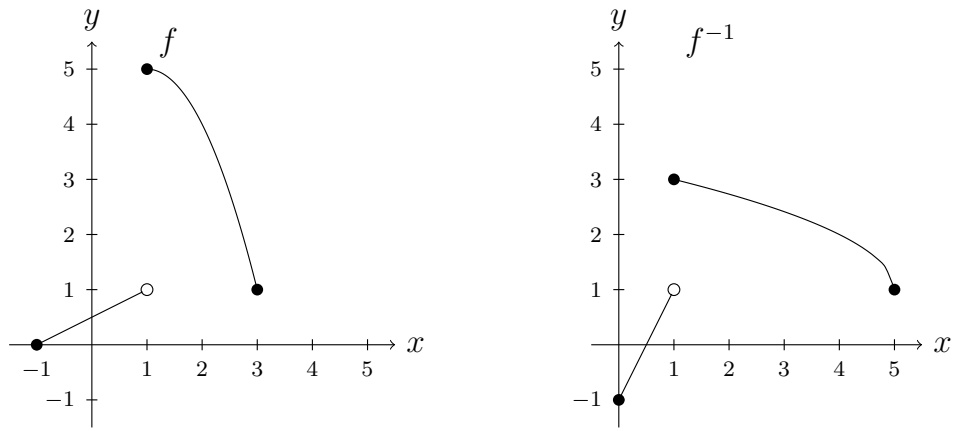

---

HMI ETech/Phys

WS 2021-22

Seite 52

Auf $[-1, 1)$ gilt

$$
y = \frac {1}{2} (x + 1) \quad \Leftrightarrow \quad x = 2 y - 1.
$$

Auf [1,3] gilt

$$
y = - (x ^ {2} - 2 x - 4)
$$

$$
= - [ (x - 1) ^ {2} - 5 ]
$$

$$
\Leftrightarrow (x - 1) ^ {2} = - y + 5
$$

$$
\Leftrightarrow x = \sqrt {5 - y} + 1 \quad \text {weil} x \geq 1 \text {ist}).
$$

Also ist die Umkehrfunktion

$$
f ^ {- 1} (x) = \left\{ \begin{array}{l l} 2 x - 1 & x \in [ 0, 1) \\ \sqrt {5 - x} + 1 & x \in [ 1, 5 ]. \end{array} \right.
$$

Dieses Beispiel zeigt, dass eine Funktion nicht monoton sein muss, um eine Umkehrfunktion zu besitzen.

③  $f(x)=\left\{\begin{aligned}&\frac{1}{2}(x+1)&0\leq x<1\\ &-x^{2}+2x&1\leq x\leq3.\end{aligned}\right.$

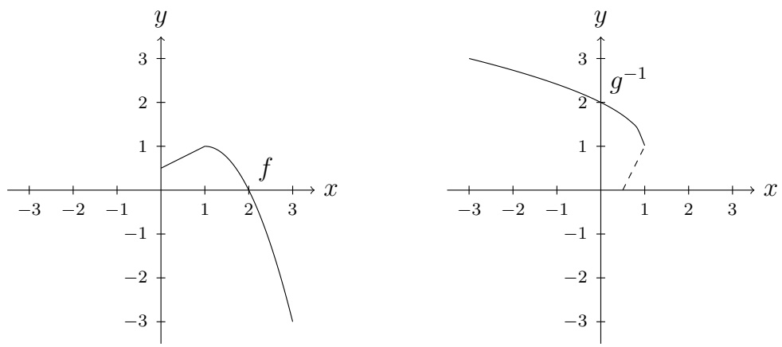

$f$ besitzt keine Umkehrfunktion, aber $g(x) = -x^{2} + 2x$, $x \in [1,3]$ besitzt die Umkehrfunktion $g^{-1}(x) = 1 + \sqrt{1 - x}$, $x \in [-3,1]$.

Man stellt sich die allgemeine Frage: Welche Funktionen besitzen eine Umkehrfunktion?

## Satz 3.2.2

Eine Funktion  $f: X \to Y$  besitzt eine Umkehrfunktion  $g: Y \to X$  genau dann, wenn f von X nach Y bijektiv ist. Außerdem ist die Umkehrfunktion eindeutig bestimmt.

---

HMI ETech/Phys

WS 2021-22

Seite 53

Beweis. Schritt 1: Bijektivität ist hinreichend. Wenn $f: X \to Y$ bijektiv ist, dann wählen wir für jedes $y \in Y$ das eindeutig-bestimmte $x \in X$, so dass $f(x) = y$, und wir definieren $g(y) := x$. Die Funktion $g: Y \to X$ so definiert ist eine Umkehrfunktion von $f$, da für jedes $x \in X$ gilt $g(f(x)) = g(y) = x$ und für jedes $y \in Y$ gilt $f(g(y)) = f(x) = y$.

Schritt 2: Bijektivität ist notwendig. Wir nehmen an, dass $f: X \to Y$ eine Umkehrfunktion $g: Y \to X$ besitzt und zeigen, dass dann f bijektiv ist. Wenn für $x$, $\tilde{x} \in X$ gilt $f(x) = f(\tilde{x})$, dann ergibt (3.2.1), dass

$$
x = g (f (x)) = g (f (\tilde {x})) = \tilde {x}.
$$

Also ist $f$ injektiv. Jetzt betrachten wir ein beliebiges $y \in Y$. Wir definieren $x \in X$ durch $x := g(y)$. Dann gilt nach (3.2.2)

$$
f (x) = f (g (y)) = y.
$$

Also ist $f$ surjektiv.

Schritt 3: Eindeutigkeit der Umkehrfunktion. Um die Eindeutigkeit zu bestätigen, nehmen wir an, dass es für $f: X \to Y$ zwei Funktionen $g$, $\tilde{g}$ gibt, die (3.2.1) und (3.2.2) erfüllen. Wir betrachten $y \in Y$. Nach dem Argument oben ist $f$ surjektiv, also gibt es ein $x \in X$, so dass $y = f(x)$. Aus (3.2.1) schließen wir

$$
g (y) = g (f (x)) = x = \tilde {g} (f (x)) = \tilde {g} (y).
$$

Also gilt $g = \tilde{g}$ auf $Y$.

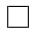

Bemerkung. Angesichts der Eindeutigkeit reden wir von der Umkehrfunktion einer Funktion. Da  $f: X \to Y$  nur eine Umkehrfunktion besitzt, wenn f surjektiv ist, nehmen wir an, wenn nur die Funktion f und nicht die Menge Y gegeben wird, dass  $Y = \mathcal{W}(f)$  gemeint wird. z.B. ist tanh invertierbar, weil tanh:  $R \to (-1, 1)$  invertierbar ist. Aber tanh:  $R \to R$  ist nicht invertierbar.

Mit der Definition 3.1.2 und nach Satz 3.2.2 wäre eine äquivalente Definition von Umkehrfunktion:

Definition 2.1.2'. Sei $f: X \to Y$ eine injektive Funktion. Dann nennt man

$$
g = \{(y, x) \in Y \times X: (x, y) \in f \}
$$

die Umkehrfunktion von f. Die Funktion g ist injektiv und

$$
\mathcal {D} (g) = \mathcal {W} (f), \quad \mathcal {W} (g) = \mathcal {D} (f).
$$

Wie das triviale Beispiel  $f(x) \equiv 2$  zeigt, impliziert f ist monoton nicht, dass  $f^{-1}$  existiert. Strenge Monotonie reicht jedoch aus.

## Satz 3.2.3

Eine streng monotone Funktion besitzt eine Umkehrfunktion

---

HMI ETech/Phys

WS 2021-22

Seite 54

Beweis. Sei $f$ eine streng monotone Funktion. Wie jede Funktion ist $f$ surjektiv auf $\mathcal{W}(f)$. Wir müssen also nur überprüfen, ob $f$ injektiv ist. Da $f$ streng monoton ist, impliziert

$$
x _ {1} <   x _ {2} \quad \text { oder } \quad x _ {1} > x _ {2},
$$

dass

$$
f (x _ {1}) <   f (x _ {2}) \quad \text { oder } \quad f (x _ {1}) > f (x _ {2}).
$$

Also gilt  $f(x_{1}) = f(x_{2})$  genau dann, wenn

$$
x _ {1} = x _ {2}.
$$

Nach Satz 3.2.2 besitzt f eine Umkehrfunktion.

## 3.3 Neue Funktionen aus Alten

Seien $f$ und $g$ reelle Funktionen. Sei $A = \mathcal{D}(f) \cap \mathcal{D}(g)$. Dann ist die Summe definiert als

$$
f + g: A \to \mathbb {R}, \quad (f + g) (x) := f (x) + g (x) \quad \text { für   alle } x \in A.
$$

Analog definiert man

$$
f - g: A \to \mathbb {R}, \quad (f - g) (x) := f (x) - g (x)
$$

$$
\text {und} f \cdot g: A \to \mathbb {R}, \quad (f \cdot g) (x) := f (x) \cdot g (x).
$$

Auf $A' = \{x \in A : g(x) \neq 0\}$ definiert man

$$
\frac {f}{g}: A ^ {\prime} \to \mathbb {R}, \quad \frac {f}{g} (x) := \frac {f (x)}{g (x)}.
$$

Die Zusammensetzung von $f$ und $g$ ist definiert als

$$
(g \circ f) (x) = g (f (x)) \quad \text { für   alle } x \in \mathcal {D} (f) \text { mit } f (x) \in \mathcal {D} (g).
$$

Beispiele der Zusammensetzung:

① Sei E potentielle Energie als Funktion von h:

$$
E (h) = m g h, \quad m, g \in \mathbb {R} ^ {+}.
$$

Sei h die Höhe eines fallenden Körpers zum Zeitpunkt t:

$$
h (t) = h _ {0} - \frac {g}{2} t ^ {2}, \quad h _ {0} \in \mathbb {R} ^ {+}, t \in \left[ 0, \sqrt {\frac {2 h _ {0}}{g}} \right].
$$

---

HMI ETech/Phys

WS 2021-22

Seite 55

Dann ist die potentielle Energie des Körpers als Funktion von t gegeben durch die Zusammensetzung:

$$
(E \circ h) (t) = m g \left(h _ {0} - \frac {g}{2} t ^ {2}\right), \quad t \in \left[ 0, \sqrt {\frac {2 h _ {0}}{g}} \right].
$$

② Sei  $d = d(t)$  die Verschiebung eines Teilchens als Funktion von t, wobei t Zeit in Minuten ist. Sei  $t(s) = \frac{s}{60}$ . Dann ist  $D(s) = d \circ t(s) = d\left(\frac{s}{60}\right)$  die Verschiebung als Funktion von s, wobei s Zeit in Sekunden ist.
③  $f(x)=\sqrt{x^{2}-4}$ ,  $g(x)=\frac{1}{x}$ . Dann ist

$$
g \circ f (x) = \frac {1}{\sqrt {x ^ {2} - 4}}.
$$

Hier ist $\mathcal{D}(f) = (-\infty, -2] \cup [2, \infty)$ und

$$
\mathcal {D} (g \circ f) = (- \infty , - 2) \cup (2, \infty).
$$

Man bemerkt, dass -2 und 2 nicht zu  $\mathcal{D}(g \circ f)$  gehören, weil  $f(-2)$  und  $f(2)$  nicht zu  $\mathcal{D}(g)$  gehören.

## 3.4 Polynome und rationale Funktionen

## Definition 3.4.1

Für $n=0,1,2,\ldots$ heißt eine Funktion $f:\mathbb{R}\to\mathbb{R}$ (reelles) Polynom vom Grad $n$, wenn es reelle Zahlen $a_{0},...,a_{n}$ mit $a_{n}\neq0$ gibt, so dass

$$
f (x) = a _ {n} x ^ {n} + a _ {n - 1} x ^ {n - 1} + \dots + a _ {1} x + a _ {0}, \quad x \in \mathbb {R}.
$$

Die Zahlen $a_0, \ldots, a_n$ heißen Koeffizienten von $f$.

Wir schreiben oft $p_n(x)$ für ein Polynom, wobei $n$ den Grad des Polynoms bezeichnet.

Wir bemerken, dass konstante Funktionen, die nicht gleich Null sind, Polynome nullten Grades sind. Das Nullpolynom  $f \equiv 0$  ist auch ein Polynom, aber das Grad des Nullpolynoms ist nicht Null, da  $a_{0} = 0$  ausgeschlossen wurde. Es ist (aus technischen Gründen) bequem zu definieren:

## Definition 3.4.2

Wir definieren das Grad des Nullpolynoms als  $-\infty$ . Wenn wir also für  $n = 0, 1, \ldots$  von Polynomen Grad n und weniger reden, ist das Nullpolynom immer mit dabei.

---

HMI ETech/Phys

WS 2021-22

Seite 56

## Satz 3.4.3

Zwei Polynome sind genau dann gleich, wenn ihre Koeffizienten gleich sind. Das heißt: Ein Polynom ist durch seine Koeffizienten bestimmt.

Beweis. Seien

$$
p _ {n} (x) = \sum_ {k = 0} ^ {n} a _ {k} x ^ {k}, \quad q _ {n} (x) = \sum_ {k = 0} ^ {n} b _ {k} x ^ {k}
$$

zwei Polynome vom Grad n. Die Tatsache, dass  $p_{n}(x) = q_{n}(x)$ , wenn  $a_{k} = b_{k}$  für alle k = 0, .., n ist klar. Für die umgekehrte Richtung müssen wir zeigen, dass

$$
p _ {n} (x) = q _ {n} (x) \quad \text {f ü r a l l e} x \in \mathbb {R} \tag {3.4.1}
$$

impliziert, dass

$$
a _ {k} = b _ {k} \quad \text {f ü r a l l e} k = 0,.., n \tag {3.4.2}
$$

gilt. Zunächst setzen wir x = 0 in (3.4.1) und erhalten

$$
a _ {0} = b _ {0}. \tag {3.4.3}
$$

Wir benutzen (3.4.3) in (3.4.1) um zu schließen, dass

$$
p _ {n} (x) - a _ {0} = q _ {n} (x) - b _ {0} \quad \text { für   alle } x \in \mathbb {R},
$$

also

$$
a _ {n} x ^ {n} + a _ {n - 1} x ^ {n - 1} + \dots + a _ {1} x = b _ {n} x ^ {n} + b _ {n - 1} x ^ {n - 1} + \dots + b _ {1} x \quad \text {f ü r a l l e} x \in \mathbb {R}.
$$

Für  $x \in R \setminus \{0\}$  dividieren wir durch x und erhalten

$$
a _ {n} x ^ {n - 1} + a _ {n - 1} x ^ {n - 2} + \dots + a _ {1} = b _ {n} x ^ {n - 1} + b _ {n - 1} x ^ {n - 2} + \dots + b _ {1} \quad \text {f ü r a l l e} x \in \mathbb {R} \setminus \{0 \}. \tag {3.4.4}
$$

Wir behaupten, dass  $a_{1}=b_{1}$  aus (3.4.4) folgt. Wir können aber nicht wie mit (3.4.3) argumentieren, da x=0 in (3.4.4) nicht erlaubt ist. Stattdessen finden wir eine obere Schranke für  $|a_{1}-b_{1}|$  wie folgt:

$$
\begin{array}{l} \left| a _ {1} - b _ {1} \right| \stackrel {(3. 4. 4)} {\leq} \left| a _ {n} x ^ {n - 1} + \dots + a _ {2} x - b _ {n} x ^ {n - 1} - \dots - b _ {2} x \right| \\ \leq \quad \left| \left(\left(| a _ {n} | + | b _ {n} |\right) x ^ {n - 2} + \dots + | a _ {2} | + | b _ {2} |\right) | x | \right| \quad \text {f ü r a l l e} x \in \mathbb {R} \setminus \{0 \} \\ \leq \quad | | a _ {n} | + | b _ {n} | + \dots + | a _ {2} | + | b _ {2} | |   | x | \quad \text {fur alle} x \in (- 1, 1) \setminus \{0 \} \\ \leq \quad C | x | \quad \text {furalle} x \in (- 1, 1) \setminus \{0 \} \\ \end{array}
$$

---

HMI ETech/Phys

WS 2021-22

Seite 57

für ein  $C < \infty$ . Da wir  $|x|$  beliebig klein wählen können, erhalten wir aus Lemma 1.5.1, dass

$$
| a _ {1} - b _ {1} | = 0, \quad \text { also } \quad a _ {1} = b _ {1}.
$$

Die Gleichheit der übrigen Koeffizienten zeigt man genauso.

Was macht man mit Polynomen? Übliche Fragen sind z.B. folgende:

(1) Was sind die Nullstellen des Polynoms, d. h., für welche $x \in \mathbb{R}$ gilt $p_n(x) = 0$?
(2) Wie kann man das Polynom in Faktoren zerlegen?
(3) Wie kann man eine komplizierte Funktion durch Polynome approximieren? (Polynome sind glatt und relativ einfach - also gäbe es einen Vorteil daran...)

Wir fangen mit Nullstellen an.

## Definition 3.4.4

Eine reelle Zahl  $x_{0} \in R$  heißt Nullstelle von  $p_{n}(x)$ , falls gilt

$$
p _ {n} (x _ {0}) = 0.
$$

Ein $x_0 \in \mathbb{R}$ heißt $m$-fache Nullstelle des Polynoms $p_n(x)$, wenn es ein Polynom $q_{n-m}$ vom Grad $n-m$ gibt mit der Eigenschaft, dass für alle $x \in \mathbb{R}$ gilt

$$
p _ {n} (x) = (x - x _ {0}) ^ {m} q _ {n - m} (x),
$$

und  $q_{n-m}(x_{0}) \neq 0$ . Man nennt m die Vielfachheit oder die Multiplizität der Nullstelle  $x_{0}$ . Man nennt  $x - x_{0}$  einen Linearfaktor des Polynoms.

## Beispiele.

①  $p(x) = x^{2} - 4$  hat zwei einfache Nullstellen  $x_{1} = 2$  und  $x_{2} = -2$ .
②  $p(x) = x^{3} - 4x^{2} + 4x = x(x - 2)^{2}$  hat eine einfache Nullstelle  $x_{1} = 0$  und eine zweifache Nullstelle  $x_{2} = 2$ .
③  $p(x) = x^{2} + 1$  kann nicht in Linearfaktoren zerlegt werden und besitzt keine reellen Nullstellen.

Das “Problem”, das wir im dritten Beispiel entdeckt haben, ist das einzige Problem, das vorkommt. Diese Tatsache machen wir in der untenstehenden Bemerkung genauer.

## Definition 3.4.5

Ein Polynom mit der quadratischen Form

$$
a _ {2} x ^ {2} + a _ {1} x + a _ {0} \quad \text {mit} a _ {0}, a _ {1}, a _ {2} \in \mathbb {R},
$$

das man nicht in der Form $a_{2}(x - x_{1})(x - x_{2})$ mit reellen Zahlen $x_{1}, x_{2}$ schreiben kann,

---

HMI ETech/Phys

WS 2021-22

Seite 58

wird ein irreduzibles quadratisches Polynom genannt.

Bemerkung (Zerlegung eines Polynoms). Was kann man im Allgemeinen über die Zerlegung eines Polynoms sagen?

(1) Der Fundamentalsatz der Algebra [Gauß] sagt, dass jedes Polynom n-ten Grades mit reellen Koeffizienten in n Linearfaktoren mit komplexen Zahlen zerlegt werden kann:

$$
p _ {n} (x) = a _ {n} (x - z _ {1}) (x - z _ {2}) \cdot \dots \cdot (x - z _ {n}), \quad z _ {1}, \dots , z _ {n} \in \mathbb {C}.
$$

(2) Wenn  $z \in C$  eine Nullstelle des reellen Polynoms  $p_{n}$  ist, dann ist auch  $\overline{z}$ , die zu z konjugierte komplexe Zahl, eine Nullstelle von  $p_{n}$ . (Aus  $p_{n}(z) = 0$  erhält man  $p_{n}(\overline{z}) = 0$ .)
(3) Es folgt, dass irreduzible Polynome das einzige potenzielle Problem sind im folgenden Sinn:

Jedes reelle Polynom n-ten Grades  $p_{n}(x)$  kann als Produkt von Linearfaktoren mit reellen Nullstellen und gegebenenfalls irreduziblen quadratischen Polynomen geschrieben werden.

(Um dies aus den vorherigen Punkten zu schließen, beachten Sie, dass für jedes $z \in \mathbb{C}$

$$
(x - z) (x - \overline {{z}})
$$

ein reelles Polynom in $x$ ist.)

Der Fundamentalsatz der Algebra impliziert nicht, dass es leicht ist, die Nullstellen zu finden! Sie kennen die Lösungsformel für quadratische Gleichungen: Das Polynom

$$
p (x) = a x ^ {2} + b x + c
$$

hat die Nullstellen

$$
x _ {\pm} = \frac {- b \pm \sqrt {b ^ {2} - 4 a c}}{2 a}.
$$

Die Formel für kubische Polynome ist viel komplizierter. Für Polynome des Grades 5 und größer kann es keine geschlossene Formel geben [Abel-Ruffini, Galois].

Trotzdem schaffen wir es, die Nullstellen in nett ausgewählten Beispielen zu finden.

Beispiel. Finden Sie alle komplexen Nullstellen von  $x^{3} + 3x^{2} + x - 5$ . Man findet durch Ausprobieren schnell die Nullstelle  $x_{1} = 1$ , sodass man durch Polynomdivision

$$
(x ^ {3} + 3 x ^ {2} + x - 5): (x - 1) = x ^ {2} + 4 x + 5
$$

auf die Faktorisierung  $(x-1)(x^{2}+4x+5)$  kommt. Nun findet man leicht die zusätzlichen Nullstellen  $x_{2}=-2+\sqrt{(-1)}=-2+i$  und  $x_{3}=-2-i$ . Daraus ergibt sich die Zerlegung in Linearfaktoren:

$$
x ^ {3} + 3 x ^ {2} + x - 5 = (x - 1) (x - (- 2 + i)) (x - (- 2 - i)) = (x - 1) (x + 2 - i) (x + 2 + i).
$$

---

HMI ETech/Phys

WS 2021-22

Seite 59

## Definition 3.4.6

Seien $p_n(x)$ und $q_m(x)$ Polynome von Grad $n$ bzw. $m$. Dann heißt

$$
R (x) = \frac {p _ {n} (x)}{q _ {m} (x)}
$$

eine rationale Funktion. Der Definitionsbereich von R ist  $\{x\in\mathbb{R}:q_{m}(x)\neq0\}$ .

Jetzt suchen wir eine äquivalente Darstellung von R in dem Fall m < n.

## Satz 3.4.7

Sei $R(x) = \frac{p_n(x)}{q_m(x)}$, wobei $p_n$ und $q_m$ Polynome vom Grad $n$ bzw. $m$ sind und $n \geq m$. Dann gibt es Polynome $s_{n-m}$ und $t_k$, so dass für alle $x \in \mathcal{D}(R)$ gilt

$$
R (x) = s _ {n - m} (x) + \frac {t _ {k} (x)}{q _ {m} (x)}. \tag {3.4.5}
$$

Die Funktion $t_k$ ist entweder identisch Null oder ein Polynom vom Grad $k < m$.

Beweis. Der übliche Divisions-Algorithmus ergibt

$$
\begin{array}{l} \frac {p _ {n} (x)}{q _ {m} (x)} = \frac {a _ {n} x ^ {n} + a _ {n - 1} x ^ {n - 1} + \dots + a _ {1} x + a _ {0}}{b _ {m} x ^ {m} + b _ {m - 1} x ^ {m - 1} + \dots + b _ {1} x + b _ {0}} \\ = \frac {a _ {n}}{b _ {m}} x ^ {n - m} + \frac {t _ {n - 1} (x)}{q _ {m} (x)}, \tag {3.4.6} \\ \end{array}
$$

wobei

$$
t _ {n - 1} (x) = p _ {n} (x) - \frac {a _ {n}}{b _ {m}} x ^ {n - m} q _ {m} (x)
$$

vom Grad kleiner gleich n-1 ist, weil der n-te Term verschwindet. Dies wiederholt man, bis der Grad des Zählerpolynoms in (3.4.6) kleiner gleich dem Grad des Nennerpolynoms ist (also, maximal  $n-m+1$  mal). ☐

## Beispiel. Schreiben Sie

$$
R (x) = \frac {x ^ {3} + x}{x - 1}
$$

in der Form (3.4.5). Zeichnen Sie den Graphen der Funktion.

Lösung. Man erhält

$$
R (x) = x ^ {2} + x + 2 + \frac {2}{x - 1}.
$$

---

HMI ETech/Phys

WS 2021-22

Seite 60

Für die Parabel zeichnet man

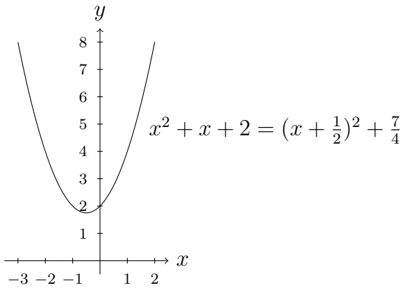

contour

| X | Y |
| --- | --- |
| -3 | ~8 |
| -2 | ~5.5 |
| -1 | ~2.5 |
| 0 | 2 |
| 1 | ~5.5 |
| 2 | ~8 |

Für den Restterm zeichnet man in Schritten:

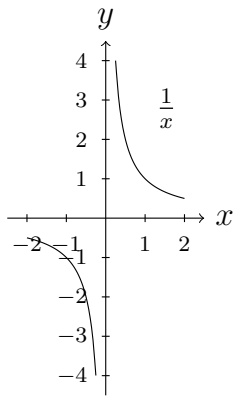

contour

| X | Y |
| --- | --- |
| -2 | -4 |
| -1 | -1 |
| 0 | 4 |
| 1 | 1 |
| 2 | ~0.5 |

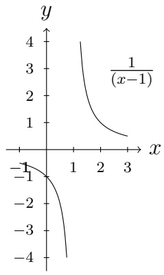

contour

| X | Y (Curve 1) | Y (Curve 2) |
| --- | --- | --- |
| 0 | — | -1 |
| 1 | 4 | — |
| 2 | ~1.2 | — |
| 3 | ~0.6 | — |
| 0 | — | -1 |
| 1 | — | -1 |
| 2 | — | ~-2.5 |
| 3 | — | ~-4 |

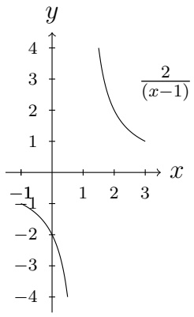

contour

| X | Y |
| --- | --- |
| ~1.5 | 4 |
| ~2.0 | ~2.5 |
| ~2.5 | ~1.5 |
| ~3.0 | 1 |

Die Summe ergibt:

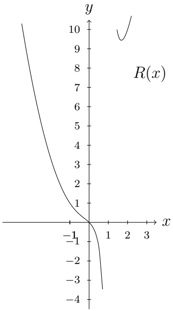

contour

| X | Y |
| --- | --- |
| -1 | 0 |
| 0 | 0 |
| 1 | ~-3.5 |

Man erkennt  $\mathcal{D}(R)=\mathbb{R}\setminus\{1\}$  und  $\mathcal{W}(R)=\mathbb{R}$ .

---

HMI ETech/Phys

WS 2021-22

Seite 61

## 3.5 Trigonometrische Funktionen

Wir erinnern an die Funktionen

$$
\sin (x) = b, \quad \cos (x) = a, \quad \tan (x) = \frac {\sin (x)}{\cos (x)},
$$

wobei  $(a,b)$  ein Punkt des Einheitskreises ist und x der Winkel gegen den Uhrzeigersinn zwischen der x-Achse und dem Segment von  $(0,0)$  bis  $(a,b)$  ist.

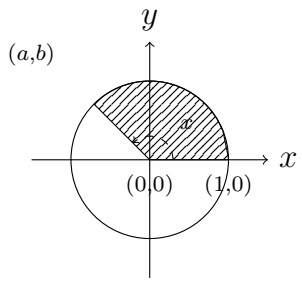

text_image

(a,b)
y
x
(0,0)
(1,0)

Wir werden ab und zu die folgenden Eigenschaften brauchen:

- $\sin (0) = 0$, $\cos (0) = 1$,
- $|\sin (x)|\leq 1$ , $|\cos (x)|\leq 1$
- sin ist ungerade, cos ist gerade,
- sin und cos sind periodisch mit Periode $2\pi$,
- $\sin^2 (x) + \cos^2 (x) = 1$,
- $\cos (x) = 1 - 2\sin^2\left(\frac{x}{2}\right)$,
- $\sin (x\pm y) = \sin (x)\cos (y)\pm \cos (x)\sin (y),$
- $\cos (x) = \sin \left(\frac{\pi}{2} - x\right)$, $\sin (x) = \cos \left(\frac{\pi}{2} - x\right)$,
- $0 < x \cos(x) < \sin(x) < x$ für $x \in (0, \frac{\pi}{2}]$.

Man definiert Arkussinus und Arkuscosinus,

$$
\arcsin : [ - 1, 1 ] \to [ - \pi / 2, \pi / 2 ] \quad \arccos : [ - 1, 1 ] \to [ 0, \pi ],
$$

als die Umkehrfunktionen von $\sin : [-\pi / 2, \pi / 2] \to [-1, 1]$ bzw. $\cos : [0, \pi] \to [-1, 1]$.
