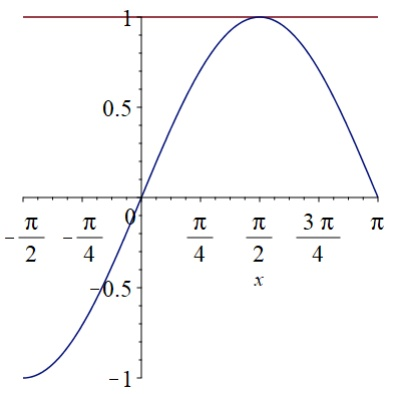
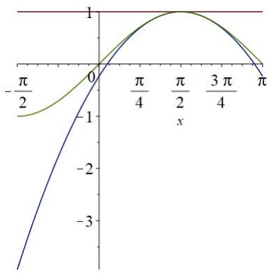

# Unendliche Reihen

原始 PDF 第 164–188 页。

# Kapitel 7

# Unendliche Reihen

Wir kennen die „Sigma-Notation“

$$
\sum_ {k = 1} ^ {3} a _ {k} = a _ {1} + a _ {2} + a _ {3}.
$$

In diesem Abschnitt stellen wir uns die Frage, was mit

$$
\sum_ {k = 1} ^ {\infty} a _ {k} \tag {7.0.1}
$$

gemeint wird. Natürlich können wir nicht unendlich viele Terme addieren (man hat nicht genug Zeit dafür). Stattdessen addiert man zunächst n Terme und dann  $n + 1$  Terme usw. und man hofft, dass man ungefähr „die richtige Zahl erhält“, wenn man genügend Terme addiert hat. Das heißt, wenn wir

$$
\begin{array}{l} s _ {1} := a _ {1} \\ s _ {2} := a _ {1} + a _ {2} \\ s _ {n} := a _ {1} + \dots + a _ {n} \\ \end{array}
$$

: :

definieren, möchten wir überprüfen, ob die Folge  $\{s_{n}\}_{n=1}^{\infty}$  konvergiert. Wenn ja, dann benutzen wir die Notation (7.0.1) für den Grenzwert. Im Abschnitt 7.1 und 7.2 schauen wir uns solche sogennante Reihen an und wir sammeln hinreichende Konvergenzkriterien. Im Abschnitt 7.3 schauen wir uns Reihen der Form

$$
\sum_ {k = 1} ^ {\infty} a _ {k} x ^ {k}
$$

an, wobei die Terme nicht einfach reelle Zahlen sind, sondern die Monome  $a_{k}x^{k}$ . Reihen dieser Form werden Potenzreihen genannt. Dies führt zum Abschnitt 7.4, wo wir die Taylor-Formel einer Funktion betrachten. Allgemeinere Reihen der Form

$$
\sum_ {k = 1} ^ {\infty} f _ {k} (x)
$$

sind komplizierter als Potenzreihen und werden hier nicht betrachtet, aber sehen Sie hierzu zum Beispiel Wade, An Introduction to Analysis, Chapter 7 an.

---

HMI ETech/Phys

WS 2021-22

Seite 159

## 7.1 Reihen reeller Zahlen

## Definition 7.1.1

Sei $\{a_k\}_{k=1}^{\infty}$ eine Zahlenfolge. Dann wird

$$
s _ {n} := \sum_ {k = 1} ^ {n} a _ {k}
$$

die $n$-te Teilsumme genannt und $\{s_n\}_{n=1}^{\infty}$ heißt die Folge der Teilsummen. Man nennt

$$
\sum_ {k = 1} ^ {\infty} a _ {k} := \lim _ {n \to \infty} s _ {n}
$$

eine (unendliche) Reihe. Wenn $\{s_n\}_{n=1}^{\infty}$ (gegen $s \in \mathbb{R}$) konvergiert, dann sagen wir, dass die Reihe (gegen $s$) konvergiert. Wir nennen $s$ den Wert (oder die Summe) der Reihe und schreiben

$$
\sum_ {k = 1} ^ {\infty} a _ {k} = s.
$$

Wenn $\{s_n\}_{n=1}^{\infty}$ divergiert, dann sagen wir, dass die Reihe divergiert. Analog schreibt man

- $\sum_{k=1}^{\infty} a_k = \infty$ (die Reihe divergiert gegen $\infty$),
- $\sum_{k=1}^{\infty} a_k = -\infty$ (die Reihe divergiert gegen $-\infty$) bzw.
- $\sum_{k=1}^{\infty} a_k$ ist unbestimmt divergent,

wenn $s_n \to \infty$, $s_n \to -\infty$ bzw. $\{s_n\}_{n=1}^{\infty}$ unbestimmt divergent ist.

Wir nennen  $a_{k}$  die Koeffizienten der Reihe  $\sum_{k=1}^{\infty}a_{k}$ .

## Beispiele.

① Wir haben in Lemma 4.1.2 gesehen, dass die endliche geometrische Reihe

$$
s _ {n} := \sum_ {k = 0} ^ {n} r ^ {k}
$$

die Gleichung

$$
s _ {n} = \frac {1 - r ^ {n + 1}}{1 - r} \quad f u r r \in (0, 1) \tag {7.1.1}
$$

erfüllt. Aus (7.1.1), Definition 7.1.1 und $r^{n+1} \to 0$ für $r \in (0,1)$ und $n \to \infty$ schließen

---

HMI ETech/Phys

WS 2021-22

Seite 160

wir, dass die (unendliche) geometrische Reihe konvergiert, sowie

$$
\sum_ {k = 0} ^ {\infty} r ^ {k} = \frac {1}{1 - r} \quad f \ddot {u} r r \in (0, 1)
$$

gilt.

② Wir betrachten die Reihe

$$
\sum_ {n = 1} ^ {\infty} (- 1) ^ {n}. \tag {7.1.2}
$$

Wir bemerken

$$
s _ {1} = - 1, \quad s _ {2} = - 1 + 1 = 0
$$

und im Allgemeinen

$$
s _ {2 k + 1} = - 1, \quad s _ {2 k} = 0, \quad k \in \mathbb {N}.
$$

Also divergiert die Reihe (7.1.2).

Wir werden uns mit verschiedenen Kriterien für Konvergenz einer Reihe und passenden Beispielen beschäftigen. Da wir sehr oft den Wert einer konvergenten Reihe nicht explizit berechnen können, ist es nützlich, das sogenannte Cauchysche Kriterium für Konvergenz einer Folge einzuführen.

## Definition 7.1.2

Eine Zahlenfolge $\{a_n\}_{n=1}^{\infty}$ wird Cauchyfolge genannt, wenn es zu jedem $\varepsilon > 0$ ein $N \in \mathbb{N}$ gibt, so dass

$$
\left| a _ {n} - a _ {m} \right| <   \varepsilon \quad \text {f ü r a l l e} n, m > N. \tag {7.1.3}
$$

Achtung! Nicht ausreichend ist die Bedingung

$$
| a _ {n} - a _ {n + 1} | <   \varepsilon \quad \text { für   alle } n > N.
$$

Ein Gegenbeispiel ist  $\{a_{n}\}=\{\sqrt{n}\}$ , für die gilt

$$
a _ {n} \rightarrow \infty \quad \text { für } n \rightarrow \infty
$$

obwohl

$$
\left| a _ {n} - a _ {n + 1} \right| = \sqrt {n + 1} - \sqrt {n} \leq \frac {1}{2 \sqrt {n}}.
$$

Das m in (7.1.3) muss beliebig groß gewählt werden können, unabhängig von n.

---

HMI ETech/Phys

WS 2021-22

Seite 161

## Satz 7.1.3: Cauchysches Kriterium für Folgen

Eine Zahlenfolge $\{a_n\}_{n=1}^{\infty}$ konvergiert genau dann, wenn sie eine Cauchyfolge ist.

Beweis. ( $\Rightarrow$ ) Sei  $\varepsilon > 0$  gegeben. Wenn  $a_{n}$  gegen  $a \in R$  konvergiert, dann existiert ein  $N \in N$ , so dass

$$
| a _ {n} - a | <   \frac {\varepsilon}{2} \quad \text {f ü r a l l e} n \geq N.
$$

Es folgt aus der Dreiecksungleichung, dass

$$
\left| a _ {n} - a _ {m} \right| \leq \left| a _ {n} - a \right| + \left| a _ {m} - a \right| \leq \varepsilon
$$

für alle $n, m \geq N$.

$(\Leftarrow)$ Wenn $\{a_n\}_{n=1}^{\infty}$ eine Cauchyfolge ist, dann ist sie beschränkt. Um dies zu sehen, setze man $\varepsilon = 1$ und wähle $N \in \mathbb{N}$ so, dass

$$
| a _ {n} - a _ {m} | \leq 1 \quad \text { für   alle } n, m \geq N.
$$

Insbesondere gilt

$$
| a _ {m} | \leq | a _ {m} - a _ {N} | + | a _ {N} | \leq 1 + | a _ {N} | \quad \text { für   alle } m \geq N,
$$

so dass

$$
| a _ {n} | \leq \max \left\{| a _ {1} |, | a _ {2} |, \dots , | a _ {N} |, | 1 + a _ {N} | \right\} \quad \text { für   alle } n \in \mathbb {N}.
$$

Nach dem Satz von Bolzano-Weierstraß existiert eine Teilfolge  $\{a_{n_{k}}\}_{k=1}^{\infty}$  und ein  $a \in R$ , so dass

$$
a _ {n _ {k}} \rightarrow a \quad \text { für } k \rightarrow \infty .
$$

Sei $\varepsilon > 0$ gegeben. Da $\{a_n\}_{n=1}^{\infty}$ eine Cauchyfolge ist, existiert ein $N \in \mathbb{N}$, so dass

$$
| a _ {m} - a _ {n} | <   \frac {\varepsilon}{2} \quad \text { für   alle } n, m \geq N.
$$

Man wähle $k \in \mathbb{N}$, so dass

$$
n _ {k} \geq N \quad \text {und} \quad | a _ {n _ {k}} - a | <   \frac {\varepsilon}{2}.
$$

Dann gilt für alle  $m \geq N$ , dass

$$
\left| a _ {m} - a \right| \leq \left| a _ {n _ {k}} - a \right| + \left| a _ {n _ {k}} - a _ {m} \right| \leq \varepsilon .
$$

□

---

HMI ETech/Phys

WS 2021-22

Seite 162

## Satz 7.1.4: Cauchysches Kriterium für Reihen

Die Reihe $\sum_{k=1}^{\infty} a_k$ konvergiert genau dann, wenn es zu jedem $\varepsilon > 0$ ein $N \in \mathbb{N}$ gibt, so dass

$$
\left| \sum_ {k = n + 1} ^ {n + j} a _ {k} \right| <   \varepsilon \quad \text {fur alle} n \geq N, j \in \mathbb {N}. \tag {7.1.4}
$$

Dies folgt direkt aus dem Cauchyschen Kriterium für Folgen angewendet auf die Folge der Teilsummen von  $\sum_{k=1}^{\infty}a_{k}$ .

Korollar 7.1.5. Eine notwendige Bedingung für Konvergenz von $\sum_{k=1}^{\infty} a_k$ ist

$$
\lim _ {k \to \infty} a _ {k} = 0. \tag {7.1.5}
$$

Beweis. Dies folgt aus (7.1.4) mit $j = 1$.

Es ist wichtig zu merken, dass (7.1.5) keine hinreichende Bedingung ist. Die sogenannte harmonische Reihe

$$
\sum_ {k = 1} ^ {\infty} \frac {1}{k}
$$

erfüllt (7.1.5) und divergiert gegen Unendlich. Dies kann man zeigen, indem man

$$
\begin{array}{l} 1 + \frac {1}{2} + \underbrace {\left(\frac {1}{3} + \frac {1}{4}\right)} _ {\geq 2 \cdot \frac {1}{4}} + \underbrace {\left(\frac {1}{5} + \frac {1}{6} + \frac {1}{7} + \frac {1}{8}\right)} _ {\geq 4 \cdot \frac {1}{8}} + \dots + \underbrace {\left(\frac {1}{2 ^ {K} + 1} + \dots + \frac {1}{2 ^ {K + 1}}\right)} _ {\geq 2 ^ {K} \cdot \frac {1}{2 ^ {K + 1}}} \\ \geq 1 + \frac {1}{2} + \frac {K}{2} \\ \end{array}
$$

rechnet. Also gilt

$$
\sum_ {k = 1} ^ {2 ^ {K + 1}} \frac {1}{k} \geq \frac {3 + K}{2}.
$$

Da die Folge der Teilsummen monoton wachsend ist und eine Teilfolge besitzt, die gegen Unendlich divergiert, divergiert die harmonische Reihe gegen Unendlich:

$$
\sum_ {k = 1} ^ {\infty} \frac {1}{k} = \infty . \tag {7.1.6}
$$

---

HMI ETech/Phys

WS 2021-22

Seite 163

Also ist es für Konvergenz nicht hinreichend, wenn die Terme einer Reihe verschwinden. Wie Sie vielleicht raten würden, ist es hinreichend, wenn die Terme schnell genug verschwinden. Wir werden zum Beispiel sehen, dass

$$
\sum_ {k = 1} ^ {\infty} \frac {1}{k ^ {2}} <   \infty , \tag {7.1.7}
$$

und sogar, dass

$$
\text {für jedes} \alpha > 0 \quad \text {gilt} \quad \sum_ {k = 1} ^ {\infty} \frac {1}{k ^ {1 + \alpha}} <   \infty .
$$

(Dies werden wir später beweisen. Sehen Sie dazu die Beweisidee des Cauchyschen Verdichtungssatzes.)

## Übung 7.1.6

Bestimmen Sie, ob die Reihe  $\sum_{k=1}^{\infty}a_{k}$  mit

$$
a _ {k} = \frac {1}{3 ^ {k}} - \frac {1}{k}
$$

konvergiert oder divergiert.

Aus Satz 4.2.8 folgt:

## Satz 7.1.7

Seien $\sum_{k=1}^{\infty} a_k$, $\sum_{k=1}^{\infty} b_k$ konvergente Reihen. Dann gilt

$$
\sum_ {k = 1} ^ {\infty} \alpha a _ {k} = \alpha \sum_ {k = 1} ^ {\infty} a _ {k},
$$

$$
\sum_ {k = 1} ^ {\infty} (a _ {k} + b _ {k}) = \sum_ {k = 1} ^ {\infty} a _ {k} + \sum_ {k = 1} ^ {\infty} b _ {k}.
$$

Unsere ersten Kriterien für Konvergenz behandeln Reihen mit positiven Termen.

## Satz 7.1.8: Vergleichskriterium

Seien $0 \leq a_{k} \leq b_{k}$ für $k$ groß.

- Wenn $\sum_{k=1}^{\infty} b_k < \infty$, dann gilt $\sum_{k=1}^{\infty} a_k < \infty$.
- Wenn $\sum_{k=1}^{\infty} a_k = \infty$, dann gilt $\sum_{k=1}^{\infty} b_k = \infty$.

---

HMI ETech/Phys

WS 2021-22

Seite 164

## Satz 7.1.9: Limes-Vergleichskriterium

Angenommen  $a_{k} \geq 0$ ,  $b_{k} > 0$  für k groß und

$$
L := \lim _ {k \to \infty} \frac {a _ {k}}{b _ {k}} \quad \text {existiert},
$$

dann gilt:

(i) Wenn $0 < L < \infty$, dann konvergiert $\sum_{k=1}^{\infty} a_k$ genau dann, wenn $\sum_{k=1}^{\infty} b_k$ konvergiert.
(ii) Wenn $L = 0$ und $\sum_{k=1}^{\infty} b_k$ konvergiert, dann konvergiert $\sum_{k=1}^{\infty} a_k$.
(iii) Wenn $L = \infty$ und $\sum_{k=1}^{\infty} a_k$ konvergiert, dann konvergiert $\sum_{k=1}^{\infty} b_k$.

Die Beweise von Satz 7.1.8 und Satz 7.1.9 lassen wir als Übung.

Im Allgemeinen kann das Vorzeichen der Terme einer Reihe eine wichtige Rolle spielen. Diese Idee entwickeln wir im folgenden Beispiel.

Beispiel. Man betrachte die alternierende harmonische Reihe

$$
\sum_ {k = 1} ^ {\infty} \frac {(- 1) ^ {k + 1}}{k}.
$$

Um Konvergenz dieser Reihe zu überprüfen, reicht es aus

$$
\sum_ {k = n + 1} ^ {n + j} \frac {(- 1) ^ {k + 1}}{k} = (- 1) ^ {n + 2} \left(\frac {1}{n + 1} - \frac {1}{n + 2} + \frac {1}{n + 3} - \dots + \frac {(- 1) ^ {j - 1}}{n + j}\right)
$$

für n groß und  $j \in N$  zu betrachten. Sei

$$
f (n, j) := \frac {1}{n + 1} - \frac {1}{n + 2} + \dots + \frac {(- 1) ^ {j - 1}}{n + j}.
$$

Wenn j ungerade ist, so gilt

$$
\frac {1}{n + j} \leq f (n, j) \leq \frac {1}{n + 1}. \tag {7.1.8}
$$

Wenn j gerade ist, so gilt

$$
0 \leq f (n, j) \leq \frac {1}{n + 1}. \tag {7.1.9}
$$

Aus (7.1.8) und (7.1.9) folgt

$$
| f (n, j) | \leq \frac {1}{n + 1} \quad \text {für alle} j \in \mathbb {N},
$$

---

HMI ETech/Phys

WS 2021-22

Seite 165

so dass für $\varepsilon > 0$ beliebig klein und $N$ groß genug gilt

$$
\left| \sum_ {k = n + 1} ^ {n + j} \frac {(- 1) ^ {k + 1}}{k} \right| \leq \varepsilon \quad f u r a l l e n \geq N, j \in \mathbb {N}.
$$

Wir fassen zusammen:

- die harmonische Reihe $\sum_{k=1}^{\infty} \frac{1}{k}$ divergiert gegen Unendlich.
- die alternierende harmonische Reihe $\sum_{k=1}^{\infty} \frac{(-1)^{k+1}}{k}$ konvergiert.

Analog beweist man das folgende wichtige Kriterium für alternierende Reihen.

## Satz 7.1.10: Leibniz-Kriterium

Sei $\{a_k\}_{k=1}^{\infty}$ eine monoton fallende Nullfolge. Dann konvergiert die alternierende Reihe

$$
\sum_ {k = 1} ^ {\infty} (- 1) ^ {k + 1} a _ {k}.
$$

Es ist nützlich zwischen Reihen zu unterscheiden, die „nur mit Hilfe des Vorzeichens“ konvergieren oder nicht.

## Definition 7.1.11

Die Reihe  $\sum_{k=1}^{\infty}a_{k}$  heißt absolut konvergent, wenn  $\sum_{k=1}^{\infty}|a_{k}|$  konvergiert. Wenn  $\sum_{k=1}^{\infty}a_{k}$  konvergiert und  $\sum_{k=1}^{\infty}|a_{k}|$  divergiert, so heißt  $\sum_{k=1}^{\infty}a_{k}$  bedingt konvergent.

Wenn eine Reihe absolut konvergent ist, dann erhält man den gleichen Wert, wenn man die Summanden umordnet. Andererseits, wenn eine Reihe bedingt konvergent ist, dann kann man jede reelle Zahl als Summe erhalten mit einer geeigneten Umordnung!

## 7.2 Weitere Konvergenzkriterien

Wir betrachten die Reihe

$$
\sum_ {k = 1} ^ {\infty} a _ {k}.
$$

Falls  $\left|\frac{a_{k+1}}{a_{k}}\right|$  konvergiert, kann man den Grenzwert benutzen um Konvergenz der Reihe zu überprüfen. (Man möchte, dass  $a_{k}$  schnell verschwindet—also ist  $\left|\frac{a_{k+1}}{a_{k}}\right|$  klein der gute Fall.)

---

HMI ETech/Phys

WS 2021-22

Seite 166

## Satz 7.2.1: Quotientenkriterium

Sei $\sum_{k=1}^{\infty} a_k$ eine Reihe mit $a_k \neq 0$ für $k$ groß. Wenn

$$
\left| \frac {a _ {k + 1}}{a _ {k}} \right| \longrightarrow \alpha \quad \text {konvergiert},
$$

dann gilt

- $\alpha < 1 \quad \Longrightarrow \quad \sum_{k=1}^{\infty} a_k$ ist absolut konvergent.
- $\alpha > 1 \quad \Longrightarrow \quad \sum_{k=1}^{\infty} a_k$ ist divergent.

Wenn  $\alpha = 1$ , dann liefert der Satz KEINE AUSSAGE. Man merkt, dass  $\left|\frac{a_{k+1}}{a_{k}}\right| \to 1$  für

- $\sum_{k=1}^{\infty} \frac{1}{k}$ (divergent),
- $\sum_{k=1}^{\infty} \frac{1}{k(k+1)}$ (konvergent).

Beweisidee Wenn  $\left|\frac{a_{k+1}}{a_{k}}\right|\rightarrow\alpha$  und  $\alpha<1$ , dann hat man ein bisschen „Spielraum“ zwischen  $\alpha$  und 1. Insbesondere gilt für jedes  $\varepsilon>0$

$$
| a _ {N + 1} | \leq (\alpha + \varepsilon) | a _ {N} | \quad \text { für   } N \text {   groß   genug. }
$$

Wenn wir  $\varepsilon := \frac{1-\alpha}{2}$  wählen, erhalten wir

$$
| a _ {N + 1} | \leq \beta | a _ {N} | \quad \text { für   } N \text {   groß   } (\beta := \frac {\alpha + 1}{2} <   1).
$$

Iteration liefert

$$
\begin{array}{l} | a _ {N + 2} | \leq \beta^ {2} | a _ {N} | \\ | a _ {m} | \leq \beta^ {m - N} | a _ {N} | \quad \text { für } m \geq N \\ = \beta^ {m} \cdot \underbrace {\beta^ {- N} | a _ {N} |} _ {\text {feste Zahl}}. \\ \end{array}
$$

:

$$
\begin{array}{l} | a _ {m} | \leq \beta^ {m - N} | a _ {N} | \quad \text { für } m \geq N \\ = \beta^ {m} \cdot \underbrace {\beta^ {- N} | a _ {N} |} _ {\text {feste Zahl}}. \\ \end{array}
$$

Dann benutzt man Konvergenz der geometrischen Reihe

$$
\sum_ {m = 1} ^ {\infty} \beta^ {m} \quad \text {fur} \beta \in (0, 1).
$$

Das Quotientenkriterium ist oft nützlich, wenn die Terme der Reihe ein Produkt oder eine Fakultät enthalten.

---

HMI ETech/Phys

WS 2021-22

Seite 167

Beispiel. Man betrachte

$$
S := \sum_ {k = 1} ^ {\infty} \frac {2 ^ {k}}{k !}.
$$

Es gilt

$$
\left| \frac {a _ {k + 1}}{a _ {k}} \right| = \left| \frac {2 ^ {k + 1}}{(k + 1) !} \cdot \frac {k !}{2 ^ {k}} \right| = \frac {2}{k + 1} \rightarrow 0 \quad f \ddot {u} r k \rightarrow \infty .
$$

Nach dem Quotientenkriterium ist S absolut konvergent.

Bemerkung. Das Quotientenkriterium ist hinreichend, aber nicht notwendig. Zum Beispiel

$$
S := \sum_ {k = 1} ^ {\infty} \frac {2 + (- 1) ^ {k}}{2 ^ {k - 1}} \tag {7.2.1}
$$

konvergiert (nach Vergleich mit  $\sum_{k=1}^{\infty}\frac{3}{2^{k-1}}$ ), obwohl

$$
\left| \frac {a _ {k + 1}}{a _ {k}} \right| = \left\{ \begin{array}{l l} \frac {3}{2} & \text {für k ungerade} \\ \frac {1}{6} & \text {für k gerade.} \end{array} \right.
$$

Das nächste Kriterium, das wir uns anschauen, ist das Wurzelkriterium. Dieses Kriterium ist allgemeiner und man kann es zum Beispiel auch für das Analysieren der Reihe in (7.2.1) anwenden (siehe unten).

## Satz 7.2.2: Wurzelkriterium

Sei $S := \sum_{k=1}^{\infty} a_k$ eine Reihe und

$$
\alpha := \operatorname * {l i m s u p} _ {k \to \infty} \sqrt [ k ]{| a _ {k} |}.
$$

- Wenn $\alpha < 1$, dann ist $S$ absolut konvergent.
- Wenn $\alpha > 1$, dann ist $S$ divergent.

Wie das Quotientenkriterium liefert auch das Wurzelkriterium für  $\alpha = 1$  keine Aussage. Man bemerkt:

$$
\operatorname * {l i m s u p} _ {k \to \infty} \sqrt [ k ]{\frac {1}{k}} = \operatorname * {l i m s u p} _ {k \to \infty} \sqrt [ k ]{\frac {1}{k ^ {2}}} = 1,
$$

aber wir erinnern an (7.1.6) und (7.1.7).

Beweisidee Die Idee ist—wie für das Quotientenkriterium—mit der geometrischen Reihe $\sum_{k=1}^{\infty} \beta^{k}$ für geeignetes $\beta$ zu vergleichen. Wieder bieten die Fälle $\alpha < 1$ und $\alpha > 1$ hinreichenden „Spielraum“ an.

---

HMI ETech/Phys

WS 2021-22

Seite 168

## Beispiele.

① Für die Reihe in (7.2.1) berechnen wir

$$
\sqrt [ k ]{| a _ {k} |} = \frac {\sqrt [ k ]{2 + (- 1) ^ {k}}}{2 ^ {\frac {k - 1}{k}}} \leq \frac {\sqrt [ k ]{3}}{2 \cdot 2 ^ {- \frac {1}{k}}} \rightarrow \frac {1}{2} <   1.
$$

Das Wurzelkriterium impliziert, dass S absolut konvergent ist.

② Wir betrachten

$$
S := \sum_ {k = 1} ^ {\infty} \left(\frac {k + 1}{2 k + 3}\right) ^ {k}.
$$

Für diese Reihe passt das Wurzelkriterium besonders gut, da die Terme in der Form einer Potenz von k sind. Man berechnet

$$
\sqrt [ k ]{\left(\frac {k + 1}{2 k + 3}\right) ^ {k}} = \frac {k + 1}{2 k + 3} \rightarrow \frac {1}{2}.
$$

Das Wurzelkriterium impliziert, dass S absolut konvergiert.

Ein noch stärkeres Werkzeug ist das sogenannte Cauchysche Verdichtungsprinzip, das die Idee benutzt, mit der wir Divergenz der harmonischen Reihe gezeigt haben. Wir geben das Prinzip an und dann stellen wir die Beweisidee durch das Beispiel  $\sum_{k=1}^{\infty}\frac{1}{k^{\alpha}}$  dar.

## Satz 7.2.3: Cauchyscher Verdichtungssatz

Sei $\sum_{k=1}^{\infty} a_k$ eine Reihe mit positiven, monoton fallenden Gliedern. Dann hat $\sum_{k=1}^{\infty} a_k$ dasselbe Konvergenzverhalten wie die Reihe

$$
\sum_ {k = 0} ^ {\infty} 2 ^ {k} a _ {2 ^ {k}}.
$$

Beweisidee Wir demonstrieren die Beweisidee anhand des Beispiels

$$
S := \sum_ {k = 1} ^ {\infty} \frac {1}{k ^ {\alpha}}, \quad \alpha \in \mathbb {R}.
$$

Für $\alpha < 1$ divergiert die Reihe gegen Unendlich nach Vergleich mit der harmonischen Reihe (siehe (7.1.6)). Für $\alpha > 1$ benutzen wir ein analoges Argument, um Konvergenz von $S$ zu

---

HMI ETech/Phys

WS 2021-22

Seite 169

zeigen. Wir sammeln die Terme der Teilsumme bis  $2^{K+1}-1$  wie folgt:

$$
\begin{array}{l} 1 + \frac {1}{2 ^ {\alpha}} + \frac {1}{3 ^ {\alpha}} + \dots + \frac {1}{(2 ^ {K + 1} - 1) ^ {\alpha}} \\ = 1 + \left(\frac {1}{2 ^ {\alpha}} + \frac {1}{3 ^ {\alpha}}\right) + \left(\frac {1}{4 ^ {\alpha}} + \dots + \frac {1}{7 ^ {\alpha}}\right) + \dots + \left(\frac {1}{(2 ^ {K}) ^ {\alpha}} + \dots + \frac {1}{(2 ^ {K + 1} - 1) ^ {\alpha}}\right) \\ \leq 1 + 2 \cdot \frac {1}{2 ^ {\alpha}} + 4 \cdot \frac {1}{4 ^ {\alpha}} + \dots + 2 ^ {K} \frac {1}{(2 ^ {K}) ^ {\alpha}} \\ = \sum_ {k = 0} ^ {K} 2 ^ {k} \cdot \frac {1}{2 ^ {k \alpha}} = \sum_ {k = 0} ^ {K} \frac {1}{\underbrace {(2 ^ {\alpha - 1}) _ {> 1} ^ {k}} _ {> 1}}. \\ \end{array}
$$

Wir erinnern daran, dass die geometrische Reihe

$$
\sum_ {k = 0} ^ {\infty} \frac {1}{q ^ {k}}, \quad q > 1
$$

konvergent und insbesondere nach oben beschränkt ist. Da die Folge der Teilsummen monoton wachsend ist und eine nach oben beschränkte Teilfolge besitzt, ist die Folge selbst nach oben beschränkt. Nach Satz 4.2.11 konvergiert die Folge der Teilsummen (also konvergiert die Reihe S).

Wir fassen zusammen: Für eine Reihe  $\sum_{k=1}^{\infty}a_{k}$  mit positiven Termen  $a_{k}\geq0$  gilt,

- wenn $a_{k} \geq \frac{c}{k}$ für ein $c > 0$, dann divergiert die Reihe. Also reicht das Verschwinden der Terme nicht für Konvergenz der Reihe aus.
- wenn $a_{k} \leq \frac{c}{k^{1 + \varepsilon}}$ für ein $c \in \mathbb{R}$ und ein $\varepsilon > 0$, dann konvergiert die Reihe. Also reicht polynomisches Verschwinden der Terme mit Rate echt größer als Eins für Konvergenz der Reihe aus.

Beweis von Satz 7.2.3. Die Aussage folgt aus der Monotonie der Teilsummen und der Bemerkung

$$
\begin{array}{l} a _ {1} + (a _ {2} + a _ {3}) + \dots + a _ {2 ^ {K + 1} - 1} \leq a _ {1} + 2 a _ {2} + \dots + 2 ^ {K} a _ {2 ^ {K}} \\ a _ {1} + (a _ {2} + a _ {3}) + \dots + a _ {2 ^ {K}} \geq a _ {1} + \frac {1}{2} (2 a _ {2} + \dots + 2 ^ {K} a _ {2 ^ {K}}). \\ \end{array}
$$

Jetzt stellen wir uns die Frage, ob die Rate

$$
a _ {k} = \frac {1}{k \log (k)}
$$

hinreichend für Konvergenz der zugehörigen Reihe ist. Bemerken Sie, dass für k groß gilt

$$
k <   k \log (k) <   k ^ {1 + \varepsilon} \quad \text { für   alle } \varepsilon > 0.
$$

---

HMI ETech/Phys

WS 2021-22

Seite 170

Also verschwindet  $a_{k}$  schneller als die Terme der (divergenten) harmonischen Reihe, aber langsamer als die Terme der konvergenten Reihe  $\sum_{k=1}^{\infty}\frac{1}{k^{1+\varepsilon}}$  für jedes  $\varepsilon > 0$ . Um Konvergenz von

$$
S := \sum_ {k = 2} ^ {\infty} \frac {1}{k \log (k)}
$$

zu überprüfen, wenden wir den Cauchyschen Verdichtungssatz an. Die Terme sind positiv und monoton fallend. Da

$$
\begin{array}{l} \sum_ {k = 1} ^ {\infty} 2 ^ {k} a _ {2 ^ {k}} = \sum_ {k = 1} ^ {\infty} 2 ^ {k} \frac {1}{2 ^ {k} \log (2 ^ {k})} \\ = \sum_ {k = 1} ^ {\infty} \frac {1}{k \log (2)}, \\ \end{array}
$$

schließen wir aus Satz 7.2.3 und Divergenz der harmonischen Reihe, dass S gegen Unendlich divergiert. Bemerken Sie, dass weder das Quotientenkriterium noch das Wurzelkriterium eine Aussage für  $\sum_{k=2}^{\infty}\frac{1}{k\log(k)}$  liefert.

## 7.3 Potenzreihen

In diesem Abschnitt betrachten wir Objekte der Form

$$
\sum_ {k = 0} ^ {\infty} a _ {k} x ^ {k} \quad \text {oder} \quad \sum_ {k = 0} ^ {\infty} a _ {k} (x - x _ {0}) ^ {k},
$$

die Potenzreihen genannt werden. Bemerken Sie, dass die Potenzreihe

$$
\sum_ {k = 0} ^ {\infty} a _ {k} x ^ {k} =: f (x)
$$

eine Funktion von x ist, also viel komplizierter als die Reihen reeller Zahlen, die wir bis jetzt betrachtet haben. Insbesondere stellen sich die Fragen:

(1) Konvergiert $\sum_{k=0}^{\infty} a_k x^k$ für alle $x \in \mathbb{R}$? Für keine $x \in \mathbb{R}$ außer 0? Oder für welche?
(2) Ist $f$ für die $x$, für die $f$ wohldefiniert ist, stetig? Differenzierbar?
(3) Wenn $f$ differenzierbar ist, gilt

$$
f ^ {\prime} (x) = \sum_ {k = 0} ^ {\infty} k \cdot a _ {k} x ^ {k - 1}?
$$

---

HMI ETech/Phys

WS 2021-22

Seite 171

Potenzreihen sind ein besonderer Fall von Reihen der Form

$$
\sum_ {k = 0} ^ {\infty} a _ {k} (x). \tag {7.3.1}
$$

Potenzreihen sind aber viel einfacher zu analysieren als allgemeine Reihen der Form (7.3.1). Außerdem sind Potenzreihen wichtig, weil die sogenannte Taylorreihe einer Funktion eine Potenzreihe ist (siehe Abschnitt 7.4).

## Definition 7.3.1

Eine Reihe der Form

$$
\sum_ {k = 0} ^ {\infty} a _ {k} x ^ {k}
$$

heißt eine Potenzreihe (in x) (um Null). Die Zahlen  $a_{k}$  heißen Koeffizienten. Die Zahl

$$
R := \sup \left\{| x |: \sum_ {k = 0} ^ {\infty} a _ {k} x ^ {k} \text {konvergiert} \right\}
$$

wird der Konvergenzradius der Potenzreihe genannt.

Bemerkung. Allgemeiner nennen wir eine Reihe der Form

$$
\sum_ {k = 0} ^ {\infty} a _ {k} (x - x _ {0}) ^ {k}
$$

für ein  $x_{0} \in R$  eine Potenzreihe um den Punkt  $x_{0}$  (mit Spezialfall  $x_{0} = 0$  oben). Der Konvergenzradius ist dann analog durch Verschieben um  $x_{0}$  definiert:

$$
R := \sup \left\{| x - x _ {0} |: \sum_ {k = 0} ^ {\infty} a _ {k} (x - x _ {0}) ^ {k} \text {konvergiert} \right\}
$$

## Satz 7.3.2

Sei $\sum_{k=0}^{\infty} a_k x^k$ eine Potenzreihe mit Konvergenzradius $R$. Es gilt

(i) Wenn R = 0, so konvergiert die Reihe nur in x = 0.
(ii) Wenn R > 0, so ist die Potenzreihe absolut konvergent für alle  $x \in (-R, R)$ .
(iii) Für alle x mit  $|x| > R$  divergiert die Potenzreihe.

Ob die Potenzreihe in  $x = \pm R$  konvergiert, muss man seperat betrachten. (An der Grenze muss man immer vorsichtig sein.)

---

HMI ETech/Phys

WS 2021-22

Seite 172

Beweis von Satz 7.3.2. (i) und (iii) folgen aus der Definition von R. Um (ii) zu zeigen, wählen wir ein  $x \in (-R, R) \setminus \{0\}$ . Nach Definition 7.3.1 existiert ein y mit

$$
| x | <   | y | <   R, \tag {7.3.2}
$$

so dass

$$
\sum_ {k = 0} ^ {\infty} a _ {k} y ^ {k}
$$

konvergiert. Insbesondere ist

$$
\left| a _ {k} y ^ {k} \right| \leq 1 \quad \text {fur alle} k \text {groß genug.} \tag {7.3.3}
$$

Um absolute Konvergenz in x zu prüfen, schätzen wir ab:

$$
\begin{array}{l} \left| a _ {k} x ^ {k} \right| = \left| a _ {k} y ^ {k} \frac {x ^ {k}}{y ^ {k}} \right| \stackrel {(7. 3. 3)} {\leq} \left| \frac {x}{y} \right| ^ {k} \\ = q ^ {k} \quad \text {fur ein} q \in (0, 1), \\ \end{array}
$$

wobei wir (7.3.2) angewendet haben. Nach Vergleich mit der geometrischen Reihe schließen wir absolute Konvergenz von  $\sum_{k=0}^{\infty}a_{k}x^{k}$ . ☐

Um den Konvergenzradius einer Potenzreihe zu bestimmen, benutzen wir unsere Werkzeuge für Reihen reeller Zahlen.

## Beispiele.

① Finden Sie den Konvergenzradius von

$$
\sum_ {k = 1} ^ {\infty} \frac {k ^ {k} x ^ {k}}{k !}.
$$

Sei  $x \in R$  fest. Um das Quotientenkriterium anzuwenden, betrachten wir

$$
\begin{array}{l} \lim _ {k \to \infty} \left| \frac {a _ {k + 1}}{a _ {k}} \right| = \lim _ {k \to \infty} \left| \frac {(k + 1) ^ {k + 1} x ^ {k + 1}}{(k + 1) !} \cdot \frac {k !}{k ^ {k} x ^ {k}} \right| \\ = \lim _ {k \to \infty} \left| x \left(\frac {k + 1}{k}\right) ^ {k} \right| \\ = | x | \cdot \lim _ {k \to \infty} \left(1 + \frac {1}{k}\right) ^ {k} \\ = | x | \cdot e. \\ \end{array}
$$

Nach dem Quotientenkriterium konvergiert die Reihe für  $|x| < \frac{1}{e}$  und die Reihe divergiert für  $|x| > \frac{1}{e}$ . Also ist  $R = \frac{1}{e}$ .

---

HMI ETech/Phys

WS 2021-22

Seite 173

② Finden Sie den Konvergenzradius von

$$
\sum_ {k = 0} ^ {\infty} \frac {(- 1) ^ {k} x ^ {2 k + 1}}{(2 k + 1) !}.
$$

Wir betrachten den Quotienten wieder:

$$
\begin{array}{l} \lim _ {k \to \infty} \left| \frac {a _ {k + 1}}{a _ {k}} \right| = \lim _ {k \to \infty} \left| \frac {x ^ {2 k + 3}}{(2 k + 3) !} \cdot \frac {(2 k + 1) !}{x ^ {2 k + 1}} \right| \\ = | x | ^ {2} \cdot \lim _ {k \to \infty} \left| \frac {1}{(2 k + 2) (2 k + 3)} \right| \\ = 0. \\ \end{array}
$$

Nach dem Quotientenkriterium konvergiert die Reihe für alle  $x \in R$ , also ist  $R = \infty$ .

Mit dem Wurzelkriterium erhält man die folgende Formel für den Konvergenzradius einer Potenzreihe.

## Satz 7.3.3

Der Konvergenzradius der Potenzreihe

$$
\sum_ {k = 0} ^ {\infty} a _ {k} x ^ {k}
$$

erfüllt die Gleichung

$$
R = \frac {1}{\limsup _ {k \to \infty} \sqrt [ k ]{| a _ {k} |}},
$$

mit der Konvention  $\frac{1}{\infty} := 0, \frac{1}{0} := \infty.$

Beweis. Das Wurzelkriterium liefert Konvergenz für

$$
1 > \operatorname * {l i m s u p} _ {k \to \infty} \sqrt [ k ]{| a _ {k} | | x | ^ {k}} = | x | \operatorname * {l i m s u p} _ {k \to \infty} \sqrt [ k ]{| a _ {k} |}
$$

und Divergenz für

$$
1 <   | x | \operatorname * {l i m s u p} _ {k \to \infty} \sqrt [ k ]{| a _ {k} |}.
$$

Also ist

$$
f (x) := \sum_ {k = 0} ^ {\infty} a _ {k} x ^ {k}
$$

auf  $(-R,R)$  wohldefiniert, das heißt  $(-R,R)\subseteq\mathcal{D}(f)$ . Ob f für x=R und x=-R wohldefiniert ist, muss man separat untersuchen.

---

HMI ETech/Phys

WS 2021-22

Seite 174

Beispiel. Finden Sie das größte Intervall I, auf dem  $\sum_{k=1}^{\infty}\frac{x^{k}}{k}$  konvergiert. Zunächst berechnen wir

$$
R = \frac {1}{\limsup _ {k \to \infty} \sqrt [ k ]{\frac {1}{k}}} = 1.
$$

$Da\sum_{k=1}^{\infty}\frac{1}{k}\text{divergiert und}\sum_{k=1}^{\infty}\frac{(-1)^{k}}{k}\text{konvergiert, ist }I=[-1,1).$

## Satz 7.3.4

Sei $f(x) = \sum_{k=0}^{\infty} a_k x^k$ eine Potenzreihe mit Konvergenzradius $R > 0$. Dann ist $f$ auf $(-R, R)$ stetig.

Beweis. Sei $x \in (-R, R)$ gegeben. Wir müssen zeigen, dass aus $|x - y|$ klein folgt

$$
\left| \sum_ {k = 0} ^ {\infty} a _ {k} x ^ {k} - \sum_ {k = 0} ^ {\infty} a _ {k} y ^ {k} \right| \text {klein}.
$$

Die Idee ist, dass wir $N_0 \in \mathbb{N}$ wählen, so dass

$$
\sum_ {k = N _ {0}} ^ {\infty} a _ {k} x ^ {k} \quad \text {und} \quad \sum_ {k = N _ {0}} ^ {\infty} a _ {k} y ^ {k} \tag {7.3.4}
$$

klein sind. Dann bleibt nur die Differenz zweier Polynome.

$$
\begin{array}{c c} \hline (\quad & \text {[1]}) \\ - R & x R \end{array}
$$

Da $x$ im Inneren des Konvergenzintervalls ist, können wir ein $N_0 \in \mathbb{N}$ finden, so dass (7.3.4) für alle $y$ hinreichend nah an $x$ gilt. Um dies deutlich zu machen, setzen wir

$$
Y := | x | + \frac {R - | x |}{2}
$$

und bemerken, dass  $|x| < Y < R$ . Wir wählen  $N_{0} \in N$ , so dass

$$
\sum_ {k = N _ {0}} ^ {\infty} | a _ {k} | Y ^ {k} <   \frac {\varepsilon}{4}.
$$

Nach dem Vergleichsprinzip ist

$$
\left| \sum_ {k = N _ {0}} ^ {\infty} a _ {k} y ^ {k} \right| \leq \sum_ {k = N _ {0}} ^ {\infty} | a _ {k} | Y ^ {k} <   \frac {\varepsilon}{4} \tag {7.3.5}
$$

---

HMI ETech/Phys

WS 2021-22

Seite 175

für alle  $y \in [-Y, Y]$ . Andererseits wählen wir  $\delta > 0$ , so dass aus  $|x - y| \leq \delta$  folgt

$$
\left| \sum_ {k = 0} ^ {N _ {0}} a _ {k} x ^ {k} - \sum_ {k = 0} ^ {N _ {0}} a _ {k} y ^ {k} \right| <   \frac {\varepsilon}{2}. \tag {7.3.6}
$$

Die Dreiecksungleichung zusammen mit (7.3.5) und (7.3.6) ergibt

$$
\begin{array}{l} \left| \sum_ {k = 0} ^ {\infty} a _ {k} x ^ {k} - \sum_ {k = 0} ^ {\infty} a _ {k} y ^ {k} \right| \leq \left| \sum_ {k = 0} ^ {N _ {0}} a _ {k} x ^ {k} - \sum_ {k = 0} ^ {N _ {0}} a _ {k} y ^ {k} \right| + \left| \sum_ {k = N _ {0}} ^ {\infty} a _ {k} x ^ {k} \right| + \left| \sum_ {k = N _ {0}} ^ {\infty} a _ {k} y ^ {k} \right| \\ \leq \frac {\varepsilon}{2} + \frac {\varepsilon}{4} + \frac {\varepsilon}{4} = \varepsilon \\ \end{array}
$$

für alle $y$, die $|x - y| \leq \tilde{\delta}$ erfüllen, wobei

$$
\tilde {\delta} := \min \left\{\delta , \frac {R - | x |}{2} \right\}.
$$

Wir werden auch in der Lage sein müssen, Potenzreihen miteinander zu multiplizieren.

## Satz 7.3.5

Seien  $\sum_{k=0}^{\infty}a_{k}x^{k}$  und  $\sum_{k=0}^{\infty}b_{k}x^{k}$  Potenzreihen mit Konvergenzradius R bzw.  $\tilde{R}$ . Dann ist das Produkt eine Potenzreihe mit Konvergenzradius größer gleich  $\min\left\{R,\tilde{R}\right\}$  und es gilt

$$
\left(\sum_ {k = 0} ^ {\infty} a _ {k} x ^ {k}\right) \cdot \left(\sum_ {k = 0} ^ {\infty} b _ {k} x ^ {k}\right) = \sum_ {k = 0} ^ {\infty} c _ {k} x ^ {k}
$$

$$
\text {mit} c _ {k} = \sum_ {m = 0} ^ {k} a _ {m} b _ {k - m}.
$$

Man kann zeigen, dass Potenzreihen auf  $(-R, R)$  viel besser als stetig sind.

## Satz 7.3.6

Sei $f(x) = \sum_{k=0}^{\infty} a_k x^k$ eine Potenzreihe mit Konvergenzradius $R > 0$. Dann ist $f$ auf $(-R, R)$ differenzierbar und es gilt

$$
f ^ {\prime} (x) = \sum_ {k = 1} ^ {\infty} k \cdot a _ {k} x ^ {k - 1} \quad \text {fur} x \in (- R, R). \tag {7.3.7}
$$

Iteration ergibt:

---

HMI ETech/Phys

WS 2021-22

Seite 176

Korollar 7.3.7. Sei $f(x) = \sum_{k=0}^{\infty} a_k x^k$ eine Potenzreihe mit Konvergenzradius $R > 0$. Dann ist $f \in C^\infty((-R, R))$ und es gilt

$$
f ^ {(n)} (x) = \sum_ {k = n} ^ {\infty} \frac {k !}{(k - n) !} a _ {k} x ^ {k - n} \quad f \ddot {u} r x \in (- R, R).
$$

Die Formel (7.3.7) soll man nicht für selbstverständlich halten! Hierbei tauscht man zwei Grenzwerte. Dabei muss man immer vorsichtig sein:

## Übung 7.3.8

Zeigen Sie, dass für

$$
f _ {n} (x) = \frac {x ^ {n + 1}}{n + 1} \quad \text {auf} [ 0, 1 ]
$$

gilt

$$
\lim _ {n \to \infty} \frac {d}{d x} f _ {n} (x) \neq \frac {d}{d x} \lim _ {n \to \infty} f _ {n} (x).
$$

## 7.4 Taylor-Formel

Im vorherigen Abschnitt haben wir mit einer Reihe angefangen, und diese Reihe als Funktion von x betrachtet. Jetzt nehmen wir eine andere Sichtweise: Wir fangen mit einer Funktion f an, und wollen f ein Polynom zuordnen. Welches Polynom? In Abschnitt 6.1 haben wir die beste lineare Approximation eingeführt. Jetzt fragen wir uns:

Gibt es Polynome höherer Ordnung, die zu f zugeordnet werden können?

Die Antwort hängt davon ab, wie glatt f ist.

Frage: Wie glatt musste f sein, damit wir eine beste lineare Approximation finden konnten?

Antwort: f musste differenzierbar (ein Mal differenzierbar) sein.

Für eine Funktion, die n-mal differenzierbar ist, werden wir jetzt “das richtige” Polynom n-ter Ordnung definieren. Aber als erstes treten wir einen Schritt zurück: Warum würden wir ein Polynom höherer Ordnung definieren wollen?? Lineare Funktionen sind doch schön! Um uns zu motivieren, schauen wir uns ein kleines Beispiel an. Wir nehmen  $f(x) := \sin(x)$ . Was ist die beste lineare Approximation in  $x_{0} = \pi/2$ ? Richtig, die Funktion  $\ell(x) \equiv 1$ .

---

HMI ETech/Phys

WS 2021-22

Seite 177

contour

| X | Y |
| --- | --- |
| \(-\pi/2\) | -1 |
| \(-\pi/4\) | ~-0.5 |
| 0 | 0 |
| \(\pi/4\) | ~0.5 |
| \(\pi/2\) | 1 |
| \(3\pi/4\) | ~0.5 |
| \(\pi\) | 0 |

line

| x | Blue Line | Green Line |
| --- | --- | --- |
| \(-\pi/2\) | ~-3.5 | -1 |
| 0 | 0 | 0 |
| \(\pi/4\) | ~0.8 | ~0.9 |
| \(\pi/2\) | 1 | 1 |
| \(3\pi/4\) | ~0.8 | ~0.9 |
| \(\pi\) | 0 | 0 |

(a) $f$ und die beste lineare Approximation in $\pi /2$. (b) Die grüne Kurve zeigt das Taylorpolynom zweiter Ordnung in $\pi /2$. Welche Approximation ist besser?

Also lohnt es sich, das beste Polynom n-ter Ordnung zu definieren:

## Definition 7.4.1

Sei $f\colon (a,b)\longrightarrow \mathbb{R}$ n-mal differenzierbar. Das Taylorpolynom $n$-ter Ordnung um $x_0\in (a,b)$ ist

$$
T _ {n} (x; x _ {0}) := \sum_ {k = 0} ^ {n} \frac {f ^ {(k)} (x _ {0})}{k !} (x - x _ {0}) ^ {k}.
$$

Der Restterm ist

$$
R _ {n} (x; x _ {0}) := f (x) - T _ {n} (x; x _ {0}).
$$

Beispiel. Finden Sie das Taylorpolynom dritter Ordnung von  $f(x) = \exp(x)$  um  $x_{0} = 0$ .
Wir brauchen f und drei Ableitungen von f im Punkt  $x_{0}=0$ :

$$
f (0) = 1, \quad f ^ {\prime} (0) = 1, \quad f ^ {\prime \prime} (0) = 1, \quad f ^ {\prime \prime \prime} (0) = 1.
$$

Jetzt tun wir sie zusammen wie in Definition 7.4.1:

$$
T _ {3} (x; 0) = \frac {1}{0 !} + \frac {1}{1 !} x + \frac {1}{2 !} x ^ {2} + \frac {1}{3 !} x ^ {3} = 1 + x + \frac {x ^ {2}}{2} + \frac {x ^ {3}}{6}.
$$

Beispiel. Finden Sie das Taylorpolynom zweiter Ordnung für das Beispiel in der obigen Abbildung.

Das Polynom ist das Taylorpolynom zweiter Ordnung von  $f(x) = \sin(x)$  um  $x_{0} = \pi/2$ . Also brauchen wir

$$
f (\pi / 2) = 1, \quad f ^ {\prime} (\pi / 2) = \cos (\pi / 2) = 0, \quad f ^ {\prime \prime} (\pi / 2) = - \sin (\pi / 2) = - 1.
$$

Die Formel aus Definition 7.4.1 ergibt:

$$
T _ {2} (x; \pi / 2) = 1 + \frac {- 1}{2 !} (x - \pi / 2) ^ {2} = 1 - \frac {1}{2} (x - \pi / 2) ^ {2}. \tag {7.4.1}
$$

---

HMI ETech/Phys

WS 2021-22

Seite 178

Bemerkung. Manche würden die Formel (7.4.1) ausmultiplizieren. Dies ist erlaubt aber nicht empfohlen.

Natürlich ist f selber im Allgemeinen kein Polynom. Aber solange f n-mal differenzierbar ist, können wir f durch ein Polynom n-ter Ordnung approximieren. Gut, aber dann fragen wir uns natürlich, Wie gut ist diese Approximation?

Wichtig!: Um zu wissen, ob die Approximation gut ist (und für welche x-Werte), müssen wir den Restterm abschätzen können. Dafür brauchen wir (nur!) noch eine zusätzliche Ableitung:

## Satz 7.4.2: Taylor-Formel, Differentialform des Restterms

Sei $f\colon (a,b)\longrightarrow \mathbb{R}(n + 1)$ -mal differenzierbar. Für $x,x_0\in (a,b)$ existiert ein $c$ zwischen $x$ und $x_0$, so dass

$$
R _ {n} (x; x _ {0}) = \frac {f ^ {(n + 1)} (c)}{(n + 1) !} (x - x _ {0}) ^ {n + 1}.
$$

Insbesondere gilt

$$
f (x) = \sum_ {k = 0} ^ {n} \frac {f ^ {(k)} (x _ {0})}{k !} (x - x _ {0}) ^ {k} + \frac {f ^ {(n + 1)} (c)}{(n + 1) !} (x - x _ {0}) ^ {n + 1}. \tag {7.4.2}
$$

Wichtig zu bemerken ist, dass (7.4.2) nicht sagt, dass jede Funktion ein Polynom ist! Warum nicht? Weil der Punkt c von x abhängt!

Für $n = 0$ ist (7.4.2) der Mittelwertsatz.

Man kann Satz 7.4.2 anwenden, um die Qualität einer Approximation zu überprüfen.

Beispiel. Sei $f \in C^3((a, b))$. Wie gut ist die Approximation für $f$ mit der Taylor-Polynom zweiter Ordnung, wenn

$$
| f ^ {\prime \prime \prime} (x) | \leq C \quad \text { für   alle } x \in (a, b)?
$$

Es gilt

$$
| f (x) - T _ {2} (x; x _ {0}) | \leq \frac {C}{6} | x - x _ {0} | ^ {3}.
$$

Beispiel. Finden Sie das Taylorpolynom zweiter Ordnung von $f(x) = \sqrt[3]{x}$ in $x_0 = 8$. Wie genau ist diese Approximation für $7 \leq x \leq 9$?

Wir berechnen

$$
T _ {2} (x) = 2 + \frac {1}{1 2} (x - 8) - \frac {1}{2 8 8} (x - 8) ^ {2}.
$$

Für $7 \leq x \leq 9$ gilt

$$
\sqrt [ 3 ]{x} \approx 2 + \frac {1}{1 2} (x - 8) - \frac {1}{2 8 8} (x - 8) ^ {2}
$$

und die Genauigkeit schätzen wir mit dem Satz von Taylor ab:

$$
| R _ {2} (x) | = \left| \frac {f ^ {\prime \prime \prime} (c)}{3 !} (x - 8) ^ {3} \right| = \frac {5 | x - 8 | ^ {3}}{8 1 c ^ {8 / 3}}, \tag {7.4.3}
$$

---

HMI ETech/Phys

WS 2021-22

Seite 179

für ein c zwischen x und 8. Für $7 \leq x \leq 9$ gilt

$$
| x - 8 | ^ {3} \leq 1 \tag {7.4.4}
$$

und aus $c \geq 7$ folgt

$$
c ^ {8 / 3} \geq 1 7 9. \tag {7.4.5}
$$

Einsetzen von (7.4.4) und (7.4.5) in (7.4.3) ergibt

$$
| R _ {2} (x) | \leq 0, 0 0 0 4.
$$

## Übung 7.4.3

Geben Sie eine Abschätzung für

$$
\left| e ^ {x} - (x + 1) \right|
$$

auf $x \in (0, \frac{1}{2})$ an.

Man kann Satz 7.4.2 auch anwenden, um zu bestimmen, ob ein kritischer Punkt  $x_{0}$  zum Beispiel ein lokales Minimum ist.

## Übung 7.4.4

Angenommen  $f \in C^{4}((a, b))$  und für  $x_{0} \in (a, b)$  gilt

$$
f ^ {\prime} (x _ {0}) = f ^ {\prime \prime} (x _ {0}) = 0.
$$

Geben Sie ein Kriterium an, so dass

(i)  $x_{0}$  ein lokales Minimum ist,

(ii)  $x_{0}$  ein lokales Maximum ist,

(iii) $x_0$ kein lokales Extremum ist.

Hinweis: Betrachten Sie

$$
f (x) = f (x _ {0}) + \frac {f ^ {\prime \prime \prime} (x _ {0})}{3 !} (x - x _ {0}) ^ {3} + \frac {f ^ {(4)} (c)}{4 !} (x - x _ {0}) ^ {4}.
$$

Wenn $f\in C^{\infty}((a,b))$ , dann heißt

$$
\sum_ {k = 0} ^ {\infty} \frac {f ^ {(k)} (x _ {0})}{k !} (x - x _ {0}) ^ {k}
$$

die Taylorreihe von $f$ um $x_0$. Wenn für jedes $x_0 \in (a, b)$ die Taylorreihe um $x_0$ für alle $x$ in einer Umgebung von $x_0$ gegen $f(x)$ konvergiert, dann heißt $f$ auf $(a, b)$ analytisch.

---

HMI ETech/Phys

WS 2021-22

Seite 180

## Übung 7.4.5

Benutzen Sie die Funktion

$$
f (x) := \left\{ \begin{array}{l l} e ^ {- \frac {1}{x ^ {2}}} & x \neq 0 \\ 0 & x = 0. \end{array} \right.
$$

um zu zeigen, dass nicht jede  $C^{\infty}$ -Funktion analytisch ist.

Man kann zeigen, dass $\sin (\cdot)$, $\cos (\cdot)$ und $\exp (\cdot)$ auf $\mathbb{R}$ analytisch sind und dass gilt

$$
\sin (x) = \sum_ {k = 0} ^ {\infty} (- 1) ^ {k} \frac {x ^ {2 k + 1}}{(2 k + 1) !},
$$

$$
\cos (x) = \sum_ {k = 0} ^ {\infty} (- 1) ^ {k} \frac {x ^ {2 k}}{(2 k) !},
$$

$$
\exp (x) = \sum_ {k = 0} ^ {\infty} \frac {x ^ {k}}{k !}.
$$

## 7.5 Eine Reihe von Beispielen

Bestimmen Sie ob konvergent (absolut oder bedingt) oder divergent.

①

$$
\sum_ {n = 1} ^ {\infty} \frac {n ^ {2}}{n ^ {3} + 1}
$$

②

$$
\sum_ {n = 1} ^ {\infty} \frac {n + n ^ {4}}{n + n ^ {2}}
$$

③

$$
\sum_ {n = 1} ^ {\infty} \frac {n + n ^ {2}}{n + n ^ {4}}
$$

④

$$
\sum_ {n = 2} ^ {\infty} \frac {n + n ^ {2}}{n ^ {4} - n}
$$

⑤

$$
\sum_ {n = 1} ^ {\infty} \frac {(- 1) ^ {n}}{\sqrt [ 4 ]{n}}
$$

---

HMI ETech/Phys

WS 2021-22

Seite 181

⑥

$$
\sum_ {n = 1} ^ {\infty} \frac {(- 1) ^ {n}}{n ^ {4}}
$$

⑦

$$
\sum_ {n = 1} ^ {\infty} \left(\frac {n}{3 n - 1}\right) ^ {n}
$$

⑧

$$
\sum_ {n = 1} ^ {\infty} \sqrt {\frac {n - 1}{n}}
$$

⑨

$$
\sum_ {n = 1} ^ {\infty} \frac {\sin (n)}{1 + n ^ {2}}
$$

⑩

$$
\sum_ {n = 1} ^ {\infty} \frac {1}{n (\log (n)) ^ {2}}
$$

⑪

$$
\sum_ {n = 1} ^ {\infty} \frac {1 \cdot 3 \cdot 5 \cdot \cdots \cdot (2 n - 1)}{5 ^ {n} n !}
$$

⑫

$$
\sum_ {n = 1} ^ {\infty} (- 1) ^ {n + 1} \frac {\log (n)}{\sqrt {n}}
$$

Berechnen Sie den Wert.

①

$$
\sum_ {n = 1} ^ {\infty} \frac {2 ^ {2 n + 1}}{5 ^ {n}}
$$

②

$$
\sum_ {n = 1} ^ {\infty} (- 1) ^ {n - 1} n ^ {- 3}
$$

③

$$
\sum_ {n = 1} ^ {\infty} \arctan (n + 1) - \arctan (n)
$$

④

$$
\sum_ {n = 1} ^ {\infty} \frac {(- 1) ^ {n} x ^ {n}}{2 ^ {2 n} n !}
$$

---

HMI ETech/Phys

WS 2021-22

Seite 182

Bestimmen Sie den Konvergenzradius und das größtmögliche Intervall, auf dem sie konvergiert.

①

$$
\sum_ {n = 0} ^ {\infty} \frac {(- 3) ^ {n} x ^ {2 n}}{n + 1}
$$

②

$$
\sum_ {n = 1} ^ {\infty} \frac {x ^ {n}}{3 ^ {n} n ^ {3}}
$$

③

$$
\sum_ {n = 1} ^ {\infty} \frac {(x + 1) ^ {n}}{n ^ {n}}
$$

④

$$
\sum_ {n = 0} ^ {\infty} \frac {2 ^ {n} (x - 3) ^ {n}}{\sqrt {n + 3}}
$$
