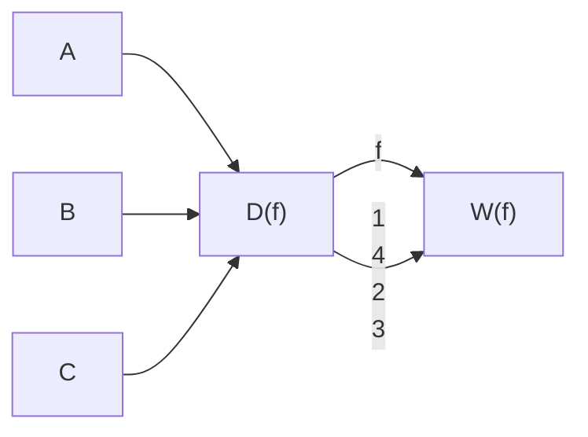

Nach Satz 1.2.2 gilt $|x| = 0$ für $x = 0$.

zu (1.4.3): Wir betrachten nacheinander die drei Möglichkeiten

$$
\alpha \cdot x = 0, \quad \alpha \cdot x > 0, \quad \alpha \cdot x <   0.
$$

Wenn $\alpha \cdot x = 0$, dann gilt

$$
| \alpha \cdot x | = 0. \tag {1.4.5}
$$

Andererseits ist  $\alpha \cdot x = 0$  genau dann, wenn

$$
\alpha = 0 \quad \text {oder} \quad x = 0,
$$

also gilt

$$
| \alpha | \cdot | x | = 0 \stackrel {(1. 4. 5)} {=} | \alpha \cdot x |.
$$

Wenn $\alpha \cdot x > 0$, dann gilt

$$
| \alpha \cdot x | = \alpha \cdot x. \tag {1.4.6}
$$

Außerdem haben  $\alpha$  und x das gleiche Vorzeichen (Satz 1.2.5). Es folgt, dass

entweder $\alpha < 0$ und $x < 0$ oder $\alpha > 0$ und $x > 0$

gelten muss, so dass

$$
| \alpha | = - \alpha \text {und} | x | = - x \quad \text {oder} \quad | \alpha | = \alpha \text {und} | x | = x,
$$

und damit in beiden Fällen

$$
\left| \alpha \right| \cdot \left| x \right| = \alpha \cdot x \stackrel {(1. 4. 6)} {=} \left| \alpha \cdot x \right|.
$$

Der Fall $\alpha \cdot x < 0$ funktioniert genauso.

zu (1.4.4): Aus $|x + y| = \sqrt{(x + y)^2} = \sqrt{x^2 + 2xy + y^2}$ erhalten wir

$$
| x + y | ^ {2} = x ^ {2} + 2 x y + y ^ {2}. \tag {1.4.7}
$$

Andererseits ist

$$
\begin{array}{l} (| x | + | y |) ^ {2} = | x | ^ {2} + 2 | x | \cdot | y | + | y | ^ {2} \\ = x ^ {2} + 2 | x | \cdot | y | + y ^ {2}. \tag {1.4.8} \\ \end{array}
$$

Da $x \cdot y \leq |x| \cdot |y|$ ist, folgt (1.4.4) aus (1.4.7) und (1.4.8).

Die Dreiecksungleichung ist eine sehr wichtige Ungleichung, und Sie werden diese Ungleichung (in $\mathbb{R},\mathbb{R}^n,\mathbb{C}$) sehr oft anwenden.

Ein Fehler, der manchmal vorkommt, ist aus

$$
x <   y
$$

und dem Monotoniegesetz der Addition zu behaupten, dass

$$
| x + z | <   | y + z |.
$$

Ein Gegenbeispiel ist x = -10, y = 1, z = 2. Allerdings gelten folgende Ungleichungen:

Korollar 1.4.4. Für alle $x, y \in \mathbb{R}$ gilt

$$
| x - y | \geq | x | - | y |,
$$

$$
\left| | x | - | y | \right| \leq | x - y | \quad \text {(umgekehrte Dreiecksungleichung)}.
$$

Beweis. Die erste Ungleichung folgt aus (1.4.4) angewendet auf

$$
\tilde {x} = y, \quad \tilde {y} = x - y,
$$

so dass

$$
| \tilde {x} + \tilde {y} | \leq | \tilde {x} | + | \tilde {y} | \quad \Rightarrow \quad | x | \leq | y | + | x - y |.
$$

Für die zweite Ungleichung kombinieren wir

$$
| x | - | y | \leq | x - y |
$$

und

$$
| y | - | x | \leq | x - y | \Rightarrow | x | - | y | \geq - | x - y |
$$

um zu schließen

$$
- | x - y | \leq | x | - | y | \leq | x - y |,
$$

was der umgekehrten Dreiecksungleichung entspricht.

Wir benutzen den Absolutbetrag um “Abstand” zu definieren.

## Definition 1.4.5

Für $x, y \in \mathbb{R}$ ist der $\underline{\text{Abstand}} d(x, y)$ zwischen $x$ und $y$ definiert als

$$
d (x, y) = | x - y |.
$$

Bemerkung. Für  $z, w \in C$  definiert man  $d(z, w) = |z - w|$ , wobei  $|\cdot|$  der Absolutbetrag in C ist.

## Satz 1.4.6

Es gilt

• Positive Definitheit:

$$
d (x, y) \geq 0 \quad \text { für   alle } x, y \in \mathbb {R}, \qquad d (x, y) = 0 \quad \Longleftrightarrow \quad x = y.
$$

\- Symmetrie:

$$
d (x, y) = d (y, x) \quad \text { für   alle } x, y \in \mathbb {R}.
$$

\- Dreiecksungleichung:

$$
d (x, y) \leq d (x, z) + d (z, y) \quad \text { für   alle } x, y \in \mathbb {R}.
$$

text_image

z = Italien
x = hier
y = da

Abbildung 1.2: Wenn man von hier nach da reisen muss und einen schönen Zwischenaufenthalt in Italien möchte, kann es die Reise nur länger machen.

Beweis. Übung.

## 1.5 Einige elementare Ungleichungen

Obwohl man es in den ersten Vorlesungen kaum erkennt, können die meisten angewandten Probleme nicht exakt gelöst werden. Anstatt die genaue Lösung einer algebraischen Gleichung oder einer Differentialgleichung in der Hand zu haben, werden wir damit zufrieden sein müssen, eine Approximation der Lösung zu haben. Sehr oft werden wir auch komplizierte Probleme durch einfachere Probleme ersetzen. Um zu beurteilen, ob eine Approximation (einer Lösung oder eines Problems) gut ist oder nicht, werden wir Restterme abschätzen müssen. In diesem Abschnitt, schauen wir uns die ersten elementaren Ungleichungen an. Wir werden immer wieder zu diesen Ungleichungen zurückkehren.

Lemma 1.5.1. Für alle $x, y \in \mathbb{R}$ gilt folgendes:

(i) $x < y + \varepsilon$ für alle $\varepsilon > 0$ genau dann, wenn $x \leq y$.
(ii) $|x| < \varepsilon$ für alle $\varepsilon > 0$ genau dann, wenn $x = 0$.

Wir lassen den Beweis als Übung. Wichtig ist auch, dass das Lemma 1.5.1 nicht aussagt, dass $x < y + \varepsilon$ für alle $\varepsilon > 0$ impliziert $x < y$.

Als Nächstes betrachten wir die Bernoullische Ungleichung. Diese Ungleichung ersetzt  $(1 + x)^{n}$  (n Multiplikationen) durch  $1 + nx$  (eine Multiplikation).

## Satz 1.5.2: Bernoullische Ungleichung

Für alle $x \in \mathbb{R}$ mit $x > -1$ und $n \in \mathbb{N}$ gilt

$$
(1 + x) ^ {n} \geq 1 + n x. \tag {1.5.1}
$$

Falls zusätzlich  $x \neq 0$ , dann ist

$$
(1 + x) ^ {n} > 1 + n x \quad \text { für   alle } n > 1. \tag {1.5.2}
$$

Ob (und wann) (1.5.1) oder (1.5.2) eine gute Approximation ist oder nicht, können Sie sich überlegen.

Beweis. Offensichtlich ist, dass:

- (1.5.1) für $x = 0$ und für alle $n \in \mathbb{N}$, sowie
• (1.5.1) für alle  $x \in R$  und n = 1 gilt.

Da für $n > 1$ (1.5.2) stärker ist als (1.5.1), reicht es aus zu zeigen, dass (1.5.2) für $x \neq 0, n > 1$ gilt. Wir benutzen vollständige Induktion.

Schritt 1: („Base case“ oder Induktionsanfang.) (n = 2) Für x > -1, x ≠ 0 ist

$$
\begin{array}{l} (1 + x) ^ {2} = 1 + 2 x + x ^ {2} \\ > 1 + 2 x \quad \text {weil} x \neq 0, \\ \end{array}
$$

also gilt (1.5.2) für $n = 2$.

Schritt 2: (Induktionsschritt.) („N ⇒ N+1“) Sei x > -1, x ≠ 0 gegeben. Wir nehmen an, dass (1.5.2) für ein beliebiges N ∈ N, N ≥ 2 gilt. Dann ist

$$
\begin{array}{l} (1 + x) ^ {N + 1} = (1 + x) (1 + x) ^ {N} \\ > (1 + x) (1 + N x) \quad \text {nach Annahme und, weil} 1 + x > 0 \\ = 1 + N x + x + N x ^ {2} \\ > 1 + (N + 1) x \quad \text {weil} x \neq 0 (\text {und} N \neq 0). \\ \end{array}
$$

Also gilt (1.5.2) für  $N + 1$ . Nach dem Prinzip der vollständigen Induktion (Satz 1.3.1) gilt (1.5.2) für alle  $n \geq 2$ . ☐

## Übung 1.5.3

Sie leihen sich von Ihren Eltern 1000€ und kaufen dafür Aktien. Sie sind sicher, dass die Aktien irgendwann steigen werden. Aber in den ersten Jahren verlieren sie 2 % an Wert pro Jahr. Wenn Sie mehr als 500€ verlieren, kriegen Sie Ärger. Sie fragen sich, wie lange Sie das noch durchhalten können (aber Sie haben keinen Taschenrechner dabei). Wenden Sie die Bernoullische Ungleichung an, um eine untere Schranke (ohne Taschenrechner)

zu finden.

Es wird oft nützlich sein, ein Produkt durch eine Summe zu ersetzen. Das erste Ergebnis in diese Richtung ist folgendes:

Lemma 1.5.4 (Elementare Youngsche Ungleichung). Für alle $x, y \in \mathbb{R}$ gilt

$$
x y \leq \frac {1}{2} x ^ {2} + \frac {1}{2} y ^ {2}. \tag {1.5.3}
$$

Es folgt

$$
\sqrt {x y} \leq \frac {1}{2} x + \frac {1}{2} y \quad f u r a l l e x, y \geq 0, \tag {1.5.4}
$$

$$
x y \leq \frac {\varepsilon}{2} x ^ {2} + \frac {1}{2 \varepsilon} y ^ {2} \quad f u r a l l e x, y \in \mathbb {R} u n d \varepsilon > 0. \tag {1.5.5}
$$

Beweis. Die Ungleichung (1.5.3) folgt aus

$$
(x - y) ^ {2} \geq 0. \tag {1.5.6}
$$

Wenn man (1.5.3) mit  $\tilde{x} = \sqrt{x}, \tilde{y} = \sqrt{y}$  betrachtet, erhält man (1.5.4). Für (1.5.5) betrachtet man (1.5.3) mit  $\tilde{x} = \sqrt{\varepsilon}x, \tilde{y} = \frac{1}{\sqrt{\varepsilon}}y$ . ☐

Frage: Wir schauen uns (1.5.4) genauer an. Der Ausdruck

$$
\frac {x + y}{2}
$$

auf der rechten Seite ist das arithmetische Mittel von $x$ und $y$. Auf der linken Seite ist

$$
\sqrt {x y}
$$

das sogenannte geometrische Mittel von x und y. Also drückt (1.5.4) aus, dass das geometrische Mittel zweier reeller Zahlen kleiner dem arithmetischen Mittel der Zahlen ist. (Wann gilt Gleichheit?) Man kann sich fragen, ob es eine Verallgemeinerung dieser Tatsache gibt. Seien n positive reelle Zahlen  $\{x_{1}, x_{2}, ..., x_{n}\}$  gegeben. Falls es eine reelle Zahl r gibt, so dass

$$
r ^ {n} = x _ {1} \cdot x _ {2} \cdot \ldots \cdot x _ {n}
$$

gilt, nennen wir r die n-te Wurzel aus  $x_{1} \cdot x_{2} \cdot \ldots \cdot x_{n}$ . Wir schreiben

$$
r = \sqrt [ n ]{x _ {1} \cdot x _ {2} \cdot \ldots \cdot x _ {n}}.
$$

Man erhält:

## Satz 1.5.5

Es seien positive reellen Zahlen  $x_{1}, \ldots, x_{n}$  für  $n \geq 2$  gegeben. Dann gilt

$$
\sqrt [ n ]{x _ {1} \cdot x _ {2} \cdot \cdots \cdot x _ {n}} \leq \frac {x _ {1} + x _ {2} + \dots + x _ {n}}{n}. \tag {1.5.7}
$$

Außerdem gilt in (1.5.7) Gleichheit genau dann, wenn

$$
x _ {1} = x _ {2} = \dots = x _ {n}. \tag {1.5.8}
$$

Bemerkung. Man kann die zweite Aussage auch als Optimierungsproblem formulieren. Sei die Summe  $x_{1} + x_{2} + \ldots + x_{n}$  gegeben. (Dies ist die Bedingung des Optimierungsproblems.) Man möchte das größte Produkt

$$
x _ {1} \cdot x _ {2} \cdot \dots \cdot x _ {n} \text {(die Zielfunktion des Optimierungsproblems)}
$$

erhalten. Was sollte man für  $x_{1}, x_{2}, \ldots, x_{n}$  wählen? (1.5.8) drückt aus, dass die eindeutige Lösung des Problems

$$
x _ {1} = x _ {2} = \dots = x _ {n}
$$

ist.

Beweis von Satz 1.5.5. Wir benutzen vollständige Induktion. Der Fall n = 2 wurde in (1.5.4) bestätigt und (1.5.8) für n = 2 folgt aus (1.5.6). Es bleibt zu zeigen, dass, wenn die Aussage für ein  $N \in N$  gilt, dann gilt die Aussage auch für  $N + 1$ . Zunächst bemerken wir, daß aus

$$
x _ {1} = x _ {2} = \dots = x _ {N + 1}
$$

(1.5.7) mit Gleichheit folgt. Also reicht es aus, wenn wir (1.5.7) mit echter Ungleichheit für  $x_{1},\ldots,x_{N+1}$  nicht alle gleich zeigen.

Also seien  $x_{1},\ldots,x_{N+1}$  nicht alle gleich gegeben. Dann gilt

$$
\min \{x _ {1}, \dots , x _ {N + 1} \} <   \underbrace {\frac {x _ {1} + \dots + x _ {N + 1}}{N + 1}} _ {=: S} <   \max \{x _ {1}, \dots , x _ {N + 1} \}. \tag {1.5.9}
$$

Ohne Beschränkung der Allgemeinheit (o.B.d.A.), nehmen wir an, daß

$$
x _ {N} = \min \{x _ {1}, \dots , x _ {N + 1} \}, \qquad x _ {N + 1} = \max \{x _ {1}, \dots , x _ {N + 1} \},
$$

so daß (1.5.9) die Form

$$
x _ {N} <   S <   x _ {N + 1} \tag {1.5.10}
$$

annimmt. Jetzt möchten wir die Induktionsannahme anwenden. Dazu bemerken wir, daß

$$
\begin{array}{l} N S = (N + 1) S - S = x _ {1} + \dots + x _ {N + 1} - S \\ = x _ {1} + \dots + x _ {N - 1} + y, \tag {1.5.11} \\ \end{array}
$$

wobei  $y := x_{N} + x_{N+1} - S$  definiert ist. Man merkt, dass y > 0 aus (1.5.10) folgt. Der Vorteil in (1.5.11) ist, daß wir auf der rechten Seite die Summe von N Zahlen haben.

Des weiteren ist nach (1.5.11) das arithmetische Mittel dieser N Zahlen S, so dass die Induktionsannahme für diese N Zahlen liefert

$$
x _ {1} \cdot x _ {2} \cdot \dots \cdot x _ {N - 1} \cdot y \leq S ^ {N}. \tag {1.5.12}
$$

Aus (1.5.12) schließen wir, dass

$$
x _ {1} \cdot x _ {2} \cdot \dots \cdot x _ {N - 1} \cdot y \cdot S \leq S ^ {N + 1}. \tag {1.5.13}
$$

Jetzt reicht es aus, wenn wir

$$
y \cdot S > x _ {N} \cdot x _ {N + 1}
$$

zeigen. Wir rechnen

$$
y \cdot S = (x _ {N} + x _ {N + 1} - S) S = (S - x _ {N}) (x _ {N + 1} - S) + x _ {N} x _ {N + 1} \stackrel {(1. 5. 1 0)} {>} x _ {N} x _ {N + 1}.
$$

Es wurde 2012 im Spiegel über angewandte Probleme in der Schule berichtet. 97 Schulkindern wurde folgendes Problem präsentiert:

Auf einem Schiff befinden sich 26 Schafe und 10 Ziegen. Wie alt ist der Kapitän?

76 der 97 befragten Kinder rechneten ein Ergebnis aus. (Was ist die falsche und populäre Antwort? Jeder erkennt sie: 36 Jahre.)

Unsere Aufgaben sind fortgeschrittener, aber es ist für uns genauso wichtig, nichts auszurechnen, bevor wir uns die Logik überlegt haben.

Beispiel. Die Orte A und D seien 100 km voneinander entfernt. Die Strecke von A nach D wurde mit einer Geschwindigkeit von  $v_{1}=60$  km/h zurückgelegt, die von D nach A mit  $v_{2}=40$  km/h. Was ist die Durchschnittsgeschwindigkeit?

(Was ist die falsche und populäre Antwort? 50 km/h.)

Bemerkung. Hier ist die einzige nichttriviale Frage: Was ist die Definition von Durchschnittsgeschwindigkeit?

Lösung. 200 km wurden gereist. Für die erste Strecke wurde

$$
T _ {1} = \frac {1 0 0 \mathrm{km}}{6 0 \mathrm{km/h}} = \frac {1 0}{6} \mathrm{h}
$$

gebraucht, und für die zweite Strecke wurde

$$
T _ {2} = \frac {1 0 0 \mathrm{km}}{4 0 \mathrm{km/h}} = \frac {1 0}{4} \mathrm{h}
$$

gebraucht. Also hat die Reise insgesamt

$$
T = T _ {1} + T _ {2} = \frac {2 5}{6} \mathrm{h}
$$

gedauert. Die Durchschnittsgeschwindigkeit war also

$$
\frac {2 0 0 \mathrm{km}}{\frac {2 5}{6} \mathrm{h}} = 4 8 \mathrm{km/h}.
$$

Bemerkung. Man kann es auch so formulieren: Aus 60 und 40 erhält man 48, indem man

$$
\frac {1}{\frac {1}{2} \left(\frac {1}{4 0} + \frac {1}{6 0}\right)} k m / h
$$

ausrechnet. Für n gegebene positive Zahlen  $x_{1}, x_{2}, \ldots, x_{n}$  heißt

$$
\frac {1}{\frac {1}{n} \left(\frac {1}{x _ {1}} + \frac {1}{x _ {2}} + \dots + \frac {1}{x _ {n}}\right)}
$$

das harmonische Mittel. Man kann zeigen, dass

$$
\frac {1}{\frac {1}{n} \sum_ {i = 1} ^ {n} \frac {1}{x _ {i}}} \leq \sqrt [ n ]{x _ {1} \cdot x _ {2} \cdot \dots \cdot x _ {n}} \leq \frac {1}{n} \sum_ {i = 1} ^ {n} x _ {i}.
$$

natural_image

Pure electrical circuit lines without any symbols

Abbildung 1.3: Welche Mittel spielen eine Rolle in Serien- und Parallelschaltkreisen?

Zwei Artikel, die mit dem Thema arithmetische/geometrische/harmonische Mittel zu tun haben, sind:

① L.F. Henderson, The Theorem of the Arithmetic and Geometric Mean and its Application to a Problem in Gas Dynamics, ZAMP 25 (1965) betrachtet die Frage: Was ist der minimale Entropie-Anstieg in einem System von Stoßwellen?
② C.G. Carvalhaes und P. Suppes, Approximations for the period of the simple pendulum based on the arithmetic-geometric mean, Am.J.Phys 76 (2008) leitet approximative Lösungen der Pendelgleichung her, die sehr schnell konvergieren.

## Kapitel 2

## Vektorräume

## 2.1 Der Vektorraum $\mathbb{R}^n$

Im Zusammenhang mit den komplexen Zahlen C haben wir bereits geordnete Paare reeller Zahlen kennengelernt. Wir haben gesagt, eine komplexe Zahl besteht aus einem Realteil  $x \in R$  und einem Imaginärteil  $y \in R$ , die wir wir folgt kombinieren

$$
\binom {x} {y} = x \underbrace {\binom {1} {0}} _ {=: \mathbf {1}} + y \underbrace {\binom {0} {1}} _ {=: \mathbf {i}} = x \mathbf {1} + y \mathbf {i}. \tag {2.1.1}
$$

In der Regel werden wir die 1 nicht mehr schreiben. Wir werden auch für jetzt keinen Unterschied machen zwischen der Spaltenschreibweise (2.1.1) und der Zeilenschreibweise  $(x, y)$ . (Wir werden erst später sehen, dass die beiden Objekte nicht dasselbe bedeuten.) Es ist aber sehr wichtig sich klarzumachen, dass die beiden reellen Zahlen geordnet sind:

$$
\binom{x}{y} \neq \binom{y}{x} \quad \text {falls} x \neq y.
$$

Wir können uns eine komplexe Zahl  $z = x + yi$  als einen Punkt in der Ebene vorstellen, wobei x die Koordinate des Punktes in horizontaler Richtung darstellt und y die Koordinate in vertikaler Richtung. Falls der Imaginärteil y gleich null ist, dann identifizieren wir  $z = x + 0i$  mit der reellen Zahl x; in diesem Sinne sind die reellen Zahlen R in den komplexen Zahlen C enthalten. Wir haben gesehen, dass man komplexe Zahlen addieren kann:

$$
\binom {x _ {1}} {y _ {1}} \oplus \binom {x _ {2}} {y _ {2}} = \binom {x _ {1} + x _ {2}} {y _ {1} + y _ {2}}, \tag {2.1.2}
$$

d.h. wir addieren die entsprechenden Komponenten miteinander und erhalten eine komplexe Zahl (ein geordnetes Paar reeller Zahlen). Wir können auch multiplizieren:

$$
\binom{x _ {1}}{y _ {1}} \otimes \binom{x _ {2}}{y _ {2}} = \binom{x _ {1} \cdot x _ {2} - y _ {1} \cdot y _ {2}}{x _ {1} \cdot y _ {2} + y _ {1} \cdot x _ {2}}.
$$

Falls einer der Faktoren eine reelle Zahl ist (d.h. der Imaginärteil ist null), dann gilt

$$
\alpha \cdot \binom{x}{y} := \binom{\alpha}{0} \otimes \binom{x}{y} = \binom{\alpha \cdot x - 0 \cdot y}{\alpha \cdot y + 0 \cdot x} = \binom{\alpha \cdot x}{\alpha \cdot y}. \tag {2.1.3}
$$

Es werden also die beiden Komponenten x, y mit  $\alpha$  multipliziert.

Wir wollen jetzt diese Konstruktion verallgemeinern auf geordnete n-Tupel reeller Zahlen. Mit diesen Objekten, die wir Vektoren nennen werden, wollen wir wieder rechnen können. Wir werden deshalb eine Addition analog zu (2.1.2) definieren. Für die Multiplikation werden wir uns damit zufrieden geben, Vektoren mit reellen Zahlen multiplizieren zu können. Die Multiplikation zweier Vektoren ist im allgemeinen nicht sinnvoll. (Wir werden später sehen, dass wir in speziellen Fällen eine Multiplikation von Vektoren definieren können. Allerdings hat diese Multiplikation unerwartete Eigenschaften; sie ist z.B. nicht mehr kommutativ: Wenn wir die Reihenfolge der Faktoren ändern, ändert sich das Ergebnis.)

Wir werden im Folgenden die üblichen Symbole + und · für Addition und Multiplikation (mit reellen Zahlen) verwenden. Indem Sie Sich klarmachen, mit welchen Objekten Sie operieren (Zahlen, Vektoren, ...), werden Sie wissen, um welche Multiplikation es sich handelt. Wir werden in der Regel auch das Symbol · ganz weglassen, wie wir das für die Multiplikation reeller Zahlen vereinbart haben. Es gilt wieder: Punktrechnung geht vor Strichrechnung (Multiplikationen zuerst ausführen!). Benutzen Sie im Zweifelsfall Klammern, um die Reihen-folge der Operationen anzuzeigen.

## Definition 2.1.1

Unter dem Vektorraum $\mathbb{R}^{n}$ verstehen wir die Menge

$$
\mathbb {R} ^ {n} := \left\{\underline {{x}} = \left( \begin{array}{c} x _ {1} \\ \vdots \\ x _ {n} \end{array} \right): x _ {1}, \dots , x _ {n} \in \mathbb {R} \right\}, \tag {2.1.4}
$$

deren Element wir Vektoren nennen, versehen mit der Addition

$$
\underline {{x}} + \underline {{y}} := \left( \begin{array}{c} x _ {1} + y _ {1} \\ \vdots \\ x _ {n} + y _ {n} \end{array} \right) \quad \text {f ü r a l l e} \quad \underline {{x}} = \left( \begin{array}{c} x _ {1} \\ \vdots \\ x _ {n} \end{array} \right), \underline {{y}} = \left( \begin{array}{c} y _ {1} \\ \vdots \\ y _ {n} \end{array} \right) \in \mathbb {R} ^ {n};
$$

und der skalaren Multiplikation (d.h. einer Multiplikation mit Zahlen)

$$
\alpha \underline {{x}} := \left( \begin{array}{c} \alpha x _ {1} \\ \vdots \\ \alpha x _ {n} \end{array} \right) \quad \text {f ü r a l l e} \quad \underline {{x}} = \left( \begin{array}{c} x _ {1} \\ \vdots \\ x _ {n} \end{array} \right) \in \mathbb {R} ^ {n}, \alpha \in \mathbb {R}.
$$

Nach Definition ergeben die Addition und die skalare Multiplikation wieder Vektoren in  $R^{n}$ . Notation: In der Regel hat ein Vektor x die Komponenten  $x_{1},\ldots,x_{n}\in R$  etc.

Bemerkung. Zwei Vektoren sind gleich, wenn alle Komponenten übereinstimmen, also

$$
\underline {{x}} = \left( \begin{array}{c} x _ {1} \\ \vdots \\ x _ {n} \end{array} \right) = \left( \begin{array}{c} y _ {1} \\ \vdots \\ y _ {n} \end{array} \right) = \underline {{y}} \qquad \Longleftrightarrow \qquad x _ {i} = y _ {i} f u r \text {alle} i = 1, \dots , n.
$$

Insbesondere erhält man nach Vertauschen zweier Komponenten  $x_{i} \neq x_{j}$  mit  $i \neq j$  einen Vektor, der von x verschieden ist. Wir werden zunächst nicht zwischen der Spaltenschreibweise (2.1.4) und der Zeilenschreibweise  $(x_{1}, \ldots, x_{n})$  unterscheiden.

Die Regeln für das Rechnen mit reellen Zahlen haben wir in den algebraischen Axiomen für R zusammengefasst; siehe Abschnitt 1.2.1. Da  $R^{n}$  Tupel reeller Zahlen enthält, übertragen sich einige dieser Rechenregeln auf die Addition und skalare Multiplikation von Vektoren.

Lemma 2.1.2. Es seien $\underline{x},\underline{y},\underline{z}\in \mathbb{R}^n$ und $\alpha ,\beta \in \mathbb{R}$. Dann gilt

(A1)  $\underline{x} + \underline{y} = \underline{y} + \underline{x}$  (Kommutativgesetz der Addition);
$(A2)\underline{x} +(\underline{y} +\underline{z}) = (\underline{x} +\underline{y}) + \underline{z}$ (Assoziativgesetz der Addition);
(A3)  $\underline{x} + \underline{0} = \underline{x}$  mit  $\underline{0} := \begin{pmatrix} 0 \\ \vdots \\ 0 \end{pmatrix}$  (Neutrales Element der Addition);
(A4) Zu jedem $\underline{x} \in \mathbb{R}^n$ existiert genau ein $y \in \mathbb{R}^n$ mit $\underline{x} + \underline{y} = \underline{0}$. Dieses Element ist

$$
\left( \begin{array}{c} - x _ {1} \\ \vdots \\ - x _ {n} \end{array} \right) =: - \underline {{x}} \quad (I n v e r s e s E l e m e n t d e r A d d i t i o n);
$$

$(S1)\ \alpha(\beta\underline{x}) = (\alpha\beta)\underline{x}\quad$ (Assoziativgesetz der skalaren Multiplikation);
$(S2)\ 1\underline{x} = \underline{x}\qquad (Neutrales Element der skalaren Multiplikation);$
(D1) $(\alpha + \beta)\underline{x} = \alpha\underline{x} + \beta\underline{x}$ (Distributivgesetz 1);
(D2) $\alpha (\underline{x} +\underline{y}) = \alpha \underline{x} +\alpha \underline{y}$ (Distributivgesetz 2).

Beweis. Übung.

Bemerkung. Wir nennen $\underline{0}$ den Nullvektor in $\mathbb{R}^n$ und es gilt $-\underline{x} = (-1)\underline{x}$.

Bemerkung. Wir werden später andere Vektorräume kennenlernen. Allen Vektorräumen ist gemeinsam, dass auf ihnen eine Addition und skalare Multiplikation definiert sind derart, dass die Rechenregeln in Lemma 2.1.2 erfüllt sind. Man bezeichnet diese dementsprechend auch als Vektorraumaxiome, weil sie die Eigenschaften jedes Vektorraums festlegen.

Analog zu unserem Vorgehen bei den komplexen Zahlen, die wir als Kombination von 1 und i dargestellt haben, wollen wir nun auch für den  $R^{n}$  eine solche Zerlegung angeben.

Für jedes $j = 1, \dots, n$ nennen wir

$$
\underline {{e}} _ {j} := \left( \begin{array}{c} 0 \\ \vdots \\ 0 \\ 1 \\ 0 \\ \vdots \\ 0 \end{array} \right) \quad (\text {die 1 steht an der jten Stelle})
$$

den jten Einheitsvektor des $\mathbb{R}^{n}$. Für alle $\underline{x} \in \mathbb{R}^{n}$ gilt dann

$$
\underline {{x}} = \left( \begin{array}{c} x _ {1} \\ \vdots \\ x _ {n} \end{array} \right) = x _ {1} \underbrace {\left( \begin{array}{c} 1 \\ 0 \\ \vdots \\ 0 \end{array} \right)} _ {\underline {{e}} _ {1}} + \dots + x _ {n} \underbrace {\left( \begin{array}{c} 0 \\ \vdots \\ 0 \\ 1 \end{array} \right)} _ {\underline {{e}} _ {n}} = \sum_ {j = 1} ^ {n} x _ {j} \underline {{e}} _ {j}.
$$

Bemerkung. Indem wir 1 mit $\underline{e_1}$, i mit $\underline{e_2}$ gleichsetzen, bemerken wir, dass die komplexen Zahlen (siehe Abschnitt (1.2.1)) und der $\overline{\text{Vektorraum}} \mathbb{R}^2$ dieselben Elemente enthält. Beachten Sie aber, dass wir für $\mathbb{C}$ eine Multiplikation definiert haben (dadurch wurde $\mathbb{C}$ zu einem Körper, für den die algebraischen Axiome gelten), während $\mathbb{R}^2$ nur ein Vektorraum ist.

Wie bereits erwähnt, können wir komplexe Zahlen (und mithin Vektoren in  $R^{2}$ ) als Punkte in der Ebene auffassen. Wir wollen nun Vektoren eine Länge zuordnen. Anschaulich entspricht diese Länge dem Abstand des durch den Vektor repräsentierten Punktes zum Nullpunkt. Diesen Abstand können wir mit dem Satz von Pythagoras berechnen (in einem rechtwinkligen Dreieck ist das Quadrat der Länge der Hypothenuse gleich der Summe der Quadrate der beiden Katheten). Die Verallgemeinerung dieser Anschauung auf den Vektorraum  $R^{n}$  führt auf den Begriff der euklidischen Norm.

## Definition 2.1.4

Für zwei Vektoren  $\underline{x},\underline{y}\in R^{n}$  definieren wir das Skalarprodukt · als

$$
\underline {{x}} \cdot \underline {{y}} := x _ {1} y _ {1} + \dots + x _ {n} y _ {n} = \sum_ {i = 1} ^ {n} x _ {i} y _ {i}
$$

(wird auch inneres Produkt genannt). Alternativ werden wir die Schreibweise

$$
(\underline {{x}}, \underline {{y}}) := \underline {{x}} \cdot \underline {{y}}
$$

für das Skalarprodukt verwenden. Die euklidische Norm eines Vektors ist

$$
\| \underline {{x}} \| := \sqrt {\underline {{x}} \cdot \underline {{x}}} = \sqrt {x _ {1} ^ {2} + \cdots + x _ {n} ^ {2}}.
$$

Zu zwei Vektoren  $\underline{x},\underline{y}\in R^{n}$  definieren wir den Abstand

$$
d (\underline {{x}}, \underline {{y}}) := \| \underline {{x}} - \underline {{y}} \|.
$$

Bemerkung. Beachten Sie, dass wir in der Vergangenheit das Symbol · für die Multiplikation von reellen Zahlen benutzt haben. Wir haben außerdem vereinbart, diese Schreibweise möglichst nicht mehr zu verwenden. Es ist aus dem Zusammenhang jeweils klar, ob · für die Multiplikation von reellen Zahlen oder das Skalarprodukt steht. Beachten Sie auch, dass das Skalarprodukt eine Zahl liefert, keinen Vektor. Es definiert keine Multiplikation auf dem Vektorraum  $R^{n}$ . Eine solche müsste zwei Vektoren wieder einen Vektor zuordnen.

## Satz 2.1.5: Skalarprodukt

Das Skalarprodukt · hat die folgenden Eigenschaften:

\- Positive Definitheit:

$$
\underline {{x}} \cdot \underline {{x}} \geq 0 \quad \text {f ü r a l l e} \underline {{x}} \in \mathbb {R} ^ {n}, \qquad \underline {{x}} \cdot \underline {{x}} = 0 \quad \Longleftrightarrow \quad \underline {{x}} = \underline {{0}}.
$$

\- Symmetrie:

$$
\underline {{x}} \cdot \underline {{y}} = \underline {{y}} \cdot \underline {{x}} \quad \text { für   alle } \underline {{x}}, \underline {{y}} \in \mathbb {R} ^ {n}.
$$

\- Linearität:

$$
(\alpha \underline {{x}} + \beta \underline {{y}}) \cdot \underline {{z}} = \alpha (\underline {{x}} \cdot \underline {{z}}) + \beta (\underline {{y}} \cdot \underline {{z}}) \quad \text {f ü r a l l e} \alpha , \beta \in \mathbb {R} \text {und} \underline {{x}}, \underline {{y}}, \underline {{z}} \in \mathbb {R} ^ {n}.
$$

Wegen der Symmetrie gilt dann auch Linearität im zweiten Faktor.

Beweis. Übung.

## Satz 2.1.6: Norm

Die (euklidische) Norm hat die folgenden Eigenschaften:

\- Positive Definitheit:

$$
\| \underline {{x}} \| \geq 0 \quad \text {fur alle} \underline {{x}} \in \mathbb {R} ^ {n}, \quad \| \underline {{x}} \| = 0 \quad \Longleftrightarrow \quad \underline {{x}} = \underline {{0}}.
$$

\- Homogenität:

$$
\| \alpha \underline {{x}} \| = | \alpha | \| \underline {{x}} \| \quad \text {furalle} \alpha \in \mathbb {R} \text {und} \underline {{x}} \in \mathbb {R} ^ {n}.
$$

\- Dreiecksungleichung:

$$
\| \underline {{x}} + \underline {{y}} \| \leq \| \underline {{x}} \| + \| \underline {{y}} \| \quad \text { für   alle } \underline {{x}}, \underline {{y}} \in \mathbb {R} ^ {n}.
$$

Beweis. Die ersten zwei lassen wir als Übung. Die Dreiecksungleichung wird unten in (2.2.3) gezeigt.

Bemerkung. Vergleichen Sie Satz 2.1.6 mit Satz 1.4.2. Der Begriff der Norm verallgemeinert also den Begriff des Absolutbetrags, den wir für reelle Zahlen eingeführt haben. Außer der euklidischen Norm gibt es andere Möglichkeiten, einem Vektor $\underline{x} \in \mathbb{R}^n$ eine Zahl zuzuordnen derart, dass die Eigenschaften positive Definitheit, Homogenität und Dreiecksungleichung wie in Satz 2.1.6 erfüllt sind. Eine solche Zuordnung nennen wir Norm. Beispiele sind

$$
\| \underline {{x}} \| _ {1} := | x _ {1} | + \dots + | x _ {n} |, \quad \| \underline {{x}} \| _ {\infty} := \max \{| x _ {1} |, \dots , | x _ {n} | \}. \tag {2.1.5}
$$

Die Begriffe Norm und Abstand lassen sich auf viele andere Vektorräume verallgemeinern, in manchen Fällen auch der Begriff des Skalarprodukts. Die Rechenregeln in Satz 2.1.6 bezeichnet man auch als Normaxiome, weil sie die Eigenschaften jeder Norm festlegen. Analog sind die Aussagen in Satz 2.1.5 die definierenden Eigenschaften jedes Skalarprodukts.

## Übung 2.1.7

Wann ist $\| \underline{x} +\underline{y}\| = \| \underline{x}\| +\| \underline{y}\|$ für $\underline{x},\underline{y}\in \mathbb{R}^2?$

## Übung 2.1.8

Skizzieren Sie die Menge

$$
\Big \{\underline {{x}} \in \mathbb {R} ^ {2} \colon \| \underline {{x}} \| \leq 1 \Big \}.
$$

Was ändert sich, wenn Sie die euklidische Norm durch die Normen in (2.1.5) ersetzen?

## 2.2 Weitere Ungleichungen

## Satz 2.2.1

Für reelle Zahlen $x_{1}, x_{2}, \ldots, x_{n}$ und $y_{1}, y_{2}, \ldots, y_{n}$ gilt

\- die Dreiecksungleichung (für $n$ reelle Zahlen)

$$
\left| \sum_ {i = 1} ^ {n} x _ {i} \right| \leq \sum_ {i = 1} ^ {n} | x _ {i} |, \tag {2.2.1}
$$

• die Cauchy-Schwarzsche Ungleichung

$$
\left| \sum_ {i = 1} ^ {n} x _ {i} y _ {i} \right| \leq \sum_ {i = 1} ^ {n} | x _ {i} y _ {i} | \leq \sqrt {\sum_ {i = 1} ^ {n} x _ {i} ^ {2}} \sqrt {\sum_ {i = 1} ^ {n} y _ {i} ^ {2}}, \tag {2.2.2}
$$

\- die Minkowski- oder Dreiecksungleichung

$$
\sqrt {\sum_ {i = 1} ^ {n} (x _ {i} + y _ {i}) ^ {2}} \leq \sqrt {\sum_ {i = 1} ^ {n} x _ {i} ^ {2}} + \sqrt {\sum_ {i = 1} ^ {n} y _ {i} ^ {2}}. \tag {2.2.3}
$$

Bemerkung. Wenn man  $\underline{x} = (x_{1}, x_{2}, ..., x_{n}), \underline{y} = (y_{1}, y_{2}, ..., y_{n})$  als Vektoren in  $R^{n}$  zusammen mit dem Vektorprodukt und der Norm

$$
(\underline {{x}}, \underline {{y}}) := \sum_ {i = 1} ^ {n} x _ {i} y _ {i}, \qquad \| \underline {{x}} \| ^ {2} := \sum_ {i = 1} ^ {n} x _ {i} ^ {2}
$$

betrachtet, dann erhält man aus (2.2.1) und (2.2.2) die Cauchy-Schwarzsche Ungleichung

$$
| (\underline {{x}}, \underline {{y}}) | \leq \| \underline {{x}} \| \| \underline {{y}} \|,
$$

und man erkennt (2.2.3) als die Dreiecksungleichung der euklidischen Norm in $\mathbb{R}^n$:

$$
\| \underline {{x}} + \underline {{y}} \| \leq \| \underline {{x}} \| + \| \underline {{y}} \|.
$$

Beweis von Satz 2.2.1. Die erste Ungleichung (2.2.1) kann man mit vollständiger Induktion aus der Dreiecksungleichung für den Absolutbetrag reeller Zahlen schließen. (Übung!)

Für die Cauchy-Schwarzsche Ungleichung (2.2.2), definieren wir

$$
X := \sqrt {\sum_ {i = 1} ^ {n} x _ {i} ^ {2}}, \quad Y := \sqrt {\sum_ {i = 1} ^ {n} y _ {i} ^ {2}}.
$$

Wenn X = 0, dann ist  $x_{i} = 0$  für alle i = 1, .., n, so dass  $\left|\sum_{i=1}^{n} x_{i} y_{i}\right| = 0$  und (2.2.2) dabei erfüllt wird. Das Gleiche gilt, wenn Y = 0. Also dürfen wir annehmen, dass X > 0, Y > 0. Wir definieren

$$
\hat {x} _ {i} := \frac {x _ {i}}{X}, \quad \hat {y} _ {i} := \frac {y _ {i}}{Y} \quad \text {f ü r a l l e} i = 1,.., n.
$$

Dann ist (2.2.2) äquivalent zu

$$
\left| \sum_ {i = 1} ^ {n} \hat {x} _ {i} \hat {y} _ {i} \right| \leq \sum_ {i = 1} ^ {n} | \hat {x} _ {i} \hat {y} _ {i} | \leq 1. \tag {2.2.4}
$$

Wir erhalten (2.2.4) direkt aus

$$
\begin{array}{l} \left| \sum_ {i = 1} ^ {n} \hat {x} _ {i} \hat {y} _ {i} \right| \leq \sum_ {i = 1} ^ {n} \left| \hat {x} _ {i} \hat {y} _ {i} \right| \quad (\text {aus (2.2.1)}) \\ \leq \frac {1}{2} \sum_ {i = 1} ^ {n} \left(\hat {x} _ {i} ^ {2} + \hat {y} _ {i} ^ {2}\right) \quad \text {(Youngsche Ungleichung)} \\ = \frac {1}{2} \left(\frac {1}{X ^ {2}} \sum_ {i = 1} ^ {n} x _ {i} ^ {2} + \frac {1}{Y ^ {2}} \sum_ {i = 1} ^ {n} y _ {i} ^ {2}\right) \\ = 1. \\ \end{array}
$$

zu (2.2.3): Wir rechnen

$$
\begin{array}{l} \sum_ {i = 1} ^ {n} (x _ {i} + y _ {i}) ^ {2} = \sum_ {i = 1} ^ {n} x _ {i} ^ {2} + 2 \sum_ {i = 1} ^ {n} x _ {i} y _ {i} + \sum_ {i = 1} ^ {n} y _ {i} ^ {2} \\ \leq \sum_ {i = 1} ^ {n} x _ {i} ^ {2} + 2 \left(\sum_ {i = 1} ^ {n} x _ {i} ^ {2} \sum_ {i = 1} ^ {n} y _ {i} ^ {2}\right) ^ {\frac {1}{2}} + \sum_ {i = 1} ^ {n} y _ {i} ^ {2} \quad (\text {Cauchy - Schwarzsche Ungleichung}) \\ = \left(\sqrt {\sum_ {i = 1} ^ {n} x _ {i} ^ {2}} + \sqrt {\sum_ {i = 1} ^ {n} y _ {i} ^ {2}}\right) ^ {2}. \\ \end{array}
$$

Bemerkung (Geometrische Perspektive). Man kann den Beweis von (2.2.2) auch aus einer geometrischen Perspektive anschauen. Hier benutzen wir die Notation aus der vorherigen Bemerkung. Man möchte zeigen, dass

$$
| (\underline {{x}}, \underline {{y}}) | \leq \| \underline {{x}} \| \| \underline {{y}} \|. \tag {2.2.5}
$$

Diese Ungleichung ist sicherlich richtig, falls $\underline{x}$ oder $\underline{y}$ der Nullvektor ist. Wir betrachen also nur den Fall, dass $\underline{x} \neq \underline{0} \neq \underline{y}$. Das impliziert insbesondere, dass $\| \underline{x} \| > 0$ und $\| \underline{y} \| > 0$. Man erhält Informationen über $(\underline{x}, y)$ durch die Ungleichung

$$
\| \underline {{x}} \| ^ {2} - 2 (\underline {{x}}, \underline {{y}}) + \| \underline {{y}} \| ^ {2} = \| \underline {{x}} - \underline {{y}} \| ^ {2} \geq 0.
$$

Es folgt nämlich, dass

$$
2 (\underline {{x}}, \underline {{y}}) \leq \| \underline {{x}} \| ^ {2} + \| \underline {{y}} \| ^ {2}.
$$

Diese Ungleichung gilt auch, wenn man y durch ty mit  $t \in R$  ersetzt hat. Indem wir die Homogenität des Skalarprodukts und der  $\overline{Norm}$  ausnutzen, erhalten wir

$$
\| \underline {{x}} \| ^ {2} - 2 t (\underline {{x}}, \underline {{y}}) + t ^ {2} \| \underline {{y}} \| ^ {2} = \| \underline {{x}} - t \underline {{y}} \| ^ {2}.
$$

Diese Identität gilt für alle  $t \in R$ , insbesondere für jenes t, für das die rechte Seite (äquivalent: die Länge des Vektors x - ty) so klein wie möglich wird. Das passende Bild ist

text_image

kürzester Vektor
x
x - y
y

Anschaulich erwarten wir also, dass wir t so wählen, dass der Vektor  $\underline{x}-ty$  senkrecht auf  $\underline{y}$  steht. Das bedeutet, dass das Skalarprodukt  $((\underline{x}-ty),\underline{y})$  verschwindet. Umformen ergibt das optimale  $t_{*}=(\underline{x},\underline{y})/\|\underline{y}\|^{2}$ . Mit dieser Wahl erhalten wir aus  $0\leq\|\underline{x}-t_{*}\underline{y}\|^{2}$ , dass

$$
\| \underline {{x}} \| ^ {2} - 2 \frac {(\underline {{x}} , \underline {{y}})}{\| \underline {{y}} \| ^ {2}} (\underline {{x}}, \underline {{y}}) + \left(\frac {(\underline {{x}} , \underline {{y}})}{\| \underline {{y}} \| ^ {2}}\right) ^ {2} \| \underline {{y}} \| ^ {2} \geq 0 \quad \Longleftrightarrow \quad (\underline {{x}}, \underline {{y}}) ^ {2} \leq \| \underline {{x}} \| ^ {2} \| \underline {{y}} \| ^ {2}.
$$

Das ist äquivalent zur Ungleichung (2.2.5).

## Definition 2.2.2

Zwei Vektoren  $\underline{x},\underline{y}\in R^{n}$  mit der Eigenschaft  $(\underline{x},\underline{y})=0$  nennen wir orthogonal. Orthogonale Vektoren mit Norm eins nennen wir orthonormal.

Beispiel. Die Einheitsvektoren $\underline{e}_i$ mit $i = 1,\dots ,n$ sind orthonormal.

## Kapitel 3

## Reelle Funktionen

Funktionen sind von zentraler Bedeutung in der höheren Mathematik. Wie immer wird es wichtig sein

- alle unsere Intuition und grundlegendes Wissen hier anzuwenden, um Verständnis für die Situation aufzubauen, und
- zwischen heuristischem Argument und rigorosen Aussagen zu unterscheiden.

Sie kennen viele Funktionen aus dem Alltag, z.B.,

$$
x (t) = h - \frac {g}{2} t ^ {2} \quad h, g \in \mathbb {R},
$$

$$
f (x) = x + 1,
$$

$$
y (\theta) = \cos \theta .
$$

Was ist eine Funktion?

## 3.1 Definition und erste Eigenschaften

## Definition 3.1.1

Seien $A, B$ Mengen. Das kartesische Produkt $A \times B$ ist die Menge aller geordneten Paare $(x, y)$ mit $x \in A, y \in B$.

## Beispiel.

$$
A := \{1, 3 \}, \quad B := \{2, 4 \}, \qquad A \times B = \{(1, 2), (1, 4), (3, 2), (3, 4) \}
$$

## Definition 3.1.2

Eine Teilmenge $f \subseteq A \times B$ wird $\underline{\text{Funktion}}$ genannt, wenn gilt:

$$
(x, y) \in f \text {und} (x, y ^ {\prime}) \in f \quad \implies \quad y = y ^ {\prime}.
$$

Das heißt, zu jedem  $x \in A$  gibt es höchstens ein  $y \in B$  mit  $(x, y) \in f$ .

Wir definieren den Definitionsbereich  $\mathcal{D}(f)$  von f als

$$
\mathcal {D} (f) := \{x \in A \colon \text {es existiert ein} y \in B \text {mit} (x, y) \in f \},
$$

und den Wertebereich $\mathcal{W}(f)$ von $f$ als

$$
\mathcal {W} (f) := \{y \in B \colon \text {es existiert ein} x \in A \text {mit} (x, y) \in f \}.
$$

Anstelle von  $(x,y)\in f$  benutzen wir die eingängigere Schreibweise

$$
y = f (x)
$$

und nennen $y$ das Bild von $x$ (unter $f$) bzw. $x$ ein Urbild von $y$.

Für Teilmengen $U \subseteq B$ definieren wir das Urbild $f^{-1}(U)$ von $U$ unter $f$ als

$$
f ^ {- 1} (U) := \{x \in A \colon f (x) \in U \}.
$$

Beachten Sie, dass das Urbild immer definiert ist (kann leer sein). Es ist zu unterscheiden von der Umkehrfunktion, die wir später definieren werden!!!

Wenn A und B Mengen reeller Zahlen sind, dann heißt f eine reelle Funktion oder eine reellwertige Funktion einer reellen Variablen.

Grob gesagt: $f$ ist eine Regel, die jedem $x \in \mathcal{D}(f)$ ein eindeutiges $y \in \mathcal{W}(f)$ zuordnet. Achtung! Obwohl das Bild von $x \in \mathcal{D}(f)$ eindeutig bestimmt ist, kann ein Wert $y \in \mathcal{W}(f)$ mehr als ein Urbild haben. Beispiel: $f(x) = x^2, y = 4$.

flowchart

Abbildung 3.1: Illustration einer Funktion

## Beispiele.

①  $f = \{(x, x^{3}) : x \in \mathbb{R}\}$  oder  $f(x) = x^{3}, x \in \mathbb{R}$ ,
②  $f = \{(x, \sqrt{x}) : x \geq 0\}$  oder  $f(x) = \sqrt{x}, x \geq 0,$
③  $f(x)=\frac{1}{(1-x)^{2}}$ ,

④  $f(x)=\begin{cases}-x & x<0 \\5 & x=0 \\x^{2} & x>0.\end{cases}$

## Übung 3.1.3

Was sind der Definitionsbereich und der Wertebereich der oben definierten Funktionen?

Oft wird der Definitionsbereich nicht explizit angegeben, z.B.  $f(x) = x^{2}$ ,  $g(x) = \frac{1}{(1-x)^{2}}$ ,  $h(x) = \sqrt{x^{2}-4}$ . In diesem Fall nehmen wir an, dass der Definitionsbereich so groß wie möglich ist, z.B.  $\mathcal{D}(f) = \mathbb{R}$ ,  $\mathcal{D}(g) = \{x \in \mathbb{R} : x \neq 1\}$ ,  $\mathcal{D}(h) = \{x \in \mathbb{R} : x \geq 2 \text{ oder } x \leq -2\} = (-\infty, -2] \cup [2, \infty)$ .

Es ist oft nützlich den Graphen einer Funktion anzuschauen.

Beispiel.  $f(x)=\begin{cases}1+x & x<0 \\ -1-x & x>0.\end{cases}$

natural_image

Pure geometric diagram with intersecting lines and a central point, no text or symbols present

Vom Graphen erkennt man

$$
\mathcal {D} (f) = \mathbb {R} \setminus \{0 \}, \quad \mathcal {W} (f) = (- \infty , 1).
$$

(Achtung! Hier haben wir den Graphen benutzt um zu erkennen, dass  $\mathcal{W}(f)=(-\infty,1)$ . Wenn nach einem Beweis oder einer Begründung gefragt wird, reicht es nicht aus, ein Bild zu malen. Trotzdem hilft das Bild.)

Beispiel. Finden Sie den Definitionsbereich von  $f(x) := \sqrt{-x^{3} + 2x - 1}$ .

Die Nullstellen von  $p(x) := -x^{3} + 2x - 1 \text{ sind}$

$$
x _ {1} = 1, x _ {2, 3} = \frac {- 1 \pm \sqrt {5}}{2}.
$$

Wir schreiben das Polynom in faktorisierter Form

$$
- x ^ {3} + 2 x - 1 = - (x - 1) \left(x - \frac {- 1 + \sqrt {5}}{2}\right) \left(x - \frac {- 1 - \sqrt {5}}{2}\right)
$$

um abzulesen, wo das Polynom positiv ist. Da der Definitionsbereich der Wurzel  $[0,\infty)$  ist, ist der Definitionsbereich von f genau die Menge, wo p nicht negativ ist:

$$
\left(- \infty , \frac {- 1 - \sqrt {5}}{2} \right] \cup \left[ \frac {- 1 + \sqrt {5}}{2}, 1 \right].
$$

line

| Point | X | Y |
| --- | --- | --- |
| \(x_{2}\) | -1.5 | \(-1 - \sqrt{5}/2\) |
| \(x_{3}\) | 0.6 | \(-1 + \sqrt{5}/2\) |
| \(x_{1}\) | 1 | 1 |

Bemerkung. (1) Jede vertikale Linie berührt den Graph einer Funktion genau einmal.

natural_image

Pure sine wave function graph with dashed vertical line at origin (no labels or text)

(2) Eine horizontale Linie kann den Graph einer Funktion mehr als einmal berühren.

line

| X | Y |
| --- | --- |
| ~0.5 | ~0.2 |
| ~1.5 | ~0.8 |
| ~3.5 | ~0.2 |

Was bedeutet es, wenn eine waagerechte Linie y = b den Graph einer Funktion f genau einmal berührt? Dass b nur ein Urbild hat, d. h., dass es nur ein  $x \in \mathcal{D}(f)$  gibt, so dass $f(x) = b.$

Was bedeutet es, wenn jede waagerechte Linie den Graph einer Funktion f nur einmal berührt? Dass für jeden Wert  $y \in \mathcal{W}(f)$  es nur ein  $x \in \mathcal{D}(f)$  gibt, so dass  $f(x) = y$ .

Was bedeutet es, wenn jede waagerechte Linie den Graph einer Funktion f mindestens einmal berührt? Dass der Wertebereich der Funktion ganz R ist.

## Definition 3.1.4

Eine Funktion $f$ heißt injektiv (oder eins zu eins), wenn gilt:

$$
f (x _ {1}) = f (x _ {2}) \quad \implies \quad x _ {1} = x _ {2}.
$$

Das heißt, bei Gleichheit der Bilder müssen die Urbilder auch gleich sein.

Damit verbunden ist die Eigenschaft der Surjektivität.

## Definition 3.1.5

Eine Funktion  $f: X \to Y$  heißt surjektiv von X nach Y, wenn gilt:

für jedes  $y \in Y$  existiert  $x \in X$  mit  $f(x) = y$ .

Wenn $f$ sowohl surjektiv als auch injektiv ist, dann sagen wir, dass $f$ bijektiv ist.

Man merkt: $f:X\to Y$ ist surjektiv genau dann, wenn $\mathcal{W}(f) = Y$.

Eine kurze Zusammenfassung ist: Eine Funktion  $f: X \rightarrow Y$  ist

(1) injektiv, wenn kein $y \in Y$ mehr als ein Urbild in $X$ hat (bspw. $x^2$, $x \geq 0$),
(2) surjektiv, wenn jedes $y \in Y$ mindestens ein Urbild in $X$ hat (bspw. $x^3$), und
(3) bijektiv, wenn jedes $y \in Y$ genau ein Urbild in $X$ hat (bspw. $x$).

Erinnerung: Graphen helfen uns enorm, die Eigenschaften einer Funktion zu bemerken. Wenn allerdings nach einem Beweis gefragt wird, müssen wir analytisch argumentieren.

Beispiel. Finden Sie den Wertebereich  $\mathcal{W}(f)$  von  $f(x)=\frac{1}{(x-4)^{2}}$ .

Lösung.  $^{1}$ Der Wertebereich ist  $(0, \infty)$ . Dies begründen wir wie folgt. Zunächst bemerken wir, dass

$$
\mathcal {D} (f) = \{x \in \mathbb {R}: x \neq 4 \}.
$$

Für alle $x \in \mathcal{D}(f)$ ist $(x - 4)^2 > 0$, und damit auch

$$
f (x) = \frac {1}{(x - 4) ^ {2}} > 0,
$$

so dass $\mathcal{W}(f)\subseteq(0,\infty)$. Andererseits können wir für alle

$$
y _ {0} \in (0, \infty)
$$

setzen:

$$
x _ {0} := \frac {1}{\sqrt {y _ {0}}} + 4.
$$

Dann ist $x_0 > 4$, so dass $x \in \mathcal{D}(f)$, und es gilt

$$
f (x _ {0}) = \frac {1}{(x _ {0} - 4) ^ {2}} = \frac {1}{\left(\frac {1}{\sqrt {y _ {0}}}\right) ^ {2}} = y _ {0}.
$$

Also gilt $\mathcal{W}(f) \supseteq (0, \infty)$. (Man hätte auch

$$
\tilde {x} _ {0} = - \frac {1}{\sqrt {y _ {0}}} + 4,
$$

das Urbild auf dem erstem Ast von f, wählen können.)

Wir erinnern uns an die Definition 1.1.2, wo wir gesehen haben, wie man die Gleichheit zweier Mengen zeigt.

Wir betrachten jetzt ein paar andere mögliche Eigenschaften einer Funktion.

## Definition 3.1.6

Eine reelle Funktion $f$ heißt gerade, wenn gilt

(1) für jedes $x \in \mathcal{D}(f)$ ist auch $-x \in \mathcal{D}(f)$, und
(2) für jedes $x \in \mathcal{D}(f)$ ist $f(x) = f(-x)$.

Analog heißt die Funktion heißt ungerade, wenn gilt

(1) für jedes $x \in \mathcal{D}(f)$ ist auch $-x \in \mathcal{D}(f)$, und
(2) für jedes $x \in \mathcal{D}(f)$ ist $f(x) = -f(-x)$.

Beispiel. Die Funktion  $f(x) = x^{2}$  ist gerade. Die Funktion  $f(x) = x$  ist ungerade. Allgemein ist  $f(x) = x^{2n}, n \in \mathbb{N}$ , gerade und  $f(x) = x^{2n-1}, n \in \mathbb{N}$ , ungerade.

Beispiel.  $\sin(x)$  ist ungerade.  $\cos(x)$  ist gerade.

## Übung 3.1.7

Geben Sie an, ob folgende Funktionen gerade, ungerade oder keins von beiden sind:

$\tan (x),\sinh (x),\cosh (x),\tanh (x),\exp (x^2).$

## Definition 3.1.8

Wir nennen eine reelle Funktion $f$ monoton wachsend (bzw. monoton fallend), wenn für alle $x, y \in \mathcal{D}(f)$ die folgende Implikation gilt:

$$
\begin{array}{l} x <   y \quad \implies \quad f (x) \leq f (y) \\ ( \quad \text {bzw.} \quad x <   y \quad \implies \quad f (x) \geq f (y) \quad). \\ \end{array}
$$

Wenn $f$ monoton wachsend oder monoton fallend ist, dann nennen wir $f$ monoton. Die Funktion $f$ ist streng monoton wachsend, wenn für alle $x, y \in \mathcal{D}(f)$ gilt:

$$
x <   y \quad \implies \quad f (x) <   f (y),
$$

mit einer analogen Aussage für $f$ streng monoton fallend. Wenn $f$ streng monoton wachsend oder streng monoton fallend ist, dann nennen wir $f$ streng monoton.

Achtung! Nach der Definition ist  $f(x) \equiv 2$  monoton wachsend! Das gleiche gilt für

$$
g (x) = \left\{ \begin{array}{l l} x + 1 & x \leq - 1 \\ 0 & - 1 <   x \leq 1 \\ x - 1 & x > 1. \end{array} \right.
$$

Wir kennen den Begriff von Beschränktheit einer Menge. Was bedeutet es für eine Funktion, beschränkt zu sein?

## Definition 3.1.9

Eine reelle Funktion $f$ heißt nach unten beschränkt, wenn es eine reelle Zahl $m$ gibt, die eine untere Schranke für $\mathcal{W}(f)$ ist. Das heißt, falls gilt:

$$
\text { für   alle } x \in \mathcal {D} (f) \text { haben   wir } m \leq f (x).
$$

Analog für nach oben beschränkt. Ist f sowohl nach unten als auch nach oben beschränkt, so nennen wir f beschränkt.

Diese Eigenschaft ist wichtig, zum Beispiel für Optimierungsprobleme. Für  $f(x) = x^{3}$  besitzt das Problem

$$
\inf _ {x \in \mathbb {R}} f (x) = \inf \left\{f (x): x \in \mathbb {R} \right\}
$$

keine Lösung. Ist f nach unten beschränkt, so existiert das Infimum

$$
\inf _ {x \in \mathbb {R}} f (x).
$$

Aber Vorsicht: Dies bedeutet nicht, dass es ein $x_0 \in \mathbb{R}$ gibt, so dass $f(x_0) = \inf_{x \in \mathbb{R}} f(x)$.

Beispiel. Es gilt

$$
\inf _ {x \in \mathbb {R}} \tanh (x) = - 1
$$

aber es gibt kein $x_* \in \mathbb{R}$, so dass $\tanh(x_*) = -1$.

## 3.2 Die Umkehrfunktion

Oft interessieren wir uns für die sogenannte Umkehrfunktion einer Funktion.

## Definition 3.2.1

Sei $f:X\to Y$ eine Funktion. Gibt es eine Funktion $g:Y\to X$ mit

$$
g (f (x)) = x \quad \text { für   alle } x \in X \tag {3.2.1}
$$

$$
\text {und} \quad f (g (y)) = y \quad \text {für alle} y \in Y, \tag {3.2.2}
$$

dann nennen wir $g$ die Umkehrfunktion von $f$. Wir schreiben

$$
g (y) = f ^ {- 1} (y)
$$

und sagen, dass f eine Umkehrfunktion besitzt, oder, dass f invertierbar ist.

Bemerkung. Beachten Sie, dass dasselbe Symbol  $f^{-1}$  auch für das Urbild einer Menge benutzt wird; siehe Definition 3.1.2. Falls f eine reelle Funktion ist, schreiben wir auch

$$
(f (y)) ^ {- 1} = \frac {1}{f (y)}.
$$

Auf den Kontext achten!!!

Beispiel. Bestimmen Sie, ob die folgenden Funktionen eine Umkehrfunktion besitzen. Wenn ja, finden Sie die Umkehrfunktion. Wenn nein, finden Sie das größte Intervall  $I \subseteq \mathcal{D}(f)$ , so dass f auf I eine Umkehrfunktion besitzt und geben Sie diese Funktion an.

①  $f(x) = x^{2}$  besitzt keine Umkehrfunktion, aber  $g(x) = x^{2}, x \in [0, \infty)$  besitzt die Umkehrfunktion

$$
g ^ {- 1} (y) = \sqrt {y}, \quad y \in [ 0, \infty).
$$

$(Oder g^{-1}(x) = \sqrt{x}, x \in [0, \infty).)$ Analog besitzt $g(x) = x^2, x \in (-\infty, 0]$ die Umkehrfunktion $g^{-1}(x) = -\sqrt{x}, x \in [0, \infty)$.

②  $f(x) = \begin{cases} \frac{1}{2}(x + 1) & -1 \leq x < 1 \\ -x^{2} + 2x + 4 & 1 \leq x \leq 3. \end{cases}$

Auf $[-1, 1)$ gilt

$$
y = \frac {1}{2} (x + 1) \quad \Leftrightarrow \quad x = 2 y - 1.
$$

Auf [1,3] gilt

$$
y = - (x ^ {2} - 2 x - 4)
$$

$$
= - [ (x - 1) ^ {2} - 5 ]
$$

$$
\Leftrightarrow (x - 1) ^ {2} = - y + 5
$$

$$
\Leftrightarrow x = \sqrt {5 - y} + 1 \quad \text {weil} x \geq 1 \text {ist}).
$$

Also ist die Umkehrfunktion

$$
f ^ {- 1} (x) = \left\{ \begin{array}{l l} 2 x - 1 & x \in [ 0, 1) \\ \sqrt {5 - x} + 1 & x \in [ 1, 5 ]. \end{array} \right.
$$

Dieses Beispiel zeigt, dass eine Funktion nicht monoton sein muss, um eine Umkehrfunktion zu besitzen.

③  $f(x)=\left\{\begin{aligned}&\frac{1}{2}(x+1)&0\leq x<1\\ &-x^{2}+2x&1\leq x\leq3.\end{aligned}\right.$

$f$ besitzt keine Umkehrfunktion, aber $g(x) = -x^{2} + 2x$, $x \in [1,3]$ besitzt die Umkehrfunktion $g^{-1}(x) = 1 + \sqrt{1 - x}$, $x \in [-3,1]$.

Man stellt sich die allgemeine Frage: Welche Funktionen besitzen eine Umkehrfunktion?

## Satz 3.2.2

Eine Funktion  $f: X \to Y$  besitzt eine Umkehrfunktion  $g: Y \to X$  genau dann, wenn f von X nach Y bijektiv ist. Außerdem ist die Umkehrfunktion eindeutig bestimmt.

Beweis. Schritt 1: Bijektivität ist hinreichend. Wenn $f: X \to Y$ bijektiv ist, dann wählen wir für jedes $y \in Y$ das eindeutig-bestimmte $x \in X$, so dass $f(x) = y$, und wir definieren $g(y) := x$. Die Funktion $g: Y \to X$ so definiert ist eine Umkehrfunktion von $f$, da für jedes $x \in X$ gilt $g(f(x)) = g(y) = x$ und für jedes $y \in Y$ gilt $f(g(y)) = f(x) = y$.

Schritt 2: Bijektivität ist notwendig. Wir nehmen an, dass $f: X \to Y$ eine Umkehrfunktion $g: Y \to X$ besitzt und zeigen, dass dann f bijektiv ist. Wenn für $x$, $\tilde{x} \in X$ gilt $f(x) = f(\tilde{x})$, dann ergibt (3.2.1), dass

$$
x = g (f (x)) = g (f (\tilde {x})) = \tilde {x}.
$$

Also ist $f$ injektiv. Jetzt betrachten wir ein beliebiges $y \in Y$. Wir definieren $x \in X$ durch $x := g(y)$. Dann gilt nach (3.2.2)

$$
f (x) = f (g (y)) = y.
$$

Also ist $f$ surjektiv.

Schritt 3: Eindeutigkeit der Umkehrfunktion. Um die Eindeutigkeit zu bestätigen, nehmen wir an, dass es für $f: X \to Y$ zwei Funktionen $g$, $\tilde{g}$ gibt, die (3.2.1) und (3.2.2) erfüllen. Wir betrachten $y \in Y$. Nach dem Argument oben ist $f$ surjektiv, also gibt es ein $x \in X$, so dass $y = f(x)$. Aus (3.2.1) schließen wir

$$
g (y) = g (f (x)) = x = \tilde {g} (f (x)) = \tilde {g} (y).
$$

Also gilt $g = \tilde{g}$ auf $Y$.

Bemerkung. Angesichts der Eindeutigkeit reden wir von der Umkehrfunktion einer Funktion. Da  $f: X \to Y$  nur eine Umkehrfunktion besitzt, wenn f surjektiv ist, nehmen wir an, wenn nur die Funktion f und nicht die Menge Y gegeben wird, dass  $Y = \mathcal{W}(f)$  gemeint wird. z.B. ist tanh invertierbar, weil tanh:  $R \to (-1, 1)$  invertierbar ist. Aber tanh:  $R \to R$  ist nicht invertierbar.

Mit der Definition 3.1.2 und nach Satz 3.2.2 wäre eine äquivalente Definition von Umkehrfunktion:

Definition 2.1.2'. Sei $f: X \to Y$ eine injektive Funktion. Dann nennt man

$$
g = \{(y, x) \in Y \times X: (x, y) \in f \}
$$

die Umkehrfunktion von f. Die Funktion g ist injektiv und

$$
\mathcal {D} (g) = \mathcal {W} (f), \quad \mathcal {W} (g) = \mathcal {D} (f).
$$

Wie das triviale Beispiel  $f(x) \equiv 2$  zeigt, impliziert f ist monoton nicht, dass  $f^{-1}$  existiert. Strenge Monotonie reicht jedoch aus.

## Satz 3.2.3

Eine streng monotone Funktion besitzt eine Umkehrfunktion

Beweis. Sei $f$ eine streng monotone Funktion. Wie jede Funktion ist $f$ surjektiv auf $\mathcal{W}(f)$. Wir müssen also nur überprüfen, ob $f$ injektiv ist. Da $f$ streng monoton ist, impliziert

$$
x _ {1} <   x _ {2} \quad \text { oder } \quad x _ {1} > x _ {2},
$$

dass

$$
f (x _ {1}) <   f (x _ {2}) \quad \text { oder } \quad f (x _ {1}) > f (x _ {2}).
$$

Also gilt  $f(x_{1}) = f(x_{2})$  genau dann, wenn

$$
x _ {1} = x _ {2}.
$$

Nach Satz 3.2.2 besitzt f eine Umkehrfunktion.

## 3.3 Neue Funktionen aus Alten

Seien $f$ und $g$ reelle Funktionen. Sei $A = \mathcal{D}(f) \cap \mathcal{D}(g)$. Dann ist die Summe definiert als

$$
f + g: A \to \mathbb {R}, \quad (f + g) (x) := f (x) + g (x) \quad \text { für   alle } x \in A.
$$

Analog definiert man

$$
f - g: A \to \mathbb {R}, \quad (f - g) (x) := f (x) - g (x)
$$

$$
\text {und} f \cdot g: A \to \mathbb {R}, \quad (f \cdot g) (x) := f (x) \cdot g (x).
$$

Auf $A' = \{x \in A : g(x) \neq 0\}$ definiert man

$$
\frac {f}{g}: A ^ {\prime} \to \mathbb {R}, \quad \frac {f}{g} (x) := \frac {f (x)}{g (x)}.
$$

Die Zusammensetzung von $f$ und $g$ ist definiert als

$$
(g \circ f) (x) = g (f (x)) \quad \text { für   alle } x \in \mathcal {D} (f) \text { mit } f (x) \in \mathcal {D} (g).
$$

Beispiele der Zusammensetzung:

① Sei E potentielle Energie als Funktion von h:

$$
E (h) = m g h, \quad m, g \in \mathbb {R} ^ {+}.
$$

Sei h die Höhe eines fallenden Körpers zum Zeitpunkt t:

$$
h (t) = h _ {0} - \frac {g}{2} t ^ {2}, \quad h _ {0} \in \mathbb {R} ^ {+}, t \in \left[ 0, \sqrt {\frac {2 h _ {0}}{g}} \right].
$$

Dann ist die potentielle Energie des Körpers als Funktion von t gegeben durch die Zusammensetzung:

$$
(E \circ h) (t) = m g \left(h _ {0} - \frac {g}{2} t ^ {2}\right), \quad t \in \left[ 0, \sqrt {\frac {2 h _ {0}}{g}} \right].
$$

② Sei  $d = d(t)$  die Verschiebung eines Teilchens als Funktion von t, wobei t Zeit in Minuten ist. Sei  $t(s) = \frac{s}{60}$ . Dann ist  $D(s) = d \circ t(s) = d\left(\frac{s}{60}\right)$  die Verschiebung als Funktion von s, wobei s Zeit in Sekunden ist.
③  $f(x)=\sqrt{x^{2}-4}$ ,  $g(x)=\frac{1}{x}$ . Dann ist

$$
g \circ f (x) = \frac {1}{\sqrt {x ^ {2} - 4}}.
$$

Hier ist $\mathcal{D}(f) = (-\infty, -2] \cup [2, \infty)$ und

$$
\mathcal {D} (g \circ f) = (- \infty , - 2) \cup (2, \infty).
$$

Man bemerkt, dass -2 und 2 nicht zu  $\mathcal{D}(g \circ f)$  gehören, weil  $f(-2)$  und  $f(2)$  nicht zu  $\mathcal{D}(g)$  gehören.

## 3.4 Polynome und rationale Funktionen

## Definition 3.4.1

Für $n=0,1,2,\ldots$ heißt eine Funktion $f:\mathbb{R}\to\mathbb{R}$ (reelles) Polynom vom Grad $n$, wenn es reelle Zahlen $a_{0},...,a_{n}$ mit $a_{n}\neq0$ gibt, so dass

$$
f (x) = a _ {n} x ^ {n} + a _ {n - 1} x ^ {n - 1} + \dots + a _ {1} x + a _ {0}, \quad x \in \mathbb {R}.
$$

Die Zahlen $a_0, \ldots, a_n$ heißen Koeffizienten von $f$.

Wir schreiben oft $p_n(x)$ für ein Polynom, wobei $n$ den Grad des Polynoms bezeichnet.

Wir bemerken, dass konstante Funktionen, die nicht gleich Null sind, Polynome nullten Grades sind. Das Nullpolynom  $f \equiv 0$  ist auch ein Polynom, aber das Grad des Nullpolynoms ist nicht Null, da  $a_{0} = 0$  ausgeschlossen wurde. Es ist (aus technischen Gründen) bequem zu definieren:

## Definition 3.4.2

Wir definieren das Grad des Nullpolynoms als  $-\infty$ . Wenn wir also für  $n = 0, 1, \ldots$  von Polynomen Grad n und weniger reden, ist das Nullpolynom immer mit dabei.

## Satz 3.4.3

Zwei Polynome sind genau dann gleich, wenn ihre Koeffizienten gleich sind. Das heißt: Ein Polynom ist durch seine Koeffizienten bestimmt.

Beweis. Seien

$$
p _ {n} (x) = \sum_ {k = 0} ^ {n} a _ {k} x ^ {k}, \quad q _ {n} (x) = \sum_ {k = 0} ^ {n} b _ {k} x ^ {k}
$$

zwei Polynome vom Grad n. Die Tatsache, dass  $p_{n}(x) = q_{n}(x)$ , wenn  $a_{k} = b_{k}$  für alle k = 0, .., n ist klar. Für die umgekehrte Richtung müssen wir zeigen, dass

$$
p _ {n} (x) = q _ {n} (x) \quad \text {f ü r a l l e} x \in \mathbb {R} \tag {3.4.1}
$$

impliziert, dass

$$
a _ {k} = b _ {k} \quad \text {f ü r a l l e} k = 0,.., n \tag {3.4.2}
$$

gilt. Zunächst setzen wir x = 0 in (3.4.1) und erhalten

$$
a _ {0} = b _ {0}. \tag {3.4.3}
$$

Wir benutzen (3.4.3) in (3.4.1) um zu schließen, dass

$$
p _ {n} (x) - a _ {0} = q _ {n} (x) - b _ {0} \quad \text { für   alle } x \in \mathbb {R},
$$

also

$$
a _ {n} x ^ {n} + a _ {n - 1} x ^ {n - 1} + \dots + a _ {1} x = b _ {n} x ^ {n} + b _ {n - 1} x ^ {n - 1} + \dots + b _ {1} x \quad \text {f ü r a l l e} x \in \mathbb {R}.
$$

Für  $x \in R \setminus \{0\}$  dividieren wir durch x und erhalten

$$
a _ {n} x ^ {n - 1} + a _ {n - 1} x ^ {n - 2} + \dots + a _ {1} = b _ {n} x ^ {n - 1} + b _ {n - 1} x ^ {n - 2} + \dots + b _ {1} \quad \text {f ü r a l l e} x \in \mathbb {R} \setminus \{0 \}. \tag {3.4.4}
$$

Wir behaupten, dass  $a_{1}=b_{1}$  aus (3.4.4) folgt. Wir können aber nicht wie mit (3.4.3) argumentieren, da x=0 in (3.4.4) nicht erlaubt ist. Stattdessen finden wir eine obere Schranke für  $|a_{1}-b_{1}|$  wie folgt:

$$
\begin{array}{l} \left| a _ {1} - b _ {1} \right| \stackrel {(3. 4. 4)} {\leq} \left| a _ {n} x ^ {n - 1} + \dots + a _ {2} x - b _ {n} x ^ {n - 1} - \dots - b _ {2} x \right| \\ \leq \quad \left| \left(\left(| a _ {n} | + | b _ {n} |\right) x ^ {n - 2} + \dots + | a _ {2} | + | b _ {2} |\right) | x | \right| \quad \text {f ü r a l l e} x \in \mathbb {R} \setminus \{0 \} \\ \leq \quad | | a _ {n} | + | b _ {n} | + \dots + | a _ {2} | + | b _ {2} | |   | x | \quad \text {fur alle} x \in (- 1, 1) \setminus \{0 \} \\ \leq \quad C | x | \quad \text {furalle} x \in (- 1, 1) \setminus \{0 \} \\ \end{array}
$$

für ein  $C < \infty$ . Da wir  $|x|$  beliebig klein wählen können, erhalten wir aus Lemma 1.5.1, dass

$$
| a _ {1} - b _ {1} | = 0, \quad \text { also } \quad a _ {1} = b _ {1}.
$$

Die Gleichheit der übrigen Koeffizienten zeigt man genauso.

Was macht man mit Polynomen? Übliche Fragen sind z.B. folgende:

(1) Was sind die Nullstellen des Polynoms, d. h., für welche $x \in \mathbb{R}$ gilt $p_n(x) = 0$?
(2) Wie kann man das Polynom in Faktoren zerlegen?
(3) Wie kann man eine komplizierte Funktion durch Polynome approximieren? (Polynome sind glatt und relativ einfach - also gäbe es einen Vorteil daran...)

Wir fangen mit Nullstellen an.

## Definition 3.4.4

Eine reelle Zahl  $x_{0} \in R$  heißt Nullstelle von  $p_{n}(x)$ , falls gilt

$$
p _ {n} (x _ {0}) = 0.
$$

Ein $x_0 \in \mathbb{R}$ heißt $m$-fache Nullstelle des Polynoms $p_n(x)$, wenn es ein Polynom $q_{n-m}$ vom Grad $n-m$ gibt mit der Eigenschaft, dass für alle $x \in \mathbb{R}$ gilt

$$
p _ {n} (x) = (x - x _ {0}) ^ {m} q _ {n - m} (x),
$$

und  $q_{n-m}(x_{0}) \neq 0$ . Man nennt m die Vielfachheit oder die Multiplizität der Nullstelle  $x_{0}$ . Man nennt  $x - x_{0}$  einen Linearfaktor des Polynoms.

## Beispiele.

①  $p(x) = x^{2} - 4$  hat zwei einfache Nullstellen  $x_{1} = 2$  und  $x_{2} = -2$ .
②  $p(x) = x^{3} - 4x^{2} + 4x = x(x - 2)^{2}$  hat eine einfache Nullstelle  $x_{1} = 0$  und eine zweifache Nullstelle  $x_{2} = 2$ .
③  $p(x) = x^{2} + 1$  kann nicht in Linearfaktoren zerlegt werden und besitzt keine reellen Nullstellen.

Das “Problem”, das wir im dritten Beispiel entdeckt haben, ist das einzige Problem, das vorkommt. Diese Tatsache machen wir in der untenstehenden Bemerkung genauer.

## Definition 3.4.5

Ein Polynom mit der quadratischen Form

$$
a _ {2} x ^ {2} + a _ {1} x + a _ {0} \quad \text {mit} a _ {0}, a _ {1}, a _ {2} \in \mathbb {R},
$$

das man nicht in der Form $a_{2}(x - x_{1})(x - x_{2})$ mit reellen Zahlen $x_{1}, x_{2}$ schreiben kann,

wird ein irreduzibles quadratisches Polynom genannt.

Bemerkung (Zerlegung eines Polynoms). Was kann man im Allgemeinen über die Zerlegung eines Polynoms sagen?

(1) Der Fundamentalsatz der Algebra [Gauß] sagt, dass jedes Polynom n-ten Grades mit reellen Koeffizienten in n Linearfaktoren mit komplexen Zahlen zerlegt werden kann:

$$
p _ {n} (x) = a _ {n} (x - z _ {1}) (x - z _ {2}) \cdot \dots \cdot (x - z _ {n}), \quad z _ {1}, \dots , z _ {n} \in \mathbb {C}.
$$

(2) Wenn  $z \in C$  eine Nullstelle des reellen Polynoms  $p_{n}$  ist, dann ist auch  $\overline{z}$ , die zu z konjugierte komplexe Zahl, eine Nullstelle von  $p_{n}$ . (Aus  $p_{n}(z) = 0$  erhält man  $p_{n}(\overline{z}) = 0$ .)
(3) Es folgt, dass irreduzible Polynome das einzige potenzielle Problem sind im folgenden Sinn:

Jedes reelle Polynom n-ten Grades  $p_{n}(x)$  kann als Produkt von Linearfaktoren mit reellen Nullstellen und gegebenenfalls irreduziblen quadratischen Polynomen geschrieben werden.

(Um dies aus den vorherigen Punkten zu schließen, beachten Sie, dass für jedes $z \in \mathbb{C}$

$$
(x - z) (x - \overline {{z}})
$$

ein reelles Polynom in $x$ ist.)

Der Fundamentalsatz der Algebra impliziert nicht, dass es leicht ist, die Nullstellen zu finden! Sie kennen die Lösungsformel für quadratische Gleichungen: Das Polynom

$$
p (x) = a x ^ {2} + b x + c
$$

hat die Nullstellen

$$
x _ {\pm} = \frac {- b \pm \sqrt {b ^ {2} - 4 a c}}{2 a}.
$$

Die Formel für kubische Polynome ist viel komplizierter. Für Polynome des Grades 5 und größer kann es keine geschlossene Formel geben [Abel-Ruffini, Galois].

Trotzdem schaffen wir es, die Nullstellen in nett ausgewählten Beispielen zu finden.

Beispiel. Finden Sie alle komplexen Nullstellen von  $x^{3} + 3x^{2} + x - 5$ . Man findet durch Ausprobieren schnell die Nullstelle  $x_{1} = 1$ , sodass man durch Polynomdivision

$$
(x ^ {3} + 3 x ^ {2} + x - 5): (x - 1) = x ^ {2} + 4 x + 5
$$

auf die Faktorisierung  $(x-1)(x^{2}+4x+5)$  kommt. Nun findet man leicht die zusätzlichen Nullstellen  $x_{2}=-2+\sqrt{(-1)}=-2+i$  und  $x_{3}=-2-i$ . Daraus ergibt sich die Zerlegung in Linearfaktoren:

$$
x ^ {3} + 3 x ^ {2} + x - 5 = (x - 1) (x - (- 2 + i)) (x - (- 2 - i)) = (x - 1) (x + 2 - i) (x + 2 + i).
$$