## Satz 4.4.6: Bolzano-Weierstraß

Eine beschränkte Folge reeller Zahlen besitzt mindestens einen Häufungspunkt.

Äquivalent ist: Eine beschränkte Folge reeller Zahlen besitzt eine konvergente Teilfolge (cf., Satz 4.4.4).

Dieser wichtige Satz entspricht der „Kompaktheits-Eigenschaft“ von R, eine sehr wichtige Eigenschaft, die leider für viele Funktionenräume fehlt (und deren Fehlen Probleme für uns macht).

Um Satz 4.4.6 zu beweisen, benutzen wir das Prinzip der Intervallschachtelung.

## Definition 4.4.7

Eine Folge von abgeschlossenen Intervallen  $[a_{n}, b_{n}]$  (mit  $a_{n}$ ,  $b_{n}$  reelle Zahlen) heißt Intervallschachtelung, falls gilt

$$
[ a _ {1}, b _ {1} ] \supseteq [ a _ {2}, b _ {2} ] \supseteq \dots \supseteq [ a _ {n}, b _ {n} ] \supseteq \dots
$$

Lemma 4.4.8. Für eine Intervallschachtelung $\{[a_n, b_n]\}_{n=1}^{\infty}$ gibt es ein Intervall $[a, b]$ mit

$$
\bigcap_ {n \in \mathbb {N}} [ a _ {n}, b _ {n} ] = [ a, b ]. \tag {4.4.1}
$$

Falls $b_n - a_n \to 0$ für $n \to \infty$, dann ist $a = b$, so dass

$$
[ a, b ] = [ a, a ] = \{a \}.
$$

Beweis. Aus

$$
a _ {1} \leq a _ {2} \leq \dots \leq a _ {n} \leq \dots \leq b _ {n} \leq \dots \leq b _ {2} \leq b _ {1}
$$

folgt

$$
\begin{array}{l} \{a _ {n} \} _ {n = 1} ^ {\infty} \text {ist monoton wachsend und beschränkt,} \\ \{b _ {n} \} _ {n = 1} ^ {\infty} \text {ist monoton fallend und beschränkt.} \\ \end{array}
$$

Nach dem Vollständigkeitsaxiom existieren $a, b \in \mathbb{R}$, so dass

$$
a = \sup \left\{a _ {n}, n \in \mathbb {N} \right\}, \quad b = \inf \left\{b _ {n}, n \in \mathbb {N} \right\}.
$$

Einerseits folgt es aus der Definition von $a, b$ und dem Vergleichskriterium, dass

$$
a _ {n} \leq a \leq b \leq b _ {n} \quad \text { für   alle } n,
$$

woraus folgt

$$
[ a, b ] \subseteq \bigcap_ {n \in \mathbb {N}} [ a _ {n}, b _ {n} ].
$$

Andererseits folgt es aus dem Beweis von Satz 4.2.11, dass

$$
a _ {n} \rightarrow a, \quad b _ {n} \rightarrow b \quad \text { für } n \rightarrow \infty ,
$$

woraus wir

$$
[ a, b ] \supseteq \bigcap_ {n \in \mathbb {N}} [ a _ {n}, b _ {n} ]
$$

schließen. Damit haben wir (4.4.1) bestätigt. Wenn $b_n - a_n \to 0$, dann gilt

$$
b = \lim _ {n \to \infty} b _ {n} = \lim _ {n \to \infty} (b _ {n} - a _ {n} + a _ {n}) = \lim _ {n \to \infty} (b _ {n} - a _ {n}) + \lim _ {n \to \infty} a _ {n} = a.
$$

## Bemerkung. Das Lemma gilt nicht, wenn

- die Intervalle nicht abgeschlossen sind. Gegenbeispiel: $I_n = (0, \frac{1}{n})$,
- die Intervalle nicht beschränkt sind. Gegenbeispiel: $I_n = [n, \infty)$.

Beweis von Satz 4.4.6. Sei $\{x_{n}\}_{n = 1}^{\infty}$ eine beschränkte Folge. Dann gibt es $a, b \in \mathbb{R}$, so dass

$$
x _ {n} \in [ a, b ] \quad \text { für   alle } n \in \mathbb {N}.
$$

Wir zerlegen $[a,b]$ in

$$
A := \left[ a, \frac {a + b}{2} \right], \quad B := \left[ \frac {a + b}{2}, b \right].
$$

Da  $\{x_{n}\}_{n=1}^{\infty}$  unendlich viele Folgenglieder hat, muss A oder B unendlich viele Folgenglieder enthalten. Wenn A unendlich viele Folgenglieder enthält, definieren wir  $a_{1}, b_{1}$  durch

$$
\left[ a _ {1}, b _ {1} \right] = A,
$$

sonst setzen wir

$$
[ a _ {1}, b _ {1} ] = B.
$$

Analog betrachten wir

$$
\left[ a _ {1}, \frac {a _ {1} + b _ {1}}{2} \right] \quad \text {und} \quad \left[ \frac {a _ {1} + b _ {1}}{2}, b _ {1} \right],
$$

und wie oben definieren wir  $a_{2}$ ,  $b_{2}$  so, dass  $[a_{2}, b_{2}]$  unendlich viele Folgenglieder enthält. Die so konstruierte Folge  $\{[a_{n}, b_{n}]\}_{n=1}^{\infty}$  ist eine Intervallschachtelung mit

$$
b _ {n} - a _ {n} = \frac {b - a}{2 ^ {n}}
$$

und für jedes  $n \in N$  enthält  $[a_{n}, b_{n}]$  unendlich viele Folgenglieder von  $\{x_{n}\}_{n=1}^{\infty}$ . Aus Lemma 4.4.8 folgt, dass eine reelle Zahl  $x_{0}$  existiert mit

$$
\{x _ {0} \} = \bigcap_ {n \in \mathbb {N}} [ a _ {n}, b _ {n} ].
$$

Außerdem ist $x_0$ ein Häufungspunkt der Folge, weil jede Umgebung von $x_0$ ein Intervall $[a_n, b_n]$ für irgendein $n \in \mathbb{N}$ enthält (warum?) und deshalb auch unendlich viele Folgenglied-er von $\{x_n\}_{n=1}^{\infty}$ enthält.

## Kapitel 5

# Grenzwerte und Stetigkeit reeller Funktionen

## 5.1 Grenzwerte von Funktionen

Bis jetzt haben wir definiert, was der Grenzwert einer Folge für  $n \rightarrow \infty$  ist. In diesem Abschnitt möchten wir verstehen, was der Grenzwert einer Funktion in einem Punkt ist. Dies werden wir durch Konvergenz von Folgen erledigen.

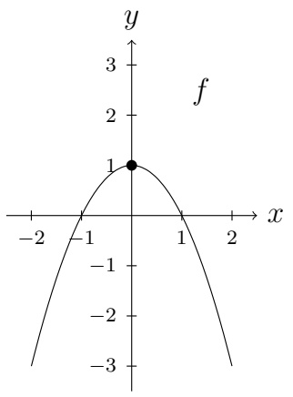

contour

| X | Y |
| --- | --- |
| -1 | 0 |
| 0 | 1 |
| 1 | 0 |

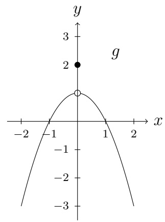

contour

| X | Y |
| --- | --- |
| 0 | 2 |

Abbildung 5.1: Beide Funktionen haben den Grenzwert 1 in x = 0.

In Abbildung 5.1 haben beide Funktionen den Grenzwert 1 in x = 0. Dies kann man „sehen“, indem man eine beliebige Folge  $x_{n} \rightarrow 0$  mit  $x_{n} \neq 0$  betrachtet und sich überlegt, was mit den Funktionswerten

$$
f (x _ {n}),
$$

$$
g (x _ {n})
$$

passiert. Die relevante Frage ist, grob ausgedrückt:

Wohin „gehen“ die Funktionswerte, wenn x gegen Null „geht“?

Wichtig ist, dass wir nicht nur eine Folge betrachten, sondern jede Folge. Zum Beispiel merkt man in Abbildung 5.2, dass wenn

$$
x _ {n} \rightarrow 0 \quad \text {fur} n \rightarrow \infty \quad \text {und} \quad x _ {n} > 0 \quad \text {für alle} n \in \mathbb {N},
$$

dann „geht“ $h(x_n)$ gegen 2. Dies bedeutet allerdings nicht, dass $h$ den Grenzwert 2 in Null hat, da es auch Nullfolgen gibt, so dass $h(x_n)$ nicht gegen 2 „geht“.

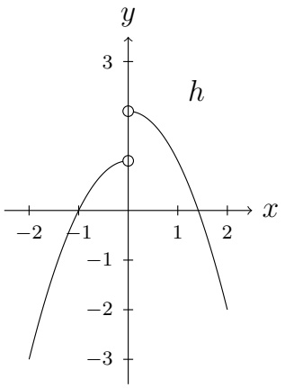

contour

| X | Y |
| --- | --- |
| 0 | 2 |
| -1 | 0 |
| 0 | 1 |

Abbildung 5.2: Einige Nullfolgen  $\{x_{n}\}_{n=1}^{\infty}$  haben  $h(x_{n}) \to 1$ , andere Nullfolgen  $\{x_{n}\}_{n=1}^{\infty}$  haben  $h(x_{n}) \to 2$ . Die Funktion h besitzt keinen Grenzwert in 0.

## Definition 5.1.1

Sei $f$ auf einer punktierten Umgebung $V$ von $x_0 \in \mathbb{R}$ definiert. Wir sagen, dass $f$ an der Stelle $x_0$ den Grenzwert $y_0 \in \mathbb{R}$ besitzt, wenn für jede Folge $\{x_n\}_{n=1}^{\infty}$ mit

$$
x _ {n} \neq x _ {0}, \quad x _ {n} \in V, \quad \lim _ {n \to \infty} x _ {n} = x _ {0} \tag {5.1.1}
$$

gilt

$$
\lim _ {n \to \infty} f (x _ {n}) = y _ {0}. \tag {5.1.2}
$$

Wir schreiben dafür

$$
\lim _ {x \to x _ {0}} f (x) = y _ {0}.
$$

Wir sagen, dass $f$ in $x_0$ den linksseitigen (bzw. rechtsseitigen) Grenzwert $y_0 \in \mathbb{R}$ besitzt, wenn $f$ auf $(x_0 - \delta, x_0)$ (bzw. $(x_0, x_0 + \delta)$) für ein $\delta > 0$ definiert ist und für jede Folge $\{x_n\}_{n=1}^{\infty}$ mit

$$
x _ {n} \in (x _ {0} - \delta , x _ {0}) \quad (\text {bzw.} x _ {n} \in (x _ {0}, x _ {0} + \delta)) \text {und} \quad \lim _ {n \to \infty} x _ {n} = x _ {0}
$$

(5.1.2) gilt. Wir schreiben dafür

$$
\lim _ {x \uparrow x _ {0}} f (x) = y _ {0} \quad (\text {bzw.} \lim _ {x \downarrow x _ {0}} f (x) = y _ {0})
$$

oder

$$
\lim _ {x \to x _ {0} ^ {-}} f (x) = y _ {0} \quad (\text {bzw.} \lim _ {x \to x _ {0} ^ {+}} f (x) = y _ {0}).
$$

Bemerkung. Es reicht aus, Folgen  $\{x_{n}\}_{n=1}^{\infty}$  zu betrachten, bei denen  $x_{n}$  nah an  $x_{0}$  liegt. Deshalb sagt man, dass es eine „lokale Eigenschaft“ ist, den Grenzwert  $y_{0}$  in der Stelle  $x_{0}$  zu haben.

Bemerkung. Den Grenzwert  $y_{0}$  in  $x_{0}$  zu haben, hat nichts mit dem Funktionswert  $f(x_{0})$  zu tun! f muss nicht in  $x_{0}$  definiert sein. Auch wenn f in  $x_{0}$  definiert ist, muss  $f(x_{0})$  nicht gleich  $y_{0}$  sein. Sehen Sie sich g in Abbildung 5.1 oben an.

Bemerkung. Es ist unabdingbar, dass in Definition 5.1.1 punktierte Umgebungen betrachtet werden! Die Folge  $x_{1}=1, x_{2}=0, x_{3}=1/3, x_{4}=0, x_{5}=1/5, x_{6}=0, \ldots$  ist eine Nullfolge, aber für die Funktion g aus Abbildung 5.1 konvergiert  $g(x_{n})$  nicht, obwohl g in Null den Grenzwert 1 besitzt.

## Beispiele.

①  $f(x) = x^{2}$ ,  $x_{0} = 2$ . Es gilt  $\lim_{x \to 2} f(x) = 4$ .
②  $g(x)=\begin{cases}2x,&x>0\\x-1&x\leq0.\end{cases}$

Es gilt

$$
\lim _ {x \uparrow 0} g (x) = - 1, \quad \lim _ {x \downarrow 0} g (x) = 0,
$$

und g besitzt in 0 keinen Grenzwert.

③  $h(x)=\left\{\begin{aligned}&2x,&x>0\\ &x^{2}&x<0.\end{aligned}\right.$

Es gilt

$$
\lim _ {x \to 0} h (x) = 0.
$$

④  $m(x)=\left\{\begin{aligned}0,&x=\frac{1}{n},n\in\mathbb{N}\\ 1&\text{sonst.}\end{aligned}\right.$

Dann besitzt m in 0 keinen Grenzwert, aber m besitzt den linksseitigen Grenzwert 1:

$$
\lim _ {x \uparrow 0} m (x) = 1.
$$

Der Einfachheit halber haben wir in Definition 5.1.1 vorausgesetzt, dass f auf einer punktierten Umgebung von  $x_{0}$  definiert ist. Dies wird meist in den Beispielen, die wir uns anschauen, der Fall sein. Aber betrachten Sie die Folge

$$
x _ {n} = \frac {3 n}{1 + 6 n}, \quad n \in \mathbb {N}
$$

und die Funktion $f$, die durch

$$
f (x _ {n}) = \frac {1}{n}, \quad n \in \mathbb {N}
$$

definiert ist. Man möchte schon ausdrücken können, dass $f$ gegen Null „geht“, wenn $x$ gegen $\frac{1}{2}$ „geht“. Allerdings ist $f$ auf keiner punktierten Umgebung von $\frac{1}{2}$ definiert. Somit ist eine Verallgemeinerung von Definition 5.1.1:

Definition 5.1.1'. Wenn es eine Folge $\tilde{x}_n$ mit

$$
\tilde {x} _ {n} \in \mathcal {D} (f), \quad \tilde {x} _ {n} \neq x _ {0}, \quad \lim _ {n \to \infty} \tilde {x} _ {n} = x _ {0}
$$

gibt, dann sagen wir, dass $f$ in $x_0$ den Grenzwert $y_0$ besitzt, wenn für jede Folge $x_n$ mit

$$
x _ {n} \in \mathcal {D} (f), \quad x _ {n} \neq x _ {0}, \quad \lim _ {n \to \infty} x _ {n} = x _ {0}
$$

gilt

$$
\lim _ {n \to \infty} f (x _ {n}) = y _ {0}.
$$

Analog für linksseitige und rechtsseitige Grenzwerte.

Wie bei Folgen möchte man wissen, ob man neue Grenzwerte aus Alten schließen kann. Aus Satz 4.2.8 für Folgen erhalten wir:

## Satz 5.1.2

Seien $f, g$ auf einer punktierten Umgebung von $x_0$ definiert. Wenn für $y_0, z_0 \in \mathbb{R}$ gilt

$$
\lim _ {x \to x _ {0}} f (x) = y _ {0}, \quad \lim _ {x \to x _ {0}} g (x) = z _ {0},
$$

dann gilt

$$
\lim _ {x \to x _ {0}} (\alpha f (x) + \beta g (x)) = \alpha y _ {0} + \beta z _ {0} \quad \text {furalle} \alpha , \beta \in \mathbb {R}, \tag {5.1.3}
$$

$$
\lim _ {x \to x _ {0}} (f (x) \cdot g (x)) = y _ {0} \cdot z _ {0}, \tag {5.1.4}
$$

$$
\lim _ {x \to x _ {0}} \left(\frac {f (x)}{g (x)}\right) = \frac {y _ {0}}{z _ {0}}, \qquad \text {sofern} z _ {0} \neq 0 \text {ist.} \tag {5.1.5}
$$

Bemerkung. Aus (5.1.3) und (5.1.4) erhalten wir, dass

$$
\lim _ {x \to x _ {0}} p (x) = p (x _ {0})
$$

für jedes Polynom p gilt.

Wenn $\lim_{x\to x_0}f(x) = y_0,\lim_{x\to x_0}g(x) = 0$ , und wir

$$
\lim _ {x \to x _ {0}} \frac {f (x)}{g (x)} \tag {5.1.6}
$$

betrachten, dann fragen wir uns:

- Ist $y_0 = 0$? Wenn nicht, dann divergiert der Quotient in (5.1.6).
- Wenn $y_0 = 0$ gilt, dann gibt es eine Methode um den Grenzwert des Quotienten analysieren zu können. (Wie immer ist die entscheidende Frage, mit welcher Rate $f$ und $g$ in $x_0$ verschwinden.)

## Übung 5.1.3

Berechnen Sie den Grenzwert:

$$
\lim _ {x \to 2} \frac {x ^ {2} - 4}{x - 2}.
$$

## Beispiel. Sei

$$
R (x) = \frac {p (x)}{q (x)},
$$

wobei $p$, $q$ Polynome sind und $x_0$ eine Nullstelle von beiden ist. Sei $x_0$

eine m-fache Nullstelle von q und
eine n-fache Nullstelle von p.

## Dann gilt

- $\lim_{x\to x_0}R(x) = 0$, wenn $n > m$,
- $\lim_{x\to x_0}R(x)$ existiert und gehört zu $\mathbb{R}\setminus\{0\}$, wenn $n=m$,
- $\lim_{x\to x_0}R(x)$ existiert nicht (als reelle Zahl), wenn $n < m$.

Dies zeigt man, indem man

$$
p (x) = (x - x _ {0}) ^ {n} \tilde {p} (x), \quad q (x) = (x - x _ {0}) ^ {m} \tilde {q} (x)
$$

mit  $\tilde{p}(x_{0})$ ,  $\tilde{q}(x_{0}) \neq 0$  schreibt und gemeinsame Faktoren von  $(x - x_{0})$  kürzt.

Beispiel. Für  $x_{0}=1$  und

$$
h (x) = \frac {x ^ {n} - 1}{x - 1}, \quad n \in \mathbb {N},
$$

benutzen wir Lemma 4.3.4, um h als

$$
h (x) = \frac {(x - 1) \sum_ {k = 1} ^ {n} x ^ {n - k}}{(x - 1)}
$$

darzustellen. Kürzen durch  $(x - 1)$  ergibt

$$
\begin{array}{l} \lim _ {x \to 1} h (x) = \lim _ {x \to 1} \sum_ {k = 1} ^ {n} x ^ {n - k} \\ = \sum_ {k = 1} ^ {n} \lim _ {x \to 1} x ^ {n - k} \tag {5.1.7} \\ = \sum_ {k = 1} ^ {n} 1 \\ = n, \\ \end{array}
$$

wobei wir in (5.1.7) Satz 4.2.8 angewendet haben.

Jetzt bearbeiten wir ein Beispiel, das nicht polynomiell ist.

Beispiel. Besitzt  $f(x) = \frac{e^{x}-1}{x}$  einen Grenzwert in x = 0? Nenner und Zähler verschwinden in x = 0. Wir haben in Satz 4.3.7 gesehen, dass die Exponentialfunktion in einer Umgebung von 0 linear wächst, also erwarten wir einen von Null verschiedenen Grenzwert. Aus Satz 4.3.7 (iii) erhalten wir

$$
\left| \frac {e ^ {x} - 1}{x} \right| \leq \frac {1}{1 - | x |}, \quad x \in (- 1, 1) \setminus \{0 \}. \tag {5.1.8}
$$

Andererseits haben wir

$$
\begin{array}{l} \left| \frac {e ^ {x} - 1}{x} \right| = \frac {e ^ {x} - 1}{x} \stackrel {(4. 3. 1 1)} {\geq} 1 \quad x \in (0, 1), (5.1.9) \\ u n d \quad \left| \frac {e ^ {x} - 1}{x} \right| = \frac {1 - e ^ {x}}{- x} \geq \frac {1}{1 - x} x \in (- 1, 0), (5.1.10) \\ \end{array}
$$

wobei wir (4.3.12) für die letzte Ungleichung benutzt haben. Zusammen implizieren (5.1.9) und (5.1.10), dass

$$
\left| \frac {e ^ {x} - 1}{x} \right| \geq \frac {1}{1 + | x |}. \tag {5.1.11}
$$

Insgesamt ergeben (5.1.8) und (5.1.11)

$$
\frac {1}{1 + | x |} \leq \left| \frac {e ^ {x} - 1}{x} \right| \leq \frac {1}{1 - | x |}, \quad x \in (- 1, 1) \setminus \{0 \}, \tag {5.1.12}
$$

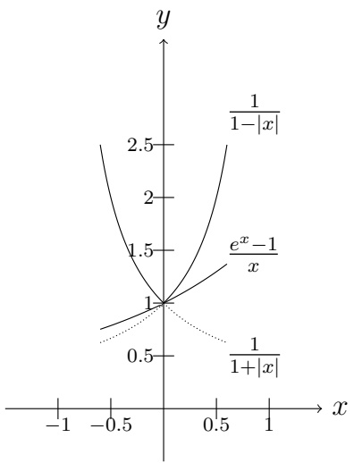

Abbildung 5.3: Visuelle Darstellung von Gleichung (5.1.12).

und da für jede Nullfolge $\{x_{n}\}_{n = 1}^{\infty}$ gilt

$$
\lim _ {n \to \infty} \frac {1}{1 + | x _ {n} |} = \lim _ {n \to \infty} \frac {1}{1 - | x _ {n} |} = 1,
$$

schließen wir aus dem Sandwich-Kriterium für Folgen, dass

$$
\lim _ {n \to \infty} \left| \frac {e ^ {x _ {n}} - 1}{x _ {n}} \right| = 1
$$

für jede Nullfolge  $\{x_{n}\}_{n=1}^{\infty}$  mit  $x_{n} \neq 0$ . Aus Definition 5.1.1 und  $\exp(x) > 1$  für x > 0,  $\exp(x) < 1$  für x < 0 schließen wir

$$
\lim _ {x \to 0} \frac {e ^ {x} - 1}{x} = 1. \tag {5.1.13}
$$

Wir haben eben gesehen, dass das Sandwich-Kriterium für Folgen benutzt werden kann, um den Grenzwert einer Funktion zu identifizieren. Dies formulieren wir in einen Satz um.

## Satz 5.1.4: Sandwich-Kriterium für Funktionen

Es seien $f, g, h$ in einer punktierten Umgebung von $x_0$ definiert. Wenn in einer punktierten Umgebung von $x_0$ gilt

$$
f (x) \leq g (x) \leq h (x),
$$

und ferner

$$
\lim _ {x \to x _ {0}} f (x) = \lim _ {x \to x _ {0}} h (x) = y _ {0},
$$

dann ist

$$
\lim _ {x \to x _ {0}} g (x) = y _ {0}.
$$

## Übung 5.1.5

Schreiben Sie den Beweis. (Hinweis: Benutzen Sie Definition 5.1.1 und das Sandwich-Kriterium für Folgen.)

Eine alternative Definition des Grenzwertes einer Funktion ist

Definition 5.1.1" (Epsilon-Delta Definition von Grenzwert). Sei $f$ auf einer punktierten Umgebung $V$ von $x_0$ definiert. $f$ besitzt an der Stelle $x_0$ den Grenzwert $y_0$, wenn es für jedes $\varepsilon > 0$ ein $\delta > 0$ gibt, so dass

$$
| f (x) - y _ {0} | <   \varepsilon \text {fur alle} x \text {mit} 0 <   | x - x _ {0} | <   \delta .
$$

Bemerkung. In Definition 5.1.1" wurden keine Folgen benutzt.

Bemerkung. Hier spielt $\varepsilon > 0$ die Rolle einer Fehlertoleranz. $\delta > 0$ ist der Parameter, den wir anpassen können, damit $f(x)$ $\varepsilon$-nah an $y_0$ liegt. Wenn $\varepsilon$ sehr klein ist („der schwierige Fall“), dann muss $\delta$ vielleicht auch sehr klein gewählt werden.

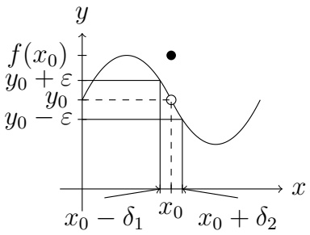

contour

| Point | X-coordinate | Y-coordinate |
| --- | --- | --- |
| Point 1 | x0 | y0 |
| Point 2 | x0 | y0 - \(\epsilon\) |

Abbildung 5.4

Ein Beispiel, das die neue Definition verdeutlicht, ist in Abbildung 5.4 skizziert. Für $\varepsilon > 0$ beliebig klein gegeben, wählt man $\delta := \min\{\delta_1, \delta_2\}$. Für $x \in (x_0 - \delta, x_0 + \delta)$ mit $x \neq x_0$ ist $f(x) \in (y_0 - \varepsilon, y_0 + \varepsilon)$. Der Graph einer Funktion, die das Kriterium in der neuen Definition nicht erfüllt, ist in Abbildung 5.5 skizziert. Zu $\varepsilon = 1$ (und zu jedem positiven $\tilde{\varepsilon} < 1$) gibt es kein $\delta > 0$, so dass

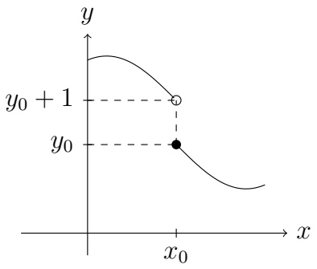

contour

| Point | X | Y |
| --- | --- | --- |
| y0 | x0 | y0 |
| y0 + 1 | x0 | y0 + 1 |

Abbildung 5.5

$$
x \in (x _ {0} - \delta , x _ {0} + \delta) \setminus \{x _ {0} \} \Rightarrow f (x) \in (y _ {0} - \varepsilon , y _ {0} + \varepsilon).
$$

Sobald $x < x_0$ nah an $x_0$ liegt (und egal wie nah $x$ an $x_0$ liegt), ist $f(x) \geq y_0 + 1$.

## Übung 5.1.6

Finden Sie zu  $f(x) := 5x + 1$  den Grenzwert L in  $x_{0} = 2$ . Bestimmen Sie zu  $\varepsilon = \frac{1}{4}$  ein  $\delta > 0$ , so dass  $0 < |x - x_{0}| \leq \delta$  impliziert, dass  $|f(x) - L| \leq \varepsilon$ . Finden Sie eine quadratische Funktion g mit dem gleichen Grenzwert in  $x_{0} = 2$ . Bestimmen Sie, ob zum gegebenen  $\varepsilon$  das geeignete  $\delta$  größer oder kleiner als das zu f gefundene  $\delta$  sein müsste.

## Übung 5.1.7

Finden Sie zu

$$
f (x) := \left\{ \begin{array}{l l} 5 x + 1 & x \neq 2 \\ 2 7 & x = 2 \end{array} \right.
$$

den Grenzwert L in  $x_{0}=2$ . Bestimmen Sie zu  $\varepsilon=\frac{1}{4}$  ein  $\delta>0$ , so dass  $0<|x-x_{0}|\leq\delta$  impliziert, dass  $|f(x)-L|\leq\varepsilon$ .

## Satz 5.1.8

Definition 5.1.1 und Definition 5.1.1" sind äquivalent.

Beweis. Übung.

Man redet auch von „Konvergenz gegen Unendlich“ oder vom „Verhalten von f für x gegen Unendlich“. Über diese Begriffe möchten wir auch reden können. Dafür führen wir die folgenden Definitionen ein.

## Definition 5.1.9: Uneigentliche Grenzwerte für $x \to x_0$

Sei $f$ auf einer punktierten Umgebung von $x_0$ definiert. Wir sagen, dass

$$
\lim _ {x \to x _ {0}} f (x) = \infty \quad (\text {bzw.} \lim _ {x \to x _ {0}} f (x) = - \infty),
$$

wenn für jede Folge  $\{x_{n}\}_{n=1}^{\infty}$  mit  $x_{n} \neq x_{0}$  und  $\lim_{n\to\infty}x_{n}=x_{0}$  gilt

$$
\lim _ {n \to \infty} f (x _ {n}) = \infty \quad (\text {bzw.} \lim _ {n \to \infty} f (x _ {n}) = - \infty).
$$

Analog für einseitige Grenzwerte.

## Satz 5.1.10

Definition 5.1.9 ist äquivalent zum folgenden Kriterium: Für jedes $M \in \mathbb{R}$ gibt es ein $\delta > 0$, so dass $0 < |x - x_0| < \delta$ impliziert $f(x) \geq M$.

## Beispiel.

$$
\lim _ {x \to 0} \frac {1}{x ^ {2}} = \infty , \quad \lim _ {x \to 1} \frac {- 1}{(x - 1) ^ {2}} = - \infty ,
$$

aber  $\frac{1}{x}$  besitzt in 0 keinen Grenzwert, da

$$
\lim _ {x \downarrow 0} \frac {1}{x} = \infty , \quad a b e r \quad \lim _ {x \uparrow 0} \frac {1}{x} = - \infty .
$$

## Definition 5.1.11: Eigentliche Grenzwerte für $x \to \pm \infty$

Sei $f$ auf $(a,\infty)$ für ein $a\in \mathbb{R}$ definiert. Sei $y_0\in \mathbb{R}$. Wir sagen, dass

$$
\lim _ {x \to \infty} f (x) = y _ {0},
$$

wenn für jede Folge  $\{x_{n}\}_{n=1}^{\infty}$  auf  $(a,\infty)$  mit  $\lim_{n\to\infty}x_{n}=\infty$  gilt

$$
\lim _ {n \to \infty} f (x _ {n}) = y _ {0}.
$$

Analog für $\lim_{x\to -\infty}f(x) = y_0$

Beispiel. Man bemerkt

$$
\lim _ {x \to \infty} \frac {1}{x ^ {2}} = 0, \quad \lim _ {x \to \infty} \tanh (x) = 1.
$$

## Satz 5.1.12

Definition 5.1.11 ist äquivalent zu: zu jedem $\varepsilon > 0$ gibt es ein $M \in \mathbb{R}$, so dass

$$
x > M \quad \Longrightarrow \quad | f (x) - y _ {0} | <   \varepsilon .
$$

## Definition 5.1.13: Uneigentliche Grenzwerte für $x \to \pm \infty$

Sei $f$ auf $(a,\infty)$ für ein $a\in\mathbb{R}$ definiert. Wir sagen, dass

$$
\lim _ {x \to \infty} f (x) = \infty ,
$$

wenn für jede Folge  $\{x_{n}\}_{n=1}^{\infty}$  auf  $(a,\infty)$  mit  $\lim_{n\to\infty}x_{n}=\infty$  gilt

$$
\lim _ {n \to \infty} f (x _ {n}) = \infty .
$$

Analog für

$$
\lim _ {x \to \infty} f (x) = - \infty , \quad \lim _ {x \to - \infty} f (x) = \infty , \quad \lim _ {x \to - \infty} f (x) = - \infty .
$$

## Satz 5.1.14

Definition 5.1.13 ist äquivalent zu: zu jedem $K \in \mathbb{R}$ gibt es ein $M \in \mathbb{R}$, so dass

$$
x > M \quad \Longrightarrow \quad f (x) > K.
$$

Wie für eigentliche Grenzwerte in  $x_{0} \in R$  kann man sich fragen, ob für diese uneigentlichen Grenzwerte der Grenzwert einer Summe die Summe der Grenzwerten ist, und das Gleiche für Produkte und Quotienten. Ein Vergleichskriterium kann man sich auch überlegen. Zum Beispiel impliziert

$$
f (x) \leq g (x) \leq h (x) \quad \text { für   alle } x \in \mathbb {R}
$$

und $\lim_{x\to \infty}f(x) = \lim_{x\to \infty}h(x) = y_0$ ,dass

$$
\lim _ {x \to \infty} g (x) = y _ {0}.
$$

Können Sie ein analoges Kriterium finden, das

$$
\lim _ {x \to \infty} g (x) = \infty
$$

impliziert?

## Übung 5.1.15

Formulieren Sie einen Satz wie Satz 5.1.2 für uneigentliche Grenzwerte.

## Übung 5.1.16

Berechnen Sie

$$
\lim _ {x \to 0} \frac {| 2 x - 1 | - | 2 x + 1 |}{x}.
$$

## 5.2 Stetigkeit

Jetzt können wir Stetigkeit einer Funktion $f$ in einem Punkt $x_0 \in \mathbb{R}$ leicht definieren. Dies bedeutet nichts Anderes als:

- $\lim_{x\to x_0}f(x)$ existiert,
- $f(x_0)$ ist definiert,
- und sie sind gleich:

$$
\lim _ {x \to x _ {0}} f (x) = f (x _ {0}).
$$

Während die Existenz des Grenzwerts in  $x_{0}$  nichts mit dem Funktionswert zu tun hat, spielt dieser Wert für Stetigkeit eine wichtige Rolle. Stetige Funktionen sind „gut“ in dem Sinne, dass sie sich so verhalten, wie man erwartet. Wir werden mehrere wichtige Sätze über stetige Funktionen beweisen können.

## Definition 5.2.1

Sei $f$ auf einer Umgebung von $x_0$ definiert. $f$ ist in $x_0$ stetig, falls der Grenzwert $\lim_{x\to x_0}f(x)$ existiert und es gilt

$$
\lim _ {x \to x _ {0}} f (x) = f (x _ {0}).
$$

Sei $f$ auf $(a,b)$ definiert. $f$ ist auf $(a,b)$ stetig (oder einfach stetig), wenn $f$ in jedem Punkt von $(a,b)$ stetig ist. Sei $f$ auf $[x_0,b)$ definiert. $f$ ist in $x_0$ rechtsseitig stetig, wenn

$$
\lim _ {x \downarrow x _ {0}} f (x) = f (x _ {0}).
$$

Außerdem nennen wir $f$ auf $[x_0, b)$ stetig, wenn $f$ auf $(x_0, b)$ stetig ist und $f$ in $x_0$ rechtsseitig stetig ist. Analog für linksseitig stetig. $f$ ist auf $(a, \infty)$ oder $(- \infty, a)$ oder $(- \infty, \infty)$ stetig, wenn $f$ in jedem Punkt des Intervalls stetig ist.

Bemerkung. Stetigkeit freut uns, weil wir mehr Rechenwege zur Verfügung haben. Zum Beispiel können wir Stetigkeit von  $\exp(\cdot)$  verwenden, um den Grenzwert  $\lim_{n\to\infty}3^{\frac{1}{n}}$  jetzt als

$$
\lim _ {n \to \infty} 3 ^ {\frac {1}{n}} = \lim _ {n \to \infty} \exp (\log (3 ^ {\frac {1}{n}})) = \lim _ {n \to \infty} \exp \left(\frac {1}{n} \log (3)\right) = \exp \left(\lim _ {n \to \infty} \frac {1}{n} \log (3)\right) = 1
$$

zu berechnen. Wo haben wir Stetigkeit verwendet?

## Übung 5.2.2

Was passiert, wenn Sie diese Idee mit  $n^{1/n}$  anwenden?

Wie für Grenzwerte, können wir auch Stetigkeit durch ein  $\varepsilon-\delta$  Kriterium definieren.

Definition 5.2.1' (Epsilon-Delta Definition von Stetigkeit). Sei $f$ auf einer punktierten Umgebung $V$ von $x_0$ definiert. $f$ ist in $x_0$ stetig, wenn es für jedes $\varepsilon > 0$ ein $\delta > 0$ gibt, so dass

$$
| f (x) - f (x _ {0}) | <   \varepsilon \text {fur alle} x \text {mit} 0 \ltimes | x - x _ {0} | <   \delta .
$$

Bemerkung. Mit welcher Definition es einfacher ist, zu arbeiten, hängt vom Beispiel ab.

## Übung 5.2.3

Bestätigen Sie die folgenden Tatsachen.

- Polynome sind auf $\mathbb{R}$ stetig.
- Eine rationale Funktion $\frac{p(x)}{q(x)}$ ist auf ihrem Definitionsbereich stetig.
- Sinus und Cosinus sind stetig auf $\mathbb{R}$.
- $\exp(\cdot)$ ist stetig auf $\mathbb{R}$. $\log(\cdot)$ ist stetig auf $(0, \infty)$.

\- Die Funktion

$$
f (x) = \left\{ \begin{array}{l l} 0 & x \in \mathbb {R} \setminus \mathbb {Q} \\ 1 & x \in \mathbb {Q} \end{array} \right.
$$

ist nirgendwo stetig.

\- Die Funktion

$$
f (x) = \left\{ \begin{array}{l l} 0 & x \in \mathbb {R} \setminus \mathbb {Q} \\ \frac {1}{q} & x = \frac {p}{q} \in \mathbb {Q} (\text {vollständig gekürzt}) \end{array} \right.
$$

ist in jedem $x \in \mathbb{Q}$ nicht stetig und in jedem $x \in \mathbb{R} \setminus \mathbb{Q}$ stetig.

\- Die Funktion

$$
g (x) = \left\{ \begin{array}{l l} 1 - x ^ {2} & x \neq 1 \\ 5 & x = 1 \end{array} \right.
$$

ist in $x = 1$ nicht stetig. Wir können $g$ aber stetig machen, wenn wir $g(1)$ als 0 statt 5 definieren.

\- Die Funktion $\frac{1}{x^2}$ ist in $x = 0$ nicht stetig, und dies können wir nicht „reparieren“.

Die letzten Beispiele zeigen, dass es unterschiedliche Weisen gibt, in denen Stetigkeit fehlen kann. Wir möchten zwischen diesen Typen unterscheiden können.

## Definition 5.2.4

Wenn $f$ auf einer punktierten Umgebung $\dot{U}$ von $x_0$ stetig ist und $\lim_{x\to x_0}f(x)$ existiert (als reelle Zahl), dann heißt $f$ in $x_0$ stetig ergänzbar. Die Funktion

$$
\tilde {f} (x) = \left\{ \begin{array}{l l} f (x) & x \in \dot {U} \\ \lim _ {x \to x _ {0}} f (x) & x = x _ {0} \end{array} \right.
$$

ist auf  $\dot{U} \cup \{x_{0}\}$  stetig und heißt die stetige Ergänzung oder die stetige Fortsetzung von f. Man sagt, f habe in  $x_{0}$  eine hebbare Unstetigkeit.

Falls es keine solche Fortsetzung  $\tilde{f}$  gibt (weil der Grenzwert nicht existiert), dann sagen wir, dass f eine nicht hebbare Unstetigkeit in  $x_{0}$  hat.

Jetzt möchten wir uns die ersten Eigenschaften stetiger Funktionen anschauen.

## Satz 5.2.5

(i) Es seien $f, g: (a, b) \longrightarrow \mathbb{R}$ in $x_0 \in (a, b)$ stetig. Dann sind auch $f + g$ und $f \cdot g$ in $x_0$ stetig. Falls $g(x_0) \neq 0$, dann ist $\frac{f}{g}$ in $x_0$ stetig.

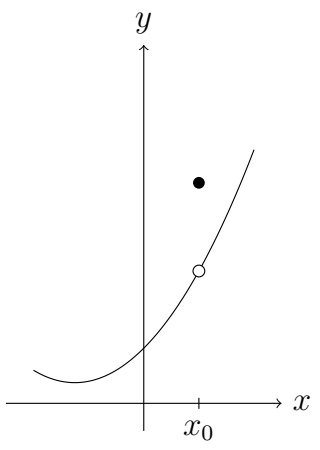

text_image

y
x
x₀
O

(a) hebbare Unstetigkeit

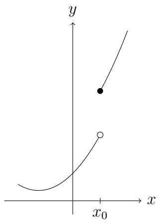

text_image

y
x
x₀

(b) nicht hebbare Unstetigkeit (c) nicht hebbare Unstetigkeit

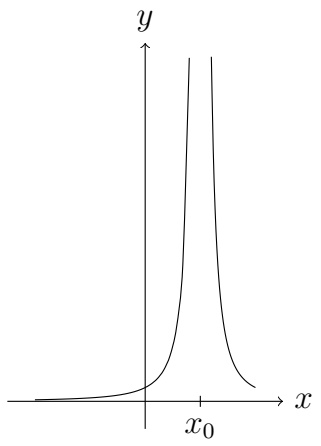

contour

| X | Y |
| --- | --- |
| 0 | ~0.1 |
| x0 | >1.0 |

(ii) Sei $\lim_{x\to x_0}f(x) = y_0\in (c,d)$ und $g\colon (c,d)\longrightarrow \mathbb{R}$ in $y_0$ stetig. Dann gilt

$$
\lim _ {x \to x _ {0}} (g \circ f) (x) = g \left(\lim _ {x \to x _ {0}} f (x)\right) = g (y _ {0}).
$$

(iii) Es seien $f:(a,b)\longrightarrow\mathbb{R}$ in $x_{0}\in(a,b)$ stetig und $y_{0}:=f(x_{0})\in(c,d)$. Außerdem sei $g:(c,d)\longrightarrow\mathbb{R}$ in $y_{0}$ stetig. Dann ist $g\circ f$ in $x_{0}$ stetig.

(iv) Es sei  $f: (a, b) \longrightarrow \mathbb{R}$  streng monoton und stetig. Dann ist ihre Umkehrfunktion  $f^{-1}: \mathcal{W}(f) \longrightarrow \mathbb{R}$  ebenfalls streng monoton und stetig. Ferner ist  $\mathcal{W}(f)$  ein Intervall.

## Übung 5.2.6

Teil (ii) drückt aus, dass wir den Grenzübergang  $n \rightarrow \infty$  mit der Auswertung der Funktion vertauschen können, wenn g stetig ist. Geben Sie ein Gegenbeispiel an in dem Fall, dass g in  $y_{0}$  nicht stetig ist.

## Übung 5.2.7

Verwenden Sie den Satz, um

$$
\lim _ {n \to \infty} \exp \left(\sin \left(\frac {1}{n}\right)\right)
$$

zu berechnen. (In der Klausur, wäre wahrscheinlich nur nach dem Grenzwert gefragt, ohne den Hinweis, welchen Satz bzw. welche Eigenschaft zu verwenden. Sie müssten dann erwähnen, was Sie dabei verwenden.)

Partieller Beweis von Satz 5.2.5. zu (ii): Wir betrachten eine beliebige Folge $\{x_{n}\}_{n=1}^{\infty}$ mit $x_{n} \in (a, b)$ und $x_{n} \neq x_{0}$ für alle $n \in \mathbb{N}$, und $x_{n} \to x_{0}$ für $n \to \infty$. Nach Annahme gilt

$$
f (x _ {n}) \rightarrow y _ {0}. \tag {5.2.1}
$$

Ferner ist $f(x_n) \in (c, d)$ für $n$ groß genug. (Warum?) Also definiert $\{f(x_n)\}_{n=1}^{\infty}$ eine Folge, die gegen $y_0$ konvergiert, und Stetigkeit von $g$ in $y_0$ impliziert

$$
g (f (x _ {n})) \rightarrow g (y _ {0}).
$$

Da $\{x_{n}\}_{n = 1}^{\infty}$ beliebig war, erhalten wir aus der Definition des Grenzwerts, dass

$$
\lim _ {x \to x _ {0}} g (f (x)) = g (y _ {0}) = g \left(\lim _ {x \to x _ {0}} f (x)\right).
$$

zu (iii): Folgt aus (ii) und Stetigkeit von $f$ in $x_0$.

Bemerkung. Wir sollten die Stetigkeit von g zu schätzen wissen. Fehlt sie, dann kann die Zusammensetzung viel schlimmer sein, als die ursprünglichen Funktionen. Zum Beispiel kann die Zusammensetzung g ∘ f nirgendwo stetig sein, obwohl f nur auf Q nicht stetig ist und g nur in einem Punkt nicht stetig ist. Ein Beispiel ist:

$$
f (x) = \left\{ \begin{array}{l l} \frac {1}{q}, & x = \frac {p}{q} \in \mathbb {Q} \text {(vollständig gekürzt)} \\ 0, & x \notin \mathbb {Q}, \end{array} \right.
$$

$$
g (x) = \left\{ \begin{array}{l l} 1, & x \neq 0 \\ 0, & x = 0. \end{array} \right.
$$

Die Zusammensetzung

$$
(g \circ f) (x) = \left\{ \begin{array}{l l} 1, & x \in \mathbb {Q} \\ 0, & x \notin \mathbb {Q} \end{array} \right.
$$

ist nirgendwo stetig.

## Übung 5.2.8

Finden Sie die Konstante $c$, so dass $g$ auf $\mathbb{R}$ stetig ist:

$$
g (x) = \left\{ \begin{array}{l l} x ^ {2} - c ^ {2} & x <   4 \\ c x + 2 0 & x \geq 4. \end{array} \right.
$$

## Übung 5.2.9

Finden Sie Konstanten $c$ und $d$, so dass $h$ auf $\mathbb{R}$ stetig ist:

$$
h (x) = \left\{ \begin{array}{l l} 2 x & x <   1 \\ c x ^ {2} + d & 1 \leq x \leq 2 \\ 4 x & x > 2. \end{array} \right.
$$

## Übung 5.2.10

Bestimmen Sie ob für den gegebenen Punkt a die Funktion f eine hebbare Unstetigkeit in a hat. Falls ja, dann finden Sie die stetige Fortsetzung.

① a = 7,

$$
f (x) = \frac {x - 7}{| x - 7 |}.
$$

② a = 9,

$$
f (x) = \frac {3 - \sqrt {x}}{9 - x}.
$$

## 5.3 Eigenschaften stetiger Funktionen

Jetzt schauen wir uns ein paar wichtige und relativ tiefe Eigenschaften stetiger Funktionen an. Die Grundlage für die Sätze ist der Satz von Bolzano-Weierstraß.

## Satz 5.3.1

Eine auf  $[a,b]$  definierte Funktion, die stetig ist, ist beschränkt.

Bemerkung. Ein beschränktes, abgeschlossenes Intervall  $[a,b]\subseteq\mathbb{R}$  heißt kompakt. Im Satz 5.3.1 ist Kompaktheit sehr wichtig.

- Wenn $f$ stetig auf einem unbeschränkten Intervall ist, gilt die Aussage nicht. Gegenbeispiel: $f(x) = x$ auf $[0, \infty)$.
- Wenn $f$ stetig auf einem nicht abgeschlossenen Intervall ist, gilt die Aussage nicht. Gegenbeispiel: $f(x) = \frac{1}{x}$ auf $(0,1]$.

Bemerkung. Im Satz 5.3.1 ist auch Stetigkeit wichtig.

Erstes Gegenbeispiel:

$$
f (x) = \left\{ \begin{array}{l l} \frac {1}{x}, & x \in (0, 1 ] \\ 0, & x \in [ - 1, 0 ]. \end{array} \right.
$$

Hier ist f auf  $[-1,1]$  definiert, aber nicht beschränkt.

Zweites Gegenbeispiel:

$$
g (x) = \left\{ \begin{array}{l l} q, & x = \frac {p}{q} \in \mathbb {Q} \cap [ 0, 1 ] (\text {vollständig gekürzt}) \\ 0, & x \in [ 0, 1 ] \setminus \mathbb {Q}. \end{array} \right.
$$

Auch hier ist g auf [0,1] definiert, aber nicht beschränkt.

Beweis von Satz 5.3.1. Sei $f:[a,b]\to\mathbb{R}$ stetig. Wir werden zeigen, dass $f$ nach oben beschränkt ist. Analog zeigt man, dass $f$ nach unten beschränkt ist.

Wenn $f$ nicht nach oben beschränkt wäre, würde es für jedes $n \in \mathbb{N}$ ein $x_{n} \in [a,b]$ geben, so dass

$$
f (x _ {n}) \geq n. \tag {5.3.1}
$$

Da  $\{x_{n}\}_{n=1}^{\infty}$  beschränkt ist, existiert nach dem Satz von Bolzano-Weierstraß eine konvergente Teilfolge  $\{x_{n_{k}}\}_{n=1}^{\infty}$  mit Grenzwert  $x_{0} \in R$ . Aus

$$
a \leq x _ {n _ {k}} \leq b \quad \text { für   alle } k \in \mathbb {N}
$$

folgt, dass

$$
a \leq x _ {0} \leq b,
$$

also $x_0 \in \mathcal{D}(f)$. Da $f$ stetig ist, gilt

$$
f (x _ {0}) = \lim _ {k \to \infty} f (x _ {n _ {k}}) \stackrel {(5. 3. 1)} {=} \infty ,
$$

was widerspricht, dass $x_0 \in \mathcal{D}(f)$.

Wir haben häufig bemerkt, dass eine Funktion sein Supremum und Infimum nicht annehmen muss (z.B.  $f(x) = x$  auf (0,1) oder  $\tanh(x)$  auf R). Der nächste Satz sagt uns, dass stetige Funktionen auf kompakten Mengen doch ihr Supremum und ihr Infimum annehmen. (Dies ist später z.B. für Optimierungsprobleme und den Mittelwertsatz wichtig.)

## Satz 5.3.2: Satz über die Extremwerte

Wenn $f$ auf $[a,b]$ stetig ist, existieren Punkte $x_{m}$, $x_{M} \in [a,b]$, so dass

$$
f (x _ {m}) = \inf _ {[ a, b ]} f, \qquad f (x _ {M}) = \sup _ {[ a, b ]} f.
$$

Bemerkung. Der Satz ist nicht „konstruktiv“: Er sagt uns nicht, was  $x_{m}$ ,  $x_{M}$  sind, oder wie wir die Zahlen finden oder approximieren können.

Beweis von Satz 5.3.2. Seien

$$
m := \inf _ {[ a, b ]} f, \quad M := \sup _ {[ a, b ]} f.
$$

Satz 5.3.1 sagt, dass $m, M \in \mathbb{R}$. Nach der Approximations-Eigenschaft des Supremums existiert eine Folge $\{y_n\}_{n=1}^{\infty}$ und eine Folge $\{x_n\}_{n=1}^{\infty}$, so dass

$$
x _ {n} \in [ a, b ] \quad \text {f ü r a l l e} n \in \mathbb {N}, \quad y _ {n} = f (x _ {n}) \quad \text {u n d} \quad \lim _ {n \rightarrow \infty} y _ {n} = M. \tag {5.3.2}
$$

Angesichts

$$
a \leq x _ {n} \leq b
$$

existieren nach dem Satz von Bolzano-Weierstraß eine Teilfolge  $\{x_{n_{k}}\}_{k=1}^{\infty}$  und ein Grenzwert  $x_{0} \in R$ , so dass

$$
x _ {n _ {k}} \to x _ {0} \text {f ü r} k \to \infty \quad \text {und} \quad a \leq x _ {0} \leq b.
$$

Stetigkeit von $f$ liefert

$$
f (x _ {0}) = f (\lim _ {k \to \infty} x _ {n _ {k}}) = \lim _ {k \to \infty} f (x _ {n _ {k}}) \stackrel {(5. 3. 2)} {=} M.
$$

Analog für das Minimum.

## Übung 5.3.3

Begründen Sie folgende Behauptung:

Ich baue ein rechteckiges Gehege. Dafür habe ich 100m Zaun zur Verfügung. Es gibt ein größtmögliches Gehege, das ich einrichten kann.

Der nächste Satz liefert Lösungen der Gleichung

$$
f (x) = y.
$$

## Satz 5.3.4: Zwischenwertsatz

Sei $f:[a,b]\to \mathbb{R}$ stetig. Seien

$$
m := \min _ {[ a, b ]} f, \qquad M := \max _ {[ a, b ]} f.
$$

Dann gibt es zu jedem $y \in [m, M]$ mindestens ein $x \in [a, b]$, so dass

$$
f (x) = y.
$$

Bemerkung. Obwohl die Aussage des Satzes nicht konstruktiv ist, geben wir einen konstrukiven Beweis an.

Bemerkung. Wissen Sie noch, wieviel Mühe es gekostet hat, zu zeigen, dass  $\mathcal{W}(\exp(\cdot)) = (0, \infty)$  gilt? Geben Sie eine Abkürzung mithilfe des Zwischenwertsatzes an. Vergessen Sie nicht, Stetigkeit zu verwenden.

Bemerkung. Eine leichte Folgerung ist, dass, wenn

$$
f (a) \cdot f (b) <   0
$$

ist, f eine Nullstelle auf  $(a,b)$  besitzt. Insbesondere besitzt jedes Polynom  $(2n-1)$ -ten Grades mindestens eine (reelle) Nullstelle.

Bemerkung. Wenn f nicht stetig ist, gilt der Satz nicht! Gegenbeispiel:

$$
f (x) = \left\{ \begin{array}{l l} x ^ {2} + 1, & x \in [ 1, 2 ] \\ x ^ {2} - 2, & x \in [ 0, 1). \end{array} \right.
$$

Dann ist

$$
\min _ {[ 0, 2 ]} f = - 2, \quad \max _ {[ 0, 2 ]} f = 5,
$$

aber es gibt z.B. kein $x \in [0,2]$, so dass

$$
f (x) = 1.
$$

## Übung 5.3.5

Begründen Sie, dass es kein  $x \in [0,2]$  gibt, so dass für die obige Funktion gilt  $f(x) = 1$ .

## Übung 5.3.6

Betrachten Sie

$$
f (x) = \left\{ \begin{array}{l l} 1 - x ^ {2} & 0 \leq x \leq 1 \\ 1 + \frac {x}{2} & 1 <   x \leq 2. \end{array} \right.
$$

① Zeigen Sie, dass f nicht stetig auf  $[0,2]$  ist.
② Zeigen Sie, dass f nicht jeden Wert zwischen  $f(0)$  und  $f(2)$  annimmt.

Beweis von Satz 5.3.4. Wenn $m = M$ ist, dann ist $f$ konstant:

$$
f (x) = m \quad \text { für   alle } x \in [ a, b ].
$$

Also nehmen wir an, dass m < M. Dass es  $x_{m}$ ,  $x_{M}$  gibt mit  $f(x_{m}) = m$ ,  $f(x_{M}) = M$ , folgt aus dem Satz über die Extremwerte. Also nehmen wir o.B.d.A. an, dass

$$
y \in (m, M). \tag {5.3.3}
$$

Wir definieren

$$
g (x) := f (x) - y.
$$

Nach (5.3.3) gilt

$$
g (x _ {m}) <   0, \quad g (x _ {M}) > 0. \tag {5.3.4}
$$

Es reicht aus zu zeigen, dass es ein  $\bar{x}$  zwischen  $x_{m}$  und  $x_{M}$  gibt, so dass

$$
g (\bar {x}) = 0.
$$

Wenn $x_{m} < x_{M}$, definieren wir

$$
a _ {1} = x _ {m}, \quad b _ {1} := x _ {M},
$$

ansonsten umgekehrt. Auf jeden Fall impliziert (5.3.4), dass

$$
g (a _ {1}) \cdot g (b _ {1}) <   0.
$$

Jetzt betrachten wir

$$
c := \frac {a _ {1} + b _ {1}}{2}.
$$

Es gilt entweder

$$
g (c) = 0 \quad \text {oder} \quad g (c) \cdot g (b _ {1}) > 0 \quad \text {oder} \quad g (c) \cdot g (b _ {1}) <   0.
$$

Im ersten Fall setzen wir  $\bar{x} := c$ . Im zweiten Fall definieren wir

$$
a _ {2} := a _ {1}, \quad b _ {2} := c,
$$

und im dritten Fall definieren wir

$$
a _ {2} := c, \quad b _ {2} := b _ {1}.
$$

Falls für ein  $n \in N$  gilt  $g(c) = 0$ , dann haben wir die gewünschte Nullstelle  $\bar{x}$  gefunden. Ansonsten haben wir eine Intervallschachtelung  $\{[a_{n}, b_{n}] \}_{n=1}^{\infty}$  definiert, wobei

$$
g (a _ {n}) \cdot g (b _ {n}) <   0 \quad \text {f ü r a l l e} n \in \mathbb {N}. \tag {5.3.5}
$$

Da $b_{n} - a_{n} \leq |b - a| / 2^{n-1}$ ist, gilt nach Lemma 4.4.8

$$
\lim _ {n \to \infty} a _ {n} = \lim _ {n \to \infty} b _ {n} =: \bar {x}
$$

für ein  $\bar{x} \in [a, b]$ . Da g stetig ist, gilt

$$
\lim _ {n \to \infty} g (a _ {n}) = g (\bar {x}) = \lim _ {n \to \infty} g (b _ {n}).
$$

Aus (5.3.5) schließen wir

$$
0 \geq \lim _ {n \to \infty} g (a _ {n}) g (b _ {n}) = g (\bar {x}) ^ {2},
$$

so dass

$$
g (\bar {x}) = 0.
$$

## Übung 5.3.7

Begründen Sie die Aussage:

Für jedes Polynom $(2n - 1)$-ten Grades ist der Wertebereich ganz $\mathbb{R}$.

## Übung 5.3.8

Zeigen Sie, dass  $p(x) = x^{2} + x - 1$  zwei reelle Nullstellen  $x_{\pm}$  hat und bestimmen Sie ganze Zahlen  $s_{\pm}$ , so dass gilt

$$
x _ {-} \in (s _ {-}, s _ {-} + 1), \qquad x _ {+} \in (s _ {+}, s _ {+} + 1).
$$

## Übung 5.3.9

Zeigen Sie, dass eine positive Lösung der Gleichung

$$
\cos (x) = \exp (x) - 1
$$

existiert.

## Übung 5.3.10

Zeigen Sie, dass

$$
\sin (x) = \exp (- x)
$$

eine Lösung besitzt.

## Übung 5.3.11

Zeigen Sie, dass

$$
\sin \left(\frac {1}{x}\right) = \exp (- x)
$$

eine Lösung  $x_{*} \in (0, 2\pi)$  besitzt.

## Übung 5.3.12

Für die Funktion $f$ gegeben durch

$$
f (x) = x ^ {3} - \frac {1}{x},
$$

zeigen Sie, dass es einen Punkt  $x_{*}$  gibt, so dass  $f(x_{*}) = 10$ .

## Übung 5.3.13

Verwenden Sie den Zwischenwertsatz, um zu zeigen, dass es ein  $r \in R$  gibt, so dass  $r^{2} = 2$ .

## Übung 5.3.14

Sie gehen am Montag vom Marktplatz zum Hauptgebäude. Sie verlassen den Marktplatz um 10 Uhr und kommen am Hauptgebäude um 10 : 24 Uhr an. Am Dienstag nehmen Sie den gleichen Pfad vom Hauptgebäude um 10 Uhr zum Marktplatz und kommen um 10 : 24 Uhr an. Beweisen Sie, dass es einen Punkt entlang des Pfades gibt, wo Sie zum genau gleichen Zeitpunkt an beiden Tagen waren.

Methode zur Nullstellenbestimmung: Wie erwähnt, enthält der Beweis einen Algorithmus, durch den man den Punkt  $\bar{x}$  finden kann. Das so genannte Bisektionsverfahren ist eine zuverlässige Methode, Nullstellen zu finden, aber leider konvergiert es sehr langsam. In dieser Methode nimmt man immer den Mittelpunkt  $c = \frac{a_{n} + b_{n}}{2}$  um das neue Intervall zu definieren, egal wie sich f verhält. Eine andere Möglichkeit wäre es, mehr Infomation über die Funktion f zu benutzen, um ein neues Intervall zu finden.

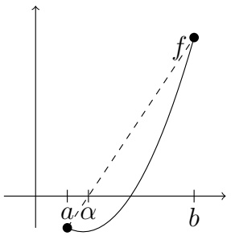

text_image

a'α
b'
f'

Stellen Sie sich vor: Wir suchen eine Nullstelle  $\bar{x}$  von f. Wir betrachten die Sekante l, die  $(a, f(a))$  und  $(b, f(b))$  miteinander verbindet. Wenn f „fast linear“ wäre, also  $f(x) \approx l(x)$  (in irgendeinem Sinne), dann wäre es schlau,  $\bar{x}$  durch die Nullstelle  $\alpha$  von l zu approximieren. Diese Idee führt zur Sekantenmethode.

Die Sekantenmethode

Gegeben seien $a, b \in \mathbb{R}$ mit

$$
f (a) \cdot f (b) <   0.
$$

Man definiere

$$
\alpha := a - f (a) \cdot \frac {b - a}{f (b) - f (a)}.
$$

Wenn  $f(\alpha) \neq 0$  ist, dann fährt man wie folgt fort:

Wenn  $f(a) \cdot f(\alpha) < 0$  ist, dann setze man

$$
a _ {1} = a, \quad b _ {1} = \alpha ,
$$

sonst

$$
a _ {1} = \alpha , \quad b _ {1} = b.
$$

Dann iteriert man mit

$$
\alpha_ {n + 1} = a _ {n} - f (a _ {n}) \cdot \frac {b _ {n} - a _ {n}}{f (b _ {n}) - f (a _ {n})}.
$$

Die Sekantenmethode ist schneller als das Bisektionsverfahren und ist relativ zuverlässig, insbesondere wenn man ungefähr weiß, wo die Lösung liegt.

## Übung 5.3.15

Betrachten Sie die Gleichung  $f(x) = x^{2} - 2 = 0$  auf [1,2].

① Finden Sie die nächsten zwei Intervalle, die Sie mit dem Bisektionsverfahren erhalten.
② Finden Sie die nächsten zwei Werte  $\alpha_{1}$  und  $\alpha_{2}$  und Intervalle, die Sie mit der Sekantenmethode erhalten.
③ Welche Methode liefert eine bessere Approximation nach zwei Schritten?

Noch schneller ist das so gennante Newtonverfahren. Wir können die Methode genauer besprechen, wenn wir die Ableitung definiert haben. Die grobe Idee ist, dass die Newtonsche Methode eine Folge  $\{\alpha_{n}\}_{n=1}^{\infty}$  erzeugt mit

$$
\alpha_ {n} = \varphi (\alpha_ {n - 1}),
$$

für eine stetige Funktion $\varphi$. Man hofft, dass

$\alpha_{n}$ für $n \to \infty$ gegen $\bar{\alpha} \in R$ konvergiert.

Dann ist  $\bar{\alpha}$  die gesuchte Nullstelle. Wenn  $\{\alpha_{n}\}_{n=1}^{\infty}$  konvergiert, dann löst  $\bar{\alpha}$  die Gleichung

$$
\bar {\alpha} = \varphi (\bar {\alpha}).
$$

Also ist  $\bar{\alpha}$  ein „Fixpunkt“ von  $\varphi$ .

Bemerkung. Man kann an konkreten Beispielen sehen, dass im Allgemeinen die Rate des Newtonverfahrens besser ist.

## Definition 5.3.16

Ein Fixpunkt einer Funktion $f$ ist ein Punkt $x \in \mathbb{R}$, so dass

$$
x = f (x).
$$

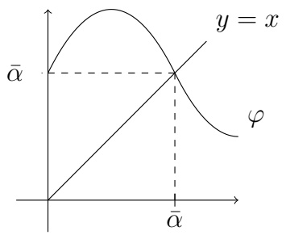

line

| X | y = x | \(\phi\) |
| --- | --- | --- |
| 0 | 0 | 0 |
| \(\alpha\)̅ | \(\alpha\)̅ | \(\alpha\)̅ |

Abbildung 5.7: Der Fixpunkt  $\bar{\alpha}$  ist der Schnittpunkt zweier Graphen: dem von  $\varphi$  und dem von  $y(x)=x$ .

Beispiel. Die Funktion  $f(x) = x + 1$  hat keine Fixpunkte. Die Funktion  $f(x) = x^{2}$  hat zwei Fixpunkte, x = 0 und x = 1. Jedes  $x \in R$  ist ein Fixpunkt der Funktion  $f(x) = x$ .

Der letzte Satz dieses Abschnitts liefert Existenz eines Fixpunkts einer stetigen Funktion.

## Satz 5.3.17

Sei $f:[a,b]\to \mathbb{R}$ stetig mit $\mathcal{W}(f)\subseteq [a,b]$. Dann besitzt $f$ mindestens einen Fixpunkt.

Beweis. Wenn  $f(a) = a$  bzw.  $f(b) = b$ , dann ist a bzw. b ein Fixpunkt. Wenn nicht, dann ist  $f(a) \in (a, b]$  und  $f(b) \in [a, b)$ . Also gilt für  $\tilde{f}(x) := f(x) - x$ , dass

$$
\tilde {f} (a) > 0, \quad \tilde {f} (b) <   0.
$$

Nach dem Zwischenwertsatz gibt es ein  $\bar{x} \in (a, b)$  mit  $\tilde{f}(\bar{x}) = 0$ . Also ist  $\bar{x}$  ein Fixpunkt von f. ☐

Fixpunkte sind oft wichtig für numerische Verfahren (z.B. für Runge-Kutta Methoden) und sind auch für die Theorie wichtig (z.B. um zu zeigen, dass Lösungen von gewöhnlichen Differentialgleichungen existieren).

## 5.4 Gleichmäßige Stetigkeit

## Definition 5.4.1

Eine reelle Funktion heißt gleichmäßig stetig, wenn es zu jedem  $\varepsilon > 0$  ein  $\delta > 0$  gibt, so dass

$$
| x - y | \leq \delta \quad \Longrightarrow \quad | f (x) - f (y) | \leq \varepsilon \quad \text { für   alle } x, y \in \mathcal {D} (f).
$$

War dies nicht die Definition von Stetigkeit? Was ist der Unterschied?

In der Definiton oben hängt $\delta$ von $\varepsilon$-und nur von $\varepsilon$-ab. Dass $f$ auf $\mathcal{D}(f)$ stetig ist, bedeutet, dass $f$ in jedem Punkt $x_0 \in \mathcal{D}(f)$ stetig ist. Die Funktion $f$ ist in $x_0$ stetig, wenn es zu jedem $\varepsilon > 0$ ein $\delta > 0$ gibt, so dass

$$
| x - x _ {0} | \leq \delta \quad \text {impliziert} \quad | f (x) - f (x _ {0}) | \leq \varepsilon \quad \text {für alle} x \in \mathcal {D} (f).
$$

Hier hängt $\delta$ sowohl von $\varepsilon$ als auch von $x_0$ ab.

Beispiel. Um den Unterschied besser zu verstehen, schauen wir uns das Beispiel  $f(x) = \frac{1}{x}$ ,  $x \in (0,1)$  an. Die Funktion f ist stetig. Aber was passiert mit  $\delta = \delta(\varepsilon, x)$  für x nah an 0?

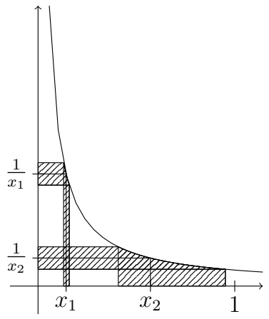

area

| X | Y (Curve) | Y (Area) |
| --- | --- | --- |
| x1 | 1/x1 | 1/x1 |
| x2 | 1/x2 | 1/x2 |

Abbildung 5.8: Für $x_{1}$ nah an 0 ist $\delta = \delta (\varepsilon ,x_1)$ viel kleiner als $\delta = \delta (\varepsilon ,x_2)$ für $x_{2}$ nah an 1.

Sei $\varepsilon > 0$ gegeben und $x_0 \in (0,1)$. Wir suchen ein Kriterium, damit

$$
\left| \frac {1}{x} - \frac {1}{x _ {0}} \right| \leq \varepsilon
$$

ist. Es gilt

$$
\left| \frac {1}{x} - \frac {1}{x _ {0}} \right| = \left| \frac {x _ {0} - x}{x x _ {0}} \right| \leq \varepsilon ,
$$

wenn

$$
x \geq \frac {x _ {0}}{2} \quad u n d \quad | x - x _ {0} | \leq \frac {x _ {0} ^ {2} \varepsilon}{2}.
$$

Da aus $|x - x_0| \leq \frac{x_0}{2}$ die Ungleichung $x \geq x_0 - |x - x_0| \geq \frac{x_0}{2}$ folgt, reicht es aus, wenn wir

$$
\delta = \min \left\{\frac {x _ {0}}{2}, \frac {x _ {0} ^ {2}}{2} \varepsilon \right\}
$$

wählen. Man merkt, dass  $\delta$  von  $x_{0}$  abhängt. Jetzt zeigen wir, dass f in der Tat nicht gleichmäßig stetig ist. Sei  $\varepsilon = 1$ . Wenn f gleichmäßig stetig wäre, würde es ein  $\delta > 0$  geben, so dass

$$
| x - y | \leq \delta \Rightarrow | f (x) - f (y) | \leq 1.
$$

Insbesondere würde aus

$$
| x - y | \leq \min \left\{\delta , \frac {1}{2} \right\} =: \tilde {\delta}
$$

die Ungleichung

$$
| f (x) - f (y) | \leq 1
$$

folgen. Aber für  $x = \tilde{\delta}$ ,  $y = \frac{\tilde{\delta}}{2}$  gilt

$$
| x - y | = \frac {\tilde {\delta}}{2} \leq \tilde {\delta}
$$

und

$$
| f (x) - f (y) | = \left| \frac {1}{\tilde {\delta}} - \frac {2}{\tilde {\delta}} \right| = \frac {1}{\tilde {\delta}} \geq \frac {1}{\frac {1}{2}} = 2.
$$

Im letzten Beispiel haben wir die Struktur der Funktion  $f(x) = \frac{1}{x}$  benutzt, um einen direkten Beweis zu geben. Jetzt schauen wir uns ein Beispiel an, in dem die Funktion komplizierter ist.

Beispiel. Die Funktion  $\log(\cdot):(0,\infty)\to\mathbb{R}$  ist nicht gleichmäßig stetig. Dies zeigen wir mit einem Beweis durch Widerspruch. Wir nehmen an, dass es für  $\varepsilon=1$  ein  $\delta>0$  gäbe, so dass

$$
\left| \log (x) - \log (y) \right| \leq 1 \quad f u r a l l e x, y \in (0, 1 ] \quad m i t \quad | x - y | \leq \delta . \tag {5.4.1}
$$

(Hier betrachten wir nur $|x| \leq 1$, weil das Verhalten in einer Umgebung von Null das Problem ist.) O.B.d.A. dürfen wir annehmen (warum?), dass

$$
\delta <   1. \tag {5.4.2}
$$

Wir wählen $x_0 > 0$ mit

$$
x _ {0} <   \delta , \quad | \log (x _ {0}) | > \frac {3}{\delta}. \tag {5.4.3}
$$

Dies ist möglich, weil

$$
\lim _ {x \downarrow 0} | \log (x) | = \infty .
$$

Allerdings gilt

$$
\begin{array}{l} | \log (x _ {0}) | = | \log (x _ {0}) - \log (1) | \\ \leq | \log (x _ {0}) - \log (\delta) | + | \log (\delta) - \log (2 \delta) | + \dots + | \log (N \delta) - \log (1) |, \tag {5.4.4} \\ \end{array}
$$

wobei  $N = \left\lfloor \frac{1}{\delta} \right\rfloor$  (die größte ganze Zahl kleiner gleich  $\frac{1}{\delta}$ ). Aus (5.4.1) und (5.4.4) schließen wir

$$
\left| \log (x _ {0}) \right| \leq N + 1 \leq \frac {1}{\delta} + 1 ^ {(5. 4. 2)} <   \frac {2}{\delta}, \tag {5.4.5}
$$

da die Vorraussetzung  $|x-y| \leq \delta$  aus (5.4.1) für alle Summanden in (5.4.4) erfüllt ist. Die Ungleichung (5.4.5) widerspricht (5.4.3).

## Übung 5.4.2

Zeigen Sie, dass

①  $x^{2}$  auf  $(0,1)$  gleichmäßig stetig ist.
②  $x^{2}$  auf R nicht gleichmäßig stetig ist.

Wir haben eben zwei Beispiele gesehen, bei denen eine nichtbeschränkte, stetige Funktion auf einem offenen Interval nicht gleichmäßig stetig ist. Man kann den obigen Beweis anpassen, um eine allgemeine Tatsache zu zeigen:

## Satz 5.4.3

Wenn  $f: (a, b) \longrightarrow \mathbb{R}$  gleichmäßig stetig ist, dann ist f beschränkt.

## Übung 5.4.4

Beweisen Sie den Satz. Andererseits geben Sie ein Beispiel an, in dem eine auf  $(a,b)$  stetige und beschränkte Funktion nicht gleichmäßig stetig ist.

## Übung 5.4.5

Zeigen Sie, dass  $\log(x)$  auf  $(1,\infty)$  gleichmäßig stetig ist.

## Übung 5.4.6

Zeigen Sie, dass  $x^{2}$  auf  $(0,L)$  für  $L \in R$  gleichmäßig stetig ist.

Der einfache Fall ist: Wenn f auf  $[a,b]$  definiert und stetig ist, dann ist f auf  $[a,b]$  gleichmäßig stetig. Die Idee ist, dass es in diesem Fall ein „schlimmstes  $\delta$ ” gibt.

## Satz 5.4.7

Eine auf einem beschränkten, abgeschlossenen Intervall definierte und stetige Funktion ist gleichmäßig stetig.

Beweis. Sei $f:[a,b]\to\mathbb{R}$ stetig. Wir nehmen für den Widerspruch an, dass $f$ nicht gleichmäßig stetig ist. Dann existiert $\varepsilon_{0}>0$ und für jedes $n\in\mathbb{N}$ Punkte $x_{n},y_{n}\in[a,b]$, so dass

$$
| x _ {n} - y _ {n} | \leq \frac {1}{n} \quad \text {und} \quad | f (x _ {n}) - f (y _ {n}) | \geq \varepsilon_ {0}.
$$

Da  $\{x_{n}\}_{n=1}^{\infty}$  und  $\{y_{n}\}_{n=1}^{\infty}$  beschränkt sind, besitzen sie nach dem Satz von Bolzano-Weierstraß konvergente Teilfolgen

$$
x _ {n _ {k}} \rightarrow x, \quad y _ {n _ {k}} \rightarrow y \quad \text { für } k \rightarrow \infty ,
$$

wobei  $x, y \in [a, b]$ . Außerdem impliziert  $|x_{n} - y_{n}| < \frac{1}{n}$ , dass

$$
x = y.
$$

Da $f$ stetig ist, gilt für $k \to \infty$

$$
f (x _ {n _ {k}}) \rightarrow f (x), \quad f (y _ {n _ {k}}) \rightarrow f (x).
$$

Aber dann erhalten wir aus dem Vergleichskriterium und dem Satz über den Grenzwert einer Summe den Widerspruch, dass

$$
\varepsilon_ {0} \leq \lim _ {k \to \infty} (f (x _ {n _ {k}}) - f (y _ {n _ {k}})) = f (x) - f (x) = 0.
$$

Angesichts Satz 5.4.7 ist $f(x) = \sqrt{x}$ auf [0, 1] gleichmäßig stetig, obwohl der Graph sehr steil ist für $x$ klein ($f'(x) \to \infty$ für $x \downarrow 0$).

Auf beschränkten, abgeschlossenen Intervallen sind alle stetige Funktionen gleichmäßig stetig. Wie sieht es auf beschränkten, offenen Intervallen aus? Was ist der Unterschied zwischen

$$
\sqrt {x}, \quad \frac {1}{x}, \quad x, \quad \text {oder} \sin \left(\frac {1}{x}\right) \qquad \text {auf} (0, 1)?
$$

Welche sind gleichmäßig stetig?

## Übung 5.4.8

Untersuchen Sie auf gleichmäßige Stetigkeit auf (0,1):

①

$$
x ^ {2} \log (x),
$$

②

$$
\frac {1}{\sqrt {x}},
$$

③

$$
x \sin \left(\frac {1}{x}\right),
$$

④

$$
x ^ {\alpha} \sin \left(\frac {1}{x}\right).
$$

## Übung 5.4.9

Zeigen Sie, dass  $1/(x^{2}+1)$  auf R gleichmäßig stetig ist.