## Kapitel 6

# Differentialrechnung

Sei $f:[a,b]\to \mathbb{R}$ gegeben. Wenn $f$ in $x_0\in (a,b)$ stetig ist, dann ist

$$
f (x) \approx f (x _ {0}) \quad \text { für } x \approx x _ {0}.
$$

Wir erhalten allerdings keine Rate dafür wie schnell  $f(x)$  nach  $f(x_{0})$  konvergiert. Diese Rate ist in  $x_{0}=0$  in der Tat für

$$
f (x) = \sqrt {x}, \qquad g (x) = x \qquad \text {und} \qquad h (x) = x ^ {2}
$$

verschieden, obwohl alle den gleichen Grenzwert haben. Die grundlegende Frage dieses Abschnitts ist, ob—und wie—wir f noch besser durch eine geeignete lineare Funktion  $\ell(x;x_{0})$  approximieren können. Diese Frage führt uns in die Differentialrechnung.

(Achtung! Die Funktion  $\ell(x;x_{0})$  hat  $x_{0}$  als (fester) Parameter und ist linear als Funktion von x.)

## 6.1 Lineare Approximation

Um über die Qualität einer Approximation reden zu können, führen wir die  $O(\cdot)$ - und  $o(\cdot)$ -Notation ein.

## Notation 6.1.1

Wir schreiben $f(h) = o(h)$ (für $h \downarrow 0$), wenn

$$
\lim _ {h \downarrow 0} \left| \frac {f (h)}{h} \right| = 0.
$$

Wir schreiben $f(h) = O(h)$ (für $h \downarrow 0$), wenn es ein $C \in \mathbb{R}$ gibt, so dass

$$
\operatorname * {l i m s u p} _ {h \downarrow 0} \left| \frac {f (h)}{h} \right| \leq C.
$$

## Beispiele.

①  $h^{2}=o(h)$  und  $h^{2}=O(h^{2})$ . (Es gilt auch  $h^{2}=O(h)$  mit C=0, aber man versucht die schärfste mögliche Rate zu identifizieren.)
②  $\exp(h)-1=O(h)$  und  $\sin(h)=O(h)$  für  $h\downarrow0$ .

Angesichts der Stetigkeit von $f$ gilt $f(x) \to f(x_0)$ für $x \to x_0$; es bleibt nur die Steigung $\alpha$ der besten linearen Funktion

$$
\ell (x; x _ {0}) = f (x _ {0}) + \alpha \cdot (x - x _ {0})
$$

zu bestimmen. Wir werden sagen, dass die lineare Funktion  $\ell$  die beste lineare Approximation der stetigen Funktion f in einer Umgebung von  $x_{0}$  ist, wenn  $\ell$  und f zu erster Ordnung miteinander übereinstimmen:

## Definition 6.1.2

Eine reelle Funktion $f$ heißt in $x_0$ linear approximierbar, wenn es ein $\alpha \in \mathbb{R}$ gibt, so dass gilt

$$
\left| f (x) - \left(f (x _ {0}) + \alpha (x - x _ {0})\right) \right| = o (| x - x _ {0} |) \quad \text { für } x \to x _ {0}.
$$

Wir nennen $\ell(x;x_0) = f(x_0) + \alpha (x - x_0)$ die beste lineare Approximation von $f$ in $x_0$.

Bemerkung. Nach der Definition ist jede Funktion, die in  $x_{0}$  linear approximierbar ist, in  $x_{0}$  stetig.

Bemerkung. Nicht jede stetige Funktion ist linear approximierbar! Zum Beispiel die Funktion  $g(x) = |x|$  ist durch  $\ell_{1}(x) = x$  für x > 0 und durch  $\ell_{2}(x) = -x$  für x < 0 gut (sehr gut!) approximiert. Aber es gibt keine lineare Funktion  $\ell(x) = \alpha \cdot x$ , die eine gute Approximation von g in einer Umgebung von Null ist.

## Definition 6.1.3

Für eine reelle Funktion $f$ ist die Differenzfunktion von $f$ in $x_0$ durch

$$
(\Delta_ {x _ {0}} f) (x) := f (x) - f (x _ {0})
$$

definiert. Wenn $f$ in $x_0$ linear approximierbar ist, dann ist das Differential von $f$ in $x_0$ durch

$$
d _ {x _ {0}} f (x) := \alpha \cdot (x - x _ {0})
$$

definiert, wobei $\alpha$ die Konstante aus Definition 6.1.2 ist.

Bemerkung. Wenn $f$ in $x_0$ linear approximierbar ist, dann ist

$$
(\Delta_ {x _ {0}} f) (x) \approx d _ {x _ {0}} f (x)
$$

im Sinne, dass die Differenzfunktion und das Differential zu erster Ordnung miteinander üebereinstimmen.

Wenn $f$ linear approximierbar ist, wie finden wir die beste lineare Approximation? Wir erhalten eine lineare Approximation für $f$ in einer Umgebung von $x_0$ durch die Sekante, die $(x_0, f(x_0))$ und $(x_1, f(x_1))$ miteinander verbindet. Wie Sie wissen, ist die Steigung der Sekante

$$
\frac {f (x _ {1}) - f (x _ {0})}{x _ {1} - x _ {0}}.
$$

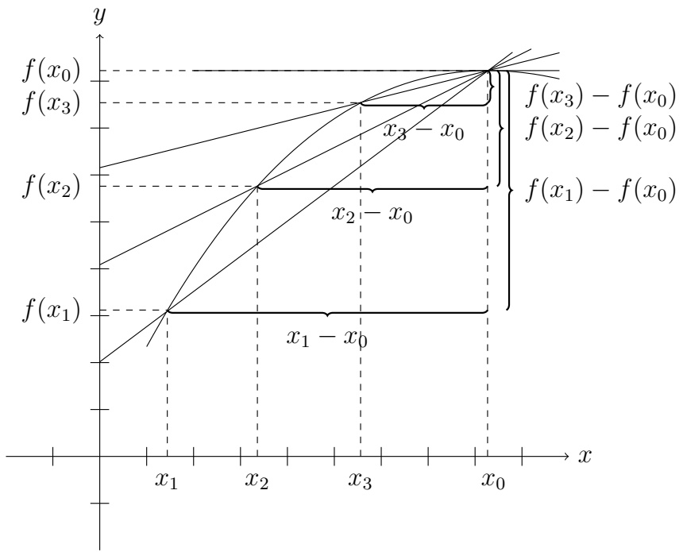

line

| Iteration | X-axis Position | Y-axis Value |
| --- | --- | --- |
| \(f(x_{1})\) | \(x_{1}\) | \(f(x_{1})\) |
| \(x_{2} - x_{0}\) | \(x_{2}\) | \(f(x_{2})\) |
| \(x_{3} - x_{0}\) | \(x_{3}\) | \(f(x_{3})\) |
| \(f(x_{0})\) | \(x_{0}\) | \(f(x_{0})\) |
| \(f(x_{1}) - f(x_{0})\) | \(x_{0}\) | \(f(x_{1}) - f(x_{0})\) |
| \(f(x_{2}) - f(x_{0})\) | \(x_{0}\) | \(f(x_{2}) - f(x_{0})\) |
| \(f(x_{3}) - f(x_{0})\) | \(x_{0}\) | \(f(x_{3}) - f(x_{0})\) |

Abbildung 6.1: Eine Folge  $\{x_{n}\}_{0}^{\infty}$  mit den ersten drei Folgenglieder und die dazugehörigen Sekanten. Die Steigung der Sektanten scheint zu konvergieren für  $x_{n} \rightarrow x_{0}$ .

Achtung! Weder die Sekante noch die Steigung ist für  $x_{1} = x_{0}$  definiert. Aber man bemerkt, dass, je näher  $x_{1}$  an  $x_{0}$  liegt, desto besser wird die Approximation (cf. Maple Worksheet). Sei  $\{x_{n}\}_{n=1}^{\infty}$  eine Folge mit  $x_{n} \neq x_{0}$ , so dass  $x_{n}$  gegen  $x_{0}$  konvergiert. Man könnte die Folge der Steigungen

$$
\alpha_ {n} := \frac {f (x _ {n}) - f (x _ {0})}{x _ {n} - x _ {0}}
$$

definieren und versuchen,  $\alpha$  als Grenzwert dieser Folge zu definieren. Wie das Beispiel  $g(x)=|x|$  zeigt, bedeutet die Existenz dieses Grenzwerte für eine Folge nicht, dass die ursprüngliche Funktion linear approximierbar ist. Aber wenn der Grenzwert für jede Folge existiert, dann bedeutet es doch, dass f linear approximierbar ist.

## Satz 6.1.4

Eine Funktion $f:(a,b)\to\mathbb{R}$ ist in $x_{0}\in(a,b)$ linear approximierbar genau dann, wenn

$$
\lim _ {x \to x _ {0}} \frac {f (x) - f (x _ {0})}{x - x _ {0}} \tag {6.1.1}
$$

existiert. Außerdem gilt für die Steigung  $\alpha$  der besten linearen Approximation

$$
\alpha = \lim _ {x \to x _ {0}} \frac {f (x) - f (x _ {0})}{x - x _ {0}}. \tag {6.1.2}
$$

Bemerkung. Wenn der Grenzwert $\alpha$ in (6.1.2) existiert, dann wird die Funktion

$$
\ell (x; x _ {0}) = f (x _ {0}) + \alpha (x - x _ {0})
$$

die Tangente zum Graphen von $f$ in $x_0$ genannt. Ihre Steigung ist der Grenzwert der Steigungen der Sekanten.

## 6.2 Die Ableitung in einem Punkt

Angesichts Satz 6.1.4 bekommt der Grenzwert in (6.1.1) einen besonderen Namen.

## Definition 6.2.1

Sei $f:(a,b)\to\mathbb{R}$ eine Funktion und $x_{0}\in(a,b)$. Der Differenzenquotient von $f$ in $x_{0}$ ist

$$
D _ {x _ {0}} f (x) := \frac {f (x) - f (x _ {0})}{x - x _ {0}}.
$$

Wenn der Grenzwert des Differenzenquotients für  $x \rightarrow x_{0}$  existiert, dann heißt dieser Grenzwert die Ableitung von f in  $x_{0}$  und wird mit

$$
f ^ {\prime} (x _ {0}) \qquad \text {oder} \qquad \frac {d f}{d x} (x _ {0})
$$

bezeichnet. In diesem Fall sagt man, dass $f$ in $x_0$ differenzierbar ist.

Bemerkung. Differenzierbarkeit in einem Punkt ist eine lokale Eigenschaft einer Funktion.

Oben haben wir bemerkt, dass f in  $x_{0}$  stetig ist, wenn f in  $x_{0}$  linear approximierbar ist. Nach Satz 6.1.4 kann man die Bedingung in Differenzierbarkeit umformulieren. Die Verbindung zwischen Stetigkeit und Differenzierbarkeit ist für uns so wichtig, dass wir diese Bemerkung als Lemma ausdrücken.

Lemma 6.2.2. Wenn $f:(a,b)\to\mathbb{R}$ in $x_{0}\in(a,b)$ differenzierbar ist, dann ist $f$ in $x_{0}$ stetig.

Bemerkung. Wir wiederholen: Die Umkehrung gilt nicht! Das Gegenbeispiel ist  $|x|$  in 0. Ein zweites Gegenbeispiel ist  $\sqrt{|x|}$ , die in 0 stetig aber nicht differenzierbar ist. (Überprüfen Sie dies.)

Beweis vom Lemma 6.2.2. Wenn $f$ in $x_0$ differenzierbar ist, dann gilt

$$
f (x) = f (x _ {0}) + f ^ {\prime} (x _ {0}) (x - x _ {0}) + o (| x - x _ {0} |).
$$

Also gilt

$$
| f (x) - f (x _ {0}) | \leq | f ^ {\prime} (x _ {0}) |   | x - x _ {0} | + o (| x - x _ {0} |),
$$

so dass insbesondere gilt

$$
\lim _ {x \to x _ {0}} | f (x) - f (x _ {0}) | = 0,
$$

was Stetigkeit von $f$ in $x_0$ entspricht.

## Beispiele.

① Im Abschnitt 5.1 haben wir

$$
\lim _ {x \to 1} \frac {x ^ {n} - 1}{x - 1} = n \quad u n d \quad \lim _ {x \to 0} \frac {e ^ {x} - 1}{x} = 1 \tag {6.2.1}
$$

gezeigt. Nach Definition 6.2.1 ist

$$
\frac {x ^ {n} - 1}{x - 1} = \frac {f (x) - f (1)}{x - 1} = D _ {1} f (x)
$$

der Differenzenquotient von $f(x) = x^n$ in $x_0 = 1$. Also impliziert der erste Grenzwert in (6.2.1), dass

$$
f ^ {\prime} (1) = n \quad o d e r \quad \frac {d}{d x} x ^ {n} | _ {x = 1} = n. \tag {6.2.2}
$$

Analog ist

$$
\frac {e ^ {x} - 1}{x} = \frac {e ^ {x} - e ^ {0}}{x - 0} = D _ {0} g (x)
$$

der Differenzenquotient von  $g(x) = e^{x}$  in  $x_{0} = 0$ . Der zweite Grenzwert in (6.2.1) sagt uns, dass

$$
g ^ {\prime} (0) = 1 \quad o d e r \quad \frac {d}{d x} e ^ {x} | _ {x = 0} = 1. \tag {6.2.3}
$$

Aus (6.2.2) und (6.2.3) schließen wir:

die Tangente zu $x^n$ in 1 ist $y = 1 + n(x - 1)$,

die Tangente zu $e^x$ in 0 ist $y = x + 1$.

(Sehen Sie das Beispiel im Maple-Worksheet.)

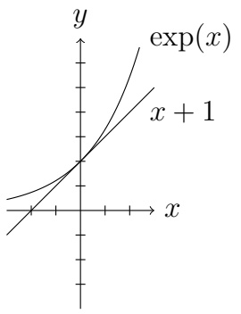

text_image

y
exp(x)
x + 1
x

(a)

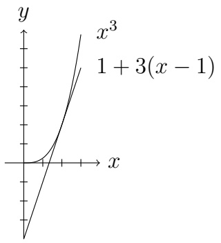

line

| X | \(x^{3}\) | 1 + 3(x - 1) |
| --- | --- | --- |
| 0 | 0 | 0 |
| ~0.5 | ~0.2 | ~0.2 |
| ~1.0 | ~0.6 | ~0.6 |
| ~1.5 | ~1.2 | ~1.2 |
| ~2.0 | ~2.0 | ~2.0 |

(b)

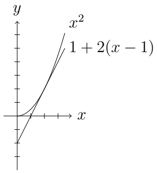

line

| X | \(x^{2}\) | \(1 + 2(x - 1)\) |
| --- | --- | --- |
| 0 | 0 | 0 |
| 1 | ~0.5 | ~0.5 |
| 2 | ~1.5 | ~1.5 |

(c)

② Wir haben bemerkt, dass  $g(x) = |x|$  in 0 nicht linear approximierbar ist. Nach Satz 6.1.4 ist  $|x|$  in 0 nicht differenzierbar. Dies können wir auch direkt sehen, da

$$
\frac {| x |}{x} = \left\{ \begin{array}{l l} 1 & x > 0 \\ - 1 & x <   0, \end{array} \right.
$$

so dass

$$
\lim _ {x \to 0} \frac {| x |}{x}
$$

nicht existiert.

Im zweiten Beispiel oben haben wir eine Funktion, für die der linksseitige Grenzwert und der rechtsseitige Grenzwert

$$
\lim _ {x \uparrow x _ {0}} \frac {g (x) - g (x _ {0})}{x - x _ {0}} \quad \text {bzw.} \quad \lim _ {x \downarrow x _ {0}} \frac {g (x) - g (x _ {0})}{x - x _ {0}} \tag {6.2.4}
$$

existieren, obwohl die Funktion in  $x_{0}$  nicht differenzierbar ist. Die Objekte in (6.2.4) bekommen auch einen Namen.

## Definition 6.2.3

Wenn  $(x, x_{0}] \subseteq \mathcal{D}(f)$  und der Grenzwert

$$
\lim _ {x \uparrow x _ {0}} \frac {f (x) - f (x _ {0})}{x - x _ {0}}
$$

existiert, dann nennen wir den Grenzwert die linksseitige Ableitung von $f$ in $x_0$. Wir schreiben

$$
f _ {-} ^ {\prime} (x _ {0}) \qquad \text {oder} \qquad \frac {d f ^ {-}}{d x} (x _ {0})
$$

dafür und sagen, dass $f$ in $x_0$ linksseitig differenzierbar ist. Wenn $[x_0, x) \subseteq \mathcal{D}(f)$ und der Grenzwert

$$
\lim _ {x \downarrow x _ {0}} \frac {f (x) - f (x _ {0})}{x - x _ {0}}
$$

existiert, dann nennen wir den Grenzwert die rechtsseitige Ableitung von $f$ in $x_0$. Wir schreiben

$$
f _ {+} ^ {\prime} (x _ {0}) \qquad \text {oder} \qquad \frac {d f ^ {+}}{d x} (x _ {0})
$$

dafür und sagen, dass $f$ in $x_{0}$ rechtsseitig differenzierbar ist.

## Notation 6.2.4

Sei $I \subseteq \mathbb{R}$ ein Intervall, $f: I \to \mathbb{R}$ eine Funktion, und $x_0$ ein Punkt in $I$. Wir benutzen die Notation

$$
\lim_{\substack{x\to x_{0}\\ x\in I}}f(x)
$$

für den Grenzwert von  $f(x_{n})$  für alle Folgen  $\{x_{n}\}_{n=1}^{\infty}$  mit  $x_{n} \in I$ , die gegen  $x_{0}$  für  $n \to \infty$  konvergieren. Dies ergibt den linksseitigen Grenzwert, den rechtsseitigen Grenzwert, oder den (üblichen) Grenzwert (abhängig davon, ob  $x_{0}$  der rechte Endpunkt des Intervalls, der linke Endpunkt des Intervalls, oder im Inneren des Intervalls ist).

## Bemerkung.

\- Anscheinend ist $g(x) = |x|$ in 0 linksseitig und rechtsseitig differenzierbar mit

$$
\frac {d g ^ {-}}{d x} (0) = - 1, \quad \frac {d g ^ {+}}{d x} (0) = 1.
$$

\- Man überprüft, dass eine Funktion $f$ in $x_0$ genau dann differenzierbar ist, wenn

$$
\frac {d f ^ {-}}{d x} (x _ {0}) \quad u n d \quad \frac {d f ^ {+}}{d x} (x _ {0})
$$

beide existieren und

$$
\frac {d f ^ {-}}{d x} (x _ {0}) = \frac {d f ^ {+}}{d x} (x _ {0})
$$

gilt.

\- Verwechseln Sie $\frac{df^{-}}{dx}(x_0)$ mit

$$
\lim _ {x \uparrow x _ {0}} f ^ {\prime} (x)
$$

nicht.

## Übung 6.2.5

① Lösen Sie die Ungleichung

$$
| x + 1 | + | x + 2 | <   7.
$$

② Skizzieren Sie den Graphen von

$$
f (x) = | x + 1 | + | x + 2 |.
$$

Wo ist $f$ stetig? Differenzierbar?

③ Skizzieren Sie den Graphen von

$$
g (x) = | x | + | x + 1 | + | x - 1 |.
$$

Wo ist $g$ differenzierbar?

## Übung 6.2.6

Angenommen f ist in a differenzierbar, berechnen Sie

$$
\lim _ {x \to a} \frac {f (x) - f (a)}{\sqrt {x} - \sqrt {a}}.
$$

## 6.3 Die abgeleitete Funktion

Nachdem wir Stetigkeit in einem Punkt definiert haben, haben wir uns gefragt, ob eine Funktion in jedem Punkt im Definitionsbereich stetig war und haben dann von „stetigen Funktionen“ gesprochen. Jetzt machen wir den gleichen Sprung mit Differenzierbarkeit.

## Definition 6.3.1

Sei $I \subseteq \mathbb{R}$ ein Intervall. Wenn $f: I \longrightarrow \mathbb{R}$ in jedem Punkt in $I$ differenzierbar ist, also wenn

$$
\lim_{\substack{x\to x_{0}\\ x\in I}}\frac{f(x) - f(x_{0})}{x - x_{0}}\quad \text{existiert für alle} x_{0}\in I,
$$

so heißt $f$ einfach differenzierbar. Die Funktion

$$
f ^ {\prime} \colon I \longrightarrow \mathbb {R}, \quad x _ {0} \mapsto f ^ {\prime} (x _ {0})
$$

heißt die Ableitung (oder die abgeleitete Funktion) von $f$. Wenn $f'$ stetig auf $I$ ist, dann heißt $f$ stetig differenzierbar und man schreibt

$$
f \in C ^ {1} (I).
$$

Wichtig: Die Ableitung in einem Punkt ist eine reelle Zahl. Die Ableitung (oder abgeleitete Funktion) ist eine Funktion.

Frage: Schauen Sie, ob Sie eine Funktion, die differenzierbar aber nicht stetig differenzierbar ist, finden können.

Beispiel. Finden Sie die Ableitungen.

①  $f(x) = x^{2}$ . Dann ist

$$
\begin{array}{l} f ^ {\prime} (x _ {0}) = \lim _ {x \to x _ {0}} \frac {f (x) - f (x _ {0})}{x - x _ {0}} = \lim _ {x \to x _ {0}} \frac {x ^ {2} - x _ {0} ^ {2}}{x - x _ {0}} \quad , \frac {0}{0}. \\ = \lim _ {x \to x _ {0}} \frac {(x - x _ {0}) (x + x _ {0})}{(x - x _ {0})} \\ = 2 x _ {0}, \\ \end{array}
$$

so dass $f'(x) = 2x$ ist.

②  $f(x) = e^{x}$ . Es gilt

$$
f ^ {\prime} (x _ {0}) = \lim _ {x \to x _ {0}} \frac {e ^ {x} - e ^ {x _ {0}}}{x - x _ {0}} \quad , \frac {0}{0}.\tag {6.3.1}
$$

Um weiter zu kommen ist es nützlich, x in einer Umgebung von  $x_{0}$  als  $x = x_{0} + h$  zu schreiben. Dann nimmt (6.3.1) die Form

$$
\begin{array}{l} f ^ {\prime} (x _ {0}) = \lim _ {h \to 0} \frac {e ^ {x _ {0} + h} - e ^ {x _ {0}}}{h} = \lim _ {h \to 0} \frac {e ^ {x _ {0}} (e ^ {h} - 1)}{h} \\ = e ^ {x _ {0}} \lim _ {h \to 0} \frac {e ^ {h} - 1}{h} \\ = e ^ {x _ {0}}, \\ \end{array}
$$

wobei wir (5.1.3) und (5.1.13), angewendet haben. Also ist  $f'(x) = e^{x}$ .

Bemerkung. Also löst  $e^{x}$  die gewöhnliche Differentialgleichung  $f' - f = 0$ .

③  $f(x)=\sqrt{x}.$  Dann ist

$$
f ^ {\prime} (x _ {0}) = \lim _ {h \to 0} \frac {\sqrt {x _ {0} + h} - \sqrt {x _ {0}}}{h} \quad , \frac {0}{0}.
$$

Wir sind blockiert und brauchen eine zusätzliche Idee. Der alte Trick, der uns wieder hilft, ist Erweitern mit Eins:

$$
\begin{array}{l} f ^ {\prime} (x _ {0}) = \lim _ {h \to 0} \frac {\sqrt {x _ {0} + h} - \sqrt {x _ {0}}}{h} \cdot \frac {\sqrt {x _ {0} + h} + \sqrt {x _ {0}}}{\sqrt {x _ {0} + h} + \sqrt {x _ {0}}} \\ = \lim _ {h \to 0} \frac {h}{h \cdot (\sqrt {x _ {0} + h} + \sqrt {x _ {0}})} \\ = \lim _ {h \to 0} \frac {1}{\sqrt {x _ {0} + h} + \sqrt {x _ {0}}} \\ = \frac {1}{2 \sqrt {x _ {0}}}. \\ \end{array}
$$

Also ist  $f'(x) = \frac{1}{2\sqrt{x}}$ . Man bemerkt, dass  $\mathcal{D}(f') = (0, \infty)$  eine echte Teilmenge des Definitionsbereiches von f ist.

④ Für  $f(x) = 1/x$  ist

$$
f ^ {\prime} (x) = - \frac {1}{x ^ {2}}.
$$

Wie oben hilft Erweitern mit Eins.

⑤ Für sin(·) und cos(·) kann man

$$
\frac {d}{d x} \sin (x) = \cos (x), \quad \frac {d}{d x} \cos (x) = - \sin (x) \tag {6.3.2}
$$

und verwandte Ergebnisse zeigen.

Bemerkung. Angesichts (6.3.2) lösen sin(·) und cos(·) die (gewöhnliche Differential-) Gleichung

$$
f ^ {\prime \prime} + f = 0.
$$

Wie mit Differenzierbarkeit in einem Punkt und Stetigkeit in einem Punkt gibt es eine Verbindung zwischen Differenzierbarkeit (auf $\mathcal{D}(f)$) und Stetigkeit (auf $\mathcal{D}(f)$).

Lemma 6.3.2. Sei $I \subseteq \mathbb{R}$ ein Intervall. Wenn $f: I \longrightarrow \mathbb{R}$ differenzierbar ist, dann ist $f$ (auf $I$) stetig.

Dass $f$ auf dem offenen Intervall stetig ist, folgt aus Lemma 6.2.2. Stetigkeit in einem Endpunkt zeigt man analog.

Die Umkehrung gilt nicht: Man bemerkt, dass  $|x|$  und  $\sqrt{|x|}$  stetig (auf R), aber nicht differenzierbar (auf R) sind.

## Übung 6.3.3

Skizzieren Sie den Graphen von

$$
f (x) = | x ^ {2} - 4 | - | x ^ {2} - 9 |.
$$

Berechnen Sie  $f'(x)$ .

## 6.4 Rechenregeln

Aus den Eigenschaften des Grenzwerts erhalten wir folgende Eigenschaften der Ableitung.

## Satz 6.4.1

Seien $f, g: (a, b) \longrightarrow \mathbb{R}$ in $x_0 \in (a, b)$ differenzierbar. Dann gilt

(i) (Linearität)  $\alpha f + \beta g$  mit  $\alpha, \beta \in R$  ist in  $x_{0}$  differenzierbar und  $(\alpha f + \beta g)'(x_{0}) = \alpha f'(x_{0}) + \beta g'(x_{0})$ .
(ii) (Produktregel)  $f \cdot g$  ist in  $x_{0}$  differenzierbar und  $(f \cdot g)'(x_{0}) = f'(x_{0}) \cdot g(x_{0}) + f(x_{0}) \cdot g'(x_{0})$ .

(iii) (Quotientenregel) Wenn  $g(x_{0}) \neq 0$  ist, dann ist  $\frac{f}{g}$  in  $x_{0}$  differenzierbar und es gilt

$$
\left(\frac {f}{g}\right) ^ {\prime} (x _ {0}) = \frac {f ^ {\prime} (x _ {0}) \cdot g (x _ {0}) - f (x _ {0}) \cdot g ^ {\prime} (x _ {0})}{(g (x _ {0})) ^ {2}}.
$$

Insbesondere ist

$$
\left(\frac {1}{g}\right) ^ {\prime} (x _ {0}) = - \frac {g ^ {\prime} (x _ {0})}{(g (x _ {0})) ^ {2}}.
$$

Die Aussage  $(i)$  drückt aus, dass Ableiten eine lineare Abbildung ist. Diese Tatsache ist sehr wichtig. Alle drei Regeln sind sehr nützlich für uns beim Rechnen.

## Beispiele.

①  $f(x) = x^{2}e^{x}, \quad f'(x) = 2xe^{x} + x^{2}e^{x}.$
② $g(x) = \frac{x^2}{e^x + x},\quad g'(x) = \frac{2x(e^x + x) - (e^x + 1)x^2}{(e^x + x)^2}.$
③ $h(x) = x^{-n}$, $h'(x) = \frac{-nx^{n-1}}{x^{2n}} = -nx^{-n-1}$.

Partieller Beweis von Satz 6.4.1. Der Beweis folgt aus den Eigenschaften der Grenzwerte. Als Beispiel zeigen wir (ii). Es gilt

$$
\begin{array}{l} \lim _ {x \to x _ {0}} \frac {(f \cdot g) (x) - (f \cdot g) (x _ {0})}{x - x _ {0}} = \lim _ {x \to x _ {0}} \frac {f (x) \cdot g (x) - f (x _ {0}) \cdot g (x _ {0})}{x - x _ {0}} \\ = \lim _ {x \to x _ {0}} \frac {f (x) \cdot g (x) - f \left(x _ {0}\right) \cdot g (x) + f \left(x _ {0}\right) \cdot g (x) - f \left(x _ {0}\right) \cdot g \left(x _ {0}\right)}{x - x _ {0}} \\ = \lim _ {x \to x _ {0}} \frac {(f (x) - f (x _ {0})) \cdot g (x)}{x - x _ {0}} + \lim _ {x \to x _ {0}} \frac {f (x _ {0}) (g (x) - g (x _ {0}))}{x - x _ {0}} \\ = \lim _ {x \to x _ {0}} \frac {f (x) - f (x _ {0})}{x - x _ {0}} \lim _ {x \to x _ {0}} g (x) + f (x _ {0}) \lim _ {x \to x _ {0}} \frac {g (x) - g (x _ {0})}{x - x _ {0}} \\ = f ^ {\prime} (x _ {0}) \cdot g (x _ {0}) + f (x _ {0}) \cdot g ^ {\prime} (x _ {0}). \\ \end{array}
$$

Oben haben wir sowohl den Satz über den Grenzwert einer Summe als auch die Tatsache, dass

$$
\lim _ {x \to x _ {0}} \frac {f (x) - f (x _ {0})}{x - x _ {0}}, \quad \lim _ {x \to x _ {0}} g (x), \quad \lim _ {x \to x _ {0}} \frac {g (x) - g (x _ {0})}{x - x _ {0}}
$$

existieren, benutzt. (Der erste und der dritte Grenzwert existieren, weil f und g in  $x_{0}$  differenzierbar sind; der zweite Grenzwert existiert, weil g in  $x_{0}$  stetig ist.) ☐

Auch sehr wichtig ist die Kettenregel. Wir werden diese Regel—und später ihre Verallgemeinerung für Funktionen mehrerer Veränderlicher—oft benutzen.

## Satz 6.4.2

Seien $f\colon (a,b)\longrightarrow \mathbb{R}$ und $g\colon (c,d)\longrightarrow \mathbb{R}$ Funktionen, wobei für ein $x_0\in (a,b)$ gilt: $y_0:= f(x_0)\in (c,d)$, $f$ ist in $x_0$ differenzierbar und $g$ ist in $y_0$ differenzierbar. Dann ist $g\circ f$ in $x_0$ differenzierbar und es gilt

$$
(g \circ f) ^ {\prime} (x _ {0}) = g ^ {\prime} (f (x _ {0})) \cdot f ^ {\prime} (x _ {0}). \tag {6.4.1}
$$

Beweisidee: Nach Definition ist

$$
(g \circ f) ^ {\prime} (x _ {0}) = \lim _ {x \to x _ {0}} \frac {g (f (x)) - g (f (x _ {0}))}{x - x _ {0}}.
$$

Die Idee ist mit  $\frac{f(x)-f(x_{0})}{f(x)-f(x_{0})}$  zu multiplizieren. Wenn  $f(x) \neq f(x_{0})$  in einer punktierten Umgebung von  $x_{0}$ , können wir dies tun, und wir erhalten

$$
\begin{array}{l} \lim _ {x \to x _ {0}} \frac {g (f (x)) - g (f (x _ {0}))}{x - x _ {0}} = \lim _ {x \to x _ {0}} \frac {g (f (x)) - g (f (x _ {0}))}{f (x) - f (x _ {0})} \cdot \frac {f (x) - f (x _ {0})}{x - x _ {0}} \\ = \lim _ {x \to x _ {0}} \frac {g (f (x)) - g (f (x _ {0}))}{\underbrace {f (x)} _ {=: y} - \underbrace {f (x _ {0})} _ {=: y _ {0}}} \cdot \lim _ {x \to x _ {0}} \frac {f (x) - f (x _ {0})}{x - x _ {0}} \\ = g ^ {\prime} (y _ {0}) f ^ {\prime} (x _ {0}) \\ = g ^ {\prime} (f (x _ {0})) f ^ {\prime} (x _ {0}). \\ \end{array}
$$

## Übung 6.4.3

Benutzen Sie diese Idee um einen sauberen Beweis zu schreiben. Hinweis: Argumentieren Sie mit Folgen.

Wir schreiben einen alternativen Beweis. Dafür bemerken wir, dass der Differenzenquotient stetig ergänzbar ist.

Lemma 6.4.4. Wenn $f\colon (a,b)\longrightarrow \mathbb{R}$ in $x_0$ differenzierbar ist, dann ist

$$
f ^ {*} (x) = \left\{ \begin{array}{l l} \frac {f (x) - f (x _ {0})}{x - x _ {0}} & x \in (a, b) \setminus \{x _ {0} \} \\ f ^ {\prime} (x _ {0}) & x = x _ {0} \end{array} \right.
$$

in $x_0$ stetig.

Beweis. Folgt aus der Definition der Ableitung.

Beweis von Satz 6.4.2. Lemma 6.4.4 angewendet auf $f$ in $x_0$ und $g$ in $y_0$ ergibt

$$
f (x) = f ^ {*} (x) (x - x _ {0}) + f (x _ {0}) \quad x \in (a, b) \tag {6.4.2}
$$

$$
g (y) = g ^ {*} (y) (y - y _ {0}) + g (y _ {0}) \quad y \in (c, d). \tag {6.4.3}
$$

Ferner können wir annehmen, dass  $f(x) \in (c, d)$  für alle  $x \in (a, b)$ . (Warum?) Wir definieren  $y \in (c, d)$  durch  $y := f(x)$  für  $x \in (a, b)$  und erhalten aus (6.4.3), dass

$$
\begin{array}{l} g (f (x)) \quad = \quad g ^ {*} (f (x)) (f (x) - f (x _ {0})) + g (f (x _ {0})) \\ \stackrel {(6. 4. 2)} {=} g ^ {*} (f (x)) (f ^ {*} (x) (x - x _ {0})) + g (f (x _ {0})). \\ \end{array}
$$

Man erhält

$$
\lim _ {x \to x _ {0}} \frac {g (f (x)) - g (f (x _ {0}))}{x - x _ {0}} = \lim _ {x \to x _ {0}} g ^ {*} (f (x)) \cdot f ^ {*} (x). \tag {6.4.4}
$$

Aus der Stetigkeit von $f^{*}$ in $x_0$ folgt

$$
\lim _ {x \to x _ {0}} f ^ {*} (x) = f ^ {*} (x _ {0}) = f ^ {\prime} (x _ {0}).
$$

Aus Satz 5.2.5 (ii), Stetigkeit von $f$ in $x_0$ und Stetigkeit von $g^{*}$ in $y_0$ folgt

$$
\lim _ {x \to x _ {0}} g ^ {*} (f (x)) = g ^ {*} (f (x _ {0})) = g ^ {\prime} (f (x _ {0})).
$$

Aus (6.4.4) und dem Satz über den Grenzwert eines Produkts erhält man (6.4.1).

Alternativer Beweis von Satz 6.4.2. Nach Satz 6.1.4 reicht es aus, wenn wir

$$
(g \circ f) (x) - (g \circ f) (x _ {0}) - g ^ {\prime} (f (x _ {0})) f ^ {\prime} (x _ {0}) (x - x _ {0}) = o (| x - x _ {0} |) \tag {6.4.5}
$$

zeigen. Angesichts der Differenzierbarkeit von $g$ und $f$ in $y_0$ und $x_0$ haben wir

$$
g (y) - g (y _ {0}) - g ^ {\prime} (y _ {0}) (y - y _ {0}) = o (| y - y _ {0} |) \tag {6.4.6}
$$

$$
f (x) - f (x _ {0}) - f ^ {\prime} (x _ {0}) (x - x _ {0}) = o (| x - x _ {0} |). \tag {6.4.7}
$$

Wir setzen $y = f(x)$ und $y_0 = f(x_0)$ in (6.4.6):

$$
g (f (x)) - g (f (x _ {0})) - g ^ {\prime} (f (x _ {0})) (f (x) - f (x _ {0})) = o (| f (x) - f (x _ {0}) |). \tag {6.4.8}
$$

Ersetzen von (6.4.7) in (6.4.8) ergibt (6.4.5).

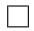

## Beispiele.

① $h(x) = e^{x^2}$. Man setzt $f(x) = x^2$, $g(y) = e^y$. Dann ist $h(x) = g \circ f(x)$ und

$$
h ^ {\prime} (x) = g ^ {\prime} (f (x)) f ^ {\prime} (x) = e ^ {x ^ {2}} \cdot 2 x.
$$

② $f(x) = x^{2} + 5x,\quad g(x) = \frac{1}{x}.$ Dann ist

$$
(g \circ f) (x) = \frac {1}{x ^ {2} + 5 x}, \quad f ^ {\prime} (x) = 2 x + 5, \quad g ^ {\prime} (x) = - \frac {1}{x ^ {2}},
$$

und

$$
(g \circ f) ^ {\prime} (x) = \frac {- 1}{(x ^ {2} + 5 x) ^ {2}} \cdot (2 x + 5).
$$

③  $h(x) = \sqrt{e^{x^{2}+5x}}$ . Dann ist  $h(x) = (g \circ f)(x)$ , wobei  $g(x) = \sqrt{x}$  und  $f(x) = e^{x^{2}+5x}$ . Man erhält

$$
g ^ {\prime} (x) = \frac {1}{2 \sqrt {x}},
$$

$f^{\prime}(x) = (2x + 5)e^{x^{2} + 5x}\quad (\text{weitere Anwendung der Kettenregel}),$

$$
(g \circ f) ^ {\prime} (x) = \frac {1}{2 \sqrt {e ^ {x ^ {2} + 5 x}}} \cdot (2 x + 5) e ^ {x ^ {2} + 5 x}.
$$

Wir werden oft höhere Ableitungen betrachten.

## Definition 6.4.5

Wenn $f$ auf $(a,b)$ differenzierbar ist und $f':(a,b)\longrightarrow\mathbb{R}$ in $x_{0}$ differenzierbar ist, dann heißt

$$
\lim _ {x \to x _ {0}} \frac {f ^ {\prime} (x) - f ^ {\prime} (x _ {0})}{x - x _ {0}}
$$

die zweite Ableitung von $f$ in $x_{0}$. Wir schreiben dafür

$$
\frac {d ^ {2} f}{d x ^ {2}} (x _ {0}) \qquad \text {oder} \qquad f ^ {\prime \prime} (x _ {0})
$$

und sagen, dass $f$ in $x_0$ zweimal differenzierbar ist. Analog ist die $n$-te Ableitung von $f$ in $x_0$

$$
\frac {d ^ {n} f}{d x ^ {n}} (x _ {0}) = f ^ {(n)} (x _ {0}) = \lim _ {x \to x _ {0}} \frac {f ^ {(n - 1)} (x) - f ^ {(n - 1)} (x _ {0})}{x - x _ {0}}.
$$

## Definition 6.4.6

Wenn $f \in C^{1}((a,b))$ und $f'' : (a,b) \to \mathbb{R}$ existiert, dann sagen wir, dass $f$ (auf $(a,b)$) zweimal differenzierbar ist. Wenn zusätzlich $f''$ auf $(a,b)$ stetig ist, dann sagen wir, dass $f$ (auf $(a,b)$) zweimal stetig differenzierbar ist und kürzen dies

$$
f \in C ^ {2} ((a, b))
$$

ab. Analog für höhere Ableitungen.

Achtung!  $f^{(n)}(x_{0}) \neq (f(x_{0}))^{n}!$  Die Klammern sind wichtig.

Bemerkung. Man zeichnet die ersten drei Ableitungen mit Strichen

$$
f ^ {\prime} (x _ {0}), \quad f ^ {\prime \prime} (x _ {0}), \quad f ^ {\prime \prime \prime} (x _ {0})
$$

und ab der 4. ten Ableitung verwendet man

$$
f ^ {(4)} (x _ {0}), \quad f ^ {(5)} (x _ {0}), \dots
$$

Die Ableitung  $f'$  sagt uns, wie sich die Funktion f in einer infinitessimalen Umgebung um einen Punkt verändert. Die zweite Ableitung  $f''$  sagt uns, wie  $f'$  sich verändert. Also: Wie die Steigung der Tangente sich ändert. Dieses Verhalten werden wir auch noch im nächsten Semester an Kurven im Raum genauer untersuchen.

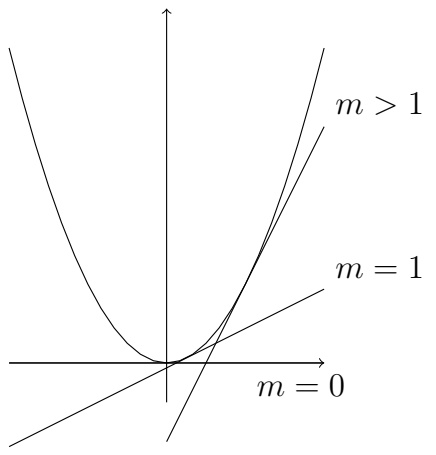

text_image

m > 1
m = 1
m = 0

Abbildung 6.3: Die Steigung der Tangente wächst, also ist  $f''$  positiv.

Wir werden später in Definition 6.6.9 die Bedeutung der zweiten Ableitung genauer untersuchen.

## 6.5 Der Mittelwertsatz der Differentialrechnung

Ein wichtiger Satz der Differentialrechnung ist:

## Satz 6.5.1: Mittelwertsatz der Differentialrechnung

Sei $f\colon [a,b]\longrightarrow \mathbb{R}$ stetig und auf $(a,b)$ differenzierbar. Dann existiert (mindestens) ein $\xi \in (a,b)$, so dass

$$
f ^ {\prime} (\xi) = \frac {f (b) - f (a)}{b - a}.
$$

Wie interpretiert man den Satz? Sei $f$ die Verschiebung eines Massepunktes als Funktion der Zeit. Dann ist $\frac{f(b)-f(a)}{b-a}$ die Durchschnittsgeschwindigkeit. Andererseits ist $f'(x)$ die sogenannte momentane Geschwindigkeit, die beschreibt, wie schnell sich der Massepunkt zu „einem Zeitpunkt“ bewegt. Der Massepunkt kann sich schneller (oder langsamer)

als die Durchschnittsgeschwindigkeit bewegen, aber nicht die ganze Zeit über. Der Mittelwertsatz sagt aus, dass der Massepunkt sich in (mindestens) einem Moment mit genau der Durchschnitts-geschwindigkeit bewegt.

Also angenommen, Sie fahren in 30 Minuten von Aachen nach Köln. Auch wenn Sie behaupten, Sie seien immer nur 130 km/h gefahren, so impliziert der Mittelwertsatz doch, dass Sie mindestens einen Moment lang mit Geschwindigkeit

$$
\frac {80 \mathrm{km}}{1 / 2 \mathrm{Stunde}} = 160 \mathrm{km/h}
$$

gefahren sind.

Ein weiteres Beispiel ist: Ich laufe von einer Seite des Raumes (in einer Linie) zur anderen Seite und zurück. Meine Geschwindigkeit ist in (mindestens) einem Moment gleich Null. Das Gleiche passiert, wenn ich einen Ball hochwerfe und ihn wieder fange. Irgendwann hat der Ball die Geschwindigkeit Null. (Vergleichen Sie mit dem Zwischenwertsatz.)

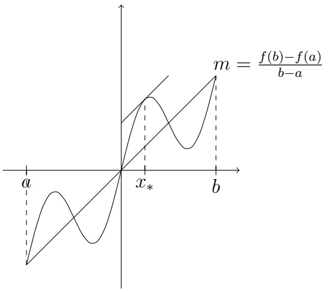

text_image

m = \frac{f(b)-f(a)}{b-a}
a	x_*	b

Abbildung 6.4: In einem Punkt $x_*$ hat die Tangente genau die Steigung $\frac{f(b) - f(a)}{b - a}$.

Im Beweis benutzen wir den Satz über die Extremwerte und die Definition der Ableitung.

Beweis von Satz 6.5.1. Es reicht, wenn wir eine Funktion $f$ mit $f(a) = f(b)$ betrachten und einen Punkt $\xi \in (a, b)$ finden mit $f'(\xi) = 0$. Das liegt daran, dass wir, wenn $f(b) \neq f(a)$ ist,

$$
\tilde {f} (x) = f (x) - \frac {f (b) - f (a)}{b - a} (x - a).
$$

definieren können. (Wir drehen das Bild in Abbildung 6.4, bis die Sekante waagerecht ist.) Dann gilt für $\tilde{f}$, dass

$$
\tilde {f} (a) = f (a), \quad \tilde {f} (b) = f (b) - (f (b) - f (a)) = f (a),
$$

und, wenn für $\xi \in (a,b)$ gilt $\tilde{f}'(\xi) = 0$, dann ist

$$
f ^ {\prime} (\xi) = \frac {f (b) - f (a)}{b - a}.
$$

Also nehmen wir an, dass $f(b) = f(a)$.

Wenn  $f(x) = f(a)$  für alle  $x \in [a, b]$ , dann ist die Aussage  $f'(x) = 0$  für alle  $x \in (a, b)$  erfüllt. Angenommen, f ist nicht identisch  $f(a)$ , dann gibt es ein  $x \in (a, b)$  mit  $f(x) \neq f(a)$ . Ohne Beschränkung der Allgemeinheit nehmen wir an, dass

$$
f (x) > f (a). \tag {6.5.1}
$$

Da $f$ auf $[a,b]$ stetig ist, gibt es nach dem Satz über die Extremwerte einen Punkt $x_{*}\in [a,b]$ mit

$$
f (x _ {*}) = \max _ {x \in [ a, b ]} f (x). \tag {6.5.2}
$$

Nach (6.5.1) gilt

$$
x _ {*} \in (a, b).
$$

Nach (6.5.2) gilt außerdem

$$
\frac {f (x) - f (x _ {*})}{x - x _ {*}} \geq 0 \quad \text {fur alle} x \in [ a, x _ {*}), \tag {6.5.3}
$$

$$
\frac {f (x) - f (x _ {*})}{x - x _ {*}} \leq 0 \quad \text {fur alle} x \in (x _ {*}, b ]. \tag {6.5.4}
$$

Da f differenzierbar ist, erhalten wir aus

$$
f ^ {\prime} (x _ {*}) = \lim _ {x \uparrow x _ {*}} \frac {f (x) - f (x _ {*})}{x - x _ {*}} \stackrel {(6. 5. 3)} {\geq} 0,
$$

$$
f ^ {\prime} (x _ {*}) = \lim _ {x \downarrow x _ {*}} \frac {f (x) - f (x _ {*})}{x - x _ {*}} \stackrel {(6. 5. 4)} {\leq} 0,
$$

dass $f'(x_*) = 0$.

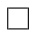

Bemerkung. Wenn f nicht auf  $(a,b)$  differenzierbar ist, gilt der Satz nicht. Gegenbeispiel:  $|x|$  auf  $[-1,1]$ . Wenn f auf  $(a,b)$ , aber nicht auf  $[a,b]$  stetig ist, gilt der Satz nicht. Gegenbeispiel:

$$
f (x) = \left\{ \begin{array}{l l} x & x \in [ 0, 1) \\ 0 & x = 1. \end{array} \right.
$$

## Anwendungen.

①  $f'(x) = 0 \text{ für alle } x \in (a, b) \text{ impliziert, dass } f \equiv c \text{ auf } (a, b) \text{ für ein } c \in \mathbb{R}.$  (Für Details, siehe Lemma 6.6.5 unten.)

② Zeigen Sie, dass das Polynom

$$
p (x) = 2 x ^ {3} + 3 x ^ {2} + 6 x + 1
$$

genau eine Nullstelle besitzt.

Es gilt  $p(0)=1$ ,  $p(-1)=-2+3-6+1=-4$ . Nach dem Zwischenwertsatz existiert eine Nullstelle  $x_{1}$ . Wenn es eine zweite Nullstelle  $x_{2}$  gibt, dann existiert ein  $\xi$  zwischen  $x_{1}$  und  $x_{2}$ , so dass

$$
| p ^ {\prime} (\xi) | = \left| \frac {p (x _ {2}) - p (x _ {1})}{x _ {2} - x _ {1}} \right| = 0.
$$

Aber

$$
p ^ {\prime} (x) = 6 x ^ {2} + 6 x + 6 = 6 (x ^ {2} + x + 1)
$$

besitzt keine (reelle) Nullstelle. Also existiert keine zweite Nullstelle  $x_{2}$  von p.

③ Sei f auf  $(0,2)$  differenzierbar mit  $f(0)=-3$  und  $f'(x)\leq5$ . Was ist der größte Wert, den  $f(2)$  annehmen kann? Antwort:  $f(2)$  kann beliebig groß sein.

Sei f auf (0,2) differenzierbar und auf [0,2] stetig mit  $f(0) = -3$  und  $f'(x) \leq 5$ . Was ist der größte Wert, den  $f(2)$  annehmen kann? Antwort: 7.

④ Abschätzungen zeigen, wie zum Beispiel

$$
\sqrt {1 + x} <   1 + \frac {x}{2} f u r x > 0 o d e r | \sin (x) - \sin (y) | \leq | x - y |.
$$

## Übung 6.5.2

Sei $f(x) = (x + 1) / (x - 1)$. Zeigen Sie, dass es kein $c \in (0,2)$ gibt, so dass

$$
f ^ {\prime} (c) = \frac {f (2) - f (0)}{2 - 0}.
$$

Wieso ist dies kein Widerspruch zum Mittelwertsatz?

## Übung 6.5.3

Zeigen Sie, dass $x^{5} + 10 + 3 = 0$ genau eine reelle Lösung hat.

## Übung 6.5.4

Angenommen $f$ ist auf [2,5] stetig und auf (2,5) differenzierbar mit $1 \leq f'(x) \leq 4$ für alle $x$. Zeigen Sie, dass

$$
3 \leq f (5) - f (2) \leq 1 2.
$$

## Übung 6.5.5

Angenommen $f$ ist ungerade und ist überall differenzierbar. Zeigen Sie, dass es zu jedem $b > 0$ ein $c \in (-b, b)$ gibt, so dass gilt $f'(c) = f(b)/b$.

## Übung 6.5.6

Verwenden Sie den Mittelwertsatz um zu zeigen, dass

$$
\left| \sin (a) - \sin (b) \right| \leq | a - b |
$$

für alle $a, b \in \mathbb{R}$.

## Übung 6.5.7

Zeigen Sie, dass  $\sqrt{1+x}<1+\frac{1}{2}x$  für alle x>0.

Es gibt auch eine verallgemeinete Version des Mittelwertsatzes.

## Satz 6.5.8: Verallgemeinerter Mittelwertsatz

Seien $a, b \in \mathbb{R}$ mit $a < b$. Wenn $f, g$ stetig auf $[a, b]$ und differenzierbar auf $(a, b)$ sind, dann existiert ein $c \in (a, b)$, so dass

$$
f ^ {\prime} (c) (g (b) - g (a)) = g ^ {\prime} (c) (f (b) - f (a)).
$$

Beweis. Man definiere

$$
h (x) = f (x) (g (b) - g (a)) - g (x) (f (b) - f (a)).
$$

Es gilt $h(a) = h(b)$. Außerdem ist $h$ auf $[a, b]$ stetig und auf $(a, b)$ differenzierbar. Also existiert ein $c \in (a, b)$, so dass

$$
h ^ {\prime} (c) = 0.
$$

Man kann Satz 6.5.8 benutzen, um die berühmte Regel von l'Hôspital zu beweisen. (Wir erinnern an die Notation 6.2.4.)

## Satz 6.5.9: l'Hôspitalsche Regel

Sei $a \in \mathbb{R}$ oder $a = \pm \infty$ und $I$ ein Intervall, das $a$ enthält oder als Endpunkt hat. Seien $f, g$ differenzierbar auf $I \setminus \{a\}$ und $g(x) \neq 0$, $g'(x) \neq 0$ für alle $x \in I \setminus \{a\}$. Angenommen

- $\lim_{\substack{x\to a\\ x\in I}}f(x) = \lim_{\substack{x\to a\\ x\in I}}g(x) = 0$ oder
- $\lim_{\substack{x\to a\\ x\in I}}f(x) = \pm \infty$ und $\lim_{\substack{x\to a\\ x\in I}}g(x) = \pm \infty$ und in allen dieser Fälle
- $\lim_{\substack{x\to a\\ x\in I}}\frac{f'(x)}{g'(x)} = B$, wobei $B\in \mathbb{R}$ oder $B = \pm \infty$,

dann gilt

$$
\lim_{\substack{x\to a\\ x\in I}}\frac{f(x)}{g(x)} = B.
$$

Seien Sie bitte vorsichtig, dass Sie die l'Hôspitalsche Regel nur anwenden, wenn die Annahmen erfüllt werden! Betrachten Sie zum Beispiel

$$
\lim _ {x \to 0} \frac {5}{1 0 + 2 x}.
$$

In diesem Beispiel ist für  $f(x) := 5$ ,  $g(x) := 10 + 2x$

$$
\lim _ {x \to 0} \frac {f (x)}{g (x)} \neq \lim _ {x \to 0} \frac {f ^ {\prime} (x)}{g ^ {\prime} (x)}.
$$

Beispiele. Berechnen Sie folgende Grenzwerte:

①

$$
\lim _ {x \to \infty} \frac {\exp (x)}{x ^ {2}}
$$

②

$$
\lim _ {x \downarrow 0} \frac {\exp (x)}{x}
$$

③

$$
\lim _ {x \downarrow 0} x \log (x).
$$

## 6.6 Optimierungsprobleme, Monotonie und Konvexität

Eine andere (sehr wichtige) Anwendung des Mittelwertsatzes sind Optimierungsprobleme.

## Definition 6.6.1

Sei $f: (a, b) \longrightarrow \mathbb{R}$ eine Funktion und $x_0 \in (a, b)$. Wenn

$$
f (x _ {0}) \geq f (x)
$$

für alle x in einer Umgebung von  $x_{0}$ , dann sagen wir, dass f in  $x_{0}$  ein lokales Maximum besitzt und dass  $x_{0}$  ein lokales Maximum von f ist. Wir nennen  $f(x_{0})$  den lokalen Maximalwert. Analog für lokales Minimum. Wenn f in  $x_{0}$  ein lokales Maximum oder

Minimum hat, dann sagen wir, dass $x_0$ ein lokales Extremum von $f$ ist.

Die obige Definition setzt nicht voraus, dass f stetig ist:

## Übung 6.6.2

Untersuchen Sie auf lokale Extrema:

①

$$
f (x) := \left\{ \begin{array}{l l} - x & x <   0 \\ - 1 + x & x \geq 0 \end{array} \right.
$$

②

$$
g (x) := \left\{ \begin{array}{l l} - x & x <   0 \\ - 1 - x & x \geq 0 \end{array} \right.
$$

③

$$
h (x) := \left\{ \begin{array}{l l} - x & x \leq 0 \\ - 1 + x & x > 0 \end{array} \right.
$$

④

$$
\ell (x) := \left\{ \begin{array}{l l} - x & x <   0 \\ 1 - x & x \geq 0 \end{array} \right.
$$

## Definition 6.6.3

Wenn $f$ in $x_0$ differenzierbar ist und

$$
f ^ {\prime} (x _ {0}) = 0,
$$

dann heißt  $x_{0}$  ein stationärer oder kritischer Punkt von f.

Lemma 6.6.4. Sei $f\colon (a,b)\longrightarrow \mathbb{R}$ in $x_0\in (a,b)$ differenzierbar. Wenn $f$ in $x_0$ ein lokales Extremum hat, dann ist

$$
f ^ {\prime} (x _ {0}) = 0.
$$

Beweis. Ohne Beschränkung der Allgemeinheit nehmen wir an, dass  $x_{0}$  ein lokales Maximum ist. Sei  $\{x_{n}\}_{n=1}^{\infty}$  eine beliebige Folge mit

$$
x _ {n} \neq x _ {0}, \quad x _ {n} \rightarrow x _ {0} \text { für } n \rightarrow \infty .
$$

Dann ist

$$
f ^ {\prime} (x _ {0}) = \lim _ {n \to \infty} \frac {f (x _ {n}) - f (x _ {0})}{x _ {n} - x _ {0}}. \tag {6.6.1}
$$

Wenn $x_{n} > x_{0}$ für alle $n$, dann ist

$$
\frac {f (x _ {n}) - f (x _ {0})}{x _ {n} - x _ {0}} \leq 0 \text { für   alle } n \text { groß   genug },
$$

so dass aus (6.6.1) und dem Vergleichskriterium

$$
f ^ {\prime} (x _ {0}) \leq 0 \tag {6.6.2}
$$

folgt. Wenn  $x_{n} < x_{0}$  für alle n, dann gilt

$$
\frac {f (x _ {n}) - f (x _ {0})}{x _ {n} - x _ {0}} \geq 0 \text { für alle } n \text { groß genug, }
$$

aus dem folgt

$$
f ^ {\prime} (x _ {0}) \geq 0. \tag {6.6.3}
$$

Aus (6.6.2) und (6.6.3) schließen wir

$$
f ^ {\prime} (x _ {0}) = 0.
$$

Bemerkung. Die Umkehrung gilt nicht! Es ist möglich, dass f in  $x_{0}$  differenzierbar ist und

$$
f ^ {\prime} (x _ {0}) = 0,
$$

obwohl $f$ kein Extremum in $x_0$ hat. Beispiel: $f(x) = x^3$, $x_0 = 0$.

Also ist  $f'(x_{0}) = 0$  eine notwendige, aber nicht hinreichende Bedingung dafür, dass die differenzierbare Funktion f in  $x_{0}$  ein lokales Extremum hat.

Bemerkung. Wie das Beispiel

$$
f (x) = | x |
$$

zeigt, kann ein Punkt  $x_{0}$  (hier  $x_{0}=0$ ) ein lokales Extremum sein, ohne dass

$$
f ^ {\prime} (x _ {0}) = 0.
$$

Wenn wir alle lokalen Extrema einer Funktion suchen, werden wir folgendes Korollar zu Lemma 6.6.4 anwenden:

Wenn $x_0$ ein lokales Extremum von $f$ ist, dann gilt entweder $f'(x_0) = 0$ oder $f'(x_0)$ existiert nicht.

Lemma 6.6.5. Sei $f:(a,b)\longrightarrow \mathbb{R}$ differenzierbar mit

$$
f ^ {\prime} (x _ {0}) = 0 \quad f u r a l l e x \in (a, b). \tag {6.6.4}
$$

Dann ist f konstant auf  $(a,b)$ , das heißt, es existiert  $c \in R$ , sodass

$$
f (x) = c \quad f \ddot {u} r a l l e x \in (a, b).
$$

Beweis. Wenn $f$ nicht konstant wäre, dann würde es $x$, $y \in (a, b)$ geben mit $x < y$ und $f(x) \neq f(y)$. Nach dem Mittelwertsatz gäbe es ein $\xi \in (x, y)$, so dass

$$
f ^ {\prime} (\xi) = \frac {f (y) - f (x)}{y - x} \neq 0.
$$

Dies ist ein Widerspruch zu (6.6.4).

Zunächst bemerken wir, dass es eine Verbindung zwischen Monotonie von $f$ und dem Vorzeichen von $f'$ gibt.

## Satz 6.6.6

Sei $f:(a,b)\longrightarrow \mathbb{R}$ differenzierbar.

(i) $f$ ist genau dann monoton wachsend bzw. monoton fallend, wenn

$$
f ^ {\prime} (x) \geq 0 \quad \text { für   alle } x \in (a, b) \quad \text { bzw. } \quad f ^ {\prime} (x) \leq 0 \quad \text { für   alle } x \in (a, b).
$$

(ii) Wenn

$$
f ^ {\prime} (x) > 0 \quad \text {fur alle} x \in (a, b) \quad \text {bzw.} \quad f ^ {\prime} (x) <   0 \quad \text {fur alle} x \in (a, b),
$$

dann ist $f$ streng monoton wachsend bzw. streng monoton fallend.

Bemerkung. Der Satz benötigt Differenzierbarkeit. Die Funktionen

$$
f (x) = \left\{ \begin{array}{l l} x & 0 <   x \leq 1 \\ x + 1 & 1 <   x <   2 \end{array} \right. \quad g (x) = \left\{ \begin{array}{l l} x & 0 <   x \leq 1 \\ x - 1 & 1 <   x <   2 \end{array} \right.
$$

erfüllen  $f'(x) = 1 \quad für\ alle\ x \in (0,2) \setminus \{1\}$ ,  $g'(x) = 1 \quad für\ alle\ x \in (0,2) \setminus \{1\}$  und f ist monoton, während g nicht monoton ist.

Bemerkung. In (ii) gilt die Umkehrung nicht.  $f(x) = x^{3}$  ist streng monoton auf R, aber

$$
f ^ {\prime} (0) = 0.
$$

Partieller Beweis von Satz 6.6.6. Wir zeigen:

$$
f \text {monoton wachsend} \quad \text {impliziert} \quad f ^ {\prime} (x) \geq 0 \text {fur alle} x \in (a, b).
$$

Sei  $x_{0} \in (a, b)$ . Da f in  $x_{0}$  differenzierbar ist, gilt

$$
f ^ {\prime} (x _ {0}) = \lim _ {n \to \infty} \frac {f (x _ {n}) - f (x _ {0})}{x _ {n} - x _ {0}} \tag {6.6.5}
$$

für jede Folge  $\{x_{n}\}_{n=1}^{\infty}$  mit  $x_{n} \neq x_{0}$ , die gegen  $x_{0}$  konvergiert. Insbesondere können wir  $x_{n}$  monoton fallend wählen; dies hat den Vorteil, dass der Differenzenquotient ein

Vorzeichen hat:

$$
\frac {f (x _ {n}) - f (x _ {0})}{x _ {n} - x _ {0}} \geq 0 \quad \text {fur alle} n \in \mathbb {N}. \tag {6.6.6}
$$

Aus (6.6.5) und (6.6.6) folgt

$$
f ^ {\prime} (x _ {0}) \geq 0.
$$

Da $x_0$ beliebig war, ist $f'(x) \geq 0$ für alle $x \in (a, b)$.

Den Beweis zu (ii) und die andere Richtung in (i) lassen wir als Übungen.

Beispiel. Zeigen Sie, dass  $f(x) = \frac{x}{\sqrt{1 + x^{2}}}$  streng monoton wachsend ist. Dies folgt aus

$$
f ^ {\prime} (x) = \frac {1}{(1 + x ^ {2}) ^ {\frac {3}{2}}} > 0
$$

und Satz 6.6.6 (ii).

## Satz 6.6.7

Sei $f\colon (a,b)\longrightarrow \mathbb{R}$ stetig und auf $(a,b)\setminus \{x_0\}$ differenzierbar. Wenn für ein $\delta >0$ gilt

$$
f ^ {\prime} (x) \geq 0 \quad \text {auf} (x _ {0} - \delta , x _ {0}), \quad f ^ {\prime} (x) \leq 0 \quad \text {auf} (x _ {0}, x _ {0} + \delta), \tag {6.6.7}
$$

dann besitzt $f$ in $x_0$ ein lokales Maximum, analog für Minimum. Umgekehrt, wenn

$$
f ^ {\prime} (x) > 0 \quad \text {auf} (x _ {0} - \delta , x _ {0} + \delta) \setminus \{x _ {0} \}, \quad \text {oder} \quad f ^ {\prime} (x) <   0 \quad \text {auf} (x _ {0} - \delta , x _ {0} + \delta) \setminus \{x _ {0} \},
$$

dann ist  $x_{0}$  kein lokales Extremum.

Beweis. Übung. Wie nutzt man Stetigkeit im Beweis?

Bemerkung. Wenn $f$ in $x_0$ differenzierbar ist und (6.6.7) gilt, dann folgt $f'(x_0) = 0$. Mit dem Satz kann man allerdings auch Funktionen wie

$$
f (x) = | x | \quad o d e r \quad g (x) = \sqrt {| x |}
$$

betrachten.

Satz 6.6.7 ergibt eine Methode, durch die wir Extrema einer Funktion finden und aussortieren können.

Algorithmus #1: Um die lokalen Extrema von $f:(a,b)\to\mathbb{R}$ zu finden, für $f$ stetig und in allen außer endlich vielen Punkten differenzierbar.

(1) Finde alle Punkte  $x_{0}^{1}, \ldots, x_{0}^{n}$ , in denen

$$
f ^ {\prime} (x _ {0} ^ {i}) = 0 \text {oder} f ^ {\prime} (x _ {0} ^ {i}) \text {nicht existiert.}
$$

(2) Untersuche das Vorzeichen von  $f'$  in einer Umgebung von jedem  $x_{0}^{i}, i = 1,.., n$ .

## Beispiel.

$$
f (x) = \left\{ \begin{array}{l l} \sqrt {| x | + 3} & - 1 <   x \leq 1 \\ x + 1 & 1 <   x <   2 \\ x ^ {2} - 1 0 x + 1 9 & 2 \leq x <   1 0. \end{array} \right.
$$

Dann ist f auf  $(-1,10)$  stetig (Übung!), und  $f'$  existiert nicht (Übung!) in genau den Punkten

$$
x _ {0} ^ {1} = 0, x _ {0} ^ {2} = 1, x _ {0} ^ {3} = 2.
$$

Außerdem ist $f'(x) = 0$ in

$$
x _ {0} ^ {4} = 5.
$$

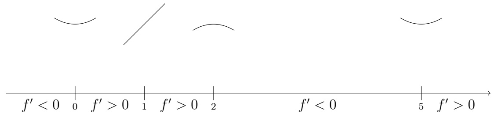

text_image

f' < 0 0 f' > 0 1 f' > 0 2 f' < 0 5 f' > 0

## Man erhält

$x_0^1 = 0$ ist ein lokales Minimum
$x_0^2 = 1$ ist kein lokales Extremum
$x_0^3 = 2$ ist ein lokales Maximum
$x_0^4 = 5$ ist ein lokales Minimum

Bemerkung. Da wir alle Punkte, wo  $f'$  verschwindet, als Kandidaten haben, ist keine Vorzeichenänderung in einem anderen Punkt möglich. Das heißt, wir können einen beliebigen Punkt in  $(x_{0}^{i}, x_{0}^{i+1})$  als “Testpunkt” wählen.

Wenn $f$ so glatt ist, dass zwei Ableitungen von $f$ existieren und stetig sind, dann können wir kritische Punkte durch das Vorzeichen von $f''(x_0)$ analysieren—wenn dies ein Vorzeichen hat.

## Satz 6.6.8

Sei $f\colon (a,b)\longrightarrow \mathbb{R}$ zweimal stetig differenzierbar. Sei $x_0\in (a,b)$ ein kritischer Punkt von $f$. Es gilt:

(i) Falls  $f''(x_{0}) < 0$  ist, dann ist  $x_{0}$  ein Maximum von f.
(ii) Falls $f''(x_0) > 0$ ist, dann ist $x_0$ ein Minimum von $f$.

Was sagt der Satz, wenn  $f''(x_{0}) = 0$ ? Nichts! [KEINE AUSSAGE, WENN  $f''(x_{0}) = 0$ .] Was passiert, wenn  $f''(x_{0}) = 0$ ? Alles ist möglich. Betrachten Sie  $f_{1}(x) = x^{4}$ ,  $f_{2}(x) = -x^{4}$ ,  $f_{3}(x) = x^{3}$ . (Wir besprechen diese Situation wieder, wenn wir über die Taylorformel sprechen.)

Beweis von Satz 6.6.8. zu (i): Da $f''$ stetig ist und $f''(x_0) < 0$, gibt es ein $\varepsilon > 0$, so dass

$$
f ^ {\prime \prime} (x _ {0}) <   0 \text {in einer Umgebung} (x _ {0} - \varepsilon , x _ {0} + \varepsilon) \text {von} x _ {0}.
$$

Also ist $f'$ streng monoton fallend auf $(x_0 - \varepsilon, x_0 + \varepsilon)$. Aus $f'(x_0) = 0$ folgt

$$
f ^ {\prime} (x) > 0 \quad \text {auf} (x _ {0} - \varepsilon , x _ {0}), \qquad f ^ {\prime} (x) <   0 \quad \text {auf} (x _ {0}, x _ {0} + \varepsilon)
$$

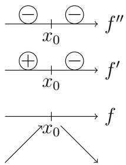

Skizze zu dem Beweis von Satz 6.6.8, die Umkreisten +,- geben das Vorzeichen der Funktion in dem Bereich an.

Aus Satz 6.6.7 folgt, dass $x_0$ eine lokale Maximalstelle von $f$ ist. Der Beweis von (ii) erfolgt analog.

Aus Satz 6.6.8 erhält man:

Algorithmus #2: Um die lokalen Extrema von $f:(a,b)\to\mathbb{R}$ zu finden, für $f$ zweimal stetig differenzierbar.

(1) Finde jeden Punkt $x_0$, in dem

$$
f ^ {\prime} (x _ {0}) = 0.
$$

(2) Untersuche das Vorzeichen von

$$
f ^ {\prime \prime} (x _ {0})
$$

für jeden solchen Punkt.

$$
f ^ {\prime \prime} (x _ {0}) > 0 \quad \Rightarrow \quad x _ {0} \text {lokale Minimalstelle}
$$

$$
f ^ {\prime \prime} (x _ {0}) <   0 \quad \Rightarrow \quad x _ {0} \text {lokale Maximalstelle}
$$

$$
f ^ {\prime \prime} (x _ {0}) = 0 \quad \Rightarrow \quad \text {Weitere Untersuchung nötig (zum Beispiel durch Algorithmus \#1).}
$$

Das Vorzeichen von  $f''$ —falls  $f''$  existiert—liefert Informationen über die sogenannte Konvexität von f.

## Definition 6.6.9: Konvex

Seien  $I \subseteq R$  ein Intervall und  $f : I \longrightarrow R$  eine reelle Funktion. Dann heißt  $f \underline{konvex}$ , falls gilt

$$
f ((1 - t) x + t y) \leq (1 - t) f (x) + t f (y) \quad \text { für   alle } x, y \in I \text { und   jedes } t \in (0, 1). \tag {6.6.8}
$$

Falls (6.6.8) mit echter Ungleichheit gilt, so heißt $f$ strikt konvex. Analog heißt $f$ konkav,

falls gilt

$$
f ((1 - t) x + t y) \geq (1 - t) f (x) + t f (y) \quad \text {fur alle} x, y \in I \text {und jedes} t \in (0, 1).
$$

Analog definiert man strikt konkav.

Manchmal drückt man es so aus: Wenn $f$ konvex ist, dann sitzt der Graph von $f$ unter dem der Sekanten. Definition 6.6.9 macht deutlich, was hiermit gemeint wird.

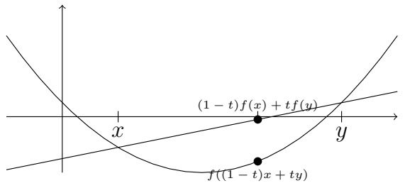

text_image

(1 - t)f(x) + tf(y)
f((1 - t)x + ty)

## Satz 6.6.10

Sei $f\colon [a,b]\longrightarrow \mathbb{R}$ stetig.

(i) Wenn $f$ auf $(a, b)$ differenzierbar ist, dann ist $f$ genau dann konvex, wenn $f'$ auf $(a, b)$ monoton wachsend ist.
(ii) Wenn $f$ auf $(a, b)$ zweimal differenzierbar ist, dann ist $f$ genau dann konvex, wenn $f''(x) \geq 0$ für alle $x \in (a, b)$.

Den Beweis überspringen wir, aber er ist nicht schwer. Man verwendet, dass Konvexität äquivalent dazu ist, dass die Steigung der Sekanten monoton wachsend ist, also dass für alle  $x_{1} < \tilde{x} < x_{2}$  gilt

$$
\frac {f (\tilde {x}) - f (x _ {1})}{\tilde {x} - x _ {1}} \leq \frac {f (x _ {2}) - f (\tilde {x})}{x _ {2} - \tilde {x}}.
$$

Die Funktion

$$
f (x) := \left\{ \begin{array}{l l} x ^ {2} & x \leq 0 \\ \frac {1}{2} x ^ {2} & x > 0 \end{array} \right.
$$

ist konvex aber nicht zweimal differenzierbar.

Da das Vorzeichen von  $f''$  von Bedeutung ist, interessieren wir uns für Punkte, in denen das Vorzeichen sich ändert.

## Definition 6.6.11

Sei $f \in C^{2}((a,b))$. Ein Punkt $x_{0} \in (a,b)$ heißt ein Wendepunkt von $f$, wenn für ein $\delta > 0$ gilt

$$
f ^ {\prime \prime} (x) > 0 \quad \text {auf} (x _ {0} - \delta , x _ {0}) \quad \text {und} \quad f ^ {\prime \prime} (x) <   0 \quad \text {auf} (x _ {0}, x _ {0} + \delta)
$$

oder umgekehrt.

Bemerkung. Da  $f \in C^{2}$  angenommen wurde, gilt in einem Wendepunkt  $x_{0}$  nach Stetigkeit der zweiten Ableitung, dass  $f''(x_{0}) = 0$ . (Achtung! Das ist nicht die Definition von Wendepunkt! Der Punkt x = 0 ist KEIN Wendepunkt der Funktion  $x^{4}$ !)

## Beispiele.

①  $f(x) = x^{3} - 3x + 1$  besitzt einen Wendepunkt in x = 0.
② Wie schon bemerkt, ist x = 0 ein kritischer Punkt der Funktion  $x^{3}$ . Jetzt sehen wir, dass der Ursprung auch ein Wendepunkt der Funktion ist, da  $f''(x) < 0$  auf  $(-1,0)$  und  $f''(x) > 0$  auf  $(0,1)$ . (Hierbei haben wir 1 nur ausgesucht, um konkret zu sein.)

Wenn man den Graphen einer Funktion zeichnet, ist es nützlich, alle Extrempunkte und Wendepunkte zu identifizieren und Informationen über das Vorzeichen von  $f'$  und  $f''$  zu benutzen. Wenn  $f \in C^{2}$ , dann kann man Informationen über das Vorzeichen von  $f''$  auf einer punktierten Umgebung von einem kritischen  $x_{0}$  benutzen, um den kritischen Punkt auszusortieren (wenn zum Beispiel  $f''(x_{0}) = 0$ ).

## 6.7 Randextrema

Bis jetzt haben wir lokale Extrema nur für Funktionen auf offenen Intervallen definiert. Für eine Funktion $f$ mit $D(f) = [a, b]$ oder $D(f) = [a, b)$ oder $D(f) = (a, b]$, kann $f$ auch ein lokales Extremum in einem Endpunkt des Intervalls haben. Um Randextrema zu definieren, geben wir diese Verallgemeinerung von Definition 6.6.1 an.

Definition 6.6.1'. Sei $I \subseteq \mathbb{R}$ ein Intervall und $f: I \longrightarrow \mathbb{R}$ eine Funktion. Ein Punkt $x_0 \in I$ heißt ein lokales Maximum von $f$, falls es eine Umgebung $U$ von $x_0$ gibt, so dass

$$
f (x _ {0}) \geq f (x) \quad \text { für   alle } x \in U \cap I.
$$

Wir nennen  $f(x_{0})$  einen lokalen Maximalwert von f. Analog für lokales Minimum. Wenn  $x_{0}$  ein lokales Maximum oder ein lokales Minimum von f ist, dann nennen wir  $x_{0}$  ein lokales Extremum von f.

Bemerken Sie, dass eine differenzierbare Funktion $f$ ein lokales Extremum in einem Endpunkt $x_0$ haben kann, ohne dass $f'(x_0) = 0$. Für eine differenzierbare Funktion $f : [a, b] \to \mathbb{R}$ erhält man nur

- $a$ ein lokales Minimum $\Rightarrow f'(a) \geq 0$,
- $a$ ein lokales Maximum $\Rightarrow f'(a) \leq 0$,
- $b$ ein lokales Minimum $\Rightarrow f'(b) \leq 0$,
- $b$ ein lokales Maximum $\Rightarrow f'(b) \geq 0$.

Andersherum gilt: Wenn $f$ auf $[a,b]$ stetig und differenzierbar ist, dann gilt:

- $f'(a) > 0 \quad \Rightarrow \quad a$ ist ein lokales Minimum,
- $f'(a) < 0 \quad \Rightarrow \quad a \text{ ist ein lokales Maximum}$,
- $f'(b) > 0 \quad \Rightarrow \quad b \text{ ist ein lokales Maximum,}$
- $f'(b) < 0 \quad \Rightarrow \quad b$ ist ein lokales Minimum.

Falls  $f'(a) = 0$  oder  $f'(b) = 0$  muss man zusätzliche Information verwenden, zum Beispiel das Vorzeichen von  $f'$  für x > a bzw. x < b oder  $f''(a)$ ,  $f''(b)$ , falls die zweite Ableitung existiert und ein Vorzeichen hat.

Beispiel. Als kleines Beispiel betrachte man  $x^{2}$  auf [1,2], wobei die Funktion ein lokales Minimum in x = 1 und ein lokales Maximum in x = 2 hat.

Beispiel. Für die Funktion  $x^{2}$  auf  $[-1,2]$  ist sowohl x = -1 als auch x = 2 ein lokales Maximum. (x = 0 ist ein lokales Minimum.)

## Übung 6.7.1

Finden und klassifizieren Sie alle lokale und Randextrema:

$$
f (x) = \left\{ \begin{array}{l l} \frac {1}{8} + \left| x + \frac {1}{2} \right| & x \in [ - 1, - \frac {1}{2}) \\ x ^ {3} - 3 x ^ {2} + 1 & x \in [ - \frac {1}{2}, 4 ]. \end{array} \right.
$$

Wir bemerken, dass Differenzierbarkeit auf  $[a, b]$  nicht notwendig ist, um die Randpunkte als lokale Optima zu haben. Wenn f auf  $[a, b]$  stetig und auf  $(a, b)$  differenzierbar ist, dann impliziert

\- $f'(x) > 0$ für $x \in (a, a + \delta)$ (für ein $\delta > 0$), dass $a$ ein lokales Minimum ist.

Betrachten Sie zum Beispiel die stetige Fortsetzung von  $-x \log(x)$  auf [0, 1/2]. Dann hat die Funktion ein lokales Minimum in x = 0 aber die Ableitung in Null existiert nicht.

## 6.8 Das Newtonsche Verfahren (reprise)

In den meisten Problemen kann man die lokalen Extrema einer Funktion nicht explizit ausrechnen. Das Newtonsche Verfahren ist ein Algorithmus, um Lösungen einer Gleichung zu approximieren. Das Newtonsche Verfahren konvergiert im Allgemeinen schnell gegen eine Lösung—wenn der Anfangswert nah genug an dieser Lösung liegt. (Eine nichttriviale Bedingung!) Wenn wir die Methode auf die Gleichung

$$
f ^ {\prime} (x) = 0
$$

anwenden, approximieren wir kritische Punkte von f. Andere Anwendungen sind zum Beispiel

\- eine Nullstelle von $x^3 - 2x - 5$ finden,

\- $\sqrt[6]{2}$ mit einer Genauigkeit von sechs Nachkommastellen berechnen

$$
\left(\sqrt [ 6 ]{2} = x \quad \Rightarrow \quad x ^ {6} = 2 \quad \Rightarrow \quad x ^ {6} - 2 = 0\right),
$$

\- eine Lösung von $\tan x = x$ finden.

Im Abschnitt 5.3 haben wir Lösungen einer Gleichung der Form

$$
g (x) = 0 \tag {6.8.1}
$$

durch die Sekantenmethode approximiert. Die Idee war, dass wir die Approximation  $x_{n-1}$  durch die Nullstelle einer geeigneten Sekante zu ersetzen. Im Newtonschen Verfahren ersetzen wir  $x_{n-1}$  durch die Nullstelle der Tangente des Graphen von g in  $(x_{n-1}, g(x_{n-1}))$ , also durch

$$
x _ {n} = x _ {n - 1} - \frac {g (x _ {n - 1})}{g ^ {\prime} (x _ {n - 1})}.
$$

Also ist

$$
\varphi (x) = x - \frac {g (x)}{g ^ {\prime} (x)}
$$

die Funktion, deren Fixpunkt  $\overline{x}$  wir im Abschnitt 5.3 finden wollten. Diese Funktion ist in einer Umgebung von  $\overline{x}$  stetig, wenn g und  $g'$  stetig sind und  $g'(\overline{x}) \neq 0$ . Wenn wir die Gleichung

$$
f ^ {\prime} (x) = 0
$$

lösen möchten, also  $g = f'$  in (6.8.1), dann benötigen wir für das Newtonsche Verfahren, dass  $f \in C^{2}$  in einer Umgebung der gesuchten Nullstelle  $\overline{x}$  und  $f''(\overline{x}) \neq 0$ . Sie können das Newtonsche Verfahren in Maple oder Matlab (oder ähnliches—oder mit einem einfachen Taschenrechner) ausprobieren.

## Übung 6.8.1

Berechnen Sie zwei Schritte des gegebenen Verfahrens um die Lösung von  $\cos(x) = x$  zu finden:

① das Bisektionsverfahren auf [0, 1],
② die Sekantenmethode auf [0,1],
③ das Newtonsche Verfahren mit  $x_{0}=1$ .

Welche Approximation ist am besten?

## 6.9 Globale Optimierung

Das Wissen aus den vorherigen Abschnitten verwenden wir, um globale Optima einer Funktion zu bestimmen.

In der lokalen Optimierung suchen wir alle kritischen Punkte und bestimmen, ob sie ein Minimum, ein Maximum oder keins von beiden sind. In der globalen Optimierung fragen wir: In welchem Punkt ist f am kleinsten (oder am größten)? Welche Perspektive wichtiger ist, hängt von der Anwendung ab.

## Definition 6.9.1

Sei $f$ eine reelle Funktion. Ein Punkt $x_0 \in \mathcal{D}(f)$ heißt globales Minimum von $f$, wenn

$$
f (x _ {0}) \leq f (x) \quad \text { für   alle } x \in \mathcal {D} (f).
$$

Wir nennen  $f(x_{0})$  den (globalen) Minimalwert von f. Analog für globales Maximum.

Wenn wir die globalen Minima von f finden möchten, müssen wir nicht nur die kritischen Punkte von f, sondern auch die Funktionswerte in diesen Punkten betrachten. Wenn  $\mathcal{D}(f)$  ein beschränktes, abgeschlossenes Intervall  $[a,b]$  ist, dann reicht es aus, die Funktionswerte in allen kritischen Punkten und die Funktionswerte in a und b zu betrachten.

Algorithmus #3: Um das globale Minimum zu finden, für  $f : [a, b] \to R$  stetig und außer in endlichen vielen Punkten differenzierbar.

(1) Alle Punkte  $x_{0}^{i}, i = 1,.., n$  finden, in denen  $f'(x_{0}^{i}) = 0$  oder  $f'(x_{0}^{i})$  nicht existiert.
(2)  $f(x)$  berechnen für  $x \in \{a, b, x_{0}^{1}, x_{0}^{2}, ..., x_{0}^{n}\}$ .
(3) Alle Punkte aus $\{a, b, x_0^1, x_0^2, ..., x_0^n\}$ wählen, in denen $f$ am kleinsten ist.

Alternativ kann man zuerst lokale Maxima und im Allgemeinen Extrema, die nicht Minima sind, ausschließen.

Algorithmus #4: Um die globalen Minima zu finden, für  $f : [a, b] \to R$  stetig und außer in endlichen vielen Punkten differenzierbar.

(1) Alle Punkte  $x_{0}^{i}, i = 1,.., n$  finden, in denen  $f'(x_{0}^{i}) = 0$  oder  $f'(x_{0}^{i})$  nicht existiert.
(2) Aus  $\{a,b,x_{0}^{1},\ldots,x_{0}^{n}\}$  alle Punkte  $y_{0}^{1},\ldots,y_{0}^{m}$  identifizieren, die lokale Minima sind.
(3) $f(x)$ berechnen für $x \in \{y_0^1, y_0^2, \dots, y_0^m\}$.
(4) Alle Punkte aus  $\{y_{0}^{1}, y_{0}^{2}, ..., y_{0}^{m}\}$  wählen, in denen f am kleinsten ist.

## Beispiel.

① Finden Sie alle lokalen und globalen Minima von  $f(x) = x|1 - x|^{\frac{2}{5}}$  auf  $[-1,2]$ . Die Randpunkte sind als kritische Punkte zu betrachten. Wegen  $\frac{2}{5} \in (0,1)$  ist f in x = 1 stetig aber nicht differenzierbar. Also ist 1 auch ein kritischer Punkt. Um zusätzliche kritische Punkte zu finden, suchen wir Lösungen von  $f'(x) = 0$ . Für x < 1 berechnen wir

$$
0 = f ^ {\prime} (x) = (1 - x) ^ {2 / 5} - \frac {2}{5} x (1 - x) ^ {- 3 / 5} = \frac {1 - x - \frac {2}{5} x}{(1 - x) ^ {3 / 5}} = \frac {1 - \frac {7}{5} x}{(1 - x) ^ {3 / 5}} \tag {6.9.1}
$$

genau dann, wenn

$$
x = \frac {5}{7}.
$$

Für $x > 1$ berechnen wir

$$
0 = f ^ {\prime} (x) = (x - 1) ^ {2 / 5} + \frac {2}{5} x (x - 1) ^ {- 3 / 5} = \frac {\frac {7}{5} x - 1}{(x - 1) ^ {3 / 5}}, \tag {6.9.2}
$$

so dass wir keine weiteren kritischen Punkte finden. Also sind die kritischen Punkte:

$$
\left\{- 1, \frac {5}{7}, 1, 2 \right\}.
$$

Da wir nach der Aufgabenstellung die lokalen Extrema klassifizieren müssen, ist es sinnvoll, Algorithmus #4 zu verwenden. Wir berechnen:

- Für $x < 5/7$ ist nach (6.9.1) $f'(x) > 0$.
- Für $5/7 < x < 1$ ist $f'(x) < 0$.
- Für $1 < x < 2$ ist nach (6.9.2) $f'(x) > 0$

Aus der obigen Information folgern wir

- $x = -1$ ist ein lokales Minimum,
- $x = \frac{5}{7}$ ist ein lokales Maximum,
- $x = 1$ ist ein lokales Minimum,
- $x = 2$ ist ein lokales Maximum.

Um das globale Maximum zu identifizieren vergleichen wir:

$$
f (5 / 7) = \frac {5}{7} \left(\frac {2}{7}\right) ^ {\frac {2}{5}} <   1, \qquad f (2) = 2,
$$

so dass x = 2 das globale Maximum ist. Für das globale Minimum vergleichen wir:

$$
f (- 1) = - 1 \cdot 2 ^ {\frac {2}{5}} <   0, \qquad f (1) = 0,
$$

so dass $x = -1$ das globale Minimum ist.

② Wir definieren die Entropie

$$
S (x) := \left\{ \begin{array}{l l} - x \log (x) & x > 0 \\ 0 & x = 0. \end{array} \right.
$$