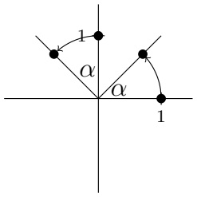
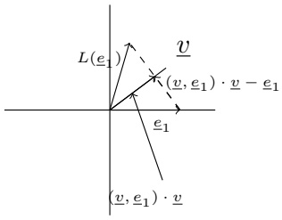
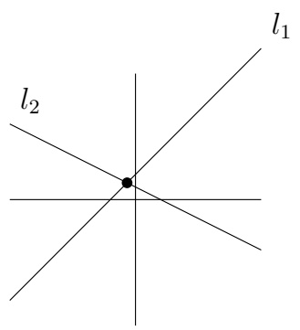
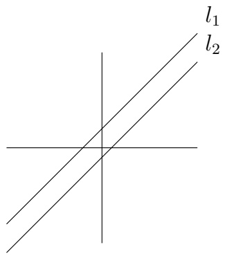
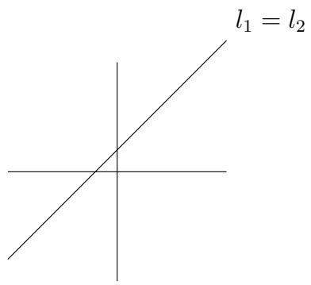

Beispiel. Die Vektoren

$$
\underline {{b}} _ {1} = \left( \begin{array}{c} 1 \\ 0 \\ 0 \end{array} \right) \quad u n d \quad \underline {{b}} _ {2} = \left( \begin{array}{c} 1 \\ 1 \\ 0 \end{array} \right)
$$

sind linear unabhängig, da aus

$$
\alpha_ {1} \left( \begin{array}{c} 1 \\ 0 \\ 0 \end{array} \right) + \alpha_ {2} \left( \begin{array}{c} 1 \\ 1 \\ 0 \end{array} \right) = \left( \begin{array}{c} 0 \\ 0 \\ 0 \end{array} \right)
$$

folgt, dass $\alpha_{1} = \alpha_{2} = 0$. Der Spann der Vektoren ist

$$
S p \left\{\underline {{b}} _ {1}, \underline {{b}} _ {2} \right\} = \left\{\left( \begin{array}{c} x \\ y \\ 0 \end{array} \right): x, y \in \mathbb {R} \right\}.
$$

Der Vektor $\underline{v} = \begin{pmatrix} 3 \\ 2 \\ 0 \end{pmatrix} \in Sp\{\underline{b}_1, \underline{b}_2\}$ besitzt bezüglich dieser Basis die Koordinaten $\alpha_1 = 1$, $\alpha_2 = 2$:

$$
\underline {{v}} _ {[ \mathcal {B} ]} = \binom{1}{2}.
$$

Wir werden jetzt sehen, dass es genau eine „richtige“ Anzahl von Vektoren für eine Basis gibt.

Lemma 8.1.10. Sei $\mathcal{B} = \{\underline{b}_1, \dots, \underline{b}_n\}$ eine Basis des Vektorraums $V$. Dann ist für $m > n$ jede Sammlung von $m$ Vektoren linear abhängig.

Beweis. Angenommen $\left\{\underline{y}_1,\underline{y}_2,\dots,\underline{y}_m\right\}$ ist linear unabhängig. Dann ist jedes $\underline{y}_j\neq\underline{0}$ für $j = 1,\dots,m$. Da $\mathcal{B}$ eine Basis ist, kann $\underline{y}_1$ als

$$
\underline {{y}} _ {1} = \sum_ {i = 1} ^ {n} \alpha_ {i} \underline {{b}} _ {i}
$$

dargestellt werden, und, da  $y_{1} \neq 0$ , ist ein Koeffizient von Null verschieden—zum Beispiel  $\alpha_{k} \neq 0$ . Dann kann man  $b_{k}$  als lineare Kombination der Vektoren aus

$$
\left\{\underline {{y}} _ {1}, \underline {{b}} _ {1}, \dots , \underline {{b}} _ {k - 1}, \underline {{b}} _ {k + 1}, \dots , \underline {{b}} _ {n} \right\} = \mathcal {B} _ {2}
$$

schreiben. Also wird $V$ von $\mathcal{B}_2$ aufgespannt. Jetzt wiederholt man dies mit

$$
\underline{y}_{2} = \sum_{\substack{i = 1\\ i\neq k}}^{n}\beta_{i}\underline{b}_{i} + \beta_{k}\underline{y}_{1}
$$

usw., bis man  $\underline{y}_{n+1}$  als lineare Kombination von  $\underline{y}_{1}, \ldots, \underline{y}_{n}$  schreibt, was linearer Unabhängigkeit von  $\left\{\underline{y}_{1}, \ldots, \underline{y}_{m}\right\}$  widerspricht. ☐

Also besitzt jede Basis eines Vektorraums die gleiche Anzahl von Vektoren. (Warum?) Diese Zahl bekommt einen besonderen Namen.

## Definition 8.1.11

Wenn der nichttriviale Vektorraum $V$ eine Basis $\{\underline{b}_1,\dots ,\underline{b}_n\}$ besitzt, dann heißt $n$ die Dimension des Vektorraums. Wir schreiben

$$
\dim (V) = n.
$$

Die Dimension des trivialen Vektorraums $\{\underline{0}\}$ definieren wir als 0.

## Definition 8.1.12

Wenn ein Vektorraum $V$ Dimension $n \in \mathbb{N}$ besitzt, dann heißt er endlich-dimensional.

Lemma 8.1.13. Sei $V$ ein Vektorraum mit Dimension $n$. Wenn $\{\underline{v}_1, \ldots, \underline{v}_n\} \subseteq V$ linear unabhängig ist, dann bildet $\{\underline{v}_1, \ldots, \underline{v}_n\}$ eine Basis von $V$.

Beweis. Sei  $\underline{v}_{1},\ldots,\underline{v}_{n}$  linear unabhängig. Sei  $\underline{v}\in V$  ein beliebiger Vektor. Nach Lemma 8.1.10 ist

$$
\{\underline {{v}}, \underline {{v}} _ {1}, \dots , \underline {{v}} _ {n} \}
$$

linear abhängig. Also gibt es Konstanten  $\alpha_{0}, \alpha_{1}, \ldots, \alpha_{n}$ , wobei nicht alle Null sind und

$$
\alpha_ {0} \underline {{v}} + \alpha_ {1} \underline {{v}} _ {1} + \dots + \alpha_ {n} \underline {{v}} _ {n} = \underline {{0}}.
$$

Da $\underline{v}_1, \ldots, \underline{v}_n$ linear unabhängig sind, kann $\alpha_0$ nicht gleich Null sein. Also gilt

$$
\underline {{v}} = - \frac {1}{\alpha_ {0}} (\alpha_ {1} \underline {{v}} _ {1} + \dots + \alpha_ {n} \underline {{v}} _ {n}).
$$

Da  $\underline{v}$  beliebig ist, haben wir gezeigt, dass  $\{\underline{v}_{1},...,\underline{v}_{n}\}$  ein Erzeugendensystem von V ist. Da  $\{\underline{v}_{1},...,\underline{v}_{n}\}$  auch linear unabhängig ist, ist  $\{\underline{v}_{1},...,\underline{v}_{n}\}$  eine Basis. ☐

Bemerkung. Es lohnt sich, eine gute/geeignete Basis zu finden. Zum Beispiel nimmt die lineare Abbildung von  $R^{2} \rightarrow R^{2}$  definiert durch

$$
\underline {{x}} \mapsto \text {Projektion von} \underline {{x}} \text {auf die Richtung} \underline {{v}} \in \mathbb {R} ^ {2}
$$

eine besonders einfache Form an, wenn x bezüglich einer geeigneten Basis dargestellt wird. Sei v ein Einheitsvektor. Wir nehmen die Basis

$$
\mathcal {B} = \{\underline {{v}}, \underline {{w}} \},
$$

wobei $\underline{w}$ ein Einheitsvektor orthogonal zu $\underline{v}$ ist. Wenn $\underline{x}$ auf die Basis bezogen wird,

$$
\underline {{x}} _ {[ \mathcal {B} ]} = \binom{x _ {1}}{x _ {2}},
$$

dann ist  $\begin{pmatrix} x_{1} \\ 0 \end{pmatrix}$  die Projektion von  $\underline{x}$ .

## Übung 8.1.14

① Finden Sie einen Vektor $\underline{v}$, so dass

$$
\left\{\binom{1}{1}, \underline {{v}} \right\}
$$

eine Basis von  $R^{2}$  ist. Schreiben Sie  $\begin{pmatrix}1\\0\end{pmatrix}$  bezüglich dieser Basis.

② Ergänzen Sie  $\underline{v}_{1}=\begin{pmatrix}1\\ 1\\ 1\end{pmatrix}$  und  $\underline{v}_{2}=\begin{pmatrix}3\\ 0\\ 2\end{pmatrix}$  zu einer Basis von  $R^{3}$ . Wie kann man
 $\underline{x}\in R^{3}$  bezüglich dieser Basis darstellen?

Jetzt zeigen wir, dass jede linear unabhängige Sammlung von Vektoren eines endlich-dimensionalen Vektorraums zu einer Basis ergänzt werden kann.

Lemma 8.1.15. Sei $V$ ein Vektorraum mit $\dim(V) = n \in \mathbb{N}$ und $\{\underline{v}_1, \ldots, \underline{v}_m\}$ linear unabhängig. Dann kann $\{\underline{v}_1, \ldots, \underline{v}_m\}$ zu einer Basis ergänzt werden, das heißt, es gibt $n - m$ Vektoren $\underline{x}_i$, so dass

$$
\mathcal {B} = \{\underline {{v}} _ {1}, \dots , \underline {{v}} _ {m}, \underline {{x}} _ {1}, \dots , \underline {{x}} _ {n - m} \}
$$

eine Basis von $V$ ist.

Beweis. Nach Lemma 8.1.10 ist $m \leq n$. Wenn $\{\underline{v}_1, ..., \underline{v}_m\} V$ aufspannt, dann ist $\{\underline{v}_1, ..., \underline{v}_m\}$ eine Basis von $V$. Wenn nicht, dann gibt es ein $\underline{x}_1 \in V$, so dass $\{\underline{v}_1, ..., \underline{v}_m, \underline{x}_1\}$ linear unabhängig ist. Entweder gilt $Sp\{\underline{v}_1, ..., \underline{v}_m, \underline{x}_1\} = V$ oder es existiert ein zusätzliches Element $\underline{x}_2$, so dass $\{\underline{v}_1, ..., \underline{v}_m, \underline{x}_1, \underline{x}_2\}$ linear unabhängig ist. Nach Lemma 8.1.10 endet dieser Prozess in $n - m$ Schritten.

## 8.2 Lineare Abbildungen

## Definition 8.2.1

Seien $V, W$ Vektorräume über $\mathbb{R}$. Die Abbildung $L: V \longrightarrow W$ heißt linear, wenn gilt

$$
L (\alpha_ {1} \underline {{v}} _ {1} + \alpha_ {2} \underline {{v}} _ {2}) = \alpha_ {1} L (\underline {{v}} _ {1}) + \alpha_ {2} L (\underline {{v}} _ {2}) \quad \text { für   alle } \alpha_ {1}, \alpha_ {2} \in \mathbb {R} \text { und } \underline {{v}} _ {1}, \underline {{v}} _ {2} \in V.
$$

## Beispiele.

①  $V = W = R^{2}$ ,  $L = Drehung\ eines\ Vektors\ um\ \theta\ Grad.$
② $V = W =$ Polynome in $x$ vom Grad $< n$, $L = \frac{d}{dx}$.
③  $V = W = R^{n}$ ,  $L = skalare Multiplikation mit \alpha \in R$ .

Zu einer linearen Abbildung sind zwei wichtige Teilräume assoziiert.

## Definition 8.2.2

Sei $L: V \longrightarrow W$ eine lineare Abbildung. Das $\underline{\text{Bild}}$ von $L$ ist

$$
\{\underline {{w}} \in W \colon \underline {{w}} = L (\underline {{v}}) \text { für   ein } \underline {{v}} \in V \};
$$

dies ist ein Teilraum von $W$. Die Dimension des Bildes heißt Rang von $L$.

Der Kern (oder Nullraum) von $L$ ist

$$
\{\underline {{v}} \in V \colon L (\underline {{v}}) = \underline {{0}} \};
$$

dies ist ein Teilraum von $V$. Die Dimension des Kerns heißt Defekt von $L$.

Für Bild und Kern einer linearen Abbildung L werden wir  $B_{L}$  und  $K_{L}$  schreiben.

Bemerkung. Eine lineare Abbildung ist injektiv genau dann, wenn  $\text{Kern}(L)=\{\underline{0}\}$ .

Beispiel. In dem obigen Beispiel

$$
V = W = \text {Polynome in} x \text {vom Grad} <   n, L = \frac {d}{d x},
$$

ist der Kern von L die Menge der konstanten Funktionen.

## Übung 8.2.3

Sei $L:V\to W$ eine lineare Abbildung. Zeigen Sie, dass $\mathrm{Bild}(L)$ ein Teilraum von $W$ ist und $\mathrm{Kern}(L)$ ein Teilraum von $V$ ist.

Sehr wichtig für lineare Abbildungen ist die Tatsache:

## Satz 8.2.4

Sei $L: V \longrightarrow W$ eine lineare Abbildung. Es gilt

$$
\dim (B _ {L}) + \dim (K _ {L}) = \dim (V).
$$

Beweisidee. [Ergänzen Sie die Lücken] Zunächst bemerken wir, dass

$$
\dim (B _ {L}) \leq \dim (V).
$$

[Warum?] Wenn $\dim(B_L) = \dim(V)$, dann ist $\dim(K_L) = 0$. [Warum?] Wenn $\dim(B_L) = 0$, dann ist $\dim(K_L) = \dim(V)$. [Warum?] Also reicht es aus, wenn wir

$$
1 \leq \dim (B _ {L}) <   \dim (V)
$$

betrachten. Sei  $\{\underline{w}_{1},...,\underline{w}_{r}\}$  eine Basis von  $B_{L}$  und  $\underline{v}_{1},...,\underline{v}_{r}$  zugehörige Urbilder:

$$
L (\underline {{v}} _ {i}) = \underline {{w}} _ {i}, \quad i = 1, \dots , r.
$$

Sei $\{\underline{x}_1, ..., \underline{x}_k\}$ eine Basis von $K_L$. Wir behaupten, dass $\mathcal{B} = \{\underline{v}_1, ..., \underline{v}_r, \underline{x}_1, ..., \underline{x}_k\}$ eine Basis von $V$ ist.

Schritt 1: $\mathcal{B}$ ist linear unabhängig. Tatsächlich stimmt das, denn wenn

$$
\alpha_ {1} \underline {{v}} _ {1} + \dots + \alpha_ {r} \underline {{v}} _ {r} + \beta_ {1} \underline {{x}} _ {1} + \dots + \beta_ {k} \underline {{x}} _ {k} = \underline {{0}},
$$

dann gilt

$$
\underline {{0}} = \sum_ {i = 1} ^ {r} \alpha_ {i} L (\underline {{v}} _ {i}) = \sum_ {i = 1} ^ {r} \alpha_ {i} \underline {{w}} _ {i},
$$

so dass $\alpha_{1} = \ldots = \alpha_{r} = 0$ (weil die $\underline{w}_{i}$ linear unabhängig sind), aber dann ist $\beta_{1} = \ldots = \beta_{k} = 0$ (weil die $\underline{x}_{j}$ linear unabhängig sind).

Schritt 2: $\mathcal{B}$ ist ein Erzeugendensystem von $V$. Sei $\underline{v}$ ein beliebiger Vektor aus $V$. Man kann $L(\underline{v})$ als lineare Kombination der $\underline{w}_i$ schreiben:

$$
L (\underline {{v}}) = \sum_ {i = 1} ^ {r} \alpha_ {i} \underline {{w}} _ {i} \tag {8.2.1}
$$

(weil $Sp\{\underline{w}_1,\dots,\underline{w}_r\} = B_L$). Wenn wir $\tilde{\nu}$ durch

$$
\underline {{\tilde {v}}} := \sum_ {i = 1} ^ {r} \alpha_ {i} \underline {{v}} _ {i} \tag {8.2.2}
$$

definieren, dann ist $\underline{v} -\tilde{v}\in K_{L}$, da

$$
L (\underline {{v}} - \tilde {\underline {{v}}}) \stackrel {(8. 2. 1), (8. 2. 2)} {=} \sum_ {i = 1} ^ {r} \alpha_ {i} \underline {{w}} _ {i} - \sum_ {i = 1} ^ {r} \alpha_ {i} \underline {{w}} _ {i} = \underline {{0}}.
$$

Also existieren Konstanten $\beta_{1},\ldots,\beta_{k}$, so dass

$$
\underline {{v}} - \tilde {\underline {{v}}} = \sum_ {j = 1} ^ {k} \beta_ {j} \underline {{x}} _ {j}
$$

( weil $Sp\left\{\underline{x}_1, \dots, \underline{x}_k\right\} = K_L$). Aber dann haben wir die Darstellung

$$
\begin{array}{l} \underline {{v}} = \tilde {\underline {{v}}} + \sum_ {j = 1} ^ {k} \beta_ {j} \underline {{x}} _ {j} \\ \stackrel {(8. 2. 2)} {=} \sum_ {i = 1} ^ {r} \alpha_ {i} \underline {{v}} _ {i} + \sum_ {j = 1} ^ {k} \beta_ {j} \underline {{x}} _ {j}. \\ \end{array}
$$

Als Folgerung erhält man zum Beispiel für eine lineare Abbildung $L: \mathbb{R}^n \to \mathbb{R}^m$, wobei $m < n$, dass es ein $\underline{v} \neq \underline{0}$ in $\mathbb{R}^n$ gibt, so dass

$$
L \underline {{v}} = \underline {{0}}.
$$

Oder für  $L : R^{n} \to R^{n}$ , wobei  $K_{L} = \{\underline{0}\}$ , dass es für jeden Vektor  $b \in R^{n}$  eine Lösung der Gleichung

$$
L \underline {{x}} = \underline {{b}}
$$

gibt. (Übung.)

## Definition 8.2.5

Wenn eine lineare Abbildung $L: V \longrightarrow W$ bijektiv ist, dann heißt sie invertierbar. Man schreibt

$$
L ^ {- 1}
$$

für die Umkehrfunktion.

Als Folgerung von Satz 8.2.4 merkt man, dass wenn $V$, $W$ endlich-dimensional sind und $L$ invertierbar ist, dann gilt

$$
\dim (V) = \dim (W).
$$

Man kann „neue Abbildungen aus alten“ definieren: Seien  $L_{1}$ ,  $L_{2}$  lineare Abbildungen von V nach W. Dann ist

$$
(L _ {1} + L _ {2}): V \to W
$$

durch

$$
(L _ {1} + L _ {2}) (\underline {{v}}) := L _ {1} (\underline {{v}}) + L _ {2} (\underline {{v}})
$$

definiert. Seien $L_{1}:V\to W$ und $L_{2}:W\to X$ lineare Abbildungen. Dann ist

$$
L _ {2} \circ L _ {1}: V \to X
$$

durch

$$
(L _ {2} \circ L _ {1}) (\underline {{v}}) = L _ {2} (L _ {1} (\underline {{v}}))
$$

definiert. Verkettung ist assoziativ  $(L_{3} \circ (L_{2} \circ L_{1}) = (L_{3} \circ L_{2}) \circ L_{1})$  und distributiv  $((L_{3} + L_{2}) \circ L_{1} = L_{3} \circ L_{1} + L_{2} \circ L_{1} \text{ und } L_{3} \circ (L_{2} + L_{1}) = L_{3} \circ L_{2} + L_{3} \circ L_{1})$ , aber im Allgemeinen nicht kommutativ  $(L_{2} \circ L_{1} \neq L_{1} \circ L_{2})!$  Weil sie assoziativ und distributiv ist, wird die Zusammensetzung zweier linearer Abbildungen oft wie Multiplikation geschrieben:

$$
L _ {2} \circ L _ {1} = L _ {2} L _ {1}.
$$

(Aber nochmals die Warnung, dass  $L_{2}L_{1} \neq L_{1}L_{2}$ .)

Beispiel. $V = W = X = \text{Polynome in } x, L_1 = \frac{d}{dx}, L_2 = \text{Multiplication mit } x.$ Dann ist

$$
L _ {1} (\alpha p _ {1} + \beta p _ {2}) = \frac {d}{d x} (\alpha p _ {1} (x) + \beta p _ {2} (x)) = \alpha p _ {1} ^ {\prime} (x) + \beta p _ {2} ^ {\prime} (x) = \alpha L _ {1} (p _ {1}) + \beta L _ {1} (p _ {2}),
$$

$$
L _ {2} (\alpha p _ {1} + \beta p _ {2}) = x (\alpha p _ {1} + \beta p _ {2}) = \alpha x p _ {1} (x) + \beta x p _ {2} (x) = \alpha L _ {2} (p _ {1}) + \beta L _ {2} (p _ {2}),
$$

$aber L_{1} \circ L_{2}(x) = \frac{d}{dx} x^{2} = 2x \neq x = L_{2} \circ L_{1}(x).$

Ein wichtiges Beispiel einer linearen Abbildung ist eine Projektion.

## Definition 8.2.6

Eine lineare Abbildung  $P: V \rightarrow V$  heißt Projektion, falls gilt

$$
P ^ {2} = P. \tag {8.2.3}
$$

Beispiel. Sei $V = \mathbb{R}^n$ und

$$
P (x _ {1}, \dots , x _ {n}) = (0, 0, x _ {3}, x _ {4}, \dots , x _ {n}).
$$

Dann ist $P$ linear:

$$
\begin{array}{l} P (\alpha \underline {{x}} + \beta \underline {{y}}) = (0, 0, \alpha x _ {3} + \beta y _ {3},..., \alpha x _ {n} + \beta y _ {n}) \\ = \alpha (0, 0, x _ {3},..., x _ {n}) + \beta (0, 0, y _ {3},..., y _ {n}) \\ = \alpha P (\underline {{x}}) + \beta P (\underline {{y}}) \\ \end{array}
$$

und P erfüllt (8.2.3):

$$
\begin{array}{l} P ^ {2} (\underline {{x}}) = P (P \underline {{x}}) = P ((0, 0, x _ {3},..., x _ {n})) \\ = (0, 0, x _ {3}, \dots , x _ {n}) \\ = P \underline {{x}}. \\ \end{array}
$$

## Übung 8.2.7

Sei $V =$ stetige Funktionen auf $[-1,1]$ und

$$
(P f) (x) = \frac {f (x) + f (- x)}{2}
$$

(der gerade Teil von $f$). Zeigen Sie, dass $P$ eine Projektion auf $V$ ist.

## 8.3 Matrizen

Wir stellen lineare Abbildungen oft durch Matrizen dar.

## Satz 8.3.1

Für $\{l_{ij}\}_{\substack{i = 1,\dots ,m\\ j = 1,\dots ,n}}$ ist die Abbildung $\tilde{L}\colon \mathbb{R}^n\longrightarrow \mathbb{R}^m$, die durch $\tilde{L} (\underline{x}) = \underline{w}$ mit

$$
w _ {i} = \sum_ {j = 1} ^ {n} l _ {i j} x _ {j} \tag {8.3.1}
$$

gegeben ist, eine lineare Abbildung. Andererseits kann jede lineare Abbildung $L: \mathbb{R}^n \longrightarrow \mathbb{R}^m$ in der Form (8.3.1) mit geeigneten Zahlen $l_{ij}$ dargestellt werden.

Beweis. Sei $\tilde{L}$ durch (8.3.1) definiert. Dann ist

$$
[ \tilde {L} (\alpha \underline {{x}} + \beta \underline {{y}}) ] _ {i} = \sum_ {j = 1} ^ {n} l _ {i j} (\alpha x _ {j} + \beta y _ {j}) = [ \alpha \tilde {L} (\underline {{x}}) + \beta \tilde {L} (\underline {{y}}) ] _ {i}
$$

für jedes $i = 1, \dots, m$. Andererseits sei $L: \mathbb{R}^n \to \mathbb{R}^m$ eine gegebene lineare Abbildung. Sei $\underline{x} \in \mathbb{R}^n$ ein beliebiger Vektor, der

$$
\underline {{x}} = \sum_ {j = 1} ^ {n} x _ {j} \underline {{e}} _ {j}
$$

bezüglich der Standardbasis  $\left\{\underline{e}_{j}\right\}_{j=1}^{n}$  (mit  $\underline{e}_{j} = (0,0,\ldots,0, \underbrace{1}_{j\text{-te Stelle}}, 0,\ldots,0)$ ) dargestellt ist. Da L linear ist, gilt

$$
L (\underline {{x}}) = \sum_ {j = 1} ^ {n} x _ {j} L (\underline {{e}} _ {j}). \tag {8.3.2}
$$

Man definiere  $l_{ij}$  durch die i-te Komponente von  $L\underline{e}_{j}$ :

$$
l _ {i j} := (L \underline {{e}} _ {j}) _ {i}.
$$

Nach (8.3.2) gilt

$$
[ L (\underline {{x}}) ] _ {i} = \sum_ {j = 1} ^ {n} x _ {j} [ L (\underline {{e}} _ {j}) ] _ {i} = \sum_ {j = 1} ^ {n} x _ {j} l _ {i j}. \tag {8.3.3}
$$

Da dies für jedes  $\underline{x} \in R^{n}$  gilt, ist L durch die Zahlen  $\{l_{ij}\}_{i,j}$  auf ganz  $R^{n}$  festgelegt. ☐

## Definition 8.3.2

Sei $L\colon \mathbb{R}^n\longrightarrow \mathbb{R}^m$ eine lineare Abbildung. Die $\underline{\underline{\mathrm{Matrix}}}\underline{\underline{\underline{L}}}$ von $L$ ist

$$
\underline{\underline{L}} = (l_{ij})_{\substack{i = 1,\ldots ,m\\ j = 1,\ldots ,n}} = \left( \begin{array}{ccc}l_{11} & \dots & l_{1n}\\ \vdots & & \vdots \\ l_{m1} & \dots & l_{mn} \end{array} \right),
$$

wobei $l_{ij} = (L\underline{e}_j)_i$. Die Zahlen $l_{ij}$ heißen $\underline{\text{Koeffizienten}}$ der Matrix. $(l_{i1}, \ldots, l_{in})$ heißt die $i$-te Reihe und

$$
\left( \begin{array}{c} l _ {1 j} \\ \vdots \\ l _ {m j} \end{array} \right) \quad \text {hei\ & st die j - te Spalte}.
$$

Wir nennen $\underline{\underline{L}}$ eine $m\times n$-Matrix und schreiben $\underline{\underline{L}}\in\mathbb{R}^{m\times n}$.

Bemerkung. Der Raum der  $m \times n$ -Matrizen bildet einen Vektorraum der Dimension  $m \cdot n$ .

Beispiel. Wir betrachten jetzt ein paar Abbildungen und ihre Matrixdarstellungen.

① $V = W = \mathbb{R}^2$, $L$ sei die Drehung um den Winkel $\alpha$. Dann ist

$$
L (\underline {{e}} _ {1}) = \binom{\cos \alpha}{\sin \alpha}, \quad L (\underline {{e}} _ {2}) = \binom{- \sin \alpha}{\cos \alpha},
$$

text_image

1
α
α
1

so dass die Matrix der Abbildung

$$
\underline {{\underline {{L}}}} = \left( \begin{array}{c c} \cos \alpha & - \sin \alpha \\ \sin \alpha & \cos \alpha \end{array} \right)
$$

ist.

②  $V = W = R^{2}, \underline{v} \in R^{2}$  gegeben mit  $\|v\| = 1$ ,  $\underline{v} = \begin{pmatrix} v_{1} \\ v_{2} \end{pmatrix}$ . L sei die Spiegelung an der Geraden  $\{t\underline{v}, t \in R\}$ .

text_image

L(ε₁) \n\u2012
(ν, ε₁) · ν - ε₁
ε₁
(ν, ε₁) · ν

Es gilt

$$
L (\underline {{e}} _ {1}) = 2 (\underline {{v}}, \underline {{e}} _ {1}) \underline {{v}} - \underline {{e}} _ {1} = 2 v _ {1} \underline {{v}} - \underline {{e}} _ {1},
$$

$$
L (\underline {{e}} _ {2}) = 2 (\underline {{v}}, \underline {{e}} _ {2}) \underline {{v}} - \underline {{e}} _ {2} = 2 v _ {2} \underline {{v}} - \underline {{e}} _ {2},
$$

so dass

$$
\underline {{\underline {{L}}}} = \left( \begin{array}{c c} 2 v _ {1} ^ {2} - 1 & 2 v _ {1} v _ {2} \\ 2 v _ {2} v _ {1} & 2 v _ {2} ^ {2} - 1 \end{array} \right). \tag {8.3.4}
$$

③ Finden Sie eine Matrixdarstellung für  $\frac{d}{dx}$  auf dem Vektorraum aller Polynome Grades 2 und kleiner.

Die Form (8.3.4) ist nicht besonders schön, weil die Standardbasis der Abbildung nicht gut passt. Wir werden gleich eine schönere Darstellung identifizieren. Zuerst schauen wir uns Matrixaddition und -multiplikation an.

Doch wie stellt man Addition und Multiplikation linearer Abbildungen durch ihre Matrizen dar? Man merkt Folgendes:

Seien $A$, $B: V \to W$ lineare Abbildungen mit zugehörigen Matrizen $(\underline{A})_{ij} = a_{ij}$, $(\underline{B})_{ij} = b_{ij}$, $i = 1, ..., m$, $j = 1, ..., n$. Dann ist $A + B$ durch die Matrix

$$
(\underline {{A + B}}) _ {i j} = a _ {i j} + b _ {i j}, \quad i = 1, \dots , m, j = 1, \dots , n
$$

dargestellt. Seien $A:V\to W$ und $B:W\to X$ lineare Abbildungen, wobei $\dim (V) = l$, $\dim (W) = n$, $\dim (X) = m$. Seien die zu $A$ bzw. $B$ gehörigen Matrizen

$$
\begin{array}{l} (\underline {{A}}) _ {i j} = a _ {i j}, \quad i = 1, \dots , n,   j = 1, \dots , l, \\ (\underline {{B}}) _ {k i} = b _ {k i}, \quad k = 1, \dots , m, i = 1, \dots , n. \\ \end{array}
$$

Dann ist BA durch die Matrix

$$
(\underline {{\underline {{B A}}}}) _ {k j} = \sum_ {i = 1} ^ {n} b _ {k i} a _ {i j}, \quad k = 1, \dots , m,   j = 1, \dots , l
$$

dargestellt. Insbesondere gilt für Matrix-Vektor-Multiplikation für  $\underline{B} \in R^{m \times n}$ ,  $\underline{v} \in R^{n \times 1}$

$$
(\underline {{\underline {{B}}}} \underline {{v}}) _ {i} = \sum_ {j = 1} ^ {n} b _ {i j} v _ {j}.
$$

Also ist der $m$-Vektor $\underline{B}v$ im Spann der Spalten von $\underline{B}$. Wenn wir $\underline{B}$ als Sammlung von Spaltenvektoren $\underline{B}_j$ schreiben:

$$
\underline {{\underline {{B}}}} = \left( \begin{array}{c c c c} \underline {{B}} _ {1} & \underline {{B}} _ {2} & \dots & \underline {{B}} _ {m} \end{array} \right),
$$

dann ist

$$
\underline {{\underline {{B}}}} \underline {{v}} = v _ {1} \underline {{B}} _ {1} + v _ {2} \underline {{B}} _ {2} + \dots + v _ {m} \underline {{B}} _ {m}.
$$

Bemerkung. Da im Abschnitt 8.2 gemerkt wurde, dass die Zusammensetzung linearer Abbildungen im Allgemeinen nicht kommutativ ist, ist Matrixmultiplikation im Allgemeinen nicht kommutativ. Beispiel:

$$
\underline {{\underline {{A}}}} = \left( \begin{array}{c c} 0 & 1 \\ 0 & 0 \end{array} \right), \quad \underline {{\underline {{B}}}} = \left( \begin{array}{c c} 0 & 0 \\ 1 & 0 \end{array} \right).
$$

Außerdem impliziert $\underline{\underline{A}}^2 = \underline{\underline{0}}$ nicht, dass $\underline{\underline{A}} = \underline{\underline{0}}$ ist. Beispiel:

$$
\underline {{\underline {{A}}}} = \left( \begin{array}{c c} 0 & 1 \\ 0 & 0 \end{array} \right).
$$

## Definition 8.3.3

Sei $L\colon \mathbb{R}^n\longrightarrow \mathbb{R}^m$ eine lineare Abbildung und $\{\underline{v}_j\}_{j = 1}^n,\{\underline{w}_i\}_{i = 1}^m$ Basen von $\mathbb{R}^n$ bzw. $\mathbb{R}^m$. Die Matrix von $L$ bezüglich dieser Basen ist $(\tilde{l}_{ij})_{i = 1,\dots,m}$, wobei $\tilde{l}_{ij}$ durch

$$
L (\underline {{v}} _ {j}) = \sum_ {i = 1} ^ {m} \tilde {l} _ {i j} \underline {{w}} _ {i}
$$

definiert ist.

Beispiel. Jetzt schauen wir uns die Spiegelung an der Geraden $\{t\underline{v}, t \in \mathbb{R}\}$ nochmals an. Für die Basis von $\mathbb{R}^2$

$$
\mathcal {B} = \{\underline {{v}}, \underline {{w}} \}, \quad w o b e i (\underline {{v}}, \underline {{w}}) = 0,
$$

gilt

$$
L (\underline {{v}}) = \underline {{v}}, \quad L (\underline {{w}}) = - \underline {{w}}.
$$

Also ist $L$ bezüglich $\mathcal{B}$ durch

$$
\underline {{\tilde {L}}} = \left( \begin{array}{c c} 1 & 0 \\ 0 & - 1 \end{array} \right)
$$

dargestellt. Da diagonale Matrizen besonders einfach sind, sehen wir wieder, dass eine geeignete Wahl der Basis hilfreich sein kann.

Bemerkung. Wegen der linearen Unabhängigkeit von  $\{\underline{w}_{1},\ldots,\underline{w}_{m}\}$  in Definition 8.3.3 sind die Koeffizienten  $\tilde{l}_{ij}$  eindeutig bestimmt.

Wie sind die Matrizen $\underline{\underline{L}}$ und $\underline{\underline{\tilde{L}}}$ von $L$ bezüglich der Basen $\mathcal{B}^V$, $\mathcal{B}^W$ miteinander verbunden? Wenn wir $B$ und $C$ durch

$$
B: \underline {{v}} _ {j} \mapsto \underline {{e}} _ {j}, \quad C: \underline {{w}} _ {i} \mapsto \underline {{e}} _ {i}
$$

definieren, dann gilt

$$
\underline {{\underline {{C}}}} \underline {{\underline {{\tilde {L}}}}} \underline {{\underline {{B}}}} ^ {- 1} = \underline {{\underline {{L}}}}.
$$

## Definition 8.3.4

Seien $L\in \mathbb{R}^{n\times n}$ und $\tilde{L}\in \mathbb{R}^{n\times n}$ Matrizen, die

$$
\underline {{\underline {{L}}}} = \underline {{\underline {{B}}}} \tilde {\underline {{L}}} \underline {{\underline {{B}}}} ^ {- 1}
$$

erfüllen für eine invertierbare  $(n \times n)$ -Matrix  $\underline{B}$ . Dann werden  $\underline{L}$  und  $\underline{\tilde{L}}$  ähnlich genannt.

Wir werden später Eigenschaften ähnlicher Matrizen genauer anschauen. Da (wie oben gemerkt) sie die gleiche lineare Abbildung darstellen, würde man erwarten, dass ihre „grundliegenden“ Eigenschaften gleich sind.

## 8.4 Lineare Gleichungssysteme

Sehr oft möchte man ein System der Form

$$
\underline {{\underline {{A}}}} \underline {{x}} = \underline {{b}}
$$

für gegebene  $\underline{A} \in R^{m \times n}, \underline{b} \in R^{m}$  nach  $\underline{x} \in R^{n}$  lösen.

## Definition 8.4.1

Ein System der Form

$$
\underline {{\underline {{A}}}} \underline {{x}} = \underline {{b}} \tag {8.4.1}
$$

heißt lineares Gleichungssystem mit $m$ Gleichungen und $n$ Unbekannten $x_1, ..., x_n$. Die Zahlen $a_{ij} = (\underline{A})_{ij}$ heißen Koeffizienten. Wenn $\underline{b} = \underline{0}$ gilt, dann heißt das System homogen. Ansonsten heißt es inhomogen. Wenn $\underline{x} \in \mathbb{R}^n$ die Gleichung in (8.4.1) löst, so heißt $\underline{x}$ eine Lösung.

Wichtige Fragen sind

(1) Gibt es eine Lösung zu (8.4.1)? Äquivalent ist: Ist  $\underline{b} \in \text{Bild}(\underline{\underline{A}})$ ?

(2) Ist die Lösung zu (8.4.1) eindeutig bestimmt? Äquivalent ist: Ist  $\underline{A}$  injektiv?
(3) Was ist die Lösung? Äquivalent ist: Welches  $x \in R^{n}$  ist ein Urbild von  $b \in R^{m}$  unter A? Angewandter ausgedrückt: Wie berechnet man die Lösung?

Aktuelle angewandte Frage: Wie approximiert man schnell die Lösung, wenn $\underline{A}$ sehr groß ist?

Sie wissen aus der Schule, dass es für  $\underline{A} \in R^{2 \times 2}$ ,  $b \in R^{2}$  drei Möglichkeiten gibt: Das lineare Gleichungssystem besitzt eine eindeutige Lösung, keine Lösung oder unendlich viele Lösungen.

text_image

l₁
l₂

(a) Eine eindeutige Lösung

text_image

l₁
l₂

(b) Keine Lösung

text_image

l₁ = l₂

(c) Unendlich viele Lösungen

Das Gleiche ist im Allgemeinen wahr. Um dies zu besprechen, übersetzen wir Satz 8.2.4 für Matrizen. Zunächst definieren wir:

## Definition 8.4.2

Sei $\underline{\underline{A}}$ eine $(m\times n)$-Matrix. Die maximale Anzahl linear unabhängiger Zeilenvektoren heißt Zeilenrang von $\underline{\underline{A}}$. Die maximale Anzahl linear unabhängiger Spaltenvektoren heißt Spaltenrang von $\underline{\underline{A}}$. $\underline{\underline{\mathrm{Bild}}}$, Kern, und Defekt einer Matrix werden als Bild, Kern, und Defekt der durch $\underline{\underline{A}}$ bestimmten linearen Abbildung definiert. (Sehen Sie Definition 8.2.2.) Bild und Kern werden mit $B_{\underline{A}}$ und $K_{\underline{A}}$ gekürzt. Die Dimension des Bildes wird $\underline{\underline{\mathrm{Rang}}}$ von $\underline{\underline{A}}$ genannt.

Man kann zeigen, dass diese drei Zahlen gleich sind:

## Satz 8.4.3

Sei $\underline{\underline{A}}\in\mathbb{R}^{m\times n}$. Es gilt

Zeilenrang von $\underline{\underline{A}} =$ Spaltenrang von $\underline{\underline{A}} =$ Rang von $\underline{\underline{A}}$.

Jetzt kehren wir zum System  $\underline{A}\underline{x}=\underline{b}$  zurück. Aus Satz 8.2.4 erhalten wir:

$$
\mathrm{Rang} (\underline {{\underline {{A}}}}) + \dim (K _ {\underline {{\underline {{A}}}}}) = n.
$$

## Satz 8.4.4: Lösungen von $\underline{\underline{A}}\underline{x}=\underline{b}$

Seien $\underline{\underline{A}}\in\mathbb{R}^{m\times n},\underline{b}\in\mathbb{R}^{m}$. Dann gilt Folgendes:

(i) Wenn  $\mathrm{Rang}(\underline{\underline{A}})=m$ , dann existiert mindestens eine Lösung von  $\underline{\underline{A}}\underline{x}=\underline{b}$ .
(ii) Wenn $\mathrm{Rang}(\underline{\underline{A}}) = n$, dann existiert höchstens eine Lösung von $\underline{\underline{A}}\underline{x} = \underline{b}$.
(iii) Eine Lösung $\underline{x}$ von $\underline{A}\underline{x} = \underline{b}$ ist eindeutig bestimmt genau dann, wenn

$$
K _ {\underline {{A}}} = \{\underline {{0}} \}.
$$

Ansonsten gibt es unendlich viele Lösungen

$$
\underline {{x}} + \alpha \underline {{w}}, \quad \text {wobei} \underline {{w}} \in K _ {\underline {{A}}}.
$$

Wenn $m < n$, kann es insbesondere keine eindeutig bestimmte Lösung von $\underline{A}\underline{x} = \underline{b}$ geben (weil $\mathrm{Rang}(\underline{\underline{A}}) \leq m$ und $\mathrm{Rang}(\underline{\underline{A}}) + \dim(K_{\underline{A}}) = n \Rightarrow \dim(K_{\underline{A}}) > 0$). Das lineare Gleichungssystem heißt unterbestimmt. Wenn $m > n$, dann existieren $\bar{\mathsf{Vektoren}} \underline{b} \in \mathbb{R}^m$, für die es keine Lösung von $\underline{\underline{A}}\underline{x} = \underline{b}$ gibt (weil $\mathrm{Rang}(\underline{\underline{A}}) \leq n < m$). Das lineare Gleichungssystem heißt überbestimmt.

Der Algorithmus, durch den wir

- $\underline{\underline{A}}\underline{x} = \underline{b}$ lösen,
- $\operatorname{Rang}(\underline{\underline{A}})$ bestimmen und eine Basis von $B_{\underline{A}}$ finden,
- Defekt( $\underline{A}$ ) bestimmen und eine Basis von  $K_{\underline{A}}$  finden,
- die Umkehrung einer Matrix berechnen

heißt das Gaußsche Eliminationsverfahren. Wir lernen diese Methode durch Beispiele kennen.

## Beispiele.

① Lösung(en) von

$$
\begin{array}{l} x _ {1} + x _ {2} = 3, \\ x _ {1} - x _ {2} = 1. \\ \end{array}
$$

Wir bauen die erweiterte Matrix

$$
\left( \begin{array}{c c c} 1 & 1 & 3 \\ 1 & - 1 & 1 \end{array} \right).
$$

Wir nennen die erste Reihe  $R_{1}$  und die zweite Reihe  $R_{2}$  und ersetzen „die zweite Reihe durch die zweite Reihe minus (Eins mal) die erste Reihe“:

$$
R _ {2} \rightarrow R _ {2} - 1 \cdot R _ {1}.
$$

Durch diese Operation erhalten wir die geänderte (erweiterte) Matrix

$$
\left( \begin{array}{c c c} 1 & 1 & 3 \\ 0 & - 2 & - 2 \end{array} \right). \tag {8.4.2}
$$

Was uns wichtig ist, ist, dass wir jetzt eine Matrix in „oberer Dreiecksform“ haben, das heißt, die Matrix

$$
\left( \begin{array}{c c} 1 & 1 \\ 0 & - 2 \end{array} \right)
$$

hat Nullen unter der Diagonalen. Jetzt, da die Matrix (8.4.2) diese Form erreicht hat, lösen wir durch sogenannte Rückwärtselimination (das heißt, wir lösen durch Einsetzen):

$$
- 2 x _ {2} = - 2 \quad \Rightarrow \quad x _ {2} = 1,
$$

$$
1 \cdot x _ {1} + 1 \cdot x _ {2} = 3 \quad \Rightarrow \quad 1 \cdot x _ {1} + 1 = 3 \quad \Rightarrow \quad x _ {1} = 2.
$$

Die eindeutige Lösung ist also  $\begin{pmatrix} x_{1} \\ x_{2} \end{pmatrix} = \begin{pmatrix} 2 \\ 1 \end{pmatrix}$ .

② Lösung(en) von

$$
x _ {1} + x _ {2} + 2 x _ {3} = 0,
$$

$$
2 x _ {1} + x _ {2} + x _ {3} = 1,
$$

$$
x _ {1} + 2 x _ {3} = - 2.
$$

Hier ist die erweiterte Matrix

$$
\left( \begin{array}{c c c c} 1 & 1 & 2 & 0 \\ 2 & 1 & 1 & 1 \\ 1 & 0 & 2 & - 2 \end{array} \right).
$$

Zunächst erhalten wir zwei Nullen unter der Eins in Reihe 1, Spalte 1, indem wir

$$
R _ {2} \rightarrow R _ {2} - 2 \cdot R _ {1} \quad u n d \quad R _ {3} \rightarrow R _ {3} - R _ {1}
$$

ersetzen:

$$
\left( \begin{array}{c c c c} 1 & 1 & 2 & 0 \\ 0 & - 1 & - 3 & 1 \\ 0 & - 1 & 0 & - 2 \end{array} \right).
$$

(Hier war uns wichtig, dass  $a_{11} \neq 0$  war. Das Element  $a_{11}$  wird hier das „Pivotelement“ gennant.) Jetzt brauchen wir nur eine Null in Reihe 3, Spalte 2, also ersetzen wir

$$
R _ {3} \rightarrow R _ {3} - 1 \cdot R _ {2}
$$

und wir erhalten

$$
\left( \begin{array}{c c c c} 1 & 1 & 2 & 0 \\ 0 & - 1 & - 3 & 1 \\ 0 & 0 & 3 & - 3 \end{array} \right).
$$

Rückwärtselimination liefert

$$
3 x _ {3} = - 3 \quad \Rightarrow \quad x _ {3} = - 1,
$$

$$
- 1 \cdot x _ {2} - 3 x _ {3} = 1 \Rightarrow - 1 \cdot x _ {2} + 3 = 1 \Rightarrow x _ {2} = 2,
$$

$$
x _ {1} + x _ {2} + 2 x _ {3} = 0 \quad \Rightarrow \quad x _ {1} + 2 + 2 \cdot (- 1) = 0 \quad \Rightarrow \quad x _ {1} = 0.
$$

Die eindeutige Lösung ist

$$
\left( \begin{array}{c} x _ {1} \\ x _ {2} \\ x _ {3} \end{array} \right) = \left( \begin{array}{c} 0 \\ 2 \\ - 1 \end{array} \right).
$$

③ Lösung(en) von

$$
\left\{ \begin{array}{l l} & x _ {1} - 2 x _ {2} - x _ {3} = - 2, \\ & 2 x _ {1} + x _ {2} + 3 x _ {3} = 1, \\ & - 3 x _ {1} + x _ {2} - 2 x _ {3} = 1. \end{array} \right. \tag {8.4.3}
$$

Die erweiterte Matrix ist

$$
\left( \begin{array}{c c c c} 1 & - 2 & - 1 & - 2 \\ 2 & 1 & 3 & 1 \\ - 3 & 1 & - 2 & 1 \end{array} \right)
$$

$$
R _ {2} \rightarrow R _ {2} - 2 \cdot R _ {1}, \quad R _ {3} \rightarrow R _ {3} + 3 \cdot R _ {1}
$$

$$
\left( \begin{array}{c c c c} 1 & - 2 & - 1 & - 2 \\ 0 & 5 & 5 & 5 \\ 0 & - 5 & - 5 & - 5 \end{array} \right)
$$

$$
R _ {3} \rightarrow R _ {3} + R _ {2}
$$

$$
\left( \begin{array}{c c c c} 1 & - 2 & - 1 & - 2 \\ 0 & 5 & 5 & 5 \\ 0 & 0 & 0 & 0 \end{array} \right).
$$

Die letzte Gleichung ist trivial ($\underline{0}^T \underline{x} = 0$), und die ersten zwei Gleichungen ergeben

$$
5 x _ {2} + 5 x _ {3} = 5 \quad \Rightarrow \quad x _ {2} = 1 - x _ {3}
$$

$$
x _ {1} - 2 x _ {2} - 1 \cdot x _ {3} = - 2 \quad \Rightarrow \quad x _ {1} = 2 (1 - x _ {3}) + x _ {3} - 2 = - x _ {3}.
$$

Hier bleibt  $x_{3}$  als freier Parameter, und Lösungen haben die Form

$$
\underline {{x}} = \left( \begin{array}{c} - c \\ 1 - c \\ c \end{array} \right) = \left( \begin{array}{c} 0 \\ 1 \\ 0 \end{array} \right) + c \left( \begin{array}{c} - 1 \\ - 1 \\ 1 \end{array} \right) \quad f u r c \in \mathbb {R}. \tag {8.4.4}
$$

Der Kern der Abbildung ist in diesem Beispiel

$$
S p \left\{\left( \begin{array}{c} - 1 \\ - 1 \\ 1 \end{array} \right) \right\}.
$$

In diesem Beispiel ist  $\underline{x}$  in(8.4.4) mit c als Parameter “allgemeine Lösung” von (8.4.3) genannt.

④ Lösung(en) von

$$
x _ {1} - 2 x _ {2} - x _ {3} = - 2,
$$

$$
2 x _ {1} + x _ {2} + 3 x _ {3} = 1,
$$

$$
- 3 x _ {1} + x _ {2} - 2 x _ {3} = 1, 1.
$$

$$
\left( \begin{array}{c c c c} 1 & - 2 & - 1 & - 2 \\ 2 & 1 & 3 & 1 \\ - 3 & 1 & - 2 & 1, 1 \end{array} \right)
$$

$$
R _ {2} \rightarrow R _ {2} - 2 \cdot R _ {1}, \quad R _ {3} \rightarrow R _ {3} + 3 \cdot R _ {1}
$$

$$
\left( \begin{array}{c c c c} 1 & - 2 & - 1 & - 2 \\ 0 & 5 & 5 & 5 \\ 0 & - 5 & - 5 & - 4, 9 \end{array} \right)
$$

$$
R _ {3} \rightarrow R _ {3} + R _ {2}
$$

$$
\left( \begin{array}{c c c c} 1 & - 2 & - 1 & - 2 \\ 0 & 5 & 5 & 5 \\ 0 & 0 & 0 & 0, 1 \end{array} \right).
$$

Die letzte Gleichung

$$
0 \cdot x _ {1} + 0 \cdot x _ {2} + 0 \cdot x _ {3} = 0, 1
$$

kann nicht erfüllt werden. Dieses System besitzt keine Lösung. (Und Rang( $\underline{\underline{A}}$ ) < 3.)

## Definition 8.4.5

Falls $\underline{x}_{*}$ eine partikuläre Lösung des Systems $\underline{A}\underline{x} = \underline{b}$ ist und $\underline{w}_{1}, \ldots, \underline{w}_{j}$ den Kern von $\underline{A}$ aufspannen, dann heißt

$$
\underline {{x}} _ {*} + c _ {1} \underline {{w}} _ {1} + \dots + c _ {j} \underline {{w}} _ {j}
$$

allgemeine Lösung des Systems.

## Übung 8.4.6

Berechnen Sie Bild( $\underline{A}$ ) und Kern( $\underline{A}$ ) für die Matrix aus dem letzten Beispiel.

Als wir das Gaußsche Eliminationsverfahren angewendet haben, haben wir das System

$$
\underline {{\underline {{A}}}} \underline {{x}} = \underline {{b}} \tag {8.4.5}
$$

(durch Addition von Reihen usw.) in ein neues System

$$
\underline {{\tilde {A}}} \underline {{x}} = \tilde {\underline {{b}}} \tag {8.4.6}
$$

verändert und behauptet, dass die Lösungen zu (8.4.5) und (8.4.6) gleich sind. Frage: Welche Eigenschaften von $\underline{\underline{A}}$ und $\underline{\underline{\tilde{A}}}$ sind gleich und welche Eigenschaften von $\underline{\underline{A}}$ wurden durch das Verfahren verändert? Der Gaußsche Algorithmus basiert auf den Operationen

(i) zwei Zeilen vertauschen,
(ii) eine Zeile mit einem reellen  $\alpha \neq 0$  multiplizieren,
(iii) die i-te Zeile durch die Summe der Zeilen i und j ersetzen.

Wenn $\underline{\tilde{A}}$ aus $\underline{A}$ durch den Gaußalgorithmus konstruiert wird, dann sagen wir, dass $\underline{\tilde{A}}$ und $\underline{A}$ reihenäquivalent sind. Wenn $\underline{A}$ und $\underline{\tilde{A}}$ reihenäquivalent sind, dann haben sie den gleichen Zeilenspann und dadurch den gleichen Zeilenrang. Da Zeilenrang gleich Rang ist, haben sie auch den gleichen Rang. Wenn die erweiterte Matrix

$$
(\underline {{\underline {{A}}}} \quad \underline {{b}})
$$

und die erweiterte Matrix

$$
(\underline {{\tilde {A}}} \quad \underline {{\tilde {b}}})
$$

reihenäquivalent sind, dann ist die Lösung oder Lösungsmenge von

$$
\underline {{\underline {{A}}}} \underline {{x}} = \underline {{b}}
$$

gleich der Lösung/Lösungsmenge von

$$
\underline {{\tilde {A}}} \underline {{x}} = \tilde {b}.
$$

## 8.5 Matrixinverse

Man kann das Gaußsche Eliminationsverfahren benutzen, um die Inverse einer Matrix zu berechnen.

## Definition 8.5.1

Sei $\underline{\underline{A}}$ eine $(n\times n)$-Matrix. $\underline{\underline{A}}$ heißt invertierbar oder nichtsingular, wenn es eine $(n\times n)$-Matrix $B$ gibt, so dass

$$
\underline {{\underline {{B A}}}} = \underline {{\underline {{A B}}}} = I := \left( \begin{array}{c c c c} 1 & 0 & \dots & 0 \\ 0 & 1 & \ddots & \vdots \\ \vdots & \ddots & \ddots & 0 \\ 0 & \dots & 0 & 1 \end{array} \right).
$$

Dann heißt $\underline{\underline{B}}$ die Inverse von $\underline{\underline{A}}$ und man schreibt dafür

$$
\underline {{\underline {{B}}}} = \underline {{\underline {{A}}}} ^ {- 1}.
$$

Wenn  $\underline{A}$  nicht invertierbar ist, so heißt  $\underline{A}$  singularär.

Was immer  $\underline{A}$  bewirkt, wird von  $\underline{A}^{-1}$  rückgängig gemacht. Nicht alle Matrizen haben eine Inverse.  $\underline{A}$  besitzt eine Inverse genau dann, wenn die assoziierte lineare Abbildung bijektiv ist, also genau dann, wenn

$$
\operatorname{Rang} (\underline {{\underline {{A}}}}) = n \quad \text {und} \quad \operatorname{Kern} (\underline {{\underline {{A}}}}) = \{\underline {{0}} \}.
$$

Nach Satz 8.2.4 gilt dies genau dann, wenn

$$
\mathrm{Kern} (\underline {{\underline {{A}}}}) = \{\underline {{0}} \}.
$$

Damit ist bewiesen:

## Satz 8.5.2

Eine  $(n \times n)$ -Matrix  $\underline{\underline{A}}$  ist nichtsingular genau dann, wenn  $\mathrm{Kern}(\underline{\underline{A}}) = \{\underline{0}\}$ .

Bemerkung. Wenn  $\underline{A}$  invertierbar ist, dann ist

$$
\underline {{\underline {{A}}}} \underline {{x}} = \underline {{b}}
$$

äquivalent zu

$$
\underline {{x}} = \underline {{\underline {{A}}}} ^ {- 1} \underline {{\underline {{A}}}} \underline {{x}} = \underline {{\underline {{A}}}} ^ {- 1} \underline {{b}}.
$$

Allerdings löst man ein lineares System so gut wie nie durch diese Vorgehensweise!

## Beispiele.

① Eine Diagonalmatrix

$$
\underline {{\underline {{A}}}} = \left( \begin{array}{c c c c} d _ {1} & 0 & \dots & 0 \\ 0 & d _ {2} & \ddots & \vdots \\ \vdots & \ddots & \ddots & 0 \\ 0 & \dots & 0 & d _ {n} \end{array} \right)
$$

ist genau dann invertierbar, wenn keines der Diagonalelemente Null ist. Dann ist

$$
\underline {{\underline {{A}}}} ^ {- 1} = \left( \begin{array}{c c c c} \frac {1}{d _ {1}} & 0 & ... & 0 \\ 0 & \frac {1}{d _ {2}} & ... & 0 \\ \vdots & \ddots & \ddots & \vdots \\ 0 & ... & 0 & \frac {1}{d _ {n}} \end{array} \right).
$$

② Eine  $2 \times 2$ -Matrix

$$
\underline {{\underline {{A}}}} = \left( \begin{array}{c c} a & b \\ c & d \end{array} \right)
$$

ist genau dann invertierbar, wenn $ad - bc \neq 0$ ist. Dann ist

$$
\underline {{\underline {{A}}}} ^ {- 1} = \frac {1}{a d - b c} \left( \begin{array}{c c} d & - b \\ - c & a \end{array} \right).
$$

③ Wenn $\underline{\underline{A}}$ und $\underline{\underline{B}}$ invertierbar sind, so ist $\underline{\underline{A}}\underline{\underline{B}}$ invertierbar und es gilt

$$
(\underline {{\underline {{A}}}} \underline {{\underline {{B}}}}) ^ {- 1} = \underline {{\underline {{B}}}} ^ {- 1} \underline {{\underline {{A}}}} ^ {- 1},
$$

denn

$$
\begin{array}{l} \underline {{\underline {{B}}}} ^ {- 1} \underline {{\underline {{A}}}} ^ {- 1} \underline {{\underline {{A}}}} \underline {{\underline {{B}}}} = \underline {{\underline {{B}}}} ^ {- 1} (\underline {{\underline {{A}}}} ^ {- 1} \underline {{\underline {{A}}}}) \underline {{\underline {{B}}}} \\ = \underline {{\underline {{B}}}} ^ {- 1} \underline {{\underline {{I}}}} \underline {{\underline {{B}}}} \\ = \underline {{\underline {{B}}}} ^ {- 1} \underline {{\underline {{B}}}} \\ = \underline {{\underline {{I}}}}. \\ \end{array}
$$

(Wenn man zuerst Socken und dann Schuhe anzieht, dann muss man zuerst die Schuhe wieder ausziehen.)

Es ist fast immer unpraktisch, die Inverse zu berechnen! Allerdings schauen wir uns an, wie man die Inverse durch das sogenannte Gauß-Jordan-Eliminationsverfahren berechnen kann. Man möchte die Gleichung

$$
\underline {{\underline {{A}}}} \underline {{\underline {{A}}}} ^ {- 1} = \underline {{\underline {{I}}}}
$$

spaltenweise lösen. Als Beispiel betrachten wir eine  $3 \times 3$ -Matrix  $\underline{A}$  und wir bezeichnen die Spalten der gesuchten Matrix  $\underline{A}^{-1}$  mit

$$
\underline {{\underline {{A}}}} ^ {- 1} = \left( \begin{array}{c c c} \underline {{x}} _ {1} & \underline {{x}} _ {2} & \underline {{x}} _ {3} \end{array} \right).
$$

Man möchte

$$
\underline {{\underline {{A}}}} \underline {{\underline {{A}}}} ^ {- 1} = \underline {{\underline {{A}}}} \left( \begin{array}{c c c} \underline {{x}} _ {1} & \underline {{x}} _ {2} & \underline {{x}} _ {3} \end{array} \right) = \left( \begin{array}{c c c} \underline {{e}} _ {1} & \underline {{e}} _ {2} & \underline {{e}} _ {3} \end{array} \right)
$$

lösen - also muss man drei Gleichungssysteme lösen. Um eine  $n \times n$ -Matrix zu invertieren, muss man n Gleichungssysteme lösen!

Als konkretes Beispiel betrachten wir

$$
\underline {{\underline {{A}}}} = \left( \begin{array}{c c c} 2 & - 1 & 0 \\ - 1 & 2 & - 1 \\ 0 & - 1 & 2 \end{array} \right).
$$

Im Gauß-Jordan-Verfahren bearbeitet man die erweiterte Matrix, bis die ursprüngliche Matrix $\underline{A}$ in die Einheitsmatrix verändert wird. Aus der erweiterten Matrix

$$
\left( \begin{array}{c c c c c c} 2 & - 1 & 0 & 1 & 0 & 0 \\ - 1 & 2 & - 1 & 0 & 1 & 0 \\ 0 & - 1 & 2 & 0 & 0 & 1 \end{array} \right)
$$

erhalten wir die obere Dreiecksmatrix

$$
\left( \begin{array}{c c c c c c} 2 & - 1 & 0 & 1 & 0 & 0 \\ 0 & \frac {3}{2} & - 1 & \frac {1}{2} & 1 & 0 \\ 0 & 0 & \frac {4}{3} & \frac {1}{3} & \frac {2}{3} & 1 \end{array} \right),
$$

und dann gehen wir weiter:

$$
R _ {2} \rightarrow \frac {3}{4} R _ {3} + R _ {2} \quad \left(\begin{array}{c c c c c c}2&- 1&0&1&0&0\\0&\frac {3}{2}&0&\frac {3}{4}&\frac {3}{2}&\frac {3}{4}\\0&0&\frac {4}{3}&\frac {1}{3}&\frac {2}{3}&1\end{array}\right)
$$

$$
R _ {1} \rightarrow \frac {2}{3} R _ {2} + R _ {1} \quad \left(\begin{array}{c c c c c c}2&0&0&\frac {3}{2}&1&\frac {1}{2}\\0&\frac {3}{2}&0&\frac {3}{4}&\frac {3}{2}&\frac {3}{4}\\0&0&\frac {4}{3}&\frac {1}{3}&\frac {2}{3}&1\end{array}\right)
$$

$$
R _ {1} \to \frac {1}{2} R _ {1}, \quad R _ {2} \to \frac {2}{3} R _ {2}, \quad R _ {3} \to \frac {3}{4} R _ {3} \quad \left( \begin{array}{c c c c c c} 1 & 0 & 0 & \frac {3}{4} & \frac {1}{2} & \frac {1}{4} \\ 0 & 1 & 0 & \frac {1}{2} & 1 & \frac {1}{2} \\ 0 & 0 & 1 & \underbrace {\frac {1}{4}} & \frac {1}{2} & \frac {3}{4} \end{array} \right) \quad .
$$

## 8.6 LU-Zerlegung

Eine praktischere Alternative zur Lösung eines linearen Systems durch Berechnung der Inversen ist, die LU-Zerlegung anzuwenden. Die LU-Zerlegung einer Matrix ist die Zerlegung in

$$
\underline {{\underline {{A}}}} = \underline {{\underline {{L}}}} \underline {{\underline {{U}}}}, \tag {8.6.1}
$$

wobei $\underline{L}$ eine untere Dreiecksmatrix mit Einsen auf der Diagonalen und $\underline{U}$ eine obere Dreiecksmatrix ist. Der Vorteil der Zerlegung ist, dass Gleichungssysteme mit Dreiecksmatrizen leicht zu lösen sind. (Man benutzt Vorwärts- oder Rückwärtselimination.) Sei das Problem

$$
\underline {{\underline {{A}}}} \underline {{x}} = \underline {{b}} \tag {8.6.2}
$$

gegeben. Angenommen man hat eine LU-Zerlegung von $\underline{A}$ wie in (8.6.1), dann schreibt man (8.6.2) als

$$
\underline {{\underline {{L}}}} (\underbrace {\underline {{U}} \underline {{x}}} _ {\underline {{y}}}) = \underline {{b}}.
$$

Man löst

$$
\underline {{\underline {{L}}}} \underline {{y}} = \underline {{b}}
$$

nach y und anschließend

$$
\underline {{\underline {{U}}}} \underline {{x}} = \underline {{y}}
$$

nach $x$ auf.

Um die LU-Zerlegung genauer anzuschauen, schreiben wir das Gaußsche Eliminationsverfahren als Matrix-Produkt. Der erste Schritt des Algorithmus für $\underline{\underline{A}}\in\mathbb{R}^{m\times n}$, wenn $a_{11}$ (das sogenannte Pivotelement) nicht verschwindet, ist

$$
R _ {j} \rightarrow R _ {j} - \frac {a _ {j 1}}{a _ {1 1}} R _ {1} \quad \text { für } j = 2, \dots , m.
$$

Das heißt, man berechnet

$$
\underline {{\underline {{M}}}} _ {1} \underline {{\underline {{A}}}} \underline {{x}} = \underline {{\underline {{M}}}} _ {1} \underline {{b}},
$$

wobei

$$
\underline {{\underline {{M}}}} _ {1} = \left( \begin{array}{c c c c c} 1 & 0 & \dots & 0 \\ - \frac {a _ {2 1}}{a _ {1 1}} & 1 & & & \\ - \frac {a _ {3 1}}{a _ {1 1}} & 0 & 1 & & \\ \vdots & \vdots & \ddots & 0 \\ - \frac {a _ {m 1}}{a _ {1 1}} & 0 & \dots & 0 & 1 \end{array} \right)
$$

eine sogenannte Eliminationsmatrix ist. Glücklicherweise ist die Inverse von  $\underline{M}_{1}$  leicht abzulesen:

$$
\underline {{\underline {{M}}}} _ {1} ^ {- 1} = \left( \begin{array}{c c c c c} 1 & 0 & \dots & 0 \\ \frac {a _ {2 1}}{a _ {1 1}} & 1 & & & \\ \frac {a _ {3 1}}{a _ {1 1}} & 0 & 1 & & \\ \vdots & & \ddots & \ddots & \\ \frac {a _ {m 1}}{a _ {1 1}} & 0 & \dots & 0 & 1 \end{array} \right).
$$

Durch solche Eliminationsmatrizen (wenn das Pivotelement in jedem Schritt von Null verschieden ist) berechnet man

$$
\underbrace {\underline {{\underline {{M}}}} _ {n - 1} \cdots \underline {{\underline {{M}}}} _ {1} \underline {{\underline {{A}}}}} _ {=: U} \underline {{x}} = \underbrace {\underline {{\underline {{M}}}} _ {n - 1} \cdots \underline {{\underline {{M}}}} _ {1} \underline {{b}}} _ {=: \tilde {\underline {{b}}}},
$$

wobei U eine obere Dreiecksmatrix ist. Es folgt

$$
\underline {{\underline {{A}}}} = (\underline {{\underline {{M}}}} _ {n - 1} \dots \underline {{\underline {{M}}}} _ {1}) ^ {- 1} \underline {{\underline {{U}}}} = \underbrace {\underline {{\underline {{M}}}} _ {1} ^ {- 1} \dots \underline {{\underline {{M}}}} _ {n - 1} ^ {- 1}} _ {=: \underline {{\underline {{L}}}}} \underline {{\underline {{U}}}},
$$

wobei  $\underline{L}$  eine untere Dreiecksmatrix mit Einsen auf der Diagonalen ist.

Im allgemeinen Fall, wenn  $a_{11}$  oder ein anderes Pivotelement  $(\underline{\underline{M}}_{j-1}\ldots\underline{\underline{M}}_{1}\underline{\underline{A}})_{jj}$  verschwindet, muss man Zeilen vertauschen. Dies tut man mittels einer Permutationsmatrix.

## Definition 8.6.1

Eine  $(n \times n)$ -Permutationsmatrix enthält die n Zeilen von  $\underline{I}$  in einer beliebigen Reihenfolge.

Beispiel. Sei

$$
\underline {{\underline {{A}}}} = \left( \begin{array}{c c} 0 & 1 \\ 1 & 1 \end{array} \right).
$$

$$
F \ddot {u} r \underline {{\underline {{P}}}} = \left( \begin{array}{c c} 0 & 1 \\ 1 & 0 \end{array} \right) i s t \underline {{\underline {{P}}}} \underline {{\underline {{A}}}} = \left( \begin{array}{c c} 1 & 1 \\ 0 & 1 \end{array} \right).
$$

Im Allgemeinen entfernt man triviale Pivotelemente durch Permutationsmatrizen und man erhält eine Matrix

$$
\underline {{\underline {{M}}}} = \underline {{\underline {{M}}}} _ {n - 1} \underline {{\underline {{P}}}} _ {n - 1} \dots \underline {{\underline {{M}}}} _ {1} \underline {{\underline {{P}}}} _ {1}.
$$

Obwohl diese keine Dreiecksmatrix ist, kann man  $\underline{M}$  trotzdem leicht invertieren. Man kann auch die Permutationen umordnen, so dass man im Allgemeinen eine Zerlegung

$$
\underline {{\underline {{P}}}} \underline {{\underline {{A}}}} = \underline {{\underline {{L}}}} \underline {{\underline {{U}}}}
$$

finden kann. Dies geben wir ohne Beweis an.

## Satz 8.6.2

Jede $(n\times n)$ -Matrix $\underline{\underline{A}}$ besitzt eine Zerlegung

$$
\underline {{\underline {{P A}}}} = \underline {{\underline {{L U}}}},
$$

wobei $\underline{L}$ eine untere Dreiecksmatrix mit Einsen auf der Diagonalen, $\underline{U}$ eine obere Dreiecksmatrix, und $\underline{P}$ eine Permutationsmatrix ist. $\underline{A}$ ist singular genau dann, wenn $\underline{U}$ eine Null auf der Hauptdiagonalen hat.

## 8.7 Determinanten

## Definition 8.7.1

Es sei

$$
\underline{\underline{A}} = (a_{ij})_{\substack{i = 1,\dots ,m\\ j = 1,\dots ,n}}
$$

eine $(m\times n)$-Matrix. Dann ist die $\underline{\mathrm{zu}}\underline{\underline{A}}$ transponierte Matrix $\underline{\underline{A}}^T$ die $(n\times m)$-Matrix

$$
\underline{\underline{A}}^{T} = (a_{ji})_{\substack{j = 1,\dots ,n\\ i = 1,\dots ,m}}.
$$

Wir werden manchmal verwenden:

Lemma 8.7.2. Es gilt

$$
(\underline {{\underline {{A B}}}}) ^ {T} = \underline {{\underline {{B}}}} ^ {T} \underline {{\underline {{A}}}} ^ {T}.
$$

## Definition 8.7.3

Die Determinante det ist eine Funktion von $n\ \mathbb{R}^{n}$-Vektoren nach $\mathbb{R}$, die die folgenden Eigenschaften erfüllt:

(i)  $\det(\underline{a}_{1},\ldots,\underline{a}_{n})=0,$  wenn  $\underline{a}_{i}=\underline{a}_{j}$  für ein Indexpaar  $i\neq j$ .
(ii)  $\det(\underline{a}_{1},\ldots,\underline{a}_{n})$  ist multilinear im folgenden Sinne: Für jeden Index i und beliebige  $R^{n}$ -Vektoren  $\underline{a}_{j}, j \neq i$ , ist die folgende Abbildung linear:

$$
\underline {{a}} _ {i} \mapsto \det (\underline {{a}} _ {1}, \dots , \underline {{a}} _ {i}, \dots , \underline {{a}} _ {n}).
$$

(iii)  $\det(\underline{e}_{1},\ldots,\underline{e}_{n})=1$ , wobei  $e_{i}$  der i-te Standardbasisvektor ist.

Für eine $n \times n$ Matrix $\underline{\underline{A}} = (\underline{a}_1, \dots, \underline{a}_n)$ definieren wir die Determinante der Matrix als

$$
\det (\underline {{\underline {{A}}}}) := \det (\underline {{a}} _ {1}, \dots , \underline {{a}} _ {n}),
$$

d.h., als die Determinante der Spaltenvektoren.

Zusammenfassung (ohne Beweis) von Bedeutungen/Anwendungen:

(1)  $\det(\underline{A})$  ist gleich dem (orientierten) Volumen des Parallelepipeds, das von  $a_{1},\ldots,a_{n}$  aufgespannt ist. (Wichtig für HM III und Integrale in  $R^{n!}$ )
(2)  $\underline{\underline{A}}$  ist singular  $\Leftrightarrow$   $\det(\underline{\underline{A}}) = 0$ . (Diese Eigenschaft benutzt man, um Eigenwerte zu berechnen.)
(3)  $\det(\underline{A})$  kann benutzt werden, um Lösungen von

$$
\underline {{\underline {{A}}}} \underline {{x}} = \underline {{b}}
$$

zu finden. Dies schauen wir uns unten im Satz 8.7.6 an.

Aus den Eigenschaften  $(i)-(iii)$  schließt man Folgendes:

## Satz 8.7.4: Eigenschaften der Determinante

## Es gilt:

(iv) Wenn  $\underline{\tilde{A}}$  aus  $\underline{A}$  konstruiert wird, indem  $a_{i}$  und  $a_{j}$  miteinander vertauscht werden, dann ist

$$
\det (\underline {{\tilde {A}}}) = - \det (\underline {{A}}).
$$

(v) $n$ Vektoren $\underline{a}_1, \ldots, \underline{a}_n \in \mathbb{R}^n$ sind linear abhängig genau dann, wenn

$$
\det (\underline {{a}} _ {1}, \dots , \underline {{a}} _ {n}) = 0.
$$

(vi) Wenn $\underline{\tilde{A}}$ aus $\underline{A}$ konstruiert wird, indem $\underline{a}_i = \underline{a}_i + \alpha\underline{a}_j$ für $j\neq i$, $\alpha \in \mathbb{R}$, dann gilt

$$
\det (\underline {{\underline {{A}}}}) = \det (\underline {{\tilde {A}}}).
$$

(vii) Wenn  $\underline{\underline{A}}$  eine Dreiecksmatrix ist, dann ist  $\det(\underline{\underline{A}})$  gleich dem Produkt der Diagonalelemente.

(viii) Es gilt

$$
\det (\underline {{A}}) = \det (\underline {{A}} ^ {T}), \tag {8.7.1}
$$

$$
\det (\underline {{\underline {{A B}}}}) = \det (\underline {{\underline {{A}}}}) \det (\underline {{\underline {{B}}}}),
$$

$$
\det (\underline {{\underline {{A}}}} ^ {- 1}) = \frac {1}{\det (\underline {{\underline {{A}}}})}, \quad \text {wenn} \underline {{\underline {{A}}}} \text {nichtsingulär ist.}
$$

(ix) Es gibt höchstens eine Abbildung, die die Eigenschaften aus Definition 8.7.3 erfüllt.

(x) Für  $\underline{A} \in R^{n \times n}$  und  $t \in R$  gilt

$$
\det (t \underline {{\underline {{A}}}}) = t ^ {n} \det (\underline {{\underline {{A}}}}).
$$

Beweis. zu (iv): Sei  $\underline{a}_{k}$  fest für alle k außer i und j. Wir setzen  $\underline{b} := \underline{a}_{i}$ ,  $c := \underline{a}_{j}$  und

$$
d (\underline {{b}}, \underline {{c}}) = \det (\underline {{\underline {{A}}}}), \quad d (\underline {{c}}, \underline {{b}}) = \det (\underline {{\underline {{\tilde {A}}}}}).
$$

Man bemerkt

$$
\begin{array}{l} \det (\underline {{A}}) = d (\underline {{b}}, \underline {{c}}) = d (\underline {{b}}, \underline {{c}}) + d (\underline {{b}}, \underline {{b}}) \\ = d (\underline {{b}}, \underline {{b}} + \underline {{c}}) = d (\underline {{b}}, \underline {{b}} + \underline {{c}}) - d (\underline {{b}} + \underline {{c}}, \underline {{b}} + \underline {{c}}) \\ = d (- \underline {{c}}, \underline {{b}} + \underline {{c}}) \\ = - d (\underline {{c}}, \underline {{b}}) - d (\underline {{c}}, \underline {{c}}) \\ = - d (\underline {{c}}, \underline {{b}}) = - \det (\underline {{\tilde {A}}}). \\ \end{array}
$$

zu $(v)$: $(\Rightarrow)$: Wenn $\underline{a}_1, \ldots, \underline{a}_n$ linear abhängig sind, dann gibt es einen Vektor $\underline{a}_j$, der als Linearkombination der anderen geschrieben werden kann: Ohne Beschränkung der Allgemeinheit nehmen wir an, dass $j = 1$, so dass

$$
\underline {{a}} _ {1} = c _ {2} \underline {{a}} _ {2} + \dots + c _ {n} \underline {{a}} _ {n}.
$$

Dann ist

$$
\begin{array}{l} \det (\underline {{a}} _ {1}, \dots , \underline {{a}} _ {n}) = \det (c _ {2} \underline {{a}} _ {2} + \dots + c _ {n} \underline {{a}} _ {n}, \underline {{a}} _ {2}, \dots , \underline {{a}} _ {n}) \\ = c _ {2} \det (\underline {{a}} _ {2}, \underline {{a}} _ {2},..., \underline {{a}} _ {n}) +... + c _ {n} \det (\underline {{a}} _ {n}, \underline {{a}} _ {2},..., \underline {{a}} _ {n}) \\ = 0. \\ \end{array}
$$

$(\Leftarrow)$: Folgt aus der LU-Zerlegung (insb. Satz 8.6.2) und $(vii)$, $(viii)$ weil $\det(\underline{A}) = 0 \Rightarrow$ Kern $(\underline{A}) \neq \{\underline{0}\} \Rightarrow$ es existiert $\underline{x} \neq \underline{0}$, so dass $\underline{A}^T\underline{x} = \underline{0} \Rightarrow \underline{a}_1, ..., \underline{a}_n$ sind linear abhängig.

zu (vi): folgt aus (i) und (ii).

zu (vii): Wenn ein Diagonalelement gleich Null ist, dann ist  $\det(\underline{\underline{A}})=0$ . Wenn nicht, dann benutzt man Elimination, um  $\underline{\underline{A}}$  in Diagonalform zu bringen. Dann benutzt man (vi) und

$$
\det (\underline {{\underline {{D}}}}) = d _ {1 1} \cdot \dots \cdot d _ {n n} \underbrace {\det (\underline {{\underline {{I}}}})} _ {= 1}
$$

für jede Diagonalmatrix $\underline{D}$.

zu (viii): Hier benutzt man wieder Gauß-Jordansche Elimination und/oder die LU-Zerlegung. (Übung)

zu (ix): Angenommen, es gäbe zwei solche Abbildungen  $D_{1}$  und  $D_{2}$ . Wir müssen zeigen, dass

$$
D _ {1} (\underline {{\underline {{A}}}}) = D _ {2} (\underline {{\underline {{A}}}}) \quad \text { für   alle   nichtsinguläre } \underline {{\underline {{A}}}} \in \mathbb {R} ^ {n \times n}.
$$

Man erhält aus der LU-Zerlegung  $\underline{U}^{-1}\underline{\underline{L}}^{-1}\underline{\underline{P}}\underline{\underline{A}}=\underline{\underline{I}}$ , dass

$$
D _ {1} (\underline {{\underline {{U}}}} ^ {- 1} \underline {{\underline {{L}}}} ^ {- 1} \underline {{\underline {{P}}}} \underline {{\underline {{A}}}}) = D _ {2} (\underline {{\underline {{U}}}} ^ {- 1} \underline {{\underline {{L}}}} ^ {- 1} \underline {{\underline {{P}}}} \underline {{\underline {{A}}}}).
$$

Aus (viii) gilt

$$
D _ {1} (\underline {{\underline {{U}}}} ^ {- 1}) D _ {1} (\underline {{\underline {{L}}}} ^ {- 1}) D _ {1} (\underline {{\underline {{P}}}}) D _ {1} (\underline {{\underline {{A}}}}) = D _ {2} (\underline {{\underline {{U}}}} ^ {- 1}) D _ {2} (\underline {{\underline {{L}}}} ^ {- 1}) D _ {2} (\underline {{\underline {{P}}}}) D _ {2} (\underline {{\underline {{A}}}}).
$$

Aus (viii), (vii) und (iv) gilt

$$
D _ {1} (\underline {{\underline {{U}}}} ^ {- 1}) = D _ {2} (\underline {{\underline {{U}}}} ^ {- 1}) = \frac {1}{u _ {1 1} \cdot \ldots \cdot u _ {n n}},
$$

$$
D _ {1} (\underline {{\underline {{L}}}} ^ {- 1}) = D _ {2} (\underline {{\underline {{L}}}} ^ {- 1}) = 1,
$$

$$
D _ {1} (\underline {{P}}) = D _ {2} (\underline {{P}}) = \pm 1.
$$

Also folgt

$$
D _ {1} (\underline {{\underline {{A}}}}) = D _ {2} (\underline {{\underline {{A}}}}),
$$

wie gewünscht.

zu  $(x)$ : Folgt aus Multilinearität.

Um Determinanten zu berechnen, benutzt man oft die folgende Rekursionsformel.

## Satz 8.7.5: Formel zur Berechnung der Determinante

Für  $n \geq 2$  und jedes  $i \in \{1, \ldots, n\}$  gilt

$$
\det (\underline {{\underline {{A}}}}) = \sum_ {j = 1} ^ {n} a _ {i j} C _ {i j}, \tag {8.7.2}
$$

wobei die Kofaktoren  $C_{ij}$  gegeben sind durch

$$
C _ {i j} = (- 1) ^ {i + j} \det (\underline {{\underline {{A}}}} _ {i j} ^ {\prime}) \tag {8.7.3}
$$

mit der Matrix  $\underline{A^{\prime}}_{ij}$ , die wir aus  $\underline{A}$  bekommen, wenn wir die i-te Reihe und j-te Spalte eliminieren.

Man nennt (8.7.2) die Entwicklung der Determinante nach der i-ten Reihe. Angesichts (8.7.1) kann man auch die Determinante einer Matrix durch die Entwicklung nach der i-ten Spalte berechnen:

$$
\det (\underline {{A}}) = \sum_ {j = 1} ^ {n} a _ {j i} C _ {j i} \quad \text {fur jedes} i \in \{1, \dots , n \}. \tag {8.7.4}
$$

Beispiel.

$$
\underline {{\underline {{A}}}} _ {4} = \left( \begin{array}{c c c c} 2 & - 1 & 0 & 0 \\ - 1 & 2 & - 1 & 0 \\ 0 & - 1 & 2 & - 1 \\ 0 & 0 & - 1 & 2 \end{array} \right).
$$

Wir betrachten eine  $4 \times 4$ -Matrix mit 2 auf der Hauptdiagonalen und -1 auf der Nebendia-

gonalen. Wir entwickeln nach der ersten Zeile (und benutzen die Notation $|\underline{\underline{A}}|$ für $\det(\underline{\underline{A}})$):

$$
\begin{array}{l} | \underline {{\underline {{A}}}} _ {4} | = 2 \cdot \left| \underbrace {\left( \begin{array}{c c c} 2 & - 1 & 0 \\ - 1 & 2 & - 1 \\ 0 & - 1 & 2 \end{array} \right)} _ {=: \underline {{\underline {{A}}}} _ {3}} \right| - (- 1) \cdot \left| \left( \begin{array}{c c c} - 1 & - 1 & 0 \\ 0 & 2 & - 1 \\ 0 & - 1 & 2 \end{array} \right) \right| + 0 + 0 \\ = 2 | \underline {{\underline {{A}}}} _ {3} | + (- 1) \left| \underbrace {\left( \begin{array}{c c} 2 & - 1 \\ - 1 & 2 \end{array} \right)} _ {=: \underline {{\underline {{A}}}} _ {2}} \right| \\ = 2 | \underline {{\underline {{A}}}} _ {3} | - | \underline {{\underline {{A}}}} _ {2} |. \\ \end{array}
$$

Man berechnet $\det (\underline{\underline{A}}_3) = 4$ und $\det (\underline{\underline{A}}_2) = 3$, so dass

$$
\det (\underline {{\underline {{A}}}} _ {4}) = 2 \cdot 4 - 3 = 5.
$$

Für solche „-1 2 -1“-Matrizen erhält man im Allgemeinen

$$
\begin{array}{l} \det (\underline {{\underline {{A}}}} _ {n}) = 2 \det (\underline {{\underline {{A}}}} _ {n - 1}) - \det (\underline {{\underline {{A}}}} _ {n - 2}) \\ = n + 1. \\ \end{array}
$$

Beispiel.

$$
\det \left( \begin{array}{c c c c} 3 & 4 & 5 & 6 \\ - 1 & 0 & 1 & 0 \\ 1 & 2 & 2 & 2 \\ 2 & 6 & 8 & 6 \end{array} \right) = d.
$$

Wir ersetzen Spalte 1 durch Spalte 1 + Spalte 3 und erhalten

$$
\begin{array}{l} d = \det \left( \begin{array}{c c c c} 8 & 4 & 5 & 6 \\ 0 & 0 & 1 & 0 \\ 3 & 2 & 2 & 2 \\ 1 0 & 6 & 8 & 6 \end{array} \right) \\ = (- 1) ^ {2 + 3} \det \left( \begin{array}{c c c} 8 & 4 & 6 \\ 3 & 2 & 2 \\ 1 0 & 6 & 6 \end{array} \right). \\ \end{array}
$$

Jetzt ersetzen wir  $R_{1} \rightarrow R_{1} - 3 \cdot R_{2}$  und  $R_{3} \rightarrow R_{3} - 3 \cdot R_{2}$  (warum dürfen wir das machen?) und erhalten

$$
\begin{array}{l} d = - \det \left( \begin{array}{c c c} - 1 & - 2 & 0 \\ 3 & 2 & 2 \\ 1 & 0 & 0 \end{array} \right) \\ = - (- 1) ^ {3 + 1} \det \left( \begin{array}{c c} - 2 & 0 \\ 2 & 2 \end{array} \right) \\ = 4. \\ \end{array}
$$

Man kann die Determinante benutzen, um die Lösung eines linearen Gleichungssystems zu berechnen.

## Satz 8.7.6: Cramersche Regel

Sei $\underline{\underline{A}}\in\mathbb{R}^{n\times n}$ und $\det(\underline{\underline{A}})\neq0$. Die Lösung von

$$
\underline {{\underline {{A x}}}} = \underline {{b}}
$$

ist gegeben durch

$$
x _ {i} = \frac {\det (\underline {{\underline {{B _ {i}}}}})}{\det (\underline {{\underline {{A}}}})},
$$

wobei  $\underline{B_{i}}$  die Matrix ist, die man erhält, wenn man die i-te Spalte von  $\underline{A}$  durch b ersetzt:

$$
\underline {{\underline {{B _ {i}}}}} = \left( \begin{array}{c c c c c c c c} \vdots & \vdots & & \vdots & \vdots & \vdots & & \vdots \\ \underline {{A}} _ {1} & \underline {{A}} _ {2} & \dots & \underline {{A}} _ {i - 1} & \underline {{b}} & \underline {{A}} _ {i + 1} & \dots & \underline {{A}} _ {n} \\ \vdots & \vdots & & \vdots & \vdots & \vdots & & \vdots \end{array} \right).
$$

Hier bezeichnet  $\underline{A}_{j}$  die j-te Spalte von  $\underline{\underline{A}}$ .

Beispiel. Benutzen Sie die Cramersche Regel um das folgende System zu lösen:

$$
x _ {1} - x _ {2} + x _ {3} = 0
$$

$$
x _ {1} + x _ {2} - 2 x _ {3} = 1
$$

$$
x _ {1} + 2 x _ {2} + x _ {3} = 6.
$$

In diesem Beispiel ist

$$
\underline {{\underline {{A}}}} = \left( \begin{array}{c c c} 1 & - 1 & 1 \\ 1 & 1 & - 2 \\ 1 & 2 & 1 \end{array} \right), \quad \underline {{\underline {{B}}}} _ {1} = \left( \begin{array}{c c c} 0 & - 1 & 1 \\ 1 & 1 & - 2 \\ 6 & 2 & 1 \end{array} \right), \quad \underline {{\underline {{B}}}} _ {2} = \left( \begin{array}{c c c} 1 & 0 & 1 \\ 1 & 1 & - 2 \\ 1 & 6 & 1 \end{array} \right), \quad \underline {{\underline {{B}}}} _ {3} = \left( \begin{array}{c c c} 1 & - 1 & 0 \\ 1 & 1 & 1 \\ 1 & 2 & 6 \end{array} \right).
$$

Also erhält man  $\det(\underline{\underline{A}})=9$ ,  $\det(\underline{\underline{B}}_{1})=9$ ,  $\det(\underline{\underline{B}}_{2})=18$ ,  $\det(\underline{\underline{B}}_{3})=9$  und, nach der Cramerschen Regel, gilt

$$
x _ {1} = 1, \quad x _ {2} = 2, \quad x _ {3} = 1.
$$

Man überprüft, dass dies in der Tat eine (die!) Lösung des Gleichungssystems ist.

Wo kommt die Cramersche Regel her? Zunächst erinnern wir an die Formel der Matrixinverse einer nicht singulären  $2 \times 2$  Matrix. Für

$$
\underline {{\underline {{A}}}} = \left( \begin{array}{c c} a & b \\ c & d \end{array} \right) \qquad \text {ist} \qquad \underline {{\underline {{A}}}} ^ {- 1} = \frac {1}{a d - b c} \left( \begin{array}{c c} d & - b \\ - c & a \end{array} \right),
$$

wenn $ad - bc \neq 0$. Also gilt

$$
\underline {{\underline {{A}}}} ^ {- 1} = \frac {1}{\det (\underline {{\underline {{A}}}})} \left( \begin{array}{c c} d & - b \\ - c & a \end{array} \right), \tag {8.7.5}
$$

und die Matrix auf der rechten Seite ist genau die Matrix der Kofaktoren (cf. (8.7.3)) von $\underline{\underline{A}}$:

$$
d = C _ {1 1}, \quad - b = C _ {2 1}, \quad - c = C _ {1 2}, \quad a = C _ {2 2}.
$$

Das heißt, wir können (8.7.5) in der Form

$$
\underline {{\underline {{A}}}} ^ {- 1} = \frac {1}{\det (\underline {{\underline {{A}}}})} \left( \begin{array}{c c} C _ {1 1} & C _ {2 1} \\ C _ {1 2} & C _ {2 2} \end{array} \right) = \frac {1}{\det (\underline {{\underline {{A}}}})} \underline {{\underline {{C}}}} ^ {T}
$$

schreiben, wobei $\underline{C}$ die Matrix der Kofaktoren ist:

$$
\underline {{\underline {{C}}}} = (c _ {i j}).
$$

Diese Bemerkung liegt der Cramerschen Regel zugrunde.

Beweis vom Satz 8.7.6. Die Formel

$$
\underline {{\underline {{A}}}} ^ {- 1} = \frac {1}{\det (\underline {{\underline {{A}}}})} \underline {{\underline {{C}}}} ^ {T} \tag {8.7.6}
$$

gilt im Allgemeinen für eine nicht singuläre  $n \times n$  Matrix  $\underline{A}$ . Dies erkennt man, indem man das Matrixprodukt

$$
\underline {{\underline {{Y}}}} = \underline {{\underline {{A}}}} \underline {{\underline {{C}}}} ^ {T} = \left( \begin{array}{c c c} a _ {1 1} & \ldots & a _ {1 n} \\ \vdots & \ddots & \vdots \\ a _ {n 1} & \ldots & a _ {n n} \end{array} \right) \left( \begin{array}{c c c} C _ {1 1} & \ldots & C _ {n 1} \\ \vdots & \ddots & \vdots \\ C _ {1 n} & \ldots & C _ {n n} \end{array} \right)
$$

betrachtet. Man bemerkt, dass

$$
y _ {1 1} = a _ {1 1} C _ {1 1} + a _ {1 2} C _ {1 2} + \dots + a _ {1 n} C _ {1 n} = \det (\underline {{\underline {{A}}}}),
$$

gilt, weil es die Entwicklung der Determinanten bzgl. der ersten Reihe ist. Analog ist

$$
y _ {j j} = a _ {j 1} C _ {j 1} + a _ {j 2} C _ {j 2} + \dots + a _ {j n} C _ {j n} = \det (\underline {{\underline {{A}}}}),
$$

weil es die Entwicklung der Determinanten bzgl. der j-ten Reihe ist. Außerdem bemerkt man, dass

$$
y _ {1 2} = a _ {1 1} C _ {2 1} + a _ {1 2} C _ {2 2} + \dots + a _ {1 n} C _ {2 n} = 0
$$

gilt, weil es die Entwicklung der Determinanten von

$$
\left( \begin{array}{c c c} a _ {1 1} & \ldots & a _ {1 n} \\ a _ {1 1} & \ldots & a _ {1 n} \\ a _ {3 1} & \ldots & a _ {3 n} \\ \vdots & & \vdots \\ a _ {n 1} & \ldots & a _ {n n} \end{array} \right)
$$

bzgl. der zweiten Reihe ist, und analog, dass  $y_{ij} = 0$  für jedes  $i \neq j$ , so dass (8.7.6) tatsächlich gilt. Der Satz ist bewiesen, wenn man die Lösung des Gleichungssystems als

$$
\underline {{x}} = \underline {{\underline {{A}}}} ^ {- 1} \underline {{b}} \stackrel {(8. 7. 6)} {=} \frac {1}{\det (\underline {{\underline {{A}}}})} \underline {{\underline {{C}}}} ^ {T} \underline {{b}}
$$

schreibt, und  $(\underline{\underline{C}}^{T}\underline{b})_{i}$  als die Determinante der Matrix  $\underline{B}_{i}$  (die in der Aussage vom Satz 8.7.6 definiert wurde) erkennt. ☐

## 8.8 Weitere Aufgaben in LA

① Finden Sie Bedingungen an  $a, b \in R$ , so dass

$$
\underline {{v}} _ {1} = \left( \begin{array}{c} 1 \\ 2 \\ 1 \end{array} \right) \qquad \underline {{v}} _ {2} = \left( \begin{array}{c} 1 \\ a \\ 3 \end{array} \right) \qquad \underline {{v}} _ {3} = \left( \begin{array}{c} 0 \\ 2 \\ b \end{array} \right)
$$

linear unabhängig sind.

② Sei  $\{v_{1}, v_{2}, v_{3}\}$  eine Menge von nicht trivialen Vektoren in  $R^{m}$ , so dass  $\underline{v_{i}}^{T} \underline{v_{j}} = 0$  für  $i \neq j$ . Zeigen Sie, dass die Menge linear unabhängig ist.
③ Wenn  $\underline{A}$  und  $\underline{B}$  n × n zwei Matrizen sind, wobei  $\underline{A}$  nichtsingular ist und  $\underline{A}\underline{B} = \underline{0}$ , dann ist  $\underline{B} = \underline{0}$ .
④ Finden Sie den Kern von

$$
\underline {{\underline {{A}}}} = \left( \begin{array}{c c c c} 1 & 2 & 1 & 3 \\ 2 & 4 & 3 & 1 \\ 3 & 6 & 6 & 2 \end{array} \right).
$$

⑤ Finden Sie die Lösungsmengen:

(a)

$$
x _ {2} + x _ {3} - x _ {4} = 0
$$

$$
x _ {1} - x _ {2} + 3 x _ {3} - x _ {4} = - 2
$$

$$
x _ {1} + x _ {2} + x _ {3} + x _ {4} = 2.
$$

(b)

$$
x _ {1} - 2 x _ {2} + x _ {3} = 2
$$

$$
2 x _ {1} + x _ {2} - x _ {3} = 1
$$

$$
- 3 x _ {1} + x _ {2} - 2 x _ {3} = - 5.
$$

(c)

$$
x _ {1} - x _ {2} - x _ {3} = 1
$$

$$
x _ {1} + x _ {3} = 2
$$

$$
x _ {2} + 2 x _ {3} = 3.
$$

(d)

$$
x _ {1} + x _ {2} + x _ {3} + 4 x _ {4} = 4
$$

$$
2 x _ {1} + 3 x _ {2} + 4 x _ {3} + 9 x _ {4} = 1 6
$$

$$
- 2 x _ {1} + 3 x _ {3} - 7 x _ {4} = 1 1.
$$

⑥ Finden Sie ein kubisches Polynom  $p(x) = a + bx + cx^{2} + dx^{3}$ , so dass

$$
p (1) = 5, \quad p ^ {\prime} (1) = 5, \quad p (2) = 1 7, \quad p ^ {\prime} (2) = 2 1.
$$

⑦ Finden Sie die Matrixinverse zu

(a)

$$
\underline {{\underline {{A}}}} = \left( \begin{array}{c c c c c c} 1 & 0 & \dots & \dots & 0 \\ 0 & 1 & & & \\ & - 2 & & & \\ & 4 & 0 & & \\ & 0 & & & \\ & \vdots & & \ddots & 0 \\ 0 & 0 & 0 & \dots & 0 & 1 \end{array} \right)
$$

(b)

$$
\underline {{\underline {{B}}}} = \left( \begin{array}{c c c} 2 & 1 & 1 \\ 4 & - 6 & 0 \\ - 2 & 7 & 2 \end{array} \right)
$$

⑧ Betrachten Sie das System

$$
\left( \begin{array}{c c c} 1 & 2 & 0 \\ 2 & 1 & 0 \\ 3 & 1 & a \end{array} \right) \left( \begin{array}{c} x \\ y \\ z \end{array} \right) = \left( \begin{array}{c} 3 \\ b \\ c \end{array} \right).
$$

Für welche $a, b, c \in \mathbb{R}$ besitzt das System (i) eine Lösung, (ii) genau eine Lösung, (iii) eine nicht leere Lösungsmenge, die ein Vektorraum ist?

⑨ Betrachten Sie das System

$$
\left( \begin{array}{c c c} a & 1 & 1 \\ 1 & a & 1 \\ 1 & 1 & 1 \end{array} \right) \left( \begin{array}{c} x \\ y \\ z \end{array} \right) = \left( \begin{array}{c} b \\ c \\ 2 \end{array} \right)
$$

(a) Für welche $a, b, c \in \mathbb{R}$ besitzt das System genau eine Lösung?
(b) Für die Werte von $a$, $b$, $c$, für die das System eine nicht eindeutig definierte Lösung besitzt, beschreiben Sie die Lösungsmenge.