# Experimentalphysik Band 1

MinerU 4.0.12 Advanced；FULL 视图保留页眉、页脚、页码和边栏。

DE GRUYTER

# Wolfgang Pfeiler

# EXPERIMENTAL-PHYSIK

BAND 1: MECHANIK, SCHWINGUNGEN,WELLEN

2. AUFLAGE

DEIG

---

Wolfgang Pfeiler

**Experimentalphysik**

De Gruyter Studium

---

## Weitere empfehlenswerte Titel


<details>
<summary>text_image</summary>

DE GROUVER
Hölfeng Péder
EXPERIMENTAL-PHYSIK
Konzern, J. Schäger, M. K. Rödberg, 2017, Journal
</details>

Experimentalphysik. Band 2

Wärme, Nichtlinearität, Relativität

Wolfgang Pfeiler, 2020

ISBN 978-3-11-067561-0, e-ISBN (PDF) 978-3-11-067569-6,

e-ISBN (EPUB) 978-3-11-067582-5


<details>
<summary>text_image</summary>

DE GRIETER
WALGAR
Hölfmann Pfeffer
EXPERIMENTAL-
PHYSIK
J. L. F. R. H. M. B. C. D. E. F. S. T. U. V. W. X. Y.
J. L. F. R. H. M. B. C. D. E. F. S. T. U. V. W. X. Y.
</details>

Experimentalphysik. Band 3

Elektrizität, Magnetismus,

Elektromagnetische Schwingungen und Wellen

Wolfgang Pfeiler, 2021

ISBN 978-3-11-067562-7, e-ISBN (PDF) 978-3-11-067570-2,

e-ISBN (EPUB) 978-3-11-067587-0


<details>
<summary>text_image</summary>

DE GROUVER
WALGEG FLEIER
EXPERIMENTAL-
PHYSIK
J. M. H. L. R. S. D. E. P. Z. C.
J. M. H. L. R. S. D. E. P. Z. C.
</details>

Experimentalphysik. Band 4

Optik, Strahlung

Wolfgang Pfeiler, 2021

ISBN 978-3-11-067563-4, e-ISBN (PDF) 978-3-11-067571-9,

e-ISBN (EPUB) 978-3-11-067589-4


<details>
<summary>text_image</summary>

DE SÜRKTEK
WALGEGEN
Hölfmann Pfecher
EXPERIMENTAL-
PHYSIK
J. R. F. L. H. M. B. D. E. N. G. T. L. C. Y. Z.
J. R. F. L. H. M. D. E. N. G. T. L. C. Y.
</details>

Experimentalphysik. Band 5

Quanten, Atome, Kerne, Teilchen

Wolfgang Pfeiler, 2021

ISBN 978-3-11-067564-1, e-ISBN (PDF) 978-3-11-067572-6,

e-ISBN (EPUB) 978-3-11-067584-9


<details>
<summary>text_image</summary>

Wolfgang Pfeffer
EXPERIMENTAL-PHYSIK
Peking University of Experimental Biology Press
</details>

Experimentalphysik. Band 6

Statistik, Festkörper, Materialien

Wolfgang Pfeiler, 2021

ISBN 978-3-11-067565-8, e-ISBN (PDF) 978-3-11-067573-3,

e-ISBN (EPUB) 978-3-11-067583-2


<details>
<summary>text_image</summary>

DE GROZIER
EXPERIMENTAL
PHYSIK
VOL 1-6
</details>

Set Experimentalphysik

Wolfgang Pfeiler, 2021

ISBN 978-3-11-068084-3

---

# Wolfgang Pfeiler

# Experimentalphysik

Band 1: Mechanik, Schwingungen, Wellen

Unter Mitarbeit von Karl Siebinger

2. Auflage

DE GRUYTER

---

## Autor

Ao. Univ.-Prof. (tit.) Dr. Wolfgang Pfeiler

Universität Wien

Fakultät für Physik

Boltzmanngasse 5

1090 Wien, Österreich

wolfgang.pfeiler@univie.ac.at

Oberrat Dr. Karl Siebinger leitete bis zu seinem Ruhestand im Jahr 2001 das „Physikalisches Praktikum für Vorgeschrittene“ an der Fakultät für Physik der Universität Wien.

ISBN 978-3-11-067560-3

e-ISBN (PDF) 978-3-11-067568-9

e-ISBN (EPUB) 978-3-11-067586-3

**Library of Congress Control Number: 2020935255**

## Bibliografische Information der Deutsche Nationalbibliothek

Die Deutsche Nationalbibliothek verzeichnet diese Publikation in der Deutschen Nationalbibliografie; detaillierte bibliografische Daten sind im Internet über http://dnb.dnb.de abrufbar.

© 2020 Walter de Gruyter GmbH, Berlin/Boston

Einbandabbildung: Gudella / iStock / Getty Images Plus

Satz: Meta Systems Publishing & Printservices GmbH, Wustermark

Druck und Bindung: CPI books GmbH, Leck

www.degruyter.com

---

## Geleitwort

Dem Experiment kommt in der Physik eine fundamentale Bedeutung zu. Das Experiment erlaubt uns eine Frage an die Natur zu stellen. Und wir erhalten immer eine Antwort, auch wenn wir sie vielleicht nicht immer gleich verstehen. So geschah es etwa Michelson 1881, als er feststellen musste, dass die erwartete Bewegung der Erde gegenüber dem damals selbstverständlich angenommenen Lichtäther im Expe riment nicht auftritt. Die Lösung kam erst 1905 durch Einsteins Relativitätstheorie. Den Überlegungen Ernst Machs folgend hat er aufgezeigt, dass Newtons Annahme einer universellen Zeit und eines absoluten Raumes ohne Grundlage sind. So konnte er Michelsons Resultat erklären. Eine weitere wichtige Rolle von Experimenten ist es, Vorhersagen theoretischer Überlegungen zu überprüfen. Es ist eine Tradition von Vorlesungen zur Einführung in die Physik viele Experimente zu zeigen nach dem abgewandelten Motto: „Ein Experiment sagt mehr als tausend Worte“.

Die vorliegende sechsbändige Lehrbuchreihe „Experimentalphysik“ von Wolfgang Pfeiler, die jetzt in ihrer 2. Auflage erscheint, ist eine ausgezeichnete, ausführliche und ausgereifte Darstellung der Experimentalphysik: Sie schließt einerseits an die physikalischen Grundkenntnisse der höheren Schulbildung an, führt aber andererseits weit in die Tiefe der physikalischen Modelle und gibt so auch eine solide Basis für das Verständnis der Theoretischen Physik. Die Lehrbuchreihe liefert alle wesentlichen Grundlagen der Experimentalphysik, die es ermöglichen, die spätere ausführliche Beschreibung und Diskussion z. B. quantenoptischer und quantenmechanischer Experimente und daraus entwickelter Modelle – auch in der Festkörperund Materialphysik – zu verstehen.

Als Quantenphysiker möchte ich Pfeilers zielgerichtete Vorbereitung und die ver ständliche und genaue Darstellung quantenphysikalischer Phänomene und ihrer Beschreibung besonders hervorheben. In dieser Reihe „Experimentalphysik“ wird den Studierenden also ein logisch aufgebauter, sehr gut lesbarer, mathematisch nachvollziehbarer Text in die Hand gegeben und darüber hinaus für die Vortragenden der einführenden Vorlesungen in die Physik bzw. die Experimentalphysik eine sehr nützliche Grundlage und hilfreiche Ergänzung für Ihren Vortrag geboten.

Es freut mich ganz besonders, dass diese wertvolle und wichtige Lehrbuchreihe „Experimentalphysik“ aus der Hand eines meiner Kollegen an der Fakultät für Phy sik der Universität Wien kommt. Für den außerordentlichen Arbeitsaufwand sind wir ihm alle sehr zu Dank verpflichtet.

Ich wünsche dieser Lehrbuchreihe „Experimentalphysik“ den großen Erfolg, den sie verdient.

Wien, 1. 6. 2020

Anton Zeilinger

Professor Emeritus,

Fakultät für Physik, Universität Wien,

Präsident der Österreichischen Akademie der Wissenschaften

https://doi.org/10.1515/9783110675689-202

---


---

## Vorwort zur 2. Auflage

Die 1. Auflage dieses Lehrbuches „Experimentalphysik“ wurde sehr gut aufgenommen, sowohl bei den Studierenden der Physik und benachbarter Naturwissenschaften als auch bei den Dozenten einführender Vorlesungen in die Physik bzw. Experimentalphysik.

In dieser 2. Auflage wurde der Text aktualisiert, was besonders in Hinblick auf die Veränderungen im Internationalen Einheitensystem (Systèm internatinal d’unités, SI) notwendig wurde, die seit 20. Mai 2019 in Kraft getreten sind: Aus 7 festgelegten Konstanten (Strahlung des Cs-Atoms $\Delta \nu _ { \mathrm { C s } } ,$ Lichtgeschwindigkeit c, Plancksches Wirkungsquantum h, Elementarladung $e ,$ Boltzmannkonstante k, Avogadro-Konstante $N _ { A }$ und Photometrisches Strahlungsäquivalent $K _ { \mathrm { c d } } )$ können jetzt alle 7 SI-Basiseinheiten ohne zusätzliche Festlegungen abgeleitet werden. So konnte die Definition der Masseneinheit $\mathbf { , } \mathbf { , } \mathbf { k g } ^ { \mathrm { { e s } } }$ vom Prototyp des „Urkilogramm“gelöst und die absolute Temperatur ohne zweiten Fixpunkt (bisher der Tripelpunkt von Wasser) definiert werden. 1 kg ist jetzt die Masse, deren Energie-Äquivalent dem $1 , 4 7 5 5 2 1 4 \cdot 1 0 ^ { 4 0 }$ -fachen der Energie eines Strahlungsquants der Frequenz $\Delta \nu _ { C s }$ entspricht (der 1 kg Prototyp wird nicht mehr benötigt); 1 Kelvin ist die Änderung der thermodynamischen Temperatur, die eine Änderung der thermischen Energie kT um 1,380649 ⋅ 10−23 J verursacht (es ist kein zweiter Fixpunkt mehr neben dem absoluten Nullpunkt T = 0 K notwendig).

Die Neuauflage bot mir auch die Möglichkeit, viele kleinere und größere zweckmäßige Ergänzungen und Zwischenschritte in den Text einzubringen. Außerdem wurden einige kleinere Fehler und Ungenauigkeiten sorgfältig korrigiert, die sich in die 1. Auflage trotz der Bemühung um Genauigkeit eingeschlichen hatten.

Zu dieser Neuauflage hat mein Freund und Lehrer Karl Siebinger wieder ganz Essentielles beigetragen, indem er sinnvolle Verbesserungen und nützliche kleine Erweiterungen vorgeschlagen hat.

Wien und Hinterbrühl, im Mai 2020

Wolfgang Pfeiler

https://doi.org/10.1515/9783110675689-203

---


---

## Vorwort zur 1. Auflage

Was ist der Grund, den vielen Lehrbüchern der Physik ein weiteres hinzuzufügen?

Das ist das Ziel des vorliegenden Lehrbuches: Es soll den Studierenden die Experimentalphysik in einer Art und Weise nahebringen, die Freude am Experimentieren weckt und gleichzeitig den Übergang zur Theoretischen Physik ebnet. Dieses Lehrbuch führt von elementaren Grundlagen zu einem tiefen Verständnis der physikalischen Modelle. Die so erworbenen Kenntnisse der Experimentalphysik erleichtern es dann auch, unterstützt durch genau erklärte Versuche und durch viele Abbildungen und Beispiele, die aktuelle theoretisch-abstrakte Beschreibung der Materie und der wirkenden Kräfte im Rahmen der Theoretischen Physik zu erfassen und zu verstehen.

Ausgangspunkt der Betrachtungen sind immer die physikalischen Phänomene, wobei aber auf ihre Beschreibung durch mathematische Gleichungen und ihre Ableitungen aus fundamentalen Postulaten bzw. Modellen nicht verzichtet wird, denn die mathematische Formulierung ist die eindeutige und daher unmissverständliche „Sprache“ der Physik. Es werden aber nicht einfach „Endformeln“ angegeben, sondern auch der mathematische Weg dorthin schrittweise gezeigt sowie eine entsprechende physikalische Interpretation gegeben. Dieses Lehrbuch bietet daher für Lehrende und Lernende der Physik sowie aller anderen Naturwissenschaften eine Brücke von den physikalischen Erscheinungen und Experimenten und der dadurch motivierten Modellbildung zu den weiterführenden Theorien.

Der Aufbau der Darstellung ist anschaulich, klar und übersichtlich, logisch strukturiert und so gestaltet, dass die Studierenden dem durchgehenden „roten Faden durch die experimentelle Physik folgen können. Lernhilfen auf verschiedenen Ebenen unterstützen dies: Nach einer Vorstellung der Lerninhalte und Konzepte am Kapitelanfang werden im folgenden Text die Zusammenhänge deutlich gemacht, Formeln konsequent hergeleitet und mit vielen Abbildungen erläutert. Am Kapitelende werden die wichtigsten Erkenntnisse noch einmal zusammengefasst dargestellt. In den Text eingearbeitet sind Vorlesungsversuche mit detaillierten Erklärungen und sehr viele ausgearbeitete Beispiele, die die Darstellung ergänzen und mit Anwendungen erweitern. Wichtige Formeln, die „Lehrsätze“ und die gezeigten Experimente sind blau hinterlegt. Die „Lehrsätze“ sind zusätzlich mit einem 1 versehen, auf die Experimente lenkt ein Blitz 4 die Aufmerksamkeit. Beispiele und Übungen sind grau hinterlegt, die Übungen am Ende jedes Kapitels sind zusätzlich noch mit einem Schreibstift 5 gekennzeichnet.

Für die Anordnung der physikalischen Themen wurde die klassische Methode ge wählt. Sie orientiert sich weitgehend am historischen Verlauf der physikalischen Entdeckungen und den dazu entwickelten Modellvorstellungen, aber auch an de ren Versagen und den dadurch erzwungenen Verbesserungen bzw. an der Entwicklung neuer Modelle. In dieser Darstellung zeigt sich am besten der „rote Faden“,

https://doi.org/10.1515/9783110675689-204

---

X

Vorwort zur 1. Auflage

der von der phänomenologischen Erfassung der mechanischen Bewegung und ihrer mathematischen Beschreibung bis zur modernen Quantenphysik führt.

So ist der erste Band (I) **Mechanik, Schwingungen, Wellen** den Bewegungen unter dem Einfluss von mechanischen Kräften gewidmet. Dies umfasst die Modelle des Massenpunktes und des starren Körpers, die Verformung fester Körper und die Bewegung von Fluiden. Einen wichtigen Teil stellen mechanische Schwingungen und Wellen dar.

Im zweiten Band (II) **Wärme, Nichtlinearität, Relativität** werden die thermisch bedingten Veränderungen an Gasen studiert und die Grundbegriffe der Thermody namik vorgestellt. Weiters werden nichtlineare („chaotische“) Systeme und ihre Eigenschaften betrachtet und die Grundzüge der speziellen Relativitätstheorie erarbeitet.

Im dritten Band (III) **Elektrizität, Magnetismus, Elektromagnetische Schwingungen und Wellen** werden dann die Grundlagen der Elektrizität und des Magnetismus sowie elektromagnetischer Schwingungen und Wellen unter Verwendung der Prinzipien der Relativitätstheorie besprochen.

Der vierte Band (IV) **Optik, Strahlung** enthält die Wellenoptik, die Strahlenoptik und überschreitet mit der Wärmestrahlung zum ersten Mal die Grenze von der klassischen Physik zur Quantenphysik: Die Vorstellung, dass sich die Strahlungsenergie, die ein (heißer) Körper abgibt oder aufnimmt kontinuierlich verändern kann, muss aufgegeben werden.

Im fünften Band (V) **Quanten, Atome, Kerne, Teilchen** geht es um die moderne Physik: Im atomaren und subatomaren Bereich sind die Größen und Vorgänge nicht mehr kontinuierlich, sondern gequantelt. Der Aufbau des Atoms und seines Kerns wird studiert und die kleinsten, nicht mehr weiter zerteilbaren „Fundamentalteilchen“, aus denen sich alle Arten von Materie und Antimaterie zusammensetzen, werden vorgestellt. Der Band schließt mit einem kurzen Ausflug in die Kosmologie und die Entwicklung unseres Universums.

Der sechste Band (VI) **Statistik, Festkörper, Materialien** beschäftigt sich mit großen Vielteilchensystemen. Viele Bereiche aktueller physikalischer Forschung mit enormer Bedeutung für die technische Anwendung haben hier ihren Ausgangspunkt.

Die Inhalte der einzelnen Bände sind stark miteinander vernetzt und durch viele Querverweise verbunden: Die sechs Bände bilden eine Einheit.

Dieses Lehrbuch wird nicht nur den Studierenden bei ihrem Eindringen in die interessanten und für unser Leben und Wirken wichtigen Bereiche der Physik hilfreich sein, sondern auch für die Vortragenden eine gute Grundlage und Unterstützung bei der Vorbereitung ihrer Vorlesungen darstellen.

Wien, im August 2016

Wolfgang Pfeiler

---

So einfach wie möglich. Aber nicht einfacher!

Albert Einstein

Theorie ist eine schöne Sache, aber ein gutes Experiment bleibt für die Ewigkeit.

Pjotr Leonidowitsch Kapiza

## Danksagung

Mein ganz besonderer Dank gilt meinem Lehrer und Freund **Karl Siebinger**. Ohne seine Mithilfe – mehrfaches, kapitelweises Durchlesen des ganzen Manuskripts, Diskussionen und Reflexionen zum Inhalt, detaillierte Vorschläge von Anwen dungsbeispielen und Ergänzungen – wäre dieses Lehrbuch nicht zustande gekommen. Seine fundamentale und breite Kenntnis in vielen Bereichen der Physik und ihrer Anwendungen in der Technik und in den Naturwissenschaften sowie seine Liebe zum Experiment und auch zur Genauigkeit haben sehr zum Gelingen der vorliegenden Darstellung beigetragen.

Für die Mithilfe danke ich herzlich:

**Wolfgang Püschl** – Für das Überlassen fast aller Übungsbeispiele, viele gemeinsame fachliche Diskussionen, Durchlesen vieler Kapitel;

**Franz Sachslehner** – Für seine Hilfe bei den Experimenten und ihr Festhalten auf Bildern;

**Fritz Birkhan** – Für viele Abbildungen, besonders im Kapitel „Mechanische Schwingungen und Wellen“;

**Daniel Gitschthaler** – Für viele Zeichnungen und Fotos im Bereich der Mechanik;

**Bruno Winkler** – Für Verbesserungsvorschläge zum Kapitel „Mechanische Schwingungen und Wellen“.

**Frau Eva Deutsch** danke ich für die Erstellung einer ersten, rohen Textversion nach meinem handschriftlichen Vorlesungsmanuskript; **Frau Andrea Decker** danke ich für das Scannen von Bildern.

Bedanken möchte ich mich auch bei den Studentinnen und Studenten meiner Vorlesungen für ihre positiven Rückmeldungen. Die geeignete Aufbereitung und Darstellung der meist nicht einfachen physikalischen Materie war mir immer ein Anliegen. Die größte Freude empfand ich, wenn ich von den Mienen der Hörer quasi im Gegenzug das Verstehen der oft komplexen Zusammenhänge ablesen konnte bzw. bei den mündlichen Prüfungen das grundlegende Verständnis für die angesprochene Problematik erkannte.

Sehr herzlich möchte ich mich bei **Edmund H. Immergut** (Brooklyn, New York City, USA) bedanken, der mir geholfen hat, mit De Gruyter einen passenden und international renommierten Verlag zu finden. Er war auch einer jener, die von Anfang an überzeugt waren, dass dieses Buch ein notwendiger Beitrag für Lehrende

https://doi.org/10.1515/9783110675689-205

---

XII

Vorwort zur 1. Auflage

und Lernende der Physik darstellen wird und bestärkte mich deshalb ganz entscheidend in meinem Durchhaltevermögen.

Zuletzt gilt mein großer Dank **meiner lieben Frau Heidrun**, die mit viel Geduld die Mehrbelastung ertrug, die mein mehr als 10-jähriges Buchprojekt für sie und unsere ganze Familie bedeutete. Sie stand mir immer mit gutem Rat und bereitwilliger Hilfe zu Seite.

---

## Zum Inhalt von Band I

Ausgehend von der Frage ‚Was will die Physik?’ geht dieser erste Band „Mechanik, Schwingungen, Wellen“ auf die Bewegungen unter dem Einfluss mechanischer Kräfte ein. Es werden die Modelle des Massenpunktes – einer Masse ohne jegliche Ausdehnung –, des starren Körpers, die elastische Verformung fester Körper und die Bewegung von Fluiden, also Flüssigkeiten und Gasen, besprochen. Einen wichtigen Teil stellen mechanische Schwingungen und Wellen dar, auch als Vorbereitung für elektromagnetische Schwingungen und Wellen (Band III) und für die Materiewellen der Quantenmechanik (Band V). Hier werden die Überlagerungen von Schwingungen diskutiert sowie die Zerlegung periodischer und unperiodischer Funktionen (Fourieranalyse und Fourierintegral). Um den Text flüssig und weiterführend zu halten, ergänzen die Anhänge Gravitation und Keplerbewegung bzw. Stoßprozesse und Streuung das Kapitel „Mechanik des Massenpunktes“.

https://doi.org/10.1515/9783110675689-206

---


---

## Inhalt

**Geleitwort** V

**Vorwort zur 2. Auflage VII**

**Vorwort zur 1. Auflage IX**

**Danksagung XI**

**Zum Inhalt von Band I XIII**

## Symbolverzeichnis Band I XXI

## 1 Einleitung 1

1.1 Was will die Physik? 1
1.2 Messgrößen (quantities) und Einheiten (units) 5
1.3 Messgenauigkeit (accuracy) und Messfehler (error) 8
1.3.1 Festlegung eines Messwertes aus mehreren Einzelmessungen 9
1.3.2 Zentraler Grenzwertsatz (central limit theorem) für rein statistische Fehler 9
1.3.3 Die Fehler eines Messergebnisses **10**
1.3.4 Die Fehlerverteilungsfunktion **11**
1.3.5 Das Fehlerfortpflanzungsgesetz **13**
Zusammenfassung **16**
Anhang: Definition der SI-Basiseinheiten (base quantities) **18**

## 2 Mechanik des Massenpunktes 25

2.1 Kinematik (kinematics) **25**

2.1.1 Geschwindigkeit und Beschleunigung **27**

2.1.2 Die allgemeine Bewegung des MP **28**

Berechnung der Normalbeschleunigung **29**

2.1.3 Spezielle Bewegungen **31**

2.2 Dynamik (dynamics) **36**

2.2.1 Die Newtonschen Axiome und der Impuls (momentum) **38**

2.2.2 Bahndrehimpuls und Drehmoment **43**

2.2.3 Kraftstoß, Arbeit und Energie, Leistung **46**

2.2.4 Erhaltung der mechanischen Gesamtenergie **53**

2.3 Bezugssysteme und Trägheitskräfte **55**

2.3.1 Inertialsysteme, Galilei-Transformation **55**

2.3.2 Geradlinig beschleunigte Bezugssysteme **57**

---

XVI \_ Inhalt

2.3.3 Rotierende Bezugssysteme **59**
2.3.4 Die Erde als rotierendes Bezugssystem **65**
2.4 Massenpunktsysteme und Erhaltungssätze (conservation laws) **68**
2.4.1 Der Massenmittelpunkt (=Schwerpunkt) und der (lineare) Gesamtimpuls **68**
2.4.2 Der Gesamtdrehimpuls eines Teilchensystems **70**
2.4.3 Die Gesamtenergie eines Teilchensystems **71** Zusammenfassung **73**
Anhang 1 Gravitation und Planetenbewegung **78**
A1.1 Das Gravitationsgesetz **78**
A1.2 Das Keplerproblem **82**
A1.3 Bestimmung der Erdbeschleunigung **90**
A1.3.1 Das mathematische, ebene Pendel (simple pendulum) **90**
A1.3.2 Das physikalische Pendel (physical pendulum) **92**
A1.3.3 Das Reversionspendel **94**
A1.4 Bestimmung der Gravitationskonstante **97**
Anhang 2 Stoßprozesse (collisions) und Streuung (scattering) **104**
A2.1 Der elastische Stoß (Q = 0) im Laborsystem (laboratory coordinate system) **106**
A2.2 Elastischer Stoß (Q = 0) im Schwerpunktsystem (centre of mass system) **113**
A2.3 Inelastischer Stoß (Q ≠ 0) **119**
A2.3.1 Maximal inelastischer Stoß, Teilcheneinfang (Q > 0) **119**
A2.3.2 Teilchenzerfall (Q < 0) **123**
A2.4 Potenzialstreuung (Coulombstreuung) **124**
A2.4.1 Das α-Teilchen im Coulombfeld eines Atomkerns **124**
A2.4.2 Der differentielle Wirkungsquerschnitt – die Rutherfordsche Streuformel **130**

## 3 Mechanik des starren Körpers (rigid body) 137

3.1 Statik und Gleichgewicht (statics and equilibrium) **137**

3.1.1 Drehmoment und Bezugspunkt **140**

3.1.2 Der Massenmittelpunkt (= Schwerpunkt) **142**

3.2 Kinematik und Freiheitsgrade (kinematics and degrees of freedom) **144**

3.2.1 Allgemeine Bewegung der Massenpunkte eines starren Körpers **144**

3.2.2 Die Freiheitsgrade des starren Körpers **145**

3.3 Dynamik, Trägheitsmoment, Rotationsenergie (dynamics, moment of inertia, rotational energy) **147**

3.3.1 Bewegungsgleichungen des freien starren Körpers **147**

---

Inhalt

XVII

3.3.2 Das Trägheitsmoment (moment of inertia) **148**

3.3.3 Die Rotationsenergie (Rotational Energy) **151**

3.3.4 Rotation um eine feste Achse **152**

3.3.5 Der Steinersche Satz (parallel axes theorem) **154**

3.3.6 Trägheits- und Energieellipsoid **155**

3.3.7 Freie Achsen **159**

3.4 Kreiselbewegung (motion of a top) **160**

3.4.1 Der kräftefreie, symmetrische Kreisel **161**

3.4.2 Der ‚schwere Kreisel‘ **164**

3.4.3 Die Eulerschen Kreiselgleichungen **169** Zusammenfassung **172**

Anhang 1 Poinsotsche Beschreibung der Starrkörperbewegung **176**

Anhang 2 Weiteres vom Kreisel **178**

A2.1 Gleichsinniger Parallelismus **178**

A2.2 Der Kreisel im mit der Präzessionsfrequenz Ω⇀rotierenden Bezugssystem **179**

A2.3 Das Zentrifugalmoment eines Körpers, der nicht um eine Hauptträgheitsachse rotiert **181**

## 4 Mechanik deformierbarer Körper 183

4.1 Aggregatzustände und Bindungen **183**

4.1.1 Gasförmiger Zustand **184**

4.1.2 Flüssiger Zustand **185**

4.1.3 Fester Zustand **185**

4.2 Deformation fester Körper **188**

4.2.1 Hookesches Gesetz, Elastizitätsmodul **188**

4.2.2 Scherung und Torsion **196**

4.2.3 Elastische Konstanten und Kristallstruktur **199**

4.2.4 Der Elastizitätstensor, allgemeines Hookesches Gesetz **201**

4.3 Mechanik von Flüssigkeiten und Gasen (Fluiden) **206**

4.3.1 Die Kontinuitätsgleichung **209**

4.3.2 Die Eulergleichung **211**

4.3.3 Ruhende Flüssigkeit im Schwerefeld **217**

4.3.4 Ruhendes ideales Gas bei konstanter Temperatur im Schwerefeld **219**

4.3.5 Die Bernoulli-Gleichung **222**

4.3.6 Die Potenzialströmung (wirbelfreie Strömung) **226**

4.3.7 Wirbelströmung (vortical flow), Turbulenz **230**

4.3.7.1 Ideale, reibungsfreie Flüssigkeit, Wirbelsätze **230**

4.3.7.2 Reibungsbehaftete (zähe) Flüssigkeiten **234**

4.3.8 Oberflächenspannung und Kapillarität **238**

4.3.8.1 Spezifische Oberflächenenergie, spezifische Grenzflächenenergie, Oberflächenspannung, Grenzflächenspannung **238**

---

XVIII Inhalt

4.3.8.2 Normaldruck gekrümmter Oberflächen **243**

4.3.8.3 Kapillarität **245** Zusammenfassung **248**

Anhang 1 Gleichgewicht im elastischen Körper: Grundgleichung der Elastostatik **253**

5 **Mechanische Schwingungen und Wellen (**oscillations and waves) **255**

5.1 Ungedämpfte harmonische Schwingungen (undamped harmonic oscillations) **258**

5.1.1 Der freie, ungedämpfte harmonische Oszillator (simple harmonic oscillator) **258**

5.1.2 Überlagerung von harmonischen Schwingungen (superposition of harmonic oscillations) **270**

5.1.3 Zerlegung von periodischen und unperiodischen Funktionen, Fourieranalyse und Fouriertransformation **278**

5.2 Der freie, gedämpfte Oszillator **288**

5.2.1 $\gamma ^ { 2 } < \omega _ { 0 } ^ { 2 } , \Leftrightarrow \beta ^ { 2 } < 4$ km, schwache Dämpfung (underdamped) **289**

5.2.2 $\gamma ^ { 2 } > \omega _ { 0 } ^ { 2 } , \Leftrightarrow \beta ^ { 2 } > 4$ km, starke Dämpfung (overdamped) **292**

5.2.3 $\gamma ^ { 2 } = \omega _ { 0 } ^ { 2 } , \Leftrightarrow \beta ^ { 2 } = 4$ km, $\alpha = \sqrt { \gamma ^ { 2 } - { \omega _ { 0 } } ^ { 2 } } = 0$ , kritische Dämpfung (= aperiodischer Grenzfall, critically damped) **294**

5.2.4 Die Energie der Schwingungsbewegung **296**

5.3 Erzwungene Schwingung und Resonanz **299**

5.3.1 Periodische Anregung, komplexe und reelle Amplituden der erzwungenen Schwingung **299**

5.3.2 Resonanz **302**

5.3.3 Energiebilanz der erzwungenen Schwingung **304**

5.4 Gekoppelte Oszillatoren **305**

5.5 Mechanische Wellen (mechanical waves) **310**

5.5.1 Ebene Wellen (plane waves), Phasengeschwindigkeit (phase velocity) **310**

5.5.2 Die Gruppengeschwindigkeit **314**

5.5.3 Die Wellengleichung **320**

5.5.4 Ausbreitung von mechanischen Wellen **326**

5.5.5 Energiedichte und Energietransport **334**

5.6 Akustik **335**

5.6.1 Stehende Wellen (standing waves) **335**

5.6.2 Resonanzbedingung der schwingenden Saite **337**

5.6.3 Physik der Musik, Entwicklung der europäischen Tonleitern **341**

5.6.4 Schallfeldgrößen und ihre Messung **346**

5.6.5 Die Schall-Kugelwelle **351**

5.6.6 Stimme und Ohr, Lautstärke **354**

5.6.7 Ultraschall und seine Anwendungen **361**

---

Inhalt \_ XIX

5.6.8 Akustischer Dopplereffekt, Kopfwellen **362**

5.6.8.1 Zentraler Dopplereffekt **363**

5.6.8.2 Nichtzentraler Dopplereffekt **368**

5.6.8.3 Kopfwellen **370**

Zusammenfassung **372**

Anhang 1 Schwingungsformen einer gezupften Saite **379**

Anhang 2 Frequenzauflösung im Ohr durch Transversal-Wanderwellen **381**

**Literatur 385**

**Register 387**

---


---

## Symbolverzeichnis Band I

## (alphabetisch)

| A | Fläche, Amplitude |
| --- | --- |
| a | Beschleunigung |
| $a^{\pm}$ | auf einer Saite nach +x und -x laufende Welle |
| a, b | große und kleine Halbachse der Ellipse |
| $A_{\text{max}}$ | Maximalwert der Amplitude im Resonanzfall |
| $A_{\text{stat}}$ | reelle Amplitude der stationären erzwungenen Schwingung |
| $\bar{c}$ | Figurenachse beim Kreisel |
| $C_{\mu\nu}$ | elastische Moduln ($\sigma_{\mu} = \sum_{\nu=1}^{6} C_{\mu\nu} \varepsilon_{\nu}$) |
| $c_{n}$ | Fourierkoeffizienten |
| $c_{p}, c_{\nu}$ | spezifische Wärme bei konstantem Druck und konstantem Volumen |
| D, $\bar{D}$ | Drehmoment |
| $\bar{e}$ | Einheitsvektor |
| E | Energie, Elastizitätsmodul |
| $E_{\text{kin}}$ | kinetische Energie |
| $E_{\text{pot}}, U, V$ | potenzielle Energie |
| $E_{\text{rot}}$ | Rotationsenergie |
| $\tilde{E}$ | Elastizitätstensor |
| $df, df, dA$ | Flächenelement ($df = dA \cdot \bar{e}_{n} = df \cdot \bar{e}_{n}$) |
| F, $\bar{F}$ | Kraft |
| $\bar{f}_{V}$ | Kraftdichte |
| $F(\omega)$ | Fouriertransformierte (Spektralfunktion, $F(\omega) = \int_{-\infty}^{+\infty} f(t)e^{-i\omega t} dt$) |
| $F(k_{x})$ | Fouriertransformierte einer Ortsfunktion ($F(k_{x}) = \int_{-\infty}^{+\infty} f(x)e^{-ik_{x}x} dx$) |
| g, $\bar{g}$ | Erdbeschleunigung |
| G, {G}, [G] | Größe, Zahlenwert der Größe, Einheit der Größe |
| G | Schermodul |
| h | Steighöhe bzw. Kapillardepression |
| I | Trägheitsmoment, Flüssigkeitsstrom, Schallintensität |
| $\tilde{I}$ | Trägheitstensor |
| $I_{a}, I_{b}, I_{c}$ | Hauptträgheitsmomente |
| $\bar{j}$ | Stromdichte |
| k | Federkonstante (Oszillator), Boltzmann-Konstante |
| k = 1/ρ | Krümmung |
| K | Kompressionsmodul |
| k, $\bar{k}$ | Wellenzahl, Wellenvektor |
| L, $\bar{L}$ | Drehimpuls |
| l, Δl | Länge, Längenelement |
| M | Machzahl ($M = \frac{v_{Q}}{v_{ph}}$) |
| m | Masse |
| MP | Massenpunkt |

https://doi.org/10.1515/9783110675689-208

---

XXII

Symbolverzeichnis Band I

| n | Polytropenexponent, Teilchendichte |
| --- | --- |
| $\bar{n}, \bar{e}_{n}$ | Normalenvektor (Einheitsvektor in Normalenrichtung) |
| N, S | Nord- und Südpol des Erdmagnetfeldes |
| O | Koordinatenursprung (origin) |
| p, $\bar{p}$ | linearer Impuls |
| P | Leistung, Druck |
| $\tilde{P}$ | Schallwechseldruck |
| p, $\varepsilon$ | Parameter und Exzentrizität der Ellipsenbahn |
| Q | Oszillatorgüte $\left( Q = 2\pi\frac{\tau}{T} = \omega_{0}\tau = \frac{\omega_{0}}{2\gamma} \right)$, umgewandelte Energie (inelastischer Stoß) |
| Q, q | Quellstärke, Quelldichte |
| R | (universelle) Gaskonstante |
| r, $\theta$, $\varphi$ | Kugelkoordinaten |
| $\bar{r}, d\bar{r}$ | Ortsvektor und infinitesimale Verschiebung |
| Re | Reynoldssche Zahl |
| s | Kreisbogen, Bogenlänge |
| $s_{m}$ | mittlerer Fehler des Mittelwertes |
| $s_{n}$ | mittlerer Fehler der Einzelmessung |
| $\bar{s}$ | Verschiebung von $\bar{r}$ nach $\bar{r} + \tilde{\varepsilon} \cdot \bar{r}$ ($\bar{s} = \{u, v, w\} = \tilde{\varepsilon} \cdot \bar{r}$) |
| S | Massenmittelpunkt (Schwerpunkt) |
| $S_{\mu\nu}$ | elastische Konstanten $\left( \varepsilon_{\mu} = \sum_{\nu=1}^{6} S_{\mu\nu} \sigma_{\nu} \right)$ |
| T | Schwingungsdauer |
| t | Zeit |
| u(x,t) | Wellenfunktion (mechanische Welle) |
| V, $\Delta V$ | Volumen, Volumenelement |
| v, $\bar{v}$ | Geschwindigkeit |
| $v_{gr}$ | Gruppengeschwindigkeit $\left( v_{gr} = \frac{d\omega}{dk} = v_{ph} + k \cdot \frac{dv_{ph}}{dk} = v_{ph} - \lambda \frac{dv_{ph}}{d\lambda} \right)$ |
| $v_{ph}$ | Phasengeschwindigkeit $\left( v_{ph} = \nu \cdot \lambda = \frac{\omega}{k} \right)$ |
| $v_{S}$ | Schallgeschwindigkeit |
| W | Arbeit |
| $\bar{w}$ | mittlere Energiedichte |
| $w_{kin}, w_{pot}$ | kinetische und potenzielle Energiedichte |
| $W_{A}$ | Wirbelstärke |
| $w_{n}$ | Eigenfunktionen (schwingende Saite, $w_{n} = \sin \frac{n\pi x}{l}$) |
| WW | Wechselwirkung |
| Z | komplexe Zahl ($z = \|z\| \cdot e^{i\varphi} = a + ib$) |
| $Z_{W}$ | Schallkennimpedanz |
| $\alpha$ | Scherwinkel |
| $\Gamma$ | Zirkulation |
| $\Gamma$ | logarithmisches Intensitätsverhältnis |
| $\gamma$ | Gravitationskonstante, Dämpfungskonstante (Oszillator) |

---

Symbolverzeichnis Band I

XXIII

| $\Delta$ | Laplace-Operator $\left( \Delta = \frac{\partial^{2}}{\partial x^{2}} + \frac{\partial^{2}}{\partial y^{2}} + \frac{\partial^{2}}{\partial z^{2}} \right)$ |
| --- | --- |
| $\Delta_{r}$ | Laplace-Operator in Kugelkoordinaten |
| $\bar{\nabla}$ | Nablaoperator $\left( \bar{\nabla} = \bar{e}_{x} \frac{\partial}{\partial x} + \bar{e}_{y} \frac{\partial}{\partial y} + \bar{e}_{z} \frac{\partial}{\partial z} \right)$ |
| $\delta$ | logarithmisches Dekrement ($\delta \equiv \ln \left[ \frac{x(t)}{x(t + T)} \right] = \gamma \cdot T$), relative Dichteschwankung (Schallfeld) |
| $\delta(\omega), \delta(x)$ | $\delta$-Funktion ($\delta(x) = \infty$ für $x = 0$, $\delta(x) = 0$ sonst, mit $\int_{-\infty}^{+\infty} \delta(x) = 1$) |
| $\varepsilon$ | relative Dehnung |
| $\varepsilon_{0}$ | elektrische Feldkonstante |
| $\tilde{\varepsilon}$ | Deformationstensor |
| $\eta$ | dynamische Zähigkeit |
| $\kappa$ | Kompressibilität, Adiabatenexponent |
| $\Lambda$ | Empfindungsstärke (Lautstärke) |
| $\lambda$ | Wellenlänge, Schalldruckpegel |
| $\mu$ | reduzierte Masse $\left( \mu = \frac{m_{1} m_{2}}{m_{1} + m_{2}} \right)$, Poissonsche Zahl (relative Querkontraktion/ relative Längenänderung) |
| $\nu$ | Frequenz, Stoffmenge („Zahl der Mole“) |
| $\xi^{+}(t), \xi^{-}(t)$ | Normalschwingungen (gekoppelte Oszillatoren) |
| $\rho$ | Dichte, Radius des Krümmungskreises |
| $\sigma$ | Standardabweichung, Normalspannung, spezifische Oberflächenenergie, Oberflächenspannung, Wirkungsquerschnitt |
| $\tilde{\sigma}$ | Spannungstensor |
| $\sigma_{\alpha\beta}$ | spezifische Grenzflächenenergie, Grenzflächenspannung |
| $\tau$ | Schubspannung, Energierelaxationszeit |
| $\Phi$ | Geschwindigkeitspotenzial (Strömung) |
| $\varphi, \theta, \psi$ | Eulersche Winkel |
| $\Omega$ | Raumwinkel |
| $\bar{\Omega}$ | Rotationsfrequenz $\bar{\Omega} = \bar{\omega}_{P}$ eines mit $\bar{\omega}_{P}$ rotierenden Bezugssystems, Wirbelvektor |
| $\omega$ | Winkelgeschwindigkeit |
| $\omega_{P}$ | Präzessionsfrequenz beim Kreisel |
| $\omega_{0}$ | Eigenfrequenz (Kreisfrequenz, Oszillator) |
| $\omega_{R}$ | Resonanzfrequenz ($\omega_{R} = \sqrt{\omega_{0}^{2} - 2\gamma^{2}}$) |

## Wichtige physikalische Größen, Band I

| Strahlung des Caesium-Atoms | $\Delta \nu_{Cs} = 9\,192\,631\,770$ Hz |
| --- | --- |
| Lichtgeschwindigkeit (Vakuum) | $c = 299\,792\,458$ m/s |
| Plancksches Wirkungsquantum | $h = 6,626\,070\,15 \cdot 10^{-34}$ J · s |
| Elementarladung | $e = 1,602\,176\,634 \cdot 10^{-19}$ C |
| Boltzmannkonstante | $k = 1,380\,649 \cdot 10^{-23}$ J/K |
| Avogadro-Konstante | $N_{A} = 6,022\,140\,76 \cdot 10^{23}$ mol$^{-1}$ |
| Photometrisches Strahlungsäquivalent | $K_{cd} = 683$ lm/W |

---

XXIV Symbolverzeichnis Band I

Erdbeschleunigung (Normalfallbeschleunigung) $g = 9,80665  ms ^{-2}$

Gravitationskonstante

Schallgeschwindigkeiten $v _ { \mathsf { p h } } = v _ { S }$ in $\mathsf { m } \mathsf { s } ^ { - 1 }$

Luft $( 0 ^ { \circ } \mathsf { C } )$ 331,5

Wasser $( 2 0 ^ { \circ } \; \mathsf { C } )$ 1484

Stahl $( 0 ^ { \circ } \mathsf { C } )$ 5920 (longitudinal), 3255 (transversal)

---

## 1 Einleitung

**Einleitung:** In diesem ersten Kapitel werden zunächst die Ziele der Physik im Rahmen der Naturwissenschaften dargelegt und eine kurze Darstellung der Grundbausteine der Materie sowie der elementaren Wechselwirkungen (der „Kräfte“) aus gegenwärtiger Sicht gegeben. Es folgt die Definition physikalischer Messgrößen und der Einheiten im internationalen SI-System, in denen sie gemessen werden. Daran schließt sich eine Diskussion der Messgenauigkeit und der Messfehler an.

## 1.1 Was will die Physik?

Die Naturwissenschaften beschäftigen sich mit der Welt, in der wir leben und versuchen die Erscheinungen (Phänomene) zu beschreiben und vorhandene Gesetzmäßig keiten zu erfassen und zu analysieren. Die Physik ist eine exakte Naturwissenschaft, das heißt, sie beruht auf zahlenmäßig darstellbaren Versuchsergebnissen. Sie sucht nach den Grundbausteinen unserer Welt, nach deren Wechselwirkungen, also den wirkenden Kräften, und in der Folge nach einfachen, quantitativen Gesetzen und Regeln, die den Ablauf der − meist komplexen − Naturvorgänge bestimmen. Dadurch sollen Voraussagen ermöglicht werden!

Am Anfang der Naturwissenschaft (z. B. bei den Griechen in der Antike) stand die reine Naturbeobachtung (Phänomenologie). Für quantifizierbare Ergebnisse ist aber das Experiment notwendig. Diese Periode der überprüfbaren Aussagen be ginnt etwa mit Galileo Galilei (1564–1642).

Das Experiment ist eine quantifizierbare Naturbeobachtung unter definierten Bedingungen. Es ist daher wiederholbar.

1

Die Erklärung der experimentellen Ergebnisse erfolgt immer an Hand von Abstraktionen, in einem Modell. Beispiele einfacher Modelle sind etwa

der Massenpunkt (das Volumen wird vernachlässigt; Band I, Kapitel „Mechanik des Massenpunktes“),
der starre Körper (elastische und plastische Deformation werden vernachlässigt; Band I, Kapitel „Mechanik des starren Körpers“),
und der Modellkristall (die Atome an den Gitterplätzen werden als ‚harte Kugeln‘ betrachtet; Band VI, Kapitel „Festkörperphysik“).

Die theoretische Beschreibung physikalischer Vorgänge ist immer nur die Beschreibung eines Modells, nie die der Wirklichkeit selbst.

1

Die Beschreibung physikalischer Vorgänge erfolgt in mathematischen Formeln, die Mathematik ist die ‚Sprache der Physik‘.

https://doi.org/10.1515/9783110675689-001

---

2

1 Einleitung

Die in den natürlichen Abläufen aufgefundenen Gesetze und Prinzipien werden in einer physikalischen Theorie zusammengefasst. Die Theorie wird durch kritische Experimente überprüft: Mit dem Ergebnis eines kritischen Experiments stimmt die Theorie entweder überein, sie bleibt somit weiterhin gültig (sie wird dadurch aber nicht ‚richtig‘), oder sie steht dazu in Widerspruch, dann ist sie falsifiziert (Karl Popper, (Sir Karl Raimund Popper, 1902–1994)) und muss daher erweitert oder prinzipiell geändert werden.

Beispiele für falsifizierte Theorien, die erneuert werden mussten:

Newtonsche Mechanik (Galilei Transformation) ←☹ Michelson-Morley Experiment ☺→ relativistische Mechanik (Lorentz Transformation; Band II, Kapitel „Relativistische Mechanik“)
Wellentheorie des Lichts (elektromagnetisches Feld als Kontinuum) ←☹ Photoeffekt ☺→ Quantenoptik (Quantisierung des elektromagnetischen Feldes; Band V, Kapitel „Quantenoptik“).

Da sie auch alle bisherigen Beobachtungen und Experimente erklären muss, wird im Allgemeinen die neue Theorie die alte Theorie als Grenzfall enthalten (Korres pondenzprinzip). Dies ist zum Beispiel bei der Quantenmechanik erfüllt, die im klassischen Grenzfall (wenn das Plancksche Wirkungsquantum vernachlässigbar klein wird) in die Newtonsche Mechanik übergeht (Bohrsches Korrespondenzprinzip, 1923; Band V, Kapitel „Quantenoptik“). Ebenso geht die relativistische Mechanik für kleine Geschwindigkeiten (υ ≪ c) in die klassische Mechanik über (Band II, Kapitel „Relativistische Mechanik“).<sup>1</sup>

Der Fortschritt in der physikalischen Erkenntnis erfolgt durch das Zusammenwirken von Experiment und Theorie: Das Experiment überprüft die Theorie und die Theorie macht Voraussagen, die experimentell überprüfbar sind.

Die Ausbildung als Physiker, welche einerseits das modellmäßige Erfassen von Zusammenhängen und andererseits die experimentelle Überprüfung der verwendeten Modelle sowie die Übung in kritischem Denken umfasst, ermöglicht sehr breit gestreute berufliche Anwendungsmöglichkeiten. Physiker sind heute nicht nur in allen naturwissenschaftlich-technischen Berufen zu finden, sondern auch in weiten Bereichen der Ökologie, aber auch der Ökonomie.

Die Physik entwickelt also Modelle der realen Welt und untersucht deren gesetzmäßiges Verhalten. Sie befasst sich daher mit Materie. Wie sieht unser heutiges Bild von der Materie aus?

<small><span class="docvortex-page-footnote" data-block-type="page_footnote" style="color:#6b7280">1 Im Gegensatz dazu ist die alte ‚Fernwirkungstheorie‘ in der modernen Feldtheorie nicht als Grenzwert enthalten. Vergleiche dazu Kapitel „Mechanik des Massenpunktes“, Abschnitt 2.2.</span></small>

---

1.1 Was will die Physik?

3

Wir unterscheiden 4 Aggregatzustände der Materie:<sup>2</sup>

| kondensiert | flüssig | gasförmig | Plasma$^{3}$ |
| --- | --- | --- | --- |
| kristalline und amorphe Festkörper, Quasikristalle, Polymere, Komposite, biologische Strukturen | Schmelzen | Gase und Dämpfe | weitgehend ionisiertes Gas (positive Atomkerne und Elektronen) |

Schon in der Welt der Antike entwickelte sich die Vorstellung, dass die uns umgebende Materie aus kleinsten, unteilbaren.<sup>4</sup> Teilchen aufgebaut sei (Leukipp und Demokrit, Mitte des 5. Jhdts. v. Chr.). In unserer aktuellen Sicht besteht die Materie aus Atomen und Molekülen (die besonders für die chemischen Eigenschaften verantwortlich sind), diese wieder aus Atomkernen und Elektronen. Elektronen sind ‚elementare Teilchen‘, sie haben also nach heutiger Sicht keine weiteren Bestandteile. Die Atomkerne bestehen aus Protonen und Neutronen, den Nukleonen, und diese wiederum setzen sich aus so genannten ‚Quarks‘ zusammen<sup>5</sup> Quarks sind nach heutiger Sicht auch unteilbar und daher elementare Teilchen. Wir kennen

Leptonen (m sehr klein (ν) bis 1777 MeV $/ c ^ { 2 }$ (τ)) 6

| Teilchen | Ladung [e] | Antiteilchen | Ladung [e] |
| --- | --- | --- | --- |
| Elektron $e^{-}$ | -1 | $e^{+}$ Positron | +1 |
| $e^{-}$-Neutrino $\nu_{e}$ | 0 | $\overline{\nu}_{e}$ | 0 |
| Myon $\mu^{-}$ | -1 | $\mu^{+}$ | +1 |
| $\mu^{-}$-Neutrino $\nu_{\mu}$ | 0 | $\overline{\nu}_{\mu}$ | 0 |
| Tauon $\tau^{-}$ | -1 | $\tau^{+}$ | +1 |
| $\tau^{-}$-Neutrino $\nu_{\tau}$ | 0 | $\overline{\nu}_{\tau}$ | 0 |

<small><span class="docvortex-page-footnote" data-block-type="page_footnote" style="color:#6b7280">2 Fest, flüssig und gasförmig sind die klassischen Aggregatzustände. Auch das ‚Bose-Einstein-Kondensat‘ (siehe dazu Band VI, Kapitel „Statistische Physik“, Abschnitt 1.4.5, Fußnoten 86 und 87, Abb. VI-1.15 und Anhang 3) gilt heute als Aggregatzustand, hat aber nur im Labor bei sehr tiefen Temperaturen eine Bedeutung.</span></small>

<small><span class="docvortex-page-footnote" data-block-type="page_footnote" style="color:#6b7280">3 Mehr als 99 % der sichtbaren Materie unseres Universums liegen als Plasma vor.</span></small>

<small><span class="docvortex-page-footnote" data-block-type="page_footnote" style="color:#6b7280">4 Griechisch: atomos – „das Unzerschneidbare“.</span></small>

<small><span class="docvortex-page-footnote" data-block-type="page_footnote" style="color:#6b7280">5 Der Name ‚Quarks‘ stammt von Murray Gell-Mann (geb. 1929) und ist einer Zeile im Roman von James Joyce‚ ‚Finnegans Wake‘ entnommen: „Three quarks for Muster Mark“; siehe dazu auch Band V, Kapitel „Subatomare Physik“, Abschnitt 3.2.3.2, Fußnote 146.</span></small>

<small><span class="docvortex-page-footnote" data-block-type="page_footnote" style="color:#6b7280">E0 6 Die Masse der Elementarteilchen wird gemäß der Einsteinschen Relation m = als Energie-1 MeV 27 c² äquivalent angegeben: = 1,783⋅ 10 g. c²</span></small>

---

4

1 Einleitung

Quarks (m zwischen 5 (up) und 180 000 M $\mathbf { e v } / c ^ { 2 }$ (top))

| Teilchen | Ladung [e] | Antiteilchen | Ladung [e] |
| --- | --- | --- | --- |
| u (up) | $+2/3$ | $\bar{u}$ | $-2/3$ |
| d (down) | $-1/3$ | $\bar{d}$ | $+1/3$ |
| c (charm) | $+2/3$ | $\bar{c}$ | $-2/3$ |
| s (strange) | $-1/3$ | $\bar{s}$ | $+1/3$ |
| t (top) | $+2/3$ | $\bar{t}$ | $-2/3$ |
| b (bottom) | $-1/3$ | $\bar{b}$ | $+1/3$ |

2 Gruppen von wirklich fundamentalen Elementarteilchen ohne jede weitere innere Struktur, die Leptonen, also leichte Teilchen, zu denen auch das Elektron (e) gehört, und die Quarks. Alle besitzen den Spin $\% ,$ sind also Fermionen, das heißt sie unterliegen der Fermi-Statistik (Band VI, Kapitel „Statistische Physik“).

Die Kernbausteine (Nukleonen) bestehen aus 3 Quarks (Proton: $\scriptstyle { u , u , d ; }$ Neutron: $\scriptstyle { u , d , d ) }$ , die Mesonen sind Quark-Antiquarkpaare.

Zwischen den Bausteinen unserer Welt wirken 4 fundamentale Kräfte (das sind die 4 fundamentalen Wechselwirkungen (WW)). Die Kraftwirkung (oder WW) erfolgt klassisch über die Feldwirkung (jedem Raumpunkt wird ein Kraftvektor zugeordnet), nach heutiger, moderner Sicht jedoch durch den Austausch so genannter Wechselwirkungsteilchen (Eichbosonen), die auch elementar, also unteilbar sind. Sie besitzen Spin 1 und sind daher Bosonen, die der Bose-Einstein-Statistik unterliegen:

| Wechselwirkung (WW) | Austauschteilchen (Eichboson) | relative ,Stärke‘ der WW |
| --- | --- | --- |
| starke WW (Kernkräfte, Reichweite $10^{-15}$ m) | 8 Gluonen („Klebeteilchen‘), masselos | 1 |
| schwache WW ($\beta$-Zerfall, Reichweite $10^{-18}$ m) | $W^{+}$, $W^{-}$, $Z^{0}$-Boson, massereich ($80-90$ GeV/$c^{2}$) | $10^{-15}-10^{-13}$7 |
| elektromagnetische WW (Reichweite $\infty$) | Photon ($\gamma$-Quant), masselos | $10^{-2}$ |
| Gravitation (Reichweite $\infty$) | Graviton, masselos, bisher nicht beobachtet | $10^{-41}-10^{-38}$7 |

<small><span class="docvortex-page-footnote" data-block-type="page_footnote" style="color:#6b7280">7 Die relative Stärke der Wechselwirkung hängt stark von der Energie der Wechselwirkungsprozesse ab und schwankt bei der Gravitation und der schwachen WW entsprechend der Streuexperimente. Wesentlich sind die extrem kleine Stärke der Gravitation sowie der sehr kleine Wert der schwachen WW (10 ) bei niedrigen Energien bis einige GeV.</span></small>

---

1.2 Messgrößen (quantities) und Einheiten (units)

5

<div class="docvortex-algorithm" style="white-space: pre-wrap; font-family:monospace;">
Beteiligung von fundamentalen Elementarteilchen an den Wechselwirkungen: starke WW: Quarks und Gluonen
schwache WW: Quarks, Leptonen, W$^{+}$-, W$^{-}$-, Z$^{0}$-Boson
elektromagnetische WW: Quarks, geladene Leptonen, Photon
Gravitations-WW: alle Teilchen und das hypothetische Graviton
(zu den Elementarteilchen siehe Band V, Kapitel „Subatomare Physik“, Abschnitt 3.2)
</div>

i

## 1.2 Messgrößen (quantities) und Einheiten (units)

Physikalische Größen sind Merkmale physikalischer Objekte, die mittels gewählter Einheiten, in denen sie gemessen werden, Zahlenwerte erhalten. Einheiten sind speziell ausgewählte Größen mit einem festen Ausmaß.

Zwischen Größen und Einheiten gilt die

Grundgleichung der Größenrechnung:

$$
\text {Größe} = \text {Zahlenwert} \cdot \text {Einheit}; \quad G = \{G \} \cdot [ G ]. \tag {I-1.1}
$$

**Beispiel:** $A = 7 , 5 6 \; \mathrm { m } ^ { 2 } ,$ also: Die Größe G (= Fläche A) besitzt den Zahlenwert $\{ G \} = 7 { , } 5 6$ der Einheit $[ G ] = { \mathfrak { m } } ^ { 2 }$ (Quadratmeter).

Alle physikalischen Größen können auf drei Grundgrößen (basic quantities) zurückgeführt werden, das sind

$$
\text {Länge} (l), \text {Masse} (m), \text {Zeit} (t) \tag {I-1.2}
$$

Alle anderen Größen können durch diese Grundgrößen ausgedrückt werden. Aus praktischen Gründen werden allerdings beim Internationalen Einheitensystem zu den drei Grundgrößen noch vier weitere Größen hinzugefügt.

## Das Internationale Einheitensystem (Système international d’unités, SI)

Die SI-Einheiten bilden ein kohärentes Einheitensystem, d. h. in den sie verknüp fenden Einheitengleichungen kommt nur die Zahl 1 als Zahlenfaktor vor.

$$
\text {Beispiel:} 1 \mathrm{W} = \frac {1 \mathrm{J}}{1 \mathrm{s}} = 1 \mathrm{N} \cdot \frac {1 \mathrm{m}}{1 \mathrm{s}} = 1 \mathrm{kg} \cdot 1 \frac {\mathrm{m}}{\mathrm{s} ^ {2}} \cdot \frac {1 \mathrm{m}}{1 \mathrm{s}} = 1 \frac {\mathrm{kg} \cdot \mathrm{m} ^ {2}}{\mathrm{s} ^ {3}}.
$$

---

6

1 Einleitung

Es gibt 7 SI-Basiseinheiten, die nicht durch Einheitengleichungen miteinander verknüpft werden können:<sup>8</sup>

| Name | Zeichen | Größe |
| --- | --- | --- |
| die Sekunde | s | Zeit (time) |
| das Meter | m | Länge (length) |
| das Kilogramm | kg | Masse (mass) |
| das Ampere | A | elektrische Stromstärke (electrical current) |
| das Kelvin | K | thermodynamische Temperatur (thermodynamic temperature) |
| das Mol | mol | Stoffmenge (amount of substance) |
| die Candela | cd | Lichtstärke (luminous intensity) |

Aus den Basiseinheiten können weitere SI-Einheiten abgeleitet werden:

| Name | Zeichen | Größe |
| --- | --- | --- |
| der Radiant | rad | ebener Winkel (plane angle) |
| der Steradiant | sr | Raumwinkel (solid angle) |
| das Hertz | Hz | Frequenz (frequency) |
| das Newton | N | Kraft (force) |
| das Pascal | Pa | Druck (pressure) |
| $das Joule^9$ | J | Arbeit, Energie, Wärmemenge (work, energy, quantity of heat) |
| das Watt | W | Leistung (power) |
| das Coulomb | C | Elektrizitätsmenge (electric charge) |
| das Volt | V | elektrische Spannung (electric voltage) |
| das Farad | F | elektrische Kapazität (capacitance) |
| das Ohm | Ω | elektrischer Widerstand (resistance) |
| das Siemens | S | elektrischer Leitwert (conductance) |
| das Weber | Wb | magnetischer Fluss (magnetic flux) |
| das Tesla | T | magnetische Flussdichte (magnetic flux density) |
| das Henry | H | Induktivität (inductance) |
| der Grad Celsius | °C | Celsius-Temperatur |
| das Lumen | lm | Lichtstrom (luminous flux) |
| das Lux | lx | Beleuchtungsstärke (illuminance) |
| das Bequerel | Bq | Aktivität eines Radionuklids (activity) |
| das Gray | Gy | Energiedosis (absorbed dose) |
| das Sievert | Sv | Äquivalentdosis (dose equivalent) |

<small><span class="docvortex-page-footnote" data-block-type="page_footnote" style="color:#6b7280">8 Zur Definition der SI-Basiseinheiten siehe Anhang 1.</span></small>

<small><span class="docvortex-page-footnote" data-block-type="page_footnote" style="color:#6b7280">9 Sprich: ‚tschul‘.</span></small>

---

1.2 Messgrößen (quantities) und Einheiten (units)

7

Zur Definition des ebenen Winkels (Abb. I-1.1):

$$
\alpha = \frac {\text {Kreisbogen}}{\text {Radius}} = \frac {s}{r} \text {rad} \quad (\text {Radiant}). \tag {I-1.3}
$$

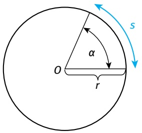

<details>
<summary>text_image</summary>

O
α
r
s
</details>

Abb. I-1.1: Zur Definition des ebenen Winkels.

Der volle ebene Winkel ist also ${ \frac { 2 r \pi } { r } } = 2 \pi$ rad. Die Teilung des vollen Winkels von $\alpha = 2 \pi$ rad in 360 Teile ergibt die Winkeleinheit $1 ^ { \circ }$ (1 Grad oder 1 deg, keine SI-Einheit!).

Wenn gilt: ${ \frac { s } { r } } = 1$ , dann ist $\alpha = 1$ rad bzw. 1 rad $\frac{180^{\circ}}{\pi}=57.30^{\circ}$

Umrechnung in Grad: $1 ^ { \circ } = { \frac { \pi } { 1 8 0 } } \; \mathrm { { \bf r a d } }$

Zur Definition des Raumwinkels (Abb. I-1.2):

$$
\Omega = \frac {\text {Kugelfläche}}{(\text {Radius}) ^ {2}} = \frac {A}{R ^ {2}} \mathrm{sr} \quad (\text {Steradiant}). \tag {I-1.4}
$$

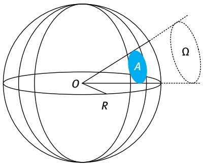

<details>
<summary>text_image</summary>

O
A
R
Ω
</details>

Abb. I-1.2: Zur Definition des Raumwinkels.

Wenn gilt: ${ \frac { A } { R ^ { 2 } } } = 1$ dann ist $\Omega = 1   \mathrm { s r } .$ . Der volle Raumwinkel ist also $\frac{4\pi R^{2}}{R^{2}}=4\pi\mathrm{sr}$

---

8

1 Einleitung

Die Winkel α und Ω sind auch über $\alpha = 2 \pi$ und $\Omega = 4$ π hinaus definiert, wovon in der Schwingungs- und Wellenlehre Gebrauch gemacht wird (mehrfaches Durchlaufen des Einheitskreises). α und Ω sind dann nur bis auf ein Vielfaches von $2 \pi$ bzw. 4 π eindeutig!

In der Astronomie werden sehr kleine Raumwinkel Ω = A (= Fläche auf der Einheitskugel) als Maß für die Ausdehnung eines Objekts am Himmel in der kleineren Einheit Quadratgrad (deg<sup>2</sup>) angegeben, wofür per definitionem gilt: $\left( 1 ^ { \circ } \right) ^ { 2 } = 1   \mathrm { d e g } ^ { 2 } = \left( \frac { \pi } { 1 8 0 } \right) ^ { 2 } \mathrm { s r } \cong 3 , 0 4 6 2 \cdot 1 0 ^ { - 4 }$ sr bzw. $1   \mathrm { s r } \cong 3 2 8 3   \mathrm { d e g } ^ { 2 } .$ 1 Quadratgrad wird für kleine Winkel näherungsweise durch ein sphärisches Quadrat auf der Einheitskugel mit der Seitenlänge $s = 1 \deg = \frac{\pi}{180}$ rad dargestellt. Siehe $\mathbf { z } , \mathbf { B } ,$ Band $\mathrm { V } ,$ Kapitel „Materialphysik (Materials Science)“, Abschnitt 3.2.6.2, Bildunterschrift zu Abb. V-3.55.

## 1.3 Messgenauigkeit (accuracy) und Messfehler (error)<sup>10</sup>

Für die Beurteilung experimenteller Ergebnisse ist die Einschätzung der Genauig keit von Messungen wichtig. Wovon hängt die Güte einer Messung ab?

1. Von der Zuverlässigkeit der Messapparatur und des Beobachters inklusive der Analyse der direkten Messdaten: Hier wird der erfahrene, umsichtige, genaue und auch unvoreingenommene Experimentator gefordert. Diese Forderung bleibt erhalten, auch wenn man heute versucht die Sinneswahrnehmung des Experimentators und seine Ablesegeschicklichkeit weitgehend durch die Verwendung elektronischer Messgeräte (objektive Messung) und Datenspeicher zu ersetzen.
2. Von der Genauigkeit der Messung, also vom Messfehler: Eine detaillierte Fehlerbetrachtung ermöglicht die richtige Einschätzung des Messergebnisses.
3. Von der Reproduzierbarkeit der Ergebnisse: Erst nach weiteren Reproduktionen der Messung erhält das Ergebnis seine Gültigkeit.

Wir unterscheiden zwei Arten von Messfehlern:

1. Systematische Messfehler:

Sie sind durch die Apparatur oder den Experimentator (z. B. nicht Abwarten des Endausschlages eines Messgerätes) bestimmt. Beispiele dafür sind eine falsche Kalibrierung, ein unkorrigierter Nullpunkt, der nicht berücksichtigte Temperatureinfluss, etc. Hier hilft die Wiederholung der Messung nicht. <u>Systematische Fehler sind daher prinzipiell zu vermeiden!</u>

<small><span class="docvortex-page-footnote" data-block-type="page_footnote" style="color:#6b7280">10 Siehe z. B. Erwin Hardtwig, 1968. „Fehler- und Ausgleichsrechnung“, BI-Hochschultaschenbücher Bd. 262/262a, Bibliographisches Institut, Mannheim.</span></small>

---

1.3 Messgenauigkeit (accuracy) und Messfehler (error)

9

## 2. Statistische Fehler:

Die Messwerte streuen immer aufgrund zahlreicher, statistisch wirkender Ein flussfaktoren um einen mittleren Wert. Rein statistische Fehler können mathe matisch erfasst werden, für sie gilt der im folgenden dargelegte zentrale Grenzwertsatz.

## 1.3.1 Festlegung eines Messwertes aus mehreren Einzelmessungen

Da die Abweichungen von einer zu bestimmenden Größe x positiv und negativ sein können, sich also bei der Aufsummierung wegheben, verlangen wir nach Gauß (Carl-Friedrich Gauß, 1777–1855) zur Festlegung eines geeigneten Wertes x̅ der Messgröße, dass die Summe der Quadrate aller Abweichungen $( \overline { { x } } - x _ { i } )$ , das sind die ‚scheinbaren‘<sup>11</sup> Fehler der einzelnen Messungen, minimal sein soll, dass also gilt:<sup>12</sup>

$$
\sum_ {i = 1} ^ {n} \left(\overline {{x}} - x _ {i}\right) ^ {2} = \min.
$$

Wir differenzieren $\frac { d \displaystyle \sum _ { i = 1 } ^ { n } ( \overline { { x } } - x _ { i } ) ^ { 2 } } { d \overline { { x } } } = 2 \displaystyle \sum _ { i = 1 } ^ { n } ( \overline { { x } } - x _ { i } ) ^ { 2 }$ und setzen Null (innere Ableitung = 1). Wir erhalten

$$
\left(\overline {{x}} - x _ {1}\right) + \left(\overline {{x}} - x _ {2}\right) + \left(\overline {{x}} - x _ {3}\right) + \dots = n \cdot \overline {{x}} - \sum_ {i = 1} ^ {n} x _ {i} = 0
$$

und damit als plausibelsten Wert der Messgröße x bei n Messungen

$$
\overline {{x}} \equiv \overline {{x}} _ {n} = \frac {1}{n} \sum_ {i = 1} ^ {n} x _ {i}, \quad \text {den arithmetischen Mittelwert.} \tag {I-1.5}
$$

## 1.3.2 Zentraler Grenzwertsatz (central limit theorem) für rein statistische Fehler

Der zentrale Grenzwertsatz folgt aus der Wahrscheinlichkeitstheorie:

Eine große Zahl voneinander unabhängiger, aufgrund vieler Einflussgrößen statistisch verteilter Zufallsgrößen (hier der Messwerte) ist annähernd normalverteilt, folgt also für $n \to \infty$ der Gaußverteilung.

1

<small><span class="docvortex-page-footnote" data-block-type="page_footnote" style="color:#6b7280">11 Diese Fehler sind deshalb ‚scheinbar‘, weil das erst festzulegende x̅ nicht der ‚wahre‘ Wert von x ist.</span></small>

<small><span class="docvortex-page-footnote" data-block-type="page_footnote" style="color:#6b7280">12 An Stelle der Quadrate könnten auch die Absolutwerte der Abweichungen |x̅ − x<sub>i</sub>| verwendet werden, was aber zu umständlichen Rechnungen führt.</span></small>

---

10

1 Einleitung

Wenn daher eine physikalische Messgröße von vielen kleinen, voneinander unabhängigen Störungen beeinflusst wird, was meist zutrifft, so ergibt sich bei oftmaliger Wiederholung der Messung annähernd eine Gaußverteilung der Messwerte um den wahren Wert. Wir sprechen dann von ‚rein statistischen‘ Fehlern.

In diesem Fall gilt für den wahren Wert $x _ { w }$ :

$$
x _ {w} = \lim _ {n \to \infty} \frac {1}{n} \sum_ {i = 1} ^ {n} x _ {i} = \lim _ {n \to \infty} \overline {{x}} _ {n}. \tag {I-1.6}
$$

Für $n \to \infty$ geht der Mittelwert ${ \overline { { x } } } _ { n }$ also in den wahren Wert $x _ { w }$ über.

Nun sind die ‚wahren Messfehler‘, also die Abweichungen vom ‚wahren Wert‘$x _ { w } ,$ zunächst unbekannt. Erst durch den zentralen Grenzwertsatz erhalten wir einen Zusammenhang zwischen dem wahren Wert $x _ { w }$ und dem Mittelwert ${ \overline { { x } } } _ { n }$ einer Messreihe, sodass wir jetzt die Fehler rechnerisch auf den wahren Wert beziehen können.

## 1.3.3 Die Fehler eines Messergebnisses

Der mittlere (wahre) Fehler oder die Standardabweichung der Einzelmessungen ergibt sich aus der Fehlerrechnung $\mathbf { z } \mathbf { u } { : } ^ { 1 3 }$

$$
s _ {n} = \sqrt {\frac {\sum_ {i} \left(\bar {x} - x _ {i}\right) ^ {2}}{n - 1}} = \sqrt {\frac {\left[ v _ {i} v _ {i} \right]}{n - 1}} \quad \text {mit} \quad v _ {i} = \bar {x} _ {n} - x _ {i}. \tag {I-1.7}
$$

Die Mittelwerte verschiedener Messreihen schwanken selbst um einen Mittelwert, aber weniger als die einzelnen Messungen jeder Reihe, die Verteilung der Mittelwerte ist schmäler als die Verteilung der Einzelmessungen.

Mittlerer (wahrer) Fehler oder Standardabweichung des Mittelwertes (aus der Fehlerrechnung):

$$
s _ {m} = \overline {{s}} _ {n} = \sqrt {\frac {\sum_ {i} \left(\overline {{x}} - x _ {i}\right) ^ {2}}{n (n - 1)}} = \sqrt {\frac {[ v _ {i} v _ {i} ]}{n (n - 1)}} = \frac {s _ {n}}{\sqrt {n}} \tag {I-1.8}
$$

**Man beachte:** Für oftmalige Messwiederholung, also $n \to \infty$ , gilt $s _ { n } \to \sigma ;$ dabei ist σ ein fester Wert, der durch die Fehlerverteilungsfunktion bestimmt ist. Es gilt aber

<small><span class="docvortex-page-footnote" data-block-type="page_footnote" style="color:#6b7280">13 In der Fehlerrechnung wird üblicherweise die Summation durch eckige Klammern ausgedrückt.</span></small>

---

1.3 Messgenauigkeit (accuracy) und Messfehler (error)

11

$s _ { m } \to 0$ für $n \rightarrow$ ∞! Die mittleren Fehler der einzelnen Messungen einer Messreihe bleiben also annähernd gleich, wenn die Zahl der Messungen einer Messreihe zunimmt, während der Fehler des Mittelwertes mit $1 / { \sqrt { n } }$ kleiner wird („Gesetz der großen $\mathrm { Z a h l ^ { \mathrm { \textleftarrow } } }$ , siehe Band VI, Kapitel „Statistische Physik“, Abschnitt 1.1.3, Gl. VI-1.37). Mit steigender Zahl der Messungen wird bei gleich bleibendem mittleren Fehler $s _ { n }$ der Einzelmessungen ihr Mittelwert immer ‚sicherer‘: Viele Messungen sichern den Mittelwert!

## 1.3.4 Die Fehlerverteilungsfunktion

Wir nehmen an, dass die in einer langen Messreihe ermittelten Messwerte x (quasi) kontinuierlich nach der Funktion $F ( x )$ verteilt sind. $F ( x )$ dx ist dann die Zahl der Messungen mit einem Messwert im Intervall $( x ,   x + d x )$ . Die Gesamtzahl der Messungen n ergibt sich somit zu

$$
n = \int_ {- \infty} ^ {+ \infty} F (x) d x. \tag {I-1.9}
$$

Wir bilden die auf die Anzahl n der Messungen normierte Funktion $f ( x ) = { \frac { 1 } { n } }   F ( x )$ , so dass $\int   f ( x ) d x = 1$ . Die Verteilung f(x) heißt jetzt (auf eins) normiert und $f ( x )$ dx gibt die Wahrscheinlichkeit an, dass ein Messwert im Intervall $( x ,   x + d x )$ liegt. Damit wird der Mittelwert $\overline { { x } } = \int   x \cdot f ( x ) d x .$ . Im Grenzwert einer unendlich großen Zahl von Messungen ist die Standardabweichung $\operatorname* { l i m } _ { n \to \infty } s _ { n } = \sigma$ ein Maß für die Breite der Fehlerverteilung.

Nach Gl. (1–1.7) ist $\sigma = \sqrt { \int _ { - \infty } ^ { + \infty } ( x - \overline { { x } } ) ^ { 2 } f ( x ) d x } .$ (1 kann jetzt gegen n vernachlässigt werden). Damit ergibt sich als Mittelwert des Fehlerquadrats, als Varianz

$$
\sigma^ {2} = \int_ {- \infty} ^ {+ \infty} (x - \bar {x}) ^ {2} f (x) d x. \tag {I-1.10}
$$

Eine normierte Gaußverteilung oder Normalverteilung lässt sich mit Hilfe der Varianz folgendermaßen darstellen (Abb. I-1.3, siehe auch Band VI, Kapitel „Statistische Physik, Abschnitt 1.1.4, Gl. VI-1.66):

$$
f (x) = \frac {1}{\sqrt {2 \pi \sigma^ {2}}} e ^ {- (x - \bar {x}) ^ {2} / 2 \sigma^ {2}}. \tag {I-1.11}
$$

---

12

1 Einleitung

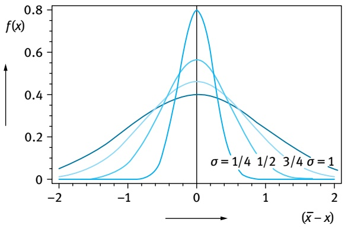

<details>
<summary>violin</summary>

| X | \(\sigma=1/4\) | \(\sigma=1/2\) | \(\sigma=3/4\) | \(\sigma=1\) |
| --- | --- | --- | --- | --- |
| -2 | ~0.05 | ~0.01 | ~0.005 | ~0.002 |
| -1 | ~0.25 | ~0.15 | ~0.08 | ~0.02 |
| 0 | 0.4 | 0.46 | 0.56 | 0.8 |
| 1 | ~0.25 | ~0.15 | ~0.08 | ~0.02 |
| 2 | ~0.05 | ~0.01 | ~0.005 | ~0.002 |
</details>

Abb. I-1.3: Normierte Gaußverteilung um x̅ = 0 für verschiedene Werte von σ.

Wie viele Messwerte liegen bei einer Messreihe innerhalb von $\left( { \overline { { x } } } \pm \sigma \right)$ , bzw. wie groß ist also die Wahrscheinlichkeit, dass der wahre Wert in diesem ‚Vertrauensbereich‘um den Mittelwert liegt?

Wir nehmen an, dass σ aus n Messungen näherungsweise mit Hilfe der Formel für $\sigma _ { m }$ bestimmt wurde. Die Wahrscheinlichkeit, dass ein weiterer Messwert $x _ { i }$ im Intervall $( \overline { { x } } _ { n } \pm \sigma )$ liegt, ist

$$
P (\left| \overline {{x}} - x _ {i} \right| \leq \sigma) = \int_ {- \sigma} ^ {+ \sigma} f (x) d x. \tag {I-1.12}
$$

Mit der Gaußverteilung für $f ( x )$ ergibt sich $P ( \left| \overline { { x } } - x _ { i } \right| \leq \sigma ) = 0 ,   6 8 3$ . Im ‚Vertrauensbereich‘ ±σ liegen also 68 % der Messwerte. Im Vertrauensbereich ±2 σ liegen 95 %, in ±3 σ 99,7 % der Messwerte.

Messergebnisse werden meist so angegeben: $x _ { w } = \overline { { x } } \pm s _ { m }$ , wobei $s _ { m }$ aus einer Messreihe<sup>14</sup> bestimmt wird.

<small><span class="docvortex-page-footnote" data-block-type="page_footnote" style="color:#6b7280">14 Oft kann man die Genauigkeit eines Messinstruments der Gerätebeschreibung entnehmen und so auf eine Messreihe zur Fehlerbestimmung verzichten, wenn alle statistischen Schwankungen der Messgröße kleiner als dieser Wert sind. Mitunter muss der kleinste vom Gerät ablesbare Wert (bei unempfindlichen Geräten) als Fehler genommen werden.</span></small>

---

1.3 Messgenauigkeit (accuracy) und Messfehler (error)

13

**Beispiel:** Mit einem Mikrometer (Mikrometerschraube) wird der Durchmesser eines runden Metallstabes $5 \times$ gemessen.

| Messwert $x_{i}$ [mm] | $v_{i} = \bar{x} - x_{i}$ | $v_{i}^{2}$ |
| --- | --- | --- |
| 5,115 | +0,0004 | $1,6 \cdot 10^{-7}$ |
| 5,118 | -0,0026 | $6,76 \cdot 10^{-6}$ |
| 5,113 | +0,0024 | $5,76 \cdot 10^{-6}$ |
| 5,112 | +0,0034 | $1,156 \cdot 10^{-5}$ |
| 5,119 | -0,0036 | $1,296 \cdot 10^{-5}$ |
| $\bar{x} = 25,577 / 5 = 5,1154$ | $[v_{i}] = 0$ | $[v_{i}v_{i}] = 3,72 \cdot 10^{-5}$ |

Damit erhalten wir $s _ { n }$ zu $^ { 0 , 0 0 3 }$ und $s _ { m }$ zu $0 { , } 0 0 1 4 { . } ^ { 1 5 }$ Das Ergebnis für den Stabdurchmesser ist also $d = ( 5 , 1 1 5 \pm 0 , 0 0 1 4 )$ mm.

Mit einer Schublehre (Ablesegenauigkeit $\approx 0 { , } 0 5$ mm) kann man bei diesem runden Stab keine Statistik bekommen, man muss $\pm 0 . 0 5$ mm als Fehler setzen! Für eine Messreihe muss das Auflösungsvermögen des Messgerätes wesentlich größer sein als die statistischen Schwankungen des Messwertes. Der Durchmesser des Stabes würde sich zu $d = 5 , 1 \pm 0 , 0 5$ mm ergeben.

## 1.3.5 Das Fehlerfortpflanzungsgesetz

Oft setzt sich ein Ergebnis aus mehreren fehlerbehafteten Größen zusammen. So gilt z. B. für die Durchschnittsgeschwindigkeit: $\nu = { \frac { l } { t } }$ . Gemessen werden etwa die Zeitdauer t und die in ihr zurückgelegte Wegstrecke l. Wie sieht der Mittelwert des Gesamtergebnisses aus und wie setzen sich die beiden Fehler des Mittelwertes $s _ { t }$ von t und $s _ { l }$ von l entsprechender Messreihen zu einem Gesamtfehler zusammen?

Wir erinnern uns an die Taylorentwicklung: Eine stetige Funktion $y = f ( x )$ die alle Ableitungen an der Stelle $x = a$ besitzt, kann als Summe einer Potenzreihe geschrieben werden:

$$
f (x) = f (a) + \frac {x - a}{1 !} f ^ {\prime} (a) + \frac {(x - a) ^ {2}}{2 !} f ^ {\prime \prime} (a) + \dots
$$

Für Funktionen von zwei Variablen $f ( x , y )$ gilt entsprechend:

$$
f (x + h, y + k) = f (x, y) + \left(\frac {\partial f (x , y)}{\partial x} \cdot h + \frac {\partial f (x , y)}{\partial y} \cdot k\right) + \dots
$$

<small><span class="docvortex-page-footnote" data-block-type="page_footnote" style="color:#6b7280">15 Man beachte, dass Taschenrechner üblicherweise die Standardabweichung der Einzelmessung angeben und dieser Wert bei Angabe von s<sub>m</sub> daher noch mit 1/√n zu multiplizieren ist!</span></small>

i

---

14

1 Einleitung

Mit Hilfe der Taylorentwicklung kann man zeigen,<sup>16</sup> dass der Mittelwert des zusammengesetzten Ergebnisses gleich dem aus den Mittelwerten der einzelnen Messgrö- ßen gebildeten Ergebnis ist, also:

$$
\overline {{f (x , y)}} = f (\bar {x}, \bar {y}). \tag {I-1.13}
$$

Die Differentialrechnung liefert uns also die Änderung von $f ( x , y )$ und damit den Fehler $\Delta f$ für kleine Schwankungen $( = \mathrm { F e h l e r } ) \Delta x$ und $\Delta y$ der Variablen x und $y ;$

$$
\Delta f = f (x + \Delta x, y + \Delta y) - f (x, y) = \frac {\partial f (x , y)}{\partial x} \cdot \Delta x + \frac {\partial f (x , y)}{\partial y} \cdot \Delta y. \tag {I-1.14}
$$

Den Größtfehler erhält man, wenn man die Absolutbeträge aller Fehlerterme, die $\mathbf { j a }$ negativ oder positiv sein können, einfach addiert:

$$
\Delta f ^ {\max} = \left| \frac {\partial f (x , y)}{\partial x} \Delta x \right| + \left| \frac {\partial f (x , y)}{\partial y} \Delta y \right|. \tag {I-1.15}
$$

Sind die Messgrößen voneinander unabhängig, so ist für eine realistische Abschätzung zu berücksichtigen, dass sich positive und negative Abweichungen teilweise kompensieren. Dies führt zum Gaußschen Fehlerfortpflanzungsgesetz für den mittleren Fehler des zusammengesetzten Ergebnisses $f ( x , y ) ;$

$$
\Delta f _ {m} = s _ {m} = \sqrt {\left(\Delta x\right) ^ {2} \cdot \left(\frac {\partial f}{\partial x}\right) ^ {2} + \left(\Delta y\right) ^ {2} \cdot \left(\frac {\partial f}{\partial y}\right) ^ {2}}. \tag {I-1.16}
$$

Die Fehler addieren sich also ‚pythagoreisch‘ (geometrisches Mittel).

Identifizieren wir die Abweichungen $\Delta x$ und $\Delta y$ mit den jeweiligen Standardabweichungen des Mittelwertes $\sigma _ { m , x }$ und $\sigma _ { m , y } ,$ so erhalten wir für ein Ergebnis, das aus zwei Messgrößen zusammengesetzt ist:

$$
f _ {w} (x, y) = f (\bar {x}, \bar {y}) \pm s _ {m} \quad \text {mit} \quad s _ {m} = \sqrt {s _ {m , x} ^ {2} \cdot \left(\frac {\partial f}{\partial x}\right) _ {\bar {x} , \bar {y}} ^ {2} + s _ {m , y} ^ {2} \cdot \left(\frac {\partial f}{\partial y}\right) _ {\bar {x} , \bar {y}} ^ {2}}. \tag {I-1.17}
$$

Die Erweiterung auf mehrere Messgrößen ist offensichtlich.

<small><span class="docvortex-page-footnote" data-block-type="page_footnote" style="color:#6b7280">16 Der Mittelwert der Messwerte x sei a, also x̅ = a. Dann folgt aus der Taylorreihe für eine Variable:</span></small>

$$
\overline {{f (x)}} = f (a) + \underbrace {\frac {\overline {{x - a}}}{1 !}} _ {0} f ^ {\prime} (a) + \frac {\overline {{(x - a) ^ {2}}}}{2 !} f ^ {\prime \prime} (a) + \dots \cong f (a) = f (\bar {x}).
$$

---

1.3 Messgenauigkeit (accuracy) und Messfehler (error)

15

**Beispiel 1:** $\nu = \frac{l}{t}, \quad \frac{\partial \nu}{\partial t} = -\frac{l}{t^2}, \quad \left(\frac{\partial \nu}{\partial t}\right)^2 = \frac{l^2}{t^4}, \quad \frac{\partial \nu}{\partial l} = \frac{1}{t}, \quad \left(\frac{\partial \nu}{\partial l}\right)^2 = \frac{1}{t^2}.$

Messwerte: $t = ( 1 2 \pm 0 , 1 ) :$ s, Strecke $l = ( 3 , 0 0 0 \pm 0 , 0 0 1 )$ m.

Mittelwert der Geschwindigkeit: $\bar{v} = 0,25    m/s$

Mittlerer Fehler des Mittelwertes:

$$
s _ {m} = \sqrt {\underbrace {(0 , 1) ^ {2}} _ {s _ {m , t} ^ {2}} \frac {9}{2 0 7 3 6} + \underbrace {(0 , 0 0 1) ^ {2}} _ {s _ {m , l} ^ {2}} \frac {1}{1 4 4}} = \sqrt {4 , 3 4 \cdot 1 0 ^ {- 6} + 6 , 9 4 \cdot 1 0 ^ {- 9}} = 0, 0 0 2 1.
$$

Ergebnis: $v = (0,250 \pm 0,002)    m/s$

Mittels des relativen Fehlers $\Delta _ { \mathrm { r e l } } = \frac { S _ { m , x } } { x }$ kann die Genauigkeit verschiedener Messgrößen (hier z. B. l und t) verglichen werden:

$$
\frac {s _ {m , t}}{t} = \frac {0 , 1}{1 2} = \frac {1}{1 2 0}; \quad \frac {s _ {m , l}}{l} = \frac {0 , 0 0 1}{3} = \frac {1}{3 0 0 0}.
$$

Die Länge wurde also viel genauer gemessen als die Zeit. Die relativen Fehler der Längen- und der Zeitmessung gehen aber mit dem gleichen Gewicht in den resultierenden Fehler ein. Die Gewichtsfaktoren (siehe Beispiel 2) sind hier $m ^ { 2 } = 1 ^ { 2 } = 1$ und $n ^ { 2 } = ( - 1 ) ^ { 2 } = 1$ , da $\boldsymbol { \upsilon } = \boldsymbol { l } ^ { 1 } \cdot \boldsymbol { t } ^ { - 1 }$

**Beispiel 2:** Messung der Erdbeschleunigung g aus Fallweg l und Fallzeit t:

$$
g = \frac {2 l}{t ^ {2}}.
$$

Mit Hilfe des relativen Fehlers der einzelnen Messgrößen kann der mittlere Fehler des zusammengesetzten Ergebnisses so geschrieben werden:

$$
S _ {m} = \sqrt {\left(\frac {S _ {m , x}}{x}\right) ^ {2} \cdot x ^ {2} \left(\frac {\partial f}{\partial x}\right) ^ {2} + \left(\frac {S _ {m , y}}{y}\right) ^ {2} \cdot y ^ {2} \left(\frac {\partial f}{\partial y}\right) ^ {2}}.
$$

Im Falle eines Potenzprodukts $f   =   x ^ { m } \cdot y ^ { n }$ folgt sofort für den relativen Fehler des Ergebnisses

$$
\frac {S _ {m}}{f} = \sqrt {m ^ {2} \left(\frac {S _ {m , x}}{x}\right) ^ {2} + n ^ {2} \left(\frac {S _ {n , y}}{y}\right) ^ {2}}.
$$

Dabei sind $m ^ { 2 }$ und $n ^ { 2 }$ die Gewichtsfaktoren für den relativen Einfluss der verschiedenen Messgrößen.

---

16

1 Einleitung

Im vorliegenden Fall ergibt sich also für den relativen Fehler des Ergebnisses mit den Gewichtsfaktoren $m ^ { 2 } = 1 ^ { 2 } = 1$ und $n ^ { 2 } = ( - 2 ) ^ { 2 } = 4$

$$
\frac {s _ {m}}{f} = \sqrt {1 \cdot \left(\frac {s _ {l}}{l}\right) ^ {2} + 4 \cdot \left(\frac {s _ {t}}{t}\right) ^ {2}}.
$$

Hier zeigt sich also, dass die Zeitmessung mit dem 4-fachen Gewicht der Längenmessung in den relativen Fehler von g eingeht, die Zeit also entsprechend genau zu messen ist!

## Zusammenfassung

1. Die Physik erforscht die uns umgebende Materie, ihre Erscheinungsformen, ihre Grundbausteine und wie diese miteinander wechselwirken. Der Physiker entwirft Modelle zur Erklärung von Phänomenen und Experimenten, die in Theorien zusammengefasst werden. Mit der Sprache der Mathematik werden die Zusammenhänge beschrieben und Vorraussagen gemacht, die wieder experimentell überprüfbar sein müssen. Auf diese Weise ungültig gewordene, falsifizierte Theorien müssen abgeändert werden.
2. Das Experiment ist also ein wichtiger Prüfstein und letzte Instanz für die Gültigkeit einer Theorie. Experimente müssen deshalb sehr sorgfältig durchgeführt werden. Erst durch eine genaue Erfassung des Messfehlers kann das Messergebnis richtig eingeschätzt werden und erhält erst durch die Reproduktion seine Gültigkeit. Systematische Messfehler müssen durch entsprechende Sorgfalt und Umsicht vermieden werden. Rein statistische Fehler können durch eine Messreihe erfasst werden.
3. Das Ergebnis einer Messung, die n-mal wiederholt wurde, wird im allgemeinen so angegeben:

$$
x _ {w} = \bar {x} \pm s _ {m}, \quad \text {mit} \quad s _ {m} = \sqrt {\frac {\sum_ {i} (\bar {x} - x _ {i}) ^ {2}}{n (n - 1)}}.
$$

$s _ { m }$ ist der mittlere quadratische Fehler (die Standardabweichung) des Mittelwerts einer Messreihe mit n Messungen.

4. Setzt sich das Ergebnis aus mehreren Teilergebnissen mit entsprechenden Fehlern zusammen, so kann der Mittelwert aus den Teilmittelwerten gebildet und bei Unabhängigkeit der Fehler voneinander das Gaußsche Fehlerfortpflanzungsgesetz angewendet werden:

---

Zusammenfassung

17

$$
f _ {w} (x, y, \dots) = f (\bar {x}, \bar {y}, \dots) \pm s _ {m} \quad \text {mit} \quad s _ {m} = \sqrt {s _ {x} ^ {2} \cdot \left(\frac {\partial f}{\partial x}\right) _ {\bar {x} , \bar {y}} ^ {2} + s _ {y} ^ {2} \cdot \left(\frac {\partial f}{\partial y}\right) _ {\bar {x} , \bar {y}} ^ {2} + \dots}
$$

## Übungen:

1. Umrechnung „exotischer“ Einheiten in SI-Einheiten:

a) In den USA wird der Benzinverbrauch eines Autos üblicherweise durch Angabe der Meilen (1 mile = 1,609 km) gemessen, die mit einer Gallone (1 US gallon = 3,785 l) zurückgelegt werden können. Wieviel l pro 100 km entspricht ein Verbrauch von 15,7 mpg (miles per gallon) bzw. 26 mpg? Entwickle eine Umrechnungsformel!
b) Ein Maß für den Druck, dem man in der technischen amerikanischen Literatur noch immer häufig begegnet, ist psi (auch ppsi), d. i. pounds per square inch. Mit pound ist poundweight (lb.wt.) gemeint: 1 lb.wt. = 4,448 N. 1 inch (Zoll) = 25,4 mm. Wieviel Pascal entsprechen 14,7 psi? Welche Bedeutung hat diese Zahl?
c) Spannungen in Materialien wurden früher häufig (und werden in der technischen Literatur noch immer) in $\mathrm { k p / m m } ^ { 2 }$ angegeben.17 Zum Beispiel betrage die Zugfestigkeit einer Polyamidfaser $80   kg/mm ^2$ Wieviel ist das in $\mathrm{Pa} = \mathrm{Nm}^{-2}$
d) Ein in der Schifffahrt gebräuchliches Raummaß ist die Registertonne (RT). 1 RT = 100 cu.ft. (Kubikfuß). 1 Fuß = 1 ft = 30,48 cm. Wieviel Kubik meter enthält ein Schiff mit 80 000 BRT (Brutto-Registertonnen<sup>18</sup>)?

2. In einer Messserie werden der Reihe nach folgende Messwerte ermittelt: 15,3 16,1 15,7 14,9 15,2 15,9 14,8 15,4 14,7 15,5.

Berechne den Mittelwert, die Standardabweichung und die Standardabweichung des Mittelwertes. Stelle den Rechenvorgang als Tabelle dar.

3. Fehlerfortpflanzungsrechnung: Die Dichte eines zylindrischen Probekörpers wird durch Abmessen von Durchmesser und Höhe und Wägung bestimmt. Es ergeben sich:

Durchmesser

Höhe

Masse

Berechne die Dichte mit dem zugehörigen Fehler. Bei welcher Messung sollte man versuchen, besonders genau zu sein?

<small><span class="docvortex-page-footnote" data-block-type="page_footnote" style="color:#6b7280">17 1 kp ist die Kraft, mit der die Masse 1 kg von der Erde mit dem Normwert der Fallbeschleunigung gn = 9,80665 m s angezogen wird.</span></small>

<small><span class="docvortex-page-footnote" data-block-type="page_footnote" style="color:#6b7280">18 Das Wort ‚Brutto‘ bedeutet: „einschließlich des Raumes für die technische Ausrüstung, die Betriebsmittel und die Mannschaftsunterkünfte“.</span></small>

i

---

18

1 Einleitung

## Anhang 1: Definition der SI-Basiseinheiten (base units)

In der 26. Generalkonferenz für Maß und Gewicht (Conférence Générale des Poids et Mesures, CGPM) wurde 2018 beschlossen, die sieben Basiseinheiten des SI-Systems aus sieben festgelegten Konstanten abzuleiten. Dazu wurden dem Planckschen Wirkungsquantum $h ,$ der Elementarladung $e ,$ der Boltzmann-Konstante k und der Avogadro-Konstante $N _ { A }$ feste Werte zugeordnet. Diese Änderung trat am 20. Mai 2019, dem Weltmetrologietag („Tag des Messens“), in Kraft. Die 7 Konstanten sind:

| $\Delta\nu_{Cs}$ | Strahlung des Caesium-Atoms$^{19}$ | 9 192 631 770 Hz | (seit 1967) |
| --- | --- | --- | --- |
| c | Lichtgeschwindigkeit (Vakuum) | 299 792 458 m/s | (seit 1983) |
| h | Plancksches Wirkungsquantum | 6,626 070 15 $\cdot$ 10$^{-34}$ J $\cdot$ s | (seit 2019) |
| e | Elementarladung | 1,602 176 634 $\cdot$ 10$^{-19}$ C | (seit 2019) |
| k | Boltzmannkonstante | 1,380 649 $\cdot$ 10$^{-23}$ J/K | (seit 2019) |
| $N_A$ | Avogadro-Konstante | 6,022 140 76 $\cdot$ 10$^{23}$ mol$^{-1}$ | (seit 2019) |
| $K_{cd}$ | Photometrisches Strahlungs-äquivalent$^{20}$ | 683 lm/W | (seit 1979) |

Die 7 Basiseinheiten können aus den 7 Konstanten abgeleitet werden:

$$
\text {Sekunde} (\mathbf {s}) \colon \Delta v _ {\mathrm{Cs}} = 9 1 9 2 6 3 1 7 7 0 \mathrm{Hz} \Rightarrow 1 s = \frac {9 1 9 2 6 3 1 7 7 0}{\Delta v _ {\mathrm{Cs}}}
$$

$$
\text {Meter (m):} c = 2 9 9 7 9 2 4 5 8 \mathrm{ms} ^ {- 1}
$$

$$
\Rightarrow 1 \mathrm{m} = \frac {c}{2 9 9 7 9 2 4 5 8} \mathrm{s} = \frac {9 1 9 2 6 3 1 7 7 0}{2 9 9 7 9 2 4 5 8} \frac {c}{\Delta v _ {\mathrm{Cs}}} \approx 3 0, 6 6 3 3 1 9 \frac {c}{\Delta v _ {\mathrm{Cs}}}
$$

$$
\text {Kilogramm (kg):} h = 6, 6 2 6 0 7 0 1 5 \cdot 1 0 ^ {- 3 4} \mathrm{kg} \mathrm{m} ^ {2} \mathrm{s} ^ {- 1} (1 \mathrm{Js} = 1 \mathrm{kg} \mathrm{m} ^ {2} \mathrm{s} ^ {- 1}) \Rightarrow
$$

$$
\begin{array}{l} 1 \mathrm{kg} = \frac {h}{6 , 6 2 6 0 7 0 1 5 \cdot 1 0 ^ {- 3 4}} \mathrm{m} ^ {- 2} \mathrm{s} = \frac {(2 9 9 7 9 2 4 5 8) ^ {2}}{6 , 6 2 6 0 7 0 1 5 \cdot 1 0 ^ {- 3 4} \cdot 9 1 9 2 6 3 1 7 7 0} \frac {h \Delta v _ {\mathrm{Cs}}}{c ^ {2}} \\ \approx 1, 4 7 5 5 2 1 4 \cdot 1 0 ^ {4 0} \frac {h \Delta v _ {\mathrm{Cs}}}{c ^ {2}} \\ \end{array}
$$

<small><span class="docvortex-page-footnote" data-block-type="page_footnote" style="color:#6b7280">19 Übergang zwischen den zwei Hyperfeinstrukturniveaus des Grundzustands des 133<sub>Cs</sub>-<sub>A</sub>toms. 20 Für monochromatische Strahlung der Frequenz 540⋅ 10<sup>12</sup> Hz (grünes Licht). Englisch: luminous efficacy of monochromatic radiation. Das photometrische Strahlungsäquivalent bezeichnet den Quotient aus dem Lichtstrom Φ<sub>v</sub> (photometrische Größe, Einheit Lumen (lm), der Index v steht für „visuell“) und der Strahlungsleistung Φ (radiometrische Größe, Einheit Watt (W)) mit der Einheit lm/W. Es gibt daher an, wie groß der für das Auge nutzbare Lichtstrom bei gegebener Strahlungsleistung ist; es ist also ein willkürlich festgelegter Umrechnungsfaktor zwischen physikalischen und physiologischen Größen. Siehe dazu auch Band IV, Kapitel „Wärmestrahlung“, Abschnitte 3.1.3 und 3.2.1.</span></small>

---

Anhang 1: Definition der SI-Basiseinheiten (base units)

19

$$
\begin{array}{l} 1 \mathrm{A} = \frac {e}{1 , 6 0 2 1 7 6 6 3 4 \cdot 1 0 ^ {- 1 9}} \mathrm{s} ^ {- 1} = \frac {1}{1 , 6 0 2 1 7 6 6 3 4 \cdot 1 0 ^ {- 1 9} \cdot 9 1 9 2 6 3 1 7 7 0} \Delta v _ {\mathrm{Cs}} e \\ \approx 6, 7 8 9 6 8 7 \cdot 1 0 ^ {8} \Delta \nu_ {\mathrm{Cs}} e \\ \end{array}
$$

$$
\begin{array}{l} 1 \mathrm{K} = \frac {1 , 3 8 0 6 4 9 \cdot 1 0 ^ {- 2 3}}{k} \mathrm{kgm} ^ {2} \mathrm{s} ^ {- 2} = \frac {1 , 3 8 0 6 4 9 \cdot 1 0 ^ {- 2 3}}{6 , 6 2 6 0 7 0 1 5 \cdot 1 0 ^ {- 3 4} \cdot 9 1 9 2 6 3 1 7 7 0} \frac {h \Delta v _ {\mathrm{Cs}}}{k} \\ \approx 2, 2 6 6 6 6 5 3 \frac {h \Delta v _ {\mathrm{Cs}}}{k} \\ \end{array}
$$

$$
\begin{array}{l} 1 \mathrm{cd} = \frac {K _ {\mathrm{cd}}}{6 8 3} \mathrm{kg} \mathrm{m} ^ {2} \mathrm{sr} ^ {- 1} \mathrm{s} ^ {- 3} = \frac {1}{6 , 6 2 6 0 7 0 1 5 \cdot 1 0 ^ {- 3 4} \cdot (9 1 9 2 6 3 1 7 7 0) ^ {2} \cdot 6 8 3} (\Delta v _ {\mathrm{Cs}}) ^ {2} h K _ {\mathrm{cd}} = \\ = 2, 6 1 4 8 3 0 \cdot 1 0 ^ {1 0} \left(\Delta v _ {\mathrm{Cs}}\right) ^ {2} h K _ {\mathrm{cd}} \\ \end{array}
$$

Damit ergeben sich folgende Definitionen der 7 Basiseinheiten:

**Die Sekunde (s), Einheit der Zeit t:** Zeit von 9 192 631 770 Schwingungen der Strahlung, die dem Übergang zwischen den beiden Hyperfeinstrukturniveaus des Grundzustandes des Nuklids Cäsium-133 entspricht.<sup>21</sup>

**Das Meter (m), Einheit der Länge l:** Länge der Strecke, die von Licht im leeren Raum in $\frac { 1 } { 2 9 9   7 9 2 4 5 8 }$ s zurückgelegt wird.

**Das Kilogramm (kg), Einheit der Masse m:** Die Einheit Kilogramm wird über die Einheit kg $\mathbf { m } ^ { 2 }   \mathbf { s } ^ { - 1 }$ (Einheit der Wirkung und des Drehimpulses) definiert. Zusammen mit der Definition der Sekunde und des Meters führt dies zur Definition der Einheit der Masse bezogen auf das Plancksche Wirkungsquantum h. In Anlehnung an die „verbalen“ Definitionen der anderen Einheiten kann man sagen: „ 1 kg ist die Masse, deren Energie-Äquivalent dem $1 { \mathrm { , } } 4 7 5 5 2 1 4 \cdot 1 0 ^ { 4 0 }$ -fachen der Energie eines Strahlungsquants der Frequenz $\Delta \nu _ { C s }$ entspricht.“

**Das Ampere (A), Einheit des elektrischen Stromes I:** Elektrischer Strom, der dem Fluss von $\frac { 1 } { 6 { \scriptstyle , } 6 0 2   1 7 6   6 3 4 \cdot 1 0 ^ { ^ { - 1 9 } } }$ Elementarladungen pro Sekunde entspricht.

<small><span class="docvortex-page-footnote" data-block-type="page_footnote" style="color:#6b7280">21 Der Grundzustand von $^ { 1 3 3 } _ { 5 5 } \mathsf { C } \mathsf { s }$ (Kernspin I = 7/2) ist 62S1/2 (Zur Termbezeichnung siehe Band V, Kapitel „Atomphysik“, Abschnitt 2.5.3). Durch Wechselwirkung des durch die Elektronenhülle erzeugten Magnetfeldes mit dem magnetischen Moment des Atomkerns, spaltet dieses Energieniveau (ohne äußeres Magnetfeld, m<sub>F</sub> = 0) in zwei Niveaus F4 und F5 auf (Hyperfeinaufspaltung, siehe dazu auch Band V, Kapitel „Kernphysik“, Abschnitt 3.1.2.3, Unterabschnitt „Kernspin und Kernmagnetismus“). Die Energiedifferenz zwischen diesen beiden Niveaus entspricht einer Frequenz von 9 192 631 770 Hz.</span></small>

---

20

1 Einleitung

**Das Kelvin (K), Einheit der thermodynamischen Temperatur T:** Änderung der thermodynamischen Temperatur, die eine Änderung der thermischen Energie kT um $1 { , } 3 8 0   6 4 9 \cdot 1 0 ^ { - 2 3 }$ J verursacht.

**Das Mol (mol), Einheit der Stoffmenge ν**: Stoffmenge eines Systems, das $6 { , } 0 2 2 1 4 0   7 6 \cdot 1 0 ^ { 2 3 }$ Teilchen einer bestimmten Art enthält.<sup>22</sup>

**Die Candela** $( \mathbf { c d } ) ^ { 2 3 }$ **, Einheit der Lichtstärke J:** Lichtstärke (luminous intensity) einer Strahlungsquelle, die in einer gegebenen Richtung eine monochromatische Strahlung mit einer Frequenz von $5 4 0 \cdot 1 0 ^ { 1 2 }$ Hz aussendet und die in dieser Richtung eine Strahlstärke von 1/683 $W / \mathrm { s r }$ hat.

Zur Realisierung der neu definierten Masseneinheit 1 kg, die bisher als einzige Basiseinheit noch durch einen Standard, das „Urkilogramm“, dargestellt wurde,


<details>
<summary>flowchart</summary>

```mermaid
graph TD
  Center(("SI")) --> A["kg"]
  Center --> B["m"]
  Center --> C["s"]
  Center --> D["A"]
  Center --> E["K"]
  Center --> F["cd"]
  Center --> G["100 m"]
  Center --> H["MOLE"]
  Center --> I["CANDELA"]
  Center --> J["METRE"]
  Center --> K["SECOND"]
  Center --> L["BASE quantity: luminous intensity (Iv)"]
  Center --> M["BASE quantity: mass (m)"]
  Center --> N["BASE quantity: length (l, x, r, etc.)"]
  Center --> O["BASE quantity: amount of substance (n)"]
  Center --> P["KELVIN"]
  Center --> Q["AMPERE"]
  Center --> R["BASE quantity: time (t)"]
  Center --> S["BASE quantity: thermodynamic temperature (T)"]
  Center --> T["BASE quantity: electric current (Ii,t)"]
```
</details>

Abb. I-1.4: Die 7 Basiseinheiten des SI-Systems (Quelle: Bureau International des Poids et Mesures).

<small><span class="docvortex-page-footnote" data-block-type="page_footnote" style="color:#6b7280">22 Als Formelzeichen der Stoffmenge, der „Zahl der Mole“, wird allgemein „n“ verwendet (siehe Abb. I-1.4). In dieser Lehrbuchserie wird dafür das Formelzeichen „ν“ benützt, um Verwechslungen mit dem häufig gebrauchten Buchstaben „n“ zu vermeiden.</span></small>

<small><span class="docvortex-page-footnote" data-block-type="page_footnote" style="color:#6b7280">23 von lat. candela (Betonung auf der 2. Silbe): Kerze.</span></small>

---

Anhang 1: Definition der SI-Basiseinheiten (base units)

21

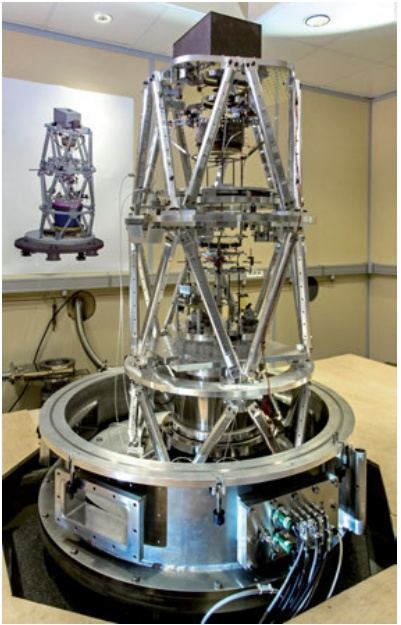

<details>
<summary>natural_image</summary>

Large metallic mechanical assembly in a lab setting, featuring a central tower with multiple arms and wiring (no visible text or symbols)
</details>

Abb. I-1.5: Kibble Waage (Watt-Waage) am Bureau International des Poids et Mesures (BIPM) in Sèvres, einem Vorort von Paris (Vakuumabdeckung abgenommen, Gesamthöhe ca. 2,5 m).

schlug das Beratungsgremium des „Bureau International des Poids et Mesures (BIPM)“, das „Consultative Committee for Mass and Related Quantities (CCM)“ zwei Realisierungsmethoden vor, die Kibble Waage<sup>24</sup> (Kibble balance, Watt-Waage) und die Röntgenkristalldichtemessung (X-ray-crystal-density (XRCD) method).

Bei der Kibble-Waage befindet sich eine vom Strom I durchflossene Spule der Länge L, die fest mit der Testmasse m verbunden ist, so in einem äußeren radialen Magnetfeld B, dass die von B und I (B⇀⊥ ⇀I) erzeugte Lorentzkraft (siehe Band III, Kapitel „Statische Magnetfelder“, Abschnitt 3.1.1) entgegengesetzt zur Schwerkraft wirkt. Zunächst wird jener Strom I durch die Spule ermittelt, der die auf die Testmasse wirkende Schwerkraft gerade kompensiert. Dann gilt: m $g = I B L$ . Anschlie ßend wird die jetzt stromlose Spule bei gleichem Magnetfeld B mit einer konstanten Geschwindigkeit ${ \vec { v } } \perp { \vec { B } }$ bewegt und damit durch Induktion an der Spule die Spannung $U   =   \nu B L$ erzeugt. Aus den beiden Gleichungen kann $B \cdot L$ eliminiert werden, sodass $U I = m g \nu$ . Links steht eine elektrische, rechts eine mechanische Leistung, beide gemessen in Watt (W), daher auch die Bezeichnung „Watt-Waage“. Für die Testmasse m ergibt sich so $m = { \frac { U \cdot I } { g \cdot \upsilon } }$ . Alle Größen der rechten Seite können

<small><span class="docvortex-page-footnote" data-block-type="page_footnote" style="color:#6b7280">24 Nach Bryan Peter Kibble, 1938−2016, britischer Physiker und bahnbrechend in der Wissenschaft des Messens (Metrologie).</span></small>

---

22

1 Einleitung

sehr genau gemessen werden (U als Vielfaches eines Josephson-Spannungsnormals, I mittels Quanten-Hall-Effekt, g mit einem Absolut-Gravimeter, υ mit Laser-Interferometrie und Atomuhr). In die Messung von U und I gehen die Elementarladung e und das Plancksche Wirkungsquantum h ein, es wird daher eine Beziehung zwischen der Testmasse m und h hergestellt. Bei der Kibble-Waage am BIPM in Sèvres, Frankreich, können beide Messungen sowohl hintereinander (two-mode measurement) als auch in einem Messvorgang (one-mode measurement) durchge führt werden (Abb. I-1.5).

Die zweite Methode (Röntgenkristalldichtemessung, XRCD method) beruht auf der Bestimmung der Masse eines Einkristalls (Monokristall). Es gilt mit der Teilchendichte $n = { \frac { N } { V } }$ für die Zahl der Teilchen pro Mol (siehe dazu Band II, Kapitel „Physik der Wärme“, Abschnitt 1.1.2): $N _ { A } = \frac { N } { \nu } \underbrace { = } _ { \nu = \frac { m } { M _ { m } } } \frac { N \cdot M _ { m } } { m } = \frac { M _ { m } \cdot V \cdot n } { m } .$ . Dabei sind

ν die Stoffmenge (Molzahl) und $M _ { m }$ die molare Masse (Kristallmasse $m = M _ { m } \cdot \nu )$ Die Teilchendichte n kann sehr genau aus der „Gitterkonstante“ (Kantenlänge a der Elementarzelle des Kristallgitters, siehe dazu Band VI, Kapitel „Festkörperphysik“, Abschnitt 2.2.2.2) bestimmt werden: $n = { \frac { N } { V } } = { \frac { A _ { E } } { a ^ { 3 } } } \left( A _ { E } \ldots \right.$ . Anzahl der Ato-


<details>
<summary>natural_image</summary>

Interior view of a high-tech scientific facility with reflective metallic components and glowing blue light beams (no visible text or symbols)
</details>

Abb. I-1.6: Kugelinterferometer an der PTB in Braunschweig zur Bestimmung des Volumens der Si-Einkristallkugel im Zentrum.

---

Anhang 1: Definition der SI-Basiseinheiten (base units)

23

me in der Elementarzelle). Damit ergibt sich für die Masse des Kristalls: $m = \frac{M_m \cdot V \cdot n}{N_A} = \frac{M_m \cdot V}{N_A} \cdot \frac{A_E}{a^3}$ . Als Material wurde isotopenreines Silizium $\mathbf { \Gamma } _ { 1 4 } ^ { 2 8 } \mathrm { S i } _ { \mathrm { i } }$ Reinheit: 99.9995 %) gewählt; für die Masse des Si-Kristalls (Diamantgitter) erhält man mit $A_{E}=8:m=\frac{M_{m}\cdot V}{N_{A}}\cdot \frac{A_{E}}{a^{3}}=\frac{8V}{a^{3}}\cdot \frac{M_{m}}{N_{A}}$ . In einer Kooperation der Physikalisch-Techn90ztischen Bundesanstalt (PTB) in Braunschweig mit 8 anderen metrologischen Instituten weltweit wurden zwei 1 kg-Einkristallkugeln von 93,7 mm Durchmesser mit einer maximalen Gestaltabweichung von 10 nm bis 20 nm hergestellt. Die auftretenden Größen können sehr genau gemessen werden: Die Gitterkonstante mit Röntgenlaserinterferometrie, der Kugeldurchmesser zur Bestimmung des Kugelvolumens mit optischer Kugel-Laserinterferometrie (Abb. I-1.6) und die molare Masse mit Isotopenverdünnungs-Massenspektrometrie (isotope dilution mass spectrometry, IDMS).

Zur Realisierung der Definitionen der Basiseinheiten siehe auch die homepage des BIPM unter https://www.bipm.org/en/publications/mises-en-pratique/.

---


---

## 2 Mechanik des Massenpunktes

**Einleitung:** Der Massenpunkt – ohne Ausdehnung, aber massebehaftet – ist ein physikalisches Modell, um kinematische und dynamische mechanische Prozesse zu studieren. Da die „fundamentalen“ – aus heutiger Sicht nicht mehr weiter teilbaren – Elementarteilchen, aus denen die Materie besteht, auch als punktförmig und massebehaftet angesehen werden, hat der Massenpunkt in der modernen, sub atomaren Physik eine wichtige Bedeutung.

Zunächst wird die mathematische Beschreibung der Bewegung des Massenpunktes besprochen, ohne noch auf die Ursache dieser Bewegung einzugehen (Kinematik). Dann wird die Wirkung einer Kraft als Ursache der Bewegung eingeführt (Dynamik, Newtonsche Axiome). Die Begriffe Arbeit und Energie werden ausführlich diskutiert.

Um angeben zu können, wo sich ein Massenpunkt gerade befindet, welche Geschwindigkeit er besitzt und ob eine diese Geschwindigkeit verändernde Kraft wirkt, muss ein Koordinatensystem gewählt werden. Ist dieses Koordinatensystem nicht in Ruhe, sondern bewegt es sich beschleunigt (z. B. rotierend), so treten Scheinkräfte (Trägheitskräfte) auf. Von diesen Überlegungen ausgehend gab Einstein unter der Voraussetzung einer allgemein gültigen Maximalgeschwindigkeit (Grenzgeschwindigkeit), der Lichtgeschwindigkeit c im Vakuum, in seiner speziellen Relativitätstheorie eine Abänderung der in diesem Kapitel dargestellten „Newtonschen Mechanik“ an (siehe Band II, Kapitel „Relativistische Mechanik“). Das Kapitel schließt mit den Erhaltungssätzen von Massenpunktsystemen, die universell sind und in der gesamten Physik gelten.

Im umfangreichen Anhang zu diesem Kapitel werden einerseits die Gravitation und die damit in Beziehung stehenden Keplerschen Gesetze der Planetenbewegung besprochen; es wird auch auf die Messung der Erdbeschleunigung und der Gravitationskonstante eingegangen. Andererseits geht es um Stoßprozesse (elastischer und inelastischer Stoß) und die Streuung (= Ablenkung) von Teilchen am Potenzial eines Kraftfeldes. Beides ist besonders im Bereich der subatomaren Physik (Kernphysik und Elementarteilchenphysik, Band V, Kapitel „Subatomare Physik“) von außerordentlicher Bedeutung.

## 2.1 Kinematik (kinematics)

Der Massenpunkt (er besitzt Masse, aber keine Ausdehnung und keine Struktur) ist ein sehr einfaches Modell, mit dem man aber hinreichend genau einfache Bewe gungen beschreiben kann. Die Keplerschen Gesetze der Planetenbewegung wurden z. B. in dieser Näherung abgeleitet.<sup>1</sup> Der Massenpunkt (MP) ist auch ein gutes Mo

<small><span class="docvortex-page-footnote" data-block-type="page_footnote" style="color:#6b7280">1 Die ‚Ausdehnung‘ ist immer relativ zu den umgebenden Strukturen zu sehen!</span></small>

https://doi.org/10.1515/9783110675689-002

---

26

2 Mechanik des Massenpunktes

dell für die sehr kleinen Teilchen der Elementarteilchenphysik, man kann ihn daher auch einfach ‚Teilchen‘ ( particle) nennen.

Unsere erste Aufgabe ist, die (augenblickliche) Lage des MP im Raum zu beschreiben. Zur Angabe des Aufenthaltsortes unseres Teilchens im Raum benützen wir Koordinaten (coordinates), z. B.

1 kartesische Koordinaten (cartesian coordinates) $( x , y , z ) ,$ Kugelkoordinaten (spherical coordinates) (r, θ, φ), oder Zylinderkoordinaten (cylindrical coordinates) $( r ,   \varphi ,   \mathrm { z } ) ,$

die sich auf einen gewählten Koordinatenursprung O (origin) beziehen (Abb. I-2.1).

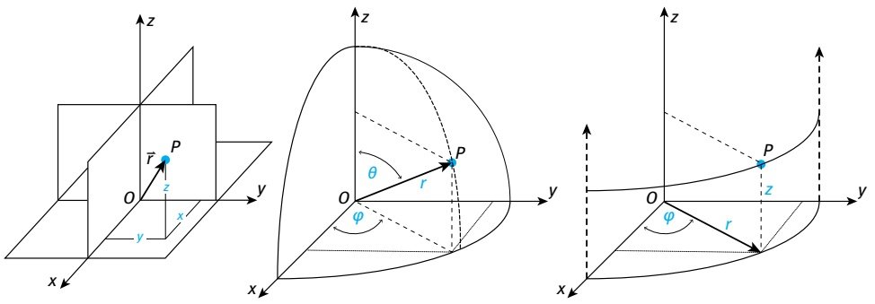

<details>
<summary>text_image</summary>

Mathematical diagrams showing 3D coordinate systems with labeled axes, surfaces, and angles for geometric or physical analysis.
</details>

Kartesische Koordinaten (x, y, z), beachte die Rechtsschraube<sup>2</sup> der Koordinatenachsen (‚Rechte-Hand-Regel‘)!

Kugelkoordinaten (r, θ, φ), der Polarwinkel θ (0 bis π) wird von z weg, der Azimutwinkel φ (0 bis 2 π) wird von x weg positiv gezählt

Zylinderkoordinaten (r, φ, z) φ wird von x weg positiv gezählt

Abb. I-2.1: Koordinatensysteme.

Wir verwenden zunächst nur kartesische Koordinaten. Die Bewegung des MP wird dann durch die zeitabhängigen Koordinaten des Ortsvektors r⇀( position vector) beschrieben, der dauernd vom Ursprung zum MP zeigt („gebundener Vektor“):

$$
\vec {r} = \vec {r} (t) = \vec {r} \Big (x (t), y (t), z (t) \Big). \tag {I-2.1}
$$

<small><span class="docvortex-page-footnote" data-block-type="page_footnote" style="color:#6b7280">2 Wird die positive x-Achse in die positive y-Achse gedreht, dann bewegt sich z im Sinne einer Rechtsschraube nach oben (in positive z-Richtung).</span></small>

---

2.1 Kinematik (kinematics)

27

Die zeitliche Abfolge der Endpunkte von $\vec { r } ( t )$ beschreibt eine Kurve im Raum, nämlich die Bahnkurve s des MP. Die Zeit t, der Parameter der Kurve, ist dabei eine eindimensionale Größe (Vergangenheit, Gegenwart, Zukunft).

Die moderne Physik hat hier zwei Probleme entdeckt:

1. Zur Bestimmung der Teilchenbahn sind Zeitmessungen an bestimmten Raumpunkten notwendig. Die Zeitmessung hat aber nur dann wirklich Sinn, wenn sie an allen Raumpunkten vergleichbar durchgeführt werden kann. Dies stellt in der klassischen Physik Newtons kein Problem dar, da die Zeit hier eine universelle Größe ist, die nicht vom Ort abhängig ist.<sup>3</sup> Seit der Erkenntnis aber, dass es eine Obergrenze der Geschwindigkeit für die Übertragung von Signalen gibt und dass diese Geschwindigkeit – die Lichtgeschwindigkeit c – in allen gegeneinander bewegten Bezugssystemen den selben Wert besitzt, kann die Zeit nicht mehr als universelle Größe angesehen werden. Die spezielle Relativitätstheorie zeigt, dass die Zeit eines Ereignisses an einem bestimmten Ort vom Bezugssystem abhängt und beim Wechsel des Bezugssystems wie eine Koordinate mittransformiert werden muss.

2. Bei der Beschreibung von Vorgängen in atomaren Dimensionen können Ort und Geschwindigkeit (Impuls) nicht mehr gleichzeitig beliebig genau angegeben werden (Heisenbergsche Unschärferelation). Zu einem bestimmten Zeitpunkt sind der Aufenthaltsort und der Impuls eines Teilchens nur mehr mit einer gewissen Wahrscheinlichkeit bekannt, die Beschreibung der Bewegung mit einer Teilchenbahn ist daher nur mehr innerhalb statistischer Grenzen möglich, die aber sehr eng sein können (z. B. Blasenkammerspuren von Elementarteilchen).

## 2.1.1 Geschwindigkeit und Beschleunigung

Die Geschwindigkeit υ⇀(velocity = speed) eines Teilchens ist die Änderung seines Ortsvektors in der Zeiteinheit:

$$
\vec {v} = \vec {v} (t) = \lim _ {\Delta t \to 0} \frac {\vec {r} (t + \Delta t) - \vec {r} (t)}{\Delta t} = \frac {d \vec {r}}{d t} = \dot {\vec {r}}. ^ {4} \tag {I-2.2}
$$

Einheit $:^{5}[v]=1   ms ^{-1}$

<small><span class="docvortex-page-footnote" data-block-type="page_footnote" style="color:#6b7280">3 Newton ahnte das Problem bereits, da er erkannte, dass seine Annahme der Absolutheit von Raum und Zeit rein hypothetisch war und nicht aus Beobachtungen oder durch induktiven Schluss abgeleitet werden konnte. Er blieb hier also inkonsequent gegenüber seiner Forderung der Hypothesenfreiheit in seinen Philosophiae Naturalis Principia Mathematica (1687).</span></small>

<small><span class="docvortex-page-footnote" data-block-type="page_footnote" style="color:#6b7280">4 Zeitableitungen werden der Kürze wegen seit Newton mit einem Punkt bezeichnet:</span></small>

$$
\underbrace {\frac {d x}{d t}} _ {\text {Leibniz}} \equiv \underbrace {\dot {x}} _ {\text {Newton}}
$$

<small><span class="docvortex-page-footnote" data-block-type="page_footnote" style="color:#6b7280">5 Eckige Klammern bezeichnen die SI-Einheiten der entsprechenden Größen.</span></small>

---

28

2 Mechanik des Massenpunktes

Für den Betrag der Geschwindigkeit gilt

$$
\nu = \left| \vec {v} \right| = \frac {\left| d \vec {r} \right|}{d t} = \frac {d s}{d t}
$$

s ist das Bogenelement der Bahnkurve (siehe Abb. I-2.3).

Die Beschleunigung a⇀(acceleration) ist die Änderung der Geschwindigkeit eines Teilchens in der Zeiteinheit:

$$
\vec {a} = \vec {a} (t) = \lim _ {\Delta t \to 0} \frac {\vec {v} (t + \Delta t) - \vec {v} (t)}{\Delta t} = \frac {d \vec {v}}{d t} = \dot {\vec {v}} = \ddot {\vec {r}}. \tag {I-2.3}
$$

Einheit: $[ a ] = 1   \mathrm { m } \; \mathrm { s } ^ { - 2 }$

## 2.1.2 Die allgemeine Bewegung des MP

Die Teilchengeschwindigkeit υ⇀zeigt immer in Richtung der Tangente an die Bahnkurve s, aber die Beschleunigung a⇀muss nicht in Bahnrichtung zeigen!

$\vec { e } _ { t }$ ist der Einheitsvektor in Bahnrichtung (tangential), ${ \vec { e } } _ { n }$ ist der Einheitsvektor in einer Richtung normal dazu. Für die Geschwindigkeit können wir daher $\vec { \upsilon } = \upsilon \cdot \vec { e } _ { t }$ schreiben und erhalten so für die Beschleunigung zwei Anteile:

$$
\vec {a} = \frac {d \vec {v}}{d t} = \frac {d v}{d t} \vec {e} _ {t} + v \frac {d \vec {e} _ {t}}{d t} = \vec {a} _ {t} + \vec {a} _ {n}. ^ {6} \tag {I-2.4}
$$

Die Beschleunigung kann also immer in eine Komponente ${ \vec { a } } _ { t }$ in Bahnrichtung und eine Komponente ${ \vec { a } } _ { n }$ normal zur Bahn zerlegt werden (Abb. I-2.2). Dabei sind

$$
\vec {a} _ {t} = \frac {d v}{d t} \vec {e} _ {t} \quad \begin{array}{l} \text {die Tangentialbeschleunigung} \\ (\text {Änderung des Betrags der Bahngeschwindigkeit}) \text {und} \end{array} \tag {I-2.5}
$$

$$
\vec {a} _ {n} = \nu \frac {d \vec {e} _ {t}}{d t} \quad \begin{array}{l} \text {die Normalbeschleunigung} \\ (\text {Änderung der Geschwindigkeitsrichtung}). \end{array} \tag {I-2.6}
$$

<small><span class="docvortex-page-footnote" data-block-type="page_footnote" style="color:#6b7280">$6 \frac { d \vec { e } _ { t } } { d t } \perp \vec { e } _ { t }$ , da die Änderung jedes dem Betrage nach konstanten Vektors nur senkrecht zu seiner Richtung erfolgen kann. Siehe auch: Berechnung der Normalbeschleunigung weiter unten.</span></small>

---

2.1 Kinematik (kinematics)

29

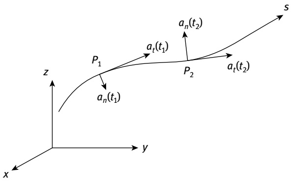

<details>
<summary>text_image</summary>

z
P₁
aₙ(t₁)
aₜ(t₁)
aₙ(t₂)
P₂
aₜ(t₂)
s
x
y
</details>

Abb. I-2.2: Die Bahnkurve s des MP wird in jedem Punkt (hier gezeigt für $P _ { 1 }$ und $P _ { 2 } )$ durch seine Tangential- und seine Normalbeschleunigung bestimmt.

## Berechnung der Normalbeschleunigung

Der Ortsvektor sei als Funktion der Bogenlänge $s = s ( t )$ gegeben.

Mit der ‚Kettenregel‘ gilt dann:

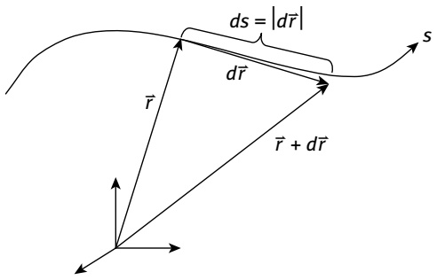

<details>
<summary>text_image</summary>

ds = |d\u0305r|
d\u0305
\u0305
\u0305 + d\u0305
s
</details>

Abb. I-2.3: Ortsvektor r⇀(t) und Bogenlänge $s ( t ) .$

Da $d \vec { r }$ in die Richtung der Bahntangente weist und wir der Abb. I-2.3 entnehmen können, dass $\left| d \vec { r } \right| = d s \; \mathrm { g i l t } ,$ so können wir daraus den Einheitsvektor in Tangentenrichtung bilden: $\vec { e } _ { t } = \frac { d \vec { r } } { d s } .$

Wir überlegen uns kurz die Differentiation eines Vektors konstanter Länge:

$$
\left| \vec {u} (s) \right| = \text { const.} \Rightarrow (\vec {u} (s)) ^ {2} = \text { const. }
$$

---

30

2 Mechanik des Massenpunktes

Es muss daher gelten

$$
\frac {d (\vec {u}) ^ {2}}{d s} = 2 \vec {u} \frac {d \vec {u}}{d s} = 0.
$$

Da $\vec { u } \neq 0$ und $\frac { d \vec { u } } { d s } \neq 0 \Rightarrow \frac { d \vec { u } } { d s } \perp \vec { u } .$

Das heißt, wenn wir einen Vektor konstanter Länge differenzieren, dann steht sein Differentialquotient auf dem Vektor normal. Dies ist auch geometrisch verständlich: Alle Endpunkte eines konstanten Vektors liegen auf einer Kugeloberfläche. Die Ableitung kann nur die Richtung ändern und die Änderung muss daher eine Tangente zur Kugeloberfläche sein, also auf dem Vektor normal stehen.

Daher gilt für den Tangenteneinheitsvektor $\vec { e } _ { t } ( s )$

$$
\frac {d \vec {e} _ {t}}{d s} \perp \vec {e} _ {t} \Rightarrow \frac {d \vec {e} _ {t}}{d s} / / \vec {e} _ {n}, \quad \text {also} \quad \frac {d \vec {e} _ {t}}{d s} = \left| \frac {d \vec {e} _ {t}}{d s} \right| \cdot \vec {e} _ {n}.
$$

Der Normaleneinheitsvektor ${ \vec { e } } _ { n }$ ist immer nach der konkaven Seite der Bahnkurve, also zu ihrem Krümmungsmittelpunkt M hin gerichtet.

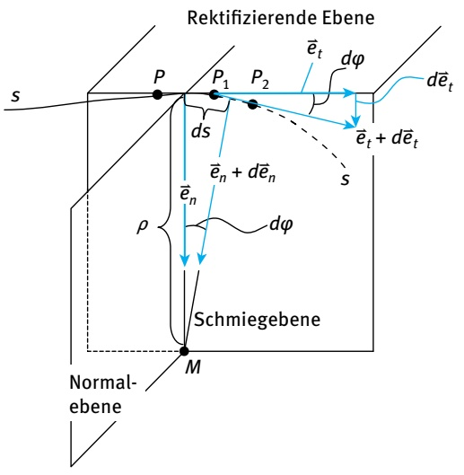

<details>
<summary>flowchart</summary>

```mermaid
graph LR
  S["s"] --> P1["P"]
  P1 --> P2["P2"]
  P2 --> ds["ds"]
  ds --> en["en"]
  en --> dφ["dφ"]
  d["dφ"] --> e_t["e_t"]
  e_t --> dφ + e_t + dē_t["e_t + dē_t"]
  d --> e_t
  e_t --> s["s"]
  s --> M["M"]
  M --> Normal_ebene["Normal-ebene"]
  Normal_ebene --> Schmiegebene["Schmiegebene"]
```
</details>

Abb. I-2.4: Rektifizierende Ebene: steht $\perp \vec { e } _ { n }$ . Schmiegebene: wird von ${ \vec { e } } _ { t }$ und $d \vec { e } _ { t }$ aufgespannt. Normalebene: steht $\perp \vec { e } _ { t }$

Aus der Abb. I-2.4 ergibt sich ds $= \rho   d \varphi , \rho$ … Radius des Krümmungskreises um $M ,$ und außerdem $\left| d \vec { e } _ { t } \right| = d \varphi \cdot \left| \vec { e } _ { t } \right| = d \varphi = \frac { d s } { \rho }$

---

2.1 Kinematik (kinematics)

31

$$
\Rightarrow \quad \left| \frac {d \vec {e} _ {t}}{d s} \right| = \frac {1}{\rho} \quad \text {und} \quad \frac {d ^ {2} \vec {r}}{d s ^ {2}} = \frac {d}{d s} \left(\frac {d \vec {r}}{d s}\right) = \frac {d \vec {e} _ {t}}{d s} = \left| \frac {d \vec {e} _ {t}}{d s} \right| \cdot \vec {e} _ {n} = \frac {\vec {e} _ {n}}{\rho}
$$

und wir erhalten

$$
\underline {{\vec {a} _ {n}}} = \nu \frac {d \vec {e} _ {t}}{d s} \frac {d s}{d t} = \frac {\nu^ {2}}{\rho} \vec {e} _ {n}. \tag {I-2.7}
$$

Für die Krümmung (curvature) einer Kurve gilt $k = { \frac { d \varphi } { d s } } = \left| { \frac { d { \vec { e } } _ { t } } { d s } } \right| = \left| { \frac { d ^ { 2 } { \vec { r } } } { d s ^ { 2 } } } \right| = { \frac { 1 } { \rho } }$ , also

$$
k = \frac {1}{\rho} = \sqrt {\left(\frac {d ^ {2} \vec {r}}{d s ^ {2}}\right) ^ {2}} = \sqrt {\left(\frac {d ^ {2} x}{d s ^ {2}}\right) ^ {2} + \left(\frac {d ^ {2} y}{d s ^ {2}}\right) ^ {2} + \left(\frac {d ^ {2} z}{d s ^ {2}}\right) ^ {2}} \quad \begin{array}{l} K r i m m u n g d e r \\ B a h n k u r v e. \end{array} \tag {I-2.8}
$$

Damit erhalten wir den Beschleunigungsvektor für die allgemeine, krummlinige Bewegung:

$$
\vec {a} (t) = \frac {d v}{d t} \vec {e} _ {t} + \frac {v ^ {2}}{\rho} \vec {e} _ {n}, \quad \text {mit dem Betrag} \quad \left| \vec {a} \right| = a = \sqrt {\left(\frac {d v}{d t}\right) ^ {2} + \frac {v ^ {4}}{\rho^ {2}}} \tag {I-2.9}
$$

Der Beschleunigungsvektor $\vec { a } ( t )$ liegt also immer in der Schmiegebene, die von $\vec { e } _ { t } ( t )$ und $\vec { e } _ { n } ( t )$ aufgespannt wird!

## 2.1.3 Spezielle Bewegungen

1. Die unbeschleunigte Bewegung, $\vec { a } = \frac { d \vec { \upsilon } } { d t } = 0 .$

$\Rightarrow \vec { v } = \mathbf { c o n s t } .$ , d. h. Betrag und Richtung der Geschwindigkeit bleiben konstant, es handelt sich um eine gleichförmig geradlinige Bewegung.

2. Die gleichförmig beschleunigte Bewegung, $\vec { a } = \vec { a } _ { 0 } = \mathrm { c o n s t } .$

(z. B. Beispiel: freier Fall und „schiefer Wurf“ im Erdschwerefeld, Abb. I-2.5).

Die <u>erste Integration</u> ergibt die Geschwindigkeit:

$$
\vec {v} (t) = \vec {a} _ {0} \int d t = \vec {a} _ {0} t + \vec {v} _ {0}. \tag {I-2.10}
$$

Die Integrationskonstante $\vec { \nu } _ { 0 }$ folgt aus der Anfangsbedingung bei $t = 0$

$$
\vec {v} (0) = \vec {v} _ {0}.
$$

---

32

2 Mechanik des Massenpunktes

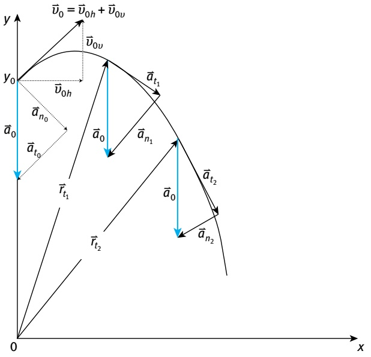

<details>
<summary>text_image</summary>

y
\vec{v}_0 = \vec{v}_{0h} + \vec{v}_{0v}
\vec{v}_{0h}
\vec{a}_{t_1}
\vec{a}_{n_1}
\vec{a}_{t_2}
\vec{a}_{n_2}
\vec{a}_0
\vec{a}_{t_0}
\vec{r}_{t_1}
\vec{r}_{t_2}
0
x
</details>

Abb. I-2.5: Der $\pmb { \mathscr { v } } ^ { \pmb { S } }$ chiefe $\mathsf { W u r f ^ { \mathsf { e c } } }$ im Erdschwerefeld als Beispiel einer gleichförmig beschleunigten Bewegung. Es ist $\vec { \upsilon } _ { 0 } = \upsilon _ { 0 h } \vec { e } _ { x } + \upsilon _ { 0 v } \vec { e } _ { y }$ und $\vec { a } _ { 0 } = a _ { 0 h } \vec { e } _ { x } + a _ { 0 v } \vec { e } _ { y }$ . Nach Gl. I-2.11 ergibt sich mit $\vec { a } _ { 0 h } = 0$ und $\vec { a } _ { 0 \nu } = a _ { 0 } \vec { e } _ { y }$ für die Bahnkurve eine Parabel (Parameterdarstellung): $x = \upsilon _ { 0 h } t + x _ { 0 }$ $y = \frac { 1 } { 2 } a _ { 0 } t ^ { 2 } + \upsilon _ { 0 \nu } t + y _ { 0 }$ . Im dargestellten Fall ist $x _ { 0 } = 0$

Die <u>zweite Integration</u> ergibt den augenblicklichen Aufenthaltsort des Teilchens:

$$
\vec {r} (t) = \int \vec {v} d t = \vec {a} _ {0} \int t d t + \vec {v} _ {0} \int d t = \frac {1}{2} \vec {a} _ {0} t ^ {2} + \vec {v} _ {0} t + \vec {r} _ {0}. \tag {I-2.11}
$$

Es treten zwei Integrationskonstanten auf, die Anfangsgeschwindigkeit $\vec { v } _ { 0 } =$ $( \upsilon _ { 0 h } , \upsilon _ { 0 \nu } )$ und die Anfangslage $\vec { r } _ { 0 } = ( x _ { 0 } = 0 , y _ { 0 } )$

Die Bahnkurve liegt stets in der von ${ \vec { a } } _ { 0 }$ und ${ \vec { v } } _ { 0 }$ aufgespannten Ebene und ist im allgemeinen Fall (schiefer Wurf) eine quadratische Parabel, bei der sich in jedem Punkt $r ( t )$ die Tangential- und die Normalbeschleunigung zum konstanten ${ \vec { a } } _ { 0 }$ zusammensetzen.

Nur wenn die Richtung der Anfangsgeschwindigkeit ${ \vec { v } } _ { 0 }$ mit der der Beschleunigung zusammenfällt (senkrechter Wurf nach oben oder nach unten), resultiert eine lineare Bewegung mit $\vec { a } _ { n } = 0$ (Krümmungsradius $\rho = \infty )$

3. Die allgemeine Kreisbewegung (bei fester Richtung der Achse).

Auch hier gilt wie bei der allgemeinen Bewegung (Gl. I-2.9):

$$
\vec {a} (t) = \vec {a} _ {t} + \vec {a} _ {n} = \frac {d \nu}{d t} \vec {e} _ {t} + \frac {\nu^ {2}}{R} \vec {e} _ {n},
$$

aber jetzt mit dem festen Bahnradius R.

---

2.1 Kinematik (kinematics)

33

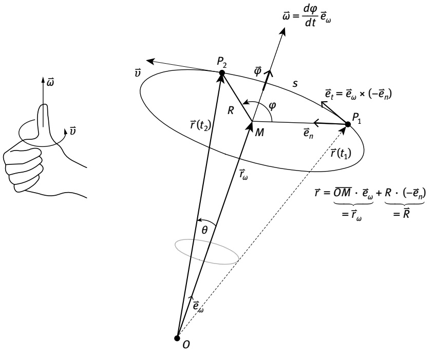

<details>
<summary>text_image</summary>

ω̅ = dφ/dt ēω
P₂
φ̄
s
ēₜ = ēω × (-ēₙ)
P₁
r̄(t₂)
R
φ
M
ēₙ
r̄(t₁)
θ
r̄ω
ēω
O
r̄ = O M · ēω + R · (-ēₙ) = R̄
</details>

Abb. I-2.6: Zur allgemeinen Kreisbewegung.

Aus der Abb. I-2.6 sehen wir:

$$
\nu = \left| \vec {\upsilon} \right| = \frac {d s}{d t} = R \frac {d \varphi}{d t} = R \omega . \tag {I-2.12}
$$

Dabei ist $\vec { \omega } = \frac { d \vec { \varphi } } { d t } = \frac { d \varphi } { d t }   \vec { e } _ { \omega }$ die Winkelgeschwindigkeit $( \varphi$ … orientierter Winkel, Vektor in Richtung der Achse des Kreises), die auf der Ebene der Bahnkurve normal steht. Einheit: $[ \omega ] = 1   { \frac { \mathrm { r a d } } { \mathrm { s } } } = \mathrm { s } ^ { - 1 }$

Allgemein gilt: Ist $d \varphi = { \frac { \left| d { \vec { s } } \right| } { R } }$ ein differentiell kleiner Winkel über dem Bogen $| d \vec { s } |$ , dann ist dφ⇀ein orientiertes Winkelelement, das senkrecht auf jener Ebene steht, die von O und $| d \vec { s } |$ aufgespannt wird. Die gleiche Orientierung gilt auch für $\vec { \omega } = \frac { d \vec { \varphi } } { d t }$ . Anmerkung: Für differentiell kleine Winkel $d \varphi$ und dψ gilt das kommutative Gesetz $d \varphi   +   d \psi   =   d \psi   +   d \varphi$ ; Winkelgeschwindigkeiten sind daher kommutativ. Dies gilt aber nicht für endliche Winkel im Raum: $\varphi +$ $\psi \neq \psi + \varphi$ (siehe dazu z. B. G. Falk und W. Ruppel, 1983. „Mechanik Relativität Gravitation: Die Physik der Naturwissenschaften“, Springer Berlin, Heidelberg, New York, S. 227/228, insbesondere Abb. 24.3).

---

34

2 Mechanik des Massenpunktes

Es gilt weiter mit $\theta   =   \angle ( \vec { \omega } , \vec { r } )$

$$
R = \left| \vec {r} \right| \sin \theta
$$

und damit

$$
\Rightarrow \upsilon = \underbrace {\omega \cdot | \vec {r} | \cdot \sin \theta} _ {\substack {\text {Betrag des Vektor - } \\ \text {produkts} \bar {\omega} \times \vec {r}}} \tag{I - 2.13}
$$

Da außerdem $\vec { v }$ senkrecht auf $\vec { \omega }$ und $\vec { r }$ steht,7 folgt also für die Geschwindigkeit bei der allgemeinen Kreisbewegung mit $\vec { \omega } \times \vec { r } = \omega \vec { e } _ { \omega } \times \left( O M \vec { e } _ { \omega } - R   \vec { e } _ { n } \right) =$ ω $R \big ( \vec { e } _ { \omega } \times ( - \vec { e } _ { n } ) \big ) = \omega \cdot R \cdot \vec { e } _ { t }$

$$
\vec {v} (t) = \frac {d \vec {r}}{d t} = \vec {\omega} \times \vec {r} = \underbrace {\omega \cdot R} _ {= \nu} \cdot \vec {e} _ {t} = v \vec {e} _ {t}. \tag {I-2.14}
$$

Durch Differenzieren ergibt sich die Beschleunigung der Kreisbewegung:<sup>8</sup>

$$
\begin{array}{l} \vec {a} (t) = \frac {d \vec {v}}{d t} = \dot {\vec {\omega}} \times \vec {r} + \vec {\omega} \times \frac {d \vec {r}}{d t} = \dot {\vec {\omega}} \times \vec {r} + \vec {\omega} \times \vec {v} = \dot {\vec {\omega}} \times \vec {r} + \vec {\omega} \times (\vec {\omega} \times \vec {r}) = \\ = \frac {d ^ {2} \varphi}{d t ^ {2}}   \vec {e} _ {\omega} \times \underbrace {(\vec {r} _ {\omega} + \vec {R})} _ {\text {siehe   Abb. I - 2.6}} + \omega   \vec {e} _ {\omega} \times (\omega R \cdot \vec {e} _ {t}) = \\ = \dot {\omega} \vec {e} _ {\omega} \times (r _ {\omega} \vec {e} _ {\omega} - R \vec {e} _ {n}) + \omega^ {2} R \underbrace {(\vec {e} _ {\omega} \times \vec {e} _ {t})} _ {= \vec {e} _ {n}} = \dot {\omega} R \underbrace {(\vec {e} _ {\omega} \times (- \vec {e} _ {n}))} _ {= \vec {e} _ {t}} + \omega^ {2} R \cdot \vec {e} _ {n} \\ \Rightarrow \vec {a} (t) = \underbrace {\dot {\omega} R \cdot \vec {e} _ {t}} _ {\text {Tangentialbeschleunigung} a _ {t}} + \underbrace {R \omega^ {2} \cdot \vec {e} _ {n}} _ {\text {Zentripetalbeschleunigung} a _ {n}} \tag {I-2.15} \\ \end{array}
$$

4. Die gleichförmige Kreisbewegung, $\vec { a } _ { t } = \dot { \omega } R \cdot \vec { e } _ { t } = 0$

$$
\Rightarrow \omega = \text {const. Aber es bleibt} \vec {a} = \vec {a} _ {n} = R \omega^ {2} \vec {e} _ {n} = \frac {\nu^ {2}}{R} \vec {e} _ {n}, \tag {I-2.15a}
$$

die Zentripetalbeschleunigung.

<small><span class="docvortex-page-footnote" data-block-type="page_footnote" style="color:#6b7280">7 Denn: r⇀= OM ̄⋅e⇀ω + R⇀⇒ υ⇀× r⇀= OM ̄(υ⇀× e⇀ω) + υ⇀× R⇀ = 0 ⇒ υ⇀⊥ r⇀ = 0 mit υ⇀⊥ e⇀ = 0 mit υ⇀⊥R⇀</span></small>

<small><span class="docvortex-page-footnote" data-block-type="page_footnote" style="color:#6b7280">8 Da ω⇀hier eine feste Richtung hat (senkrecht zur Kreisbewegung), gilt ω⇀̇//ω⇀. Das ist bei der Kreiselbewegung (siehe Kapitel „Mechanik des starren Körpers“, Abschnitt 3.4) nicht der Fall!</span></small>

---

2.1 Kinematik (kinematics)

35

## Die Kreisbewegung ist immer eine beschleunigte Bewegung!

1

Wenn bei der Kreisbewegung eines Teilchens die Zentripetalbeschleunigung plötzlich verschwindet, folgt die Bahn der Augenblicksgeschwindigkeit des Teilchens, das heißt, das Teilchen verlässt die Kreisbahn tangential und nicht radial nach außen. Dies kann sehr schön mit dem ‚sprühenden Schleifstein‘ gezeigt werden.

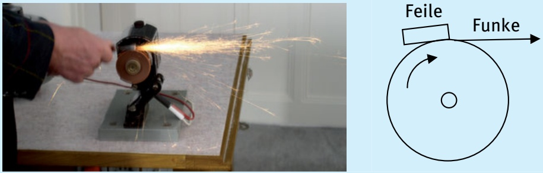

Die sprühenden Funken sind glühende Metallpartikel der Feile, die auf die Umlaufgeschwindigkeit der Schleifscheibe beschleunigt wurden. Sobald die Zentripetalbeschleunigung – ausgeübt durch den Druck der Feile − nicht mehr auf sie wirkt, verlassen sie die Schleifscheibe tangential, also in der Richtung der augenblicklichen Bahngeschwindigkeit. Würden wir auf der Scheibe ‚sitzen‘, könnten wir die Teilchen radial nach außen fliegen sehen: im rotierenden System wirkt die Zentrifugalkraft.

4

Die Wirkung der Zentripetalbeschleunigung kann auch mit der „laufenden Kette“demonstriert werden.

Eine Kette wird auf eine Holzscheibe aufgezogen und auf schnelle Umdrehung gebracht. Dann wird sie von der Scheibe seitwärts herunter geworfen: Sie läuft wie ein stabiles Rad weiter und kann sogar über Hindernisse springen. Da die Zentripetalbeschleunigung proportional zu $\upsilon ^ { 2 } / R$ ist, kann man das sogar mit einer langen Kette zeigen, die nur teilweise auf der Holzscheibe liegt, deren unterer Krümmungsradius aber deutlich kleiner ist. Auch sie ist sehr stabil, wenn sie eine hohe Umlaufgeschwindigkeit hat und kann ‚laufen‘. Zum Verständnis dieses Versuches ist zu beachten, dass es sich hier nicht um einen rotierenden starren Körper handelt (vergleiche Kapitel 3), sondern dass jedes Kettenglied einem umlaufenden MP entspricht. Dann muss auf jedes Kettenglied die für die Kreisbewegung erforderliche Zentripetalkraft wirken. Diese kann nur durch die Wechselwirkung mit den benachbarten Kettengliedern hervorgerufen werden, wozu eine Spannkraft längs der rotierenden Kette aufgebaut werden muss. Diese Spannkraft stabilisiert die rotierende Kette (dynamisch stabilisiertes System).<sup>9</sup>

4

<small><span class="docvortex-page-footnote" data-block-type="page_footnote" style="color:#6b7280">9 Im rotierenden System der Kette tritt, wie wir später im Abschnitt 2.3.3 sehen werden, die Zentrifugalbeschleunigung auf, die die Kettenspannung bewirkt.</span></small>

---

36

2 Mechanik des Massenpunktes

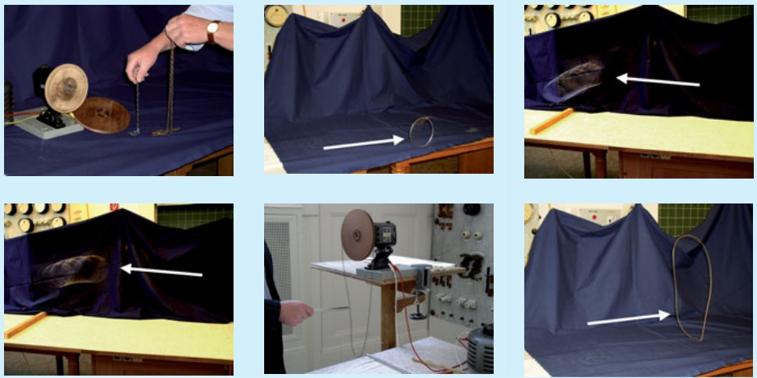

## 2.2 Dynamik (dynamics)

In der Dynamik fragen wir nach den Ursachen von Bewegungen, also: Woher kommen die Beschleunigungen?

Die Antwort gab schon Newton: Kräfte seien die Ursache von Beschleunigungen. Aber was sind Kräfte? Es sind bestimmte objektive Konstellationen der einen Massenpunkt umgebenden Materie, die ihn zu einer beschleunigten Bewegung veranlassen können; man spricht von einer „Wechselwirkung“ (WW) des Teilchens mit der umgebenden Materie.

## 1

Die Ursache für Änderungen des augenblicklichen Bewegungszustandes (der Geschwindigkeit) eines Körpers liegt in seiner Wechselwirkung mit der ihn umgebenden Materie.

Aufgrund ihrer Wechselwirkungsnatur treten Kräfte stets paarweise auf.

Die Beschreibung dieser Wechselwirkung des Körpers (hier des MP) mit seiner Umgebung führt zum Konzept der Kraft (force): Wenn eine Kraft am Körper angreift, so ändert er seinen Bewegungszustand. Greift keine resultierende Kraft an, so ist der Körper ‚kräftefrei‘ (z. B. ein ‚freies Teilchen‘) und er ändert seinen Bewegungszustand (seine Geschwindigkeit) nicht.

Manchmal wird eine Kraft materiell durch Druck oder Stoß auf einen Körper übertragen, etwa durch eine Feder oder durch die Gasmoleküle beim Schall oder in thermischen Maschinen (Turbine, Verbrennungsmotor). Bei der Wechselwirkung durch Gravitation oder der elektromagnetischen Wechselwirkung trifft das nicht zu, es ist in diesen Fällen kein Medium zur Kraftübertragung nötig, diese Kräfte

---

2.2 Dynamik (dynamics)

37

wirken auch im Vakuum.<sup>10</sup> Dies führt zum Konzept des Kraftfeldes (force field): Jedem Raumpunkt wird eine Kraft (Größe und Richtung) zugeordnet, wodurch je der Raumpunkt zum Sitz einer Kraftwirkung wird. Der Raum wird also durch die vorhandene Materie physikalisch strukturiert und so zum Träger von Energie und Impuls. Die Kraftwirkungen des Feldes müssen nach Größe und Richtung durch einen Vektor, die Feldstärke $\mathcal { \bar { F } }$ festgelegt werden. Die Kraft $\vec { F }$ auf einen MP ergibt sich dann aus dem Produkt der Feldstärke $\mathcal { \bar { F } }$ und der Masse m des MP: $\vec { F } = m \cdot \vec { \mathcal { F } }$ Die Feldstärke ist also gleich der Kraft auf die Masseneinheit (ganz allgemein auf die Einheit jenes $, \mathtt { A g e n s ^ { \circ } }$ , das der Feldstärke zugrunde liegt, z. B. Masse, elektrische Ladung, etc.). Im Fall eines Nichtgleichgewichtszustandes der felderzeugenden Teilchen (dynamischer Fall) breiten sich die Kraftwirkungen, also die Felder, mit der Grenzgeschwindigkeit c (Lichtgeschwindigkeit im Vakuum) aus. Die Kraftwir kung unter der Vermittlung des den Raum erfüllenden Feldes bezeichnen wir als Nahwirkung: Die Kraft auf einen MP wird nur durch die Eigenschaften des Raumes in seiner unmittelbaren Umgebung, also der Feldstärke, hervorgerufen. Im Gegensatz dazu steht die alte, heute nicht mehr akzeptierte Fernwirkung, bei welcher die Kraftwirkung zwischen den Teilchen den dazwischen liegenden Raum unendlich schnell überspringen kann.<sup>11</sup>

Wir haben bereits die vier fundamentalen Wechselwirkungen als Ursache der Kräfte kennen gelernt:

| Wechselwirkung | Kopplungskonstante | Reichweite |
| --- | --- | --- |
| Gravitation | $10^{-41}$ | $\infty$ |
| elektromagnetische WW | 1/137 (Feinstrukturkonstante) | $\infty$ |
| starke WW | $\cong 1$ | $\cong 10^{-15}$ m = 1 fm (Femtometer) |
| schwache WW | $10^{-15}$ | $\cong 10^{-18}$ m = 1 am (Attometer) |

Die Kopplungskonstante beschreibt die ‚Stärke‘ der Wechselwirkung. Ein Vergleich der Gravitation und der elektromagnetischen WW ergibt: Die elektrische Abstoßung zweier Protonen ist $1 0 ^ { 3 6 }$ mal größer als ihre Massenanziehung. Wir können daher in vielen Fällen der Teilchenphysik die Gravitationswirkung vernachlässigen. Andererseits tritt im Alltag die elektromagnetische WW oft gegenüber der Gravitation nicht in Erscheinung, da die Ladungen abgeschirmt sind (Atome sind neutral).

<small><span class="docvortex-page-footnote" data-block-type="page_footnote" style="color:#6b7280">10 Letzten Endes sind aber auch die Feder- und Stoßkräfte elektromagnetischer Natur!</span></small>

<small><span class="docvortex-page-footnote" data-block-type="page_footnote" style="color:#6b7280">11 Das Paradebeispiel dafür ist das Newtonsche Gravitationsgesetz (die Zeit als universelle Größe!). Allerdings kann im statischen und quasistatischen Fall (υ ≪ c) immer noch mit den bequemen Fernwirkungsausdrücken des Newtonschen und Coulombschen Gesetzes gerechnet werden, dann ist keine Retardierung nötig (zur Retardierung siehe auch Band III, Kapitel „Wechselstromkreis und elektromagnetische Schwingungen und Wellen“, Abschnitt 5.3).</span></small>

---

38

2 Mechanik des Massenpunktes

**Beispiel:** Wir berechnen das Verhältnis zwischen der Massenanziehung zweier Protonen und ihrer Coulomb-Abstoßung.

Massenanziehung: $F _ { P - P } ^ { G } = \gamma   \frac { m _ { P }   m _ { P } } { r ^ { 2 } }   ,$

Elektromagnetische WW (Coulombkraft): $F _ { P - P } ^ { C } = \frac { 1 } { 4 \pi \varepsilon _ { 0 } }   \frac { q _ { P }   q _ { P } } { r ^ { 2 } }   ,$ ,

$$
m _ {P} = 1, 6 7 \cdot 1 0 ^ {- 2 7} \mathrm{kg}, \quad \gamma = 6, 6 7 \cdot 1 0 ^ {- 1 1} \mathrm{m} ^ {3} \mathrm{kg} ^ {- 1} \mathrm{s} ^ {- 2},
$$

Ladung des Protons $e = 1 . 6 0 \cdot 1 0 ^ { - 1 9 } \mathrm { C } , \quad 1 / ( 4 \pi \varepsilon _ { 0 } ) = 8 . 9 9 \cdot 1 0 ^ { 9 } \mathrm { N m } ^ { 2 } \mathrm { C } ^ { - 2 }$

$$
\Rightarrow \frac {F _ {P - P} ^ {G}}{F _ {P - P} ^ {C}} = 0, 8 \cdot 1 0 ^ {- 3 6}.
$$

## 2.2.1 Die Newtonschen Axiome und der Impuls (momentum)

Wir definieren nach Newton (Sir Isaac Newton, 1643–1727) zunächst eine Größe, die den augenblicklichen Bewegungszustand eines Teilchens charakterisiert und nennen sie Impuls<sup>12</sup> oder Bewegungsgröße $\bar { p }$ (linear momentum):

$$
\vec {p} = m \cdot \vec {\upsilon}. \tag {I-2.16}
$$

Einheit: $[ p ] = 1$ kg m $s ^ { - 1 }$

## 1. Axiom (Trägheitssatz, law of inertia, Newton 1, lex prima)

## 1 Der Impuls eines freien Teilchens ist zeitlich konstant.

Wenn also keine Kraft auf das Teilchen wirkt (freies Teilchen), so verharrt es in seinem augenblicklichen Bewegungszustand, d. h. es ruht oder bewegt sich gleichförmig geradlinig.

Wesentlich ist hier, dass für die Gültigkeit des Trägheitssatzes ein bestimmtes Bezugssystem (frame of reference)<sup>13</sup> gewählt werden muss. Der Trägheitssatz gilt nämlich nicht in allen Bezugssystemen, die möglich sind. Wir bezeichnen als Inertialsystem (inertial frame of reference) ein Bezugssystem, in dem der Trägheitssatz

<small><span class="docvortex-page-footnote" data-block-type="page_footnote" style="color:#6b7280">12 Genauer: linearer Impuls; Newton nannte den Ausdruck ‚motus‘ = Bewegung, siehe auch Abschnitt 2.2.3.</span></small>

<small><span class="docvortex-page-footnote" data-block-type="page_footnote" style="color:#6b7280">13 Oder ein ihm gleichwertiges: Gleichförmig geradlinig zueinander bewegte Systeme sind gleichwertige Inertialsysteme.</span></small>

---

2.2 Dynamik (dynamics)

39

gilt. Ein als Inertialsystem benütztes Bezugssystem darf nicht beschleunigt sein, also z. B. nicht rotieren, da in diesem System ein freies Teilchen eine Beschleuni gung zeigt, der Trägheitssatz also nicht gilt.

## 2. Axiom (Bewegungsgleichung, equation of motion, Newton 2, lex secunda)

Die Kraft ist die Ursache der Impulsänderung.

1

Quantitativ ergibt sich die Bewegungsgleichung:

$$
\vec {F} = \frac {d \vec {p}}{d t} = \dot {\vec {p}}. \tag {I-2.17}
$$

Einheit: [F] = 1 kg m $s ^ { - 2 }   =   1 \: \mathrm { N }$ (Newton)<sup>14</sup>

Die Kraft $\vec { F }$ wird also über die Impulsänderung definiert, die sie bewirkt. Dabei ist unter $\vec { F }$ die Summe aller auf das Teilchen wirkenden Kräfte zu verstehen.

Wir sehen sofort, dass in einem Inertialsystem der Trägheitssatz aus der Bewegungsgleichung unmittelbar folgt:

$$
\vec {F} = \dot {\vec {p}} = 0 \Rightarrow \vec {p} = \text { const. }
$$

In der Kern- und Elementarteilchenphysik gibt es Prozesse, bei denen Masse in Energie umgewandelt wird und umgekehrt. Wenn wir davon absehen, die Masse also konstant bleibt (m = const.), können wir schreiben:

$$
\vec {F} = m \cdot \vec {a}. ^ {1 5} \tag {I-2.18}
$$

Wir lesen die Bewegungsgleichung so: Die wirkende Kraft (linke Seite der Gleichung) führt zu einer beschleunigten Bewegung des MP (rechte Seite).

<small><span class="docvortex-page-footnote" data-block-type="page_footnote" style="color:#6b7280">14 1 Newton (1 N) heißt jene Kraft, die der Einheitsmasse von 1 kg eine Beschleunigung von dυ⇀ 1 m s−2 erteilt, denn bei konstanter Masse m gilt: F⇀= m⋅ ⇒ 1 N = 1 kg ⋅ 1 ms–2. dt</span></small>

<small><span class="docvortex-page-footnote" data-block-type="page_footnote" style="color:#6b7280">15 Die Ausgangsgleichung F⇀= dp⇀gilt auch in der Relativitätstheorie, während die Beziehung dt F⇀= m⋅a⇀dort im Allgemeinen nicht mehr gilt, da die Beschleunigung a⇀im Allgemeinen nicht mehr in Richtung der wirkenden Kraft erfolgt (vergleiche Band II, Kapitel „Relativistische Mechanik“, Abschnitt 3.10.3).</span></small>

---

40

2 Mechanik des Massenpunktes

## 4

Die Newtonsche Bewegungsgleichung wird mit dem ‚Maxwellschen Rad‘ demonstriert. An einer Balkenwaage hängt am rechten Balken ein massives Rad, das auf zwei auf der dünnen Radachse aufgewickelten Fäden abrollen kann. Es ist anfangs bis knapp unter den Waagebalken aufgerollt und dort mit einem Bindfaden fixiert. Am linken Balken hängt zur Dämpfung eine in einem Metallteller ruhende Metallkugel in einen mit Glyzerin gefüllten Zylinder. Die Waage ist anfänglich im Gleichgewicht, das heißt, die Gewichtskraft der Massen am linken Balken ist abzüglich der Auftriebskräfte gleich der Gewichtskraft, die auf das Rad wirkt (kein Drehmoment des Waagebalkens). Auch die wirkende Gesamtkraft ist anfänglich null, da die Gewichtskräfte durch die Aufhängung des Waagebalkens (Reaktionskraft im Mittellager) kompensiert werden.

Wird der Faden durchgebrannt, so beginnt sich das Rad beschleunigt in der Richtung der Schwerkraft zu bewegen (abzurollen). Das Rad hängt jetzt nicht mehr mit seinem gesamten Gewicht am Waagebalken, da ein Teil der Gewichtskraft zur Beschleunigung verwendet wird, die wegen der Rotation des Rades kleiner als $\vec { g }$ ist. Die Waage schlägt daher nach der Gegenseite aus. Wenn das Rad vollständig abgerollt ist, wickelt sich das Seil in der Gegenrichtung auf, die Geschwindigkeit dreht daher bei gleich bleibendem Betrag ihre Richtung um. Die Reaktionskraft reißt den Waagebalken kurzfristig nach unten. Aus Trägheitsgründen (Rotationsenergie, siehe Kapitel „Mechanik des starren Körpers“, Abschnitt 3.3.3) spult sich das Rad dann wieder auf, jetzt aber mit sich verlangsamender Geschwindigkeit, also negativer Beschleunigung, die also wieder nach unten weist. Die Wirkung auf die Waage ist beim Aufspulen daher die gleiche wie beim Abspulen, die Waage schlägt wieder auf die Seite der Dämpfungseinrichtung aus.

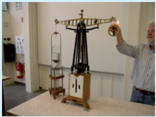

<details>
<summary>natural_image</summary>

Historic scientific instrument setup with a large cylindrical apparatus and a person holding a device (no visible text or symbols)
</details>

Waage im Gleichgewicht, Rad noch fixiert

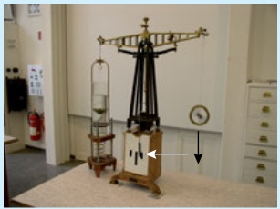

<details>
<summary>natural_image</summary>

Historical scientific apparatus setup with scale and instrument (no visible text or symbols)
</details>

Rad bewegt sich beschleunigt nach unten, der Zeiger schlägt nach rechts aus

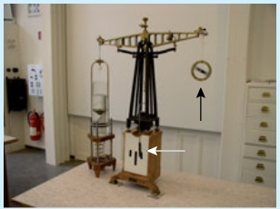

<details>
<summary>natural_image</summary>

Laboratory setup with a scientific apparatus and scale, no visible text or symbols
</details>

Rad bewegt sich verlangsamt nach oben, der Zeiger schlägt wieder nach rechts aus

Man kann die Bewegungsgleichung umschreiben und so eine andere Sicht gewinnen:

$$
\vec {a} = \frac {1}{m} \vec {F}, \tag {I-2.19}
$$

je größer also die Masse m ist, desto kleiner ist bei gegebener Kraft die Beschleunigung. Die Masse eines Körpers setzt also einer Bewegungsänderung einen Widerstand entgegen. Diese träge Masse $m _ { t }$ ist daher ein Maß für das Beharrungsvermö- gen des Körpers.

Wir schreiben also:

$$
\vec {F} = m _ {t} \vec {a}.
$$

---

2.2 Dynamik (dynamics)

41

Andererseits erfährt jeder Körper mit der trägen Masse $m _ { t }$ eine ‚Gewichtskraft‘ $\vec { F } _ { G }$ im Erdschwerefeld, die von der Substanzmenge und gemäß dem Newtonschen Gravitationsgesetz (siehe Anhang 1 ‚Gravitation und Planetenbewegung‘, A1.1: Das Gravitationsgesetz) von der Erdanziehung, also von $\vec { g }$ abhängt:

$$
\vec {F} _ {G} = m _ {s} \vec {g}. \tag {I-2.20}
$$

$\vec { g }$ ist also die Feldstärke $\vec { F }$ im Erdschwerefeld.

Hier ist $m _ { s }$ die schwere Masse (gravitational mass) und $\vec { g } = 9 \mathbf { , } 8 1$ m $s ^ { - 2 }$ die Erdbeschleunigung (gravitational acceleration) an der Erdoberfläche.

Bis vor Kurzem wurde die Einheit der schweren Masse (1 kg) durch einen Pt-Iridium Zylinder repräsentiert, der in Sèvres (bei Paris) aufbewahrt wurde. Seit 20. Mai 2019 wird die Einheit 1 kg über die Einheit $\mathrm { k g }   \mathrm { m } ^ { 2 } \mathrm { s } ^ { - 1 }$ definiert, wobei das Plancksche Wirkungsquantum h jetzt festgelegt ist:

$$
h = 6, 6 2 6 0 7 0 1 5 \cdot 1 0 ^ {- 3 4} \mathrm{kg} \mathrm{m} ^ {2} \mathrm{s} ^ {- 1} \Rightarrow 1 \mathrm{kg} = \frac {h}{6 , 6 2 6 0 7 0 1 5 \cdot 1 0 ^ {- 3 4}} \mathrm{m} ^ {- 2} \mathrm{s}.
$$

Das Beratungsgremium des „Bureau International des Poids et Mesures (BIPM)“, das $\bullet ^ { \prime }$ Consultative Committee for Mass and Related Quantities $( \mathrm { C C M } ) ^ { \infty }$ hat auch zwei Realisierungsmethoden vorgeschlagen, die Watt-Waage (Kibble-balance) und die Röntgenkristalldichtemessung (X-ray-crystal-density (XRCD) method). Siehe dazu das Kapitel „Einleitung“, Anhang 1: Definition der SI-Basiseinheiten.

Nehmen wir einen Körper mit dem Gewicht $\vec { F } _ { G } = m _ { s }   \vec { g }$ und lassen ihn fallen, so fällt er gemäß dem 2. Newtonschen Axiom beschleunigt:

$$
\vec {F} _ {G} = m _ {s} \vec {g} = m _ {t} \vec {a}.
$$

Die beobachtete Fallbeschleunigung ist also:

$$
\vec {a} = \frac {m _ {s}}{m _ {t}} \vec {g}.
$$

Sehr genaue Experimente, die schon von Newton mittels Pendelmessungen begonnen und schließlich 1909 von Eötvös (Loránd Eötvös, 1848–1919) und später 1964 von Dicke (Robert Henry Dicke, 1916–1997) verfeinert wurden (siehe Anhang 1 ‚Gravitation und Planetenbewegung‘, A1.4: Bestimmung der Gravitationskonstante), haben ergeben, dass am gleichen Ort der Erdoberfläche alle Körper gleich schnell fallen, dass also die Fallbeschleunigung keine Körpereigenschaft ist.

Es ergibt sich daher

$$
\frac {m _ {s}}{m _ {t}} = 1 \tag {I-2.21}
$$

---

42

2 Mechanik des Massenpunktes

als universelle Konstante. Das ist das Gesetz von der Äquivalenz der trägen und schweren Masse.<sup>16</sup> Wir brauchen daher im Folgenden nicht mehr zwischen träger und schwerer Masse zu unterscheiden, die Indizes t und s fallen weg. Eine bestimmte Substanzmenge (Masse) m wird demnach entweder durch ihr Gewicht oder durch ihre Trägheitswirkung (= Beschleunigung bei vorgegebener Kraft) gemessen.

Sind träge Masse $m _ { t }$ und schwere Masse $m _ { s }$ gleich, dann folgt aus dem Newtonschen Gravitationsgesetz (siehe Anhang A1.1), dass alle Körper gleich schnell fallen.

**Beispiel:** Die Äquivalenz von träger und schwerer Masse ergibt sich erst durch den experimentellen Befund, dass alle Körper gleich schnell fallen.

Das Newtonsche Gravitationsgesetz lautet (siehe Anhang A1.1):

$$
\left| \vec {F} \right| = \gamma \frac {m _ {1} m _ {2}}{r ^ {2}}.
$$

Wir lassen einen Körper mit der Masse $m _ { K }$ an der Erdoberfläche (Erdmasse $m _ { E } )$ fallen: mKt $\vec { a } = \gamma   \frac { m _ { K } ^ { s }   m _ { E } } { r ^ { ^ 2 } }$ Für $m _ { K } ^ { t } = m _ { K } ^ { s }$ fällt die Masse des Körpers aus der Gleichung und es gilt:

$$
\vec {a} = \vec {g} = \gamma \frac {m _ {E}}{r ^ {2}} = 6, 6 7 2 6 \cdot 1 0 ^ {- 1 1} \cdot \frac {5 , 9 7 5 \cdot 1 0 ^ {2 4}}{(6 , 3 7 6 \cdot 1 0 ^ {6}) ^ {2}} = 9, 8 0 7 \mathrm{ms} ^ {- 2}.
$$

Zum Vergleich: Normwert der Fallbeschleunigung $g_{n}=9,80665\mathrm{~m}\mathrm{~s}^{-2}$ exakt.

Der experimentelle Befund, dass alle Körper gleich schnell fallen, ist der Ausgangspunkt für die allgemeine Relativitätstheorie. Hier geht es um die Ununterscheidbarkeit zwischen der Kraftwirkung auf einen im Gravitationsfeld ruhenden Körper und jener auf einen Körper in einem gleichförmig beschleunigten Bezugssystem weit außerhalb jeder Gravitationswirkung. Das Einsteinsche Äquivalenzprinzip (nach Albert Einstein, 1879–1955) sagt, dass ein homogenes Gravitationsfeld völlig äquivalent zu einem gleichförmig beschleunigten Bezugssystem ist. Diese Aussage wird durch das Gedankenexperiment mit einem geschlossenen Fahrstuhl versinnbildlicht: Es ist für einen Beobachter im Fahrstuhl ununterscheidbar, ob der Fahrstuhl in einem Gravitationsfeld ruht oder ob er sich ohne jegliche Gravitationswirkung gleichförmig beschleunigt nach oben bewegt. Die Ergebnisse physikalischer Expe-

<small><span class="docvortex-page-footnote" data-block-type="page_footnote" style="color:#6b7280">16 Die relative Abweichung der schweren von der trägen Masse wird seit 2017 (Satellitenexperiment MICROSCOPE) kleiner als 10−15 angenommen. Der experimentelle Befund der Äquivalenz (= Gleichheit) von träger und schwerer Masse wurde später von Einstein zum Prinzip (Axiom) erhoben, dem Einsteinschen Äquivalenzprinzip der allgemeinen Relativitätstheorie.</span></small>

---

2.2 Dynamik (dynamics)

43

rimente sind gleich. Das ist der Ausgangspunkt für Einsteins allgemeine Relativitätstheorie, in der die Massenanziehung durch lokale Beschleunigungsfelder als Folge einer Raumkrümmung erklärt wird, die durch die Massenverteilung verursacht wird (Krümmung der Raum-Zeit).

## 3. Axiom (actio = reactio, Newton 3, lex tertia)

Wir nennen ein physikalisches System abgeschlossen, wenn auf die in ihm enthaltenen Massenpunkte nur innere Kräfte wirken, also Kräfte, die ihren Ursprung im System selbst besitzen, aber keine Kräfte von außen angreifen. Es gilt dann das 3. Newtonsche Axiom, das besonders für Systeme von MP wichtig ist (siehe Abschnitt 2.4 ‚Massenpunktsysteme und Erhaltungssätze‘):

In einem abgeschlossenen System treten Kräfte nur paarweise mit entgegengesetzter Größe auf.

1

In einem abgeschlossenen System ist daher die Summe aller Kräfte gleich Null.

## 2.2.2 Bahndrehimpuls und Drehmoment

Ein Teilchen bewege sich mit dem Impuls $\vec { p } = m \cdot \vec { \upsilon }$ auf einer Bahn $\vec { r } ( t )$

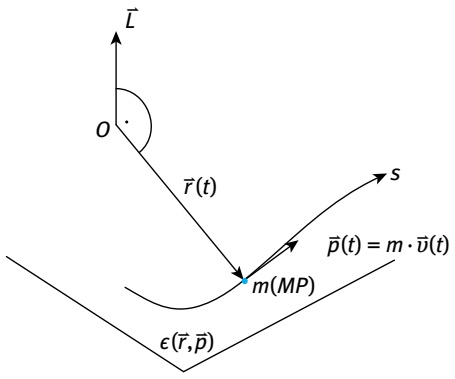

<details>
<summary>text_image</summary>

L
O
r̄(t)
m(MP)
ε(r, p̄)
s
p̄(t) = m · v̄(t)
</details>

Abb. I-2.7: Zum Bahndrehimpuls $\vec { L }$ eines Teilchens auf der Bahn $\vec { r } ( t )$

Wir definieren als Bahndrehimpuls (angular momentum) $\vec { L }$ in Bezug auf den Koordinatenursprung O (Abb. I-2.7):

$$
\vec {L} = \vec {r} \times \vec {p} = m (\vec {r} \times \vec {v}) \quad \text {Bahndrehimpuls.} \tag {I-2.22}
$$

Einheit: $[L]=1\  kg \  m ^{2}\  s ^{-1}=1\  Js$ .

---

44

2 Mechanik des Massenpunktes

Entsprechend der Definition des Vektorprodukts steht $\vec { L }$ senkrecht auf $\vec { r }$ und $\vec { p }$ Liegt die Bahn des Teilchens in einer Ebene $\varepsilon ( \vec { r } , \vec { p } )$ mit dem Koordinatenursprung $O ,$ so zeigt $\vec { L }$ immer in die gleiche Richtung senkrecht zu $\varepsilon ( \vec { r } _ { * } \vec { p } )$

Wir bilden die zeitliche Ableitung des Bahndrehimpulses und achten dabei auf das Vektorprodukt:

$$
\frac {d \vec {L}}{d t} = \dot {\vec {L}} = \underbrace {\frac {d \vec {r}}{d t}} _ {\substack {\vec {v} / / \vec {p} \\ = 0}} \times \vec {p} + \vec {r} \times \underbrace {\frac {d \vec {p}}{d t}} _ {\vec {F}}.
$$

$( \vec { r } \times \vec { F } ) = \vec { D }$ heißt Drehmoment (moment of a force) der Kraft in Bezug auf den Ursprung $O .$ Es bewirkt eine Änderung des Drehimpulses $\vec { L }$ analog zur $\ddot { \mathbf { A } }$ nderung des linearen Impulses $\vec { p }$ durch eine Kraft $\dot { \vec { p } } = \vec { F } ;$

$$
\vec {D} = \vec {r} \times \vec {F} = \dot {\vec {L}}. \tag {I-2.23}
$$

Einheit: [D] = 1 Nm = 1 J.

$\vec { D }$ und $\vec { L }$ sind axiale Vektoren, die bei einer Spiegelung am Ursprung (Paritätstransformation, Punktspiegelung) den Drehsinn beibehalten. $\vec { r } ,   \vec { \upsilon } ,   \vec { a } ,   \vec { F }$ sind polare Vektoren, die ihre Richtung bei einer Spiegelung am Ursprung umkehren. Siehe dazu auch Band VI, Kapitel „Materialphysik (Materials Science)“, Anhang 2.

Die Gl. I-2.23 ist unter anderem wichtig für die Planetenbewegung und die Keplerschen Gesetze (nach Johannes Kepler, 1571–1630).

## 1. Keplersches Gesetz

Die Planeten bewegen sich in einem Zentralkraftfeld, dem Gravitationsfeld der Sonne, bei dem die Kraft ständig auf einen Punkt weist, in diesem Fall dem Massenmittelpunkt der Sonne, und bei dem der Betrag der wirkenden Zentralkraft nur eine Funktion des Abstands von diesem Punkt ist. Wenn wir den Ursprung unseres Koordinatensystems in die Sonne legen, die wegen der großen Bahndurchmesser hier als ausdehnungslos behandelt werden kann, dann ist der Ortsvektor zu einem Planeten antiparallel zur Zentralkraft und es gilt $\vec { D } = 0 \Rightarrow \vec { L }$ = const. Die Planetenbewegung $\vec { r } ( t )$ erfolgt also nach Gl. I-2.23 in einer Ebene senkrecht zu $\vec { L }$ und es lässt sich zeigen, dass ihre geschlossenen Bahnkurven Ellipsen sind $^ { 1 7 }$ in deren einem Brennpunkt die Sonne steht (siehe Anhang A1.2: Das Keplerproblem).

<small><span class="docvortex-page-footnote" data-block-type="page_footnote" style="color:#6b7280">17 Im Falle des Newtonschen Gravitationsgesetzes ergibt sich als Bahnkurve eine Ellipse mit der Sonne in einem Brennpunkt, falls die Gesamtenergie des Systems negativ ist, es sich also um einen gebundenen Zustand handelt (siehe Anhang A1.2). Kometen, die ja nicht an die Sonne gebunden sind in deren einem Brennpunkt die Sonne steht (E > 0), beschreiben Hyperbelbahnen.</span></small>

---

2.2 Dynamik (dynamics)

45

## 2. Keplersches Gesetz (Flächensatz)

Es gilt für eine Zentralkraft:

$$
\vec {r} \times m \underbrace {\frac {d ^ {2} \vec {r}}{d t ^ {2}}} _ {\vec {F} \uparrow \downarrow \vec {r}} = m \cdot \vec {r} \times \frac {d ^ {2} \vec {r}}{d t ^ {2}} = 0 \quad \underset {m \neq 0} {\Rightarrow} \quad \vec {r} \times \frac {d ^ {2} \vec {r}}{d t ^ {2}} = 0
$$

und durch Integration

$$
\vec {r} \times \frac {d \vec {r}}{d t} = 2 \vec {c} = \text {const.} \tag {I-2.24}
$$

weil

$$
\frac {d}{d t} \Bigg (\vec {r} \times \frac {d \vec {r}}{d t} \Bigg) = \underbrace {\frac {d \vec {r}}{d t} \times \frac {d \vec {r}}{d t}} _ {= 0} + \underbrace {\vec {r} \times \frac {d ^ {2} \vec {r}}{d t ^ {2}}} _ {= 0} = 0.
$$

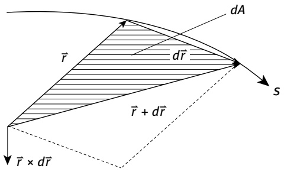

<details>
<summary>text_image</summary>

dA
r
d\u0305
r + d\u0305
S
\u0305 × d\u0305
</details>

Abb. I-2.8: Zum 2. Keplerschen Gesetz (Flächensatz).

Aus Abb. I-2.8 ist zu sehen:

$$
2 d A = \left| \vec {r} \times d \vec {r} \right|
$$

oder mit der orientierten Fläche $d { \vec { A } } : 2   d { \vec { A } } = { \vec { r } } \times d { \vec { r } } .$

Nach der Zeit differenziert erhalten wir ${ \frac { d { \vec { A } } } { d t } } = { \frac { 1 } { 2 } } \left( { \vec { r } } \times { \frac { d { \vec { r } } } { d t } } \right) = { \vec { c } } .$ , das ist die vom Radiusvektor (dem Fahrstrahl) in der Zeiteinheit überstrichene (orientierte) Fläche. $\vec { c } = \frac { d \vec { A } } { d t }$ nennt man die Flächengeschwindigkeit, sie ist bei der Zentralkräftebewegung zeitlich konstant. Anders formuliert: Der Fahrstrahl des Planeten zur Sonne überstreicht in gleichen Zeiten gleich große Flächenstücke.

---

46

2 Mechanik des Massenpunktes

## 3. Keplersches Gesetz

Das 3. Keplersche Gesetz, welches die Umlaufzeit eines Planeten mit der großen Halbachse a seiner Bahnellipse in Beziehung setzt, $\boldsymbol { T } ^ { 2 } = \boldsymbol { k } \cdot \boldsymbol { a } ^ { 3 } ,$ , wobei k eine Konstante des Planetensystems ist, wird in Anhang A1.2 besprochen.

Nach den Keplerschen Gesetzen betrachten wir auch noch den Bahndrehimpuls eines Teilchens, das sich auf einer geraden Bahn bewegt (Abb. I-2.9):

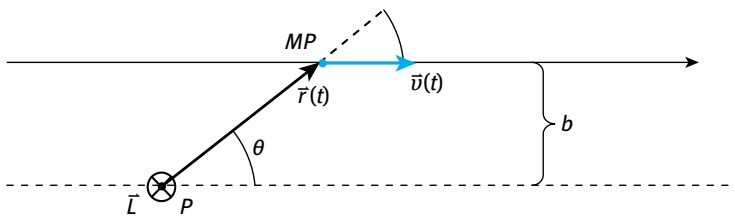

<details>
<summary>text_image</summary>

MP
r(t)
v(t)
θ
L̅ P
b
</details>

Abb. I-2.9: Zum Bahndrehimpuls L⇀eines Teilchens auf geradliniger Bahn.

Für den Bahndrehimpuls in Bezug auf den Beobachtungspunkt P gilt nach obiger Definition:

$\vec { L } = m ( \vec { r } \times \vec { v } ) \perp$ auf der von υ⇀und P gebildeten Ebene (hier in die Papierebene hinein). Für seinen Betrag erhalten wir entsprechend der Abb. I-2.9:

$$
\left| \vec {L} \right| = m \cdot r \cdot v \cdot \sin \theta = m \cdot r \cdot v \frac {b}{r} = m \cdot b \cdot v. \tag {I-2.25}
$$

## 2.2.3 Kraftstoß, Arbeit und Energie, Leistung

Wenn eine Kraft eine gewisse Zeit auf ein Teilchen einwirkt, ergeben sich zwei Ansätze:

1. Wir multiplizieren die Kraft mit der Zeit, in der sie wirkt
2. Wir multiplizieren die Kraft mit der Verschiebung des $M P ,$ die sie hervorruft.

ad 1: Zuerst bilden wir das Zeitintegral einer veränderlichen Kraft (Kraftstoß) durch Aufsummieren der Produkte aus Momentankraft und Zeitelement (Abb. I-2.10):

$$
\int_ {t _ {1}} ^ {t _ {2}} \vec {F} (\vec {r}) d t = \int_ {t _ {1}} ^ {t _ {2}} m \frac {d ^ {2} \vec {r}}{d t ^ {2}} d t = m \left(\frac {d \vec {r}}{d t}\right) _ {t _ {2}} - m \left(\frac {d \vec {r}}{d t}\right) _ {t _ {1}} = m (\vec {\upsilon} _ {2} - \vec {\upsilon} _ {1}) = \vec {p} _ {2} - \vec {p} _ {1}. \tag {I-2.26}
$$

---

2.2 Dynamik (dynamics)

47

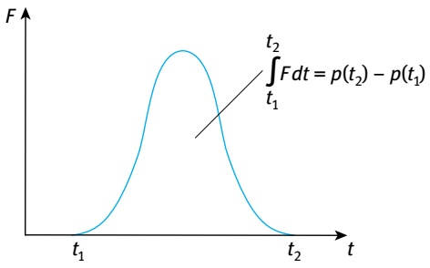

<details>
<summary>line</summary>

| Time | Value |
| --- | --- |
| t1 | 0 |
| Peak | ~Maximum |
| t2 | 0 |
</details>

Abb. I-2.10: Der Kraftstoß ist das Zeitintegral der Kraft.

Der Kraftstoß (= Zeitintegral der Kraft) stellt also die gesamte $\ddot { \mathbf { A } }$ nderung des Impulses während der Zeit $t _ { 2 } - t _ { 1 }$ dar.

Gilt für den anfänglichen Impuls $\vec { p } _ { 1 } = 0$ , ist also $\vec { \upsilon } _ { 1 } ( t = 0 ) = 0$ , so wird

$$
\int_ {t _ {1}} ^ {t _ {2}} \vec {F} d t = m \vec {\upsilon} = \vec {p}. \tag {I-2.27}
$$

Der Impuls (Bewegungsgröße, linear momentum) ist also gleich jenem Kraftstoß, der den gestoßenen Massenpunkt aus der Ruhe auf die Geschwindigkeit $\bar { v }$ bringt.

ad 2: Wir betrachten jetzt wieder die Bahnkurve, die ein Teilchen unter der Einwirkung einer Kraft beschreibt (Abb. I-2.11).

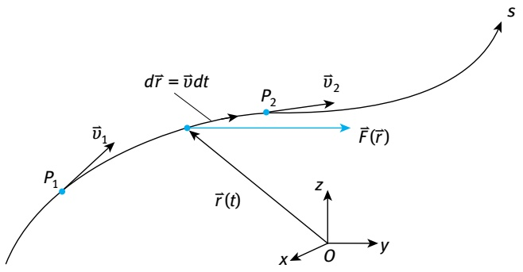

<details>
<summary>text_image</summary>

d\vec{r} = \vec{v}dt
P₁
\vec{v}_1
P₂
\vec{v}_2
\vec{F}(\vec{r})
\vec{r}(t)
z
x
O
y
s
</details>

Abb. I-2.11: Zur Definition der Arbeit: Bahnkurve eines Teilchens unter der Einwirkung einer Kraft.

Wir definieren als Arbeit dW der Kraft $\vec { F }$ am Teilchen bei einer Verschiebung um $d \vec { r }$ das Skalarprodukt

i

---

48

2 Mechanik des Massenpunktes

$$
d W = \vec {F} \cdot d \vec {r}, \tag {I-2.28}
$$

also ‚Kraft mal Verschiebung in Richtung der Kraft‘ oder ‚Verschiebung mal Kraft in Richtung der Verschiebun $\mathbf { g } ^ { \bullet }$ . Die Arbeit ist positiv, wenn $\vec { F }$ und $d \vec { r }$ einen spitzen Winkel bilden (cos $( \vec { r } , d \vec { r } ) < 1 )$

Um das Teilchen von $P _ { 1 }$ nach $P _ { 2 }$ zu verschieben, verrichtet die Kraft also die Arbeit

$$
W = \int_ {P _ {1}} ^ {P _ {2}} \vec {F} d \vec {r}. \tag {I-2.29}
$$

Einheit: $[W]=1\  Nm =1\  J$ (Joule, nach James Prescott Joule, 1818–1889, sprich: ‚tschul‘).

## 1 Die Arbeit am Teilchen ist das Wegintegral der Kraft.

Es wird über die Skalarprodukte der Vektoren $\vec { F }$ und $d \vec { r }$ aufsummiert, daher verschwindet das Wegintegral der Kraft, also die Arbeit, wenn die wirkende Kraft $\vec { F }$ normal auf der Verschiebung $d \vec { r }$ steht (z. B. bei der Verschiebung eines MP horizontal zur Erdoberfläche).

Wir berechnen jetzt unter Verwendung des 2. Newtonschen Axioms die Beschleunigungsarbeit der Kraft am Teilchen

$$
\begin{array}{l} W = \int_ {P _ {1}} ^ {P _ {2}} \vec {F} d \vec {r} = m \int_ {P _ {1}} ^ {P _ {2}} \frac {d \vec {v}}{d t} d \vec {r} = m \int_ {P _ {1}} ^ {P _ {2}} \frac {d \vec {v}}{d t} \underbrace {\frac {d \vec {r}}{d t}} _ {\vec {v}} d t = m \int_ {v _ {1}} ^ {v _ {2}} \vec {v} d \vec {v} = \frac {1}{2} m v ^ {2} \Bigg | _ {v _ {1}} ^ {v _ {2}} = \\ = \frac {1}{2} m (\upsilon_ {2} ^ {2} - \upsilon_ {1} ^ {2}) = E _ {\mathrm{kin2}} - E _ {\mathrm{kin1}} = \Delta E _ {\mathrm{kin}}. \tag {I-2.30} \\ \end{array}
$$

und definieren als kinetische Energie (kinetic energy)

$$
E _ {\mathrm{kin}} = \frac {1}{2} m v ^ {2} = \frac {p ^ {2}}{2 m}. \tag {I-2.31}
$$

Einheit: $[ E _ { \mathrm { k i n } } ] = 1 ]$ .

Die Arbeit am Teilchen erhöht $( \angle ( \vec { F } , d \vec { r } )$ spitz) oder verringert $( \angle ( \vec { F } ,   d \vec { r } )$ stumpf) seine kinetische Energie. Für ein freies Teilchen gilt daher: Arbeit ist gleich der Energieänderung des Teilchens.

---

2.2 Dynamik (dynamics)

49

Wenn insbesondere für die Anfangsgeschwindigkeit des Teilchens $\nu _ { 1 } = 0$ gilt, dann ist die gesamte Energieänderung $\Delta E_{\mathrm{kin}} = \sqrt[1]{2 m v^{2}}$ Aufgrund seiner Bewegung hat das Teilchen also Arbeitsfähigkeit erlangt, da die kinetische Energie wieder zur Verrichtung von Arbeit genützt werden kann (z. B. die kinetische Energie des Wassers in einer Turbine).

Es lassen sich zwei große Klassen von Kraftfeldern unterscheiden:

konservative Kraftfelder,

bei denen die Arbeit zur Verschiebung des MP zwischen zwei seiner Lagen unabhängig vom Weg ist und die mechanische Energieänderung daher in jedem Fall gleich ist; bei einem geschlossenen Weg ist die Energieänderung Null (siehe unten), die Gesamtenergie bleibt also erhalten (conserved);

nichtkonservative Kraftfelder,

bei denen die Arbeit zwischen zwei Lagen des MP vom Weg abhängt und somit die mechanische Energie zumindest teilweise irreversibel in Wärmeenergie verwandelt wird.

Wir definieren ein Kraftfeld als konservativ, wenn die Arbeit bei der Verschiebung des MP vom Punkt $P _ { 1 }$ zum Punkt $P _ { 2 }$ vom Verschiebungsweg unabhängig ist.

Diese Bedingung für das Vorliegen eines konservativen Kraftfeldes kann dann auch so geschrieben werden:

$$
\oint \vec {F} d \vec {r} = 0. \tag {I-2.32}
$$

Begründung: Wir betrachten die Arbeit für die Verschiebung eines Teilchens zwischen zwei Punkten $P _ { 1 }$ und $P _ { 2 }$ längs zweier unterschiedlicher Wege entsprechend Abb. I-2.12.

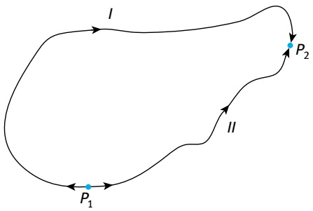

<details>
<summary>flowchart</summary>

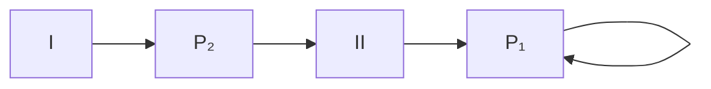
</details>

Abb. I-2.12: Zur Definition eines konservativen Kraftfeldes.

---

50

2 Mechanik des Massenpunktes

Im konservativen Kraftfeld muss gelten: $W _ { \mathrm { I } } = W _ { \mathrm { I I } }$ oder $W _ { \mathrm { I } } - W _ { \mathrm { I I } } = 0$ , daher folgt

$$
\underbrace {\int_ {P _ {1}} ^ {P _ {2}} \vec {F} d \vec {r}} _ {W _ {\mathrm{I}}} - \underbrace {\int_ {P _ {1}} ^ {P _ {2}} \vec {F} d \vec {r}} _ {W _ {\mathrm{II}}} = \int_ {P _ {1}} ^ {P _ {2}} \vec {F} d \vec {r} + \int_ {P _ {2}} ^ {P _ {1}} \vec {F} d \vec {r} = \oint \vec {F} d \vec {r} = 0. \tag {I-2.33}
$$

Das heißt:

Wenn wir das Teilchen in einem konservativen Kraftfeld so verschieben, dass es wieder zum Ausgangspunkt gelangt (geschlossener Weg), so müssen wir nur vorübergehend Arbeit verrichten, die aber später durch die Wirkung der Kraft zurückgewonnen wird. Insgesamt wird keine Arbeit verrichtet.

Anders sieht es in einem nichtkonservativen Kraftfeld aus: Hier wird eine einmal verrichtete Arbeit bei der Rückkehr zum Ausgangspunkt der Verschiebung z. B. durch Reibungseffekte (= Dissipation) nicht mehr vollständig zurück gewonnen.

**Beispiel:** Die Reibungskraft $\vec { F } _ { R }$ sei der Geschwindigkeit $\bar { v }$ proportional und entgegengesetzt gerichtet (Newtonsches Reibungsgesetz). Dann gilt: $\vec { F } _ { R } = - \boldsymbol { \beta } \cdot \vec { \upsilon }$

Daraus folgt für die Arbeit $W _ { \mathsf { O } }$ auf einem geschlossenen Weg:

$$
W _ {\mathrm{O}} = \oint \vec {F} _ {R} d \vec {r} = - \beta \oint \vec {v} \frac {d \vec {r}}{d t} \cdot d t = - \beta \oint v ^ {2} d t <   0.
$$

Diese Arbeit wird vom Teilchen verloren sodass die mechanische Gesamtenergie abnimmt (nicht aber die Energie insgesamt, da thermische Energie gewonnen wird). Soll die mechanische Energie, also die Geschwindigkeit des Teilchens, erhalten bleiben, dann muss die verlorene Energie von anderen konservativen Kräften aufgebracht werden. So wird z.B. beim unbeschleunigten Fall einer Kugel in einer zähen Flüssigkeit die Reibungsenergie durch die konservative Schwerkraft kompensiert: Die Geschwindigkeit der Kugel bleibt konstant, da die „verlorene“ Reibungsenergie von der Gravitationsenergie nachgeliefert wird. Vergleiche dazu den Millikan-Ehrenhaft-Versuch In Band III, Kapitel „Elektrostatik“, Abschnitt 1.1.2.

1

Wir erinnern uns an den Satz von Stokes aus der Vektoranalysis:

$$
\oint \vec {F} d \vec {r} = \int \operatorname{rot} \vec {F} d \vec {f}   _ {C = R a n d v o n A} \quad F l ä c h e A
$$

Daraus ergibt sich die Bedingung für ein konservatives Kraftfeld auch zu:

$$
\mathrm{rot} \vec {F} = \underbrace {\mathrm{curl} \vec {F}} _ {\text {engl.}} = \vec {\nabla} \times \vec {F} = 0, \tag {I-2.34}
$$

---

2.2 Dynamik (dynamics)

51

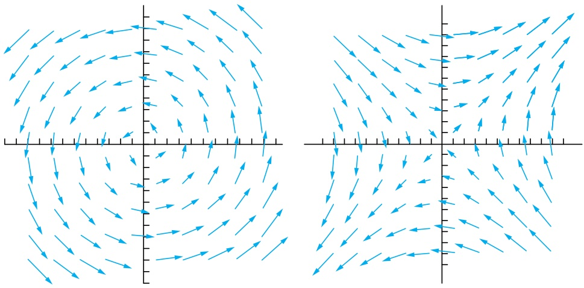

Abb. I-2.13: Beispiel eines nicht-konservativen Kraftfeldes (Wirbelkern): rot $\vec { F } = \vec { \nabla } \times \vec { F } \neq 0$ $\oint \vec{F}   d\vec{r} \neq 0$ (links) und eines konservativen Kraftfeldes (Quadrupol): rot F⇀= ∇⇀ × F⇀= 0 , ∮ F⇀dr⇀= 0 (rechts).

das heißt, ein konservatives Kraftfeld muss wirbelfrei sein.<sup>18</sup> Dabei bedeutet in bekannter Weise $\vec { \nabla } = \vec { e } _ { x }   \frac { \partial } { \partial x } + \vec { e } _ { y }   \frac { \partial } { \partial y } + \vec { e } _ { z }   \frac { \partial } { \partial z }$ den Nablaoperator.

Beispiele konservativer und nichtkonservativer Kraftfelder (siehe auch Abb. I-2.13):

| - konservativ | - homogenes Kraftfeld- zeitunabhängiges Zentralkraftfeld,z. B. das Feld einer Punktmasse (oder einer Punktladung) |
| --- | --- |
| - nichtkonservativ | - allgemeines ortsabhängiges Kraftfeld- zeitabhängige Kraftfelder- Kraftfelder in denen eine zusätzliche Kraft auftritt,die von der Geschwindigkeit abhängt (dissipative Kraft) |

In einem konservativen Kraftfeld ist also die Arbeit vom Verschiebungsweg des Teilchens zwischen zwei festen Punkten unabhängig, sie hängt daher nur vom Anfangs- und vom Endzustand ab. In diesem Fall können wir also jedem Punkt des Kraftfeldes den Wert jener Arbeit zuschreiben, die notwendig ist, um das Teilchen von einem willkürlich gewählten Nullpunkt zum entsprechenden Raumpunkt zu verschieben. Damit haben wir eine wesentliche Erleichterung für die Charakterisie rung des Kraftfeldes erzielt: Während wir bisher das Kraftfeld durch Kraftvektoren

<small><span class="docvortex-page-footnote" data-block-type="page_footnote" style="color:#6b7280">18 Diese Aussage gilt nur für einfach-zusammengängende Bereiche, deren Randkurve sich stetig auf einen Punkt zusammenziehen lässt.</span></small>

---

52

2 Mechanik des Massenpunktes

(Zahlentripel) beschreiben mussten, können wir ein konservatives Kraftfeld jetzt durch eine skalare Ortsfunktion (einfache Zahl) V(r⇀) beschreiben, nämlich den Wert der Verschiebungsarbeit vom Nullpunkt ausgehend. Wir nehmen allerdings konventioneller Weise den negativen Arbeitswert <sup>19</sup> und nennen ihn potenzielle Energie ( potential energy) $V = E _ { \mathrm { p o t } } = - \int \limits _ { 0 } ^ { P } \vec { F } \cdot d \vec { r } .$ . Für die Verschiebung von $P _ { 1 }$ nach $P _ { 2 }$ ergibt sich folgender Arbeitswert $\left( \mathbb{W} > 0 ; \right.$ Arbeit wird abgegeben, $W < 0 ;$ : Arbeit ist aufzuwenden):<sup>20</sup>

$$
W = \int_ {P _ {1}} ^ {P _ {2}} \vec {F} d \vec {r} = \int_ {P _ {1}} ^ {P _ {2}} - d V = \underbrace {V (P _ {1})} _ {E _ {\mathrm{pot}} (P _ {1})} - \underbrace {V (P _ {2})} _ {E _ {\mathrm{pot}} (P _ {2})} = - \Delta V = - \Delta E _ {\mathrm{pot}}. \tag {I-2.35}
$$

Die potenzielle Energie als Funktion des Ortes stellt ein skalares Feld $V ( \vec { r } )$ dar, das Feld der potenziellen Energie ( potential energy field).

Wichtig ist, dass offensichtlich nur Differenzen $\Delta V = \Delta E _ { \mathrm { p o t } }$ auftreten, der Nullpunkt kann frei (sinnvoll) gewählt werden.

**Beispiel:** Sinnvoller Nullpunkt für Experimente in denen die Schwerkraft wirkt: $\vec { F } = \{ 0 , 0 , - m g \}$ , wir wählen hier $V = 0$ für $z = 0$ (Bodenniveau).

Die Bedingung für ein konservatives Kraftfeld war (Gln. I-2.32 und I-2.34):

$$
\oint \vec {F} d \vec {r} = 0 \quad \Leftrightarrow \quad \mathrm{rot} \vec {F} = 0.
$$

1

Ein Satz aus der Vektoranalysis führt uns weiter:

$$
\mathrm{rot} (\mathrm{grad} u) = \vec {\nabla} \times \vec {\nabla} u \equiv 0.
$$

Das heißt, eine Kraft ist sicher konservativ, wenn sie sich als Gradient einer skalaren Funktion darstellen lässt. Wir können als Skalarfeld das eben betrachtete Feld der potenziellen Energie $V ( \vec { r } )$ nehmen und daraus immer das zugehörige konserva-

<small><span class="docvortex-page-footnote" data-block-type="page_footnote" style="color:#6b7280">19 Die Wahl des negativen Vorzeichens bei der Definition des Potenzials V als Verschiebungsarbeit im Feld bewirkt, dass Verschiebungen in Richtung des Feldes (F⇀// dr⇀), also vom Feld verursachte Bewegungen, immer vom höheren zum niedrigeren Potenzial verlaufen, die Bewegung also „bergab“ erfolgt. Die Kraft F⇀weist immer vom höheren zum niedrigeren Potenzial (siehe dazu auch Anhang A1.2).</span></small>

<small><span class="docvortex-page-footnote" data-block-type="page_footnote" style="color:#6b7280">P<sub>2</sub> 20 Da ∫F⇀dr⇀ vom Weg unabhängig ist, muss der Integrand F⇀dr⇀ ein totales Differential sein, P<sub>1</sub> wir bezeichnen es mit −dV.</span></small>

---

2.2 Dynamik (dynamics)

53

tive Kraftfeld bilden. Dazu erinnern wir uns zuerst, wie der Gradient definiert ist: Bei einer kleinen Verschiebung des Teilchens im Feld um $d \vec { r }$ ändert sich die Funktion der potenziellen Energie um $d V = d { \vec { r } }$ ⋅ grad $V$

Vergleichen wir dies mit der Definitionsgleichung für die potenzielle Energie funktion $V ( \vec { r } )$ , also $d W = - d V = { \vec { F } } \cdot d { \vec { r } }$ , so erkennen wir den Zusammenhang zwischen der potenziellen Energie und der zugehörigen konservativen Kraft:

$$
\vec {F} = - \operatorname{grad} V = - \vec {\nabla} V. \tag {I-2.36}
$$

Die Einführung der potenziellen Energie im konservativen Kraftfeld hat also eine wichtige Bedeutung: Wenn es gelingt, das Feld der potenziellen Energie einer vorgegebenen Massenverteilung (in der Elektrostatik: einer Ladungsverteilung) z. B. aus Punktmassen (Punktladungen), aufzubauen, dann können wir das Kraftfeld durch das skalare Feld der potenziellen Energie vollständig beschreiben und den Kraftvektor an jeder Stelle des Raumes durch negative Gradientenbildung aus der potenziellen Energie erhalten!<sup>21</sup>

Die Leistung einer mechanischen Arbeit beschreibt, in welcher Zeit ein Arbeitsprozess abläuft, sie gibt also die Arbeitsrate an, d. h. die pro Zeiteinheit verrichtete Arbeit:

$$
P = \frac {d W}{d t} \quad \text {Augenblicksleistung.} \tag {I-2.37}
$$

Mit $W = \int \limits _ { P _ { 1 } } ^ { P _ { 2 } } \vec { F } d \vec { r } \Rightarrow d W = \vec { F }$ ⋅dr⇀und daher

$$
P = \frac {d W}{d t} = \vec {F} \cdot \vec {v}. \tag {I-2.38}
$$

υ ist die Geschwindigkeit des Teilchens, an dem die Kraft $\vec { F }$ die Arbeit dW in der Zeit dt verrichtet.

## 2.2.4 Erhaltung der mechanischen Gesamtenergie

Die Arbeit, die bei der Verschiebung des Teilchens im Kraftfeld verrichtet wird, ist im Falle eines freien Teilchens auf zweifache Weise, nämlich aus der Beschleuni-

<small><span class="docvortex-page-footnote" data-block-type="page_footnote" style="color:#6b7280">21 Man führt dazu das Potenzial $\Phi = \operatorname* { l i m } _ { m \to 0 }   { \frac { V } { m } }$ als potenzielle Energie pro Masseneinheit einer ‚Probemasse‘ ein (siehe auch Anhang A1.2). Die Vorgehensweise wird von der ‚Potenzialtheorie‘ beschrieben (Lösung der Laplace- bzw. Poissongleichung, siehe dazu auch Band III, Kapitel ‚Elektro-F⇀ statik‘, Abschnitt 1.3). Die Kraft pro Masseneinheit wird als Feldstärke E⇀= lim bezeichnet (im m%0m elektrischen Feld ist die Masse m durch die Ladung q zu ersetzen).</span></small>

---

54

2 Mechanik des Massenpunktes

gungsarbeit und aus der $\ddot { \mathbf { A } }$ nderung der potenziellen Energie darstellbar (Gln. I-2.30 und I-2.35):

$$
W = \int_ {P _ {1}} ^ {P _ {2}} \vec {F} d \vec {r} = \frac {1}{2} m (\nu_ {2} ^ {2} - \nu_ {1} ^ {2}) = E _ {\mathrm{kin}} (P _ {2}) - E _ {\mathrm{kin}} (P _ {1}) = - \Delta V = V (P _ {1}) - V (P _ {2}). \tag {I-2.39}
$$

Daraus folgt der Energiesatz der klassischen Mechanik:

$$
E _ {\mathrm{kin}} (P _ {1}) + V (P _ {1}) = E _ {\mathrm{kin}} (P _ {2}) + V (P _ {2}) = E _ {\mathrm{ges}} = \text {const.} \tag {I-2.40}
$$

1

Bei konservativen Kräften bleibt die Summe aus kinetischer und potenzieller Energie, d. h. die mechanische Gesamtenergie, zeitlich konstant.

**Beispiel:** Der senkrechte Wurf. Wirkende Kraft: $\vec { F } _ { G } = - m   g   \vec { e } _ { z }$

Wir werfen einen Körper (Reibung vernachlässigt) senkrecht um eine Strecke h nach oben in Richtung der positiven $z - \mathbf { A }$ chse. Die Anfangsgeschwindigkeit $\upsilon _ { 0 }$ zum Zeitpunkt $t = 0$ am Punkt $P _ { 0 }$ wird von außen aufgebracht.

1. Der Körper hat bei $P _ { 0 }$ die Anfangsgeschwindigkeit $\vec { \upsilon } _ { 0 } : E _ { \mathrm { k i n } } ( P _ { 0 } ) = \frac { m   \upsilon _ { 0 } ^ { 2 } } { 2 }$ .

Wir legen den Nullpunkt der potenziellen Energie in $P _ { 0 } ~ ( z = 0 )$ Es gilt also $E _ { \mathrm { p o t } } ( 0 ) = 0$

2. Weg von $P _ { 0 }$ zum Punkt $\mathbf { P } _ { z }$ unterhalb vom Scheitelpunkt $P _ { S }$

$$
W _ {1} = \int_ {P _ {0}} ^ {P z} \vec {F} _ {G} d \vec {r} = F _ {G} \int_ {0} ^ {z} d z = - m g z \quad E _ {\text {pot}} = - \int_ {P _ {0}} ^ {P z} \vec {F} _ {G} d \vec {r} = - F _ {G} \int_ {0} ^ {z} d z = m g z.
$$

Dem Körper wird von der wirkenden Kraft Energie in Form von kinetischer Energie entzogen (die Steiggeschwindigkeit nimmt ab) und in potenzielle Energie umgewandelt $( \mathsf { W } _ { 1 } < 0 )$

3. Körper am Scheitelpunkt $P _ { S } \left( z = h \right)$ : hier ist $\nu = 0$ also $E _ { \mathrm { k i n } } = 0$ die gesamte kinetische Energie wurde aufgebraucht.

Für die potenzielle Energie gilt:

$$
E _ {\mathrm{pot}} = - W _ {1} = - \int_ {P _ {0}} ^ {P _ {S}} \vec {F} _ {G} d \vec {r} = + m g h \quad (W _ {1} <   0),
$$

die gesamte kinetische Energie wurde in potenzielle Energie umgewandelt! Energiesatz:

$$
\frac {m v _ {0} ^ {2}}{2} + 0 = 0 + m g h.
$$

---

2.3 Bezugssysteme und Trägheitskräfte

55

4. Weg von $P _ { S }$ zurück nach $P _ { 0 } ;$ Hier erfolgt die Energieumwandlung in umgekehrter Reihenfolge wie unter 2):

$$
W _ {2} = \int_ {P _ {S}} ^ {P z} \vec {F} _ {G} d \vec {r} = F _ {G} (z - h) = - m g (z - h) \quad \left(W _ {2} > 0\right).
$$

Während der der Körper fällt, wird also von der Kraft an ihm Arbeit verrichtet, dem Körper wird kinetische Energie auf Kosten der potenziellen Energie zugeführt (die Fallgeschwindigkeit nimmt zu).

5. Der Körper ist wieder bei $P _ { 0 } ;$ Seine Geschwindigkeit ist jetzt $- \vec { v } _ { 0 }$ , er hat daher wieder die kinetische Energie $E _ { \mathrm { k i n } } ( P _ { 0 } ) = \frac { m   v _ { 0 } ^ { 2 } } { 2 }$

Die gesamte potenzielle Energie, die der Körper am Scheitelpunkt hatte, wurde wieder vollständig (reibungsfreier Idealfall) in kinetische Energie umgewandelt.

Energiesatz:

$$
0 + m g h = \frac {m v _ {0} ^ {2}}{2} + 0.
$$

## 2.3 Bezugssysteme und Trägheitskräfte

## 2.3.1 Inertialsysteme, Galilei-Transformation

Die Angabe der Bahn und der Geschwindigkeit eines Teilchens setzen, wie wir bereits gesehen haben, ein Bezugssystem (Koordinatensystem) voraus. In der Physik Newtons gibt es den absoluten Raum, der sich immer gleich und unbeweglich im Hintergrund befindet, und die absolute Zeit, die auch ohne die Existenz von Uhren gleichmäßig fließt.

Als Inertialsystem bezeichnen wir Systeme, in denen Newtons Trägheitssatz (1. Axiom) gilt. Bezugssysteme, die sich relativ zu einem Inertialsystem mit gleichförmiger Geschwindigkeit geradlinig bewegen, sind ebenfalls Inertialsysteme.<sup>22</sup> Wir werden aber sehen, dass in beschleunigten Bezugssystemen der Trägheitssatz

<small><span class="docvortex-page-footnote" data-block-type="page_footnote" style="color:#6b7280">22 Es hängt vom jeweiligen Experiment (seiner zeitlichen und räumlichen Ausdehnung) ab, welches Bezugssystem als Inertialsystem betrachtet werden kann, wieweit also Trägheitskräfte vernachlässigt werden können. Für viele kurz dauernde Experimente mit kleinen Geschwindigkeiten reicht es aus, die Erdoberfläche als Inertialsystem zu betrachten. Für anspruchsvolle astronomische Untersuchungen wird ein Inertialsystem verwendet, das von 3 nicht-komplanaren Fixsternen aufgespannt wird (‚galaktisches System‘). Noch eine Anmerkung: In der heutigen, der allgemeinen Relativitätstheorie entsprechenden Sicht, gibt es kein (globales) Inertialsystem, d. h. der Trägheitssatz gilt nicht! Das ist eine Konsequenz der Wirkung der Gravitation. Nur in begrenzten Raumgebieten und für beschränkte Zeiten kann man lokale Inertialsysteme betrachten.</span></small>

---

56

2 Mechanik des Massenpunktes

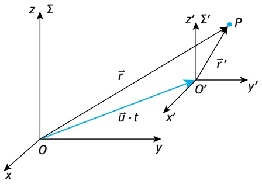

<details>
<summary>text_image</summary>

z
Σ
z' Σ'
P
r̅
ū · t
O'
x'
y'
O
x
y
</details>

Abb. I-2.14: Zur Galilei-Transformation: Das System Σ′ bewegt sich zum System Σ mit konstanter Relativgeschwindigkeit $\vec { u }$

nicht gilt, sondern dass eine Beschleunigung des Teilchens beobachtet wird, obwohl keine (physikalische) Kraft (fundamentale WW) wirkt. Es treten also in den beschleunigten Bezugssystemen Schein- oder Trägheitskräfte (inertial forces) auf.

Wir betrachten zuerst zwei Bezugssysteme Σ und $\Sigma ^ { \prime } ,$ von denen eines ruht (Σ) und das andere (Σ′) sich dazu mit konstanter Geschwindigkeit u⇀(Relativgeschwindigkeit) bewegt (Abb. I-2.14).

Es gilt die Galilei-Transformation (nach Galileo Galilei, 1564–1642):

$$
\vec {r} ^ {\prime} = \vec {r} - \vec {u} \cdot t = \left\{ \begin{array}{l} x ^ {\prime} (t) = x (t) - u _ {x} \cdot t \\ y ^ {\prime} (t) = y (t) - u _ {y} \cdot t \\ z ^ {\prime} (t) = z (t) - u _ {z} \cdot t \\ t ^ {\prime} = t \quad (\text {gleichgehende Uhren in beiden Systemen}) \end{array} \right. \tag {I-2.41}
$$

Falls die Relativgeschwindigkeit u⇀der beiden Systeme längs der x-Achse auftritt $( u _ { y } = u _ { z } = 0 )$ lässt sich die Galilei-Transformation elegant in einem x-t-Diagramm geometrisch veranschaulichen. Für $t = t ^ { \prime } = 0$ sollen einfachheitshalber die Koordinatenanfangspunkte beider Systeme zusammenfallen. Die $t ^ { \prime } -$ Achse ist gegenüber der t-Achse entsprechend der Relativgeschwindigkeit $u _ { x }$ geneigt, die x-Achsen fallen zusammen (Abb. I-2.15). Die beiden Systeme sind gleichwertig, welches von beiden als „ruhend“ betrachtet wird, ist willkürlich. Dieses Diagramm wird später (Band II, Kapitel „Relativistische Mechanik“) für sehr große Geschwindigkeiten $u _ { x } \sim c$ , c = Lichtgeschwindigkeit, zum Minkowskidiagramm erweitert.

Wie sehen die Geschwindigkeit, die Beschleunigung und die Kraft im gleichförmig bewegten System $\Sigma ^ { \prime }$ aus?

$$
\begin{array}{l} \vec {v} = \frac {d \vec {r}}{d t}, \quad \vec {v} ^ {\prime} = \frac {d \vec {r} ^ {\prime}}{d t} = \frac {d \vec {r}}{d t} - \vec {u} = \vec {v} - \vec {u} \\ \vec {a} = \frac {d \vec {v}}{d t}, \quad \vec {a} ^ {\prime} = \frac {d \vec {v} ^ {\prime}}{d t} = \frac {d \vec {v}}{d t} = \vec {a}, \quad \mathrm{da} \quad \frac {d \vec {u}}{d t} = 0 \quad (\vec {u} = \text {const.}) \\ \end{array}
$$

$\begin{array} { r l } { \Rightarrow \; } & { { } { \vec { F } } ^ { \prime } = { \vec { F } } } \end{array}$ Die Kräfte sind in beiden Systemen gleich, daher beobachtet man auch in beiden Systemen dieselben physikalischen Gesetze, beide sind daher, wie bereits oben behauptet, Inertialsysteme.

---

2.3 Bezugssysteme und Trägheitskräfte

57

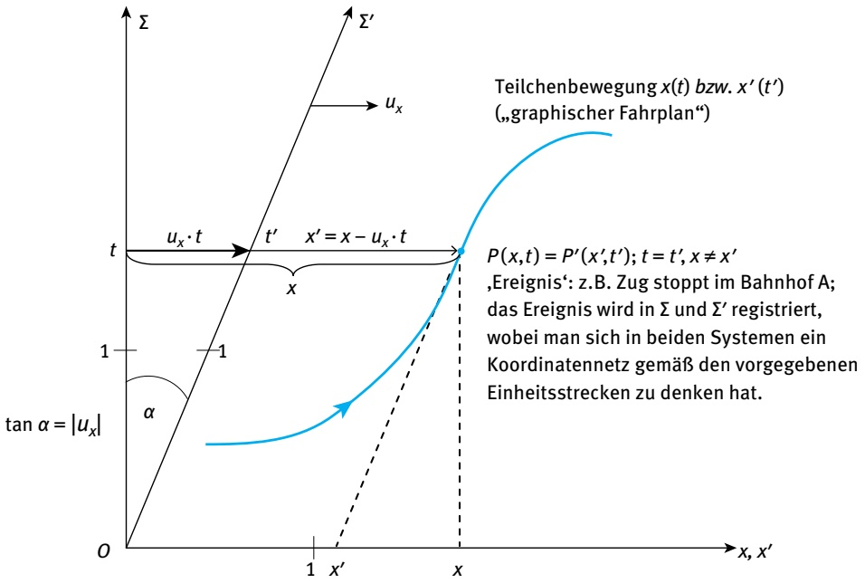

<details>
<summary>line</summary>

| Variable | Value |
| --- | --- |
| x' | 1 |
| x | 1 |
| \(\Sigma\) | 1 |
| \(\Sigma'\) | 1 |
</details>

Abb. I-2.15: Graphische Darstellung der Galilei-Transformation. Die Einheitslängen auf den Zeitachsen sind in beiden Systemen verschieden, die Maßstäbe für die Länge sind in beiden Systemen gleich. Das wird sich bei $u \approx c$ ändern! (Siehe Band II, Kapitel „Relativistische Mechanik“.)

Damit auch die Bewegungsabläufe in beiden Systemen gleich sind, müssen natürlich die Anfangsbedingungen in beiden Systemen gleich sein.

**Beispiel:** Ein am Bahnsteig lotrecht nach oben geworfener Stein $( \upsilon _ { x 0 } = 0 )$ zeigt, vom fahrenden Zug aus beobachtet, eine nach unten offene Wurfparabel, da er in diesem System die horizontale Anfangsgeschwindigkeit $\nu _ { y 0 } ^ { \prime } = - w ( w = \mathrm { Z u g } )$ geschwindigkeit) besitzt.

Ein im $Z   u g$ lotrecht nach oben geworfener Stein $\left( \upsilon _ { x 0 } ^ { \prime } = 0   \right)$ vollführt wieder eine geradlinige Bewegung ‚im Zugsystem‘, so wie der am Bahnsteig (Labor system) lotrecht geworfene Stein vom Bahnsteig aus beobachtet. Die Anfangsbedingungen sind in diesem Fall in beiden Systemen gleich $\left( \nu _ { x 0 } = \nu _ { x 0 } ^ { \prime } = 0 , \nu _ { y 0 } = \right.$ $\nu _ { y 0 } ^ { \prime } )$ , daher ist auch die Bahn des Steins in beiden Systemen gleich.

## 2.3.2 Geradlinig beschleunigte Bezugssysteme

Als Beispiel für $\Sigma ^ { \prime }$ wählen wir in diesem Fall den frei fallenden Fahrstuhl (Abb. I-2.16), den „fallenden Kasten“ (g … Betrag der Erdbeschleunigung):

---

58

2 Mechanik des Massenpunktes

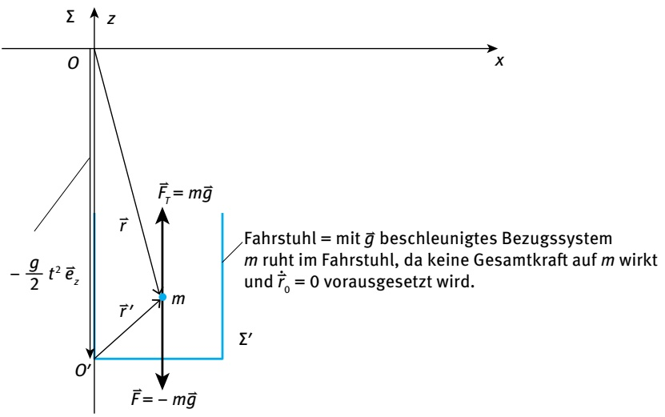

<details>
<summary>text_image</summary>

Σ
z
O
x
- g/2 t² e_z
r̅
F_T = m g̅
m ruht im Fahrstuhl, da keine Gesamtkraft auf m wirkt und r̂_0 = 0 vorausgesetzt wird.
Σ'
O'
F = - m g̅
Fahrstuhl = mit g̅ beschleunigtes Bezugssystem
m ruht im Fahrstuhl, da keine Gesamtkraft auf m wirkt und r̂_0 = 0 vorausgesetzt wird.
</details>

Abb. I-2.16: Der im Erdschwerefeld frei fallende Fahrstuhl ist ein Beispiel für ein geradlinig beschleunigtes Bezugssystem.

$$
\vec {r} ^ {\prime} = \vec {r} - \left(- \frac {1}{2} g t ^ {2} \vec {e} _ {z}\right), \quad \dot {\vec {r}} ^ {\prime} = \dot {\vec {r}} + g t \vec {e} _ {z}, \quad \ddot {\vec {r}} ^ {\prime} = \ddot {\vec {r}} + g \vec {e} _ {z}. \tag {I-2.42}
$$

Daraus ergibt sich die wirkende Kraft in $\Sigma ^ { \prime } ;$

$$
\vec {F} ^ {\prime} = m \ddot {\vec {r}} ^ {\prime} = \vec {F} + m g \vec {e} _ {z} = \underbrace {- m g \vec {e} _ {z}} _ {\text {Schwerkkraft}} + \underbrace {m g \vec {e} _ {z}} _ {\text {Trägheitskraft} F _ {T}} = 0 \tag {I-2.43}
$$

Es tritt im Fahrstuhl also eine zusätzliche Trägheitskraft auf, die die Schwerkraft $( - m g   \vec { e } _ { z } )$ gerade aufhebt! Die Trägheitskraft ist der Beschleunigung des Bezugssystems immer entgegengerichtet.

Allgemein gilt: Falls das System $\Sigma ^ { \prime }$ eine beschleunigte Bewegung gegenüber Σ ausführt, dann folgt aus $\vec { \upsilon ^ { \prime } } = \vec { \upsilon } - \vec { u }$

$$
\frac {d \vec {v} ^ {\prime}}{d t} = \underbrace {\frac {d \vec {v}}{d t}} _ {\vec {a}} - \underbrace {\frac {d \vec {u}}{d t}} _ {\vec {A}} \tag {I-2.44}
$$

und nach Multiplikation mit der Masse m

$$
\vec {F} ^ {\prime} = \vec {F} \underbrace {- m \cdot \vec {A}} _ {F _ {T}}. \tag {I-2.45}
$$

---

2.3 Bezugssysteme und Trägheitskräfte

59

Dabei sind $\vec { F } ^ { \prime }$ die Kraft im beschleunigten System, $\vec { F }$ die Kraft im Inertialsystem und $\vec { F } _ { T } = - m \cdot \vec { A }$ die Trägheitskraft, wobei $\vec { A }$ die Beschleunigung von $\Sigma ^ { \prime }$ ist.

Diese Trägheitskraft kann durch den Versuch ‚Fallende Schere‘ demonstriert werden: Eine offene Schere, deren einer Arm noch durch ein Korkstück beschwert ist, wird hochgehoben und fallen gelassen. Die Schere klappt während des Falls nicht $z u ,$ da die am Korkstück wirkende Schwerkraft durch eine gleich große, entgegengesetzt gerichtete Trägheitskraft kompensiert wird. Beim Auftreffen auf das Holzbrett wird die Schere rasch abgebremst (negativ beschleunigt). Dies führt wieder zu einer Trägheitskraft, die das Zusammenklappen der Schere beschleunigt.


<details>
<summary>natural_image</summary>

An elderly man in a lab coat and blue shirt is operating equipment with a fire extinguisher on the table (no visible text or symbols)
</details>

Schere vor dem Fall, offen gehalten

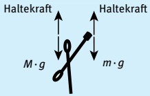

<details>
<summary>text_image</summary>

Haltekraft
M·g
Haltekraft
m·g
</details>

M … Masse der Schere m ... Masse des Korkstücks


<details>
<summary>natural_image</summary>

Elderly man holding a tool on his head in a kitchen setting, with fire extinguishers and equipment visible (no text or symbols)
</details>

Schere fällt und bleibt geöffnet

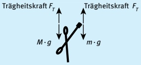

<details>
<summary>text_image</summary>

Trägheitskraft F_T
M·g
m·g
Trägheitskraft F_T
</details>

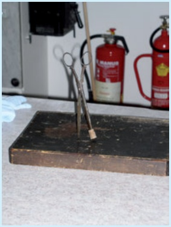

<details>
<summary>natural_image</summary>

Exterior view of a wooden table with metal scissors and fire extinguishers in background (no visible text or symbols)
</details>

nach dem Auftreffen klappt die Schere beschleunigt zu Stützkraft (Tisch)

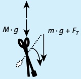

## 2.3.3 Rotierende Bezugssysteme

In einem mit $\vec { \omega } = \vec { \omega } ^ { ' }$ rotierenden Bezugssystem $\Sigma ^ { \prime }$ drehen sich die Koordinatenachsen relativ zu einem Inertialsystem $\Sigma ,$ das heißt, die Einheitsvektoren des Bezugssystems $\Sigma ^ { \prime } ,   \vec { e } _ { x } ^ { \prime } ,   \vec { e } _ { y } ^ { \prime } ,   \vec { e } _ { z } ^ { \prime }$ ändern dauernd ihre Richtung. Wir nehmen an, dass die Ursprünge beider Bezugssysteme $O$ und $O ^ { \prime }$ ständig zusammenfallen.

Für den Ortsvektor eines Massenpunktes gilt in den beiden Systemen Σ und $\Sigma ^ { \prime } ;$

$$
\vec {r} = \vec {r} ^ {\prime} = x \vec {e} _ {x} + y \vec {e} _ {y} + z \vec {e} _ {z} = x ^ {\prime} \vec {e} _ {x} ^ {\prime} + y ^ {\prime} \vec {e} _ {y} ^ {\prime} + z ^ {\prime} \vec {e} _ {z} ^ {\prime}. ^ {2 3} \tag {I-2.46}
$$

<small><span class="docvortex-page-footnote" data-block-type="page_footnote" style="color:#6b7280">23 Ein Vektor und eine Vektorgleichung sind von jedem Koordinatensystem völlig unabhängig! Sie können in verschiedenen Koordinatensystemen dargestellt, das heißt in ihre dann verschiedenen Komponenten zerlegt werden.</span></small>

↓

---

60

2 Mechanik des Massenpunktes

Die Einheitsvektoren des rotierenden Systems bleiben im raumfesten System nicht konstant und müssen differenziert werden, um die Geschwindigkeit im Inertialsystem zu bilden:

$$
\begin{array}{l} \vec {v} = \dot {\vec {r}} = \frac {d x ^ {\prime}}{d t} \vec {e} _ {x} ^ {\prime} + \frac {d y ^ {\prime}}{d t} \vec {e} _ {y} ^ {\prime} + \frac {d z ^ {\prime}}{d t} \vec {e} _ {z} ^ {\prime} + x ^ {\prime} \frac {d \vec {e} _ {x} ^ {\prime}}{d t} + y ^ {\prime} \frac {d \vec {e} _ {y} ^ {\prime}}{d t} + z ^ {\prime} \frac {d \vec {e} _ {z} ^ {\prime}}{d t} = \\ \underbrace {= \vec {v} ^ {\prime}} _ {\text {schwing dichroit}} + \underbrace {x ^ {\prime} \frac {d \vec {e} _ {x} ^ {\prime}}{d t} + y ^ {\prime} \frac {d \vec {e} _ {y} ^ {\prime}}{d t} + z ^ {\prime} \frac {d \vec {e} ^ {\prime}}{d t}} = \vec {v} ^ {\prime} + \vec {v} ^ {\star} \tag {I-2.47} \\ \end{array}
$$

Die Endpunkte der Einheitsvektoren von $\Sigma ^ { \prime }$ führen eine Kreisbewegung mit der Winkelgeschwindigkeit $\vec { \omega } ^ { 2 4 }$ um eine Achse durch $O = O ^ { \prime }$ aus. Wir wissen von der Kreisbewegung (Abschnitt 2.1.3), dass gilt $\vec { v } = \frac { d \vec { r } } { d t } = \vec { \omega } \times \vec { r }$ . Mit $\vec { r } = \vec { e } _ { x } ^ { \prime }   ,   \vec { e } _ { y } ^ { \prime }   ,   \vec { e } _ { z } ^ { \prime }$ folgt daher für die $\ddot { \mathbf { A } }$ nderung der Einheitsvektoren

$$
\frac {d \vec {e} _ {x} ^ {\prime}}{d t} = \vec {\omega} \times \vec {e} _ {x} ^ {\prime}, \quad \frac {d e _ {y} ^ {\prime}}{d t} = \vec {\omega} \times \vec {e} _ {y} ^ {\prime}, \quad \frac {d e _ {z} ^ {\prime}}{d t} = \vec {\omega} \times \vec {e} _ {z} ^ {\prime} \tag {I-2.48}
$$

und damit

$$
\begin{array}{l} \vec {v} ^ {\star} = x ^ {\prime} \big (\vec {\omega} \times \vec {e} _ {x} ^ {\prime} \big) + y ^ {\prime} \big (\vec {\omega} \times \vec {e} _ {y} ^ {\prime} \big) + z ^ {\prime} \big (\vec {\omega} \times \vec {e} _ {z} ^ {\prime} \big) = \vec {\omega} \times \big (x ^ {\prime} \vec {e} _ {x} ^ {\prime} + y ^ {\prime} \vec {e} _ {y} ^ {\prime} + z ^ {\prime} \vec {e} _ {z} ^ {\prime} \big) = \\ = \vec {\omega} \times \vec {r} ^ {\prime} = \vec {\omega} \times \vec {r} \cdot \tag {I-2.49} \\ \end{array}
$$

Damit ergibt sich für die Transformation des Geschwindigkeitsvektors von Σ nach $\Sigma ;$

$$
\vec {v} = \frac {d \vec {r}}{d t} = \vec {v} ^ {\prime} + \vec {\omega} \times \vec {r} = \frac {d \vec {r} ^ {\prime}}{d t} + \vec {\omega} \times \vec {r} ^ {\prime}. ^ {2 5} \tag {I-2.50}
$$

Wir erkennen, dass ein im ruhenden System Σ ruhender $\mathit { M P } \left( \vec { \upsilon } = 0 \right)$ im rotierenden System $\Sigma ^ { \prime }$ eine Kreisbewegung entgegen der Drehbewegung des rotierenden Systems ausführt:

$$
v ^ {\prime} = \vec {v} - \vec {\omega} \times \vec {r} ^ {\prime} = - \vec {\omega} \times \vec {r} ^ {\prime}. \tag {I-2.51}
$$

<small><span class="docvortex-page-footnote" data-block-type="page_footnote" style="color:#6b7280">24 Eigentlich sollte hier auch ω⇀′ stehen, da bei Berechnungen in Σ′ die Komponenten von ω⇀in Σ′ zu verwenden sind, für die Vektoren gilt aber: ω⇀′ = ω⇀.</span></small>

<small><span class="docvortex-page-footnote" data-block-type="page_footnote" style="color:#6b7280">25 Wenngleich r⇀= r⇀′ gilt, sollten doch im rotierenden System (rechte Seite der Gleichung) nur Terme auftreten, die sich auf Σ′ beziehen, die also für den Ortsvektor r⇀′ = {x′, y′, z′} mit der Komponentenzerlegung nach den Σ′-Achsen verwenden.</span></small>

---

2.3 Bezugssysteme und Trägheitskräfte

61

Eine analoge Transformationsgleichung muss für die zeitliche Ableitung jedes Vektors u⇀in Σ gelten, da sich die Vektorkomponenten von u⇀wie die Komponenten des Ortsvektors $\vec { r } = \{ x , y , z \}$ verhalten:

$$
\underline {\left(\frac {d \vec {u}}{d t}\right) _ {\text {fix}} = \left(\frac {d \vec {u} ^ {\prime}}{d t}\right) _ {\text {rotierend}} + \vec {\omega} \times \vec {u} ^ {\prime}.} \tag {I-2.52}
$$

Damit können wir den Beschleunigungsvektor vom Inertialsystem ins rotierende System transformieren. Wir setzen bei der nochmaligen Differentiation zur Berechnung der Beschleunigung für $\vec { u } ^ { \prime }$ den gerade erhaltenen Vektor $\vec { v } = \vec { v } ^ { \prime } + \vec { \omega } \times \vec { r } ^ { \prime }$ (Gl. I-2.50) in Komponenten von $\Sigma ^ { \prime }$ ein und beachten, dass wir beim Differenzieren des Vektorprodukts $\vec { \omega } \times \vec { r } ^ { \prime }$ für den Term $\left( { \frac { d { \vec { r } } ^ { \prime } } { d t } } \right) _ { \mathrm { r o t i e r e n d } } = { \vec { v } } ^ { \prime } .$ erhalten:

$$
\begin{array}{l} \vec {a} = \frac {d \vec {v}}{d t} = \frac {d}{d t} \left(\vec {v ^ {\prime}} + \omega \times \vec {r ^ {\prime}}\right) _ {\text {rotierend}} + \omega \times \left(\vec {v ^ {\prime}} + \vec {\omega} \times \vec {r ^ {\prime}}\right) = \\ = \frac {d \vec {v} ^ {\prime}}{d t} + \frac {d \vec {\omega}}{d t} \times \vec {r} ^ {\prime} + \vec {\omega} \times \vec {v} ^ {\prime} + \vec {\omega} \times \vec {v} ^ {\prime} + \vec {\omega} \times (\vec {\omega} \times \vec {r} ^ {\prime}) = \\ = \underbrace {\vec {a} ^ {\prime}} _ {\text {Relativ - beschleunigung}} + \underbrace {\dot {\vec {\omega}} \times \vec {r} ^ {\prime}} _ {\text {Transversal - beschleunigung}} + \underbrace {2 \cdot (\vec {\omega} \times \vec {v} ^ {\prime})} _ {\text {Coriolis - beschleunigung}} + \underbrace {\vec {\omega} \times (\vec {\omega} \times \vec {r} ^ {\prime})} _ {\text {Zentripetal - beschleunigung}}. ^ {2 6} \tag {I-2.53} \\ \end{array}
$$

Dabei ist $\vec { a }$ die durch die Wechselwirkungskräfte im Inertialsystem verursachte Beschleunigung.

Für die Bewegungsgleichung im Inertialsystem muss gelten

$$
\vec {F} = m \cdot \vec {a},
$$

wobei $\vec { F }   =   \sum _ { i } \vec { F } _ { i }$ die Resultierende aus allen wirkenden physikalischen Kräften ist.

Analog findet ein Beobachter im rotierenden System gemäß dem Newtonschen Ansatz $\vec { F ^ { \prime } } = m \cdot \vec { a ^ { \prime } }$ die im rotierenden System $\Sigma ^ { \prime }$ auf das Teilchen wirkende Kraft $\vec { F } ^ { \prime }$ wenn noch zusätzlich eine lineare Beschleunigung $\bar { A } _ { \mathrm { l i n e a r } }$ von $\Sigma ^ { \prime }$ gegen Σ vorliegt zu:

$$
\vec {F} ^ {\prime} = m \cdot \vec {a} ^ {\prime} = m \cdot \vec {a} - m (\dot {\vec {\omega}} \times \vec {r} ^ {\prime}) - 2 m (\vec {\omega} \times \vec {v} ^ {\prime}) - m \vec {\omega} \times (\vec {\omega} \times \vec {r} ^ {\prime}) - m \cdot \vec {A} _ {\text {linear}} ^ {2 7} \tag {I-2.54}
$$

<small><span class="docvortex-page-footnote" data-block-type="page_footnote" style="color:#6b7280">26 Es tritt die Zentripetalbeschleunigung als Komponente der im Inertialsystem wirklich wirkenden Beschleunigung auf. Sie ist daher auch, wie man sich aufgrund der Vektorprodukte leicht überzeugen kann, zum Zentrum hin gerichtet!</span></small>

<small><span class="docvortex-page-footnote" data-block-type="page_footnote" style="color:#6b7280">27 Jetzt, im rotierenden System betrachtet, ist die Beschleunigung −ω⇀× (ω⇀× r⇀′) nach außen gerichtet (negatives Vorzeichen!) und wird daher Zentrifugalbeschleunigung genannt.</span></small>

---

62

2 Mechanik des Massenpunktes

Die hier im rotierenden System außer der Wechselwirkungskraft $m \cdot { \vec { a } } = { \vec { F } } _ { \mathrm { p h y s i k a l i s c h } }$ auftretenden Schein- oder Trägheitskräfte<sup>28</sup> (inertial forces) werden folgendermaßen bezeichnet:

$$
\begin{array}{l} \vec {F} ^ {\prime} = m \cdot \vec {a} ^ {\prime} = \vec {F} _ {\text {physikalisch}} + \vec {F} _ {\text {Trägheit}} = \\ = \vec {F} _ {\text {physikalisch}} + \vec {F} _ {\text {transversal}} + \vec {F} _ {\text {Coriolis}} + \vec {F} _ {\text {zentrifugal}} + \vec {F} _ {\text {linear}} \\ \end{array}
$$

mit

$$
\vec {F} _ {\text {transversal}} = - m \big (\dot {\vec {\omega}} \times \vec {r} ^ {\prime} \big), \tag {I-2.55}
$$

der Transversalkraft (oft auch Tangentialkraft genannt) $) ^ { 2 9 }$ des rotierenden Systems, sie wirkt stets senkrecht (transversal) zu $\vec { r } ^ { \prime }$

$$
\vec {F} _ {\text {Coriolis}} = - 2 m (\vec {\omega} \times \vec {v} ^ {\prime}) = 2 m (\vec {v} ^ {\prime} \times \vec {\omega}), \tag {I-2.56}
$$

der Corioliskraft,<sup>30</sup> die im rotierenden System nur auftritt, wenn dort eine nicht verschwindende Geschwindigkeit $\vec { v } ^ { \prime }$ vorliegt,

$$
\vec {F} _ {\text {zentrifugal}} = - m (\vec {\omega} \times (\vec {\omega} \times \vec {r} ^ {\prime}))  , \tag {I-2.57}
$$

der Zentrifugalkraft, die nur in rotierenden Systemen auftritt, sie ist gleich groß, aber entgegengesetzt (nach außen) gerichtet wie die Zentripetalkraft der Kreisbewegung im Inertialsystem,

$$
\vec {F} _ {\text {linear}} = - m \cdot \vec {A} _ {\text {linear}}, \tag {I-2.58}
$$

der Trägheitskraft, die eine Folge der Linearbeschleunigung $\vec { A } _ { \mathrm { l i n e a r } }$ des Systems $\Sigma ^ { \prime }$ ist.

In einem gleichmäßig rotierenden Bezugssystem $( \dot { \vec { \omega } } = 0 )$ wie $\mathbf { z } , \mathbf { B } ,$ . der Erde, treten also für einen kräftefreien MP stets die Zentrifugalkraft und die Corioliskraft (für $\vec { \upsilon ^ { \prime } }   \neq   0 )$ als Trägheitskräfte auf.

<small><span class="docvortex-page-footnote" data-block-type="page_footnote" style="color:#6b7280">28 Der Begriff ‚Trägheitskraft‘ wurde erstmals 1743 von Jean Baptiste le Rond d’Alembert (1717–1783) in seinem berühmten ‚Traité de Dynamique‘ eingeführt.</span></small>

<small><span class="docvortex-page-footnote" data-block-type="page_footnote" style="color:#6b7280">29 Tangential, also in Richtung der Teilchengeschwindigkeit, ist die Kraft nur, wenn ω⇀̇// ω⇀ ist, also ω⇀nur seinen Betrag ändert, die Rotationsachse aber ungeändert bleibt. Im Falle der Kreiselbewegung z. B. ist ω⇀̇ nicht // ω⇀.</span></small>

<small><span class="docvortex-page-footnote" data-block-type="page_footnote" style="color:#6b7280">30 Nach Gaspard Gustave de Coriolis, franz. Ingenieur und Physiker (1792–1843).</span></small>

---

2.3 Bezugssysteme und Trägheitskräfte

63

**Beispiel:** Ein MP ruhe im Inertialsystem im Abstand r von M (Skizze). Im rotierenden System beschreibt der $M P$ dann eine Kreisbahn (Ortsvektor $\vec { r } ^ { \prime }$ vom Drehzentrum M mit $\left| { \vec { r } } ^ { \prime } \right| = r )$ und hat die Geschwindigkeit $\vec { v ^ { \prime } } = - \vec { \omega } \times \vec { r ^ { \prime } }$ mit dem konstanten Betrag $| \vec { v } ^ { \prime } | = \omega \cdot r ^ { \prime } \cdot \sin ( \vec { \omega } , \vec { r } ^ { \prime } ) = \omega   r$

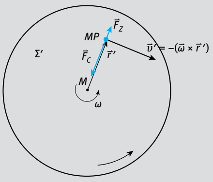

<details>
<summary>text_image</summary>

Σ'
MP
Fz
Fc
r'
M
ω
v' = -(\u03b2 × r')
</details>

Im rotierenden System wirken also als einzige Kräfte die Zentrifugalkraft

$$
\vec {F} _ {z} = - m \vec {\omega} \times (\vec {\omega} \times \vec {r ^ {\prime}})
$$

und die Corioliskraft

$$
\vec {F} _ {C} = - 2 m (\vec {\omega} \times \vec {v ^ {\prime}}) = 2 m \vec {\omega} \times (\vec {\omega} \times \vec {r ^ {\prime}})
$$

Insgesamt wirkt also im rotierenden System die für eine gleichförmige Kreisbewegung erforderliche dem Betrage nach konstante Zentripetalkraft

$$
\vec {F} _ {\mathrm{ges}} = \vec {F} _ {z} + \vec {F} _ {C} = m \vec {\omega} \times (\vec {\omega} \times \vec {r} ^ {\prime}) = \vec {F} _ {\text {zentripetal}} \quad \text {mit} \quad \left| \vec {F} _ {\text {zentripetal}} \right| = m r \omega^ {2}.
$$

Zur Berechnung der Zentripetalbeschleunigung zerlegen wir $\vec { r }$ in die beiden Komponenten $\vec { r } _ { n } ^ { \prime }$ und $\vec { r } _ { p } ^ { \prime }$ normal und parallel zu $\vec { \omega }$ Aufgrund des Entwicklungssatzes $\vec{A} \times (\vec{B} \times \vec{C}) = \vec{B}(\vec{A} \cdot \vec{C}) - \vec{C}(\vec{A} \cdot \vec{B})$ gilt dann

$$
\begin{array}{l} \vec {\omega} \times (\vec {\omega} \times \vec {r} ^ {\prime}) = \vec {\omega} \cdot (\vec {\omega} \cdot [ \vec {r} _ {n} ^ {\prime} + \vec {r} _ {p} ^ {\prime} ]) - (\vec {r} _ {n} ^ {\prime} + \vec {r} _ {p} ^ {\prime}) (\vec {\omega} \cdot \vec {\omega}) = \\ = \vec {\omega} \cdot \big (\underbrace {\vec {\omega} \cdot \vec {r} _ {n} ^ {\prime}} _ {= 0} \big) + \vec {\omega} \cdot \big (\underbrace {\vec {\omega} \cdot \vec {r} _ {p} ^ {\prime}} _ {\omega r _ {p} ^ {\prime}} \big) - \omega^ {2} \vec {r} _ {n} ^ {\prime} - \underbrace {\omega^ {2} \vec {r} _ {p} ^ {\prime}} _ {= \bar {\omega} (\omega r _ {p} ^ {\prime})} = - \omega^ {2} \vec {r} _ {n} ^ {\prime}. \\ \end{array}
$$

Wir erhalten daher den bereits von der Kreisbewegung bekannten Ausdruck.

---

64

2 Mechanik des Massenpunktes

## Beispiel: Karussell.

Wir stehen mit Rollschuhen auf einer sich drehenden Scheibe (Karussell) und schauen zum Drehzentrum. Es wirkt die Zentrifugalkraft und wir rollen beschleunigt radial nach außen; dabei sind wir kräftefrei wie im fallenden Fahrstuhl, die Trägheitskraft kompensiert hier die Zentrifugalkraft wie dort die Gravitationskraft. Sobald wir nach außen rollen, also eine Geschwindigkeit besitzen, wirkt zusätzlich die Corioliskraft und unsere Bahn auf der Scheibe krümmt sich entsprechend. Wir bleiben dabei kräftefrei, denn solange wir die Beschleunigung mitmachen, ist in unserem Körpersystem die Beschleunigung Null, wir sind kräftefrei. Fallen wir zu Boden und krallen uns an der rotierenden Scheibe fest, so kompensieren wir die Zentrifugalkraft mit der Kraft unserer Arme und bleiben im rotierenden System in Ruhe, so wie wir auf der Erde die Schwerkraft mit der Kraft der Beine kompensieren. Die Zentrifugalkraft wirkt im rotierenden System immer – halten wir uns nicht fest, so werden wir beschleunigt und sie wird durch die Trägheitskraft kompensiert.

Die Wirkung der Zentrifugalkraft im rotierenden System kann sehr einfach mit der rotierenden Flüssigkeit gezeigt werden:

## 4

Eine wenig zähe Flüssigkeit (hier rot gefärbtes Wasser) wird in einem Becher in Rotationsbewegung versetzt. Die Flüssigkeit wird von der Mitte zum Rand gedrängt und steigt dort hoch. Es bildet sich eine rotations-paraboloidförmige Flüssigkeitsoberfläche aus.


Wir versuchen eine Erklärung des Effekts in Σ und in Σ′. In beiden Systemen muss gelten: Für eine ideale (reibungsfreie) Flüssigkeit ist der Schermodul G = 0 und die Flüssigkeitsoberfläche stellt sich normal zur resultierenden Gesamtkraft ein (siehe Kapitel ‚Mechanik deformierbarer Körper‘, Abschnitt 4.3).

<u>rotierendes System Σ′ (statische Sicht):</u> Es wirken das Gewicht der Flüssigkeit und die Zentrifugalkraft. Die resultierende Gesamtkraft zeigt schräg nach unten. Im Gleichgewicht wirkt eine gleich große Flüssigkeitskraft in entgegengesetzter Richtung, zu der sich die Flüssigkeitsoberfläche normal stellen muss.

<u>ruhendes Laborsystem Σ (dynamische Sicht):</u> Es wirken die Gewichtskraft und die Druckkraft (erzeugt durch den Druckgradienten) der Flüssigkeit, zu dem sich die Flüssigkeitsoberfläche normal stellt (Parabelform). Die Zentripetalkraft wird durch die Resultierende aus Gewichtskraft und Druckgradient erzeugt.

---

2.3 Bezugssysteme und Trägheitskräfte

65

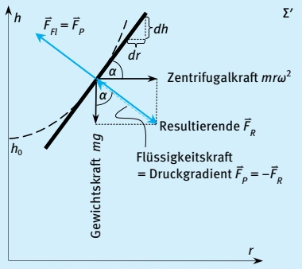

<details>
<summary>other</summary>

| Variable | Description |
| --- | --- |
| f_FI | Force vector (blue arrow) |
| f_P | Force vector (black arrow) |
| f_R | Force vector (black arrow) |
| r | Horizontal coordinate axis |
| h0 | Initial height reference point |
| g_wichtskraft_mg | Vertical height reference point |
| Zentrifugalkraft_mrω^2 | Vertical moment of change in force vector |
| Resultierende_fR | Resultierende force vector (black arrow) |
| Flüssigkeitskraft = Druckgradient_fP = -F_R | Flüssigkeitskraft = Druckgradient (black arrow) |
</details>

Da die Zentrifugalkraft proportional zu r ist, nimmt sie nach außen hin zu und führt zur beobachteten Parabelform. Im rotierenden System herrscht Kräftegleichgewicht, da die Flüssigkeit in Σ′ ruht, der mitrotierende Beobachter merkt nur die Trägheitskraft, nicht die Rotationsbewegung.

Wirkende Kräfte in Σ′ auf ein Massenelement m: Gewichtskraft $\vec { F } _ { G } = m g ,$ Zentrifugalkraft $\vec { F } _ { z f }   =   m r \omega ^ { 2 }$ sowie die Druckkraft in der Flüssigkeit $\vec { F } _ { P }$ Es muss gelten: $\vec { F } _ { G } + \vec { F } _ { z f } + \vec { F } _ { P } = 0 .$

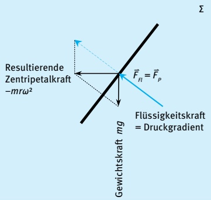

<details>
<summary>other</summary>

| Variable | Formula |
| --- | --- |
| Resultierende Zentripetalkraft | \(-mr\omega^{2}\) |
| Flüssigkeitskraft | Druckgradient |
| Gewichtskraft | mg |
</details>

Da die Zentripetalkraft proportional zu r ist, nimmt sie nach außen hin zu. Die resultierende Flüssigkeitskraft führt zur beobachteten Parabelform. Im raumfesten System herrscht kein Kräftegleichgewicht, da die resultierende Zentripetalkraft die rotierenden Flüssigkeitsteilchen dauernd auf ihrer Bahn halten muss.

Wirkende Kräfte auf m in Σ: Gewichtskraft $\vec { F } _ { G } = m g$ sowie die Flüssigkeitskraft $\vec { F } _ { P }$ Es muss gelten: $\vec { F } _ { G } + \vec { F } _ { P } = \vec { F } _ { z p } = - m r \omega ^ { 2 }$ (resultierende = erforderliche Zentripetalkraft).

$\Rightarrow \vec { F } _ { P } = \vec { F } _ { z p } - \vec { F } _ { G } = - \; m r { \omega } ^ { 2 } \; -$ mg; das ist der sich einstellende Druck in der Flüssigkeit, wenn diese gleichmäßig mit $\vec { \omega } \parallel \vec { g }$ rotiert.

In beiden Fällen muss die Flüssigkeitsoberfläche senkrecht auf $\vec { F } _ { P }$ stehen. Es gilt:

tan $\alpha = \frac{mr\omega^{2}}{mg} = \frac{r\omega^{2}}{g} = \frac{dh}{dr} \Rightarrow \frac{g}{\omega^{2}}dh = rdr$ Integriert ergibt sich $\frac { g } { \omega ^ { ^ 2 } } \; ( h - h _ { 0 } ) = \frac { r ^ { ^ 2 } } { 2 }$ und damit $\stackrel { \rightharpoonup } { \frac { 2 g } { \omega ^ { ^ 2 } } } ( h - h _ { 0 } ) = r ^ { ^ 2 } ,$ also eine Parabel.

## 2.3.4 Die Erde als rotierendes Bezugssystem

Es liegt nahe zu fragen, inwieweit die Erde als Inertialsystem verwendet werden kann. Wir betrachten dazu ein ‚raumfestes‘ System $( x ,   y ,   z )$ , das seinen Ursprung in der Sonne hat und von dem zwei Achsen (x und y) in der Ebene der elliptischen (nahezu kreisförmigen) Umlaufbahn der Erde (Ekliptik) liegen. Das bewegte System $( \xi , \eta , \zeta )$ sei fest mit der Erde verbunden, sein Ursprung liege im Erdmittelpunkt und die ζ-Achse falle mit der Drehachse (Polachse) der Erde zusammen. Die Polachse $\zeta$ ist gegen das feste System $( x , y , z )$ geneigt (Abb. I-2.17).

Die Drehung der Erde, also des Systems $( \xi , \eta , \zeta )$ , um die Polachse relativ zum festen System $( x , y , z )$ erfolgt mit der Winkelgeschwindigkeit

---

66

2 Mechanik des Massenpunktes

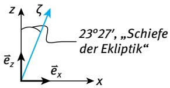

<details>
<summary>line</summary>

| Variable | Description |
| --- | --- |
| z | Vertical axis variable |
| x | Horizontal axis variable |
| \(\zeta\) | Vertical axis variable |
| \(\vec{e}_z\) | Horizontal axis variable |
| \(\vec{e}_x\) | Horizontal axis variable |
</details>

$$
\vec {e} _ {\zeta} = (\sin 2 3, 5 ^ {\circ}) \cdot \vec {e} _ {x} + (\cos 2 3, 5 ^ {\circ}) \cdot \vec {e} _ {z}
$$

**Abb. I-2.17:** Die Erde als rotierendes Bezugssystem. Das raumfestes System (x, y, z) hat seinen Ursprung in der Sonne; die zwei Achsen x und y liegen in der Ebene der nahezu kreisförmigen Umlaufbahn der Erde (Ekliptik). Die Drehachse (Polachse) der Erde $\zeta$ ist gegen die z-Achse geneigt („Schiefe der Ekliptik“).

$$
\vec {\omega} = \omega \cdot \vec {e} _ {\zeta} = 7, 2 9 2 4 \cdot 1 0 ^ {- 5} \cdot \vec {e} _ {\zeta} \mathrm{rad/s}. \tag {I-2.59}
$$

Die Bahngeschwindigkeit des Erdmittelpunkts um die Sonne ist verglichen mit der Drehung um die Polachse nahezu konstant, sodass keine lineare Trägheitskraft $\vec { F } _ { \mathrm { l i n } }$ auftritt. Es wirkt daher auf einen ruhenden $M P$ auf der Erdoberfläche nur die Zentrifugalbeschleunigung aufgrund der Erdrotation. Sie beträgt am Äquator

$$
a _ {z} = R _ {E} \omega^ {2} = 6 3 7 8, 1 3 7 \cdot 1 0 ^ {3} \mathrm{m} \cdot (7, 2 9 2 4 \cdot 1 0 ^ {- 5} \mathrm{s} ^ {- 1}) ^ {2} = 3, 3 9 2 \cdot 1 0 ^ {- 2} \mathrm{m} / \mathrm{s} ^ {2}. ^ {3 1} \tag {I-2.60}
$$

Bei der Beschreibung von Bewegungen im bewegten System $( \xi , \eta , \zeta )$ der Erde treten daher zentrifugale Trägheitskräfte auf. So vermindert der Maximalwert der Zentrifugalkraft am Äquator die Schwerkraft um 0,35 %. Die vom Erdumlauf um die Sonne herrührende Zentrifugalkraft beträgt etwa $\%$ des $\mathtt { W e r t s } ,$ der von der Erdrotation verursacht wird. In vielen Fällen kann daher die Erde als Inertialsystem verwendet werden. Dies gilt nicht für Bewegungen mit hohen Geschwindigkeiten oder bei Verfolgung der Bewegung über lange Zeiträume, da dann noch die Corioliskraft auftritt.

Auf der nördlichen Erdhalbkugel ragt der Vektor der Winkelgeschwindigkeit der Erdrotation aus dem Boden heraus (Rechte-Hand-Regel), am Pol senkrecht, am Äquator horizontal in Nordrichtung. Jeder bewegte Körper muss daher infolge der Corioliskraft $F _ { \mathrm { C o r i o l i s } } = 2   m ( \vec { \upsilon } \times \vec { \omega } _ { \varphi } )$ (mit $\vec { \omega } _ { \varphi } = \vec { \omega } \cdot \sin \varphi , \; \varphi \ldots$ geographische Breite) auf der Nordhalbkugel eine Rechtsabweichung erfahren; auf der Südhalbkugel tritt entsprechend eine Linksabweichung auf. Für die maximale Coriolisbeschleunigung gilt nach dem oben gesagten: $2   \omega \upsilon \approx 1 , 5 \cdot 1 0 ^ { - 4 }   \upsilon .$

**Beispiel 1:** Ein Flugzeug mit rund 1000 km/h erfährt daher eine maximale Coriolisbeschleunigung von $4.2 \cdot 10^{-2}    m/s ^2$ ein niedriger Satellit mit einer Geschwindigkeit von 8 km/s dagegen $1 , 2   \mathrm { m } / \mathrm { s } ^ { 2 } ,$ , das ist etwa

$$
0, 1 2 \mathrm{g} (\mathrm{g} = 9, 8 1 \mathrm{m} / \mathrm{s} ^ {2}).
$$

<small><span class="docvortex-page-footnote" data-block-type="page_footnote" style="color:#6b7280">31 Außerdem wirkt die Zentrifugalbeschleunigung aufgrund der Kreisbewegung um die Sonne. Diese ist zusammen mit der Gravitationskraft der Sonne gemeinsam mit der Mondeinwirkung für die Gezeiten verantwortlich, wobei der Einfluss des Mondes wegen seiner Erdnähe dominiert.</span></small>

---

2.3 Bezugssysteme und Trägheitskräfte

67

**Beispiel 2:** Trotz der geringen Windgeschwindigkeiten hat die Corioliskraft eine große Bedeutung für das Wettergeschehen, da die interessierenden Zeiträume sehr lang sind. Ohne Corioliskraft müsste die Strömungsrichtung der Luft dem Druckgradienten folgen (strichlierter Pfeil in der Skizze unten). Die Corioliskraft bewirkt aber auf der Nordhalbkugel eine Rechtsablenkung (blauer Pfeil).

Kräftegleichgewicht tritt erst dann ein, wenn Druckkraft und Corioliskraft gleich groß und entgegengesetzt gerichtet sind, die Corioliskraft also gegen den Druckgradienten weist. Ohne Reibungskräfte müsste die Luftströmung schließ- lich parallel zu den Isobaren im Gegenuhrzeigersinn um den Kern des Tiefdruckgebietes herum verlaufen, wegen der Reibungskräfte stellt sich aber ein Winkel von etwa $2 0 ^ { \circ } { - } 3 0 ^ { \circ }$ gegen die Isobaren ein.

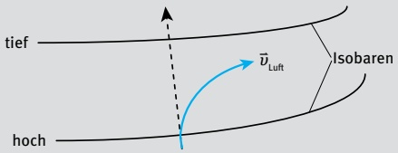

<details>
<summary>text_image</summary>

tief
hoch
v̄_Luft
Isobaren
</details>

Rechtsablenkung der Luftbewegung auf der nördlichen Halbkugel.

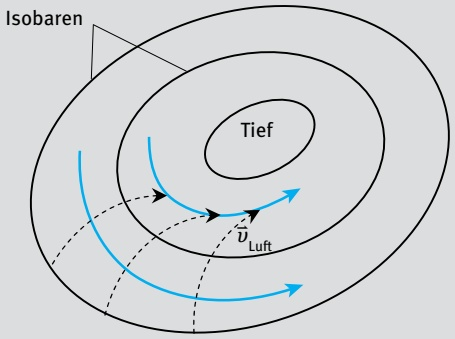

<details>
<summary>flowchart</summary>

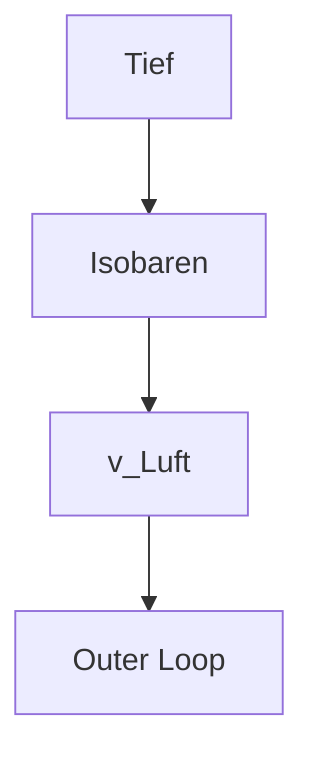
</details>

Die Luftteilchen werden nach rechts abgelenkt und ergeben in Summe eine Drehung der Luftmasse entgegen dem Uhrzeigersinn.

Idealisierte Windbewegung (ohne Reibung) in einem Tiefdruckgebiet auf der nördlichen Erdhalbkugel.

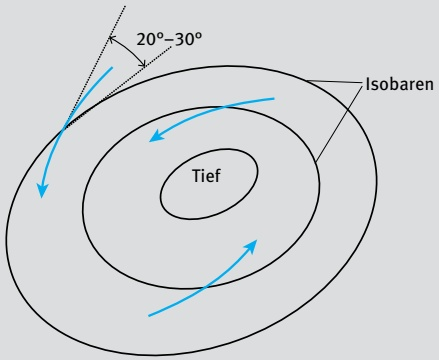

<details>
<summary>text_image</summary>

20°-30°
Tief
Isobaren
</details>

Die Berücksichtigung der Reibungskräfte führt zu einer tatsächlichen Windbewegung, die um $2 0 ^ { \circ } { - } 3 0 ^ { \circ }$ gegen die Isobaren geneigt ist.

---

68

2 Mechanik des Massenpunktes

**Beispiel 3:** Die Schwingungsebene eines ebenen Pendels dreht sich relativ zur (bewegten) Erdoberfläche (Foucaultsches Pendel, Foucault 1850, Leon Foucault (1819–1868)). Nach dem oben Gesagten ist klar, dass der Effekt wesentlich von der geographischen Breite abhängt, z. B. am Nordpol eine volle Drehung pro Tag erfolgt, während sich die Schwingungsebene am Äquator überhaupt nicht dreht. Aus der Sicht des rotierenden Erdsystems ist die Drehung der Pendelebene also eine Folge der wirkenden Corioliskraft. In einem Inertialsystem hat jedoch der Drehimpuls des Pendels konstante Richtung und damit ist die Pendelebene raumfest. Es dreht sich aber die Erdeoberfläche unter dem schwingenden Pendel vorbei.

## 2.4 Massenpunktsysteme und Erhaltungssätze (conservation laws)

Da alle Körper aus mehr oder weniger vielen Masseteilchen zusammengesetzt sind (letztlich aus den Elementarteilchen), stellen sie Massenpunktsysteme dar. Die im Folgenden abgeleiteten Erhaltungssätze sind daher die allgemeinsten, in der ge samten Physik geltenden Gesetzmäßigkeiten, deren Bedeutung und Anwendungsbereich universell sind! Aus der experimentellen Verifikation der unter Verwendung der Newtonschen Axiome aus ihnen gezogenen Schlüsse folgt dann umgekehrt die Bestätigung dieser Axiome.

Wir betrachten daher jetzt ein System aus vielen Massenpunkten und wenden auf die einzelnen MP die bisher entwickelten Gesetzmäßigkeiten an. Wir unterscheiden zwei Arten von Kräften, die am MP angreifen können:

innere Kräfte (internal forces) gehen von den anderen MP des Systems aus;
– äußere Kräfte (external forces) haben ihre Ursache außerhalb des Systems.

Wir sprechen von einem abgeschlossenen System, wenn die Summe der äußeren Kräfte verschwindet (resultierende äußere Gesamtkraft gleich Null). In Punktsys temen ist das 3. Newtonsche Axiom (actio = reactio) von besonderer Wichtigkeit.

## 2.4.1 Der Massenmittelpunkt (= Schwerpunkt) und der (lineare) Gesamtimpuls

Wir betrachten ein System von N Massenpunkten (Teilchen). Am i-ten MP greifen äußere Kräfte an (resultierende äußere Gesamtkraft $\vec { F } _ { i } )$ und eine innere Kraft ${ \vec { F } } _ { 1 i }$ vom ersten MP, $\vec { F } _ { 2 i }$ vom zweiten MP, allgemein $\vec { F } _ { j i }$ vom j-ten MP. Damit erhalten wir für die Bewegungsgleichung des i-ten MP:

$$
\vec {F} _ {i} + \sum_ {j \neq i} \vec {F} _ {j i} = m _ {i} \frac {d ^ {2} \vec {r} _ {i}}{d t ^ {2}}. \tag {I-2.61}
$$

---

2.4 Massenpunktsysteme und Erhaltungssätze (conservation laws)

69

Dies gilt für jeden der N MP, also gibt es insgesamt N solche Gleichungen. Wir summieren alle N Gleichungen:

$$
\sum_ {i} \vec {F} _ {i} + \underbrace {\sum_ {i \neq j} \sum_ {j \neq i} \vec {F} _ {j i}} _ {= 0 (\text {Newton3})} = \sum_ {i} m _ {i} \frac {d ^ {2} \vec {r} _ {i}}{d t ^ {2}}. \tag {I-2.62}
$$

In der Doppelsumme ist i = j auszuschließen, da es innere Kräfte mit gleichen Indizes (Teilchen wirkt auf sich selbst) nicht gibt. Zu jeder Kraft $\vec { \bar { F } } _ { j i }$ , die das Teilchen j auf das Teilchen i ausübt, gibt es jedoch eine Kraft $\vec { \bar { F } } _ { i j }$ , die das Teilchen i auf das Teilchen j ausübt. Nach dem 3. Newtonschen Axiom sind aber diese Kräfte entgegengesetzt gleich groß. Die Doppelsumme verschwindet daher, da sich die Summe der inneren Kräfte aufhebt.

Wir definieren als Massenmittelpunkt eines Systems jenen Punkt, dessen Ortsvektor $\vec { r } _ { S }$ (Ursprung beliebig) multipliziert mit der Gesamtmasse $M   =   \sum _ { i } m _ { i }$ des Systems gleich der Vektorsumme der mit den Einzelmassen multiplizierten Ortsvektoren der einzelnen Teilchen vom gleichen Ursprung aus ist:

$$
M \cdot \vec {r} _ {S} = \sum_ {i} m _ {i} \vec {r} _ {i} \quad \text {Massenmittelpunkt (centre of mass).} \tag {I-2.63}
$$

In die Summengleichung (I-2.62) eingesetzt ergibt sich:

$$
\sum_ {i} \vec {F} _ {i} = M \cdot \frac {d ^ {2} \vec {r} _ {S}}{d t ^ {2}} \quad \text {Bewegung des Massenmittelpunktes.} \tag {I-2.64}
$$

Der Massenmittelpunkt eines Systems bewegt sich so, als ob in ihm die Gesamtmasse des Systems vereinigt wäre und die resultierende äußere Gesamtkraft angriffe.

Ist das Teilchensystem abgeschlossen, verschwindet also die Summe aller äußeren Kräfte, so $\mathbf { g i l t } { : } ^ { 3 2 }$

$$
\sum_ {i} \vec {F} _ {i} = \sum_ {i} m _ {i} \frac {d ^ {2} \vec {r} _ {i}}{d t ^ {2}} = M \cdot \frac {d ^ {2} \vec {r} _ {S}}{d t ^ {2}} = 0
$$

$$
\Rightarrow \sum_ {i} m _ {i} \vec {v} _ {i} = M \vec {v} _ {S} = M \frac {d \vec {r} _ {S}}{d t} = \text {const.} \quad \text {linearer Impulssatz.} \tag {I-2.65}
$$

<small><span class="docvortex-page-footnote" data-block-type="page_footnote" style="color:#6b7280">32 Daraus ist auch ersichtlich, dass die gesamte Trägheitskraft eines Massenpunktsystems 11 (F⇀Trägheit mi = −M rS im Massenmittelpunkt angreift. dt2 dt2</span></small>

i

---

70

2 Mechanik des Massenpunktes

1 Greift an einem Teilchensystem keine resultierende äußere Kraft an, so bleibt der lineare Gesamtimpuls konstant und sein Massenmittelpunkt im Zustand der Ruhe oder der geradlinig gleichförmigen Bewegung.

**Beispiel:** Aus einer fahrbaren Kanone wird auf einer glatten Ebene (z. B. Eisfläche) ein Geschoß abgefeuert. Das Geschütz muss mit einer solchen Geschwindigkeit zurücklaufen (Rückstoß), dass der gemeinsame Massenmittelpunkt von Geschütz und Geschoß am ursprünglichen Ort bleibt. Die einzige äußere Kraft ist die Schwerkraft (wenn man von der Reibung absieht), die aber keine Horizontalkomponente besitzt.

Die häufigste äußere Kraft in der Mechanik ist die Schwerkraft. Man nennt den Massenmittelpunkt daher auch Schwerpunkt (centre of gravity), da im Schwerefeld die resultierende Gewichtskraft $\sum _ { i } \vec { F } _ { i } ^ { G } = \vec { G }$ an ihm wie an einem Massenpunkt der Gesamtmasse $\vec { M }$ angreift.

## 2.4.2 Der Gesamtdrehimpuls eines Teilchensystems

Wir betrachten jetzt den Gesamtdrehimpuls $\vec { L } = \sum _ { i } \vec { L } _ { i }$ als Summe der Drehimpulse $\vec { L } _ { i } = m _ { i } \left( \vec { r } _ { i } \times \vec { v } _ { i } \right)$ der Teilchen unseres Systems. Dazu multiplizieren wir die Bewegungsgleichung des einzelnen MP vektoriell mit seinem Ortsvektor $\vec { r } _ { i }$ und summieren über alle Teilchen:

$$
\sum_ {i} \left(\vec {r} _ {i} \times \vec {F} _ {i}\right) + \underbrace {\sum_ {i \neq j} \sum_ {j \neq i} \left(\vec {r} _ {i} \times \vec {F} _ {j i}\right)} _ {= 0} = \sum_ {i} m _ {i} \left(\vec {r} _ {i} \times \frac {d ^ {2} \vec {r} _ {i}}{d t ^ {2}}\right). \tag {I-2.66}
$$

Der erste Term der Gleichung stellt das resultierende Drehmoment $\vec { D } = \sum _ { i } \vec { D } _ { i }$ dar, das die äußeren Kräfte bewirken.

Der zweite Term beschreibt das resultierende Drehmoment der inneren Kräfte. Da gilt $\vec { F } _ { j i } = - \vec { F } _ { i j }$ , wird für jedes Teilchenpaar

$$
\vec {r} _ {i} \times \vec {F} _ {j i} + \vec {r} _ {j} \times \vec {F} _ {i j} = (\vec {r} _ {i} - \vec {r} _ {j}) \times \vec {F} _ {j i}. \tag {I-2.67}
$$

Das rechte Vektorprodukt verschwindet aber, da $\vec { F } _ { j i } \mathbin { / / } ( \vec { r } _ { i } - \vec { r } _ { j } ) ( \vec { F } _ { j i } = \mathbf { K r a f t }$ von Teilchen i auf Teilchen $j )$ . Der zweite Term von Gl. (I-2.66) verschwindet also, da die inneren Kräfte zwischen zwei Teilchen als Zentralkräfte die Richtung ihrer Verbindungslinie haben.

---

2.4 Massenpunktsysteme und Erhaltungssätze (conservation laws)

71

Der rechte Term der Gleichung stellt die zeitliche Ableitung des resultierenden Gesamtdrehimpulses $\frac { d \vec { L } } { d t } = \frac { d } { d t } \sum _ { i } m _ { i } ( \vec { r } _ { i } \times \vec { v } _ { i } )$ dar. Es gilt also:

$$
\vec {D} = \sum_ {i} \left(\vec {r} _ {i} \times \vec {F} _ {i}\right) = \frac {d \vec {L}}{d t} = \frac {d}{d t} \sum_ {i} m _ {i} \left(\vec {r} _ {i} \times \vec {\nu} _ {i}\right) \quad D r e h i m p u l s s a t z. \tag {I-2.68}
$$

In einem Teilchensystem, in dem die inneren Kräfte zwischen den Teilchen die Richtung ihrer Verbindungslinie haben, ist die zeitliche Änderung des Gesamtdrehimpulses gleich dem resultierenden Drehmoment der äußeren Kräfte.

Die Bedingung für die Wirkungsrichtung der inneren Kräfte ist keine bedeutende Einschränkung: Aus Symmetriegründen muss die Kraftwirkung zwischen zwei Punkten in die Richtung ihrer Verbindungslinie fallen, da außer dieser keine ausgezeichnete Richtung besteht.

Greift keine äußere Kraft an oder verschwindet das resultierende Drehmoment, so bleibt der Gesamtdrehimpuls zeitlich konstant:

$$
\vec {D} = \sum_ {i} (\vec {r} _ {i} \times \vec {F} _ {i}) = 0 \quad \Rightarrow \quad \vec {L} = \sum_ {i} m _ {i} (\vec {r} _ {i} \times \vec {v} _ {i}) = \text {const.} \tag {I-2.69}
$$

## 2.4.3 Die Gesamtenergie eines Teilchensystems

Zum Schluss betrachten wir die Energie unseres Teilchensystems. Dazu multiplizieren wir die Bewegungsgleichung des einzelnen Teilchens skalar mit $\frac { d \vec { r } _ { i } } { d t }$ und summieren wieder über alle Teilchen auf:

$$
\sum_ {i} \vec {F} _ {i} \cdot \frac {d \vec {r} _ {i}}{d t} + \sum_ {i \neq j} \sum_ {j \neq i} \vec {F} _ {j i} \cdot \frac {d \vec {r} _ {i}}{d t} = \sum_ {i} m _ {i} \frac {d ^ {2} \vec {r} _ {i}}{d t ^ {2}} \cdot \frac {d \vec {r} _ {i}}{d t} = \frac {d}{d t} \frac {1}{2} \sum_ {i} m _ {i} \left(\frac {d \vec {r} _ {i}}{d t}\right) ^ {2} \tag {I-2.70}
$$

Wir integrieren jetzt über die Zeit von $t _ { 0 }$ bis t, bzw. von $\vec { r } ( t _ { 0 } )$ r⇀(t0) bis $\vec { r } ( t )$ und erhalten

$$
\int_ {\vec {r} _ {i} (t _ {0})} ^ {\vec {r} _ {i} (t)} \sum_ {i} \vec {F} _ {i} d \vec {r} _ {i} + \int_ {\vec {r} _ {i} (t _ {0})} ^ {\vec {r} _ {i} (t)} \sum_ {i \neq j} \sum_ {j \neq i} \vec {F} _ {j i} d \vec {r} _ {i} = \frac {1}{2} \sum m _ {i} \left(\frac {d \vec {r} _ {i}}{d t}\right) _ {t} ^ {2} - \frac {1}{2} \sum m _ {i} \left(\frac {d \vec {r} _ {i}}{d t}\right) _ {t _ {0}} ^ {2} \tag {I-2.71}
$$

Links steht die Summe der Arbeiten der äußeren und inneren Kräfte (die Arbeiten der inneren Kräfte heben sich jetzt nicht weg, da die $d \vec { r } _ { i }$ für die einzelnen MP verschieden sind!), rechts steht die gesamte Änderung der kinetischen Energie des Systems.

i

i

---

72

2 Mechanik des Massenpunktes

Die kinetische Energie lässt sich in zwei Teile zerlegen. Wir führen ein zweites Koordinatensystem mit seinem Ursprung $O ^ { \prime }$ im Massenmittelpunkt mit dem Ortsvektor $\vec { r } _ { S }$ ein und bezeichnen alle darauf bezogenen Ortsvektoren mit ${ \vec { r } } ^ { \prime } ,$ Es gilt offenbar

$$
\vec {r} _ {i} = \vec {r} _ {S} + \vec {r} _ {i} ^ {\prime} \tag {I-2.72}
$$

und damit

$$
\left(\frac {d \vec {r} _ {i}}{d t}\right) ^ {2} = \left(\frac {d \vec {r} _ {S}}{d t}\right) ^ {2} + 2 \frac {d \vec {r} _ {S}}{d t} \frac {d \vec {r} _ {i} ^ {\prime}}{d t} + \left(\frac {d \vec {r} _ {i} ^ {\prime}}{d t}\right) ^ {2}. \tag {I-2.73}
$$

In den Ausdruck für die kinetische Energie eingesetzt folgt somit

$$
\sum_ {i} \frac {1}{2} m _ {i} \left(\frac {d \vec {r} _ {i}}{d t}\right) ^ {2} = \frac {1}{2} \left(\frac {d \vec {r} _ {S}}{d t}\right) ^ {2} \sum_ {i} m _ {i} + \frac {d \vec {r} _ {S}}{d t} \sum_ {i} m _ {i} \frac {d \vec {r} _ {i} ^ {\prime}}{d t} + \frac {1}{2} \sum_ {i} m _ {i} \left(\frac {d \vec {r} _ {i} ^ {\prime}}{d t}\right) ^ {2}. \tag {I-2.74}
$$

Aus $\vec { r } _ { i } = \vec { r } _ { S } + \vec { r } _ { i } ^ { \prime }$ folgt durch Multiplikation mit $\frac { m _ { i } } { M }$ und Summation über alle Teilchen

$$
\underbrace {\frac {1}{M} \sum_ {\vec {r} _ {S}} m _ {i} \vec {r} _ {i}} = \underbrace {\frac {\vec {r} _ {S}}{M} \sum_ {\vec {r} _ {S}} m _ {i}} + \frac {1}{M} \sum_ {i} m _ {i} \vec {r} _ {i} \tag {I-2.75}
$$

und daher

$$
\begin{array}{l} \sum_ {i} m _ {i} \vec {r} _ {i} ^ {\prime} = 0 \\ \Rightarrow \quad \sum m _ {i} \frac {d \vec {r} _ {i}}{d t} = 0 \tag {I-2.76} \\ \end{array}
$$

und der zweite Summand in Gl. (I-2.74) verschwindet. Es bleibt

$$
\sum_ {i} \frac {1}{2} m _ {i} \left(\frac {d r _ {i}}{d t}\right) ^ {2} = \underbrace {\frac {1}{2} M \left(\frac {d \bar {r} _ {S}}{d t}\right) ^ {2}} _ {E _ {\text {kin}} \text {der Gesamtmasse im Schwerpunkt}} + \underbrace {\frac {1}{2} \sum_ {i} m _ {i} \left(\frac {d \bar {r} _ {i} ^ {\prime}}{d t}\right) ^ {2}} _ {E _ {\text {kin}} \text {der Bewegung relativ zum Schwerpunkt}}. \tag {I-2.77}
$$

1 Die kinetische Energie des Teilchensystems ist die Summe aus der Translationsenergie der Gesamtmasse im Schwerpunkt und der Bewegungsenergie des Systems relativ zum Schwerpunkt.

Wir nehmen jetzt an, dass die inneren Kräfte konservativ sind, sich also eine potenzielle Energie (und damit auch ein Potenzial) definieren lässt. Die potenzielle Ener-

---

Zusammenfassung

73

gie $U _ { j i }$ der zwischen zwei Teilchen j und i wirkenden Kraft ist eine Funktion der Entfernung, das heißt der Koordinaten der beiden MP. Die auf das Teilchen i wirkende Kraft ergibt sich, wenn wir uns das Teilchen j fest denken und das Teilchen i im skalaren Feld der potenziellen Energie $U _ { j i }$ verschieben:

$$
\vec {F} _ {j i} = - \operatorname{grad} _ {i} U _ {j i} \quad \text {und ebenso} \quad \vec {F} _ {i j} = - \vec {F} _ {j i} = - \operatorname{grad} _ {j} U _ {j i}. \tag {I-2.78}
$$

Bei einer kleinen Verschiebung der Teilchen j und i werden die Arbeiten $\vec { F } _ { j i } \cdot d \vec { r } _ { i } + \vec { F } _ { i j } \cdot d \vec { r } _ { j } = \vec { F } _ { j i } ( d r _ { i } - d \vec { r } _ { j } ) = \vec { F } _ { j i } \cdot d \vec { r } _ { j i } = - d U _ { j i }$ verrichtet. $U _ { j i }$ hängt von den 6 Koordinaten beider Teilchen ab, das totale Differential $d U _ { j i }$ ergibt daher die negative Summe der Arbeiten $\vec { F } _ { j i } \cdot d \vec { r } _ { j i }$ . Damit können wir für die inneren Kräfte mit der inneren potenziellen Energie $U _ { j i }$ schreiben, wenn wir beachten, dass wegen $U _ { j i } = U _ { i j }$ (die potenzielle Energie hängt nur vom Abstand $r _ { j i } = r _ { i j }$ eines Teilchens ab) in der Doppelsumme jedes dU doppelt gezählt wird

$$
\sum_ {i \neq j} \sum_ {j \neq i} \vec {F} _ {j i} d \vec {r} _ {j i} = - \frac {1}{2} \sum_ {i \neq j} \sum_ {j \neq i} d U _ {j i}. \tag {I-2.79}
$$

Lassen sich auch die äußeren Kräfte von einer potenziellen Energie ableiten, so wird der Energiesatz der Mechanik zu (siehe auch Abschnitt 2.2.4, Gl. I-2.40)

$$
E _ {\mathrm{kin}} + \sum_ {i} U _ {i} + \frac {1}{2} \sum_ {i \neq j} \sum_ {j \neq i} U _ {j i} = E _ {\mathrm{kin}} ^ {0} + \sum_ {i} U _ {i} ^ {0} + \frac {1}{2} \sum_ {i \neq j} \sum_ {j \neq i} U _ {j i} ^ {0} = \text {const.} \tag {I-2.80}
$$

Die Summe aus der kinetischen, der äußeren und der inneren potenziellen Energie eines Teilchensystems ist konstant, wenn sowohl die äußeren als auch die zwischen den Teilchen wirkenden inneren Kräfte konservativ sind.

i

## Zusammenfassung

1. Das Modell des Massenpunktes (Teilchen mit Masse, aber ohne Volumen und Struktur) bewährt sich bei vielen einfachen Problemen der Kinematik und Dynamik.
2. Die allgemeine Bewegung eines Teilchens erfolgt auf einer allgemeinen Kurve im Raum. Die Beschleunigung, die das Teilchen erfährt, kann in einen zur Bahn tangentialen und einen dazu normalen, zum Krümmungsmittelpunkt weisenden Anteil zerlegt werden:

$$
\vec {a} = \frac {d \vec {v}}{d t} = \frac {d v}{d t} \vec {e} _ {t} + v \frac {d \vec {e} _ {t}}{d t} = \frac {d v}{d t} \vec {e} _ {t} + \frac {v ^ {2}}{\rho} \vec {e} _ {n} = \vec {a} _ {t} + \vec {a} _ {n}
$$

---

74

2 Mechanik des Massenpunktes

Dabei ist $\rho = \frac { 1 } { \sqrt { \left( \frac { d ^ { 2 } \bar { r } } { { d s } ^ { 2 } } \right) ^ { 2 } } }$ der augenblickliche Krümmungsradius der Teilchen-

bahn.

3. Die Bewegung des Teilchens auf einer Kreisbahn ist <u>immer</u> beschleunigt. Auch wenn keine tangentiale Beschleunigung erfolgt, <u>muss</u> eine Zentripetalbeschleunigung vorhanden sein, die zum Zentrum der Kreisbahn gerichtet ist und das Teilchen auf der Bahn hält.
4. Die Newtonsche Bewegungsgleichung definiert die Kraft als Ursache der Bewegungsänderung; quantitativ gilt mit $\vec { p } = m _ { t } \vec { \upsilon }$ als Bewegungsgröße bzw. Impuls $( m _ { t }$ … träge Masse):

$$
\vec {F} = \frac {d \vec {p}}{d t} = \dot {\vec {p}} = m _ {t} \cdot \dot {\vec {v}} = m _ {t} \cdot \vec {a}
$$

5. In einem abgeschlossenen System treten Kräfte immer paarweise und entgegengesetzt gerichtet auf (actio = reactio)!

6. Genaue Messungen haben die Gültigkeit der Äquivalenz von träger und schwerer Masse bis auf eine relative Abweichung von ${ 1 0 } ^ { - 1 2 }$ ergeben:

$$
m _ {s} = m _ {t} = m.
$$

Ein homogenes Gravitationsfeld ist daher völlig äquivalent zu einem gleichförmig beschleunigten Bezugssystem (Einsteinsches Äquivalenzprinzip).

7. Für ein Teilchen ist sein Bahndrehimpuls und das Drehmoment in Bezug auf ein- und denselben Koordinatenursprung folgendermaßen definiert:

Bahndrehimpuls:

Drehmoment:

und es gilt

8. Die Arbeit ist das Wegintegral der Kraft, sie ist für einen freien MP gleich der Änderung der kinetischen Energie des Teilchens:

$$
W = \int_ {P _ {1}} ^ {P _ {2}} \vec {F} d \vec {r} = \frac {1}{2} m (\nu_ {2} ^ {2} - \nu_ {1} ^ {2}) = \Delta E _ {\mathrm{kin}}
$$

9. Für konservative Kraftfelder gilt:

$$
\oint \vec {F} d \vec {r} = 0 \quad \Leftrightarrow \quad \mathrm{rot} \vec {F} = 0
$$

---

Zusammenfassung

75

In diesem Fall der Wegunabhängigkeit der Arbeit zwischen zwei Punkten kann jedem Raumpunkt eine potenzielle Energie als negativer Wert jener Arbeit zugeschrieben werden, die notwendig ist, um das Teilchen von einem gewählten Nullpunkt aus zum Raumpunkt zu verschieben. Das vektorielle Kraftfeld kann daher durch das skalare Feld der potenziellen Energie beschrieben werden. Aus rot $( \operatorname { g r a d } u ) = { \vec { \nabla } } \times { \vec { \nabla } } u \equiv 0$ (Vektoranalysis) folgt, dass alle Gradientenfelder

konservativ sind und aus der Definition der potenziellen Energie $V = - \int \limits _ { P _ { 0 } } ^ { P } \vec { F } d \vec { r }$ ergibt sich daher

$$
\vec {F} = - \mathrm{grad} V = - \vec {\nabla} V.
$$

10. In einem abgeschlossenen System konservativer Kräfte bleibt die Summe aus kinetischer und potenzieller Energie (die Gesamtenergie) erhalten.
11. In Inertialsystemen gilt der Trägheitssatz:

für $\vec { F } = 0 \Rightarrow \vec { p } = \mathrm { c o n s t . }$ Zu einem Inertialsystem gleichförmig bewegte Bezugssysteme sind auch Inertialsysteme. Dies gilt nicht für beschleunigte Bezugssysteme, in denen Trägheitskräfte $( = { \mathrm { S c h e i n k r i g f t e } } )$ auftreten, die nur von der Beschleunigung des Bezugssystems herrühren und nicht durch eine fundamentale WW verursacht sind.

12. In einem beschleunigten Bezugssystem sind im allgemeinen Fall folgende Kräfte wirksam:

$$
\begin{array}{l} \vec {F} ^ {\prime} = m \cdot \vec {a} ^ {\prime} = \vec {F} _ {\text {physikalisch}} + \vec {F} _ {\text {Trägheit}} = \\ = \bar {F} _ {\text {physikalisch}} + \bar {F} _ {\text {transversal}} + \bar {F} _ {\text {Coriolis}} + \bar {F} _ {\text {zentrifugal}} + \bar {F} _ {\text {linear}} \\ \end{array}
$$

Dabei treten neben der ’physikalisch’ wirkenden Kraft noch vier Scheinkräfte auf:

die Transversalkraft

$$
\vec {F} _ {\text {transversal}} = - m \left(\dot {\vec {\omega}} \times \vec {r} ^ {\prime}\right),
$$

die das Teilchen transversal zum momentanen Ortsvektor $\vec { r } ^ { \prime }$ beschleunigt,

die Corioliskraft

$$
\vec {F} _ {\text {Coriolis}} = - 2 m (\vec {\omega} \times \vec {v} ^ {\prime}),
$$

die in der Drehebene, also senkrecht zu $\vec { \omega } ,$ , aber normal auf die Geschwindigkeit $\nu ^ { \prime }$ des Teilchens in $\Sigma ^ { \prime }$ wirkt,

die Zentrifugalkraft

$$
\vec {F} _ {\text {zentrifugal}} = - \left(\vec {\omega} \times (\vec {\omega} \times \vec {r} ^ {\prime})\right),
$$

---

76

2 Mechanik des Massenpunktes

die vom Drehzentrum radial nach außen wirkt, und

die Linearkraft

$$
\vec {F} _ {\text {linear}} = - m \cdot \vec {A} _ {\text {linear}},
$$

wenn das sich drehende System $\Sigma ^ { \prime }$ zusätzlich noch linear beschleunigt ist.

13. Teilchensysteme:

Massenmittelpunkt:

$$
\vec {r} _ {S} = \frac {1}{M} \sum_ {i} m _ {i} \vec {r} _ {i},
$$

Bewegung des Massenmittelpunkts:

$$
\sum_ {i} \vec {F} _ {i} = M \frac {d ^ {2} \vec {r} _ {S}}{d t ^ {2}},
$$

Erhaltung des linearen Gesamtimpulses eines abgeschlossenen Teilchensystems:

Aus

$$
\sum_ {i} \vec {F} _ {i} = 0 \quad \Rightarrow \quad \sum_ {i} m _ {i} \vec {v} _ {i} = M \vec {v} _ {S} = M \frac {d \vec {r} _ {S}}{d t} = \text {const.},
$$

Gesamtdrehimpuls:

Drehimpulssatz:

Erhaltung des Gesamtdrehimpulses eines abgeschlossenen Teilchensystems:

Aus

Erhaltung der Gesamtenergie eines abgeschlossenen Teilchensystems:

$$
E _ {\mathrm{kin}} + \sum_ {i} U _ {i} + \frac {1}{2} \sum_ {i \neq j} \sum_ {j \neq i} U _ {j i} = E _ {\mathrm{kin}} ^ {0} + \sum_ {i} U _ {i} ^ {0} + \frac {1}{2} \sum_ {i \neq j} \sum_ {j \neq i} U _ {j i} ^ {0} = \text {const.}
$$

Dabei sind $U _ { i }$ die potenzielle Energie des i-ten Teilchens aufgrund der äußeren Kräfte und $U _ { j i }$ die innere potenzielle Wechselwirkungsenergie der Teilchen i und j.

---

Zusammenfassung

77

## Übungen:

Eine Autokolonne fährt mit einer Geschwindigkeit von 100 km/h (80 km/h, 130 km/h) auf einer Autobahn. Welchen Abstand müssen die Fahrzeuge einhalten, damit das jeweils hintere Fahrzeug nicht auf das vordere auffährt, wenn dieses plötzlich auf ein festes Hindernis stößt? Notwendige Daten: Im Mittel beträgt die maximale Bremsverzögerung 8 ms , während die Reaktionszeit im Mittel 1,4 s beträgt.

2. Eine Rakete startet aus der Ruhe vertikal nach oben. In der ersten Beschleunigungsphase von $t _ { 1 }   = 6 0 \; \mathrm { s }$ erfährt sie eine konstante Beschleunigung von $a_{1}=40\  ms ^{-2}$ Unmittelbar anschließend folgt die zweite Beschleunigungsphase einer Dauer von $t _ { 2 } = 2 0 ~ \mathrm { s }$ mit $a_{2}=90\;{\rm{ms}}^{-2}$ Anschließend fliegt sie mit konstanter Geschwindigkeit weiter.

Welche Höhe und Geschwindigkeit erreicht die Rakete am Ende der ersten und der zweiten Beschleunigungsphase? Nach welchem Gesetz wächst anschließend die Höhe der Rakete? Skizziere Beschleunigungs-, Geschwin digkeits- und Ort-Zeit-Diagramme.

3. Eine in sträflichem Leichtsinn rechtwinkelig und horizontal aus einem fahrenden Zug geworfene Bierflasche fällt auf eine 4 m unter dem Abwurfpunkt liegende Wiese und schlägt 20 m (in Fahrtrichtung gemessen) vom Abwurfpunkt und 8 m vom Bahnkörper entfernt auf. Mit welcher Geschwindigkeit

a) fährt der Zug?
b) wird die Flasche abgeworfen?
c) trifft die Flasche auf den Erdboden?

4. a) Wie groß ist die Reichweite einer Kanone (Luftreibung vernachlässigt), die eine Granate mit der Mündungsgeschwindigkeit υ unter einem Visierwinkel α (Winkel zwischen Sehlinie und Visierlinie) abfeuert?

b) Bei welchem Winkel ist die Reichweite am größten?

c) Wie groß ist der Visierwinkel einer Kanone, die eine Granate mit einer Mündungsgeschwindigkeit von $4 0 0 \; \mathrm { m / s }$ auf ein Ziel auf demselben Niveau in 5000 m Entfernung abfeuert?

5. Die Pedale eines Fahrrades werden mit einer Drehzahl von $2    { \boldsymbol { s } } ^ { - 1 }$ getreten.

a) Welche Winkelgeschwindigkeit ergibt sich für die Hinterachse, wenn das Kettenrad und der Zahnkranz 44 bzw. 20 Zähne besitzen?
b) Wie groß sind bei einem Raddurchmesser von 0,7 m die momentane Geschwindigkeit der Hinterachse und des jeweils höchsten Punktes des Hinterrades?
c) Wie viele km legt der Radfahrer in der Stunde zurück?

i

---

78

2 Mechanik des Massenpunktes

6. Ein Supertanker mit 400 000 t Wasserverdrängung fährt mit 15 kn Geschwindigkeit auf Südkurs auf der geographischen Breite $3 0 ^ { \circ }$

a) Wie groß ist die auf das Schiff wirkende Corioliskraft?
(1 kn = 1 Knoten = 1 Seemeile pro Stunde. 1 Seemeile entspricht einer Bogenminute am Äquator oder 1,853 km)
b) Gäbe es keine Reibung, wie lange müsste eine genauso große Kraft wirken, um den anfänglich ruhenden Tanker auf 15 kn zu beschleunigen?

7. Ein oben offener, leerer Eisenbahnwaggon der Masse $m _ { 0 }   =   1 5 \mathrm { ~ t ~ }$ bewege sich reibungsfrei mit $v_{0} = 2    ms ^{-1}$ Während der Bewegung fällt aus einem (ruhenden) Greifbagger senkrecht von oben Sand mit der Masse $m _ { 1 }   =   1$ t in den Wagen.

a) Wie groß sind die Geschwindigkeit des beladenen Wagens und die kine tische Energie des Wagens vor und nach der Beladung?
b) Anschließend wird der Wagen nach unten durch eine Klappe entleert. Wie groß sind danach Geschwindigkeit und kinetische Energie des Wagens?

Hinweis:

Der Energiesatz gilt bei der Beladung nicht (inelastischer Stoß), wohl aber bei der Entladung!

Der Impulssatz gilt immer und reicht zur Berechnung der Geschwindigkeiten und kinetischen Energien aus.

## Anhang 1 Gravitation und Planetenbewegung

## A1.1 Das Gravitationsgesetz

Zur Zeit Newtons waren die Keplerschen Gesetze der Planetenbewegung (siehe Abschnitt 2.2.2) als empirische Tatsache bekannt. Man wusste, dass die Beschleunigung eines Planeten als Massenpunkt auf seiner elliptischen Umlaufbahn um die (als ruhend angenommene) Sonne entgegen der Richtung des Ortsvektors des umlaufenden Planeten im Bezugssystem der Sonne erfolgte und umgekehrt proportional zum Quadrat des Betrags des Ortsvektors, also dem Abstand Sonne–Planet, war:

$$
\vec {a} = - \frac {k}{r ^ {2}} \vec {e} _ {r}, \tag {I-2.81}
$$

wobei $r = \left| { \vec { r } } \right|$ der Betrag des Ortsvektors $\bar { r }$ des umlaufenden Planeten im Bezugssystem der Sonne, k die Proportionalitätskonstante und $\vec { e } _ { r }$ der Einheitsvektor in Richtung des Ortsvektors ist. Newton erkannte, dass dies mit seiner Kraftdefinition

---

Anhang 1 Gravitation und Planetenbewegung

79

$\vec { F } = m \cdot \vec { a }$ als Folge einer Anziehungskraft $\vec { \bar { F } } _ { 1 2 }$ auf den Planeten (Masse $m _ { 1 } )$ durch die Sonne (Masse $m _ { 2 } )$ geschrieben werden konnte $( r _ { 1 2 }$ Abstand Sonne–Planet, $\vec { e } _ { 1 2 }$ Einheitsvektor in Richtung Sonne–Planet)

$$
\vec {F} _ {1 2} = - \frac {k \cdot m _ {1}}{r _ {1 2} ^ {2}} \vec {e} _ {1 2} \quad \text {Kraft auf den „punktförmigen“} ^ {3 3} \text {Planeten} m _ {1}. \tag {I-2.82}
$$

Entsprechend dem 3. Newtonschen Axiom $( a c t i o = r e a c t i o )$ wirkt aber auch die gleich große, entgegengesetzt gerichtete Kraft vom Planeten auf die Sonne

$$
\vec {F} _ {2 1} = - \vec {F} _ {1 2} = + \frac {k ^ {\prime} \cdot m _ {2}}{r _ {1 2} ^ {2}} \vec {e} _ {1 2} \quad \text {Kraft auf die „punktförmige“ Sonne} m _ {2}. \tag {I-2.83}
$$

Damit folgt

$$
\vec {F} _ {1 2} + \vec {F} _ {2 1} = \left(k ^ {\prime} \cdot m _ {1} - k \cdot m _ {2}\right) \frac {\vec {e} _ {1 2}}{r _ {1 2} ^ {2}} = 0,
$$

das heißt

$$
k ^ {\prime} \cdot m _ {1} = k \cdot m _ {2}.
$$

Diese Gleichung kann durch

$$
k = \gamma m _ {2} \quad \text {und} \quad k ^ {\prime} = \gamma m _ {1}
$$

erfüllt werden, wobei jetzt $\gamma$ eine universelle Konstante ist, die nicht von den einander anziehenden Massen abhängt; es ist die Gravitationskonstante. Damit ergibt sich

$$
\bar {F} _ {1 2} = - \bar {F} _ {2 1} = - \gamma \frac {m _ {1} \cdot m _ {2}}{r _ {1 2} ^ {2}} \vec {e} _ {1 2} \quad \begin{array}{l l} & \text {Newtonsches Gravitationsgesetz} \\ & (= \text {Massenanziehungsgesetz}, \\ & \text {Newton's law of gravitation}). \end{array} \tag {I-2.84}
$$

Die Bestimmung der Gravitationskonstante ist aus zwei Gründen nicht einfach:

1. ist die Stärke der Gravitationswechselwirkung sehr klein (sie ist ja mit einer Kopplungskonstanten von ca. ${ 1 0 } ^ { - 4 1 }$ die schwächste der vier fundamentalen Wechselwirkungen, vgl. Kapitel „Einleitung“, Abschnitt 1.1);

<small><span class="docvortex-page-footnote" data-block-type="page_footnote" style="color:#6b7280">33 „punktförmig“ bedeutet: der Abstand der beiden Körper ist viel größer als ihre Ausdehnung.</span></small>

---

80

2 Mechanik des Massenpunktes

2. kann die Wechselwirkung mit störenden Massen nicht abgeschirmt werden. Die Gravitationskonstante wurde zum ersten Mal (indirekt) im 1798 von Henry Cavendish (britischer Naturwissenschaftler, 1731–1810, Cavendish-Experiment: siehe Anhang A1.4) bestimmt. Ihr heute anerkannter Wert ist

$$
\gamma = (6, 6 7 4 3 0 \pm 0, 0 0 0 1 5) \cdot 1 0 ^ {- 1 1} \mathrm{m} ^ {3} \mathrm{kg} ^ {- 1} \mathrm{s} ^ {- 2} \quad \begin{array}{l} \text {Gravitationskonstante} \\ (\text {gravitational constant}). ^ {3 4} \end{array}
$$

Newtons entscheidende Verallgemeinerung war nun anzunehmen, dass dieses Kraftgesetz nicht nur für die Planetenbewegung, sondern für zwei beliebige Massen gelte und auch für den $\scriptstyle { \pmb { \mathscr { v } } } ^ { \mathrm { { I } } }$ freien Fall“ auf der Erdoberfläche verantwortlich sei. Aus einem Vergleich der Erdbeschleunigung an der Erdoberfläche und der Beschleunigung des Mondes infolge der Erdanziehung konnte er die Mondbeschleunigung berechnen und einer Bestimmung aus der Mondumlaufzeit gegenüberstellen. Die Übereinstimmung bestätigte die Übertragung des Gravitationsgesetzes auf beliebige Massen.

**Beispiel:** Berechnung der Beschleunigung $\left| a _ { M } \right|$ des Mondes auf seiner Umlaufbahn.

Die Erde (Masse $m _ { E }$ Erdradius R) erteilt einem auf ihrer Oberfläche befindlichen Massenpunkt (MP mit Masse m′) die Beschleunigung (aus $m ^ { \prime } \cdot \left| a _ { E } \right| = \gamma   \frac { m ^ { \prime } m _ { E } } { R ^ { 2 } } ) ^ { 3 5 }$

$$
\left| a _ {E} \right| = \frac {\gamma m _ {E}}{R ^ {2}} = g,
$$

g … Erdbeschleunigung.

Andererseits gilt für die Beschleunigung des Mondes (Masse $m _ { M } )$ auf seiner Bahn infolge der Erdanziehung mit einer Entfernung Erde–Mond von etwa 60 R und daher $( m _ { M } \cdot | a _ { M } | = \gamma   { \frac { m _ { M }   m _ { E } } { 6 0 ^ { 2 } R ^ { 2 } } } )$

$$
\left| a _ {M} \right| = \frac {\gamma m _ {E}}{6 0 ^ {2} R ^ {2}}.
$$

<small><span class="docvortex-page-footnote" data-block-type="page_footnote" style="color:#6b7280">34 Wert nach „Committee on Data for Science and Technology (CODATA)“ 2018.</span></small>

<small><span class="docvortex-page-footnote" data-block-type="page_footnote" style="color:#6b7280">35 Eine radialsymmetrische Massenverteilung wirkt für einen Punkt außerhalb, wie ein Massen punkt mit der im Zentrum vereinigt gedachten Gesamtmasse. Siehe dazu das analoge Problem der elektrischen Feldstärke im Außenraum einer geladenen Kugel, Band III, Kapitel „Elektrostatik“, Abschnitt 1.3.</span></small>

---

Anhang 1 Gravitation und Planetenbewegung

81

Aus beiden Gleichung erhält man

$$
\frac {\left| a _ {M} \right|}{\left| a _ {E} \right|} = \frac {\left| a _ {M} \right|}{g} = \frac {1}{6 0 ^ {2}},
$$

also $\left| a _ { M } \right| = \frac { g } { { 6 0 } ^ { 2 } }$ und mit $g = 9 , 8 1   \mathrm { m s } ^ { - 2 }$ ergibt sich

$$
\left| a _ {M} \right| \cong 2, 7 \cdot 1 0 ^ {- 3} \mathrm{ms} ^ {- 2}.
$$

Die erforderliche Beschleunigung des Mondes lässt sich kinematisch aus der Mondumlaufzeit bestimmen. Dazu nehmen wir in guter Näherung an, dass der Mond auf einer Kreisbahn mit dem Radius $r = 6 0   R$ mit konstanter Winkelgeschwindigkeit $\omega = \left| { \vec { \omega } } \right|$ umläuft. Dann gilt für die Zentripetalbeschleunigung des Mondes nach Gl. (I-2.15), da seine Bahnbeschleunigung (Tangentialbeschleunigung) bei konstanter Winkelgeschwindigkeit ja gleich Null ist

$$
\left| a _ {n} \right| = r \omega^ {2} = 6 0 R \omega^ {2}.
$$

Für den Zusammenhang von Winkelgeschwindigkeit und Umlaufszeit gilt

$$
\omega = \frac {2 \pi}{T}
$$

und mit $T \equiv 2 7 { , } 3$ Tage (siderische $\mathrm{Umlauffziit})=27,3\cdot 24\cdot 3600\ \mathrm{s}=2,36\cdot 10^{6}\ \mathrm{s}$ und $R = 6 , 3 7 \cdot { 1 0 } ^ { 6 }$ m erhält man so für $\left| a _ { M } \right|$ in Übereinstimmung mit dem oben aus dem Gravitationsgesetz bestimmten Wert

$$
\left| a _ {M} \right| = 6 0. 6, 3 7 \cdot 1 0 ^ {6} \cdot \left(\frac {2 \pi}{2 , 3 6 \cdot 1 0 ^ {6}}\right) ^ {2} \cong 2, 7 \cdot 1 0 ^ {- 3} \mathrm{ms} ^ {- 2}.
$$

Die Anwendung des Gravitationsgesetzes auf beliebige Massen ist daher gerechtfertigt.

Während in der geschichtlichen Entwicklung zunächst die exakten astronomischen Beobachtungen Tycho de Brahes (Tycho Brahe, genannt Tycho de Brahe, 1546–1601) standen, die von Kepler empirisch zu den drei Gesetzen der Planetenbewe gung zusammengefasst wurden (1609 erstes und zweites Gesetz, 1619 drittes Gesetz) und später (1686) zu Newtons (universellem) Gravitationsgesetz als tieferer Ursache führten, kann man die Keplerschen Gesetze aus der Gültigkeit des Gravitationsgesetzes ableiten, man spricht dann vom Keplerproblem.

---

82

2 Mechanik des Massenpunktes

## A1.2 Das Keplerproblem<sup>36</sup>

Wir betrachten die Bewegung eines Planeten (Masse m) im Kraftfeld der als ruhend angenommenen Sonne (Masse M), wobei wir den Ursprung des Koordinatensystems in den Sonnenmittelpunkt legen.<sup>37</sup>

Wir erinnern uns zunächst, dass für die konservative Gravitationskraft gelten muss (Abschnitt 2.2.3, Gl. I-2.36)

$$
\vec {F} _ {G} = - \gamma \frac {M \cdot m}{r ^ {2}} \frac {\vec {r}}{r} = - m \cdot \mathrm{grad} V _ {G} = - m \cdot \vec {\nabla} V _ {G},
$$

wobei der Ortsvektor r⇀des Planeten von der Sonne weg gemessen wird.

Das aus dem Gravitationsgesetz folgende Gravitationspotenzial ist daher für $V _ { G } ( \infty ) = 0$

$$
V _ {G} = \frac {E _ {\mathrm{pot}} ^ {G}}{m} = - \int_ {\infty} ^ {r} \frac {\vec {F} _ {G}}{m} d \vec {r} = \gamma M \int_ {\infty} ^ {r} \frac {d r}{r ^ {2}} = - \gamma M \left(\frac {1}{r}\right) \Bigg | _ {\infty} ^ {r} = - \gamma \frac {M}{r} \quad \text {Gravitations-}\tag {I-2.85}
$$

Außerdem ist die Gravitationskraft eine Zentralkraft und es muss daher außer der Erhaltung der Gesamtenergie des Planeten. $\cdot ^ { 3 8 }$ auch der Drehimpuls $\vec { L } = \vec { r } \times \vec { p }$ erhalten bleiben $1 ^ { 3 9 }$ Wir legen die z-Achse in Richtung von $\vec { L }$ und transformieren auf Polarkoordinaten r und $\varphi$ in der Ebene $\perp \vec { L }$ mit $x = r$ ⋅cos $\varphi$ und $y = r$ ⋅sin $\varphi$

Der Ortsvektor zum Planeten ist $\vec { r } = r \cdot \vec { e } _ { r }$ und daher seine Geschwindigkeit

$$
\dot {\vec {r}} = \dot {r} \cdot \vec {e} _ {r} + r \cdot \frac {d \vec {e} _ {r}}{d t} = \dot {r} \cdot \vec {e} _ {r} + r \cdot \dot {\varphi} \cdot \vec {e} _ {\varphi}, ^ {4 0} \tag {I-2.86}
$$

wenn ${ \vec { e } } _ { \varphi }$ der Einheitsvektor der Drehung um den Winkel $\varphi$ ist (er weist in die Richtung senkrecht zu $\vec { r } )$ . Damit ergibt sich für den Impuls $\vec { p } = m \dot { \vec { r } }$

$$
\vec {p} = m \cdot \dot {r} \cdot \vec {e} _ {r} + m \cdot r \cdot \dot {\varphi} \cdot \vec {e} _ {\varphi} \tag {I-2.87}
$$

<small><span class="docvortex-page-footnote" data-block-type="page_footnote" style="color:#6b7280">36 Sieht man die Sonne nicht als ruhend an, so muss man statt einer das Problem beschreibenden Bewegungsgleichung zwei ansetzen – das Zweikörperproblem.</span></small>

<small><span class="docvortex-page-footnote" data-block-type="page_footnote" style="color:#6b7280">37 Ganz korrekt wäre es, die Bewegung von Sonne und Planet um den gemeinsamen Schwerpunkt zu betrachten. Bei dem Massenverhältnis Sonne : Erde wie 3,33⋅ 10<sup>5</sup>: 1 kann die Sonne in sehr guter Näherung als ruhend angenommen werden.</span></small>

<small><span class="docvortex-page-footnote" data-block-type="page_footnote" style="color:#6b7280">38 V<sub>G</sub> ist ja ein konservatives Potenzial.</span></small>

<small><span class="docvortex-page-footnote" data-block-type="page_footnote" style="color:#6b7280">39 Also gilt stets: r⇀⊥ L⇀und p⇀⊥ L⇀⇒ die Bewegung erfolgt in einer Ebene senkrecht zu L⇀.</span></small>

<small><span class="docvortex-page-footnote" data-block-type="page_footnote" style="color:#6b7280">40 Aus e⇀r2= 1 folgt e⇀r ⋅ e⇀̇r = 0 ⇒ e⇀̇r ⊥ e⇀r ⇒ e⇀̇r ∝ e⇀φ ; mit |de⇀r | = dφ folgt e⇀̇r = de⇀r de⇀r ⋅e⇀φ = dφ e⇀φ dt dt dt</span></small>

---

Anhang 1 Gravitation und Planetenbewegung

83

und damit für den Drehimpuls mit $\vec { e } _ { r } \times \vec { e } _ { r } = 0$ und $\vec { e } _ { r } \times \vec { e } _ { \varphi } = \vec { e } _ { z }$

$$
\vec {L} = \vec {r} \times \vec {p} = r \vec {e} _ {r} \times m r \dot {\varphi} \vec {e} _ {\varphi} = m r ^ {2} \dot {\varphi} \vec {e} _ {z} = \text {const.} \tag {I-2.88}
$$

wegen $\frac { d \vec { L } } { d t } = \vec { D } = \vec { r } \times \vec { F } _ { G } = \vec { r } \times \vec { e } _ { r } \vec { F } _ { G } = 0 .$ (Zentralkraft).

Daraus erhalten wir mit $\left| { \vec { L } } \right| = L$

$$
\dot {\varphi} = \frac {L}{m r ^ {2}}. \tag {I-2.89}
$$

Für die kinetische Energie erhalten wir in Polarkoordinaten

$$
E _ {\mathrm{kin}} = \frac {\bar {p} ^ {2}}{2 m} = \frac {m \dot {r} ^ {2}}{2} + \frac {m r ^ {2} \varphi^ {2}}{2} = \frac {m \dot {r} ^ {2}}{2} + \frac {L ^ {2}}{2 m r ^ {2}} = \frac {m v ^ {2}}{2} \tag {I-2.90}
$$

und damit für die Gesamtenergie, die jetzt nur mehr von r abhängt

$$
E = \frac {m v ^ {2}}{2} - \gamma \frac {M m}{r} = \overbrace {\frac {m \dot {r} ^ {2}}{2} + \underbrace {\frac {L ^ {2}}{2 m r ^ {2}}} _ {V _ {\mathrm{eff}}} - \gamma \frac {M m}{r}} ^ {E _ {\mathrm{kin}}} = \overbrace {\frac {m \dot {r} ^ {2}}{2}} ^ {E _ {\mathrm{kin,rad}}} + V _ {\mathrm{eff}} (r) = \text {const.} \tag {I-2.91}
$$

mit der effektiven potenziellen Energie („effektives Potenzial“)

$$
V _ {\mathrm{eff}} (r) = \frac {L ^ {2}}{2 m r ^ {2}} + m V _ {G} (r) = \frac {L ^ {2}}{2 m r ^ {2}} - \gamma \frac {M m}{r}. ^ {4 1} \tag {I-2.92}
$$

Die graphische Darstellung (Abb. I-2.18) der drei Energieterme liefert sofort die Grenzwerte von r für den Fall der gebundenen Bewegung $( E < 0 )$

<small><span class="docvortex-page-footnote" data-block-type="page_footnote" style="color:#6b7280">² 41 wird als „Zentrifugalpotenzial“ bezeichnet (siehe das analoge Problem des α-Teilchens im 7 2 m r Coulombfeld in Anhang 2, Abschnitt A2.4.1 und in Band V, Kapitel „Atomphysik“, Anhang 3). In der Literatur wird oft unkorrekt die potenzielle Energie als Potenzial bezeichnet, auch beim Gravitationspotenzial. Das Potenzial ist gleich der potenziellen Energie pro Masseneinheit (bzw. pro Ladungseinheit im elektrischen Feld) und ist daher eine Eigenschaft des Kraftfeldes, unabhängig von der Masse (bzw. Ladung) des Probekörpers.</span></small>

---

84

2 Mechanik des Massenpunktes

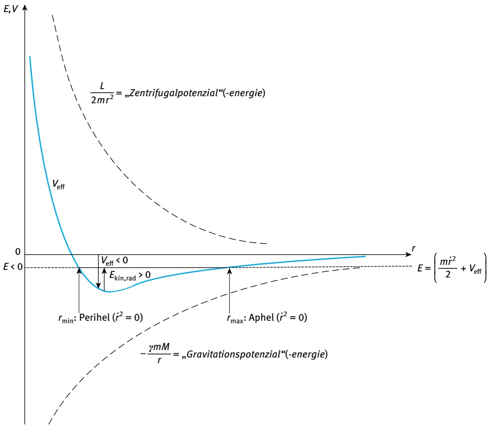

<details>
<summary>line</summary>

| Parameter | Value |
| --- | --- |
| E, V (Y-intercept) | 0 |
| r (X-intercept) | ~1.5 |
| E_eff (Y-intercept) | 0 |
| r_min: Perihel \((r^{2}\) = 0) | ~0.3 |
| E_kin,rad > 0 | ~0.4 |
| E_max: Aphel \((r^{2}\) = 0) | ~0.6 |
| E = (m/r^2 / 2 + V_eff) | ~1.5 |
</details>

Abb. I-2.18: Energieverhältnisse der Keplerbewegung: nur für $E < 0$ ergibt sich eine periodische Bewegung zwischen $r _ { \mathrm { m a x } }$ und $r _ { \mathrm { m i n } } ,$ den Radien, an denen $\dot { r } = 0$ gilt.

Zur Ableitung des ersten Keplerschen Gesetzeszt gehen wir von der Energieerhaltung aus (Gl. I-2.91), ermitteln $\dot { r }$ zu

$$
\dot {r} = \frac {d r}{d t} = \pm \sqrt {\frac {2}{m} (E - V _ {\mathrm{eff}} (r))} = \pm \sqrt {2 \cdot \frac {E}{m} + \frac {2 \gamma M}{r} - \frac {L ^ {2}}{m ^ {2} r ^ {2}}} \tag {I-2.93}
$$

und suchen die Bahngleichung $r = r ( \varphi )$ . Dazu eliminieren wir die Zeit unter Verwendung der Drehimpulserhaltung. Mit $\dot { \varphi } = \frac { L } { m r ^ { 2 } }$ , also $d \varphi = { \frac { d t \cdot L } { m r ^ { ^ 2 } } }$ erhalten wir so die Differentialgleichung für die Planetenbahn

$$
\frac {d r}{d \varphi} = \frac {m r ^ {2}}{L} \cdot \frac {d r}{d t} = \pm \frac {r ^ {2}}{\frac {L}{m}} \sqrt {2 \cdot \frac {E}{m} + \frac {2 \gamma M}{r} - \frac {\left(\frac {L}{m}\right) ^ {2}}{r ^ {2}}}.\tag {I-2.94}
$$

---

Anhang 1 Gravitation und Planetenbewegung

85

Für die Lösung findet man<sup>42</sup>

$$
r (\varphi) = \frac {p}{1 + \varepsilon \cos (\varphi)}, \tag {I-2.95}
$$

das ist die Polardarstellung eines Kegelschnitts, wobei der Pol im Brennpunkt liegt (siehe Abb. I-2.19 für den gebundenen Zustand mit $\varepsilon < 1 )$ . In unserem Fall gilt also für den „Parameter“ p

**42** Zunächst setzen wir der einfacheren Schreibung halber $\frac{E}{m}=c\ \text { and }\ \frac{L}{m}=h$ und erhalten so aus Gl. (I-2.94) $d \varphi = \pm   \frac { \displaystyle \frac { h } { r ^ { ^ 2 } } } { \displaystyle \sqrt { 2 c + \frac { 2 \gamma M } { r } - \frac { h ^ { ^ 2 } } { r ^ { ^ 2 } } } }   d r .$ . Der Radikand im Nenner wird in die Differenz zweier

Quadrate umgeschrieben, wodurch die Integration sofort möglich ist: $2c + \frac{2\gamma M}{r} - \frac{h^{2}}{r^{2}} = \alpha^{2} - u^{2}$ mit $\alpha ^ { 2 } = 2 c + \frac { \gamma ^ { 2 } M ^ { 2 } } { h ^ { 2 } } = \mathrm { c o n s t . } , \qquad u ^ { 2 } = \left( \frac { \gamma M } { h } - \frac { h } { r } \right) ^ { 2 } = \frac { \gamma ^ { 2 } M ^ { 2 } } { h ^ { 2 } } - \frac { 2 \gamma M } { r } + \frac { h ^ { 2 } } { r ^ { 2 } } ;$ mit $d u = { \frac { h } { r ^ { ^ 2 } } }   d r$ folgt

$d \varphi = \pm \; \frac { d u } { \sqrt { \alpha ^ { ^ 2 } - u ^ { ^ 2 } } }$ und somit bei der Wahl des <u>negativen</u> Vorzeichens $\varphi + \underbrace{k}_{\substack{Integrations - \\ konstante}} = \arccos \frac{u}{\alpha} \Rightarrow$

$u = \frac{\gamma M}{h} - \frac{h}{r} = \alpha \cdot \cos\left( \varphi + k \right) \Rightarrow r\left( \varphi \right) = \frac{h}{\frac{\gamma M}{h} - \alpha\cos\left( \varphi + k \right)} = \frac{\frac{h^{2}}{\gamma M}}{1 - \frac{\alpha h}{\gamma M} \cdot \cos\left( \varphi + k \right)}$ . Messen wir den

Winkel φ vom Minimalwert des Radius $( , \mathrm { P e r i h e l } ^ { \mathrm { { e } } } )$ weg, dann wird $k = \pi$ für $\varphi = 0$ . Damit erhalten wir die Polardarstellung eines Kegelschnitts mit cos $( \varphi + \pi ) = - \cos { ( \varphi ) }$

$$
r (\varphi) = \frac {p}{1 + \varepsilon \cos (\varphi)}
$$

mit dem „Parameter“ $p = \frac{h^{2}}{\gamma M} = \frac{L^{2}}{\gamma m^{2}M}$ und der „numerischen Exzentrizität“

$\varepsilon = \frac{\alpha h}{\gamma M} = \frac{h}{\gamma M} \sqrt{2 \frac{E}{m} + \frac{\gamma^2 M^2}{h^2}} = \sqrt{1 + \frac{2Ep}{\gamma m M}}$ . Dasselbe Ergebnis hätte sich auch ergeben, wenn wir das positive Vorzeichen der Wurzel gewählt hätten. Für k wäre dann $\frac{3\pi}{2}$ zu wählen, damit an Stelle von cos $( \varphi + k )$ das sich jetzt ergebende sin $( \varphi + k ) = \cos \left( \varphi - { \frac { \pi } { 2 } } + k \right)$ für $\varphi = 0$ den Wert −1 annimmt, denn dann ist wieder sin $\ln(\varphi + k) = \cos\left(\varphi - \frac{\pi}{2} + \frac{3\pi}{2}\right) = \cos(\varphi + \pi) = -\cos(\varphi)$

---

86

2 Mechanik des Massenpunktes

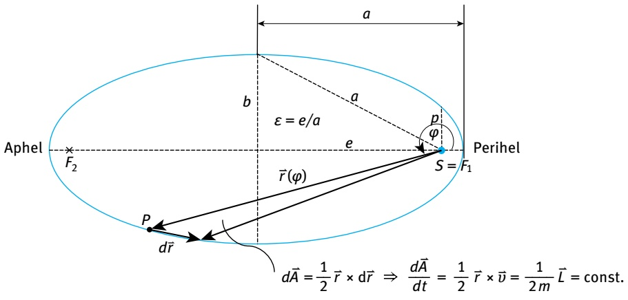

<details>
<summary>text_image</summary>

Aphel
F₂
b
a
ε = e/a
e
p
φ
S = F₁
Perihel
r̃(φ)
P
d\u0304
d\u0304 = 1/2 r̃ × d\u0304 ⇒ d\u0304/dt = 1/2 r̃ × v̄ = 1/2 m L̅ = const.
</details>

Abb. I-2.19: 1. Keplersches Gesetz: Die Planetenbahnen des Sonnensystems sind $( E < 0 )$ Ellipsen, in deren einem Brennpunkt die Sonne steht.

$$
p = \frac {L ^ {2}}{\gamma m ^ {2} M} \quad \text {Parameter der Ellipsenbahn} \tag {I-2.96}
$$

und die „numerische Exzentrizitä $t ^ { \varepsilon } \varepsilon$

$$
\varepsilon = \sqrt {1 + \frac {2 E p}{\gamma m M}} = \sqrt {1 + \frac {2 E L ^ {2}}{m (\gamma m M) ^ {2}}} \quad \begin{array}{l} \text {numerische Exzentrizität} \\ \text {der Ellipsenbahn.} \end{array} \tag {I-2.97}
$$

Für $\varepsilon < 1$ ergibt sich so eine Ellipse, für $\varepsilon = 1$ eine Parabel und für $\varepsilon > 1$ eine Hyperbel. Der gebundene Zustand der Ellipsenbahn mit $E < 0$ ergibt sich also, wenn die kinetische Energie des Himmelskörpers kleiner ist als der Betrag der potenziellen Energie, wenn also gilt

$$
\frac {1}{2} m v ^ {2} <   \gamma \frac {m M}{r}. \tag {I-2.98}
$$

In diesem Fall wird die Gesamtenergie $E = { \frac { 1 } { 2 } }   m   \upsilon ^ { 2 } - \gamma   { \frac { m   M } { r } }$ daher negativ.

Damit ist das erste Keplersche Gesetz abgeleitet:

## 1 Die Planetenbahnen des Sonnensystems sind Ellipsen, in deren einem Brennpunkt die Sonne steht.<sup>43</sup>

<small><span class="docvortex-page-footnote" data-block-type="page_footnote" style="color:#6b7280">43 Die Erdbahn ist fast kreisförmig: a = 1 AE (= Astronomische Einheit) = 149,59787⋅ 10<sup>6</sup>km; ε = 0,0162 ⇒ b = a√1 − ε2= 149,578⋅ 106 km . Nur die Venusbahn ist mit ε = 0,0068 noch kreisähnlicher. Die höchste Exzentrizität weist die Merkurbahn mit ε = 0,2056 auf.</span></small>

---

Anhang 1 Gravitation und Planetenbewegung

87

Die für die Planetenbahn wichtigen Parameter sind die große Halbachse $a = { \frac { p } { 1 - \varepsilon ^ { 2 } } } = -   { \frac { \gamma   m   M } { 2 E } }$ ,44 sie hängt nur von der Gesamtenergie E ab, nicht vom Bahndrehimpuls L, und die kleine Halbachse $b = \frac{p}{\sqrt{1 - \varepsilon^{2}}} = \frac{L}{\sqrt{- 2mE}},$ sie ist bei vorgegebener Energie –E proportional zu L.

Unter Verwendung der beiden Ellipsenachsen a und b erhält man für die numerische Exzentrizität $\varepsilon = \frac{e}{a} = \frac{\sqrt{a^{2} - b^{2}}}{a} = \sqrt{1 - \frac{b^{2}}{a^{2}}}$ und für den Parameter

$$
p = a (1 - \varepsilon^ {2}) = a \left(1 - \left[ 1 - \frac {b ^ {2}}{a ^ {2}} \right]\right) = \frac {b ^ {2}}{a}. \tag {I-2.99}
$$

Die große Halbachse a hängt nur von der Gesamtenergie E ab, umgekehrt hängt die Gesamtenergie $E = -   { \frac { \gamma   m   M } { 2   a } }$ <sub>nur</sub> von der großen Halbachse a ab; alle Ellipsenbahnen mit gleich großer Halbachse a haben daher unabhängig von der kleinen Achse b, also unabhängig vom konstanten Drehimpuls L, dieselbe Energie.<sup>46</sup>

Für $E = \left( { \frac { m   \upsilon ^ { 2 } } { 2 } } - { \frac { \gamma   m   M } { r } } \right) \rightarrow 0 .$ gilt sowohl für die Halbachse $a \rightarrow \infty$ als auch für die Exzentrizität $\varepsilon \to 1$ , die Bahnkurve wird zur Parabel. Besitzt also ein Körper an der Oberfläche eines Zentralkörpers der Masse M und dem Radius R eine Geschwindigkeit $\upsilon \geq \upsilon _ { F l } = \sqrt { \frac { 2 \gamma M } { R } }$ , der Fluchtgeschwindigkeit (escape speed), dann verlässt der Körper den Zentralkörper unabhängig davon, unter welchem Winkel zur Oberfläche er startet. Für $\nu < \nu _ { F l }$ wird die Bahn zur Ellipse $( \varepsilon < 1 )$ , für $\nu > \nu _ { F l }$ zur Hyperbel $( \varepsilon > 1 )$

<small><span class="docvortex-page-footnote" data-block-type="page_footnote" style="color:#6b7280">44 Aus der Ellipsengleichung (I-2.95) ergibt sich für φ = 0 und r(0) = a − e (siehe Abb. I-2.18): r(0) = a − aε = a(1 − ε) = p ⇒ a = p = p . Aus Gl. (I-2.97) folgt 1 − ε2 = 2 Ep 1 + ε (1 − ε) (1 + ε) γ mM p γ mM a = 2 2 E 1 − ε</span></small>

<small><span class="docvortex-page-footnote" data-block-type="page_footnote" style="color:#6b7280">2 2 45 Es gilt: b<sup>2</sup>= a2− e2= a2− a2ε2= a2(1 − ε<sup>2</sup>) = p (1 − ε2) = p ⇒ (1 − ε2)2 (1 − ε2)</span></small>

<small><span class="docvortex-page-footnote" data-block-type="page_footnote" style="color:#6b7280">p L2√γ mML2√γ mM√γ m2ML b = = √1 − ε2γ m2M√−2 Epγ m2M√−2 E⋅L√−2 mE</span></small>

<small><span class="docvortex-page-footnote" data-block-type="page_footnote" style="color:#6b7280">46 Diese Tatsache war für die Sommerfeldsche Erweiterung des Bohrschen Atommodells wichtig (vgl. Band V, Kapitel „Atomphysik“, Abschnitt 2.2.4 und Anhang 1).</span></small>

---

88

2 Mechanik des Massenpunktes

**Beispiel:** Verschiedene Fluchtgeschwindigkeiten.

Erde: $M_{E}=5,98 \cdot 10^{24} \mathrm{~kg}, \quad R_{E}=6,37 \cdot 10^{6} \mathrm{~m} \Rightarrow$

$$
\nu_ {F l} = \sqrt {\frac {2 \cdot 6 , 6 7 \cdot 1 0 ^ {- 1 1} \cdot 5 , 9 8 \cdot 1 0 ^ {2 4}}{6 , 3 7 \cdot 1 0 ^ {6}}} = 1, 1 2 \cdot 1 0 ^ {4} \mathrm{ms} ^ {- 1}
$$

Sonne: $M _ { S } = 1 , 9 9 \cdot { 1 0 } ^ { 3 0 }$ kg, $R_{S}=6,96 \cdot 10^{8}  m  \Rightarrow$

$$
v _ {F l} = \sqrt {\frac {2 \cdot 6 , 6 7 \cdot 1 0 ^ {- 1 1} \cdot 1 , 9 9 \cdot 1 0 ^ {3 0}}{6 , 9 6 \cdot 1 0 ^ {8}}} = 6, 1 8 \cdot 1 0 ^ {5} \mathrm{ms} ^ {- 1}
$$

Mond: $M _ { M } = 7 , 3 4 \cdot { 1 0 } ^ { 2 2 }$ kg, $R_{M}=1,74 \cdot 10^{6}  m  \Rightarrow$

$$
\nu_ {F l} = \sqrt {\frac {2 \cdot 6 , 6 7 \cdot 1 0 ^ {- 1 1} \cdot 7 , 4 3 \cdot 1 0 ^ {2 2}}{1 , 7 4 \cdot 1 0 ^ {6}}} = 2, 3 8 \cdot 1 0 ^ {3} \mathrm{ms} ^ {- 1}
$$

Wir haben schon in Abschnitt 2.2.2 gesehen, dass für eine Zentralkraft gilt

$$
\vec {r} \times \underbrace {m \frac {d ^ {2} \vec {r}}{d t ^ {2}}} _ {\vec {F} \uparrow \downarrow \vec {r}} = m \cdot \vec {r} \times \frac {d ^ {2} \vec {r}}{d t ^ {2}} = 0 \quad \Rightarrow \quad \vec {r} \times \frac {d ^ {2} \vec {r}}{d t ^ {2}} = \frac {d}{d t} \left(\vec {r} \times \frac {d \vec {r}}{d t}\right) = 0
$$

und durch Integration (Gl. I-2.24)

$$
\vec {r} \times \frac {d \vec {r}}{d t} = 2 \vec {c} = \text { const. }
$$

Damit ist die vom Fahrstrahl (Abstand Planet–Sonne) in der Zeiteinheit überstrichene, orientierte Fläche, die Flächengeschwindigkeit

$$
\frac {d \vec {A}}{d t} = \frac {1}{2} (\vec {r} \times \frac {d \vec {r}}{d t}) = \frac {1}{2 m} \vec {L} = \vec {c} \tag {I-2.100}
$$

konstant. Dieser Flächensatz ist das zweite Keplersche Gesetz:

1 In gleichen Zeiten überstreicht der Fahrstrahl (Abstand Planet–Sonne) gleiche Flächen.

---

Anhang 1 Gravitation und Planetenbewegung

89

Der Flächeninhalt A einer Ellipse ist $A = \pi \cdot a \cdot b$ und mit $b = \sqrt{a \cdot p} = (a \cdot p)^{\gamma_2}$

$$
A = \pi a ^ {3 / 2} p ^ {1 / 2}.
$$

Der Flächensatz (Gl. I-2.100) liefert andererseits nach Integration mit $T$ als Umlaufzeit

$$
A = T \cdot \frac {L}{2 m}.
$$

Wir setzen gleich und quadrieren:

$$
\pi^ {2} a ^ {3} p = T ^ {2} \frac {L ^ {2}}{4 m ^ {2}}
$$

oder mit Gl. (I-2.96)

$$
\frac {a ^ {3}}{T ^ {2}} = \frac {L ^ {2}}{4 \pi^ {2} m ^ {2} p} = \frac {\gamma M}{4 \pi^ {2}}. \tag {I-2.101}
$$

Das Verhältnis $a ^ { 3 } / T ^ { 2 }$ ist damit gleich einer von den Planeten unabhängigen Eigenschaft des Sonnensystems und es gilt somit für zwei beliebige Planeten

$$
a _ {1} ^ {3}: a _ {2} ^ {3} = T _ {1} ^ {2}: T _ {2} ^ {2}. \tag {I-2.102}
$$

Das ist das dritte Keplersche Gesetz:

Die Quadrate der Umlaufzeiten zweier Planeten um die Sonne verhalten sich wie die dritten Potenzen der großen Halbachsen ihrer Ellipsenbahnen.<sup>47</sup>

i

<small><span class="docvortex-page-footnote" data-block-type="page_footnote" style="color:#6b7280">47 In dieser einfachen Form gilt das Gesetz nur für unendlich große Sonnenmasse (keine Sonnenbewegung um den gemeinsamen Schwerpunkt von Sonne und Planet). Bei der exakten Berechung als Zweikörperproblem ist in den dynamischen Beziehungen m durch die reduzierte m M Masse μ = zu ersetzen. Im Kraft- und Potenzialausdruck bleibt m natürlich unverändert m + M (vgl. Gl. (I-2.92): Im ersten Term rechts ist m durch μ zu ersetzen, nicht aber im zweiten Term, 3 a der die potenzielle Energie darstellt). Die obige Beziehung lautet daher genau: T2 2 L 2 μ γ m M γ m M (m + M) a 3 4 π μ p = 11 hängt auch von der Planetenmasse m ab, 4 π2μ2 L2 4 π 2 m M T2 m + M das 3. Keplersche Gesetz ist nur eine Näherung, die aber für m ≪ M sehr gut erfüllt ist.</span></small>

---

90

2 Mechanik des Massenpunktes

## A1.3 Bestimmung der Erdbeschleunigung

## A1.3.1 Das mathematische, ebene Pendel (simple pendulum)

Schon Newton bestimmte 1686 mit einem Schwerependel die Erdbeschleunigung und fand, dass die Schwingungsdauer nicht vom verwendeten Pendelmaterial abhängt.

Zur Bestimmung der Schwingung eines idealisierten Pendels (mathematisches Pendel) betrachten wir einen Massenpunkt (MP), der an einem masselosen, gespannten Faden im Erdschwerefeld um einen Aufhängepunkt schwingt. Auf den MP wirkt einerseits die Schwerkraft $\vec { F } _ { G } = m \cdot \vec { g }$ , andererseits die Fadenspannung $\vec { F } _ { S }$ , die der Komponente ${ \vec { F } } _ { n }$ der Schwerkraft in Fadenrichtung (Normalkomponente) sowie der Zentrifugalkraft $\vec { F } _ { z f } = m   \frac { \upsilon ^ { 2 } } { r }   \vec { r } _ { 0 } \; ( \vec { r } _ { 0 } =$ Einheitsvektor in Richtung Aufhängepunkt – Massenpunkt) gerade die Waage hält und dadurch den $M P$ auf die Kreisbahn zwingt (Zwangsbedingung).<sup>48</sup> Beschleunigend wirkt daher nur die Tangentialkomponente $\vec { F } _ { t } = m \cdot g \cdot \sin \varphi$ , die dazu führt, dass sich die Bogenlänge $\vec { s }$ mit der Zeit ändert und zwar sich bis zur Vertikallage $( x = 0 )$ verkleinert, sich dann infolge der erreichten kinetischen Energie bis zum maximalen Ausschlag gegen die wirkende Kraft $\vec { F } _ { t }$ vergrößert usf. Die beschleunigende Kraft $\vec { F } _ { t }$ ist also immer entgegen $\vec { s }$ gerichtet.

Entsprechend Abb. I-2.20 muss gelten

$$
m \frac {d ^ {2} s}{d t ^ {2}} = - m g \sin \varphi . \tag {I-2.103}
$$

Mit $s = l \cdot \varphi$ können wir dies in Polarkoordinaten überführen

$$
l m \ddot {\varphi} = - m g \sin \varphi \tag {I-2.104}
$$

und erhalten die Bewegungsgleichung

$$
\ddot {\varphi} + \frac {g}{l} \sin \varphi = 0 \quad \begin{array}{l} \text {Bewegungsgleichung des} \\ \text {mathematischen ebenen Kreispendels.} \end{array} \tag {I-2.105}
$$

Das ist eine nichtlineare Differentialgleichung (DG) 2. Ordnung (siehe Band II, Kapitel „Nichtlineare Dynamik und Chaos“, Abschnitt 2.1.3). Diese Bewegungsgleichung stimmt nicht mit der Schwingungsgleichung des harmonischen Oszillators überein! Nur für den Fall sehr kleiner Auslenkwinkel $\varphi ,$ , für den sin $\varphi \equiv \varphi$ gesetzt werden kann, gilt

<small><span class="docvortex-page-footnote" data-block-type="page_footnote" style="color:#6b7280">48 In Fadenrichtung kann sich m nicht bewegen, daher muss die Summe aller Kräfte in dieser Richtung Null sein: F⇀S + F⇀n + F⇀zf = 0 (Abb. I-2.20).</span></small>

---

Anhang 1 Gravitation und Planetenbewegung

91

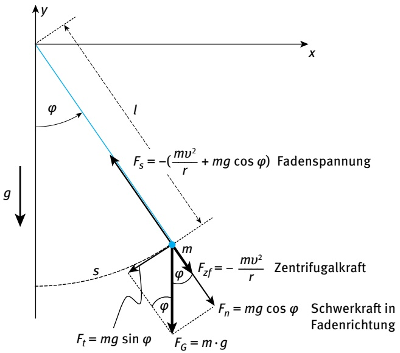

<details>
<summary>text_image</summary>

y
x
l
φ
Fs = -(mv²/r + mg cos φ) Fadenspannung
m
Fzf = -mv²/r Zentrifugalkraft
s
φ
Fn = mg cos φ Schwerkraft in Fadenrichtung
Ft = mg sin φ
FG = m·g
</details>

Abb. I-2.20: Das mathematische, ebene Pendel. Zur einfacheren Darstellung sind nur die Beträge der wirkenden Kräfte dargestellt. Die Radialkraft $\vec { F } _ { n } + \vec { F } _ { z f }$ wird von der Fadenspannung $\bar { F } _ { S }$ aufgenommen.

$$
\ddot {\varphi} + \frac {g}{l} \varphi = 0 \quad \begin{array}{l} \text {Bewegungsgleichung des} \\ \text {mathematischen ebenen Kreispendels} \\ \text {für sehr kleine Ausschlagswinkel} \varphi , \end{array} \tag {I-2.106}
$$

was zur Schwingungsgleichung des harmonischen Oszillators analog ist (vgl. Kapitel $\mathbf { , } \mathbf { M }$ echanische Schwingungen und Wellen“, Abschnitt 5.1.1). Der Vergleich mit $\ddot { x } + \omega _ { 0 } ^ { 2 }   x = 0$ zeigt, dass in diesem Fall für die Frequenz des mathematischen Pendels gilt

$$
\omega_ {0} = \frac {2 \pi}{T _ {0}} = \sqrt {\frac {g}{l}} \tag {I-2.107}
$$

und damit für die Schwingungsdauer

$$
T _ {0} = 2 \pi \sqrt {\frac {l}{g}}. ^ {4 9} \tag {I-2.108}
$$

<small><span class="docvortex-page-footnote" data-block-type="page_footnote" style="color:#6b7280">49 Diese Beziehung wurde erstmals 1673 von Christiaan Huygens (1629–1695) angegeben.</span></small>

---

92

2 Mechanik des Massenpunktes

Durch Messung der Schwingungsdauer kann also der Betrag der Erdbeschleunigung g gemessen werden.

## A1.3.2 Das physikalische Pendel (physical pendulum)

In diesem Fall schwingt kein Massenpunkt sondern ein starrer Körper um eine raum- und körperfeste Achse (Abb. I-2.21).

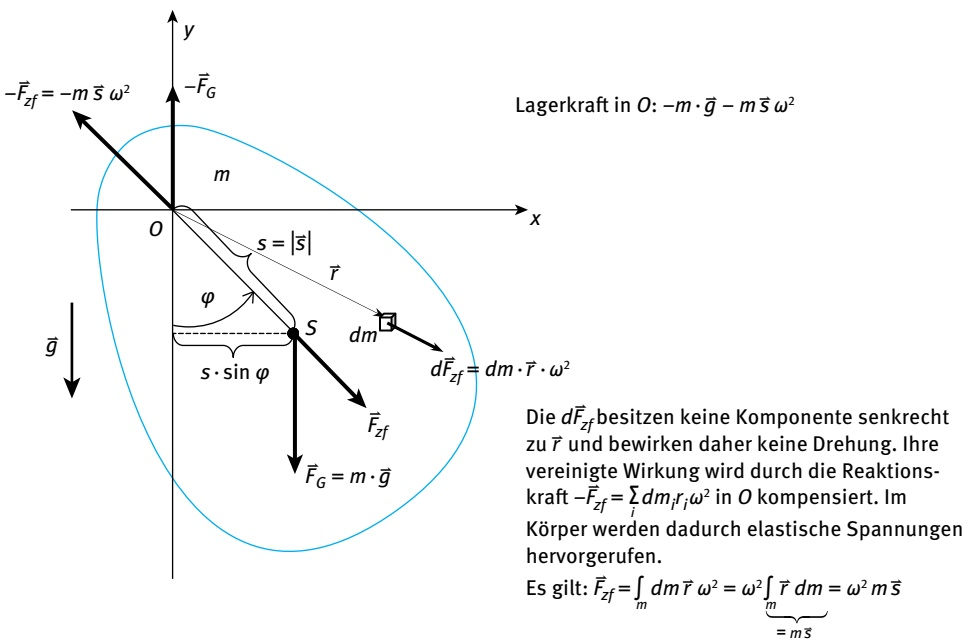

<details>
<summary>text_image</summary>

-F_{zf} = -m \vec{s} \omega^2
Lagerkraft in O: -m \cdot \vec{g} - m \vec{s} \omega^2
O
s = |\vec{s}|
\vec{r}
dm
d\vec{F}_{zf} = dm \cdot \vec{r} \cdot \omega^2
\vec{g}
\vec{F}_{zf}
\vec{F}_{G} = m \cdot \vec{g}
\varphi
s \cdot \sin \varphi
Die d\vec{F}_{zf} besitzen keine Komponente senkrecht zu \vec{r} und bewirken daher keine Drehung. Ihre vereinigte Wirkung wird durch die Reaktionskraft -F_{zf} = \sum_{i} dm_i r_i \omega^2 in O kompensiert. Im Körper werden dadurch elastische Spannungen hervorgerufen.
Es gilt: F_{zf} = \int_{m} dm \vec{r} \omega^2 = \omega^2 \underbrace{\int_{m} \vec{r} dm}_{= m \vec{s}} = \omega^2 m \vec{s}
</details>

Abb. I-2.21: Das physikalische Pendel.

Zur Beschreibung der Bewegung benützen wir die Bewegungsgleichung $\dot { \bar { L } } = \bar { D }$ Die körperfeste Drehachse durch O legen wir in die z-Achse (normal zur Papierebene); damit liegt auch der Vektor der Winkelgeschwindigkeit $\vec { \omega } = \{ 0 , 0 , \omega _ { z } = \dot { \varphi } \}$ in der z-Achse. Die Komponenten des Drehimpulses sind daher (siehe Kapitel „Mechanik des starren Körpers“, Abschnitt 3.3.4) gemäß der Beziehung $\vec { L } = \tilde { I }   \cdot \vec { \omega }   ^ { 5 0 }$

$$
L _ {x} = I _ {x z} \dot {\varphi}, \quad L _ {y} = I _ {y z} \dot {\varphi}, \quad L _ {z} = I _ {z z} \dot {\varphi}. ^ {5 1} \tag {I-2.109}
$$

<small><span class="docvortex-page-footnote" data-block-type="page_footnote" style="color:#6b7280">50 I ̃ ist der Trägheitstensor.</span></small>

<small><span class="docvortex-page-footnote" data-block-type="page_footnote" style="color:#6b7280">51 Weist φ̇ in die Richtung einer Hauptachse des Körpers, dann sind nur mehr die diagonalen Trägheitsmomente I<sub>xx</sub>, I<sub>yy</sub>, I<sub>zz</sub> ungleich Null (siehe Kapitel „Mechanik des starren Körpers“, Abschnitt 3.3.2, Gl. 3.31) und es gilt: L<sub>x</sub> = L<sub>y</sub> = 0, L<sub>z</sub> = I<sub>zz</sub>φ̇ = I<sub>c</sub>φ̇ (Bewegung um eine freie Achse).</span></small>

---

Anhang 1 Gravitation und Planetenbewegung

93

Die Schwerkraft $\vec { F } _ { G } = m \cdot \vec { g }$ greift im Massenmittelpunkt (Schwerpunkt) an und verursacht ein bewegendes Drehmoment um die $z - \mathbf { A } ($ chse (s … Abstand des Schwerpunkts von der Drehachse)

$$
\vec {D} _ {z} = - m g s \cdot \sin \varphi \cdot \vec {e} _ {z}. \tag {I-2.110}
$$

Als Bewegungsgleichung erhalten wir so

$$
\dot {L} _ {z} = I _ {z z} \ddot {\varphi} = - m g s \cdot \sin \varphi \tag {I-2.111}
$$

bzw. mit $I _ { z z } = I _ { O }$ als Trägheitsmoment um die z-Achse

$$
\ddot {\varphi} + \frac {m g s}{I _ {O}} \sin \varphi = 0 ^ {5 2} \quad \begin{array}{l} \text {Bewegungsgleichung des} \\ \text {physikalischen Pendels.} \end{array} \tag {I-2.112}
$$

Diese Gleichung stimmt mit jener des mathematischen Pendels überein, wenn man

$$
\frac {1}{l} = \frac {m s}{I _ {O}} \tag {I-2.113}
$$

setzt.

Für den Fall sehr kleiner Auslenkungen kann man wieder sin $\varphi \equiv \varphi$ setzen und erhält durch Vergleich mit der Schwingungsgleichung des harmonischen Oszillators für die Schwingungsdauer

$$
T ^ {O} = 2 \pi \sqrt {\frac {I _ {O}}{D ^ {*}}} = 2 \pi \sqrt {\frac {I _ {O}}{m g s}} = 2 \pi \sqrt {\frac {l _ {r} ^ {O}}{g}} \quad \begin{array}{l} \text {Schwingungsdauer des} \\ \text {physikalischen Pendels} \\ \text {für kleine Ausschläge,} \end{array} \tag {I-2.114}
$$

wenn man mit $D ^ { \star } = m g s$ das Direktionsmoment bezeichnet. Die Schwingungsdauer $T _ { 0 }$ eines mathematischen Pendels stimmt mit jener des physikalischen $T ^ { o }$ überein, wenn für seine Pendellänge entsprechend Gl. (I-2.113) gilt

$$
l = l _ {r} ^ {O} = \frac {I _ {O}}{m s} \quad \text {reduzierte Pendellänge um} O. \tag {I-2.115}
$$

<small><span class="docvortex-page-footnote" data-block-type="page_footnote" style="color:#6b7280">52 Damit erhält man aus den Drehimpulsbeziehungen Gl. (I-2.109) noch zwei weitere periodisch wechselnde Drehmomente D<sub>x</sub> = L̇x = I<sub>xz</sub>φ̈ um die x-Achse und D<sub>y</sub> = L̇y = I<sub>yz</sub>φ̈ um die y-Achse. Da aber die Bewegung nur um die z-Achse möglich ist, werden diese beiden Drehmomente durch gegengleiche Drehmomente in den Lagern der Drehachse („Reaktionsmomente“) aufgehoben. Diese bewirken aber eine erhöhte Lagerreibung und damit eine starke Dämpfung der Drehschwingung. Der Pendelkörper sollte daher immer um eine freie Achse, also um eine Achse größten oder kleinsten Trägheitsmoments, schwingen (siehe dazu Kapitel „Mechanik des starren Körpers“, Abschnitt 3.3.7).</span></small>

---

94

2 Mechanik des Massenpunktes

**Beispiel:** Reduzierte Pendellänge eines einfachen Kugelpendels mit masselosem Aufhängefaden.

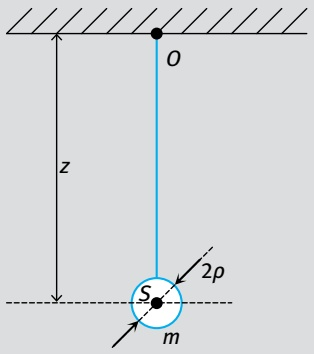

<details>
<summary>text_image</summary>

O
z
S
2ρ
m
</details>

Trägheitsmoment um $O$ (nach dem Steinerschen Satz, siehe „Mechanik des starren Körpers“, Abschnitt 3.3.5): $I _ { O } = m   z ^ { 2 } + { \frac { 2 } { 5 } }   m   \rho ^ { 2 } \Rightarrow$ reduzierte Pendellänge

$$
l _ {r} ^ {O} = \frac {I _ {O}}{m z} = \frac {1}{m z} \Bigg (m z ^ {2} + \frac {2}{5} m \rho^ {2} \Bigg) = z + \frac {2}{5} \frac {\rho^ {2}}{z} = z \Bigg (1 + \frac {2}{5} \frac {\rho^ {2}}{z ^ {2}} \Bigg)
$$

$\Rightarrow$ Eine Kugel von 5 cm Durchmesser an einem 1 m langen Faden besitzt eine reduzierte Pendellänge von

$$
l _ {r} ^ {O} = 1 0 0 \left(1 + \frac {2}{5} \cdot \frac {2 , 5 ^ {2}}{1 0 0 ^ {2}}\right) = 1 0 0, 0 2 5 \mathrm{cm} \Rightarrow \frac {T ^ {O}}{T _ {0}} = \sqrt {\frac {l _ {r} ^ {O}}{1 0 0}} = \sqrt {\frac {1 0 0 , 0 2 5}{1 0 0}} = 1, 0 0 0 1 2 5
$$

$\Rightarrow$ wird das Kugelpendel als mathematisches Pendel behandelt, beträgt der Fehler 0,125 ‰!

## A1.3.3 Das Reversionspendel <sup>53</sup>

Schwingungszeiten eines Pendels können zwar sehr genau gemessen werden, der einfache Zusammenhang mit der Erdbeschleunigung ergibt sich aber nur in der Näherung sin $\varphi \equiv \varphi$ . Außerdem müssen neben der Schwingungsdauer auch die Pendellänge oder der Schwerpunktsabstand gemessen werden. Zur genauen Bestimmung der Erdbeschleunigung verwendet man daher ein Reversionspendel. Die ses ist mit zwei Aufhängeschneiden ausgestattet, deren Abstand reguliert werden kann. Es gestattet eine sehr genaue Ermittlung der reduzierten Pendellänge $l _ { r } ^ { o }$

<small><span class="docvortex-page-footnote" data-block-type="page_footnote" style="color:#6b7280">53 Erdacht von Johann Gottlieb Friedrich von Bohnenberger (1765–1831), ausgeführt und angewendet von Henry Kater (1777–1835): das „Kater Pendulum“. Das Reversionspendel war lange Zeit das wichtigste Instrument zur Bestimmung der Erdbeschleunigung.</span></small>

---

Anhang 1 Gravitation und Planetenbewegung

95

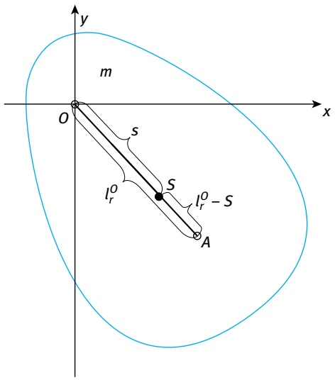

<details>
<summary>text_image</summary>

m
O
s
l_r^o
S
l_r^o - S
A
x
y
</details>

Abb. I-2.22: Ein physikalisches Pendel mit zwei vertauschbaren Achsen bei O und A im Abstand der reduzierten Pendellänge $l _ { r } ^ { o } .$ .

Wir betrachten nochmals ein physikalisches Pendel und denken uns seine reduzierte Pendellänge $l _ { r } ^ { o }$ vom Drehpunkt O aus in Richtung des Schwerpunkts S bis zum Endpunkt A aufgetragen (Abb. I-2.22).

Jetzt vertauschen wir den bisherigen Drehpunkt O mit A, sodass das Pendel jetzt um A schwingt. Die neue reduzierte Pendellänge für diese Schwingung ist jetzt

$$
l _ {r} ^ {A} = \frac {I _ {A}}{m (l _ {r} ^ {O} - s)}. \tag {I-2.116}
$$

Nach dem Steinerschen Satz gilt allgemein für das Trägheitsmoment $I _ { A ^ { \prime } }$ bei der Drehung um eine Achse A′, die nicht durch den Schwerpunkt geht und zur Schwerpunktsachse A parallel ist (siehe Kapitel „Mechanik des starren Körpers“, Abschnitt 3.3.5)

$$
I _ {A ^ {\prime}} = \underbrace {I _ {A}} _ {\substack {\text {Trägheitsmoment um} \\ \text {Schwerpunktsachse}}} + \underbrace {l ^ {2} m} _ {\substack {\text {Trägheitsmoment der} \\ \text {Gesamtmasse in Sum A ^ {\prime}}}} \tag{I - 2.117}
$$

und daher im vorliegenden Fall für

$$
I _ {A} = \underbrace {I _ {S}} _ {\substack {\text {Trägheitsmoment um} \\ \text {Schwerpunktsachse}}} + \underbrace {(l _ {r} ^ {O} - s) ^ {2} m} _ {\substack {\text {Trägheitsmoment der} \\ \text {Gesamtmasse in Sum A}}}. \tag{I - 2.118}
$$

---

96

2 Mechanik des Massenpunktes

Für $l _ { r } ^ { A }$ ergibt sich daher

$$
l _ {r} ^ {A} = \frac {I _ {S} + (l _ {r} ^ {O} - s) ^ {2} \cdot m}{m (l _ {r} ^ {O} - s)} = l _ {r} ^ {O} - s + \frac {I _ {S}}{m (l _ {r} ^ {O} - s)}. \tag {I-2.119}
$$

Für $l _ { r } ^ { o }$ ergibt sich mit dem Steinerschen Satz

$$
l _ {r} ^ {O} = \frac {I _ {O}}{m s} = \frac {I _ {S} + s ^ {2} m}{m s} = s + \frac {I _ {S}}{m s} \tag {I-2.120}
$$

und daher

$$
l _ {r} ^ {O} - s = \frac {I _ {S}}{m s}. \tag {I-2.121}
$$

Das setzen wir in den obigen Ausdruck für $l _ { r } ^ { A }$ (Gl. I-2.119) ein und erhalten

$$
l _ {r} ^ {A} = l _ {r} ^ {O}. \tag {I-2.122}
$$

Vertauscht man also den Drehpunkt O mit A, so ändert sich die reduzierte Pendellänge nicht. Damit sind aber auch die beiden Schwingungsdauern gleich, also

$$
T ^ {A} = T ^ {O} \quad \text {Bedingung für das Reversionspendel.} \tag {I-2.123}
$$

Um die Erdbeschleunigung also genau zu messen, hängt man das Reversionspendel abwechselnd an seinen beiden Schneiden auf und reguliert den Schneidenabstand, bis die Schwingungsdauer für beide Aufhängungen genau gleich ist (Abb. I-2.23). Dann ist der leicht messbare Schneidenabstand gleich der reduzierten Pendellänge $l _ { r }$ und es gilt

$$
T = 2 \pi \sqrt {\frac {l _ {r}}{g}}. \tag {I-2.124}
$$

Hieraus kann nun $g$ mit großer Genauigkeit ermittelt werden.

Die Erdbeschleunigung $g$ ist wegen der Erdrotation, der Ortsabhängigkeit des Erdradius aufgrund der Abplattung und der ungleichmäßigen Dichteverteilung vom Ort abhängig. Ein Normwert $g _ { n }$ wurde 1901 international auf den exakten Wert

$$
g _ {n} = 9, 8 0 6 6 5 \mathrm{ms} ^ {- 2}
$$

festgelegt (Normalbeschleunigung). Er galt ursprünglich für Meereshöhe bei einer geographischen Breite von $\varphi = 4 5 ^ { \circ }$ . Wegen der später festgestellten Schwereano-

---

Anhang 1 Gravitation und Planetenbewegung

97

malien (ungleich verteilte Massen im Geoid) ist die Normalbeschleunigung eine willkürliche Festlegung. Sie wirkt in Richtung der Normalen zum Geoid.

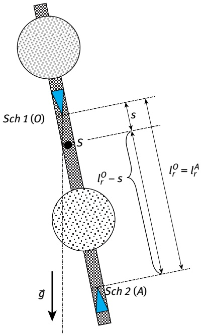

<details>
<summary>text_image</summary>

Sch 1 (O)
S
s
l_r^O - s
l_r^O = l_r^A
Sch 2 (A)
g
</details>

Abb. I-2.23: Schematische Zeichnung eines Reversionspendels. Gesamte Systemmasse: m.

## A1.4 Bestimmung der Gravitationskonstante

Henry Cavendish (1731–1810) wollte mit einer von John Michell (1724–1793; englischer Naturphilosoph und Geologe) etwa 1760 konstruierten und gebauten Apparatur die Dichte der Erde bestimmen („die Welt abwiegen“). Seine Messwerte wurden erst mehr als 100 Jahre später von Boys (Sir Charles Vernon Boys, 1855–1944) für eine Bestimmung der Gravitationskonstante des Newtonschen Gravitationsgesetzes benützt (C. V. Boys, Nature **50**, 571 (1894)). Zu ihrer Bestimmung muss die Gravitationswirkung zweier bekannter Massen gemessen werden. Die Anordnung von Cavendish war ein „Massendipol“ (Hantel, dumbbell) aus kleinen Bleikugeln als Drehpendel, der mit zwei großen Bleikugeln außen in Wechselwirkung trat (Abbn. I-2.24 und I-2.25)

Wurden die großen Kugeln den kleinen genähert (Abstand der Kugelzentren $r = 230\  mm$ , konnte über den Spiegel durch Verschiebung eines Lichtzeigers auf einer Skala (bzw. die Verschiebung des Nullpunkts bei schwingender Messung) eine Drehung des Pendels gegen die Fadentorsion beobachtet werden. Im Gleichgewicht muss das Drehmoment durch die Massenanziehung $D _ { G r } = l \cdot F = l \cdot \gamma { \frac { m \cdot M } { r ^ { 2 } } }$

---

98

2 Mechanik des Massenpunktes

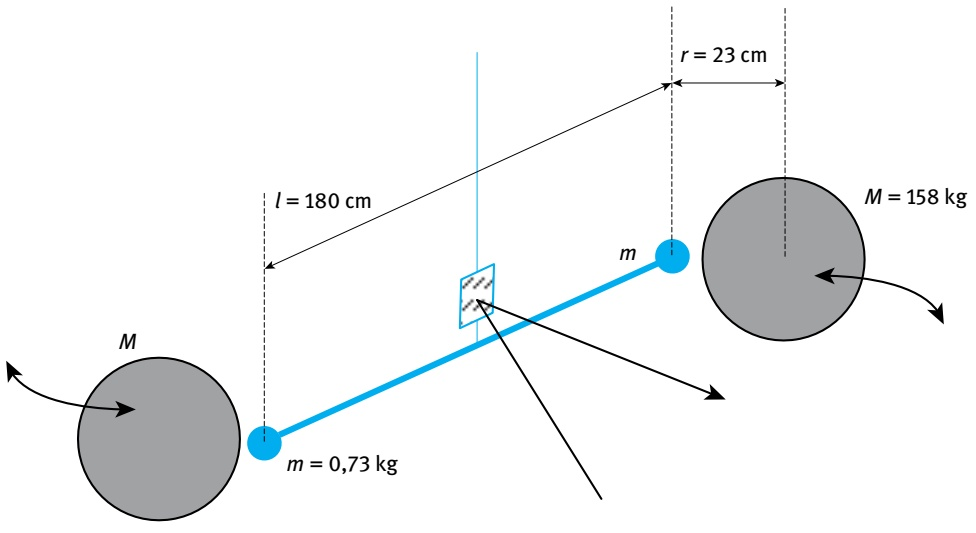

<details>
<summary>text_image</summary>

l = 180 cm
r = 23 cm
m = 0,73 kg
M = 158 kg
</details>

Abb. I-2.24: Das Cavendish Experiment, 1798: Ein Drehpendel mit zwei kleinen Bleikugeln (blau) wird durch zwei große Bleikugeln (grau) ausgelenkt. Ein Lichtstrahl wird an einem fest mit dem Pendel verbundenen Spiegel reflektiert und zeigt die Auslenkung auf einer Skala.

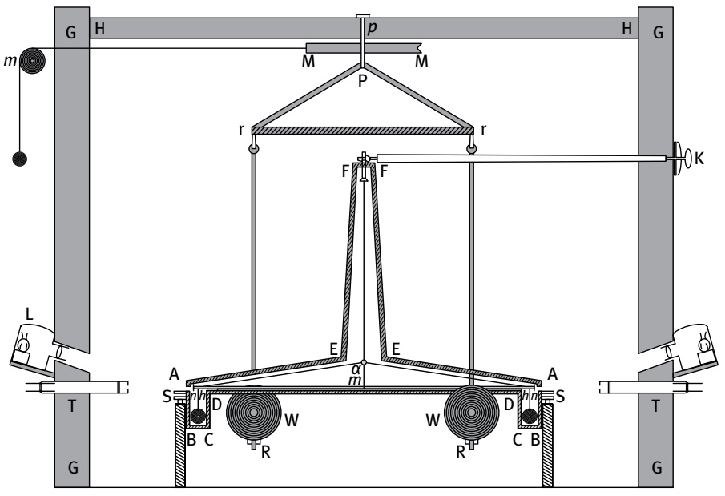

<details>
<summary>text_image</summary>

G H p H G
m
M M
P
r r
F F
K
L
T A E E A
S D W W D T
B C R R C B G
G
</details>

Abb. I-2.25: Schnittzeichnung durch die von Cavendish benützte Drehwaage mit Bleikugeln von 51 mm Durchmesser und $m = 0 , 7 3$ kg in einem Abstand von l = 1,8 m. Die großen Bleikugeln (300 mm Durchmesser, $M = 158    kg$ waren auf einem drehbaren Rahmen montiert. (Nach H. Cavendish, Philosophical Transactions of the Royal Society of London, 88, 469 (1798).)

---

Anhang 1 Gravitation und Planetenbewegung

99


<details>
<summary>natural_image</summary>

Historical illustration of a person operating a large mechanical device with a crane, surrounded by brick and foliage (no visible text or symbols)
</details>

Abb. I-2.26: Radierung, die Cavendish bei der Bestimmung der Gravitationskonstante mit seinem Drehpendel zeigt.

gleich dem Drehmoment durch die Fadentorsion, also dem Produkt aus Direktionsmoment $D ^ { \star } = \frac { \pi } { 2 }   \frac { G \cdot R ^ { 4 } } { L }   ( G )$ … Torsionsmodul des Aufhängedrahtes, R … Drahtdurchmesser, L … Drahtlänge) und Drehwinkel $\varphi$ sein (siehe Kapitel „Mechanik deformierbarer Körper“, Abschnitt 4.2.2), also

$$
D _ {G r} = l \cdot \gamma \frac {m \cdot M}{r ^ {2}} = D _ {T} = D ^ {\star} \cdot \varphi . \tag {I-2.125}
$$

Cavendish bestimmte das Direktionsmoment $D ^ { * }$ seines Drehpendels aus der gemessenen Schwingungsdauer von ca. 7 Minuten (siehe Abschnitt A1.3.2, Gl. I-2.114):

$$
T = 2 \pi \sqrt {\frac {I}{D ^ {*}}}
$$

(Abb. I-2.26).

Unter Vernachlässigung der Masse des Dreharms gegen die Masse der Kugeln folgt für das Trägheitsmoment I der als punktförmig angenommenen Massen m (siehe Kapitel „Mechanik des starren Körpers“, Abschnitt 3.3.4)

$$
I _ {A} = m \left(\frac {l}{2}\right) ^ {2} + m \left(\frac {l}{2}\right) ^ {2} = \frac {2 m l ^ {2}}{4} = \frac {m l ^ {2}}{2} \tag {I-2.126}
$$

und damit

$$
T = 2 \pi \sqrt {\frac {m l ^ {2}}{2 D ^ {*}}} \tag {I-2.127}
$$

---

100

2 Mechanik des Massenpunktes

bzw.

$$
D ^ {\star} = 4 \pi^ {2} \frac {m l ^ {2}}{2 T ^ {2}}. \tag {I-2.128}
$$

In die Gleichung der Drehmomente Gl. (I-2.125) eingesetzt, kann nach der Gravitationskonstante aufgelöst werden

$$
\gamma = \frac {D ^ {*} r ^ {2} \varphi}{l m M} = \frac {2 \pi^ {2} l r ^ {2}}{M T ^ {2}} \varphi . \tag {I-2.129}
$$

Bei bekanntem $\gamma$ können die Erdmasse und die Erddichte bestimmt werden, wenn man die Gewichtskraft, die auf eine Masse an der Erdoberfläche wirkt, der Gravitationswechselwirkung mit der Erdmasse gleichsetzt, also

$$
F _ {G} ^ {m} = m \cdot g = \gamma \frac {m M _ {E}}{r _ {E} ^ {2}} \tag {I-2.130}
$$

(g … Erdbeschleunigung, $M _ { E }$ … Erdmasse, $r _ { E }$ … Erdradius), woraus sich

$$
M _ {E} = \frac {g \cdot r _ {E} ^ {2}}{\gamma} \quad \text {und} \quad \rho_ {E} = \frac {M _ {E}}{4 \pi r _ {E} ^ {3} / 3} = \frac {3 g}{4 \pi r _ {E} \gamma} \tag {I-2.131}
$$

ergeben.<sup>54</sup>

Cavendish rechnete die Gravitationskonstante nicht explizit aus, sondern bestimmte aus den Verhältniszahlen nur die Dichte der Erde zu $\rho_{E}=5,448\  g\  cm ^{-3}=$ $5 , 4 4 8 \cdot 1 0 ^ { 3 } \mathrm { k g } \mathrm { m } ^ { - 3 }$ .55

Aus dem korrigierten Ergebnis der Erddichte (siehe Fußnote 55) bestimmte Boys 1894 den Wert der Gravitationskonstanten zu

$$
\gamma = g \frac {r _ {E} ^ {2}}{M _ {E}} = 6, 7 4 \cdot 1 0 ^ {- 1 1} \mathrm{m} ^ {3} \mathrm{kg} ^ {- 1} \mathrm{s} ^ {- 2}, \tag {I-2.132}
$$

<small><span class="docvortex-page-footnote" data-block-type="page_footnote" style="color:#6b7280">54 Der Erdradius r<sub>E</sub> war durch die erstmals von Tycho Brahe (1589) und Snellius (1615) vorgenommene und später vervollkommnete Gradmessung mittels Triangulation bereits hinreichend bekannt – Gradmessung in Peru (1735–1744) und Lappland (1736–1737) im Auftrage der Academie des Sciences de l’Institut de France (der „Pariser Akademie der Wissenschaften“). Mit dem heutigen mittleren Erdradius r<sub>E</sub>,mittel = 6371 km, einer mittleren Erdbeschleunigung von g = 9,82 m s und der Gravitationskonstante von γ = 6,674 mkg s ergibt sich die Erdmasse zu ME = 5,9723 ⋅ 10 kg. 55 Durch einen Fehler, den Francis Baily (1774–1844) später in der Rechnung fand, war das Ergebnis von Cavendish ρ<sub>E</sub> = 5,48 ± 0,038 g cm (heute: ρE = 5,515 g cm ).</span></small>

---

Anhang 1 Gravitation und Planetenbewegung

101

einen Wert, der auf 1 % genau mit dem derzeit akzeptierten Wert von

$$
\gamma = (6, 6 7 4 3 0 \pm 0, 0 0 0 1 5) \cdot 1 0 ^ {- 1 1} \mathrm{m} ^ {3} \mathrm{kg} ^ {- 1} \mathrm{s} ^ {- 2} \tag {I-2.132a}
$$

übereinstimmt.<sup>56</sup>

Die Experimente wurden 1896 von Eötvös (Loránd Eötvös, 1848–1919, ungarischer Physiker) mit höherer Präzision wiederholt; Eötvös untersuchte auch in den Jahren ab 1890 bis 1915 mit Hilfe eines Drehpendels, dessen eine Masse aus Platin, die andere aus 8 verschiedenen Stoffen bestand, die Gleichheit von träger und schwerer Masse mit großer Genauigkeit und fand so, dass träge und schwere Masse innerhalb der Messgenauigkeit übereinstimmen. Dicke (Robert Henry Dicke, 1916–1997, US-amerikanischer Physiker) zeigte 1964 in einem aufwendigen Experiment mit einem Drehpendel, das aus drei Massen bestand, zwei aus Aluminium, einer aus Gold,<sup>57</sup> dass der Unterschied in der Gravitationswechselwirkung von Aluminium und Gold kleiner als $( 1 . 3 \pm 1 . 0 ) \cdot { 1 0 } ^ { ^ { - 1 1 } }$ ist, fand also mit hoher Genauigkeit, dass die Gravitationswechselwirkung stoffunabhängig und damit keine Körpereigenschaft ist (P. G. Roll, R. Krotkov und R. H. Dicke, Annals of Physics **26**, 442 (1964)).

Eine sehr genaue Messung der Gravitationskonstanten erfolgte 2000 an der University of Washington in Seattle, USA. Als Pendel wurde in diesem Fall eine flache Platte aus Pyrexglas verwendet, die in einer Vakuumkammer auf einem Torsionsfaden hängend im Zentrum eines Drehtisches angebracht ist, auf dem vier Attraktormassen befestigt sind (Abb. I-2.27).

Wenn sich der Tisch mit konstanter Umdrehungsgeschwindigkeit $\omega _ { \alpha }$ dreht, wird auf das Pendel entsprechend der Gravitationswechselwirkung mit den Attraktormassen ein sinusförmiges Drehmoment ausgeübt. Nun wird die Kammer samt Pendel und Torsionsfaden so hin- und hergedreht $( \omega _ { i } ( t ) )$ , dass die Verdrehung des Pendels relativ zur Kammer minimal ist. In diesem Fall ist die Drehbeschleunigung $\dot { \omega } _ { i } ( t )$ der Vakuumkammer gleich der Drehbeschleunigung des Pendels durch die Gravitationswechselwirkung und diese kann aus der mit $\dot { \omega } _ { i } ( t )$ pendelnden Drehbe wegung der Kammer bestimmt werden. Da der Aufhängefaden praktisch nicht tordiert wird, spielen seine Torsionseigenschaften wie etwa seine Anelastizität keine Rolle. Mit dieser Anordnung wurde die Gravitationskonstante zu

$$
\gamma = (6, 6 7 4 2 1 5 \pm 0, 0 0 0 0 9 2) \cdot 1 0 ^ {- 1 1} \mathrm{m} ^ {3} \mathrm{kg} ^ {- 1} \mathrm{s} ^ {- 2}
$$

bestimmt. Als Erd- und Sonnenmasse ergeben sich daraus

<small><span class="docvortex-page-footnote" data-block-type="page_footnote" style="color:#6b7280">56 Wert für 2018 vom Committee on Data for Science and Technology (CODATA) (gültig seit 20. Mai 2019).</span></small>

<small><span class="docvortex-page-footnote" data-block-type="page_footnote" style="color:#6b7280">57 Das Drehpendel mit den gleichschweren, aber aus verschiedenen Stoffen bestehenden Kugeln war senkrecht zum Meridian aufgehängt und sollte daher eine Verdrehung erleiden, wenn die Zentrifugalkraft, die ja der trägen Masse proportional ist, zufolge der Erdrotation auf die beiden Kugeln differiert. Der Unterschied erwies sich als kleiner als 10 . Dieses Ergebnis war eine fundamentale Stützung für die allgemeine Relativitätstheorie.</span></small>

---

102

2 Mechanik des Massenpunktes

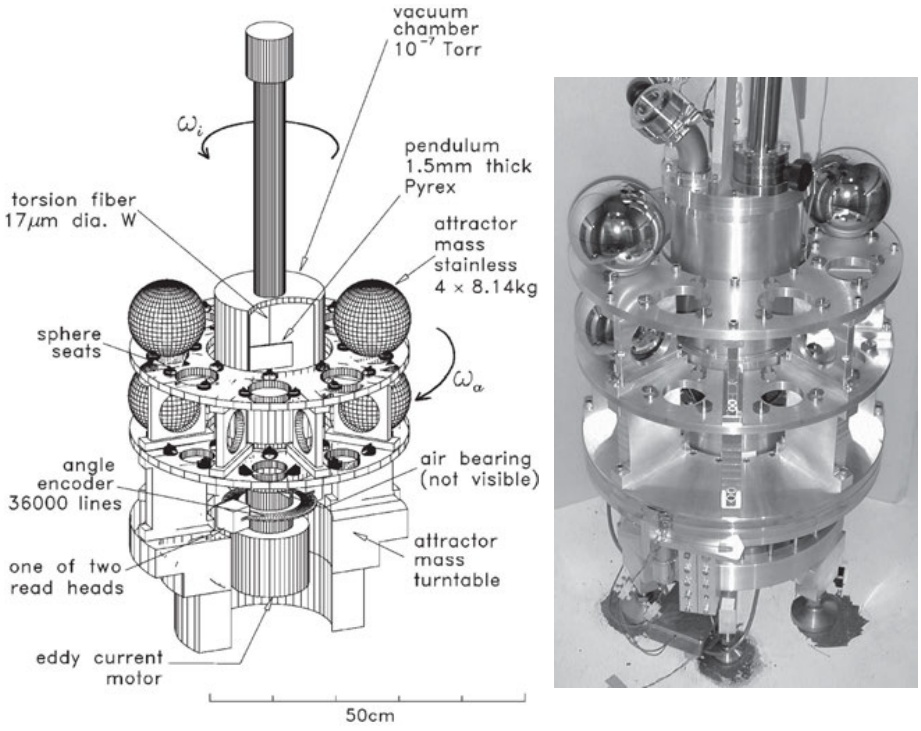

Abb. I-2.27: Apparat eines modernen Cavendish Experiments. (Nach J. H. Gundlach und S. M. Merkowitz, Physical Review Letters 85, 2869 (2000).)

$$
M _ {E} = (5, 9 7 2 2 4 5 \pm 0, 0 0 0 0 8 2) \cdot 1 0 ^ {2 4} \mathrm{kg}
$$

$$
M _ {S} = (1, 9 8 8 4 3 5 \pm 0, 0 0 0 0 2 7) \cdot 1 0 ^ {3 0} \mathrm{kg}.
$$

Neueste Messungen im MOE Key Laboratory of Fundamental Physical Quantities Measurements, School of Physics der Huazhong University of Science and Technology, Wuhan, China, wurden mit zwei voneinander unabhängigen Bestimmungsmethoden durchgeführt, von denen angenommen wird, dass sie nicht die gleichen systematischen Fehler enthalten: einmal mit der Schwingungsmethode an einem Torsionspendel, einmal wie gerade oben unter Benützung der Wirkung einer Drehbeschleunigung. Die in dieser Weise bestimmten Werte der Graviationskonstanten sind (Qing Li et al., Nature, **560**, 582 (2018)): $( 6 , 6 7 4 1 8 4 \pm 0 , 0 0 0 0 7 8 ) \cdot 1 0 ^ { - 1 1 }   \mathrm { m } ^ { 3 }   \mathrm { k g } ^ { - 1 }   \mathrm { s } ^ { - 2 }$ (Schwingung) und $( 6 , 6 7 4 4 8 4 \pm 0 , 0 0 0 0 7 8 ) \cdot 1 0 ^ { - 1 1 }   \mathrm { m } ^ { 3 }   \mathrm { k g } ^ { - 1 }   \mathrm { s } ^ { - 2 }$ (Drehbeschleunigung).

In jüngerer Zeit wurde auch der Versuch unternommen, das $1 / r ^ { 2 }$ Verhalten des Gravitationsgesetzes auf sehr kleinen Längenskalen (10 mm bis 55 μm) zu überprü- fen.<sup>58</sup> In diesem „Molybdän-Scheibenexperiment“ (auch „Eöt-Wash-Experiment“

<small><span class="docvortex-page-footnote" data-block-type="page_footnote" style="color:#6b7280">58 Zur Erklärung kosmologischer Effekte (dunkle Materie, kosmologische Konstante) wurden Ideen entwickelt, die in die Richtung einer schwächer werdenden Gravitationskraft weisen, wenn die Abstände in die Größenordnung einer kritischen Länge von 85 μm kommen.</span></small>

---

Anhang 1 Gravitation und Planetenbewegung

103

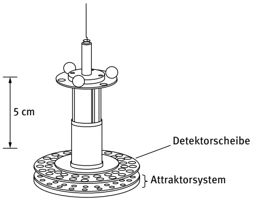

<details>
<summary>text_image</summary>

5 cm
Detektorscheibe
Attraktorsystem
</details>

Abb. I-2.28: Eöt-Wash-Experiment zum Nachweis des $1 / r ^ { 2 } .$ -Verhaltens der Gravitation: Schematische Darstellung der verwendeten ‚missing mass torsion balance‘. Die drei kleinen Kugeln dienen zur kontinuierlichen Kalibrierung des Drehmoments der Detektorscheibe durch Gravitationswechselwirkung mit drei großen Kugeln außerhalb der Apparatur. (Nach D. J. Kapner, T. S. Cook, E. G. Adelberger, J. H. Gundlach, B. R. Heckel, C. D. Hoyle und H. E. Swanson, Physical Review Letters 98, 021101 (2007).)

genannt, D. J. Kapner, T. S. Cook, E. G. Adelberger, J. H. Gundlach, B. R. Heckel, C. D. Hoyle und H. E. Swanson, Physical Review Letters **98**, 021101 (2007)) hängt an einem dünnen, 80 cm langen Wolframfaden eine Molybdänscheibe mit 42 kreisförmigen Löchern und bildet ein Drehpendel (Detektorscheibe). Knapp unter dieser Detektorscheibe befinden sich zwei starr miteinander verbundene Molybdänscheiben, das Attraktorsystem, das mit konstanter Winkelgeschwindigkeit rotieren kann: die obere Scheibe des Attraktors ist gleich dick wie die Detektorscheibe und hat auch 42 Löcher; die untere Scheibe ist dicker, weist nur 21, aber doppelt so große Löcher auf und ist gegen die obere um einen Winkel von $3 6 0 / 4 2 ^ { \circ }$ verdreht, sodass die Löcher der unteren Scheibe gerade unter den massiven Zwischenstegen der oberen Scheibe liegen (Abb. I-2.28). Die Löcher in den Scheiben erhöhen die Empfindlichkeit des Systems für die horizontalen Gravitationskräfte zwischen den Scheiben (als fehlende Masse können die Löcher als „negative Masse“ angesehen werden). Bei geeigneter Größe und Anordnung der Löcher in den beiden gleichdicken Scheiben ist die Gravitationswechselwirkung bei rotierendem Attraktor durch den Wechsel zwischen übereinander liegenden Massenbereichen (Zwischenstegen) und masselosen Löchern kurzzeitig höher und wieder niedriger. Dies würde zur Schwingung der Detektorscheibe führen, wenn sich die obere Attraktorscheibe dreht. Wird aber die Dicke der unteren Attraktorscheibe geeignet gewählt, so tritt gerade keine Torsionsschwingung auf, wenn das $1 / r ^ { 2 }$ Gesetz gilt. Die sehr genaue Untersuchung als Funktion der Distanz der Scheiben ergab keine Abweichungen vom $1 / r ^ { 2 }$ -Verhalten bis zu einem Scheibenabstand von 55 μm, der Messgrenze dieser Anordnung.

---

104

2 Mechanik des Massenpunktes

## Anhang 2 Stoßprozesse (collisions) und Streuung (scattering)

Bei Stoß- oder Streuprozessen wird die Wechselwirkung i. Allg. zweier Stoßpartner untersucht. Wenn sich die stoßenden Teilchen (wir nehmen an Massenpunkte, Rotationen können nicht auftreten) genügend nahe kommen, wird ein Wechselwirkungspotenzial wirksam, das meist sehr kurzreichweitig ist und nur vom Abstand der Teilchen abhängt. Bei genügend großem Abstand der Teilchen ist das Wechselwirkungspotenzial unwirksam und die Teilchen bewegen sich (in Abwesenheit äußerer Kräfte) kräftefrei, also gleichförmig geradlinig. Unsere Kenntnis über die atomare und insbesondere subatomare Struktur der Materie stammt wesentlich aus der Untersuchung von Stoßprozessen.

Wir betrachten zunächst den Stoß zweier Teilchen mit den Massen $m _ { 1 }$ und $m _ { 2 } ,$ die vor dem Stoß die Geschwindigkeiten ${ \vec { v } } _ { 1 }$ und $\vec { v } _ { 2 }$ besitzen (Abb. I-2.29). Nach dem Stoß setzen die Teilchen ihre Bahn unter den Winkeln $\theta _ { 1 }$ bzw. $\theta _ { 2 }$ gegen die jeweilige Einfallsrichtung mit den Geschwindigkeiten $\vec { v } _ { 1 } ^ { \prime }$ und $\vec { v } _ { 2 } ^ { \prime }$ fort. Bei der Wechselwirkung ändern beide Teilchen also ihren Impuls, oft auch ihre Energie.

Wirken nur „innere Kräfte“ im System der beiden Köper (abgeschlossenes System), so gilt:<sup>59</sup>

## 1 Solange keine äußeren Kräfte wirken, bleiben Energie und Impuls des Gesamtsystems immer erhalten.<sup>60</sup>

Dies soll im folgenden immer gelten.

Auch wenn über die Details der Wechselwirkung beim Stoß nichts bekannt ist, kann man über die Größe und Richtung der Impulse sowie die Energien nach dem Stoß in großer Entfernung von der Wechselwirkungszone, in der das Wechselwirkungspotenzial wirkt, definierte Aussagen machen, die sich auf die Erhaltungssätze stützen:<sup>61</sup>

Impulssatz:

$$
\underbrace {\vec {p} _ {1} + \vec {p} _ {2}} _ {\text {vor dem Sto} \beta} = m _ {1} \vec {v} _ {1} + m _ {2} \vec {v} _ {2} = \underbrace {\vec {p} _ {1} ^ {\prime} + \vec {p} _ {2} ^ {\prime}} _ {\text {nach dem Sto} \beta} = m _ {1} ^ {\prime} \vec {v} _ {1} ^ {\prime} + m _ {2} ^ {\prime} \vec {v} _ {2} ^ {\prime} = \text {const.} \tag {I-2.133}
$$

<small><span class="docvortex-page-footnote" data-block-type="page_footnote" style="color:#6b7280">59 Siehe Abschnitt 2.4, Gl. (I-2.65) und Band VI, Kapitel „Statistische Physik“, Abschnitt 1.2.3.</span></small>

<small><span class="docvortex-page-footnote" data-block-type="page_footnote" style="color:#6b7280">60 Der Energiesatz der Mechanik (Gln. I-2.40 und I-2.80) gilt allerdings nur, wenn beim Stoß die innere Energie der Teilchen unverändert bleibt, also bei elastischen Stößen, was bei Stoßexperimenten mit Atomen bzw. Atomkernen (z. B. in der Kernphysik) nicht immer der Fall ist. Wird beim Stoß von den Teilchen Energie als „innere“ Energie (= Anregungsenergie) aufgenommen oder abgegeben, handelt es sich also um einen inelastischen Stoß, muss diese Energie in der Energiebilanz des Stoßprozesses berücksichtigt werden.</span></small>

<small><span class="docvortex-page-footnote" data-block-type="page_footnote" style="color:#6b7280">61 Man beachte, dass Rechnungen relativistisch erfolgen müssen, wenn die beteiligten Geschwindigkeiten der Lichtgeschwindigkeit c bzw. die kinetischen Energien den Ruheenergien der Teilchen nahe kommen (siehe Band II, Kapitel „Relativistische Mechanik“).</span></small>

---

Anhang 2 Stoßprozesse (collisions) und Streuung (scattering)

105

Energiesatz:

$$
E _ {\mathrm{kin}} ^ {1} + E _ {\mathrm{kin}} ^ {2} = \frac {\bar {p} _ {1} ^ {2}}{2 m _ {1}} + \frac {\bar {p} _ {2} ^ {2}}{2 m _ {2}} = E _ {\mathrm{kin}} ^ {\prime 1} + E _ {\mathrm{kin}} ^ {\prime 2} + Q = \frac {\bar {p} _ {1} ^ {\prime 2}}{2 m _ {1} ^ {\prime}} + \frac {\bar {p} _ {2} ^ {\prime 2}}{2 m _ {2} ^ {\prime}} + Q. \tag {I-2.134}
$$


<details>
<summary>text_image</summary>

m₁ → v̄₁ → m₁ → v̄'₁
θ₁ → θ₂
m₂ → v̄₂ → m₂ → v̄'₂
Wechselwirkungspotenzial V ≠ 0
</details>

Abb. I-2.29: Stoß zweier Teilchen: $m _ { 1 } ,   \vec { v } _ { 1 }$ und $m _ { 2 } ,   \vec { v } _ { 2 }$

Dabei bezeichnen die gestrichenen Größen $\vec { v } _ { i } ^ { \prime }$ und $\vec { p } _ { i } ^ { \prime }$ die Geschwindigkeiten und Impulse der Teilchen nach dem Stoß. Q stellt die mechanische (kinetische) Energie dar, die beim Stoß in andere Energie umgewandelt wurde, z. B. in „innere Energie“der Stoßpartner (Anregung oder Erwärmung).

Gilt $Q = 0 ,$ , so handelt es sich um einen elastischen Stoß, bei dem die gesamte $E _ { \mathrm { k i n } }$ erhalten bleibt (die $E _ { \mathrm { k i n } }$ der einzelnen Teilchen kann sich ändern). Der vollkommen elastische Stoß ist ein idealer Grenzfall.

Ist $Q \neq 0$ , so liegt ein inelastischer (plastischer) Stoß vor:

$Q > 0;$ die gesamte $E _ { \mathrm { k i n } }$ nach dem Stoß ist kleiner als vorher, ein Teil ist in innere Energie der stoßenden Teilchen (Anregung) umgewandelt worden.

$Q < 0 ;$ innere Energie der Stoßpartner wird in Translationsenergien umgewandelt (Abregung, superelastische Stöße), die $E _ { \mathrm { k i n } }$ zumindest eines der Teilchen ist nach dem Stoß größer als vorher.

Bei reaktiven Stößen ändert sich die Masse der Stoßpartner z. B. durch chem. Reaktionen oder auch deren Anzahl (in der subatomaren Physik bei hochenergetischen Teilchen) durch Erzeugung neuer Teilchen.<sup>62</sup>

Inelastische und reaktive Stöße sind nur möglich, wenn mindestens ein Stoß- partner eine innere Struktur besitzt, also aus weiteren „Bausteinen“ zusammengesetzt ist. Nur dann kann nämlich $E _ { \mathrm { k i n } }$ in die „innere Energie“ des zusammengesetzten Systems übertragen werden.

<small><span class="docvortex-page-footnote" data-block-type="page_footnote" style="color:#6b7280">62 Beispiel: Beim Stoß des schweren $^{209}_{83} Be-Kerns$ mit D<sub>1</sub>2 (Deuteronen) fliegen nach dem Stoß der 7 (stripping reaction bzw. Oppenheimer-Phillips-Prozess).</span></small>

---

106

2 Mechanik des Massenpunktes

## A2.1 Der elastische Stoß (Q = 0) im Laborsystem (laboratory coordinate system)

Das Laborsystem $\Sigma _ { L }$ ist jenes Koordinatensystem, in dem auch das Streuexperiment abläuft. Wir machen die in den meisten Experimenten erfüllte Annahme, dass ein Teilchen vor dem Stoß ruht. Es soll $Q = 0$ sein und die Massen unverändert bleiben (Abb. I-2.30).


<details>
<summary>flowchart</summary>


</details>

Abb. I-2.30: Elastischer Stoß im Laborsystem.

Für den Impulssatz gilt in diesem Fall

$$
\vec {p} _ {1} = \vec {p} _ {1} ^ {\prime} + \vec {p} _ {2} ^ {\prime} \tag {I-2.135}
$$

Die Vektoren $\vec { p } _ { 1 }   , \vec { p } _ { 1 } ^ { \prime }$ und $\vec { p } _ { 2 } ^ { \prime }$ müssen daher ein Dreieck bilden und deshalb in einer Ebene liegen. Wir legen zunächst ein Koordinatensystem mit seinem Ursprung O in das ruhende Teilchen 2 so, dass die x-Achse in die Richtung von ${ \vec { v } } _ { 1 }$ weist, dass also für den Impuls des einfallenden Teilchens $\vec { p } _ { 1 } = \{ p _ { x } , 0 , 0 \}$ gilt.<sup>63</sup> Da wir den Ursprung O in das vor dem Stoß ruhende Teilchen gelegt haben, wollen wir den Vektor $\vec { p } ^ { \prime } { } _ { 2 }$ von O ausgehen lassen (Abb. I-2.31).

Im Punkt $P ( x , y )$ der Abb. I-2.31 liegen die Spitze von $\vec { p } _ { 2 } ^ { \prime }$ und der Anfangspunkt von $\vec { p } _ { 1 } ^ { \prime }$ . Wir wollen jetzt die Kurve ermitteln, auf der bei vorgegebenem $\vec { \pmb { p } }$ alle möglichen Punkte $P ( x , y )$ liegen.

<small><span class="docvortex-page-footnote" data-block-type="page_footnote" style="color:#6b7280">63 Das vor dem Stoß ruhende Teilchen 2 gibt einen festen Punkt im Koordinatensystem an. Die folgende Rechnung kann ganz analog auch für das Teilchen 1 geführt werden, wenn die Teilchengeschwindigkeiten vor dem Stoß durch eine Galileitransformation so abgeändert werden, dass υ⇀1 = 0 wird. Es lässt sich immer eine Transformation finden, die die Geschwindigkeit eines Teilchens zu Null reduziert.</span></small>

---

Anhang 2 Stoßprozesse (collisions) und Streuung (scattering)

107


<details>
<summary>text_image</summary>

y
P(x,y)
\vec{p}'_2 = m_2 \vec{v}'_2
y
\vec{p}'_1 = m_1 \vec{v}'_1
x
O
A
x
</details>

Abb. I-2.31: Der Impulssatz (Gl. I-2.135) verlangt, dass die Impulsvektoren $\vec { p } _ { 1 } , \vec { p } _ { 1 } ^ { \prime }$ und $\vec { p _ { 2 } } ^ { ' }$ ein Dreieck bilden müssen und daher in einer Ebene liegen.

Aus Abb. I-2.31 ergibt sich:

$$
x ^ {2} + y ^ {2} = p _ {2} ^ {\prime 2} \tag {I-2.136}
$$

und

$$
(p _ {1} - x) ^ {2} + y ^ {2} = p _ {1} ^ {\prime 2}. \tag {I-2.137}
$$

Wir setzen nun $p _ { 1 } ^ { \prime 2 }$ aus dem Energiesatz (Gl. I-2.134) $\frac{p_{1}^{2}}{2 m_{1}}=\frac{p_{1}^{\prime 2}}{2 m_{1}}+\frac{p_{2}^{\prime 2}}{2 m_{2}} \quad(p_{2}=0)$ $Q = 0 )$ in Gl. (I-2.137) ein und verwenden dabei $p _ { 2 } ^ { \prime 2 }$ aus Gl. (I-2.136). Damit erhalten wir

$$
(p _ {1} - x) ^ {2} + y ^ {2} = p _ {1} ^ {2} - \frac {m _ {1}}{m _ {2}} p _ {2} ^ {\prime 2} = p _ {1} ^ {2} - \frac {m _ {1}}{m _ {2}} (x ^ {2} + y ^ {2}) \tag {I-2.138}
$$

bzw.

$$
\begin{array}{l} p _ {1} ^ {2} - 2 p _ {1} x + x ^ {2} + y ^ {2} - p _ {1} ^ {2} + \frac {m _ {1}}{m _ {2}} x ^ {2} + \frac {m _ {1}}{m _ {2}} y ^ {2} = \\ = x ^ {2} \left(\frac {m _ {1}}{m _ {2}} + 1\right) + y ^ {2} \left(\frac {m _ {1}}{m _ {2}} + 1\right) - 2 p _ {1} x = \\ = x ^ {2} + y ^ {2} - 2 \frac {m _ {2}}{m _ {1} + m _ {2}} p _ {1} x = 0 \cdot \tag {I-2.139} \\ \end{array}
$$

Nach addieren von $\left( \frac { m _ { 2 } } { m _ { 1 } + m _ { 2 } }   p _ { 1 } \right) ^ { 2 }$ auf beiden Seiten können wir schreiben

---

108

2 Mechanik des Massenpunktes

$$
\left(x - \frac {m _ {2}}{m _ {1} + m _ {2}} p _ {1}\right) ^ {2} + y ^ {2} = \left(\frac {m _ {2}}{m _ {1} + m _ {2}} p _ {1}\right) ^ {2} \tag {I-2.140}
$$

oder mit der reduzierten Masse $\mu = \frac { m _ { 1 }   m _ { 2 } } { m _ { 1 } + m _ { 2 } }$

$$
\left(x - \mu v _ {1}\right) ^ {2} + y ^ {2} = \left(\mu v _ {1}\right) ^ {2}. \tag {I-2.141}
$$

Das ist eine Kreisgleichung mit Radius $\boldsymbol{r}=\frac{m_{2}}{m_{1}+m_{2}} \boldsymbol{p}_{1}=\frac{1}{1+\frac{m_{1}}{m_{2}}} \boldsymbol{p}_{1}=\mu \boldsymbol{v}_{1}$ um den

Mittelpunkt M mit dem Abstand vom Ursprung O. Die möglichen Punkte $P ( x , y )$ , d. h. die Spitzen aller möglichen Vektoren $\vec { p } _ { 2 } ^ { \prime }$ , liegen auf diesem Kreis (Abb. I-2.32).<sup>64</sup> Als Streuwinkel bezeichnet man den Winkel $\theta _ { 1 } = \angle ( \vec { p } _ { 1 } , \vec { p } _ { 1 } ^ { \prime } )$ zwischen den Impulsen $\vec { p } _ { 1 }$ und $\vec { p } _ { 1 } ^ { \prime }$ des Teilchens 1 vor und nach dem Stoß.<sup>65</sup>

Wir betrachten folgende Fälle:

Dieser Fall entspricht der obigen Abb. I-2.32; das Ende des Impulsvektors des Teilchens 1 vor dem Stoß (in x-Richtung) liegt außerhalb des Kreises mit Radius $\mu \upsilon _ { 1 }$ um M. In diesem Fall gibt es bei vorgegebenem $\vec { p } _ { 1 }$ einen maximalen Streuwinkel $\theta _ { 1 } ^ { \mathrm { m a x } }$ . Aus Abb. I-2.32 folgt für $\theta _ { 1 } ^ { \mathrm { m a x } }$

$$
\begin{array}{l} \sin \theta_ {1} ^ {\max} = \frac {\mu v _ {1}}{p _ {1} - \mu v _ {1}} = \frac {\mu v _ {1}}{(m _ {1} - \mu) v _ {1}} = \frac {\mu}{m _ {1} - \mu} = \frac {1}{\frac {m _ {1}}{\mu} - 1} = \\ = \frac {1}{\frac {m _ {1} (m _ {1} + m _ {2})}{m _ {1} m _ {2}} - \frac {m _ {2}}{m _ {2}}} = \frac {m _ {2}}{m _ {1}} <   1. (I-2.142) \\ \Rightarrow 0 \leq \theta_ {1} \leq \theta_ {1} ^ {\max} <   \frac {\pi}{2}, (I-2.143) \\ \end{array}
$$

<small><span class="docvortex-page-footnote" data-block-type="page_footnote" style="color:#6b7280">64 Im Raum ist die von uns gewählte Zeichenebene, also das Dreieck {p⇀1, p⇀′1, p⇀′2 }, durch nichts ausgezeichnet und kann daher um jeden beliebigen Winkel um p⇀1 gedreht werden ⇒ im Raum liegen die Spitzen aller möglichen Vektoren p⇀′2 auf einer Kugel, die durch Drehung des beschriebenen Kreises um p⇀1 entsteht.</span></small>

<small><span class="docvortex-page-footnote" data-block-type="page_footnote" style="color:#6b7280">65 Für punktförmige Teilchen, die nur beim unmittelbaren Zusammenstoß miteinander wechselwirken, kann über den sich einstellenden Ablenkwinkel (Streuwinkel θ<sub>1</sub>) nichts ausgesagt werden. Nur die in Abb. I-2.32 dargestellte Beziehung zwischen p⇀1, p⇀′1 und p⇀′2 muss stets erfüllt sein.</span></small>

---

Anhang 2 Stoßprozesse (collisions) und Streuung (scattering)

109

das heißt, in diesem Fall findet die Streuung nur in Vorwärtsrichtung statt, unabhängig von der Art der Wechselwirkung der beiden Teilchen.


<details>
<summary>text_image</summary>

O
θ₂
M
μv₁ = \frac{m₂}{m₁ + m₂} p₁ = r
P(x,y)
θ₁max
θ₁
A
P′₁
P′₂
θ₁
</details>

Abb. I-2.32: Impulsdiagramm für den elastischen Stoß im Laborsystem mit $m _ { 1 } \succ m _ { 2 } ;$ das Teilchen mit Masse $m _ { 2 }$ ruht vor dem Stoß. Aus Impuls und Energiesatz folgt, dass die Spitzen aller möglichen Impulsvektoren ${ \vec { p } } _ { 2 } ^ { \prime }$ des gestoßenen Teilchens 2 auf einem Kreis mit Radius $\mu { \cal U } _ { 1 } = \frac { m _ { 2 } } { m _ { 1 } + m _ { 2 } } \; p _ { 1 }$ um M im Abstand $\mu { \boldsymbol { U } } _ { 1 }$ von O liegen müssen. Die zum maximalen Streuwinkel $\theta _ { 1 } ^ { \mathsf { m a x } }$ gehörenden Impulsvektoren ${ \vec { p } } _ { 1 } ^ { \prime }$ und $\vec { p } _ { 2 } ^ { \prime }$ sind blau gezeichnet.

| $m_{1}/m_{2}$ | $\theta_{1}^{\max}$(Grad) |
| --- | --- |
| 1 | $90^{\circ\ 66}$ |
| 1,5 | $41,8^{\circ}$ |
| 2 | $30^{\circ}$ |
| 10 | $5,7^{\circ}$ |
| 100 | $0,6^{\circ}$ |
| 1000 | $0,06^{\circ}$ |

Die maximal an das Teilchen 2 übertragene Energie $E _ { 2 \mathrm { m a x } } ^ { \prime }$ ergibt sich für den kollinearen Stoß, für den $p _ { 2 \mathrm { m a x } } ^ { \prime } = 2 r = \frac { 2 m _ { 2 } } { m _ { 1 } + m _ { 2 } }   p _ { 1 }$ gilt. ⇒

$$
E _ {2 \max} ^ {\prime} = \frac {p _ {2 \max} ^ {\prime}}{2 m _ {2}} = \frac {4 r ^ {2}}{2 m _ {2}} = \frac {4 m _ {2} ^ {2}}{\left(m _ {1} + m _ {2}\right) ^ {2}} \cdot \frac {p _ {1} ^ {2}}{2 m _ {2}} = \frac {4 m _ {1} m _ {2}}{\left(m _ {1} + m _ {2}\right) ^ {2}} E _ {1} \Rightarrow \text {f ü r} m _ {2} = 0 \text {und} m _ {2} = \infty
$$

<small><span class="docvortex-page-footnote" data-block-type="page_footnote" style="color:#6b7280">66 Dies ist ein singulärer Fall, der nur im Grenzfall p⇀′1 % 0 möglich ist ⇒ der gesamte Impuls p⇀1 % 0 wird an das Teilchen 2 übergeben, p⇀′2 = p⇀1 (siehe auch Fall 3 mit m<sub>1</sub> = m<sub>2</sub>).</span></small>

---

110

2 Mechanik des Massenpunktes

(feste Wand) ist die übertragene Energie 0. $E _ { \mathrm { 2 m a x } } ^ { \prime }$ ist natürlich auch gleich dem maximalen Energieverlust des stoßenden Teilchens 1 (für $m _ { 1 }   = m _ { 2 }$ wird die gesamte Energie übertragen). Dies gilt auch für die Fälle 2, 3 und 4.

2. $m _ { 1 } < m _ { 2 }$ , also $p _ { 1 } < 2 r$ (Abb. I-2.33)

Wie aus Abb. I-2.33 zu entnehmen ist, sind in diesem Fall alle Streuwinkel $\theta _ { 1 }$ zwischen 0 und π möglich, also

$$
0 \leq \theta_ {1} \leq \pi \tag {I-2.144}
$$


<details>
<summary>text_image</summary>

p̅₂
p̅₁'
p̅₁ M
θ₁
</details>

Abb. I-2.33: Impulsdiagramm für den elastischen Stoß im Laborsystem mit $m _ { 1 } \lessdot m _ { 2 }$ , also $p _ { 1 } \ltimes 2   r _ { \circ }$

3. $m _ { 1 } = m _ { 2 } = m$ , also $p_{1}=2r\left(\mathrm{Abb}.\mathrm{I}-2.34\right)$

Für $m _ { 1 }   = m _ { 2 }$ beträgt der Winkel $\theta _ { 1 } + \theta _ { 2 }$ zwischen $\vec { p } _ { 1 } ^ { \prime }$ und $\vec { p } _ { 2 } ^ { \prime }$ gerade $\%$ , der Stoßkreis stellt für ${ \vec { p } } _ { 1 } ^ { \prime }$ und $\vec { p } _ { 2 } ^ { \prime }$ einen Thaleskreis dar.

Ein Spezialfall ist der zentrale (kollineare) Stoß, bei dem das Teilchen 2 in der Richtung des stoßenden Teilchens 1 weiterfliegt (der gemeinsame Schwerpunkt der beiden Teilchen liegt auf der Stoßlinie). Dann gilt (siehe Abb. I-2.34)

$$
\vec {p} _ {2} ^ {\prime} = \vec {p} _ {1} \quad \text {und damit} \quad \vec {p} _ {1} ^ {\prime} = 0. \tag {I-2.145}
$$

In diesem Fall übernimmt Teilchen 2 von Teilchen 1 den gesamten Impuls und Teilchen 1 ruht nach dem Stoß. Ebenso wird die gesamte kinetische Energie vom stoßenden Teilchen vollständig an das gestoßene übertragen. Zur Abbremsung

---

Anhang 2 Stoßprozesse (collisions) und Streuung (scattering)

111

eines Teilchens durch Energieübergabe an einen Stoßpartner ist also ein etwa gleich schweres am besten geeignet.<sup>67</sup>


<details>
<summary>text_image</summary>

P̅₂
P̅₁'
θ₂
M
P̅₁
θ₁
θ₁
</details>

Abb. I-2.34: Impulsdiagramm für den elastischen Stoß im Laborsystem mit $m _ { 1 } = m _ { 2 }$ , also $p _ { 1 } = 2   r .$

4. $m _ { 1 } \ll m _ { 2 }$ (Stoß gegen eine feste Wand); aus $r = \frac { m _ { 2 } } { m _ { 1 } + m _ { 2 } }   p _ { 1 }$ folgt $p_{1}=r\left ( \mathrm{Abb} \right )$ I-2.35)

Der maximale Impulsübertrag von Teilchen 1 auf Teilchen 2 (Wand) ergibt sich, wenn für $p _ { 2 } ^ { \prime }$ gilt

$$
p _ {2} ^ {\prime} = 2 \mu v _ {1},
$$

das Teilchen 2 also einen Impuls in Richtung des einfallenden Teilchens aufnimmt (kollinearer Stoß).

<small><span class="docvortex-page-footnote" data-block-type="page_footnote" style="color:#6b7280">67 Neutronen übertragen beim kollinearen Stoß ihre gesamte Energie an Wasserstoffkerne (Protonen), die in einem Zählrohr nachgewiesen werden können, was 1932 zu ihrer Entdeckung führte. Walter Bothe und Herber Becker entdeckten zunächst eine ungewöhnliche Strahlung, die beim Beschuss von B<sub>4</sub> e mit α-Teilchen entstand: sie war durchdringend wie γ-Strahlung und konnte leichte Atome in Bewegung versetzen. Irène und Frédéric Joliot-Curie stellten dann fest, dass diese „Strahlung“ aus einer wasserstoffhaltigen Substanz, z. B. Paraffin, Protonen auslösen kann. James Chadwick entdeckte schließlich, dass die „Strahlung“ aus massiven, neutralen Teilchen mit der Masse des Protons bestehen musste und nannte sie Neutronen.</span></small>

<small><span class="docvortex-page-footnote" data-block-type="page_footnote" style="color:#6b7280">Im statistischen Mittel aller möglichen Energieübertragungen sind mit H<sub>1</sub> 18 Zusammenstöße nötig, um die Energie eines 2 MeV-Neutrons auf Raumtemperatur (entspricht 0,025 eV) zu verringern. Mit dem wegen seines viel kleineren Einfangquerschnitts für Neutronen für kernphysikalische Anwendungen wesentlich günstigeren Deuterium ( H<sub>1</sub> ) sind dagegen im Mittel 24 Stöße erforderlich (siehe auch Band V, Kapitel „Subatomare Physik“, Abschnitt 3.1.5.2.5).</span></small>

---

112

2 Mechanik des Massenpunktes


<details>
<summary>text_image</summary>

p̅₂
p̅₁'
p̅₁
μν₁
M
θ₁
μν₁
</details>

Abb. I-2.35: Impulsdiagramm für den elastischen Stoß im Laborsystem mit $m _ { 1 } \ll m _ { 2 } ,$ also $p _ { 1 } = r$ (Stoß gegen eine feste Wand).

Im Falle $m _ { 2 } \gg m _ { 1 }$ ergibt sich für die reduzierte Masse

$$
\mu = \frac {m _ {1} m _ {2}}{m _ {1} + m _ {2}} = \frac {m _ {1} m _ {2}}{m _ {2}} = m _ {1}
$$

und somit für die maximale Impulsübertragung

$$
p _ {2, \max} ^ {\prime} = 2 m _ {1} v _ {1} = 2 p _ {1}, \quad \text { also } \quad \theta_ {1} = \pi ; \tag {I-2.146}
$$

das Teilchen 1 gibt an die Wand also den doppelten Impuls ab! Es fliegt aber infolge der Impulserhaltung mit seinem ursprünglichen Impulsbetrag in die Gegenrichtung zurück – es wird an der Wand reflektiert.

Für den Energieübertrag an die Wand gilt

$$
\Delta E _ {\mathrm{kin}} = \frac {p _ {2} ^ {\prime 2}}{2 m _ {2}} = \frac {(2 p _ {1}) ^ {2}}{2 m _ {2}} = \frac {4 m _ {1} ^ {2} v _ {1} ^ {2}}{2 m _ {2}} = 4 \frac {m _ {1}}{m _ {2}} E _ {1}. \tag {I-2.147}
$$

Wenn also $m _ { 2 } \rightarrow$ ∞ geht, so folgt $\Delta E _ { \mathrm { k i n } } \rightarrow 0$ , das heißt, das Teilchen „prallt“ von Wand ab, ohne Energie zu übertragen. Auch für alle anderen Streuwinkel $\theta _ { 1 } \neq \pi$ bleibt der Impulsbetrag $p _ { 1 }$ (also auch die Energie) des einfallenden Teilchens erhalten; nur der an die $, \mathrm { W a n d } ^ { \mathrm { { \textleftarrow } } } m _ { 2 }$ übertragene Impuls variiert.

Aus dem Dargestellten ergibt sich, dass die alleinige Anwendung des Energieund Impulssatzes nach Ablauf des Stoßvorganges (die Teilchen sind wieder außerhalb der Reichweite der Wechselwirkungskräfte), also ohne detaillierte Berücksichtigung des Wechselwirkungspotenzials (siehe Abschnitt $\mathrm { A } 2 . 4$ „Potenzialstreuung“) keine expliziten Werte für die Impulse $p _ { 1 } ^ { \prime }$ und $p _ { 2 } ^ { \prime }$ nach dem Stoß liefert, sondern nur in jedem Falle unter Berücksichtigung des Massenverhältnisses $m _ { 1 } / m _ { 2 }$ einzuhaltende Relationen zwischen ihnen: $\pmb { \mathscr { N } }$ enn $p _ { 1 } ^ { \prime }$ eintritt, dann hat $p _ { 2 } ^ { \prime }$ den berechneten $\mathtt { W e r t ^ { \acute { e } } }$

---

Anhang 2 Stoßprozesse (collisions) und Streuung (scattering)

113

## A2.2 Elastischer Stoß (Q = 0) im Schwerpunktsystem (centre of mass system)

Stoßprozesse lassen sich meist einfacher im Schwerpunktsystem beschreiben, besonders wenn kein Stoßpartner ruht. Im Schwerpunktsystem $( \Sigma _ { S } )$ ruht der Massenmittelpunkt S (Schwerpunkt) des betrachteten Teilchensystems, er ist der Ursprung des Koordinatensystems.

Für die Koordinaten des Massenmittelpunkts (Schwerpunkts, Abb. I-2.36) und seine Geschwindigkeit gilt allgemein im Laborsystem (siehe Abschnitt 2.4.1, Gl. (I-2.63): $M \cdot \vec { r } _ { S } = { \sum _ { i } } m _ { i } \vec { r } _ { i }   )$ für 2 beteiligte Massen $m _ { 1 }$ und $m _ { 2 }$

$$
\vec {r} _ {S} = \frac {m _ {1} \vec {r} _ {1} + m _ {2} \vec {r} _ {2}}{m _ {1} + m _ {2}} \Rightarrow \vec {v} _ {S} = \dot {\vec {r}} _ {S} = \frac {m _ {1} \vec {v} _ {1} + m _ {2} \vec {v} _ {2}}{m _ {1} + m _ {2}} = \text {const.} \tag {I-2.148}
$$

Der Übergang vom Laborsystem $( \Sigma _ { L } )$ zum Schwerpunktsystem $( \Sigma _ { S } )$ und umgekehrt erfolgt durch die Galileitransformation (Abschnitt 2.3.1, Gl. I-2.41)

$$
\vec {r} _ {\Sigma_ {S}} (t) = \vec {r} _ {\Sigma_ {L}} (t) - \vec {v} _ {S} t \quad \text {und} \quad \vec {v} _ {\Sigma_ {S}} (t) = \vec {v} _ {\Sigma_ {L}} (t) - \vec {v} _ {S}. \tag {I-2.149}
$$

Damit ergeben sich als Ortsvektoren der Teilchen $m _ { 1 }$ und $m _ { 2 }$ im Schwerpunktsystem $\vec { r } _ { 1 } ^ { S } = \vec { r } _ { 1 } - \vec { v } _ { S } \cdot t$ und $\vec { r } _ { 2 } ^ { S } = \vec { r } _ { 2 } - \vec { \upsilon } _ { S }   \cdot$ t oder $\vec { r } _ { 1 } ^ { S } = \vec { r } _ { 1 } - \vec { r } _ { S }$ und $\vec { r } _ { 2 } ^ { S } = \vec { r } _ { 2 } - \vec { r } _ { S }$ mit $\vec { \upsilon } _ { S } \cdot t = \vec { r } _ { S }$ , wobei $\vec { r } _ { S } = 0$ für $t = 0$ gesetzt wurde; ist also im Laborsystem $\vec { r } = \vec { r } _ { S }$ , dann ist im Schwerpunktsystem $\vec { r } _ { S } ^ { S } = \vec { r } _ { S } - \vec { r } _ { S } = 0$

Man beachte, dass im jetzigen Fall eines Systems stoßender Körper im Schwerpunktsystem (Schwerpunkt ruht) sich alle Vektoren mit Ausnahme von $\vec { r } _ { S }$ mit der Zeit ändern!


<details>
<summary>text_image</summary>

m₁
r̅₁(t)
r̅₁ˢ
r̅₁₂
S
r̅₂ˢ
r̅ₛ = vₛ · t
m₂
r̅₂(t)
O
</details>

Abb. I-2.36: Ortsvektoren der Teilchen und Ortsvektor zum Schwerpunkt im Laborsystem (zentraler Stoß).

---

114

2 Mechanik des Massenpunktes

Der Abstand der Teilchen ist durch den Relativvektor

$$
\vec {r} _ {1 2} = \vec {r} _ {1} - \vec {r} _ {2} = \vec {r} _ {1} ^ {S} - \vec {r} _ {2} ^ {S} \tag {I-2.150}
$$

gegeben, mit dem sich die Schwerpunktsabstände $\bar { r } _ { 1 } ^ { S }$ und $\bar { r } _ { 2 } ^ { S }$ wie folgt ergeben (siehe Abb. I-2.36):

$$
\begin{array}{l} \vec {r} _ {1} ^ {S} = \vec {r} _ {1} - \vec {r} _ {S} = \vec {r} _ {1} - \frac {m _ {1} \vec {r} _ {1} + m _ {2} \vec {r} _ {2}}{m _ {1} + m _ {2}} = \frac {m _ {1} \vec {r} _ {1} + m _ {2} \vec {r} _ {1} - m _ {1} \vec {r} _ {1} - m _ {2} \vec {r} _ {2}}{m _ {1} + m _ {2}} = \\ = \frac {m _ {2}}{m _ {1} + m _ {2}} \underbrace {\left(\vec {r} _ {1} - \vec {r} _ {2}\right)} _ {\vec {r} _ {1 2}}, \tag {I-2.151} \\ \end{array}
$$

also

$$
\vec {r} _ {1} ^ {S} = \frac {m _ {2}}{m _ {1} + m _ {2}} \vec {r} _ {1 2} \quad \text {und} \quad \vec {r} _ {2} ^ {S} = - \frac {m _ {1}}{m _ {1} + m _ {2}} \vec {r} _ {1 2}. \tag {I-2.152}
$$

Da im Schwerpunktsystem $\Sigma _ { S }$ der Schwerpunkt der beiden Teilchen ruht, müssen die Teilchen einander auf parallelen Geraden mit verschiedener Geschwindigkeit entgegenlaufen;<sup>68</sup> fallen die Geraden zusammen, so handelt es sich um einen zentralen Stoß, haben sie einen endlichen Abstand $b ,$ ist es ein exzentrischer Stoß, es tritt ein Stoßparameter b auf, der bei Teilchen mit weitreichender Wechselwirkung den Streuwinkel bestimmt. Nach dem Stoß kehren die Teilchen ihre Bewegungsrichtung beim zentralen Stoß um oder entfernen sich beim exzentrischen Stoß auf parallelen Geraden, die mit den ursprünglichen Richtungen einen Winkel bilden, der vom Stoßparameter abhängt (Abb. I-2.37). Die Einführung des Stoßparameters b bietet, wie wir später sehen werden (Anhang A2.4.1), die Möglichkeit, den Ablenkwinkel $\theta _ { 1 }$ bei bekanntem Wechselwirkungspotenzial zu berechnen.

Da der Gesamtimpuls vor und nach dem Stoß im Schwerpunktsystem = 0 sein muss (siehe Gl. I-2.65), gilt für den Impulssatz in $\Sigma _ { S }$

$$
0 = \bar {p} _ {1} ^ {S} + \bar {p} _ {2} ^ {S} = \bar {p} _ {1} ^ {\prime S} + \bar {p} _ {2} ^ {\prime S} \Rightarrow \bar {p} _ {1} ^ {S} = - \bar {p} _ {2} ^ {S}, \bar {p} _ {1} ^ {\prime S} = - \bar {p} _ {2} ^ {\prime S}. \tag {I-2.153}
$$

Für den Energiesatz mit Energieumwandlung folgt aus $\frac { ( \vec { p } _ { 1 } ^ {   S } ) ^ { 2 } } { 2 m _ { 1 } } + \frac { ( \vec { p } _ { 2 } ^ {   S } ) ^ { 2 } } { 2 m _ { 2 } } =$ $\frac { ( \vec { p ^ { \prime } } _ { 1 } ^ { S } ) ^ { 2 } } { 2 m _ { 1 } ^ { \prime } } + \frac { ( \vec { p ^ { \prime } } _ { 2 } ^ { S } ) ^ { 2 } } { 2 m _ { 2 } ^ { \prime } } + Q$

$$
\frac {1}{2} \Bigg (\frac {1}{m _ {1}} + \frac {1}{m _ {2}} \Bigg) (p _ {1} ^ {s}) ^ {2} = \frac {1}{2} \Bigg (\frac {1}{m _ {1}} + \frac {1}{m _ {2}} \Bigg) (p _ {1} ^ {s}) ^ {2} + Q \tag {I-2.154}
$$

<small><span class="docvortex-page-footnote" data-block-type="page_footnote" style="color:#6b7280">68 r⇀̇SS = υ⇀SS = m1 υ⇀1S + m2 υ⇀2S= 0 ⇒ υ⇀1S = m2⋅ υ⇀S . m<sub>1</sub> + m<sub>2</sub> m1</span></small>

---

Anhang 2 Stoßprozesse (collisions) und Streuung (scattering)

115


Abb. I-2.37: Exzentrischer Stoß $( b \neq 0 )$ im Laborsystem $\mathfrak { C } _ { L }$ , links) und im Schwerpunktsystem $\scriptstyle \sum S$ , rechts). Der Relativvektor $\vec { r } _ { 1 2 } ( t ) = \vec { r } _ { 1 } - \vec { r } _ { 2 } = \vec { r } _ { 1 } ^ { S } - \vec { r } _ { 2 } ^ { S }$ ist als Differenzvektor in beiden Systemen gleich, er dreht sich im Verlauf des Streuprozesses um $\pi - \theta _ { S }$

bzw. unter Verwendung der reduzierten Masse $\mu = \frac { m _ { 1 }   m _ { 2 } } { m _ { 1 } + m _ { 2 } }$

$$
\frac {(p _ {1} ^ {S}) ^ {2}}{2 \mu} = \frac {(p _ {1} ^ {S}) ^ {2}}{2 \mu} + Q. \tag {I-2.155}
$$

Für elastische Streuung ist $Q = 0$ , daher gilt

$$
(p _ {1} ^ {\prime S}) ^ {2} = (p _ {1} ^ {S}) ^ {2} = (p _ {2} ^ {\prime S}) ^ {2} = (p _ {2} ^ {S}) ^ {2}, \tag {I-2.156}
$$

d. h. im Schwerpunktsystem sind die Impulse und die Energien beider Stoßpartner vor und nach dem Stoß untereinander gleich. Damit besteht der elastische Stoß in $\Sigma _ { S }$ in einer bloße Drehung der Impulsvektoren, wobei die Impulse der beiden Teilchen entgegengesetzt gleich (Gesamtimpuls = 0) und sämtliche Streuwinkel $\theta _ { S }$ mit $0 \leq \theta _ { S } \leq \pi$ erlaubt sind (Abb. I-2.38).

Da der Streuwinkel praktisch immer im Laborsystem $\Sigma _ { L }$ gemessen wird, fragen wir nach der Transformation von $\theta _ { S }$ (Streuwinkel in $\Sigma _ { S } )$ nach $\theta _ { 1 }$ (Streuwinkel in $\Sigma _ { L } )$ . Wir betrachten dazu nochmals einen elastischen Stoß, bei dem das Teilchen 2 anfänglich ruht, also $\vec { v _ { 2 } } = 0$

Für die Bewegung des Schwerpunkts zweier Teilchen gilt allgemein (Gl. I-2.148)

$$
\vec {v} _ {S} = \frac {m _ {1} \vec {v} _ {1} + m _ {2} \vec {v} _ {2}}{m _ {1} + m _ {2}}
$$

und daher im vorliegenden Fall mit $\vec { v _ { 2 } } = 0$

---

116

2 Mechanik des Massenpunktes

$$
\vec {v} _ {S} = \frac {m _ {1}}{m _ {1} + m _ {2}} \vec {v} _ {1}. \tag {I-2.157}
$$


<details>
<summary>text_image</summary>

p̄₁'S
θₛ
p̄₁'S
p̄₂'S
p̄₂'S
φ
</details>

Abb. I-2.38: Elastischer Stoß im Schwerpunktsystem $\Sigma _ { S } .$ Der Streuwinkel $\theta _ { S }$ kann beliebige Werte $0 \leq \theta _ { S } \leq \pi$ annehmen. Der „Azimutwinkel“ φ hat für die Berechnung keine Bedeutung, da alle Impulse in einer Ebene, der Streuebene liegen.

Für den Ortsvektor eines Teilchens im Schwerpunktsystem $\Sigma _ { S }$ gilt (Gl. I-2.151)

$$
\vec {r} _ {1} ^ {S} = \vec {r} _ {1} - \vec {r} _ {S}
$$

(Abb. I-2.39):


<details>
<summary>text_image</summary>

ΣL
ΣS
m1
r̅1
r̅1S
S
r̅S
O
</details>

Abb. I-2.39: Ortsvektoren eines Teilchens im Labor- $( \Sigma _ { L } )$ und im Schwerpunktsystem $( \Sigma _ { S } )$

---

Anhang 2 Stoßprozesse (collisions) und Streuung (scattering)

117

Daraus ergibt sich die Transformation der Geschwindigkeit von $\Sigma _ { L }$ in $\Sigma _ { S }$ zu

$$
\vec {v} _ {1} ^ {S} = \vec {v} _ {1} - \vec {v} _ {S} \quad \text {und} \quad \vec {v} _ {2} ^ {S} = \vec {v} _ {2} - \vec {v} _ {S}, \tag {I-2.158}
$$

die vor und nach dem Stoß gelten muss.

Vor dem Stoß bewegt sich nur Teilchen 1 $\left( \vec { v } _ { 1 } \neq 0 , \vec { v } _ { 2 } = 0 \right)$


<details>
<summary>text_image</summary>

v̅₁
v̅₁ˢ
v̅ₛ
</details>

Nach dem Stoß bewegen sich beide Teilchen $\left( \vec { v } _ { 1 } ^ { \prime } \neq 0 , \vec { v } _ { 2 } ^ { \prime } \neq 0 \right)$ ; es gilt daher für ${ \vec { v } } _ { 1 } ^ { \prime }$ die Vektorgleichung (Abb. I-2.40)

$$
\vec {v} _ {1} ^ {\prime} = \vec {v} _ {1} ^ {\prime S} + \vec {v} _ {S}: \tag {I-2.159}
$$


<details>
<summary>text_image</summary>

v̅₁'S
θ₁
v̅₁'S cos θ_S
v̅₁'S sin θ_S = v̅₁'sin θ₁
v̅₁'
</details>

Abb. I-2.40: Geschwindigkeitsvektoren nach dem Stoß.

Der Abb. I-2.40 entnehmen wir:

$$
\tan \theta_ {1} = \frac {\nu_ {1} ^ {\prime S} \sin \theta_ {S}}{\nu_ {1} ^ {\prime S} \cos \theta_ {S} + \nu_ {S}} = \frac {\sin \theta_ {S}}{\cos \theta_ {S} + \frac {\nu_ {S}}{\nu_ {1} ^ {\prime S}}} = \frac {\sin \theta_ {S}}{\cos \theta_ {S} + \frac {\nu_ {S}}{\nu_ {1} ^ {S}}}, \tag {I-2.160}
$$

da nach dem Energiesatz gilt (Gl. I-2.156)

$$
(p _ {1} ^ {\prime S}) ^ {2} = (p _ {1} ^ {S}) ^ {2} \quad \Rightarrow \quad v _ {1} ^ {\prime S} = v _ {1} ^ {S}.
$$

Da aber $\upsilon _ { S } = \frac { m _ { 1 } } { m _ { 1 } + m _ { 2 } }   \upsilon _ { 1 }$ und $\boldsymbol { \upsilon } _ { 1 } = \boldsymbol { \upsilon } _ { 1 } ^ { S } + \boldsymbol { \upsilon } _ { S }$ , folgt

---

118

2 Mechanik des Massenpunktes

$$
\nu_ {S} = \frac {m _ {1}}{m _ {1} + m _ {2}} \nu_ {1} = \frac {m _ {1}}{m _ {1} + m _ {2}} \left(\nu_ {1} ^ {S} + \nu_ {S}\right) \tag {I-2.161}
$$

also

$$
\nu_ {S} \left(1 - \frac {m _ {1}}{m _ {1} + m _ {2}}\right) = \nu_ {1} ^ {S} \frac {m _ {1}}{m _ {1} + m _ {2}} \quad \text {oder} \quad \nu_ {S} \frac {m _ {2}}{m _ {1} + m _ {2}} = \nu_ {1} ^ {S} \frac {m _ {1}}{m _ {1} + m _ {2}} \tag {I-2.162}
$$

und daher

$$
\frac {v _ {S}}{v _ {1} ^ {S}} = \frac {m _ {1}}{m _ {2}}. \tag {I-2.163}
$$

Für die Transformation des Streuwinkels aus $\Sigma _ { S }$ in $\Sigma _ { L }$ erhalten wir also

$$
\tan \theta_ {1} = \frac {\sin \theta_ {S}}{\cos \theta_ {S} + \frac {m _ {1}}{m _ {2}}} \quad \begin{array}{l l} & \text {Transformation des Streuwinkels} \theta_ {S} \\ & \text {aus dem Schwerpunkt- ins} \\ & \text {Laborsystem.} \end{array} \tag {I-2.164}
$$

Umgekehrt folgt daraus für die Transformation des Streuwinkels $\theta _ { 1 }$ aus dem Laborsystem $\Sigma _ { L }$ ins Schwerpunktsystem $\Sigma _ { S }$

$$
\cos \theta_ {S} = - \frac {m _ {1}}{m _ {2}} \left(1 - \cos^ {2} \theta_ {1}\right) + \cos \theta_ {1} \sqrt {1 - \left(\frac {m _ {1}}{m _ {2}}\right) ^ {2} \left(1 - \cos^ {2} \theta_ {1}\right)}. ^ {6 9} \tag {I-2.164a}
$$

Für $m _ { 1 } \ll m _ { 2 }$ (Stoß gegen eine feste Wand) ergibt sich daher $\theta _ { 1 } = \theta _ { S }$ . Dies folgt sofort aus $\vec { \upsilon } _ { S } = \frac { m _ { 1 } } { m _ { 1 } + m _ { 2 } }   \vec { \upsilon } _ { 1 } \approx \frac { m _ { 1 } } { m _ { 2 } }   \vec { \upsilon } _ { 1 } \approx 0 .$ und Beachtung der Abb. I-2.40.

<small><span class="docvortex-page-footnote" data-block-type="page_footnote" style="color:#6b7280">69 Quadrieren von Gl. (I-2.164) ergibt tan $\hbar ^ { 2 } \theta _ { 1 } \left( \cos \theta _ { S } + \frac { m _ { 1 } } { m _ { 2 } } \right) ^ { 2 } = ( 1 - \cos ^ { 2 } \theta _ { S } ) ;$ mit cos2θS multipliziert folgt daraus nach umformen die quadratische Gleichung für θ<sub>S</sub></span></small>

<small><span class="docvortex-page-footnote" data-block-type="page_footnote" style="color:#6b7280">cos2θS + 2 sin 2 θ<sub>1</sub> m1 ⋅cos θS + 4 (sin θ1 m1 2 − cos2θ1 = 0 mit der Lösung m2 m2</span></small>

<small><span class="docvortex-page-footnote" data-block-type="page_footnote" style="color:#6b7280">cos θ<sub>S</sub> = − sin<sup>2</sup> θ<sub>1</sub> m1 ± cos θ1 1 − (sin θ1 m1) 2 . Für m1 ≪ m2 muss gelten θ<sub>1</sub> = θ<sub>S</sub> ⇒ nur die Lösung m2 m2 mit positiver Wurzel ist physikalisch sinnvoll.</span></small>

---

Anhang 2 Stoßprozesse (collisions) und Streuung (scattering)

119

## A2.3 Inelastischer Stoß (Q ≠ 0)

Beim inelastischen Stoß mit $Q > 0$ wird ein Teil der mechanischen Energie in andere Energieformen umgewandelt, ist $Q < 0$ , so wird ein Teil der inneren Teilchenenergien in (zusätzliche) Translationsenergie verwandelt. Wir behandeln zwei Extrem fälle, den maximal inelastischen Stoß (Teilcheneinfang) und den Teilchenzerfall.

## A2.3.1 Maximal inelastischer Stoß, Teilcheneinfang $( Q > 0 )$

In diesem Fall bleiben beide Stoßpartner nach dem Stoß zusammen und bewegen sich mit der Schwerpunktgeschwindigkeit $\vec { \nu } _ { S }$ , also

$$
\vec {v} _ {1} ^ {\prime} = \vec {v} _ {2} ^ {\prime} = \vec {v} _ {S} = \frac {1}{M} \sum_ {i} m _ {i} \vec {v} _ {i} = \frac {1}{m _ {1} + m _ {2}} \left(m _ {1} \vec {v} _ {1} + m _ {2} \vec {v} _ {2}\right). \tag {I-2.165}
$$

Wenn Teilchen 2, wie bisher angenommen, vor dem Stoß ruht, muss daher gelten

$$
\vec {v} _ {1} ^ {\prime} = \vec {v} _ {1} \frac {m _ {1}}{m _ {1} + m _ {2}} = \vec {v} _ {2} ^ {\prime}. \tag {I-2.166}
$$

Damit erhalten wir

$$
\vec {p} _ {1} ^ {\prime} = m _ {1} \vec {v} _ {1} ^ {\prime} = \frac {\mu}{m _ {2}} \vec {p} _ {1} \quad \text {und} \quad \vec {p} _ {2} ^ {\prime} = m _ {2} \vec {v} _ {2} ^ {\prime} = m _ {2} \vec {v} _ {1} ^ {\prime} = \frac {\mu}{m _ {1}} \vec {p} _ {1}. \tag {I-2.167}
$$

$\vec { p } _ { 1 }$ und $\vec { p } _ { 1 } ^ { \prime }$ weisen also in dieselbe Richtung, es ist $\theta _ { 1 } = 0$ . Da die beiden Teilchen „verschmelzen“, kann eigentlich von ${ \vec { p } } _ { 1 } ^ { \prime }$ und $\vec { p } _ { 2 } ^ { \prime }$ nicht mehr die Rede sein.<sup>70</sup>

Bewegen sich beide Teilchen vor dem Stoß mit den Geschwindigkeiten ${ \vec { v } } _ { 1 }$ und ${ \vec { v } } _ { 2 }$ und bleiben nach dem Stoß zusammen $\left( \vec { \upsilon } _ { 1 } ^ { \prime }   = \vec { \upsilon } _ { 2 } ^ { \prime }   = \vec { \upsilon } _ { S } \right)$ , so ergibt sich aus dem Energiesatz für den Anteil an mechanischer (kinetischer) Energie, der in innere Energie der Teilchen umgesetzt wird

$$
\underbrace {\frac {m _ {1} v _ {1} ^ {2}}{2} + \frac {m _ {2} v _ {2} ^ {2}}{2}} _ {\text {vor dem Sto} \beta} = \underbrace {\frac {m _ {1} v _ {S} ^ {2}}{2} + \frac {m _ {2} v _ {S} ^ {2}}{2} + Q} _ {\text {nach dem Sto} \beta} \tag {I-2.168}
$$

<small><span class="docvortex-page-footnote" data-block-type="page_footnote" style="color:#6b7280">70 Die beiden Teilchen besitzen zwar nach dem Stoß die gleiche Geschwindigkeit, transportieren aber aufgrund ihrer unterschiedlichen Massen einen verschiedenen Impuls in dem entstandenen „Verbundteilchen“.</span></small>

---

120

2 Mechanik des Massenpunktes

und mit $\vec { \upsilon } _ { S } = \frac { 1 } { m _ { 1 } + m _ { 2 } }   \left( m _ { 1 }   \vec { \upsilon } _ { 1 } + m _ { 2 }   \vec { \upsilon } _ { 2 } \right)$ nach Gl. (I-2.148)

$$
\begin{array}{l} Q = \frac {1}{2} \Bigg [ m _ {1} v _ {1} ^ {2} + m _ {2} v _ {2} ^ {2} - \frac {\left(m _ {1} v _ {1} + m _ {2} v _ {2}\right) ^ {2}}{\left(m _ {1} + m _ {2}\right) ^ {2}} \left(m _ {1} + m _ {2}\right) \Bigg ] = \\ = \frac{1}{2} \left[ \frac{m_{1}m_{2}\upsilon_{1}^{2} - 2m_{1}m_{2}\upsilon_{1}\upsilon_{2} + m_{1}m_{2}\upsilon_{2}^{2}}{m_{1} + m_{2}} \right] = \frac{1}{2}\underbrace{\frac{m_{1}m_{2}}{m_{1} + m_{2}}}_{\substack{\text{reduzierte}\\ \text{Masse}}}\underbrace{\left(\upsilon_{1} - \upsilon_{2}\right)^{2}}_{\substack{\text{Relativ-}\\ \text{geschwindigkeit}}} = \\ = \frac {1}{2} \mu v _ {1 2} ^ {2} \tag {I-2.169} \\ \end{array}
$$

Beim maximal inelastischen Stoß wird also die kinetische Energie der Relativgeschwindigkeit der reduzierten Masse der beiden stoßenden Teilchen in ihre innere Energie (z. B. Erwärmung, Anregung) umgewandelt. Die umgewandelte Energie Q wird dann maximal, wenn beide Teilchen nach dem Stoß in Ruhe bleiben, also $\vec { \nu } _ { S } = 0 ~ \mathrm { g i l t }$ , denn dann wird die gesamte ursprünglich vorhandene kinetische Energie in innere Energie verwandelt.

**Beispiel:** Das ballistische Pendel (= Stoßpendel, erfunden von Benjamin Robins, 1707–1751) bei elastischem und inelastischem Stoß.

Wir erinnern uns zunächst an den „Kraftstoß“, jenen Impuls, der den in der Zeit $t_{2}-t_{1},\mathrm{von}$ der Kraft gestoßenen“, ursprünglich ruhenden Massenpunkt auf die Geschwindigkeit υ bringt (Abschnitt 2.2.3, Gl. I-2.27)

$$
\int_ {t _ {1}} ^ {t _ {2}} \vec {F} d t = \vec {p} = m \nu (t _ {2}) \quad (\nu = 0 \text {   für   } t _ {1} = 0).
$$

Unter einem ballistisches Pendel versteht man ein Pendel, dessen Schwingungsdauer $T = 2 \pi { \sqrt { \frac { l } { g } } }$ sehr groß gegen die Dauer des Kraftstoßes $( t _ { 2 } - t _ { 1 } )$ ist, sodass der Stoßvorgang abgeschlossen ist, bevor sich das Pendel merklich aus der Ruhelage entfernt hat. Wir lassen ein kugelförmiges Geschoß der Masse $m _ { 1 }$ gegen das ballistische Pendel (Masse $m _ { 2 }$ , Fadenlänge l, Drehachse O normal zur Zeichenebene) fliegen und dort einen total inelastischen Stoß ausführen. Dazu sei das Pendel z. B. mit Sand so gefüllt, dass das Geschoß darin stecken bleibt (es handelt sich also um ein „inhomogenes“ physisches Pendel). Zur Möglichkeit eines Vergleichs mit einem elastischen Stoß ist das Pendel mit einer Stahlplatte verschließbar.

---

Anhang 2 Stoßprozesse (collisions) und Streuung (scattering)

121


<details>
<summary>text_image</summary>

m₁
→
p̄₁
→
O
α
l - h
l
m₁ + m₂
h
m₂
→
v̄₂' = v̄₁'
d
p̄₂ = v̄₂ = 0
für t = 0
</details>

Beim vollständig inelastischen Stoß des Geschoßes mit dem ballistischen Pendel erfährt das Geschoß den Kraftstoß (wobei das Pendel praktisch noch in Ruhe bleibt)

$$
\int_ {t _ {1}} ^ {t _ {2}} \vec {F} d t = \int_ {- \infty} ^ {+ \infty} \vec {F} d t = \vec {p} _ {1} ^ {\prime} - \vec {p} _ {1} = m _ {1} \underbrace {\vec {v} _ {1} ^ {\prime}} _ {= 0} - m _ {1} \vec {v} _ {1} = - m _ {1} \vec {v} _ {1},
$$

es wird also von ${ \vec { v } } _ { 1 }$ auf die Geschwindigkeit $\vec { v } _ { 1 } ^ { \prime } = 0$ im Kasten abgebremst, der sich noch nicht bewegt. Auf das System Geschoß + Kasten wirkt derselbe Kraftstoß, jedoch mit umgekehrtem Vorzeichen (actio = reactio!) und erhöht den Im puls des Kastens + Geschoß der Masse $m _ { 1 } + m _ { 2 }$ von $\vec { p } _ { 2 } = 0$ auf $\vec { p } _ { 2 } ^ { \prime } = \left( m _ { 1 } + m _ { 2 } \right) \vec { v } _ { 2 } ^ { \prime }$ Also gilt

$$
- \int_ {t _ {1}} ^ {t _ {2}} \vec {F} d t = - \int_ {- \infty} ^ {+ \infty} \vec {F} d t = \vec {p} _ {2} ^ {\prime} - \underbrace {\vec {p} _ {2}} _ {= 0} = (m _ {1} + m _ {2}) \vec {v} _ {2} ^ {\prime}
$$

Aus dem Impulssatz $\vec { p } _ { 1 } + \vec { p } _ { 2 } = \vec { p } _ { 1 } ^ { \prime } + \vec { p } _ { 2 } ^ { \prime }$ mit $m _ { 1 }   \vec { \upsilon _ { 1 } } + 0 = m _ { 1 }   \vec { \upsilon _ { 1 } ^ { \prime } } + m _ { 2 }   \vec { \upsilon _ { 2 } ^ { \prime } }$ folgt

$$
\vec {v} _ {1} = \frac {m _ {1} + m _ {2}}{m _ {1}} \vec {v} _ {2} ^ {\prime} \quad \text {bzw.} \quad \vec {p} _ {1} = \vec {p} _ {2} ^ {\prime} \quad \text {mit} \quad \vec {p} _ {1} = m _ {1} \vec {v} _ {1}, \vec {p} _ {2} ^ {\prime} = (m _ {1} + m _ {2}) \vec {v} _ {2} ^ {\prime},
$$

wobei $\vec { v } _ { 2 } ^ { \prime }$ die Geschwindigkeit ist, mit der sich die gesamte Pendelmasse $m _ { 1 } + m _ { 2 }$ von der untersten Lage wegbewegt. Der Impulssatz ist von allgemeiner Gültigkeit im Gegensatz zum Energiesatz der Mechanik (Summe aus kinetischer und potenzieller Energie in einem abgeschlossenen System ist konstant), der nur für verlustfreie Vorgänge gültig ist.

---

122

2 Mechanik des Massenpunktes

Nach dem Stoß wird die kinetische Energie des Gesamtsystems mit sich vergrö- ßerndem Ausschlag zunehmend in potenzielle Energie (Hebung h des Schwerpunkts) umgewandelt (Energiesatz der Mechanik, von Erwärmungseffekten wird abgesehen):

$$
\frac {m _ {1} + m _ {2}}{2} v _ {2} ^ {\prime 2} = (m _ {1} + m _ {2}) \cdot g \cdot h \Rightarrow v _ {2} ^ {\prime} = \sqrt {2 g h}.
$$

Für den Zusammenhang zwischen dem (schlecht messbaren) Auslenkwinkel α und der Hebung h gilt mit cos $\alpha = { \frac { l - h } { l } }$

$$
h = l - (l - h) = l - l \cos \alpha = l (1 - \cos \alpha).
$$

Zur Umrechnung der Hebung h in die gut messbare Auslenkung d lesen wir aus der Zeichnung ab:

$$
l ^ {2} = (l - h) ^ {2} + d ^ {2} = l ^ {2} - 2 l h + h ^ {2} + d ^ {2}.
$$

Für ein ballistisches Pendel gilt i. Allg. $h \ll l$ und daher

$$
h \approx \frac {d ^ {2}}{2 l}.
$$

Damit erhalten wir

$$
\nu_ {1} = \frac {m _ {1} + m _ {2}}{m _ {1}} \sqrt {2 g h} = d \frac {m _ {1} + m _ {2}}{m _ {1}} \sqrt {\frac {g}{l}}.
$$

## Zahlenbeispiel:

Geschoß: $m_{1}=10\  g , v_{1}=1000\  m/s ;$

Pendel: $m_{2}=100\; kg ,\;l=1\; m .$

Damit ergeben sich die Auslenkung

$$
d = \nu_ {1} \frac {m _ {1}}{m _ {1} + m _ {2}} \sqrt {\frac {l}{g}} = 1 0 0 0 \cdot \frac {0 , 0 1}{1 0 0 , 0 1} \sqrt {\frac {1}{9 , 8 1}} = 0, 0 3 1 9 \mathrm{m} = 3, 1 9 \mathrm{cm},
$$

die Schwerpunktshebung

$$
h = \frac {d ^ {2}}{2 l} = \frac {(0 , 0 3 1 9) ^ {2}}{2} = 5, 0 8 8 \cdot 1 0 ^ {- 4} \mathrm{m} = 0, 5 0 9 \mathrm{mm}
$$

---

Anhang 2 Stoßprozesse (collisions) und Streuung (scattering)

123

und der Auslenkwinkel

$$
\cos \alpha = \frac {l - h}{l} = \frac {1 0 0 - 0 , 0 5 0 9}{1 0 0} \Rightarrow \alpha = 1, 8 3 ^ {\circ}.
$$

Beim vollständig inelastischem Stoß (offene Tür zum Sandbehälter des ballistischen Pendels) ist also $\vec { p } _ { 2 } ^ { \prime } = \vec { p } _ { 1 }$ mit dem Ausschlagswinkel α. Wenn die Tür geschlossen ist, der Stoß also elastisch abläuft und die Kugel nicht in das Pendel eindringt, sondern gegen die Einfallsrichtung reflektiert wird, ergibt sich aber entsprechend oben (Abschnitt A2.1, Gl. I-2.146) für das Pendel $\vec { p } _ { 2 } ^ { \prime } = 2   \vec { p } _ { 1 }$ , e s schlägt also doppelt so weit (2 α) aus.

<u>Energetische Betrachtung des vollständig inelastischen Stoßes im Zahlenbeispiel:</u>

a) Energie des Geschoßes: $E_{1}=m_{1}\frac{v_{1}^{2}}{2}=0,01\mathrm{kg}\cdot\frac{\left(1000\mathrm{ms}^{-1}\right)^{2}}{2}=5000\mathrm{J}$
b) Energie des Kastens + Geschoß:

$$
E _ {2} = \frac {p _ {2} ^ {\prime 2}}{2 (m _ {1} + m _ {2})} = \frac {p _ {1} ^ {2}}{2 (m _ {1} + m _ {2})} = \frac {m _ {1} v _ {1} ^ {2}}{2 (m _ {1} + m _ {2})} = \frac {(0 , 0 1 \mathrm{kg} \cdot 1 0 0 0 \mathrm{ms} ^ {- 1}) ^ {2}}{2 \cdot 1 0 0 , 0 1 \mathrm{kg}} \cong 5 0 \mathrm{J}
$$

$\Rightarrow 9 9   \%$ der Geschoßenergie werden im Kasten, in dem es stecken bleibt, in Wärme verwandelt. Es ist $v_{2}^{\prime}=v_{1}\frac{m_{1}}{m_{1}+m_{2}}=1000\mathrm{ms^{-1}}\cdot 0,01\mathrm{kg}\cdot (100,01\mathrm{kg})^{-1}$ $\cong 0 , 1   \mathrm { m s } ^ { - 1 }$

## A2.3.2 Teilchenzerfall (Q < 0)

Anfänglich bilden beide späteren Teilchen ein gemeinsames Teilchen (gebundener Zustand). Die kinetische Energie vor dem Zerfall sei Null, also

$$
\vec {v} _ {1} = \vec {v} _ {2} = \vec {v} _ {1} ^ {S} = \vec {v} _ {2} ^ {S} = 0, \vec {p} _ {1} = \vec {p} _ {2} = \vec {p} _ {1} ^ {S} = \vec {p} _ {2} ^ {S} = 0. \tag {I-2.170}
$$

Damit ist der Schwerpunkt auch im Laborsystem fortwährend in Ruhe, also $\vec { v } _ { S } = 0$ und es folgt

$$
\vec {v} _ {1} ^ {\prime} = - \vec {v} _ {2} ^ {\prime} \quad \text {bzw.} \quad \vec {p} _ {1} ^ {\prime} = - \vec {p} _ {2} ^ {\prime}, \tag {I-2.171}
$$

Laborsystem $\Sigma _ { L }$ und Schwerpunktssystem $\Sigma _ { S }$ sind also identisch und damit sind auch die Geschwindigkeiten der Teilchen nach dem Zerfall in $\Sigma _ { L }$ und $\Sigma _ { S }$ gleich groß, d. h.

$$
\vec {v} _ {1} ^ {\prime} = \vec {v} _ {1} ^ {\prime S} \quad \text {und} \quad \vec {p} _ {1} ^ {\prime} = \vec {p} _ {1} ^ {\prime S}, \tag {I-2.172}
$$

und die Teilchen fliegen in beiden Systemen mit gleichem Impulsbetrag in entgegengesetzter Richtung auseinander.

---

124

2 Mechanik des Massenpunktes

Für den Energiesatz ergibt sich in diesem Fall $( \vec { p } _ { 1 } = \vec { p } _ { 1 } ^ { S } = 0 , \vec { p } _ { 2 } = \vec { p } _ { 2 } ^ { S } = 0$ $\vec { p } _ { 1 } ^ { \prime } = - \vec { p } _ { 2 } ^ { \prime } )$ , wobei innere Energie $- Q > 0$ in kinetische Energie der beiden auseinanderfliegenden Teilchen umgewandelt wird

$$
- Q = \frac {\bar {p} _ {1} ^ {\prime 2}}{2 m _ {1}} + \frac {\bar {p} _ {2} ^ {\prime 2}}{2 m _ {2}} = \frac {\bar {p} _ {1} ^ {\prime 2}}{2} \left(\frac {1}{m _ {1}} + \frac {1}{m _ {2}}\right) = \frac {\bar {p} _ {1} ^ {\prime 2}}{2 \mu} \tag {I-2.173}
$$

bzw. (Beträge!)

$$
p _ {1} ^ {\prime} = p _ {2} ^ {\prime} = \sqrt {- 2 \mu Q}, \quad Q <   0. \tag {I-2.174}
$$

Für die Geschwindigkeiten, mit denen die beiden Teilchen nach dem Zerfall in entgegengesetzter Richtung auseinander fliegen, folgt aus dem Impulssatz

$$
\vec {p} _ {1} ^ {\prime} = m _ {1} \vec {v} _ {1} ^ {\prime} = - \vec {p} _ {2} ^ {\prime} = - m _ {2} \vec {v} _ {2} ^ {\prime}, \tag {I-2.175}
$$

also

$$
\frac {\nu_ {1} ^ {\prime}}{\nu_ {2} ^ {\prime}} = \frac {m _ {2}}{m _ {1}} \tag {I-2.176}
$$

und aus der obigen Gl. (I-2.174)

$$
v _ {1} ^ {\prime} = \frac {1}{m _ {1}} \sqrt {- 2 \mu Q}, \quad Q <   0. \tag {I-2.177}
$$

## A2.4 Potenzialstreuung (Coulombstreuung)

## A2.4.1 Das α-Teilchen im Coulombfeld eines Atomkerns

Wenn das Wechselwirkungspotenzial bei Stoß oder Streuung bekannt ist, so kann die Ablenkung eines stoßenden Teilchens im Prinzip berechnet werden. Das Potenzial hängt vom Abstand der Stoßpartner ab, bei großem Abstand vor und nach dem Stoß verschwindet die Wechselwirkung (WW) und die Teilchenbahnen sind geradlinig. Wir nehmen wie bisher Teilchen 2 als ruhend an und definieren als Stoßparameter b den kleinsten Abstand, in dem Teilchen 1 an Teilchen 2 vorbeifliegen würde, wenn kein WW-Potenzial wirkte, Teilchen 1 also unabgelenkt bliebe (siehe auch Abschnitt A2.2, Abb. I-2.37).

Wir wollen nun als Beispiel für eine Streuung mit bekanntem Wechselwirkungspotenzial die Streuung von einem α-Teilchen (<sup>4</sup>He-Kern) an einem Atomkern

---

Anhang 2 Stoßprozesse (collisions) und Streuung (scattering)

125

betrachten. Dies beschreibt die Versuche von Rutherford (Sir Ernest Rutherford, 1. Baron Rutherford of Nelson, 1871–1937), Geiger (Johannes Wilhelm Geiger, 1882–1945) und Marsden (Sir Ernest Marsden, 1889–1970) zur Aufklärung der Struktur von Atomen (siehe Band V, Kapitel „Atomphysik“, Abschnitt 3.1.1). Wird Materie, z. B. eine dünne Goldfolie, mit einem Strahl aus α-Teilchen beschossen, so kommen einzelne positive α-Teilchen dem positiven Atomkern so nahe, dass aufgrund der Coulomb-WW (siehe Band III, Kapitel „Elektrostatik“, Abschnitt 1.1.1) eine Abstoßung eintritt. Die WW wird dann durch die Coulombkraft

$$
\vec {F} _ {1} = \frac {1}{4 \pi \varepsilon_ {0}} \frac {q _ {1} q _ {2}}{r _ {1 2} ^ {2}} \vec {e} _ {2 1} \tag {I-2.178}
$$

vermittelt. Dabei ist $q _ { 1 }$ die positive Ladung des α-Teilchens, $q _ { 2 }$ die positive Ladung des ruhenden Atomkerns,<sup>71</sup> $r _ { 1 2 }$ ihr Relativabstand und $\vec { e } _ { 2 1 }$ der Einheitsvektor, der von $q _ { 2 }$ nach $q _ { 1 }$ weist.

Vergleichen wir die in diesem Fall zwischen den Ladungen wirkende Coulombkraft mit der beim Keplerproblem zwischen zwei Massepunkten wirkenden Massenanziehung (siehe Anhang 1, Abschnitt A1.1, Gl. I-2.84), so zeigen sich beide Gesetze mit einer $1 / r ^ { 2 } \text {-} \text {A} \text {b} \text {h} \text {\ddot {a}} \text {n} \text {g} \text {i} \text {g} \text {k} \text {e} \text {i}$ formal gleich, wobei sich aber die gleichnamigen Ladungen $q _ { 1 }$ und $q _ { 2 }$ abstoßen, während sich Massen immer anziehen.

Wir wollen jetzt den Streuwinkel $\theta$ (ursprünglich $\theta _ { 1 } ,$ wir lassen den Index 1 beim Streuwinkel aber jetzt weg) des einfallenden α-Teilchens berechnen. Der Vergleich des abstoßenden Coulombpotenzials $( E _ { \mathrm { p o t } }$ im Coulombfeld wächst bei Annä- herung der beiden Teilchen)

$$
E _ {\mathrm{pot}} ^ {C} = \frac {1}{4 \pi \varepsilon_ {0}} \frac {q _ {1} q _ {2}}{r _ {1 2}} \tag {I-2.179}
$$

**71** Die Masse des Atomkerns wird als groß gegen die Masse des α-Teilchens angenommen, sodass der Kern bei der WW in erster Näherung in Ruhe bleibt.

In der Kernphysik werden die Massen entsprechend E<sub>0</sub> = m⋅c<sup>2</sup> oft in Ruheenergie pro c<sup>2</sup> angegeben (siehe Band V, Kapitel „Subatomare Physik“, 3.1.2.1). Für ein α-Teilchen gilt so

$$
\begin{array}{l} m _ {\alpha} = \underbrace {6 , 6 4 4 7 \cdot 1 0 ^ {- 2 7} \mathrm{kg}} _ {m _ {a}} \cdot \underbrace {(2 , 9 9 7 9 \cdot 1 0 ^ {8} \mathrm{ms} ^ {- 1}) ^ {2}} _ {c ^ {2}} = 5, 9 7 1 9 \cdot 1 0 ^ {- 1 0} \mathrm{J} / c ^ {2} = \frac {5 , 9 7 1 9 \cdot 1 0 ^ {- 1 0}}{1 , 6 0 2 \cdot 1 0 ^ {- 1 9}} \mathrm{eV} / c ^ {2} = \\ = 3, 7 2 7 8 \cdot 1 0 ^ {9} \mathrm{eV} / c ^ {2} \approx 4 \cdot 1 0 ^ {3} \mathrm{MeV} / c ^ {2} \quad (\Rightarrow 1 \mathrm{MeV} / c ^ {2} = 1, 7 8 2 5 \cdot 1 0 ^ {3 0} \mathrm{kg}). \\ \end{array}
$$

Für die Masse des Kerns eines Goldatoms mit der Massenzahl 197 ergibt sich analog mAu ≈ 2 ⋅ 10MeV/c also m2/m1 ≈ 50, also die Bedingung m<sub>2</sub> ≫ m<sub>1</sub> als gut erfüllt. Für ein vom α- Teilchen angestoßenes Elektron gilt dagegen (m<sub>e</sub> = 0,5 MeV/c<sup>2</sup> ) m2/m1 ≈ 10<sup>−4</sup>. Damit wird der mögliche Impulsübertrag auf das Elektron sehr klein. Als maximalen Streuwinkel fanden wir oben (Abschnitt A2.1, Gl. I-2.141): sin θ<sup>max</sup> = m2/m1 < 1. Im Experiment auftretende Streuwinkel von 90° und darüber können also damit nicht erklärt werden.

---

126

2 Mechanik des Massenpunktes

und der $E _ { \mathrm { p o t } }$ im Gravitationsfeld, die bei Annäherung der beiden Teilchen abnimmt

$$
E _ {\mathrm{pot}} ^ {G} = - \gamma \frac {m _ {1} m _ {2}}{r _ {1 2}} \tag {I-2.180}
$$

zeigt, dass in den Formeln der Berechnung der Keplerschen Planetenbahnen $- \gamma m _ { 1 } m _ { 2 }$ durch $\frac { 1 } { 4 \pi \varepsilon _ { 0 } }   q _ { 1 }   q _ { 2 }$ zu ersetzen ist.

Damit nimmt der Energieerhaltungssatz folgende Form an (vgl. Anhang A1.2, Gl. I-2.91), wobei $m _ { \alpha }$ die Masse des α-Teilchens ist:

$$
E = \frac {m _ {\alpha}}{2} \dot {r} ^ {2} + \frac {1}{4 \pi \varepsilon_ {0}} \frac {q _ {1} q _ {2}}{r} > 0. \tag {I-2.181}
$$

Da die Ladungen gleichnamig sind, ist die Gesamtenergie der sich abstoßenden Teilchen immer positiv. Für die numerische Exzentrizität ε der Bahn fanden wir in Anhang 1 für die Kepler-Ellipse (siehe Anhang A1.2, Gl. I-2.97) der sich anziehenden Massen

$$
\varepsilon = \sqrt {1 + \frac {2 E p}{\gamma m M}} = \sqrt {1 + \frac {2 E L ^ {2}}{m (\gamma m M) ^ {2}}} <   1 \quad (E <   0) \cdot
$$

Daraus folgt im jetzigen Fall der positiven Gesamtenergie E für die numerische Exzentrizität $\varepsilon$ der Bahn des α-Teilchens und den Parameter $p$ des Kegelschnitts (siehe Gln. I-2.96 und I-2.97)

$$
\varepsilon = \sqrt {1 + \frac {\left(4 \pi \varepsilon_ {0}\right) ^ {2} 2 E L ^ {2}}{m _ {\alpha} q _ {1} ^ {2} q _ {2} ^ {2}}} > 1, \quad p = - \frac {4 \pi \varepsilon_ {0} L ^ {2}}{m _ {\alpha} q _ {1} q _ {2}} <   0. \tag {I-2.182}
$$

Da $\varepsilon > 1$ ist, ist die Bahn also eine Hyperbel. Für die Bahngleichung ergibt sich mit der obigen Ersetzung in Polarkoordinaten (vgl. Anhang A1.2, Gl. I-2.95) in Bezug auf den auf der konvexen Hyperbelseite gelegenen Brennpunkt $F _ { 2 }$ (siehe Abb. I-2.41)

$$
r (\varphi) = \frac {- \left| p \right|}{1 - \varepsilon \cos \left(\varphi + k\right)}. \tag {I-2.183}
$$

Wir setzen die Integrationskonstante k so fest: Für $\varphi = 0$ (Null der Polarkoordinate $\varphi ,   ,   \mathrm { P o l a r a c h s e } ^ { \omega } )$ soll der Abstand $r _ { 0 } = e + a$ vom Streuzentrum (Atomkern) zum Scheitelpunkt S der Bahnkurve minimal sein (kürzester Abstand beider Teilchen), also auch den kleinsten Wert von $r ( \varphi )$ annehmen. Dies wird für $\varphi = 0$ mit $k = 0$ erreicht. Die Hyperbelgleichung in Bezug auf $F _ { 2 }$ lautet dann mit spitzem Winkel $\varphi$

---

Anhang 2 Stoßprozesse (collisions) und Streuung (scattering)

127

$$
r (\varphi) = \frac {- | p |}{1 - \varepsilon \cos \varphi} = \frac {| p |}{\varepsilon \cos \varphi - 1} = \frac {\frac {c ^ {2}}{a}}{\frac {e}{a} \cos \varphi - 1}. ^ {7 2} \tag {I-2.184}
$$

Wir wollen nun eine Beziehung zwischen dem Ablenkwinkel $\theta$ und dem Stoßparameter $b$ herleiten. Dazu betrachten wir zunächst die Verhältnisse zu einem Zeitpunkt lange vor dem Stoß. Das Teilchen 1 ist also weit vom Streuzentrum entfernt, im Grenzfall bei $r = \infty$ , und habe da die Geschwindigkeit $\upsilon _ { 0 }$ und damit die Polarkoordinaten $( r = \infty ,   \varphi = \varphi _ { 0 } )$ . Mit $\varphi = \varphi _ { 0 }$ muss in der obigen Gleichung für die Bahnkurve der Nenner verschwinden, da ja $r = \infty$ sein soll. Es muss also für den Asymptotenwinkel $\varphi _ { 0 }$ gelten

$$
\cos \varphi_ {0} = \frac {1}{\varepsilon}. \tag {I-2.185}
$$

Da für den Fall des kleinsten Abstandes $r _ { 0 }$ die Achse $\varphi = 0$ die Asymptoten an die Hyperbel teilt, gilt weiters entsprechend Abb. I-2.41

$$
\theta + 2 \varphi_ {0} = \pi \Rightarrow \frac {\theta}{2} = \frac {\pi}{2} - \varphi_ {0}. \tag {I-2.186}
$$

Daraus folgt für den Streuwinkel θ

$$
\begin{array}{l} \cos \frac {\theta}{2} = \sin \varphi_ {0} = + \sqrt {1 - \cos^ {2} \varphi_ {0}} = \sqrt {1 - \frac {1}{\varepsilon^ {2}}} = \frac {1}{\varepsilon} \sqrt {\varepsilon^ {2} - 1} = \\ = \cos \varphi_ {0} \sqrt {\varepsilon^ {2} - 1}. \tag {I-2.187} \\ \end{array}
$$

<small><span class="docvortex-page-footnote" data-block-type="page_footnote" style="color:#6b7280">p 72 Parameterdarstellung der Hyperbel. Hyperbelgleichung bezogen auf F<sub>2</sub>: r(φ) = , bezo-1 − ε cos φ gen auf F<sub>1</sub> auf der konkaven Hyperbelseite: r(φ) p . Dabei sind ε = edie numerische Exzentri-1 + ε cos φ a 2 zität, e2= a2+ c2die lineare Exzentrizität, p = c der „Parameter“ (manchmal auch „Halbparameter“) des Kegelschnitts. a und c (in der Literatur steht für c immer b, das hier aber schon für den Stoßparameter vergeben ist) sind die Halbachsen. Für den Polarwinkel φ gilt: 0 ≤ φ ≤ 2 φ<sub>0</sub> = π − θ, θ = Ablenkwinkel. Für φ = 0 ist entsprechend Gl. (I-2.184):</span></small>

<small><span class="docvortex-page-footnote" data-block-type="page_footnote" style="color:#6b7280">r(φ = 0) = r<sub>0</sub> = a = c² = c2(e + a)= e + a . e − 1 e − a e² − - a² a = c2</span></small>

---

128

2 Mechanik des Massenpunktes


Abb. I-2.41: Das Teilchen mit der Ladung $+ q _ { 1 }$ kommt aus sehr großer Entfernung in das WW-Gebiet mit der Ladung $+ q _ { 2 }$ (oben). Die stärkste WW findet statt, wenn die beiden Teilchen die kleinste Entfernung $r _ { 0 }$ aufweisen (unten). Am Ende der WW (wieder in großer Entfernung) ergibt sich eine Ablenkung um den Streuwinkel $\theta \left( = \theta _ { 1 } \right.$ , wir lassen den Index 1 beim Streuwinkel weg). Legt man in die ursprünglich ruhende Ladung 2 ein Polarkoordinatensystem $( r , \varphi )$ , so befindet sich die Ladung 1 anfänglich in der Position $( r = \infty ,$ $\varphi = \varphi _ { 0 }$ , Asymptotenwinkel). $r _ { 1 2 }$ ist der Relativabstand der beiden Ladungen, $\vec { e } _ { \mathbf { 2 1 } }$ der Einheitsvektor von $q _ { 2 }$ nach $q _ { 1 } , S$ der Scheitelpunkt der Bahnkurve, also der Hyperbel $( a , c$ Halbachsen, e lineare Exzentrizität).

$$
\text {Mit} \frac {\theta}{2} = \frac {\pi}{2} - \varphi_ {0} (\text {Gl. I - 2.186}) \text {folgt aus} \varphi_ {0} = \frac {\pi}{2} - \frac {\theta}{2}
$$

$$
\cos \varphi_ {0} = \sin \frac {\theta}{2}; \tag {I-2.188}
$$

dies in die obige Gleichung eingesetzt erhalten wir

---

Anhang 2 Stoßprozesse (collisions) und Streuung (scattering)

129

$$
\frac {\cos \frac {\theta}{2}}{\sin \frac {\theta}{2}} = \cot \frac {\theta}{2} = \sqrt {\varepsilon^ {2} - 1} = \sqrt {\frac {(4 \pi \varepsilon_ {0}) ^ {2} 2 E _ {\alpha} L ^ {2}}{m _ {\alpha} q _ {1} ^ {2} q _ {2} ^ {2}}}.\tag {I-2.189}
$$

Das α-Teilchen ist vor dem Stoß weit vom Streuzentrum entfernt und besitzt daher keine potenzielle, nur kinetische Energie

$$
E _ {\alpha} = \frac {m v _ {0} ^ {2}}{2}.
$$

Für den Drehimpuls L gilt allgemein (Abschnitt 2.2.2, Gln. I-2.22 und I-2.25)

$$
L = \left| \vec {r} \times m \vec {v} \right| = m \cdot v \cdot r \cdot \left| \sin (\vec {r}, \vec {v}) \right|.
$$


<details>
<summary>text_image</summary>

m₁,q₁
r
∠(r,v)
rₙ
O
m₂=∞, q₂
</details>

Abb. I-2.42: Streuung eines α-Teilchens $( m _ { 1 } , q _ { 1 } )$ am ruhenden Atomkern $( m _ { 2 } = \infty ,   q _ { 2 } )$ im Ursprung O.

Dabei ist $r \cdot \left| \sin(\vec{r}, \vec{v}) \right| = r$ ⋅sin $\alpha = r _ { n }$ die zu $\bar { v }$ senkrechte Komponente des Ortsvektors $\vec { r }$ oder auch der Abstand des Vektors $\bar { v }$ vom Ursprung $O ,$ also von der Ladung des Kerns $q_{2}(\mathrm{Abb}.\mathrm{I}-2.42).$ <sup>3</sup>

Beim vorliegenden Streuproblem der Bewegung des α-Teilchens im Zentralpotenzial bleibt der Drehimpuls erhalten (siehe Abschnitt 2.2.2, 1. Keplersches Gesetz bzw. Anhang A1.2, Gl. I-2.88). Für jeden Punkt der Bahn des α-Teilchens muss daher der Drehimpuls in Bezug auf den Koordinatenursprung im ruhenden Atomkern gleich sein, nämlich

$$
L = m \cdot v \cdot r \cdot \sin (\vec {r}, \vec {v}) = m \cdot v \cdot r \sin \alpha . \tag {I-2.190}
$$

Dies muss auch gelten, wenn das α-Teilchen sehr weit vom Streuzentrum entfernt ist, also für $r = \infty$ , und seine Anfangsgeschwindigkeit $\nu _ { 0 }$ besitzt. In dieser Position ist zwar sin $( \vec { r } _ { \infty } , \vec { v } ) = \sin \alpha _ { \infty } = 0$ (r⇀ und $\vec { v }$ sind antiparallel), aber das Produkt

<small><span class="docvortex-page-footnote" data-block-type="page_footnote" style="color:#6b7280">73 Für r⇀% ∞ wird dieser Abstand der beiden dann antiparallelen Vektoren r⇀und υ⇀also gleich b.</span></small>

---

130

2 Mechanik des Massenpunktes

$r _ { \infty }$ ⋅sin $( \vec { r } _ { \infty } , \vec { v } ) = \pmb { b }$ muss wegen des vorhandenen Drehimpulses endlich sein.<sup>74</sup> Der Drehimpuls ergibt sich daher zu

$$
L = m \cdot v _ {0} \cdot b. \tag {I-2.191}
$$

Die Größe b ist der Stoßparameter, der, wie wir schon früher definiert haben $( \mathbf { A } \mathbf { n } \cdot$ hang A2.2), angibt, in welcher Entfernung das α-Teilchen ohne WW am Kern vorbeifliegen würde.

Damit ergibt sich schließlich für den Streuwinkel

$$
\cot \frac {\theta}{2} = \sqrt {\frac {(4 \pi \varepsilon_ {0}) ^ {2} 2 E _ {\alpha} L ^ {2}}{m _ {\alpha} q _ {1} ^ {2} q _ {2} ^ {2}}} = \sqrt {\frac {(4 \pi \varepsilon_ {0}) ^ {2} m _ {\alpha} v _ {0} ^ {2} L ^ {2}}{m _ {\alpha} q _ {1} ^ {2} q _ {2} ^ {2}}} = \sqrt {\frac {(4 \pi \varepsilon_ {0}) ^ {2} v _ {0} ^ {2} (m _ {\alpha} v _ {0} b) ^ {2}}{q _ {1} ^ {2} q _ {2} ^ {2}}} \tag {I-2.192}
$$

also

$$
\cot \frac {\theta}{2} = 4 \pi \varepsilon_ {0} \frac {m _ {\alpha} v _ {0} ^ {2} b}{q _ {1} q _ {2}}. \tag {I-2.193}
$$

Wird der größte Streuwinkel $\theta _ { \mathrm { m a x } }$ gemessen, so kann daraus der kleinste Stoßparameter $b _ { \mathrm { m i n } }$ berechnet und daraus Aufschluss über die Ausdehnung des Atomkerns gewonnen werden (siehe Beispiel am Ende von Anhang A2.4.2). Die Berechnung des Streuwinkels unter Verwendung experimenteller Daten ist aber mit der obigen Formel nicht möglich, da der Stoßparameter experimentell nicht bestimmt werden kann.

## A2.4.2 Der differentielle Wirkungsquerschnitt – die Rutherfordsche Streuformel

Wir betrachten einen Strom von $N _ { 0 }$ α-Teilchen pro Quadratmeter und Sekunde $( N _ { 0 }$ ist also die Teilchenflussdichte), der in die Umgebung eines Atomkerns als Streuzentrum einfällt (Abb. I-2.43). Bei Streuexperimenten wird die mittlere Teilchenzahl $d N ( \theta , \varphi )$ gemessen, die in das Raumwinkelelement $d ^ { 2 }   \Omega \; ( \theta ,   \varphi )$ gestreut werden. Wir umgeben das Streuzentrum mit einer Kugel und beobachten die Streuung in ein Flächenelement dF der Kugeloberfläche (Kugelkoordinaten $R , \theta , \varphi )$ . Für das Raumwinkelelement $d ^ { 2 } \Omega$ gilt

$$
d ^ {2} \Omega = \frac {\text {Oberflächenelement der Kugel}}{\left(\text {Kugelradius}\right) ^ {2}} = \frac {d F}{R ^ {2}} = \frac {R ^ {2} \sin \theta d \theta d \varphi}{R ^ {2}} = \sin \theta d \theta d \varphi . \tag {I-2.194}
$$

<small><span class="docvortex-page-footnote" data-block-type="page_footnote" style="color:#6b7280">74 (r⋅sin(r⇀,υ⇀))r%∞ = ∞⋅0 = b</span></small>

---

Anhang 2 Stoßprozesse (collisions) und Streuung (scattering)

131


<details>
<summary>text_image</summary>

dF
dN(θ,φ)
d²Ω
θ - dθ
θ
Teilchenstrahl N₀
Atomkern
</details>

Abb. I-2.43: Streuung eines Teilchenstrahls (Teilchenflussdichte $N _ { 0 } )$ am Atomkern.

Durch das Flächenelement $d \boldsymbol { F } = \boldsymbol { R } ^ { 2 } d ^ { 2 } \boldsymbol { \Omega } = \boldsymbol { R } ^ { 2 }$ sin θ dθ dφ tritt pro Zeiteinheit die Teilchenzahl $d N ( \theta , \varphi )$ hindurch.

Wir wissen von oben (Anhang A2.4.1, Gln. I-2.186–I-2.193), dass der Streuwinkel θ unter sonst gleichen Bedingungen wegen der radialen Symmetrie um den streuenden Atomkern vom Azimutwinkel $\varphi$ unabhängig ist und nur vom Stoßparameter b abhängt. Nehmen wir parallele α-Strahlen an, so werden in den Winkelbereich $( \theta - d \theta , \theta )$ nur jene α-Teilchen abgelenkt, deren Stoßparameter zwischen b und $b + d b$ liegt, die also durch einen Kreisring mit den Radien b und $b + d b$ und mit der Fläche 2 π b db um die Einfallsrichtung des Teilchenstrahls treten (Abb. I-2.44).


<details>
<summary>text_image</summary>

Teilchenstrahl N₀
db
b
Δσ
dφ
Δσ
b + db
Atomkern
dN(θ,φ)
d²Ω
θ
θ - dθ
</details>

Abb. I-2.44: Zur Definition der effektiven Streufläche $\Delta \sigma = b \cdot d b \cdot d \varphi$

Das heißt also, wir können dem Streuzentrum eine effektive differentielle Streufläche

$$
\Delta \sigma = b \cdot d b \cdot d \varphi \tag {I-2.195}
$$

zuordnen, für die eine Streuung der α-Teilchen unter dem Streuwinkel $\theta$ in das Raumwinkelelement $d ^ { 2 } \Omega$ erfolgt. Es gilt

---

132

2 Mechanik des Massenpunktes

$$
d ^ {2} N (\theta , \varphi) = N _ {0} \cdot \Delta \sigma (\theta , \varphi) = N _ {0} \cdot \underbrace {\frac {d ^ {2} \sigma (\theta , \varphi)}{d ^ {2} \Omega}} _ {= \sigma_ {\text {diff}}} \cdot d ^ {2} \Omega \tag {I-2.196}
$$

und damit

$$
\frac {d ^ {2} \sigma (\theta , \varphi)}{d ^ {2} \Omega} = \sigma_ {\text {diff}} (\theta , \varphi) = \frac {d ^ {2} N (\theta , \varphi)}{N _ {0} \cdot d ^ {2} \Omega} \quad \begin{array}{l l} & \text {differentieller} \\ & \text {Wirkungsquerschnitt.} \end{array} \tag {I-2.197}
$$

Dabei bedeutet:

$$
\begin{array}{l} \Delta \sigma = \sigma_ {\mathrm{diff}} \cdot d ^ {2} \Omega \\ \sigma_ {\text {diff}} (\theta , \varphi) = \frac {d \sigma (\theta , \varphi)}{d ^ {2} \Omega} \quad \begin{array}{l} \text {differentialer Wirkungsquerschnitt (Wahrscheinlichkeit für die Streuung eines Teilchens in die Raumwinkeleinheit in Richtung (\theta ,\varphi))} \end{array} \\ N _ {0} \quad \begin{array}{l l} & \text {Zahl der pro Flächen- und Zeiteinheit} \\ & \text {einfallenden Teilchen} \end{array} \\ d ^ {2} N \quad \text {Zahl der pro Zeiteinheit in das Raumwinkel - element} d ^ {2} \Omega \text {gestreuten Teilchen} \\ \end{array}
$$

Wirkungsquerschnitt für die Streuung eines Teilchens in das Raumwinkelelement $d ^ { 2 } \Omega$

Damit ist der differentielle Wirkungsquerschnitt (differential cross section) $\frac { d \sigma } { d \Omega }$ definiert. $\cdot ^ { 7 5 }$

Ist das Streupotenzial kugelsymmetrisch $( \propto 1 / r )$ wie beim Coulombpotenzial, so hängt die Streuung nicht vom Winkel $\varphi$ (Azimut) ab und es genügt, die Streuung im Raumbereich zwischen den Winkeln $\theta$ und $\theta - d \theta$ zu untersuchen (Abb. I-2.45). Das entsprechende Raumwinkelelement $d ^ { 1 } \Omega$ erhält man durch Integration von $d ^ { 2 } \Omega$ über $\varphi$ von 0 bis $2   \pi \cdot$

$$
d ^ {1} \Omega = d \Omega = 2 \pi \sin \theta d \theta.
$$

<small><span class="docvortex-page-footnote" data-block-type="page_footnote" style="color:#6b7280">75 In der Literatur wird meist auf die Unterscheidung der Raumwinkelelemente $d ^ { 2 } \Omega ( \theta , \varphi )$ und d<sup>1</sup>Ω(θ) verzichtet, also keine weitere Unterteilung von d<sup>1</sup>Ω(θ) nach φ vorgenommen und der diffedσ d2σ dσ rentielle Wirkungsquerschnitt daher in beiden Fällen mit bezeichnet, d. h. gesetzt. dΩ d2Ω dΩ</span></small>

<small><span class="docvortex-page-footnote" data-block-type="page_footnote" style="color:#6b7280">Den totalen Wirkungsquerschnitt gewinnt man durch Integration des differentiellen Wirkungsdσ 2 π dσ querschnitts über alle Winkel: σtot = (θ,φ)dΩ = dφ π (θ) sin θ dθ , wenn keine Abhängigd2Ω 0 0 d1Ω dσ keit von φ vorliegt (Zentralpotenzial) σtot = 2 π∫π sin θ dθ . 0 d 1Ω</span></small>

---

Anhang 2 Stoßprozesse (collisions) und Streuung (scattering)

133


<details>
<summary>text_image</summary>

Teilchenstrahl N₀
Atomkern
dN(θ,φ)
dφ
θ - dθ
θ
φ
</details>

Abb. I-2.45: Streuung für ein kugelsymmetrisches Streupotenzial $( \propto 1 / r )$ . In diesem Fall hängt die Streuung nicht vom Winkel φ (Azimut) ab und es genügt, die Streuung im Raumbereich zwischen den Winkeln θ und $\theta - d \theta$ zu untersuchen.

Damit wird Δσ zu

$$
\Delta \sigma = \frac {d \sigma}{d \Omega} (\theta) d \Omega = \frac {d \sigma}{d \Omega} (\theta) 2 \pi \sin \theta d \theta = 2 \pi b d b \tag {I-2.198}
$$

bzw.

$$
\frac {d \sigma}{d \Omega} (\theta) = \frac {b}{\sin \theta} \frac {d b}{d \theta} \quad \begin{array}{l l} & \text {differentieller Wirkungsquerschnitt} \\ & \text {beim Zentralpotenzial, hängt nur} \\ & \text {von} \theta \text {ab.} \end{array} \tag {I-2.199}
$$

Von unserer Berechnung der Bahn des α-Teilchens im Coulombfeld kennen wir die Beziehung zwischen Streuwinkel θ und Stoßparameter b (siehe Anhang A2.4.1, Gl. I-2.193):

$$
\cot {\frac {\theta}{2}} = 4 \pi \varepsilon_ {0} \frac {m _ {\alpha} v _ {0} ^ {2} b}{q _ {1} q _ {2}}
$$

bzw. (mit $q _ { 1 } = 2   e ,   q _ { 2 } = Z   e )$

$$
b = \frac {1}{4 \pi \varepsilon_ {0}} \frac {q _ {1} q _ {2}}{m _ {\alpha} v _ {0} ^ {2}} \cot \frac {\theta}{2} = \frac {1}{4 \pi \varepsilon_ {0}} \cdot \frac {2 Z e ^ {2}}{2 E _ {\alpha}} \cot \frac {\theta}{2}. \tag {I-2.200}
$$

Wir bilden zunächst $b ^ { 2 }$

$$
b ^ {2} = \left(\frac {1}{4 \pi \varepsilon_ {0}} \frac {q _ {1} q _ {2}}{m _ {\alpha} v _ {0} ^ {2}}\right) ^ {2} \cot^ {2} \frac {\theta}{2} \tag {I-2.201}
$$

---

134

2 Mechanik des Massenpunktes

und differenzieren

$$
2 b \cdot d b = \left(\frac {1}{4 \pi \varepsilon_ {0}} \frac {q _ {1} q _ {2}}{m _ {\alpha} v _ {0} ^ {2}}\right) ^ {2} 2 \cot \frac {\theta}{2} \left(- \frac {1}{\sin^ {2} \frac {\theta}{2}}\right) \frac {1}{2} d \theta^ {7 6}
$$

bzw.

$$
\begin{array}{l} b \cdot d b = - \frac {1}{2} \left(\frac {1}{4 \pi \varepsilon_ {0}} \frac {q _ {1} q _ {2}}{m _ {\alpha} v _ {0} ^ {2}}\right) ^ {2} \frac {\cot \frac {\theta}{2}}{\sin^ {2} \frac {\theta}{2}} d \theta = \\ = - \frac {1}{2} \left(\frac {1}{4 \pi \varepsilon_ {0}} \frac {q _ {1} q _ {2}}{m _ {\alpha} v _ {0} ^ {2}}\right) ^ {2} \frac {\cos \frac {\theta}{2}}{\sin^ {3} \frac {\theta}{2}} d \theta . ^ {8 6} \tag {I-2.202} \\ \end{array}
$$

Jetzt setzen wir $b \cdot d b$ in den differentiellen Wirkungsquerschnitt $\frac { d \sigma } { d \Omega }$ (Gl. I-2.199) ein, wobei wir aber zuerst von sin θ zu sin $\frac { \theta } { 2 }$ übergehen $\left( \sin \theta = 2 \sin \frac{\theta}{2} \cos \frac{\theta}{2} \right)$

$$
\begin{array}{l} \frac {d \sigma}{d \Omega} = \frac {b}{\sin \theta} \frac {d b}{d \theta} = \frac {b}{2 \sin \frac {\theta}{2} \cos \frac {\theta}{2}} \frac {d b}{d \theta} = \\ = \frac {1}{2} \left(\frac {1}{4 \pi \varepsilon_ {0}} \frac {q _ {1} q _ {2}}{m _ {\alpha} v _ {0} ^ {2}}\right) ^ {2} \frac {\cos \frac {\theta}{2}}{\sin^ {3} \frac {\theta}{2}} \frac {1}{2 \sin \frac {\theta}{2} \cos \frac {\theta}{2}} = \\ = \frac {1}{4} \left(\frac {1}{4 \pi \varepsilon_ {0}} \frac {q _ {1} q _ {2}}{m _ {\alpha} v _ {0} ^ {2}}\right) ^ {2} \frac {1}{\sin^ {4} \frac {\theta}{2}} = \left(\frac {1}{4 \pi \varepsilon_ {0}} \frac {q _ {1} q _ {2}}{4 E _ {\alpha}}\right) ^ {2} \frac {1}{\sin^ {4} \frac {\theta}{2}} \tag {I-2.203} \\ \end{array}
$$

Setzen wir die Ladungen der beteiligten α-Teilchen und des Atomkerns als Vielfache der Elementarladung e ein,<sup>78</sup> also $q _ { 1 } = 2 e$ für das α-Teilchen und $q _ { 2 } = Z \cdot e$ für den Atomkern, so ergibt sich

$$
\frac {d \left(\cot^ {2} \frac {\theta}{2}\right)}{d \theta} = 2 \cot \frac {\theta}{2} \left(- \frac {1}{\sin^ {2} \frac {\theta}{2}}\right) \cdot \frac {1}{2} \tag {76}
$$

**77** Im Folgenden kann das Minuszeichen unberücksichtigt bleiben, da es nur aussagt, dass mit wachsendem b der Winkel θ kleiner wird.
**78** Siehe Band III, Kapitel „Elektrostatik“, Abschnitt 1.1.2.

---

Anhang 2 Stoßprozesse (collisions) und Streuung (scattering)

135

$$
\begin{array}{l} \frac {d \sigma}{d \Omega} = \frac {1}{4} \left(\frac {1}{4 \pi \varepsilon_ {0}} \frac {2 Z e ^ {2}}{m _ {\alpha} v _ {0} ^ {2}}\right) ^ {2} \frac {1}{\sin^ {4} \frac {\theta}{2}} = \left(\frac {1}{4 \pi \varepsilon_ {0}} \frac {Z e ^ {2}}{m _ {\alpha} v _ {0} ^ {2}}\right) ^ {2} \frac {1}{\sin^ {4} \frac {\theta}{2}} = \\ = \left(\frac {1}{4 \pi \varepsilon_ {0}} \frac {Z e ^ {2}}{2 E _ {\alpha}}\right) ^ {2} \frac {1}{\sin^ {4} \frac {\theta}{2}}. \tag {I-2.204} \\ \end{array}
$$

Das ist die Rutherfordsche Streuformel für den differentiellen Wirkungsquerschnitt der Streuung von α-Teilchen an Atomkernen.

Im Streuexperiment wird allerdings nicht der Wirkungsquerschnitt für ein ein zelnes Atom gemessen, sondern jener für alle streuenden Atomkerne im einfallenden Teilchenstrahl. Trifft ein Strahl von $N_{0} \alpha -Telichen pro m ^{2}$ und Sekunde auf die streuende Goldfolie (Volumen $V ,$ Fläche A normal zum Strahl, Dicke $d )$ , dann geht ein Teil der Teilchen ungehindert durch, ein anderer Teil $d N ( \theta )$ mit den Stoßparametern zwischen b und $b + d b$ wird in den Winkelbereich zwischen $\theta$ und $\theta - d \theta$ gestreut. Wir setzen eine gleichmäßige Verteilung der streuenden Atomkerne in einer so dünnen Folie voraus, dass sich die Wirkungsquerschnitte nicht überlagern und außerdem „Einfachstreuung“ vorliegt, das heißt, dass jedes α-Teilchen höchstens mit einem Atom in WW tritt. Diese Bedingung ist in einer genügend dünnen Streufolie sicher gut erfüllt, da der Streuquerschnitt der Streuzentren, also der Atomkerne, in der Dicke d wegen der Kleinheit der Atomkerne (Radius ca. $10^{-14}  m  = 10  fm ^{79}$ Querschnittsfläche ca. $10^{-28}  m ^2 = 100  fm ^2$ sehr gering und ihr Abstand dagegen sehr groß ist (Gitterkonstante ca. $4 \cdot 1 0 ^ { - 1 0 }   \mathrm { m } )$ .80

Wenn wir zunächst noch eine Abhängigkeit der Streuung vom Azimutwinkel $\varphi$ zulassen, so ist die effektive differentielle Streufläche eines Atomkerns (siehe oben Gl. I-2.195) $\Delta \sigma ( \theta , \varphi ) = b \cdot d b \cdot d \varphi$ . Bei einer Zahl n der streuenden Atomkerne pro Volumeneinheit ergibt sich daher der Anteil $\frac { d N ( \theta , \varphi ) } { N _ { 0 } }$ an α-Teilchen, der auf den Bereich $( b , b + d b )$ um ein Atom trifft und damit den Strahl in den Raumwinkel $d ^ { 2 } \Omega$ verlässt, als Verhältnis der Gesamtfläche n $V \Delta \sigma$ aller Kern-Streuflächen zur gesamten Fläche A der Folie, also

<small><span class="docvortex-page-footnote" data-block-type="page_footnote" style="color:#6b7280">−15 79 1 Femtometer = 1 fm = 10 m.</span></small>

<small><span class="docvortex-page-footnote" data-block-type="page_footnote" style="color:#6b7280">80 In einer Atomlage der Streufolie kommt auf die Fläche von a = (4 ⋅ 10−10 m)2= 16 ⋅ 10−20 2 2 m −28 etwa ein streuendes Atom mit einer Streufläche von etwa σ = 10 m. Damit ergibt sich eine Über-10−28 m2 deckung von α = = 6 ⋅ 10−10 : In einer Folie von d = 1 μm = 10<sup>−6</sup> m Dicke befinden sich 16 ⋅ 10− 20 m 10 6 m ca. = 2500 Atomlagen, sodass die Überdeckung noch immer erst α = 6⋅ 10 ⋅2500 = 4⋅ 10 10 m 1,5⋅ 10 beträgt! (Es ist allerdings zu beachten, dass die Streuung der α-Teilchen bereits bei einem Stoßparameter b einsetzt, der wesentlich größer als der Kernradius ist.)</span></small>

---

136

2 Mechanik des Massenpunktes

$$
\begin{array}{l} \frac {d N (\theta , \varphi)}{N _ {0}} = \frac {n \cdot \overbrace {V} ^ {= d \cdot A} \cdot b \cdot d b \cdot d \varphi}{A} \underset {\text {Gl. (I - 2.195)}} {=} \frac {n \cdot d \cdot A}{A} \Delta \sigma = n \cdot d \cdot \Delta \sigma = \\ = n \cdot d \frac {d \sigma}{d \Omega} (\theta , \varphi) d ^ {2} \Omega \tag {I-2.205} \\ \end{array}
$$

Für die Zahl der α-Teilchen, die pro Zeiteinheit in das Raumwinkelelement $d ^ { 2 } \Omega$ gestreut werden ergibt sich daher

$$
\frac {d N (\theta , \varphi)}{N _ {0}} = n \cdot d \frac {d \sigma}{d \Omega} (\theta , \varphi) d ^ {2} \Omega . \tag {I-2.206}
$$

Das ist ein allgemeiner Ausdruck für die messbare relative Zahl gestreuter Teilchen an im Volumen homogen verteilten Streuzentren unabhängig vom speziellen Ausdruck für den differentiellen Wirkungsquerschnitt.

Setzen wir jetzt den oben gewonnenen differentiellen Wirkungsquerschnitt für die Rutherfordstreuung ein (Gl. I-2.204), so erhalten wir entsprechend der Symmetrie des Coulombpotenzials nur mehr eine Abhängigkeit von θ

$$
\frac {d N (\theta)}{N _ {0}} = n \cdot d \left(\frac {1}{4 \pi \varepsilon_ {0}} \frac {2 Z e ^ {2}}{4 E _ {\alpha}}\right) ^ {2} \frac {1}{\sin^ {4} \frac {\theta}{2}} d \Omega \quad \begin{array}{l} \text {Rutherfordsche Streuformel} \\ \text {für einen Teilchenstrahl} \\ \text {an einer dünnen Folie.} \end{array} \tag {I-2.207}
$$

Dies ist die vollständige Rutherfordsche Streuformel für die Streuung von α-Teilchen im Feld der geladenen Atomkerne einer dünnen Folie.

Für Streuwinkel $\theta = 0$ (das entspricht $b = \infty )$ wird die Streuformel unbrauchbar, da dann ${ \frac { d N } { N _ { 0 } } } = \infty$ wird, also alle Teilchen die Folie ungestreut durchsetzen. Der Stoßparameter b darf aber nicht unbeschränkt groß sein, sein Maximalwert ist ja durch den mittleren Atomabstand in der Folie beschränkt.

Die experimentelle Bestätigung der Rutherfordschen Streuformel durch Geiger und Marsden rechtfertigt einerseits die Annahme eines Coulomb-Streupotenzials zwischen den α-Teilchen und den Atomkernen; andererseits kann man aus den auftretenden Streuwinkeln auf einen kleinsten beteiligten Stoßparameter von etwa ${ 1 0 } ^ { - 1 4 }$ m schließen, der die ungefähre Größe des Atomkerns angibt. Das Coulombpotenzial wirkt also unverändert bis zu Abständen von $1 0 ^ { - 1 4 }   \mathrm { { m } }$

**Beispiel:** Streuung von α-Teilchen in einer Goldfolie. Energie der α-Teilchen von $^ { 2 2 2 } \mathrm { R n }$ (Radon): $E_{\alpha}=5,59 MeV =5,59\cdot10^{6}.1,602\cdot10^{-19} J =8,955\cdot10^{-13} J$ . Ordnungszahl (Zahl der Protonen) von Gold: $Z = 7 9 .$ Ablenkwinkel: $\theta = 90^{\circ} \Rightarrow \cot(\theta / 2) =$ cot $\left( 4 5 ^ { \circ } \right) = 1$

Damit ergibt sich für den Stoßparameter (siehe Anhang A2.4.1, Gl. I-2.193)

$$
b = \frac {1}{4 \pi \varepsilon_ {0}} \frac {2 Z e ^ {2}}{2 E _ {\alpha}} \cot \frac {\theta}{2} = 8, 9 8 8 \cdot 1 0 ^ {9} \frac {2 \cdot 7 9 \cdot (1 , 6 0 2 \cdot 1 0 ^ {- 1 9}) ^ {2}}{2 \cdot 8 , 9 5 5 \cdot 1 0 ^ {- 1 3}} \cdot 1 \cong 2 \cdot 1 0 ^ {1 4} \mathrm{m}
$$

---

## 3 Mechanik des starren Körpers (rigid body)

**Einleitung:** Der sogenannte „starre Körper“ ist ein Modell, das über das Verhalten des Massenpunktes hinausgeht und spezielle räumlich ausgedehnte, materielle Objekte beschreibt. Es handelt sich dabei um Systeme von Massenpunkten, deren Ab stände voneinander sich im Laufe der Zeit nicht ändern; Deformationen jeglicher Art sind daher ausgeschlossen. Während ein Massenpunkt, der ja kein Volumen besitzt, nur eine Translation, aber keine mechanische Rotationsbewegung ausführen kann, kann ein ausgedehnter starrer Körper translatieren und um eine Körperachse rotieren. In der Quantenmechanik dagegen (Band V, Kapitel „Atomphysik“) wird auch einem punktförmigen Mikroteilchen ein Eigendrehimpuls (Spin) zugeordnet.

Die Gesamtbewegung des starren Körpers kann als Translation seines Schwerpunkts und als zusätzliche Rotation um den Schwerpunkt beschrieben werden.

Der Drehimpuls des starren Körpers ist das Produkt aus dem Trägheitstensor, der seine Massenverteilung berücksichtigt, und der Winkelgeschwindigkeit der Rotation, wobei der Drehimpulsvektor i. Allg. nicht in die Richtung der Winkelgeschwindigkeit weist. Zusätzlich zur Translationsenergie besitzt der rotierende starre Körper Rotationsenergie.

Die Kinematik starrer Körper ist Grundlage für die technische Anwendung in vielen Gebieten wie der Robotik, der Fahrzeugtechnik sowie der Luft- und Raumfahrt.

## 3.1 Statik und Gleichgewicht (statics and equilibrium)

Bisher haben wir den idealisierten Massenpunkt, unser Teilchen, betrachtet, jetzt geben wir einen Teil der Idealisierung auf: Wir betrachten ein ganzes System von Massepunkten, sie seien allerdings starr miteinander verbunden, d. h. Deformationen des Gesamtkörpers (Dehnung, Biegung, Scherung) treten nicht auf. Wir können uns so einen ‚starren Körper‘ am besten als unregelmäßig geformten Felsbrocken vorstellen, dürfen aber nicht davon ausgehen, dass seine Massendichte homogen ist. Wir müssen also jetzt die Massenverteilung in unserem starren Körper berücksichtigen. Dazu zerlegen wir den Körper in kleine Volumenelemente $\Delta V _ { i }$ mit dem Ortsvektor $\vec { r } _ { i }$ und der Masse $\Delta m _ { i }$ (Abb. I-3.1).

Im starren Körper müssen alle Vektoren $\vec { r } _ { i k }$ zwischen den einzelnen Volumenelementen zeitlich konstant sein.

Wir kommen dann zum Gesamtvolumen und zur Gesamtmasse, indem wir über die einzelnen Volumenelemente (= Massenelemente) aufsummieren, bzw. im Grenzübergang aufintegrieren:

$$
\text {Gesamtvolumen:} \quad V = \sum_ {i} \Delta V _ {i} \quad \xrightarrow [ \Delta V _ {i} \rightarrow 0 ]{} \quad V = \int_ {V} d V \tag {I-3.1}
$$

https://doi.org/10.1515/9783110675689-003

---

138

3 Mechanik des starren Körpers (rigid body)


<details>
<summary>text_image</summary>

ρ(⃗)
⃗ᵢₖ
ΔVᵢ, Δmᵢ
⃗ᵣₖ
⃗ᵣᵢ
z
O
y
x
</details>

Abb. I-3.1: Zur Berücksichtigung der Massenverteilung im starren Körper.

Gesamtmasse: (I-3.2)

dabei ist $\rho _ { i } = \frac { \Delta m _ { i } } { \Delta V _ { i } }$ bzw. $\rho = { \frac { d m } { d V } }$

Ist der Körper homogen, so gilt:

$$
M = \rho \int_ {V} d V = \rho \cdot V. \tag {I-3.3}
$$

Im Unterschied zum Massenpunkt hat der starre Körper zwei Bewegungsmöglichkeiten:

1. Translation (translational motion): Alle MP eines Körpers besitzen zu jedem Zeitpunkt dieselbe Geschwindigkeit $\vec { v } _ { i } ( t )$ , deren Betrag aber von der Zeit abhängen kann. Unter dem Einfluss einer resultierenden äußeren Kraft $\vec { F } _ { R } = \sum _ { i } \vec { F } _ { i }$ erfolgt die Translation beschleunigt.
2. Rotation (rotational motion): Alle MP führen eine Kreisbewegung um eine momentane Drehachse mit der Winkelgeschwindigkeit $\vec { \omega } ( t )$ aus, deren Größe und Richtung so wie auch die Lage der Drehachse von der Zeit abhängen können. Unter dem Einfluss eines resultierenden äußeren Drehmoments $\vec { D } _ { R } = { \sum _ { i } } \vec { D } _ { i }$ erfolgt die Rotation beschleunigt.

Bei der Rotation tritt also das Drehmoment $\vec { D }$ an die Stelle der Kraft $\vec { F } .$

Die allgemeinen Gleichgewichtsbedingungen (Bedingungen für den nicht beschleunigten Zustand) eines starren Körpers lauten daher:

---

3.1 Statik und Gleichgewicht (statics and equilibrium)

139

1.

$$
\vec {F} _ {R} = \sum_ {i} \vec {F} _ {i} = 0 \tag {I-3.4}
$$

Die translatorische Komponente der Beschleunigung verschwindet, wenn die Summe aller am starren Körper angreifenden Kräfte (resultierende Kraft $\vec { F } _ { R } )$ verschwindet. Der lineare Impuls ist dann konstant, also $\vec { p } = \mathbf { c o n s t . }$

2.

$$
\vec {D} _ {R} = \sum_ {i} \vec {D} _ {i} = 0 \tag {I-3.5}
$$

Die rotatorische Komponente der Beschleunigung verschwindet, wenn die Summe aller am starren Körper angreifenden Drehmomente (resultierendes Drehmoment $\left. \vec { D } _ { R } \right)$ verschwindet. Der Drehimpuls ist dann konstant, also $\vec { L } = \mathbf { c o n s t } .$

Diese beiden Gleichungen (I-3.4) und (I-3.5) enthalten auch den Fall des statischen Gleichgewichts:

$$
\vec {p} = \vec {L} = 0. \tag {I-3.6}
$$

Andererseits sind alle Kraftsysteme mit gleichem $\vec { F } _ { R }$ und ${ \vec { D } } _ { R }$ in ihrer Wirkung gleichwertig.

Es gilt: Jede an einem starren Körper angreifende Kraft $\vec { \bar { F } } _ { i }$ ist äquivalent zu der durch einen beliebigen Punkt, z. B. den Schwerpunkt S (siehe Abschnitt 3.1.2), parallel verschobenen Kraft $\vec { F } _ { i } ^ { S } \left( \left| \vec { F } _ { i } ^ { S } \right| \right. = \left. \left| \vec { F } _ { i } \right| \right)$ und einem Kräftepaar (Drehzwilling, siehe nächster Abschnitt 3.3.3) aus $\bar { F } _ { i }$ und $- \vec { F } _ { i }$ (siehe Abb. I-3.1a). Daraus folgt:

Jedes an einem starren Körper angreifende Kraftsystem kann durch eine resultierende Gesamtkraft $\vec { F } _ { i } ^ { S }$ im Schwerpunkt und ein resultierendes Kräftepaar ${ \bar { D } } _ { R }$ ersetzt werden.


<details>
<summary>text_image</summary>

S
F̅ᵢ
≡
-F̅ᵢˢ
S
||
F̅ᵢˢ
F̅ᵢ
</details>

Abb. I-3.1a: Die am starren Körper angreifende Kraft $\bar { \bar { F } } _ { i }$ ist zur parallel verschobenen Kraft $\bar { F } _ { i } ^ { S }$ durch den Schwerpunkt S und dem Kräftepaar aus $\bar { F } _ { i }$ und $- \bar { F } _ { i } ^ { S }$ äquivalent.

i

---

140

3 Mechanik des starren Körpers (rigid body)

## 3.1.1 Drehmoment und Bezugspunkt

Das Drehmoment, das eine Kraft am starren Körper ausübt, ist i. Allg. vom Bezugspunkt abhängig, es ist kein ‚freier Vektor‘.

Wir wählen einen beliebigen Bezugspunkt B, der nicht mit dem Ursprung O zusammenfällt (Abb. I-3.2).


<details>
<summary>text_image</summary>

F_i
P_i
r_i - r_B
B
r_B
O
r_i
</details>

Abb. I-3.2: Zum Drehmoment einer im Punkt $P _ { i }$ am starren Körper angreifenden Kraft $\vec { F } _ { i }$ .

Für das Gesamtdrehmoment bezüglich B gilt:

$$
\begin{array}{l} \vec {D} _ {B} ^ {R} = \sum_ {i} \vec {D} _ {B} ^ {i} = \sum_ {i} \left[ \left(\vec {r} _ {i} - \vec {r} _ {B}\right) \times \vec {F} _ {i} \right] = \sum_ {i} \vec {r} _ {i} \times \vec {F} _ {i} - \sum_ {i} \left(\underbrace {\vec {r} _ {B}} _ {\text {const.}} \times \vec {F} _ {i}\right) = \\ = \underbrace {\sum_ {i} \vec {r} _ {i} \times \vec {F} _ {i}} _ {\sum_ {i} \bar {D} _ {i} b e z ü g l i c h (O)} - \vec {r} _ {B} \times \underbrace {\sum_ {i} \vec {F} _ {i}} _ {\text {Gesamtkraft} \vec {F} _ {R}} \tag {I-3.7} \\ \end{array}
$$

Damit erhalten wir für das Gesamtdrehmoment bezüglich B:

$$
\vec {D} _ {B} ^ {R} = \underbrace {\sum_ {i} \vec {r} _ {i} \times \vec {F} _ {i}} _ {\substack {\text {Summe aller} \\ \text {Drehmomente bezüglich O}}} - \underbrace {\vec {r} _ {B} \times \vec {F} _ {R}} _ {\substack {\text {Drehmoment der in B} \\ \text {angreifenden Gesamtkraft} \bar {F} _ {R} \\ \text {bezüglich O}}}. \tag{I - 3.8}
$$

## Spezialfall: Das Kräftepaar (= Drehzwilling, couple)

Führt der starre Körper keine oder eine unbeschleunigte Translationsbewegung aus (sein Schwerpunkt ruht also oder bewegt sich gleichförmig geradlinig), d. h. die resultierende Gesamtkraft verschwindet, so ist $\vec { F } _ { R } = \sum _ { i } \vec { F } _ { i } \; = \; 0$ . In diesem Fall gilt

$$
\vec {D} _ {B} ^ {R} = \sum_ {i} \vec {r} _ {i} \times \vec {F} _ {i}, \tag {I-3.9}
$$

---

3.1 Statik und Gleichgewicht (statics and equilibrium)

141


<details>
<summary>text_image</summary>

l_n
F_1 = -F_2
F_1
r_1
r_2
α
F_2
O
</details>

Abb. I-3.3: Das Kräftepaar = der Drehzwilling. D⇀steht senkrecht auf der durch die Kräfte $\vec { \bar { F } } _ { 1 }$ und $( \vec { r } _ { 1 } - \vec { r } _ { 2 } )$ aufgespannten Ebene.

das Drehmoment ist dann vom beliebig wählbaren Bezugspunkt (= Drehpunkt) unabhängig (torque). Wenn also der Schwerpunkt des starren Körpers ruht oder sich gleichförmig geradlinig bewegt, ist ein allfällig wirkendes Drehmoment vom Bezugspunkt unabhängig, es ist dann ein ‚freier $\mathtt { V e k t o r ^ { \circ } }$ . Das Kraftsystem lässt sich dann immer auf ein Kräftepaar (Drehzwilling) reduzieren (Abb. I-3.3). Ein Kräftepaar sind zwei entgegengesetzt gleiche Kräfte, die an den Punkten $\vec { r } _ { 1 }$ und $\vec { r } _ { 2 }$ angreifen, sodass die Beziehungen gelten:

$$
\vec {F} _ {1} = \vec {F}, \vec {F} _ {2} = - \vec {F} \Rightarrow \sum_ {i} \vec {F} _ {i} = 0,
$$

$$
\vec {D} = \sum_ {i} \vec {D} _ {i} = \vec {r} _ {1} \times \vec {F} + \vec {r} _ {2} \times (- \vec {F})
$$

$$
\Rightarrow \quad \vec {D} = (\vec {r} _ {1} - \vec {r} _ {2}) \times \vec {F} \quad \begin{array}{l} \text {Drehmoment eines Kräftepaares} \\ \text {(Drehzwilling).} \end{array} \tag {I-3.10}
$$

Obwohl also keine resultierende Kraft wirkt, also $\vec { F } _ { R } = \sum _ { i } \vec { F } _ { i } \; = 0$ ist, gibt es ein resultierendes, nicht verschwindendes Drehmoment, das vom beliebigen Bezugspunkt unabhängig ist. $\vec { D }$ steht normal auf der durch die Kräfte gebildeten Ebene. Ist $\vec { D }$ vorgegeben, so sind die Lagen der beiden Kräfte ${ \vec { F } } _ { 1 }$ und $- \vec { F } _ { 1 }$ entsprechend zu wählen, nämlich in einer Ebene senkrecht zu $\vec { D }$

Für den Betrag des Kräftepaares gilt:

$$
\left| \vec {D} \right| = D = (r _ {1} - r _ {2}) \cdot F \cdot \sin \alpha = l _ {n} \cdot F. \tag {I-3.11}
$$

$l _ { n }$ ist der Normalabstand (der ‚Arm‘) des Kräftepaares.

Kräftepaare können (als ‚reines Drehmoment‘) im starren Körper beliebig verschoben werden (freier Vektor).<sup>1</sup> Ein frei beweglicher starrer Körper, an dem nur

<small><span class="docvortex-page-footnote" data-block-type="page_footnote" style="color:#6b7280">1 Es muss nur das Produkt l ⋅F erhalten bleiben, nur wenn bei der Verschiebung die Kräfte konstant sind, muss auch l<sub>n</sub> erhalten bleiben. Frei verschiebbar ist eben der Vektor D⇀, wie er zustande kommt ist gleichgültig!</span></small>

---

142

3 Mechanik des starren Körpers (rigid body)

Kräftepaare angreifen, dreht sich so, dass seine Drehachse durch den Massenmittelpunkt geht, da dieser im Falle $\sum _ { i } \vec { F } _ { i } = 0 .$ stets in Ruhe bleibt (Impulssatz eines Teilchensystems) bzw. bei konstanter Geschwindigkeit stets ein System gefunden werden kann, in welchem er ruht.


Über zwei Trinkhalme strömt Wasser aus einer drehbar aufgehängten Flasche aus (offener Pfeil $\Join$ unterhalb der Bilder) und verursacht als Reaktion an der Flasche einen Drehzwilling (voller Pfeil $\left( \lambda \right)$ . Die Distanz der Ausströmöffnungen ist in allen drei Fällen gleich, ihre Anordnung aber verschieden: symmetrisch (links), asymmetrisch (Mitte), beide Öffnungen auf einer Seite der Drehachse (rechts).

Die Drehung erfolgt immer gleichartig um den ruhenden Schwerpunkt.


## Die Arbeit des Drehzwillings bzw. des Drehmoments

Für eine Translation dr⇀(konstant für den ganzen Körper) verrichtet der Drehzwilling wegen $\vec { F } _ { 1 } = - \vec { F } _ { 2 }$ keine Arbeit. Für eine Rotation um den kleinen Winkel dφ⇀= ω⇀dt gilt mit $d \vec { r _ { 1 } } = ( \vec { \omega } \times \vec { r _ { 1 } } ) d t$ und $d \vec { r _ { 2 } } = ( \vec { \omega } \times \vec { r _ { 2 } } ) d t$

$$
\begin{array}{l} d W _ {\mathrm{rot}} = \vec {F} _ {1} d t \left[ \left(\vec {\omega} \times \vec {r} _ {1}\right) - \left(\vec {\omega} \times \vec {r} _ {2}\right) \right] = d t \vec {F} _ {1} \cdot \left[ \vec {\omega} \times \underbrace {\left(\vec {r} _ {1} - \vec {r} _ {2}\right)} _ {\vec {r}} \right] = \\ = \underbrace {d t \vec {\omega}} _ {d \bar {\varphi}} \underbrace {(\vec {r} \times \vec {F} _ {1})} _ {\bar {D}} = \vec {D} d \vec {\varphi}. \tag {I-3.12} \\ \end{array}
$$

Diese Beziehung ist analog zur linearen Bewegung $d W _ { \mathrm { l i n } } = { \vec { F } } d { \vec { r } } ,$ , es entspricht also das Drehmoment $\vec { D }$ der Kraft $\vec { F }$ und das Drehwinkelelement dφ⇀dem Wegelement $d \vec { r }$

## 3.1.2 Der Massenmittelpunkt (= Schwerpunkt)

Wir können die Wirkung von Kräften auf den starren Körper bezüglich seiner Translationsbewegung so beschreiben, dass wir ihn als MP ansehen, dessen Gesamtmasse $M = \sum _ { i } \Delta m _ { i }$ im Massenmittelpunkt S vereinigt ist (siehe Kapitel „Mechanik des Massenpunkts“, Abschnitt 2.4 ‚Massenpunktsysteme und Erhaltungssätze‘, Gl. I-2.63):

$$
\vec {r} _ {S} = \frac {1}{M} \sum_ {i} \vec {r} _ {i} \Delta m _ {i}
$$

---

3.1 Statik und Gleichgewicht (statics and equilibrium)

143

bzw. im Grenzübergang $\Delta V _ { i }   \rightarrow 0$

$$
\vec {r} _ {S} = \frac {1}{M} \int_ {V} \vec {r} d m = \frac {1}{M} \int_ {V} \vec {r} \cdot \rho (\vec {r}) d V. \tag {I-3.13}
$$

Liegt der Koordinatenursprung im Schwerpunkt, dann ist $\vec { r } _ { S } = 0$ und daher ${ \sum _ { i } } { \vec { r } } _ { i } \Delta m _ { i } = 0 .$ bzw. $\int \limits _ { V } \vec { r } d m = 0 .$ (Schwerpunktsbedingung). Für einen homogenen Körper $( \rho = M / V )$ stimmt der Massenmittelpunkt mit dem Mittelpunkt des Volumens überein:

$$
\vec {r} _ {S} = \frac {1}{V} \int_ {V} \vec {r} d V. \tag {I-3.14}
$$

Die Koordinaten des Massenmittelpunkts lauten also:

$$
x _ {S} = \frac {\int_ {V} \rho \cdot x d V}{\int_ {V} \rho d V}, \quad y _ {S} = \frac {\int_ {V} \rho \cdot y d V}{\int_ {V} \rho d V}, \quad z _ {S} = \frac {\int_ {V} \rho \cdot z d V}{\int_ {V} \rho d V}. \tag {I-3.15}
$$

Wie groß ist das Drehmoment der Gewichtskraft in Bezug auf den Massenmittelpunkt $( \vec { r } _ { B } = \vec { r } _ { S }$ , siehe Abb. I-3.2)? Es gilt

$$
\begin{array}{l} \vec {F} _ {i} = \sum_ {i} \Delta m _ {i} \vec {g} \quad \Rightarrow \quad D _ {S} ^ {G} = \sum \left(\vec {r} _ {i} \times \Delta m _ {i} \vec {g}\right) - \vec {r} _ {S} \times \underbrace {\sum_ {i} \Delta m _ {i}} _ {M} \vec {g} = \\ = \sum_ {i} \Delta m _ {i} \vec {r} _ {i} \times \vec {g} - M \cdot \underbrace {\vec {r} _ {S}} _ {\frac {1}{M} \sum_ {i} \Delta m _ {i} \vec {r} _ {i}} \times \vec {g} = \sum_ {i} \Delta m _ {i} \vec {r} _ {i} \times \vec {g} - \sum \Delta m _ {i} \vec {r} _ {i} \times \vec {g} = 0. \tag {I-3.16} \\ \end{array}
$$

also: $\vec { D } _ { S } ^ { G } = 0$ . Ein Körper, der im Schwerpunkt aufgehängt ist oder frei fällt (es wirkt keine Gesamtkraft, siehe „fallender Kasten“, Kapitel „Mechanik des Massenpunk-$\mathbf { t e s ^ { \mathrm { { e c } } } }$ “, Abschnitt 2.3.2), erfährt also durch die Schwerkraft kein Drehmoment, er bleibt im Gleichgewicht oder fällt drehungsfrei.<sup>2</sup>

Der Ort des Schwerpunkts wird zu jedem Zeitpunkt durch die resultierende Kraft des angreifenden Kraftsystems festgelegt. Die eventuell vorhandenen Kräfte

<small><span class="docvortex-page-footnote" data-block-type="page_footnote" style="color:#6b7280">2 Diese Überlegungen gelten für alle parallelen Massenkräfte, also auch für die Trägheitskräfte bei wirkender Translationsbeschleunigung (Linearbeschleunigung) A⇀linear : Es tritt keine Drehung um den Schwerpunkt bei einer Translationsbeschleunigung A⇀linear auf, g⇀ist oben einfach durch A⇀linear zu ersetzen.</span></small>

---

144

3 Mechanik des starren Körpers (rigid body)

paare können wegen ihrer verschwindenden Kraftsumme die Schwerpunktslage nicht beeinflussen; die resultierende Winkelgeschwindigkeit $\vec { \omega } _ { R } ( t )$ , also die mo mentane Drehachse, muss daher durch den Schwerpunkt gehen. Das gilt allerdings nur, wenn die Drehachse ‚frei‘ ist, also nicht durch Lager festgehalten wird.

## 3.2 Kinematik und Freiheitsgrade (kinematics and degrees of freedom)

## 3.2.1 Allgemeine Bewegung der Massenpunkte eines starren Körpers

Um zu einer Beschreibung des Bewegungszustandes des starren Körpers zu gelangen, denken wir uns den starren Körper wieder in kleine Volumenelemente $\Delta V _ { i }$ mit einem Mittelpunkt $P _ { i }$ zerlegt, zu dem der Ortsvektor $\vec { r } _ { i }$ führt. Zum Schwerpunkt S zeigt der Vektor $\vec { r } _ { S }$ . Wir geben jetzt auch alle jene Vektoren $\vec { r } _ { i } ^ { S }$ an, die vom Schwerpunkt zu den einzelnen Volumenelementen führen (Abb. I-3.4).

Der starre Körper kann eine Translation durchführen und/oder eine Rotation um eine augenblickliche Drehachse. Die momentane Geschwindigkeit des Volumenelements $\Delta V _ { i }$ und damit von $P _ { i }$ in Bezug auf das verwendete Koordinatensystem sei $\vec { v } _ { i }$ , die Geschwindigkeit des Massenmittelpunktes S sei $\vec { \nu } _ { S }$ . Dann ergibt sich für die Relativgeschwindigkeit $\bar { \boldsymbol { v } } _ { i } ^ { S }$ des Volumenelements in Bezug auf den Schwerpunkt S mit $\vec { r } _ { i } ^ { S } = \vec { r } _ { i } - \vec { r } _ { S } { \bf \vec { \cdot } }$

$$
\vec {v} _ {i} ^ {S} = \frac {d \vec {r} _ {i} ^ {S}}{d t} = \vec {v} _ {i} - \vec {v} _ {S}. \tag {I-3.17}
$$

Wir beachten, dass die $\bar { r } _ { i } ^ { S }$ zwar andauernd ihre Richtung ändern, wenn der Körper mit der Winkelgeschwindigkeit $\vec { \omega } ( t )$ rotiert, dass ihr Betrag $\left| \vec { r } _ { i } ^ { S } \right|$ aber zeitlich konstant ist, es handelt sich ja um einen ‚starren‘ Körper. Es muss also gelten:

$$
\frac {d \left(\left(\vec {r} _ {i} ^ {S}\right) ^ {2}\right)}{d t} = 2 \cdot \vec {r} _ {i} ^ {S} \frac {d \vec {r} _ {i} ^ {S}}{d t} = 2 \cdot \underbrace {\vec {r} _ {i} ^ {S} \cdot \vec {v} _ {i} ^ {S}} _ {\text {Skalarprodukt}} = 0, \tag {I-3.18}
$$

also $\vec { \upsilon } _ { i } ^ { S } \perp \vec { r } _ { i } ^ { S } !$

$\vec { v } _ { i } ^ { S } \perp \vec { r } _ { i } ^ { S }$ bedeutet nur, dass $\bar { \boldsymbol { \upsilon } } _ { i } ^ { S }$ in einer Ebene ⊥ zu $\bar { \boldsymbol { r } } _ { i } ^ { S }$ liegt und durch Drehung $\left( \left| \vec{r}_{i}^{S} \right| =  const.  \right)$ um eine durch S gehende Achse $\vec { \omega } ( t )$ erfolgt, die wegen der Starrheit des Körpers für alle Volumenelemente $\Delta V _ { i }$ identisch ist. Dieses $\vec { \omega } ( t )$ bestimmt für einen Augenblick die gesamte Rotation des starren Körpers in einem raumfesten Koordinatensystem. Für die Geschwindigkeit $\bar { \boldsymbol { v } } _ { i } ^ { S }$ der Volumenelemente $\Delta V _ { i }$ bei einer Rotationsbewegung um eine Drehachse durch S gilt daher für alle Elemente mit dem Ortsvektor $\vec { r } _ { i } ^ { S }$

---

3.2 Kinematik und Freiheitsgrade (kinematics and degrees of freedom)

145


<details>
<summary>text_image</summary>

v̅ᵢ
v̅ₛ
v̅ᵢˢ
90°
Pᵢ
ΔVᵢ Δmᵢ
r̅ᵢˢ
S
v̅ₛ
r̅ₛ
ω̅(t)
aₛ = g̅
M·g̅ = g̅ · Σᵢ Δmᵢ
O
</details>

Abb. I-3.4: Zur Beschreibung des Bewegungszustandes eines starren Körpers im Erdschwerefeld.

$$
\vec {v} _ {i} ^ {S} = \vec {\omega} \times \vec {r} _ {i} ^ {S}. \tag {I-3.19}
$$

$\vec { v } _ { i } ^ { S }$ steht demnach in jedem Punkt P auf der durch $\vec { \omega }$ und $\bar { \boldsymbol { r } } _ { i } ^ { S }$ aufgespannten Ebene senkrecht und besitzt den Betrag $\boldsymbol { \upsilon } _ { i } ^ { S } = \boldsymbol { \omega } \cdot \boldsymbol { r } _ { i } ^ { S }$ ⋅sin $( \vec { \omega } , \vec { r } _ { i } ^ { S } )$ , wobei zu beachten ist, dass $\vec { \omega } = \vec { \omega } ( t )$ im Allgemeinen eine Funktion der Zeit ist, also sowohl seine Größe, als auch seine Richtung im Laufe der Zeit ändert.

Damit ergibt sich die allgemeine Bewegung der Volumenelemente, d. h. der Punkte $P _ { i }$ in einem Inertialsystem zu

$$
\vec {v} _ {i} = \vec {v} _ {S} + \vec {v} _ {i} ^ {S} = \vec {v} _ {S} + \vec {\omega} \times \vec {r} _ {i} ^ {S}. \tag {I-3.20}
$$

Die allgemeine Bewegung des starren Körpers setzt sich also aus einer Translation des Schwerpunkts und einer Rotation um den Schwerpunkt zusammen. Die Bestimmung der Rotation $\vec { \omega } ( t )$ eines starren Körpers unter der Einwirkung von Kräften stellt das zentrale Problem der Kreiseltheorie dar.

**Zu beachten:** Die Rotationsachse (durch den Schwerpunkt) braucht nicht raumfest zu sein, sondern kann ihre Richtung im Laufe der Zeit ändern, auch wenn keine Kräfte auf den Körper wirken (siehe Abschnitt 3.4 „Kreiselbewegung“).<sup>3</sup>

## 3.2.2 Die Freiheitsgrade des starren Körpers

Die Lage eines völlig frei beweglichen starren Körpers kann durch die Angabe von 6 zeitabhängigen Koordinaten beschrieben werden:

<small><span class="docvortex-page-footnote" data-block-type="page_footnote" style="color:#6b7280">3 Für einen freien Körper gibt es keinen ‚Erhaltungssatz der Drehachse‘ etwa in Analogie zum Erhaltungssatz des linearen Impulses und des Drehimpulses.</span></small>

---

146

3 Mechanik des starren Körpers (rigid body)

1. Die 3 Ortskoordinaten des Schwerpunkts $\vec { r } _ { S } ( t ) = \left\{ x _ { S } ( t ) { , } y _ { S } ( t ) { , } z _ { S } ( t ) \right\}$ beschreiben die Translation.
2. 3 Winkelkoordinaten, die Eulerschen Winkel φ(t), θ(t), ψ(t) beschreiben die Rotation um S (Abb. I-3.5) relativ zu einem raumfesten Koordinatensystem. Da wir später zur Beschreibung der Bewegung des starren Körpers das körperfeste, mitrotierende Koordinatensystem verwenden, bezeichnen wir die Koordinaten des körperfesten Systems mit $( x , y , z )$ und jene des raumfesten Systems mit $( x ^ { \prime } ,$ $y ^ { \prime } , z ^ { \prime } )$ (vgl. dazu Abschnitt 3.4.3, Gl. I-3.60).<sup>4</sup>


<details>
<summary>text_image</summary>

raumfestes System (x', y', z')
körperfestes System (x, y, z)
Knotenebene
Knotenlinie
z'
y'
φ
θ
S
φ
z
ψ
ω̄c
D
90° - ψ
x, ω̄a
φ
ψ
θ
z
ψ
ω̄b
S
x'
y'
Knotenebene
Knotenlinie
</details>

Abb. I-3.5: Die Eulerschen Winkel vermitteln zwischen dem ‚körperfesten‘, mitrotierenden Koordinatensystem $( x , y , z )$ und dem ‚raumfesten‘ Koordinatensystem $( x ^ { \prime } , y ^ { \prime } , z ^ { \prime } )$ . Als z-Achse im körperfesten System wird üblicherweise eine Hauptträgheitsachse (siehe Abschnitt 3.3.2) gewählt. $\varphi _ { \cdots }$ Präzessionswinkel, $\theta . . .$ Pendelungswinkel, $\psi . .$ Eigendrehungswinkel. $\vec { \omega } _ { a } , \vec { \omega } _ { b } , \vec { \omega } _ { c }$ sind die Komponenten der Winkelgeschwindigkeit in Hauptachsenrichtung (siehe Abschnitt 3.4.3). $\bar { \omega } _ { c }$ steht normal auf der Knotenebene, in der $\bar { \omega } _ { a }$ und $\bar { \omega } _ { b }$ liegen. SD ist eine Hilfsrichtung normal zur Knotenlinie, die zur Berechnung von Gl. (I-3.60) dient.

Insgesamt ergeben sich so für den starren Körper 6 Freiheitsgrade, 3 der Translation und 3 der Rotation (freier Kreisel, z. B. Erdsatellit).

Wird ein Punkt des starren Körpers festgehalten, so ist keine Translation mehr möglich und es bleiben nur mehr die 3 Freiheitsgrade der Rotation (z. B. ‚unterstützter Kreisel‘, z. B. Kompassnadel). Erfolgt die Rotation um eine raumfeste und zusätzlich um eine dazu senkrechte Achse (Cardanisches Gelenk), so bleiben nur mehr 2 Freiheitsgrade der Rotation. Entfällt auch die Rotation um die zur raumfesten Achse senkrechte Achse (z. B. Turbinenwelle), dann bleibt nur mehr der Drehwin kel $\varphi$ der Welle als einziger Freiheitsgrad übrig.

<small><span class="docvortex-page-footnote" data-block-type="page_footnote" style="color:#6b7280">4 Bei Kenntnis der Eulerschen Winkel sind auch die Hauptachsen a⇀,b⇀,c⇀bekannt und damit ist die Orientierung des Körpers im Raum (siehe Abschnitt 3.4.3) für alle Zeiten berechenbar.</span></small>

---

3.3 Dynamik, Trägheitsmoment, Rotationsenergie

147

## 3.3 Dynamik, Trägheitsmoment, Rotationsenergie (dynamics, moment of inertia, rotational energy)

Die Newtonsche Bewegungsgleichung müssen wir auch beim starren Körper für die Translationsbewegung wieder finden, zusätzlich muss aber noch eine Bewegungsgleichung für die Rotation gelten.

## 3.3.1 Bewegungsgleichungen des freien starren Körpers

Wie wir schon aus Abschnitt 3.2.1 wissen, setzt sich die allgemeine Bewegung des starren Körpers so zusammen:

1. Translation des Schwerpunkts durch eine resultierende Gesamtkraft $\vec{F};$

$$
\vec {F} = \frac {d \vec {p} _ {S}}{d t} = M \frac {d \vec {v} _ {S}}{d t} \quad \text {Satz von der Bewegung des Massenmittelpunktes. (I - 3.21)}
$$

Die Translation des Schwerpunkts erfolgt so, als wäre die Gesamtmasse in ihm konzentriert.

Wegen der Starrheit des Körpers bewegen sich alle seine Teile mit ${ \vec { v } } _ { s }$

2. Rotation um den Schwerpunkt durch ein resultierendes Drehmoment $\scriptstyle { \vec { D } } ;$

$$
\vec {D} = \frac {d \vec {L}}{d t} = \sum_ {i} (r _ {i} ^ {S} \times \vec {F} _ {i}) \quad \text {Rotation um den Schwerpunkt.} \tag {I-3.22}
$$

Beim starren Körper dürfen die Kräfte $\bar { F } _ { i }$ in ihrer Richtung (Wirkungslinie) verschoben werden, ohne $\vec { D }$ zu ändern (Linienflüchtigkeit der Kraft); dies ermöglicht<sup>5</sup> die Reduktion des gesamten Kräftesystems auf eine Einzelkraft und einen Drehzwilling (Kräftepaar, siehe Abschnitt 3.1.1).

Wir sehen sofort:

$$
\text { Für } \quad \vec {F} _ {R} = \sum_ {i} \vec {F} _ {i} = 0 \Rightarrow \vec {p} _ {S} = M \cdot \vec {v} _ {S} = \text { const. } \tag {I-3.23}
$$

Wenn auf einen starren Körper keine resultierende Kraft ausgeübt wird, bleibt sein linearer Schwerpunktsimpuls erhalten.

i

i

<small><span class="docvortex-page-footnote" data-block-type="page_footnote" style="color:#6b7280">5 Zusammen mit der Einfügung von zwei entgegengesetzt gleichen Kräften F⇀i und −F⇀i in einem beliebigen Punkt (z. B. S), das entspricht einer seitlichen Verschiebung von F⇀i durch S mit Erzeugung eines Kräftepaares.</span></small>

---

148

3 Mechanik des starren Körpers (rigid body)

und

$$
\text { Für } \quad \vec {D} _ {R} = \sum_ {i} \vec {D} _ {i} = 0 \Rightarrow \vec {L} = \text { const. } \tag {I-3.24}
$$

1 Wenn auf einen starren Körper kein Drehmoment ausgeübt wird, bleibt sein Drehimpuls erhalten.

## 3.3.2 Das Trägheitsmoment (moment of inertia)

Wir verwenden jetzt ein im Schwerpunkt S verankertes körperfestes Koordinatensystem $( x , y , z )$ , das mit dem Körper mitrotiert. Das ist in vielen Fällen von Vorteil, da sich im starren Körper die Massenelemente $\Delta m _ { i }$ nicht relativ zueinander verschieben können. Der Drehimpuls L⇀muss aus der Bewegung der Massenelemente $\Delta m _ { i }$ berechnet werden. Das Wesentliche dabei ist eine entsprechende Berücksichtigung der Massenverteilung. Wir betrachten dazu die Rotation eines starren Körpers um seinen Schwerpunkt $( O = S )$ und beschreiben seine Drehbewegung mit $\vec { v _ { i } } = \vec { \omega } \times \vec { r _ { i } } . ^ { 6 }$

Für den Drehimpuls eines einzelnen Massenelements gilt dann:

$$
\vec {L} _ {i} = \vec {r} _ {i} \times \vec {p} _ {i} = \Delta m _ {i} (\vec {r} _ {i} \times \vec {v} _ {i}) = \Delta m _ {i} (\vec {r} _ {i} \times (\vec {\omega} \times \vec {r} _ {i})) \tag {I-3.25}
$$

wobei $\vec { r } _ { i }$ der im körperfesten Koordinatensystem mit dem Ursprung $O = S$ dargestellte Ortsvektor des Massenelementes $\Delta m _ { i }$ ist. $\vec { L } _ { i }$ ist daher der Drehimpuls des Massenelementes $\Delta m _ { i }$ im körperfesten Koordinatensystem.

1 Wir erinnern uns, dass für ein Vektor-Tripelprodukt gilt:

$$
\vec {a} \times (\vec {b} \times \vec {c}) = \vec {b} \cdot (\vec {a} \cdot \vec {c}) - \vec {c} \cdot (\vec {a} \cdot \vec {b}).
$$

Hier ist $\vec { a } = \vec { r _ { i } } ,   \vec { b } = \vec { \omega } ,   \vec { c } = \vec { r _ { i } }$ und damit

$$
\vec {L} _ {i} = \Delta m _ {i} r _ {i} ^ {2} \vec {\omega} - \Delta m _ {i} \vec {r} _ {i} (\vec {r} _ {i} \cdot \vec {\omega}). \tag {I-3.26}
$$

<small><span class="docvortex-page-footnote" data-block-type="page_footnote" style="color:#6b7280">6 Die Winkelgeschwindigkeit ω⇀– also auch die Drehachse – gehe durch den Schwerpunkt, ist aber i. A. nicht körperfest: ω⇀= ω⇀(t). ω⇀beschreibt die Drehung des körperfesten Systems, also des starren Körpers, relativ zum raumfesten Koordinatensystem. (ω⇀× r⇀i) ist daher die Drehgeschwindigkeit der Massenelemente Δm<sub>i</sub> im raumfesten System. ωx,ω ,ωz sind die Komponenten von ω⇀im körperfesten System mit ω<sub>a</sub> = φ̇ sin θ sin ψ + θ̇cos ψ, ω<sub>b</sub> = φ̇ sin θ cos ψ − θ̇sin ψ, ω<sub>c</sub> = φ̇ cos θ + ψ̇, wenn die Koordinatenachsen x,y,z mit den Hauptachsen des Körpers a,b,c zusammenfallen.</span></small>

---

3.3 Dynamik, Trägheitsmoment, Rotationsenergie

149

Den gesamten Drehimpuls erhalten wir durch Integration über alle Massenelemente:

$$
\vec {L} = \int_ {V} \left[ r ^ {2} \vec {\omega} - (\vec {r} \cdot \vec {\omega}) \cdot \vec {r} \right] d m = \int_ {V} \left[ r ^ {2} \vec {\omega} - (\vec {r} \cdot \vec {\omega}) \cdot \vec {r} \right] \rho d V. \tag {I-3.27}
$$

Wie sehen die Komponenten von $\vec { L }$ im körperfesten System aus? Dazu beachten wir, dass $r ^ { 2 } = x ^ { 2 } + y ^ { 2 } + z ^ { 2 }$ und $\vec { r } \cdot \vec { \omega } = x \omega _ { x } + y \omega _ { y } + z \omega _ { z }$ und erhalten:

$$
\begin{array}{l} L _ {x} = \int_ {V} [ \underbrace {x ^ {2} \omega_ {x} + y ^ {2} \omega_ {x} + z ^ {2} \omega_ {x} - x ^ {2} \omega_ {x}} _ {(y ^ {2} + z ^ {2}) \omega_ {x} = (r ^ {2} - x ^ {2}) \omega_ {x}} - x y \omega_ {y} - x z \omega_ {z} ] d m = \\ = \underbrace {\int_ {V} \left(r ^ {2} - x ^ {2}\right) d m} _ {I _ {x x}} \cdot \omega_ {x} - \underbrace {\int_ {V} x y d m} _ {I _ {x y}} \cdot \omega_ {y} - \underbrace {\int_ {V} x z d m} _ {I _ {x z}} \cdot \omega_ {z} \\ \end{array}
$$

$$
\begin{array}{l} L _ {y} = \int_ {V} [ x ^ {2} \omega_ {y} + y ^ {2} \omega_ {y} + z ^ {2} \omega_ {y} - y x \omega_ {x} - y ^ {2} \omega_ {y} - y z \omega_ {z} ] d m = \\ = \underbrace {- \int_ {V} y x d m} _ {I _ {y x}} \cdot \omega_ {x} + \underbrace {\int_ {V} \left(r ^ {2} - y ^ {2}\right) d m} _ {I _ {y y}} \cdot \omega_ {y} - \underbrace {\int_ {V} y z d m \cdot \omega_ {z}} _ {I _ {y z}} \\ \end{array}
$$

$$
\begin{array}{l} L _ {z} = \int [ x ^ {2} \omega_ {z} + y ^ {2} \omega_ {z} + z ^ {2} \omega_ {z} - z x \omega_ {x} - z y \omega_ {y} - z ^ {2} \omega_ {z} ] d m = \\ = - \underbrace {\int z x d m} _ {V} \cdot \omega_ {x} - \underbrace {\int z y d m} _ {V} \cdot \omega_ {y} + \underbrace {\int (r ^ {2} - z ^ {2}) d m} _ {V} \cdot \omega_ {z}. \tag {I-3.28} \\ \end{array}
$$

Die 6 Terme $I _ { n m } = I _ { m n }$ bilden die Komponenten des Trägheitstensors $\tilde { I }$ (moment of inertia tensor), eines symmetrischen Tensors 2. Stufe.

Für den Drehimpuls $\vec { L }$ gilt also mit $d m = \rho d V$ nach den Regeln für die Matrizenmultiplikation die folgende, in ω⇀lineare Vektorfunktion

$$
\vec {L} = \tilde {I} \cdot \vec {\omega} \quad \text {mit} \quad \tilde {I} = \int_ {V} d V \rho (x, y, z) \left( \begin{array}{c c c} r ^ {2} - x ^ {2} & - x y & - x z \\ - y x & r ^ {2} - y ^ {2} & - y z \\ - z x & - z y & r ^ {2} - z ^ {2} \end{array} \right) \tag {I-3.29}
$$

---

150

3 Mechanik des starren Körpers (rigid body)

oder ausgeschrieben

(I-3.30)

$$
\left( \begin{array}{c} L _ {x} \\ L _ {y} \\ L _ {z} \end{array} \right) = \left( \begin{array}{c c c} I _ {x x} = \int_ {V} (\underbrace {r ^ {2} - x ^ {2}} _ {y ^ {2} + z ^ {2}}) \rho d V & I _ {x y} = - \int_ {V} x y \rho d V & I _ {x z} = - \int_ {V} x z \rho d V \\ I _ {y x} = I _ {x y} & I _ {y y} = \int_ {V} (\underbrace {r ^ {2} - y ^ {2}} _ {z ^ {2} + x ^ {2}}) \rho d V & I _ {y z} = - \int_ {V} y z \rho d V \\ I _ {z x} = I _ {x z} & I _ {z y} = I _ {y z} & I _ {z z} = \int_ {V} (\underbrace {r ^ {2} - z ^ {2}} _ {y ^ {2} + x ^ {2}}) \rho d V \end{array} \right) \left( \begin{array}{c} \omega_ {x} \\ \omega_ {y} \\ \omega_ {z} \end{array} \right).
$$

Dabei sind $\omega _ { x } , \omega _ { y } , \omega _ { z }$ die Komponenten von ω⇀im körperfesten System (siehe Fuß- note $6 ) , ( x , y , z )$ sind die Koordinaten des Massenelements im körperfesten Koordinatensystem und $\rho \left( x ,   y ,   z \right)$ ist die Massendichte. Die 6 voneinander unabhängigen Elemente des Trägheitstensors berücksichtigen die Massenverteilung des starren Körpers. $I _ { x x } ,   I _ { y y } ,   I _ { z z }$ heißen Trägheitsmomente, es sind die Trägheitsmomente bei Rotation um die feste $x - , y - , z - \mathrm { A } ($ chse durch den Schwerpunkt (vgl. Abschnitt 3.3.4), sie sind stets positiv. $I _ { x y } ,   I _ { y z } ,   I _ { z x }$ heißen Deviations- oder Zentrifugalmomente, sie können positiv oder negativ sein.

**Wichtig:** Im Allgemeinen tragen alle Elemente des Trägheitstensors zum Trägheitsverhalten bei, der Drehimpuls liegt dann nicht in Richtung der Drehachse, d. h. der Winkelgeschwindigkeit: L⇀nicht // ω⇀!

**Beispiel:** Wir betrachten eine freie Drehung um die raumfeste x-Achse, relativ zu welcher aber der Körper frei beweglich ist. Es gilt: $\omega _ { x } = \omega ,   \omega _ { y } = 0 ,   \omega _ { z } = 0$

Wir erhalten:

$$
\begin{array}{l} \vec {L} = \tilde {I} \cdot \vec {\omega} = \vec {e} _ {x} (\omega_ {x} I _ {x x} + \omega_ {y} I _ {x y} + \omega_ {z} I _ {x z}) + \\ + \vec {e} _ {y} (\omega_ {x} I _ {y x} + \omega_ {y} I _ {y y} + \omega_ {z} I _ {y z}) + \\ + \vec {e} _ {z} \big (\omega_ {x} I _ {z x} + \omega_ {y} I _ {z y} + \omega_ {z} I _ {z z} \big) = \vec {e} _ {x} \omega I _ {x x} + \vec {e} _ {y} \omega I _ {x y} + \vec {e} _ {z} \omega I _ {x z} \\ \end{array}
$$

$\vec { L }$ kann also trotz augenblicklicher Rotation um die x-Achse Komponenten normal dazu haben, die von $I _ { x y }$ und $I _ { x z }$ herrühren!

Eine anfängliche Drehung um die x-Achse bleibt daher nicht erhalten, deshalb der Name Deviationsmomente für $I _ { x y } ,   I _ { y z } ,   I _ { z x }$

Auch hier besteht wieder eine formale Analogie zwischen der linearen Bewegung $( \vec { p } = m \vec { \upsilon } )$ und der Drehbewegung $( \vec { L } = \vec { I } \cdot \vec { \omega } )$ : der Drehimpuls $\vec { L }$ entspricht dem linearen Impuls $\vec { p }$ , der Trägheitstensor $\tilde { I }$ der skalaren Masse m und die Winkelge-

---

3.3 Dynamik, Trägheitsmoment, Rotationsenergie

151

schwindigkeit $\vec { \omega }$ der Bahngeschwindigkeit $\vec { v }$ . Wir beachten aber den Unterschied zur Translation: Der lineare Impuls ${ \vec { p } } = m { \vec { \upsilon } }$ hat immer die Richtung von $\vec { v }$ (m ist ein Skalar)! Ebenso hat die Kraft $\vec { F } = m \vec { a }$ , wenn die Masse konstant bleibt, die Richtung des Beschleunigungsvektors ${ \vec { a } } . { \vec { } }$ Bei der Rotation eines starren Körpers muss der Drehimpuls aber nicht in die Richtung des Vektors der Winkelgeschwindigkeit weisen, also parallel zur Drehachse sein!

Für den Trägheitstensor lässt sich immer ein Koordinatensystem finden, in dem nur mehr die Diagonalelemente von $\tilde { I }$ nicht verschwinden: ‚Hauptachsentransformation‘. Der Trägheitstensor nimmt dann folgende Form an:

$$
\tilde {I} = \tilde {I} _ {0} = \left( \begin{array}{l l l} I _ {a} & 0 & 0 \\ 0 & I _ {b} & 0 \\ 0 & 0 & I _ {c} \end{array} \right). \tag {I-3.31}
$$

Die aufeinander senkrecht stehenden Achsen $a ,   b ,   c$ des entsprechenden körperfesten Bezugssystems nennt man Hauptträgheitsachsen (= Hauptachsen), die Trägheitsmomente $I _ { a } ,   I _ { b } ,   I _ { c }$ sind die Hauptträgheitsmomente.

Einheit des Trägheitsmoments: $[ I ] = \mathrm { k g }   \mathrm { m } ^ { 2 } .$

## 3.3.3 Die Rotationsenergie (Rotational Energy)

Bei der Rotation beschreiben alle Volumenelemente Kreisbogenelemente um die momentane Drehachse mit der Geschwindigkeit $\vec { \upsilon _ { i } } = \vec { \omega } \times \vec { r _ { i } }$ im raumfesten System. Damit erhalten wir für die Rotationsenergie

$$
\begin{array}{l} E _ {\mathrm{rot}} = \sum_ {i} \frac {1}{2} m _ {i} \cdot \vec {v} _ {i} \cdot \vec {v} _ {i} = \frac {1}{2} \sum_ {i} (\vec {\omega} \times \vec {r} _ {i}) \cdot m _ {i} \vec {v} _ {i} \underset {\text {mit} (\bar {a} \times \bar {b}) \cdot \hat {c} = \bar {a} \cdot (\bar {b} \times \bar {c})} {=} \frac {1}{2} \sum_ {i} \vec {\omega} \cdot (\vec {r} _ {i} \times m _ {i} \vec {v} _ {i}) = \\ = \frac {1}{2} \bar {\omega} \underbrace {\sum_ {i} (\vec {r} _ {i} \times m _ {i} \vec {v} _ {i})} _ {\bar {L}} = \frac {1}{2} \omega_ {L} \cdot L; \tag {I-3.32} \\ \end{array}
$$

da ohne äußeres Drehmoment $E _ { \mathrm { r o t } }$ und L konstant sind, so gilt dies auch für $\omega _ { L } = \mathbf { A }$ bstand der Tangentialebene (invariante Ebene) vom Schwerpunkt S (siehe Abschnitt 3.3.6, Abb. I-3.9).

<small><span class="docvortex-page-footnote" data-block-type="page_footnote" style="color:#6b7280">7 Dies gilt allerdings nicht mehr für die relativistische Punktmechanik. Für relativistische Geschwindigkeiten hat die Kraft im Allgemeinen eine Komponente, die von der Richtung der Beschleunigung abweicht, ist also nicht mehr parallel zu a⇀(siehe dazu Band II, Kapitel „Relativistische Mechanik“, Abschnitt 3.10.3).</span></small>

---

152

3 Mechanik des starren Körpers (rigid body)

Also:

$$
\begin{array}{l} E _ {\mathrm{rot}} = \frac {1}{2} \vec {\omega} \vec {L} = \frac {1}{2} \vec {\omega} \cdot \tilde {I} \cdot \vec {\omega} = \frac {1}{2} \left(\omega_ {x}, \omega_ {y}, \omega_ {z}\right) \left( \begin{array}{c} I _ {x x} I _ {x y} I _ {x z} \\ I _ {y x} I _ {y y} I _ {y z} \\ I _ {z x} I _ {z y} I _ {z z} \end{array} \right) \left( \begin{array}{c} \omega_ {x} \\ \omega_ {y} \\ \omega_ {z} \end{array} \right) = \\ = \frac {1}{2} \left(I _ {x x} \omega_ {x} ^ {2} + I _ {y y} \omega_ {y} ^ {2} + I _ {z z} \omega_ {z} ^ {2} + 2 I _ {x y} \omega_ {x} \omega_ {y} + 2 I _ {x z} \omega_ {x} \omega_ {z} + 2 I _ {y z} \omega_ {y} \omega_ {z}\right). \tag {I-3.33} \\ \end{array}
$$

Im Hauptachsensystem gilt für die Rotationsenergie

$$
E _ {\mathrm{rot}} = \frac {1}{2} \left(I _ {a} \omega_ {a} ^ {2} + I _ {b} \omega_ {b} ^ {2} + I _ {c} \omega_ {c} ^ {2}\right). \tag {I-3.34}
$$

Dabei sind $\omega _ { a } , \omega _ { b } , \omega _ { c }$ die (sich zeitlich ändernden) Komponenten der Winkelgeschwindigkeit in Richtung der Hauptachsen.<sup>8</sup>

Für die Translationsenergie gilt:

$$
E _ {\mathrm{trans}} = \frac {1}{2} m v _ {S} ^ {2} = \frac {1}{2} \vec {v} _ {S} m \vec {v} _ {S} = \frac {1}{2} \vec {v} _ {S} \vec {p} _ {S}. \tag {I-3.35}
$$

Damit erhalten wir für die Gesamtenergie des starren Körpers:

$$
E _ {\mathrm{ges}} = E _ {\mathrm{rot}} + E _ {\mathrm{trans}} = \frac {1}{2} \vec {\omega} \vec {L} + \frac {1}{2} \vec {v} _ {S} \vec {p} _ {S} = \frac {1}{2} \left(\vec {\omega} \tilde {I} \vec {\omega} + \vec {v} _ {S} m \vec {v} _ {S}\right). \tag {I-3.36}
$$

## 3.3.4 Rotation um eine feste Achse

Wir nehmen als feste Achse einfach die z-Achse, dann weist $\vec { \omega }$ stets in z-Richtung, $\vec { \omega } = \omega \cdot \vec { e } _ { z }   ( \mathrm { A b b . I . 3 . 6 } )$ . Den Trägheitstensor berechnen wir im körperfesten System $\{ \vec { e } _ { x } , \vec { e } _ { y } , \vec { e } _ { z } \}$ , das sich mit $\vec { \omega }$ relativ zum raumfesten System dreht.

a) Für den <u>Drehimpuls</u> $\vec { L }$ gilt mit $\vec { \omega } = \{ 0 , 0 , \omega \}$

$$
\vec {L} = \tilde {I} \cdot \vec {\omega} = \underbrace {(I _ {x z} \cdot \omega) \vec {e} _ {x} + (I _ {y z} \cdot \omega) \vec {e} _ {y}} _ {= \vec {L} _ {n}} + (I _ {z z} \cdot \omega) \vec {e} _ {z}, \tag {I-3.37}
$$

er weist also nicht in die Richtung von $\vec { \omega } = \omega \cdot \vec { e } _ { z }$ . Die Komponente ⊥ ω⇀ $\vec { L } _ { n } = L _ { x } \vec { e } _ { x } + L _ { y } \vec { e } _ { y }$ dreht sich mit dem körperfesten System um die z-Achse. Es

<small><span class="docvortex-page-footnote" data-block-type="page_footnote" style="color:#6b7280">8 Ist E<sub>rot</sub> zeitlich konstant (kräftefreie Bewegung), so stellt die obige Beziehung E t = E ( ωi) eine Fläche 2. Grades in den Komponenten ω<sub>i</sub> dar (‚Energieellipsoid‘), auf der die Spitze des Vektors ω⇀ stets liegt (siehe Abschnitt 3.3.6).</span></small>

---

3.3 Dynamik, Trägheitsmoment, Rotationsenergie

153


<details>
<summary>text_image</summary>

z
\vec{e}_y
L_n
L_y
S
L_x
\vec{e}_z
r_n
L_z
dV, dm
\vec{e}_x
\vec{e}_x, \vec{e}_y, \vec{e}_z sind
körperfest!
</details>

Abb. I-3.6: Rotation um eine feste Achse.

muss daher durch die ebenfalls umlaufenden Lagerkräfte ein entsprechendes Drehmoment $\vec { D } = \hat { \vec { L } } _ { n }$ erzeugt werden.9

b) Für die <u>Rotationsenergie</u> um die feste z-Achse gilt nach Gl. (I-3.33), da $\vec { \omega } = \{ 0 , 0 , \omega \}$ :

$$
E _ {\text {rot}} = \underbrace {\frac {1}{2} \omega_ {z} ^ {2} I _ {z z}} _ {\text {alle anderenTerme} = 0} = \frac {1}{2} \omega^ {2} \int_ {V (N o r m a l a b s t a n d r _ {n}) ^ {2}} \left(\underbrace {x ^ {2} + y ^ {2}}\right) d m = \frac {\omega^ {2}}{2} \int_ {V} r _ {n} ^ {2} d m \tag {I-3.38}
$$

Wir sehen also jetzt, dass $I _ { z z }$ die für die Rotationsenergie maßgebliche Körpereigenschaft bei Drehung um die z-Achse ist. Analog sind $I _ { x x }$ und $I _ { y y }$ die Träg heitsmomente um die $X ^ { - }$ und y-Achse. Die $r _ { n }$ (mit $x ^ { 2 } + y ^ { 2 } = r _ { n } ^ { 2 } )$ sind die Normal abstände der Volumenelemente von der festen Drehachse $\omega \vec { e } _ { z }$

Damit ergibt sich das Trägheitsmoment um die z-Achse:

$$
I _ {z z} = I _ {z} = \int_ {V} r _ {n} ^ {2} d m = \int_ {V} \rho r _ {n} ^ {2} d V. \tag {I-3.39}
$$

<small><span class="docvortex-page-footnote" data-block-type="page_footnote" style="color:#6b7280">9 Für dieses Drehmoment gilt mit dL⇀n = −L dφ e⇀x + Lx dφ e⇀ und dφ = ωdt D⇀= L⇀n = −ωL e⇀x + + ω Lxe⇀y = ω (−Ixze⇀x + Iyze⇀y) = (ω⇀× L⇀n). D⇀ liegt also ebenfalls senkrecht zur Drehachse ω⇀= ω⋅e⇀z und eilt dem rotierenden L⇀ um den Winkel π/2 voraus (negatives Vorzeichen von D<sub>x</sub>!), steht also ⊥ auf L⇀n und daher // zu L⇀n , wie es nach dem Drehimpulssatz sein muss. Die Lagerkräfte als Reaktionskräfte liefern dann das geforderte −D⇀. Es wird nur durch die Deviationsmomente verursacht und wird als Zentrifugalmoment bezeichnet (siehe Anhang A1.3). Fällt ω⇀ mit einer Hauptträgheitsachse zusammen (siehe Abschnitte 3.3.6 und 3.3.7), dann verschwinden I<sub>xz</sub> und I<sub>yz</sub> und es tritt kein Zentrifugalmoment, also keine zusätzliche Lagerbeanspruchung auf (dynamisches Auswuchten von Rädern).</span></small>

---

154

3 Mechanik des starren Körpers (rigid body)

Dies gilt für jede beliebige feste Achsenrichtung A (Isotropie des Raumes), sodass bei Drehung um A mit der Winkelgeschwindigkeit $\vec { \omega }$ gilt:

$$
\begin{array}{l l} E _ {\text {rot}} = \frac {1}{2} I _ {A} \omega^ {2} & \text {Rotationsenergie und Trägheitsmoment} \\ I _ {A} = \int_ {V} r _ {n} ^ {2} d m & \text {für einen starren Körper, der um} \\ & \text {eine beliebige, feste Achse A rotiert.} \end{array} \tag {I-3.40}
$$

**Beispiel:** Wir betrachten das Trägheitsmoment einer massiven Kugel an einer Schnur bezüglich einer festen Drehachse.


In allen drei Fällen der Zeichnung ergibt sich das gleiche Trägheitsmoment von $I_{A} = 36\  kg \  m ^{2}$

Beispiele für Trägheitsmomente symmetrischer Körper mit homogener Masse m.

| Körper | Trägheitsmoment |
| --- | --- |
| Kugel | $\frac{2}{5}mr^{2}$ |
| dünne Kreisscheibe, Rotation um die Scheibenachse | $\frac{1}{2}mr^{2}$ |
| Zylinder, Rotation um die Zylinderachse | $\frac{1}{2}mr^{2}$ |
| Quader (a,b,c), Rotation parallel zu a | $\frac{1}{12}(b^{2} + c^{2})$ |

## 3.3.5 Der Steinersche Satz (parallel axes theorem)

Wie sieht das Trägheitsmoment in Bezug auf eine Achse $A ^ { \prime }$ aus, die nicht durch den Schwerpunkt geht?

Entsprechend Abb. I-3.7 gilt

$$
I _ {A ^ {\prime}} = \int_ {V} \left(\vec {r} _ {n} - \vec {r} _ {n} ^ {B}\right) ^ {2} d m = \underbrace {\int_ {V} \left(r _ {n}\right) ^ {2} d m} _ {I _ {A}} - 2 \vec {r} _ {n} ^ {B} \underbrace {\int_ {V} \vec {r} _ {n} d m} _ {0} + \underbrace {\left(\vec {r} _ {n} ^ {B}\right) ^ {2}} _ {= l ^ {2}} \underbrace {\int_ {V} d m} _ {m} \tag {I-3.41}
$$

---

3.3 Dynamik, Trägheitsmoment, Rotationsenergie

155


<details>
<summary>text_image</summary>

dV, dm
\vec{r}_n - \vec{r}_n^B
\vec{r}_n
S = O
\vec{r}_n^B
A
A'
B
</details>

$\vec { r } _ { n }$ und $\vec { r } _ { n } ^ { B }$ liegen in einer Ebene senkrecht zu A und A′. Daher liegt auch $\vec { r } _ { n } - \vec { r } _ { n } ^ { B }$ in dieser Ebene.

Abb. I-3.7: Zum Steinerschen Satz. A und $A ^ { \prime }$ sind parallele, feste Achsen, A ist eine Schwerpunktsachse. $| \vec { r } _ { n } ^ { B } | = l$ ist der feste Normalabstand von A und $A ^ { \prime } ,$

Der mittlere Term verschwindet nach der Definition des Schwerpunkts $\int \limits _ { V } \vec { r } d m = m \vec { r } _ { S } ,$ da hier ja gilt $\vec { r } _ { S } = 0 \; ( S = O )$ und damit $\int \limits _ { V } \vec { r } d m = \int \vec { r } _ { n } d m = 0$ . Mit dem Abstand der Achsen $l = \vec { r } _ { n } ^ { B }$ bekommen wir den Steinerschen Satz:

$$
I _ {A ^ {\prime}} = \underbrace {I _ {A}} _ {\substack {\text {Trägheitsmoment um} \\ \text {Schwerpunktsachse}}} + \underbrace {l ^ {2} m} _ {\substack {\text {Trägheitsmoment der} \\ \text {Gesamtmasse in Sum A ^ {\prime}}}} \quad \text {Steinerscher Satz.} \tag{I - 3.42}
$$

## 3.3.6 Trägheits- und Energieellipsoid

Jedem symmetrischen Tensor 2. Stufe kann eine Fläche 2. Grades zugeordnet werden, das Tensorellipsoid. Das Tensorellipsoid des Trägheitstensors wird als Träg heitsellipsoid bezeichnet.

Wir betrachten eine beliebige Drehachse durch den Koordinatenursprung, der nicht mit dem Schwerpunkt zusammenfallen muss. Die Drehachse (gegeben durch den Vektor der Winkelgeschwindigkeit ω⇀) schließe mit den Achsen des körperfesten Systems die Winkel $\alpha ,   \beta$ und $\gamma$ ein: $\vec { \omega } = \{ \omega \cdot \cos \alpha , \omega \cdot \cos \beta , \omega \cdot \cos \gamma \}$ . Wir setzen die Komponenten $\omega _ { x } ,   \omega _ { y } ,   \omega _ { z }$ in die Formel für die Rotationsenergie (Gl. I-3.33) ein und erhalten die Energie für die Rotation um die Achse $\vec { \omega }$ :

$$
\begin{array}{l} E _ {\mathrm{rot}} = \frac {1}{2} \vec {\omega} \cdot \tilde {I} \cdot \vec {\omega} = \frac {1}{2} \left(\omega^ {2} \cos^ {2} \alpha \cdot I _ {x x} + \omega^ {2} \cos^ {2} \beta \cdot I _ {y y} + \omega^ {2} \cos^ {2} \gamma \cdot I _ {z z} + \right. \\ + 2 \omega^ {2} \cos \alpha \cos \beta \cdot I _ {x y} + 2 \omega^ {2} \cos \alpha \cos \gamma \cdot I _ {x z} + \\ \left. + 2 \omega^ {2} \cos \beta \cos \gamma \cdot I _ {y z}\right) = \frac {1}{2} I _ {\bar {e} _ {n}} \omega^ {2}, \tag {I-3.43} \\ \end{array}
$$

$$
\mathrm{mit} \vec {\omega} = \omega \cdot \left\{\cos \alpha , \cos \beta , \cos \gamma \right\} = \omega \cdot \vec {e} _ {n}.
$$

---

156

3 Mechanik des starren Körpers (rigid body)

Dabei ist $I _ { \bar { e } _ { n } }$ das Trägheitsmoment um die Achse $\vec { \omega }$ mit der Richtung $\vec{e}_{n} = \left\{ \cos \alpha, \cos \beta, \cos \gamma \right\}$ , wobei $\left| \vec { e } _ { n } \right| = 1 . ^ { 1 0 }$ Ist also der Trägheitstensor $\tilde { I }$ gegeben, dann erhält man das Trägheitsmoment für eine Drehachse in Richtung ${ \vec { e } } _ { n }$ zu $I _ { \vec { e } _ { n } } = \vec { e } _ { n } \cdot \tilde { I }   \cdot \vec { e } _ { n }$ , also

$$
\begin{array}{l} I _ {\vec {e} _ {n}} = I _ {x x} \cos^ {2} \alpha + I _ {y y} \cos^ {2} \beta + I _ {z z} \cos^ {2} \gamma + \\ + 2 I _ {x y} \cos \alpha \cos \beta + 2 I _ {x z} \cos \alpha \cos \gamma + 2 I _ {y z} \cos \beta \cos \gamma = 2 \frac {E _ {\mathrm{rot}}}{\omega^ {2}}. \tag {I-3.44} \\ \end{array}
$$

Wir tragen für alle Richtungen ${ \vec { e } } _ { n }$ einen Vektor $\vec { R }$ der Länge $\frac { 1 } { \sqrt { I _ { \vec { e } _ { n } } } }$ in Richtung der Drehachse mit den Komponenten $\vec { R } = \left\{ x = \frac { 1 } { \sqrt { I _ { \vec { e } _ { n } } } } \cdot \cos \alpha , y = \frac { 1 } { \sqrt { I _ { \vec { e } _ { n } } } } \cdot \cos \beta , \right.$ $z = \frac { 1 } { \sqrt { I _ { \vec { e } _ { n } } } }   \cdot   \cos \gamma \Bigg \}$ ab. Damit ergibt sich für das Trägheitsmoment, wenn cos $\alpha = x \sqrt{I_{\bar{e}_n}} , \cos \beta = y \sqrt{I_{\bar{e}_n}}$ , cos $\gamma = z \sqrt { I _ { \vec { e } _ { n } } }$ eingesetzt wird

$$
I _ {\bar {e} _ {n}} = I _ {\bar {e} _ {n}} \cdot x ^ {2} I _ {x x} + I _ {\bar {e} _ {n}} \cdot y ^ {2} I _ {y y} + I _ {\bar {e} _ {n}} \cdot z ^ {2} I _ {z z} + 2 I _ {\bar {e} _ {n}} \cdot x y I _ {x y} + 2 I _ {\bar {e} _ {n}} \cdot x z I _ {x z} + 2 I _ {\bar {e} _ {n}} \cdot y z I _ {y z}
$$

oder

$$
P (x, y, z) = x ^ {2} I _ {x x} + y ^ {2} I _ {y y} + z ^ {2} I _ {z z} + 2 x y I _ {x y} + 2 x z I _ {x z} + 2 y z I _ {y z} = 1. \tag {I-3.45}
$$

Dies ist die Gleichung eines allgemeinen Ellipsoids, des Trägheitsellipsoids $P ( x , y , z )$ (nicht in Hauptlage). Diese Fläche 2. Ordnung $P ( x , y , z )$ gibt über die Länge seines Ortsvektors $R = \frac { 1 } { \sqrt { I _ { \vec { e } _ { n } } } }$ die Werte der Trägheitsmomente für unterschiedliche Raumrichtungen der Rotationsachse an.

Transformieren wir jetzt den Trägheitstensor $\tilde { I }$ auf das Hauptachsensystem $( a ,$ $b , c )$ , so verschwinden die Deviationsmomente $I _ { x y }$ etc. und es gilt

<small><span class="docvortex-page-footnote" data-block-type="page_footnote" style="color:#6b7280">10 Denn (Gl. I-3.39): Iω = Ie⇀n = ∫ρrn2dV mit V</span></small>

<small><span class="docvortex-page-footnote" data-block-type="page_footnote" style="color:#6b7280">r<sub>n</sub> = r⋅ sin(r⇀,e⇀n) = |r⇀× e⇀n | = |{x, y, z} × { cos α, cos β, cos γ}| = = |⇀i(y cos γ − z cos β) + j⇀(z cos α − x cos γ) + k⇀(x cos β − y cos α)|</span></small>

<small><span class="docvortex-page-footnote" data-block-type="page_footnote" style="color:#6b7280">⇒ r2= y<sup>2</sup>cos<sup>2</sup>γ − 2 yz cos β cos γ + z<sup>2</sup>cos<sup>2</sup>β + z<sup>2</sup>cos<sup>2</sup>α − 2 xz cos α cos γ + x<sup>2</sup>cos<sup>2</sup>γ + + x<sup>2</sup>cos<sup>2</sup>β − 2 xy cos α cos β + y<sup>2</sup>cos<sup>2</sup>α = (y<sup>2</sup>+ z<sup>2</sup>) cos<sup>2</sup>α + (z<sup>2</sup>+ x<sup>2</sup>) cos<sup>2</sup>β + + (x<sup>2</sup>+ y<sup>2</sup>) cos<sup>2</sup>γ − 2 yz cos β cos γ − 2 xz cos α cos γ − 2 xy cos α cos β .</span></small>

<small><span class="docvortex-page-footnote" data-block-type="page_footnote" style="color:#6b7280">Mit Gl. (I-3.30) folgt daraus Gl. (I-3.44).</span></small>

---

3.3 Dynamik, Trägheitsmoment, Rotationsenergie

157


<details>
<summary>text_image</summary>

N ≅ L
A
1/√I_{\vec{e}_n}
P
ω̅/ω = \vec{e}_n
Tangentialebene
S
P(x, y, z)
≈ E(ω_x, ω_y, ω_z)
</details>

Abb. I-3.8: Trägheitsellipsoid: Für den Abstand $\overline { { s p } }$ vom Zentrum S zum Durchstoßpunkt P in Richtung der Drehachse A gilt $\frac { 1 } { \sqrt { I _ { \overline { { e } } _ { n } } } }$ ; er liefert also das Trägheitsmoment $I _ { \overline { { e } } _ { n } }$ für diese Drehachse A.

Der Vektor des Drehimpulses $\vec { L }$ steht senkrecht auf die Tangentialebene an das Trägheitsellipsoid im Punkt P. Für den Normalenvektor $\bar { N }$ auf das Trägheitsellipsoid $P ( x , y , z )$ gilt:

$$
\vec {N} = \frac {1}{2} \operatorname{grad} P (x, y, z) = \bar {e} _ {x} \left(x I _ {x x} + y I _ {x y} + z I _ {x z}\right) + \bar {e} _ {y} \left(y I _ {y y} + x I _ {x y} + z I _ {y z}\right) + \bar {e} _ {z} \left(z I _ {z z} + x I _ {x z} + y I _ {y z}\right).
$$

Das Energieellipsoid (Poinsot-Ellipsoid) ist dem Trägheitsellipsoid ähnlich, die Achsenrichtungen sind gleich, die Abstände $\overline { { s p } }$ verhalten sich wie $\frac { 1 } { \sqrt { I _ { \bar { e } _ { n } } } } \colon \frac { 1 } { \sqrt { 2 E _ { r o t } } } .$ Man erhält es nach Gl. (I-3.43), indem man in Gl. (I-3.45) x durch $\frac { \omega _ { x } } { \sqrt { 2   E _ { \mathrm { r o t } } } } , y$ durch $\frac { \omega _ { y } } { \sqrt { 2   E _ { \mathrm { r o t } } } }$ und z durch $\frac { \omega _ { z } } { \sqrt { 2   E _ { \mathrm { r o t } } } }$ ersetzt. Im ω-Raum $( \omega _ { x } , \omega _ { y } , \omega _ { z } )$ wird das Energieellipsoid dann zu

$$
E (\omega_ {x}, \omega_ {y}, \omega_ {z}) = \frac {1}{2 E _ {\mathrm{rot}}} \left(\omega_ {x} ^ {2} I _ {x x} + \omega_ {y} ^ {2} I _ {y y} + \omega_ {z} ^ {2} I _ {z z} + 2 \omega_ {x} \omega_ {y} I _ {x y} + 2 \omega_ {x} \omega_ {z} I _ {x z} + 2 \omega_ {y} \omega_ {z} I _ {y z}\right) = 1 \text {und}
$$

$$
\frac {1}{2} \operatorname{grad} _ {\vec {\omega}} E (\omega_ {x}, \omega_ {y}, \omega_ {z}) = \vec {L} (\omega_ {x}, \omega_ {y}, \omega_ {z}) = \frac {1}{2} \cdot \vec {N} (\omega_ {x}, \omega_ {y}, \omega_ {z}).
$$

$$
I _ {a} a ^ {2} + I _ {b} b ^ {2} + I _ {c} c ^ {2} = 1. \tag {I-3.46}
$$

Dies ist ein Ellipsoid in Hauptlage mit den Halbachsen

$$
A ^ {\star} = \frac {1}{\sqrt {I _ {a}}}, \quad B ^ {\star} = \frac {1}{\sqrt {I _ {b}}}, \quad C ^ {\star} = \frac {1}{\sqrt {I _ {c}}}. \tag {I-3.47}
$$

Im körperfesten Koordinatensystem $\Sigma ^ { \prime } = \{ a , b , c \}$ lässt sich jedem Punkt eines starren Körpers ein Trägheitsellipsoid zuordnen. Üblicherweise erfolgt die Beschreibung der Lage des Körpers im raumfesten System asdurch Angabe des mit dem Körper fest verbundenen Trägheitsellipsoids um den Schwerpunkt in Hauptlage. Wenn die Hauptträgheitsmomente bekannt sind, kann man das Trägheitsmoment $I _ { A }$ zu jeder beliebigen, durch den Punkt gehenden Achse A so finden (Abb. I-3.8): Der Abstand vom Zentrum des Ellipsoids zum Durchstoßpunkt der Drehachse A ist $\frac { 1 } { \sqrt { I _ { A } } }$

---

158

3 Mechanik des starren Körpers (rigid body)

Im Allgemeinen ist das Trägheitsellipsoid nicht rotationssymmetrisch, dies gilt nur dann, wenn zwei Hauptträgheitsmomente gleich groß sind.

Wir betrachten nochmals die Rotationsenergie, jetzt im Hauptachsensystem (vgl. Gl. I-3.43):

$$
E _ {\mathrm{rot}} = \frac {1}{2} \left(I _ {a} \omega_ {a} ^ {2} + I _ {b} \omega_ {b} ^ {2} + I _ {c} \omega_ {c} ^ {2}\right). \tag {I-3.48}
$$

Für $E _ { \mathrm { r o t } } = \mathrm { c o n s t } .$ (kräftefreier Körper) ist das im ω-Raum ein Ellipsoid, auf dem die Spitzen der Vektoren $\vec { \omega } = \{ \omega _ { x } , \omega _ { y } , \omega _ { z } \}$ liegen. Man nennt es das Energieellipsoid (= Poinsot-Ellipsoid):

$$
\frac {I _ {a}}{2 E _ {\mathrm{rot}}} \omega_ {a} ^ {2} + \frac {I _ {b}}{2 E _ {\mathrm{rot}}} \omega_ {b} ^ {2} + \frac {I _ {c}}{2 E _ {\mathrm{rot}}} \omega_ {c} ^ {2} = 1 \tag {I-3.49}
$$

mit den Halbachsen

$$
\sqrt {\frac {2 E _ {\mathrm{rot}}}{I _ {a}}}, \qquad \sqrt {\frac {2 E _ {\mathrm{rot}}}{I _ {b}}}, \qquad \sqrt {\frac {2 E _ {\mathrm{rot}}}{I _ {c}}}.
$$

$\omega _ { a } ,   \omega _ { b } ,   \omega _ { c }$ sind die Komponenten der Winkelgeschwindigkeit $\vec { \omega }$ in Richtung der körperfesten Hauptachsen. Sie ändern sich bei der Bewegung des Körpers.

Das Energieellipsoid ist eine Fläche konstanter Rotationsenergie für verschiedene Drehvektoren $\vec { \omega }$ durch einen Punkt des starren Körpers. Da $E _ { \mathrm { r o t } }$ für eine feste Drehachse nur vom zugehörigen Trägheitsmoment abhängt, sind das Trägheitsellipsoid und das Energieellipsoid zueinander ‚ähnlich‘. Ein Vergleich mit den Achsen des Trägheitsellipsoids zeigt, dass der Proportionalitätsfaktor $\sqrt { 2 E _ { \mathrm { r o t } } }$ beträgt.

Wir haben bereits gesehen, dass der Vektor der Winkelgeschwindigkeit (≙ Drehachse) nicht mit dem Vektor des Drehimpulses gleichgerichtet sein muss. Grund dafür ist $\mathbf { j a } ,$ dass zwischen beiden der Trägheitstensor vermittelt. Das Energieellipsoid (oder das Trägheitsellipsoid) ermöglicht jetzt eine graphische Ermittlung der Richtung des Drehimpulses und seiner Größe (‚Poinsot-Konstruktion‘, ‚Poinsotsche Bewegungsdarstellung‘ (nach Louis Poinsot, 1777–1859), Abb. I-3.9 und Anhang 1). Man ermittelt den Durchstoßpunkt der Drehachse durch das Energieellipsoid und konstruiert in diesem Punkt die Tangentialebene (‚invariable Ebe-$\mathbf { n e } ^ { \epsilon }$ , sie ist bei der Körperbewegung raumfest). Der Drehimpuls steht dann normal auf diese Tangentialebene an das Energieellipsoid, sein Betrag ist $\left| \vec { L } \right| = \frac { 2 E _ { \mathrm { r o t } } } { \omega _ { L } }$ . Falls das Ellipsoid rotationssymmetrisch ist, liegen die Figurenachse $\vec { c }$ , $\vec { L }$ und ω⇀stets in einer Ebene, einer Meridianebene des Ellipsoids. Sie wird Nutationsebene genannt und dreht sich bei der Bewegung des Körpers um die bei einem kräftefreien Körper raumfeste Drehimpulsachse $\vec { L }$ , die sie ja enthält.

---

3.3 Dynamik, Trägheitsmoment, Rotationsenergie

159


<details>
<summary>text_image</summary>

Figurenachse c̅
ωz
T
ω̅
S
ωL
ωy
ωx
Energietensorfläche
invariable
Ebene (projizierend)
</details>

Abb. I-3.9: Poinsotsche Bewegungsdarstellung mit dem Energieellipsoid. Für die Fläche des Energietensors im ω-Raum gilt: $E ( \omega _ { x } , \omega _ { y } , \omega _ { z } ) = 1 . \bar { L } ,$ ω⇀und $\omega _ { z }$ (= Figurenachse) liegen in einer Ebene. Da L⇀für einen freien Körper konstant ist, ist auch die Orientierung der auf L⇀ senkrecht stehenden Tangentialebene invariabel ebenso wie der Abstand $\omega _ { L }$ vom raumfesten Schwerpunkt S (vgl. Gl. I-3.32). Diese Ebene wird daher als invariable Ebene bezeichnet.

## 3.3.7 Freie Achsen

Wenn Drehimpuls und Drehachse, also $\vec { \omega } ,$ zusammenfallen, also wenn gilt $\vec { L } / / \vec { \omega }$ dann dreht sich der freie starre Körper wegen der Erhaltung des Drehimpulses um eine raumfeste Drehachse mit konstanter Winkelgeschwindigkeit, das heißt, die Bewegung erfolgt auch ohne festgehaltene Achse so, als würde die Achse festge halten werden. Solche Achsen nennt man freie Achsen.

Unter welchen Umständen gilt für eine nicht festgehaltene Achse $\vec { L } / /$ ω⇀? Aus der Poinsotschen Darstellung (Abb. I-3.9) folgt sofort:

1. Der Körper rotiert um eine Hauptträgheitsachse: Die Hauptachsen sind freie Achsen, eine stabile Rotation ist ohne feste Achslager möglich. Im Speziellen ist für einen sphärischen Körper (= Kugel), für den gilt $I _ { a } = I _ { b } = I _ { c } ,$ , jede Schwerpunktsachse eine freie Achse. Körper mit kubischer Symmetrie (z. B. Würfel, Kugel, Oktaeder etc.) sind „dynamisch kugelsymmetrisch“.
2. Der Körper ist rotationssymmetrisch. In diesem Fall ist neben der Symmetrieachse auch jede Schwerpunktsachse normal zur Symmetrieachse eine freie Achse.

Eine stabile Rotation erfolgt aber nur um die Achse mit dem kleinsten und dem größten Trägheitsmoment.<sup>11</sup>

<small><span class="docvortex-page-footnote" data-block-type="page_footnote" style="color:#6b7280">11 Es zeigt sich, dass bei Vorliegen von Energiedissipation eines freien Körpers, z. B. bei der Energieabstrahlung eines rotationsstabilisierten Satelliten, auch die Achse mit dem kleinsten Trägheitsmoment instabil wird.</span></small>

---

160

3 Mechanik des starren Körpers (rigid body)

4

Quader, stabile Rotation um Achse mit $I _ { \mathbf { m a x } }$


<details>
<summary>natural_image</summary>

Interior view of a cleanroom or lab space with a metal brush, a yellow and red block, and a rotating machine (no visible text or symbols)
</details>

Quader, instabile Rotation um Achse mit


<details>
<summary>natural_image</summary>

Interior view of a laboratory or lab space with a small red and blue electronic device on the floor, no visible text or symbols.
</details>

Quader, stabile Rotation um Achse mit


<details>
<summary>natural_image</summary>

Interior view of a laboratory or lab space with a rotating machine and a red-and-white striped object on a tiled floor (no visible text or symbols)
</details>

4

## Stange

Die Stange rotiert stabil um die Achse mit $I _ { \mathrm { m a x } }$

## Kette

Die Kette rotiert stabil um die Achse mit $I _ { \mathrm { m a x } }$

## Doppelkugel

Zwei Kugeln unterschiedlicher Masse rotieren stabil um eine Achse durch den Mittelpunkt ihrer Verbindung.


<details>
<summary>natural_image</summary>

Interior view of a modern building with a hanging orange light fixture on the roof (no visible text or symbols)
</details>


<details>
<summary>natural_image</summary>

Interior view of a room with a chain hanging on the floor (no visible text or symbols)
</details>


<details>
<summary>natural_image</summary>

Interior view of a room with two yellow lights hanging from a wall, no visible text or symbols
</details>

Diese drei Körper sind nicht momentenfrei, da der Schwerpunkt nicht unterstützt ist. Es wirkt daher ein Drehmoment um den Aufhängepunkt, das durch die Gewichtskraft hervorgerufen wird. Die Körper führen daher neben der Rotation um die Hauptträgheitsachse noch eine kleine Präzessionsbewegung aus (die Hauptträgheitsachse bewegt sich auf einem schlanken Kegelmantel). Die Horizontalkomponente der Fadenspannung hält der Fliehkraft das Gleichgewicht, die Vertikalkomponente ist dem Gewicht gleich: Der Schwerpunkt S bleibt daher in Ruhe, die Systeme sind kräftefrei!

## 3.4 Kreiselbewegung (motion of a top)

Unter einem Kreisel versteht man einen um einen körperfesten Punkt rasch rotierenden starren Körper mit einem festen Punkt, bei dem keine Achse festgehalten wird.

Wir unterscheiden zwischen

asymmetrischem Kreisel:
alle Hauptträgheitsmomente sind verschieden $( I _ { a } \neq I _ { b } \neq I _ { c } \neq I _ { a } )$ und
– symmetrischem Kreisel:

2 Hauptträgheitsmomente sind gleich, das Trägheitsellipsoid (und auch das Energieellipsoid) ist daher ein Rotationsellipsoid. Es gibt 2 Möglichkeiten: $I _ { a } \triangleleft I _ { b } = I _ { c }$ (prolat, langgestreckt) oder $I _ { a } = I _ { b } \triangleleft I _ { c }$ (oblat, gestaucht).

---

3.4 Kreiselbewegung (motion of a top)

161

| Kreisel | Hauptträgheitsmomente | Trägheitsellipsoid |
| --- | --- | --- |
| Kugel, Würfel, Tetraeder | $I_a = I_b = I_c$ | Kugel |
| prolat: Wellen, axialsymmetrisch,spindelförmig lang gestreckt | $I_a < I_b = I_c$ | lang gestrecktesRotationsellipsoid |
| oblat: Scheiben, axialsymmetrisch,tellerförmig gestaucht | $I_a = I_b < I_c$ | gestauchtesRotationsellipsoid |
| asymmetrisch | $I_a \neq I_b \neq I_c \neq I_a$ | allgemeines Ellipsoid |

## 3.4.1 Der kräftefreie, symmetrische Kreisel

Bei einem symmetrischen Kreisel sind also 2 Hauptträgheitsmomente gleich (z. B. $I _ { a } = I _ { b } )$ . In die Richtung der Figurenachse (= Symmetrieachse) zeigt der Vektor c⇀.

Wird der Kreisel im Schwerpunkt S unterstützt, so gilt ${ \sum _ { i } } { \vec { F } } _ { i } ^ { \mathrm { e x t } } = 0 . ^ { 1 2 }$ Wird kein äußeres Drehmoment ausgeübt, ist also $\sum _ { i } \vec { D } _ { i } = 0$ , so ist der Drehimpuls konstant, also $\vec { L } = \mathrm { c o n s t . ,   d . h }$ . der Kreisel rotiert im kräftefreien Fall so, dass die Figurenachse $\vec { c }$ um die raumfeste Drehimpulsachse $\vec { L }$ rotiert und die momentane Drehachse $\bar { \omega } ,$ die Figurenachse $\vec { c }$ und der Drehimpuls $\vec { L }$ stets in einer Ebene verbleiben (vgl. Abschnitt 3.3.6).<sup>13</sup> Dreht sich der Kreisel insbesondere um seine Figurenachse, so gilt $\vec { L } / /   \vec { \omega } / /   \vec { c }$ , das heißt, die drei Richtungen stimmen in jeder Lage überein (Abb. I-3.10).

Im allgemeinen Fall sind jedoch alle drei Richtungen verschieden:

1. die raumfeste Drehimpulsachse $\vec { L } ,$
2. die momentane Drehachse $\vec { \omega } ,$ , die nicht raumfest ist,
3. die Figurenachse ${ \vec { c } } ,$ die ja nur raumfest ist, wenn L⇀in der Figurenachse liegt (ω⇀ $/ / \vec { c } )$

In diesem allgemeinen Fall führen die Drehachse $\vec { \omega }$ und die Figurenachse $\vec { c }$ eine Bewegung um den raumfesten Drehimpuls aus, die Nutation genannt wird. ω⇀und $\vec { c }$ beschreiben einen Kreiskegel um den raumfesten Drehimpuls L⇀(Abb. I-3.11). In der Poinsotschen Beschreibung entspricht dies dem gleichförmigen Abrollen des rotationssymmetrischen Energieellipsoids auf der invariablen Ebene längs der kreisförmigen Spurbahn und der sie berührenden kreisförmigen Polbahn am Ellip soid.

<small><span class="docvortex-page-footnote" data-block-type="page_footnote" style="color:#6b7280">12 Der Schwerpunkt eines freien Kreisels ruht, wenn die Anfangsgeschwindigkeit υ⇀0 = 0 ist oder er bewegt sich konstant mit υ⇀0 ≠ 0.</span></small>

<small><span class="docvortex-page-footnote" data-block-type="page_footnote" style="color:#6b7280">13 L⇀, ω⇀, c⇀liegen in einer Meridianebene des rotationssymmetrischen Energieellipsoids (vgl. Abb. I-3.9). Die Symmetrieachse c⇀(Richtung von ω ) und ω⇀bilden eine Meridianebene, in der auch L⇀und der Normalenvektor N⇀liegen.</span></small>

---

162

3 Mechanik des starren Körpers (rigid body)


<details>
<summary>flowchart</summary>


</details>

Abb. I-3.10: Kräftefreier Kreisel, der sich um seine Figurenachse dreht.


<details>
<summary>flowchart</summary>


</details>

Abb. I-3.11: Allgemeiner, kräftefreier Kreisel mit oblatem Energieellipsoid.

Da nach Gl. (I-3.32) die Projektion $\bar { \omega } _ { L }$ von $\vec { \omega }$ auf den Drehimpuls $\vec { L }$ konstant bleibt, rollt das Ellipsoid bei der momentanen Drehung um $\vec { \omega }$ auf der invariablen Ebene so ab, dass der Berührungspunkt (= Spitze von $\bar { \omega } )$ einen raumfesten Kreis um $\vec { L }$ auf dieser Ebene, die „Herpolhodie“, beschreibt. Auf dem bewegten Ellipsoid entsteht ein körperfester Kreis (‚Polhodie‘, nicht eingezeichnet).<sup>14</sup> Beide Kreise rollen aufeinander ab, ihr Berührungspunkt ist die Spitze von $\vec { \omega } .$ Da der Schwerpunkt S fest ist, muss bei dieser Bewegung die Länge des ω⇀-Pfeiles (also der Betrag von $\bar { \omega } )$ konstant sein: $\vec { \omega }$ muss sich auf einem Kegel um $\vec { L }$ bewegen (Rastpolkegel). Dasselbe gilt für die Figurenachse ${ \vec { c } } ,$ da c⇀, ω⇀, L⇀stets in einer Ebene liegen (siehe Ener-

<small><span class="docvortex-page-footnote" data-block-type="page_footnote" style="color:#6b7280">14 Da ω⇀L = const. gilt (Gl. I-3.32 und Abb. I-3.9) ist in diesem Fall auch |ω⇀| = const. Die Bewegung der Figurenachse am Nutationskegel (= Nutation des Kreisels) erfolgt daher mit konstanter Winkelgeschwindigkeit ω.</span></small>

---

3.4 Kreiselbewegung (motion of a top)

163


<details>
<summary>text_image</summary>

Rastpolkegel
C̅
L̅
ω̅
Gangpolkegel
Nutationskegel
S
</details>

Abb. I-3.12: Perizyklische Nutation des oblaten Kreisels mit dem Drehimpuls $\vec { L }$ zwischen der Figurenachse $\vec { c }$ und der augenblicklichen Drehachse ω⇀. Beim prolaten Kreisel liegt ω⇀zwischen $\vec { c }$ und $\vec { L }$ und der Gangpolkegel rollt außen am Rastpolkegel ab: Epizyklische Nutation. $\vec { c } , \vec { L }$ und ω⇀ liegen in einer Ebene (grau), einer Meridialebene des rotationssymmetrischen Energieellipsoids.

gieellipsoid, Abb. I-3.9). Die Figurenachse $\vec { c }$ ist Achse eines weiteren Kegels, des Gangpolkegels, der bei der Bewegung des Kreisels am Rastpolkegel gleichmäßig abrollt. In der Berührungslinie der beiden Kegel liegt $\vec { \omega }$ (Abb. I-3.12), das dem Betrage nach konstant ist: $| \vec { \omega } | = \mathrm { c o n s t . }$

Bei einem kräftefreien, symmetrischen Kreisel, der sich zunächst um seine Figurenachse $\vec { c }$ und um $\vec { L }$ dreht, kann der allgemeine Bewegungsfall leicht dadurch erreicht werden, dass man der Achse des Kreisels einen kurzen Schlag versetzt, also kurzzeitig ein Drehmoment einwirken lässt. Dadurch wird die Drehimpulsachse gegenüber der momentanen Rotationsachse plötzlich um $\Delta \vec { L } = \vec { D } \cdot \Delta t$ versetzt $( \vec { D } = \vec { r } \cdot \vec { K }$ , wenn $\vec { K }$ die beim Schlag einwirkende Kraft ist und $\vec { r }$ der Abstand der rotierenden Scheibe vom Auflagepunkt = Schwerpunkt), da diese aufgrund der Massenträgheit während des kurzen Schlages ihre Lage beibehält und es kommt zur Nutation.<sup>15</sup>

Die momentane Drehachse kann z. B. durch eine auf die Achse gesetzte Scheibe sichtbar gemacht werden, die in drei Segmente unterschiedlicher Farbe geteilt ist. Beim Durchstoßpunkt der Drehachse durch die Scheibe, der keine momentane Drehbewegung ausführt, sich aber um den raumfesten Drehimpuls $\vec { L }$ bewegt, erscheint eine eindeutige Farbe, außerhalb sieht man eine Mischfarbe.

<small><span class="docvortex-page-footnote" data-block-type="page_footnote" style="color:#6b7280">15 Auch das „Einschalten“ eines Drehmoments durch Gewichtauflage auf die Figurenachse führt zu einer plötzlichen Verlagerung des ursprünglichen Drehimpulses und damit zu Nutationen, die sich der einsetzenden Präzession (siehe nächster Abschnitt 3.4.2, Abb. I-3.13) überlagert.</span></small>

---

164

3 Mechanik des starren Körpers (rigid body)

4


<details>
<summary>natural_image</summary>

Diagram of a rotating scientific apparatus with labeled components (S, L, c) and directional arrows, no readable text or symbols present.
</details>

Vor dem Schlag: L⇀// ω⇀// c⇀


Nach dem Schlag (von oben auf die hintere Achse): Nutation der Figurenachse c⇀(weiß) um den raumfesten Drehimpuls L⇀(schwarz).


Vor dem Schlag (von oben gesehen): Aufgezogener Kreisel, im Schwerpunkt S unterstützt


<details>
<summary>flowchart</summary>


</details>

Nach dem Schlag (der bereits erfolgte Schlag $\vec { K } \Delta t$ ist hier mit eingezeichnet): Der Kreisel nutiert asymmetrisch zur ursprünglichen Achse.

## 3.4.2 Der ‚schwere Kreisel‘

Wirkt auf den Kreisel ein Drehmoment $\vec { D } = \frac { d \vec { L } } { d t } = \vec { r } \times \vec { F } ,$ so bleibt der Drehimpuls nicht raumfest, sondern ändert seine Richtung und Größe.

## a) Der symmetrische Kreisel dreht sich ständig um seine Figurenachse $\vec { c }$ (Reguläre Präzession)

Ausgangssituation: Die Richtungen von $\vec { L }   , \vec { \omega }$ und $\vec { c }$ fallen zusammen, es tritt also keine Nutation auf.

Wird der Kreisel nicht im Schwerpunkt unterstützt, so ist er ‚schwer‘, d. h. es wirkt ein dauerndes Drehmoment durch die Gewichtskraft:

$$
\vec {D} = \frac {d \vec {L}}{d t} = \vec {r} \times \vec {F} = \vec {r} \times m \vec {g}. \tag {I-3.50}
$$

Dabei zeigt der Vektor $\bar { r }$ vom Unterstützungspunkt zum Angriffspunkt der Kraft (hier der Schwerpunkt).

In unserem Fall gilt $\vec { L } / /   \vec { \omega } / /   \vec { r } ,$ daher steht der Vektor des Drehmoments $\vec { D }$ normal auf $\vec { L }$ und mg⇀, der Drehimpulsvektor $\vec { L } ,$ , der durch die anfängliche Rotation ω⇀ um die Figurenachse erzeugt wird, ändert also durch das wirkende Drehmoment $\vec { D }$ dauernd seine Richtung auf einem Kegelmantel und wenn sich der Kreisel rasch dreht, also $\vec { L }$ groß ist, bleibt die Figurenachse in der Nähe von $\vec { L } ,$ er präzediert (Abb. I-3.13).<sup>16</sup>

<small><span class="docvortex-page-footnote" data-block-type="page_footnote" style="color:#6b7280">16 Die stets zusätzlich vorhandenen Nutationen werden durch Reibungsmomente sehr stark gedämpft, sodass sie in diesem Fall der regulären Präzession kaum merkbar – obgleich immer vorhan-</span></small>

---

3.4 Kreiselbewegung (motion of a top)

165


<details>
<summary>text_image</summary>

dL (infolge der Schwerkraft, //D)
L (Rotation, groß)
S
ω̅
r̄
A
F = m · g̃
ω̅P
L̅
D̅ = r̅ × F̅
</details>

Abb. I-3.13: „Schwerer Kreisel“: Symmetrischer Kreisel mit sehr großem $\bar { L } ,$ der sich um seine Figurenachse $\vec { c }$ dreht (Nutationen vernachlässigt). Er führt eine reguläre Präzessionsbewegung aus, er präzediert um den Unterstützungspunkt ohne merkliche Nutation. Ausgangslage: $\vec { \omega } \perp \vec { F } .$

Wir betrachten das Zeitintervall $d t ,$ in dem sich $\vec { L }$ um dφ dreht (dabei sei angenommen, dass $\vec { L }$ etwa senkrecht zur Drehachse $A$ bzw. zu $\vec { g }$ steht):


<details>
<summary>text_image</summary>

dφ
dL
L
</details>

$$
d L = \left| d \vec {L} \right| = L \cdot d \varphi \Rightarrow \frac {d L}{d t} = L \frac {d \varphi}{d t} \tag {I-3.51}
$$

Für die Präzessionsfrequenz $\omega _ { P }$ ergibt sich in der Näherung, dass $\vec { c }$ immer ganz nahe bei $\vec { L }$ bleibt (vernachlässigbare Nutation)

$$
\omega_ {P} = \frac {d \varphi}{d t} = \frac {1}{L} \frac {d L}{d t} = \frac {D}{L} = \underbrace {\frac {m g r}{L}} _ {\angle (\vec {r}, \vec {F}) = 9 0 ^ {\circ}} = \frac {m g r}{I \cdot \omega} = \frac {D}{I \cdot \omega}, \tag {I-3.52}
$$

bzw. in Vektorschreibweise, wenn man berücksichtigt, dass ${ \vec { D } } \perp { \vec { \omega } }$ und $\vec { D } \perp \vec { \omega } _ { P }$ und $\vec { \omega }$ nicht notwendig $\perp \vec { F }$ (bzw. $\bar { \omega } _ { P } )$

$$
\bar {D} = I (\vec {\omega} _ {P} \times \vec {\omega}) \Rightarrow D = I \omega \omega_ {P} \sin (\vec {\omega}, \vec {\omega} _ {P}). \tag {I-3.53}
$$

<small><span class="docvortex-page-footnote" data-block-type="page_footnote" style="color:#6b7280">den – sind. Das Drehmoment D⇀bewirkt ja nur eine Änderung von L⇀und trennt daher die Vektoren c⇀und ω⇀von L⇀, was zur Nutation um das zeitlich inkonstante L⇀führt, wobei sich die Spitze von c⇀ auf einer girlandenförmigen Bahn bewegt: Pseudoreguläre Präzession.</span></small>

---

166

3 Mechanik des starren Körpers (rigid body)

Dabei ist I das Trägheitsmoment um die Figurenachse. $\cdot ^ { 1 7 }$

## 4

Symmetrischer, ‚schwerer‘Kreisel, nicht aufgezogen

Rotierender Kreisel führt eine Präzessionsbewegung aus; da er sich um die Figurenachse dreht, liegt keine Nutation vor (wobei der Drehimpuls nicht konstant bleibt).


Diese Präzessionsfrequenz der Figurenachse gilt nur, solange der durch die Kreiselbewegung erzeugte Drehimpuls groß ist gegen den durch das Drehmoment der Gewichtskraft erzeugten zusätzlichen Drehimpuls. Andernfalls kann die sich nur langsam drehende Figurenachse der raschen Drehung der Drehimpulsachse nicht folgen.

Ist das Trägheitsmoment des gesamten Kreiselsystems (= Kreisel + Lagerung) bezüglich der vertikalen z-Achse $I _ { \mathrm { s y s } , z }$ und präzediert der Kreisel mit $\omega _ { P }$ , dann beträgt der vertikale Drehimpuls $L _ { \mathrm { s y s } ,   z } = I _ { \mathrm { s y s } ,   z } \cdot \omega _ { P }$ . Durch das Drehmoment der Gewichtskraft, das stets in der Horizontalebene liegt, kann $L _ { \mathrm { s y s } , z }$ nicht erzeugt werden. Aus $D _ { z } = 0$ folgt, dass sich der vertikale Drehimpuls $L _ { z }$ des Kreiselsystems nicht ändern kann. Die Figurenachse $\vec { c }$ des Kreisels, um die er mit der Winkelgeschwindigkeit $\omega$ rotiert, muss daher um den Winkel ε nach unten kippen, damit die dadurch entstehende Vertikalkomponente $L _ { z }$ des Drehimpulses des gekippten Kreisels $\vec { L } _ { c } = I \cdot \vec { \omega }$ den „Präzessionsimpuls“ $L _ { \mathrm { s y s } , z }$ liefern kann (siehe Abb. I-3.14). Während der Präzessionsbewegung (ohne Nutation) bewegt sich die Figurenachse auf einem Kegelmantel mit dem stumpfen Winkel (180 − 2 ε).

Für ε folgt aus $\left| \vec{L}_{\mathrm{sys},z} \right| = \left| \vec{L}_z \right| : I_{\mathrm{sys},z} \cdot \omega_P = I \cdot \omega \cdot \underbrace{\sin \varepsilon}_{\approx \varepsilon}$ und damit $\varepsilon = \frac{I_{\mathrm{sys},z} \cdot \omega_{P}}{I \cdot \omega} \ll 1$

<small><span class="docvortex-page-footnote" data-block-type="page_footnote" style="color:#6b7280">17 Gl. (I-3.53) kann auch von rechts nach links gelesen werden und besagt dann: Wird dem Kreisel eine Winkelgeschwindigkeit ω⇀P ≠ ω⇀ aufgezwungen, dann wirkt auf ihn ein Drehmoment D⇀= I(ω⇀P × ω⇀).</span></small>

---

3.4 Kreiselbewegung (motion of a top)

167


<details>
<summary>text_image</summary>

z
ωp
L̅ = L̅c + L̅z = L̅c + L̅sys
ursprünglicher Drehimpuls L̅
ε
ω
L̅z = L̅sys
L̅c
c, Figurenachse
</details>

Abb. I-3.14: Zur Lage der Figurenachse bei der Präzessionsbewegung. $\bar { L } _ { c }$ ist der Drehimpuls des gekippten Kreisels.

## b) Allgemeiner Fall

Wenn der Kreisel nicht um die Figurenachse rotiert, z. B. nach einem Schlag gegen die Achse oder nach plötzlichem Aufbringen eines Drehmoments, führt die Figurenachse zusätzlich eine Nutation um den präzedierenden Drehimpuls aus (Abb. I-3.15).


<details>
<summary>flowchart</summary>


</details>

Abb. I-3.15: Die Überlagerung der Nutation (strichliert) und der gleichzeitigen Präzession des Drehimpulses (volle Kurve) ergibt die pseudoreguläre Präzession.

## Beispiel: Die Erde als Kreisel.

Wir haben im Abschnitt 2.3.4 die Erde als rotierendes Bezugssystem betrachtet und dabei stillschweigend angenommen, dass die Drehachse der Erde (Polachse) raumfest ist. In Wirklichkeit stellt die Erde einen Kreisel dar, auf den Sonne, Mond und Planeten Kräfte ausüben. Wesentlich dabei ist, dass das ‚Geoid‘ der Erde (in guter Näherung ein Rotationsellipsoid) von der Gestalt einer Kugel abweicht: Der Durchmesser am Äquator ist um etwa 43 000 m größer, als über die Pole gemessen (‚Äquatorwulst‘).

---

168

3 Mechanik des starren Körpers (rigid body)


<details>
<summary>flowchart</summary>


</details>

Satz von der Bewegung des Massenmittelpunktes (Gl. I-2.64):

$$
\begin{array}{l} \sum_ {i} \vec {F} _ {i} = \vec {F} _ {K u g e l} + \vec {F} _ {1} + \vec {F} _ {2} = \\ = M_{E}\frac{d^{2}\vec{r}_{S}}{dt^{2}}\underset {\substack{\text{gleichf.}\\ \text{Kreis-}\\ \text{bewegg.}}}{} = M_{E}\frac{v_{E}^{2}}{R_{E}}\vec{e}_{n} \\ \end{array}
$$

bestimmt die Bahngeschwindigkeit $\nu _ { \mathsf { E } }$ der Erde

$$
(v _ {E} = 2 9, 7 8 0 \mathrm{km/s}).
$$

Die ganz überwiegend von Sonne und Mond (‚Lunisolarpräzession‘)<sup>18</sup> auf den näheren $( S _ { 2 } )$ und ferneren Schwerpunkt $( S _ { 1 } )$ des Äquatorwulstes ausgeübten Kräfte sind ungleich $( \boldsymbol { F } \sim 1 / \boldsymbol { r } ^ { 2 } )$ und erzeugen daher bezüglich des Schwerpunkts S ein Drehmoment $\vec { D } = \vec { d } \times   ( \vec { F } _ { 2 } - \vec { F } _ { 1 } )$ das versucht, die Erdachse gegen die Achse der Ekliptik aufzurichten, also die ‚Schiefe der Ekliptik‘ zu verkleinern. $\cdot ^ { 1 9 }$ Die Erdachse weicht jedoch dazu senkrecht aus und beschreibt einen Präzessionskegel. Ein voller Umlauf der Erdachse dauert 25 780 Jahre (= Platonisches Jahr). Im Moment zeigt die Erdachse in Richtung Polarstern, aber in etwa 12 000 Jahren wird sie in Richtung Vega zeigen.

Die auf den $\ddot { \mathrm { A } } ($ quatorwulst wirkenden Kräfte sind selbst wieder sehr kleinen Schwankungen unterworfen, die zu einer astronomischen Nutation führen. Hauptsächlich wird die Nutation der Erdachse durch den Mond verursacht, dessen Achse um ca. $^ { 5 , 1 ^ { \circ } }$ gegen die Ekliptikebene geneigt ist und dessen Anziehungskraft auf den Äquatorwulst daher während seiner Bahnbewegung nicht immer genau in dieselbe Richtung wirkt. Dies führt zu einer elliptischen Bewegung der Erdachse (‚Nutationsellipse‘), die der Präzessionsbewegung überlagert

<small><span class="docvortex-page-footnote" data-block-type="page_footnote" style="color:#6b7280">18 Der Frühlingspunkt (Äquinoktialpunkt, Schnittpunkt des Himmelsäquators mit der Ekliptik) wandert um 50,39″ im Jahr entgegen der scheinbaren Sonnenbewegung rückwärts im Tierkreis. Davon werden 30″ vom Mond verursacht.</span></small>

<small><span class="docvortex-page-footnote" data-block-type="page_footnote" style="color:#6b7280">19 Das gilt – wenn auch in geringerem Ausmaß – auch für die beiden Hälften der inneren Kugel links und rechts der Erdachse: Auch ohne einen „Wulst“ würde sich in dem inhomogenen Gravitationsfeld ein Drehmoment um S ergeben!</span></small>

---

3.4 Kreiselbewegung (motion of a top)

169

ist. Die aus Präzession und Nutation zusammengesetzte Gesamtbewegung der Erdachse verläuft also wellenartig, ähnlich wie auf der vorhergehenden Skizze (Abb. I-3.15) gezeigt. Die weiter oben beschriebene Kreiselnutation und die astronomische Nutation der Erdachse haben also verschiedene Ursachen, nämlich einerseits das Auseinanderfallen von $\vec { L }$ und $\vec { \omega }$ und andererseits das Auftreten kleiner zusätzlicher Drehmomente am Kreisel.

## 3.4.3 Die Eulerschen Kreiselgleichungen

Wir können die 3-dimensionale Rotation eines starren Körpers unter der Wirkung externer Drehmomente im ‚raumfesten‘ Koordinatensystem mit der Bewegungsgleichung (I-3.22) beschreiben:

$$
\vec {D} = \frac {d \vec {L}}{d t} = \dot {\vec {L}}, \quad \text {wobei} \quad \vec {L} = \tilde {I} \cdot \vec {\omega}. \tag {I-3.54}
$$

Für die x-Komponente gilt z. B.:

$$
D _ {x} = \dot {L} _ {x} = \frac {d}{d t} \left(I _ {x x} \omega_ {x} + I _ {x y} \omega_ {y} + I _ {x z} \omega_ {z}\right). \tag {I-3.55}
$$

Im Allgemeinen sind $\omega _ { x } ,   \omega _ { y } ,   \omega _ { z }$ und $I _ { x x } ,   I _ { x y } ,   I _ { x z } ,   \ldots$ zeitabhängig, d. h. die Bewegungsgleichung für die Rotation ist eine komplizierte Differentialgleichung zur Bestimmung der $\omega _ { x } ,   \omega _ { y } ,   \omega _ { z }$ . Die Beschreibung wird wesentlich einfacher, wenn wir die Rotation im ‚körperfesten‘ Bezugssystem betrachten, das starr mit dem Körper verbunden ist und gegen das raumfeste Koordinatensystem mit der zeitabhängigen Winkelgeschwindigkeit $\vec { \omega } ( t )$ rotiert, da dann der Trägheitstensor zeitunabhängig wird. Lassen wir die Koordinatenachsen des körperfesten Bezugssystems mit den Hauptachsen des Körpers zusammenfallen, so gilt

$$
\vec {L} = \left\{I _ {a} \omega_ {a}, I _ {b} \omega_ {b}, I _ {c} \omega_ {c} \right\}. \tag {I-3.56}
$$

Wir haben früher gesehen (Ableitung der Coriolis- und Zentripetalbeschleunigung, siehe Kapitel „Mechanik des Massenpunktes“, Abschnitt 2.3.3), dass in einem mit ω⇀rotierenden Koordinatensystem für jeden Vektor bezüglich eines raumfesten Systems, das durch den Index $\mathbf { , } \mathbf { f i x } ^ { \mathsf { c c } }$ bezeichnet wird, gilt:

$$
\left(\frac {d \vec {u}}{d t}\right) _ {\text {fix}} = \left(\frac {d \vec {u}}{d t}\right) _ {\text {rot}} + \vec {\omega} \times \vec {u}. ^ {2 0} \tag {I-3.57}
$$

<small><span class="docvortex-page-footnote" data-block-type="page_footnote" style="color:#6b7280">20 Im Kapitel „Mechanik des Massenpunktes“, Abschnitt 2.3.3 ‚Rotierende Bezugssysteme‘, wurde ein Vektor u mit Koordinaten in Bezug auf das rotierende System Σ′ als u′ bezeichnet. Da hier nur im mit dem Körper rotierenden System gearbeitet wird, wird im folgenden auf die ‚Striche‘ verzichtet.</span></small>

---

170

3 Mechanik des starren Körpers (rigid body)

Das können wir auch hier für die Ableitung von $\vec { L }$ verwenden und erhalten so die Bewegungsgleichung im körperfesten System, das im raumfesten, fixen System rotiert, wenn wir $\vec { D } _ { \mathrm { f i x } }$ (ebenso wie $\bar { \omega } )$ nach den körperfesten, bewegten Koordinatenachsen (Hauptachsen) $\vec { e } _ { a } ,   \vec { e } _ { b } ,   \vec { e } _ { c }$ zerlegen

$$
\vec {D} _ {\mathrm{fix}} = \left(\frac {d \vec {L}}{d t}\right) _ {\mathrm{fix}} = \left(\frac {d \vec {L}}{d t}\right) _ {\mathrm{rot}} + \vec {\omega} \times \vec {L} _ {\mathrm{rot}}. ^ {2 1} \tag {I-3.58}
$$

Dabei ist $\vec { D } _ { \mathrm { f i x } }$ das auf den Kreisel wirkende Drehmoment im raumfesten Koordinatensystem, $\bar { L } _ { \mathrm { r o t } }$ der Drehimpuls im körperfesten System mit $\tilde { I }$ als körperfestem Trägheitstensor.

Da $\vec { L } _ { \mathrm { r o t } } = \vec { I } \cdot \vec { \omega }$ , gilt für $\vec{\omega} \times \vec{L} = \vec{\omega} \times \left( \vec{I} \cdot \vec{\omega} \right) = \begin{vmatrix} \vec{e}_{a} & \vec{e}_{b} & \vec{e}_{c} \\ \omega_{a} & \omega_{b} & \omega_{c} \\ I_{a}   \omega_{a} & I_{b}   \omega_{b} & I_{c}   \omega_{c} \end{vmatrix}$ , also z. B. für

die a-Komponente:

$$
\big (\vec {\omega} \times \vec {L} \big) _ {a} = \omega_ {b} L _ {c} - \omega_ {c} L _ {b} = \omega_ {b} \cdot I _ {c} \omega_ {c} - \omega_ {c} \cdot I _ {b} \omega_ {b} = \omega_ {b} \omega_ {c} \big (I _ {c} - I _ {b} \big).
$$

$I _ { a } ,   I _ { b } ,   I _ { c }$ sind die Hauptträgheitsmomente und $\omega _ { a } ,   \omega _ { b } ,   \omega _ { c }$ die Komponenten von $\vec { \omega }$ in Hauptachsenrichtung im körperfesten Bezugssystem.

Damit erhalten wir die Eulerschen Kreiselgleichungen (nach Leonhard Euler, 1707–1783):

$$
\left( \begin{array}{c} D _ {a} \\ D _ {b} \\ D _ {c} \end{array} \right) = \left( \begin{array}{c} I _ {a} \dot {\omega} _ {a} \\ I _ {b} \dot {\omega} _ {b} \\ I _ {c} \dot {\omega} _ {c} \end{array} \right) + \left( \begin{array}{c} \omega_ {b} \omega_ {c} (I _ {c} - I _ {b}) \\ \omega_ {c} \omega_ {a} (I _ {a} - I _ {c}) \\ \omega_ {a} \omega_ {b} (I _ {b} - I _ {a}) \end{array} \right). \tag {I-3.59}
$$

Das Drehmoment ist meist in raumfesten Koordinaten gegeben, hier aber natürlich nach körperfesten Koordinaten zerlegt, die beiden Seiten einer Gleichung müssen sich $\mathbf { j a }$ auf dasselbe Koordinatensystem beziehen.<sup>22</sup> Die Eulerschen Kreiselgleichungen sind nichtlineare, gekoppelte Differentialgleichungen für die körperfesten Winkelgeschwindigkeiten $\omega _ { a } ,   \omega _ { b } ,   \omega _ { c }$

<small><span class="docvortex-page-footnote" data-block-type="page_footnote" style="color:#6b7280">21 Der Index „rot“ bezeichnet den Drehimpuls im rotierenden, körperfesten System. Das körperfes te System mit dem festen Schwerpunkt als Ursprung kann nur eine rotierende Bewegung mit der zeitabhängigen Winkelgeschwindigkeit ω⇀(t) = {ω⇀a(t), ω⇀b(t), ω⇀c(t)}, ausführen, die im körperfesten Achsensystem e⇀a , e⇀b , e⇀c darzustellen ist.</span></small>

<small><span class="docvortex-page-footnote" data-block-type="page_footnote" style="color:#6b7280">22 Diese körperfesten Koordinaten sind wegen der Drehung des körperfesten Hauptachsensystems Funktionen der Zeit, also D = D (t) usf. Dies macht die Lösung der Gleichungen, die außerdem in den Variablen ω̇nichtlinear sind, nicht gerade einfach! Eine allgemeine Lösung ist derzeit nicht bekannt.</span></small>

---

3.4 Kreiselbewegung (motion of a top)

171

Die früher kennen gelernten Eulerschen Winkel $\varphi ,   \theta$ und $\psi$ (Abschnitt 3.2.2, Abb. I-3.5) vermitteln zwischen dem raumfesten und dem körperfesten Koordinatensystem. Wenn die Funktionen $\varphi ( t ) , \; \theta ( t )$ und $\psi ( t )$ bekannt sind, ist die Lage des Körpers im raumfesten System zu jedem Zeitpunkt festgelegt. Zwischen der Winkelgeschwindigkeit ω⇀und den Eulerschen Winkeln besteht folgender Zusammenhang:<sup>23</sup>

$$
\vec {\omega} = \left( \begin{array}{l} \omega_ {a} \\ \omega_ {b} \\ \omega_ {c} \end{array} \right) = \left( \begin{array}{l} \dot {\varphi} \sin \theta \sin \psi + \dot {\theta} \cos \psi \\ \dot {\varphi} \sin \theta \cos \psi - \dot {\theta} \sin \psi \\ \dot {\varphi} \cos \theta + \dot {\psi} \end{array} \right). \tag {I-3.60}
$$

$$
\Rightarrow \quad \dot {\varphi} = \frac {1}{\sin \theta} \left(\omega_ {a} \sin \psi + \omega_ {b} \cos \psi\right)
$$

$$
\dot {\theta} = \omega_ {a} \cos \psi - \omega_ {b} \sin \psi \tag {I-3.60a}
$$

$$
\dot {\psi} = \omega_ {c} - \cot \theta \left(\omega_ {a} \sin \psi + \omega_ {b} \cos \psi\right).
$$

Dabei bedeuten $\varphi$ die Drehung um die $z ^ { \prime } - A$ chse $( \dot { \varphi }$ weist in z′-Richtung), θ die Drehung um die Knotenlinie (θ̇weist in Richtung der Knotenlinie) und $\psi$ die Drehung um die z-Achse $( \psi$ weist in z-Richtung, siehe Abb. I-3.5).

Wenn also die Komponenten der Winkelgeschwindigkeit in Richtung der Hauptachsen $\omega _ { a } ( t ) ,   \omega _ { b } ( t ) ,   \omega _ { c } ( t )$ durch Lösen der Eulerschen Gleichungen einmal bekannt sind, kann die zeitliche Entwicklung der Eulerschen Winkel und damit die zeitliche Entwicklung der Lage des starren Körpers im raumfesten System durch Integration des Systems der gekoppelten Differentialgleichungen (I-3.60a) und Ermittlung von {φ(t), θ(t), ψ(t)} zumindest grundsätzlich vollständig beschrieben werden.

**Beispiel 1:** Ein starrer Körper rotiere kräftefrei um eine im Raum und im Körper feste Achse mit konstanter Winkelgeschwindigkeit $\vec { \omega } = \{ \omega _ { a } , \omega _ { b } , \omega _ { c } \}$ also $\dot { \omega } _ { a } = \dot { \omega } _ { b } = \dot { \omega } _ { c } = 0$ Die Komponenten des konstanten Drehmoments in Richtung der körperfesten Hauptachsen (drehen sich auch mit $\vec { \omega } )$ die vom Lager aufgenommen werden müssen, sind dann:

$$
\left( \begin{array}{c} D _ {a} = \omega_ {b} \omega_ {c} (I _ {c} - I _ {b}) \\ D _ {b} = \omega_ {c} \omega_ {a} (I _ {a} - I _ {c}) \\ D _ {c} = \omega_ {a} \omega_ {b} (I _ {b} - I _ {a}) \end{array} \right).
$$

Fällt die Drehachse in die a-Hauptachse, so gilt: $\omega _ { b } = \omega _ { c } = 0 ,   \omega _ { a } = \omega$ . Damit verschwinden die Komponenten des Drehmoments, also $D _ { a } = D _ { b } = D _ { c } = 0$ die Hauptachse ist also eine freie Achse, das Lager wird nicht belastet – es braucht also gar nicht vorhanden zu sein! Deshalb auch der Name ‚freie Achse‘.

<small><span class="docvortex-page-footnote" data-block-type="page_footnote" style="color:#6b7280">23 Diese Beziehungen ergeben sich durch Projektion der Winkelgeschwindigkeiten φ,̇ θ̇, ψ̇, die ja auf die Winkelebenen φ, ψ, θ senkrecht stehen, (unter Zwischenschaltung der Hilfsrichtung SD ̄in Abb. I-3.5) auf die Hauptachsenrichtungen e⇀a, e⇀b, e⇀c mit Hilfe der Eulerschen Winkel φ, θ, ψ.</span></small>

---

172

3 Mechanik des starren Körpers (rigid body)

**Beispiel 2:** Ein kräftefreier Körper rotiere wieder mit $\vec { \omega }$ als fester Achse, die aber keine Hauptträgheitsachse sein soll.

ω⇀besitze im Hauptachsensystem die Richtung $\vec { e } _ { n } = \left\{ \cos \alpha , \cos \beta , \right.$ cos γ}; dann gilt $\omega_{a} = \omega \cos \alpha , \omega_{b} = \omega \cos \beta , \omega_{c} = \omega \cos \gamma$ Wir setzen in die Eulergleichungen ein, das ergibt mit $\vec { \omega } = \mathrm { c o n s t . }$ :

$$
\vec {D} = \left\{ \begin{array}{l} D _ {a} \\ D _ {b} \\ D _ {c} \end{array} \right\} = \left\{ \begin{array}{l} \omega^ {2} \cos \beta \cos \gamma (I _ {c} - I _ {b}) \\ \omega^ {2} \cos \alpha \cos \gamma (I _ {a} - I _ {c}) \\ \omega^ {2} \cos \alpha \cos \beta (I _ {b} - I _ {a}) \end{array} \right\}.
$$

Die Projektion von $\vec { D }$ auf die ω⇀-Achse verschwindet offensichtlich, denn es gilt $\vec { D } \cdot \vec { e } _ { n } = D _ { a } \cos \alpha + D _ { b } \cos \beta + D _ { c } \cos \gamma = 0 ,$ das heißt, das Drehmoment $\vec { D }$ steht senkrecht auf der Drehachse ω⇀ und rotiert als körperfester Vektor mit $\omega .$ Vergleiche mit Abschnitt 3.3.4, wo dasselbe Problem ohne Verwendung der Hauptachsen behandelt wurde: Während das Drehmoment $\vec { D }$ hier durch die Hauptträgheitsmomente $I _ { a } , \; I _ { b } , \; I _ { c }$ dargestellt ist, war dort die Ermittlung des Trägheitsmoments $I _ { z z } = I _ { \omega }$ sowie der Deviationsmomente $I _ { x z }$ und $I _ { y z }$ erforderlich.<sup>25</sup>

## Zusammenfassung

1. Die Bewegung des starren Körpers setzt sich aus einer Translation des Schwerpunkts (3 Freiheitsgrade) und einer Rotation um den Schwerpunkt (3 Freiheitsgrade) zusammen. Für die Bewegung eines Massenelements i gilt:

$$
\vec {v} _ {i} = \vec {v} _ {s} + \vec {\omega} \times \vec {r} _ {i} ^ {S}.
$$

2. Für beide Bewegungsarten gilt $\mathbf { j e }$ eine Newtonsche Bewegungsgleichung:

$$
\vec {F} = \frac {d \vec {p} _ {S}}{d t} = \sum_ {i} m _ {i} \frac {d \nu_ {i}}{d t} = M \frac {d \vec {\nu} _ {S}}{d t} \quad \rightarrow \quad \text {Translation,}
$$

wenn ${ \sum _ { i } } { \vec { F } } _ { i } = 0 \Rightarrow$ Gleichgewicht (keine beschleunigte Translation).

<small><span class="docvortex-page-footnote" data-block-type="page_footnote" style="color:#6b7280">24 denn: (I<sub>c</sub> − I<sub>b</sub>) + (I<sub>a</sub> − I<sub>c</sub>) + (I<sub>b</sub> − I<sub>a</sub>) = 0</span></small>

<small><span class="docvortex-page-footnote" data-block-type="page_footnote" style="color:#6b7280">25 Anmerkung: Beide Beispiele zählen zu den mechanischen Problemen 1. Art, bei denen die Ge schwindigkeiten υ⇀bzw. ω⇀ vorgegeben sind und die erforderlichen Kräfte bzw. Drehmomente gesucht werden. Sie sind i. Allg. leichter zu lösen als die Probleme 2. Art, bei denen umgekehrt die Kräfte bzw. Momente gegeben sind und die Geschwindigkeiten υ⇀bzw. ω⇀gesucht werden.</span></small>

---

Zusammenfassung

173

$$
\vec {D} = \frac {d \vec {L}}{d t} = \sum_ {i} (\vec {r} _ {i} ^ {S} \times \vec {F} _ {i}) \quad \rightarrow \quad \text {Rotation},
$$

wenn ${ \sum _ { i } } { \vec { D } } _ { i } = 0 \Rightarrow$ Gleichgewicht (keine beschleunigte Rotation).

3. Das Drehmoment ist i. Allg. vom Bezugspunkt $\vec { r } _ { B }$ abhängig:

$$
\underbrace {\vec {D} _ {B} ^ {R}} _ {\substack {\text {Gesamtdrehmoment}\\ \text {bezüglich} B}} = \underbrace {\sum_ {i} \vec {r} _ {i} \times \vec {F} _ {i}} _ {\substack {\text {Summe aller} \\ \text {Drehmomente bezüglich} O}} - \underbrace {\vec {r} _ {B} \times \vec {F} _ {R}} _ {\substack {\text {Drehmoment der in} B\\ \text {angreifenden Gesamtkraft} \bar {F} _ {R}\\ \text {bezüglich} O}}.
$$

Verschwindet aber die resultierende Gesamtkraft $\vec { F } _ { R }$ , so ist ein eventuell noch vorhandenes Drehmoment unabhängig vom Bezugspunkt (‚freier Vektor‘). Dies gilt insbesondere für den Drehzwilling (Kräftepaar):

$$
\vec {D} = \left(\vec {r} _ {1} - \vec {r} _ {2}\right) \times \vec {F}.
$$

4. Wesentlich für die Rotation des starren Körpers ist seine <u>Massenverteilung</u>. An die Stelle der skalaren Masse bei der Translation tritt im Falle der Rotation der symmetrische Trägheitstensor $\tilde { I }$ :

$$
\vec {L} = \tilde {I} \cdot \vec {\omega} \quad \text {mit} \quad \tilde {I} = \int_ {V} d V   \rho (x, y, z) \left( \begin{array}{c c c} y ^ {2} + z ^ {2} & - x y & - x z \\ - y x & x ^ {2} + z ^ {2} & - y z \\ - z x & - z y & x ^ {2} + y ^ {2} \end{array} \right).
$$

5. Für die Rotation um eine feste Schwerpunktsachse A gilt:

$$
E _ {\mathrm{rot}} = \frac {1}{2} I _ {A} \omega^ {2} \quad \text {mit} \quad I _ {A} = \int_ {V} r _ {n} ^ {2} d m
$$

Geht die Achse $A ^ { \prime }$ nicht durch den Schwerpunkt, sondern befindet sie sich im Abstand l von S, so gilt der Steinersche Satz:

$$
I_{A^{\prime}} = \underbrace{I_{A}}_{\substack{\text{Trägheitsmoment}\\ \text{um die parallele}\\ \text{Schwerpunktsachse}}} + \underbrace{l^{2}M}_{\substack{\text{Trägheitsmoment der}\\ \text{Gesamtmasse in Sum A^{\prime}}}}.
$$

---

174

3 Mechanik des starren Körpers (rigid body)

6. Auch für die Rotationsenergie ist der Trägheitstensor maßgebend:

$$
\begin{array}{l} E _ {\mathrm{rot}} = \frac {1}{2} \vec {\omega} \vec {L} = \frac {1}{2} \vec {\omega} \cdot \tilde {I} \cdot \vec {\omega} = \frac {1}{2} \left(\omega_ {x}, \omega_ {y}, \omega_ {z}\right) \left( \begin{array}{c} I _ {x x} I _ {x y} I _ {x z} \\ I _ {y x} I _ {y y} I _ {y z} \\ I _ {z x} I _ {z y} I _ {z z} \end{array} \right) \left( \begin{array}{c} \omega_ {x} \\ \omega_ {y} \\ \omega_ {z} \end{array} \right) = \\ = \frac {1}{2} \left(I _ {x x} \omega_ {x} ^ {2} + I _ {y y} \omega_ {y} ^ {2} + I _ {z z} \omega_ {z} ^ {2} + 2 I _ {x y} \omega_ {x} \omega_ {y} + 2 I _ {x z} \omega_ {x} \omega_ {z} + 2 I _ {y z} \omega_ {y} \omega_ {z}\right). \\ \end{array}
$$

Für $E _ { \mathrm { r o t } } = \mathrm { c o n s t } .$ stellt dies die Gleichung des Energieellipsoids (= Poinsot-Ellipsoid) im ω-Raum dar.

7. Es kann immer ein ‚Hauptachsensystem‘ $^ { a , b , c }$ gefunden werden, in dem gilt:

$$
\tilde {I} = \tilde {I} _ {0} = \left( \begin{array}{c c c} I _ {a} & 0 & 0 \\ 0 & I _ {b} & 0 \\ 0 & 0 & I _ {c} \end{array} \right) \quad u n d \quad E _ {\mathrm{rot}} = \frac {1}{2} \left(I _ {a}   \omega_ {a} ^ {2} + I _ {b}   \omega_ {b} ^ {2} + I _ {c}   \omega_ {c} ^ {2}\right).
$$

$I _ { a } , \; I _ { b } , \; I _ { c }$ sind die Hauptträgheitsmomente, $\omega _ { a } , \omega _ { b } , \omega _ { c }$ die Komponenten der Winkelgeschwindigkeit in Richtung der Hauptachsen.

8. Der Wert des Trägheitsmoments sowie Richtung und Größe des Drehimpulses können mit Hilfe des Trägheitsellipsoids bzw. des Energieellipsoids bestimmt werden, wenn die Hauptträgheitsmomente bekannt sind.

9. Nutation des kräftefreien Kreisels: Momentane Drehachse $\vec { \omega }$ und Figurenachse $\vec { c }$ des Kreisels bewegen sich auf Kegelmänteln um den raumfesten Drehimpuls $\vec { L }$ . Ein Kegel mit $\vec { L }$ als Achse ist raumfest (Rastpolkegel), während der zweite Kegel mit $\vec { c }$ als Achse sich auf dem Rastpolkegel abwälzt (Gangpolkegel), wobei die Berührungslinie der beiden Kegel die momentane Drehachse $\vec { \omega }$ bildet.

10. Präzession eines Kreisels: Ein äußeres Drehmoment $\vec { D }$ bewirkt eine dauernde Richtungsänderung des Drehimpulses $\vec { L } .$ Zusätzlich kommt es stets noch zur Nutation, die aber unmerklich klein sein kann.

11. Die allgemeine Rotation des starren Körpers wird einfacher in körperfesten (mitrotierenden) Koordinaten angegeben als in raumfesten. Nimmt man als körperfeste Achsen die Hauptachsen, so ergeben sich als Bewegungsgleichungen der Rotation die ‚Eulerschen Kreiselgleichungen‘

$$
\left( \begin{array}{c} D _ {a} \\ D _ {b} \\ D _ {c} \end{array} \right) = \left( \begin{array}{c} I _ {a} \dot {\omega} _ {a} \\ I _ {b} \dot {\omega} _ {b} \\ I _ {c} \dot {\omega} _ {c} \end{array} \right) + \left( \begin{array}{c} \omega_ {b} \omega_ {c} (I _ {c} - I _ {b}) \\ \omega_ {c} \omega_ {a} (I _ {a} - I _ {c}) \\ \omega_ {a} \omega_ {b} (I _ {b} - I _ {a}) \end{array} \right)
$$

zur Bestimmung von $\vec { \omega } ( t ) = \left\{ \omega _ { a } ( t ) ,   \omega _ { b } ( t ) ,   \omega _ { c } ( t ) \right\}$ . Mit den daraus ermittelten Eulerschen Winkeln φ(t), θ(t), $\psi ( t )$ kann so die Bewegung des starren Körpers zu jedem Zeitpunkt auch im raumfesten Koordinatensystem angegeben werden.

---

Zusammenfassung

175

## Übungen:

Eine waagrechte, kreisrunde Plattform rotiert reibungsfrei gelagert um eine senkrechte, durch ihren Mittelpunkt gehende Achse. Die Masse der Plattform beträgt 300 kg, ihr Radius ist 2,0 m, ihr Trägheitsmoment bezüglich der angegebenen Achse beträgt 300 kg $\mathbf { m } ^ { 2 }$ Eine Person mit 60 kg Masse rotiert mit der Plattform mit und bewegt sich langsam vom Rand der Plattform in Richtung ihres Mittelpunkts. Vor dieser Bewegung drehte sich die Plattform mit einer Winkelgeschwindigkeit von 1,5 rad/s. Wie groß ist die Winkelgeschwindigkeit, wenn sich die Person nur noch 0,5 m von der Mitte entfernt befindet?
2. Ein symmetrischer Kreisel mit der Masse 100 g dreht sich um seine Symmetrieachse mit einer Frequenz $\nu   =   1 0 ~ \mathrm { s } ^ { - 1 }$ um seine Achse. Bei Auslenkung aus der Vertikalen um einen Winkel $\beta = 3 0 ^ { \circ }$ führt er unter dem Einfluss seines Gewichtes eine Präzessionsbewegung aus. Die Präzessionsfrequenz beträgt $\nu _ { p } = 0 , 9 \; \mathrm { s } ^ { - 1 }$ der Abstand des Fußpunktes vom Kreiselschwerpunkt ist 6 cm. Wie groß ist das Trägheitsmoment des Kreisels?
3. Berechne die Trägheitsmomente folgender Körper:

a) Eine homogene Kreisscheibe der Masse M, bezüglich der Symmetrieach se und bezüglich einer dazu parallelen Achse, die durch den Halbie rungspunkt des Radius geht.
b) Ein aus einem dünnen, homogenen Blech geschnittenes gleichseitiges Dreieck bezüglich einer mit einer Dreiecksseite zusammenfallenden Achse.
c) Ein Ellipsoid ${ \frac { x } { { a } ^ { 2 } } } + { \frac { y } { { a } ^ { 2 } } } + { \frac { z } { { b } ^ { 2 } } } = 1$ das homogen mit Masse erfüllt ist und die Gesamtmasse M hat, bezüglich der z-Achse.

4. Ein Gyrobus<sup>26</sup> bezieht seine Energie aus einem Schwungrad (Masse m, Trägheitsmoment I), das an den Endstationen aufgeladen, d. h. in schnelle Rotation versetzt wird. Wie lange kann der Bus mit einer mittleren Leistung fahren, bis das Schwungrad nur noch mit der halben ursprünglichen Winkelge schwindigkeit rotiert? Berechne das Ergebnis für folgende speziellen Werte: Tourenzahl des Kreisels beim Start $n = 3000\  min ^{-1}, I = 250\  kg \  m ^{2}, L = 20\  kW$ Warum empfiehlt es sich, zwei gegenläufig rotierende Kreisel zu verwenden?

<small><span class="docvortex-page-footnote" data-block-type="page_footnote" style="color:#6b7280">26 Ein Gyrobus ist ein elektrisch angetriebener Autobus, der seine Energie aber nicht aus einer Oberleitung bezieht, sondern aus der Rotationsenergie eines mitgeführten Schwungrades. An den Endstationen kann das Schwungrad mit Stromabnehmern wieder elektrisch beschleunigt werden.</span></small>

i

---

176

3 Mechanik des starren Körpers (rigid body)

## Anhang 1 Poinsotsche Beschreibung der Starrkörperbewegung

Während der Bewegung des freien starren Körpers rollt das mit ihm verbundene Energieellipsoid (= Poinsot-Ellipsoid) auf der invariablen Ebene ab, ohne zu gleiten (Abb. I-3.16).

Der Abstand $\omega _ { L }$ der invariablen Ebene vom raumfesten Schwerpunkt S ändert sich während der Bewegung nicht (siehe Gl. I-3.32). Während der Bewegung weist $\vec { \omega }$ stets von S zum Berührungspunkt T des Ellipsoids mit der invariablen Ebene, der auf dem Ellipsoid die körperfeste Polbahn (Polhodie) beschreibt, die mit S als Pol und den Vektoren $\vec { \omega } ( t )$ einen allgemeinen, körperfesten Kegel, den Polhodiekegel, bildet. Die Bahn, die der Berührungspunkt $T$ auf der invariablen Ebene beschreibt (Abb. I-3.17), nennt man die Spurbahn (Herpolhodie).


Gyrobus der Schweizer Maschinenfabrik Oerlikon für die Verkehrsbetriebe Zürich um 1950 (rechts unten). Die Masse des Schwungrades mit $^ { 1 , 6 }$ m Durchmesser (links) betrug 1,5 t, die maximale Drehzahl war 3000 U/min; das bedeutet eine Umfangsgeschwindigkeit von ca. 900 km/h. Die Achse des Schwungrades war mit einem 3-Phasen Asynchronmotor verbunden, der das Schwungrad in den Ladestationen in 2–5 min wieder auf die maximale Drehzahl beschleunigte, im Fahrbetrieb aber als Generator für den 52 kW Antriebsmotor wirkte. Im Normalbetrieb konnte die Drehzahl des Schwun grades von 3000 U/min bis auf 2100 U/min abnehmen; damit wurde eine Reichweite von ca. 6 km erzielt. Stand das Schwungrad einmal still, dauerte es ca. 40 min bis die erforderliche Drehzahl wieder erreicht war; das Schwungrad wurde daher auch über Nacht in Rotation gehalten. Die maximale Geschwindigkeit des Gyrobusses lag bei etwa 55 km/h.

---

Anhang 1 Poinsotsche Beschreibung der Starrkörperbewegung

177


<details>
<summary>text_image</summary>

Polhodie
(Polbahn)
T
ω̄
S
Herpolhodie
(Spurbahn)
invariable Ebene
L̅
</details>

Abb. I-3.16: Poinsotsche Beschreibung der Starrkörperbewegung: Das Poinsot-Ellipsoid rollt auf der invariablen Ebene. (nach W. Greiner, 2008. „Klassische Mechanik II: Teilchensysteme, Lagrange-Hamiltonsche Dynamik, Nichtlineare Phänomene“. Verlag Harry Deutsch).


<details>
<summary>text_image</summary>

invariable Gerade
L
Herpolhodie
(Spurbahn)
T(t₂)
T(t₁)
invariable Ebene
ω̅(t₂)
ω̅(t₁)
O = S
</details>

Abb. I-3-17: Invariable Ebene und invariable Gerade. (nach W. Greiner, 2008. „Klassische Mechanik II: Teilchensysteme, Lagrange-Hamiltonsche Dynamik, Nichtlineare Phänomene“. Verlag Harry Deutsch).

Die Spurbahn ergibt von $S$ aus den raumfesten Herpolhodiekegel, auf dem der Polhodiekegel längs des gemeinsamen Vektors $\vec { \omega }$ abrollt. Polhodie und Herpolhodie sind i. A. keine geschlossenen Kurven. Ist der Körper symmetrisch, dann ist das Poinsot-Ellipsoid ein Rotationsellipsoid und beim Abrollen entstehen für die Polbahn und die Spurbahn Kreise. $\vec { \omega }$ ist zwar dem Werte nach konstant $\left( \left| \vec{\omega} \right| = \omega =  const.  \right)$ , ändert aber dauernd seine Richtung, d. h. $\vec { \omega }$ rotiert um die raumfeste Drehimpulsachse, die invariable Gerade, und bildet den Herpolhodiekegel. Auch die körperfeste Figurenachse $\vec { c }$ rotiert um $\vec { L }$ und erzeugt den Nutationskegel.

---

178

3 Mechanik des starren Körpers (rigid body)

## Anhang 2 Weiteres vom Kreisel

## A2.1 Gleichsinniger Parallelismus

Wird ein Kreisel durch ein von außen einwirkendes Drehmoment $\vec { D }$ zu einer Bewegung seiner Achse gezwungen und ist dieses Drehmoment nach Größe und Richtung konstant, dann wird die Drehimpulsachse schließlich in die Richtung von $\vec { D }$ gedreht, wobei der Drehimpuls $\vec { L }$ wächst (Abb. I-3.18).


<details>
<summary>text_image</summary>

Kreisel
L̅
ΔL = D̄ · dt
</details>

Abb. I-3.18: Zum gleichsinnigen Parallelismus. Ein von außen auf die Kreiselachse einwirkendes Drehmoment $\vec { D }$ dreht die Drehimpulsachse In Richtung von ${ \bar { D } } .$ Die zunächst in Richtung L⇀ mit ω⇀rotierende Figurenachse c⇀beginnt zu nutieren; die gestrichelten Vektoren geben daher nicht die Lage der Figurenachse c⇀wieder.

Diese Erscheinung heißt Tendenz zum gleichsinnigen Parallelismus. Ist der Drehimpuls des Kreisels Null (nicht aufgezogener Kreisel), dann bewirkt ein aufgebrachtes Drehmoment $\vec { D }$ eine Drehbeschleunigung um die Richtung des Drehmoments senkrecht zur Achse A (Achsendrehung) und der Kreisel „folgt“ dem Mo ment, während der aufgezogene Kreisel dem Moment „ausweicht“.<sup>27</sup> Versucht man z. B. beim aufgezogenen schweren Kreisel (siehe 3.4.2, Abb. I-3.13) die Präzessions frequenz $\omega _ { P }$ dadurch zu erhöhen oder zu erniedrigen, dass ein beschleunigendes oder verzögerndes Drehmoment ${ \bar { D } } _ { A }$ in Richtung der Achse A mit der Hand ausgeübt wird (Drehung der Achse), dann stellt sich der Kreisel auf bzw. kippt nach unten: $\Delta \vec { L } = \vec { D } _ { A } \cdot d t$ ist entweder nach oben oder nach unten gerichtet und addiert sich zum vorhandenen Drehimpuls $\vec { L } ,$ der selbst um $A$ präzediert). Es gelingt auf diese Weise nicht, die Präzessionsfrequenz $\omega _ { P }$ zu verändern, der Kreisel weicht dem Moment ${ \bar { D } } _ { A }$ senkrecht aus.

<small><span class="docvortex-page-footnote" data-block-type="page_footnote" style="color:#6b7280">27 In beiden Fällen ist aber natürlich der Drehimpulszuwachs im Zeitelement dt: ΔL⇀= D⇀⋅dt .</span></small>

---

Anhang 2 Weiteres vom Kreisel

179

## A2.2 Der Kreisel im mit der Präzessionsfrequenz Ωrotierenden Bezugssystem

In einem mit der Präzessionsfrequenz $\vec { \Omega } = \vec { \omega } _ { P }$ rotierenden Bezugssystem zeigt der Kreisel mit Winkelgeschwindigkeit $\vec { \omega }$ keine Präzession. (Das ist analog zu einem Massenpunkt im Schwerefeld in einem mit der Erdbeschleunigung $\vec { g }$ beschleunigten Bezugssystem, dem „fallender Kasten“, siehe Kapitel „Mechanik des Massenpunktes, Abschnitt 2.3.2). Die Summe der auf den Kreisel wirkenden Drehmomente muss also Null sein, oder: Das physikalische Drehmoment $\vec { D }$ , das im Inertialsystem die Präzession $\omega _ { P }$ verursacht, wird durch ein Trägheitsdrehmoment, das Coriolis moment $\bar { \omega } _ { T }$ , kompensiert und es gilt (siehe 3.4.2, Gl. I-3.53)

$$
\vec {D} _ {T} = - \vec {D} = - I (\vec {\omega} _ {P} \times \vec {\omega}). \tag {I-3.61}
$$

Ein mit $\bar { \Omega }$ rotierendes Bezugssystem ist also ein beschleunigtes Bezugssystem, in dem Trägheitsdrehmomente auftreten; so wie der „fallende Kasten“ ein beschleunigtes Bezugssystem ist, in dem Trägheitskräfte $\vec { F } _ { T }   = - m \cdot \vec { g }$ auftreten. Diese Trägheits drehmomente ${ \vec { D } } _ { T }$ , welche aufgrund ihrer Ursache als Coriolismomente bezeichnet werden, sind im drehenden (beschleunigten) Bezugssystem immer vorhanden und sind genauso wie etwa vorhandene physikalische Drehmomente (Kräfte) zu behandeln (siehe auch Kapitel „Mechanik des Massenpunkts“, Abschnitt 2.3.3).

**Beispiel 1:** Im drehenden Bezugssystem wirke kein physikalisches Moment $\vec { D }$ : Im Inertialsystem sei der Kreisel kräftefrei. Dann wirkt im mit $\bar { \omega } _ { P }$ rotierenden System nur das Trägheitsdrehmoment $\vec { D } _ { T } = - I ( \vec { \omega } _ { P } \times \vec { \omega } )$ , das den Kreisel im rotierenden System mit der Winkelgeschwindigkeit −Ω präzedieren lässt.

**Beispiel 2:** Kreisel im rotierenden Erdsystem – Kreiselkompass.

Die Winkelgeschwindigkeit der Erdrotation $\bar{\omega}_{E}=\frac{2\pi}{\mathrm{Tag}}=\frac{2\pi}{\mathrm{d}}$ nimmt jetzt im Coriolismoment ${ \vec { D } } _ { T }$ die Stelle von $\omega _ { P }$ ein: $\vec { D } _ { T } = - I ( \vec { \omega } _ { P } \times \vec { \omega } )$ . Wird der Kreisel mit seinem Lagergehäuse fest mit der rotierenden Erde verbunden, so ist er gezwungen, die Erdrotation $\bar { \omega } _ { E }$ voll mitzumachen, sodass er relativ zur Erde ruht. Dann müssen Lagerkräfte ein Zwangsmoment $\vec { D } _ { Z w }$ erzeugen, welches das Coriolismoment kompensiert: $\vec { D } _ { Z w } = I ( \vec { \omega } _ { E } \times \vec { \omega } )$ Ist der Kreisel andererseits so gelagert, dass er nur eine Komponente, die Horizontalkomponente $\vec { \omega } _ { E _ { H } }$ von $\bar { \omega } _ { E }$ mitzumachen gezwungen ist (Kreiselkompass), dann wird auch nur diese Komponente $\vec { \omega } _ { E _ { H } }$ ein Zwangsmoment $\vec { D } _ { Z w } ^ { \prime } = I ( \vec { \omega } _ { E _ { H } } \times \vec { \omega } )$ hervorrufen, das vertikal nach oben zeigt (in Zenitrichtung).

---

180

3 Mechanik des starren Körpers (rigid body)


<details>
<summary>text_image</summary>

ω̅E
ω̅EV
φ
A'
ω̅
N
A
Horizont
φ
S
</details>

Dieses vertikale Zwangsmoment ist aber nur vorhanden, solange $\vec { \omega } _ { E _ { H } }$ und ω⇀ nicht parallel sind, die Kreiselachse also nicht in der Meridianebene der Erde liegt. Dann wird aber $\vec { D } _ { Z w } ^ { \prime }$ den Kreiselrahmen samt Kreisel beschleunigt um die Achse $A A ^ { \prime }$ in die Meridianebene zurückdrehen und darüber aufgrund der Trägheit hinaus schwingen, sodass die Einstellung in die Meridianebene in Form gedämpfter Schwingungen erfolgt. Die freie Komponente $\vec { \omega } _ { E _ { H } }$ von $\bar { \omega } _ { E }$ bewirkt eine Präzession des Kreisels mit $\vec { \omega } _ { P } = \vec { \omega } _ { E _ { H } }$ welche den Kreisel aus der Meridianebene nach Ost hinausdreht, das dadurch entstehende Zwangsmoment $\vec { D } _ { Z w } ^ { \prime }$ führt ihn aber wieder in die N-S-Richtung zurück. Am Nordpol ist der Kreiselkompass wegen des Verschwindens von $\vec { \omega } _ { E _ { H } }$ unwirksam. In dieser Region wird astronomisch bzw. heute mit $G P S ^ { 2 8 }$ navigiert.

<small><span class="docvortex-page-footnote" data-block-type="page_footnote" style="color:#6b7280">28 Global positioning system: Genaue Positionsbestimmung aus der Laufzeit von Signalen elektromagnetischer Wellen zu geostationären Navigationssatelliten. Geostationärer Satellit: künstlicher</span></small>

---

Anhang 2 Weiteres vom Kreisel

181

Bewegungsgleichung des Kreisels für kleine Winkelabweichungen α von der Meridianebene:

$$
\vec {D} _ {Z w} ^ {\prime} = I (\vec {\omega} _ {E _ {H}} \times \vec {\omega}) \Rightarrow D _ {Z w} ^ {\prime} = \left| D _ {Z w} ^ {\prime} \right| = I \cdot \omega_ {E _ {H}} \cdot \omega \cdot \sin \alpha \cong \underbrace {I \omega_ {E} \omega \cos \varphi} _ {= D} \cdot \alpha = I _ {A A ^ {\prime}} \ddot {\alpha}.
$$

Dies ist die Schwingungsgleichung eines physikalischen Pendels mit dem Direktionsmoment (zum Richtmoment, siehe Kapitel „Deformierbare $\mathtt { K \ddot { o } r p e r ^ { \omega } }$ Abschnitt 4.2.2, Beispiel ‚Torsion eines Stabes‘)

$$
D = I \omega_ {E} \omega \cos \varphi \quad \text { mit } \quad \omega_ {E} = \frac {2 \pi}{\mathrm{d}} = \frac {2 \pi}{8 6 1 6 4 \mathrm{s}} = 7, 3 \cdot 1 0 ^ {- 5} \mathrm{rad} \mathrm{s} ^ {- 1}.
$$

Die Idee zum Kreiselkompass stammt von L. Foucault (Jean Bernard Léon Foucault, 1819–1868) aus dem Jahre 1856. Wegen der Kleinheit des Direktionsmoments gelang die erste praktische Ausführung erst zu Beginn des 20. Jh.s Hermann Anschütz-Kaempfe (1872–1931) in einer von der beschriebenen Ausführung abweichenden Form, indem die Bindung an die Horizontalebene nicht durch einen um die Achse AA′ gelagerten Rahmen, sondern durch Pendelaufhängung gesichert wird, wobei der Kreisel an einem vertikalen Arm und dieser an einem Schwimmer montiert ist, der in einer Quecksilberwanne allseits beweglich getragen wird. Dadurch treten neben den Coriolismomenten auch noch physikalische Pendelmomente auf, die das Direktionsmoment vergrößern. Der Kreisel ist als Läufer eines Drehstrommotors mit 20 000 U/min ausgeführt und besitzt ein Trägheitsmoment $I = 14 \cdot 10^{-3}    kg     m ^2 \quad (\varnothing = 0.15    m , \quad m = 5    kg , \quad L = 28$ $10^{4}  kg m ^{2}/ s$ Damit ergibt sich am Äquator ein Richtmoment von $D = 2 \cdot 10^{-3}    Nm$ Zum Vergleich: Ein Fadenpendel mit l = 1 m Länge und der Masse m = 1 g besitzt ein Richtmoment von

$$
D _ {P} = m g l = 1 0 ^ {- 3} \mathrm{kg} \cdot 9, 8 1 \mathrm{m} / \mathrm{s} ^ {2} \cdot 1 \mathrm{m} = 9, 8 1 \cdot 1 0 ^ {- 3} \mathrm{Nm}.
$$

## A2.3 Das Zentrifugalmoment eines Körpers, der nicht um eine Hauptträgheitsachse rotiert

Ein symmetrischer Körper mit den Hauptachsen a und c rotiert um eine in Lagern gehaltene Achse x ≠ a ≠ c (Abb. I-3.19).

<small><span class="docvortex-page-footnote" data-block-type="page_footnote" style="color:#6b7280">Erdsatellit auf einer Bahn 35 786 km über dem Äquator („geostationäre Umlaufbahn“) mit genau einer Erdumrundung pro Tag. Die Position eines geostationären Satelliten ist daher in Bezug auf die Erdoberfläche konstant.</span></small>

---

182

3 Mechanik des starren Körpers (rigid body)


<details>
<summary>text_image</summary>

F
S
μ
ω̅d
l
a
F
c
x
</details>

Abb. I-3.19: Zum Zentrifugalmoment eines Körpers, der nicht um eine Hauptträgheitsachse rotiert.

Es gilt:

$$
\omega_ {a} = \omega \cdot \sin \mu , \quad \dot {\omega} _ {a} = 0
$$

$$
\omega_ {b} = 0, \quad \dot {\omega} _ {b} = 0 \tag {I-3.62}
$$

$$
\omega_ {c} = \omega \cdot \cos \mu , \quad \dot {\omega} _ {c} = 0
$$

Aus den Euler-Gleichungen (Abschnitt 3.4.3, Gl (I-3.59)) folgt mit $I _ { a } = I _ { b } \triangleleft I _ { c }$

$$
D _ {a} = 0
$$

$$
- D _ {b} = (I _ {c} - I _ {a}) \omega^ {2} \sin \mu \cos \mu = F \cdot l \tag {I-3.63}
$$

$$
D _ {c} = 0.
$$

Diese Momente wirken im körperfesten Hauptachsensystem, das im Raum mit ω⇀ rotiert. Das auf den Kreisel wirkende Moment $- D _ { b } = F \cdot l$ wird von den Lagerkräften aufgenommen. Es steht senkrecht auf der durch die Hauptachsen a und c aufgespannten Ebene und dreht sich mit der Winkelgeschwindigkeit ω⇀um die Achsrichtung $x .   - D _ { b }$ wird Zentrifugalmoment genannt und bewirkt eine mit ω⇀umlaufende Lagerbeanspruchung durch die Kraft F.

---

## 4 Mechanik deformierbarer Körper

**Einleitung:** Der „starre Körper“ ist ein Modell für Körper, deren Gestalt auch beim Wirken von Kräften unverändert bleibt. Reale Festkörper sowie Flüssigkeiten und Gase können dagegen unter dem Einfluss äußerer Kräfte ihre Gestalt und ihr Volumen verändern. Feste Körper erfahren bei Wirkung äußerer Kräfte elastische (reversible) und plastische (irreversible) Formänderungen. Je nach der Art der am Festkörper angreifenden Kräfte wird er gedehnt, gebogen, tordiert (verdrillt) oder abgeschert. Flüssigkeiten und Gase („Fluide“) setzen reinen Formänderungen, die nicht mit Volumenänderungen verbunden sind, nur einen sehr kleinen Widerstand entgegen; daher können Fluide durch Rohre strömen. Diese Strömung kann entweder wirbelfrei (Potenzialströmung) oder mit Wirbeln vor sich gehen, wobei sie, abhängig von den Reibungsverhältnissen in der Flüssigkeit und an der Rohrwandung, auch turbulent verlaufen kann.

## 4.1 Aggregatzustände und Bindungen

Die Materie ist aus Atomen und Molekülen aufgebaut. Die Elektronen der Atomhülle und ihre Wechselwirkungen (WW) sind für die Eigenschaften der Materie, wie z. B. die chemischen, die mechanischen, die elektrischen und optischen, verantwortlich. Man unterscheidet vier Aggregatzustände fest, flüssig, gasförmig und plasmaartig.<sup>1</sup> Wir schauen uns die drei klassischen Aggregatzustände genauer an:

<table><tr><td rowspan="2"></td><td colspan="2">Gas</td></tr><tr><td>ideal</td><td>real</td></tr><tr><td>WW zwischen den Atomen oder Molekülen</td><td>keine</td><td>schwach</td></tr><tr><td rowspan="2">Beweglichkeit der Teilchen</td><td colspan="2">hoch</td></tr><tr><td>bewegen sich unabhängig voneinander</td><td>T steigt: abnehmend, verflüssigbar</td></tr><tr><td>bei mechanischer Krafteinwirkung</td><td colspan="2">hohe Kompressibilität</td></tr><tr><td>Dichte (Normaldruck, 300 K)</td><td colspan="2"> $\sim 1 \text{ kg/m}^{3}$ </td></tr></table>

<small><span class="docvortex-page-footnote" data-block-type="page_footnote" style="color:#6b7280">1 Plasma ist ein Zustand der Materie, in dem die Atome weitgehend oder vollständig von ihren Elektronen getrennt sind, also ein Teilchengemisch aus Ionen und Elektronen vorliegt.</span></small>

https://doi.org/10.1515/9783110675689-004

---

184

4 Mechanik deformierbarer Körper

<table><tr><td rowspan="2"></td><td colspan="2">Flüssigkeit $^{2}$ </td></tr><tr><td>ideal</td><td>real</td></tr><tr><td rowspan="2">WW zwischen den Atomen oder Molekülen</td><td>reibungsfrei Schermodul  $G = 0$ </td><td>reibungsbehaftet</td></tr><tr><td colspan="2">WW stärker als im Gas, schwächer als im FK, ungerichtete Bindung</td></tr><tr><td rowspan="2">Beweglichkeit der Teilchen</td><td colspan="2">Teilchen leicht verschiebbar</td></tr><tr><td>bewegen sich unabhängig voneinander</td><td>T steigt: zunehmend</td></tr><tr><td>bei mechanischer Krafteinwirkung</td><td colspan="2">Volumenbeständigkeit, geringe Kompressibilität</td></tr><tr><td>Dichte (Normaldruck, 300 K)</td><td colspan="2"> $\sim 10^{3} \text{kg/m}^{3}$ </td></tr></table>

<table><tr><td rowspan="2"></td><td colspan="2">Festkörper (FK)</td></tr><tr><td>ideal</td><td>real</td></tr><tr><td>WW zwischen den Atomen oder Molekülen</td><td colspan="2">starke WW; kristallin (Atome in regelmäßigem Raumgitter), Kettenstruktur (Polymere)oder amorph (unterkühlte Flüssigkeit, z. B. Glas)</td></tr><tr><td>Beweglichkeit der Teilchen</td><td>Teilchen sind ortsfest, schwingen gekoppelt um ihre Ruhelage (thermische Bewegung)</td><td>geringe, stark von der Temperatur abhängige Beweglichkeit, im Kristall durch Gitterdefekte</td></tr><tr><td>bei mechanischer Krafteinwirkung</td><td colspan="2">Formbeständigkeit, geringe Kompressibilität, Elastizität</td></tr><tr><td>Dichte (Normaldruck, 300 K)</td><td colspan="2"> $\sim 10^{3}$  kg/m $^{3}$ </td></tr></table>

## 4.1.1 Gasförmiger Zustand

Die Atome oder Moleküle sind praktisch frei beweglich und nehmen jeden gebote nen Raum ein (Expansionsdruck), wodurch auch der mittlere Abstand zwischen den Teilchen bestimmt wird.

Die Gasdichte ist gegeben durch

$$
\rho = \frac {M}{V} \quad \text {bzw. durch} \quad \rho (\vec {r}) = \frac {d m}{d V}, \tag {I-4.1}
$$

bei variabler Massenverteilung.

<small><span class="docvortex-page-footnote" data-block-type="page_footnote" style="color:#6b7280">2 Wegen der starken Ähnlichkeit im Verhalten äußeren Kräften gegenüber, werden Gase und Flüssigkeiten in der Hydromechanik unter dem Namen Fluide zusammengefasst.</span></small>

---

4.1 Aggregatzustände und Bindungen

185

Dabei gilt $M = N \cdot m _ { \mathrm { s } }$ wobei N die Zahl der Moleküle mit Masse m ist.

Unterhalb einer gewissen Temperatur ist die mittlere $E _ { \mathrm { k i n } }$ der Gasmoleküle zu gering, um den gasförmigen Zustand (Verdampfung) gegen die Anziehung der Moleküle (Bindungsenergie) aufrecht zu erhalten und es setzt Kondensation (Verflüssigung) ein (siehe dazu Band II, Kapitel „Physik der Wärme“, Abschnitt 1.3.3.1).

## 4.1.2 Flüssiger Zustand

Die Verflüssigung (Phasenumwandlung durch Kondensation vom gasförmigen in den flüssigen Zustand bei einer bestimmten Temperatur $T _ { \mathrm { k o n d } } )$ ist mit einem sehr großen Anstieg der Dichte verbunden. Die Dichte von Flüssigkeiten ist nahezu so hoch wie jene von Festkörpern. Der umgekehrte Vorgang, die Verdampfung, erfolgt bei derselben Temperatur $T _ { \mathrm { v e r d } } = T _ { \mathrm { k o n d } }$ (gleicher Druck vorausgesetzt).

Die Atome oder Moleküle einer Flüssigkeit weisen bereits eine gewisse topologische Nahordnung auf, d. h. wenn man nur wenige Atomdistanzen betrachtet, findet man eine gewisse Regelmäßigkeit ihrer Anordnung (Abb. I-4.1). Dies ist die Folge einer schwach gerichteten, anziehenden Wechselwirkung zwischen den Flüssigkeitsmolekülen (in Abb. I-4.1 durch Striche dargestellt).


<details>
<summary>flowchart</summary>


</details>

Abb. I-4.1: Anordnung von Molekülen (links) und Bewegung von Molekülen in einer Flüssigkeit (rechts).

Wird die Temperatur kleiner als die Schmelztemperatur $T _ { S }$ , dann ist die $E _ { \mathrm { k i n } }$ der Flüssigkeitsmoleküle so klein, dass die Bindungsenergie zwischen den Atomen oder Molekülen ausreicht, um sie gegen die Stöße der Nachbarteilchen auf festen Plätzen zu halten.

## 4.1.3 Fester Zustand

Das atomare Potenzial zwischen zwei isolierten wechselwirkenden neutralen Atomen eines Festkörpers ist asymmetrisch und ergibt sich aus der Überlagerung von Abstoßungskräften und Anziehungskräften (Abb. I-4.2). Die Abstoßung wächst

---

186

4 Mechanik deformierbarer Körper


<details>
<summary>line</summary>

| Feature | Value |
| --- | --- |
| E0 | \(E_{0}\) |
| E1 | \(T_{1}\) |
| E2 | \(T_{2}\) |
| Anziehung | N/A |
| Abstoßung | N/A |
| Statische Gleichgewichtslage | N/A |
</details>

Abb. I-4.2: Schematische Darstellung des Potenzials zwischen zwei wechselwirkenden neutralen Atomen eines Festkörpers. Bei der Teilchenenergie $E _ { i }$ und der Temperatur $T _ { i }$ schwingt das Atom zwischen dem linken und dem rechten Zweig der Potenzialkurve, die punktierte Kurve verbindet die Schwingungsmittelpunkte.

sehr stark mit der Annäherung der Atome, während die Anziehung mit ihrer Distanz schwächer abnimmt. Dies führt zu einem mittleren Atomabstand, der von der Temperatur abhängt (punktiert in Abb. I-4.2).

Die Asymmetrie des Atompotenzials bedingt eine Anharmonizität der Atomschwingungen und ist für die Wärmeausdehnung der Festkörper verantwortlich, da sich der Schwingungsmittelpunkt bei größeren Amplituden (höherer Temperatur) zu größeren Atomabständen verschiebt.

## Bindungsarten

Wir unterscheiden 5 Bindungsarten des festen Zustands:<sup>3</sup>

| Ionenbindung (Abb. I-4.3): | starke elektrostatische WW durch $e^{-}$-Verlagerung |
| --- | --- |
| kovalente Bindung: | stark gerichtete Bindung, zwei Atome teilen sich ein $e^{-}$-Paar (Molekülbindung) |
| metallische Bindung: | die äußersten $e^{-}$ sind im Kristall nicht mehr lokalisiert, sie gehören dem Gitter als Ganzes an („superkovalent‘),hohe Leitfähigkeit |
| van der Waals Bindung: | schwach anziehende WW durch Polarisierung der $e^{-}$-Hülle |
| Wasserstoffbrückenbindung: | Ionenbindung durch Elektronentransfer zwischen einem H-Atom und zwei elektronegativen Fluor-, Sauerstoff- oder Stickstoffatomen. |

Die physikalischen Eigenschaften ‚homogener Körper‘ (z. B. Dichte, Elastizität, Festigkeit) sind im Inneren überall gleich. Ist der Körper isotrop, dann sind die Eigenschaften auch unabhängig von der Richtung. Die meisten Kristalleigenschaften sind aber anisotrop. Ein Beispiel für Anisotropie ist die Doppelbrechung von Kalkspat (siehe Band IV, Kapitel „Wellenoptik“, Abschnitt 1.4.5): Dieser Kristall ist zwar

<small><span class="docvortex-page-footnote" data-block-type="page_footnote" style="color:#6b7280">3 Siehe Band VI, Kapitel „Festkörperphysik“, Abschnitt 2.1.1.</span></small>

---

4.1 Aggregatzustände und Bindungen

187


<details>
<summary>chemical</summary>

Crystal lattice structure diagram showing Na⁺ and Cl⁻ ions in a cubic arrangement
</details>

Abb. I-4.3: Kochsalzkristall (NaCl) als Beispiel für die Bildung einer Kristallstruktur durch Ionenbindung zwischen den größeren Chlorionen (Cl) und den kleineren Natriumionen $( { N a } ^ { + } )$ Jedes Ion besitzt sechs nächste Nachbarn der anderen Sorte.

homogen, aber anisotrop; eindringende Lichtstrahlen, werden in zueinander senkrecht polarisierte Komponenten mit unterschiedlicher Phasengeschwindigkeit zerlegt (Abb. I-4.4). Die Geschwindigkeit einer der beiden Komponenten ist richtungsabhängig (außerordentlicher Strahl).


<details>
<summary>text_image</summary>

Do wellbreaching
</details>

Abb. I-4.4: Doppelbrechung von Calcit (Kalkspat, $\mathsf { C a C o } _ { 3 } )$ als Beispiel für anisotrope Eigenschaften.

---

188

4 Mechanik deformierbarer Körper

1941 schrieb R. W. Pohl in seinem dreibändigen Lehrbuch ‚Einführung in die Physik‘:

„Die festen Körper spielen für unser ganzes Dasein eine schlechthin entscheidende Rolle. Selbst eine kühne Phantasie vermag sich kein organisches Leben ohne feste Körper auszumalen. So ist eine bessere Erforschung des festen Zustandes die heute vielleicht vordringlichste Aufgabe der physikalischen Forschung.“

Die Forschung in der Festkörperphysik hat tatsächlich in der zweiten Hälfte des vorigen Jahrhunderts gewaltige Fortschritte gemacht, man denke nur an die Entwicklung der Elektronik seit der Erfindung des Transistors 1948. Heute steht die Physik fester Stoffe wieder an einer entscheidenden Stelle. Die Möglichkeit der ‚Nanostrukturierung‘ von Materialien (Nanomaterialien) ist gerade dabei, die technischen Möglichkeiten zu revolutionieren. Unter Nanomaterialien versteht man Strukturen oder Strukturelemente mit Abmessungen zwischen 1–100 nm. Wenn eine oder mehrere Dimensionen eines Stoffes in diese Größenordnung fallen (dünne Filme, Nanodrähte, Nanopunkte), kommt es zu teilweise drastischen Änderungen der physikalischen Eigenschaften und der vermittelnden Prozesse. Wir werden im Kapitel ‚Materialphysik‘ in Band VI auf diesen hochaktuellen Themenkreis zurückkommen.

## 4.2 Deformation fester Körper

## 4.2.1 Hookesches Gesetz, Elastizitätsmodul

Im elastischen Verformungsbereich (Hookescher Bereich) verschwindet die Verformung vollständig, wenn die verformende Kraft nicht mehr wirkt.

Beim Zugversuch (Abb. I-4.5) gilt daher im elastischen Bereich eine Proportiona lität zwischen der Längenänderung Δl und der wirkenden $\mathtt { Z u g } .$ oder Druckkraft F:

$$
\frac {\Delta l}{l _ {0}} = \frac {1}{E} \cdot \frac {F}{q _ {0}}. \tag {I-4.2}
$$


<details>
<summary>text_image</summary>

q₀
d₀ →
←
l₀
Δl
l₀ = 1 / E · F / q₀
d →
←
Δl
F̅
</details>

Abb. I-4.5: Zugversuch an einer stabförmigen Probe (blau).

---

4.2 Deformation fester Körper

189

Wir definieren als Normalspannung $\sigma$ die auf den Anfangsquerschnitt $q _ { 0 }$ bezogene Kraft normal zur Angriffsfläche, also

$$
\sigma = \frac {F}{q _ {0}} \tag {I-4.3}
$$

und als relative Dehnung

$$
\varepsilon = \frac {\Delta l}{l _ {0}}. \tag {I-4.4}
$$

Damit erhalten wir das Hooksche Gesetz (nach Robert Hooke, 1635–1703: ‚ut tensio, sic vis‘):

$$
\varepsilon = \frac {1}{E} \sigma \quad \text {Hookesches Gesetz.} \tag {I-4.5}
$$

Dabei ist

$$
E = \frac {\sigma}{\varepsilon} \tag {I-4.6}
$$

bzw. für differentielle Spannungsänderungen im Falle von Abweichungen von der linearen Spannungs-Dehnungsbeziehung oberhalb der Proportionalitätsgrenze (siehe Abb. I-4.6)

$$
E = \frac {d \sigma}{d \varepsilon} \quad \text {der Elastizitätsmodul (= E - Modul, Young's modulus)} \tag {I-4.7}
$$

(nach Thomas Young, 1773–1829) mit der Einheit $[ E ] = 1    N/m ^2 = 1    Pa$

Ein <u>großer E-Modul</u> bedeutet: Für eine vorgegebene Längenänderung brauchen wir eine <u>große Kraft</u> bzw. eine vorgegebene Kraft bewirkt eine <u>kleine Längenänderung</u>.

Isotrope elastische Moduln einiger fester Materialien.

| Material | E (GPa) | $\mu$ | K (GPa) | $\kappa$ ($m^{2}/N$) | G (GPa) |
| --- | --- | --- | --- | --- | --- |
| Aluminium | 70 | 0,34 | 75 | $1,33 \cdot 10^{-11}$ | 26 |
| Eisen | 211 | 0,29 | 168 | $5,95 \cdot 10^{-12}$ | 82 |
| Gold | 78 | 0,43 | 185 | $5,40 \cdot 10^{-12}$ | 27 |
| Kupfer | 128 | 0,34 | 136 | $7,35 \cdot 10^{-12}$ | 48 |
| Wolfram | 405 | 0,28 | 307 | $3,26 \cdot 10^{-12}$ | 158 |
| Chromstahl | 215 | 0,28 | 160 | $6,25 \cdot 10^{-12}$ | 82 |
| Messing | 105 | 0,35 | 117 | $8,55 \cdot 10^{-12}$ | 39 |
| Wolframkarbid | 534 | 0,22 | 318 | $3,14 \cdot 10^{-12}$ | 219 |
| Eis (-4 °C) | 10 | 0,33 | 10 | $1,00 \cdot 10^{-10}$ | 4 |
| Quarzglas | 73 | 0,17 | 37 | $2,70 \cdot 10^{-11}$ | 31 |

---

190

4 Mechanik deformierbarer Körper

**Beispiel:** Eine Klaviersaite (Stahldraht, $E=21500\  kN/cm ^{-2}=215\cdot10^{9}\  N/m ^{2}=$ 215 GPa) von 0,5 mm Durchmesser und 1 m Länge dehnt sich nach Anhängen eines Gewichts von 10 kg (entspricht 98,1 N) um

$$
\Delta l = l _ {0} \frac {F}{E \cdot q} = 1 \cdot \frac {9 8 , 1}{2 1 5 0 0 \cdot 1 0 ^ {3} \cdot 1 0 ^ {4} \cdot 0 , 2 5 ^ {2} \cdot 1 0 ^ {- 6} \cdot \pi} = 2, 3 \cdot 1 0 ^ {- 3} \mathrm{m} = 2, 3 \mathrm{mm}
$$

Bei der Dehnung eines Polykristalls, der aus vielen kleinen Einkristallen<sup>4</sup> (Körnern) zusammengesetzt ist, treten mehrere Verformungsbereiche auf (Abb. I-4.6):


<details>
<summary>other</summary>

| Feature | Description |
| --- | --- |
| Y-axis | Zugspannung \((\sigma\) = F/q0, q0 ... Ausgangsquerschnitt) |
| X-axis | Bruch \((\epsilon)\) |
| Curve | \(\sigma max\), \(\epsilon max\) = \(\epsilon pl\) + \(\epsilon el\) |
| Key Points | Steckgrenze, Proportionalitätsgrenze, Verfestigungsbereich, Fließbereich, elastischer Bereich, tan \(\alpha\) = E, εel, \(\epsilon pl\), Bruchdehnung, Dehnung \((\epsilon\) = \(\Delta l/l)\) |
| Distance from peak | \(\sigma max\), \(\epsilon max\) = \(\epsilon pl\) + \(\epsilon el\); Zugfestigkeit; Örtliches Fließen; Einschnürung |
</details>

Abb. I-4.6: Spannungs-Dehnungsdiagramm eines Polykristalls. Die tatsächliche Spannung steigt bis zum Bruch stetig an, wobei der Probenquerschnitt stetig abnimmt. Das bei $\sigma _ { \mathsf { m a x } }$ auftretende Spannungsmaximum ergibt sich nur, weil die Spannung auf den konstanten Ausgangsquerschnitt $q _ { 0 }$ bezogen ist.

1. Der elastische Bereich: Die Verformung geht wieder völlig zurück.
2. Der Fließbereich: Der Kristall verformt sich ohne wesentliche Spannungssteigerung, er ‚fließt‘. Hier kommt es durch den Einbau von Gitterdefekten (im We-

<small><span class="docvortex-page-footnote" data-block-type="page_footnote" style="color:#6b7280">4 Bei einem Einkristall ändert sich die Orientierung des Kristallgitters in seinem ganzen Volumen nicht.</span></small>

---

4.2 Deformation fester Körper

191

sentlichen von Versetzungen<sup>5</sup>) zu plastischen Verformungen, die nach dem Wirken der Kraft nicht mehr zurückgehen.

3. Der Verfestigungsbereich: Durch WW der erzeugten Kristalldefekte nimmt die Spannung bei einer weiteren Verformung stark zu und führt zu einer Steigerung der Festigkeit des Kristalls. Schließlich wird die maximale Zugfestigkeit $\sigma _ { \mathrm { m a x } }$ des Kristalls erreicht.<sup>6</sup>
4. Der Einschnürbereich: Durch örtlich beschränktes Fließen aufgrund von Unregelmäßigkeiten des Querschnitts längs des Stabes kommt es zu einer starken lokalen Einschnürung mit entsprechender Spannungssteigerung, die zum Bruch führt.

weichgeglühter Kupferstab (Durchmesser: 1 cm)

der Stab kann relativ leicht verbogen werden

der Stab kann praktisch nicht zurück gebogen werden (Verfestigungseffekt)


## Erklärung:

Der weichgeglühte Cu-Stab enthält verhältnismäßig wenige Versetzungen $( \approx 1 0 ^ { 9 } \mathrm { ~ m } ^ { - 2 } )$ , diese Gitterdefekte wurden durch die Glühbehandlung ‚ausgeheilt‘. Durch die plastische Verformung beim Verbiegen, wurden sehr viele Versetzungen erzeugt $( \approx 1 0 ^ { 1 3 } \; \mathrm { m } ^ { - 2 } )$ die in unterschiedlichen ‚Gleitebenen‘<sup>7</sup> des Kristalls liegen. Bei der weiteren Verformung behindern sich die Versetzungen gegenseitig und machen eine größere plastische Verformung sehr schwer.

Bei der Dehnung eines festen Stoffes kommt es zu einer Änderung der Querdimension, die eine Querschnittsverminderung verursacht. Sie wird durch die Poissonsche Zahl μ beschrieben:

<small><span class="docvortex-page-footnote" data-block-type="page_footnote" style="color:#6b7280">5 Wie der Name sagt, sind dies Störungen im regelmäßigen Gitteraufbau, die sich nicht auf eine Gitterstelle beschränken, sondern einen ‚versetzten‘, flächenförmigen Bereich umfassen (siehe dazu Band VI, Kapitel „Festkörperphysik“, Abschnitt 2.2.6.2. Die Berandungslinie heißt ‚Versetzungslinie oder kurz ‚Versetzung‘. Die Versetzungsdteichte wird als die Zahl der Versetzungslinien angegeben, die die Einheitsfläche durchstoßen (siehe Experiment unten ‚Biegung eines Cu-Stabes‘).</span></small>

<small><span class="docvortex-page-footnote" data-block-type="page_footnote" style="color:#6b7280">6 Wird jetzt der Prüfling entlastet (siehe Abb. I-4.6), dann kehrt er wieder längs einer elastischen Geraden mit der gleichen Steigung E zum Wert σ = 0 zurück. Nach Abzug des elastischen Verformungsanteils εel σmax verbleibt nun aber eine dauerhafte plastische Verformung εpl = εmax σmax E E</span></small>

<small><span class="docvortex-page-footnote" data-block-type="page_footnote" style="color:#6b7280">7 Gleitebenen sind ausgezeichnete Ebenen des Kristallgitters mit dichter Atombelegung, in denen die Versetzungen relativ leicht beweglich sind, also ‚gleiten‘ können (siehe Band VI, Kapitel „Festkörperphysik“, Abschnitt 2.2.6.2).</span></small>

↓

---

192

4 Mechanik deformierbarer Körper

$$
\mu = \frac {\frac {\Delta d}{d}}{\frac {\Delta l}{l}} = \frac {\text {relative Querkontraktion}}{\text {relative Längenänderung}} \quad \text {Poissonsche Zahl} \tag {I-4.8}
$$

(nach Siméon Denis Poisson, 1781–1840). Für die Volumenänderung bei der einseitigen Verformung gilt

$$
\text {bei Zug} \quad \frac {\Delta V}{V} = \frac {\Delta l}{l} - 2 \frac {\Delta d}{d} = \frac {\Delta l}{l} \left(1 - \frac {2 \frac {\Delta d}{d}}{\frac {\Delta l}{l}}\right) = \frac {\sigma}{E} (1 - 2 \mu), \tag {I-4.9}
$$

$$
\text {bei Druck} \quad \frac {\Delta V}{V} = \frac {- P}{E} (1 - 2 \mu) \quad \text {mit} \quad P = - \sigma \quad \dots \text {Druck}. \tag {I-4.10}
$$

Die angegebenen Werte für $\mu$ zeigen also, dass sich das Volumen eines Probekörpers bei Zug vergrößert und bei Druck verkleinert. Im Fließbereich (in Abb. I-4.6 von der Streckgrenze bis zum Bruch) ändert sich das Volumen praktisch nicht (wenn man von den vernachlässigbaren elastischen Änderungen absieht).

## Beispiel: Die Biegung eines Balkens.

Wenn wir einen Radiergummi fest zwischen Daumen und Zeigefinger zusammenbiegen, werden die Oberflächen nicht nur gekrümmt, sondern auch gewölbt: Es treten nicht nur Normalspannungen, sondern auch Schubspannungen auf, die bei einer exakten Festigkeitsberechnung zu berücksichtigen sind. J. Bernoulli hat in seiner vereinfachten Behandlungsweise der Balkenbiegung, der wir hier folgen wollen, diese Verformung der Querschnittsebene des Balkens vernachlässigt.

Unser Balken sei einseitig fest eingespannt, an seinem Ende bei $x = a$ sei er belastet, es wirke die Gewichtskraft $G = m \cdot g .$ Die Achse des Balkens, die durch die Schwerpunkte der Querschnittsflächen geht, wird zu einer Kurve gebogen, die in der Vertikalebene des Balkens liegt.

Wir betrachten horizontale Schichten des Balkens (‚Fasern‘). Diese werden oberhalb der Balkenmitte gedehnt (Zugspannung) und unterhalb gestaucht (Druckspannung). Bei der Biegung bleibt die mittlere Faser in ihrer Länge unverändert, sie ist spannungsfrei (neutrale Faser). Wir nehmen an, dass die ebenen Querschnitte auch nach der Biegung auf der Achse des Balkens senkrecht stehen. Zwei Querschnittsflächen im Abstand $d x ,$ die vorher parallel waren, bilden nach der Biegung den Winkel $d \varphi .$ Für die relative Längenänderung einer horizontalen Schicht des Balkens, die den Abstand z von der neutralen Faser hat, ergibt sich aus der Zeichnung $\left( \mathrm{Kr} \bar{\mathrm{u}} \mathrm{m} \mathrm{m} \mathrm{u} \mathrm{n} \mathrm{g} \frac{1}{\rho} = \frac{d \varphi}{d x} \right)$

---

4.2 Deformation fester Körper

193


<details>
<summary>text_image</summary>

z
y
a
b
c
x
dx
dφ
ρ
G = mg
</details>

$$
\frac {\Delta l}{l _ {0}} = \frac {(\rho + z) d \varphi - \rho d \varphi}{d x} = z \frac {d \varphi}{d x} = \frac {z}{\rho}.
$$

Die Dehnung und Stauchung unter dem Einfluss einer verformenden äußeren Kraft führt zu elastischen Gegenkräften, die durch den E-Modul beschrieben werden (siehe oben Gl. $\left(  I-4.2 \right) \frac{\Delta l}{l_{0}} = \frac{1}{E} \cdot \frac{F}{q_{0}}$ . Danach ist die elastische Kraft, die an einem Flächenelement $d f$ des Querschnitts angreift $d F = { \frac { E \cdot z } { \rho } }   d f$ und die Gesamtkraft an der Querschnittsfläche

$$
F = \frac {E}{\rho} \int z d f.
$$

Da laut Voraussetzung die Querschnittsfläche bezüglich der neutralen Faser keine Verschiebung, sondern nur eine Verdrehung erfährt, muss diese resultierende elastische Gesamtkraft in Balkenlängsrichtung verschwinden, was gleichzeitig bedeutet, dass die neutrale Faser durch die Schwerpunkte der Querschnittsflä- chen verläuft (Flächenschwerpunkt: $\int _ { A } z   d f   = 0 )$ also durch die Achse des Balkens. Es bleibt aber ein resultierendes elastisches Drehmoment (Drehzwilling), das die Querschnittsfläche A um eine Achse zu drehen versucht, die durch die neutrale Faser parallel zur y-Achse geht.

---

194

4 Mechanik deformierbarer Körper

Diese Kräfte wirken auf den „freigeschnittenen“Querschnitt und bewirken das innere Moment D


<details>
<summary>text_image</summary>

z
D
D'
x
a
</details>

D′ ist das von den äußeren Kräften hervorgerufene äußere Moment

Der Drehmomentvektor schaut aus der Papierebene heraus. Wir denken uns an der Stelle x einen Schnitt durch den Balken gelegt und betrachten den „freigeschnittenen“ Teil von x bis zum Balkenende bei $x = a ,$ Für diesen Teil gilt das Momentengleichgewicht, da er in Ruhe bleibt.

Es ist in Richtung der negativen $y - A$ chse gerichtet und hat den Betrag

$$
D = \int z d F = \frac {E}{\rho} \int_ {A} z ^ {2} d f = \frac {E}{\rho} J, \qquad \text {mit}
$$

$$
J = \int_ {A} z ^ {2} d f \quad \text {Flächenträgheitsmoment um die y - Achse.}
$$

J hat nur die ‚Form‘ des Trägheitsmoments um eine feste Achse $\int _ { V } r _ { n } ^ { 2 }$ dm , aber nicht dessen Dimension, es können aber die Berechnungsformeln des Trägheitsmoments zur Berechnung des Flächenträgheitsmoments von Konstruktionselementen (z. B. von Deckenträgern) verwendet werden, wenn die Masse m durch die Querschnittsfläche A ersetzt wird. Im obigen Falle eines rechteckigen Querschnitts ist die Integration von $y = 0$ bis $y = b$ und von $z = - c / 2$ bis $z = + c / 2$ zu erstrecken. Das Drehmoment an der Stelle x, das durch die äußere Kraft, also die Belastung des Balkens bei $x = a ,$ verursacht wird, ist

$$
D ^ {\prime} = G \cdot (a - x).
$$

Es ist in die Richtung der positiven y-Achse gerichtet und wird durch das Drehmoment der elastischen Kräfte im Gleichgewicht gehalten, also gilt

$$
\frac {E}{\rho} J = G (a - x).
$$

Die Differentialgeometrie liefert für die Krümmung einer Kurve $z ( x )$

$$
\frac {1}{\rho} = \frac {\frac {d ^ {2} z}{d x ^ {2}}}{\left(1 + \left(\frac {d z}{d x}\right) ^ {2}\right) ^ {3 / 2}} \underbrace {\cong} _ {\left(\frac {d z}{d x}\right) ^ {2} \ll 1} \frac {d ^ {2} z}{d x ^ {2}}, \quad \text {also} \quad \frac {d ^ {2} z}{d x ^ {2}} = - \frac {G}{E \cdot J} (a - x).
$$

---

4.2 Deformation fester Körper

195

Die Krümmung ist negativ, da die Kurve konkav in Richtung $- z$ (zur x-Achse hin) verläuft. Zweimalige Integration ergibt

$$
z = - \frac {G}{E \cdot J} \left(\frac {a x ^ {2}}{2} - \frac {x ^ {3}}{6}\right) + C _ {1} x + C _ {2}.
$$

Für $x = 0$ gilt $z = 0$ und $d z / d x = 0$ und daher $C _ { 1 } = C _ { 2 } = 0$ Für die Senkung des Balkenendpunkts, den Biegepfeil $s = z _ { a }$ erhalten wir so mit $x = a$

$$
s = z _ {a} = - \frac {G}{E \cdot J} \frac {a ^ {3}}{3}.
$$

Die Durchbiegung wächst also mit der dritten Potenz der Balkenlänge! Beim rechteckigen Querschnitt gilt $J = b \cdot c ^ { 3 } / 1 2$ das heißt, die Durchbiegung wächst indirekt proportional zur dritten Potenz der Balkendicke (Jakob Bernoulli, 1654–1705).

Die allseitige Kompression wird mit einem eigenen Modul geschrieben, dem Kompressionsmodul (bulk modulus) K bzw. der Kompressibilität (compressibility) κ

$$
\frac {\Delta V}{V} = - \frac {1}{K} \Delta P = - \kappa \cdot \Delta P, \tag {I-4.11}
$$

$$
K = - V \frac {\Delta P}{\Delta V} = \frac {1}{\kappa} \quad \text {Kompressionsmodul,} \tag {I-4.12}
$$

Einheit: $[ K ] = 1 \; \mathrm { P a } = 1 \; \mathrm { N / m } ^ { 2 } ,$

$$
\kappa = \frac {1}{K} = - \frac {1}{V} \frac {\Delta V}{\Delta P} \quad K o m p r e s s i b i l i t ä t, \tag {I-4.13}
$$

Einheit: $[ \kappa ] = 1    Pa ^{-1} = 1    m ^2 /  N$ (siehe dazu auch Band II, Kapitel „Physik der $\mathrm { { \bf W } { \bf \ddot { a } } r m { e } ^ { \omega } }$ Abschnitt 1.2.2 und Band VI, Kapitel „Festkörperphysik“, Anhang 1).

Bei allseitigem Druck P setzt sich die Volumenänderung aus drei analogen Anteilen für jede Kantenlänge $l _ { i }$ , wie oben in Gl. (I-4.10) mit $\sigma = - \Delta P$ berechnet, zusammen und man erhält

$$
K = \frac {E}{3 (1 - 2 \mu)} \quad \text {bzw.} \quad \kappa = \frac {1}{K} = \frac {3 (1 - 2 \mu)}{E}. \tag {I-4.14}
$$

---

196

4 Mechanik deformierbarer Körper

## 4.2.2 Scherung und Torsion


<details>
<summary>text_image</summary>

d
α
τ
τ
τ
τ
</details>

Abb. I-4.7: Bei einer Scherung um den Winkel α auftretende Schubspannungen τ.

Scherkräfte greifen tangential zu den Endflächen eines quaderförmigen Probekörpers (Volumenelement) an. Da sich der Quader im Gleichgewicht befindet, müssen auch an den geneigten Endflächen gleich große, entgegengesetzt gerichtete Schubspannungen wirken, damit das gesamte Drehmoment verschwindet (Abb. I-4.7). Wir definieren als Schubspannung τ

$$
\tau = \frac {F}{q} \quad \text {Schubspannung.} \tag {I-4.15}
$$

Für kleine Scherwinkel α gilt wieder das Hookesche Gesetz der Proportionalität zwischen Spannung und Verzerrung, hier zwischen der Schubspannung τ und dem Scherwinkel α:

$$
\tau = G \cdot \alpha \tag {I-4.16}
$$

$$
G = \frac {d \tau}{d \alpha} \quad \begin{array}{l l} & \text {ist der Schubmodul (= Schermodul,} \\ & \text {Torsionsmodul, shear modulus)} \end{array} \tag {I-4.17}
$$

mit der Einheit $[ G ] = 1   \mathrm { N m } ^ { - 2 } = \mathrm { P a }$

**Beispiel:** Die Torsion eines Stabes oder Drahtes.

Ein Stab (Radius R, Länge l) wird an seiner Oberseite um einen Winkel $\varphi$ (Winkelelement $d \psi )$ gegen die festgehaltene Unterseite verdreht (verdrillt).


<details>
<summary>text_image</summary>

dρ
R
dψ
φ
B
s
B′
α
l
A
</details>

---

4.2 Deformation fester Körper

197

Wir betrachten einen dünnen Zylindermantel vom Radius $\rho$ (Dicke $d \rho )$ , stark eingezeichnet. Seitenlinien, die vor der Deformation senkrecht waren $( \operatorname { z . } \operatorname { B . } { \overline { { A B } } } )$ schließen jetzt den Winkel α mit der Senkrechten ein $\overline { { ( A B ^ { \prime } ) } }$ Für die Bogenlänge s der Verdrehung gilt:

$$
s = \rho \cdot \tan \varphi \quad \text { and   der   Oberseite   berechnet, }
$$

$$
s = l \cdot \tan \alpha \quad \text {   an   der   Seitenfläche   berechnet.   }
$$

Für kleine Torsionswinkel $\varphi \left( \tan \varphi = \varphi \right)$ gilt also: $l \cdot \alpha = \rho \cdot \varphi \quad \Rightarrow \quad \alpha = \frac{\rho \cdot \varphi}{l}$ .

Die für die Scherung eines dünnen Stabelements mit AB als Zentrallinie aus der Lage B in die Lage $B ^ { \prime }$ nötige Schubspannung ist

$$
\tau (\rho) = G \cdot \alpha = G \frac {\rho \cdot \varphi}{l},
$$

sie nimmt also proportional zum Radius $\rho$ von innen nach außen $\mathbf { Z } \mathbf { u } ,$ Durch Integration über alle Stabelemente des Stabquerschnitts $q$ erhalten wir für das zugehörige Drehmoment

$$
D = \int_ {q} \rho \cdot \tau (\rho) d q,
$$

wobei die Kraft $\tau ( \rho ) \cdot d q$ in jedem Flächenelement dq senkrecht zu $\rho$ steht.

Mit $d q = \rho$ dρ dψ folgt

$$
D = \int_ {0} ^ {2 \pi} d \psi \int_ {0} ^ {R} \rho \frac {G \rho \varphi}{l} \cdot \rho d \rho = \frac {\pi}{2} \frac {G \cdot R ^ {4}}{l} \varphi = D ^ {*} \cdot \varphi ,
$$

wobei $D ^ { \star } = { \frac { \pi } { 2 } }   { \frac { G \cdot R ^ { 4 } } { l } }$ das Direktionsmoment (= Richtmoment, Drehmoment pro Winkeleinheit) ist $\left( \left[ \boldsymbol{D}^{\star} \right] = 1   \mathrm{Nm/rad} \right)$ . Man beachte D und $D ^ { \star } \propto R ^ { 4 } !$

Für die maximale Schubspannung $\tau _ { \mathrm { m a x } }$ am Umfang des Stabes folgt mit $\rho = R$ und $\varphi = { \frac { D } { D ^ { * } } } = { \frac { D \cdot 2 \cdot l } { \pi \cdot G \cdot { \boldsymbol { R } } ^ { 4 } } }$

$$
\tau_ {\mathrm{max}} = \frac {G \cdot R \cdot \varphi}{l} = \frac {2 D}{\pi R ^ {3}},
$$

eine für die Dimensionierung von Antriebswellen sehr wichtige Beziehung. $\tau _ { \mathrm { m a x } }$ ist für jeden Werkstoff und die Beanspruchungsart erfahrungsmäßig vorgegeben.

---

198

4 Mechanik deformierbarer Körper

**Beispiel:** Der Schnelldampfer ‚Bremen‘ (Stapellauf 16. 8. 1928, gewann 1929 das „Blaue Band“ als schnellstes Schiff auf der Transatlantik-Route nach New York) wurde von 4 Schiffsschrauben mit 5 m Durchmesser angetrieben. Durch eine Welle von 600 mm Durchmesser und 54 m Länge (aus 8 Stücken zusammengesetzt!) wurde von der Turbine zur Schraube eine Leistung von 16 000 kW bei einer Drehzahl von $n = 1 8 0 \mathrm { ~ U } /$ min geleitet. Wie groß waren die Verdrehung der Welle und $\tau _ { \mathrm { m a x } }$ am Wellenumfang?

$$
\omega = 2 \pi \nu = 2 \pi \frac {n}{6 0} = \frac {\pi \cdot 1 8 0}{3 0} = 1 8, 8 5 s ^ {- 1},
$$

$$
G _ {\text {Stahl}} = 8, 0 4 4 \cdot 1 0 ^ {1 0} \mathrm{Nm} ^ {- 2} (= 8 2 0 0 0 0 \mathrm{kp} / \mathrm{cm} ^ {- 2}).
$$

Wir haben beim Kräftepaar (Kapitel „Mechnik des starren Körpers“, Abschnitt 3.1.1) gesehen, dass für die Rotationsarbeit gilt $d W _ { \mathrm { r o t } } = \vec { D }$ dφ⇀und erhalten daher für die entsprechende Leistung als in der Zeiteinheit verrichtete Arbeit $N = \vec { D } \frac { d \vec { \varphi } } { d t } = \vec { D } \cdot \vec { \omega }$ Für die gesamte übertragene Leistung gilt daher $N = D \cdot \omega$ und damit

$$
D = \frac {N}{\omega} = \frac {1 6 0 0 0 \cdot 1 0 ^ {3}}{1 8 , 8 5} = 8, 4 8 8 \cdot 1 0 ^ {5} \mathrm{Nm}.
$$

Damit ergeben sich der Winkel $\varphi$ der Verdrehung der Welle und die maximale Schubspannung $\tau _ { \mathrm { m a x } }$ zu

$$
\varphi = \frac {2 l D}{\pi \cdot G \cdot R ^ {4}} = \frac {2 \cdot 5 4 \cdot 8 , 4 8 8 \cdot 1 0 ^ {5}}{\pi \cdot 8 , 0 4 4 \cdot 1 0 ^ {1 0} \cdot 0 , 3 ^ {4}} = 4, 4 8 \cdot 1 0 ^ {- 2} \mathrm{rad} = 2, 5 7 ^ {\circ},
$$

$$
\tau_ {\max} = \frac {2 D}{\pi R ^ {3}} = \frac {2 \cdot 8 , 4 8 8 \cdot 1 0 ^ {5}}{\pi \cdot 0 , 3 ^ {3}} = 2, 0 0 \cdot 1 0 ^ {7} \mathrm{Nm} ^ {- 2} (= 2 0 4 \mathrm{kpcm} ^ {- 2}).
$$

Durch Messung von l, R, $\varphi$ und D kann der Torsionsmodul G bestimmt werden (statische Bestimmung).

Hängt man an den Stab oder Draht einen Körper mit bekanntem Trägheitsmoment, so kann der Torsionsmodul auch schwingend bestimmt werden (dynamische Bestimmung). Die elastischen Kräfte des Festkörpers verursachen bei der Verdrillung ein dem Verdrillungsmoment D gleich großes rücktreibendes Drehmoment $D _ { r } = - D ^ { \star } \cdot \varphi$ , sodass der Körper nach der Auslenkung Drehschwingungen ausführt. Für die Schwingungsdauer dieser Torsionsschwingungen gilt:

$$
T = 2 \pi \sqrt {\frac {I _ {S}}{D ^ {*}}} = 2 \pi \sqrt {\frac {2 l I _ {S}}{\pi \cdot G \cdot R ^ {4}}}. \tag {I-4.18}
$$

---

4.2 Deformation fester Körper

199

Damit kann entweder der Torsionsmodul bei bekanntem Trägheitsmoment oder das Trägheitsmoment bei bekanntem Torsionsmodul bestimmt werden. Durch Messung der Schwingungsdauern mit einem bekannten Trägheitsmoment (z. B. einer Scheibe) und dem unbekannten plus dem bekannten Trägheitsmoment (durch Auflegen des Probekörpers auf die Scheibe) kann das gesuchte Trägheitsmoment unter Verwendung des Steinerschen Satzes (Abschnitt 3.3.5, Gl. I-3.42) ohne Kenntnis von G (bzw. D<sup>\*</sup>) bestimmt werden.

Wir haben bisher 4 elastische Moduln (= elastische Konstanten) kennen gelernt: E, μ, K (oder $\kappa = 1 / K )$ und G. Die Theorie zeigt aber, dass im isotropen Festkörper nur 2 unabhängige Konstanten zur Beschreibung der elastischen Verformung notwendig sind, das heißt aber, die 4 Moduln sind – wie die Elastizitätstheorie zeigt – miteinander verknüpft:

$$
\frac {E}{3 K} = 1 - 2 \mu \quad \text {und} \quad \frac {E}{2 G} = 1 + \mu \Rightarrow \frac {2 G}{3 K} = \frac {1 - 2 \mu}{1 + \mu}. \tag {I-4.19}
$$

## 4.2.3 Elastische Konstanten und Kristallstruktur

Im Festkörper halten eine anziehende und eine abstoßende Kraft die Atome auf festen Plätzen. Die Elastizität fester Körper ist daher die Folge der Wechselwirkung (WW) der Atome über das resultierende Atompotenzial.

Wir wollen nun zeigen, wie der E-Modul als Folge dieser atomaren Wechselwirkung berechnet werden kann.


<details>
<summary>line</summary>

| Parameter | Value |
| --- | --- |
| Abstoßung | \(\propto 1 / r^{12}\) |
| Anziehung | \(\propto 1 / r^{6}\) |
| Equilibrium point (r0) | r0 |
</details>

Abb. I-4.8: Annäherung des Atompotenzials wechselwirkender Atome im Festkörper durch das Lennard-Jones Potenzial (schematische Darstellung).

Für viele Materialien (z. B. Ionenkristalle, Metalle und ihre Legierungen) kann das Atompotenzial durch das Lennard-Jones Potenzial (benannt nach dem Physiker John Edward Lennard-Jones, 1894–1954) beschrieben werden (Abb. I-4.8, siehe dazu auch Band VI, Kapitel „Festkörperphysik“, Abschnitt 2.1.1.3):

---

200

4 Mechanik deformierbarer Körper

$$
E _ {\mathrm{pot}} = V (r) = b \cdot \left[ \underbrace {\left(\frac {a}{r}\right) ^ {1 2}} _ {\text {Abstoßung}} - \underbrace {\left(\frac {a}{r}\right) ^ {6}} _ {\text {Anziehung}} \right] \quad \text {Lennard-Jones 6 - 12 Potenzial.} \tag {I-4.20}
$$

Wir bestimmen den gesuchten Gleichgewichts(GG-)abstand $r _ { 0 }$ durch Differenzieren und Nullsetzen:

$$
\frac {d V (r)}{d r} = \left| - 1 2 b \frac {a ^ {1 2}}{r _ {0} ^ {1 3}} + 6 b \frac {a ^ {6}}{r _ {0} ^ {7}} = 0 \Rightarrow 2 \frac {a ^ {6}}{r _ {0} ^ {6}} = 1 \right. \tag {I-4.21}
$$

$$
\Rightarrow r _ {0} = \sqrt [ 6 ]{2} \cdot a. \tag {I-4.22}
$$

Damit ergibt sich für die potenzielle Energie im GG-Abstand:

$$
V (r _ {0}) = b \frac {a ^ {1 2}}{a ^ {1 2} \cdot \left(\sqrt [ 6 ]{2}\right) ^ {1 2}} - b \frac {a ^ {6}}{a ^ {6} \cdot \left(\sqrt [ 6 ]{2}\right) ^ {6}} = \frac {b}{4} - \frac {b}{2} = - \frac {b}{4}. \tag {I-4.23}
$$

Für den E-Modul können wir schreiben:

$$
E = \frac {d \sigma}{d \varepsilon} = \frac {d (F / A)}{d \left(\frac {r - r _ {0}}{r _ {0}}\right)} = \frac {\frac {1}{A} d F}{\frac {1}{r _ {0}} d (r - r _ {0})} = \frac {r _ {0} d F}{A d r}. \tag {I-4.24}
$$

Dabei ist die Spannung $\sigma = { \frac { F } { A } }$ gleich der Kraft bezogen auf die Querschnittsfläche des Atoms und $\frac { \Delta l } { l } = \frac { r - r _ { 0 } } { r _ { 0 } }$

Für die Abstandsabhängigkeit der Kraft $F ^ { \star }$ , die aus der atomaren WW resultiert, können wir gemäß der allgemeinen Beziehung ${ \vec { F } } ^ { \star } =$ −grad V und der Tatsache, dass $V = E _ { \mathrm { p o t } }$ nur von r abhängt, setzen

$$
F ^ {*} = - \frac {d V (r)}{d r} \tag {I-4.25}
$$

$$
\Rightarrow \frac {d F ^ {\star}}{d r} = - \frac {d ^ {2} V (r)}{d r ^ {2}} = b \left(\frac {1 5 6 a ^ {1 2}}{r ^ {1 4}} - \frac {4 2 a ^ {6}}{r ^ {8}}\right). \tag {I-4.26}
$$

Damit ergibt sich für den E-Modul im GG-Abstand $r = r _ { 0 } = a { \sqrt [ 6 ] { 2 } }$

---

4.2 Deformation fester Körper

201

(I-4.27)

$$
\underline {{E (r _ {0})}} = \frac {a \cdot \sqrt [ 6 ]{2}}{A} \cdot b \cdot \left(\frac {1 5 6 a ^ {1 2}}{a ^ {1 4} \cdot \left(\sqrt [ 6 ]{2}\right) ^ {1 4}} - \frac {4 2 a ^ {6}}{a ^ {8} \cdot \left(\sqrt [ 6 ]{2}\right) ^ {8}}\right) = \frac {b}{A r _ {0}} \left(\frac {1 5 6}{4} - \frac {4 2}{2}\right) = \frac {1 8 b}{\underline {{A r _ {0}}}}.
$$

Wir versuchen eine Abschätzung mit atomaren Werten für das kubisch-flächenzentrierte γ-Eisen:

Querschnittsfläche des Fe-Atoms $A \approx ( 1 2 5 \cdot 1 0 ^ { - 1 2 } ) ^ { 2 }   \pi = 5 \cdot 1 0 ^ { - 2 0 }   \mathrm { m } ^ { 2 } , \quad r _ { 0 } \approx$ $2 , 5 \cdot 1 0 ^ { - 1 0 }   \mathrm { m } . ^ { 8 }$ Der Parameter b folgt aus $\bar { E } _ { \mathrm { p o t } } = - \bar { b } / 4$ und der WW der nächsten Nachbaratome: Die Bindungsenergie eines Fe-Atoms beträgt nämlich $E_{B}=350\  kJ/mol =$ $3 , 6 \mathrm { e V } = 5 , 7 6 \cdot 1 0 ^ { - 1 9 } \mathrm { J }$ und da ein Fe-Atom im kubisch-raumzentrierten Gitter 8 nächste Nachbarn hat, ergibt sich für b ein Wert von $b \approx 2 { , } 9 \cdot 1 0 ^ { ^ { - 1 9 } }   \mathrm { J } .$ <sup>9</sup>

Damit erhalten wir für den E-Modul $E \approx 4 \cdot 10^{11}    N/m ^2 = 400    GPa$ , ein Wert, der recht gut mit dem experimentell für Fe-Einkristalle gemessenen Werten von ca. $2 \cdot 10^{11}    N/m ^2 = 200$ GPa übereinstimmt (siehe Tabelle in Abschnitt 4.2.1).<sup>10</sup> Unsere Vorstellung vom Zusammenhang zwischen den elastischen Kräften und dem Atompotenzial ist also offensichtlich richtig.

## 4.2.4 Der Elastizitätstensor, allgemeines Hookesches Gesetz

Die vier elastischen Konstanten, die wir bisher kennen gelernt haben, sind den experimentellen Bedürfnissen beim Zugversuch oder bei der Tordierung angepasst. Wie sieht es aber bei einer beliebigen Verformung des Festkörpers aus?

Wenn z. B. an einem Würfel an allen Flächen Spannungen in beliebigen Richtungen wirken, so werden durch eine Überlagerung von Stauchungen und Dehnungen, Scherungen und Volumenänderungen

– die Längen der Würfelkanten in allen 3 Raumrichtungen verändert,
– alle Würfelkanten verkippt,
– das Gesamtvolumen verändert.

<small><span class="docvortex-page-footnote" data-block-type="page_footnote" style="color:#6b7280">8 Aus der Gitterkonstante $a = 3 , 6 4 7 \cdot 1 0 ^ { - 1 0 }$ m von γ-Eisen.</span></small>

<small><span class="docvortex-page-footnote" data-block-type="page_footnote" style="color:#6b7280">9 Dieser Wert ergibt sich aus der Dissoziationsenergie (= Verdampfungswärme) des Kristalls pro Atom, denn dies entspricht der Entfernung der Atome aus ihrer GG-Lage ins Unendliche. Dabei wurde angenommen, dass dieser Wert auch für das kubisch-flächenzentrierte Gitter näherungsweise gilt.</span></small>

<small><span class="docvortex-page-footnote" data-block-type="page_footnote" style="color:#6b7280">10 Die obige Übereinstimmung darf nicht überbewertet werden, da der E-Modul von Einkristallen sehr stark von der Verformungsrichtung abhängt: E<sub>max</sub> = 2,85⋅ 10 N/mbei Zug längs der Würfeldiagonale, E i = 1,32⋅ 10 N/mbei Zug längs der Würfelkante. Der E-Modul (und auch der Schubmodul G) sind anisotrope Kristalleigenschaften.</span></small>

---

202

4 Mechanik deformierbarer Körper


<details>
<summary>text_image</summary>

z
σzz
τxz → τyz
τzx → τyx
σxx → σyy
τzy
τxy
y
x
</details>

Abb. I-4.9: Kräfte, die in beliebiger Richtung an den Seitenflächen eines würfelförmigen Volumenelements eines Körpers angreifen, können in jeweils zwei Schubspannungen $\tau _ { i j }$ und eine Normalspannung $\sigma _ { i j }$ zerlegt werden.

Zunächst soll der Spannungszustand eines Volumenelements des Probekörpers beschrieben werden. Wir stellen uns ein würfelförmiges Volumenelement vor; auf jeder seiner Flächen greife eine Kraft in beliebiger Richtung an. Diese Kräfte sind nach den Koordinatenachsen in jeweils 2 Schubspannungen und eine Normalspannung zerlegbar (Abb. I-4.9). So ist z. B. $\tau _ { y z }$ die Schubspannung in y-Richtung, die an jener Fläche angreift, die normal zur z-Richtung orientiert ist, also erster Index: Kraftrichtung, zweiter Index: Flächennormale.

Bei den insgesamt 6 Flächen des Würfels führt dies zu $6 \cdot 3 = 1 8$ Spannungskomponenten. Wir fordern aber, dass der Schwerpunkt des Würfels in Ruhe bleiben soll; dann muss die Summe aller Kräfte verschwinden und es gilt daher

$$
\sigma_ {- i - i} = \sigma_ {i i}, \quad \tau_ {- i - j} = \tau_ {i j}. \tag {I-4.28}
$$

Außerdem fordern wir, dass keine Verdrehung stattfindet; dann muss die Summe aller Drehmomente verschwinden und es gilt daher

$$
\tau_ {i j} = \tau_ {j i}. \tag {I-4.29}
$$

Damit erhalten wir schließlich 6 voneinander unabhängige Spannungskomponenten, die zu einem Tensor zusammengefasst werden können:

$$
\tilde {\sigma} = \left( \begin{array}{c c c} \sigma_ {x x} & \tau_ {x y} & \tau_ {x z} \\ \tau_ {y x} & \sigma_ {y y} & \tau_ {y z} \\ \tau_ {z x} & \tau_ {z y} & \sigma_ {z z} \end{array} \right) \quad \text {Spannungstensor (stress tensor) mit} \tau_ {i j} = \tau_ {j i}. \tag {I-4.30}
$$

Dabei sind die $\sigma _ { i i }$ Normalspannungen und die $\tau _ { i j }$ Schubspannungen. Bei Kenntnis der 6 Komponenten des Spannungstensors $\tilde { \sigma }$ , die aus den Randbedingungen des

---

4.2 Deformation fester Körper

203


<details>
<summary>text_image</summary>

s
r̅
r̅_v = r̅ + ε̃ · r̅
</details>

Abb. I-4.10: Der Ortsvektor r⇀eines Punktes im elastischen Körper geht durch die Verschiebung $\vec { s } = \{ u , v , w \} = \tilde { \varepsilon }$ ⋅r⇀in den Punkt $\vec { r } _ { \nu } = \vec { r } + \tilde { \varepsilon }   \cdot \vec { r }$ über.

elastischen Problems, also den Kräften an der Oberfläche und den Volumskräften (z. B. Schwerkraft) zu ermitteln sind, kann für jede vorgegebene Richtung ${ \vec { e } } _ { n }$ (Einheitsvektor in der gewählten Richtung) die Spannung $\sigma$ berechnet werden, da gilt $\vec { \sigma } = \tilde { \sigma }   \cdot \vec { e } _ { n }$ . Diese Spannung wird i. Allg. nicht senkrecht auf das zu ${ \vec { e } } _ { n }$ senkrechte Flächenelement $d \vec { f } = d f \cdot \vec { e } _ { n }$ stehen. Da $\tilde { \sigma }$ ein symmetrischer Tensor ist, kann er auf Hauptachsen transformiert werden; dann bleiben nur mehr die Diagonalelemente $\sigma _ { \mathrm { I } } ,   \sigma _ { \mathrm { I I } } ,   \sigma _ { \mathrm { I I I } }$ übrig. Das sind Normalspannungen, sie werden Hauptspannungen genannt.

Ähnlich geht man bei der Beschreibung des Deformationszustands auch von einem würfelförmigen Volumenelement aus. Es treten relative Längenänderungen der Würfelkanten $\varepsilon _ { i i } = \frac { \Delta l _ { i } } { l }$ unter dem Einfluss der Normalspannungen auf und Scherwinkel $\gamma _ { i j } \left( i , j = x , \dot { y , } z \right)$ , das sind die Winkeländerungen, die die ursprünglich senkrechten Achsrichtungen $\vec { e } _ { i }$ und $\vec { e } _ { j }$ unter dem Einfluss der Schubspannungen erfahren. Beide werden zum Deformationstensor zusammengefasst:

$$
\tilde {\varepsilon} = \left( \begin{array}{c c c} \varepsilon_ {x x} & \gamma_ {x y} & \gamma_ {x z} \\ \gamma_ {y x} & \varepsilon_ {y y} & \gamma_ {y z} \\ \gamma_ {z x} & \gamma_ {z y} & \varepsilon_ {z z} \end{array} \right) \quad \begin{array}{l} \text {Deformationstensor} \\ (= \text {Verzerrungstensor, strain tensor}) \\ \text {mit} \gamma_ {i j} = \gamma_ {j i}. \end{array} \tag {I-4.31}
$$

Ist $\vec { r }$ der Ortsvektor eines Punktes im elastischen Körper, dann geht dieser durch die Verschiebung $\vec { s } = \{ u , v , w \} = \tilde { \varepsilon }   \cdot \vec { r }$ in den Punkt $\vec { r } _ { \nu } = \vec { r } + \tilde { \pmb { \varepsilon } }   \cdot \vec { r }$ über (Abb. I-4.10).

Diese lineare Transformation des ursprünglichen Körpers $( \vec { r } - \mathrm { R a u m } ^ { \circ } )$ in den verzerrten Körper $( , \vec { r } _ { v } \cdot \mathrm { R a u m } ^ { \circ } )$ stellt eine affine Abbildung dar. Dabei gehen Geraden und Ebenen wieder in (andere) Geraden und Ebenen über, Parallelitäten bleiben erhalten, ein würfelförmiger Körper geht also in ein allgemeines Rhomboeder $( a \neq b \neq c , \alpha \neq \beta \neq \gamma )$ über.

Der Verzerrungstensor $\tilde { \varepsilon }$ kann als symmetrischer Tensor so wie der Spannungstensor $\tilde { \sigma }$ auf Hauptachsen transformiert und durch eine Ellipsoidfläche (Deformations-Tensorellipsoid) dargestellt werden. Dann bleiben nur mehr die Diagonalelemente $\varepsilon _ { \mathrm { I } } ,   \varepsilon _ { \mathrm { I I } } ,   \varepsilon _ { \mathrm { I I I } }$ über, die Hauptdilatationen heißen.

Um die Verschiebungen $\vec { s } = \{ u , v , w \}$ eines Kräften und Momenten unterworfenen Körpers berechnen zu können, benützt man einen erfahrungsmäßigen Zusammenhang zwischen den Verzerrungskomponenten des ε ̃ -Tensors und den Spannungskomponenten des $\tilde { \sigma }$ -Tensors. Dieser ist für kleine Verschiebungen durch das

---

204

4 Mechanik deformierbarer Körper

allgemeine Hookesche Gesetz gegeben, wonach im allgemeinen Fall alle Verzerrungskomponenten lineare Funktionen aller Spannungskomponenten sind. Diesen Zusammenhang beschreibt der Elastizitätstensor (elasticity tensor) $\tilde { E } _ { \mathrm { ~ \tiny ~ \mu ~ } } = C _ { m n p q } = C _ { \mu \nu }$ ein symmetrischer Tensor 4. Stufe:

$$
\sigma_ {m n} = \sum_ {p = 1} ^ {3} \sum_ {q = 1} ^ {3} C _ {m n p q} \cdot \varepsilon_ {p q} \quad \text {oder} \quad \sigma_ {\mu} = \sum_ {\nu = 1} ^ {6} C _ {\mu \nu} \cdot \varepsilon_ {\nu}
$$

mit $1 \leq \mu \leq 6,   1 \leq \nu \leq 6$ , wobei die Werte der Indizes 1 bis 6 folgende Bedeutung besitzen:

$$
x x \rightarrow 1, y y \rightarrow 2, z z \rightarrow 3, y z \rightarrow 4, z x \rightarrow 5, x y \rightarrow 6, \tag {I-4.32}
$$

sie bezeichnen also die Komponenten des Spannungs- bzw. des Deformationstensors.

Dies ist die allgemeine Form des Hookeschen Gesetzes. Die $\sigma _ { \mu }$ sind die 6 Komponenten des symmterischen Spannungstensors, die $\varepsilon _ { \nu }$ sind die 6 Komponenten des symmetrischen Deformationstensors und $C _ { \mu \nu }$ ist der symmetrische Elastizitätstensor.

In Komponenten geschrieben gilt:

$$
\begin{array}{l} \sigma_ {1} = C _ {1 1} \varepsilon_ {1} + C _ {1 2} \varepsilon_ {2} + C _ {1 3} \varepsilon_ {3} + C _ {1 4} \gamma_ {4} + C _ {1 5} \gamma_ {5} + C _ {1 6} \gamma_ {6} \\ \sigma_ {2} = C _ {2 1} \varepsilon_ {1} + C _ {2 2} \varepsilon_ {2} + C _ {2 3} \varepsilon_ {3} + C _ {2 4} \gamma_ {4} + C _ {2 5} \gamma_ {5} + C _ {2 6} \gamma_ {6} \\ \sigma_ {3} = C _ {3 1} \varepsilon_ {1} + C _ {3 2} \varepsilon_ {2} + C _ {3 3} \varepsilon_ {3} + C _ {3 4} \gamma_ {4} + C _ {3 5} \gamma_ {5} + C _ {3 6} \gamma_ {6} \\ \tau_ {4} = C _ {4 1} \varepsilon_ {1} + C _ {4 2} \varepsilon_ {2} + C _ {4 3} \varepsilon_ {3} + C _ {4 4} \gamma_ {4} + C _ {4 5} \gamma_ {5} + C _ {4 6} \gamma_ {6} \\ \tau_ {5} = C _ {5 1} \varepsilon_ {1} + C _ {5 2} \varepsilon_ {2} + C _ {5 3} \varepsilon_ {3} + C _ {5 4} \gamma_ {4} + C _ {5 5} \gamma_ {5} + C _ {5 6} \gamma_ {6} \\ \tau_ {6} = C _ {6 1} \varepsilon_ {1} + C _ {6 2} \varepsilon_ {2} + C _ {6 3} \varepsilon_ {3} + C _ {6 4} \gamma_ {4} + C _ {6 5} \gamma_ {5} + C _ {6 6} \gamma_ {6} \\ \end{array}
$$

allgemeines

Hookesches (I-4.33)

Gesetz

Die 36 Konstanten $C _ { \mu \nu }$ der Dimension Kraft/Fläche $( \mathrm { N / m } ^ { 2 } )$ werden elastische Moduln (elastic moduli) genannt. Umgekehrt lassen sich aus dem Gleichungssystem die Verzerrungen als lineare Funktionen der Spannungen darstellen. Die dann auftretenden Konstanten heißen elastische Konstanten (elastic constants) $S _ { \mu \nu }$ mit

$$
\varepsilon_ {\mu} = \sum_ {\nu = 1} ^ {6} S _ {\mu \nu} \cdot \sigma_ {\nu}, \quad \mu = 1, 2,..., 6. \tag {I-4.34}
$$

Da aufgrund des Energiesatzes der Elastizitätstensor symmetrisch ist, können je nach Kristallsymmetrie maximal 21 unabhängige Komponenten $C _ { \mu \nu }$ auftreten. Diese Zahl verringert sich aber mit steigender Kristallsymmetrie sehr stark:

triklines Kristallsystem (niederste Symmetrie): 21 Konstanten
kubisch: 3 Konstanten $(C_{11}, C_{12}, C_{44})$
– isotrop: 2 Konstanten $\left( C _ { 1 1 } = 2   C _ { 4 4 } + C _ { 1 2 } ,   C _ { 1 2 } ,   C _ { 4 4 } \right)$

---

4.2 Deformation fester Körper

205

Für die Fälle kubisch und isotrop haben die Elastizitätstensoren folgende Gestalt:

$$
\tilde {E} = \left( \begin{array}{c c c c c c} C _ {1 1} & C _ {1 2} & C _ {1 2} & 0 & 0 & 0 \\ C _ {1 2} & C _ {1 1} & C _ {1 2} & 0 & 0 & 0 \\ C _ {1 2} & C _ {1 2} & C _ {1 1} & 0 & 0 & 0 \\ 0 & 0 & 0 & C _ {4 4} & 0 & 0 \\ 0 & 0 & 0 & 0 & C _ {4 4} & 0 \\ 0 & 0 & 0 & 0 & 0 & C _ {4 4} \end{array} \right) \quad \begin{array}{l} \text {Elastizitätstensor} \\ \text {im kubischen} \\ \text {Kristallsystem.} \end{array} \tag {I-4.35}
$$

In dem sehr wichtigen Fall des isotropen Festkörpers mit $C _ { 1 1 } = 2   C _ { 4 4 } + C _ { 1 2 }$ liegen also nur zwei unabhängige Moduln $C _ { 1 2 } = \lambda$ und $C _ { 4 4 } = m$ vor, die als Lamésche Elastizitätskonstanten bezeichnet werden. Mit Hilfe des E-Moduls E und der Poissonsche Zahl $\mu$ folgt für die Moduln<sup>11</sup>

$$
C _ {1 1} = E \cdot \frac {1 - \mu}{(1 + \mu) (1 - 2 \mu)}; \quad C _ {1 2} = E \cdot \frac {\mu}{(1 + \mu) (1 - 2 \mu)}; \quad C _ {4 4} = E \cdot \frac {1}{2 (1 + \mu)} = G = \frac {\tau}{\gamma}. \tag {I-4.36}
$$

Werden diese Komponenten des homogenen Festkörpers in den Elastizitätstensor eingesetzt, so ergeben sich die folgenden 6 Beziehungen zwischen den Spannungsund Verzerrungskomponenten:

$$
\sigma_ {1} = \frac {E}{1 + \mu} \left\{\varepsilon_ {1} + \frac {\mu}{1 - 2 \mu} \left(\varepsilon_ {1} + \varepsilon_ {2} + \varepsilon_ {3}\right) \right\}; \quad \tau_ {4} = \frac {E}{2 (1 + \mu)} \gamma_ {4}
$$

$$
\sigma_ {2} = \frac {E}{1 + \mu} \left\{\varepsilon_ {2} + \frac {\mu}{1 - 2 \mu} \left(\varepsilon_ {1} + \varepsilon_ {2} + \varepsilon_ {3}\right) \right\}; \quad \tau_ {5} = \frac {E}{2 (1 + \mu)} \gamma_ {5}
$$

$$
\sigma_ {3} = \frac {E}{1 + \mu} \left\{\varepsilon_ {3} + \frac {\mu}{1 - 2 \mu} \left(\varepsilon_ {1} + \varepsilon_ {2} + \varepsilon_ {3}\right) \right\}; \quad \tau_ {6} = \frac {E}{2 (1 + \mu)} \gamma_ {6}. \tag {I-4.37}
$$

Dies ist das allgemeine Hookesche Gesetz für einen isotropen elastischen Körper.

Wie hier nicht abgeleitet werden soll, bestehen zwischen den Komponenten des Verzerrungstensors $\tilde { \varepsilon }$ und den 3 Komponenten $\{ u ,   v ,   w \}$ des Verschiebungsvektors $\vec { s } = \tilde { \varepsilon }   \cdot \vec { r }$ folgende Beziehungen:

$$
\varepsilon_ {1} = \frac {\partial u}{\partial x}, \quad \varepsilon_ {2} = \frac {\partial v}{\partial y}, \quad \varepsilon_ {3} = \frac {\partial w}{\partial z};
$$

$$
\gamma_ {4} = \frac {\partial u}{\partial y} + \frac {\partial v}{\partial x}, \quad \gamma_ {5} = \frac {\partial v}{\partial z} + \frac {\partial w}{\partial y}, \quad \gamma_ {6} = \frac {\partial w}{\partial x} + \frac {\partial u}{\partial z}. \tag {I-4.38}
$$

Zum statischen Gleichgewicht am isotropen elastischen Körper siehe Anhang 1.

<small><span class="docvortex-page-footnote" data-block-type="page_footnote" style="color:#6b7280">11 Für die Ableitung siehe z. B. Clemens Schaefer, 2011. Einführung in die Theoretische Physik. Band 1. De Gruyter, Berlin, S. 539, mit σ =̂ μ, 2 a<sub>11</sub> =̂ C<sub>11</sub>, 2 a<sub>44</sub> =̂ C<sub>44</sub> .</span></small>

---

206

4 Mechanik deformierbarer Körper

## 4.3 Mechanik von Flüssigkeiten und Gasen (Fluiden)

Flüssiger und gasförmiger Zustand setzen im Idealfall einer reinen Formänderung ohne Volumenänderung keinen Widerstand entgegen, es verschwindet also der Schermodul einer ‚idealen‘ Flüssigkeit: $G = 0 . ^ { 1 2 }$ Die Kompressibilität von Flüssigkeiten ist aber äußerst gering (ähnlich wie die fester Stoffe), während die Kompressibilität von Gasen sehr groß ist. Es gilt also:

## 1 In einer idealen Flüssigkeit verschwindet der Schubmodul: $G = 0 .$

Daraus ergibt sich, dass die Flüssigkeitsoberfläche immer normal auf der resultierenden Gesamtkraft steht, also eine Äquipotenzialfläche darstellt. Daraus folgt sofort, dass die Flüssigkeitsoberfläche einer rotierenden Flüssigkeit ein Rotationsparaboloid sein muss.

**Beispiel:** Flüssigkeit in einem rotierenden Gefäß (siehe dazu auch Kapitel „Mechanik des Massenpunktes“, Experiment am Ende von Abschnitt 2.3.3).


<details>
<summary>text_image</summary>

Äquipotenzialfläche
z
r
Δm
Δm·g⃗ = G̅
O
Z = Δm⃗ ω²
F gesamt
r
</details>

Da eine (ideale) Flüssigkeit keine Tangentialkräfte übertragen kann, muss die resultierende Gesamtkraft auf ein Flüssigkeitsteilchen Δm der Oberfläche normal auf der Oberfläche stehen ⇒ die Oberfläche ist eine Äquipotenzialfläche.

$E _ { \mathrm { p o t } }$ setzt sich im rotierenden Bezugssystem aus einem Anteil zusammen, der durch die Schwerkraft verursacht wird

$$
\vec {G} = - \Delta m \cdot \vec {g} \quad \Rightarrow \quad E _ {\mathrm{pot}, G} = - \int \vec {F} \cdot d \vec {r} = - \Delta m \int (- g) d z = \Delta m \cdot g \cdot z
$$

<small><span class="docvortex-page-footnote" data-block-type="page_footnote" style="color:#6b7280">12 Es existiert jedoch sowohl in Gasen wie in Flüssigkeiten eine Volumselastizität, die die Ausbreitung von Kompressionswellen (= Longitudinalwellen) ermöglicht.</span></small>

---

4.3 Mechanik von Flüssigkeiten und Gasen (Fluiden)

207

und einem Anteil, der von der Zentrifugalkraft stammt

$$
\vec {Z} = \Delta m \vec {r} \omega^ {2} \quad \Rightarrow \quad E _ {\mathrm{pot}, Z} = - \Delta m \omega^ {2} \int r d r = - \frac {\Delta m}{2} \omega^ {2} r ^ {2}.
$$

Für die gesamte potenzielle Energie muss also gelten $( E _ { \mathrm { k i n } } = 0$ im rotierenden System)

$$
E _ {\mathrm{pot}} = \Delta m \left(g z - \frac {\omega^ {2}}{2} r ^ {2}\right) = \text { const. } = 0,
$$

denn für $r = 0$ ist auch $z = 0 ,$ Damit erhalten wir für die Flüssigkeitsoberfläche

$$
z = \frac {\omega^ {2}}{2 g} \cdot r ^ {2},
$$

das ist die Gleichung eines Rotationsparaboloids. Die wirkende Gesamtkraft $\vec { F } = \vec { G } + \vec { Z }$ steht immer senkrecht auf der Äquipotenzialfläche.

Zur Beschreibung der Bewegung (Strömung) von Flüssigkeiten oder Gasen (Fluiden) ist es nicht mehr zweckmäßig, die Bewegung der einzelnen Massenpunkte zu beschreiben. Wir betrachten stattdessen die Bewegung eines kleinen Flüssigkeitselements $\Delta V$ an der Stelle $\bar { r }$ , das eine gewisse Zahl ΔN an Molekülen enthält.

Wir charakterisieren das Fluid durch seine Massendichte:

$$
\rho (\vec {r}, t) = \frac {\sum_ {i = 1} ^ {N} m _ {i}}{\Delta V} = \frac {\Delta m}{\Delta V}. \tag {I-4.39}
$$

Dabei ist es wichtig, dass unser Flüssigkeitselement ΔV groß gegen das Volumen der Teilchen ist, für die in $\Delta V$ enthaltenen Moleküle also gilt $\Delta N \gg 1$ . Andererseits soll es aber so klein sein, dass innerhalb von $\Delta V$ keine Änderung der makroskopi schen Eigenschaften auftritt, sodass $\rho ( \vec { r } , t )$ nicht von der Größe des gewählten $\Delta V$ abhängt.

**Beispiel:** Wir wählen für $\Delta N   =   { 1 0 } ^ { 7 }$ Moleküle. Dann ergibt sich für eine Flüssigkeit $\Delta V \approx 1 0 ^ { - 2 1 } \mathrm { m } ^ { 3 } ,$ , für ein Gas unter Normalbedingungen $\Delta V \approx 1 0 ^ { ^ { - 1 8 } } \mathrm { m } ^ { 3 }$

An die Stelle der Geschwindigkeit eines individuellen MP tritt jetzt ein Geschwindigkeitsfeld, also die Angabe der mittleren Geschwindigkeit $\vec { v } ( \vec { r } _ { \ast } t )$ eines Flüssigkeitselements $\Delta V$ für alle Punkte im strömenden Fluid zu einem bestimmten Zeitpunkt:

---

208

4 Mechanik deformierbarer Körper

$$
\vec {v} (\vec {r}, t) = \frac {1}{\Delta N} \sum_ {i = 1} ^ {N} \vec {v} _ {i} = \left\langle \vec {v} _ {i} \right\rangle . \tag {I-4.40}
$$

$\langle \vec { v } _ { i } \rangle$ ist die mittlere Geschwindigkeit der ΔN Moleküle im Volumenelement ΔV. Bezüglich der Geschwindigkeiten $\vec { v } _ { i }$ der N Moleküle sind zwei Anteile zu unterscheiden:

1. die ungeordnete, statistisch verteilte Temperaturbewegung $\vec { v } _ { i } ^ { \mathrm { T e m p } }$ ; für sie gilt $\langle \bar { \upsilon } _ { i } ^ { \mathrm { T e m p } } \rangle = 0$ ;
2. die allen N Teilchen gemeinsame, geordnete Geschwindigkeit $\bar { v } _ { i } ^ { \mathrm { o r d } }$ ; für sie gilt $\left\langle \vec { v } _ { i } ^ { \mathrm { o r d } } \right\rangle = \vec { v } _ { i } ^ { \mathrm { o r d } }$

Es gilt also:

$$
\langle \vec {v} _ {i} \rangle = \langle \vec {v} _ {i} ^ {\text {Temp}} + \vec {v} _ {i} ^ {\text {ord}} \rangle = \langle \vec {v} _ {i} ^ {\text {ord}} \rangle = \vec {v} _ {i} ^ {\text {ord}} = \vec {v} (\vec {r}, t); \tag {I-4.41}
$$

die in der Hydromechanik auftretenden Geschwindigkeiten sind immer die geordneten Geschwindigkeiten.

**Beispiel:** Einzelne Luftmoleküle im Raum haben eine mittlere Geschwindigkeit von ungefähr 300 m/s durch ihre ungeordnete Temperaturbewegung (siehe Band II, Kapitel „Physik der Wärme“, Abschnitt 1.2.5). Die mittlere Strömungsgeschwindigkeit der Luftmoleküle ist aber um einige Größenordnungen kleiner (geordnete Geschwindigkeit υ⇀(r⇀,t), z. B. ein Luftzug).

Wir unterscheiden im Geschwindigkeitsfeld die Bahnlinien und die Stromlinien der Flüssigkeitselemente. Während die Bahnlinien die Wege der einzelnen Flüssigkeitsteilchen im Laufe der Zeit beschreiben, sind die Stromlinien Kurven, deren Tangentenrichtung an jedem Ort mit der augenblicklichen Strömungsgeschwindigkeit zusammenfällt. Bahnlinien und Stromlinien fallen für eine stationäre Strömung zusammen, sind aber für nichtstationäre Strömung verschieden, d. h. die Teilchenbahn folgt hier keiner Stromlinie.

Bei einer stationären Strömung ist die Geschwindigkeit an jedem Ort und zu jeder Zeit konstant.

**Beispiele:** Das Strömungsfeld einer Flüssigkeit, die im Unendlichen die Geschwindigkeit υ⇀besitzt und eine ruhende Kugel umströmt ist stationär, Stromlinien und Bahnlinien fallen zusammen. Ein Beispiel für eine instationäre Strömung ist das Strömungsfeld einer ruhenden Flüssigkeit, durch die eine Kugel mit der Geschwindigkeit −υ⇀bewegt wird. Stromlinien und Bahnlinien sind verschieden, die Stromlinien (ein Dipolfeld) werden von der Kugel ‚mitgeführt‘. Die Bahnlinien eines Massenelements $m _ { i }$ ergeben sich durch Addition der in den aufeinanderfolgenden Zeitelementen dt erfolgenden Verschiebungen $d \vec { s } _ { i } = \vec { v } _ { i } ( t ) d t .$ Von der bewegten Kugel aus beobachtet ist das Strömungsfeld allerdings wieder stationär und stimmt mit dem der bewegten Flüssigkeit überein.

---

4.3 Mechanik von Flüssigkeiten und Gasen (Fluiden)

209


<details>
<summary>text_image</summary>

dA
v̅
</details>

Abb. I-4.11: Stromfaden.

Die Stromlinien durch die Berandung einer Fläche $d \vec { A }$ im Strömungsfeld bilden einen Stromfaden (Abb. I-4.11), durch dessen Mantel Flüssigkeit weder ein- noch austritt (υ⇀liegt in der Mantelfläche). Deshalb ist der Fluss (Volumen pro Zeiteinheit) $d Q = \frac { d V } { d t } = \frac { d \vec { s } \cdot d \vec { A } } { d t } = \vec { \nu } d \vec { A }$ längs der gesamten Stromlinie konstant, vorausgesetzt, dass $\rho = \mathrm { c o n s t . }$ ; andernfalls ist im stationären Fall der Massenfluss (Masse pro Zeiteinheit) $\frac { d m } { d t } = \rho d Q$ längs einer Stromlinie konstant.

Im flüssigen oder gasförmigen Medium herrscht ein Druck:

$$
P = P (\vec {r}, t) = \frac {\Delta F}{\Delta A}; \tag {I-4.42}
$$

Einheit $[ P ] = 1    Pa    (  Pascal ^{13} ) = 1    Nm ^{-2}$ (nach Blaise Pascal, 1623–1662). $\Delta F$ ist die resultierende Kraft, ΔA die Fläche, auf die die Kraft wirkt. P ist in Fluiden von der Orientierung der Fläche $\Delta A$ unabhängig.

Wenn $\Delta V$ entsprechend den obigen Bedingungen gewählt wird, sind die drei Felder $\rho ( \vec { r } , t ) , \vec { v } ( \vec { r } , t ) , P ( \vec { r } , t )$ von $\Delta V$ unabhängig.

Eine Flüssigkeit, für die diese drei Felder (2 Skalarfelder und ein Vektorfeld) zur Beschreibung ausreichen, ist eine ideale Flüssigkeit.

## 4.3.1 Die Kontinuitätsgleichung

Wir betrachten ein Flüssigkeitsvolumen V (Abb. I-4.12).

Für ein Flächenelement der Oberfläche $d \vec { f }$ gilt:

$d { \vec { f } } = d A \cdot { \vec { e } } _ { n }$ , wobei ${ \vec { e } } _ { n }$ der Einheitsvektor in Normalenrichtung ist (positiv nach außen). Die Gesamtmasse im Volumen V ist

$$
M = \int_ {V} \rho d V. \tag {I-4.43}
$$

<small><span class="docvortex-page-footnote" data-block-type="page_footnote" style="color:#6b7280">13 105Pa = 1 bar = 750,062 mm Hg; 1 mm Hg = 1 Torr. Der normale Luftdruck ist als „1 (physikalische) Atmosphäre“ = 1 atm festgelegt. 1 atm = 760 Torr = 101 325 Pa = 1,01325 bar. 1 ‚technische Atmosphäre‘ = 1 at = 1 kp/cm= 980 665 Pa.</span></small>

---

210

4 Mechanik deformierbarer Körper

Teilchenstrom ein


<details>
<summary>flowchart</summary>


</details>

Abb. I-4.12: Zur Ableitung der Kontinuitätsgleichung.

Wir fragen uns zunächst, wie viel Masse pro Zeiteinheit aus der gesamten Oberflä- che von V heraustritt. Die Differenz zwischen austretenden und eintretenden Flüs sigkeitselementen muss den Massenstrom bilden, der aus der Oberfläche (= ‚Rand‘) von V heraustritt:<sup>14</sup>

$$
\frac {\partial M}{\partial t} = \oint_ {O b e r f l a c h e (V)} \rho \cdot \vec {v} \cdot d \vec {f} = \oint_ {O b e r f l a c h e (V)} \vec {j} \cdot d \vec {f} \tag {I-4.44}
$$

mit der Stromdichte $\overline { { \vec { j } } } ( \vec { r } ,   t ) = \rho \cdot \vec { v } ( \vec { r } ,   t )$ . Einheit $\left[ j \right] = 1   \frac{\mathrm{kg}}{\mathrm{m}^2 \mathrm{s}}$

Die Änderung der gesamten Masse im Inneren von V ergibt sich bei einer Dichteänderung zu

$$
\frac {\partial M}{\partial t} = \frac {\partial}{\partial t} \int_ {V} \rho d V = \int_ {V} \frac {\partial \rho}{\partial t} d V. \tag {I-4.45}
$$

Bei Massenerhaltung $\left( { \frac { \partial M } { \partial t } } = 0 \right)$ muss die durch die Oberfläche austretende Masse der durch die Dichteabnahme im Inneren bereitgestellten Masse gleich sein, also:<sup>15</sup>

<small><span class="docvortex-page-footnote" data-block-type="page_footnote" style="color:#6b7280">14 Im Folgenden wird angenommen, dass sich im Volumen V keine Quellen befinden, die ständig Masse nachliefern.</span></small>

<small><span class="docvortex-page-footnote" data-block-type="page_footnote" style="color:#6b7280">15 Sind im Inneren von V Quellen vorhanden (siehe die „Radialströmung“ als Beispiel zur Poten-∂M zialströmung in Abschnitt 4.3.6), so gilt div j⇀dV = ∮ j⇀df⇀≠ 0 . Kontinuierlich verteilte ∂t V Oberfläche (V ) Quellen liegen vor, wenn div j⇀≠ 0 ist. Ist div j⇀= 0 mit Ausnahme singulärer Stellen, dann liegen Punktquellen vor (siehe Beispiel „Radialströmung“ in Abschnitt 4.3.6).</span></small>

---

4.3 Mechanik von Flüssigkeiten und Gasen (Fluiden)

211

$$
\oint_ {\text {Oberfläche} (V)} \vec {j} d \vec {f} - \int_ {V} \frac {\partial \rho}{\partial t} d V = 0. \tag {I-4.46}
$$

Wir erinnern uns an den Gaußschen Integralsatz:

$$
\oint \vec {u}   d \vec {f} = \int_ {V} \mathrm{div}   \vec {u} \cdot d V
$$

Wir können daher das Integral über die geschlossene Oberfläche in ein Volumsintegral umwandeln und so die beiden Integrale zusammenfassen:

$$
\int_ {V} \left(\mathrm{div} \vec {j} + \frac {\partial \rho}{\partial t}\right) d V = 0. \tag {I-4.47}
$$

Diese Gleichung gilt für beliebige Volumina, solange $V \geq \Delta V$ ist, der Integrand selbst muss also verschwinden und es gilt daher

$$
\frac {\partial \rho}{\partial t} + \operatorname{div} \vec {j} = \frac {\partial \rho}{\partial t} + \operatorname{div} \rho \vec {v} = 0 \quad \begin{array}{l} \text {Kontinuitätsgleichung} \\ (\text {continuity equation}). \end{array} \tag {I-4.48}
$$

Für ein quellenfreies, inkompressibles Fluid $( \rho = \mathrm { c o n s t . } )$ folgt daraus

$$
\operatorname{div} \vec {v} = 0. \tag {I-4.49}
$$

Dabei gibt

$$
Q = \oint_ {\text {Oberfläche} (V)} \vec {v} d \vec {f} = \int_ {V} \operatorname{div} \vec {v} d V \tag {I-4.50}
$$

den Überschuss des pro Zeiteinheit nach außen strömenden Flüssigkeitsvolumens über das einströmende Volumen an. Befindet sich keine Quelle im Inneren von V, so muss das Integral verschwinden. Liegen Quellen im Inneren von $V _ { \ast }$ so stellt das Integral ein Maß für die Ergiebigkeit der Quellen (Quellergiebigkeit, Quellstärke, source strength) von $V$ dar.

## 4.3.2 Die Eulergleichung

Wir wollen jetzt die Bewegungsgleichung der Volumenelemente aufstellen. Dazu greifen wir ein kleines $\Delta V$ heraus und betrachten die Bewegung der zugehörigen Masse $\Delta m = \rho \cdot \Delta V .$

i

---

212

4 Mechanik deformierbarer Körper


<details>
<summary>text_image</summary>

z
Δy · Δz · P(x)
ΔV
Δy · Δz · P(x + Δx)
y
x
</details>

Abb. I-4.13: Druckunterschied am Flüssigkeitselement ΔV in der x-Richtung; (analog für die beiden anderen Koordinatenrichtungen).

Die Newtonsche Bewegungsgleichung (Newton 2) lautet:

$$
\Delta m \frac {d \vec {v} (\vec {r} , t)}{d t} = \rho (\vec {r}, t) \Delta V \frac {d \vec {v} (\vec {r} , t)}{d t} = \Delta \vec {F} (\vec {r}, t) = \Delta \vec {F} _ {\mathrm{ext}} + \Delta \vec {F} _ {\mathrm{Druck}}. \tag {I-4.51}
$$

Dabei haben wir angenommen, dass die auf $\Delta m$ wirkende Kraft sich aus einer in der Flüssigkeit immer wirkenden Druckkraft $\Delta \vec { F } _ { \mathrm { D r u c k } }$ und einer externen Kraft $\Delta \vec { F } _ { \mathrm { e x t } }$ (z. B. Schwerkraft $\Delta \vec { F } _ { \mathrm { e x t } } = \rho \cdot \vec { g } \cdot \Delta V )$ zusammensetzt.

Den Anteil der Druckkraft kann man durch Betrachtung der Druckunterschiede am Flüssigkeitselement in den verschiedenen Koordinatenrichtungen erhalten (Abb. I-4.13):

$$
\begin{array}{l} \Delta \vec {F} _ {\mathrm{Druck}} = - \vec {e} _ {x} \Delta y \Delta z (P (x + \Delta x) - P (x)) - \vec {e} _ {y} \Delta x \Delta z (P (y + \Delta y) - P (y)) - \\ - \vec {e} _ {z} \Delta x \Delta y \Big (P (z + \Delta z) - P (z) \Big) = \\ = - \Delta V \left(\vec {e} _ {x} \frac {P (x + \Delta x) - P (x)}{\Delta x} + \vec {e} _ {y} \frac {P (y + \Delta y) - P (y)}{\Delta y} + \vec {e} _ {z} \frac {P (z + \Delta z) - P (z)}{\Delta z}\right). \tag {I-4.52} \\ \end{array}
$$

Wir sehen, dass in der Klammer partielle Differentialquotienten des Drucks nach den Koordinaten stehen, wenn wir den Grenzübergang Δx % dx etc. durchführen:

$$
\Delta \vec {F} _ {\mathrm{Druck}} = - \Delta V \Bigg (\vec {e} _ {x} \frac {\partial P}{\partial x} + \vec {e} _ {y} \frac {\partial P}{\partial y} + \vec {e} _ {z} \frac {\partial P}{\partial z} \Bigg) = - (\operatorname{grad} P) \Delta V = - (\vec {\nabla} P) \cdot \Delta V. \tag {I-4.53}
$$

Die substanzielle Beschleunigung $\frac { d \vec { v } } { d t }$ hat zwei Anteile (Abb. I-4.14):

1. $\vec { v } ( \vec { r } _ { \mathrm { { } } } ,   t )$ hängt am Ort $\vec { r }$ von der Zeit t ab (lokale Änderung)
2. das Massenelement bewegt sich während der Zeit dt vom Ort ${ \vec { r } } ,$ , an dem die mittlere Geschwindigkeit den Wert υ⇀(r⇀) hat, nach $\vec { r } + d \vec { r } = \vec { r } + \vec { \upsilon } d t$ , wo die

---

4.3 Mechanik von Flüssigkeiten und Gasen (Fluiden)

213


<details>
<summary>flowchart</summary>


</details>

Abb. I-4.14: Zur Ableitung der Eulergleichung: lokale und konvektive Änderung der Geschwindigkeit eines Volumenelements ΔV der Flüssigkeit.

Geschwindigkeit einen anderen Wert $\vec { \upsilon } ( \vec { r } + d \vec { r } ) = \vec { \upsilon } + d \vec { \upsilon }$ besitzt (konvektive Änderung).

Wir bilden daher das vollständige Differential, das die totale Änderung von $\vec { v } ( \vec { r } ,   t )$ beschreibt

$$
d\vec{v} = \underbrace{\frac{\partial\vec{v}}{\partial t}}_{\substack{\text{zeitl. Änderung}\\ \text{am Ort, lokale}\\ \text{Beschleunigung}}}dt + \underbrace{\frac{\partial\vec{v}}{\partial x}dx + \frac{\partial\vec{v}}{\partial y}dy + \frac{\partial\vec{v}}{\partial z}dz}_{\text{örtliche (konvektive) Änderung}}
$$

und davon die zeitliche Änderung

$$
\begin{array}{l} \frac {d \vec {v}}{d t} = \frac {\partial \vec {v}}{\partial t} + \frac {\partial \vec {v}}{\partial x} \underbrace {\frac {d x}{d t}} _ {\nu_ {x}} + \frac {\partial \vec {v}}{\partial y} \underbrace {\frac {d y}{d t}} _ {\nu_ {y}} + \frac {\partial \vec {v}}{\partial z} \underbrace {\frac {d z}{d t}} _ {\nu_ {z}} = \frac {\partial \vec {v}}{\partial t} + \left(\upsilon_ {x} \frac {\partial}{\partial x} + \upsilon_ {y} \frac {\partial}{\partial y} + \upsilon_ {z} \frac {\partial}{\partial z}\right) \vec {v} = \\ = \frac {\partial \vec {v}}{\partial t} + \underbrace {(\vec {v} \cdot \operatorname{grad}) \vec {v}} _ {\vec {v} - \text {Vektorgradient}}. \tag {I-4.54} \\ \left\{ \begin{array}{l} v _ {x} \frac {\partial v _ {x}}{\partial x} + v _ {y} \frac {\partial v _ {x}}{\partial y} + v _ {z} \frac {\partial v _ {x}}{\partial z} \\ v _ {x} \frac {\partial v _ {y}}{\partial x} + v _ {y} \frac {\partial v _ {y}}{\partial y} + v _ {z} \frac {\partial v _ {y}}{\partial z} \\ v _ {x} \frac {\partial v _ {z}}{\partial x} + v _ {y} \frac {\partial v _ {z}}{\partial y} + v _ {z} \frac {\partial v _ {z}}{\partial z} \end{array} \right\} = \bar {v} \text {-Vektorgradient von} \bar {v} \\ \end{array}
$$

Der Operator $( { \vec { \upsilon } } \cdot \mathtt { g r a d } )$ heißt ‚υ⇀-Vektorgradient‘ (oben in den 3 Komponenten $\mathbf { g e } -$ schrieben).

Der Vektorgradient von υ⇀ist dagegen das ‚dyadische‘ Produkt $\vec { \nabla } \vec { \upsilon } = \bar { \vec { G } } _ { i }$ das ist die Matrix der 9 Größen $\frac { \partial \upsilon _ { i } } { \partial k } \left( i ,   k = x ,   y ,   z \right)$ in folgender Form:

i

---

214

4 Mechanik deformierbarer Körper

$$
\bar {G} = \vec {\nabla} \vec {v} = \left( \begin{array}{c c c} \frac {\partial v _ {x}}{\partial x} & \frac {\partial v _ {x}}{\partial y} & \frac {\partial v _ {x}}{\partial z} \\ \frac {\partial v _ {y}}{\partial x} & \frac {\partial v _ {y}}{\partial y} & \frac {\partial v _ {y}}{\partial z} \\ \frac {\partial v _ {z}}{\partial x} & \frac {\partial v _ {z}}{\partial y} & \frac {\partial v _ {z}}{\partial z} \end{array} \right).
$$

Damit wird

$$
\vec {v} \cdot \bar {G} = \underbrace {\vec {v} \cdot (\vec {\nabla} \vec {v})} _ {\text {Matrixprodukt}} = (v \cdot \vec {\nabla}) \vec {v} = (\vec {v} \cdot \operatorname{grad}) \vec {v}, ^ {1 6}
$$

das ist der υ⇀-Vektorgradient von $\vec { v } . ^ { 1 7 }$

Während der ‚υ⇀-Vektorgradient‘ ein Skalar ist, ist der ‚υ⇀-Vektorgradient von $\vec { v } ^ { \bullet }$ ein Vektor und der ‚Vektorgradient von $\vec { v } ^ { \bullet }$ eine Dyade.

## 1

## ds⇀-Vektorgradient eines Skalarfeldes Φ:

(ds⇀⋅∇⇀) Φ = dΦ , der ds⇀-Gradient des Skalarfeldes Φ gibt an, wie sich die skalare Größe Φ ändert, wenn man sich im Raum um ds⇀weiter bewegt.

## ds⇀-Vektorgradient eines Vektorfeldes υ⇀:

(ds⇀⋅∇⇀) υ⇀, der ds⇀-Vektorgradient des Vektorfeldes υ⇀gibt an, wie sich der Vektor υ⇀ändert, wenn man sich im Raum um ds⇀weiter bewegt. Er ist nichts anderes als ein ds⇀-Gradient, angewendet auf jede Komponente des Vektors υ⇀.

Es gilt also

$$
\frac {d \vec {v}}{\underbrace {d t} _ {\text {定}}} \quad = \quad \frac {\partial \vec {v}}{\partial t} \quad + \underbrace {(\vec {v} \cdot \vec {\nabla}) \vec {v}}. \tag {I-4.55}
$$

Damit wird die Bewegungsgleichung mit der Gewichtskraft $\vec { G } = \Delta \vec { F } _ { \mathrm { e x t } } = \rho \cdot \vec { g } \cdot \Delta V$ als einziger externer Kraft zu

<small><span class="docvortex-page-footnote" data-block-type="page_footnote" style="color:#6b7280">16 Denn: (υ⇀⋅G⇀)x = υx ∂υx + υy ∂υx + υz ∂υx = (υ⇀⋅ grad)υx; der k-te Spaltenvektor ist hier der Vektor ∂x ∂y ∂z υ⇀selbst, der 1. Zeilenvektor von G⇀lautet ∂υx∂υx∂υx ∂x,∂y,∂z</span></small>

<small><span class="docvortex-page-footnote" data-block-type="page_footnote" style="color:#6b7280">17 Zur Matrixmultiplikation: Das Element <sup>a</sup>ik der Produktmatrix ergibt sich als Skalarprodukt des k-ten Spaltenvektors der 1. Matrix mit dem i-ten Zeilenvektor der 2. Matrix, beide Vektoren müssen gleich viele Elemente besitzen.</span></small>

---

4.3 Mechanik von Flüssigkeiten und Gasen (Fluiden)

215

$$
\rho \cdot \Delta V \Bigg (\frac {\partial \vec {v}}{\partial t} + (\vec {v} \cdot \vec {\nabla}) \vec {v} \Bigg) = - (\vec {\nabla} P) \cdot \Delta V + \rho \cdot \vec {g} \cdot \Delta V \tag {I-4.56}
$$

und damit zu

$$
\rho \Bigg (\frac {\partial \vec {v}}{\partial t} + (\vec {v} \cdot \vec {\nabla}) \vec {v} \Bigg) = - \vec {\nabla} P + \rho \cdot \vec {g} \quad E u l e r g l e i c h u n g. \tag {I-4.57}
$$

Diese nichtlineare, partielle Differentialgleichung erster Ordnung beschreibt reibungsfreie, ideale Fluide. Sie wurde 1755 von Leonhard Euler (1707–1783) aufge stellt. Will man reale, reibungsbehaftete, also ‚zähe‘ Fluide beschreiben, muss man noch eine zusätzliche Reibungskraft hinzunehmen. Diese lautet für eine inkompressible Flüssigkeit (vergleiche Abschnitt 4.3.7.2):

$$
\Delta \vec {F} _ {\text {Reibung}} = \eta \cdot \Delta \vec {\nu} \Delta V, \tag {I-4.58}
$$

$$
\text {mit} \qquad \Delta \vec {v} = \left\{ \begin{array}{l} \frac {\partial^ {2} v _ {x}}{\partial x ^ {2}} + \frac {\partial^ {2} v _ {x}}{\partial y ^ {2}} + \frac {\partial^ {2} v _ {x}}{\partial z ^ {2}} \\ \frac {\partial^ {2} v _ {y}}{\partial x ^ {2}} + \frac {\partial^ {2} v _ {y}}{\partial y ^ {2}} + \frac {\partial^ {2} v _ {y}}{\partial z ^ {2}} \\ \frac {\partial^ {2} v _ {z}}{\partial x ^ {2}} + \frac {\partial^ {2} v _ {z}}{\partial y ^ {2}} + \frac {\partial^ {2} v _ {z}}{\partial z ^ {2}} \end{array} \right\}
$$

Laplace-Operator $\Delta = \frac { { \partial } ^ { 2 } } { { \partial x } ^ { 2 } } + \frac { { \partial } ^ { 2 } } { { \partial y } ^ { 2 } } + \frac { { \partial } ^ { 2 } } { { \partial z } ^ { 2 } }$ angewendet auf den Geschwindigkeitsvektor $\bar { v }$

Hier ist η die (dynamische) Zähigkeit (= Viskosität) des Fluids.

Einheit $[ \eta ] = \mathrm{N} \cdot \mathrm{s} / \mathrm{m}^2 = \mathrm{Pa} \cdot \mathrm{s}.$

Dynamische Zähigkeit η einiger Flüssigkeiten und Gase.<sup>18</sup>

| Flüssigkeit | (20 °C) | $\eta$ (mPa · s) |
| --- | --- | --- |
| Aceton |  | 0,320 |
| Glycerin | (20 °C/60 °C) | 1480/81 |
| Quecksilber |  | 1,554 |
| Wasser | (25 °C/75 °C) | 0,890/0,378 |
| Luft | (27 °C/127 °C) | 0,0186/0,0231 |

<small><span class="docvortex-page-footnote" data-block-type="page_footnote" style="color:#6b7280">18 Man beachte die Abnahme der Zähigkeit von Flüssigkeiten (z. B. Wasser) mit der Temperatur, hingegen den Anstieg bei Gasen (z. B. Luft)!</span></small>

i

---

216

4 Mechanik deformierbarer Körper

Wenn wir diese Reibungskraft (Gl. I-4.58) in der Bewegungsgleichung (I-4.57) berücksichtigen, erhalten wir die Navier-Stokes-Gleichung:

$$
\rho \left(\frac {\partial \vec {v}}{\partial t} + (\vec {v} \vec {\nabla}) \vec {v}\right) = - \vec {\nabla} P + \rho \cdot \vec {g} + \eta \cdot \Delta \vec {v}. \tag {I-4.59}
$$

Die Eulergleichung (oder die Navier-Stokes-Gleichung) und die Kontinuitätsgleichung stellen 4 partielle Differentialgleichungen für die fünf Feldgrößen $\rho ( \vec { r } , t ) , \vec { v } ( \vec { r } , t ) , P ( \vec { r } , t )$ dar. Wir benötigen also eine weitere Gleichung, um ein Strö- mungsproblem lösen zu können. Dies ist die Zustandsgleichung $P = P ( \rho ( \vec { r } , t ) )$ , die einen Zusammenhang zwischen Druck und Dichte angibt.

Für ideale Gase (vergleiche Band II, Kapitel „Physik der Wärme“, Abschnitte 1.1.2 und 1.2.1) gilt bei isothermen Prozessen $P \cdot V = \mathrm { c o n s t } .$ (Boyle-Mariottesches Ge setz). Bei adiabatischen Prozessen, also für isolierte Systeme ohne Energieaustausch mit der Umgebung gilt $P \cdot V ^ { \kappa } = { \mathrm { c o n s t } } .$ (Poisson-Gleichung = adiabatische Zustandsgleichung). Für die meisten Systeme lässt sich in der Praxis ein Wärmeaustausch mit der Umgebung nicht verhindern, er läuft aber andererseits meist so schnell ab, dass es zu keiner vollständigen Temperaturangleichung mit der Umgebung kommt, also kein isothermer Prozess vorliegt. Das Verhalten solcher, sehr unterschiedlicher Systeme kann durch die polytrope Zustandsgleichung

$$
P \cdot V ^ {n} = \text { const. } \tag {I-4.60}
$$

beschrieben werden. Diese Beziehung kann bei geeigneter Wahl des Polytropenexponenten n alle Zustandsänderungen beschreiben.

Prozesse am idealen Gas:

| isochor | (V = const.) | n = ∞19 |
| --- | --- | --- |
| isobar | (P = const.) | n = 0 |
| isotherm | (P · V = const.) | n = 1 |
| isentrop | (= adiabatisch, Entropie S = const., P · Vκ = const.) | n = κ |
| polytrop |  | 1 &lt; n &lt; κ |

Die Eulergleichung (und die Navier-Stokes-Gleichung) ist eine partielle nichtlineare Differentialgleichung. Probleme der Strömungsmechanik unterliegen daher der nichtlinearen Dynamik und führen zum deterministischen Chaos (vergleiche Band II, Kapitel „Nichtlineare Dynamik und Chaos“). Während das Vielteilchensystem

i

---

4.3 Mechanik von Flüssigkeiten und Gasen (Fluiden)

217

eines idealen Gases der Thermodynamik mikroskopisch chaotisch ist, das heißt, dass die Gasmoleküle zu einem bestimmten Zeitpunkt weder einen voraussagbaren Aufenthaltsort, noch einen voraussagbaren Impuls haben, können bei nichtlinearen Systemen differentiell kleine Unterschiede in den Anfangsbedingungen sehr schnell anwachsen und trotz vollständiger Kenntnis aller Systemparameter zur völligen Unvorhersagbarkeit des Bewegungsablaufs führen (deterministisches Chaos).

## 4.3.3 Ruhende Flüssigkeit im Schwerefeld

Erstes Anwendungsbeispiel der Eulergleichung ist der hydrostatische Druck in einer Flüssigkeit. Wie sehen die Felder aus?

Die Dichte der Flüssigkeit ist zeitlich konstant: $\rho ( \vec { r } ,   t ) = \rho ( \vec { r } )$
Die Flüssigkeit ruht, also $\vec { \upsilon } ( \vec { r } ,   t ) = 0$
Der Druck ist zeitlich konstant: $P ( \vec { r } , t ) = P ( \vec { r } )$

Da also gilt ${ \frac { \partial \rho } { \partial t } } = 0$ und $\vec { j } = \rho \cdot \vec { v } = 0$ , ist die Kontinuitätsgleichung (I-4.48) in trivialer Weise erfüllt.

Die Eulergleichung (I-4.57) wird dann zu

$$
- \operatorname{grad} P + \rho \cdot \vec {g} = 0, \tag {I-4.61}
$$

es herrscht also Gleichgewicht zwischen den äußeren Kräften und den Druckkräften

$$
\mathrm{grad} P = \rho \cdot \vec {g} = - \rho \cdot g \cdot \vec {e} _ {z}, \tag {I-4.62}
$$

mit mit $\vec { e } _ { z }$ als Einheitsvektor in der Ge enrichtun z der Schwerkraft als Einheitsvektor in der Gegenrichtung z der Schwerkraft.

Druck und Dichte können nur von der z-Richtung abhängen (grad $P = \frac { d P } { d z }   \vec { e } _ { z } )$ also

$$
\frac {d P}{d z} = - \rho (z) \cdot g. \tag {I-4.63}
$$

Ist die Flüssigkeit inkompressibel, gilt also $\rho ( \vec { r } ) = \mathrm { c o n s t . } = \rho _ { 0 }$ , so kann einfach integriert werden $d P = - \rho _ { 0 } \cdot g \cdot d z$

$$
\Rightarrow \quad P = - \rho_ {0} \cdot g \cdot z + P _ {0} \quad h y d r o s t a t i s c h e r D r u c k, \tag {I-4.64}
$$

mit $P = P _ { O }$ für $z = 0$ . Der hydrostatische Druck nimmt also linear mit der Tiefe $( z < 0 )$ zu!

---

218

4 Mechanik deformierbarer Körper

**Beispiel:** Der hydrostatische Druck beträgt in 10 m Wassertiefe

$P = \rho g h = 1 \cdot 10^{3}    kg     m ^{-3} \cdot 9.81    m     s ^{-2} \cdot 10    m  = 9.81 \cdot 10^{4}    kg     m ^{-1}    s ^{-2} = 0.981    bar  =$ 1 kp ${ \tt c m } ^ { - 2 }   =   1$ technische Atmosphäre = 1 at ( ≅ Luftdruck auf der Erdoberfläche).

An der Wasseroberfläche herrscht der Luftdruck von 1 atm ≅ 1 at; der Gesamtdruck in 10 m Wassertiefe ist somit doppelt so groß wie an der Oberfläche. Durch den atmosphärischen Luftdruck kann Wasser daher höchstens 10 m gehoben werden, wenn der Gasdruck über dem Wasserspiegel auf 0 atm abgesenkt wird (z. B. mit Hilfe eines hochgezogenen Pumpenkolbens).


<details>
<summary>text_image</summary>

h = 0, G = P₀
dK̅_vert = dK cos α
dK̅ = PdĀ
α
dG̅₀ = -ρghdf + P₀df
Δh
V
ΔVi
dA
df = dA · cos α
dG̅ᵤ = ρg(h + Δh)df + P₀df
dK̅_vert = PdĀ cos α = Pdf
</details>

Abb. I-4.15: Zur Entstehung des Auftriebs.

Der Druck ist richtungsunabhängig. Dies ist die Voraussetzung für die Entstehung des Auftriebs.

Grenzen wir innerhalb eines Körpers ein Volumenelement $\Delta V _ { i }$ vom Querschnitt df parallel zu $\vec { g }$ ab, so gilt für die Vertikalkräfte, die an der oberen bzw. unteren Begrenzungsfläche angreifen im Grenzfall verschwindenden Querschnitts (Abb. I-4.15).

– Vertikale Druckkraft auf der Oberseite: $d \vec { G } _ { O } = \rho \bar { g } h d f + P _ { 0 } d f$
Vertikale Druckkraft auf der Unterseite: $d \vec { G } _ { U } = \rho \vec { g } ( h + \Delta h ) d f + P _ { 0 } d f$ , $\rho$ ist die Dichte der Flüssigkeit.

Die Differenz stellt den Auftrieb dar:

$$
d \vec {G} _ {A} = d \vec {G} _ {O} - d \vec {G} _ {U} = - \rho \vec {g} \Delta h d f = - \rho \vec {g} \Delta V. \tag {I-4.65}
$$

Wird nun über alle Volumenelemente $\Delta V _ { i }$ summiert, so ergibt sich als gesamte Vertikalkraft am Körper

---

4.3 Mechanik von Flüssigkeiten und Gasen (Fluiden)

219

$$
\vec {G} _ {A} = - \rho \vec {g} V \quad \text {Auftrieb.} ^ {2 0} \tag {I-4.66}
$$

Die Auftriebskraft $G _ { A }$ ist also numerisch gleich dem Gewicht der vom Körper verdrängten Flüssigkeitsmenge (Archimedisches Prinzip).

$\bar { G } _ { A }$ greift, wie in der Mechanik der Massenpunktsysteme gezeigt wurde (Kapitel „Mechanik des Massenpunktes“, Abschnitt 2.4.1), im Schwerpunkt der verdrängten Flüssigkeitsmenge an. Bei einem inhomogenen Körper muss dieser nicht mit dem Körperschwerpunkt zusammenfallen. Der dann resultierende Drehzwilling dreht den eingetauchten Körper so lange, bis der Körperschwerpunkt unter dem Auftriebsschwerpunkt in einer Vertikalen liegt. Bei dieser Bewegung bleibt der Körperschwerpunkt in Ruhe, da die Summe aller am Körper angreifenden Kräfte gleich Null ist. Bei einem homogenen Körper ist seine Lage in der Flüssigkeit im indifferenten GG, jede Lage ist gleichberechtigt.

## 4.3.4 Ruhendes ideales Gas bei konstanter Temperatur im Schwerefeld

Ein weiteres Anwendungsbeispiel ist die Druckzunahme in einem Gas im Schwerefeld bzw. die Abnahme des Luftdrucks mit zunehmender Höhe.

Für ein ideales Gas gilt (vergleiche Band II, Kapitel „Physik der Wärme“, Abschnitt 1.1.2)

$$
P \cdot V = N \cdot k \cdot T \quad \text {Zustandsgleichung idealer Gase.} \tag {I-4.67}
$$

Dabei ist N die Gesamtzahl der Moleküle im Volumen V und k die Boltzmann-Konstante. Für die Gasdichte gilt: $\rho = { \frac { M } { V } } = { \frac { N \cdot m } { V } }$ , wenn M die Gesamtmasse der N Moleküle mit Masse m ist. Damit wird

$$
P = \frac {N}{V} k T = \frac {\rho}{m} k T \quad \text {und} \quad \rho = \frac {m \cdot P}{k T}. \tag {I-4.68}
$$

Wie bei der vorigen Anwendung (hydrostatischer Druck) folgt aus der Eulergleichung grad $\vec { P } = - \boldsymbol { \rho } \cdot \boldsymbol { g } \cdot \vec { e } _ { z }$ und es hängen $\rho$ und $P$ nur von der $z -$ Koordinate ab. Man erhält damit wieder $\frac { d P } { d z } = - \rho ( z ) \cdot g$ , nun aber mit variabler Dichte $\rho ( z )$ und damit

<small><span class="docvortex-page-footnote" data-block-type="page_footnote" style="color:#6b7280">20 Ohne Mathematik: Die den eingetauchen Körper umgebende Flüssigkeit wirkt auf ihn genau so wie auf ein gleichgestaltetes Volumen der Flüssigkeit, das sich nicht bewegt. ⇒ Der Auftrieb des Körpers ist gleich dem Gewicht der verdrängten Flüssigkeit und die Auftriebskraft geht durch den Schwerpunkt des verdrängten Flüssigkeitsvolumens.</span></small>

---

220

4 Mechanik deformierbarer Körper

$$
d P = - \frac {m \cdot g}{k T} P (z) d z. \tag {I-4.69}
$$

Nach der Trennung der Variablen

$$
\frac {d P}{P} = - \frac {m \cdot g}{k T} d z \tag {I-4.70}
$$

kann einfach integriert werden wenn man annimmt, dass die Temperatur in allen Höhen gleich ist $( T _ { 0 } )$ , also isotherme Verhältnisse vorliegen.<sup>21</sup> Mit $P _ { 0 }$ als Druck im Bezugsniveau $z _ { 0 }$ folgt

$$
\ln P - \ln P _ {0} = \ln \frac {P}{P _ {0}} = - \frac {m \cdot g}{k T _ {0}} \cdot (z - z _ {0}) \tag {I-4.71}
$$

und man erhält mit $\frac { m } { k T _ { 0 } } = \frac { \rho _ { 0 } } { P _ { 0 } }$ nach Gl. (I-4.68) $\frac { P } { P _ { 0 } } = e ^ { \frac { \rho _ { _ 0 } g } { P _ { 0 } } } ( z - z _ { 0 } ) .$ und damit

$$
P (z) = P _ {0} \exp \left(- \frac {m \cdot g \cdot \left(z - z _ {0}\right)}{k T _ {0}}\right) \underbrace {=} _ {\frac {m}{k T _ {0}} = \frac {\rho_ {0}}{P _ {0}}} P _ {0} \exp \left(- \frac {\rho_ {0} \cdot g \cdot \left(z - z _ {0}\right)}{P _ {0}}\right)
$$

(I-4.72)

Aus der barometrischen Höhenformel kann durch Messung des Drucks $P ( z )$ in der Höhe z und des Bezugsdrucks $P _ { 0 }$ die Höhendifferenz $\left( z - z _ { 0 } \right)$ berechnet werden.

Der Druck nimmt also beim Eintauchen in die Atmosphäre exponentiell mit der Tiefe zu, mit der Höhe (z. B. über Meeresniveau) exponentiell ab. Da die Luft kompressibel ist, nimmt die Gewichtskraft eines bestimmten Luftvolumens beim Eintauchen für jeden Meter Höhenunterschied nicht linear mit der Tiefe zu, da das Gewicht der auf dieser Strecke hinzukommenden Luftmasse immer weiter wächst. Denn diese Masse und ihr Gewicht hängen ja wieder vom dort herrschenden Luftdruck ab. Der Luftdruck wächst also umso schneller, je höher er bereits ist, also exponentiell.

**Beispiel:** Für Luft bei 273 K gilt $\rho_{0}=\rho_{L}=1,293\  kg/m ^{3}$ für $z _ { 0 } = 0$ und $P _ { 0 } =$ $1 { , } 0 1 3 3 \cdot { 1 0 } ^ { 5 }$ Pa und daher $\frac{\rho_{0}g}{P_{0}}=1,251\cdot10^{-4}\mathrm{~m}^{-1}=0,1251\mathrm{~km}^{-1}=\frac{1}{8\mathrm{~km}}$

Damit wird $P ( z ) = P _ { 0 } \cdot \exp ( - z / 8 \mathrm { ~ k m } )$ .

Das heißt: Bei $z = 8$ km, also in 8 km Höhe über Meeresniveau, gilt $P = P _ { 0 } / e ;$ der Druck ist also auf den e-ten Teil $( \approx 1 / 2 { , } 7 )$ gefallen.

<small><span class="docvortex-page-footnote" data-block-type="page_footnote" style="color:#6b7280">21 Die Schwerebeschleunigung kann für kleine Höhen in guter Näherung als konstant angenommen werden.</span></small>

---

4.3 Mechanik von Flüssigkeiten und Gasen (Fluiden)

221

Die Annahme einer isothermen Atmosphäre ist eine recht grobe Näherung und kann durch Berücksichtigung der experimentell bestimmten linearen Temperaturabnahme mit zunehmender Höhe verbessert werden:

$$
T (z) = T (z _ {0}) - A \cdot (z - z _ {0}). \tag {I-4.73}
$$

A ist der atmosphärische Temperaturgradient, angegeben in $\mathrm { K } / 1 0 0$ m.

Damit kann Gl. (I-4.70) integriert werden:

$$
\begin{array}{l} \ln \frac {P (z)}{P (z _ {0})} = \int_ {z _ {0}} ^ {z} \frac {m \cdot g}{k T (z)} d z = - \int_ {z _ {0}} ^ {z} \frac {m \cdot g}{k \left(T (z _ {0}) - A \cdot (z - z _ {0})\right)} d z = \\ = \frac {m \cdot g}{k} \int_ {z _ {0}} ^ {z} \frac {- 1}{T \left(z _ {0}\right) + A \cdot z _ {0} - A \cdot z} d z = \frac {m \cdot g}{k} \left\{\frac {1}{A} \ln \left[ T \left(z _ {0}\right) + A \cdot z _ {0} - A \cdot z \right] \Bigg | _ {z _ {0}} ^ {z} \right\} = \\ = \frac {m \cdot g}{k} \frac {1}{A} \left(\ln \left[ T (z _ {0}) + A \cdot z _ {0} - A \cdot z \right] - \ln \left[ T (z _ {0}) + A \cdot z _ {0} - A \cdot z _ {0} \right]\right) = \\ = \frac {m \cdot g}{k} \frac {1}{A} \ln \left(\frac {T \left(z _ {0}\right) - A \cdot \left(z - z _ {0}\right)}{T \left(z _ {0}\right)}\right) = \frac {m \cdot g}{k} \frac {1}{A} \ln \left(1 - \frac {A \cdot \left(z - z _ {0}\right)}{T \left(z _ {0}\right)}\right). \tag {I-4.74} \\ \end{array}
$$

Dabei wurde verwendet: $\int \frac{1}{a - bx}   dx = -\frac{1}{b} \ln (a - bx)$

1

Es ergibt sich

$$
P (z) = P (z _ {0}) \exp \left(\frac {m \cdot g}{k} \frac {1}{A} \ln \left(1 - \frac {A \cdot (z - z _ {0})}{T (z _ {0})}\right)\right) = P (z _ {0}) \left(1 - \frac {A \cdot (z - z _ {0})}{T (z _ {0})}\right) ^ {\frac {m \cdot g}{k A}}. \tag {I-4.75}
$$

Dabei ist nach Gl. $\left( \mathrm{I} - 4.68 \right) \frac{m}{k} = \frac{\rho_{0} T_{0}}{P_{0}}$

Für die in der Luftfahrt wichtige Normalatmosphäre gilt $A = 0 , 6 5   \mathrm { K } / 1 0 0$ m bis zu einer Höhe $\Delta z _ { M }   =   1 1$ km. Ab dieser Höhe gilt $T _ { M } = - 5 6 , 5 ^ { \circ } \mathrm { C }$ konstant; die Bodentemperatur wird $T ( z _ { 0 } ) = 1 5   ^ { \circ } \mathrm { C }$ gesetzt.

Das Archimedische Prinzip gilt auch für Körper in einer Gasatmosphäre. Auch hier entsteht eine Auftriebskraft, die so groß ist wie das Gewicht der vom Körper verdrängten Gasmenge. Wegen der wesentlich kleineren Dichte von Gasen ist der Auftrieb viel kleiner als in Flüssigkeiten. Damit z. B. ein Ballon fliegen $( , { \mathrm { f a h r e n } } ^ { \omega } )$ kann, muss seine Auftriebskraft mindestens gleich seinem Gesamtgewicht inklusive Gondel, Fracht und Füllgas sein, es muss also für einen Ballon mit Gesamtmasse M und Gesamtvolumen V gelten

---

222

4 Mechanik deformierbarer Körper

$$
M \cdot g = V \cdot \rho_ {L} \cdot g. \tag {I-4.76}
$$

Das Füllgas muss daher eine kleinere Dichte als die ihn umgebende Luft haben, z. B. Helium, Wasserstoff oder auch mit einem Brenner erwärmte heiße Luft (Heiß- luftballon).

**Beispiel:** Ballondurchmesser $D = 16,84\  m  \Rightarrow  V_{ max } = 2500\  m ^3;\ M = 1100\  kg ;$ $T_{0}=293\  K ;\ P_{0}=101325\  Pa ;\rho_{0L}=1,205\  kg / m ^{3}$ Es ergibt sich (einsetzen in obige Gleichung für $P ( z )$ und iterativ lösen) eine maximal erreichbare Höhe $z _ { M } =$ $9 5 0 0 \; \mathrm { m } ^ { 2 2 }$ und ein Luftdruck $P ( z _ { M } ) = 2 9$ 190 Pa (mit der barometrischen Höhenformel isotherm gerechnet ergibt sich $P ( z _ { M , \mathrm { i s o t h e r m } } ) = 3 3 4 5 0 \; \mathrm { P a } )$ Die Temperatur ist $T(z_{M}) = 293 - A \cdot z_{M} = 231, 3  K  = -41, 7^{\circ}  C$ War der Ballon beim Abheben am Boden nur halb gefüllt $\left( V _ { 0 } = 1 / 2 V _ { \mathrm { m a x } } \right.$ Gewichtsersparnis!), dann erreicht er in $z _ { P } = 5 7 0 0$ m (‚Prallhöhe‘) seinen vollen Durchmesser (Innendruck = Atmosphärendruck).

## 4.3.5 Die Bernoulli-Gleichung

Wir betrachten eine kräftefreie, stationäre Strömung einer idealen, inkompressiblen Flüssigkeit, die Flüssigkeit ströme z. B. reibungsfrei durch ein Rohr. Für die Felder gilt also

$$
\rho (\vec {r}, t) = \rho_ {0}, \quad \vec {v} (\vec {r}, t) = \vec {v} (\vec {r}), \quad P (\vec {r}, t) = P (\vec {r}) \tag {I-4.77}
$$

und die Eulergleichung wird zu $( \vec { g }$ weist hier gegen die positive z-Achse, in deren Richtung die Höhe h (siehe weiter unten) gemessen wird)

$$
\rho_ {0} (\vec {v} \cdot \vec {\nabla}) \vec {v} = - \vec {\nabla} P - \rho_ {0} \vec {g}. \tag {I-4.78}
$$

1 Wir benützen einen Satz aus der Vektoranalysis:<sup>23</sup>

$$
\underbrace {(\vec {v} \cdot \vec {\nabla}) \vec {v}} _ {\substack {\text {Konvektions -}\\ \text {beschleunigung}}} = \underbrace {\frac {1}{2} \vec {\nabla} v ^ {2}} _ {\substack {\text {Änderung}\\ \text {von} |\vec {v} |}} - \underbrace {\vec {v} \times (\vec {\nabla} \times \vec {v})} _ {\substack {\text {Änderung der}\\ \text {Richtung =}\\ \text {Wirbelbewegung}}}
$$

<small><span class="docvortex-page-footnote" data-block-type="page_footnote" style="color:#6b7280">22 In der maximalen Höhe z<sub>M</sub> gilt (Auftrieb = Gewichtskraft): ρz ⋅ Vmax = M ⇒ M 1100 kg ρzM = = 0,44 kg m−3. Aus der idealen Gasgleichung PV = ν RT = mR<sub>S</sub>T (siehe Band II, Vmax 2500 m 3 Kapitel „Physik der Wärme“, Gl. II-1.44) folgt mit R<sub>S</sub> = R<sub>L</sub> = 287,1 J kg<sup>−1</sup> K<sup>−1</sup> (spezifische Gaskonsρ0T0g tante für Luft): ρzM RL ⋅ TzM PzM P<sub>0</sub>R (T − Az ) (1 − AzM T0 P0A 0,44 kg m−3. Daraus ist zM zu ermitteln.</span></small>

<small><span class="docvortex-page-footnote" data-block-type="page_footnote" style="color:#6b7280">23 Dieser Satz wird aus dem ‚Entwicklungssatz‘ (Graßmann-Identität) A⇀× (B⇀× C⇀) = B⇀(A⇀⋅C⇀) − (A⇀⋅B⇀)C⇀abgeleitet:</span></small>

---

4.3 Mechanik von Flüssigkeiten und Gasen (Fluiden)

223

Damit schreiben wir die stationäre Eulergleichung $\left( \frac { \partial \vec { v } } { \partial t } = 0 \right)$ um

$$
\frac {\rho_ {0}}{2} \operatorname{grad} v ^ {2} - \rho_ {0} \vec {v} \times \operatorname{rot} \vec {v} = - \operatorname{grad} P - \rho_ {0} \vec {g}. \tag {I-4.79}
$$

Schon früher wurde definiert (Abschnitt 4.3), dass Stromlinien in jedem Punkt parallel zu $\vec { v } ( \vec { r } )$ sind, im stationären Fall (Bahnlinie = Stromlinie) sind also die Bahnelemente ds⇀ $\slash / \vec { v }$ . Wir integrieren die Eulergleichung längs einer Stromlinie zwischen den Punkten A und B, damit das Integral mit rot υ⇀verschwindet:

$$
\int_ {A} ^ {B} \frac {\rho_ {0}}{2} \underbrace {\operatorname{grad} \nu^ {2} d \vec {s}} _ {d \nu^ {2}} - \int_ {A} ^ {B} \rho_ {0} \underbrace {\left(\vec {\nu} \times \operatorname{rot} \vec {\nu}\right) d \vec {s}} _ {\substack {\perp \vec {\nu} \\ = 0, d a d \vec {s} / / \vec {\nu}}} + \int_ {A} ^ {B} \underbrace {\operatorname{grad} P d \vec {s}} _ {d P} + \rho_ {0} \int_ {A} ^ {B} \underbrace {\vec {g} d \vec {s}} _ {= - g d h} = 0. \tag {I-4.80}
$$

Nach der Definition des Gradienten als Änderung des Skalarfeldes u bei Bewegung in Richtung $d \vec { s }$ gilt $d \vec { s }$ ⋅ grad $u = d u$ und damit grad $\upsilon ^ { 2 }   d \vec { s } = d \upsilon ^ { 2 }$ , bzw. grad $P d { \vec { s } } = d P$ . Die Integration ergibt:

$$
\int_ {A} ^ {B} \frac {\rho_ {0}}{2} d v ^ {2} + \int_ {A} ^ {B} d P - \rho_ {0} g \int_ {A} ^ {B} d h = \frac {\rho_ {0}}{2} \left| v ^ {2} \right| _ {A} ^ {B} + \left| P \right| _ {A} ^ {B} + \left| \rho_ {0} g h \right| _ {A} ^ {B} = 0. \tag {I-4.81}
$$

Mit A als Bezugsniveau („Nullniveau“) und B als variablem Niveau erhalten wir:

$$
\frac {\rho_ {0}}{2} v ^ {2} + P + \rho_ {0} g h = \frac {\rho_ {0}}{2} v _ {0} ^ {2} + P _ {0} + \rho_ {0} g h _ {0} = \text {const.}, \tag {I-4.82}
$$

also

$$
\frac {\rho_ {0}}{2} v ^ {2} + P + \rho_ {0} g h = \text {const.} \quad \begin{array}{l} \text {entlang einer Stromlinie} \\ \text {Bernoulli - Gleichung.} \end{array} \tag {I-4.83}
$$

Diese allgemeine Bernoulli-Gleichung (nach Daniel Bernoulli, 1700–1782) gilt auch für wirbelbehaftete Strömungen, die Konstante variiert dann allerdings von Stromlinie zu Stromlinie. Ist die Strömung aber wirbelfrei, so gilt rot $\vec { \upsilon } = 0$ und die Eulergleichung lautet

<small><span class="docvortex-page-footnote" data-block-type="page_footnote" style="color:#6b7280">υ⇀× (∇⇀× υ⇀) = ∇⇀(υ⇀c⋅υ⇀) − (υ⇀⋅∇⇀)υ⇀; ferner gilt $\vec { \nabla } \pmb { v } ^ { 2 } = \vec { \nabla } ( \vec { v } \cdot \vec { v } ) = \vec { \nabla } ( \vec { v } _ { c } \cdot \vec { v } ) + \vec { \nabla } ( \vec { v } \cdot \vec { v } _ { c } ) = 2   \vec { \nabla } ( \vec { v } _ { c } \cdot \vec { v } ) \Rightarrow$ υ⇀× (∇⇀× υ⇀) 2 2 zweite υ⇀, das erste υ⇀ist konstant zu halten, wofür υ⇀c geschrieben wird.</span></small>

---

224

4 Mechanik deformierbarer Körper

$$
\frac {\rho_ {0}}{2} \operatorname{grad} \vec {v} ^ {2} + \operatorname{grad} P + \rho_ {0} g \cdot \operatorname{grad} z = \operatorname{grad} \left(\frac {\rho_ {0}}{2} \vec {v} ^ {2} + P + \rho_ {0} g z\right) = 0 ^ {2 4} \tag {I-4.84}
$$

und damit mit der Umbenennung $z \rightarrow h$

$$
\frac {\rho_ {0}}{2} v ^ {2} + P + \rho_ {0} g h = \frac {\rho_ {0}}{2} v _ {0} ^ {2} + P _ {0} + \rho_ {0} g h _ {0} = P _ {\text {gesamt}} = \text {const.} \tag {I-4.85}
$$

Für eine horizontale Strömung mit $h = h _ { 0 }$ gilt dann

$$
\frac {\rho_ {0}}{2} v ^ {2} + P = \frac {\rho_ {0}}{2} v _ {0} ^ {2} + P _ {0} = P _ {\text {gesamt}} = \text {const.} \tag {I-4.86}
$$

oder

$$
\frac {\rho_ {0}}{2} \upsilon^ {2} + P = P _ {\text {gesamt}}. \tag {I-4.86a}
$$

In einem Punkt des Strömungsfeldes, in dem $\vec { \upsilon } = 0$ ist (Staupunkt), herrscht der Gesamtdruck $P = P _ { \mathrm { g e s a m t } }$ . Der nur von $\nu ^ { 2 }$ abhängige Term $P _ { S }   =   \frac { \rho _ { 0 } } { 2 }   \upsilon ^ { 2 }$ heißt Staudruck. Der statische Druck $P = P _ { \mathrm { s t a t } } = P _ { \mathrm { g e s a m t } } - P _ { S }$ wird umso kleiner, je größer die Strömungsgeschwindigkeit υ ist. $P _ { H }   =   \rho _ { 0 } g h$ ist der hydrostatische Druck. Allgemein gilt daher $P _ { \mathrm { g e s a m t } } = P _ { S } + P _ { \mathrm { s t a t } } + P _ { H }$

**Beispiel:** Ein Luftstrahl $\rho_{L}=1,2\  kg \  m ^{-3}$ besitze die Geschwindigkeit $\nu _ { 0 } =$ $50   ms ^{-1} = 180   km/h$ Die Druckerhöhung beim Aufprall auf eine Wand $( \upsilon = 0 )$ gegenüber dem statischen Druck im Strahl beträgt $P - P_{0} = \frac{\rho_{L}}{2} \nu_{0}^{2} = \frac{1.2}{2} \cdot 50^{2} =$ 1300 Pa. Bei einem normalen Luftdruck von ca. $1 0 ^ { 5 }$ Pa bedeutet dies nur eine Drucksteigerung um 1,3 %. Damit ist für viele Gasströmungen die Annahme der Inkompressibilität gerechtfertigt.

Die Abnahme des statischen Drucks mit zunehmender Strömungsgeschwindigkeit kann experimentell beim Durchströmen enger Rohre mit unterschiedlichem Querschnitt gezeigt werden und führt zum hydrodynamischen Paradoxon.

<small><span class="docvortex-page-footnote" data-block-type="page_footnote" style="color:#6b7280">24 Hier wurde die äußere Kraft (Schwerkraft) als negativer Gradient der potenziellen Energie geschrieben.</span></small>

---

4.3 Mechanik von Flüssigkeiten und Gasen (Fluiden)

225

Ein horizontales Glasrohr, dessen Querschnitt im mittleren Teil deutlich kleiner ist, wird mit Luft aus einem Gebläse durchströmt.


<details>
<summary>natural_image</summary>

Laboratory setup with glassware, tubing, and a test tube on a tripod stand (no visible text or symbols)
</details>

Vor dem Versuch sind die beiden Flüssigkeitssäulen in den angesetzten dünnen Glasröhrchen, die als Manometer dienen, gleich.


<details>
<summary>natural_image</summary>

Person pouring liquid from a conical flask into a beige industrial machine (no visible text or symbols)
</details>

Der Glastrichter ist an das Gebläse angeschlossen, aus dem Trichter wird Luft heraus geblasen.


<details>
<summary>natural_image</summary>

Laboratory setup with vertical pipes and a gas cylinder, no visible text or symbols
</details>

Wenn das horizontale Rohr durchströmt wird, herrscht im dicken Rohrteil ein Überdruck (schwarze Pfeile), im dünnen Rohrteil aber ein Unterdruck (weiße Pfeile).


<details>
<summary>natural_image</summary>

Person operating a conical device with white arrows indicating airflow or pressure points, mounted on a wooden surface (no text or symbols visible)
</details>

Bei genügender Annäherung an den Kartonkegel wird dieser in den Trichter hineingezogen, da die Luft im engen Spalt zwischen Glastrichter und Kartonkegel sehr rasch herausströmt (Pfeile) und so ein Unterdruck erzeugt wird.<sup>25</sup>


<details>
<summary>natural_image</summary>

Person holding a small object with a string, casting a shadow on a plain wall (no text or symbols visible)
</details>

Ein Tischtennisball wird in einen eng begrenzten Luftstrom gebracht, er ‚schwebt‘. Da er von rasch strömenden Luftschichten umgeben ist, wird er an der Stelle gehalten, denn weicht er aus der Strahlmitte aus, kommt er in einen Bereich geringerer Geschwindigkeit, also größeren Drucks und wird zurückgetrieben.

In der Höhe gehalten wird der Ball durch die Impulsübertragung aus dem Luftstrom.

↓

↓

<small><span class="docvortex-page-footnote" data-block-type="page_footnote" style="color:#6b7280">25 Wenn der Kegel so eng im Trichter sitzt, dass keine Luft mehr an ihm vorbei streichen kann, wird er wieder etwas aus dem Trichter gedrückt, anschließend aber sofort wieder durch die hohe</span></small>

---

226

4 Mechanik deformierbarer Körper

Eine Anwendung dieses Effektes ist die Wasserstrahlpumpe: Durch eine hohe Strö- mungsgeschwindigkeit im Hauptrohr wird Luft aus dem Rezipienten gesaugt (Abb. I-4.16).


<details>
<summary>flowchart</summary>


</details>

Abb. I-4.16: Wasserstrahlpumpe zur Gefäßevakuierung.

Die Bernoulli-Gleichung lautet in diesem Fall $\frac { \rho v _ { e } ^ { 2 } } { 2 } + P _ { e } = \frac { \rho v _ { a } ^ { 2 } } { 2 } + P _ { a }$ ; damit wird

$$
P _ {e} = P _ {a} - \frac {\rho}{2} \left(v _ {e} ^ {2} - v _ {a} ^ {2}\right) = P _ {a} - \frac {\rho v _ {a} ^ {2}}{2} \left(\frac {v _ {e} ^ {2}}{v _ {a} ^ {2}} - 1\right). \tag {I-4.87}
$$

Mit der Kontinuitätsgleichung für inkompressible Strömung $q _ { a } \upsilon _ { a } = q _ { e } \upsilon _ { e }$ folgt daher

$$
P _ {e} = P _ {a} - \frac {\rho v _ {a} ^ {2}}{2} \left(\frac {q _ {a} ^ {2}}{q _ {e} ^ {2}} - 1\right). \tag {I-4.88}
$$

Bei Sturm führt der Effekt unter widrigen Umständen zum Abdecken von Häusern, da am Giebel die Strömungsgeschwindigkeit sehr hoch werden kann. Diese Beziehungen gelten aber nur so lange, wie $\rho$ als konstant betrachtet werden kann!

## 4.3.6 Die Potenzialströmung (wirbelfreie Strömung)<sup>26</sup>

Die allgemeine Bewegung eines Flüssigkeitselements $\Delta V$ besteht aus drei Anteilen: 1. Translation, 2. Verzerrung, 3. Rotation. Es ist aber wegen der mathematischen Behandlung zweckmäßig, die Anteile 1 und 2 als Potenzialströmung getrennt vom 3. Anteil, der Wirbelströmung zu behandeln, auch wenn i. Allg. alle 3 Anteile

<small><span class="docvortex-page-footnote" data-block-type="page_footnote" style="color:#6b7280">Umströmungsgeschwindigkeit angezogen und so fort. Es kommt zu einer Schwingung, die auch akustisch zu hören ist.</span></small>

<small><span class="docvortex-page-footnote" data-block-type="page_footnote" style="color:#6b7280">26 Das stationäre Potenzial Φ(x,y,z) ist ein Skalar, der von den 3 Ortskoordinaten (x,y,z) abhängt. Φ(r⇀) = Φ(x,y,z) ist als eine verkürzte Schreibweise aufzufassen!</span></small>

---

4.3 Mechanik von Flüssigkeiten und Gasen (Fluiden)

227

gleichzeitig vorhanden sind (z. B. Bewegung eines Rauchringes in einer Horizontalströmung).

Wir betrachten eine stationäre und rotationsfreie Strömung. Es gilt also

$$
\mathrm{rot} \vec {v} (\vec {r}) = 0 \tag {I-4.89}
$$

und alle Feldgrößen sind zeitunabhängig.

Wir erinnern uns an ein konservatives Kraftfeld (Kapitel „Mechanik des Massenpunktes“, Abschnitt 2.2.3): Dort galt rot $\vec { F } = 0$ und da rot grad $V = 0$ immer erfüllt sein muss, konnte mit ${ \vec { F } } = - \mathbf { g r a d }   V$ die zum Potenzial V gehörige konservative Kraft gebildet werden. Für unsere Strömung muss es offenbar ein Geschwindigkeitspotenzial $\Phi ( \vec { r } )$ geben, sodass

$$
\vec {v} (\vec {r}) = \mathrm{grad} \Phi (\vec {r}) ^ {2 7} \tag {I-4.90}
$$

und daher rot $\vec { \upsilon } ( \vec { r } ) = \mathbf { r o t }$ grad $\Phi ( \vec { r } ) = 0$ gilt.

Ist die Flüssigkeit auch inkompressibel, also $\rho = \mathrm{const.} = \rho_{0}$ und daher ${ \frac { \partial \rho } { \partial t } } = 0$ , so folgt aus der Kontinuitätsgleichung (I-4.48) div $\vec { j } = \rho _ { 0 }$ ⋅div $\vec { \upsilon } = 0$ , also div $\vec { \upsilon } = \vec { \nabla } \vec { \upsilon } = 0$ und damit

$$
\vec {\nabla} \cdot \vec {v} = \vec {\nabla} \cdot (\vec {\nabla} \Phi) = \Delta \Phi = 0 \tag {I-4.91}
$$

und so

$$
\Delta \Phi = 0 \quad \text {Laplace - Gleichung} \tag {I-4.92}
$$

mit dem Laplace-Operator

$$
\Delta = \vec {\nabla} \cdot \vec {\nabla} = \frac {\partial^ {2}}{\partial x ^ {2}} + \frac {\partial^ {2}}{\partial y ^ {2}} + \frac {\partial^ {2}}{\partial z ^ {2}}.
$$

Jede Funktion Φ, die der Laplaceschen Differentialgleichung (I-4.92) genügt, stellt also das Geschwindigkeitspotenzial einer wirbelfreien, inkompressiblen Strömung dar. Die Laplace-Gleichung kann so zur Berechnung des Geschwindigkeitsfeldes υ⇀(r⇀) der wirbelfreien Umströmung von Körpern aus dem Potenzial Φ(r⇀) unter Beachtung der Randbedingungen benützt werden,<sup>28</sup> die Eulergleichung dient nur zur Berechnung der Druckverteilung im Strömungsfeld.

<small><span class="docvortex-page-footnote" data-block-type="page_footnote" style="color:#6b7280">27 Φ hat hier das positive Vorzeichen, d. h. das Fluid strömt in die Richtung steigenden Potenzials Φ(r⇀) . In manchen Lehrbüchern wird auch hier das negative Vorzeichen genommen.</span></small>

<small><span class="docvortex-page-footnote" data-block-type="page_footnote" style="color:#6b7280">28 Auch nahezu ‚ideale‘ Flüssigkeiten mit sehr geringer Zähigkeit bleiben an der Oberfläche von Hindernissen haften. In der Grenzschicht herrscht daher ein großer Geschwindigkeitsgradient und rot υ⇀verschwindet nicht mehr, es kommt zum Abreißen von Wirbeln. Mathematisch hat man jedoch die Möglichkeit, einer wirbelfreien Potenzialströmung Wirbel zu überlagern.</span></small>

---

228

4 Mechanik deformierbarer Körper

## Beispiel: Radialströmung.

Wir betrachten bei einer räumlichen Potenzialströmung die kugelsymmetrische Lösung der Laplace-Gleichung (I-4.92), also eine kugelsymmetrische Strömung. Wir nehmen daher an, dass für alle Variablen nur eine Abhängigkeit vom Abstand $r ^ { \star }$ vom Zentrum $Z$ der Kugel (Ortsvektor $\vec { r } _ { 0 } )$ besteht, also nur eine radiale Abhängigkeit.

Mit $\Phi = \Phi ( \boldsymbol { r } ^ { \star } )$ und $r ^ { \star } = { \sqrt { x ^ { 2 } + y ^ { 2 } + z ^ { 2 } } }$ wird $\frac{\partial \Phi}{\partial x} = \frac{d \Phi}{d r^{\star}} \frac{\partial r}{\partial x} = \frac{d \Phi}{d r^{\star}} \frac{x}{r^{\star}}$ und

$$
\frac {\partial^ {2} \Phi}{\partial x ^ {2}} = \frac {\partial}{\partial x} \left(\frac {d \Phi}{d r ^ {*}} \frac {x}{\sqrt {x ^ {2} + y ^ {2} + z ^ {2}}}\right) = \frac {d ^ {2} \Phi}{d r ^ {* 2}} \frac {x ^ {2}}{r ^ {* 2}} + \frac {d \Phi}{d r ^ {*}} \frac {r - \frac {x ^ {2}}{r ^ {*}}}{r ^ {* 2}}.
$$

Hinzu kommt analog $\frac { \partial ^ { 2 } \Phi } { \partial y ^ { 2 } } \quad \mathrm { u n d } \quad \frac { \partial ^ { 2 } \Phi } { \partial z ^ { 2 } }$ .

Damit wird der Laplace-Operator zu

$$
\Delta \Phi = \frac {d ^ {2} \Phi}{d r ^ {* 2}} \left(\frac {x ^ {2} + y ^ {2} + z ^ {2}}{r ^ {* 2}}\right) + \frac {d \Phi}{d r ^ {*}} \left(\frac {3 r ^ {* 2} - x ^ {2} - y ^ {2} - z ^ {2}}{r ^ {* 3}}\right) = \frac {d ^ {2} \Phi}{d r ^ {* 2}} + \frac {2}{r ^ {*}} \frac {d \Phi}{d r ^ {*}}
$$

und die Laplace-Gleichung zu

$$
\Delta \Phi = \frac {d ^ {2} \Phi}{d r ^ {* 2}} + \frac {2}{r ^ {*}} \frac {d \Phi}{d r ^ {*}} = 0.
$$


<details>
<summary>text_image</summary>

v
v
v
v
z
r₀
r*
P
v
O
r
</details>

Eine Lösung ist $\Phi = \frac { a } { | \vec { r } ^ { \star } | } + b = \frac { a } { | \vec { r } - \vec { r } _ { 0 } | } + b ,$ wie man sich durch differenzieren über-

zeugt $\left( \frac{d \Phi}{d r^{*}} = - \frac{a}{\left( r^{*} \right)^{2}}, \quad \frac{d^{2} \Phi}{\left( d r^{*} \right)^{2}} = 2 a \frac{1}{\left( r^{*} \right)^{3}} \right)$

---

4.3 Mechanik von Flüssigkeiten und Gasen (Fluiden)

229

Die Geschwindigkeit erhält man durch Gradientenbildung:

$$
\vec {v} = \operatorname{grad} \Phi (r ^ {\star}) = \frac {\partial \Phi (r ^ {\star})}{\partial r ^ {\star}} \cdot \vec {e} _ {r ^ {\star}} = - \frac {a}{(r ^ {\star}) ^ {2}} \cdot \vec {e} _ {r ^ {\star}} = - \frac {a}{(r ^ {\star}) ^ {2}} \cdot \frac {\vec {r} - \vec {r} _ {0}}{| \vec {r} - \vec {r} _ {0} |} = \frac {- a}{(r ^ {\star}) ^ {3}} \cdot \vec {r} ^ {\star}.
$$

Die Strömung verläuft also radial, und zwar für $\mathbf { a } < 0$ von $Z$ ausgehend (Punktquelle in $Z )$ für $\mathbf { a } > 0$ auf $Z$ zulaufend (Senke in $Z )$ Die Konstante a wird durch die Flüssigkeitsmenge bestimmt, die pro Zeit durch eine Kugel um $Z$ hindurchtritt (Quellergiebigkeit = Quellstärke $Q ,$ Dimension Volumen/Zeit, also gemessen in $\mathbf { m } ^ { 3 } / \mathbf { s } )$ :

$$
Q = \frac {M}{\rho} = \oint_ {\text {Kugeloberfläche}} \vec {v} d \vec {f} = - 4 \pi \left(r ^ {\star}\right) ^ {2} \frac {a}{\left(r ^ {\star}\right) ^ {2}} = - 4 \pi a.
$$

Für die Konstante $a$ folgt also $a = -   \frac { Q } { 4   \pi }$ und für die Geschwindigkeit daher $\vec { v } = \frac { Q } { 4   \pi }   \cdot   \frac { \vec { r } ^ { \star } } { \left( r ^ { \star } \right) ^ { 3 } }$

Die Konstante b ist für die Strömung ohne Bedeutung, da sie bei der Gradientenbildung herausfällt. Wenn man wie üblich das Potenzial so normiert, dass es für $\mathtt { r } \to \infty$ verschwindet, so wird $b = 0$

Aus $\Delta \Phi ( r ) = \mathbf { d i v }$ grad Φ $\bar { v } ( r ) = \mathrm { d i v }   \bar { v } ( r ) = \mathrm { d i v } \left( \frac { Q } { 4 \pi } \frac { \bar { r } ^ { \star } } { r ^ { \star 3 } } \right) = 0 .$ folgt, dass das Strö- mungsfeld im gesamten Raum quellenfrei ist, die singuläre Stelle bei $\vec { r } = \vec { r } _ { 0 }$ bzw. $\vec { r } ^ { \star } = 0$ ausgenommen.

Besitzt die inkompressible Strömung kontinuierlich verteilte Quellen, dann gilt $\rho _ { 0 }$ div $\vec { v } = q   \neq   0$

Mit $\vec { v } = \vec { \nabla } \Phi$ folgt dann

$$
\rho_ {0} \operatorname{div} \underbrace {\mathrm{grad} \Phi} _ {= \overline {{\upsilon}}} = \rho_ {0} \Delta \Phi = q (\vec {r}). \tag {I-4.93}
$$

Für die aus dem Volumen V pro Zeiteinheit austretende Flüssigkeitsmasse gilt

$$
\frac {M}{t} = \oint_ {F} \rho_ {0} \vec {v} d \vec {f} = \int_ {V} \rho_ {0} \operatorname{div} \vec {v} d V = \int_ {V} q (\vec {r}) d V. \tag {I-4.94}
$$

$\Rightarrow q ( \vec { r } ) = \rho _ { 0 }$ div $\cdot \vec { v }$ ist die Quelldichte der Strömung, denn $\frac { d \bigg ( \frac { M } { t } \bigg ) } { d V } = q ( \vec { r } ) .$

---

230

4 Mechanik deformierbarer Körper

In diesem Fall wird mit Hilfe des Geschwindigkeitspotenzials Φ die Differentialgleichung des Potenzialfeldes zu

$$
\Delta \Phi = \frac {q (\vec {r})}{\rho_ {0}} \quad \text {Poisson - Gleichung.} ^ {2 9} \tag {I-4.95}
$$

Die Potenzialströmung inkompressibler Fluide hat eine sehr große Bedeutung in der technischen Anwendung bei der Umströmung von Körpern, deren eine Dimension die beiden anderen stark übertrifft, z. B. Tragflügel, Säulen usw. Dann liegt nämlich eine ebene Strömung vor, die nur von den zwei Variablen x und y abhängt und für die die komplexe Analysis Lösungsmethoden bereitstellt.

## 4.3.7 Wirbelströmung (vortical flow), Turbulenz

## 4.3.7.1 Ideale, reibungsfreie Flüssigkeit, Wirbelsätze

Bei der Wirbelbewegung einer Flüssigkeit sind zwei Formen zu unterscheiden (Abb. I-4.17). Unter dem Kern eines Flüssigkeitswirbels verstehen wir ein Flüssigkeitsvolumen, das mit der Winkelgeschwindigkeit Ω⇀ wie ein starrer Körper rotiert.


<details>
<summary>text_image</summary>

v̅
Ω̅
</details>


**Abb. I-4.17:** Blick auf eine Wirbelröhre (links). In der Wirbelröhre liegt der Wirbelvektor $\bar { \Omega }$ , die Flüssigkeit rotiert in der Röhre ⊥ zu Ω⇀.

Blick in eine Wirbelröhre (rechts). Die Flüssigkeit rotiert (im Wirbelkern) wie ein starrer Körper mit der Winkelgeschwindigkeit Ω⇀, wobei υ⇀nach außen hin mit r proportional zunimmt, wenn Ω⇀ im Kern konstant ist. Außerhalb des Wirbelkerns führt die Flüssigkeit eine Zirkulationsbewegung aus, die Geschwindigkeit nimmt mit $1 / r$ ab.

Außerhalb des Wirbelkerns führen die Flüssigkeitsteilchen eine Zirkulationsbewegung aus (Abb. I-4.18). Dabei strömt die Flüssigkeit noch immer um ein Zentrum, aber die Flüssigkeitsteilchen drehen sich nicht mehr um die Achse, sondern führen Kreisbewegungen auf geschlossenen Bahnen aus (sie translatieren auf Kreisbahnen). In diesem Bereich des Strömungsfeldes ist $\vec { \Omega } = 0$

<small><span class="docvortex-page-footnote" data-block-type="page_footnote" style="color:#6b7280">29 Die allgemeine Lösung der Poisson-Gleichung lautet $\Phi = \frac{-1}{4 \pi \rho_0} \int \limits_{V} \frac{q(\vec{r})}{r}   dV + \Phi_{ Laplace }$ , wobei Φ<sub>Laplace</sub> eine beliebige Lösung der Laplace-Gleichung ΔΦ = 0 bedeutet.</span></small>

---

4.3 Mechanik von Flüssigkeiten und Gasen (Fluiden)

231


<details>
<summary>contour</summary>

| Feature | Description |
| --- | --- |
| Y-axis | v |
| X-axis | r |
| Curve | Circular trajectory with labeled velocity values (v ∝ r, v ∝ 1/r) |
| Left Annotation | Rotation im Wirbelkern der Fläche A |
| Right Annotation | Zirkulation im Außenraum („Potenzialwirbel“) |
| Condition | rot v̄ = 0 |
</details>

Abb. I-4.18: Rotation im Wirbelkern und Zirkulationsbewegung im Außenraum eines Wirbels bei der Wirbelbewegung einer Flüssigkeit.

Wir definieren als Zirkulation Γ längs einer geschlossenen Kurve C

$$
\Gamma = \oint_ {C} \vec {v} d \vec {s}. ^ {3 0} \tag {I-4.96}
$$

Im Wirbelkern (starrer Körper) gilt für die Geschwindigkeit υ⇀eines Massenpunktes am Ort r⇀

$$
\vec {v} = \vec {\Omega} \times \vec {r} \tag {I-4.97}
$$

und damit

$$
\mathrm{rot} \vec {v} = 2 \vec {\Omega}, \tag {I-4.98}
$$

da gilt

(I-4.99)

$$
\operatorname{rot} \vec{v} = \vec{\nabla}\times (\vec{\Omega}\times \vec{r}) = \vec{\nabla}\times (\underbrace{\vec{\Omega}_{c}}_{\substack{\vec{\Omega}\text{gegeben}\\ \text{und const.}}}\times \vec{r}) = \vec{\Omega} (\vec{\nabla}\vec{r}) - (\vec{\Omega}\cdot \vec{\nabla})\vec{r} = 3\vec{\Omega} -\vec{\Omega} = 2\vec{\Omega}.^{31}
$$

Der Vektor $\vec { \Omega } = \frac { 1 } { 2 }   \mathbf { r o t }   \vec { v }$ , der Wirbelvektor (vortex vector), der die Drehachse der Flüssigkeitsteilchen im Wirbelkern angibt, ist die entscheidende Größe für die ge-

<small><span class="docvortex-page-footnote" data-block-type="page_footnote" style="color:#6b7280">30 Im Falle der Kreissymmetrie gilt für Kreislinien C, die die Fläche A des Wirbels umfassen (Stokesscher Satz, siehe auch weiter unten): ∮υ⇀ds⇀=∫rot υ⇀df⇀= 2 Ω A = 2 WA (für rot υ⇀= 2 Ω⇀ = const.) ⇒ WA C A 2 r π υ = 2 WA ⇒ υ = wobei WA die ‚Wirbelstärke‘ ist. r π</span></small>

<small><span class="docvortex-page-footnote" data-block-type="page_footnote" style="color:#6b7280">31 div r⇀= ∇⇀r⇀= 3 , (Ω⇀∇⇀)r⇀= Ω⇀.</span></small>

---

232

4 Mechanik deformierbarer Körper

samte Wirbelbewegung der Flüssigkeit, auch für die Zirkulation, da ja gilt (Stokesscher Satz)

$$
\Gamma = \oint_ {C} \vec {v} d \vec {s} = \int_ {A} \mathrm{rot} \vec {v} d \vec {f} = 2 \int_ {A} \vec {\Omega} d \vec {f}. ^ {3 2} \tag {I-4.100}
$$

Der Wirbelvektor $\vec { \Omega } ( \vec { r } )$ ist in idealen Flüssigkeiten als Anfangsbedingung vorgegeben, da er, wie gleich gezeigt wird, in einer idealen Flüssigkeit nicht entstehen kann.

Wir schreiben nochmals die Eulergleichung (I-4.57) unter Verwendung des Satzes aus der Vektoranalysis (in Abschnitt 4.3.5) ohne externe Kräfte an, um nur jene Eigenschaften der Flüssigkeit zu betrachten, die mit der Wirbelbewegung zusammenhängen

$$
\left(\frac {\partial \vec {v}}{\partial t} + (\vec {v} \cdot \vec {\nabla}) \vec {v}\right) = \frac {\partial \vec {v}}{\partial t} + \underbrace {\frac {1}{2} \vec {\nabla} v ^ {2} - \vec {v} \times (\vec {\nabla} \times \vec {v})} _ {= (\vec {v} \cdot \vec {\nabla}) \vec {v}} = - \frac {1}{\rho} \vec {\nabla} P. \tag {I-4.101}
$$

Bilden wir nun die Rotation der Eulergleichung

$$
\underbrace {\operatorname{rot} \left(\frac {\partial \vec {v}}{\partial t}\right)} _ {= \frac {\partial}{\partial t} (\operatorname{rot} \vec {v})} + \underbrace {\operatorname{rot} \left(\frac {1}{2} \vec {\nabla} v ^ {2}\right)} _ {\text {rot grad} \vec {v} ^ {2} \equiv 0} - \underbrace {\operatorname{rot} \left(\vec {v} \times \underbrace {\vec {\nabla} \times \vec {v}} _ {\text {rot} \vec {v} = 2 \Omega}\right)} _ {= \vec {\nabla} \times (\vec {v} \times \operatorname{rot} \vec {v})} = \underbrace {- \operatorname{rot} \left(\frac {1}{\rho} \vec {\nabla} P\right)} _ {\text {rot grad} P \equiv 0} = 0 \tag {I-4.102}
$$

und setzen nach Gl. (I-4.98) für rot $\vec { \upsilon } = 2   \vec { \Omega }$ ein, so folgt als Wirbelgleichung

$$
\frac {\partial \vec {\Omega}}{\partial t} + \vec {\nabla} \times (\vec {\Omega} \times \vec {v}) = 0 \quad \text {Wirbelgleichung.} \tag {I-4.103}
$$

a) ideale Flüssi keit ohne Wirbel ldeale Flussigkeit ohne Wirbel:

Entsprechend dieser Annahme muss gelten (Gl. I-4.98): $\vec { \Omega } = \frac { 1 } { 2 }   \mathrm { { \bf { r o t } } }   \vec { v } = 0 .$ und daher $\frac { \partial \bar { \Omega } } { \partial t } = 0$ , also

## 1 Eine wirbelfreie ideale Flüssigkeit bleibt für alle Zeiten wirbelfrei.

<small><span class="docvortex-page-footnote" data-block-type="page_footnote" style="color:#6b7280">32 Auch wenn in einer Strömung rot υ⇀überall verschwindet (ausgenommen an singulären Linien), kann die Zirkulation von Null verschieden sein, nämlich dann, wenn der Integrationsweg eine Singularität umfasst.</span></small>

---

4.3 Mechanik von Flüssigkeiten und Gasen (Fluiden)

233

b) ideale Flüssigkeit mit Wirbeln:

Die Wirbelbewegung wird durch die Sätze von Thomson (William Thomson, später Lord Kelvin (eigentlich Baron Kelvin of Largs), 1824–1907) und Helmholtz (Hermann von Helmholtz, 1821–1894) beschrieben, wobei die Wirbelvektoren $\vec { \Omega }$ als zu einem Zeitpunkt $t _ { 0 }$ vorgegebene Größen aufzufassen sind, also als Anfangsbedingungen.

Ohne Beweis sei hier der Thomsonsche Satz von der Erhaltung der Zirkulation angeführt:

Die Zirkulation Γ längs einer im Laufe der Zeit aus denselben Flüssigkeitsteilchen bestehenden geschlossenen Kurve (‚flüssige Linie‘ <sup>33</sup>) ist zeitlich konstant (konservative äußere Kräfte vorausgesetzt).

i

Es gilt also: $\frac { d \Gamma } { d t } = 0 \; \Rightarrow \; \Gamma =$ const. für eine flüssige Linie.

Analog zu den Stromlinien können wir im Strömungsfeld der Flüssigkeit Kurven bilden, deren Tangentenrichtung an jedem Ort mit der augenblicklichen Richtung des Wirbelvektors Ω⇀ zusammenfällt, die Wirbellinien.

Eine Wirbelröhre (Abb. I-4.19, siehe auch Abb. I-4.17) ist eine schlauchartige Fläche, die von Wirbellinien gebildet wird. Der flüssige Inhalt aus rotierenden Flüssigkeitsteilchen einer Wirbelröhre heißt Wirbelfaden. Für sehr dünne Wirbelröhren ist Ω⇀ über den Querschnitt A const.


<details>
<summary>text_image</summary>

2\u03c9 = rot \u03b7
dA
</details>

Abb. I-4.19: Wirbelröhre (Oberfläche) bzw. Wirbelfaden (flüssiger Inhalt).

Wir bezeichnen als Wirbelstärke (vorticity) $W _ { A }$ in der Fläche A

$$
W _ {A} = \frac {1}{2} \Big | \mathrm{rot}   \vec {\upsilon} _ {A} \Big | \cdot A = \Big | \vec {\Omega} _ {A} \Big | \cdot A = \Omega_ {A} \cdot A, \tag {I-4.104}
$$

das ist der Fluss der Wirbellinien durch den Querschnitt A des Wirbelfadens.

1858 entdeckte Helmholtz aus der Analogie zur Elektrodynamik (Magnetfeld von Strömen) seine Wirbelsätze.

<small><span class="docvortex-page-footnote" data-block-type="page_footnote" style="color:#6b7280">33 Eine ‚flüssige Linie‘ bewegt sich mit der Flüssigkeit mit und zerreißt dabei nicht!</span></small>

---

234

4 Mechanik deformierbarer Körper

## 1 Helmholtzsche Wirbelsätze:

$$
\bar {\Omega} = \frac {1}{2} \operatorname{rot} \vec {v} \quad \Rightarrow \underbrace {\operatorname{div} \bar {\Omega}} _ {\substack {\text {Quellergiebigkeit} \\ \text {für den Wirbelvektor}}} = \frac {1}{2} \operatorname{div} \operatorname{rot} \vec {v} \equiv 0. ^ {3 4} \tag{I - 4.105}
$$

Es existieren also weder Quellen noch Senken für die Wirbellinien, die Wirbellinien $/ / \vec { \Omega }$ sind daher stets geschlossene Linien oder reichen bis ins Unendliche oder an die Behälterwand.

2. Die Wirbelstärke $W _ { A } = \Omega \cdot A$ der Wirbelfäden ist in einer idealen Flüssigkeit längs einer Wirbelröhre zeitlich und örtlich konstant. In einer idealen Flüssigkeit können Wirbel also weder entstehen noch vergehen.
3. Jeder Wirbelfaden besteht dauernd aus denselben rotierenden Flüssigkeitsteilchen, da durch seine Mantelfläche keine Wirbellinien ein- oder austreten. Er wandert also mit der Flüssigkeit mit.

In zähen Flüssigkeiten können allerdings Wirbel entstehen, verändert werden und wieder vergehen.

## 4.3.7.2 Reibungsbehaftete (zähe) Flüssigkeiten

In reibungsfreien Flüssigkeiten können also keine Wirbel gebildet werden. Sie sind entweder schon vorhanden oder die Flüssigkeit bleibt wirbelfrei. In Flüssigkeiten mit starker Reibung tritt laminare Strömung auf, das ist eine Strömung, bei der sich die Stromlinien nicht vermischen, also keine Turbulenz auftritt. Die Bildung von Wirbeln geschieht dagegen in Flüssigkeiten mit kleiner Reibung an jenen Stellen, an denen der Geschwindigkeitsgradient besonders groß ist, d. h. an <u>Wänden und Hindernissen</u>. Die großen Geschwindigkeitsgradienten führen zu starken Tangentialkräften zwischen benachbarten Flüssigkeitsschichten und auf diese Weise zur Bildung von makroskopischen Wirbeln.

## a) Laminare (= ‚schlichte‘) Strömung

Die Flüssigkeit kann in glatte Schichten zerlegt werden, die mit differentiell steigender Geschwindigkeit aneinander vorbei gleiten. Gleichmäßige Strömung ohne Turbulenz und makroskopische Wirbelbildung ist zu erwarten, wenn die Reibungs-

$$
\text {div rot} \vec {v} = \underbrace {\vec {\nabla} \cdot (\vec {\nabla} \times \vec {v})} _ {\text {, Spatprodukt} ^ {*}} = \left| \begin{array}{c c c} \frac {\partial}{\partial x} & \frac {\partial}{\partial y} & \frac {\partial}{\partial z} \\ \frac {\partial}{\partial x} & \frac {\partial}{\partial y} & \frac {\partial}{\partial z} \\ v _ {x} & v _ {y} & v _ {z} \end{array} \right| \equiv 0, \text {denn eine Determinante verschwindet, wenn zwei}
$$

Zeilen gleich sind.

---

4.3 Mechanik von Flüssigkeiten und Gasen (Fluiden)

235

kräfte zwischen den Flüssigkeitsmolekülen groß gegen die beschleunigenden Kräfte sind, d. h. bei kleinen Strömungsgeschwindigkeiten. Im einfachsten Fall gleiten parallele Flüssigkeitsschichten mit gleicher Strömungsrichtung aneinander vorbei. Durch die inneren Reibungskräfte übt die schneller fließende Schicht auf die angrenzende eine Beschleunigung aus (Reibungskräfte $\propto \nu )$ , indem sie diese mitzunehmen versucht, während die langsamere Schicht die schnellere hemmt. Nach Newton ist diese in bewegten, zähen Flüssigkeiten auftretende Scherspannung proportional zur Fläche A der sich berührenden Schichten und der Änderung der Strömungsgeschwindigkeit senkrecht zur Strömung $\left( \tau \propto \frac { \partial \upsilon _ { x } } { \partial z } \right)$

Wir betrachten den einfachen Fall einer zähen Flüssigkeit, die horizontal, parallel zur x-Achse strömt und deren Geschwindigkeit sich in Richtung der $z - \mathbf { A }$ chse verändert. Für die Scherspannung gilt dann

$$
\vec {F} _ {\text {Reibung}} = \eta \cdot A \cdot \frac {d \vec {v}}{d z}. ^ {3 5} \tag {I-4.106}
$$

Die Reibungskraft hat hier die Richtung der positiven $x - A$ chse.

$\eta$ ist wieder der Koeffizient der dynamischen Zähigkeit (Viskosität).

Laminare Strömung bildet sich $\mathbf { z } , \mathbf { B } ,$ bei langsamem Durchfluss zäher Flüssigkeiten durch Rohre mit kreisförmigem Querschnitt aus. An der Rohrwand haftet die Flüssigkeit, die Geschwindigkeit nimmt daher zur Rohrachse hin zu, $\frac { d \nu } { d r }$ <sub>ist</sub> daher negativ (Abb. I-4.20), für $r = 0$ ist $\nu = \nu _ { \mathrm { m a x } }$


<details>
<summary>text_image</summary>

r
\bar{v} = \frac{1}{2} v_{max}
P_1
P_2
x
l
</details>

Abb. I-4.20: Laminare Strömung einer langsam fließenden, zähen Flüssigkeit durch ein Rohr mit kreisförmigem Querschnitt.

<small><span class="docvortex-page-footnote" data-block-type="page_footnote" style="color:#6b7280">35 Um die Reibungskraft auf ein Volumenelement dV = dx⋅dy⋅dz zu berechnen multipliziert man gemäß der bewährten ‚Viskositätshypothese‘ die Komponenten des Tensors der Deformationsgeschwindigkeit mit 2 η. Dadurch ergibt sich der Tensor der Reibungsspannungen. Durch Umrechnung der Oberflächenkräfte auf Volumenskräfte erhält man schließlich die weiter oben (Abschnitt 4.3.2, Gl. I-4.58) für die Navier-Stokes-Gleichung (I-4.59) verwendete Beziehung ΔF⇀Reibung = η⋅Δυ⇀ΔV.</span></small>

---

236

4 Mechanik deformierbarer Körper

Es bildet sich ein parabolisches Strömungsprofil aus und für den Flüssigkeitsstrom $I = \frac{V}{t} \left( = \mathrm{pro} \right)$ Zeiteinheit durch ein Rohr strömende Flüssigkeitsmenge) gilt das Hagen-Poiseuillesche Gesetz (nach dem Ingenieur Gotthilf Heinrich Ludwig Hagen, 1797–1884 und dem Arzt Jean Louis Marie Poiseuille, 1797–1869):

$$
I = \frac {\pi \cdot R ^ {4}}{8 \eta} \cdot \frac {\Delta P}{l} \quad \text {Hagen - Poiseuillesche Gesetz.} \tag {I-4.107}
$$

Dabei ist R der Rohrradius, l die Rohrlänge, $\Delta P$ die Druckdifferenz und $\eta$ die dynamische Zähigkeit.<sup>36</sup>

Die durch ein Rohr strömende Flüssigkeitsmenge ist also zur vierten Potenz des Rohrradius proportional, jeder Millimeter zählt!

## Beispiel: Der menschliche Blutkreislauf.

Dass die in Rohrsystemen strömende Flüssigkeitsmenge zur vierten Potenz des Rohrradius proportional ist, hat auch eine Bedeutung für den Blutkreislauf unseres Körpers: Die Regulation der Blutzirkulation erfolgt durch Variation des Kapillardurchmessers. Bei Muskelbetätigung z. B. erfolgt eine Erweiterung der Kapillaradern und den Blutspeichern Milz und Leber wird Blut entzogen und an die Orte des Verbrauchs geführt. Unser Kapillarsystem hat eine Länge von ca. $1 0 ^ { 5 }$ km, das entspricht etwa dem 2,5-fachen Erdumfang. Der Kapillardurchmesser liegt zwischen $5   \mu \mathrm { m }$ und $3 0   \mu \mathrm { m }$ das Gesamtvolumen des Kapillarsystems ist aber größer als das Blutvolumen von ca. 5 l, da nicht alle Körperregionen gleichzeitig gleichstark mit Blut gefüllt sind.

Mit einer mittleren Strömungsgeschwindigkeit υ̅ kann man für den Flüssigkeitsstrom $I = \bar { \boldsymbol { \upsilon } } \cdot \boldsymbol { R } ^ { 2 } \pi$ setzen und erhält für die Kraft auf die Rohrwand pro Längeneinheit mit Gl. (I-4.107)

$$
\frac {F}{l} = \frac {\Delta P \cdot R ^ {2} \pi}{l} = 8 \eta \cdot \frac {\bar {\nu} \cdot R ^ {2} \pi \cdot R ^ {2} \pi}{\pi R ^ {4}} = 8 \pi \eta \bar {\nu}. \tag {I-4.108}
$$

Mit Hilfe der Navier-Stokes Gleichung (I-4.59) und einigem mathematischen Aufwand lässt sich der Reibungswiderstand einer Kugel vom Radius $r ,$ die sich mit der konstanten Geschwindigkeit υ durch eine zähe Flüssigkeit bewegt, näherungsweise berechnen:

<small><span class="docvortex-page-footnote" data-block-type="page_footnote" style="color:#6b7280">36 Bei genauerer Betrachtung stellt sich heraus, dass der Wirbelvektor Ω⇀ bei der Strömung durch ein horizontales Rohr nicht verschwindet, sondern dass die strömende Flüssigkeit aus geschlossenen Wirbelringen besteht, die normal zur Ausbreitungsrichtung liegen. Diese Rotationsbewegung der Flüssigkeitsteilchen führt zusammen mit der Verzerrungsbewegung zu dem Geschwindigkeitsfeld mit geraden Stromlinien.</span></small>

---

4.3 Mechanik von Flüssigkeiten und Gasen (Fluiden)

237

$$
\vec {F} _ {r} = - 6 \pi \eta r \vec {v} \quad \text {Stokessches Widerstandsgesetz.} \tag {I-4.109}
$$

Anwendungen dieses Gesetzes (nach Sir George Gabriel Stokes, 1819–1903, irischer Mathematiker und Physiker) finden sich in der Bewegung von Aerosolen (Schwebeteilchen in der Luft) und z. B. von Öltröpfchen bei der Bestimmung der Elementarladung mit der Millikan-Methode (siehe Band III, Kapitel „Elektrostatik“, Abschnitt 1.1.2).

## b) Turbulenz, Reynoldssche Zahl

Wenn die Strömungsgeschwindigkeit einen kritischen Wert übersteigt, reicht der dämpfende Einfluss der Reibung nicht mehr aus und es kommt zur Vermischung der Stromlinien und zur Wirbelbildung, also zur Turbulenz.

Turbulente Strömung ist folgendermaßen charakterisiert:

die Ausströmgeschwindigkeit ist nicht mehr proportional zur Druckdifferenz, sondern wächst langsamer an;
die Werte für Strömungsgeschwindigkeit und Druck an einem bestimmten Ort sind zeitlich nicht konstant, sondern schwanken um einen Mittelwert;
die Bahnen der einzelnen Teilchen verlaufen nicht mehr geradlinig, es kommt zu einer Vermischung der Teilchenbahnen.

Offensichtlich kann die Position eines Flüssigkeitsteilchens in diesem Fall nicht mehr vorausgesagt werden. Dies ist eine Folge der Nichtlinearität der Eulerschen Bewegungsgleichung, also eine Folge der nichtlinearen Dynamik (siehe Band II, Kapitel „Nichtlineare Dynamik und Chaos“).

Der zu erwartende Strömungszustand einer Flüssigkeit, laminar oder turbulent, wird durch eine charakteristische, dimensionslose Größe, die Reynoldssche Zahl (nach dem britischen Physiker Osborne Reynolds, 1842–1912) bestimmt, die durch das Verhältnis der Beschleunigungsarbeit (kinetische Energie) zur Reibungsarbeit gegeben ist:

$$
\begin{array}{l} R e = \frac {\text {Beschleunigungsarbeit}}{\text {Reibungsarbeit}} = \frac {\text {Beschleunigungskraft}}{\text {Reibungskraft}} = \frac {m \cdot a}{\eta \cdot \frac {v}{l} A} = \\ = \frac {\rho l ^ {3} \cdot \frac {l}{t ^ {2}}}{\eta \cdot \frac {l}{l t} \cdot l ^ {2}} = \frac {\rho l ^ {2}}{\eta t} = \frac {\rho l v}{\eta} = R e \\ \end{array}
$$

$$
R e = \frac {l \cdot \rho \cdot v}{\eta} \quad R e y n o l d s s c h e Z a h l. \tag {I-4.110}
$$

Dabei ist l der Rohrdurchmesser oder eine gewählte charakteristische Länge (z. B. Flügeltiefe) eines umströmten Hindernisses, $\rho$ die Flüssigkeitsdichte, υ die Strö- mungsgeschwindigkeit und $\eta$ die Zähigkeit der Flüssigkeit.

---

238

4 Mechanik deformierbarer Körper

Kleines Re bedeutet starke Reibung und es ergibt sich laminare Strömung, großes Re bedeutet Überwiegen der kinetischen Energie und damit Turbulenz und Wirbelbildung. Für den Umschlag von laminarer zu turbulenter Strömung gibt es eine relativ scharfe untere Grenze von Re. Diese kritische Reynoldszahl $R e ^ { \mathrm { k r i t } }$ hat je nach Geometrie des um- oder durchströmten Körpers einen experimentell zu bestimmenden Wert. Beim Durchströmen von Rohren liegt er zwischen 1000 und 2000. In glatten Rohren gilt $R e ^ { \mathrm { k r i t } } = 1 1 6 0$ . Für das Umströmen von Flügelprofilen oder Schiffskörpern gilt andererseits $R e ^ { ^ { \mathrm { k r i t } } }   \approx 1 0 ^ { ^ 6 }$

Die Reynoldssche Zahl hat eine entscheidende Bedeutung bei der Ausführung von Strömungsmessungen an Modellen in Windkanälen. Die Strömungsformen von Original und Modell sind nur dann ähnlich, wenn das Verhältnis von Trägheitskraft zu Reibungskraft, also die Reynoldszahl, in beiden Fällen gleich ist.

## 4.3.8 Oberflächenspannung und Kapillarität

Wie wir gesehen haben, zeigen reale Flüssigkeiten als Folge der Wechselwirkung ihrer Moleküle untereinander und mit den Molekülen anderer Stoffe (z. B. Gefäß- oder Rohrwand) eine „innere“ Reibung, die zur Viskosität der Flüssigkeit führt (siehe Abschnitt 4.3.2, Gl. I-4.58 und Abschnitt 4.3.7.2). Diese molekularen Wechselwir kungen (siehe dazu auch den Abschnitt über die chemischen Bindungen in Band VI, Kapitel „Festkörperphysik“, Abschnitt 2.1) werden unter den Begriffen Kohä- sion<sup>37</sup> und Adhäsion<sup>38</sup> zusammengefasst. Unter Kohäsion versteht man die attraktive Wechselwirkung<sup>39</sup> zwischen den Molekülen eines Fluids, die mit der Entfernung rasch abnehmen und daher im gasförmigen Zustand vernachlässigbar sind. Die Adhäsion beschreibt den mechanischen Zusammenhalt an einer Grenzschicht zwischen Flüssigkeiten und Feststoffen oder auch zwischen zwei unterschiedlichen Flüssigkeiten (z. B. $\mathrm { H } _ { 2 } \mathrm { O } / \mathrm { H g } )$ , die durch molekulare Wechselwirkungen zwischen den Molekü- len dieser beiden Substanzen in der Grenzflächenschicht hervorgerufen wird.

## 4.3.8.1 Spezifische Oberflächenenergie, spezifische Grenzflächenenergie, Oberflächenspannung, Grenzflächenspannung

Die Moleküle an der Oberfläche einer Flüssigkeit oder eines Festkörpers, die an Vakuum oder ein Gas (z. B. Luft) grenzen, erfahren aus der äußeren Hälfte der

<small><span class="docvortex-page-footnote" data-block-type="page_footnote" style="color:#6b7280">37 Nach lat. cohaerere: zusammenhängen.</span></small>

<small><span class="docvortex-page-footnote" data-block-type="page_footnote" style="color:#6b7280">38 Nach lat. adhaerere: anhaften.</span></small>

<small><span class="docvortex-page-footnote" data-block-type="page_footnote" style="color:#6b7280">39 Diese Wechselwirkungen sind elektrischer Natur, die Massenanziehung ist im atomaren und molekularen Bereich vernachlässigbar. Im astronomischen Bereich sind dagegen die elektrischen Wechselwirkungen elektrisch neutraler Teilchen, z. B. von Molekülen, (van der Waals WW ∝ r<sup>−6</sup>, siehe Band VI, Kapitel „Festkörperphysik“, Abschnitt 2.1.1.3) wegen der hier riesigen interatomaren Abstände gegen die Massenanziehung zu vernachlässigen.</span></small>

---

4.3 Mechanik von Flüssigkeiten und Gasen (Fluiden)

239

Wirkungssphäre der Molekularkräfte (van der Waals Kräfte mit $E _ { \mathrm { p o t } } \propto r ^ { - 6 } ,$ , siehe Band VI, Kapitel „Festkörperphysik“, Abschnitt 2.1.1.3) von ca. 100 Moleküldurchmessern praktisch keine Anziehungskräfte, sodass auf jedes Oberflächenmolekül ein Zug nach innen resultiert. Um also ein Molekül vom Inneren an die Oberfläche zu bringen, ist gegen diesen Zug eine reversible Arbeit aufzuwenden. Die Oberflä- che ist daher Sitz von potenzieller Energie, die pro Flächeneinheit als spezifische Oberflächenenergie<sup>40</sup> (specific surface energy = surface free energy), σ bezeichnet wird.<sup>41</sup>

Einheit der spezifischen Oberflächenenergie σ: $[ \sigma ] = \mathrm { J m } ^ { - 2 } = \mathrm { N m } ^ { - 1 }$ . Als „praktische“ Einheit, die handlichere Zahlen ergibt, wird 10 $^{-3}\mathrm{~Jm}^{-2}=10^{-3}\mathrm{~Nm}^{-1}$ verwendet. σ ist – unabhängig von der Gestalt der Oberfläche – eine für jede Substanz positive, temperaturabhängige Größe.

<table><tr><td colspan="2">Werte von  $\sigma$  in  $10^{-3}$  Jm $^{-2}$ </td><td colspan="2">bei  $T$ </td></tr><tr><td>Wasser</td><td>72,82</td><td>20 °C</td><td></td></tr><tr><td>Schwefelkohlenstoff</td><td>32,4</td><td>20 °C</td><td></td></tr><tr><td>Essigsäure</td><td>27,7</td><td>20 °C</td><td></td></tr><tr><td>Tetrachlorkohlenstoff</td><td>26,7</td><td>20 °C</td><td></td></tr><tr><td>Benzol</td><td>29,2</td><td>20 °C</td><td></td></tr><tr><td>Mineralöl</td><td>36</td><td>20 °C</td><td></td></tr><tr><td>Quecksilber</td><td>474</td><td>20 °C</td><td></td></tr><tr><td>Glas</td><td>300–500</td><td>20 °C</td><td></td></tr><tr><td>Acrylglas (= Plexiglas)</td><td>36</td><td>20 °C</td><td></td></tr><tr><td>Teflon</td><td>18–20</td><td>20 °C</td><td></td></tr><tr><td>Aluminium</td><td>1140 ± 200</td><td>200 °C</td><td>fest</td></tr><tr><td>Kupfer</td><td>1710 ± 100</td><td>1000 °C</td><td>fest</td></tr><tr><td>Eisen</td><td>2150 ± 320</td><td>1380 °C</td><td>fest</td></tr><tr><td>Stahl</td><td>29–50</td><td>20 °C</td><td>fest</td></tr></table>

<small><span class="docvortex-page-footnote" data-block-type="page_footnote" style="color:#6b7280">40 Thermodynamisch exakt: spezifische freie Oberflächenenthalpie, das ist die Arbeit, die erforderlich ist, um reversibel bei konstantem Druck und konstanter Temperatur die Oberfläche A = 1 m zu erzeugen.</span></small>

<small><span class="docvortex-page-footnote" data-block-type="page_footnote" style="color:#6b7280">41 Ein Schnitt senkrecht zur Oberfläche zeigt, dass auf dieser an beiden Seiten des Schnitts Moleküle vorhanden sind (etwa halb so viele wie im Inneren), die einen Zusammenhalt (eine Normalspannung als Zug- oder Druckspannung) parallel zur Oberfläche bewirken, der sich als Oberflächenspannung bemerkbar macht. In zur Oberfläche senkrechter Richtung fehlen den unmittelbaren Oberflächenmolekülen ihre „molekularen Partner“, sodass in dieser Richtung keine Normalspannung vorhanden ist – sie wächst aber nach innen bis zum Verschwinden der Grenzschicht in einer Tiefe von ca. 100 Moleküldurchmessern an. Die Kraftwirkung auf ein Molekül in der Oberflächenschicht ist also – im Gegensatz zum Flüssigkeitsinneren – richtungsabhängig; die Normalspannung in der Flüssigkeits oberfläche ist ein zweistufiger Tensor mit zwei ungleichen Hauptwerten (Diagonalelement nach Hauptachsentransformation), im Inneren der Flüssigkeit sind die Hauptwerte gleich, das Tensorellip soid wird zur Kugel. Im Gegensatz zu elastischen Membranen (z. B. aus Gummi) ändert sich die Oberflächenspannung bei einer Verzerrung nicht! Allerdings wird dann der Krümmungsdruck (siehe Ab schnitt 4.3.8.2) wichtig (vgl. einen Wasserläufer auf der Wasseroberfläche).</span></small>

---

240

4 Mechanik deformierbarer Körper


<details>
<summary>text_image</summary>

G
L
A
B
L
h
F
Lamelle (Fläche A)
Flüssigkeitsoberfläche
Flüssigkeit
</details>

Abb. I-4.21: Drahtbügelmethode nach Lenard zur Messung der spezifischen Oberflächenenergie von Flüssigkeiten.

Die Werte von $\sigma$ für feste Stoffe schwanken erheblich wegen unterschiedlicher Reinheit und Bearbeitung der Oberfläche.

σ von Flüssigkeiten kann z. B. nach Lenard<sup>42</sup> mit Hilfe einer Waage aus der Zugkraft F einer Lamelle ermittelt werden, die an einem dünnen $\left( \emptyset \approx 5   \mu \mathrm { m } \right)$ horizontalen Drahtstück AB der Länge L (≈ 4 cm) hängt. Das Drahtstück ist in einem rechteckigen Rahmen fest montiert (Gesamtgewicht eingetaucht: G), der nach dem Eintauchen in die Flüssigkeit etwas hochgezogen wird (Abb. I-4.21). Es gilt (vgl. weiter unten Gl. I-4.116)

$$
\sigma = \frac {F}{2 L}, ^ {4 3} \tag {I-4.111}
$$

da die Lamelle ja zwei Oberflächen besitzt.<sup>44</sup> Einheit von $\sigma : [ \sigma ] = \mathrm { J } \mathrm { m } ^ { - 2 } = \mathrm { N } \mathrm { m } ^ { - 1 }$ . Für die Zugkraft F gilt:

$$
F = G (\text {mit Lamelle}) - \left[ G (\text {ohne Lamelle} + \text {Lamellengewicht} ^ {4 5}) \right]. \tag {I-4.112}
$$

Grenzen zwei kondensierte Phasen α und $\beta$ aneinander, dann ist auch in diesem Fall die Trennfläche Sitz potenzieller Energie, die jetzt von den beiden Stoffen α

<small><span class="docvortex-page-footnote" data-block-type="page_footnote" style="color:#6b7280">42 Philipp Eduard Anton Lenard, 1862–1947, österreichisch-ungarischer Physiker; für seine Arbeiten über Kathodenstrahlen erhielt er 1905 den Nobelpreis.</span></small>

<small><span class="docvortex-page-footnote" data-block-type="page_footnote" style="color:#6b7280">43 Für ein Linienelement dL⇀ einer gekrümmten Berandung gilt für die wirkende Zugkraft dF⇀= 2 σ (dL⇀× n⇀σ), wobei n⇀σ den Einheitsvektor der Oberflächennormale bedeutet.</span></small>

<small><span class="docvortex-page-footnote" data-block-type="page_footnote" style="color:#6b7280">44 Wenn der Bügel bis zur Höhe h über die Flüssigkeitsoberfläche gehoben wird, ist die verrichtete F Arbeit W = F ⋅h = σ⋅2 A = σ⋅2 Lh ⇒ σ = (F ist ja unabhängig von A, also auch von h, vgl. 2 L Fußnote 33).</span></small>

<small><span class="docvortex-page-footnote" data-block-type="page_footnote" style="color:#6b7280">45 Dieses kann vernachlässigt werden, wenn man – wie üblich – kurz vor dem Abreißen der Lamelle misst, wenn sie schon extrem dünn ist.</span></small>

---

4.3 Mechanik von Flüssigkeiten und Gasen (Fluiden)

241

und $\beta$ abhängt und pro Flächeneinheit als spezifische Grenzflächenenergie $\sigma _ { \alpha \beta }$ bezeichnet wird (Einheit wieder $[ \sigma _ { \alpha \beta } ] = \mathrm { J } \mathfrak { m } ^ { - 2 } )$ . Auch hier (siehe Fußnote 34) folgt wieder für den Rand der Grenzfläche eine einwärts wirkende, die Grenzfläche zu verkleinern suchende Grenzflächenspannung $F _ { C } ^ { \alpha \beta } = \sigma _ { \alpha \beta }$ mit $\left[ F _ { C } ^ { \alpha \beta } \right] = \mathrm { J m } ^ { - 2 } = \mathrm { N m } ^ { - 1 }$ Sie ist immer kleiner als die größere der beiden kombinierenden Oberflächenspannungen.

**Anmerkung:** Die spezifische Grenzflächenenergie $\sigma _ { \alpha \beta }$ hat in der Festkörper- und Materialphysik eine große Bedeutung, da die technisch wichtigen Werkstoffe ein mehrphasiges Gefüge besitzen, also Ausscheidungen (precipitates, „Teilchen“) enthalten, die eine sehr große innere Oberfläche darstellen (siehe Band VI, Kapitel „Festkörperphysik“, Abschnitt 2.2.6.4). Damit ist eine große innere Energie verbunden, die bei genügend hoher Temperatur – beim Einsetzen der Atomdiffusion – dadurch abgebaut wird, dass durch Diffusionsprozesse die „Teilchen“ wachsen, ihre Anzahl aber entsprechend verkleinert wird, wodurch die innere Oberfläche und damit auch die innere Energie abnehmen. Dieser Prozess wird als Vergröbe rung bezeichnet – er ist meist unerwünscht, da er zu einer Entfestigung der Werk stoffe führen kann.

**Beispiel:** Spreitung (spreading), Benetzung, Nichtbenetzung.

Ein Flüssigkeitstropfen $( \sigma _ { F l } )$ wird im Schwerefeld auf eine ebene, horizontale Platte $( \sigma _ { F l , f e s t } )$ gebracht; die Grenzflächenenergie zwischen Flüssigkeit und Platte ist $\sigma _ { F l , f e s t }$ Längs der aus Symmetriegründen kreisförmigen Begrenzungslinie bildet sich im Kräftegleichgewicht ein Randwinkel $\theta$ aus, dessen Größe zur Einteilung der Erscheinungen dient.

$$
\theta = 0
$$

$$
\begin{array}{c} \text {Spreitung} \\ = \text {vollständige Benetzung} \\ \text {Beispiel: Wasser auf Glas} \end{array}
$$

$$
0 <   \theta \leq 9 0^\circ
$$

$$
\text{Benetzung}
$$

$$
90^\circ <  \theta \leq 180^\circ
$$

$$
\text {Nichtbenetzung}
$$

$$
\begin{array}{l} \text {z.B.: Mineralöl auf Stahl} \\ \text {oder Plexiglas} \end{array}
$$

$$
\text {z.B. Quecksilber auf Glas}
$$


<details>
<summary>text_image</summary>

Flüssigkeit (σFl)
Feststoff (σfest)
</details>


<details>
<summary>text_image</summary>

σ_fest
σ_Fl
θ
σ_Fl, fest
</details>


<details>
<summary>text_image</summary>

σFl
θ
σfest
σFl, fest
</details>

Es gilt (vgl. z. B. mittleres Bild):

$$
\sigma_ {f e s t} = \sigma_ {F l, f e s t} + \sigma_ {F l} \cos \theta
$$

$$
\text {Youngsche Gleichung,}
$$

(nach Thomas Young 1773–1829, englischer Augenarzt und Physiker).

Es folgt, dass für $\sigma _ { f e s t } > \sigma _ { F l } + \sigma _ { F l , f e s t }$ kein Gleichgewicht längs der Randlinie möglich ist und die Flüssigkeit bis zu einer monomolekuaren Schicht auseinandergezogen wird (Spreitung) mit $\theta = 0$

---

242

4 Mechanik deformierbarer Körper

Der Randwinkel θ ist die bestimmende Größe für die in allen Lebensbereichen wichtige Kapillarität (siehe Abschnitt 4.3.8.3). Für große Tropfen nimmt die Oberfläche in genügender Entfernung von der Randkurve die Gestalt einer horizontalen Ebene als Äquipotenzialfläche im Schwerefeld an.

Betrachtet man eine Flüssigkeitsmenge, die keinen äußeren Kräften unterworfen ist, so nimmt diese die Form einer Kugel an, da sie in diesem Fall die kleinste mögliche Oberfläche, also die geringste potenzielle Energie besitzt. Ein Beispiel dafür sind fallende Wassertropfen. Die potenzielle Energie der Flüssigkeitsmenge enthält daher einen Anteil, der zur Oberfläche und einen Anteil, der zum Volumen proportional ist. Die Oberflächenenergie wird umso wichtiger, je kleiner das Volumen, also je kleiner die betrachtete Flüssigkeitsmenge ist. Für die Oberflächenenergie einer beliebigen Fläche A können wir also ansetzen:

$$
E _ {\mathrm{pot}} ^ {O} = \sigma \cdot A. \tag {I-4.113}
$$

Die Proportionalitätskonstante $\sigma$ ist die spezifische Oberflächenenergie (siehe Fuß- note 33) mit der Einheit $[ \sigma ] = \mathrm { J } \mathfrak { m } ^ { - 2 }$

Wir wollen jetzt zeigen, dass aufgrund der Oberflächenenergie (bzw. der Grenzflächenenergie) längs eines beliebigen Randes einer ebenen Oberfläche (Grenzflä- che) eine konstante Zugkraft pro Längeneinheit ${ \vec { F } } _ { C }$ normal zur Randkurve wirkt. Dazu grenzen wir auf einer Flüssigkeitsoberfläche ein Stück ab, das durch die geschlossene Kurve C begrenzt wird. Bei einer Vergrößerung der Oberfläche geht diese Kurve C in C′ über (Abb. I-4.22).


<details>
<summary>text_image</summary>

δn
ds
Fc ds
C
δA
C'
</details>

Abb. I-4.22: Vergrößerung eines Stücks der ebenen Flüssigkeitsoberfläche. Die Randkurve C geht in C′ über.

Die Arbeit, die zur Vergrößerung der Oberfläche durch die differentielle senkrechte Verschiebung δn⇀von C notwendig ist, muss gegen eine Kraft pro Längeneinheit ${ \vec { F } } _ { C }$ verrichtet werden, die entlang der Randkurve Csenkrecht zu dieser angreift und die Oberfläche aus energetischen Gründen zu verkleinern sucht (Einheit: $[ F _ { C } ] = \mathrm { N m } ^ { - 1 }$ Verschiebt man ein Linienelement ds der Randkurve um $\delta \vec { n }$ in der Oberfläche in Richtung der Normalen von $C ,$ so beträgt die gesamte zur Verschiebung von C verrichtete Arbeit δW

---

4.3 Mechanik von Flüssigkeiten und Gasen (Fluiden)

243

$$
\delta W = \oint_ {C} F _ {C} d s \delta n \tag {I-4.114}
$$

mit $\vec { F } _ { C } / /   \delta \vec { n }$ . Diese Arbeit steckt im Oberflächenzuwachs $\delta A = \oint _ { C } d s d n$ mit $d \vec { s } \perp \delta \vec { n }$ als potenzielle Energie. Daraus folgt

$$
\delta W = \oint_ {C} \sigma d s d n. \tag {I-4.115}
$$

Die beiden Beziehungen Gl. (I-4.114) und Gl. (I-4.115) für δW gelten für alle Kurven C. Daher folgt

$$
\underline {{F _ {C} = \sigma}}. ^ {4 6} \tag {I-4.116}
$$

Ebenso wie $\sigma$ ist auch $F _ { C }$ eine längs der Kurve C konstante Größe, die nicht von der Ausdehnung der umrandeten Fläche A abhängt.

Die Randspannung $F _ { C }$ (Kraft pro Längeneinheit) längs der Begrenzungslinie C der Oberfläche A ist also numerisch der spezifischen Oberflächenenergie σ gleich; daher wird $\sigma$ auch als Oberflächenspannung bezeichnet und synonym zu spezifische Oberflächenenergie verwendet. Die Oberflächenspannung ist also (auch) eine Kraft pro Längeneinheit (Einheit: $[ F _ { C } ] = \mathrm { N m } ^ { - 1 }$ .

## 4.3.8.2 Normaldruck gekrümmter Oberflächen

Betrachten wir zunächst eine zylindrische, also einfach gekrümmte Oberfläche und die Kräfte, die an einem Flächenelement $d s _ { 1 } d s _ { 2 }$ angreifen, das von zwei Mantellinien $( d s _ { 1 } )$ und von zwei dazu senkrechten Kurven $( d s _ { 2 } )$ begrenzt wird (Abb. I-4.23).

Die Kräfte, die an den beiden Linienelementen $d s _ { 2 }$ angreifen, liegen in der Oberfläche parallel zu den Mantellinien. Sie erzeugen daher keine Kraft senkrecht zur Oberfläche. Die an den Linienelementen $d s _ { 1 }$ angreifenden Kräfte schließen dagegen den Winkel dφ miteinander ein und erzeugen daher für kleine Winkel dφ die Kraft $d F _ { 1 } = 2 F _ { C } d s _ { 1 }$ sin $\frac { d \varphi } { 2 } = F _ { C } d s _ { 1 } d \varphi .$ . Ist $R _ { 1 }$ der Krümmungsradius der zylindrischen Oberfläche, so gilt mit $d \varphi = { \frac { d s _ { 2 } } { R _ { 1 } } }$

$$
d F _ {1} = F _ {C} \frac {d s _ {1} d s _ {2}}{R _ {1}} = \frac {F _ {C} d A}{R _ {1}} = \frac {\sigma d A}{R _ {1}} \tag {I-4.117}
$$

<small><span class="docvortex-page-footnote" data-block-type="page_footnote" style="color:#6b7280">46 Diese Gleichung wurde bereits bei der Besprechung der Drahtbügelmethode verwendet (Gl. I-4.111).</span></small>

---

244

4 Mechanik deformierbarer Körper


<details>
<summary>text_image</summary>

Fcds₁
Fcds₂
R₁
dφ
ds₂
dF₁
dF
Fcds₁
ds₁
dA
dφ
</details>

Abb. I-4.23: Zur Ableitung des Krümmungsdrucks.

und damit für den Druck („Krümmungsdruck“)

$$
P _ {1} = \frac {d F _ {1}}{d A} = \frac {\sigma}{R _ {1}}. \tag {I-4.118}
$$

Im Falle einer doppelt gekrümmten Fläche wird das Flächenelement durch zwei Paare benachbarter Hauptkrümmungslinien begrenzt. Da die beiden Hauptkrümmungslinienpaare aufeinander normal stehen, kann die obige Betrachtung einer zylindrische Oberfläche für jedes das Flächenelement begrenzende Linienpaar durchgeführt werden und die sich ergebende, gesamte Kraft normal zum Flächenelement wird

$$
d F = \sigma \Bigg (\frac {1}{R _ {1}} + \frac {1}{R _ {2}} \Bigg) d A. \tag {I-4.119}
$$

Damit ergibt sich für den Normaldruck

$$
P = \sigma \left(\frac {1}{R _ {1}} + \frac {1}{R _ {2}}\right). \tag {I-4.120}
$$

$R _ { 1 }$ und $R _ { 2 } ,$ die beiden Hauptkrümmungsradien, sind positiv zu nehmen, wenn der Krümmungsmittelpunkt im Inneren der Flüssigkeit liegt. Die Krümmungsdruckkraft weist immer von der konkaven Seite der Oberfläche weg.

Flüssigkeitslamellen, z. B. eine Seifenblase, bestehen aus zwei eng benachbarten parallelen Oberflächen. Sind keine äußeren Kräfte vorhanden (Vernachlässigung der Schwerkraft), dann nimmt jeder Tropfen und auch die Blase aus Symme-

---

4.3 Mechanik von Flüssigkeiten und Gasen (Fluiden)

245

triegründen Kugelgestalt an. Für eine Seifenblase gilt daher $R _ { 1 } = R _ { 2 } = R$ und es herrscht im Inneren der Druck

$$
P = 2 \sigma \left(\frac {1}{R} + \frac {1}{R}\right) = \frac {4 \sigma}{R}. ^ {4 7} \tag {I-4.121}
$$

Für einen Flüssigkeitstropfen mit nur einer Oberflächenschicht gilt

$$
P = \frac {2 \sigma}{R}. \tag {I-4.122}
$$

Sind die Tröpfchen sehr klein (Nebel), dann wird der Innendruck P und mit ihm auch der Dampfdruck $P _ { D }$ groß (siehe dazu Band II, Kapitel „Physik der Wärme“, Abschnitt 1.3.3.1). Für $\mathrm { H } _ { 2 } \mathrm { O }$ wird bei 2 R = 1 μm der Innendruck $P = 2.92    bar  =$ $2.92 \cdot 10^{5}   Pa  = 292   kPa$ und bei $T   =   2 0 \; ^ { \circ } \mathrm { C }$ der Dampfdruck $P_{D}=2,95P_{D,0}\left ( P_{D,0}= \right.$ Dampfdruck bei $T = 2 0 ~ ^ { \circ } \mathrm { C }$ und P = 1 bar), was für die Keimbildung von Bedeutung ist.<sup>48</sup>

Für begrenzte Flüssigkeitslamellen (z. B. innerhalb eines beliebig verbogenen Drahtringes ausgespannt) ist der Druck auf beiden Seiten der Lamelle gleich und somit die Druckdifferenz in jedem Punkt der Fläche gleich Null, also $P = \sigma \left( \frac { 1 } { R _ { 1 } } + \frac { 1 } { R _ { 2 } } \right) = 0 .$ . Daraus folgt unmittelbar $R _ { 1 } = - R _ { 2 }$ . Eine derartige Fläche heißt Minimalfläche, sie besteht nur aus Sattelpunkten.

## 4.3.8.3 Kapillarität

In der Praxis wird eine Flüssigkeit meist von einer Gefäßwand begrenzt, die aus der Flüssigkeitsoberfläche eine Randkurve ausschneidet (Abb. I-4.24).

<small><span class="docvortex-page-footnote" data-block-type="page_footnote" style="color:#6b7280">47 Dieser Druck folgt auch aus der Energieerhaltung bei der reversiblen isotherm-isobaren Vergrö- ßerung (siehe dazu Band II, Kapitel „Physik der Wärme“, Abschnitt 1.3.1.2) der kugelförmigen Blase um das Volumen dV = 4 RπdR durch Einblasen des Luftvolumens dV beim Druck P, wobei die Arbeit PdV = P4 R<sup>2</sup>πdR verrichtet wird. Diese Arbeit geht nicht verloren, da keine dissipativen Kräfte vorhanden sind, und wird als innere Energie U<sub>0</sub> = σdA in der um dA = 8 RπdR vergrößerten Oberflä- 4 σ che gespeichert. ⇒ P⋅4 RπdR = 2 σ8 RπdR ⇒ P (Die innere Volumsenergie der Luft UV R ändert sich ja bei diesem Prozess nicht! U<sub>V</sub> dV wird durch das isobar-isotherme Einblasen geliefert). 48 Es gilt (siehe dazu R. Becker, 1961. Theorie der Wärme. Heidelberger Taschenbücher Band 10, PD,R MR 2σ Springer, Berlin, S. 59 f.) ln mit RGas = universelle Gaskonstante und der relati-P⏟⏟⏟⏟⏟⏟⏟⏟⏟⏟⏟⏟⏟⏟⏟⏟⏟ D,R = ∞ ρRGasTR = P<sub>D</sub>,0 ven Molekülmasse von Wasser M<sub>R</sub> = 18.</span></small>

---

246

4 Mechanik deformierbarer Körper


Abb. I-4.24: Randwinkel θ einer benetzenden (links, z. B. Plexiglas-Mineralöl) und einer nicht benetzenden Flüssigkeit (rechts, z. B. Glas-Hg).

An der Berührungsfläche der Flüssigkeit mit der Wand bewirkt die Adhäsion eine Grenzflächenspannung $\sigma _ { W F }$ , die vom Material der Wand und von der Flüssigkeit abhängt.<sup>49</sup> Im Gleichgewicht müssen die in der Wand liegende Komponente der Oberflächenspannung $\sigma _ { F }$ cos $\theta$ der freien Flüssigkeit und die Grenzflächenspannung $\sigma _ { W F }$ der Oberflächenspannung entlang der Wand $\sigma _ { W }$ das Gleichgewicht halten.<sup>50</sup>

Ist $\theta$ der Randwinkel zwischen Wand und Flüssigkeit, so muss im Gleichgewicht gelten (vgl. die Youngsche Gleichung in Abschnitt 4.3.8.1, Beispiel Spreitung, Benetzung, Nichtbenetzung):

$$
\sigma_ {F} \cos \theta + \sigma_ {W F} = \sigma_ {W} \tag {I-4.123}
$$

bzw.

$$
\cos \theta = \frac {\sigma_ {W} - \sigma_ {W F}}{\sigma_ {F}}. \tag {I-4.124}
$$

Im Fall einer benetzenden Flüssigkeit mit dem Randwinkel $\theta < 90^{\circ} \left( \Rightarrow \cos \theta > 0 \right)$ ist $\sigma _ { W } - \sigma _ { W F } > 0$ . Gilt $\sigma _ { W } - \sigma _ { W F } > \sigma _ { F }$ , so besteht nach Gl. (I-4.124) in der Randkurve kein Gleichgewicht und die Flüssigkeit überzieht (benetzt) die ganze Wand: Die Flüssigkeit bildet auf der ganzen Wand einen dünnen Film und es gilt $\theta = 0$ . Auch bei einer senkrechten Wand ist die gegen die Schwerkraft zu verrichtende Arbeit vernachlässigbar klein, wenn der Film genügend dünn ist.

Die Gestalt der Meridiankurve (Oberflächenprofil) wird vom Randwinkel $\theta$ ausgehend durch das Zusammenwirken des Krümmungsdrucks $P = \sigma \Bigg ( \frac { 1 } { R _ { 1 } } + \frac { 1 } { R _ { 2 } } \Bigg )$ (siehe

<small><span class="docvortex-page-footnote" data-block-type="page_footnote" style="color:#6b7280">49 Streng genommen ist auch die Oberflächenspannung einer Flüssigkeit eine Grenzflächenspannung zu ihrem eigenen Dampf.</span></small>

<small><span class="docvortex-page-footnote" data-block-type="page_footnote" style="color:#6b7280">50 Die Normalkomponente wird von der festen Wand kompensiert.</span></small>

---

4.3 Mechanik von Flüssigkeiten und Gasen (Fluiden)

247

Abschnitt 4.3.8.2, Gl. I-4.120) und des hydrostatischen Drucks (Abschnitt 4.3.3, Gl. I-4.64) $P _ { \mathrm { s t a t } } = \rho g z$ bestimmt. In einiger Entfernung von der Wand ist nur mehr der hydrostatische Druck wirksam und die Oberfläche wird eine Äquipotenzialfläche im Schwerefeld, also eine Horizontalebene.

In einem engen Rohr führt dies bei einer benetzenden Flüssigkeit zum Ansteigen der Flüssigkeitssäule gegenüber dem Flüssigkeitsniveau außerhalb des Rohres, bei einer nicht benetzenden Flüssigkeit zu einer Depression der Flüssigkeitssäule. In einem engen Rohr ist der Meniskus (Flüssigkeitsoberfläche) in guter Nä- herung kugelförmig und daher gilt für den zum Kugelmittelpunkt gerichteten Normaldruck der Flüssigkeitsoberfläche nach Abschnitt 4.3.8.2, Gl. (I-4.122) mit $R _ { 1 } = R _ { 2 } = R$ cos θ:

$$
P _ {R} = \frac {2 \sigma}{R} \cos \theta . \tag {I-4.125}
$$

Dieser Druck hält dem von der Gewichtskraft der Flüssigkeitssäule erzeugten Druck $P _ { G } = \rho _ { F } g h ( \rho _ { F } \ldots$ spezifisches Gewicht der Flüssigkeit, $g$ … Betrag der Erdbeschleunigung, h … Steighöhe der Flüssigkeitssäule) das Gleichgewicht.

$$
h = \frac {2 \sigma \cos \theta}{R \rho_ {F} g} \quad \begin{array}{l l} & \text {Steighöhe bzw.} \\ & \text {Kapillardepression.} \end{array} \tag {I-4.126}
$$

Die maximale Steighöhe stellt sich also bei vollständig benetzenden Flüssigkeiten $\left( \theta = 0 ^ { \circ } \right)$ ein:

$$
h _ {\max} = \frac {2 \sigma}{R \rho_ {F} g}. ^ {5 1} \tag {I-4.127}
$$

h bzw. $h _ { \mathrm { m a x } }$ können zur Messung der Oberflächenspannung (= spezifische Grenzflä- chenenergie) σ verwendet werden.

Zusammen mit der Osmose (gerichteter Fluss von Molekülen durch eine halbdurchlässige Trennschicht) ist die Kapillarität für das Hochsteigen der Pflanzensäfte und den Wassernachschub von den Wurzeln verantwortlich. Die Saugwirkung von Papier, Dochten und Schwämmen ist ebenfalls eine Folge der Kapillarität.

<small><span class="docvortex-page-footnote" data-block-type="page_footnote" style="color:#6b7280">51 Diese Beziehung folgt auch aus dem Energiesatz: Zum Heben der Flüssigkeitssäule der Länge h (m = ρFRπh ) vom Bezugsniveau bis zur Höhe h ist die Arbeit W = mgh = ρFgRπhaufzuwenden. Gewonnen wird die Energie, die durch die Reduzierung der Flüssigkeitsoberfläche um A = 2 Rπh frei wird. ⇒ ρFgR2πh2= 2 Rπhσ ⇒ h<sub>max</sub> 2 σ RρFg</span></small>

---

248

4 Mechanik deformierbarer Körper

**Beispiel:** Steighöhe in einem engen Rohr.


<details>
<summary>text_image</summary>

Druck in Punkt 2 =
= Druck im Bezugsniveau = P₀
P₀ = R / cos θ
r
θ
Pr
θ
2R
h
P₀ = Luftdruck
Bezugsniveau
2
</details>

Für eine nichtbenetzende Flüssigkeit wird in der allgemeinen Gleichung (I-4.126) cos $\theta < 0 ,$ h wird negativ (Kapillardepression).

## Zusammenfassung

1. Wir unterscheiden 4 Aggregatzustände der uns umgebenden Materie, die drei klassischen fest, flüssig und gasförmig und den plasmaartigen Aggregatzustand. Sie sind eine Folge der Stärke der interatomaren Wechselwirkung im Verhältnis zur kinetischen Energie ihrer Bestandteile, also zur Temperatur.
2. Die elastische Verformung fester Körper unter dem Einfluss äußerer Spannungen kann im allgemeinen Fall anisotroper Stoffe (Kristalle) durch die allgemeine Form des Hookeschen Gesetzes beschrieben werden

$$
\sigma_ {\mu} = \sum_ {\nu = 1} ^ {6} C _ {\mu \nu} \cdot \varepsilon_ {\nu}.
$$

Die $\sigma _ { \mu }$ sind die 6 Komponenten des symmterischen Spannungstensors, die $\varepsilon _ { \nu }$ sind die 6 Komponenten des symmetrischen Deformationstensors und $C _ { \mu \nu }$ ist der symmetrische Elastizitätstensor, der für die niederste Kristallsymmetrie (triklin) 21 unabhängige elastische Konstanten enthält. Im kubischen Kristall-

---

Zusammenfassung

249

system sind nur mehr 3 Konstanten unabhängig $(C_{11}, C_{12}, C_{44})$ , im isotropen Festkörper nur mehr $2 \left( C _ { 1 1 } , C _ { 4 4 } \right)$ . Vier elastische Konstanten sind für das Experiment von besonderer Bedeutung:

| Der Elastizitätsmodul $E$ | $E = \frac{d\sigma}{d\varepsilon}$ | $(\sigma \dots \text{Normalspannung}, \varepsilon = \frac{\Delta l}{l}),$ |
| --- | --- | --- |
| der Schubmodul $G$ | $G = \frac{d\tau}{d\alpha}$ | $(\tau \dots \text{Schubspannung}, \alpha \dots \text{Scherwinkel}),$ |
| die Poissonzahl $\mu$ | $\mu = \frac{\frac{\Delta d}{d}}{\frac{\Delta l}{l}}$ |  |

und

der Kompressionsmodul K bzw. die Kompressibilität κ

3. In idealen Flüssigkeiten und Gasen (Fluiden) treten keine Scherkräfte auf, der Schubmodul $G = 0$
4. Die Strömung (Stromdichte: $\vec { j } = \rho \cdot \vec { v } )$ in Fluiden wird durch 3 Felder beschrieben: das Dichtefeld $\rho ( \vec { r } , \vec { t } )$ , das Geschwindigkeitsfeld $\vec { v } ( \vec { r } _ { \mathrm { { } } } ,   t )$ und das Druckfeld $P ( \vec { r } , t )$ . Zur Lösung stehen 3 Gleichungen zur Verfügung:

Die Kontinuitätsgleichung

die Eulergleichung

und

die polytrope Zustandsgleichung $P \cdot V ^ { n } = { \mathrm { c o n s t . } }$

mit n als Polytropenexponent $\left( n   \geq   0 \right.$ , abhängig von der vorliegenden Zustandsänderung).

5. Als Anwendung ergaben sich:

Der hydrostatische Druck

---

250

4 Mechanik deformierbarer Körper

die barometrische Höhenformel

die Bernoulli-Gleichung

und

die Laplace-Gleichung für die Potenzialströmung mit $\vec { v } = \vec { \nabla } \cdot \Phi \left( \vec { r } \right)$

$$
\Delta \Phi = 0.
$$

6. Für die Wirbelströmung einer idealen Flüssigkeit gilt die Wirbelgleichung

$$
\frac {\partial \vec {\Omega}}{\partial t} + \vec {\nabla} \times (\vec {\Omega} \times \vec {v}) = 0, \quad \text {wobei} \vec {\Omega} = \frac {1}{2} \operatorname{rot} \vec {v} \quad (\text {Wirbelvektor}).
$$

Die Strömungsverhältnisse bei Wirbelströmung werden in folgenden Sätzen zusammengefasst:

$\frac { \partial \bar { \Omega } } { \partial t } = 0$ , Wirbel können weder entstehen noch vergehen;

die Zirkulation $\varGamma   =   \int \limits _ { C }   \vec { \upsilon } d \vec { s }$ ist zeitlich konstant (Thomsonscher Satz).

Helmholtzsche Wirbelsätze:

a) $\underbrace { \mathbf { d i v }   \vec { \Omega } } _ { \begin{array} { l } { Q u e l l e r g i e b i g k e i t } \\ { f \ddot { u } r d e n \; W i r b e l v e k t o r } \end{array} } = 0$ , es gibt weder Quellen noch Senken für Wirbel;

b) die Wirbelstärke $W _ { \mathrm { A } } = \Omega \cdot A$ der Wirbelfäden ist zeitlich und örtlich konstant;
c) die Wirbelfäden bestehen dauernd aus denselben rotierenden Flüssigkeitsteilchen.

7. In zähen Fluiden gilt das Hagen-Poiseuillesche Gesetz für den Flüssigkeitsstrom $I = { \frac { V } { t } } .$

$$
I = \frac {\pi \cdot R ^ {4}}{8 \eta} \cdot \frac {\Delta P}{l},
$$

das wichtig für die Blutzirkulation unseres Körpers ist.

8. Der Reibungswiderstand eines kugelförmigen Teilchens beträgt

$$
\vec {F} _ {R} = - 6 \pi \eta R \vec {\nu}.
$$

---

Zusammenfassung

251

9. Ob bei einer Strömung laminares oder turbulentes Strömungsverhalten vorliegt, kann durch Bestimmung der Reynoldsschen Zahl abgeschätzt werden

$$
R e = \frac {r \cdot \rho \cdot v}{\eta}.
$$

In glatten Rohren gilt für den Umschlag von laminarer zu turbulenter Strö- mung $R e ^ { \mathrm { k r i t } } = 1 1 6 0$

## Übungen:

1. a) Zeige, dass die Volumenänderung eines Stabes bei einem einachsigen Zugversuch durch $\Delta V / V = \sigma / E \cdot ( 1 - 2   \mu )$ gegeben ist, wobei $\sigma$ die Zugspannung, E der Elastizitätsmodul und $\mu$ die Poissonsche Querkontraktionszahl ist.
b) Zeige, dass für eine isostatische = allseitige Kompression mit dem Druck P gilt

$$
\Delta V / V = - 3 P / E \cdot (1 - 2 \mu).
$$

2. Gegeben sei ein Verbundwerkstoff, der aus lamellenförmigen Phasen mit den elastischen Dehnungsmoduln (Young’s moduli) $E _ { 1 }$ und $E _ { 2 }$ und gleicher Poissonscher Querkonzentrationszahl $\mu$ besteht. Überlege den effektiven Dehnungsmodul $E _ { \mathrm { e f f } }$ wenn der Werkstoff wie in der Abbildung in der Art a) bzw. b) belastet wird. Wie ist das Verhalten in beiden Fällen, wenn eine Phase elastisch wesentlich weicher ist als die andere, z. B. $E _ { 1 } \gg E _ { 2 }$ . (Im Fall a) wird angenommen, dass die Deck- und die Grundfläche auch nach der Belastung eben bleiben).

a)


<details>
<summary>text_image</summary>

F
D
d
</details>

b)


<details>
<summary>text_image</summary>

F
</details>

i

---

252

4 Mechanik deformierbarer Körper

3. Eine massive zylindrische Stahlsäule ist 3,5 m lang und hat einen Durchmesser von 10 cm. Wie groß ist ihre Längenabnahme, wenn sie eine Last von 80 t trägt? Ihr Dehnungsmodul betrage $E = 2 , 2 0 \cdot 1 0 ^ { 1 1 }   \mathrm { P a }$
4. Der Kompressionsmodul K von Quecksilber beträgt $2 { , } 8 \cdot { 1 0 } ^ { 1 0 }$ Pa. Berechne die Volumenkontraktion von $1 6 0 0 \; \mathrm { c m } ^ { 3 }$ Quecksilber, wenn es einem Druck von $1 { , } 4 \cdot 1 0 ^ { 6 }   \mathrm { P a }$ unterworfen wird.
5. Anwendung der Bernoulli-Gleichung: Wenn Wasser schnell strömt, dann kann der Druck so weit erniedrigt werden, dass er kleiner als der Gleichgewichtsdampfdruck des Wassers wird. In diesem Fall bilden sich Dampfblasen. Dieses als Kavitation bekannte Phänomen ist in der Schiffstechnik unerwünscht, da es zur Verminderung des Wirkungsgrades, zu Vibrationen und zu Beschädigungen z. B. an den Spitzen schnell drehender Schiffsschrauben führt.
Wie groß muss die Strömungsgeschwindigkeit sein, damit in 2 m Tiefe Kavitation auftritt? (Dichte von Wasser: $1000\;\mathrm{kg/m^{3}}$ Gleichgewichtsdampfdruck $P _ { \mathrm { H } _ { 2 } \mathrm { O } } = 2 3 { , } 3$ mbar bei $2 0 ~ ^ { \circ } \mathrm { C } ;$ auf der Wasseroberfläche laste eine Stan dardatmosphäre = 1 bar ${ = }   1 0 ^ { 5 }   \mathrm { P a } )$
6. Ein Stück Glasröhre, das einen äußeren Durchmesser von 4 cm und einen inneren Durchmesser von 3,5 cm besitzt, steht senkrecht mit einem Ende in Wasser eingetaucht. Wie groß ist die nach unten gerichtete Kraft auf die Röhre als Folge der Oberflächenspannung? Die Oberflächenspannung von Wasser gegen Luft beträgt $\sigma = 0 , 0 7 4 \mathrm { N / m }$ Annahme: Das Wasser benetzt das Glas vollständig und die Oberflächenspannung Wasser–Glas ist vernachlässigbar.
7. Ein Fass mit dem Durchmesser von 1 m ist mit Glyzerin $\left( \rho_{F} = 1260  kg m ^{-3} \right)$ gefüllt. Dessen Viskosität wird dadurch bestimmt, dass man eine Stahlkugel mit dem Durchmesser $2 r = 6$ mm $\left( \rho_{s} = 7800   kg   m ^{-3} \right)$ im Glyzerin sinken lässt und die konstante Sinkgeschwindigkeit von $v = 9    cm    s ^{-1}$ misst. Wie groß ist die Viskosität $\eta \ell$

---

Anhang 1 Gleichgewicht im elastischen Körper: Grundgleichung der Elastostatik

253

## Anhang 1 Gleichgewicht im elastischen Körper: Grundgleichung der Elastostatik

Wir betrachten ein endliches Volumen V im isotropen elastischen Körper (Abb. I-4.25):


<details>
<summary>text_image</summary>

dV
\vec{f}_v dV
V
O
\vec{\sigma} df = (\vec{\sigma} \cdot \vec{n}) df
\vec{n}
\vec{df} = \vec{n} df
</details>

Abb. I-4.25: Endliches Volumen V in einem isotropen elastischen Körper.

Im Inneren wirken auf jedes Volumenelement dV die Massenkräfte (z. B. die Schwerkraft im Erdschwerefeld) $d \vec { F } = \vec { f } _ { V }   d V \left( \vec { f } _ { V } \ldots \right.$ Kraftdichte, $[ f _ { V } ] = \mathrm { N } / \mathrm { m } ^ { 3 } )$ und an der Oberfläche O auf jedes Oberflächenelement df die Spannungskräfte σ⇀df (im Inneren annullieren sich alle Spannungskräfte an den Oberflächen der Volumenelemente dV). Im statischen Gleichgewicht (GG) muss die Summe aller Kräfte Null sein, daher gilt

$$
\int_ {V} \vec {f} _ {V} d V + \oint_ {O} \vec {\sigma} d f = 0. \tag {I-4.128}
$$

Die Spannung $\bar { \sigma }$ auf der Oberfläche im Flächenelement df mit der Normalen n⇀folgt aus dem Spannungstensor $\tilde { \sigma }$ (Abschnitt 4.2.4, Gl. I-4.30)

$$
\begin{array}{l} \vec {\sigma} = \tilde {\sigma} \cdot \vec {n} = \underbrace {\left(\sigma_ {1} n _ {x} + \tau_ {6} n _ {y} + \tau_ {5} n _ {z}\right)} _ {= \vec {P} _ {1} \cdot \vec {n}} \vec {e} _ {x} + \underbrace {\left(\tau_ {6} n _ {x} + \sigma_ {2} n _ {y} + \tau_ {4} n _ {z}\right)} _ {= \vec {P} _ {2} \cdot \vec {n}} \vec {e} _ {y} + \\ + \underbrace {\left(\tau_ {5} n _ {x} + \tau_ {4} n _ {y} + \sigma_ {3} n _ {z}\right)} _ {= \vec {P} _ {3} \cdot \vec {n}} \vec {e} _ {z}. \tag {I-4.129} \\ \end{array}
$$

Damit folgt für die x-Komponente von Gl. (I-4.128): (I-4.130)

$$
\int_ {V} f _ {V x}   d V + \oint_ {O} \vec {P} _ {1} \cdot \vec {n} \cdot d f = \int_ {V} f _ {V x}   d V + \oint_ {O} \vec {P} _ {1} \cdot d \vec {f} \underbrace {=} _ {\substack {\text {Gaußscher} \\ \text {Satz}}} \int_ {V} f _ {V x}   d V + \int_ {V} \operatorname{div} \vec {P} _ {1}   d V = 0
$$

---

254

4 Mechanik deformierbarer Körper

und damit

$$
f _ {V x} + \mathrm{div} \vec {P} _ {1} = f _ {V x} + \frac {\partial \sigma_ {1}}{\partial x} + \frac {\partial \tau_ {6}}{\partial y} + \frac {\partial \tau_ {5}}{\partial z} = 0 \tag {I-4.131}
$$

sowie zwei analoge Gleichungen für die y- und z-Koordinaten.

Werden in diesen drei Gleichungen die Spannungen $( \sigma _ { i } ,   \tau _ { i } )$ unter Benützung des Hookeschen Gesetzes durch die Verzerrungen $( \varepsilon _ { i } , \gamma _ { \mathrm { i } } )$ bzw. die Verschiebungen $\vec { s } = \{ u , v , w \} = \tilde { \varepsilon } \cdot \vec { r }$ ausgedrückt, so ergibt sich schließlich<sup>52</sup> die fundamentale Beziehung zwischen der Kraftdichte $\vec { f } _ { V }$ und den Verschiebungen $\vec { s } = \{ v , v , w \}$ zu

$$
\vec {f} _ {V} + \frac {E}{2 (1 + \mu)} \left\{\Delta \vec {s} + \frac {\mu}{1 - 2 \mu} \operatorname{grad} \operatorname{div} \vec {s} \right\} = 0 \tag {I-4.132}
$$

Ist die äußere Kraftdichte $\vec { f } _ { V }$ vorgegeben, so können mit Gl. (I-4.132) unter Berücksichtigung der Randbedingungen die Verschiebungen s⇀berechnet werden.

<small><span class="docvortex-page-footnote" data-block-type="page_footnote" style="color:#6b7280">52 Die Komponenten des Deformationstensors ε ̃ können aus den Verschiebungen s⇀= {u,υ,w} nach Gl. (I-4.38) berechnet werden. Damit wird die Dimension des zweiten Terms der nachfolgenden N m N [F ] Gl. (I-4.132) zu = [ fV] und stimmt daher mit dem ersten Term, der Kraftdichte, 2 [V ] m m m überein.</span></small>

<small><span class="docvortex-page-footnote" data-block-type="page_footnote" style="color:#6b7280">53 Gl. (I-4.132) ist der statische Spezialfall der allgemeinen Grundgleichung der Elastokinetik: f⇀V + E {Δs⇀+ μ grad div s⇀} ∂2 s⇀ Das ist die bestimmende Gleichung der linearen 2 (1 + μ) 1 − 2 μ ∂t2 Mechanik elastischer Körper, die auch die Wellenausbreitung in elastischen Medien beschreibt. Genauere Darstellung in H. Stephani und G. Kluge, Theoretische Mechanik; Punkt- und Kontinuumsmechanik. Spektrum Akademischer Verlag, Heidelberg 1995.</span></small>

---

## 5 Mechanische Schwingungen und Wellen (oscillations and waves)

**Einleitung:** Mechanische Schwingungen, die sich als Wellen in einem Medium im Raum ausbreiten können, stellen ein fundamentales Kapitel der Mechanik dar. Im Gegensatz zu den hier untersuchten mechanischen Wellen breiten sich elektromagnetische Wellen ohne vermittelndes Medium im leeren Raum aus (Band III, Kapitel „Wechselstromkreis und elektromagnetische Schwingungen und Wellen“).

Die einfachste Schwingungsform stellt der (ungedämpfte) „Harmonische Oszillator“ dar: Ein Massenpunkt wird aus der Ruhelage ausgelenkt und führt nun fortwährend harmonische Schwingungen aus, wenn auf ihn nur eine Kraft wirkt, die ihn in die ursprüngliche Position zurücktreibt und deren Stärke proportional zur Auslenkung ist. Wirkt zusätzlich eine Reibungskraft, so klingen die Schwingungen exponentiell ab. Wird die Schwingung von außen durch eine periodische Kraft angetrieben („erzwungen“), so kommt es – abhängig von der Dämpfung – zu überhöhten Schwingungsamplituden (Resonanz), wenn die Frequenz der Anregung mit der Eigenfrequenz des Oszillators nahezu übereinstimmt.

Schwingungen können sich überlagern (Superpositionsprinzip) und sind i. Allg. wieder durch eine periodische Funktion darstellbar. Umgekehrt lässt sich jede periodische Funktion als Summe von harmonischen Schwingungen darstellen (Fourierzerlegung); die Amplituden dieser Teilschwingungen sind die Fourierkoeffizienten. Diese Zerlegung kann auf unperiodische Funktionen ausgedehnt werden (Fourierintegral); die Amplitudenfunktion ist dann kontinuierlich (Fouriertransformierte). Wird das Fourierintegral nicht von einer Zeitfunktion, sondern von einer Ortsfunktion gebildet, dann ist die Fouriertransformierte eine Funktion im reziproken k⇀-Raum.

Ist ein schwingender Massenpunkt mit benachbarten Massenpunkten gekoppelt, z. B. durch ein elastisches Medium, so kann sich die Schwingung als Welle im Raum ausbreiten und es wird Schwingungsenergie räumlich transportiert. Für die Ausbreitungsgeschwindigkeit der Phase („augenblicklicher Schwingungszustand“) einer Welle gilt $\nu _ { p h } = \nu \cdot \lambda = \frac { \omega } { k }$ . Hängt die Phasengeschwindigkeit von der Wellenlänge ab (Dispersion), so verliert sie ihre Bedeutung für die Ausbreitung eines tatsächlichen Wellenvorgangs, der immer einen Anfang und ein Ende hat, und die Gruppengeschwindigkeit $\nu _ { g r } = \frac { d \omega } { d k } = \nu _ { p h } - \lambda   \frac { d \nu _ { p h } } { d \lambda }$ tritt an ihre Stelle. Sie beschreibt die Ausbreitungsgeschwindigkeit des Energiezentrums einer Wellengruppe und somit auch die jeglicher Information.

Zur Lösung eines Wellenproblems, also zur Bestimmung der Wellenfunktion, muss die Wellengleichung unter den gegebenen Randbedingungen gelöst werden. Damit lässt sich zeigen, dass die Transversalschwingungen einer beidseitig fest

https://doi.org/10.1515/9783110675689-005

---

256

5 Mechanische Schwingungen und Wellen (oscillations and waves)

eingespannten Saite stehende Wellen sind, deren diskrete Frequenzen bzw. Wellenlängen vom Abstand der Einspannung abhängen. Analog ergibt die Lösung der Wellengleichung für Materiewellen, der Schrödingergleichung, stehende Materiewellen, die einem Materieteilchen zugeordnet werden, wenn es in einem unendlich tiefen Potenzialtopf eingesperrt ist (Band V, Kapitel „Atomphysik“).

Die Akustik beschäftigt sich mit der Erzeugung und Übertragung von Schall; Schallwellen werden z. B. bei der menschlichen Stimmbildung erzeugt, von der Luft als Medium übertragen und vom menschlichen Ohr empfangen, also gehört. Bewegt sich die Schallquelle oder der Schallempfänger, so ergibt sich am Ort des Empfängers eine Frequenzänderung, die unterschiedlich ausfällt, je nachdem, ob sich die Quelle oder der Empfänger bewegt (akustischer Dopplereffekt). An der Ausbreitung elektromagnetischer Wellen ist dagegen kein Medium beteiligt, daher tritt dieser Unterschied dort nicht auf (Band II, Kapitel „Relativistische Mechanik“).

Wenn ein physikalisches System mit Trägheit und Rückstellkraft (Massenpunkt, starrer Körper, Atom oder Molekül usw.) aus seiner Ruhelage = stabile Gleichgewichtslage ausgelenkt wird, beginnt es um seine Ruhelage zu schwingen.

4


Eine Kugel hängt an einer Spiralfeder in Ruhe.<sup>1</sup>

Wird die Kugel a) aus der Ruheposition nach unten gestoßen oder b) langsam aus der Ruhelage etwas nach unten gezogen und dann losgelassen, beginnt die Kugel um die Ruhelage (Pfeil) zu schwingen.

Die Frage ist nun: Welche Parameter bestimmen die Schwingungsfrequenz, wie sieht der zeitliche Ablauf der Bewegung der Kugel aus, wie lange schwingt die Kugel?

<small><span class="docvortex-page-footnote" data-block-type="page_footnote" style="color:#6b7280">1 Die Feder erfüllt bei diesem Versuch zwei Funktionen: Erstens kompensiert sie nach entsprechender Vordehnung die Gewichtskraft der Kugel, sodass das System im Potenzialminimum zur Ruhe kommt; zweitens dient sie im Schwingfall als Energiespeicher (siehe Abschnitt 5.2.4).</span></small>

---

Mechanische Schwingungen und Wellen (oscillations and waves)

257

Schwingungen sind nicht nur in der Mechanik wichtig, sondern auch in allen anderen Bereichen der Physik (Elektrodynamik und Optik, Strahlung und Atomphysik, Kernphysik, Festkörperphysik). Schwingungen können zur Ausbreitung von Wellen führen, wenn eine große Anzahl an Oszillatoren (= Schwingern) aneinander ‚gekoppelt‘ sind, d. h. wenn von einem schwingenden System auf das nächste Energie übertragen werden kann.

Eine Reihe von gleichartigen Fadenpendeln sei durch dünne Fäden miteinander verbunden, an denen kleine Massen hängen (Kopplung). Wenn das erste Pendel etwas ausgelenkt und losgelassen wird, überträgt sich die Pendelschwingung der Reihe nach auf die nächsten Pendel und das erste Pendel kommt zur Ruhe. Es breitet sich eine Welle der Ausschläge aus, mit der Energie transportiert wird. Ist das letzte Pendel der Reihe in Schwingung geraten, überträgt es seine Energie zurück auf das vorletzte usf., die Welle wird reflektiert.<sup>2</sup>


Zwei gekoppelte Pendel: Links sind beide Pendel in Ruhe. In der Mitte wird das rechte Pendel ausgelenkt und losgelassen, das linke ist in Ruhe. Das rechte Pendel schwingt und gibt Energie an das linke Pendel ab, das langsam zu schwingen beginnt. Nach einiger Zeit kommt das rechte Pendel zur Ruhe und das linke schwingt voll (rechtes Bild). Dann gibt es seine Energie langsam wieder an das rechte Pendel zurück, sein Ausschlag wird immer kleiner, während das rechte wieder zur vollen Schwingung ausholt.

↓

In der Akustik wird die Erzeugung, Ausbreitung und Absorption von Wellen studiert, die in den Hörbereich fallen (Schallwellen). Musikinstrumente besitzen spezielle schwingende Systeme (Saite, Federzunge, Luftsäule mit Wirbelschneide bei Pfeifen und Flöte usw.), die Schallwellen einer spezifischen Zusammensetzung (Klangfarbe etc.) erzeugen, die dann durch geeignete ‚Resonanzkörper‘ verstärkt bzw. modifiziert werden.

<small><span class="docvortex-page-footnote" data-block-type="page_footnote" style="color:#6b7280">2 Die tatsächlich auftretende Bewegungsform hängt wesentlich vom Verhältnis der Koppelkraft zur Rückstellkraft der Pendel ab. Der beschriebene Vorgang gilt für „sehr weiche“ Kopplung (weak coupling); bei „sehr harter“ Kopplung (strong coupling) wird die Stoßenergie sehr rasch an die folgenden Pendel weitergeleitet, sodass ein „Schallpuls“ (sound pulse wave) durch die Kette läuft, dem sich noch eine pendelnde Schwerpunktsbewegung überlagert, deren Größe von der Dauer der Stoßkraft (Auslenkung) abhängt.</span></small>

---

258

5 Mechanische Schwingungen und Wellen (oscillations and waves)

## 5.1 Ungedämpfte harmonische Schwingungen (undamped harmonic oscillations)

## 5.1.1 Der freie, ungedämpfte harmonische Oszillator (simple harmonic oscillator)

‚Harmonisch‘ (griechisch) heißt: Im Einklang befindlich, wohlklingend, ausgewogen im Verhältnis und hat mit dem Wohlklang entsprechend zusammengesetzter, akustischer harmonischer Schwingungen zu tun.

Ein Massenpunkt (MP) befinde sich in der Ruhelage bei $x = 0$ . Wird der MP aus der Ruhelage ausgelenkt, wirkt (außer der Schwerkraft, die wir beiseite lassen, sie wird durch die Aufhängung und die Federvordehnung kompensiert) die rücktreibende Kraft der Feder (Abb. I-5.1).


<details>
<summary>text_image</summary>

x = 0
x
</details>

Abb. I-5.1: Der $M P$ (blau) hängt an einer sehr leichten Feder, sodass die Federbewegung unberücksichtigt bleiben kann.

Ist die Auslenkung so klein, dass die Verformung der Feder im Hookeschen Bereich bleibt, in dem die Federkraft proportional zur Auslenkung ist (siehe Kapitel „Mechanik deformierbarer Körper“, Abschnitt 4.2.1), so sprechen wir von einer harmonischen Kraft. Dasselbe gilt auch für die Atome eines Festkörpers, die im Kristallgitter entsprechend der Temperatur um ihre Ruhelage schwingen.<sup>3</sup> Die rücktreibenden Kräfte sind eine Folge der interatomaren Wechselwirkungen (WW) und können in erster Näherung als harmonisch, also als proportional zur Auslenkung, angenommen werden. Wir setzen die wirkende, rücktreibende Kraft für kleine Auslenkungen x daher so an

$$
\vec {F} = - k \cdot x \cdot \vec {e} _ {x}, \quad [ k ] = \mathrm{Nm} ^ {- 1}. \tag {I-5.1}
$$

<small><span class="docvortex-page-footnote" data-block-type="page_footnote" style="color:#6b7280">3 Die Schwingungen sind allerdings nur bei sehr niedriger Temperatur (sehr kleiner Auslenkung) harmonisch. (Siehe Band VI, Kapitel „Festkörperphysik“, Abschnitt 2.4.1).</span></small>

---

5.1 Ungedämpfte harmonische Schwingungen (undamped harmonic oscillations)

259

Den Proportionalitätsfaktor k nennen wir Federkonstante. Sie beschreibt die Stärke der rücktreibenden Kraft (Stärke der interatomaren WW).

Wie kommen wir zur Bewegung, die der MP ausführt? Wir setzen in die Bewegungsgleichung (= 2. Newtonsches Axiom = Newton 2) ein (siehe Kapitel „Mechanik des Massenpunktes“, Abschnitt 2.2.1). Hier ist die Bewegung eindimensional (wenn wir in der Richtung der Federachse auslenken) und Newton 2 führt auf eine lineare, homogene Differentialgleichung (DG)

$$
- k \cdot x (t) = m \frac {d ^ {2} x (t)}{d t ^ {2}}, \quad \text {bzw.} \quad m \ddot {x} (t) + k x (t) = 0 \tag {I-5.2}
$$

$$
\Rightarrow \quad \ddot {x} (t) + \frac {k}{m} x (t) = 0 \quad \begin{array}{l} \text {Schwingungsgleichung des ungedämpften} \\ \text {harmonischen Oszillators.} \end{array} \tag {I-5.3}
$$


Die zeitlich aufgelöste Bewegung eines harmonischen Oszillators kann so gewonnen werden: Auf der Tafel wird zunächst die eindimensionale Schwingung horizontal mit der Kreide ausgeführt (ganz links). Dann wird die Tafel bei fortgesetzter Schwingungsbewegung der Kreidehand gleichmäßig nach oben geschoben. Es ergibt sich eine etwa sinusförmige Kreidelinie.

Da die zweite Ableitung einer Sinusfunktion bis auf das Vorzeichen gleich der Funktion selbst ist, wählen wir daher als Ansatz für die allgemeine Lösung der DG eine Kombination aus Sinus- und Kosinusschwingungen<sup>4</sup> mit zunächst unbekannter Kreisfrequenz $\omega = 2 \pi \nu$

$$
\text { Lösungsansatz: } \quad x (t) = C _ {1} \cos (\omega t) + C _ {2} \sin (\omega t). \tag {I-5.4}
$$

Einmal und zweimal differenziert ergibt

$$
\frac {d x}{d t} = - C _ {1} \omega \sin (\omega t) + C _ {2} \omega \cos (\omega t) \tag {I-5.5}
$$

$$
\frac {d ^ {2} x}{d t ^ {2}} = - C _ {1} \omega^ {2} \cos (\omega t) - C _ {2} \omega^ {2} \sin (\omega t), \tag {I-5.6}
$$

<small><span class="docvortex-page-footnote" data-block-type="page_footnote" style="color:#6b7280">4 Dies ist gleichbedeutend mit einer Sinusschwingung mit einer willkürlichen Phasenkonstante.</span></small>

↓

---

260

5 Mechanische Schwingungen und Wellen (oscillations and waves)

und in die Bewegungsgleichung eingesetzt folgt

$$
- C _ {1} \omega^ {2} \cos (\omega t) - C _ {2} \omega^ {2} \sin (\omega t) + \frac {k}{m} C _ {1} \cos (\omega t) + \frac {k}{m} C _ {2} \sin (\omega t) = 0
$$

und damit

$$
\begin{array}{l} C _ {1} \cos (\omega t) \left(\frac {k}{m} - \omega^ {2}\right) + C _ {2} \sin (\omega t) \left(\frac {k}{m} - \omega^ {2}\right) = \\ = \left(\frac {k}{m} - \omega^ {2}\right) \underbrace {\left(C _ {1} \cos (\omega t) + C _ {2} \sin (\omega t)\right)} _ {x (t)} = 0 \tag {I-5.7} \\ \end{array}
$$

also

$$
\left(\frac {k}{m} - \omega^ {2}\right) \cdot x (t) = 0. \tag {I-5.8}
$$

Für eine tatsächliche Schwingung um die Ruhelage kann $x ( t )$ nicht dauernd verschwinden. Daher ist diese Gleichung nur erfüllt, wenn gilt

$$
\omega^ {2} = \frac {k}{m} \equiv \omega_ {0} ^ {2}. \tag {I-5.9}
$$

Damit wird die Schwingungsgleichung zu

$$
\ddot {x} + \omega_ {0} ^ {2} x = 0
$$

(I-5.10)

Für die gesuchte Kreisfrequenz ω ergibt sich also eine feste Eigenfrequenz $\omega _ { 0 }$ der Schwingung, die nur von der rücktreibenden Kraft, also der Federkonstante, und der Masse des schwingenden Systems abhängt, nicht aber von der Auslenkung (im Rahmen kleiner Auslenkungen, wie vorausgesetzt).

Für die Dauer T einer Schwingungsperiode (Zeit zwischen zwei gleichen Schwingungszuständen) ergibt sich mit

$$
\begin{array}{l} \omega_ {0} = 2 \pi \nu_ {0} = 2 \pi / T = \sqrt {\frac {k}{m}} \\ T = 2 \pi \sqrt {\frac {m}{k}}. \tag {I-5.11} \\ \end{array}
$$

---

5.1 Ungedämpfte harmonische Schwingungen (undamped harmonic oscillations)

261

Die Schwingungsdauer sieht für andersartige Oszillatoren (z. B. Schwerependel oder Drehpendel) analog aus: unter der Wurzel im Zähler eine Trägheitskonstante und im Nenner eine Kraftkonstante.<sup>5</sup>

Damit erhalten wir die allgemeine Lösung der Bewegungsgleichung des MP, also seine zeitliche Bewegung

$$
x (t) = C _ {1} \cos (\omega_ {0} t) + C _ {2} \sin (\omega_ {0} t). \tag {I-5.12}
$$

Es verbleibt die Aufgabe, die Konstanten $C _ { 1 }$ und $C _ { 2 }$ zu bestimmen. Wir benützen dazu die Anfangsbedingungen.

Zur Zeit $t = 0$ sei der $M P$ an der Stelle $x ( 0 ) = x _ { 0 }$ und habe die Geschwindigkeit $\upsilon ( 0 ) = \dot { x } ( 0 ) = \upsilon _ { 0 }$ . Wir setzen in der Lösung $t = 0 ;$

$$
x (0) = C _ {1} \cos (0) + C _ {2} \sin (0) = x _ {0} \quad \Rightarrow \quad C _ {1} = x _ {0}
$$

$$
\dot {x} (0) = - C _ {1} \omega_ {0} \sin (0) + C _ {2} \omega_ {0} \cos (0) = v _ {0} \quad \Rightarrow \quad C _ {2} = v _ {0} / \omega_ {0}.
$$

Damit erhalten wir die endgültige Lösung der Differentialgleichung für die Bewegung des MP zu

$$
x (t) = x _ {0} \cos (\omega_ {0} t) + \frac {\nu_ {0}}{\omega_ {0}} \sin (\omega_ {0} t) \quad \text {Bewegung des schwingenden MP.} \tag {I-5.13}
$$

## Andere Vorgehensweise zur Lösung der Bewegungsgleichung

Lösungsansatz: (I-5.14)

denn die Exponentialfunktion reproduziert sich bei der Differentiation.

c und λ sind zunächst unbestimmte Konstanten, die auch komplex sein können.

Einmal und zweimal nach der Zeit differenziert unter Beachtung von $\frac{d}{dx}\left(e^{ax}\right)=ae^{ax}$ liefert

$$
\dot {x} = c \lambda e ^ {\lambda t}, \quad \ddot {x} = c \lambda^ {2} e ^ {\lambda t}. \tag {I-5.15}
$$

<small><span class="docvortex-page-footnote" data-block-type="page_footnote" style="color:#6b7280">5 Beim Schwerependel $\left( T = 2 \pi { \sqrt { l / g } } \right)$ fällt die Masse m heraus, da sie auch in der Kraftkonstanten auftritt. Beim Drehpendel sind m durch das Trägheitsmoment Θ und k durch das Direktionsmoment (= Richtmoment, Winkelrichtkraft) D\* zu ersetzen. (Siehe Kapitel „Mechanik deformierbarer Körper“, Abschnitt 4.2.2).</span></small>

---

262

5 Mechanische Schwingungen und Wellen (oscillations and waves)

Eingesetzt in die Bewegungsgleichung ergibt sich

$$
c \lambda^ {2} e ^ {\lambda t} + \frac {k}{m} c e ^ {\lambda t} = 0. \tag {I-5.16}
$$

Die Exponentialfunktion $e ^ { \lambda t }$ kann nicht verschwinden und damit auch nicht $c \cdot e ^ { \lambda t }$ Es bleibt also

$$
\lambda^ {2} + \frac {k}{m} = 0 \tag {I-5.17}
$$

Wir setzen $k / m = \omega _ { 0 } ^ { 2 }$ und erhalten die charakteristische Gleichung zur Bestimmung von λ

$$
\lambda^ {2} + \omega_ {0} ^ {2} = 0. \tag {I-5.18}
$$

Die Auflösung dieser quadratischen Gleichung nach λ ergibt

$$
\lambda_ {1} = i \omega_ {0}
$$

$$
\lambda_ {2} = - i \omega_ {0}. \tag {I-5.19}
$$

Eingesetzt in den Lösungsansatz

$$
x _ {1} (t) = c _ {1} e ^ {i \omega_ {0} t}, \quad x _ {2} (t) = c _ {2} e ^ {- i \omega_ {0} t} \tag {I-5.20}
$$

erhält man die allgemeine Lösung, sie muss 2 verfügbare Konstanten besitzen:

$$
x (t) = c _ {1} e ^ {i \omega_ {0} t} + c _ {2} e ^ {- i \omega_ {0} t}. \tag {I-5.21}
$$

Dabei sind $c _ { 1 }$ und $c _ { 2 }$ komplexe Konstanten. Das Ergebnis, also die Bewegung des $M P ,$ muss aber reell sein. Da $e ^ { i \omega _ { 0 } t }$ und $e ^ { - i \omega _ { 0 } t }$ zueinander konjugiert komplex sind, müssen die beiden Konstanten daher auch zueinander konjugiert komplex sein, damit $x ( t )$ reell wird, also

$$
c _ {2} = c _ {1} ^ {\star} = c ^ {\star} \text {und} c _ {1} = c _ {2} ^ {\star} = c
$$

mit $c = a + i b ,   c ^ { \star } = a - i b ,   a ,   b .$ … reell.

Damit wird die Lösung zu

$$
x (t) = c e ^ {i \omega_ {0} t} + c ^ {\star} e ^ {- i \omega_ {0} t}. \tag {I-5.22}
$$

Die Bestimmung der reellen Konstanten a und b des Real- und Imaginärteils der komplexen Koeffizienten erfolgt wieder aus den Anfangsbedingungen $x ( 0 ) = x _ { 0 }$ und $\dot { x } ( 0 ) = \upsilon ( 0 ) = \upsilon _ { 0 }$

---

5.1 Ungedämpfte harmonische Schwingungen (undamped harmonic oscillations)

263

Aus (I-5.23)

also (I-5.24)

$$
\dot {x} (0) = i \cdot c \cdot \omega_ {0} \cdot e ^ {i \omega_ {0} \cdot 0} - i \cdot c ^ {\star} \cdot \omega_ {0} \cdot e ^ {- i \omega_ {0} \cdot 0} = i \omega_ {0} (c - c ^ {\star}) = v _ {0}.
$$

$$
c - c ^ {\star} = a + i b - a + i b = 2 i b = \frac {v _ {0}}{i \omega_ {0}} \quad \Rightarrow \quad b = - v _ {0} / 2 \omega_ {0}, \tag {I-5.25}
$$

also (I-5.26)

Um zu zeigen, dass diese Form der Lösung mit der vorhergehenden übereinstimmt, setzen wir die Konstanten in die Lösung ein und benützen die Eulerschen Formeln $e ^ { i z } = \cos ( z ) + i \sin ( z )$ und $e ^ { - i z } = \cos ( z ) - i$ sin(z):

$$
\begin{array}{l} x (t) = (a + i b) e ^ {i \omega_ {0} t} + (a - i b) e ^ {- i \omega_ {0} t} = \left(\frac {x _ {0}}{2} - i \frac {v _ {0}}{2 \omega_ {0}}\right) e ^ {i \omega_ {0} t} + \left(\frac {x _ {0}}{2} + i \frac {v _ {0}}{2 \omega_ {0}}\right) e ^ {- i \omega_ {0} t} = \\ = \left(\frac {x _ {0}}{2} - i \frac {\nu_ {0}}{2 \omega_ {0}}\right) \left[ \cos \left(\omega_ {0} t\right) + i \sin \left(\omega_ {0} t\right) \right] + \left(\frac {x _ {0}}{2} + i \frac {\nu_ {0}}{2 \omega_ {0}}\right) \left[ \cos \left(\omega_ {0} t\right) - i \sin \left(\omega_ {0} t\right) \right] = \\ = \frac {x _ {0}}{2} \cos (\omega_ {0} t) + \frac {\nu_ {0}}{2 \omega_ {0}} \sin (\omega_ {0} t) + \frac {x _ {0}}{2} \cos (\omega_ {0} t) + \frac {\nu_ {0}}{2 \omega_ {0}} \sin (\omega_ {0} t) = \\ = x _ {0} \cos (\omega_ {0} t) + \frac {\nu_ {0}}{\omega_ {0}} \sin (\omega_ {0} t). \tag {I-5.27} \\ \end{array}
$$

⇒ Das Ergebnis stimmt mit dem vorhergehenden überein, es handelt sich also um völlig äquivalente Beschreibungen!

Der Vergleich mit den Konstanten $C _ { 1 }$ und $C _ { 2 }$ der Gleichung (I-5.4) ergibt unter Beachtung der Gleichungen (I-5.23) und (I-5.25)

$$
C _ {1} = x _ {0} = c + c ^ {\star} = 2 a, \quad C _ {2} = v _ {0} / \omega_ {0} = i (c - c ^ {\star}) = - 2 b. \tag {I-5.28}
$$

Eine andere Darstellung von c und $c ^ { \star }$ ist die ‚Polardarstellung‘ einer komplexen Zahl (siehe Abb. I-5.2)

$$
c = | c | \cdot e ^ {i \varphi}, \quad c ^ {\star} = | c | \cdot e ^ {- i \varphi}. \tag {I-5.29}
$$

Sie führt auf

$$
x (t) = \left| c \right| \left[ e ^ {i (\omega_ {0} t + \varphi)} + e ^ {- i (\omega_ {0} t + \varphi)} \right] \tag {I-5.30}
$$

---

264

5 Mechanische Schwingungen und Wellen (oscillations and waves)

mit

$$
\left| c \right| = \sqrt {c \cdot c ^ {\star}} = \frac {1}{2} \sqrt {C _ {1} ^ {2} + C _ {2} ^ {2}} = \sqrt {a ^ {2} + b ^ {2}} \tag {I-5.31}
$$

und

$$
\tan \varphi = \frac {\operatorname{Im} c}{\operatorname{Re} c} = \frac {b}{a}, ^ 6 \tag {I-5.32}
$$

wobei $c = a + i b$

Zu einer weiteren Schreibweise gelangt man, indem man in Gl. (I-5.4) $C _ { 1 }   =$ A cos $\varphi$ und $C _ { 2 } = - A$ sin $\varphi$ setzt und cos $( \alpha + \beta ) =$ cos α sin $. \beta -$ sin $\alpha$ sin $\beta$ verwendet:

$$
x (t) = A \cdot \cos (\omega_ {0} t + \varphi) \tag {I-5.33}
$$

mit

$$
A = \sqrt {C _ {1} ^ {2} + C _ {2} ^ {2}} = 2 \left| c \right|, \quad \tan \varphi = - \frac {C _ {2}}{C _ {1}} = \frac {b}{a}. \tag {I-5.34}
$$

Die Bewegung des harmonischen Oszillators (= Schwingung eines MP unter der Wirkung einer harmonischen Kraft) lässt sich also in vier völlig äquivalenten Weisen angeben:

1

<table><tr><td>1. Gl. (I-5.12)</td><td> $x(t) = C_1 \cos(\omega_0 t) + C_2 \sin(\omega_0 t)$ </td><td rowspan="3">Die vier äquivalentenDarstellungender Bewegungdes ungedämpften</td></tr><tr><td>2. Gl. (I-5.33)</td><td> $x(t) = A \cos(\omega_0 t + \varphi)$ </td></tr><tr><td>3. Gl. (I-5.22)</td><td> $x(t) = ce^{i\omega_0 t} + c^* e^{-i\omega_0 t}$ </td></tr><tr><td>4. Gl. (I-5.30)</td><td> $x(t) = |c| \left[ e^{i(\omega_0 t + \varphi)} + e^{-i(\omega_0 t + \varphi)} \right]$ </td><td>harmonischenOszillators</td></tr></table>

Mit Hilfe der Eulerschen Formeln erkennt man, dass auch die beiden letzten Gleichungen reelle Werte für $x ( t )$ liefern. In jedem Fall treten 2 Integrationskonstanten auf, durch die die Amplitude und die Phasenlage der Schwingung bestimmt sind: $C _ { 1 }$ und $C _ { 2 } , A$ und $\varphi , c$ bzw. $c ^ { * } ,   \left| c \right|$ und $\varphi . ^ { 7 }$

$$
\cos \varphi + i \sin \varphi \Rightarrow \cos \varphi = \frac {C _ {1}}{\sqrt {C _ {1} ^ {2} + C _ {2} ^ {2}}}, \quad \sin \varphi = \frac {- C _ {2}}{\sqrt {C _ {1} ^ {2} + C _ {2} ^ {2}}} \Rightarrow \tan \varphi = - \frac {C _ {2}}{C _ {1}} = \frac {b}{a}.
$$

7 In der komplexen Amplitude c bzw. c\* sind bereits 2 Konstanten, nämlich |c| und φ enthalten; c und c\* sind nicht unabhängig voneinander!

---

5.1 Ungedämpfte harmonische Schwingungen (undamped harmonic oscillations)

265

**Anmerkung:** Aus der Darstellung 4 ersieht man, dass der Realteil beider Summanden mit der Darstellung 2 übereinstimmt (man benützt die Eulerschen Formeln). Es wird daher oft anstelle von Darstellung 2 die Darstellung $A \cdot e ^ { i ( \omega _ { o }   t   +   \varphi ) }$ bzw. $A \cdot e ^ { - i ( \omega _ { 0 } t + \varphi ) }$ mit der stillschweigenden Übereinkunft benützt, dass im Endergebnis nur der Realteil zu verwenden ist!

## Veranschaulichung des Schwingungsvorganges im Zeigerdiagramm

Man kann komplexe Zahlen $z = c = \left| c \right| \cdot e ^ { i \varphi }$ in der Gaußschen (= komplexen) Zahlenebene darstellen, die von der imaginären Achse (Ordinate) und der reellen Achse (Abszisse) aufgespannt wird (Abb. I-5.2):


<details>
<summary>text_image</summary>

Im
|c|
z = c = |c|e^{i\varphi} = a + ib (Zeiger der komplexen Zahl)
b
φ
a
Re
a = Re(c) = |c| cos φ,
b = Im(c) = |c| sin φ
</details>

Abb. I-5.2: Darstellung einer komplexen Zahl $z = c$ als „Zeiger“ (blau) in der Gaußschen Zahlenebene.

Für die Koeffizienten der komplexen Zahl $c = \left| c \right| e^{i \varphi} = a + i b$ gilt:

$$
a = \operatorname{Re} (c) = | c | \cos \varphi , \quad b = \operatorname{Im} (c) = | c | \sin \varphi . \tag {I-5.35}
$$

Für unsere komplexen Lösungen der Schwingungsgleichung (Versionen 3 und 4) lassen wir den Punkt $c = a + i b$ mit der Winkelgeschwindigkeit $\omega = 2 \pi \nu = 2 \pi / T$ als „Zeiger“ in der Gaußschen Zahlenebene rotieren, wobei der positive Drehsinn gegen den Uhrzeiger läuft (Abb. I-5.3).

Zu einem beliebigen Zeitpunkt gilt für die Projektion auf die reelle Achse

$$
a = \operatorname{Re} (c) = | c | \cos (\omega t + \varphi), \tag {I-5.36}
$$

für die Projektion auf die imaginäre Achse

$$
b = \mathrm{Im} (c) = | c | \sin (\omega t + \varphi). \tag {I-5.37}
$$

Zusätzlich rotiert die zu c konjugiert komplexe Größe $c ^ { \star }$ mit umgekehrtem Umlaufsinn. Beide rotieren mit der Frequenz $\nu = \omega / 2 \pi = 1 / T .$

---

266

5 Mechanische Schwingungen und Wellen (oscillations and waves)


<details>
<summary>text_image</summary>

Im
positiver Drehsinn
= Antiuhrzeigersinn
t = 0
c = a + ib
φ
ωt + φ
Re
c* = a - ib
</details>

Abb. I-5.3: Darstellung der Zeitabhängigkeit in der Gaußschen Zahlenebene. Der $, \mathrm { Z e i g e r } ^ { \omega } c = a + i b$ (blau) rotiert bei positivem Drehsinn gegen den Uhrzeiger $( c ^ { \star } = a - i b$ rotiert dann im Uhrzeigersinn).

$\varphi$ ist der Phasenwinkel, den der im positiven Sinn (Gegenuhrzeigersinn) rotierende Zeiger c zum Zeitpunkt $t = 0$ mit der positiven reellen Achse einschließt.

Wir entnehmen also der komplexen Darstellung

$$
c = \left| c \right| e ^ {i (\omega t + \varphi)} = \left| c \right| \underbrace {e ^ {i \omega t}} _ {\text {Zeitfaktor Phasen - faktor}} \underbrace {e ^ {i \varphi}} \tag {I-5.38}
$$

$| c |$ , als Betrag des Zeigers,

$( \omega   t + \varphi )$ , die Phase und

$\varphi ,$ den Phasenwinkel als Phase zum Zeitpunkt $t = 0$

Die Summe der rotierenden Zeiger $\big | c \big | \big [ e ^ { i ( \omega t + \varphi ) } + e ^ { - i ( \omega t + \varphi ) } \big ]$ oder $c \cdot e ^ { i \omega t } + c ^ { \star } \cdot e ^ { - i \omega t }$ gibt die gesamte reelle Lösung der Schwingungsgleichung, da sich die Imaginärteile wegheben.

Die Vorteile der komplexen Schreibweise sind:

1. die einfache Differentiation von $e ^ { i \omega t }$ durch Multiplikation der Zeigerlänge mit $\omega$ und Drehung um $+ 9 0 ^ { \circ }$ (Multiplikation mit $+ i ,$ denn $i = e ^ { i \frac { \pi } { 2 } }$ , Abb. I-5.4 und Abb. I-5.5) und
2. die bequeme Zeigeraddition ohne Benutzung der umständlichen Additionstheoreme (siehe dazu Abb. I-5.8).

---

5.1 Ungedämpfte harmonische Schwingungen (undamped harmonic oscillations)

267


<details>
<summary>text_image</summary>

i·c = -b + ia
Im
+90°
c = a + ib
Re
-90°
-i·c = b - i·a
</details>

Abb. I-5.4: Multiplikation einer komplexen Zahl mit der imaginären Einheit $j \left( \mathsf{b} z \mathsf{w}, - \mathsf{j} \right)$ : Drehung um $+ 90^{\circ} \left( - 90^{\circ} \right)$ in der Zahlenebene.


<details>
<summary>other</summary>

| Parameter | Definition |
| --- | --- |
| Geschwindigkeit: u(t) | \(i \cdot \omega_{0} \cdot c \cdot e^{i\omega_{0}t} = \omega_{0} \cdot c \cdot e^{i(\omega_{0}t + \pi/2)}\) |
| Beschleunigung: \(i \cdot i \cdot \omega_{0}^{2} \cdot c \cdot e^{i\omega_{0}t} = \omega_{0}^{2} \cdot c \cdot e^{i(\omega_{0}t + \pi)}\) | Der Liefer bei Re=0 |
| Weg: x(t) | \(c \cdot e^{i\omega_{0}t}\) |
</details>

Abb. I-5.5: Vorteil der komplexen Darstellung. Die Differentiation nach der Zeit wird in der Gaußschen Zahlenebene sehr einfach: Multiplikation der Zeigerlänge mit $\omega _ { 0 }$ und Drehung um $+ 9 0 ^ { \circ }$ Hier als Beispiel: Weg, Geschwindigkeit, Beschleunigung.

Aus dem Zeigerdiagramm ist sofort ersichtlich, dass die Geschwindigkeit $\nu ( t )$ dem Ausschlag $x ( t )$ um $\pi / 2 ,$ die Beschleunigung um π vorauseilt.

## Das Weg-Zeit-Diagramm

Die zeitliche Bewegung des harmonischen Oszillators kann zeitaufgelöst dargestellt werden (Abb. I-5.6).

Dabei ist die Schwingungsdauer $T = \frac { 2 \pi } { \omega _ { 0 } }$ die Zeit zwischen zwei gleichen Schwingungszuständen. Die maximale Auslenkung A heißt Amplitude.

---

268

5 Mechanische Schwingungen und Wellen (oscillations and waves)


<details>
<summary>text_image</summary>

T = 2 π/ω₀
x = A cos (ω₀t + φ)
A
A
t = -φ/ω₀ = -t₀
-A
</details>

Abb. I-5.6: Zeitaufgelöste Darstellung der Bewegung des ungedämpften harmonischen Oszillators.

$$
A = x _ {\max} \quad \Rightarrow \quad \cos (\omega_ {0} t + \varphi) = 1 \quad \Rightarrow \quad t = \frac {- \varphi}{\omega_ {0}} \text { für } x = A.
$$

Für die Bewegung des schwingenden Systems (z. B. des MP) hat sich ergeben (Darstellungsversion 2, Gl. I-5.33)

$$
x (t) = A \cos \left(\omega_ {0} t + \varphi\right) = A \cos \left[ \omega_ {0} (t + \underbrace {\varphi / \omega_ {0}} _ {t _ {0}}) \right].
$$

Das Argument des Kosinus, also $( \omega _ { 0 }   t + \varphi )$ , nennt man die Phase (phase) der Schwingung. Sie gibt den augenblicklichen Schwingungszustand an. φ ist der Phasenwinkel (= Phasenkonstante, phase angle or phase constant), er gibt den Anfangszustand der Schwingung bei $t = 0$ an. Ist der Phasenwinkel $\varphi \neq 0$ , so wird die maximale Auslenkung nicht für t = 0 bzw. $n \cdot T$ erreicht, sondern bei

$$
t = - \frac {\varphi}{\omega_ {0}} + n T \underbrace {=} _ {T = \frac {2 \pi}{\omega_ {0}}} - \frac {\varphi}{\omega_ {0}} + \frac {2 n \pi}{\omega_ {0}} = \frac {1}{\omega_ {0}} (2 n \pi - \varphi). \tag {I-5.39}
$$

In der obigen Abb. I-5.6 läuft die Schwingung schon zur Zeit $t = - \varphi / \omega _ { 0 } = - t _ { 0 }$ durch das Maximum, bei $t = 0$ ist es bereits überschritten, die Auslenkung ist wieder kleiner als die Amplitude.

## Harmonische Schwingung bei beliebiger Auslenkung im Raum

Die bisher betrachtete harmonische Schwingung war eindimensional, da die Anfangsgeschwindigkeit $\vec { v } _ { 0 }$ (falls vorhanden) in der Richtung der Auslenkung $\vec { r } _ { 0 }$ erfolgte. Gilt für kleine Auslenkungen in einer beliebigen Richtung r⇀wieder eine rücktreibende Kraft proportional zur Auslenkung, hier also proportional zum Ortsvektor $\vec { r } ~ ( \vec { F } = - k \vec { r }$ , der Ursprung des Koordinatensystems liege im Ruhepunkt des MP), so weist die rücktreibende Kraft ständig zum Ursprung des Koordinatensystems, ist also eine Zentralkraft und die resultierende Bewegung eine Zentralbewegung mit konstantem Drehimpuls $\big ( \vec { L } = 0$ , wenn die Anfangsgeschwindigkeit zum Zentrum oder vom Zentrum weg weist):

---

5.1 Ungedämpfte harmonische Schwingungen (undamped harmonic oscillations)

269

$$
\ddot {\vec {r}} (t) + \frac {k}{m} \vec {r} (t) = 0. \tag {I-5.40}
$$

Mit dem Ansatz $\vec { r } ( t ) = \vec { c } e ^ { \lambda t }$ und $\omega _ { 0 } ^ { 2 } = \frac { k } { m }$ ergibt sich damit die Bewegung des $M P$ zu

$$
\vec {r} (t) = \vec {c} e ^ {i \omega_ {0} t} + \vec {c} ^ {\star} e ^ {- i \omega_ {0} t} \quad \text {oder} \quad \vec {r} (t) = \vec {C} _ {1} \cos (\omega_ {0} t) + \vec {C} _ {2} \sin (\omega_ {0} t). \tag {I-5.41}
$$

Die Konstanten sind jetzt Vektoren, die wieder aus den Anfangsbedingungen folgen:

$$
\vec {r} (0) = \vec {r} _ {0}, \quad \dot {\vec {r}} (0) = \vec {v} _ {0} \quad \Rightarrow \quad \vec {C} _ {1} = \vec {r} _ {0}, \quad \vec {C} _ {2} = \frac {1}{\omega_ {0}} \vec {v} _ {0}
$$

und man erhält als allgemeine Lösung

(I-5.42)

$$
\vec {r} (t) = \vec {r} _ {0} \cos (\omega_ {0} t) + \frac {\vec {v} _ {0}}{\omega_ {0}} \sin (\omega_ {0} t) = \underbrace {\frac {\vec {r} _ {0}}{\left| \vec {r} _ {0} \right|}} _ {\vec {e} _ {\vec {r} _ {0}}} \cdot \left| \vec {r} _ {0} \right| \cos (\omega_ {0} t) + \underbrace {\frac {\vec {v} _ {0}}{\left| \vec {v} _ {0} \right|}} _ {\vec {e} _ {\vec {v} _ {0}}} \frac {\left| \vec {v} _ {0} \right|}{\omega_ {0}} \sin (\omega_ {0} t).
$$

Der Vektor $\vec { r } ( t )$ setzt sich offensichtlich aus zwei Vektoren zusammen, die in Richtung der (ausgelenkten) Anfangslage und der Anfangsgeschwindigkeit weisen und deren Beträge periodische Funktionen der Zeit mit der gleichen Frequenz sind.

Wir wählen als Ursprung des Koordinatensystems die Ruhelage des $M P$ und führen zwei schiefwinkelige Koordinatenachsen $\xi$ und $\eta$ mit den Einheitsvektoren $\vec { e } _ { \vec { r } _ { 0 } }$ und $\vec { e } _ { \vec { v } _ { 0 } }$ in Richtung der Anfangslage und der Anfangsgeschwindigkeit ein (Abb. I-5.7).

In diesem Koordinatensystem hat der MP folgende Koordinaten

$$
\xi = r _ {0} \cos (\omega_ {0} t), \eta = (\nu_ {0} / \omega_ {0}) \sin (\omega_ {0} t), \tag {I-5.43}
$$

da die $\xi -$ Achse in die Richtung der Auslenkung (Anfangslage) zeigt und die $\eta \mathbf { - A }$ chse in die Richtung der Anfangsgeschwindigkeit. Daraus folgt

$$
\xi / r _ {0} = \cos \left(\omega_ {0} t\right) \quad \text {und} \quad \eta \omega_ {0} / \nu_ {0} = \sin \left(\omega_ {0} t\right).
$$

Beide Gleichungen quadriert und addiert ergeben als Bahnkurve

$$
\frac {\xi^ {2} (t)}{r _ {0} ^ {2}} + \frac {\eta^ {2} (t)}{\nu_ {0} ^ {2} (1 / \omega_ {0} ^ {2})} = 1, \tag {I-5.44}
$$

in der die Zeit nicht mehr explizit, sondern nur als Parameter aufscheint.

---

270

5 Mechanische Schwingungen und Wellen (oscillations and waves)


<details>
<summary>text_image</summary>

z
η
e⃗_v₀
y
x
ξ
e⃗_F₀
</details>

Abb. I-5.7: Bahnkurve des MP bei beliebiger Auslenkung im Raum.

Wir sehen damit, dass der MP eine Ellipse beschreibt, wobei $\vec { r } _ { 0 }$ und $\vec { v } _ { 0 }$ in die Richtung konjugierter Durchmesser zeigen. Es handelt sich also um eine ebene Bewegung im Raum, wie es von einer Zentralbewegung verlangt wird (siehe Kapitel „Mechanik des Massenpunktes, Anhang A1.2 ‚Das Keplerproblem‘).<sup>8</sup>

## 5.1.2 Überlagerung von harmonischen Schwingungen (superposition of harmonic oscillations)

Die Schwingungsgleichung des harmonischen Oszillators ist eine lineare DG (sie folgt ja unmittelbar aus dem linearen 2. Newtonschen Axiom (Newton 2) mit einem linearen Kraftansatz).

1 Für lineare Differentialgleichungen gilt das Superpositionsprinzip: Die Summe von Lösungen ist wieder eine Lösung der Differentialgleichung. Sind also $f ( x )$ und $g ( x )$ Lösungen (mögliche Zustände des Systems), dann gilt dies auch für $c _ { 1 }   f ( x ) + c _ { 2 }   g ( x )$ mit $c _ { 1 }$ und $c _ { 2 }$ als Konstanten.

<small><span class="docvortex-page-footnote" data-block-type="page_footnote" style="color:#6b7280">8 Auch bei der Planetenbewegung weist die wirkende Kraft ständig auf ein Zentrum (die Sonne) hin, sie ist allerdings im Gegensatz zum Oszillator proportional zu 1/r<sup>2</sup>. Dennoch resultiert wieder eine elliptische Bahn! Jetzt liegt aber das Kraftzentrum in einem Ellipsenbrennpunkt, während es beim harmonischen Oszillator im Ellipsenmittelpunkt liegt. Die Geschwindigkeiten in den Scheitelpunkten (‚Perihel‘ und ‚Aphel‘) sind bei der Planetenbewegung unterschiedlich, beim Oszillator gleich. Zur Planetenbewegung siehe Kapitel „Mechanik des Massenpunktes“, Anhang A1.2.</span></small>

---

5.1 Ungedämpfte harmonische Schwingungen (undamped harmonic oscillations)

271

Wir können also entweder Lösungen mit Hilfe der Additionstheoreme der Winkelfunktionen finden oder vorhandene Lösungen in der komplexen Zahlenebene addieren.

## Eindimensionale Schwingungen

Wir nehmen an, dass alle Auslenkungen in dieselbe Richtung erfolgen.

Für die einzelne Schwingung gilt

$$
x _ {1} (t) = A _ {1} \cos \left(\omega_ {1} t + \varphi_ {1}\right). \tag {I-5.45}
$$

Für eine Summe von n Schwingungen ergibt sich daher

$$
x (t) = \sum_ {n} x _ {n} (t) = \sum_ {n} A _ {n} \cos \left(\omega_ {n} t + \varphi_ {n}\right). \tag {I-5.46}
$$

Die Summenschwingung ist also abhängig von den Amplituden $A _ { n }$ , den Frequenzen $\omega _ { n }$ und den Phasenwinkeln $\varphi _ { n }$

## a) Zwei Schwingungen gleicher Frequenz

$$
x _ {1} (t) = A _ {1} \cos (\omega t + \varphi_ {1}), x _ {2} (t) = A _ {2} \cos (\omega t + \varphi_ {2}) \tag {I-5.47}
$$

Für die Summenschwingung gilt

$$
x (t) = x _ {1} (t) + x _ {2} (t) = A \cos (\omega t + \varphi), \tag {I-5.48}
$$

wie eine umständliche Umrechnung unter Benützung der Additionstheoreme zeigt.

Es ergibt sich also eine Schwingung gleicher Frequenz, aber anderer Amplitude und Phase als jener der Teilschwingungen (ausgenommen, wenn $\varphi _ { 1 }   = \varphi _ { 2 } )$ . Sehr einfach gestaltet sich diese Addition als Zeigeraddition im Zeigerdiagramm; sie liefert Betrag und Richtung, also auch den Phasenwinkel $\varphi$ (Abb. I-5.8).

Für die Amplitude und die Phase der zusammengesetzten Schwingung (Abb. I-5.9) gilt

$$
(\text {aus dem Kosinussatz}) \quad A = \sqrt {A _ {1} ^ {2} + A _ {2} ^ {2} + 2 A _ {1} A _ {2} \cos \left(\varphi_ {2} - \varphi_ {1}\right)}, \tag {I-5.49}
$$

$$
\tan \varphi = \frac {A _ {1} \sin \varphi_ {1} + A _ {2} \sin \varphi_ {2}}{A _ {1} \cos \varphi_ {1} + A _ {2} \cos \varphi_ {2}}, \tag {I-5.50}
$$

also Quotient der Summen der Projektionen von $A _ { 1 }$ und $A _ { 2 }$ auf die $X ^ { - }$ bzw. y-Achse.

---

272

5 Mechanische Schwingungen und Wellen (oscillations and waves)


<details>
<summary>text_image</summary>

Im
x = x₁ + x₂
A₂ x₂ A x₁
A₁
φ₂ φ φ₁
Re
</details>

Abb. I-5.8: Im Zeigerdiagramm gestaltet sich die Addition von Schwingungen sehr einfach: Die Summe ergibt sich wie bei der ‚normalen‘ Vektoraddition und liefert Betrag und Richtung, also auch den Phasenwinkel.


<details>
<summary>line</summary>

| Component | Description |
| --- | --- |
| Solid Line | \(x = A_1 + x_2 = A cos(\omega t + \varphi)\) |
| Dashed Line | \(x_1 = A_1 cos(\omega t + \varphi_1)\) |
| Dashed Line | \(x_2 = A_2 cos(\omega t + \varphi_2)\) |
</details>

Abb. I-5.9: Überlagerung zweier Schwingungen gleicher Richtung und gleicher Frequenz, aber unterschiedlicher Amplitude und Phase. Die Summenschwingung (durchgezogen blau) hat wieder die gleiche Frequenz, aber andere Amplitude und Phase als die Teilschwingungen.

## b) Schwingungen unterschiedlicher Frequenz

Bildet man die Summe zweier Schwingungen unterschiedlicher Frequenz, aber gleicher Amplitude und gleicher Phase

$$
x _ {1} (t) = A \cos (\omega_ {1} t), x _ {2} (t) = A \cos (\omega_ {2} t), \tag {I-5.51}
$$

so erhält man unter Verwendung des Additionstheorems

$$
\cos \alpha + \cos \beta = 2 \cos \frac {\alpha - \beta}{2} \cos \frac {\alpha + \beta}{2}
$$

(Abb. I-5.10):

$$
x = x _ {1} + x _ {2} = 2 A \cos \left(\frac {\omega_ {1} - \omega_ {2}}{2} t\right) \cos \left(\frac {\omega_ {1} + \omega_ {2}}{2} t\right). \tag {I-5.52}
$$

---

5.1 Ungedämpfte harmonische Schwingungen (undamped harmonic oscillations)

273


<details>
<summary>line</summary>

| Component | Formula |
| --- | --- |
| Top plot | \(x1 = A cos(\omega t)\) |
| Middle plot | \(x2 = A cos(2 \omega t)\) |
| Bottom plot | \(x1 + x2 = 2 A cos[(1/2)\omega t] cos[(3/2)\omega t]\) |
</details>

Abb. I-5.10: Überlagerung zweier Schwingungen $x _ { 1 } = A \cos \left( \omega t \right)$ und $x _ { 2 } = A$ cos (2 ωt) in gleicher Richtung. Das Ergebnis zeigt, dass in der Summenschwingung die Schwingung 2 A cos [(3/2) ωt] mit cos [(1/2) ωt] moduliert ist.

Wenn ein sehr kleiner Frequenzunterschied vorliegt, die Frequenzdifferenz $\Delta \omega$ also sehr viel kleiner als die Mittelfrequenz ω̅ ist, wenn also gilt

$$
\Delta \omega = \omega_ {1} - \omega_ {2} \ll \frac {1}{2} \left(\omega_ {1} + \omega_ {2}\right) = \bar {\omega}, \tag {I-5.53}
$$

dann kann die Schwingung als Schwingung mit der Mittelfrequenz $\bar { \omega }$ aufgefasst werden, deren Amplitude $A(t) = 2A\cos\frac{\Delta\omega}{2}$ t eine langsam veränderliche Funktion der Zeit ist. Eine derartige Schwingung mit sich langsam periodisch verändernder Amplitude nennt man Schwebung (beats, Abb. I-5.11). Es gilt

$$
x _ {S} = 2 A \cos \frac {\Delta \omega}{2} t \cdot \cos \bar {\omega} t \quad \text {mit} \quad \Delta \omega = \omega_ {1} - \omega_ {2}, \bar {\omega} = \frac {1}{2} \left(\omega_ {1} + \omega_ {2}\right). \tag {I-5.54}
$$

Die Schwingung 2 A cos $\bar { \omega } t$ ist mit der Funktion cos $\frac { \Delta \omega } { 2 }$ t moduliert. Für $t = 0$ ist 2 A cos $\left( { \frac { \Delta \omega } { 2 } } \cdot 0 \right) = 2 A$ ; der nächste Zeitpunkt $t _ { 1 } ,$ für den $\left| 2 A \cos \frac{\Delta \omega}{2} t_1 \right| = 2 A$ wird, ist $t _ { 1 } = T _ { S } = \frac { 2 \pi } { \Delta \omega }$ . Die Zeitpunkte $t _ { n }$ , für die die Schwingungsamplitude maximal wird, sind also $t _ { n } = n \cdot \frac { 2 \pi } { \Delta \omega } , n = 0 , 1 , 2 ,$ …

---

274

5 Mechanische Schwingungen und Wellen (oscillations and waves)


<details>
<summary>line</summary>

| Time (t) | Signal (x(t)) |
| --- | --- |
| Start | ~0.8 |
| Peak 1 | ~1.0 |
| T_S | 0 |
| Peak 2 | ~1.0 |
| T_S + T_S | 0 |
| End | ~0.8 |
</details>

Abb. I-5.11: Bei Überlagerung zweier Schwingungen mit kleinem Frequenzunterschied $( \Delta \omega \ll \bar { \omega } )$ tritt eine Schwebung auf.

Die Schwebungsfrequenz $\nu _ { S } \quad ( T _ { S } = \frac { 1 } { \nu _ { S } }$ … Abstand zweier Schwebungsmaxima/ -minima) beträgt

$$
v _ {S} = \frac {1}{T _ {S}} = \frac {\Delta \omega}{2 \pi}. \tag {I-5.55}
$$

Schwebungen sind gut beobachtbar (in der Akustik gut hörbar) und dienen zum Abgleichen von Frequenzen (z. B. zum Stimmen von Instrumenten, die Töne sind gleich, wenn die Schwebung verschwindet).

1 Bei eindimensionaler Überlagerung zweier Schwingungen mit kleinem Frequenzunterschied $( \Delta \omega \ll \bar { \omega } )$ tritt eine Schwebung auf.
4 Zwei Stimmgabeln gleicher Frequenz sind an einem Schenkel mit einem kleinen Spiegel versehen. Sie sind Stimmgabel rotierender parallel zueinander orientiert und Spiegel werden elektromagnetisch zu Laser Schwingungen angeregt. Von einem Lichtstrahl (z. B. Laser) werden die Spiegel an beiden Stimmgabeln hintereinander beleuchtet. Der Lichtstrahl wird vom Spiegel der ersten Stimmgabel auf die zweite Gabel gelenkt und von dort über einen senkrecht zur Bewegungsrichtung der Stimmgabeln rotierenden Spiegel (Würfelspiegel) auf einen Schirm geworfen.


<details>
<summary>text_image</summary>

λ(t₁)
λ(t₂)
</details>

Man sieht am Schirm das Summensignal der sich überlagernden Schwingungen der beiden Stimmgabeln zeitlich aufgelöst. Anschließend wird eine der beiden Stimmgabeln durch Verschiebung einer kleinen Masse auf einer Zinke leicht verstimmt: Es ist eine Schwebung zu beobachten.

---

5.1 Ungedämpfte harmonische Schwingungen (undamped harmonic oscillations)

275

## Zweidimensionale Überlagerung von Schwingungen

Wir summieren jetzt zwei zueinander normale Schwingungen gleicher Frequenz

$$
x (t) = A _ {1} \cos (\omega t), y (t) = A _ {2} \cos (\omega t + \varphi). \tag {I-5.56}
$$

Dabei ist $\varphi$ die relative Phasenverschiebung zwischen den beiden Schwingungen.

Um zur Bahnkurve der zusammengesetzten Schwingung zu gelangen, wird die Zeit eliminiert. Dazu bilden wir mit dem Additionstheorem $x / A_{1} = \cos \left( \omega t \right)$ und $y / A_{2} = \cos \left( \omega t \right)$ cos φ − sin (ωt) sin $\varphi .$ .

Für cos (ωt) in $y / A _ { 2 }$ wird $x / A _ { 1 }$ eingesetzt

$$
y / A _ {2} = (x / A _ {1}) \cos \varphi - \sin (\omega t) \sin \varphi \tag {I-5.57}
$$

$$
\Rightarrow \sin (\omega t) \sin \varphi = (x / A _ {1}) \cos \varphi - y / A _ {2}. \tag {I-5.58}
$$

Quadrieren unter Verwendung von sin $1^{2}\left ( \omega t \right ) = 1 - \cos^{2}\left ( \omega t \right ) = 1 - \frac{x^{2}}{A_{1}^{2}}$ gibt

$$
\left(1 - \frac {x ^ {2}}{A _ {1} ^ {2}}\right) \sin^ {2} \varphi = \frac {x ^ {2}}{A _ {1} ^ {2}} \cos^ {2} \varphi - \frac {2 x y}{A _ {1} A _ {2}} \cos \varphi + \frac {y ^ {2}}{A _ {2} ^ {2}} \tag {I-5.59}
$$

und damit

$$
\sin^ {2} \varphi = \frac {x ^ {2}}{A _ {1} ^ {2}} + \frac {y ^ {2}}{A _ {2} ^ {2}} - \frac {2 x y}{A _ {1} A _ {2}} \cos \varphi \tag {I-5.60}
$$

bzw.

$$
\frac {x ^ {2}}{A _ {1} ^ {2} \sin^ {2} \varphi} + \frac {y ^ {2}}{A _ {2} ^ {2} \sin^ {2} \varphi} - \frac {2 x y \cos \varphi}{A _ {1} A _ {2} \sin^ {2} \varphi} = 1. \tag {I-5.61}
$$

Mit den Abkürzungen $A = A _ { 1 }$ sin $\varphi$ und $B = A _ { 2 }$ sin $\varphi$ erhalten wir schließlich

$$
\frac {x ^ {2}}{A ^ {2}} + \frac {y ^ {2}}{B ^ {2}} - \frac {2 x y \cos \varphi}{A B} = 1. \tag {I-5.62}
$$

Das ist die Gleichung einer Ellipse, die gegen das Achsenkreuz um einen Winkel ψ gedreht ist $\left( \tan 2\psi = \frac{2A_{1}A_{2}\cos\varphi}{A_{1}^{2} - A_{2}^{2}} \right)$ und die Bahnkurve unseres schwingenden MP in der x-y-Ebene beschreibt (Abb. I-5.12).

---

276

5 Mechanische Schwingungen und Wellen (oscillations and waves)


<details>
<summary>text_image</summary>

A₁ ≠ A₂
φ = 0°
φ = 60°
x
y
B
A₂
A
φ = 90°
</details>

Abb. I-5.12: Bahnkurven des MP für die Überlagerung zweier Schwingungen gleicher Frequenz, aber unterschiedlicher Amplitude, die normal zueinander sind. Die Phasen unterscheiden sich um den Winkel φ.

## Spezialfälle:

1. $\varphi = 0 : \Rightarrow x / A _ { 1 } = y / A _ { 2 }$ oder $y = ( A _ { 2 } / A _ { 1 } ) \; x$ .
Das ist die Gleichung einer Geraden durch den Ursprung (Abb. I-5.13).
2. $\varphi = ( \pi / 2 ) = 9 0 ^ { \circ } ; \Rightarrow \cos \varphi = 0$ und sin $\varphi = 1$ , also $A = A _ { 1 } ,   B = A _ { 2 }$ und es gilt $x ^ { 2 } / A _ { 1 } ^ { 2 } + y ^ { 2 } / A _ { 2 } ^ { 2 } = 1$ . Das ist eine Ellipse in Hauptlage und für den Fall $A _ { 1 }   =   A _ { 2 }$ (gleiche Amplituden der sich normal überlagernden Schwingungen) ergibt sich ein Kreis (Abb. I-5.13).

$$
A _ {1} = A _ {2}
$$


<details>
<summary>text_image</summary>

φ = 0°
φ = 45°
φ = 90°
φ = 135°
</details>

Abb. I-5.13: Bahnkurven des MP für die Überlagerung zweier Schwingungen gleicher Frequenz und gleicher Amplitude, die normal zueinander sind. Die Phasen unterscheiden sich um den Winkel φ.

4


<details>
<summary>natural_image</summary>

Simple white oval shape on black background, no text or symbols present
</details>

Die beiden Stimmgabeln des vorherigen Experiments gleicher Frequenz werden nun normal zueinander orientiert und wieder zu Schwingungen angeregt. Der Lichtstrahl, der von den Spiegeln beider Stimmgabeln kommt, wird jetzt direkt auf den Schirm geworfen. Man sieht am Schirm das Summensignal beider schwingenden Stimmgabeln, eine allgemeine Ellipse.

---

5.1 Ungedämpfte harmonische Schwingungen (undamped harmonic oscillations)

277


<details>
<summary>natural_image</summary>

Abstract geometric pattern with concentric grid lines on a dark background (no text or symbols)
</details>

Jetzt wird wieder eine der beiden Stimmgabeln leicht gegen die andere verstimmt. Damit schwingen die Stimmgabeln mit den leicht unterschiedlichen Frequenzen $\omega _ { 1 }$ und $\omega _ { 2 } ;$ Es ergibt sich am Schirm eine komplizierte Bahnkurve und nur dann eine geschlossene Kurve, wenn das Verhältnis der Frequenzen $\omega _ { 1 } / \omega _ { 2 }$ rational ist. Bei irrationalen Verhältnissen der Frequenzen erfüllt die Bahnkurve im Laufe der Zeit die ganze Fläche des Rechteckes mit den Seiten 2 $\prime A _ { 1 }$ und $2   A _ { 2 } ,$

Die geschlossenen Bahnkurven für rationale Frequenzverhältnisse nennt man nach Jules Antoine Lissajous (1822–1880) ‚Lissajous-Figuren‘ (Abb. I-5.14).


<details>
<summary>text_image</summary>

Δφ = φ₁ - φ₂
0°	45°	90°	135°	180°
1					\/
1/2					8	8
1/3						
2/3
</details>

Abb. I-5.14: Lissajous-Figuren für verschiedene rationale Frequenzverhältnisse und Phasendifferenzen.

Lissajous-Figuren können beim elastischen Schwingen von Stahlstäben unterschiedlichen Querschnitts (Quadrat, Rechteck, Kreis) sichtbar gemacht werden (Wheatstonesches Kaleidophon). Die unterschiedliche Biegesteifigkeit in den verschiedenen Schwingungsrichtungen führt zu Lissajous-Figuren, wenn man das obere Stabende beobachtet.


↓

---

278

5 Mechanische Schwingungen und Wellen (oscillations and waves)

## 5.1.3 Zerlegung von periodischen und unperiodischen Funktionen, Fourieranalyse und Fouriertransformation

Wir haben gesehen: Wenn N harmonische Schwingungen mit unterschiedlichen Amplituden $A _ { n } ,$ Frequenzen $\omega _ { n }$ und Anfangsphasen $\varphi _ { n }$ überlagert werden, so ergibt sich für die Summenschwingung (Gl. I-5.46)

$$
x (t) = \sum_ {n = 1} ^ {N} A _ {n} \cos (\omega_ {n} t + \varphi_ {n}).
$$

Diese Summenfunktion ist bei rationalen Frequenzverhältnissen immer noch periodisch und hat die Periodendauer $T   =   2   \pi / \omega _ { g } ,$ wobei $\omega _ { g }$ der größte gemeinsame Teiler aller beteiligten Frequenzen ist (Abb. I-5.15).


Abb. I-5.15: Überlagerung von 5 Schwingungen gleicher Amplitude der Frequenzen nω bzw. $( 2 \; n - 1 ) \omega$ für $n = 1, 2, 3, 4, 5.$ . Die Amplitude der Summenfunktion ist verkleinert. (Nach W. Demtröder, Experimentalphysik 1: Mechanik und Wärme, Springer 1998.)

Gilt $z. B.  \omega_{n} = n \cdot \omega_{1}$ mit $n = \mathtt { g a n z } ,$ so ist die Periode von $x ( t ) T = 2   \pi / \omega _ { 1 }$

Für $\omega_{1}=4\ \omega,\ \omega_{2}=6\ \omega,\ \omega_{3}=10$ ω wäre $T = 2   \pi / 2   \omega = \pi / \omega$

Als Umkehrung gilt das Fouriersche Theorem (nach Joseph Fourier, 1768–1830):

1

Jede periodische Funktion f(t) mit $f ( t ) = f ( t + T )$ lässt sich in Summen von harmonischen Schwingungen (Sinus- und Kosinusfunktionen) zerlegen, für deren Frequenzen $\omega _ { n } = n . \omega _ { 1 }$ gilt, die also ganzzahlige Vielfache der Grundfrequenz $\omega _ { 1 } = \frac { 2 \pi } { T } .$ sind:

---

5.1 Ungedämpfte harmonische Schwingungen (undamped harmonic oscillations)

279

$$
\begin{array}{l} f (t) = A _ {0} + \sum_ {n = 1} ^ {\infty} A _ {n} \cos \left(n \omega_ {1} t - \varphi_ {n}\right) = \\ = \frac {a _ {0}}{2} + \sum_ {n = 1} ^ {\infty} a _ {n} \cos (n \omega_ {1} t) + \sum_ {n = 1} ^ {\infty} b _ {n} \sin (n \omega_ {1} t) \tag {I-5.63} \\ \end{array}
$$

Fourierreihenzerlegung (= Fourierreihe, Fourier series)

mit

$$
a _ {0} = 2 A _ {0}, \quad a _ {n} = A _ {n} \cos \varphi_ {n} \quad \text {und} \quad b _ {n} = A _ {n} \sin \varphi_ {n}.
$$

Dabei ist $\omega _ { 1 }$ die Grundfrequenz, die höherfrequenten Anteile n $\omega _ { 1 }$ nennt man Oberschwingungen. Die Koeffizienten $a _ { n }$ und $b _ { n }$ sind die Fourierkoeffizienten (Fourier coefficients) der Fourierzerlegung. Die Form des gesamten Schwingungsvorgangs ist durch die Amplituden $A _ { n }$ und die Phasen $\varphi _ { n }$ oder durch die $a _ { n }$ und $b _ { n }$ eindeutig bestimmt.

Mit der komplexen Schreibweise erhält man unter Beachtung von

$$
\cos \alpha = \frac {1}{2} \left(e ^ {i \alpha} + e ^ {- i \alpha}\right) \quad \text {und} \quad \sin \alpha = \frac {1}{2 i} \left(e ^ {i \alpha} - e ^ {- i \alpha}\right)
$$

$$
f (t) = \frac {a _ {0}}{2} + \sum_ {n = 1} ^ {\infty} e ^ {i n \omega_ {1} t} \underbrace {\left[ \frac {1}{2} \left(a _ {n} - i b _ {n}\right) \right]} _ {c _ {n}, n > 0} + \sum_ {n = - \infty} ^ {- 1} e ^ {i n \omega_ {1} t} \underbrace {\left[ \frac {1}{2} \left(a _ {- n} + i b _ {- n}\right) \right]} _ {c _ {n}, n <   0}. ^ {9} \tag {I-5.64}
$$

Setzen wir $c _ { 0 } = a _ { 0 } / 2 ,$ , so können wir die beiden Summen von 1 bis $\infty$ und von −∞ bis −1 in eine Summe von −∞ bis +∞ zusammenfügen und erhalten schließlich

$$
f (t) = \sum_ {n = - \infty} ^ {+ \infty} c _ {n} e ^ {i n \omega_ {1} t}. \tag {I-5.65}
$$

$$
\begin{array}{l} \left. \begin{array}{l} 9 a _ {n} \cos (n \omega_ {1} t) = \frac {1}{2} \left(a _ {n} e ^ {i n \omega_ {1} t} + a _ {n} e ^ {- i n \omega_ {1} t}\right) \\ b _ {n} \sin (n \omega_ {1} t) = \frac {1}{2 i} \left(b _ {n} e ^ {i n \omega_ {1} t} - b _ {n} e ^ {- i n \omega_ {1} t}\right) \end{array} \right\} \Rightarrow a _ {n} \cos (n \omega_ {1} t) + b _ {n} \sin (n \omega_ {1} t) = \\ = \underbrace {e ^ {i n \omega_ {1} t} \left[ \frac {1}{2} \left(a _ {n} - i b _ {n}\right) \right] + e ^ {- i n \omega_ {1} t} \left[ \frac {1}{2} \left(a _ {n} + i b _ {n}\right) \right]} _ {n > 0} = \underbrace {e ^ {i n \omega_ {1} t} \left[ \frac {1}{2} \left(a _ {n} - i b _ {n}\right) \right]} _ {n > 0} + \underbrace {e ^ {i n \omega_ {1} t} \left[ \frac {1}{2} a _ {- n} + i b _ {- n}\right)} _ {n <   0} \\ \end{array}
$$

---

280

5 Mechanische Schwingungen und Wellen (oscillations and waves)

Der Zusammenhang der komplexen Koeffizienten $c _ { n }$ mit den reellen Koeffizienten $a _ { n }$ und $b _ { n }$ , bzw. $A _ { n }$ und $\varphi _ { n }$ , ist daher so gegeben:

$$
c _ {n} = \left\{ \begin{array}{l l} \frac {1}{2} \left(a _ {n} - i b _ {n}\right) & \text {fur} n > 0 \\ \frac {a _ {0}}{2} & \text {fur} n = 0, A _ {n} = \sqrt {a _ {n} ^ {2} + b _ {n} ^ {2}}, \tan \varphi_ {n} = \frac {b _ {n}}{a _ {n}} \\ \frac {1}{2} \left(a _ {- n} + i b _ {- n}\right) & \text {fur} n <   0 \end{array} \right\}. ^ {1 0} \tag {I-5.66}
$$

$$
\Rightarrow \quad a _ {0} = 2 c _ {0}, \quad a _ {n} = c _ {n} + c _ {- n}, \quad b _ {n} = i (c _ {n} - c _ {- n}), \quad 1 \leq n \leq \infty .
$$

## Bestimmung der Amplituden

Um den Koeffizienten der m-ten Komponente zu finden, wird die Fourierzerlegung mit $e ^ { - i m \omega _ { 1 } t }$ multipliziert (dadurch wird, wie sich später zeigt, der Koeffizient $c _ { m }$ ausgewählt) und über eine ganze Periode integriert

$$
\int_ {0} ^ {T} f (t) e ^ {- i m \omega_ {1} t} d t = \int_ {0} ^ {T} \sum_ {n = - \infty} ^ {+ \infty} c _ {n} e ^ {i n \omega_ {1} t} e ^ {- i m \omega_ {1} t} d t = \sum_ {n = - \infty} ^ {+ \infty} \int_ {0} ^ {T} c _ {n} e ^ {i (n - m) \omega_ {1} t} d t \tag {I-5.67}
$$

Unter Beachtung von $\int   e ^ { a x } d x = { \frac { 1 } { a } } e ^ { a x }$ und $\omega _ { 1 }   =   2   \pi / T$ (im Nenner lassen wir dann $\omega _ { 1 }$ stehen) gilt

$$
\int_ {0} ^ {T} e ^ {i (n - m) \omega_ {1} t} d t = \frac {1}{i (n - m) \omega_ {1}} \left(e ^ {i (n - m) \omega_ {1} T} - 1\right) = \frac {e ^ {2 \pi i (n - m)} - 1}{i (n - m) \omega_ {1}}. \tag {I-5.68}
$$

Für den Fall $n \neq m$ folgt n − m = k = ganz und es ergibt sich

$$
\frac {e ^ {2 k \pi i} - 1}{i (n - m) \omega_ {1}} = 0 \tag {I-5.69}
$$

(d. h. $e ^ { i n \omega _ { 1 } t }$ und $e ^ { i m \omega _ { 1 } t }$ sind orthogonal 11), da gilt $e ^ { 2 k \pi i } = 1$

<small><span class="docvortex-page-footnote" data-block-type="page_footnote" style="color:#6b7280">10 c<sub>n</sub> und c−n sind also konjugiert komplexe Zahlen: c<sub>n</sub> = c−n\* , a–n = a<sub>n</sub>, b–n = b<sub>n</sub>.</span></small>

<small><span class="docvortex-page-footnote" data-block-type="page_footnote" style="color:#6b7280">11 Wenn das Integral zweier Funktionen f(t) und g(t) über den ‚Grundbereich‘ von t verschwindet (wie bei unseren Exponential- und Winkelfunktionen), dann nennt man die beiden Funktionen in Anlehnung an das Verschwinden des Skalarprodukts zweier senkrecht stehender Vektoren ‚orthogonal‘.</span></small>

<small><span class="docvortex-page-footnote" data-block-type="page_footnote" style="color:#6b7280">Anmerkung: Die eben behandelten Funktionen (Winkelfunktionen bzw. komplexe Exponentialfunktionen stellen zwar die wichtigsten, aber nicht die einzigen orthogonalen Funktionensysteme</span></small>

---

5.1 Ungedämpfte harmonische Schwingungen (undamped harmonic oscillations)

281

Für den Fall $n = m$ folgt sofort

$$
\int_ {0} ^ {T} e ^ {i \cdot 0} d t = T. \tag {I-5.70}
$$

Es bleibt also in der Reihe nur der Term mit $c _ { n } = c _ { m }$ über<sup>12</sup> und wir erhalten also

$$
\int_ {0} ^ {T} f (t) e ^ {- i m \omega_ {1} t} d t = c _ {m} \cdot T = c _ {n} \cdot T \tag {I-5.71}
$$

(da ja $n = m )$ . Für den Fourierkoeffizienten gilt daher

$$
c _ {n} = \frac {1}{T} \int_ {0} ^ {T} f (t) e ^ {- i n \omega_ {1} t} d t. \tag {I-5.72}
$$

Die gesamte Fourierzerlegung kann also in komplexer Darstellung so geschrieben werden:

$$
f (t) = \sum_ {n = - \infty} ^ {\infty} c _ {n} e ^ {i n \omega_ {1} t} \quad \text {mit} \quad c _ {n} = \frac {1}{T} \int_ {0} ^ {T} f (t) e ^ {- i n \omega_ {1} t} d t. \tag {I-5.73}
$$

Über den bereits oben angegebenen Zusammenhang zwischen den komplexen und den reellen Koeffizienten (Gl. I-5.66) erhält man die reellen Amplituden des Fourierspektrums in Gl. (I-5.63):

$$
\text {fur} n = 0: \quad a _ {0} = 2 c _ {0}, \qquad \text {fur} n > 0: \quad a _ {n} = c _ {n} + c _ {- n} \quad \text {und} \quad b _ {n} = i (c _ {n} - c _ {- n}).
$$

<small><span class="docvortex-page-footnote" data-block-type="page_footnote" style="color:#6b7280">dar. In der Quantenmechanik sind es vor allem die Legendreschen und die Laguerreschen Funktionen (beim Wasserstoffatom), die Hermiteschen Polynome (beim harmonischen Oszillator), wie überhaupt die Lösungen der so genannten Eigenwertgleichungen, also partieller Differentialgleichungen mit bestimmten Randwertbedingungen. Es sind dies orthogonale Funktionensysteme, mit deren Hilfe beliebige Funktionen als unendliche Reihen – wie oben mit Hilfe der Winkelfunktionen – dargestellt werden können. Sie stellen die Basisvektoren eines so genannten Hilbertraumes dar. Beispielsweise sind die oben betrachteten imaginären Exponentialfunktionen die Lösungen für die Eigenwertgleichung (also die Eigenfunktionen) der z-Komponente des Drehimpulses eines Elektrons im Zentralkraftfeld.</span></small>

<small><span class="docvortex-page-footnote" data-block-type="page_footnote" style="color:#6b7280">12 Dies ist eine Folge der Orthogonalität der verwendeten Exponentialfunktionen, sodass allgemein T gilt e i(n−m)ω1tdt = T⋅ δnm. Dabei ist δmn das Kronecker Symbol: δmn = 1 für m = n, δmn = 0 für m ≠ n. 0</span></small>

---

282

5 Mechanische Schwingungen und Wellen (oscillations and waves)

Somit ergibt sich das Fourierspektrum eines mit T periodischen Vorgangs als Linienspektrum mit scharfen Linien bei ganzzahligen Vielfachen der Grundfrequenz $\omega _ { 1 }   =   2   \pi / T$ mit den Amplituden $( \mathrm { L i a g e n } ^ { \mathfrak { c } } ) a _ { n }$ und $b _ { n }$ (Abb. I-5.16).


<details>
<summary>spectrogram</summary>

| Category | Value |
| --- | --- |
| \(F(\omega)\) at 4π/T | High |
| \(F(\omega)\) at 6π/T | Medium |
| \(F(\omega)\) at 14π/T | Low |
</details>

Abb. I-5.16: Zerlegung eines periodischen Vorgangs in eine Fourierreihe.

**Beispiel:** Fourieranalyse einer Rechteckschwingung.

$$
f (t) = \left\{ \begin{array}{l l} A & \text {fur} 0 \leq t \leq T / 2 \\ 0 & \text {fur} T / 2 \leq t \leq T \end{array} : \right.
$$


<details>
<summary>line</summary>

| Time (t) | Value (f(t)) |
| --- | --- |
| 0 | A |
| T/2 | 0 |
| T | A |
| 2T | 0 |
</details>

Fourierzerlegung:

$$
f (t) = \sum_ {- \infty} ^ {+ \infty} c _ {n} e ^ {i n \omega_ {1} t}
$$

Koeffizienten:

$$
\begin{array}{l} c _ {0} = \frac {1}{T} \int_ {0} ^ {T} f (t) e ^ {0} d t = \frac {1}{T} \int_ {0} ^ {T / 2} A d t = \frac {A}{T} \left| t \right| _ {0} ^ {T / 2} = \frac {A}{T} \cdot \frac {T}{2} = \frac {A}{2} \\ c _ {1} = \frac {A}{T} \int_ {0} ^ {T / 2} e ^ {- i \omega_ {1} t} d t = \frac {A}{T} \left(- \frac {1}{i \omega_ {1}} e ^ {- i \omega_ {1} t}\right) \Bigg | _ {0} ^ {T / 2} = - \frac {A}{T} \frac {T}{2 \pi i} \left(e ^ {- \frac {2 \pi i}{T} \frac {T}{2}} - 1\right) = \\ = - \frac {A}{2 \pi i} \left(\underbrace {e ^ {- i \pi}} _ {- 1} - 1\right) = \frac {A}{\pi i} \\ \end{array}
$$

---

5.1 Ungedämpfte harmonische Schwingungen (undamped harmonic oscillations)

283

$$
c _ {- 1} = \frac {A}{2 \pi i} \left(\underbrace {e ^ {i \pi}} _ {- 1} - 1\right) = - \frac {A}{\pi i} \quad (\text {folgt auch daraus, dass} c _ {- n} = c _ {n} ^ {\star}).
$$

$$
\begin{array}{l} c _ {2} = \frac {A}{T} \int_ {0} ^ {T / 2} e ^ {- 2 i \omega_ {1} t} d t = \frac {A}{T} \left(- \frac {1}{2 i \omega_ {1}} e ^ {- 2 i \omega_ {1} t}\right) \Bigg | _ {0} ^ {T / 2} = - \frac {A}{T} \frac {T}{4 \pi i} \left(e ^ {\frac {- 4 \pi i}{T} \frac {T}{2}} - 1\right) = \\ = - \frac {A}{4 \pi i} \left(\underbrace {e ^ {- 2 \pi i}} _ {+ 1} - 1\right) = 0. \\ \end{array}
$$

Allgemein gilt:

$$
c _ {n} = \frac {A}{T} \int_ {0} ^ {T / 2} e ^ {- i n \omega_ {1} t} d t = \frac {A}{T} \left(\frac {- 1}{i n \omega_ {1}} e ^ {- i n \omega_ {1} t}\right) \bigg | _ {0} ^ {T / 2} = \frac {- A}{i 2 n \pi} \Big (e ^ {- i n \pi} - 1\left. \right)
$$

$$
\mathrm{Da} e ^ {\pm i 2 m \pi} = 0; e ^ {- i (2 m - 1) \pi} = - 1; e ^ {- i (- 2 m + 1) \pi} = - 1; m = 1, 2, 3, \dots
$$

ergibt sich

$$
\left. \begin{array}{l} c _ {2 m} = 0 \\ f u r n > 0 \quad c _ {2 m - 1} = \frac {A}{(2 m - 1) i \pi} \\ f u r n <   0 \quad c _ {- 2 m + 1} = \frac {A}{(- 2 m + 1) i \pi} \end{array} \right\} \Rightarrow c _ {n} = - c _ {- n}
$$

$$
\text {fur} n = 2 m \quad c _ {2 m} = 0, c _ {0} = \frac {A}{2}.
$$

In unserem Beispiel ergeben sich damit folgende reelle Koeffizienten:

$$
a _ {0} / 2 = A / 2, \quad a _ {n \neq 0} = c _ {n} + c _ {- n} = 0, \quad b _ {n = \text {gerade}} = 0,
$$

$$
b _ {n = \text {ungerade}} = i (c _ {n} - c _ {- n}) = i \cdot 2 c _ {2 m - 1} = \frac {i \cdot 2 A}{(2 m - 1) i \pi} = \frac {2 A}{(2 m - 1) \pi},
$$

also

$$
b _ {1} = \frac {2 A}{\pi}, b _ {3} = \frac {2 A}{3 \pi} (\mathrm{da} m = 2), b _ {5} = \frac {2 A}{5 \pi} (m = 3), \mathrm{usw.}, b _ {2} = 0, b _ {4} = 0, \mathrm{usw.}
$$

---

284

5 Mechanische Schwingungen und Wellen (oscillations and waves)


## Ausdehnung auf unperiodische Funktionen

f(t) sei jetzt eine unperiodische Funktion. Wir lassen daher die Periode T in der Fourierzerlegung gegen ∞ gehen.

Für eine endliche Periode T gilt

$$
\frac {1}{T} = \nu_ {1} = \frac {\omega_ {1}}{2 \pi}, \tag {I-5.74}
$$

der Abstand der Frequenzen in der Fourierreihe ist

$$
\Delta \omega = (n + 1) \omega_ {1} - n \omega_ {1} = \omega_ {1}. \tag {I-5.75}
$$

Für $T   =   \frac { 2 \pi } { \omega _ { 1 } }   \rightarrow$ ∞ gilt daher $\omega _ { 1 } \to 0 , \mathrm { d . h . } \omega _ { 1 }$ wird differentiell klein, also

$\omega _ { 1 } = \Delta \omega \rightarrow d \omega .$ . Die in der Fourierreihe auftretenden Frequenzen $n \cdot \omega _ { 1 }$ liegen nun unendlich dicht, sodass $n \cdot \omega _ { 1 }$ zu einer stetigen Variablen ω wird, also $n \cdot \omega _ { 1 } \rightarrow \omega _ { 1 }$ jetzt kontinuierlich.

Der im Fourierkoeffizienten vor dem Integral stehende Faktor ${ \frac { 1 } { T } } = { \frac { \omega _ { 1 } } { 2 \pi } }$ geht für $T   \to   \infty$ über in lim $\frac{1}{T} = \lim_{\omega_1 \to 0} \frac{\omega_1}{2\pi} = \frac{d\omega}{2\pi} = d\nu$ T%∞

Also:

$$
\frac {1}{T} \longrightarrow d \nu = \frac {d \omega}{2 \pi}. \tag {I-5.76}
$$

Wir schreiben noch einmal die Fourierreihe mit eingesetzten Fourierkoeffizienten an, wobei wir aus Gründen der Übersichtlichkeit beim Übergang $T \to \infty$ die Zeitgrenzen von {0,T} auf {−T/2, T/2} ändern (‚Zeitverschiebung‘):

---

5.1 Ungedämpfte harmonische Schwingungen (undamped harmonic oscillations)

285

$$
\begin{array}{l} f (t) = \sum_ {- \infty} ^ {\infty} c _ {n} e ^ {i n \omega_ {1} t} = \sum_ {- \infty} ^ {\infty} \left[ \frac {1}{T} \int_ {- T / 2} ^ {T / 2} f (t) e ^ {- i n \omega_ {1} t} d t \right] e ^ {i n \omega_ {1} t} = \\ = \sum_ {- \infty} ^ {\infty} \left[ \int_ {- T / 2} ^ {T / 2} f (t) e ^ {- i n \omega_ {1} t} d t \right] e ^ {i n \omega_ {1} t} \underbrace {\frac {\Delta \omega}{2 \pi}} _ {= 1 / T} = \frac {1}{2 \pi} \sum_ {- \infty} ^ {\infty} \underbrace {\left[ \int_ {- T / 2} ^ {T / 2} f (t) e ^ {- i n \omega_ {1} t} d t \right]} _ {c _ {n}} e ^ {i n \omega_ {1} t} \Delta \omega . \tag {I-5.77} \\ \end{array}
$$

Beim Grenzübergang $T \to \infty$ gilt

$$
\sum_ {- \infty} ^ {+ \infty} \rightarrow \int_ {- \infty} ^ {+ \infty}, \Delta \omega \rightarrow d \omega , n \omega_ {1} \rightarrow \omega , c _ {n} \rightarrow F (\omega) = \int_ {- \infty} ^ {+ \infty} f (t) e ^ {- i \omega t} d t, \tag {I-5.78}
$$

das heißt, die Fourierkoeffizienten $c _ { n }$ werden nun zu einer stetigen Funktion $F ( \nu )$ der Frequenz ν bzw. $F ( \omega )$ der Frequenz ω (Fouriersches Integraltheorem)

$$
f (t) = \int_ {- \infty} ^ {+ \infty} F (\nu) e ^ {i 2 \pi \nu t} d \nu = \frac {1}{2 \pi} \int_ {- \infty} ^ {+ \infty} F (\omega) e ^ {i \omega t} d \omega \quad \begin{array}{l l} & \text {Fourierintegral} \\ & (\text {Fourier integral}). \end{array} \tag {I-5.79}
$$

Hierbei ist

$$
F (\omega) \equiv \int_ {- \infty} ^ {+ \infty} f (t) e ^ {- i \omega t} d t \quad \begin{array}{l l} & \text {die Fouriertransformierte} \\ & \text {der Funktion} f (t) \\ & (= \text {Dichte des Spektrums oder} \\ & \text {Spektralfunktion, Fourier transform).} ^ {1 3} \end{array} \tag {I-5.80}
$$

<small><span class="docvortex-page-footnote" data-block-type="page_footnote" style="color:#6b7280">13 So wie man bei der Fourierreihe von der reellen zur komplexen Darstellung und umgekehrt wechseln kann (siehe Gl. I-5.64–Gl. I-5.73), – physikalische Realität besitzt nur die reelle Darstellung, die komplexe ist aber mathematisch weit vorteilhafter – so kann man auch vom komplexen Fourierintegral mit seinem komplexen Spektrum zur reellen Darstellung durch die Kosinustransformierte</span></small>

<small><span class="docvortex-page-footnote" data-block-type="page_footnote" style="color:#6b7280">∞ Fcos (ω) = ∫f (t) cos ωtdt und die Sinustransformierte : 0</span></small>

<small><span class="docvortex-page-footnote" data-block-type="page_footnote" style="color:#6b7280">Aus $F ( \omega ) = \frac { 1 } { 2 } \left[ F _ { \mathrm { c o s } } \left( \omega \right) - i F _ { \mathrm { s i n } } \right]$ (ω)] folgt: $F _ { \mathrm { c o s } } \left( \omega \right) = F ( \omega ) + F ^ { * } ( \omega ) ;   F _ { \mathrm { s i n } } \left( \omega \right) = i [ F ( \omega ) - F ^ { * } ( \omega ) ]$ , womit die reellen Kosinus- und Sinustransformierten aus der komplexen Fouriertransformierten gewonnen sind.</span></small>

---

286

5 Mechanische Schwingungen und Wellen (oscillations and waves)

F(ν)dν bzw. F(ω)dω entspricht also den früheren Entwicklungskoeffizienten (Fourierkoeffizienten) der periodischen Funktion. Man beachte, dass die Dimension der Variablen $\omega = { \frac { 2 \pi } { T } }$ der Fouriertransformierten reziprok zur Zeit t ist, also reziprok zur Dimension der Variablen des Fourierintegrals: Man spricht von ‚Reziprozität‘.

In der Praxis liegt eigentlich immer eine zeitlich begrenzte harmonische Schwingung vor, sie besitzt einen Anfang und ein Ende, es handelt sich also um einen ‚Puls‘. Davon kann keine Fourierreihenzerlegung in harmonische Schwingungen angegeben werden. Es ist aber durch Bildung des Fourierintegrals möglich, die Frequenzverteilung des Schwingungsvorgangs zu ermitteln (Abb. I-5.17). Je kürzer der Puls, umso breiter wird der zur Beschreibung nötige Frequenzbereich, je länger der Schwingungsvorgang andauert, umso schmäler wird sein Frequenzbereich.


<details>
<summary>spectrogram</summary>

| Parameter | Value |
| --- | --- |
| X-axis label | t |
| Y-axis label | f(t) |
| X-axis range | 0 ~ \(\omega\) |
| X-axis peak (unperiodischer Vorgang) | \(T\) |
| X-axis peak (kontinuierliches Frequenzspektrum) | \(F(\omega)\) |
| X-axis point | \(2\pi/T\) |
</details>

Abb. I-5.17: Zerlegung eines unperiodischen Vorgangs in ein Fourierintegral.

Die Fouriertransformierte einer reinen, zeitlich unbegrenzten Sinusschwingung der Frequenz $\omega _ { 1 }$ ergibt eine unendlich schmale, unendlich hohe Funktion $F ( \omega )$ , die um die Frequenz $\omega _ { 1 }$ zentriert ist. Sie wird δ-Funktion genannt.<sup>14</sup> Ein zeitlich konstanter Wert für f(t) ergibt als Transformierte eine δ-Funktion bei $\omega = 0$ , und umgekehrt (Abb. I-5.18).<sup>15</sup>

<small><span class="docvortex-page-footnote" data-block-type="page_footnote" style="color:#6b7280">14 Die δ-Funktion ist überall Null außer an der Stelle x = 0 und es gilt: $\int \limits _ { - \infty } ^ { + \infty } \delta ( x )   d x = 1 .$ . Sie besitzt +∞ daher folgende wichtige Eigenschaft: ∫f (x)⋅δ (x − x0) dx = f (x0), sie bildet also die Funktion f(x) −∞ auf ihren Wert an der Stelle x<sub>0</sub> ab, sie ist ein Funktional (wie z. B. auch jedes bestimmte Integral). +∞ Mit x<sub>0</sub> = 0 gilt daher: ∫f (x) ⋅ δ (x) dx = f (0).</span></small>

<small><span class="docvortex-page-footnote" data-block-type="page_footnote" style="color:#6b7280">15 Die nachfolgend angegebenen Fouriertransformierten (= Spektralfunktionen) folgen sofort aus der Integraldarstellung der δ-Funktion: δ(ω) = 1 ∞ e −iωt dt. Denn: 2 π −∞</span></small>

---

5.1 Ungedämpfte harmonische Schwingungen (undamped harmonic oscillations)

287


Abb. I-5.18: Fouriertransformation einer reinen, zeitlich unbegrenzten Sinusschwingung (oben) und eines zeitlich konstanten Wertes (unten).

In anderen Bereichen der Physik, z. B. in der Wellenlehre (Akustik, Wellenoptik), wird häufig noch das Fourierintegral einer Ortsfunktion $f ( x )$ über $2   \pi / \lambda$ gebildet (λ ist die Wellenlänge einer periodischen Ortsfunktion), die Fouriertransformierte ist dann eine Funktion von $\frac { 2 \pi } { \lambda } = k _ { x }$ im reziproken Raum: Man spricht von Transformationspaaren (auch von ‚Dualität‘ oder ‚dualen Räumen‘).

$$
f(t)\leftrightarrow \underbrace{F(\omega)}_{\substack{\text{Frequenzspektrum}\\ \text{Energiespektrum} (E = \hbar \omega)}} = \text{Fouriertransformierte der Zeitfunktion}, \tag{I - 5.81}
$$

Kreisfrequenz $\omega = 2   \pi / T = 2$ π v und Zeit t sind ein duales Paar.

$$
f (x) \leftrightarrow \underbrace {F \left(k _ {x}\right)} _ {\text {Impulsspektrum} (p = \hbar k)} = \text {Fouriertransformierte der Ortsfunktion}, \tag {I-5.82}
$$

Wellenzahl $k _ { x } = 2   \pi / \lambda   ( \lambda$ … Wellenlänge) und Ort x sind ein duales Paar und es gilt

$$
f (x) = \frac {1}{2 \pi} \int_ {- \infty} ^ {+ \infty} F (k _ {x}) e ^ {i k _ {x} x} d k _ {x} \quad \text {mit} \quad F (k _ {x}) = F \left(\frac {2 \pi}{\lambda_ {x}}\right) = \int_ {- \infty} ^ {+ \infty} f (x) e ^ {- i k _ {x} x} d x. \tag {I-5.83}
$$

$$
F (\omega) = \underbrace {\int_ {- \infty} ^ {+ \infty} \frac {1}{2 \pi} e ^ {i \omega_ {1} t}} _ {f (t)} e ^ {- i \omega t} d t = \frac {1}{2 \pi} \int_ {- \infty} ^ {+ \infty} e ^ {- i (\omega - \omega_ {1}) t} d t = \delta (\omega - \omega_ {1}) \quad \text {und} \quad F (\omega) = \underbrace {\int_ {- \infty} ^ {+ \infty} \frac {1}{2 \pi} e ^ {- i \omega t}} _ {f (t)} d t = \delta (\omega).
$$

Für die ‚Fläche‘, die die δ-Funktion umschließt, gilt $\int \limits _ { - \infty } ^ { } \delta ( \omega - \omega _ { 1 } ) d \omega = 1$ . Außer der Stelle $\omega = \omega _ { 1 }$ ist die Funktion überall Null, woraus folgt, dass ihre Höhe an dieser Stelle ∞ ist.

---

288

5 Mechanische Schwingungen und Wellen (oscillations and waves)

Sowohl ω⋅t als auch $k _ { x } \cdot x$ sind dimensionslos, wie es sein muss, wenn sie als Exponent von e auftreten.

Es gilt folgende Analogie:

$$
2 \pi / T = (\text {Kreis}) \text {frequenz} \omega \text {mit} [ 1 / T ] = \mathrm{s} ^ {- 1}; 2 \pi / \lambda = (\text {Kreis}) \text {wellenzahl} k \text {mit} [ 1 / \lambda ] = \mathrm{m} ^ {- 1}.
$$

## 5.2 Der freie, gedämpfte Oszillator

## 4

Die Kugel hängt wieder an einer Spiralfeder in Ruhe, taucht aber jetzt in ein Becherglas mit einer zähen Flüssigkeit ein (z. B. Glycerin). Wird die Kugel a) aus der Ruhelage nach unten gestoßen oder b) langsam aus der Ruheposition etwas nach unten gezogen und dann losgelassen, so beginnt die Kugel wieder um die Ruhelage zu schwingen, die Amplitude der Schwingung nimmt aber mit jeder Schwingung stark ab und die Kugel kommt nach einigen wenigen Schwingungen wieder zur Ruhe.


Die Änderung der Auslenkung eines MP wird also nicht nur durch die rücktreibende Federkraft bestimmt, sondern auch durch die Reibungskraft, wenn energieverzehrende (dissipative) Prozesse vorliegen.

Für den Reibungswiderstand einer Kugel in Flüssigkeiten gilt im Falle stationä- rer Bewegung näherungsweise das Stokessche Widerstandsgesetz für zähe Flüssigkeiten (vergleiche Kapitel „Mechanik deformierbarer Körper“, Abschnitt 4.3.7.2) $F _ { R } = - 6   \pi \eta n \nu$ . Dabei ist r der Radius einer Kugel, die von einer mit der Geschwindig keit υ strömenden Flüssigkeit der Zähigkeit η umströmt wird oder sich mit υ durch eine ruhende Flüssigkeit bewegt. (Die Schwingung ist aber keine stationäre Bewegung!)

Ganz allgemein setzt man eine Reibungskraft proportional zur Geschwindigkeit υ des sich bewegenden Körpers an,<sup>16</sup> solange diese Geschwindigkeiten hinreichend klein sind.<sup>17</sup> Bei eindimensionaler Bewegung in der x-Richtung gilt mit $\beta$ als Reibungskoeffizient:

<small><span class="docvortex-page-footnote" data-block-type="page_footnote" style="color:#6b7280">16 Es gibt kein allgemeingültiges Reibungsgesetz. Die Erfahrung zeigt aber, dass die Reibungskraft stets den Betrag der Geschwindigkeit eines bewegten Körpers verkleinert und entgegengesetzt zur Richtung der Geschwindigkeit wirkt. Dies ist eine notwendige Folge der dissipativen Reibungsprozesse.</span></small>

<small><span class="docvortex-page-footnote" data-block-type="page_footnote" style="color:#6b7280">17 Tritt bei der Bewegung des Körpers Wirbelbildung auf (Auto, Flugzeug), so ist die Widerstandskraft zu υproportional.</span></small>

---

5.2 Der freie, gedämpfte Oszillator

289

$$
\vec {F} _ {R} = - \beta \dot {x} \vec {e} _ {x}. \tag {I-5.84}
$$

Außerdem wirkt wie bisher die rücktreibende Federkraft (Abschnitt 5.1.1, Gl. I-5.1)

$$
\vec {F} = - k x \vec {e} _ {x}.
$$

In Newton 2 eingesetzt ergibt das $m { \ddot { x } } = - k x - \beta { \dot { x } }$ und wir erhalten

$$
\ddot {x} + \frac {\beta}{m} \dot {x} + \frac {k}{m} x = 0. \tag {I-5.85}
$$

Wir setzen wie früher $\frac { k } { m } \equiv \omega _ { 0 } ^ { 2 }$ und jetzt zusätzlich $2   \gamma = { \frac { \beta } { m } } ,$

$$
\gamma = \frac {\beta}{2 m} \text {ist die dabei die Dämpfungskonstante}. \tag {I-5.86}
$$

So erhalten wir die Schwingungsgleichung des gedämpften Oszillators

$$
\ddot {x} + 2 \gamma \dot {x} + \omega_ {0} ^ {2} x = 0. \tag {I-5.87}
$$

Mit demselben Lösungsansatz wie für die ungedämpfte Schwingung $( \mathbf { A } \mathbf { b } -$ schnitt 5.1.1, Gl. I-5.14)

$$
x (t) = c e ^ {\lambda t}
$$

und $\dot { x } = c \lambda e ^ { \lambda t }$ und $\ddot { x } = c \lambda ^ { 2 } e ^ { \lambda t }$ ergibt sich die Bestimmungsgleichung (= charakteristische Gleichung) für λ zu

$$
\lambda^ {2} + 2 \gamma \lambda + \omega_ {0} ^ {2} = 0. \tag {I-5.88}
$$

Die Lösung dieser quadratischen Gleichung liefert $\lambda _ { 1 , 2 } = - \boldsymbol { \gamma } \pm \sqrt { \boldsymbol { \gamma } ^ { 2 } - \boldsymbol { \omega } _ { 0 } ^ { 2 } }$ und damit die allgemeine Lösung der Schwingungsgleichung

$$
x (t) = e ^ {- \gamma t} \left[ c _ {1} \cdot e ^ {\sqrt {\gamma^ {2} - \omega_ {0} ^ {2}} \cdot t} + c _ {2} \cdot e ^ {- \sqrt {\gamma^ {2} - \omega_ {0} ^ {2}} \cdot t} \right]. \tag {I-5.89}
$$

Das zeitliche Verhalten von $x ( t )$ hängt ganz wesentlich von $( \pmb { \gamma } ^ { 2 } - \omega _ { 0 } ^ { 2 } )$ ab und es lassen sich drei Fälle unterscheiden:

## 5.2.1 $\gamma ^ { 2 } < \omega _ { 0 } ^ { 2 } , \Leftrightarrow \beta ^ { 2 } < 4$ km, schwache Dämpfung (underdamped)

$\omega _ { 0 } ^ { 2 }$ ist größer als $\gamma ^ { 2 } ,$ , wir schreiben daher die Wurzel λ so:

$$
\lambda_ {1, 2} = - \gamma \pm \sqrt {- (\omega_ {0} ^ {2} - \gamma^ {2})} = - \gamma \pm \sqrt {- \omega^ {\prime 2}} = - \gamma \pm i \cdot \omega^ {\prime}, \tag {I-5.90}
$$

---

290

5 Mechanische Schwingungen und Wellen (oscillations and waves)

wobei wir für $\sqrt { \omega _ { 0 } ^ { 2 } - \gamma ^ { 2 } } \equiv \omega ^ { \prime }$ gesetzt haben. λ ist also in diesem Fall komplex.

Damit wird die allgemeine Lösung zu

$$
x (t) = e ^ {- \gamma t} (c e ^ {i \omega^ {\prime} t} + c ^ {\star} e ^ {- i \omega^ {\prime} t}) = A _ {0} e ^ {- \gamma t} \cos (\omega^ {\prime} t + \varphi). \tag {I-5.91}
$$

Die Koeffizienten c und $c ^ { * }$ sind jetzt wieder zueinander konjugiert komplexe Zahlen. In der komplexen Zahlenebene bedeutet diese Gleichung (Abb. I-5.19): Der Punkt $\vec { r } _ { c }$ läuft auf einer logarithmischen Spirale im Gegenuhrzeigersinn gegen den Nullpunkt (analog der Punkt $\vec { r } _ { c ^ { * } }$ im Uhrzeigersinn).


<details>
<summary>text_image</summary>

r̅c* = c* e^{t(-γ-iω')}
r̅c = c e^{t(-γ+iω')}
δ = arccos(γ/ω₀) = const.
Im
Re
d r̅
φ
δ
δ
δ
δ
δ
δ
δ
δ
δ
δ
δ
δ
δ
δ
δ
δ
δ
δ
δ
δ
δ
δ
δ
δ
δ
δ
δ
δ
δ
δ
δ
δ
δ
δ
δ
δ
δ
δ
δ
δ
δ
δ
δ
δ
δ
δ
δ
δ
δ
δ
ε
ε
ε
ε
ε
ε
ε
ε
ε
ε
ε
ε
ε
ε
ε
ε
ε
ε
ε
ε
ε
ε
ε
ε
ε
ε
ε
ε
ε
ε
ε
ε
ε
ε
ε
ε
ε
ε
ε
ε
ε
ε
ε
ε
ε
ε
ε
ε
ε
ε
α
</details>

Abb. I-5.19: Darstellung der komplexen Kurven $\vec { r } _ { c }$ (rechts) und $\vec { r } _ { c } ^ { \mathrm { ~   ~ * ~ } }$ (links) der Gl. (I-5.91) in der komplexen Zahlenebene.

**Beispiel:** Berechnung des Winkels $\delta$ zwischen einer beliebigen Geraden durch den $\mathrm { { , } } \mathrm { { P o l } ^ { \mathrm { { e q } } } }$ einer logarithmischen Spirale und der Tangente an die Kurve im Schnittpunkt mit der Geraden, als Beispiel für das Rechnen mit der komplexen Exponentialfunktion.

Gesucht ist der Winkel $\delta = \angle ( \vec { r } , - d \vec { r } )$ .

Es gilt (mit c = 1):

$$
\vec {x} (t) = \vec {r} = e ^ {t (- \gamma + i \omega^ {\prime})}
$$

und damit

$$
d \vec {r} = \frac {d \vec {r}}{d t} d t = d t \underbrace {(- \gamma + i \omega^ {\prime})} _ {k \cdot e ^ {i \varphi}} \cdot \underbrace {e ^ {t (- \gamma + i \omega^ {\prime})}} _ {\vec {r}} = k \vec {r} \cdot e ^ {i \varphi} \cdot d t, ^ {1 8} \quad \varphi = \angle (\vec {r}, d \vec {r}),
$$

<small><span class="docvortex-page-footnote" data-block-type="page_footnote" style="color:#6b7280">18 Die Multiplikation von r⇀mit k⋅e<sup>iφ</sup> bedeutet eine Streckung mit k und eine Drehung um φ.</span></small>

---

5.2 Der freie, gedämpfte Oszillator

291

wobei die Exponentialdarstellung einer komplexen Zahl benutzt wurde:

$$
a + i b = \sqrt {a ^ {2} + b ^ {2}} \cdot e ^ {i \varphi} = k \cdot e ^ {i \varphi} \quad \text {mit} \quad \tan \varphi = \frac {b}{a}.
$$

In unserem Fall ist mit $k \cdot e ^ { i \varphi } = - \gamma + i \omega ^ { \prime } \rightarrow \tan \varphi = - \frac { \omega ^ { \prime } } { \gamma }$ , wobei $\varphi$ der Winkel zwischen $\vec { r }$ und $d \vec { r }$ ist. Für $\delta$ gilt $\delta = \pi - \varphi$ also tan $\delta = \tan \left( \pi - \varphi \right) = - \tan \varphi = \frac{\omega'}{\gamma}$ Daraus erhalten wir wegen

$$
\cos \alpha = \frac {1}{\sqrt {1 + \tan^ {2} \alpha}} \rightarrow \cos \delta = \frac {1}{\sqrt {1 + \tan^ {2} \delta}} = \frac {1}{\sqrt {1 + \frac {\omega^ {\prime 2}}{\gamma^ {2}}}} = \frac {\gamma}{\sqrt {\underbrace {\gamma^ {2} + \omega^ {\prime 2}} _ {\omega_ {0} ^ {2}}}} = \frac {\gamma}{\omega_ {0}}
$$

und damit $\delta = \operatorname { a r c c o s } \frac { \gamma } { \omega _ { 0 } }   .$

Es ergibt sich also wieder eine harmonische Schwingung cos $\left( \omega ^ { \prime } t + \varphi \right)$ , die aber mit der Funktion $f ( t ) = A ( t ) = A _ { 0 } \cdot e ^ { - \gamma t }$ moduliert ist, das heißt, die Amplitude A nimmt von ihrem Ausgangswert $A _ { 0 }$ bei $t = 0$ exponentiell mit der Zeit ab. Die Gesamtbewegung ist daher nicht mehr harmonisch, man nennt sie quasiharmonisch (Abb. I-5.20).


<details>
<summary>line</summary>

| Parameter | Value |
| --- | --- |
| Function | \(A(t) = A0e^(-\gamma t)\) |
| Period (T) | \(2\pi / \sqrt{\omega0^{2} - \gamma^{2}}\) |
| Period (1/\(\gamma\)) | N/A |
</details>

Abb. I-5.20: Zeitaufgelöste Bewegung des gedämpft schwingenden $M P$ für die Fälle: a) aus der Ruhelage gestoßen (blau) und b) aus der Ruhelage ausgelenkt und losgelassen (schwarz).

Die dabei auftretende Kreisfrequenz $\boldsymbol { \omega } ^ { \prime } = \sqrt { \boldsymbol { \omega } _ { 0 } ^ { 2 } - \boldsymbol { \gamma } ^ { 2 } }$ ist trotz gleicher Rückstellkraft kleiner als bei der ungedämpften Schwingung.

γ muss die Dimension einer reziproken Zeit haben: nach der Zeit $\tau   { = }   1 / \gamma$ ist die Einhüllende der gedämpften Schwingung auf $1 / e$ des Ausgangswertes gefallen $\left( A _ { 0 } e ^ { - \gamma \tau } = A _ { 0 } \frac { 1 } { e } \Rightarrow \tau = \frac { 1 } { \gamma } \right) .$

---

292

5 Mechanische Schwingungen und Wellen (oscillations and waves)

Für das Verhältnis zweier aufeinander folgender Ausschläge, die genau eine Schwingungsperiode $T = \frac { 2 \pi } { \omega ^ { \prime } } .$ auseinander liegen, gilt

$$
x (t) = A _ {0} e ^ {- \gamma t} \cos (\omega^ {\prime} t + \varphi)
$$

$$
x (t + T) = A _ {0} e ^ {- \gamma t} e ^ {- \gamma T} \cos (\omega^ {\prime} t + \varphi), \tag {I-5.92}
$$

da $e ^ { x + y } = e ^ { x } \cdot e ^ { y }$ und cos $\left[ \omega ( t + T ) + \varphi \right] = \cos \left( \omega t + \varphi \right)$

Damit ergibt sich für das Verhältnis der Ausschläge

$$
\frac {x (t + T)}{x (t)} = e ^ {- \gamma T}. \tag {I-5.93}
$$

Man nennt den Logarithmus des Kehrwerts dieses Verhältnisses der Ausschläge

$$
\ln \left[ \frac {x (t)}{x (t + T)} \right] = \boldsymbol {\gamma} \cdot T \equiv \delta \quad \text {logarithmisches Dekrement.} \tag {I-5.94}
$$

Wenn die Dämpfung klein ist, kann man für die Schwingungsdauer jene der ungedämpften Schwingung einsetzen und erhält

$$
\delta = \gamma \cdot T \approx 2 \pi \gamma \frac {1}{\omega_ {0}} = 2 \pi \gamma \sqrt {\frac {m}{k}} = 2 \pi \frac {\beta}{2 m} \sqrt {\frac {m}{k}} = \frac {\pi \beta}{\sqrt {m k}}. \tag {I-5.95}
$$

Das logarithmische Dekrement $\delta$ hängt also von allen drei die Schwingung bestimmenden Konstanten m, k und $\beta$ ab.

## 5.2.2 $\gamma ^ { 2 } > \omega _ { 0 } ^ { 2 } , \Leftrightarrow \beta ^ { 2 } > 4$ km, starke Dämpfung (overdamped)

Die Wurzeln der charakteristischen Gleichung sind jetzt reell

$$
\lambda_ {1, 2} = - \gamma \pm \sqrt {\gamma^ {2} - \omega_ {0} ^ {2}} = - \gamma \pm \alpha \quad \text {mit} \quad \alpha = \sqrt {\gamma^ {2} - \omega_ {0} ^ {2}} <   \gamma . \tag {I-5.96}
$$

Die allgemeine Lösung lautet daher

$$
x (t) = e ^ {- \gamma t} \left[ C _ {1} \cdot e ^ {\alpha t} + C _ {2} \cdot e ^ {- \alpha t} \right]. \tag {I-5.97}
$$

Die beiden Exponentialfunktionen der Lösung sind jetzt reell, daher sind auch die beiden Konstanten reell. Wegen $\gamma > \alpha$ ist auch der erste Summand eine fallende Exponentialfunktion $x _ { 1 } ( t ) = C _ { 1 } e ^ { ( \alpha - \gamma )   t }$

---

5.2 Der freie, gedämpfte Oszillator

293

Zur Bestimmung der Koeffizienten aus den Anfangsbedingungen wählen wir zunächst $x ( t = 0 ) = x ( 0 ) = 0$ und $\dot { x } ( t = 0 ) = \dot { x } ( 0 ) = \upsilon _ { 0 } ,$ , das heißt wir stoßen den MP aus seiner Ruhelage heraus. Damit ergibt sich

$$
C _ {1} + C _ {2} = 0, \quad \text {also} \quad C _ {2} = - C _ {1}. \tag {I-5.98}
$$

Aus

$$
\dot {x} = - \gamma e ^ {- \gamma t} [ C _ {1} e ^ {\alpha t} + C _ {2} e ^ {- \alpha t} ] + e ^ {- \gamma t} [ C _ {1} \alpha e ^ {\alpha t} - C _ {2} \alpha e ^ {- \alpha t} ] \tag {I-5.99}
$$

erhält man $\dot { x } ( 0 ) = - \gamma ( C _ { 1 } + C _ { 2 } ) + \alpha ( C _ { 1 } - C _ { 2 } ) = \upsilon _ { 0 }$ . Der erste Term der Summe verschwindet (Gl. I-5.98), sodass gilt

$$
C _ {1} - C _ {2} = 2   C _ {1} = \frac {\nu_ {0}}{\alpha}. \tag {I-5.100}
$$

Für die Koeffizienten gilt also

$$
C _ {1} = \frac {\nu_ {0}}{2 \alpha}, C _ {2} = - \frac {\nu_ {0}}{2 \alpha}. \tag {I-5.101}
$$

Für die Bewegung des MP ergibt sich daher

$$
x (t) = \frac {\upsilon_ {0}}{2 \alpha} e ^ {- \gamma t} [ e ^ {\alpha t} - e ^ {- \alpha t} ]. \tag {I-5.102}
$$

Wir verwenden die Definition $\sinh ( x ) = { \frac { 1 } { 2 } } \left( e ^ { x } - e ^ { - x } \right)$ und erhalten schließlich für die Bewegung

$$
x (t) = \frac {\upsilon_ {0}}{\alpha} e ^ {- \gamma t} \sinh (\alpha t). \tag {I-5.103}
$$

Die Schwingung besteht jetzt aus einer anfänglichen Auslenkung, die langsam gegen Null geht. Wegen $\alpha < \gamma$ wird $x   =   0$ für $t \to \infty ;$ Da $[ e ^ { \alpha t }   -   e ^ { -   \alpha t } ]$ stets positiv ist, tritt keine quasiperiodische Oszillation mehr auf, sondern es wird nur mehr ein einziges Maximum des Ausschlags durchlaufen, es ist ein aperiodischer Kriechfall (Abb. I-5.21).

Lassen wir andererseits den MP von einer ausgelenkten Anfangslage $x _ { 0 }$ los, so ist $x ( 0 ) = x _ { 0 } ,   \dot { x } ( 0 ) = \upsilon _ { 0 } = 0$

$$
\text {Damit wird} C _ {1} + C _ {2} = x _ {0} \text {und} \dot {x} (0) = - \gamma (\underbrace {C _ {1} + C _ {2}} _ {x _ {0}}) + \alpha (\underbrace {C _ {1} - C _ {2}} _ {2 C _ {1} - x _ {0}}) = 0.
$$

Man erhält $C _ { 1 } = \frac { \chi _ { 0 } } { 2 \alpha } \; ( \alpha + \gamma )$ und $C _ { 2 } = \frac { x _ { 0 } } { 2 \alpha } \; ( \alpha - \gamma )$ und damit die zeitliche Bewegung zu

---

294

5 Mechanische Schwingungen und Wellen (oscillations and waves)

$$
x (t) = e ^ {- \gamma t} \frac {\chi_ {0}}{2 \alpha} \left[ (\alpha + \gamma) e ^ {\alpha t} + (\alpha - \gamma) e ^ {- \alpha t} \right]. \tag {I-5.104}
$$

In diesem Fall ‚kriecht‘ der MP also in die Ruhelage zurück, ohne dass er ein Maximum der Auslenkung durchläuft (Abb. I-5.22).


<details>
<summary>line</summary>

| Function | Peak Value |
| --- | --- |
| \(\nu_{0}te^{-}\gamma^{t}\) | ~High |
| \(\nu_{0}/\alpha e^{-}\gamma^{t}\)sinh(αt) | ~Medium |
</details>

Abb. I-5.21: Kriechfall (blaue Kurve) und aperiodischer Grenzfall (schwarz strichliert, siehe Abschnitt 5.2.3), wenn der MP aus der Ruhelage gestoßen wird $\alpha = 0 , 8 ; \gamma = 1 )$


<details>
<summary>line</summary>

| t | \(e^(-\gamma t)/2\alpha\) | \(x_{0}(1+\gamma t)e^{-\gamma t}\) |
| --- | --- | --- |
| 0 | ~1.0 | ~1.0 |
| High | Decreasing | Decreasing |
</details>

Abb. I-5.22: Kriechfall (blaue Kurve) und aperiodischer Grenzfall (strichliert, siehe Abschnitt 5.2.3), wenn der MP von der ausgelenkten Anfangslage $x _ { 0 }$ losgelassen wird $( \alpha = 0 , 8 ; \gamma = 1 )$

5.2.3 $\gamma ^ { 2 } = \omega _ { 0 } ^ { 2 } , \Leftrightarrow \beta ^ { 2 } = 4 \mathrm { k m } , \alpha = \sqrt { \gamma ^ { 2 } - \omega _ { 0 } ^ { 2 } } = 0 ,$ **, kritische Dämpfung (= aperiodischer Grenzfall, critically damped)**

Die Wurzeln λ der charakteristischen Gleichung sind jetzt entartet; da der Wurzelterm $\sqrt { \gamma ^ { 2 } - \omega _ { 0 } ^ { 2 } }$ verschwindet, gilt

$$
\lambda_ {1} = \lambda_ {2} = - \gamma \equiv \lambda . \tag {I-5.105}
$$

Es muss aber immer noch zwei Integrationskonstanten geben. Um sie zu bestimmen, setzen wir eine Lösung mit einem zeitabhängigen Vorfaktor im verbleibenden Rest der allgemeinen Lösung an

---

5.2 Der freie, gedämpfte Oszillator

295

$$
x (t) = C (t) e ^ {\lambda t}. \tag {I-5.106}
$$

Durch differenzieren erhalten wir

$$
\dot {x} (t) = \dot {C} e ^ {\lambda t} + C \lambda e ^ {\lambda t} \quad \text {und} \quad \ddot {x} (t) = \ddot {C} e ^ {\lambda t} + \dot {C} \lambda e ^ {\lambda t} + C \lambda^ {2} e ^ {\lambda t} + \dot {C} \lambda e ^ {\lambda t}.
$$

In die Bewegungsgleichung $( \ddot { x } + 2 \gamma \dot { x } + \omega _ { 0 } ^ { 2 } x = 0$ , Gl. I-5.87) eingesetzt ergibt das

$$
\ddot {C} + \dot {C} (\underbrace {2 \lambda + 2 \gamma} _ {= 0}) + C (\underbrace {\lambda^ {2} + 2 \lambda \gamma + \omega_ {0} ^ {2}} _ {= 0}) = 0, \tag {I-5.107}
$$

da ja gilt: $\gamma = \omega _ { 0 }$ (kritisch gedämpft) und daher $\lambda = - \gamma = - \omega _ { 0 } .$

Damit ist $\ddot { C } = 0$ und es folgt $\dot { C } = \frac { d C } { d t } =$ const. mit der Lösung

$$
C = C _ {1} \cdot t + C _ {2}. \tag {I-5.108}
$$

Die allgemeine Lösung sieht daher so aus

$$
x (t) = (C _ {1} \cdot t + C _ {2}) e ^ {- \gamma t}. \tag {I-5.109}
$$

Für den Fall des MP, der aus der Ruhelage $( x = 0 )$ gestoßen wird $( \dot { x } ( 0 ) = \upsilon _ { 0 } )$ , erhalten wir für die Konstanten $C _ { 1 }$ und $C _ { 2 }$

$$
x (0) = C _ {2} = 0 \quad \text {und} \quad \dot {x} (0) = C _ {1} e ^ {- \gamma \cdot 0} - \gamma (C _ {1} \cdot 0 + C _ {2}) e ^ {- \gamma \cdot 0} = C _ {1} = v _ {0}. \tag {I-5.110}
$$

Damit wird die zeitliche Bewegung zu

$$
x (t) = v _ {0} t \cdot e ^ {- \gamma t}, \tag {I-5.111}
$$

sie ist also wieder aperiodisch, der MP kehrt aber in diesem Fall nach Durchlaufen einer maximalen Auslenkung schnellstmöglich in seine Ruhelage zurück: aperiodischer Grenzfall (Abb. I-5.20, schwarz strichlierte Kurve).

Wird der MP aus der Anfangslage $x _ { 0 } \neq 0$ losgelassen, gilt also jetzt $x ( 0 ) = x _ { 0 }$ und $\dot { x } ( 0 ) = v _ { 0 } = 0$ , so ergibt sich als Lösungsfunktion

$$
x (t) = x _ {0} (1 + \gamma t) e ^ {- \gamma t}, \tag {I-5.112}
$$

es wird kein Maximum mehr durchlaufen, da die 1. Ableitung für alle t negativ ist. Auch in diesem Fall erfolgt die Rückkehr in die Ruhelage maximal rasch (Abb. I-5.21, schwarz strichlierte Kurve).

---

296

5 Mechanische Schwingungen und Wellen (oscillations and waves)

Die rasche Dämpfung beim aperiodischen Grenzfall hat eine besondere Bedeutung für technische Anwendungen, bei denen meist unerwünschte Schwingungen des Systems verhindert werden sollen.<sup>19</sup>

## 5.2.4 Die Energie der Schwingungsbewegung

In einem abgeschlossenen System bleibt die Summe aus kinetischer und potenzieller Energie erhalten, also $E _ { \mathrm { g e s a m t } } = E _ { \mathrm { k i n } } + E _ { \mathrm { p o t } } = \mathrm { c o n s t } .$

Wird der harmonische Oszillator daher von außen nicht beeinflusst, so gilt:

1 Ist der ungedämpfte harmonische Oszillator ein abgeschlossenes System, so bleibt seine Gesamtenergie erhalten.

Für die kinetische und die potenzielle Energie des harmonischen Oszillators gilt

$$
E _ {\mathrm{kin}} = \frac {1}{2} m \dot {x} ^ {2}, E _ {\mathrm{pot}} = - \int_ {0} ^ {x} F (x) d x = - \int_ {0} ^ {x} (- k x) d x = \frac {1}{2} k x ^ {2}. \tag {I-5.113}
$$

Der Energiesatz $\frac { 1 } { 2 }   m \dot { x } ^ { 2 } + \frac { 1 } { 2 }   k x ^ { 2 } =$ const. gibt mit $x(t) = A \cos \left( \omega_0 t + \varphi \right)$

$$
\begin{array}{l} \underbrace {A ^ {2} \frac {m \omega_ {0} ^ {2}}{2} \sin^ {2} \left(\omega_ {0} t + \varphi\right)} _ {E _ {\mathrm{kin}}} + \underbrace {A ^ {2} \frac {k}{2} \cos^ {2} \left(\omega_ {0} t + \varphi\right)} _ {E _ {\mathrm{pot}}} = \\ = A ^ {2} \frac {m}{2} \frac {k}{m} \sin^ {2} (\omega_ {0} t + \varphi) + A ^ {2} \frac {k}{2} \cos^ {2} (\omega_ {0} t + \varphi) = \\ = \frac {A ^ {2}}{2} \cdot k = \frac {A ^ {2}}{2} m \omega_ {0} ^ {2} = \text {const.} \tag {I-5.114} \\ \end{array}
$$

Über eine Schwingungsperiode gemittelt erhält man so

$$
\bar {E} _ {\mathrm{kin}} = A ^ {2} \frac {m \omega_ {0} ^ {2}}{4} \underbrace {=} _ {\omega_ {0} ^ {2} = \frac {k}{m}} A ^ {2} \frac {k}{4} = \bar {E} _ {\mathrm{pot}}. \tag {I-5.115}
$$

<small><span class="docvortex-page-footnote" data-block-type="page_footnote" style="color:#6b7280">19 Noch schneller kehrt der MP für praktische Zwecke zur Ruhelage zurück, wenn er einmal gerade noch merklich durch die Nulllage hindurchschwingt (weitere Nulldurchgänge sind wegen der starken Dämpfung nicht mehr beobachtbar)! Dies wird bei Messgeräten mit Federrückstellung angewendet (schwach unterkritische Dämpfung: ω0 wenig größer als γ<sup>2</sup>).</span></small>

---

5.2 Der freie, gedämpfte Oszillator

297

Für $t = \frac { - \varphi } { \omega _ { 0 } }$ ist $E _ { \mathrm { p o t } } ^ { \mathrm { m a x } } = A ^ { 2 } \; \frac { k } { 2 }$ und $E _ { \mathrm { k i n } } = 0$ (maximal ausgelenkte Position); für $t = \frac { -   \varphi } { \omega _ { 0 } } + \frac { \pi } { 2 }$ ist $E_{\mathrm{kin}}^{\mathrm{max}} = A^{2} \frac{m \omega_{0}^{2}}{2} = A^{2} \frac{k}{2} = E_{\mathrm{pot}}^{\mathrm{max}}$ und $E _ { \mathrm { p o t } } = 0$ (Durchlaufen der Ruheposition).

Die Erhaltungsgröße des Energiesatzes ist also $E _ { \mathrm { k i n } } ^ { \mathrm { m a x } } = E _ { \mathrm { p o t } } ^ { \mathrm { m a x } } = \mathrm { c o n s t } .$ (Abb. I-5.23).


<details>
<summary>line</summary>

| Point | Energy Value |
| --- | --- |
| E_gesamt | E_kin^max = E_pot^max = 1/2 m \(\omega_{0}^{2}A^{2}\) |
| E_pot | E_kin = 1/2 kx² |
| E_kin | E_pot = 1/4 m \(\omega_{0}^{2}A^{2}\) |
| E_kin | E_kin = 1/2 m x² |
</details>

Abb. I-5.23: Kinetische und potenzielle Energie beim ungedämpften harmonischen Oszillator als Funktion des Ausschlags.

Die Energie des <u>gedämpften Oszillators</u> nimmt dagegen mit $e ^ { - 2 \gamma t }$ ab $\left( \dot { x } ^ { 2 } \propto e ^ { - 2 \gamma \bar { t } } \right)$ . Für sehr schwach gedämpfte Schwingungen ist $\boldsymbol { \omega } ^ { \prime } \approx \boldsymbol { \omega } _ { 0 }$ und es gilt näherungsweise

$$
E _ {\text {ged.}} = \frac {1}{2} m \dot {x} _ {\text {ged.}} ^ {2} + \frac {1}{2} k x _ {\text {ged.}} ^ {2} \approx e ^ {- 2 \gamma t} \left(\underbrace {\frac {1}{2} m \dot {x} _ {\text {unged.}} ^ {2} + \frac {1}{2} k x _ {\text {unged.}} ^ {2}} _ {= E _ {\text {unged.}}}\right). \tag {I-5.116}
$$

Das System des gedämpften Oszillators ist also nicht abgeschlossen, sondern es wird Energie nach außen abgegeben.

Der Energieverlust des gedämpften Oszillators tritt als eine bisher nicht betrachtete Energieform, nämlich als Wärmeenergie, in der Umgebung des schwingenden Systems in Erscheinung.

In unserem Experiment des in einer zähen Flüssigkeit schwingenden $M P$ am Beginn von Abschnitt 5.2 erwärmt sich die dämpfende Flüssigkeit etwas.

Wir untersuchen nun, wie sich die Summe aus kinetischer und potenzieller Energie W zeitlich ändert

i

---

298

5 Mechanische Schwingungen und Wellen (oscillations and waves)

$$
\frac {d W}{d t} = \frac {d}{d t} \left(\frac {m}{2} \dot {x} ^ {2} + \frac {1}{2} k x ^ {2}\right) = m \dot {x} \ddot {x} + k x \dot {x} \tag {I-5.117}
$$

und erkennen, dass die rechte Seite die Summe des mit ẋ multiplizierten ersten und dritten Terms der Bewegungsgleichung des gedämpften harmonischen Oszillators darstellt (Gl. I-5.85). Wir multiplizieren daher diese Schwingungsgleichung des gedämpften Oszillators mit ẋ und erhalten für die Abnahme der Gesamtenergie mit $\beta = 2   \gamma m$ aus Gl. (I-5.86)

$$
\frac {d W}{d t} = m \dot {x} \ddot {x} + k x \dot {x} = - 2 \gamma m \dot {x} ^ {2}. \tag {I-5.118}
$$

Um die pro Schwingungsperiode in Wärme umgewandelte Energie $W _ { T } ( t )$ zu erhalten, betrachten wir die Energieänderung in einer Schwingungsperiode T

$$
E (t) = \frac {m}{2} \omega_ {0} ^ {2} A ^ {2} (t) = \frac {m}{2} \omega_ {0} ^ {2} A _ {0} ^ {2} e ^ {- 2 \gamma t} \cos^ {2} (\omega^ {\prime} t + \varphi),
$$

$$
\begin{array}{l} E (t + T) = \frac {m}{2} \omega_ {0} ^ {2} A _ {0} ^ {2} e ^ {- 2 \gamma (t + T)} = \frac {m}{2} \omega_ {0} ^ {2} A _ {0} ^ {2} e ^ {- 2 \gamma t} \cdot e ^ {- 2 \gamma T} \cos^ {2} (\omega^ {\prime} t + \varphi + T) = \\ = E (t) \cdot \mathrm{e} ^ {- 2 \gamma T}. \tag {I-5.119} \\ \end{array}
$$

Daraus erhalten wir $W _ { T }$ , wobei wir für sehr schwache Dämpfung $\left( \gamma \ll \omega _ { 0 } \right.$ und $\gamma \cdot \mathrm { T }$ $\ll 1 )$ mit $1 - e ^ { - x } \approx x$ näherungsweise setzen $1 - e ^ { - 2 \gamma T } = 2 \gamma T :$

$$
\begin{array}{l} W _ {T} = E (t) - E (t + T) = \frac {m}{2} \omega_ {0} ^ {2} A _ {0} ^ {2} e ^ {- 2 \gamma t} \cdot (\underbrace {1 - e ^ {- 2 \gamma T}} _ {\approx 2 \gamma T = T / \tau}) \approx \\ \approx \frac {m}{2} \omega_ {0} ^ {2} A _ {0} ^ {2} e ^ {- 2 \gamma t} \cdot 2 \gamma T = \frac {m}{2} \omega_ {0} ^ {2} A _ {0} ^ {2} e ^ {- \frac {t}{\tau}} \frac {T}{\tau} = \frac {1}{\tau} \underbrace {\frac {m}{2} \omega_ {0} ^ {2} A _ {0} ^ {2} e ^ {- \frac {t}{\tau}}} _ {\bar {E} (t) = \bar {E} _ {\mathrm{kin}} (t) + \bar {E} _ {\mathrm{pot}} (t)} \cdot T = \\ = \frac {\bar {E} (t)}{\tau} \cdot T. \tag {I-5.120} \\ \end{array}
$$

Dabei wurde $2 \gamma = { \frac { 1 } { \tau } }$ gesetzt, wobei τ die Energierelaxationszeit ist.

Die Reibungsverluste steigen in diesem Fall also proportional zur Dämpfungskonstante $\gamma$ bzw. indirekt proportional zur Energierelaxationszeit an.

Ein für praktische Schwingungsprobleme (Akustik, Hochfrequenztechnik) viel verwendeter Begriff für die Bewertung der Dämpfung einer Schwingung ist die Oszillatorgüte $Q ,$ in der Hochfrequenztechnik ‚Kreisgüte‘ genannt. Die Oszillatorgüte ist definiert durch (für kleine Dämpfung ist ja $\omega ^ { \prime } = \omega _ { 0 } )$

---

5.3 Erzwungene Schwingung und Resonanz

299

$$
Q = 2 \pi \frac {\text {Mittelwert der gespeicherten Energie}}{\text {mittlerer Energieverlust in einer Periode}} = \frac {2 \pi \bar {E} (t)}{W _ {T}} = \frac {2 \pi \bar {E} (t)}{\frac {\bar {E} (t)}{\tau} \cdot T}, \tag {I-5.121}
$$

also

$$
Q = 2 \pi \frac {\tau}{T} = \omega_ {0} \tau = \frac {\omega_ {0}}{2 \gamma} \quad \begin{array}{l l} & \text {Oszillatorgüte} = \\ & \text {Kreisgüte} = \text {Gütefaktor} \\ & (\text {quality factor, Q - factor}). \end{array} \tag {I-5.122}
$$

Die Oszillatorgüte ist gleich dem 2 π-fachen der Anzahl der Schwingungen in der Relaxationszeit der Energie. Die Relaxationszeit τ ist dabei die Zeit, in der die Energie des Oszillators auf den Bruchteil $1 / e$ gefallen ist.

Oszillatorgüte schwingender Systeme.

| schwingendes System | Oszillatorgüte Q |
| --- | --- |
| Klaviersaite, Geige, Erdbeben | $10^{3}$ |
| angeregtes Atom | $10^{7}$ |
| angeregter Fe$^{57}$ Atomkern | $3 \cdot 10^{12}$ |

## 5.3 Erzwungene Schwingung und Resonanz

## 5.3.1 Periodische Anregung, komplexe und reelle Amplituden der erzwungenen Schwingung

Ein schwingungsfähiges System kann von außen zu Schwingungen angeregt werden. Wir lassen dazu auf unseren gedämpft schwingenden $M P$ eine periodische äußere Kraft $F _ { a } = F _ { 0 } \cdot e ^ { i \omega t }$ wirken. Damit erhalten wir folgende Schwingungsgleichung

$$
\ddot {x} + 2 \gamma \dot {x} + \omega_ {0} ^ {2} x = a _ {0} \cdot e ^ {i \omega t} \quad \text {mit} \quad a _ {0} = \frac {F _ {0}}{m} (\text {reell}), \tag {I-5.123}
$$

wobei $a _ { 0 }$ die Beschleunigungsamplitude der äußeren Kraft ist. Dies ist eine lineare, inhomogene DG. Die allgemeine Lösung erhalten wir als Summe der allgemeinen Lösung der zugehörigen homogenen DG (allgemeine Lösung der gedämpften Schwingung) und einer partikulären Lösung der inhomogenen DG.

Wir nehmen als allgemeine Lösung der homogenen DG die Lösung für einen schwach gedämpften Oszillator (Gl. I-5.91) und als spezielle Lösung der inhomogenen DG eine periodische Schwingung mit der äußeren Anregungsfrequenz ω

$$
x (t) = e ^ {- \gamma t} \big [ c \cdot e ^ {i \omega^ {\prime} t} + c ^ {\star} \cdot e ^ {- i \omega^ {\prime} t} \big ] + c ^ {\prime} \cdot e ^ {i \omega t} \quad \mathrm{mit} \quad \omega^ {\prime} \equiv \sqrt {\omega_ {0} ^ {2} - \gamma^ {2}}. \qquad \mathrm{(I-5.124)}
$$

---

300

5 Mechanische Schwingungen und Wellen (oscillations and waves)

Der erste Summand stellt den Einschwingvorgang dar, der weitgehend durch die Eigenfrequenz $\omega _ { 0 }$ des schwingenden Systems bestimmt wird. Er ist in der musikalischen Akustik für die Klangfarbe der Musikinstrumente mitverantwortlich. Dieser Schwingungsanteil der erzwungenen Schwingung klingt mit $e ^ { - \gamma t }$ ab. Der zweite Summand, der nach Abklingen des Einschwingvorgangs bestehen bleibt, stellt den eigentlichen, stationären Schwingungsvorgang der erzwungenen Schwingung dar, der von der Anregungsfrequenz ω bestimmt wird.

Wir betrachten daher im Folgenden nur mehr den stationären Schwingungsfall, nehmen also an, dass der Einschwingvorgang bereits abgeklungen ist.

Als Lösungsansatz verwenden wir $x ( t ) = c ^ { \prime } \cdot e ^ { i \omega t }$ , bilden $\dot { x } = i \omega c ^ { \prime } \cdot e ^ { i \omega t }$ und $\ddot { \boldsymbol { x } } = - \boldsymbol { \omega } ^ { 2 } \boldsymbol { c } ^ { \prime } \cdot \boldsymbol { e } ^ { i \omega t }$ und setzen in die Bewegungsgleichung ein

$$
\left(- \omega^ {2} c ^ {\prime} + 2 i \gamma \omega c ^ {\prime} + \omega_ {0} ^ {2} c ^ {\prime}\right) \cdot e ^ {i \omega t} = a _ {0} \cdot e ^ {i \omega t}. \tag {I-5.125}
$$

Es gilt also $c ^ { \prime } ( \omega _ { 0 } ^ { 2 } - \omega ^ { 2 } + 2 i \gamma \omega ) = a _ { 0 }$ bzw.

$$
\begin{array}{l} c ^ {\prime} = \frac {a _ {0}}{\omega_ {0} ^ {2} - \omega^ {2} + 2 i \gamma \omega} = \frac {a _ {0} (\omega_ {0} ^ {2} - \omega^ {2} - 2 i \gamma \omega)}{(\omega_ {0} ^ {2} - \omega^ {2}) ^ {2} + (2 \gamma \omega) ^ {2}} = \\ = \frac {a _ {0} (\omega_ {0} ^ {2} - \omega^ {2}) - 2 i a _ {0} \gamma \omega}{(\omega_ {0} ^ {2} - \omega^ {2}) ^ {2} + (2 \gamma \omega) ^ {2}} = a - i b = \left| c ^ {\prime} \right| e ^ {i \varphi} \tag {I-5.126} \\ \end{array}
$$

mit

$$
a = \frac {a _ {0} (\omega_ {0} ^ {2} - \omega^ {2})}{(\omega_ {0} ^ {2} - \omega^ {2}) ^ {2} + (2 \gamma \omega) ^ {2}} \quad \text {für den Realteil der Amplitude} \tag {I-5.127}
$$

und

$$
b = \frac {2 a _ {0} \gamma \omega}{\left(\omega_ {0} ^ {2} - \omega^ {2}\right) ^ {2} + (2 \gamma \omega) ^ {2}} \quad \text { für   ihren   Imaginärteil, } \tag {I-5.128}
$$

wobei $\left| \boldsymbol{c}^{\prime} \right| = \sqrt{\boldsymbol{a}^{2} + \boldsymbol{b}^{2}}$ ; tan $\varphi = { \frac { - b } { a } }$ (also φ = −arc tan (b/a)) mit $b > 0$ und

$$
a \left\{ \begin{array}{l l} > 0 & \text {fur} \omega_ {0} ^ {2} > \omega^ {2} \quad \Rightarrow \quad \tan \varphi <   0; \quad 0 \geq \varphi > - \frac {\pi}{2} \\ = 0 & \text {fur} \omega_ {0} ^ {2} = \omega^ {2} \quad \Rightarrow \quad \tan \varphi = \mp \infty ; \quad \varphi = - \frac {\pi}{2} \\ <   0 & \text {fur} \omega_ {0} ^ {2} <   \omega^ {2} \quad \Rightarrow \quad \tan \varphi > 0; \quad - \frac {\pi}{2} > \varphi \geq - \pi . \end{array} \right.
$$

Aus

$$
\left| c ^ {\prime} \right| ^ {2} = a ^ {2} + b ^ {2} = \frac {a _ {0} ^ {2} \left[ (\omega_ {0} ^ {2} - \omega^ {2}) ^ {2} + (2 \gamma \omega) ^ {2} \right]}{\left[ (\omega_ {0} ^ {2} - \omega^ {2}) ^ {2} + (2 \gamma \omega) ^ {2} \right] ^ {2}}, \tag {I-5.129}
$$

---

5.3 Erzwungene Schwingung und Resonanz

301

folgt die reelle Amplitude der erzwungenen Schwingung

$$
A _ {\mathrm{stat}} = \left| c ^ {\prime} \right| = \frac {a _ {0}}{\sqrt {\left(\omega_ {0} ^ {2} - \omega^ {2}\right) ^ {2} + \left(2 \gamma \omega\right) ^ {2}}}  . \tag {I-5.130}
$$

Als stationäre Lösung der DG Gl. (I-5.123) ergibt sich also

$$
x (t) = \left| c ^ {\prime} \right| \cdot e ^ {i (\omega t + \varphi)}. \tag {I-5.131}
$$

Es zeigt sich wegen des negativen Phasenwinkels $\varphi ,$ dass die erzwungene Schwingung gegen die Erregerschwingung zurückbleibt. $\left| c ^ { \prime } \right| = A _ { \mathrm { s t a t } }$ ist der Betrag der Amplitude der erzwungenen Schwingung im stationären Schwingfall. Es ergeben sich zwei Anteile der komplexen Amplitude, wobei der Realteil im Bereich abseits der Resonanzstelle $\left( \left| \omega _ { 0 } ^ { 2 } - \omega ^ { 2 } \right| \gg \gamma \omega \right)$ , der Imaginärteil in der Nähe der Resonanzstelle $( \omega \approx \omega _ { 0 } )$ dominiert.

Die Amplitude der erzwungenen Schwingung $A _ { s t a t }$ hängt also außer von der Amplitude $a _ { 0 }$ der äußeren Kraft noch von der Erregerfrequenz $\omega ,$ der Eigenfrequenz des schwingenden Systems $\omega _ { 0 }$ und der Dämpfung $\gamma$ ab.

Die Darstellung der Amplituden der Erregerschwingung und der dadurch erzwungenen Schwingung sowie ihre Phasenlage erfolgt in der komplexen Zahlenebene (Abb. I-5.24):


<details>
<summary>text_image</summary>

Im
a
-a
-φ
c'
Re
</details>

Abb. I-5.24: Amplituden der Erregerschwingung und der resultierenden erzwungenen Schwingung sowie ihre Phasenlage zueinander.

Die Phasenlage zwischen der erregenden und der erzwungenen Schwingung (Abb. I-5.25) ist gegeben durch

$$
\tan \varphi = \frac {- b}{a} = \frac {- 2 \gamma \omega}{\omega_ {0} ^ {2} - \omega^ {2}}. \tag {I-5.132}
$$

Das Vorzeichen von tan $\varphi$ hängt von $( \omega _ { 0 } ^ { 2 } - \omega ^ { 2 } )$ ab und wechselt beim Durchgang durch die Stelle $\omega _ { 0 } = \omega$ (Resonanzstelle) von −∞ auf +∞, der Winkel $\varphi$ bleibt je-

---

302

5 Mechanische Schwingungen und Wellen (oscillations and waves)

doch aus Stetigkeitsgründen weiterhin negativ mit $\varphi < - \pi / 2$ bei positivem tan $\varphi$ . Er ändert sich von $\varphi = 0$ für $\omega = 0$ über $\varphi = - \pi / 2$ für $\omega = \omega _ { 0 }$ bis $\varphi = - \pi$ für $\omega \to \infty .$ Bei verschwindender Dämpfung $\gamma ~ = 0$ sind beide Schwingungen für $\omega ^ { 2 } < \omega _ { 0 } ^ { 2 }$ in Phase $\left( \varphi = 0 \right)$ , für $\omega ^ { 2 } \succ \omega _ { 0 } ^ { 2 }$ in Gegenphase $\left( \varphi = - \pi \right)$ ; bei $\omega = \omega _ { 0 }$ springt die Phase $\mathbf { u m } - { \boldsymbol { \pi } } .$


<details>
<summary>line</summary>

| \(\omega/\omega_{0}\) | \(\gamma=0.05\) | \(\gamma=0.10\) | \(\gamma=0.15\) | \(\gamma=0.30\) | \(\gamma=0.50\) | \(\gamma=1.00\) |
| --- | --- | --- | --- | --- | --- | --- |
| 0 | 0 | 0 | 0 | 0 | 0 | 0 |
| 1 | \(-\pi/2\) | \(-\pi/2\) | \(-\pi/2\) | \(-\pi/2\) | \(-\pi/2\) | \(-\pi/2\) |
| 2 | ~-0.85 | ~-0.95 | ~-1.05 | ~-1.15 | ~-1.25 | ~-1.35 |
</details>

Abb. I-5.25: Phasenlage φ zwischen der erzwungenen Schwingung und der Erregerschwingung für verschiedene Werte der Dämpfungskonstante $\gamma .$

## 5.3.2 Resonanz

Wir fragen: Wann wird die Amplitude $A _ { \mathrm { s t a t } }$ der stationären erzwungenen Schwingung maximal?

Dazu bilden wir die erste Ableitung von $| c ^ { \prime } |$ nach der Anregungsfrequenz ω und setzen Null

$$
\begin{array}{l} \frac {\partial}{\partial \omega} \Bigg (a _ {0} \left[ (\omega_ {0} ^ {2} - \omega^ {2}) ^ {2} + (2 \gamma \omega) ^ {2} \right] ^ {- \frac {1}{2}} \Bigg) = \\ = - \frac {1}{2} a _ {0} \left[ \left(\omega_ {0} ^ {2} - \omega^ {2}\right) ^ {2} + (2 \gamma \omega) ^ {2} \right] ^ {- \frac {3}{2}} \left[ 2 \left(\omega_ {0} ^ {2} - \omega^ {2}\right) \cdot (- 2 \omega) + 4 \gamma \omega \cdot 2 \gamma \right] = \\ = \frac {a _ {0} \left(2 \omega (\omega_ {0} ^ {2} - \omega^ {2}) - 4 \gamma^ {2} \omega\right)}{\left[ (\omega_ {0} ^ {2} - \omega^ {2}) ^ {2} + (2 \gamma \omega) ^ {2} \right] ^ {\frac {3}{2}}} = \frac {a _ {0} \cdot 2 \omega \left((\omega_ {0} ^ {2} - \omega^ {2}) - 2 \gamma^ {2}\right)}{\left[ (\omega_ {0} ^ {2} - \omega^ {2}) ^ {2} + (2 \gamma \omega) ^ {2} \right] ^ {\frac {3}{2}}} = 0 \tag {I-5.133} \\ \end{array}
$$

Auch bei sehr kleiner Dämpfung bleibt der Nenner endlich und ungleich Null, der Zähler muss also verschwinden. Daher muss gelten

---

5.3 Erzwungene Schwingung und Resonanz

303

$$
\omega_ {0} ^ {2} - \omega_ {R} ^ {2} - 2 \gamma^ {2} = 0 \tag {I-5.134}
$$

und damit

$$
\omega_ {R} = \sqrt {\omega_ {0} ^ {2} - 2 \gamma^ {2}} <   \omega_ {0} \quad \text {Resonanzfrequenz} \tag {I-5.135}
$$

mit $\omega _ { R } < \omega _ { 0 }$ für $\gamma \neq 0$

Bei sehr kleiner Dämpfung $\gamma \ll \omega _ { 0 }$ liegt die Resonanzfrequenz sehr dicht bei der Eigenfrequenz, also $\omega _ { R } \approx \omega _ { 0 }$ , und für $\omega = \omega _ { 0 }$ kommt es für $\gamma = 0$ (keine Dämpfung) zur Resonanzkatastrophe mit $A _ { \mathrm { s t a t } } \to \infty$

Der Maximalwert der Amplitude beträgt

$$
\begin{array}{l} A _ {\max} = \frac {a _ {0}}{\sqrt {\left(\omega_ {0} ^ {2} - \omega_ {R} ^ {2}\right) ^ {2} + \left(2 \gamma \omega_ {R}\right) ^ {2}}} \stackrel {{=}} {{=}} \frac {a _ {0}}{\sqrt {\left(2 \gamma^ {2}\right) ^ {2} + 4 \gamma^ {2} \left(\omega_ {0} ^ {2} - 2 \gamma^ {2}\right)}} = \\ = \frac {a _ {0}}{2 \gamma \sqrt {\omega_ {0} ^ {2} - \gamma^ {2}}} \approx \frac {a _ {0} \tau}{\omega_ {0}} \tag {I-5.136} \\ \end{array}
$$

mit $\tau = \frac { 1 } { 2 \gamma }$ (Relaxationszeit der Energieabnahme).<sup>20</sup>

Für $\omega = 0$ (statische Auslenkung $A _ { 0 } )$ ist $A_{0} = \frac{a_{0}}{\omega_{0}^{2}} = \frac{F_{0}/m}{k/m} = \frac{F_{0}}{k}$ (Gl. I-5.130) und es ergibt sich daher (Gl. I-5.122)

$$
\frac {A _ {\max}}{A _ {0}} = \omega_ {0} \tau = Q. \tag {I-5.137}
$$

Das Verhältnis $A _ { \mathrm { m a x } } / A _ { 0 }$ heißt Resonanzüberhöhung und ist also gleich der Oszillatorgüte.

Für $\gamma \rightarrow 0$ (ungedämpfte Schwingung) gilt $A _ { \mathrm { m a x } } \to \infty$ (Resonanzkatastrophe). Wegen des Einschwingvorgangs tritt $A _ { \operatorname* { m a x } } \to$ ∞ aber erst für $t \rightarrow$ ∞ ein, es handelt sich also um eine ‚vorhersagbare Katastrophe‘.

Es zeigt sich, dass die Resonanzkurven (Abb. I-5.26) asymmetrisch um $\omega _ { 0 }$ liegen, die Asymmetrie steigt mit $\frac { \gamma } { \omega }$ .21

<small><span class="docvortex-page-footnote" data-block-type="page_footnote" style="color:#6b7280">20 Durch Elimination von γ<sup>2</sup> aus den Beziehungen für ω<sub>R</sub> und A<sub>max</sub> ergibt sich: 1 A<sub>max</sub> = A<sub>0</sub> . 1 − (ωR / ω0)2</span></small>

<small><span class="docvortex-page-footnote" data-block-type="page_footnote" style="color:#6b7280">21 Eine analoge Rechnung zeigt, dass die Geschwindigkeit des Massenpunktes υ = ẋ= |c′ |iω ei(ωt +φ) unabhängig von der Dämpfung γ stets für ω<sub>vR</sub> = ω<sub>0</sub> das Maximum besitzt (υ<sub>max</sub> = a<sub>0</sub> / 2 γ = a<sub>0</sub>τ).</span></small>

---

304

5 Mechanische Schwingungen und Wellen (oscillations and waves)


<details>
<summary>line</summary>

| \(\gamma\) | \(\omega/R/\omega_{0}\) | \(Astat/A_{0}\) |
| --- | --- | --- |
| 0.05 | 1 | ~10 |
| 0.10 | 1 | ~5 |
| 0.15 | 1 | ~3.5 |
| 0.30 | 1 | ~1.7 |
| 0.50 | 1 | ~1.2 |
| 1.00 | 1 | ~1.1 |
</details>

Abb. I-5.26: Resonanzkurven der erzwungenen Schwingung für verschiedene Werte der Dämpfungskonstante γ. Die Maxima liegen auf einer zwischen $\omega / \omega _ { 0 } = 0 \quad ( A _ { \mathrm { s t a t } } / A _ { 0 } = 1 )$ und $\omega / \omega _ { 0 } = 1 \quad ( A _ { \mathrm { s t a t } } / A _ { 0 } = \infty )$ rasch ansteigenden Kurve: $A _ { \mathrm { m a x } } = A _ { 0 } \frac { 1 } { 1 - \left( \omega _ { R } / \omega _ { 0 } \right) ^ { 2 } } .$

Wir bemerken einen kleinen Unterschied der Resonanzfrequenz $\omega _ { R } = \sqrt { \omega _ { 0 } ^ { 2 } - 2 { \boldsymbol { \gamma } } ^ { 2 } }$ zur Eigenfrequenz des schwach gedämpften Oszillators, bei dem $\boldsymbol { \omega } ^ { \prime } = \sqrt { \boldsymbol { \omega } _ { 0 } ^ { 2 } - \boldsymbol { \gamma } ^ { 2 } }$ war.

## 5.3.3 Energiebilanz der erzwungenen Schwingung

Wie beim gedämpften Oszillator multiplizieren wir die Bewegungsgleichung (Gl. I-5.123) mit ẋ, um die zeitliche Energieänderung zu sehen

$$
\underbrace {m \dot {x} \ddot {x} + k x \dot {x}} _ {\substack {\text {gesamte} \\ \text {Energieänderung} \\ \text {pro Zeit} = d E _ {\mathrm{ges}} / d t \\ (\text {siehe Gl. I - 5.117})}} = \underbrace {- 2 \gamma m \dot {x} ^ {2}} _ {\substack {\text {Energieverlust} \\ \text {durch Reibung} \\ \text {pro Zeit}}} + \underbrace {F (t) \cdot \dot {x}} _ {\substack {\text {von außen} \\ \text {zugeführte Energie} \\ \text {pro Zeit}}}.\tag{I - 5.138}
$$

Im stationären Zustand muss die Gesamtenergie konstant sein, also $E _ { \mathrm { g e s } } = \mathrm { c o n s t } .$ und damit mxẋ ̈ $+ k x { \dot { x } } = 0$ . Mit $F ( t ) = a _ { 0 }$ cos ωt und $x(t) = \left| c' \right| \cos \left( \omega t - \varphi \right)$ folgt mit Gl. (I-5.130)

$$
F (t) \cdot \dot {x} = 2 \gamma m \dot {x} ^ {2} = \frac {2 \gamma m a _ {0} ^ {2} \omega^ {2}}{\left(\omega_ {0} ^ {2} - \omega^ {2}\right) ^ {2} + \left(2 \gamma \omega\right) ^ {2}} \sin^ {2} (\omega t - \varphi). \tag {I-5.139}
$$

---

5.4 Gekoppelte Oszillatoren

305

Im stationären Fall der erzwungenen Schwingung wird also die gesamte von außen durch die Erregungskraft zugeführte Energie in Reibungswärme umgewandelt.

Für den Resonanzfall $\omega \cong \omega _ { 0 } ,   \varphi = - \pi / 2$ gilt

$$
F (t) \cdot \dot {x} = \frac {m a _ {0} ^ {2}}{2 \gamma} \cdot \sin^ {2} \left(\omega t - \frac {\pi}{2}\right), \text {im Zeitmittel:} P = \langle F (t) \dot {x} \rangle = \frac {m a _ {0} ^ {2}}{4 \gamma}. \tag {I-5.140}
$$

Im Falle kleiner Dämpfung muss also bei Resonanz von der erregenden Kraft eine größere Leistung P erbracht werden als im Falle großer Dämpfung, da das Geschwindigkeitsquadrat mit fallender Dämpfung mit $1 / \gamma ^ { 2 }$ wächst (Gl. I-5.141). Für die Geschwindigkeit gilt im Resonanzfall

$$
\dot {x} = - \frac {a _ {0}}{2 \gamma} \sin \left(\omega t - \frac {\pi}{2}\right) = \frac {a _ {0}}{2 \gamma} \cos \omega t. \tag {I-5.141}
$$

Die Geschwindigkeit ist daher bei kleiner Dämpfung $\gamma$ sehr groß und für den hohen Leistungsaufwand im Resonanzfall verantwortlich.

Erregende Kraft und Geschwindigkeit sind im Resonanzfall in Phase, während die Auslenkung x um $\pi / 2$ nacheilt. Um zu möglichst großen Ausschlägen zu kom men, stößt man daher die Schaukel immer im Nulldurchgang an, wenn die Geschwindigkeit maximal und die treibende Kraft mit ihr in Phase ist.<sup>22</sup>

## 5.4 Gekoppelte Oszillatoren

Besteht zwischen schwingungsfähigen Systemen eine Wechselwirkung, sodass die Schwingung eines Systems von der Schwingung des anderen beeinflusst wird, so spricht man von gekoppelten Oszillatoren (coupled oscillators); die Beeinflussung erfolgt durch Kopplungsglieder. Gekoppelte Oszillatoren haben in der Physik eine große Bedeutung, da die Schwingungsenergie von einem System auf das andere übertragen werden kann und es so zur Ausbreitung von Wellen kommt, wenn viele Schwinger beteiligt sind.

<small><span class="docvortex-page-footnote" data-block-type="page_footnote" style="color:#6b7280">22 Allerdings liegt im Falle einer angestoßenen Schaukel keine sinusförmige Antriebskraft vor, sondern ein Kraftpuls. Die Grundfrequenz in der Fourierzerlegung des Kraftpulses muss mit der Eigenfrequenz ω<sub>0</sub> der Schaukel übereinstimmen, denn zur Grundfrequenz gehört die größte Kraftamplitude a<sub>1</sub> (≡ a<sub>0</sub> in obiger Bezeichnung).</span></small>

i

---

306

5 Mechanische Schwingungen und Wellen (oscillations and waves)


<details>
<summary>text_image</summary>

k₁
m₁
k₁₂
m₂
k₂
0 → x₁
0 → x₂
</details>

Abb. I-5.27: Zwei Federpendel mit den Punktmassen $m _ { 1 }$ und $m _ { 2 }$ und den Federkonstanten $k _ { 1 }$ und $k _ { 2 } ,$ sind durch eine Koppelfeder mit der Federkonstante $k _ { 1 2 }$ (Kopplungskonstante) gekoppelt.

Wir betrachten 2 Federpendel mit den Punktmassen $m _ { 1 }$ und $m _ { 2 }$ und den Federkonstanten $k _ { 1 }$ und $k _ { 2 } ,$ die durch eine Koppelfeder mit der Federkonstante $k _ { 1 2 }$ (Kopplungskonstante) gekoppelt sind (Abb. I-5.27).

Die Ausdehnung der mittleren Feder hängt von der jeweiligen Position $x _ { i }$ beider Massenpunkte ab, dadurch hängt auch die Kraft auf jeden MP nicht nur von seiner eigenen Position ab, sondern auch von der Position des anderen MP.

Für die Bewegungsgleichungen der beiden MP ergibt sich $( x _ { 1 } , x _ { 2 }$ Auslenkungen aus der Ruhelage)

$$
\left. \begin{array}{l} m _ {1} \ddot {x} _ {1} = - k _ {1} x _ {1} - k _ {1 2} (x _ {1} - x _ {2}) \\ m _ {2} \ddot {x} _ {2} = - k _ {2} x _ {2} - k _ {1 2} (x _ {2} - x _ {1}) \end{array} \right\}. \tag {I-5.142}
$$

Dies sind gekoppelte Differentialgleichungen, sie enthalten die Auslenkungen $x _ { 1 }$ und $x _ { 2 }$ beider Massenpunkte.

Wenn wir annehmen, dass die beiden Oszillatoren gleiche Massen und gleiche Federkonstanten haben, dass also gilt $m _ { 1 } = m _ { 2 } = m$ und $k _ { 1 }   = k _ { 2 } = k _ { 3 }$ so ist eine Entkopplung der Gleichungen leicht möglich<sup>23</sup>

$$
m \ddot {x} _ {1} = - k x _ {1} - k _ {1 2} (x _ {1} - x _ {2})
$$

$$
m \ddot {x} _ {2} = - k x _ {2} - k _ {1 2} (x _ {2} - x _ {1}). \tag {I-5.143}
$$

Die Gleichungen werden addiert bzw. subtrahiert, das ergibt

$$
m (\ddot {x} _ {1} + \ddot {x} _ {2}) = - k (x _ {1} + x _ {2})
$$

$$
m (\ddot {x} _ {1} - \ddot {x} _ {2}) = - k (x _ {1} - x _ {2}) - 2 k _ {1 2} (x _ {1} - x _ {2}). \tag {I-5.144}
$$

<small><span class="docvortex-page-footnote" data-block-type="page_footnote" style="color:#6b7280">23 Mit entsprechendem mathematischem Aufwand ist eine Entkopplung selbst eines N-Teilchensystems immer möglich!</span></small>

---

5.4 Gekoppelte Oszillatoren

307

Wir führen neue Variablen durch neue Koordinaten ein

$$
\xi^ {+} = \frac {1}{2} (x _ {1} + x _ {2}) \quad \text {und} \quad \xi^ {-} = \frac {1}{2} (x _ {1} - x _ {2}) \tag {I-5.145}
$$

also

$$
\xi^ {+} + \xi^ {-} = x _ {1} \quad \text {und} \quad \xi^ {+} - \xi^ {-} = x _ {2}. \tag {I-5.146}
$$

und erhalten

$$
m \ddot {\xi} ^ {+} = - k \xi^ {+}
$$

$$
m \ddot {\xi} ^ {-} = - (k + 2 k _ {1 2}) \xi^ {-}. \tag {I-5.147}
$$

Damit sind die $D G ^ { \flat } s$ entkoppelt!

Als Lösungen in den neuen Koordinaten $\xi ^ { + }$ und $\xi ^ { - }$ setzen wir folgende harmonische Schwingungen an

$$
\xi^ {+} (t) = A _ {1} \cdot \cos (\omega_ {1} t + \varphi_ {1})
$$

$$
\xi^ {-} (t) = A _ {2} \cdot \cos (\omega_ {2} t + \varphi_ {2}). \tag {I-5.148}
$$

Dabei gilt (Gl. I-5.147) $\omega_{1}^{2}=\frac{k}{m}\bmod\omega_{2}^{2}=\frac{k+2k_{12}}{m}$

Die Schwingungen des gekoppelten Systems ergeben sich als Überlagerung der Schwingungen $\xi ^ { + } ( t )$ und $\xi ^ { - } ( t )$ mit den Frequenzen $\omega _ { 1 }$ und $\omega _ { 2 }$ , den Normalschwingungen (= Fundamentalschwingungen, normal modes). Die nicht miteinander gekoppelten Koordinaten $\boldsymbol { \xi } ^ { + } = \frac { \boldsymbol { x } _ { 1 } + \boldsymbol { x } _ { 2 } } { 2 }$ und $\boldsymbol { \xi } ^ { - } = \frac { \boldsymbol { X } _ { 1 } - \boldsymbol { X } _ { 2 } } { 2 }$ heißen Normalkoordinaten des gekoppelten Systems.

Welche Schwingungen führt das gekoppelte System in den üblichen Raumkoordinaten $x _ { 1 }$ und $x _ { 2 }$ aus?

Wir nehmen vereinfachend an, dass die beiden Amplituden $A _ { 1 }$ und $A _ { 2 }$ gleich sind und setzen $A _ { 1 }   =   A _ { 2 }   =   A$

Damit erhalten wir für die Schwingung der Massenpunkte mit $x _ { 1 } = \xi ^ { + } + \xi ^ { - }$ und $x _ { 2 } = \xi ^ { + } - \xi ^ { - }$

$$
\begin{array}{l} x _ {1} = A \left[ \cos \left(\omega_ {1} t + \varphi_ {1}\right) + \cos \left(\omega_ {2} t + \varphi_ {2}\right) \right] = \\ = 2 A \left[ \cos \frac {\omega_ {1} t + \omega_ {2} t + \varphi_ {1} + \varphi_ {2}}{2} \cos \frac {\omega_ {1} t + \varphi_ {1} - \omega_ {2} t - \varphi_ {2}}{2} \right] = \\ = 2 A \cos \left(\underbrace {\frac {\omega_ {1} - \omega_ {2}}{2}} _ {\text {Schwebungs- frequenz}} t + \frac {\varphi_ {1} - \varphi_ {2}}{2}\right) \cos \left(\frac {\omega_ {1} + \omega_ {2}}{2} t + \frac {\varphi_ {1} + \varphi_ {2}}{2}\right) \tag {I-5.149} \\ \end{array}
$$

---

308

5 Mechanische Schwingungen und Wellen (oscillations and waves)

und

$$
\begin{array}{l} x _ {2} = A \left[ \cos \left(\omega_ {1} t + \varphi_ {1}\right) - \cos \left(\omega_ {2} t + \varphi_ {2}\right) \right] = \\ = - 2 A \sin \left(\frac {\omega_ {1} - \omega_ {2}}{2} t + \frac {\varphi_ {1} - \varphi_ {2}}{2}\right) \sin \left(\frac {\omega_ {1} + \omega_ {2}}{2} t + \frac {\varphi_ {1} + \varphi_ {2}}{2}\right). \tag {I-5.150} \\ \end{array}
$$

Es ergeben sich also Schwebungen, die um $\pi / 2$ gegeneinander phasenverschoben sind, sodass sich ein Pendel in Ruhe befindet, wenn das andere maximal ausgelenkt ist (Abb. I-5.28).


<details>
<summary>line</summary>

| Time (t) | x1(t) | x2(t) |
| --- | --- | --- |
| 0 | 1 | 0 |
| \(\pi/2\) | 0 | 0 |
| \(\pi/2\) | 1 | 1 |
</details>

Abb. I-5.28: Auf die Maximalauslenkung normierte Auslenkungen $x _ { 1 }$ und $x _ { 2 }$ der beiden gekoppelten Pendel als Funktion der Zeit. Es ergeben sich Schwebungsschwingungenen, die um $\pi / 2$ gegeneinander phasenverschoben sind: Ein Pendel befindet sich in Ruhe, wenn das andere gerade maximal ausgelenkt ist.

Wie sehen die Normalschwingungen $\xi ^ { + } ( t )$ und $\xi ^ { - } ( t )$ der gekoppelten Oszillatoren (Lösungen von Gl. I-5.147) sowie die zugehörigen Auslenkungen $x _ { 1 }$ und $x _ { 2 }$ aus?

Wir setzen zuerst die Anfangsbedingungen so, dass beide Massen um denselben Betrag ausgelenkt werden, die Koppelung also nicht beansprucht wird. Dann gilt wegen der Identität der beiden Schwinger, dass beide Massen gleichphasig mit der gleichen Frequenz $\omega _ { 1 } = { \sqrt { \frac { k } { m } } }$ schwingen (Abb. I-5.29, links), also

$$
x _ {1} (t) = A \cdot \cos \left(\sqrt {k / m} \cdot t + \varphi\right) \quad \text {und} \quad x _ {2} (t) = A \cdot \cos \left(\sqrt {k / m} \cdot t + \varphi\right). \tag {I-5.151}
$$

---

5.4 Gekoppelte Oszillatoren

309

Für $\xi ^ { + }$ und $\xi ^ { - }$ folgt in diesem Falle

$$
\xi^ {+} (t) = \frac {1}{2} \left(x _ {1} + x _ {2}\right) = x _ {1} (t) = A \cos \left(\omega_ {1} t + \varphi_ {1}\right) \tag {I-5.152}
$$

und

$$
\xi^ {-} = \frac {1}{2} \left(x _ {1} - x _ {2}\right) = 0. \tag {I-5.153}
$$


Abb. I-5.29: Gleichphasige (links) und gegenphasige (rechts) Normalschwingung der gekoppelten Pendel.

Wählen wir dagegen die Anfangsbedingungen so, dass beide Massen genau gegenphasig schwingen (Abb. I-5.29, rechts), dass also gilt $x _ { 1 } ( t ) = - x _ { 2 } ( t )$ mit Frequenz

$$
\omega_ {2} = \sqrt {\frac {k + 2 k _ {1 2}}{m}} = \sqrt {\omega_ {1} ^ {2} + \frac {2 k _ {1 2}}{m}}, \text {so ist}
$$

$$
x _ {1} (t) = A \cdot \cos \left(\sqrt {\omega_ {1} ^ {2} + 2 k _ {1 2} / m} \cdot t + \varphi\right) \text {und}
$$

$$
x _ {2} (t) = - A \cdot \cos \left(\sqrt {\omega_ {1} ^ {2} + 2 k _ {1 2} / m} \cdot t + \varphi\right) \tag {I-5.154}
$$

und es gilt jetzt

$$
\xi^ {+} = \frac {1}{2} (x _ {1} + x _ {2}) = 0 \tag {I-5.155}
$$

---

310

5 Mechanische Schwingungen und Wellen (oscillations and waves)

und

$$
\xi^ {-} (t) = \frac {1}{2} \left(x _ {1} - x _ {2}\right) = - x _ {2} (t) = A \cos \left(\omega_ {2} t + \varphi_ {2}\right). \tag {I-5.156}
$$

Beide Pendel schwingen also genau gegenphasig mit der höheren Frequenz $\omega _ { 2 } .$

Die N Teilchen eines gekoppelten Systems von z. B. Atomen oder Molekülen eines Festkörpers mit 3 N Freiheitsgraden (siehe Band VI, Kapitel „Festkörperphysik“, Abschnitt 2.5) führen bei kleinen Auslenkungen aus der Ruhelage harmonische Schwingungen aus, wobei i. Allg. 3 N verschiedene Frequenzen, eine für jeden Freiheitsgrad, möglich sind (Normalschwingungen = Eigenschwingungen). Im Gegensatz zu den tatsächlichen Schwingungen der einzelnen Atome sind die fiktiven Normalschwingungen völlig unabhängig voneinander, also entkoppelt.

## 5.5 Mechanische Wellen (mechanical waves)

Sind Massenpunkte z. B. durch Bindungskräfte mit anderen, räumlich benachbarten, gekoppelt, so kann sich die Schwingung eines Massenpunktes so weit im Raum ausbreiten, als es angekoppelte Massenpunkte gibt.

1 Bei der Ausbreitung von Wellen wird Schwingungsenergie räumlich transportiert. Wir sprechen auch von Strahlung, z. B. Schallstrahlung.

Die Ausbreitungsgeschwindigkeit der Wellen hängt von der Kopplung und der Masse der schwingenden Systeme ab.

## 5.5.1 Ebene Wellen (plane waves), Phasengeschwindigkeit (phase velocity)

Wir nehmen also jetzt an, dass der ganze Raum mit gekoppelten Oszillatoren gefüllt sei und betrachten nicht nur den Schwingungszustand an einem gewissen Punkt, sondern an allen Punkten des Raumes.

Wir nehmen zunächst vereinfachend an, dass ein sich in x-Richtung ausbreitender Schwingungszustand von der y- und z-Koordinate unabhängig sei, also nur eine Funktion von x ist. Eine Welle liegt vor, wenn an der Stelle x dieselbe Schwingungsbewegung besteht wie am Ort $x = 0$ , von der sie sich nur durch eine Phasenverschiebung unterscheidet, die der endlichen Ausbreitungsgeschwindigkeit υ der Phase entspricht.<sup>24</sup> Gemäß unserer Annahme hängt der Schwingungszustand der

<small><span class="docvortex-page-footnote" data-block-type="page_footnote" style="color:#6b7280">24 Der Schwingungszustand eines angekoppelten Atoms ist nach dem Vorhergehenden eine erzwungene Schwingung mit der Frequenz ω, die von der erregenden Kraft der Schwingungsbewegung herrührt. ω<sub>0</sub> hingegen ist die Eigenfrequenz des angekoppelten Atoms. Die Phasenverschiebung der Schwingung aufeinanderfolgender angekoppelter Atome und damit die Ausbreitungsge-</span></small>

---

5.5 Mechanische Wellen (mechanical waves)

311

Welle nur von der Koordinate in der Ausbreitungsrichtung ab, ist also für jeden Punkt jeder Ebene normal zur Ausbreitungsrichtung gleich, wir sprechen dann von einer ebenen Welle ( plane wave).

Am Ort $x = 0$ herrsche zur Zeit t der folgende periodische Schwingungszustand als Folge eingeprägter Kräfte

$$
u (0, t) = u _ {0} \cos (\omega t). \tag {I-5.157}
$$

Durch die Phasenverzögerung, die sich durch die endliche Ausbreitungsgeschwindigkeit υ der Phase (= Schwingungszustand) ergibt, herrscht am Ort $x \neq 0$ jener Schwingungszustand, der am Ort $x = 0$ zur früheren Zeit $t = { \frac { x } { \nu } }$ geherrscht hat <sup>25</sup>

$$
u (x, t) = u _ {0} \cos \left[ \underbrace {\omega \left(t - \frac {x}{v}\right)} _ {\text {Phase}} \right]. \tag {I-5.158}
$$

Diese harmonische Welle wird also durch eine Wellenfunktion (wave function) u(x,t) beschrieben, die eine periodische Funktion der Zeit (am gleichen Ort, Abb. I-5.30) und eine periodische Funktion des Ortes zu einem bestimmten Zeitpunkt (Moment aufnahme im ganzen Raum, Abb. I-5.31) ist.


<details>
<summary>line</summary>

| Time (t) | Value (u) |
| --- | --- |
| 0 | ~-1.5 |
| t | 0 |
| t+T | 0 |
</details>

Abb. I-5.30: Eindimensionale harmonische Welle, betrachtet am festen Ort $X = X _ { 0 }$ als Funktion der Zeit.

Die Wellenlänge λ ist der Abstand zwischen zwei benachbarten Punkten desselben Schwingungszustandes, also derselben Phase, zu einem bestimmten Zeitpunkt.

<small><span class="docvortex-page-footnote" data-block-type="page_footnote" style="color:#6b7280">schwindigkeit der Welle hängt wesentlich vom Verhältnis der erregenden Frequenz ω zur Eigenfrequenz ω<sub>0</sub> ab und erklärt so das Auftreten der Dispersion.</span></small>

<small><span class="docvortex-page-footnote" data-block-type="page_footnote" style="color:#6b7280">25 t = x/υ ist die Zeit, die die Erregung braucht, um von x = 0, an den Ort x zu gelangen.</span></small>

---

312

5 Mechanische Schwingungen und Wellen (oscillations and waves)


<details>
<summary>line</summary>

| Feature | Value |
| --- | --- |
| Phase Shift (t) | t = t0 |
| Phase Shift (t) | t = t1 |
| Period (λ) | N/A |
| X-axis range | 0 ~ \(\lambda\) |
| Y-axis range | 0 ~ u |
</details>

Abb. I-5.31: Eindimensionale harmonische Welle, betrachtet als Momentaufnahme zu den Zeitpunkten $t = t _ { 0 }$ (durchgezogen) und $t = t _ { 1 }$ (punktiert).

Wir betrachten einen Momentanwert der Wellenfunktion zum Zeitpunkt $t = 0$ am Ort $X = X _ { 0 }$

$$
u (x _ {0}, 0) = u _ {0} \cos \left[ \omega \left(- \frac {x _ {0}}{\nu}\right) \right]. \tag {I-5.159}
$$

An der Stelle $x = x _ { 0 } + \lambda$ muss der gleiche Schwingungszustand herrschen, also gelten

$$
\cos \left[ \omega \left(- \frac {(x _ {0} + \lambda)}{\nu}\right) \right] = \cos \left[ \omega \left(- \frac {x _ {0}}{\nu}\right) \right]. \tag {I-5.160}
$$

Die Argumente der Winkelfunktionen müssen sich daher um 2 π unterscheiden

$$
\frac {\omega x _ {0}}{\nu} + \frac {\omega \lambda}{\nu} = \frac {\omega x _ {0}}{\nu} + 2 \pi \tag {I-5.161}
$$

und wir erhalten

$$
\frac {\omega \lambda}{\nu} = 2 \pi \quad \text {bzw.} \quad \nu = \frac {\omega}{2 \pi} \lambda = \nu \cdot \lambda .
$$

Das ist die für die Wellenlehre grundlegende Gleichung für die Ausbreitungsgeschwindigkeit υ der Phase, die in abgeänderter Form – siehe Fußnote – auch Dispersionsrelation (dispersion relation) genannt wird:<sup>26</sup>

$$
v _ {\mathrm{ph}} = \nu \cdot \lambda \tag {I-5.162}
$$

1 Die Phasengeschwindigkeit einer Welle ist gleich dem Produkt aus Frequenz und Wellenlänge.

<small><span class="docvortex-page-footnote" data-block-type="page_footnote" style="color:#6b7280">26 Allgemein versteht man unter der Dispersionsrelation die Abhängigkeit der Kreisfrequenz ω = 2 πν von der Wellenzahl k = 2 π/λ, also ω = ω(k). Da die Phasengeschwindigkeit in materiellen Meω υph(k) 2 π dien von k abhängt, also υph = υph(k), ist hier also ω = ⋅υ h(k) = k⋅υ h(k) = ω(k) 2 π λ λ Dispersionsrelation.</span></small>

---

5.5 Mechanische Wellen (mechanical waves)

313

Wir definieren als Wellenzahl (wave number) $k = \frac { 2 \pi } { \lambda }$ und erhalten damit für die Phasengeschwindigkeit $\nu _ { \mathrm { p h } }$

$$
\nu_ {\mathrm{ph}} = \nu \cdot \lambda = \nu \cdot \frac {2 \pi}{k} = \frac {\omega}{k}.
$$

Damit können wir die Dispersionsrelation auch schreiben als

$$
v _ {\mathrm{ph}} (k) = \frac {\omega}{k} \quad \text {Dispersionsrelation (dispersion relation).} \tag {I-5.163}
$$

Wir kommen damit zu einer einfacheren und symmetrischeren Form der Wellenfunktion:

$$
u (x, t) = u _ {0} \cos (\omega t - k x) \quad \begin{array}{l} \text {Wellenfunktion (wave function)} \\ \text {einer ebenen Welle in x - Richtung.} \end{array} \tag {I-5.164}
$$

Die vollständige Beschreibung einer Welle, die keine reine Sinuswelle sein muss, erfordert wie bei der Schwingung eine Summe aus Sinus- und Kosinusfunktionen und kann auch in komplexer Darstellung erfolgen

$$
\begin{array}{l} u (x, t) = \sum_ {i} \left(A _ {i} \cos \left(\omega_ {i} t - k _ {i} x\right) + B _ {i} \sin \left(\omega_ {i} t - k _ {i} x\right)\right) = \\ = \sum_ {i} \left(c _ {i} e ^ {i (\omega_ {i} t - k _ {i} x)} + c _ {i} ^ {\star} e ^ {- i (\omega_ {i} t - k _ {i} x)}\right). \tag {I-5.165} \\ \end{array}
$$

Meist schreibt man für einen Wellenzug verkürzt

$$
u _ {i} (x, t) = A _ {i} \cos \left(\omega_ {i} t - k _ {i} x\right) = c _ {i} e ^ {i (\omega_ {i} t - k _ {i} x)} \tag {I-5.166}
$$

mit $c _ { i } = a _ { i } + i   b _ { i }$ und $\left| c _ { i } \right| = \sqrt { a _ { i } ^ { 2 } + b _ { i } ^ { 2 } }$ und versteht darunter stillschweigend $\operatorname { R e } \left( c _ { i } \cdot e ^ { i ( \omega _ { i } t - k _ { i } x ) } \right)$ . Mit $c _ { i } = \left| c _ { i } \right| e ^ { i \varphi _ { i } }$ , tan $\varphi _ { i } = { \frac { b _ { i } } { a _ { i } } }$ wird

$$
u _ {i} (x, t) = \left| c _ {i} \right| e ^ {i (\omega_ {i} t - k _ {i} x + \varphi_ {i})} \quad \text { bzw. }
$$

$$
u _ {i} (x, t) = \mathrm{Re} \left| c _ {i} \right| e ^ {i (\omega_ {i} t - k _ {i} x + \varphi_ {i})} = \left| c _ {i} \right| \cos \left(\omega_ {1} t - k _ {i} x + \varphi_ {i}\right); \tag {I-5.167}
$$

eine komplexe Amplitude ist also gleichbedeutend mit der Einführung eines Phasenwinkels.

---

314

5 Mechanische Schwingungen und Wellen (oscillations and waves)

## 5.5.2 Die Gruppengeschwindigkeit

Die Phasengeschwindigkeit kann bei der Wellenausbreitung in Medien von der Wellenlänge abhängen (Dispersion), dann gilt also $\nu _ { \mathrm { p h } } = \nu _ { \mathrm { p h } } ( \omega ) = \nu _ { \mathrm { p h } } ( \lambda )$ und es breiten sich Wellenzüge mit unterschiedlicher Wellenlänge auch mit unterschiedlicher Phasengeschwindigkeit aus. Ein weiteres Problem besteht darin, dass Naturvorgänge, die stets einen Anfang haben, nicht durch harmonische Funktionen beschrieben werden können, weil Sinus- und Kosinusfunktionen definitionsgemäß weder Anfang noch Ende besitzen. Die Berechtigung zur Beschreibung von Naturvorgängen mit harmonischen Funktionen beruht auf dem Fourierschen Integraltheorem, nach dem auch eine unperiodische Funktion durch Überlagerung von harmonischen Funktionen beschrieben werden kann. Die Wellenfunktion kann damit als Summe von unendlich vielen harmonischen Teilwellen (= Partialwellen, partial waves) dargestellt werden, die man Wellenpaket (= Wellengruppe, wave packet) nennt.

**Beispiel:** Wir betrachten die einfachste denkbare Wellengruppe, bestehend aus zwei Wellenzügen k und l mit den Wellenlängen $\lambda _ { k }$ und $\lambda _ { l } = \lambda _ { k } + \Delta \lambda$ die sich mit unterschiedlichen Phasengeschwindigkeiten

$$
\nu_ {\mathrm{ph}} ^ {k} = \nu_ {k} \cdot \lambda_ {k} = \frac {1}{T _ {k}} \lambda_ {k} \quad \text {und} \quad \nu_ {\mathrm{ph}} ^ {l} = \nu_ {l} \cdot \lambda_ {l} = \frac {1}{T _ {l}} (\lambda_ {k} + \Delta \lambda)
$$

ausbreiten. Die ‚längere‘ l-Welle habe die größere Phasengeschwindigkeit (das entspricht der normalen Dispersion in der Optik, siehe Band IV, Kapitel „Wellenoptik“, Abschnitt 1.3.3) und ihre Phase laufe in der gleichen Zeit weiter vor (in der Zeichnung unten nach rechts), als die Phase der k-Welle. Im Zeitraum Δt überhole die schnelle l-Welle die k-Welle um Δλ. Die Differenzgeschwindigkeit $\Delta \upsilon _ { \mathrm { p h } }$ der beiden Wellen ergibt sich also zu

$$
\Delta \nu_ {\mathrm{ph}} = \nu_ {\mathrm{ph}} ^ {l} - \nu_ {\mathrm{ph}} ^ {k} = \frac {\Delta \lambda}{\Delta t} \quad \text {und} \quad \Delta t = \frac {\Delta \lambda}{\Delta \nu_ {\mathrm{ph}}}.
$$

Wir betrachten die beiden Wellen k und l zur Zeit t: Zu diesem Zeitpunkt sollen beide Wellen in der Ebene A die gleiche Phase haben, nämlich beide ein Auslenkungsmaximum. Dort liegt damit zur Zeit t das Energiezentrum der Wellengruppe, die aus den beiden Einzelwellen k und l besteht. Zu diesem Zeitpunkt liegt in der Ebene B das Maximum der l-Welle um Δλ zurück.

Wir betrachten jetzt beide Wellen k und l zum Zeitpunkt $t + \Delta t .$ Im Zeitraum Δt überholt die schnelle l-Welle die langsamere k-Welle gerade um Δλ und das Energiezentrum der Wellengruppe liegt jetzt (siehe Zeichnung) in der Ebene B. Auf die mit der Geschwindigkeit $\nu _ { p h } ^ { k }$ weiterlaufende Phase A der k-Welle be-

---

5.5 Mechanische Wellen (mechanical waves)

315


<details>
<summary>line</summary>

| Feature | Description |
| --- | --- |
| Top Signal | v_ph^k |
| Bottom Signal | v_ph^l |
| X-axis Range | x |
| Y-axis Range | u |
| Peak 1 Position | B |
| Peak 1 Width | \(\lambda_k\) |
| Peak 2 Position | A |
| Peak 2 Width | \(\lambda_l\) |
| Welle k Position | w |
| Welle l Position | w |
| Welle l Width | \(\Delta\lambda\) |
| Welle l Height | \(v_\)ph^l > v_ph^k |
</details>

zogen (wir ‚sitzen‘ quasi als Beobachter in der langsameren k-Welle) läuft also das Energiezentrum der Wellengruppe in der Zeit $\Delta t$ von A nach B, also um $\lambda _ { k }$ zurück (in der Zeichnung nach links), und zwar mit der Geschwindigkeit $\frac { \lambda _ { k } } { \Delta t } \underset { \nu o n   o b e n } { = } \lambda _ { k } \frac { \Delta \nu _ { \mathrm { p h } } } { \Delta \lambda }$ eingesetzt

Da die Phase A der k-Welle aber mit $\nu _ { \mathrm { p h } } = \nu _ { \mathrm { p h } } ^ { k }$ weiterläuft (nach rechts), bewegt sich das Energiezentrum dazu um $\lambda _ { k } \frac { \Delta \upsilon _ { \mathrm { p h } } } { \Delta \lambda }$ langsamer, es gilt also für $\nu _ { \mathtt { g r } }$ die Geschwindigkeit des Energiezentrums, $\left| \nu _ { \mathrm { g r } } = \nu _ { \mathrm { p h } } - \lambda   \frac { \Delta \nu _ { \mathrm { p h } } } { \Delta \lambda } \right|$ bzw. im Grenzübergang differenziell kleiner Wellenlängenunterschiede

$$
\upsilon_ {\mathrm{gr}} = \upsilon_ {\mathrm{ph}} - \lambda \frac {d \upsilon_ {\mathrm{ph}}}{d \lambda}.
$$

Diese Ausbreitungsgeschwindigkeit des Energiezentrums einer Wellengruppe nennt man Gruppengeschwindigkeit (group velocity) $\nu _ { \mathtt { g r } }$

Der Differentialquotient $\frac { d \upsilon _ { \mathrm { p h } } } { d \lambda }$ beschreibt, wie sich die Phasengeschwindigkeit mit der Wellenlänge ändert und heißt Dispersion (dispersion).

---

316

5 Mechanische Schwingungen und Wellen (oscillations and waves)

Für die allgemeine Ableitung der Gruppengeschwindigkeit gehen wir von einer zeitlich beschränkten harmonischen Schwingung, also von einem Wellen-Puls aus. Bei Dispersion haben unterschiedliche Wellenlängen (und Frequenzen) der Fourierkomponenten eine unterschiedliche Ausbreitungsgeschwindigkeit, daher ändert sich die Form des Pulses im Laufe der Ausbreitung, er ‚zerfließt‘.

Wir betrachten wieder den einfachsten Fall einer Wellengruppe, die nur aus zwei Teilwellen besteht, die sich um $\Delta \omega$ in der Frequenz und Δk in der Wellenzahl unterscheiden

$$
u _ {1} (x, t) = u _ {0} \cos (\omega t - k x)
$$

$$
u _ {2} (x, t) = u _ {0} \cos \left((\omega + \Delta \omega) t - (k + \Delta k) x\right). \tag {I-5.168}
$$

Wir überlagern die beiden Wellen

$$
\begin{array}{l} u _ {1} + u _ {2} = 2 u _ {0} \cos \left(\frac {(2 \omega + \Delta \omega) t - (2 k + \Delta k) x}{2}\right) \cos \left(\frac {\Delta \omega}{2} t - \frac {\Delta k}{2} x\right) = \\ = 2 u _ {0} \cos \left(\left(\omega + \frac {\Delta \omega}{2}\right) t - \left(k + \frac {\Delta k}{2}\right) x\right) \cos \left(\frac {\Delta \omega}{2} t - \frac {\Delta k}{2} x\right). \tag {I-5.169} \\ \end{array}
$$

Unter der Annahme, dass sich die beiden Wellenzüge nur wenig in λ und damit auch in ω und k voneinander unterscheiden, dass also gilt $\Delta \omega \ll \omega$ und $\Delta k \ll k ,$ kann ohne wesentlichen Fehler geschrieben werden

$$
u _ {1} + u _ {2} = 2 u _ {0} \cos \left(\frac {\Delta \omega}{2} t - \frac {\Delta k}{2} x\right) \cos (\omega t - k x) = A \cdot \cos (\omega t - k x)
$$

$$
\mathrm{mit} \quad A = 2 u _ {0} \cos \left(\frac {\Delta \omega}{2} t - \frac {\Delta k}{2} x\right). \tag {I-5.170}
$$

Wir erhalten also für die Wellengruppe bestehend aus zwei nur wenig unterschiedlichen, harmonischen Wellen wieder eine harmonische Welle mit der Frequenz ω und der Wellenzahl k, jedoch mit einer sich räumlich und zeitlich (langsam) ändernden Amplitude. Bei einer Momentaufnahme (t = const.) oder bei festgehaltenem Ort (x = const.) ergibt sich eine Schwebung. Die Amplitude der Wellengruppe breitet sich selbst wellenförmig aus. Während für die Ausbreitungsgeschwindigkeit der Phase gilt $\nu _ { \mathrm { p h } } = \frac { \omega } { k }$ , gilt für die Ausbreitungsgeschwindigkeit der Amplitude A, also des Energiezentrums der Welle und damit der Gruppengeschwindigkeit entsprechend Gl. (I-5.170) analog $\nu _ { \mathrm { g r } } = \frac { \Delta \omega } { \Delta k }$ . Für beliebig kleine $\Delta \omega$ und $\Delta k ,$ das heißt für unendlich benachbarte Teilwellen, gilt daher

---

5.5 Mechanische Wellen (mechanical waves)

317

$$
\left. \begin{array}{l l} v _ {\mathrm{gr}} = \frac {d \omega}{d k} & \text {Gruppengeschwindigkeit (group velocity)} \\ v _ {\mathrm{ph}} = \frac {\omega}{k} & \text {Phasengeschwindigkeit (phase velocity).} \end{array} \right\} \quad \begin{array}{l} \text {Man beachte} \\ \text {die Analogie!} \end{array}
$$

Diese Ausbreitungsgeschwindigkeit der Amplitude A des Wellenpaketes ist die Gruppengeschwindigkeit des Wellenpakets u.

Wir können diese Form der Gruppengeschwindigkeit umschreiben

$$
\begin{array}{l} \omega = v _ {\mathrm{ph}} (k) \cdot k \\ \Rightarrow \quad \upsilon_ {\mathrm{gr}} = \frac {d \omega}{d k} = \upsilon_ {\mathrm{ph}} + k \cdot \frac {d \upsilon_ {\mathrm{ph}}}{d k}. \\ \end{array}
$$

Mit $k = \frac { 2 \pi } { \lambda }$ folgt

$$
d k = - \frac {2 \pi}{\lambda^ {2}} \cdot d \lambda .
$$

Oben eingesetzt erhalten wir

$$
\nu_ {\mathrm{gr}} = \frac {d \omega}{d k} = \nu_ {\mathrm{ph}} - \frac {2 \pi}{\lambda} \cdot \frac {d \nu_ {\mathrm{ph}}}{\frac {2 \pi}{\lambda^ {2}} d \lambda} = \nu_ {\mathrm{ph}} - \lambda \frac {d \nu_ {\mathrm{ph}}}{d \lambda} \tag {I-5.171}
$$

Es sind offenbar drei Fälle möglich: Die Gruppengeschwindigkeit kann kleiner, größer oder gleich der Phasengeschwindigkeit der Partialwellen sein, je nachdem, ob die Dispersion $\frac { d \upsilon _ { \mathrm { p h } } } { d \lambda }$ größer Null (normale Dispersion), kleiner (anomale Dispersion) oder gleich Null ist (keine Dispersion).

Grundsätzlich ist nur die Gruppengeschwindigkeit von Wellen experimentell bestimmbar, da man messbare Signale nur durch Aus- und Einschalten einer Welle geben kann, nicht aber durch die einzelnen Wellenberge oder Wellentäler einer unbegrenzten Welle, die von den benachbarten Bergen und Tälern nicht zu unterscheiden sind.

In der obigen Ableitung der Gruppengeschwindigkeit wurde nur die einfachste Möglichkeit einer Wellengruppe betrachtet, die nur aus zwei Teilwellen besteht. Man kann aber zeigen, dass das Ergebnis auch gilt, wenn die Wellengruppe aus

---

318

5 Mechanische Schwingungen und Wellen (oscillations and waves)

unendlich vielen Teilwellen besteht, deren Frequenzen und Wellenzahlen ein Wertespektrum annehmen, also sich auch kontinuierlich ändern können.

Wie bereits in Abschnitt 5.1.3 gesehen, kann das Fouriersche Integraltheorem auf unperiodische raum-zeitliche Funktionen $u ( x , t )$ ausgedehnt werden

$$
u (x, t) = \frac {1}{2 \pi} \int_ {- \infty} ^ {+ \infty} F (k) \cdot e ^ {i (\omega (k) t - k x)} d k \quad \text {Fourierintegral des Pulsspektrums} F (k) \tag {I-5.172}
$$

$$
F (k) = \int_ {- \infty} ^ {+ \infty} u (x, t) \cdot e ^ {- i (\omega (k) t - k x)} d x \quad \begin{array}{l} \text {Fouriertransformierte} = \text {Amplituden-} \\ \text {spektrum eines Pulses} u (x, t). \end{array} \tag {I-5.173}
$$

Die Fouriertransformierte $F ( k )$ stellt das Amplitudenspektrum der durch $u ( x , t )$ beschriebenen Wellengruppe dar. Im Allgemeinen führt die Darstellung des sich ausbreitenden Wellenpaketes (Pulses) nur in einem kleinen Raumbereich zu merklichen Amplituden und verschwindet überall sonst im Raum durch destruktive Interferenz. Dies führt dazu, dass das Amplitudenspektrum $F ( k )$ nur in einem sehr kleinen Bereich um ein mittleres $k _ { 0 }$ von Null verschieden ist (Abb. I-5.32).<sup>27</sup>


<details>
<summary>line</summary>

| k | F(k) |
| --- | --- |
| \(-\Delta k\) | ~0 |
| \(k_{0}\) | Peak |
| \(+\Delta k\) | ~0 |
</details>

Abb. I-5.32: Fouriertransformierte F(k) (= Amplitudenspektrum) der Wellengruppe $u ( x , t )$

In diesem Fall kann man für das Wellenpaket in guter Näherung schreiben

$$
u (x, t) = \frac {1}{2 \pi} \int_ {k _ {0} - \Delta k} ^ {k _ {0} + \Delta k} F (k) \cdot e ^ {i (\omega t - k x)} d k. \tag {I-5.174}
$$

<small><span class="docvortex-page-footnote" data-block-type="page_footnote" style="color:#6b7280">27 Hier gilt wieder die Reziprozität: Je breiter der Puls, desto schmäler das Amplitudenspektrum und umgekehrt.</span></small>

---

5.5 Mechanische Wellen (mechanical waves)

319

Wir beziehen jetzt die Wellenzahlen und Frequenzen der Teilwellen auf jene mit der größten Amplitude $F ( k _ { 0 } )$ , den Schwerpunkt des Wellenpaketes und können so schreiben

$$
k = k _ {0} + (k - k _ {0}) \quad \text {und} \quad \omega = \omega_ {0} + (\omega - \omega_ {0}) \tag {I-5.175}
$$

und entwickeln jetzt $\omega = \omega ( k )$ in sehr kleiner Umgebung von $k _ { 0 }$

$$
\omega = \omega \Big (k _ {0} + (k - k _ {0}) \Big) = \omega (k _ {0}) + \frac {d \omega}{d k} \bigg | _ {k _ {0}} (k - k _ {0}) = \omega_ {0} + \frac {d \omega}{d k} \bigg | _ {k _ {0}} (k - k _ {0}). \tag {I-5.176}
$$

Für k und $\omega$ in u (Gl. I-5.174) eingesetzt ergibt dies näherungsweise

$$
\begin{array}{l} u (x, t) \approx \frac {1}{2 \pi} \int_ {k _ {0} - \Delta k} ^ {k _ {0} + \Delta k} F (k) \cdot e ^ {i \left(\omega_ {0} t + \frac {d \omega}{d k} \Big | _ {k _ {0}} (k - k _ {0}) t - k _ {0} x - (k - k _ {0}) x\right)} d k = \\ = \frac {1}{2 \pi} \int_ {k _ {0} - \Delta k} ^ {k _ {0} + \Delta k} F (k) \cdot e ^ {i \left(\frac {d \omega}{d k} \right| _ {k _ {0}} (k - k _ {0}) t - (k - k _ {0}) x)} \cdot e ^ {i (\omega_ {0} t - k _ {0} x)} d k = \\ = F ^ {\prime} (x, t) \cdot e ^ {i (\omega_ {0} t - k x)} \tag {I-5.177} \\ \end{array}
$$

mit

$$
F ^ {\prime} (x, t) = \frac {1}{2 \pi} \int_ {k _ {0} - \Delta k} ^ {k _ {0} + \Delta k} F (k) \cdot e ^ {i \left(\frac {d \omega}{d k} \right| _ {k _ {s}} (k - k _ {0}) t - (k - k _ {0}) x)} d k \tag {I-5.178}
$$

als neuer Amplitudenfunktion des Wellenpaketes, $s ^ { 2 8 }$ deren Schwerpunkt sich an der Stelle befindet, an der sich die Phasen $\varphi = \frac { d \omega } { d k } \Bigg | _ { k _ { 0 } } ( k - k _ { 0 } ) t - ( k - k _ { 0 } ) x .$ der Teilwellen mit k nicht ändern, also konstruktiv interferieren. Dies ergibt die Bedingung ${ \frac { d \varphi } { d k } } = \left( { \frac { d \omega } { d k } }   t - x \right) = 0$ für den Ort des Maximums der Amplitudenfunktion, das sich also mit der Geschwindigkeit $\nu _ { \mathtt { g r } } = { \frac { x } { t } }$ , also mit

<small><span class="docvortex-page-footnote" data-block-type="page_footnote" style="color:#6b7280">28 Hätten wir auch noch den zweiten Term in der Entwicklung, , mitgenommen, dk2 2 dann hätte sich gezeigt, dass die Halbwertsbreite von F′(x,t) mit der Zeit anwächst, das Wellenpaket also bei seiner Ausbreitung mit der Geschwindigkeit υ<sub>gr</sub> „zerfließt“.</span></small>

---

320

5 Mechanische Schwingungen und Wellen (oscillations and waves)

$$
\nu_ {\mathrm{gr}} = \frac {d \omega (k)}{d k} \Bigg | _ {k _ {0}} \tag {I-5.179}
$$

in der x-Richtung ausbreitet.

## 5.5.3 Die Wellengleichung

Wir sind bisher von ebenen Wellen ausgegangen, die sich in x-Richtung ausbreiten. Wir wollen jetzt zunächst die Ausbreitung von ebenen Wellen mit beliebiger Ausbreitungsrichtung im Raum betrachten.

Zur Beschreibung der Ausbreitungsrichtung verwenden wir den Wellenvektor $\vec { k } = \left\{ k _ { x } , k _ { y } , k _ { z } \right\}$ mit dem Betrag der Wellenzahl $k = \left| { \vec { k } } \right| = { \frac { 2 \pi } { \lambda } }$ und der Richtung senkrecht zu den Wellenflächen, also den Flächen gleicher Phase.

Wir betrachten die Ortsvektoren $\vec { r } _ { 1 }$ und $\vec { r } _ { 2 }$ zu zwei Punkten einer Ebene normal zur Ausbreitungsrichtung $\vec { k } ,$ also einer Phasenfläche (wavefront) (Abb. I-5.33). Ihr Differenzvektor $\vec { r } _ { 2 } - \vec { r } _ { 1 }$ muss in dieser Ebene liegen, sein Skalarprodukt mit dem Wellenvektor muss daher verschwinden

$$
\vec {k} \cdot (\vec {r} _ {1} - \vec {r} _ {2}) = 0 \quad \text {bzw.} \quad \vec {k} \cdot \vec {r} _ {1} = \vec {k} \cdot \vec {r} _ {2}. \tag {I-5.180}
$$


<details>
<summary>text_image</summary>

z
d
r₂
r₂ - r₁
Phasenflächen
r₁
O
y
x
k
</details>

Abb. I-5.33: Phasenflächen ebener Wellen mit beliebiger Ausbreitungsrichtung im Raum.

Flächen konstanter Phase, die Phasenflächen, werden daher charakterisiert durch

$$
\vec {k} \cdot \vec {r} = \text {const.} = k \cdot r \cdot \cos (\vec {k}, \vec {r}) = k \cdot d \tag {I-5.181}
$$

---

5.5 Mechanische Wellen (mechanical waves)

321

mit d als Abstand der Phasenflächen vom Ursprung und der Wellenzahl $k   =   2   \pi / \lambda$

Für die Darstellung einer ebenen Welle mit beliebiger Ausbreitungsrichtung im Raum folgt dann mit derselben Argumentation wie in Abschnitt 5.5.1

$$
u (\vec {r}, t) = u _ {0} \cos \left(\omega t - \vec {k r}\right) \triangleq c \cdot e ^ {i (\omega t - \vec {k r})} = c \Big (e ^ {i (\omega t - k d)} \Big) \tag {I-5.182}
$$

Wellenfunktion einer ebenen Welle mit beliebiger Ausbreitungsrichtung $\vec { k }$

Die Phasengeschwindigkeit $\nu _ { \mathrm { p h } }$ ergibt sich aus $\frac { d } { d t } \left( \omega t - k d \right) = 0$ wieder zu (Gl. I-5.163)

$$
v _ {\mathrm{ph}} = \frac {\omega}{k}.
$$

Wir suchen jetzt nach jener Differentialgleichung (DG), für die ebene Wellen eine Lösung darstellen. Dazu setzen wir zunächst eine ganz allgemeine Wellenfunktion für ebene skalare Wellen $\mathbf { a } \mathbf { n } ^ { 2 9 }$

$$
u (\vec {r}, t) = A \cdot f (\omega t - \vec {k} \vec {r}) = A \cdot f (g) \tag {I-5.183}
$$

mit

$$
g = \omega t - \vec {k r} = \omega t - k _ {x} x - k _ {y} y - k _ {z} z.
$$

Dabei ist $f ( g )$ eine beliebige, zweimal differenzierbare Funktion. Auch diese allgemeine Funktion $f ( g )$ breitet sich in der $\vec { k } -$ Richtung mit der Phasengeschwindigkeit $\nu _ { \mathrm { p h } } = \frac { \omega } { k }$ aus und da die Phasenflächen $( \omega t - \vec { k } \vec { r } )$ = const. senkrecht zu $\vec { k }$ liegen, sind es wieder ebene Wellen.

Wir differenzieren zuerst zweimal nach den Ortskoordinaten

$$
\begin{array}{l} \frac {\partial u}{\partial x} = A \cdot \frac {d f}{d g} \frac {\partial g}{\partial x} = - A \cdot f ^ {\prime} (g) \cdot \left[ \frac {\partial}{\partial x} \left(k _ {x} x + k _ {y} y + k _ {z} z\right) \right] = \\ = - A \cdot f ^ {\prime} (g) \cdot \left(k _ {x} \underbrace {\frac {\partial x}{\partial x}} _ {= 1}\right) = - A \cdot k _ {x} \cdot f ^ {\prime} (g) \\ \frac {\partial^ {2} u}{\partial x ^ {2}} = - A \cdot k _ {x} \cdot f ^ {\prime \prime} (g) \frac {\partial g}{\partial x} = A \cdot k _ {x} ^ {2} \cdot f ^ {\prime \prime} (g) \tag {I-5.184} \\ \end{array}
$$

<small><span class="docvortex-page-footnote" data-block-type="page_footnote" style="color:#6b7280">29 Ein Beispiel für skalare Wellen sind die Druckwellen (= Schallwellen) in einem Gas (z. B. Luft).</span></small>

---

322

5 Mechanische Schwingungen und Wellen (oscillations and waves)

analog für die y- und z-Koordinate

$$
\frac {\partial^ {2} u}{\partial y ^ {2}} = A \cdot k _ {y} ^ {2} \cdot f ^ {\prime \prime} (g), \frac {\partial^ {2} u}{\partial z ^ {2}} = A \cdot k _ {z} ^ {2} \cdot f ^ {\prime \prime} (g) \tag {I-5.185}
$$

und dann zweimal nach der Zeit

$$
\frac {\partial u}{\partial t} = A f ^ {\prime} (g) \frac {\partial g}{\partial t} = A \cdot \omega \cdot f ^ {\prime} (g)
$$

$$
\frac {\partial^ {2} u}{\partial t ^ {2}} = A \cdot \omega \cdot f ^ {\prime \prime} (g) \frac {\partial g}{\partial t} = A \cdot \omega^ {2} \cdot f ^ {\prime \prime} (g). \tag {I-5.186}
$$

Die Summation der zweifachen Ortsableitungen ergibt den Laplace-Operator Δu

$$
\frac {\partial^ {2} u}{\partial x ^ {2}} + \frac {\partial^ {2} u}{\partial y ^ {2}} + \frac {\partial^ {2} u}{\partial z ^ {2}} = \Delta u = A \cdot f ^ {\prime \prime} (g) (k _ {x} ^ {2} + k _ {y} ^ {2} + k _ {z} ^ {2}) = A \cdot k ^ {2} \cdot f ^ {\prime \prime} (g). ^ {3 0} \tag {I-5.187}
$$

Aus der zweifachen Zeitableitung folgt

$$
f ^ {\prime \prime} (g) = \frac {1}{A \cdot \omega^ {2}} \frac {\partial^ {2} u}{\partial t ^ {2}}. \tag {I-5.188}
$$

Wir erhalten durch Elimination von $f ^ { \prime \prime } ( g )$

$$
\frac {\Delta u}{A k ^ {2}} = \frac {1}{A \omega^ {2}} \cdot \frac {\partial^ {2} u}{\partial t ^ {2}} \tag {I-5.189}
$$

und so

$$
\Delta u = A \cdot k ^ {2} \cdot \frac {1}{A \cdot \omega^ {2}} \frac {\partial^ {2} u}{\partial t ^ {2}} = \frac {k ^ {2}}{\omega^ {2}} \frac {\partial^ {2} u}{\partial t ^ {2}} = \frac {1}{v _ {\mathrm{ph}} ^ {2}} \frac {\partial^ {2} u}{\partial t ^ {2}} \tag {I-5.190}
$$

mit $\nu _ { \mathrm { p h } } = { \frac { \omega } { k } } .$

<small><span class="docvortex-page-footnote" data-block-type="page_footnote" style="color:#6b7280">30 Hieraus ist zu ersehen, dass wir die 2. Ableitungen bilden mussten, um im Ergebnis den richtungsunabhängigen Betrag kdes Ausbreitungsvektors zu erhalten.</span></small>

---

5.5 Mechanische Wellen (mechanical waves)

323

Damit haben wir eine sehr allgemeine DG erhalten, der alle skalaren, ebenen Wellenfunktionen $f ( \omega t - \vec { k } \vec { r } )$ genügen

$$
\Delta u = \frac {1}{\nu_ {\mathrm{ph}} ^ {2}} \frac {\partial^ {2} u}{\partial t ^ {2}} \quad \begin{array}{l} \text {allgemeine Wellengleichung (wave equation)} \\ \text {für ebene skalare Wellenfunktionen.} ^ {3 1} \end{array} \tag {I-5.191}
$$

Liegt statt einer ebenen Skalarwelle eine ebene Vektorwelle vor, so gilt die Wellengleichung für jede der drei Komponenten

$$
\Delta \vec {u} = \frac {1}{v _ {\mathrm{ph}} ^ {2}} \frac {\partial^ {2} \vec {u}}{\partial t ^ {2}} \quad \begin{array}{l l} & \text {allgemeine Wellengleichung} \\ & \text {für ebene vektorielle Wellenfunktionen.} ^ {3 2} \end{array} \tag {I-5.192}
$$

Eine mögliche Lösung dieser Gleichung stellen harmonische Wellen dar (Gl. I-5.182):

$$
\vec {u} (\vec {r}, t) = \vec {u} _ {0} \cos \left(\omega t - \vec {k} \vec {r}\right) \triangleq \vec {c} \cdot e ^ {i (\omega t - \vec {k} \vec {r})}. ^ {3 3}
$$

Die Wellengleichung für die Vektorwelle zerfällt also in drei unabhängige skalare Wellengleichungen für die drei Raumkomponenten.

Ist der Vektor u⇀stets parallel zur Ausbreitungsrichtung, so sprechen wir von einer reinen longitudinalen Welle (longitudinal wave).<sup>34</sup>

Hat u⇀dagegen keine Komponente in der Ausbreitungsrichtung, sondern ist stets normal dazu, sprechen wir von einer reinen Transversalwelle (transverse wave).<sup>35</sup> u⇀kann dann in zwei Teilkomponenten zerlegt werden, die parallel zu jenen Achsrichtungen sind, die senkrecht auf die Ausbreitungsrichtung stehen. Besteht keine Phasendifferenz zwischen diesen beiden Komponenten des Vektors u⇀,

<small><span class="docvortex-page-footnote" data-block-type="page_footnote" style="color:#6b7280">31 Die Gleichung wurde nur für ebene Wellen abgeleitet, sie gilt aber für jeden Wellenvorgang, da sich dieser immer durch Überlagerung ebener Wellen darstellen läßt.</span></small>

<small><span class="docvortex-page-footnote" data-block-type="page_footnote" style="color:#6b7280">32 Für den Laplace-Operator einer vektoriellen Größe siehe Kapitel „Deformierbare Körper“, Abschnitt 4.3.2, Anmerkung zu Gl. (I-4.58).</span></small>

<small><span class="docvortex-page-footnote" data-block-type="page_footnote" style="color:#6b7280">33 Aus der obigen Ableitung ist ersichtlich, dass jede zweimal differenzierbare Funktion f (ωt − k⇀r⇀) – wovon wir ja bei unserer Ableitung der DG ausgegangen sind – eine Lösung der Wellengleichung ist. Sie wird als d’Alembertsche Lösung bezeichnet (nach Jean-Baptiste le Rond d’Alembert, 1717−1783). Die Phasenflächen (ωt − k⇀r⇀) = const. bewegen sich mit der Phasengeschwindigkeit ω υph k in k⇀-Richtung. Die Funktion f (ωt − k⇀r⇀) = kf (υ ht − d) mit d = k⇀r⇀verschiebt sich ohne zu „zerfließen“ in der k⇀-Richtung weiter, denn bei der Ableitung der d’Alembertschen Lösung ist vorausgesetzt, dass die Phasengeschwindigkeit <sup>υ</sup>ph = const. ist. Wenn dies nicht der Fall ist (wie in materiellen Medien), dann muss die Funktion f in n Teile zerlegt werden, für die die zugehörigen Phasengeschwindigkeiten <sup>υ</sup>ph,n wieder konstant sind und die n Teile müssen wieder zur Gesamtlö- sung addiert werden. Dieser Vorgang wird bei der Fouriersynthese praktiziert.</span></small>

<small><span class="docvortex-page-footnote" data-block-type="page_footnote" style="color:#6b7280">34 Z. B. die Welle der Auslenkung in einer Schallwelle.</span></small>

<small><span class="docvortex-page-footnote" data-block-type="page_footnote" style="color:#6b7280">35 Z. B. die Scherwelle in einem Kristall oder die Feldstärken in elektromagnetischen Wellen.</span></small>

---

324

5 Mechanische Schwingungen und Wellen (oscillations and waves)

so ist die gesamte Auslenkung bei gleicher Phasengeschwindigkeit der Komponenten an jedem Ort linear. Es handelt sich um eine linear polarisierte (linearly polarized) Welle, die Schwingungsebene des Vektors u⇀wird von der Ausbreitungsrichtung und der Schwingungsrichtung gebildet. Diese Ebene wird auch Polarisationsebene (plane of polarization) genannt. Bei einer Phasendifferenz zwischen den beiden Komponenten bleibt die Schwingungsebene nicht konstant, sondern dreht sich um die Ausbreitungsrichtung.

Überlagern sich zwei zueinander senkrecht stehende, linear polarisierte Wellen, die also normal zur Ausbreitungsrichtung schwingen, so breitet sich i. Allg. (Phasendifferenz $\Delta \varphi \neq 0 )$ eine elliptisch polarisierte (eliptically polarized) Welle aus. Ein Spezialfall davon ist die zirkular polarisierte (circularly polarized wave) Welle, wenn die beiden sich überlagernden Wellen um $\pm \pi / 2$ gegeneinander phasenverschoben und die Amplituden gleich sind (links- bzw. rechtszirkular polarisierte (left- and right circularly polarized) Wellen). Siehe dazu auch Band III, Kapitel „Wechselstromkreis und elektromagnetische Schwingungen und Wellen“, Abschnitt 5.5.3 ‚Polarisation elektromagnetischer Wellen‘ und Band IV, Kapitel „Wellenoptik“, Abschnitt 1.4.2.

## Kugelwellen (siehe dazu auch Abschnitt 5.6.5)

In vielen Fällen, z. B. bei Schallwellen, bei denen die Erregung meist in einem Bereich erfolgt, der klein gegen die Wellenlänge ist, breiten sich Wellen im Raum von einem Erregerzentrum ausgehend gleichförmig in allen Richtungen aus und bilden kugelförmige Wellenfronten, die überall senkrecht auf der Ausbreitungsrichtung stehen (Abb. I-5.34).<sup>36</sup> Wir sprechen von einer Kugelwelle (spherical wave).


<details>
<summary>text_image</summary>

r₁
r₂
λ
vₚₕ
</details>

Abb. I-5.34: Bei einer Kugelwelle breiten sich Wellen mit kugelförmigen Wellenfronten von einem Erregerzentrum ausgehend gleichförmig in alle Richtungen aus. Ihre Intensität I nimmt mit $1 / r ^ { 2 }$ ab.

$$
\begin{array}{l} I _ {1} = \frac {\bar {P}}{4 \pi r _ {1} ^ {2}}, I _ {2} = \frac {\bar {P}}{4 \pi r _ {2} ^ {2}} \\ \Rightarrow \frac {I _ {1}}{I _ {2}} = \frac {r _ {2} ^ {2}}{r _ {1} ^ {2}} \quad (\text {siehe Text }) \\ \end{array}
$$

<small><span class="docvortex-page-footnote" data-block-type="page_footnote" style="color:#6b7280">36 Streng gilt dies aber nur, wenn der Erreger eine mit der Frequenz ν pulsierende Kugel ist.</span></small>

---

5.5 Mechanische Wellen (mechanical waves)

325

Im Kapitel „Mechanik deformierbarer Körper“, Abschnitt 4.3.6, Beispiel ‚Radialströmung‘ wurde gezeigt, dass im Falle einer kugelsymmetrischen Potenzialfunktion Φ(r) (Φ(r) hängt nur von r ab), die Laplace-Gleichung folgende Gestalt annimmt:

$$
\Delta \Phi = \frac {\partial^ {2} \Phi}{\partial r ^ {2}} + \frac {2}{r} \frac {\partial \Phi}{\partial r} = \frac {1}{r} \frac {\partial^ {2}}{\partial r ^ {2}} (r \cdot \Phi). \tag {I-5.193}
$$

Die Wellengleichung lautet also in diesem Fall (r ist eine unabhängige Variable, die nicht von t abhängt!)

$$
\Delta u (r, t) = \frac {1}{r} \frac {\partial^ {2}}{\partial r ^ {2}} (r \cdot u) = \frac {1}{v _ {\mathrm{ph}} ^ {2}} \frac {\partial^ {2} u}{\partial t ^ {2}} \Rightarrow \frac {\partial^ {2} (r u)}{\partial r ^ {2}} = \frac {r}{v _ {\mathrm{ph}} ^ {2}} \frac {\partial^ {2} u}{\partial t ^ {2}} = \frac {1}{v _ {\mathrm{ph}} ^ {2}} \frac {\partial^ {2} (r \cdot u)}{\partial t ^ {2}}. \tag {I-5.194}
$$

Das ist aber die eindimensionale Wellengleichung für die neue Wellenfunktion $( r \cdot u )$ , deren Lösung in Form der d’Alembertschen Lösung vorliegt:

$$
r \cdot u = f (\omega t - k r) \Rightarrow u = \frac {1}{r} f (\omega t - k r). \tag {I-5.195}
$$

Im Falle einer harmonischen Kugelwelle kann daher die Wellenfunktion in folgender Weise angeschrieben werden

$$
u (x, t) = \frac {A}{r} \cos (\omega t - k r) = \frac {A}{r} e ^ {i (\omega t - k r)} \quad \begin{array}{l l} & \text {Wellenfunktion} \\ & \text {einer Kugelwelle.} \end{array} \tag {I-5.196}
$$

Die Intensität I einer Welle in einem bestimmten Raumpunkt ist die Leistung (Energie pro Zeit), die durch die Einheitsfläche senkrecht zur Ausbreitungsrichtung in diesem Punkt hindurchtritt. Da sich bei einer Kugelwelle die von der Quelle ausgesandte Energie in alle Richtungen gleichmäßig mit der Geschwindigkeit $\nu _ { \mathrm { p h } }$ ausbreitet, muss diese Energie in jeder Entfernung r vom Erregerzentrum gleichmäßig über die Kugelflächen $4   \pi r ^ { 2 }$ verteilt sein und es muss im stationären Zustand für die Intensität im Abstand r gelten

$$
I _ {r} = \frac {\bar {P}}{4 \pi r ^ {2}}, \quad \text {also} \quad I \propto \frac {1}{r ^ {2}} \quad \begin{array}{l} (\bar {P} \dots \text {mittlere, von der Quelle} \\ \text {ausgestrahlte Leistung).} \end{array} \tag {I-5.197}
$$

In Abschnitt 5.5.5 (Gl. I-5.231) wird gezeigt, dass die Intensität einer Welle andererseits proportional zum Quadrat der Schwingungsamplitude ist. Da diese gleich $\frac { A } { r }$ beträgt, nimmt also die Intensität mit ${ \frac { 1 } { r ^ { 2 } } }   \mathsf { a b }$ , wie dies gerade gezeigt wurde.

---

326

5 Mechanische Schwingungen und Wellen (oscillations and waves)

## 5.5.4 Ausbreitung von mechanischen Wellen

Da in (idealen) Flüssigkeiten und Gasen der Schermodul $G = 0$ ist, sind nur longitu dinale oder skalare Wellen möglich.<sup>37</sup> Die Kopplung zwischen den schwingenden Molekülen erfolgt in Fluiden durch lokale Druck- und Dichteänderungen. Schallwellen in Flüssigkeiten und Gasen zeichnen sich dadurch aus, dass die auftreten den Geschwindigkeiten gegenüber ihren zeitlichen und räumlichen Ableitungen so klein sind, dass Produkte dieser Größen mit υ⇀vernachlässigt werden können. Man kann daher in der Eulergleichung (siehe Kapitel „Mechanik deformierbarer Körper“, Abschnitt 4.3.2, Gl. I-4.57) den Vektor-Gradiententerm weglassen und erhält, wenn keine äußeren Kräfte wirken, die linearisierte Eulergleichung

$$
\frac {\partial \vec {v}}{\partial t} = - \frac {1}{\rho} \vec {\nabla} P. \tag {I-5.198}
$$

Wir untersuchen zuerst Wellen in kompressiblen Medien (Gasen) und nehmen dazu an, dass durch kleine Dichteschwankungen Abweichungen $\Delta \bar { \rho }$ vom Durchschnittswert $\bar { \rho }$ verursacht werden, setzen also

$$
\rho = \bar {\rho} \Big (1 + \delta (t, x, y, z) \Big) \tag {I-5.199}
$$

mit $\delta = \frac { \rho - \overline { { \rho } } } { \overline { { \rho } } } = \frac { \Delta \rho } { \overline { { \rho } } }$ , der relativen Dichteschwankung und $\vec { \upsilon } = \bar { \vec { \upsilon } } + \delta \vec { \upsilon } .$

Setzen wir das in die Kontinuitätsgleichung $\frac { \partial \rho } { \partial t } + \mathrm { d i v } ( \rho \vec { v } ) = 0 ,$ (Kapitel „Mechanik deformierbarer Körper“, Abschnitt 4.3.1, Gl. I-4.48) ein und vernachlässigen die gegen 1 kleine Größe $\delta ,$ so folgt

$$
\begin{array}{l} \frac {\partial \rho}{\partial t} + \mathrm{div} (\rho \vec {v}) = \frac {\partial (\bar {\rho} + \bar {\rho} \delta)}{\partial t} + \mathrm{div} (\bar {\rho} \vec {v} + \bar {\rho} \delta \vec {v}) = \\ = \underbrace {\frac {\partial \bar {\rho}}{\partial t}} _ {= 0, \bar {\rho} = \text {const.}} + \underbrace {\delta \frac {\partial \bar {\rho}}{\partial t}} _ {= 0} + \bar {\rho} \frac {\partial \delta}{\partial t} + \operatorname{div} \bar {\rho} \vec {v} + \underbrace {\operatorname{div} \bar {\rho} \delta \vec {v}} _ {\substack {\text {vernachlässigt, da}\\ \text {sehr klein gegen}\\ \text {den vorhergehenden}\\ \text {Term}}} = \\ = \bar {\rho} \frac {\partial \delta}{\partial t} + \bar {\rho} \operatorname{div} \vec {v} = 0 ^ {3 8} \tag {I-5.200} \\ \end{array}
$$

<small><span class="docvortex-page-footnote" data-block-type="page_footnote" style="color:#6b7280">37 Eine Ausnahme stellen die Oberflächenwellen von Wasser dar, bei denen die Oberflächenspannung und die Schwerkraft eine rücktreibende Querkraft erzeugen und daher Transversalwellen in der Oberflächenschicht ermöglichen. In diesen Oberflächenwellen führen die Wassermoleküle Kreisbewegungen aus, diese Wellen zeigen außerdem Dispersion.</span></small>

<small><span class="docvortex-page-footnote" data-block-type="page_footnote" style="color:#6b7280">38 Im Folgenden bezeichnen wir die mittlere Geschwindigkeit υ⇀wieder mit υ⇀.</span></small>

---

5.5 Mechanische Wellen (mechanical waves)

327

und damit

$$
\frac {\partial \delta}{d t} + \operatorname{div} \vec {v} = 0 \quad \text {Kontinuitätsgleichung im Schallfeld.} \tag {I-5.201}
$$

Wir wollen im Folgenden in der Eulergleichung den Druckgradienten $\vec { \nabla } P$ durch den Gradienten der Dichteschwankungen $\vec { \nabla } \delta$ ersetzen, um zu einer Differentialgleichung für $\delta$ zu gelangen.

Da die Dichteschwankungen zwischen $\rho$ und $\bar { \rho }$ während der Gasschwingungen so rasch erfolgen, dass kein Temperaturausgleich stattfinden kann, müssen wir statt der isothermen Gasgleichung (Boyle-Mariotte) die adiabatische Gasgleichung (Poissongleichung) (siehe Band II, Kapitel „Physik der Wärme“, Abschnitt 1.3.1.2.4) mit dem Adiabatenkoeffizienten $\kappa = \frac { C _ { P } } { c _ { V } }$ verwenden

$$
P \cdot V ^ {\kappa} = \text {const.} \quad \Rightarrow \quad P \cdot V ^ {\kappa} = \bar {P} \cdot \bar {V} ^ {\kappa} \tag {I-5.202}
$$

und mit $V \propto \frac { 1 } { \rho }$

$$
\frac {P}{\bar {P}} = \left(\frac {\rho}{\bar {\rho}}\right) ^ {\kappa} = \left(\frac {\bar {\rho} + \bar {\rho} \delta}{\bar {\rho}}\right) ^ {\kappa} = (1 + \delta) ^ {\kappa} \underset {\text {Taylor}} {=} (1 + \kappa \delta). \tag {I-5.203}
$$

Damit wird

$$
P = \bar {P} + \bar {P} \kappa \delta \text {und} \operatorname{grad} P = \bar {P} \cdot \kappa \cdot \operatorname{grad} \delta . \tag {I-5.204}
$$

Unter neuerlicher Vernachlässigung von Produkten kleiner Größen ergibt sich

$$
\frac {1}{\rho} \operatorname{grad} P = \frac {1}{\bar {\rho} + \underbrace {\bar {\rho} \delta} _ {\approx 0}} \operatorname{grad} P = \frac {1}{\bar {\rho}} \bar {P} \cdot \kappa \cdot \operatorname{grad} \delta . \tag {I-5.205}
$$

In die Eulergleichung (I-5.198) eingesetzt erhalten wir

$$
\frac {\partial \vec {v}}{\partial t} = - \frac {1}{\rho} \vec {\nabla} P = - \frac {1}{\bar {\rho}} \bar {P} \kappa \cdot \vec {\nabla} \delta . \tag {I-5.206}
$$

Um $\bar { v }$ aus der Eulergleichung und der Kontinuitätsgleichung zu eliminieren, differenzieren wir die Kontinuitätsgleichung (I-5.201) nochmals nach $t ,$ wobei wir beachten, dass die zeitliche und die örtliche Differentiation vertauscht werden kann

---

328

5 Mechanische Schwingungen und Wellen (oscillations and waves)

$$
\frac {\partial^ {2} \delta}{\partial t ^ {2}} = - \frac {\partial}{\partial t} \operatorname{div} \vec {v} = - \operatorname{div} \frac {\partial \vec {v}}{\partial t}. \tag {I-5.207}
$$

$\frac { \partial \bar { v } } { \partial t }$ aus der Eulergleichung (I-5.206) von oben eingesetzt ergibt

$$
\frac {\partial^ {2} \delta}{\partial t ^ {2}} = \frac {1}{\bar {\rho}} \bar {P} \cdot \kappa \cdot \operatorname{div} \operatorname{grad} \delta = - \frac {\bar {P} \cdot \kappa}{\bar {\rho}} \Delta \delta . \tag {I-5.208}
$$

So erhalten wir schließlich die gesuchte DG für die Dichteschwankung δ

$$
\Delta \delta = \frac {\bar {\rho}}{\bar {P} \cdot \kappa} \frac {\partial^ {2} \delta}{\partial t ^ {2}}. \tag {I-5.209}
$$

Für die Abweichung der Dichte $\delta \bar { \rho }$ vom Mittelwert $\bar { \rho }$ ergibt sich also eine Wellengleichung mit der Phasengeschwindigkeit (vgl. Gl. I-5.191)

$$
v _ {\mathrm{ph}} = \sqrt {\frac {\overline {{P}} \cdot \kappa}{\overline {{\rho}}}}. \tag {I-5.210}
$$

Da die mittlere Dichte temperaturabhängig ist, gilt nach der Gasgleichung (Band II, Kapitel „Physik der $\mathrm { { \bf W } { \bf \ddot { a } } r m { e } ^ { \omega } }$ , Abschnitt 1.1.2, Gl. II-1.9) $\frac { \overline { { P } } } { \overline { { \rho } } \cdot T } = \frac { \overline { { P } } _ { 0 } } { \overline { { \rho } } _ { 0 } \cdot T _ { 0 } }$ und so

$$
\frac {\bar {P}}{\bar {\rho}} = \frac {\bar {P} _ {0}}{\bar {\rho} _ {0}} \cdot \frac {2 7 3 , 1 5 + \vartheta}{2 7 3 , 1 5} = \frac {\bar {P} _ {0}}{\bar {\rho} _ {0}} (1 + \alpha \vartheta), \tag {I-5.211}
$$

wobei $\bar { P } _ { 0 }$ und $\bar { \rho } _ { 0 }$ die Normalwerte von Druck und Dichte, $\vartheta$ die Temperatur in Grad Celsius und α der thermische Ausdehnungskoeffizient des idealen Gases mit $\alpha = \frac { 1 } { 2 7 3 , 1 5 } \circ \mathrm { C } ^ { - 1 }$ sind.

Die Schallgeschwindigkeit bei der Temperatur ϑ beträgt daher

$$
v _ {p h} = \sqrt {\frac {\bar {P} _ {0} \cdot \kappa \cdot (1 + \alpha \vartheta)}{\bar {\rho} _ {0}}} = \sqrt {\frac {\kappa \cdot R}{M} (1 + \alpha \vartheta)} \quad \begin{array}{l} \text {Schallgeschwindig-} \\ \text {keit in Gasen.} ^ {3 9} \end{array} \tag {I-5.212}
$$

<small><span class="docvortex-page-footnote" data-block-type="page_footnote" style="color:#6b7280">m m 39 Aus der Gasgleichung PV̅ RT (m = Gasmasse, M = molare Masse M = (ν = Stoffmenge), M ν R = ‚universelle Gaskonstante‘ = N<sub>A</sub>k = 6,02214⋅1023 mol<sup>−</sup>1⋅1,38065⋅10−23 J K<sup>−1</sup> = 8,31446 J mol−1 <sub>K</sub><sup>−1</sup>) V P̅ RT κRT κ R(1 + α ϑ) folgt P̅ und damit υph m ρ̅ M M M</span></small>

---

5.5 Mechanische Wellen (mechanical waves)

329

Die Phasengeschwindigkeit sinkt also mit steigender Molmasse M des Gases, ‚schwere‘ Gase haben geringere Schallgeschwindigkeit als ‚leichte‘.

**Beispiel:** Nimmt man etwa in einem Vorlesungsversuch einen tiefen Atemzug mit Helium-Gas (leichter als Luft, etwa 3-fache Schallgeschwindigkeit) aus einer Gasflasche, so wird der Ton der Stimme beim Sprechen stark erhöht (Mickey-Mouse-Effekt).<sup>40</sup> Wird der Versuch mit Wasserstoff durchgeführt (etwa 4-fache Schallgeschwindigkeit), so kann man überhaupt nicht mehr sprechen, da die Resonanzräume des Mund- und Rachenraumes nicht mehr ‚stimmen‘.

Im Hörbereich zeigen Schallwellen keine Dispersion, die Gruppengeschwindigkeit ist konstant gleich der Phasengeschwindigkeit – andernfalls würde sich Musik schrecklich anhören! Die sensible Größe ist jedoch der Adiabatenkoeffizient $\kappa = \frac { c _ { p } } { c _ { \nu } } = \frac { c _ { \nu } + R } { c _ { \nu } } = 1 + \frac { R } { c _ { \nu } }$ ; bei Frequenzen im MHz-Bereich beginnen die inneren Freiheitsgrade mehratomiger Moleküle (Schwingungen und Rotation) „einzufrie $\mathbf { r e n } ^ { \mathrm { { e q } } }$ $c _ { \nu }$ wird dadurch kleiner und die Schallgeschwindigkeit größer, es zeigt sich jetzt Dispersion. Der Effekt wurde 1881 von H. A. Lorentz vorausgesagt.

Da $\rho _ { 0 }$ proportional zum Druck ist, ist die Schallgeschwindigkeit in Gasen vom Druck unabhängig und nur zur Temperatur $\vartheta$ proportional.

Schallgeschwindigkeiten einiger Gase.

| Gas | $\nu_{\text{ph}}$ (m/s) bei 0 °C |
| --- | --- |
| Luft | 331,5 |
| Sauerstoff | 316 |
| Helium | 965 |
| Wasserstoff | 1284 |

Auch in Flüssigkeiten können sich nur Longitudinalwellen bzw. Skalarwellen ausbreiten, wenn man von den Oberflächenwellen absieht. Die Phasengeschwindigkeit erhält man nach derselben Vorgehensweise, wenn man berücksichtigt, dass jetzt einfacher gilt (vgl. Gl. I-4.11 mit $\Delta P \equiv P )$

$$
\frac {\Delta V}{V} = \frac {- P}{K} = - \frac {\Delta \rho}{\rho} = - \delta , \tag {I-5.213}
$$

<small><span class="docvortex-page-footnote" data-block-type="page_footnote" style="color:#6b7280">40 Die Ursache des Effekts ist komplizierter als oft angenommen, da die Frequenz durch die Stimmbänder vorgegeben ist. Was sich zunächst ändert, ist die Wellenlänge, diese wird wegen der größeren Phasengeschwindigkeit <sup>υ</sup>ph größer. Der Stimmapparat reagiert nun reflektorisch zu höherer Frequenz, um wieder kleinere Wellenlängen zu erzeugen, damit der Rachen-Resonanzraum wirksam bleiben kann. Beim Wasserstoff ist diese Kompensation nicht mehr möglich.</span></small>

---

330

5 Mechanische Schwingungen und Wellen (oscillations and waves)

also $P = K \delta$

$$
\Rightarrow \operatorname{grad} P = K \operatorname{grad} \delta . \tag {I-5.214}
$$

K ist dabei der Kompressionsmodul (siehe Kapitel „Mechanik deformierbarer $\mathtt { K \ddot { o } r p e r ^ { \omega } }$ , Abschnitt 4.2.1, Gl. I-4.12).

Bei Gasen galt grad $P = \bar { P } \cdot \kappa$ ⋅ grad δ (Gl. I-5.204); dies zeigt, dass $\bar { P } \kappa$ in Gasen durch K in Flüssigkeiten zu ersetzen ist und wir erhalten

$$
\upsilon_ {\mathrm{ph}} = \sqrt {\frac {K}{\bar {\rho}}} \quad \text {Schallgeschwindigkeit in Flüssigkeiten.} \tag {I-5.215}
$$

Schallgeschwindigkeiten einiger Flüssigkeiten.

| Flüssigkeit | $\nu_{ph}$ (m/s) |
| --- | --- |
| Wasser (20°) | 1484 |
| Quecksilber | 1450 |
| Öl (SAE20/30) | 1740 |

Für die longitudinale Schwingung fester Körper betrachten wir zum Zeitpunkt t ein kurzes Stück dx (ABCD) eines dünnen Stabes, das sich zur Zeit t + dt leicht gedehnt in der Position $\left( A ^ { \prime } B ^ { \prime } C ^ { \prime } D ^ { \prime } \right)$ befindet (Abb. I-5.35).


<details>
<summary>text_image</summary>

dx
A A' B B'
q σ ← dm → σ + dσ/dx dx
D D' C C' x
→ u ← → ← u + du/dx dx
</details>

Abb. I-5.35: Kurzes Stück dx eines dünnen Stabes. Zur Zeit t = 0 nimmt es die Position ABCD ein, zur Zeit $t = t ^ { \prime }$ die gedehnte Position $A^{\prime}B^{\prime}C^{\prime}D^{\prime}$

Seine Masse ist $d m = q \rho$ dx (q … Stabquerschnitt). Am linken Ende wirkt die Spannung −σ, rechts $\sigma + { \frac { d \sigma } { d x } }$ dx. σ folgt aus dem Hookeschen Gesetz (Kapitel „Mechanik deformierbarer $\mathtt { K \ddot { o } r p e r ^ { \omega } }$ , Abschnitt 4.2.1, Gl. I-4.2)

---

5.5 Mechanische Wellen (mechanical waves)

331

$$
\frac {\Delta l}{l} = \frac {d u}{d x} = \frac {\sigma}{E} \quad \Rightarrow \quad \frac {d ^ {2} u}{d x ^ {2}} = \frac {1}{E} \frac {d \sigma}{d x}. \tag {I-5.216}
$$

Die Gesamtkraft beträgt

$$
F = q \Bigg (\sigma + \frac {d \sigma}{d x} d x - \sigma \Bigg) = q \frac {d \sigma}{d x} d x. \tag {I-5.217}
$$

Diese Kraft beschleunigt nach Newton 2 das Massenelement dm = qρdx :

$$
q \frac {d \sigma}{d x} d x = \underbrace {q E \frac {d ^ {2} u}{d x ^ {2}}} _ {= \frac {d \sigma}{d x}} d x = \underbrace {\underbrace {q \rho d x} _ {d m} \underbrace {\frac {d ^ {2} u}{d t ^ {2}}} _ {a}} _ {\text {Newton 2}} \quad \Rightarrow \quad \frac {d ^ {2} u}{d x ^ {2}} = \frac {1}{E / \rho} \frac {d ^ {2} u}{d t ^ {2}}. \tag {I-5.218}
$$

Die Verrückung u breitet sich also mit der Phasengeschwindigkeit

$$
\nu_ {\mathrm{ph}} = \sqrt {\frac {E}{\rho}} \quad \text {Schallgeschwindigkeit in dünnen Stäben} \tag {I-5.219}
$$

aus. Sie wird also in dünnen Stäben nur vom Elastizitätsmodul E und der Dichte $\rho$ bestimmt.<sup>41</sup>

In unendlich ausgedehnten, homogenen und isotropen Festkörpern führt die Gleichgewichtsbedingung des elastisch verformten Körpers zu folgender Phasengeschwindigkeit für longitudinale Wellen (= Verdichtungswellen)

$$
\begin{array}{l l} \upsilon_ {\mathrm{ph,long}} = \sqrt {\frac {E (1 - \mu)}{\rho (1 + \mu) (1 - 2 \mu)}} & \text {Phasengeschwindigkeit für} \\ & \text {Longitudinalwellen = Verdichtungs-} \\ & \text {wellen in Festkörpern} \\ & \mu = \text {Poissonsche Zahl.} \end{array} \tag {I-5.220}
$$

Sie ist größer als in dünnen Stäben;<sup>42</sup> die unendlich ausgedehnten Medien sind sozusagen ‚steifer, unnachgiebiger‘ als dünne Stäbe.<sup>43</sup>

<small><span class="docvortex-page-footnote" data-block-type="page_footnote" style="color:#6b7280">41 Der Querschnitt q, der infolge der Querkontraktion nicht konstant ist, kürzt sich weg. Die Massenelemente besitzen aber aufgrund der Querkontraktion auch eine Beschleunigung senkrecht zur x-Achse, die hier nicht berücksichtigt wurde. Der obige Ausdruck für die Phasengeschwindigkeit ist daher nur näherungsweise richtig, und zwar umso mehr, je dünner der Stab im Verhältnis zur untersuchten Wellenlänge ist.</span></small>

<small><span class="docvortex-page-footnote" data-block-type="page_footnote" style="color:#6b7280">1 − μ 1 − μ 1 42 = > 1 für 0 ≤ μ ≤ 1/2. Für viele Metalle liegt die (1 + μ)(1 − 2 μ)1 + μ − 2 μ − 2 μ2 1 − 2 μ 2 1 − μ</span></small>

<small><span class="docvortex-page-footnote" data-block-type="page_footnote" style="color:#6b7280">Poissonsche Zahl μ bei ca. 0,3 (siehe Kapitel „Mechanik deformierbarer Körper“, Abschnitt 4.2.1).</span></small>

<small><span class="docvortex-page-footnote" data-block-type="page_footnote" style="color:#6b7280">43 Dies liegt an der Randbedingung bei dünnen Stäben, die an ihrer Mantelfläche keiner Spannung unterworfen sind, also der Querkontraktionskraft nachgeben können.</span></small>

---

332

5 Mechanische Schwingungen und Wellen (oscillations and waves)

Bei Transversalwellen bestimmen der Schermodul $G$ und die Dichte $\rho$ die Phasengeschwindigkeit

$$
\nu_ {\mathrm{ph}, \text {trans}} = \sqrt {\frac {G}{\rho}} = \sqrt {\frac {E}{\rho} \frac {1}{2 (1 + \mu)}} \quad \begin{array}{l} \text {Phasengeschwindigkeit für} \\ \text {Transversalwellen} = \\ \text {Scherwellen in Festkörpern.} \end{array} \tag {I-5.221}
$$

Da i. Allg. gilt $G < E ( \mathrm { z . B . } G _ { \mathrm { S t a h l } } = 8 , 2 \cdot 1 0 ^ { 5 } , E _ { \mathrm { S t a h l } } = 2 , 1 \cdot 1 0 ^ { 6 } )$ folgt, dass die Ausbreitungsgeschwindigkeit einer transversalen Schwingung und damit auch die Geschwindigkeit einer transversalen Schallwelle im Festkörper kleiner ist als die Geschwindigkeit einer longitudinalen Welle. Dies wird auch bei Erdbebenwellen festgestellt: Die Verdichtungswelle mit $v_{\mathrm{long}} = 8 - 13,5\ \mathrm{km/s}$ (im festen Erdmantel und im flüssigen Erdkern) ist rascher als die Scherungswelle mit $v _ { \mathrm { t r a n s } } = 4 , 4 - 7 , 5$ km/s (tritt nur im Erdmantel auf).

Schallgeschwindigkeiten einiger Feststoffe.

| Feststoff | $\nu_{\text{ph}}$ (m/s) bei 0 °C |
| --- | --- |
| Eis (-4 °C) | 3 250 |
| Glas | 5 300 |
| Aluminium | 6 300 (long.), 3 080 (trans.) |
| Kupfer | 4 660 (long.), 2 260 (trans.) |
| Stahl | 5 920 (long.), 3 255 (trans.) |
| Diamant | 17 500 (höchster Wert aller Festkörper) |

Ohne Ableitung sei noch die Phasengeschwindigkeit der Transversalwelle einer schwingenden Saite angegeben:

$$
\upsilon_ {\mathrm{ph}} = \sqrt {\frac {\sigma}{\rho}} \quad \begin{array}{l l} & \text {Phasengeschwindigkeit} \\ & \text {der Transversalwelle} \\ & \text {einer schwingenden Saite,} \end{array} \tag {I-5.222}
$$

dabei sind $\sigma$ die Spannkraft der Saite in $N = \mathrm{kg~m/s^2}$ und $\rho = { \frac { m } { l } }$ die lineare Dichte in kg/m.

---

5.5 Mechanische Wellen (mechanical waves)

333

**Beispiel:** Bestimmung des E-Moduls in der Kundtschen<sup>44</sup> Röhre.


<details>
<summary>text_image</summary>

Stab
Kolben
λLuft
λStab/4
</details>

Ein Stab ist in seiner Mitte fest eingeklemmt. Eines seiner Enden, an dem sich zur Schallübertragung ein ganz leichtes Plättchen (z. B. aus Kork) befindet, ragt in ein Glasrohr, das am anderen Ende mit einem beweglichen Kolben abgeschlossen ist. Wird der Stab an seinem freien Ende, z. B. durch Reiben mit einem Lederlappen, zu Longitudinalschwingungen angeregt, so dringen diese in das luftgefüllte Glasrohr ein und werden am Kolben reflektiert. Bei geeigneter Kolbenstellung können sich so im Glasrohr stehende Wellen ausbilden und z. B. mit feinem Kork- oder Lycopodiumpulver sichtbar gemacht werden, das nur an den Schwingungsknoten liegen bleibt. Der Abstand der Knoten in der Luftsäule beträgt $\lambda _ { \mathrm { L u f t } } / 2 ,$ die Wellenlänge $\lambda _ { \mathrm { S t a b } }$ im Stab ist doppelt so groß wie die Stablänge. Für das Verhältnis der Wellenlängen ergibt sich so, da die Frequenz im Stab und in der Luft gleich ist $\left( \lambda = \upsilon _ { \mathrm { p h } } / \nu \right)$

$$
\frac {\lambda_ {\mathrm{Luft}}}{\lambda_ {\mathrm{Stab}}} = \frac {v _ {\mathrm{Luft}}}{v _ {\mathrm{Stab}}}.
$$

Bei bekannter Schallgeschwindigkeit in Luft (man beachte die Temperaturkorrektur entsprechend Gl. I-4.212!) folgt unmittelbar die Schallgeschwindigkeit des Stabmaterials und damit auch dessen Elastizitätsmodul aus $\nu _ { \mathrm { p h } } = \sqrt { \frac { E } { \rho } }   .$

Durch Vergleich mit dem luftgefüllten Rohr kann die Schallgeschwindigkeit anderer Gase über die geänderte Wellenlänge im Rohr bei gleicher, durch den Stab vorgegebener Frequenz, bestimmt werden.

Aus der Schallgeschwindigkeit von Gasen folgt mit $\nu _ { \mathrm { p h } } = \sqrt { \frac { \bar { P } _ { 0 } \cdot \kappa \cdot ( 1 + \alpha \vartheta ) } { \bar { \rho } _ { 0 } } }$ weiters der Adiabatenkoeffizient $\kappa = \frac { C _ { P } } { c _ { V } }$

44 Nach August Adolph Eduard Eberhard Kundt, 1839–1894, Lehrer Röntgens.

---

334

5 Mechanische Schwingungen und Wellen (oscillations and waves)

## 5.5.5 Energiedichte und Energietransport

Das einzelne Massenelement einer mechanischen Welle $\Delta m = \rho \cdot \Delta V$ führt Schwin gungen aus, die durch die Kopplung an die Nachbarelemente zu einer räumlichen Ausbreitung der Schwingung führt. Das heißt aber, dass die kinetische und die potenzielle Energie der Schwingung sich mit der Wellengeschwindigkeit (= Phasengeschwindigkeit), aber ohne Massentransport ausbreiten.

Wir betrachten zunächst die kinetische Energie eines schwingenden Massenelements $\Delta m$ in einer ebenen Welle $\boldsymbol { u } = \boldsymbol { u } _ { 0 }$ ⋅ cos $( \omega   t - k x )$

$$
E _ {\mathrm{kin}} = \frac {1}{2} \Delta m \dot {u} ^ {2} = \frac {1}{2} \bar {\rho} \Delta V u _ {0} ^ {2} \omega^ {2} \sin^ {2} (\omega t - k x). \tag {I-5.223}
$$

Mitteln wir nun über eine Schwingungsperiode am Ort x und beachten dabei, dass $\frac{1}{T}\int_{0}^{T}\sin^{2}\left( \omega t-kx \right)dt=\frac{1}{2}$ , so folgt für die mittlere kinetische Energie pro Volumeneinheit

$$
\bar {E} _ {k i n} = \frac {1}{4} \bar {\rho} \Delta V u _ {0} ^ {2} \omega^ {2}. \tag {I-5.224}
$$

Für die mittlere kinetische Energiedichte (energy density) $\bar { w } _ { \mathrm { k i n } }$ erhalten wir also

$$
\bar {w} _ {\mathrm{kin}} = \frac {\bar {E}}{\Delta V} = \frac {1}{4} \bar {\rho} u _ {0} ^ {2} \omega^ {2}. \tag {I-5.225}
$$

Wir wenden uns jetzt der potenziellen Energie eines Massenelements zu, das unter Einwirkung einer „harmonischen“ rücktreibenden Kraft $F ( z ) = - \boldsymbol { k } \cdot \boldsymbol { z }$ schwingt

$$
E _ {\mathrm{pot}} = - \int_ {0} ^ {u} F (z) d z = k \int_ {0} ^ {u} z d z = \frac {1}{2} k u ^ {2} = \frac {1}{2} k u _ {0} ^ {2} \cos^ {2} (\omega t - k x). \tag {I-5.226}
$$

Über eine Schwingungsperiode gemittelt ergibt das wieder unter Beachtung von

$$
\frac {1}{T} \int_ {0} ^ {T} \cos^ {2} (\omega t - k x) d t = \frac {1}{2}:
$$

$$
\bar {E} _ {\text {pot}} = \frac {1}{4} k u _ {0} ^ {2} \underset {m i t \omega^ {2} = \frac {k}{\Delta m}} {=} \frac {1}{4} \Delta m \omega^ {2} u _ {0} ^ {2} = \frac {1}{4} \bar {\rho} \Delta V u _ {0} ^ {2} \omega^ {2}. \tag {I-5.227}
$$

Für die potenzielle Energiedichte $w _ { \mathrm { p o t } }$ erhalten wir so

$$
\bar {w} _ {\mathrm{pot}} = \frac {\bar {E} _ {\mathrm{pot}}}{\Delta V} = \frac {1}{4} \bar {\rho} u _ {0} ^ {2} \omega^ {2} = \bar {w} _ {\mathrm{kin}}. \tag {I-5.228}
$$

Damit ergibt sich die mittlere mechanische Gesamtenergie eines Volumenelements $\Delta V$ einer ebenen Welle zu

---

5.6 Akustik

335

$$
\bar {W} = \bar {E} _ {\mathrm{kin}} + \bar {E} _ {\mathrm{pot}} = \frac {1}{2} \bar {\rho} u _ {0} ^ {2} \omega^ {2} \Delta V \tag {I-5.229}
$$

bzw. die mittlere Energiedichte zu

$$
\bar {w} = \frac {\bar {E} _ {\mathrm{kin}} + \bar {E} _ {\mathrm{pot}}}{\Delta V} = \frac {1}{2} \bar {\rho} u _ {0} ^ {2} \omega^ {2} \quad \begin{array}{l l} & \text {mittlere Energiendichte} \\ & \text {einer ebenen Welle.} \end{array} \tag {I-5.230}
$$

Für die Intensität (= Energieflussdichte, energy flux density) I, das ist die pro Zeiteinheit durch eine zur Ausbreitungsrichtung normale Flächeneinheit mit der Phasengeschwindigkeit transportierte Energie,<sup>45</sup> erhalten wir schließlich

$$
I = \bar {w} \cdot v _ {\mathrm{ph}} = \frac {1}{2} v _ {\mathrm{ph}} \bar {\rho} u _ {0} ^ {2} \omega^ {2} \quad \begin{array}{l l} & \text {Intensität einer} \\ & \text {ebenen Welle.} \end{array} \tag {I-5.231}
$$

Die Intensität einer ebenen Welle ist also in einem dispersionsfreien Medium ortsund zeitunabhängig. Sie muss natürlich von der erregenden Kraft (Schallquelle, Sender) aufgebracht werden. Bei einer Kugelwelle, bei der $u _ { 0 }$ durch $u _ { 0 } / r$ zu ersetzen ist, nimmt die Intensität mit $1 / r ^ { 2 }$ ab.

## 5.6 Akustik

## 5.6.1 Stehende Wellen (standing waves)

Wir betrachten die Überlagerung zweier ebener Wellen gleicher Amplitude, die sich in entgegengesetzter Richtung ausbreiten. Die eine Welle laufe in die positive x-Richtung

$$
u _ {1} = u _ {0} \cdot e ^ {i (\omega t - k x)}, \tag {I-5.232}
$$

die andere in die negative x-Richtung mit einer Phasenverschiebung $\varphi$ am Ort $x =$ 0 zur Zeit $t = 0$

$$
u _ {2} = u _ {0} \cdot e ^ {i (\omega t + k x) + i \varphi}. \tag {I-5.233}
$$

Als Summenwelle ergibt sich mit $e^{iz} = \cos z + i\sin z, e^{-iz} = \cos z - i\sin z)$

<small><span class="docvortex-page-footnote" data-block-type="page_footnote" style="color:#6b7280">45 Solange keine Dispersion vorliegt und daher <sup>υ</sup>ph = υ<sub>gr</sub> gilt, kann hier statt der Gruppengeschwindigkeit die Phasengeschwindigkeit genommen werden.</span></small>

---

336

5 Mechanische Schwingungen und Wellen (oscillations and waves)

$$
\begin{array}{l} u _ {1} + u _ {2} = u _ {0} \cdot e ^ {i \omega t} \bigl \{e ^ {- i k x} + e ^ {i k x} \cdot e ^ {i \varphi} \bigr \} = u _ {0} \cdot e ^ {i \omega t} e ^ {i \frac {\varphi}{2}} \bigl \{e ^ {- i k x} e ^ {- i \frac {\varphi}{2}} + e ^ {i k x} e ^ {i \frac {\varphi}{2}} \bigr \} = \\ = u _ {0} \underbrace {\left\{e ^ {- i \left(k x + \frac {\varphi}{2}\right)} + e ^ {i \left(k x + \frac {\varphi}{2}\right)} \right\}} _ {2 \cos \left(k x + \frac {\varphi}{2}\right)} \cdot e ^ {i \left(\omega t + \frac {\varphi}{2}\right)} = 2 u _ {0} \cos \left(k x + \frac {\varphi}{2}\right) \cdot e ^ {i \left(\omega t + \frac {\varphi}{2}\right)} = \\ = \underbrace {2 u _ {0} \cos \left(\frac {2 \pi x}{\lambda} + \frac {\varphi}{2}\right)} _ {u _ {0} ^ {\prime}} \cdot e ^ {i \left(\omega t + \frac {\varphi}{2}\right)}. \tag {I-5.234} \\ \end{array}
$$

Wir erhalten also eine im ganzen Raum phasengleiche Schwingung $u _ { 0 } ^ { \prime } e ^ { i ( \omega t + \varphi / 2 ) } ,$ , deren Amplitude $u _ { 0 } ^ { \prime } = 2 u _ { 0 } \cos \left( k x + \varphi / 2 \right)$ eine periodische Funktion von x ist. Der Betrag der Amplitude $u _ { 0 } ^ { \prime }$ variiert mit der räumlichen Periode $\lambda / 2 .$ An den Stellen $\left( \frac{2 \pi x}{\lambda} + \frac{\varphi}{2} \right) = (2n + 1) \cdot \frac{\pi}{2}, n = 0, 1, 2,$ … ist die Amplitude für alle Zeiten gleich Null. Der Ort dieser Schwingungsknoten (nodes) ist $x _ { \mathrm { m i n } } = \lambda \left( { \frac { 2   n + 1 } { 4 } } - { \frac { \varphi } { 4   \pi } } \right)$ . Dazwischen liegen die Schwingungsbäuche (antinodes) $x _ { \mathrm { m a x } } = \lambda \left( \frac { n } { 2 } - \frac { \varphi } { 4   \pi } \right)$ , bei denen die Amplitude maximal, nämlich $2 u _ { 0 } ^ { \prime }$ , ist.


<details>
<summary>text_image</summary>

t_n = \frac{1}{\omega} \left( \frac{2n + 1}{2}\pi - \frac{\varphi}{2} \right)
t_n = \frac{1}{\omega} \left( n\pi - \frac{\varphi}{2} \right)
u
x
\lambda/2
\lambda/4
\lambda/2
</details>

Abb. I-5.36: Auslenkung u einer stehenden Welle an den Orten x zu verschiedenen Zeitpunkten. Für $t _ { n } = { \frac { 1 } { \omega } } \left( { \frac { 2   n + 1 } { 2 } }   \pi - { \frac { \varphi } { 2 } } \right)$ ist die Auslenkung im ganzen Raum Null, für $t _ { n } = { \frac { 1 } { \omega } } \left( n \pi - { \frac { \varphi } { 2 } } \right)$ ist sie maximal.<sup>46</sup>

**46** Für die Summenschwingung der stehenden Welle gilt mit Gl. (I-5.167): $u _ { 1 } + u _ { 2 } = u _ { 0 } ^ { \prime } \cdot e ^ { i ( \omega t + \frac { \varphi } { 2 } ) } \triangleq u _ { 0 } ^ { \prime } \cdot \cos \left( \omega t + \frac { \varphi } { 2 } \right)$ . Daher ist cos $\left( \omega t + { \frac { \varphi } { 2 } } \right) = 0$ für $\omega t _ { n } + { \frac { \varphi } { 2 } } = { \frac { 2 n + 1 } { 2 } }   \pi \Rightarrow \mathrm { z u r }$ Zeit $t _ { n } = { \frac { 1 } { \omega } } { \left( { \frac { 2 n + 1 } { 2 } }   \pi - { \frac { \varphi } { 2 } } \right) }$ ist die Auslenkung für alle x gleich Null; $\cos \left( \omega t + \frac { \varphi } { 2 } \right) = 1$ für $\omega t_{n}+\frac{\varphi}{2}=n\pi\Rightarrow\mathrm{Zent}\ t_{n}=\frac{1}{\omega}\left(n\pi-\frac{\varphi}{2}\right)$ erreichen die Schwingungsbäuche ihren maximalen Wert.

---

5.6 Akustik

337

Da die Schwingung sich nicht mehr im Raum ausbreitet, spricht man von einer stehenden Welle (Abb. I-5.36).

Sind die beiden Amplituden nicht gleich groß, so überlagert sich der stehenden Welle noch eine fortlaufende Welle in die Richtung der Welle mit der größeren Amplitude mit der Amplitudendifferenz der beiden Wellen als Amplitude. Stehende Wellen erhält man am leichtesten, wenn eine einfallende Welle an einer Wand so reflektiert wird, dass sie der einfallenden Welle wieder entgegenläuft. Je nach der Beschaffenheit der reflektierenden ‚Wand‘ kommt es dort zu einem Knoten, einem Bauch oder einem mittleren Amplitudenwert (man denke z. B. an das Ende offener oder gedackter Pfeifen!).<sup>47</sup>

## 5.6.2 Resonanzbedingung der schwingenden Saite

Die Wellengleichung für Transversalschwingungen einer gespannten Saite $\Delta \boldsymbol { u } = \frac { \rho } { \sigma }   \frac { { \partial } ^ { 2 } \boldsymbol { u } } { { \partial t } ^ { 2 } }$ mit der Phasengeschwindigkeit $\nu _ { \mathrm { p h } } = \sqrt { \sigma / \rho }$ (siehe Gl. I-5.222) kann durch fortschreitende Wellen der Form

$$
u _ {1, 2} = u _ {0} \cdot e ^ {i \omega (t \pm x / \nu_ {\mathrm{ph}})} = u _ {0} \cdot e ^ {i \omega (t \pm x \sqrt {\rho / \sigma})} \tag {I-5.235}
$$

zwar im Prinzip befriedigt werden, je nachdem, ob die Welle in die positive oder negative x-Richtung läuft. Die Randbedingung, dass die Saite an zwei Punkten, z. B. bei $x = 0$ und $x = l$ festgehalten wird und dort daher die Auslenkung stets verschwinden muss, wird aber durch diese fortschreitenden Wellen nicht erfüllt. Die Wellengleichung muss aber als lineare DG auch durch die Summe bzw. die Differenz der beiden Wellen erfüllt werden (Superpositionsprinzip).

Die Randbedingungen der Saite $(x(0)=0,\ x(l)=0)$ werden am einfachsten durch eine stehende Sinuswelle erfüllt, die sich aus der Differenz einer hin- und einer rücklaufenden Welle gleicher Amplitude ergibt:

$$
u = u _ {1} - u _ {2} = u _ {0} \cdot e ^ {i \omega t} \left\{e ^ {i \omega x / v _ {\mathrm{ph}}} - e ^ {- i \omega x / v _ {\mathrm{ph}}} \right\} \underset {\text {Euler}} {=} 2 i u _ {0} \cdot \sin (\omega x / v _ {\mathrm{ph}}) \cdot e ^ {i \omega t}. ^ {4 8} \tag {I-5.236}
$$

Die Forderung $u = 0$ für $x = 0$ ist für alle t erfüllt. Dagegen gilt $u = 0$ für $x = l$ nur, wenn $\omega l / \upsilon _ { \mathrm { p h } }$ ein ganzzahliges Vielfaches von π ist, also wenn gilt $2 \pi \nu l / \upsilon _ { \mathrm { p h } } = n \pi$

<small><span class="docvortex-page-footnote" data-block-type="page_footnote" style="color:#6b7280">47 Bei der Reflexion an einer starren (= unverrückbaren) Wand muss an dieser die Auslenkung der Teilchen stets verschwinden, also ein Bewegungsknoten vorliegen, am offenen Rohrende einer Pfeife herrscht konstanter Druck, also liegt dort ein Knoten des Schallwechseldrucks.</span></small>

<small><span class="docvortex-page-footnote" data-block-type="page_footnote" style="color:#6b7280">π 48 Der Faktor i = e2 berücksichtigt also einen bei der Schwingung auftretenden Phasenwinkel von π/2 (siehe dazu Abschnitt 5.5.5, Abb. I-5.4).</span></small>

---

338

5 Mechanische Schwingungen und Wellen (oscillations and waves)

## 3. Oberton:

$( 4 ^ { \mathrm { t h } }$ harmonic):

$$
\lambda_ {4} = \frac {2 l}{4} = \frac {1}{2} l
$$


<details>
<summary>natural_image</summary>

Four identical overlapping oval shapes arranged horizontally (no text or symbols)
</details>

## 2. Oberton:

(3<sup>rd</sup> harmonic):

$$
\lambda_ {3} = \frac {2 l}{3}
$$


<details>
<summary>natural_image</summary>

Three overlapping curved line shapes forming a symmetrical, wave-like pattern (no text or symbols)
</details>

## 1. Oberton:

$( 2 ^ { \mathsf { n d } }$ harmonic):

$$
\lambda_ {2} = \frac {2 l}{2} = l
$$


<details>
<summary>natural_image</summary>

Symmetrical two-loop, hourglass-like line drawing with no text or symbols
</details>

## Grundton:

(fundamental,

$\dot { 1 } ^ { \mathrm { s t } }$ harmonic)

$$
\lambda_ {1} = \frac {2 l}{1} = 2 l
$$


<details>
<summary>text_image</summary>

l
</details>

Abb. I-5.37: Grundschwingung (Grundton) und Oberschwingungen (Obertöne) der beidseitig eingespannten Saite.

$$
\Rightarrow \nu_ {n} = \frac {n}{2 l} \upsilon_ {\mathrm{ph}} = \frac {n}{2 l} \sqrt {\frac {\sigma}{\rho}}, n = 1, 2, 3, \dots \tag {I-5.237}
$$

Für die möglichen Wellenlängen erhalten wir mit $\lambda = \upsilon _ { \mathrm { p h } } / \nu$

$$
\lambda_ {n} = \frac {2 l}{n} \quad n = 1, 2, 3, \dots \tag {I-5.238}
$$

Die Schwingung der Saite erweist sich also als stehende Welle, hervorgerufen durch Überlagerung zweier entgegengesetzt laufender Wellen gleicher Frequenz (Abb. I-5.37). Während für eine unendlich lange Saite jede beliebige Frequenz für die stehenden Wellen möglich ist (kontinuierliches Spektrum), werden die möglichen Frequenzen der Wellen durch die Randbedingung der Einspannung auf eine diskrete Folge von Frequenzen eingeschränkt, die Frequenzen sind gequantelt (Quantisierung durch räumliche Einschränkung). Die Anzahl der Frequenzwerte ist dabei immer noch unendlich groß, da n von 1 bis ∞ läuft.

Bei Musikinstrumenten heißt $\nu _ { 1 } = \frac { 1 } { 2   l } \sqrt { \frac { \sigma } { \rho } } = \frac { 1 } { 2   l }   \nu _ { \mathrm { p h } } .$ der Grundton (fundamental = 1st harmonic), heißen 1., 2., … Oberton … harmonic).

Dieselben Erscheinungen treten auch in geschlossenen (halboffenen → anderes n!)49 oder offenen Luftsäulen in rohrförmigen Behältern auf, den ‚Resonanzkörpern‘ der Blasinstrumente. Der Grundton hat dann die Frequenz

<small><span class="docvortex-page-footnote" data-block-type="page_footnote" style="color:#6b7280">49 Es liegt ja am offenen Ende ein Bewegungsbauch, am abgeschlossenen Ende ein Bewegungs-4 l 4 l knoten vor ⇒ λ1 = 4 l , λ2 = … λn = 3 2 n − 1</span></small>

---

5.6 Akustik

339

$$
v _ {1} = \frac {1}{2 l} \sqrt {\frac {\kappa \cdot P}{\rho}}. \tag {I-5.239}
$$

Ein allgemeiner Weg zur Lösung einer partiellen DG, wie jener der schwingenden Saite $\Delta u = \frac { \rho } { \sigma }   \frac { { \partial } ^ { 2 } u } { { \partial t } ^ { 2 } } ,$ , geht vom Lösungsansatz $u ( x , t ) = w ( x ) \cdot \theta ( t )$ aus. Diese Lösungsmethode, die Separation der Variablen durch einen Produktansatz, wird auch zur Lösung partieller $D G ^ { \flat } s$ mit mehr als zwei Variablen angewendet (siehe später in der Quantenphysik: Band V, Kapitel „Atomphysik“, Abschnitt 2.3.2 und 2.4.1.1).

Wir wenden also zur Lösung der Wellengleichung den Produktansatz $u ( x , t ) = w ( x ) \cdot \theta ( t )$ mit zwei Funktionen an, die jeweils nur von einer Variablen abhängen. Wir differenzieren $u ( x ,   t )$ zweimal nach x und t

$$
\frac {\partial u}{\partial x} = \frac {\partial w}{\partial x} \cdot \theta , \quad \frac {\partial^ {2} u}{\partial x ^ {2}} = \frac {\partial^ {2} w}{\partial x ^ {2}} \cdot \theta , \quad \frac {\partial u}{\partial t} = w \frac {\partial \theta}{\partial t}, \quad \frac {\partial^ {2} u}{\partial t ^ {2}} = w \cdot \frac {\partial^ {2} \theta}{\partial t ^ {2}}. \tag {I-5.240}
$$

In die Wellengleichung $\Delta \boldsymbol { u } = \frac { \rho } { \sigma }   \frac { { \partial } ^ { 2 } \boldsymbol { u } } { { \partial t } ^ { 2 } }$ eingesetzt, ergibt das im eindimensionalen Fall ∂ 2 (Δ ≡ ∂x<sup>2</sup>

$$
\frac {\partial^ {2} w}{\partial x ^ {2}} \cdot \theta = \frac {\rho}{\sigma} w \frac {\partial^ {2} \theta}{\partial t ^ {2}} \tag {I-5.241}
$$

und damit

$$
\underbrace {\frac {\sigma}{\rho} \cdot \frac {1}{w} \frac {\partial^ {2} w}{\partial x ^ {2}}} _ {\substack {\text {hängt nur} \\ \text {von} x a b}} = \underbrace {\frac {1}{\theta} \frac {\partial^ {2} \theta}{\partial t ^ {2}}} _ {\substack {\text {hängt nur} \\ \text {von} t a b}} = - \omega^ {2}. \tag{I - 5.242}
$$

Da die beiden Terme jeweils nur von x bzw. nur von t abhängen, aber gleich sind, können sie nur gleich einer Konstanten sein, die wir aus praktischen Gründen $- \omega ^ { 2 }$ setzen.

Damit ergibt sich einerseits

$$
\frac {\partial^ {2} \theta}{\partial t ^ {2}} + \omega^ {2} \theta = 0 \tag {I-5.243}
$$

mit den speziellen Lösungen für die Anfangsbedingungen $\theta \left( 0 \right) = a$ bzw. $\theta { \left( { \frac { T } { 4 } } \right) } =$ π θ = 0 2 ω

$$
\theta (t) = a \cdot e ^ {i \omega t} \quad \text {bzw.} \quad \theta (t) = a \cdot \sin \omega t \quad \text {oder} \quad \theta (t) = a \cdot \cos \omega t, \tag {I-5.244}
$$

---

340

5 Mechanische Schwingungen und Wellen (oscillations and waves)

andererseits

$$
\frac {\partial^ {2} w}{\partial x ^ {2}} + \omega^ {2} \frac {\rho}{\sigma} w = 0 \tag {I-5.245}
$$

mit der allgemeinen Lösung

$$
w = b \cdot e ^ {i \omega \sqrt {\rho / \sigma} \cdot x} + b ^ {\star} \cdot e ^ {- i \omega \sqrt {\rho / \sigma} \cdot x} \quad \text {bzw.}
$$

$$
w (x) = b _ {1} \cdot \sin \left(\omega \sqrt {\frac {\rho}{\sigma}} \cdot x\right) + b _ {2} \cos \left(\omega \sqrt {\frac {\rho}{\sigma}} \cdot x\right). \tag {I-5.246}
$$

Die Randbedingung $w ( 0 ) = 0$ verlangt aber wegen

$w(0) = 0 = b_{1}\underbrace{\sin\left( 0 \right)}_{= 0} + b_{2}\underbrace{\cos\left( 0 \right)}_{= 1} = b_{2}$ , dass $b _ { 2 } = 0$ und damit $b _ { 1 }   =   b \neq 0$ sein muss.

Es ergibt sich also für w unter der Berücksichtigung, dass $u = 0$ für $x = 0$ sein soll,

und mit $\omega \sqrt { \frac { \rho } { \sigma } } = \frac { \omega } { \nu _ { \mathrm { p h } } } = k$

$$
w (x) = b \sin k x. \tag {I-5.247}
$$

Mit den so bestimmten Funktionen $w ( x )$ (Gl. I-5.247) und $\theta ( t )$ (Gl. I-5.244) ergibt sich als Lösung der Wellengleichung mit $c = a \cdot b$ und $w ( x ) = \sin k x$ (die Amplitude b ist in c enthalten)

$$
u (x, t) = c \cdot e ^ {i \omega t} \cdot \sin k x \tag {I-5.248}
$$

$$
\text {mit} k = 2 \pi \nu \underbrace {\sqrt {\frac {\rho}{\sigma}}} _ {1 / \nu_ {\mathrm{ph}}} = \frac {2 \pi}{T} \frac {1}{\nu_ {\mathrm{ph}}} = \frac {2 \pi}{\lambda}.
$$

Damit auch $u = 0$ für $x = l \mathrm { g i l t }$ , muss k ein ganzzahliges Vielfaches von $\pi / l$ sein, daher muss gelten

$$
k _ {n} = 2 \pi \nu_ {n} \sqrt {\frac {\rho}{\sigma}} = \frac {n \pi}{l} = \frac {\omega_ {n}}{\upsilon_ {\mathrm{ph}}}, \quad n = 1, 2, 3, \dots \tag {I-5.249}
$$

Nur in diesem Fall hat das

$$
\text {Randwertproblem} \quad \frac {\partial^ {2} w}{\partial x ^ {2}} + \omega^ {2} \frac {\rho}{\sigma} w = 0, w (0) = w (l) = 0 \tag {I-5.250}
$$

nichttriviale Lösungen.

---

5.6 Akustik

341

Man erhält wie vorher aus der obigen Beziehung für $k _ { n }$ (Gl. I-5.249)

$$
\omega_ {n} = 2 \pi \nu_ {n} = \frac {n \pi}{l} \sqrt {\frac {\sigma}{\rho}} = \frac {n \pi}{l} \nu_ {\mathrm{ph}}, n = 1, 2, 3, \dots \quad \begin{array}{l} \text {Eigenwerte} \\ (\text {eigenvalues}). \end{array} \tag {I-5.251}
$$

Man nennt die Werte $\omega _ { n } = 2   \pi \nu _ { n }$ , für die die Lösungsfunktionen die vorgegebenen Randbedingungen der DG erfüllen, Eigenwerte und die zu diesen Eigenwerten gehörenden Lösungsfunktionen $w _ { n }$ die Eigenfunktionen:

$$
w _ {n} = \sin \frac {n \pi x}{l} \quad \begin{array}{l} \text {Eigenfunktionen} \\ (\text {eigenfunctions}). ^ {5 0} \end{array} \tag {I-5.252}
$$

Die Eigenfunktionen sind Lösungen der Differentialgleichung und erfüllen die Randbedingungen. Da sowohl der Realteil als auch der Imaginärteil unseres Lö- sungsansatzes $u = c \cdot w ( x ) \cdot e ^ { i \omega t }$ die Wellengleichung erfüllen muss, ergibt sich die vollständige Lösung für die Saitenschwingung als Überlagerung von zeitlichen Sinus- und Kosinusfunktionen mit örtlich variierender Amplitude $w _ { n } ( x )$

$$
\begin{array}{l} u _ {n} (x, t) = \sum_ {n = 1} ^ {\infty} c e ^ {i \omega_ {n} t} \sin k _ {n} x = \\ = \sum_ {n = 1} ^ {\infty} a _ {n} \sin \frac {n \pi x}{l} \cos \omega_ {n} t + \sum_ {n = 1} ^ {\infty} b _ {n} \sin \frac {n \pi x}{l} \sin \omega_ {n} t. ^ {5 1} \tag {I-5.253} \\ \end{array}
$$

Zur tatsächlichen Schwingungsform der Eigenschwingungen einer gezupften Saite siehe Anhang 1.

## 5.6.3 Physik der Musik, Entwicklung der europäischen Tonleitern

Das menschliche Ohr registriert Druckschwankungen der Luft im Frequenzbereich von 16 Hz bis 16 kHz (Hörschall). 1 Hz $( H e r t z ) ^ { 5 2 }$ ist die Einheit der Frequenz: 1 Hz

<small><span class="docvortex-page-footnote" data-block-type="page_footnote" style="color:#6b7280">l l mπx nπx 50 Es gilt ∫wm(x)wn(x)dx = sin sin dx = 0 für m ≠ n, die Eigenfunktionen sind also orl l 0 0 thogonal. Dies gilt ganz allgemein für Eigenfunktionen von Differentialgleichungen mit Randbedingungen (siehe dazu auch Abschnitt 5.1.3, Gln. I-5.68 und I-5.69).</span></small>

<small><span class="docvortex-page-footnote" data-block-type="page_footnote" style="color:#6b7280">51 Die noch unbekannten Amplituden a<sub>n</sub> und b<sub>n</sub> ergeben sich aus den Anfangsbedingungen u<sub>n</sub>(x,0) und u̇n(x,0) zur Zeit t = 0.</span></small>

<small><span class="docvortex-page-footnote" data-block-type="page_footnote" style="color:#6b7280">52 Nach Heinrich Hertz, 1857–1894, Nachweis der elektromagnetischen Wellen in den Jahren 1886–1888.</span></small>

---

342

5 Mechanische Schwingungen und Wellen (oscillations and waves)

bedeutet eine Schwingung pro Sekunde. Bei Schwingungen unter 16 Hz sprechen wir von Infraschall (Gebäudeschwingungen, Erdbebenwellen), ν > 16 kHz heißt Ultraschall und ν > 10 MHz heißt Hyperschall.

Wir definieren als

Ton<sup>53</sup> – eine annähernd reine harmonische Schallschwingung, oft auch eine Grundschwingung mit mehreren Obertönen geringerer Intensität. Die Tonhöhe ist durch die Frequenz ν gegeben, die Tonstärke wird durch das Quadrat der Schwingungsamplitude bestimmt.

Klang – periodische Schallbewegung, die im Allgemeinen aber aus vielen sinusförmigen Schwingungen zusammengesetzt ist. Er kann durch Fourierzerlegung in einen Grundton und seine Obertöne zerlegt werden. Es handelt sich beim Klang um die Überlagerung von Tönen.

Geräusch – unperiodischer Schallvorgang, das Fourierintegral gibt ein kontinuierliches Frequenzspektrum, das sich zeitlich ändert.

Knall – kurzer Schallimpuls in einem gewissen Frequenzbereich.

Der Zusammenklang mehrerer gleichzeitig an unser Ohr gelangender Töne kann angenehm sein und als harmonischer Wohlklang empfunden werden, wir sprechen dann von Konsonanz. Andererseits kann die Empfindung auch unangenehm, ja schmerzhaft sein, eine Dissonanz. Wie die Erfahrung zeigt, hängen Konsonanz und Dissonanz nur vom Verhältnis der Schwingungszahlen der zusammenklingenden Töne ab, nicht aber von ihrem absoluten Wert.

**Beispiel:** Eine Lochsirene hat zwei Lochreihen zur Erzeugung von Tönen im Frequenzverhältnis 1:2 und 8:9. Unabhängig von der Drehzahl der Sirene und damit von der Tonhöhe wird das Tonverhältnis 1:2 (Oktave) als angenehm empfunden und das Tonverhältnis 8:9 (Sekunde) als schrill und unangenehm.

Von Bedeutung für die Empfindung des Zusammenklangs ist die Zahl der Schwe bungen, die im Obertonbereich der zusammenklingenden Töne entstehen. Die Empfindung als Konsonanz oder Dissonanz ist zum Teil eine Folge der Gewöhnung, aber auch des Kulturkreises. Für das Konsonanzempfinden im europäischen Kulturraum hat schon Pythagoras<sup>54</sup> folgende Gesetzmäßigkeit gefunden:

## 1

Konsonanz liegt vor, wenn im Verhältnis der Schwingungszahlen der beteiligten Töne nur ganze Zahlen kleiner als sieben vorkommen.

Gesetz von Pythagoras

<small><span class="docvortex-page-footnote" data-block-type="page_footnote" style="color:#6b7280">53 Jeder Ton hat einen Anfang und ein Ende, er kann daher keine ‚reine‘ Sinusschwingung sein. Je länger er anhält, umso schmäler wird sein Frequenzspektrum, desto ‚reiner‘ wird er (siehe auch Abschnitt 5.1.3).</span></small>

<small><span class="docvortex-page-footnote" data-block-type="page_footnote" style="color:#6b7280">54 Griechischer Philosoph und Mathematiker, ca. 582–ca. 497 v. Chr., geboren auf Samos, lebte in Süditalien (Kroton und Metaponto).</span></small>

---

5.6 Akustik

343

Die erste Tonleiter ergab sich durch die 4 Töne der griechischen Lyra. Diese bestanden aus Grundton und Oktave sowie zwei Zwischentönen, die sich durch einen Quintenschritt (Frequenzverhältnis 3/2 bzw. 2/3) vom Grundton nach oben und einen Quintenschritt von der Oktave nach unten ergaben:


<details>
<summary>flowchart</summary>


</details>

Die Töne der Lyra dienten ursprünglich zum Untermalen der deklamierenden Rede. Bei einer Frage wurde die Stimme über die Quinte zur Oktave gehoben, am Satzende der Antwort von der Quinte über die Quarte zum Grundton abgesenkt. In der Kirchenliturgie wird diese Tonleiter zum Teil noch heute verwendet.

Schon im griechischen Altertum wurde diese sehr einfache, aus nur vier Tönen bestehende ‚Tonleiter‘ zu einer auf einem Grundton aufbauenden Tonleiter aus acht Tönen erweitert. Vom Grundton erfolgten zunächst ein Quintenschritt nach unten (Division durch 3/2) und 5 Quintenschritte nach oben (jeweils Multiplikation mit 3/2):

In einem nächsten Schritt wurde jeder Ton, der unter den Grundton oder über die Oktave hinaus fällt, durch die entsprechende Oktave oder Suboktave im Intervall zwischen 1 und 2 ersetzt.<sup>55</sup> Außerdem wurde die Oktave hinzugefügt. Damit ergibt sich (→ bedeutet: „geht über in“)

und wir erhalten – nach steigender Frequenz angeordnet − die aus 8 Tönen gebildete und vom Grundton in 7 Stufen (diatonisch) zur Oktave aufsteigende pythagoreische diatonische Tonleiter in heutiger Bezeichnung:<sup>56</sup>

<small><span class="docvortex-page-footnote" data-block-type="page_footnote" style="color:#6b7280">55 Also Multiplikation oder Division der Frequenz mit 2 (bzw. 2<sup>2</sup>).</span></small>

<small><span class="docvortex-page-footnote" data-block-type="page_footnote" style="color:#6b7280">56 Die Tonhöhe, also die Frequenz des Ausgangstons c, braucht zunächst noch nicht festgelegt zu werden – siehe weiter unten: Festlegung eines Grundtons als Kammerton).</span></small>

---

344

5 Mechanische Schwingungen und Wellen (oscillations and waves)


<details>
<summary>funnel</summary>

| Expression | Left Triangle | Right Triangle |
| --- | --- | --- |
| c | \(\nabla\) | \(\nabla\) |
| d | 9/8 | \(\nabla\) |
| e' | \(\nabla\) | 256/243 |
| f | \(\nabla\) | 9/8 |
| g | \(\nabla\) | 9/8 |
| a' | \(\nabla\) | 9/8 |
| h' | \(\nabla\) | 256/243 |
| \(c^{1}\) | — | — |
</details>

Diese Tonleiter wird noch heute in den Gregorianischen Chorälen verwendet, sie ist aber für eine polyphone Musik in Akkorden deshalb nicht geeignet, weil abgesehen von Grundton und Oktave nur zwei Töne dem pythagoreischen Gesetz entsprechen, die Quarte mit einem Frequenzverhältnis von $4 / 3$ und die Quinte mit $3 / 2 ,$ das Zusammenklingen der anderen Töne wird als dissonant empfunden (auch Quarte und Quinte ergeben zusammen keinen „pythagoräischen Wohlklang“).<sup>57</sup>

Mit dem Aufkommen des protestantischen, mehrstimmigen Kirchengesangs war eine neue Tonleiter erforderlich. Sie geht vom C-Dur Dreiklang c-e-g (1, 5/4, 3/2) aus. In der pythagoreischen Tonleiter wird ersetzt:

| 81/64 | durch 5/4 | (große Terz)$^{58}$ | $\left(\frac{81}{64} \cdot \frac{80}{81} = \frac{5}{4}\right)$ |
| --- | --- | --- | --- |
| 27/16 | durch 5/3 | (Sexte) | $\left(\frac{27}{16} \cdot \frac{80}{81} = \frac{5}{3}\right)$ |
| 243/128 | durch 15/8 | (Septime) | $\left(\frac{243}{128} \cdot \frac{80}{81} = \frac{15}{8}\right)$. |

Damit ergibt sich die natürliche diatonische Durtonleiter:


<details>
<summary>funnel</summary>

| Category | Value 1 | Value 2 |
| --- | --- | --- |
| Prime c | 9/8 | 16/15 |
| Sekunde d | 9/8 | 10/9 |
| Terze e | 5/4 | 16/15 |
| Quarte f | 4/3 | 9/8 |
| Quinte g | 3/2 | 10/9 |
| Sexte a | 5/3 | 9/8 |
| Septime h | 15/8 | 16/15 |
| Oktave \(c^{1}\) | 2 | — |
</details>

Alle Töne außer der Sekunde und der Septime bilden jetzt Konsonanzen mit dem Grundton. Es kommen drei Intervalle vor:

<small><span class="docvortex-page-footnote" data-block-type="page_footnote" style="color:#6b7280">4/3 8 57 Ihr Frequenzverhältnis beträgt ja = 3/2 9</span></small>

<small><span class="docvortex-page-footnote" data-block-type="page_footnote" style="color:#6b7280">58 Im Unterschied zur kleinen Terz mit einem Frequenzverhältnis von 6/5.</span></small>

---

5.6 Akustik

345

großer Ganzton: 9/8

kleiner Ganzton: 10/9

großer Halbton: 16/15.

Der Unterschied zwischen großem und kleinem Ganzton beträgt 80/81, das „syntonische Komma“.

In ganz ähnlicher Weise kann die Moll-Tonleiter aus dem Moll-Dreiklang entwickelt werden, bei dem die große Terz (5:4) durch die kleine Terz (6:5) ersetzt wird.

Die natürliche diatonische Tonleiter hat immer noch zwei Nachteile. Erstens liegen in einer Oktave immer noch zu wenige Töne. Zweitens ist es nicht möglich, die Tonleiter von einem beliebigen Ton aus zu beginnen, man kann nicht ‚transponieren‘, also eine bestimmte Melodie nicht in beliebiger Tonhöhe spielen. Dazu ist es notwendig, weitere Halbtonschritte in die Ganztonintervalle einzufügen. Es wird ein zweiter, ‚kleiner‘ Halbton so konstruiert, dass er zusammen mit dem <u>großen Halbton</u> (16/15) einen kleinen Ganzton (10/9) ergibt: ${ \frac { 2 5 } { 2 4 } }   \cdot   { \frac { 1 6 } { 1 5 } }   =   { \frac { 1 0 } { 9 } } .$ Der gesuchte kleine Halbtonschritt beträgt also 25/24.

Durch Einschieben des Halbtonschritts in die Ganztonintervalle kommt man zu den 13 Tönen der chromatischen Tonleiter. Diese können in zwei Weisen gebildet werden, entweder durch Erhöhung um 25/24 (Vorzeichen ‚Kreuz‘ ♯) des jeweils niedrigeren oder durch Erniedrigung um 24/25 des jeweils höheren Tones (Vorzeichen ‚b‘ ♭) des betreffenden Ganztonintervalls:


<details>
<summary>text_image</summary>

c cis = #c d dis = #d e f fis = #f g gis = #g a ais = #a h c¹
1 25/24 9/8 75/64 5/4 4/3 25/18 3/2 25/16 5/3 125/72 15/8 2
∨ ∨ ∨ ∨ ∨ ∨ ∨ ∨ ∨ ∨ ∨ ∨ ∨ ∨ ∨ ∨ ∨ ∨ ∨
25/24 27/25 25/24 16/15 16/15 25/24 27/25 25/24 16/15 25/24 27/25 16/15
</details>


<details>
<summary>text_image</summary>

c des = bd d es = be e f ges = bg g as = ba a hes = b h c¹
1 27/25 9/8 6/5 5/4 4/3 36/25 3/2 8/5 5/3 9/5 15/8 2
▽▽▽▽▽▽▽▽▽▽▽▽▽▽▽▽▽▽▽
27/25 25/24 16/15 25/24 16/15 27/25 25/24 16/15 25/24 27/25 25/24 16/15
</details>

Es bleiben bei diesen Tonleitern Probleme. Erstens führen zwölf aufeinander geschichtete Quinten nicht zu einem geschlossenen Quintenzirkel. Der 13. Ton ist um das pythagoreische Komma höher als die entsprechende Oktave des Ausgangstons.<sup>59</sup> Zweitens ergibt sich ein Problem für die Tasteninstrumente, z. B. dem Klavier, die mit einer Sorte von Halbtönen (schwarzen Tasten) auskommen sollen. Da

<small><span class="docvortex-page-footnote" data-block-type="page_footnote" style="color:#6b7280">59 Es sollte sich c<sup>7</sup> ergeben, man erhält aber ein his. Die Schwingungsdifferenz ist das Pythagoreische Komma: 2<sup>7</sup>/ (3/2)12 = 219 / 312 = 524 288 / 531 441.</span></small>

---

346

5 Mechanische Schwingungen und Wellen (oscillations and waves)

es sinnvoll ist, nur eine Sorte von eingeschobenen Halbtönen (schwarze Tasten) zu verwenden, ersetzt man die jeweils zwei möglichen Halbtöne durch einen Zwischenton, sodass cis = des wird usf. (enharmonische Verwechslung).

Es wurden im 18. Jahrhundert, insbesondere vom Orgelbauer und Musiktheoretiker Andreas Werckmeister (1645–1706), verschiedene ‚Stimmungen‘ untersucht, wobei sich zwei prinzipielle Möglichkeiten herauskristallisierten. Entweder gelang es, die Tonarten mit wenigen Vorzeichen möglichst klar klingen zu lassen, aber auch diejenigen mit vielen Vorzeichen zumindest noch spielbar zu machen oder es waren alle Tonarten gut spielbar, aber dann auch alle mit einem etwas matteren Klang (‚wohltemperierte Stimmung‘). Dies führte dazu, dass sich im 19. Jahrhundert die heute gebräuchliche gleichstufige Temperatur (= gleichschwebende Stimmung) durchsetzte. Dabei teilt man die Oktave einfach in 12 gleich große Halbtonschritte x

$$
x ^ {1 2} = 2 \quad \Rightarrow \quad x = \sqrt [ 1 2 ]{2} = 1, 0 5 9 4 6 3 0 9. \tag {I-5.254}
$$

Werden die Instrumente danach gestimmt, so enthält die Oktave kein einziges, rein gestimmtes Intervall mehr und man muss einen etwas matteren Klang aller Tonarten in Kauf nehmen, der aber heute allgemein akzeptiert wird.

Für das Zusammenspiel wichtig ist auch die Festlegung eines Grundtons. Dies ist der Kammerton $a ^ { 1 }$ mit $\nu _ { a _ { 1 } } = 4 4 0$ Hz, obwohl zur Zeit eine Tendenz der Orchester dazu besteht, auf $\nu _ { a _ { 1 } } = 4 4 3$ Hz zu stimmen. Dies wird mit der etwas höheren Brillanz der Klänge begründet, die dadurch erzielt wird.

Frequenzbereich der Grundtöne einiger Instrumente.

| Instrument | Frequenzbereich (Hz) |
| --- | --- |
| Klavier | 30–3000 |
| Geige | 150–3000, (-20 000 mit Obertönen) |
| Viola | 100–1000 |
| Violoncello | 70–800 |
| Kontrabass | 40–400 |
| Trompete | 150–1000 |
| Klarinette | 160–1300 |
| Oboe | 200–1300 |

## 5.6.4 Schallfeldgrößen und ihre Messung

Unser Ohr registriert den Schalldruck $P _ { \bullet }$ der durch die schwingenden Luftteilchen übertragen wird. Wir setzen für die Auslenkung der Luftmoleküle die Form einer ebenen Welle in x-Richtung an (siehe Abschnitt 5.5.1, Gl. I-5.164)

$$
u (x, t) = u _ {0} \cos (\omega t - k x),
$$

---

5.6 Akustik

347

$u _ { 0 }$ ist hier die Bewegungsamplitude (Abb. I-5.38). Für die Geschwindigkeit der Luftmoleküle υ bei der Schwingungsbewegung (Schallschnelle) erhalten wir

$$
v (x, t) = \frac {\partial u (x , t)}{\partial t} = - u _ {0} \omega \sin (\omega t - k x) = - v _ {0} \sin (\omega t - k x) \tag {I-5.255}
$$

## Schallschnelle

mit der Geschwindigkeitsamplitude (= Schallschnellenamplitude) $\begin{array} { r } { \pmb { \upsilon } _ { 0 } = \pmb { u } _ { 0 } \cdot \pmb { \omega } . } \end{array}$


<details>
<summary>line</summary>

| Feature | Description |
| --- | --- |
| X-axis | x (range 0 to \(\lambda)\) |
| Y-axis | Value (Range -1 to 1) |
| Curve 1 | Schallschnelle v (dashed black line) |
| Curve 2 | Auslenkung u (solid black line) |
| Curve 3 | Schallwechseldruck P̃ (dashed blue line) |
</details>

Abb. I-5.38: Schwingende Luftteilchen und Schallfeldgrößen in einer Schallwelle.

Das Bild für u (oben) gilt für den Zeitpunkt $t = T / 4$ , da $u \left( 0 , \frac { T } { 4 } \right) = u _ { 0 } \cos \left( \frac { 2 \pi } { T } \cdot \frac { T } { 4 } - k \cdot 0 \right) = 0 .$

Für die Beschleunigung $\frac { \partial \nu } { \partial t }$ ergibt sich dann $\frac { \partial \upsilon } { \partial t } = - \upsilon _ { 0 } \omega \cos { ( \omega t - k x ) }$ . Andererseits gilt die linearisierte Eulergleichung (≡ Newtonsche Bewegungsgleichung) $\frac { \partial \vec { v } } { \partial t } = - \frac { 1 } { \rho } \vec { \nabla } P ^ {   6 0 }$ und daher für das hier vorliegende eindimensionale Problem

$$
\frac {\partial P}{\partial x} = v _ {0} \bar {\rho} \omega \cos (\omega t - k x). \tag {I-5.256}
$$

<small><span class="docvortex-page-footnote" data-block-type="page_footnote" style="color:#6b7280">60 Der nichtlineare Term der Eulergleichung (υ⇀⋅ grad) υ̅ wird vernachlässigt (vergleiche Kapitel „Mechanik deformierbare Körper“ 4.3.2, Gl. I-4.57 und oben Abschnitt 5.5.4, Gl. I-4.198). Dadurch können Effekte in sehr energiereichen Schallfeldern (Schallstrahlungsdruck, Stoßwellen) in dieser Näherung nicht berechnet werden.</span></small>

---

348

5 Mechanische Schwingungen und Wellen (oscillations and waves)

Der Schwingungszustand (z. B. die Bewegungsamplitude) jedes Teilchens bleibt in der Ausbreitungsrichtung der Welle in seiner Phase (= augenblickliche Auslenkung) um einen bestimmten Betrag gegenüber dem vorausgehenden Teilchen zurück.<sup>61</sup> Dieser ist umso kleiner, die resultierende Wellenlänge umso größer, je stärker die Kopplung der Teilchen ist; dasselbe gilt dann für die Phasengeschwindigkeit $\nu _ { \mathrm { p h } } = \nu \cdot \lambda$ der Welle.

Durch Integration unter Vernachlässigung der Dichteschwankungen gegenüber $\bar { \rho }$ und mit $\nu _ { \mathrm { p h } } = \frac { \omega } { k }$ ergibt sich der Schalldruck P in Phase mit der Schallschnelle υ

$$
\begin{array}{c} P (x, t) = P _ {0} - \nu_ {0}   \bar {\rho} \frac {\omega}{k} \sin (\omega   t - k x) = P _ {0} - A _ {P} \sin (\omega   t - k x) \propto \nu (x, t) \quad \text {(I - 5.257)} \\ \text {Schalldruck} \end{array}
$$

$$
\begin{array}{c} \Rightarrow \tilde {P} (x, t) = P - P _ {0} = - u _ {0} \bar {\rho}   \omega v _ {\mathrm{ph}} \sin (\omega t - k x) = - A _ {P} \sin (\omega t - k x), ^ {6 2} \quad \text {(I - 5.258)} \\ \text {Schallwechseldruck} \end{array}
$$

wobei $P _ { 0 }$ der äußere Luftdruck ohne Schallwellen ist. Schallwechseldruck $\tilde { P }$ und Schallschnelle υ sind also bei unserer ebenen Welle gleichphasig.

$A _ { P } = u _ { 0 }   \bar { \rho }   \omega \upsilon _ { \mathrm { p h } } = \upsilon _ { 0 }   \bar { \rho }   \upsilon _ { \mathrm { p h } }$ ist die Amplitude des Schallwechseldrucks, die Druckamplitude. Maßgebend für das Schallfeld sind die Druckschwankungen $\tilde { P } = P - P _ { 0 }$ . Der Quotient $Z _ { W }   =   \frac { A _ { P } } { \nu _ { 0 } }   =   \overline { { \rho } }   \nu _ { \mathrm { p h } } .$ ist im Fall ebener Wellen reell, er wird als Schallkennimpedanz (akustische Feldimpedanz, Schallwellenwiderstand) bezeichnet und ist die für alle Vorgänge an Grenzflächen (Reflexion, Brechung) entscheidende Größe.

Schalldruck P, Schallwechseldruck $\tilde { P }$ und Schallschnelle υ laufen der Auslenkung u räumlich in der Phase um $\pi / 2$ nach. Mit der mittleren Schalldichte (= mittlere Energiedichte) nach Abschnitt 5.5.5, Gl. (I-5.230)

$$
\bar {w} = \frac {1}{2} \bar {\rho} \omega^ {2} u _ {0} ^ {2} = \frac {2 \pi^ {2}}{T ^ {2}} \bar {\rho} u _ {0} ^ {2}
$$

ergibt sich die Schallintensität (= Schallstärke), das ist die pro Sekunde durch die Flächeneinheit transportierte Schallenergie, zu

<small><span class="docvortex-page-footnote" data-block-type="page_footnote" style="color:#6b7280">61 In Abb. I-5.38 ist bei einer Kontrolle die jeweilige Schwingungsrichtung (Schallschnelle) zu beachten!</span></small>

<small><span class="docvortex-page-footnote" data-block-type="page_footnote" style="color:#6b7280">62 Die Integration erfolgte unter der Annahme ρ = const. In starken Schallfeldern ist dies nicht P zulässig und es muss für die Dichteänderungen die adiabatische Gasgleichung = const. zugrunde κ ρ gelegt werden (siehe Band II, Kapitel „Physik der Wärme“, Abschnitt 1.3.1.2.4 und oben Abschnitt 5.5.4), wobei κ der Adiabatenexponent cP/cV ist (Quotient der spezifischen Wärmen bei konstantem Druck und konstantem Volumen). Dies führt zu anharmonischen Druckänderungen mit einem nichtverschwindenden Mittelwert des Wechseldrucks, der als Rayleighscher Schallstrahlungsdruck p<sub>str</sub> bezeichnet wird.</span></small>

---

5.6 Akustik

349

$$
I = \bar {w} \cdot v _ {\mathrm{ph}} = \frac {1}{2} v _ {\mathrm{ph}} \bar {\rho} u _ {o} ^ {2} \omega^ {2} = \frac {1}{2} \bar {\rho} v _ {\mathrm{ph}} v _ {0} ^ {2} = \frac {1}{2} A _ {P} v _ {0} \underset {v _ {0} = \frac {A _ {P}}{\bar {\rho} v _ {\mathrm{ph}}}} {\equiv} \frac {1}{2} \frac {A _ {P} ^ {2}}{\bar {\rho} v _ {\mathrm{ph}}}.\tag {I-5.259}
$$

Der Ausdruck $I   =   \frac { 1 } { 2 }   A _ { P }   \upsilon _ { 0 }$ zeigt, in welcher Form die Schallleistung durch jeden Querschnitt im Schallfeld transportiert wird. Er besitzt innerhalb der linearen Akustik (linearisierte Eulergleichung) <u>allgemeine Gültigkeit</u>, wenn berücksichtigt wird, dass $A _ { P }$ und $\upsilon _ { 0 }$ eine Phasenverschiebung besitzen können (z. B. bei einer stehenden Welle um $\pi / 2 ,$ sodass $I = 0$ wird).

**Beispiel 1:** Eine Geige besitzt im fortissimo (= laut) eine Schallleistung von $L = 1 0 ^ { - 3 } \mathrm { W } ;$ in $r = 1 5$ m Entfernung beträgt daher die Intensität

$I = \frac{L}{4r^{2}\pi} = \frac{10^{- 3}}{4 \cdot 15^{2} \cdot \pi} = 3.54 \cdot 10^{- 7}\  W/m ^{2}$ Daraus folgt für die Druckamplitude $A _ { P }$ in Luft $\bar{\rho}=1,293\  kg \  m ^{-3},\ \nu_{ ph }=344\  m \  s ^{-1}$ :

$$
A _ {P} = \sqrt {2 \bar {\rho} v _ {\mathrm{ph}} I} = \sqrt {2 \cdot 1 , 2 9 3 \cdot 3 4 4 \cdot 3 , 5 4 \cdot 1 0 ^ {- 7}} = 1, 7 7 \cdot 1 0 ^ {- 2} \mathrm{Pa}.
$$

Die Schallschnelle $\upsilon _ { 0 }$ beträgt: $v_{0}=\frac{A_{P}}{\bar{\rho}v_{ph}}=\frac{1,77\cdot10^{-2}}{1,293\cdot344}=4,0\cdot10^{-5}\mathrm{~ms}.$

Bei 1000 Hz ist die Auslenkungsamplitude der Schallwelle:

$u_{0}=\frac{v_{0}}{\omega}=\frac{4,0\cdot10^{-5}}{2\pi\cdot1000}=6,37\cdot10^{-9}\mathrm{~m}=6,37$ nm, das sind nur einige Moleküldurchmesser!

<small><span class="docvortex-page-footnote" data-block-type="page_footnote" style="color:#6b7280">1 2 63 Dies kann auch so geschrieben werden: I = 2 ZWυ 0 = 2ZW Man beachte die Analogie zu den Formeln der Wechselstromenergie, wenn υ<sub>0</sub> der Stromamplitude i<sub>0</sub>\~, A<sub>P</sub> der Spannungsamplitude u<sub>0</sub>\~ und Z<sub>W</sub> dem Ohmschen Widerstand analog sind. Falls Z<sub>W</sub> eine komplexe Größe ist (allgemeine Impedanz), dann wird der Quotient Z⇀S A⇀P Druckamplitude in Anlehnung an das Ohmυ⇀0 Schallschnellenamplitude sche Gesetz als Schallkennimpedanz (= Wellenwiderstand) bezeichnet. A⇀P und υ⇀0 sind die komplexen Druck- und Geschwindigkeitsamplituden, also unter Einbeziehung allfälliger Phasenverschiebungen, und es gilt für die Schalleistung: L | |υ0|cos φ (cos Φ = Leistungsfaktor) entspreu0i0 chend der mittleren Wechselstromleistung cos φ . Im Falle einer ebenen, ungedämpften Welle gilt 2 Z⇀S υ0 ρ̅ υph ρ̅υ h = Z , wobei Z⇀S eine reelle Zahl ist (Druck und Schnelle sind in Phase). υ0</span></small>

---

350

5 Mechanische Schwingungen und Wellen (oscillations and waves)

**Beispiel 2:** Wie groß ist die Auslenkung von Luftmolekülen, wenn die Schallintensität am Ohr $I = 1 0 ^ { - 1 2 } \mathrm { W / m ^ { - 2 } }$ (entspricht der Hörschwelle bei $\nu = 1 0 0 0 \; \mathrm { H z } )$ beträgt?

Wir überlegen uns zunächst, wie groß die Schallleistung L sein muss, um am Ohr die Schallintensität von $1 0 ^ { - 1 2 }   \mathrm { W / m ^ { - 2 } }$ zu erzeugen. Nehmen wir für die Fläche der empfangenden Ohrmuschel 10 $\mathrm { c m } ^ { 2 } = 1 0 ^ { - 3 }   \mathrm { m } ^ { 2 }$ an, so ergibt sich für die Schallleistung $L = 1 0 ^ { - 1 5 }   \mathrm { { W } }$ .

Für die Berechnung der Auslenkungsamplitude $u _ { 0 }$ benützen wir Gl. (I-5.259) mit $\nu _ { \mathrm { p h ,   L u f f } } = 3 4 3 , 5   \mathrm { m   s ^ { - 1 } } , \rho _ { \mathrm { L u f f } } = 1 , 2   \mathrm { k g   m ^ { - 3 } } ; I = \frac { 1 } { 2 }   \nu _ { p h } \bar { \rho } u _ { o } ^ { 2 } \omega ^ { 2 } \Rightarrow u _ { 0 } = \frac { 1 } { 2 }   \nu _ { p h }   \bar { \rho } \omega ^ { 2 } = \frac { 1 } { 2 }   \nu _ { p h }   \bar { \rho } \omega ^ { 2 } \Rightarrow u _ { 0 } = \frac { 1 } { 2 }   \nu _ { p h }   \bar { \rho } \omega ^ { 2 } \Rightarrow u _ { 0 } = \frac { 1 } { 2 }   \nu _ { p h }   \bar { \rho } \omega ^ { 2 } \Rightarrow u _ { 0 } = \frac { 1 } { 2 }   \nu _ { p h }   \bar { \rho } \omega ^ { 2 } \Rightarrow u _ { 0 } = \frac { 1 } { 2 }   \nu _ { p h }   \bar { \rho } \omega ^ { 2 } \Rightarrow u _ { 0 } = \frac { 1 } { 2 }   \nu _ { p h }   \bar { \rho } \omega ^ { 2 } \Rightarrow u _ { 0 } = \frac { 1 } { 2 }   \nu _ { p h }   \bar { \rho } \omega ^ { 2 } \omega ^ { 2 } \Rightarrow u _ { 0 } = \frac { 1 } { 2 }   \nu _ { p h }   \bar { \rho } \omega ^ { 2 } \omega ^ { 2 } \Rightarrow u _ { 0 } = \frac { 1 } { 2 }   \nu _ { p h }   \bar { \rho } \omega ^ { 2 } \omega ^ { 2 } \Rightarrow u _ { 0 } = \frac { 1 } { 2 }   \nu _ { p h }   \bar { \rho } \omega ^ { 2 } \omega ^ { 2 } \Rightarrow u _ { 0 } = \frac { 1 } { 2 }   \nu _ { p h }   \bar { \rho } \omega ^ { 2 } \omega ^ { 2 } \quad \Rightarrow \quad u _ { 0 } = \frac { 1 } { 2 }   \nu _ { p h }   \bar { \rho } \omega ^ { 2 } \quad \Rightarrow \quad u _ { 0 } = \frac { 1 } { 2 }   \nu _ { p h }   \bar { \rho } \omega ^ { 2 } \quad \Rightarrow \quad u _ { 0 } = \frac { 1 } { 2 }   \nu _ { p h }   \bar { \rho } \omega ^ { 2 } \quad \Rightarrow \quad u _ { 0 } = \frac { 1 } { 2 }   \nu _ { p h }   \bar { \rho } \omega ^ { 2 }   \quad \Rightarrow \quad u _ { 0 } = \frac { 1 } { 2 }   \nu _ { p h }   \bar { \rho } \omega ^ { 2 }   \quad \Rightarrow \quad u _ { 0 } = \frac { 1 } { 2 }   \nu _ { p h }   \bar { \rho } \omega ^ { 2 }   \quad \Rightarrow \quad \frac { 1 } { 2 }   \nu _ { p h }   \bar { \rho } \omega ^ { 2 }   \quad \Rightarrow \quad \frac { 1 } { 2 }   \quad \Rightarrow \frac { 1 } { 2 } \quad \quad \frac { 2 } \quad \mathrm { 2 } \quad \mathrm { } \quad \mathrm { } \mathrm { } \quad \mathrm { } \quad \mathrm { } \quad \mathrm {$ $\frac{1}{2\pi v}\sqrt{\frac{2I}{v_{ph}\cdot\bar{\rho}}}=\frac{1}{2\pi\cdot1000}\sqrt{\frac{2\cdot10^{-12}}{343.5\cdot1,2}}\approx1\cdot10^{-11}\mathrm{~m},$ also nur mehr etwa 1/50 Moleküldurchmesser!

Schallleistung und Lautstärke einiger Schallquellen.

| Quelle | Schallleistung (W) | Lautstärke (Phon)$^{64}$(übliche Entfernung) |
| --- | --- | --- |
| Flüstern | $\cong 1 \cdot 10^{-7}$ | 20–30 |
| Zimmerlautstärke | $7 \cdot 10^{-6}$ | 50 |
| Schrei | $2 \cdot 10^{-3}$ | bis 100 |
| Orchester | 70 | bis 100 |
| Presslufthammer | 1,0 | 100–130 |
| Düsentriebwerk | ca. 10 000 | 130–150 |

Im Prinzip können sowohl die Bewegungsamplitude $u _ { 0 }$ als auch die Geschwindigkeitsamplitude $\boldsymbol { \upsilon } _ { 0 } = \boldsymbol { u } _ { 0 } \cdot \boldsymbol { \omega }$ und die Druckamplitude $A _ { P } = \boldsymbol { \upsilon } _ { 0 } \cdot \bar { \boldsymbol { \rho } } \cdot \boldsymbol { \upsilon } _ { \mathrm { p h } }$ gemessen werden (Schallempfänger).

Die Bewegungsamplitude ist aber für technische Schallmessungen ungeeignet, man kann nur das Schwingen kleiner Teilchen (z. B. Rauch) mit einem Mikroskop beobachten.

Als Geschwindigkeitsempfänger kann die ‚Rayleighsche Scheibe‘ (nach Lord John William Strutt Rayleigh, 1842–1919) verwendet werden: Eine kleine, kreisförmige Scheibe, die an einem dünnen Torsionsfaden hängt, ist im Strömungsfeld bestrebt, sich normal zur Strömungsrichtung, hier der Schallrichtung, einzustellen. Ohne auf die Ableitung einzugehen gilt für das Quadrat der Geschwindigkeitsamplitude

64

Siehe Abschnitt 5.6.6.

---

5.6 Akustik

351

$$
v _ {0} ^ {2} = \frac {3}{2} \frac {D}{\rho r ^ {3} \sin 2 \alpha} \quad \alpha \neq 0, \tag {I-5.260}
$$

wobei D das Drehmoment bedeutet, das vom Schallfeld (Medium mit Dichte $\rho )$ auf die Scheibe mit Radius r ausgeübt wird. α ist der Winkel zwischen Scheibennormale und Schallrichtung. Das Drehmoment D kann aus dem Torsionsmodul G des Aufhängedrahtes berechnet werden (siehe Kapitel „Mechanik deformierbarer Körper“, Abschnitt 4.2.2, Beispiel ‚Torsion eines Stabes oder Drahtes‘).

Die für die Schallmessung wichtigsten Empfänger sind allerdings die Schalldruckempfänger, die auf den Schallwechseldruck $\tilde { P }$ reagieren und daher die Druckamplitude $A _ { P }$ liefern. Druckempfänger bestehen entweder aus einer dünnen Membrane, die von den Schallwellen zu erzwungenen Schwingungen angeregt und deren Amplitude gemessen wird, oder der Wechseldruck wird mit Hilfe eines piezoelektrischen Wandlers (z. B. Quarzplatte mit aufgedampften Oberflächenbelegungen) direkt in ein Spannungssignal umgewandelt (Anwendung im Ultraschallbereich).

Im Mikrophon werden die Schallschwingungen in elektrische Schwingungen umgewandelt. Diese Umwandlung erfolgt entweder über die Änderung des elektrischen Widerstandes einer unter der Membran liegenden Kohleschicht (Widerstandsmikrophon, Kohlemikrophon), über die Veränderung der Kapazität eines Kondensators, dessen eine Platte die Membran ist (Kondensatormikrophon), durch Induktion in einer mit der Membran verbundene Spule in einem Magnetfeld (elektrodynamisches Mikrophon) oder durch Induktion in einer feststehenden Spule mit vormagnetisiertem Eisenkern (Flussänderung durch die bewegte Eisenmembran – elektromagnetisches Mikrophon). Die Membran darf in dem wiederzugebenden Frequenzbereich keine Resonanzstellen besitzen. Die drei letztgenannten Mikro phone sind sogenannte reversible Wandler, sie können genau so gut zur Schallabstrahlung verwendet werden. Das elektromagnetische System wird in großem Um fang in den Telefonapparaten als Hörteil verwendet, als Sprechteil dient ein Kohlemikrophon.

## 5.6.5 Die Schall-Kugelwelle

Die bisher ausschließlich betrachteten ebenen Wellen ergeben sich nur als Grenzfall bei sehr großer Entfernung von der Schallquelle. Im allgemeinen Fall ist analog zur Optik von Kugelwellen auszugehen, die von jedem infinitesimal kleinen Flä- chenelement dA der Schallquelle (z. B. des Lautsprechertrichters) in den vorderen Halbraum abgestrahlt werden; die Abstrahlung in den hinteren Halbraum erfolgt beim Flächenelement (im Gegensatz zur ‚atmenden Kugel‘, die keine technische Bedeutung hat) um π phasenverschoben. Dies ergibt störende Interferenzen, die durch den Einbau der Lautsprecher in ‚Boxen‘ unterbunden werden. Mit Hilfe der

---

352

5 Mechanische Schwingungen und Wellen (oscillations and waves)

Kugelwellen kann das Schallfeld auch in der Nähe eines ausgedehnten Schallgebers (‚Richtcharakteristik‘) berechnet werden. Aus diesem Grunde soll im Folgenden die Kugelwelle etwas eingehender untersucht werden.

Die Schall-Kugelwelle wird von einer ‚atmenden‘ Kugel vom Radius r abgestrahlt (siehe auch in Abschnitt 5.5.3 über Kugelwellen).

Die Schallfeldgrößen können aus einem Geschwindigkeitspotenzial Φ abgeleitet werden, da die Bewegung in einem idealen Fluid rotationsfrei ist (siehe dazu Kapitel „Mechanik deformierbarer Körper“, Abschnitt 4.3.6). Dabei gehorcht Φ der Wellengleichung, wie hier gezeigt wird.

Für die Schnelle gilt also

$$
\vec {v} = - \mathrm{grad} \Phi \tag {I-5.261}
$$

$$
\Rightarrow \quad \frac {\partial \vec {v}}{\partial t} = - \mathrm{grad} \frac {\partial \Phi}{\partial t}. \tag {I-5.262}
$$

Die linearisierte Eulergleichung lautet (Abschnitt 5.5.4, Gl. I-5.198)

$$
\bar {\rho} \frac {\partial \vec {v}}{\partial t} = - \mathrm{grad} \tilde {P} \quad \Rightarrow \quad \bar {\rho} \mathrm{grad} \frac {\partial \Phi}{\partial t} = \mathrm{grad} \tilde {P} \tag {I-5.263}
$$

und damit

$$
\bar {\rho} \frac {\partial \Phi}{\partial t} = \tilde {P} \quad \text {bzw.} \quad \frac {\partial \tilde {P}}{\partial t} = \bar {\rho} \frac {\partial^ {2} \Phi}{\partial t ^ {2}}. \tag {I-5.264}
$$

Aus der Kontinuitätsgleichung (Kapitel „Mechanik deformierbarer Körper“, Abschnitt 4.3.1, Gl. I-4.48)

$$
\mathrm{div} (\bar {\rho} \cdot \vec {v}) = \bar {\rho} \mathrm{div} (- \mathrm{grad} \Phi) = - \frac {\partial \rho}{\partial t}
$$

folgt

$$
\bar {\rho} \cdot \Delta \Phi = \frac {\partial \rho}{\partial t}. \tag {I-5.265}
$$

Aus der adiabatischen Zustandsgleichung P̅ = const. $\left( { \bar { \rho } } \right) ^ { \kappa }$ ergibt sich

$$
\frac {\partial \tilde {P}}{\partial t} = \text {const.} \kappa (\bar {\rho}) ^ {\kappa - 1} \frac {\partial \rho}{\partial t} = \frac {\kappa \cdot \text {const.} (\bar {\rho}) ^ {\kappa}}{\bar {\rho}} \frac {\partial \rho}{\partial t} = \frac {\kappa \bar {P}}{\bar {\rho}} \frac {\partial \rho}{\partial t} =
$$

$$
\underbrace {=} _ {\text {(Gl. I - 5.210)}} v _ {\mathrm{ph}} ^ {2} \frac {\partial \rho}{\partial t} \underbrace {=} _ {\text {aus (Gl. I - 5.264)}} \bar {\rho} \frac {\partial^ {2} \Phi}{\partial t ^ {2}} \tag {I-5.266}
$$

---

5.6 Akustik

353

$$
\Rightarrow \quad \frac {\partial \rho}{\partial t} = \frac {\bar {\rho}}{\nu_ {\mathrm{ph}} ^ {2}} \frac {\partial^ {2} \Phi}{\partial t ^ {2}}. \tag {I-5.267}
$$

Damit erhalten wir mit Gl. (I-5.265) die Wellengleichung für Φ

$$
\Delta \Phi = \frac {1}{v _ {\mathrm{ph}} ^ {2}} \frac {\partial^ {2} \Phi}{\partial t ^ {2}}. \tag {I-5.268}
$$

Ist das Geschwindigkeitspotenzial Φ bekannt, dann können υ⇀ und $\tilde { P }$ aus υ⇀= −grad Φ und $\tilde { P } = \overline { { \rho } } \frac { \partial \Phi } { \partial t }$ berechnet werden.

Die bisherige Ableitung ist von der Wellenform unabhängig!

Da wir uns hier für Kugelwellen interessieren, wird der Laplaceoperator $\Delta$ in Kugelkoordinaten dargestellt, wobei nur der r-abhängige Anteil interessiert:

$$
\Delta_ {r} = \frac {1}{r ^ {2}} \frac {\partial}{\partial r} \Bigg (r ^ {2} \cdot \frac {\partial}{\partial r} \Bigg).
$$

Damit erhalten wir

$$
\begin{array}{l} \Delta_ {r} \Phi = \frac {1}{r ^ {2}} \frac {\partial}{\partial r} \Bigg (r ^ {2} \frac {\partial \Phi}{\partial r} \Bigg) = \frac {1}{r ^ {2}} \Bigg (2 r \frac {\partial \Phi}{\partial r} + r ^ {2} \frac {\partial^ {2} \Phi}{\partial r ^ {2}} \Bigg) = \\ = \frac {1}{r} \left(2 \frac {\partial \Phi}{\partial r} + r \frac {\partial^ {2} \Phi}{\partial r ^ {2}}\right) = \frac {1}{r} \frac {\partial^ {2} (r \Phi)}{\partial r ^ {2}} \underset {\text {aus (Gl. I - 5.268)}} {=} \frac {1}{v _ {\mathrm{ph}} ^ {2}} \frac {1}{r} \frac {\partial^ {2} (r \Phi)}{\partial t ^ {2}}. ^ {6 5} \tag {I-5.269} \\ \end{array}
$$

Das heißt also, für $( r \phi )$ gilt die eindimensionale Wellengleichung

$$
\frac {\partial^ {2} (r \Phi)}{\partial r ^ {2}} = \frac {1}{v _ {\mathrm{ph}} ^ {2}} \frac {\partial^ {2} (r \Phi)}{\partial t ^ {2}} \tag {I-5.270}
$$

mit der Lösung

$$
\Phi = \frac {C}{r} e ^ {i (\omega t - k r)} \quad \mathrm{mit} \quad v _ {\mathrm{ph}} = \frac {\omega}{k}. \tag {I-5.271}
$$

Damit folgen sofort der Schallwechseldruck $\tilde { P }$ und die Schallschnelle $\vec { v } ;$

$$
\textbf {6 5} \frac {\partial (r \Phi)}{\partial r} = \Phi + r \frac {\partial \Phi}{\partial r}, \quad \frac {\partial^ {2} (r \Phi)}{\partial r ^ {2}} = \frac {\partial}{\partial r} \left(\Phi + r \frac {\partial \Phi}{\partial r}\right) = \frac {\partial \Phi}{\partial r} + \frac {\partial \Phi}{\partial r} + r \frac {\partial^ {2} \Phi}{\partial r ^ {2}} = 2 \frac {\partial \Phi}{\partial r} + \frac {r \partial^ {2} \Phi}{\partial r ^ {2}}
$$

---

354

5 Mechanische Schwingungen und Wellen (oscillations and waves)

$$
\tilde {P} = \bar {\rho} \frac {\partial \Phi}{\partial t} = \frac {i \omega \bar {\rho}}{r} C e ^ {i (\omega t - k r)} \tag {I-5.272}
$$

$$
\vec {v} = - \operatorname{grad} \Phi = \left(\frac {i k}{r} + \frac {1}{r ^ {2}}\right) \underbrace {\frac {\vec {r}}{| \vec {r} |}} _ {\vec {r} _ {0}} C e ^ {i (\omega t - k r)}. ^ {6 6} \tag {I-5.273}
$$

$\tilde { P }$ und υ⇀sind nicht mehr gleichphasig wie bei der ebenen Welle. $^ { 6 7 }$

Für sehr großes r geht die Kugelwelle in die Planwelle über.<sup>68</sup>

## 5.6.6 Stimme und Ohr, Lautstärke

Von ihrem Aufbau her entspricht das menschliche Stimmorgan einer Zungenpfeife mit zwei Zungen, den Stimmbändern (= Polsterpfeife). Rachen-, Mund- und Nasenhöhle dienen als Resonanzhohlraum. Jedem Sprech- oder Singlaut entspricht eine andere, ganz bestimmte Stellung des Mund-Rachenraums, wodurch eine akustische Filterwirkung bezüglich des sehr reichhaltigen Frequenzspektrums eintritt. Unabhängig von der Grundfrequenz (der ‚Höhe‘) eines gesungenen oder gesprochenen Vokals treten immer vier ausgezeichnete Frequenzbereiche (die sogenannten ‚Formantenbereiche‘) auf, die für die einzelnen Vokale in charakteristischer Weise ausgeprägt sind (zwischen ca. 500 Hz und 3000 Hz) und in ihrer Intensität (‚Tonstärke‘) von Vokal zu Vokal verschieden sind. Die stimmlosen Konsonanten sind unperiodisch und besitzen deshalb ein kontinuierliches Spektrum (‚Explosivlaute‘, $\mathrm{z.B.,p^{\omega},,t^{\omega})}$ . Die stimmhaften Konsonanten besitzen bei tiefen Frequenzen wie die Vokale ein Linienspektrum, im hohen Frequenzbereich aber ein kontinuierliches Spektrum $( \mathrm { z . B . , s . , j . , w . } )$

∂Φ **66** grad Φ ≡ r⇀0 , da Φ nur von r abhängt. ∂r
**67** Der Wellenwiderstand

$$
\bar {Z} _ {S} = \frac {\bar {A} _ {P}}{\bar {\nu} _ {0}} = \frac {\frac {i \omega \bar {\rho}}{r}}{\frac {i k}{r} + \frac {1}{r ^ {2}}} \underset {\omega = k \cdot \nu_ {\mathrm{ph}}} {=} \frac {i \bar {\rho} k \nu_ {\mathrm{ph}} \cdot r}{i k r + 1} = i \bar {\rho} \nu_ {\mathrm{ph}} \frac {k r}{1 + i k r} = Z \cdot e ^ {i \varphi} \left(\operatorname{mit}: Z = \frac {k r}{\sqrt {1 + k ^ {2} r ^ {2}}}, \tan \varphi = \frac {1}{k r}\right)
$$

ist jetzt komplex, Schalldruck und Schnelle sind also bei der Kugelwelle nicht mehr in Phase, die 1 Druckamplitude A<sub>P</sub> eilt der Geschwindigkeitsamplitude υ<sub>0</sub> um den Winkel φ = arc tan voraus, kr wird aber in großer Entfernung gleichphasig lim φ 0)

kr **68** lim = −i ⇒ Z⇀S = ρ̅⋅ υph, also reell. r% ∞1 + ikr r%∞

---

5.6 Akustik

355

Das relativ komplizierte menschliche Ohr ist ein Druckempfänger und besteht aus dem äußeren Ohr (Ohrmuschel und Gehörgang<sup>69</sup>) zum Einfangen der Schallwellen (kleine Schallimpedanz infolge der Luftleitung<sup>70</sup>), dem durch das Trommelfell <sup>71</sup> vom äußeren Gehörgang abgetrennten Mittelohr mit den Gehörknöchelchen (Hammer, Amboss, Steigbügel) und dem flüssigkeitsgefüllten Innenohr (große Schallimpedanz infolge der Flüssigkeitsleitung<sup>72</sup>) mit dem Vorhof, den Bogengängen (Gleichgewichtsorgan) und der ca. 34 mm langen Schnecke (Cochlea), in der das Cortische Organ (nach Alfonso Corti, 1822–1876, ital. Anatom) mit den Hörsinneszellen und den Verstärkerzellen (auf eine Sinneszelle kommen drei Verstärkerzellen) liegt. Der Mechanismus der Gehörknöchelchen bewirkt die Transformation von der sehr kleinen Impedanz der Luftleitung im äußeren Ohr auf die hohe Impedanz im Innenohr (ca. 22-fache Druckverstärkung). Ohne Mittelohr würden nur 2 % der Schallenergie in das Innenohr gelangen, mit Gehörknöchelchen sind es über 60 %.

Die Haarzellen (= Sinnes- und Verstärkerzellen) liegen zwischen zwei elastischen Membranen, der Basilarmembran und der Deckmembran; die Basilarmemb ran ist ca. 3,3 cm lang und am Beginn der Schnecke ca. 0,08 mm, am Ende ca. 0,5 mm breit.

Die Frequenzselektivität des Gehörs kommt durch einen doppelten Mechanismus zustande:

1. Wanderwellentheorie. Zunächst wird durch die Bewegung der Steigbügelplatte im ovalen Fenster des Vorhofs auf der Basilarmembran des elastischen Schneckenkanals eine Biegewelle hervorgerufen<sup>73</sup> – also keine Schallwelle! Diese schaukelt sich während des Fortschreitens von der Schneckenbasis zur Schne ckenspitze an einem von der Erregerfrequenz abhängigen Ort zu einem ausgeprägten Maximum auf und läuft sich dann am weiteren Weg tot. Am Ort des Maximums kommt es zu einer merklichen Verschiebung der Deckmembran gegen die Basilarmembran, wodurch die Haarfortsätze der Sinnes- und Verstärkerzellen

**69** Der äußere Gehörgang von der Ohrmuschel bis zum Trommelfell ist ca. L = 24 mm lang und stellt einen einseitig gedackten Resonator für die Grundwelle λ/4 = L dar. Die erste Resonanzfre-−1 υ υ 340 m s quenz beträgt daher ν0 ≈ 3500 Hz. Im Bereich dieser durch Resonanz im äuλ 4 L 4⋅0,024 m ßeren Ohr verstärkten Frequenz liegt die maximale Empfindlichkeit des Ohres (siehe ‚Hörfläche‘, Abb. I-5.39). Die bei höheren Frequenzen rasch abnehmende Empfindlichkeit wird vor allem durch die einsetzenden Trägheitswirkungen in den Gehörknöchelchen hervorgerufen.
**70** Schallkennimpedanz von Luft bei 20 °C: Z<sub>Luft</sub>,20° = ρ⋅υ<sub>ph</sub> = 1,2041 kg m<sup>−3</sup>⋅343,46 m s<sup>−1</sup> = 413,6 kg m<sup>−2</sup> s<sup>−1</sup>.
**71** Beim Hören eines Tons von 250 Hz mit einer Lautstärke von 75 Phon beträgt die Schwingungsamplitude des Trommelfells nur etwa 12,5 Å = 1,25⋅ 10<sup>−9</sup> m = 1,25 nm! Zum Vergleich: Die Wellenlänge von sichtbarem Licht (blaugrün) beträgt 500 nm.
**72** Schallkennimpedanz von Wasser bei 20 °C: Z<sub>H2O</sub>,20° = 998,2 kg m<sup>−3</sup> ⋅ 1483 m s<sup>−1</sup> = 1,48⋅10<sup>6</sup>kg m<sup>−2</sup> s<sup>−1</sup>.
**73** Dies geht auf ausführliche Untersuchungen von Georg von Békésy (1899–1972, ungarisch-amerikanischer Biophysiker an der Harvard University, 1961 Nobelpreis für Medizin) zurück.

---

356

5 Mechanische Schwingungen und Wellen (oscillations and waves)

verbogen werden und so die spezifischen Sinnesreize auslösen. Dieses Amplitudenmaximum liegt bei tiefen Frequenzen nahe der Schneckenspitze, bei hohen nahe der Basis. Eine genauere Darstellung wird in Anhang 2 gegeben.

2. Cochleärer Verstärker. Eine bedeutende Verschärfung und Erhöhung des Maximums wird durch einen biomechanischen Rückkopplungsprozess durch die Verstärkerzellen bewirkt. Diese können sich bei Biegung ihrer Sinneshaare und durch eintreffende Nervenimpulse kontrahieren und dilatieren (bis zu 20 kHz schnell!) und pumpen auf diese Weise weitere mechanische Energie in das schon vorhandene Amplitudenmaximum.

Durch die Verbiegung der Basilarmembran werden die Sinneshärchen der Haarzellen unterhalb der Deckmembran ebenfalls gebogen und lösen dadurch in dem zugehörigen Nervenfortsatz periodische Aktionspotenziale aus, deren Frequenz eine monotone Funktion der Schallintensität, also der Lautstärke ist.<sup>74</sup> Diese gelangen unter Zwischenschaltung weiterer Nervenzellen im Stammhirn schließlich zu den Neuronen in den beiden Hörzentren im transversalen Scheitellappen des Großhirns (auditorischer = auditiver Cortex). Hier haben die Schallqualitäten ‚Tonhöhe‘ und ‚Lautstärke‘ ihren Ursprung. Durch Verschaltung der Nervenzellen der Hörbahn im Stammhirn und im auditiven Cortex werden bestimmte Nervenzellen auf gewisse Schallmuster oder Frequenzmodulationen geprägt, wodurch erst unser Sprachund Musikverständnis ermöglicht wird. Während also die Tonfrequenz durch die Lage des Wanderwellenmaximums im Cortischen Organ erkannt wird, wird die Tonstärke (Intensität) durch die Frequenz der Nervenaktionspotenziale codiert – langsame Abfolge der Potenziale bei kleiner Schallintensität, rasche bei großer.

So wie unser visueller Eindruck nicht durch die entsprechende Optik im Auge entsteht, sondern im Gehirn, entsteht auch unser akustisches Empfinden nicht wirklich im Ohr, sondern ebenfalls erst im Gehirn.<sup>75</sup>

Das Richtungshören beruht auf der Fähigkeit der auditorischen Neuronen im Stammhirn, Laufzeitunterschiede von $\geq 3 \cdot 1 0 ^ { - 5 }   \mathrm { s }$ (entspricht 3° Abweichung von der Mittenebene) und Intensitätsunterschiede von ≥ 1 dB (entspricht 26 %) sicher zu erkennen. Die Entscheidung ‚vorn – hinten‘ wird durch die Form der Ohrmuschel erleichtert. Die Schwelle für die Erkennung von Frequenzunterschieden beträgt bei 1000 Hz etwa $3   \mathrm { H z } ,$ also 0,3 % (Frequenzauflösung).

Unser Ohr ist einerseits ein sehr empfindliches Registrierungsgerät, kann aber andererseits auch noch sehr hohe Schallintensitäten verarbeiten. Die maximale Emp findlichkeit liegt bei etwa 1 kHz, die Hörschwelle $I _ { 0 }$ beträgt hier ca. $1 0 ^ { - 1 2 }   \mathrm { W } / \mathrm { m } ^ { 2 }$

<small><span class="docvortex-page-footnote" data-block-type="page_footnote" style="color:#6b7280">74 Die Frequenz der Aktionspotenziale ist der Schallintensität (Lautstärke) proportional, die Höhe der Aktionspotenziale ist konstant.</span></small>

<small><span class="docvortex-page-footnote" data-block-type="page_footnote" style="color:#6b7280">75 Die Sinnesorgane wandeln mit Hilfe spezifischer Sinneszellen die für sie adäquate physikali sche Energie (mechanische, elektrische, chemische) unter Zwischenschaltung geeigneter physikalischer Vorrichtungen (z. B. Augenlinse, Iris, Gehörknöchelchen, Ohrmembran) in eine mehr oder</span></small>

---

5.6 Akustik

357

Wenn wir für die Fläche der Ohrmuschel grob 10 $\mathrm { c m } ^ { 2 } = 1 0 ^ { - 3 }   \mathrm { m } ^ { 2 }$ ansetzen, sehen wir, dass eine Schalleistung von $1 0 ^ { - 1 5 }   \mathrm { W }$ gerade noch hörbar ist. $I = 1 0 ^ { - 1 2 } \mathrm { W / m ^ { 2 } }$ entspricht einer Schwingungsamplitude der Luftteilchen von $1 \cdot 10^{-9}    cm  = 1 \cdot 10^{-11}    m$ also etwa $1 / 5 0$ Moleküldurchmesser. Die Schmerzgrenze wird erst erreicht, wenn die Schallstärke die Hörschwelle um $1 0 ^ { 1 3 }$ übersteigt.76 Unser Ohr kann also Schallintensitäten gleich gut registrieren, wenn sie sich um einen Faktor $1 0 ^ { 1 3 }$ unterscheiden!

Ausführliche experimentelle Untersuchungen haben ergeben, dass sich die subjektive Empfindungsstärke (Lautstärke) Λ viel langsamer ändert als die objektive Reizstärke I. Weber und Fechner (Ernst Heinrich Weber, 1795–1878 und Gustav Theodor Fechner, 1801–1887) haben folgenden Zusammenhang postuliert (Achtung: Die Empfindungsstärke ist keine physikalische Größe!)

$$
\Lambda = \text {const.} \log_ {1 0} I \tag {I-5.274}
$$

Die Empfindungsstärke wächst mit dem Logarithmus der Reizstärke (Schallintensität). Weber-Fechnersches $G e s e t z ^ { 7 7 }$

Da die Schallintensität über viele Größenordnungen variieren kann, ist es daher von Vorteil, ein logarithmisches Verhältnismaß für die Lautstärke zu verwenden. Das führt zur Definition der Lautstärke für die Frequenz 1000 Hz

$$
\Lambda = 1 0 \cdot \log_ {1 0} \frac {I (\nu)}{I _ {0} (1 0 0 0 \mathrm{Hz})} \quad \text {Lautstärke bei} 1 0 0 0 \mathrm{Hz}, \tag {I-5.275}
$$

Einheit: $[ \Lambda ] = P h o n$ (Für Frequenzen ≠ 1000 Hz wird Λ in dB (dezibel) angegeben, siehe nächster Absatz).<sup>78</sup>

$I _ { 0 } ( 1 0 0 0 \; \mathrm { H z } )$ ist die Hörschwellintensität bei 1 kHz, sie beträgt $I _ { 0 } = 1 0 ^ { - 1 2 }   \mathrm { W / m ^ { 2 } } .$

<small><span class="docvortex-page-footnote" data-block-type="page_footnote" style="color:#6b7280">minder rasche Folge von Pulsen von Nerven-Aktionspotenzialen um, die zu bestimmten Gehirnrindenregionen weitergeleitet werden und dort die spezifischen Sinnesempfindungen auslösen.</span></small>

<small><span class="docvortex-page-footnote" data-block-type="page_footnote" style="color:#6b7280">76 An der Schmerzgrenze gilt (I ∝ u<sub>0</sub>2): u<sub>0</sub>,Schmerz =√1013 ⋅ u<sub>0</sub>,min = 3,16 ⋅ 10<sup>6</sup>⋅ 10−1<sup>1</sup> = 3,16 ⋅ 10<sup>−5</sup> m, das entspricht ca. 63 000 Moleküldurchmessern.“</span></small>

<small><span class="docvortex-page-footnote" data-block-type="page_footnote" style="color:#6b7280">77 Das „Gesetz“ beruht auf der Erfahrung, dass eine merkbare Änderung dΛ der EmpfindungsstärdI ke der relativen Änderung der Reizstärke proportional ist: Großer Reiz I erfordert für eine merk-I dI liche Erhöhung der Empfindung dΛ eine große Reizerhöhung dI ⇒ dΛ = k</span></small>

<small><span class="docvortex-page-footnote" data-block-type="page_footnote" style="color:#6b7280">78 Ist also z. B. die Intensität I(ν) einer Quelle mit ν = 1 kHz 100 mal stärker als die Hörschwellen-100⋅I0 intensität I<sub>0</sub>, dann beträgt die Lautstärke Λ = 10⋅log10 = 20 Phon . I0</span></small>

i

---

358

5 Mechanische Schwingungen und Wellen (oscillations and waves)

Diese Beziehung gilt nur für die Frequenz von 1000 Hz, da sie auf die Frequenzabhängigkeit der Empfindlichkeit keine Rücksicht nimmt. Bei anderen Frequenzen wird die Lautstärke durch subjektiven Vergleich mit dem 1 kHz-Ton bestimmt – siehe weiter unten. Wenn die Intensität nicht auf die minimale Hörschwelle bei 1 kHz bezogen wird, also nur das Verhältnis Λ von Schallstärken betrachtet wird, wird Λ in B $\scriptstyle ( \mathrm { B e l } , ^ { 7 9 }$ in der Praxis Dezibel $\mathbf{d}\mathbf{B} = 0, 1\mathbf{B}$ angegeben.<sup>80</sup> Das logarithmische Intensitätsverhältnis $\Gamma = 1 0 \cdot \log _ { 1 0 } \frac { \mathrm { W } } { \mathrm { W } _ { 0 } }$ dB (dezibel) wird auch im Bereich der Nachrichtentechnik vielfach angewendet.

Also gilt bei einer Frequenz von 1 kHz:

$$
I = 1 0 ^ {- 1 2} \mathrm{W/m} ^ {2} \rightarrow \quad 0 \text {Phon bzw.} 0 \mathrm{dB}
$$

$$
I = 1 \mathrm{W} / \mathrm{m} ^ {2} \quad \rightarrow 1 2 0 \text {Phon bzw.} 1 2 0 \mathrm{dB}
$$

130 Phon entsprechen $1 0 ^ { 1 3 }$ ⋅Hörschwelle = Schmerzgrenze.

Da die Schallintensität I zum Quadrat der Druckamplitude $A _ { P }$ proportional ist (siehe 5.6.4, Gl. I-5.259), folgt

$$
\lambda = 2 0 \cdot \log \frac {A _ {P}}{A _ {P 0}} \quad S c h a l l d r u c k p e g e l \text {in dB}, \tag {I-5.276}
$$

mit $A _ { P 0 }$ als Bezugsschalldruck. Nach Übereinkunft gilt $A _ { P 0 } = 2 0 ~ \mu \mathrm { P a }$ , das entspricht einer Schallintensität von $I_{0}=4.5 \cdot 10^{-13}   \mathrm{W/m^{2}}$ , also etwas kleiner als die Hörschwellenintensität $I _ { 0 ^ { * } } \lambda$ wird Schalldruckpegel genannt.<sup>81</sup>

Die Lautstärke beruht auf einer subjektiven Empfindung, für die es kein physikalisches Messverfahren gibt.<sup>82</sup> Daher wurde das Lautstärkemaß in Phon durch subjektiven Hörvergleich mit einem Normalton von $\nu _ { 0 } = 1 0 0 0$ Hz und variablem Schalldruckpegel (in dB) eingeführt: Wird ein Ton beliebiger Frequenz <u>gleichlaut</u> wie ein Normalton von 1000 Hz empfunden, so wird der gemessene Schalldruckpegel bezüglich des Normaltons von $2 0   \mu \mathrm { P a }$ als subjektives Lautstärkemaß genommen

<small><span class="docvortex-page-footnote" data-block-type="page_footnote" style="color:#6b7280">79 Nach Alexander Graham Bell, 1847–1922, britischer, später US-amerikanischer Physiologe und Telephonpionier, Gründer der Bell Telephone Company.</span></small>

<small><span class="docvortex-page-footnote" data-block-type="page_footnote" style="color:#6b7280">1 80 3 dB bedeuten Verdopplung, −3 dB Halbierung (denn logfachung. (2) = –0,301), 30 dB Vertausend-</span></small>

<small><span class="docvortex-page-footnote" data-block-type="page_footnote" style="color:#6b7280">81 Das logarithmische Verhältnis zweier Leistungen wird Pegel genannt und in Bel (B) bzw. dezibel (dB) angegeben, wenn der dekadische Logarithmus verwendet wird.</span></small>

<small><span class="docvortex-page-footnote" data-block-type="page_footnote" style="color:#6b7280">82 Von zwei Schallquellen kann bezüglich ihrer Lautstärke quantitativ nur (innerhalb gewisser Fehlergrenzen) ihre Gleichheit festgestellt werden, wenn man von den Feststellungen ‚lauter‘, ‚leiser‘ absieht. (Siehe auch Fußnote 70 zum Weber-Fechnerschen Gesetz.)</span></small>

---

5.6 Akustik

359


<details>
<summary>contour</summary>

| Frequenz v [kHz] | 3 phon | 20 phon | 40 phon | 60 phon | 80 phon | 100 phon |
| --- | --- | --- | --- | --- | --- | --- |
| 0,02 | ~75 | ~85 | ~95 | ~105 | ~115 | ~128 |
| 0,05 | ~45 | ~55 | ~65 | ~75 | ~85 | ~95 |
| 0,1 | ~30 | ~40 | ~45 | ~55 | ~65 | ~75 |
| 0,2 | ~20 | ~30 | ~35 | ~40 | ~45 | ~55 |
| 0,3 | ~15 | ~25 | ~30 | ~35 | ~40 | ~50 |
| 1,0 | ~10 | ~20 | ~25 | ~30 | ~35 | ~45 |
| 2,0 | ~5 | ~15 | ~20 | ~25 | ~30 | ~40 |
| 5,0 | ~-5 | ~10 | ~15 | ~20 | ~25 | ~35 |
| 10,0 | ~10 | ~20 | ~30 | ~40 | ~50 | ~60 |
| 15,0 | ~75 | ~85 | ~95 | ~105 | ~115 | ~128 |
</details>

Abb. I-5.39: Menschliche ‚Hörfläche‘ (nach Wikipedia). Die Kurven verbinden die als gleichlaut empfundenen Töne, wobei von unterschiedlich lautstarken („lauten“) 1 kHz-Tönen ausgegangen wird.

und das dB durch Phon ersetzt.<sup>83</sup> Für einen Ton von 1000 Hz stimmt daher die Lautstärke in Phon mit dem Schalldruckpegel in dB überein, bei anderen Frequenzen sind die Schalldruckpegel bei gleicher Lautstärke wegen der frequenzabhängigen Gehörempfindlichkeit von jenem des Normaltons verschieden.

Wird im Hörbereich von 20 Hz bis 20 kHz ein Lautstärkevergleich bei verschie denen Schalldruckpegeln des Normaltons durchgeführt, so können über den gesamten Frequenzbereich Kurven gleicher Lautstärke (Isophonen) gezeichnet werden, wenn die Schalldruckpegel bei den verschiedenen Frequenzen gemessen werden. Das resultierende Diagramm mit dem Schalldruckpegel (in dB) als Ordinate und der Frequenz (in Hz) als Abszisse stellt die menschliche ‚Hörfläche‘ dar (Fletcher-Munson Kurven, Abb. I-5.39). Es zeigt sich, dass bei kleinen und großen Frequenzen der Schalldruckpegel gleich laut empfundener Töne (Töne auf einer Isophone) wesentlich größer ist, als beim gleichlauten Normalton von 1000 Hz. Die Hörfläche wird nach unten durch die Isophone der Hörschwelle, nach oben durch jene der Schmerzgrenze begrenzt.

Diese Definition der Lautstärke bringt es mit sich, dass eine Verdopplung der Schallquellen (= Intensitätsverdopplung, entspricht einer Leistungsverdopplung) unabhängig von der jeweiligen Lautstärke $\varLambda _ { 1 \times }$ einen Lautstärkezuwachs von 3 Phon bringt:

<small><span class="docvortex-page-footnote" data-block-type="page_footnote" style="color:#6b7280">83 Der Lautstärkevergleich von Tönen, deren Frequenzen stark differieren, wird mittels eingeschobener Zwischentöne mit jeweils gleicher Lautstärke vorgenommen.</span></small>

---

360

5 Mechanische Schwingungen und Wellen (oscillations and waves)

$$
\Lambda_ {2 \times} = 1 0 \cdot \log \frac {2 I}{I _ {0}} = 1 0 \cdot \log 2 + 1 0 \cdot \log \frac {I}{I _ {0}} = 3 + \Lambda_ {1 \times}. \tag {I-5.277}
$$

## Anmerkung zur menschlichen Hörfläche

Die in der Hörfläche eingezeichneten Kurven gleicher Lautstärke (Isophonen) sagen nichts darüber aus, wie sich die Lautstärkeempfindung (die $\scriptstyle { \pmb { \mathscr { v } } } , L a u t h e i t ^ { \pmb { \mathscr { u } } } ) ^ { 8 4 }$ ändert, wenn sich die Lautstärke um ΔΛ Phon ändert. Umfangreiche Untersuchungen an einer großen Zahl von Probanden hat gezeigt, dass im Bereich von $A = 3 0$ Phon bis $A = 1 1 0$ Phon eine Erhöhung der Lautstärke um jeweils 10 Phon eine Verdopplung der empfundenen Lautheit zur Folge hat. Eine Erhöhung der Lautstärke um z. B. 30 Phon bedeutet also eine Steigerung der Lautheit um den Faktor $2 ^ { 3 } = 8$

In der Schallmesstechnik wird der 40-Phon-Lautstärke die Lautheit 1 Sone per definitionem zugeordnet. Entsprechend besitzt ein Schallgeber von 50 Phon eine Lautheit von 2 Sone, einer von 80 Phon eine solche von 16 Sone. Ein Schallgeber von 30 Phon ist 0,5 Sone laut, wird also nur halb so laut empfunden wie eine 40-Phon-Schallquelle.

**Beispiel 1:** Ein Motorrad erzeuge eine Lautstärke von 80 Phon. Dann haben zwei Motorräder 83 Phon. Dies sagt aber nichts über die subjektive Empfindung der Lärmsteigerung aus! Die Unterschiedsschwelle des Ohres für Lautheiten liegt bei ca. 1 Phon.

**Beispiel 2:** Wie groß ist die Lautstärke einer fortissimo spielenden Geige $( L = 1 0 ^ { - 3 } \mathrm { ~ W } )$ bei $\nu   { = }   1 0 0 0$ Hz in $r = 1 5$ m Entfernung?

$$
I = \frac {L}{4 r ^ {2} \pi} = 3, 5 4 \cdot 1 0 ^ {- 7} \mathrm{W} / \mathrm{m} ^ {2} (\text {siehe   5.6.4, Beispiel zum fortissimo der Geige}),
$$

mit $Z_{WL}=\rho_{L}v_{phL}=1,293\cdot344=444,8\  kg \  m ^{-2}\  s ^{-1}$ (Wellenwiderstand in Luft) und

$$
I = \frac {A _ {P} ^ {2}}{2 Z _ {W L}} \Rightarrow A _ {P} = \sqrt {2 \cdot I \cdot Z _ {W L}} = \sqrt {2 \cdot 3 , 5 4 \cdot 1 0 ^ {- 7} \cdot 4 4 4 , 8} = 1, 7 7 \cdot 1 0 ^ {- 2} \mathrm{Pa}.
$$

Da gilt $I \propto A _ { P } ^ { 2 }$ , berechnen wir den Schalldruckpegel nach

$$
\lambda = 2 0 \cdot \log \frac {A _ {P}}{A _ {P _ {0}}} = 2 0 \cdot \log \frac {1 , 7 7 \cdot 1 0 ^ {- 2}}{2 0 \cdot 1 0 ^ {- 6}} = 1 0 \cdot \log \frac {3 , 5 4 \cdot 1 0 ^ {- 7}}{4 , 5 \cdot 1 0 ^ {- 1 3}} = \Lambda = 5 9 \mathrm{dB},
$$

das entspricht 59 Phon bei 1000 Hz (bei 100 Hz wären es bei gleichem Schalldruckpegel, also gleicher Geigenleistung, gemäß der Hörfläche nur 50 Phon was einer beinahen Halbierung der empfundenen Lautheit entspricht).

<small><span class="docvortex-page-footnote" data-block-type="page_footnote" style="color:#6b7280">84 Während die Lautstärke Λ eine objektive, physikalische Größe ist, ist die Lautheit eine subjektive Empfindungsgröße, die in Sone angegeben wird.</span></small>

---

5.6 Akustik

361

## 5.6.7 Ultraschall und seine Anwendungen

Wie schon früher erwähnt bezeichnet man Schall mit Frequenzen unterhalb der Hörfrequenz als Infraschall. Dazu gehören insbesondere Erdbebenwellen. Schall oberhalb der Hörgrenze bis 10 MHz nennt man Ultraschall, darüber Hyperschall. In Festkörpern werden die Wellen der sehr rasch schwingenden Gitteratome (Größenordnung bis zu 10 $\mathrm { T H z } = 1 0 ^ { 1 3 }$ Hz) als Quasiteilchen (Phononen) betrachtet (siehe Band VI, Kapitel „Festkörperphysik“, Abschnitt 2.4.1). Von besonderer Bedeutung in der technischen und medizinischen Anwendung ist der Ultraschall.

## Erzeugung von Ultraschall

Neben der Möglichkeit von Ultraschallpfeifen, bei denen ein Luftstrom mit hoher Geschwindigkeit an einer scharfen, ringförmigen Schneide (Galtonpfeife) vorbeigeführt wird (ν = 10−100 kHz), werden besonders magnetostriktive (Echolot) und elektrostriktive Schwingsysteme verwendet.

Beim magnetostriktiven System werden elastische Schwingungen in ferromag netischen Materialien in einem magnetischen Wechselfeld (z. B. wechselstrom durchflossene Spule) angeregt, die sich auf das umgebende Gas (oder Flüssigkeit) übertragen.

Analog wird beim elektrostriktiven System eine piezoelektrische Substanz (pie zoelektrische Keramik oder piezoelektrischer Quarz<sup>85</sup>) im elektrischen Wechselfeld zu elastischen Längsschwingungen angeregt. Beim Schwingquarz handelt es sich um ein aus einem Quarzkristall in einem gewissen Winkel zur Prismenachse (c-Achse) geschnittenes Plättchen, das beidseitig metallisiert ist (Abb. I-5.40). Wenn


<details>
<summary>natural_image</summary>

Two electronic components with pins placed above a yellow ruler for scale (no text or symbols on parts)
</details>

Abb. I-5.40: Schwingquarz mit ca. 4 MHz Eigenfrequenz (nach Wikipedia).

<small><span class="docvortex-page-footnote" data-block-type="page_footnote" style="color:#6b7280">85 Der piezoelektrische Effekt, das Auftreten von Flächenladungen bei der Druck- oder Zugbeanspruchung eines Kristalls parallel zu einer polaren Achse – der Effekt ist umkehrbar – wurde 1881 von den Brüdern Curie entdeckt (Pierre Curie, 1859–1906; Paul-Jacques Curie, 1855–1941).</span></small>

---

362

5 Mechanische Schwingungen und Wellen (oscillations and waves)

die Frequenz des anregenden Wechselfeldes gleich der Eigenfrequenz des Plättchens ist,<sup>86</sup> wirkt der Schwingquarz wie ein Resonanzkreis mit sehr geringer Dämp fung, d. h. mit sehr hohem Gütefaktor (vgl. Abschnitt 5.2.4) und sehr hoher Frequenzstabilität. Anwendung: Zählgeräte, Digitalmessgeräte, Quarzuhren mit einem Gangfehler von minimal 1 ms/Monat.

Die mit magneto- oder elektrostriktiven Schallgebern erzeugten Schallintensitäten erreichen $1 0 ^ { 5 }   \mathrm { W } / \mathrm { m } ^ { 2 } ,$ , Schallwechseldrücke von einigen $1 0 ^ { 5 }$ Pa und Beschleunigungsamplituden von mehr als $1 0 ^ { 5 }   \mathrm { m } / \mathrm { s } ^ { 2 } .$

Zur Messung von Ultraschall kann ebenso ein piezoelektrisches System verwendet werden: Die Ultraschallwellen erregen die Quarzplatte zu erzwungenen Schwingungen, die in ein elektrisches Signal umgewandelt werden. Die Quarzplatte ist also ein reversibler Wandler.

## Anwendung des Ultraschalls

Wegen seiner kurzen Wellenlänge eignet sich der Ultraschall zur Messung von Schallgeschwindigkeiten und Absorptionskoeffizienten. Die großen Druck- und Beschleunigungsamplituden führen zu großen Kraftgradienten zwischen den verschiedenen Substanzen an Grenzflächen. Ultraschall wird daher in weiten Bereichen zur Reinigung von Oberflächen in Ultraschallbädern verwendet. Andererseits lassen sich unmischbare Flüssigkeiten mit Ultraschall emulgieren bzw. homogene Pulvermischungen für die Pulvermetallurgie und die Pulverbeschichtung herstellen.

Die günstigen Reflexionseigenschaften von Ultraschall an Grenzflächen können zum Abtasten von Grenzflächen im Inneren undurchsichtiger Materialien (Echolot im Wasser, Prüfen von metallischen Werkstücken auf Poren und Lunker) benützt werden.

Hauptanwendungsgebiet von Ultraschall in der Medizin sind die unter Sonographie zusammengefassten bildgebenden Verfahren zur Untersuchung in der Human- und Veterinärmedizin (z. B. Echokardiographie, Pränataldiagnostik), die frei sind vom Strahlenrisiko einer Röntgenuntersuchung. Durch Anwendung des Dopp lereffekts (siehe Abschnitt 5.6.8) kann die Strömungsrichtung und Strömungsgeschwindigkeit des Blutes bestimmt und dadurch die Aussagekraft der Echokardiographie stark erhöht werden.

## 5.6.8 Akustischer Dopplereffekt,<sup>87</sup> Kopfwellen

Die Schallausbreitung in Gasen, z. B. in Luft, erfolgt durch Dichteschwankungen in Ausbreitungsrichtung. Schallwellen in Gasen sind daher longitudinale Wellen,

<small><span class="docvortex-page-footnote" data-block-type="page_footnote" style="color:#6b7280">86 Dichte von Quarz ρ = 2650 kg m<sup>−3</sup>; E-Modul (parallel zur polaren Achse): 7,721⋅ 10<sup>10</sup> Nm<sup>−2</sup> ⇒ Eigenfrequenz einer Quarzplatte der Dicke d in der Grundschwingung, bei der sich in der Mitte der 1 E 2700 Platte ein Auslenkungsknoten befindet: ν = Hz (d in m). 2 d ρ d</span></small>

<small><span class="docvortex-page-footnote" data-block-type="page_footnote" style="color:#6b7280">87 Nach Christian Doppler, 1803–1853, erster Direktor des Physikalischen Instituts in Wien.</span></small>

---

5.6 Akustik

363


<details>
<summary>spectrogram</summary>

| Parameter | Wert |
| --- | --- |
| \(\lambda_{0}\) | \(\frac{v_{ph}}{v_{0}}\) |
</details>

Abb. I-5.41: Wellenfronten einer sich ausbreitenden Schallwelle.

die Kopplung der schwingenden Massenelemente (Gasmoleküle) erfolgt über die zwischen ihnen wirkenden Druckkräfte. Dabei ist die Schallgeschwindigkeit in Luft $(T = 273  K  = 0^{\circ} C )$

$$
v _ {\mathrm{ph}} = v _ {S} = 3 3 1, 5 \mathrm{m/s}. \tag {I-5.278}
$$

## 5.6.8.1 Zentraler Dopplereffekt

Wir setzen zunächst voraus, dass sich Quelle und Beobachter direkt aufeinander zu oder voneinander wegbewegen – zentraler Dopplereffekt.

## Schallquelle und Beobachter in Ruhe

Im Folgenden ist stets $\nu _ { 0 }$ die Frequenz, der von der Quelle ausgesandten Wellen, ν die Empfangsfrequenz des Beobachters. Die Schallquelle sendet also pro Sekunde $\nu _ { 0 }$ Verdichtungen (= Wellenfronten) aus, die im Abstand $\lambda _ { 0 } = \nu _ { \mathrm { p h } } / \nu _ { 0 }$ aufeinander folgen (Abb. I-5.41).

Am Ort des ruhenden Beobachters ziehen pro Sekunde $\nu _ { \mathrm { p h } } / \lambda ~ = \nu _ { 0 }$ Wellenfronten vorbei, der Beobachter hört also genau die Frequenz $( = \mathrm{Tonh\ddot{o}he} )$ , welche die Schallquelle aussendet.

## Schallquelle in Ruhe, Beobachter bewegt <sup>88</sup>

Der Beobachter bewege sich jetzt mit der Geschwindigkeit $\nu _ { B }$ auf die Schallquelle zu (Abb. I-5.42). Die Zahl der an ihm pro Sekunde vorbeilaufenden Wellenfronten erhöht sich gegenüber dem Wert $\nu _ { 0 }$ beim ruhenden Beobachter daher um die Zahl der Wellenlängen $\lambda _ { 0 } ,$ die in die Wegstrecke fallen, die der Beobachter pro Sekunde zurücklegt. Die pro Sekunde zurückgelegte Wegstrecke ist gerade $\nu _ { B }$ und die Frequenzerhöhung beträgt daher $\upsilon _ { B } / \lambda _ { 0 }$

<small><span class="docvortex-page-footnote" data-block-type="page_footnote" style="color:#6b7280">88 Alle im Folgenden verwendeten Geschwindigkeiten beziehen sich auf ein System, das im Ausbreitungsmedium ruht.</span></small>

---

364

5 Mechanische Schwingungen und Wellen (oscillations and waves)


<details>
<summary>text_image</summary>

Q
λ
λ
λ
v_B
B
</details>

Abb. I-5.42: Ein Beobachter bewegt sich auf eine ruhende Schallquelle zu.

Für die wahrgenommene Frequenz gilt also

$$
\nu = \nu_ {0} + \frac {\nu_ {B}}{\lambda_ {0}} = \nu_ {0} + \frac {\nu_ {B}}{\nu_ {\mathrm{ph}}} \cdot \nu_ {0} = \nu_ {0} \left(1 + \frac {\nu_ {B}}{\nu_ {\mathrm{ph}}}\right) \tag {I-5.279}
$$

Frequenzerhöhung bei Annäherung eines Beobachters an eine ruhende Quelle.<sup>89</sup>

**89** Alternative Herleitungen: 1. Wenn ein Maximum den Beobachter B erreicht hat (t = 0), befindet sich das nächste Maximum eine Wellenlänge λ vor B. Dieses Maximum erreicht B′ zur Zeit t′ = 1/ν′, in der sich B um υ<sub>B</sub>⋅t′ auf das Maximum zubewegt hat. Also gilt:

$$
\lambda = \frac {\upsilon_ {\mathrm{ph}}}{\nu_ {0}} = \upsilon_ {\mathrm{ph}} \cdot t ^ {\prime} + \upsilon_ {B} \cdot t ^ {\prime} = \frac {1}{\nu^ {\prime}} \left(\upsilon_ {\mathrm{ph}} + \upsilon_ {B}\right)
$$


<details>
<summary>text_image</summary>

2. Max
vph·t′
vB·t′
1. Max
B′
B
λ
⇒ v′ = v0(1 + \frac{vB}{vph}).
</details>

2. Phasengeschwindigkeit vom Beobachter B aus gesehen:

$$
\lambda \cdot \nu^ {\prime} = \upsilon_ {\mathrm{ph}} ^ {B} = \upsilon_ {\mathrm{ph}} + \upsilon_ {B} = \lambda \nu_ {0} + \upsilon_ {B} \Rightarrow \nu^ {\prime} = \nu_ {0} + \frac {\upsilon_ {B}}{\lambda} = \nu_ {0} \left(1 + \frac {\upsilon_ {B}}{\lambda \nu_ {0}}\right) = \nu_ {0} \left(1 + \frac {\upsilon_ {B}}{\upsilon_ {\mathrm{ph}}}\right);
$$

Anmerkung: Die Wellenlänge λ im ruhenden Medium ist in jedem Bezugssystem gleich.

---

5.6 Akustik

365

Bewegt sich der Beobachter von der Quelle weg, so trifft er auf entsprechend weniger Wellenfronten und damit

$$
\nu = \nu_ {0} - \frac {\nu_ {B}}{\lambda_ {0}} = \nu_ {0} \left(1 - \frac {\nu_ {B}}{\nu_ {\mathrm{ph}}}\right) \tag {I-5.280}
$$

Frequenzerniedrigung bei Entfernung eines Beobachters von einer ruhenden Quelle.

$$
\Rightarrow \quad \text {relative Frequenzänderung:} \quad \frac {\nu - v _ {0}}{v _ {0}} = \frac {\Delta \nu}{v _ {0}} = \pm \frac {v _ {B}}{v _ {\mathrm{ph}}}.\left. \right. \tag {I-5.281}
$$

## Beobachter in Ruhe, Schallquelle bewegt (eigentlicher Dopplereffekt)

Bei der ruhenden Quelle wandert die Phase, z. B. die Verdichtung, in einer Schwingungsperiode $T   { = }   1 / \nu _ { 0 }$ um die Strecke $\lambda _ { 0 }$ weiter. Bewegt sich die Schallquelle mit der Geschwindigkeit $\nu _ { Q }$ auf den Beobachter zu, so rückt sie in einer Schwingungsperiode um $\boldsymbol { \upsilon } _ { Q } \cdot \boldsymbol { T } = \frac { \boldsymbol { \upsilon } _ { Q } } { \nu _ { 0 } } = \frac { \nu _ { Q } } { \nu _ { \mathrm { p h } } } \cdot \lambda _ { 0 }$ weiter Abb. I-5.43).

Das heißt aber, dass sich der Abstand der Quelle von der von ihr um eine Periode früher ausgesandten Wellenfront in einer Schwingungsperiode um $\Delta \lambda = \frac { \upsilon _ { Q } } { \upsilon _ { \mathrm { p h } } }   \cdot \lambda _ { 0 }$ verringert hat. Das gilt auch für den Abstand der folgenden Wellenfronten, die nächste Verdichtung wird ja bereits an der neuen Position ausgesandt. Die ausgesandten Wellenfronten sind daher nicht mehr konzentrisch, es ergibt sich daher eine Verkürzung der Wellenlänge, also des Abstands der Wellenberge in Richtung der Quellengeschwindigkeit $\vec { v } _ { Q }$


<details>
<summary>text_image</summary>

Q(t)
Q(t + T)
v_Q
B
λ
</details>

Abb. I-5.43: Eine Schallquelle bewegt sich auf einen ruhenden Beobachter zu.

---

366

5 Mechanische Schwingungen und Wellen (oscillations and waves)

$$
\lambda = \lambda_ {0} - \frac {\nu_ {Q}}{\nu_ {\mathrm{ph}}} \lambda_ {0} = \lambda_ {0} \left(1 - \frac {\nu_ {Q}}{\nu_ {\mathrm{ph}}}\right) \tag {I-5.282}
$$

und damit

$$
\nu = \frac {\nu_ {\mathrm{ph}}}{\lambda} = \frac {\nu_ {\mathrm{ph}}}{\lambda_ {0} \left(1 - \frac {\nu_ {Q}}{\nu_ {\mathrm{ph}}}\right)} = \nu_ {0} \frac {1}{1 - \frac {\nu_ {Q}}{\nu_ {\mathrm{ph}}}} \tag {I-5.283}
$$

Frequenzerhöhung bei Annäherung einer Quelle an einen ruhenden Beobachter.

Analog ergibt sich eine Verlängerung der Wellenlänge, wenn die Schallquelle vom Beobachter wegläuft $( \vec { \upsilon } _ { Q } ) \rightarrow - \; \vec { \upsilon } _ { Q } )$ , also

$$
v = v _ {0} \frac {1}{1 + \frac {v _ {Q}}{v _ {\mathrm{ph}}}} \tag {I-5.284}
$$

Frequenzerniedrigung bei Entfernung einer Quelle von einem ruhenden Beobachter.

$$
\Rightarrow \quad \text {relative Frequenzänderung:} \quad \frac {\nu - \nu_ {0}}{\nu} = \frac {\Delta \nu}{\nu} = \pm \frac {\nu_ {Q}}{\nu_ {\mathrm{ph}}}.\tag {I-5.285}
$$

**Beachte:** Im Gegensatz zur Formel beim bewegten Beobachter (Gl. I-5.281) steht hier die geänderte Frequenz ν im Nenner, die Frequenzänderung ist eben nicht symmetrisch! Durch Substitution von ν aus der obigen Beziehung (I-5.285) folgt $\frac { \Delta \nu } { \nu } = \frac { \Delta \nu } { \nu _ { 0 } } \left( 1 \mp \frac { \nu _ { Q } } { \nu _ { \mathrm { p h } } } \right) = \frac { \nu _ { Q } } { \nu _ { \mathrm { p h } } }$ und man erhält

$$
\frac {\Delta \nu}{\nu_ {0}} = \frac {\nu_ {Q} / \nu_ {\mathrm{ph}}}{1 \mp \nu_ {Q} / \nu_ {\mathrm{ph}}}.\tag {I-5.286}
$$

Beim akustischen Dopplereffekt ergibt sich eine unterschiedliche Frequenzänderung, je nachdem, ob sich der Beobachter oder ob sich die Schallquelle bewegt. Die Ursache dafür liegt darin, dass für die Schallausbreitung ein übertragendes Medium (z. B. Luft) vorhanden sein muss. Dieses gibt ein ausgezeichnetes Koordinatensystem vor, auf das alle Bewegungen bezogen werden müssen. Es kann daher unterschieden werden, wer sich gegen das Medium bewegt, der Beobachter oder die Schallquelle. Für die Ausbreitung elektromagnetischer Wellen ist dagegen kein Trägermedium erforderlich, sie können sich auch im leeren Raum (Vakuum) aus-

---

5.6 Akustik

367

breiten; es kommt daher nur auf die Relativgeschwindigkeit von Quelle und Beobachter an. Bei elektromagnetischen Wellen (z. B. sichtbares Licht) tritt daher kein Unterschied zwischen bewegtem Beobachter und bewegter Lichtquelle auf. Die Formeln für die Frequenzänderung müssen daher modifiziert werden (siehe Band II, Kapitel ‚Relativistische Mechanik‘, Abschnitt 3.5).

Wir betrachten jetzt den Unterschied in der Frequenzänderung zwischen bewegter Quelle und bewegtem Beobachter. Für die auf den Beobachter zu bewegte Quelle haben wir gefunden (Gl. I-5.283)

$$
\nu = \nu_ {0} \left(1 - \frac {\nu_ {Q}}{\nu_ {\mathrm{ph}}}\right) ^ {- 1}.
$$

Reihenentwicklung für $x \ll 1 { : } \; ( 1 + x ) ^ { n } = 1 + n \cdot x + { \frac { n ( n - 1 ) } { 2 } }   x ^ { 2 } + \ldots$

1

Bei uns ist $x = - \upsilon _ { Q } / \upsilon _ { \mathrm { p h } }$ und $n = - 1$ , die Entwicklung ergibt also

$$
\left(1 - \frac {\nu_ {Q}}{\nu_ {\mathrm{ph}}}\right) ^ {- 1} = 1 + \frac {\nu_ {Q}}{\nu_ {\mathrm{ph}}} + \left(\frac {\nu_ {Q}}{\nu_ {\mathrm{ph}}}\right) ^ {2}. \tag {I-5.287}
$$

Damit wird die Frequenz der bewegten Schallquelle zu

$$
\nu = \nu_ {0} \left(1 + \frac {\nu_ {Q}}{\nu_ {\mathrm{ph}}} + \left(\frac {\nu_ {Q}}{\nu_ {\mathrm{ph}}}\right) ^ {2}\right). \tag {I-5.288}
$$

Für den bewegten Beobachter bei ruhender Schallquelle ergibt sich dagegen (Gl. I-5.279)

$$
\nu = \nu_ {0} \Bigg (1 + \frac {\nu_ {B}}{\nu_ {\mathrm{ph}}} \Bigg).
$$

Der Unterschied beträgt $\left( \frac { \nu _ { Q } } { \nu _ { \mathrm { p h } } } \right) ^ { 2 }$ , ist also von zweiter Ordnung im Geschwindigkeitsverhältnis und daher für $\nu _ { Q } \ll \nu _ { p h }$ zu vernachlässigen. Für genügend große Geschwindigkeiten ist der Effekt aber messbar und es kann bestimmt werden, ob sich die Quelle oder der Empfänger bewegt.

## Allgemeiner Dopplereffekt

Wenn sich sowohl die Quelle als auch der Beobachter relativ zum Ausbreitungsmedium bewegen, so treten beide oben berechneten Frequenzänderungen gleichzeitig

---

368

5 Mechanische Schwingungen und Wellen (oscillations and waves)

auf und es gilt für die resultierende Frequenzänderung, indem man in der Formel für die Frequenzänderung bei bewegtem Beobachter (Gln. (I-5.279) und (I-5.280)) die Frequenz $\nu _ { 0 }$ durch die Frequenz ν der bewegten Quelle (Gln. (I-5.283) und (I-5.284)) ersetzt

$$
v = v _ {0} \cdot \frac {1 \pm \frac {v _ {B}}{v _ {\mathrm{ph}}}}{1 \mp \frac {v _ {Q}}{v _ {\mathrm{ph}}}} = v _ {0} \frac {v _ {\mathrm{ph}} \pm v _ {B}}{v _ {\mathrm{ph}} \mp v _ {Q}} \quad \text {allgemeiner Dopplereffekt.} \tag {I-5.289}
$$

Die Vorzeichen sind entsprechend den Überlegungen der einfachen Effekte zu wählen.

## 5.6.8.2 Nichtzentraler Dopplereffekt

Beim bisher betrachteten Effekt (Quelle und Beobachter bewegen sich direkt aufeinander zu oder entfernen sich voneinander) hängt die Frequenzänderung nur von der Geschwindigkeit, nicht aber von der relativen Entfernung von Quelle und Beobachter ab, $\Delta \nu$ ändert sich unstetig („schlagartig“) bei ihrem Zusammentreffen.

Das ändert sich, wenn Quelle und Beobachter sich im Abstand d aneinander vorbeibewegen (nichtzentraler Dopplereffekt, Abb. I-5.44). Dabei bewirkt nach den Überlegungen des einfachen Effekts nur die zum jeweiligen Zeitpunkt t vorhandene Komponente $\nu _ { B , \perp }$ senkrecht zur gerade vorhandenen Wellenfront $( \upsilon _ { B , \perp } = \upsilon _ { B } \cos \theta )$ eine Frequenzänderung um den Betrag<sup>90</sup>


<details>
<summary>text_image</summary>

0 ≤ θ(t) ≤ π
d ≤ r(t) ≤ ∞
sin θ = d/r
vB//
vB
B
θ(t)
r(t)
vB⊥ = vB · cos θ(t)
Q
vph · (t - T)
vph · t
</details>

Abb. I-5.44: Ruhende Quelle, bewegter Beobachter.

<small><span class="docvortex-page-footnote" data-block-type="page_footnote" style="color:#6b7280">90 Die Formeln gelten mit großer Genauigkeit nur für υ<sub>B</sub> ≪ <sup>υ</sup>ph und d ≥ υ<sub>ph</sub>⋅T, das heißt für einen Beobachter, der sich relativ langsam in nicht zu kleiner Entfernung an der Quelle vorbeibewegt. Der Einfluss der Parallelkomponente υ<sub>B</sub>// auf die Frequenzänderung wird dann verschwindend gering. Ohne diese Beschränkung erweist sich die Berechnung des nichtzentralen Dopplereffekts (entsprechend der Methode von Fußnote 80) als recht kompliziert.</span></small>

---

5.6 Akustik

369


<details>
<summary>line</summary>

| Parameter | Value |
| --- | --- |
| Equation 1 | \(\Delta v(r) = v_0 \frac{v_B}{v_\)ph} cos θ(r) = v_0 \frac{v_B}{v_\)ph} \sqrt{1 - (d^2/r^2) / sin^2θ} |
| Equation 2 | \(\Delta v(r) = v_0 \frac{v_B}{v_\)ph} cos θ(r) = v_0 \frac{v_B}{v_\)ph} \sqrt{1 - (d^2/r^2) / sin^2θ}\) |
| Point on x-axis | r = -∞ |
| Point on y-axis | \(\Delta v(r)\) |
| Intersection point | r = d |
| Point on y-axis | \(\theta(t) \equiv 0\) |
| Point on x-axis | r = +∞ |
</details>

Abb. I-5.45: Frequenzänderung als Funktion des sich ändernden Abstandes r. $v _ { B } > 0 ,$ , d. h. Annäherung an die $\mathsf { Q u e l l e } \Rightarrow \Delta \upsilon > 0 .$

$$
\Delta \nu = \nu - \nu_ {0} = \pm \nu_ {0} \cdot \frac {\nu_ {B} \cos \theta (t)}{\nu_ {\mathrm{ph}}} \quad \begin{array}{l l} & \text {ruhende Quelle,} \\ & \text {bewegter Beobachter.} \end{array} \tag {I-5.290}
$$

$$
\Delta v = v - v _ {0} = \pm v _ {0} \cdot \frac {v _ {Q} \cos \theta (t)}{v _ {\mathrm{ph}}} \quad \begin{array}{l l} & \text {ruhender Beobachter,} \\ & \text {bewegte Quelle.} \end{array} \tag {I-5.291}
$$

Jetzt hängt die Frequenzänderung $\Delta \nu$ vom zeitlich veränderlichen Winkel θ(t) zwischen $\vec { \nu } _ { B }$ und $\vec { v } _ { B , \perp }$ ab, und damit vom Abstand Quelle–Beobachter $r ( t ) = { \frac { d } { \sin \theta } }$ (Abb. I-5.45). Für $\theta ( t ) = \frac { \pi } { 2 }$ (Beobachter und Quelle auf gleicher Höhe, also $r ( t ) = d )$ verschwindet die Frequenzänderung $\left( \Delta \nu = 0 \right)$

Die Bedeutung des Dopplereffekts liegt vor allem im Bereich der elektromagnetischen Wellen (vgl. Band II, Kapitel „Relativistische Mechanik“ Abschnitt 3.5 und Band III, Kapitel „Statische Magnetfelder“, Abschnitt 3.3) und dient z. B. zur Geschwindigkeitsmessung aufgrund der Frequenzverschiebung von Radarwellen (elektromagnetische Wellen im Radiofrequenzbereich, ca. 30–300 MHz), die an bewegten Objekten reflektiert wurden. In der Spektroskopie und Astronomie sind seine Anwendungen grundlegend (Dopplerverbreiterung von Spektrallinien durch die regellose Bewegung der emittierenden Atome, Messung der Radialgeschwindigkeit heller Sterne, Untersuchung von Doppelsternen, Rotverschiebung weit entfernter Galaxien und Quasare, Hubble-Konstante, siehe dazu auch Band V, Kapitel „Subatomare Physik“, Abschnitt 3.2.6).

---

370

5 Mechanische Schwingungen und Wellen (oscillations and waves)

## 5.6.8.3 Kopfwellen

Wir betrachten eine punktförmige Schallquelle, die sich mit der Geschwindigkeit $\nu _ { Q }$ in die positive x-Richtung bewegt und fortwährend kugelförmige Schallwellen der Frequenz $\nu _ { 0 }$ aussendet, die sich überlagern. Wir betrachten die ausgesandten Wellenfronten zu drei äquidistanten Zeitpunkten $( t _ { 0 } , t _ { 1 } , t _ { 2 } )$ für unterschiedliche Verhältnisse $\nu _ { Q } / \nu _ { \mathrm { p h } }$ (Abb. I-5.46).


Abb. I-5.46: Eine punktförmige Schallquelle, die sich vorher in Ruhe befand (links), bewegt sich mit der Geschwindigkeit $\nu _ { Q }$ in die positive x-Richtung (rechts).

Sobald sich die Schallquelle bewegt $( \upsilon _ { Q } \neq 0 )$ , hängt der Abstand der Phasenflächen vom Winkel $\beta$ gegen die Bewegungsrichtung ab: Die ausgesandte Wellenlänge $\lambda _ { 0 }$ ist im Verhältnis der auf die Beobachtungsrichtung projizierten Geschwindigkeit der Schallquelle $\nu _ { Q }$ zur Schallgeschwindigkeit $\nu _ { \mathrm { p h } }$ verkürzt. Wir erhalten so für die Wellenlänge als Funktion des Winkels zwischen Beobachtungsrichtung und Bewegungsrichtung der Quelle für sehr große Entfernung von der Quelle

$$
\lambda (\beta) = \lambda_ {0} \left(1 - \frac {\nu_ {Q} \cos \beta}{\nu_ {\mathrm{ph}}}\right) = \frac {\nu_ {\mathrm{ph}}}{\nu_ {0}} \left(1 - \frac {\nu_ {Q} \cos \beta}{\nu_ {\mathrm{ph}}}\right) = \frac {\nu_ {\mathrm{ph}} - \nu_ {Q} \cos \beta}{\nu_ {0}}. ^ {9 1} \tag {I-5.292}
$$

Für $\nu _ { Q } = \nu _ { \mathrm { p h } }$ verschwindet in der Bewegungsrichtung $( \beta = 0 )$ der Abstand der Wellenfronten $( \lambda _ { \nu _ { Q } = \nu _ { \mathrm { p h } } } ( \beta = 0 ) = 0 )$ , die zu unterschiedlichen Zeitpunkten ausgesandten Wellen überlagern sich in der Bewegungsrichtung der Schallquelle in Phase und bilden eine Kopfwelle („Stoßfront“, Abb. I-5.47, links).

<small><span class="docvortex-page-footnote" data-block-type="page_footnote" style="color:#6b7280">91 Die exakte Formel muss auch die Geschwindigkeitskomponente senkrecht zur Beobachtungsrichtung (also υ<sub>Q</sub>,⊥ = υ<sub>Q</sub>⋅sin β) berücksichtigen. Dann zeigt sich, dass die angegebene Formel für υQ λ λ(β) nur im Falle ≪ 1 eine gute Näherung ist, also entweder für eine langsam bewegte υph Quelle oder einen sehr weit entfernten Beobachter, oder beides. Sind diese Bedingungen nicht erfüllt, dann wird λ(β) eine Funktion der Zeit, da sich dann sowohl der Abstand Beobachter-Quelle als auch die Beobachtungsrichtung β mit der Zeit ändern.</span></small>

---

5.6 Akustik

371


Abb. I-5.47: Ausbildung einer Kopfwelle, sobald die Geschwindigkeit $\nu _ { Q }$ der Quelle die Schallgeschwindigkeit $\nu _ { \mathsf { p h } }$ erreicht (links). Für $\nu _ { Q } \succ \nu _ { \mathsf { p h } }$ kommt es zur Ausbildung eines Kopfwellenkegels, dem Machschen Kegel (rechts).

Für $\nu _ { Q } > \nu _ { \mathrm { p h } }$ gilt

$$
\lambda (\beta) = 0 \quad \text {fur} \quad \beta = \operatorname{arc} \cos \left(\frac {\nu_ {\mathrm{ph}}}{\nu_ {Q}}\right), \tag {I-5.293}
$$

es erfolgt die Ausbildung einer Stoßfront im Winkel $\beta$ zur Bewegungsrichtung und es entsteht ein Kopfwellenkegel, der Machsche Kegel (Abb. I-5.47, rechts). Kleinere Winkel $\beta$ sind nicht zu berücksichtigen, da dann $\lambda < 0$ würde.

Wenn die Quelle die Strecke $\overline { { S _ { 0 } S _ { 3 } } }$ in der Zeit $t _ { 3 }   -   t _ { 0 }$ zurücklegt, dann ist der Radius der bei $S _ { 0 }$ ausgesandten Wellenfront $r _ { 0 } = v _ { \mathrm { p h } } \cdot ( t _ { 3 } - t _ { 0 } )$ . Analog haben die bei $S _ { 1 } ,   S _ { 2 } ,   \ldots$ ausgesandten Wellenfronten nach den Zeiträumen $t _ { 3 } - t _ { 1 } ,   t _ { 3 } - t _ { 2 } ,$ … die Radien $r _ { 1 } = \nu _ { \mathrm { p h } } \cdot ( t _ { 3 } - t _ { 1 } ) , r _ { 2 } = \nu _ { \mathrm { p h } } \cdot ( t _ { 3 } - t _ { 2 } ) ,$ , …, die alle zu den Strecken $\overline { { S _ { 1 } S _ { 3 } } } ,$ $\overline { { S _ { 2 } S _ { 3 } } } ,$ … proportional sind. Alle Wellenfronten liegen daher auf Kegelmänteln, die den Mach-Kegel bilden. Für den Öffnungswinkel $\alpha ,$ den Mach-Winkel,<sup>92</sup> gilt

$$
\sin \alpha = \frac {r _ {0}}{\overline {{S _ {0} S _ {3}}}} = \frac {r _ {1}}{\overline {{S _ {1} S _ {3}}}} = \dots = \frac {v _ {\mathrm{ph}}}{v _ {Q}} = \frac {1}{M} \tag {I-5.294}
$$

mit

$$
M = \frac {\nu_ {Q}}{\nu_ {\mathrm{ph}}} \quad \text {Machzahl.} \tag {I-5.295}
$$

Die Kopfwelle von Schallquellen, die sich mit Überschallgeschwindigkeit bewegen (z. B. Düsenjäger), ist als Überschallknall zu hören, sobald sie den Beobachter erreicht.

<small><span class="docvortex-page-footnote" data-block-type="page_footnote" style="color:#6b7280">92 Nach Ernst Mach, 1838–1916, österreichischer Physiker und Philosoph.</span></small>

---

372

5 Mechanische Schwingungen und Wellen (oscillations and waves)

## Zusammenfassung

1. Ungedämpfter, freier harmonischer Oszillator:

$$
\text {Schwingungsgleichung:} \quad \ddot {x} (t) + \omega_ {0} ^ {2} x (t) = 0,
$$

mit $\omega _ { 0 } ^ { 2 } = \frac { k } { m } \ldots$ Eigenfrequenz, $k \ldots$ Federkonstante, $m \ldots$ Masse

Lösung = Bewegung des MP:

$$
\begin{array}{l} x (t) = C _ {1} \cos (\omega_ {0} t) + C _ {2} \sin (\omega_ {0} t) = A \cos (\omega_ {0} t + \varphi) = \\ = c e ^ {i \omega_ {0} t} + c ^ {\star} e ^ {- i \omega_ {0} t} = \Big | c \Big | \big [ e ^ {i (\omega_ {0} t + \varphi)} + e ^ {- i (\omega_ {0} t + \varphi)} \big ]. \\ \end{array}
$$

$C _ { 1 } , C _ { 2 } , A = \sqrt { C _ { 1 } ^ { 2 } + C _ { 2 } ^ { 2 } }$ reell; $c = a + i b$ komplex; $a = C _ { 1 } / 2 ;   b = - C _ { 2 } / 2 ;$ tan $\Phi = - C _ { 2 } / C _ { 1 }$ $= b / a .$

2. Die Schwingungsgleichung ist eine lineare $DG \Rightarrow \mathrm{ds}$ Superpositionsprinzip gilt ⇒ Lösungen als Überlagerungen von Schwingungen sind möglich.

3. Fourieranalyse: Jede mit T periodische Funktion kann in harmonische Komponenten zerlegt werden.

$$
\begin{array}{l} f (t) = A _ {0} + \sum_ {n = 1} ^ {\infty} A _ {n} \cos \left(n \omega_ {1} t + \varphi_ {n}\right) = \\ = \frac {a _ {0}}{2} + \sum_ {n = 1} ^ {\infty} a _ {n} \cos (n \omega_ {1} t) + \sum_ {n = 1} ^ {\infty} b _ {n} \sin (n \omega_ {1} t) = \sum_ {- \infty} ^ {\infty} c _ {n} e ^ {i n \omega_ {1} t}, \quad \omega_ {1} = \frac {2 \pi}{T} \\ \text {mit} \quad c _ {n} = \frac {1}{T} \int_ {0} ^ {T} f (t) e ^ {- i n \omega_ {1} t} d t, \\ \end{array}
$$

$$
a _ {0} = 2 c _ {0}, a _ {n} = c _ {n} + c _ {- n} \quad \text {und} \quad b _ {n} = i (c _ {n} - c _ {- n}) \quad \text {mit} \quad n > 0,
$$

$$
\text {sowie} \quad A _ {n} = \sqrt {a _ {n} ^ {2} + b _ {n} ^ {2}} \quad \text {und} \quad \tan \varphi = \frac {a _ {n}}{b _ {n}}.
$$

Das Frequenzspektrum der Zerlegung weist diskrete Frequenzen auf (Linienspektrum).

4. Wenn eine nichtperiodische Funktion $f ( t )$ vorliegt oder eine periodische Funktion nur in einem beschränkten Zeitintervall existiert, kann man ein kontinuierliches Frequenzspektrum angeben:

Fourierintegral

$$
f (t) = \frac {1}{2 \pi} \int_ {- \infty} ^ {+ \infty} F (\omega) e ^ {i \omega t} d \omega
$$

---

Zusammenfassung

373

mit der Fouriertransformierten

als kontinuierlichem Frequenzspektrum.

5. Freier, gedämpfter Oszillator:

Schwingungsgleichung: $\ddot { x } + 2 \gamma \dot { x } + \omega _ { 0 } ^ { 2 } x = 0 ,$

$\gamma = \beta / ( 2   m )$ reell $> 0$ … Dämpfungskonstante $( F _ { R } = - \beta \cdot \dot { x } ,   \beta$ … Reibungskoeffizient).

Allgemeine Lösung:

$$
x (t) = e ^ {- \gamma t} \left[ c _ {1} \cdot e ^ {\sqrt {\gamma^ {2} - \omega_ {0} ^ {2}} \cdot t} + c _ {2} \cdot e ^ {- \sqrt {\gamma^ {2} - \omega_ {0} ^ {2}} \cdot t} \right]
$$

## 3 Fälle:

1. $\gamma ^ { 2 } < \omega _ { 0 } ^ { 2 } \Rightarrow$ Wurzeln der charakteristischen Gleichung werden komplex.

Bewegung: $x ( t ) = e ^ { - \gamma t } ( c e ^ { i \omega ^ { \prime } t } + c ^ { \star } e ^ { - i \omega ^ { \prime } t } ) = A e ^ { - \gamma t } \cos { ( \omega ^ { \prime } t + \varphi ) }$ , das ist eine harmonische Schwingung der Frequenz $\boldsymbol { \omega } ^ { \prime } = \sqrt { \boldsymbol { \omega } _ { 0 } ^ { 2 } - \boldsymbol { \gamma } ^ { 2 } }$ mit zeitlich exponentiell abnehmender Amplitude, die Schwingung ist daher insgesamt nicht mehr harmonisch (bei schwacher Dämpfung ‚quasiharmonisch‘).

Für die Abnahme der Amplitude gilt das logarithmische Dekrement:

$$
\ln \left[ \frac {x (t)}{x (t + T)} \right] = \boldsymbol {\gamma} \cdot \boldsymbol {T} \equiv \delta
$$

2. $\gamma ^ { 2 } > \omega _ { 0 } ^ { 2 } \Rightarrow$ aperiodischer Kriechfall

3. $\gamma ^ { 2 } = \omega _ { 0 } ^ { 2 } \Rightarrow$ kritisch gedämpft, aperiodischer Grenzfall, schnellste Rückkehr in die Ruhelage, wichtig für technische Anwendungen.

6. Durch periodische äußere Kraft F erzwungene Schwingung:

Schwingungsgleichung:

allgemeine Lösung (= Lösung der homogenen DG + partikuläre Lösung der inhomogenen $D G )$ :

$$
x (t) = \underbrace {e ^ {- \gamma t} \left[ c \cdot e ^ {i \omega^ {\prime} t} + c ^ {\star} \cdot e ^ {- i \omega^ {\prime} t} \right]} _ {} + c ^ {\prime} \cdot e ^ {- i (\omega t + \varphi)},
$$

---

374

5 Mechanische Schwingungen und Wellen (oscillations and waves)

reelle Amplitude: $A _ { \mathrm { s t a t } } = \left| \boldsymbol { c } ^ { \prime } \right| = \frac { a _ { 0 } } { \sqrt { ( \omega _ { 0 } ^ { 2 } - \omega ^ { 2 } ) ^ { 2 } + ( 2   \gamma \omega ) ^ { 2 } } } ,$

Phasenlage zwischen Erregerfrequenz und erzwungener Schwingung:

tan $\varphi = \frac{b}{a} = \frac{2\gamma\omega}{\omega_{0}^{2} - \omega^{2}}, \omega_{0}$ … Kreisfrequenz des ungedämpften Oszillators,

Resonanzfrequenz für maximale Elongation: $\omega_{R}=\sqrt{\omega_{0}^{2}-2\gamma^{2}}<\omega_{0}$ für $\gamma \neq 0$

7. Energiebilanz der Schwingungen:

ungedämpfter harmonischer Oszillator: Gesamtenergie ist erhalten gedämpfter Oszillator: Energieverlust tritt als Wärme auf; Oszillatorgüte:

$$
Q = 2 \pi \frac {\tau}{T}
$$

mit der Energierelaxationszeit τ (Zeit für die Abnahme der Energie auf den e-ten Teil).

Bei der stationären erzwungenen Schwingung wird die gesamte von außen zugeführte Energie an die Umgebung abgegeben (Reibung, Strahlung).

8. Gekoppelte Oszillatoren:

Gekoppelte DG’s werden für gleiche Masse und gleiche Federkonstante der schwingenden MP durch Transformation auf Normalkoordinaten

$\xi ^ { + } = \frac { 1 } { 2 } \; ( x _ { 1 } + x _ { 2 } )$ und $\xi ^ { - } = \frac { 1 } { 2 } \; ( x _ { 1 } - x _ { 2 } )$ entkoppelt. Die Schwingung der gekoppelten Oszillatoren (Kopplungskonstante $\mathbf { k } _ { 1 2 } )$ kann durch Überlagerung der beiden Normalschwingungen dargestellt werden:

gleichphasige Schwingung

$$
x _ {1} (t) = A \cdot \cos \left(\sqrt {k / m} \cdot t + \varphi\right)
$$

$$
x _ {2} (t) = A \cdot \cos \left(\sqrt {k / m} \cdot t + \varphi\right)
$$

gegenphasige Schwingung

$$
x _ {1} (t) = - A \cdot \cos \left(\sqrt {k + 2 k _ {1 2} / m} \cdot t + \varphi\right)
$$

$$
x _ {2} (t) = A \cdot \cos \left(\sqrt {k + 2 k _ {1 2} / m} \cdot t + \varphi\right).
$$

9. Die Kopplung von schwingenden Systemen führt zur Ausbreitung der Schwingung in der Form von mechanischen Wellen. Die Wellenausbreitung ist ein räumlicher Transport der Schwingungsenergie, die Ausbreitungsgeschwindigkeit wird durch die Kopplung bestimmt.

Die Welle wird also durch eine Wellenfunktion beschrieben, die eine periodische Funktion der Zeit (am gleichen Ort) und eine periodische Funktion des Ortes (Momentaufnahme im ganzen Raum) ist:

---

Zusammenfassung

375

$$
u (x, t) = u _ {0} \cos \left[ \underbrace {\omega \left(t - \frac {x}{\nu}\right)} _ {\text {Phase}} \right] = u _ {0} \cdot \cos (\omega t - k x) = c \cdot e ^ {i (\omega t - k x)},
$$

$$
k = 2 \pi / \lambda \quad ... \text {Wellenzahl}.
$$

10. Für die Ausbreitungsgeschwindigkeit der Phase, also des augenblicklichen Schwingungszustands eines Oszillators, gilt die Dispersionsrelation:

$$
v _ {\mathrm{ph}} = \nu \cdot \lambda = \frac {\omega}{k}.
$$

Breiten sich die Wellen in einem Medium mit Dispersion aus, dann ist die Phasengeschwindigkeit von der Wellenlänge abhängig, es gilt also $\upsilon _ { \mathrm { p h } } = \upsilon _ { \mathrm { p h } } ( \lambda )$ Die Wellen eines Wellenpakets laufen dann auseinander, die Phasengeschwindigkeit verliert an Bedeutung. Entscheidend ist dann die Gruppen- oder Signalgeschwindigkeit:

$$
\nu_ {\mathrm{gr}} = \frac {d \omega}{d k} = \nu_ {\mathrm{ph}} - \lambda \frac {d \nu_ {\mathrm{ph}}}{d \lambda}.
$$

11. Die Wellenausbreitung wird durch die allgemeine Wellengleichung beschrieben

$$
\Delta u = \frac {1}{v _ {\mathrm{ph}} ^ {2}} \frac {\partial^ {2} u}{\partial t ^ {2}} \quad b z w. \quad \Delta \vec {u} = \frac {1}{v _ {\mathrm{ph}} ^ {2}} \frac {\partial^ {2} \vec {u}}{\partial t ^ {2}},
$$

die $\mathbf { z } , \mathbf { B } ,$ durch die Wellenfunktion für ebene Wellen, die sich in beliebiger Richtung $\frac { \vec { k } } { \left| \vec { k } \right| }$ im Raum ausbreiten (oder auch für Kugelwellen), befriedigt wird

$$
\vec {u} (\vec {r}, t) = \vec {u} _ {0} \cos \left(\omega t - \vec {k} \vec {r}\right) = \vec {c} \cdot e ^ {i (\omega t - \vec {k} \vec {r})} \quad ... \text {ebene Welle.}
$$

Ist die schwingende Größe skalar, wie etwa bei reinen Druckwellen, handelt es sich um Skalarwellen. Ist die schwingende Größe vektorieller Natur, so sind auch Transversalwellen möglich, etwa Scherwellen im Festkörper oder elektromagnetische Wellen.

12. Energie von Schwingungen und Wellen:

Der ungedämpfte, freie harmonische Oszillator ist ein abgeschlossenes System, dessen Gesamtenergie erhalten bleibt. Es gilt also:

---

376

5 Mechanische Schwingungen und Wellen (oscillations and waves)

$$
E _ {\text {gesamt}} = E _ {\text {kin}} + E _ {\text {pot}}.
$$

Die Energie des gedämpften Oszillators nimmt mit $e ^ { - 2 \gamma t }$ <sub>ab</sub>, das System ist nicht abgeschlossen, es wird Energie nach außen abgegeben, die als Wärme- oder Strahlungsenergie in der Umgebung des schwingenden Systems in Erscheinung tritt.

Im stationären Fall der erzwungenen Schwingung wird die gesamte von außen durch die Erregungskraft zugeführte Energie an die Umgebung abgegeben.

Die mittlere mechanische Gesamtenergie einer Welle ergibt sich als Summe der über eine Schwingungsperiode gemittelten kinetischen und potenziellen Energie, die mittlere Energiedichte ist daher $w = \frac{\bar{E}_{\mathrm{kin}} + \bar{E}_{\mathrm{pot}}}{\Delta V} = \frac{1}{2} \rho A^2 \omega^2.$

Die der Messung zugängliche ‚Intensität‘, das ist die pro Zeiteinheit durch eine zur Ausbreitungsrichtung normale Flächeneinheit mit der Phasengeschwindigkeit transportierte Energie, ergibt sich zu

$$
I = w \cdot v _ {\mathrm{ph}} = \frac {1}{2} v _ {\mathrm{ph}} \rho A ^ {2} \omega^ {2}.
$$

13. In entgegengesetzter Richtung laufende Wellen gleicher Amplitude setzen sich zu einer ‚stehenden Welle‘ zusammen; sie bilden eine Schwingung, die im ganzen Raum phasengleich ist, deren Amplitude aber von Ort zu Ort periodisch schwankt und an Stellen, die um $\lambda / 2$ auseinander liegen, ganz verschwindet.
14. Wird eine Saite eingespannt, so sind für ihre Schwingung durch die Randbedingungen nur mehr bestimmte Wellenlängen möglich → Quantisierung durch räumliche Einschränkung:

$$
\lambda = \frac {2 l}{n}.
$$

15. Die europäischen Tonleitern haben sich aus den 4 Tönen der griechischen Lyra entwickelt. Heute teilt man die Oktave allgemein geometrisch in 12 gleiche Teile $x ,$ also $x^{12}=2 \quad \Rightarrow \quad x=\sqrt[12]{2}=1,05946309$ und kommt so zur chromatischen Tonleiter in ‚gleichstufiger Temperatur‘.

16. Im Schallfeld sind die Bewegung der Luftmoleküle, ihre Geschwindigkeit und der entstehende Schallwechseldruck von Bedeutung.

Für die Schallintensität I einer ebenen, fortschreitenden Welle ergibt sich mit der mittleren Energiedichte $\bar{E},$ der Bewegungsamplitude $u _ { 0 } ,$ der Geschwindigkeitsamplitude $\nu _ { 0 }$ und der Druckamplitude $A _ { 0 }$

$$
I = \bar {E} v _ {\mathrm{ph}} = \frac {1}{2} v _ {\mathrm{ph}} \rho u _ {o} ^ {2} \omega^ {2} = \frac {1}{2} \rho v _ {\mathrm{ph}} v _ {0} ^ {2} = \frac {1}{2} A _ {0} v _ {0} = \frac {1}{2} \frac {A _ {0} ^ {2}}{\rho v _ {\mathrm{ph}}}.
$$

---

Zusammenfassung

377

17. Nach dem ‚Weber-Fechnerschen Gesetz‘ wächst die Empfindungsstärke mit dem Logarithmus der Reizstärke (Schallintensität). Man definiert daher die Lautstärke Λ logarithmisch mittels der gerade noch wahrnehmbare Minimalintensität $I _ { 0 } ( 1 0 0 0 \; \mathrm { H z } )$ bei 1000 Hz $( 1 0 ^ { - 1 2 }   \mathrm { W } / \mathrm { m } ^ { 2 } )$

$$
\Lambda = 1 0 \cdot \log_ {1 0} \frac {I (\nu)}{I _ {0} (1 0 0 0 \mathrm{Hz})} \quad \text {Phon.}
$$

18. Die Bewegung des Empfängers oder der Schallquelle führt am Ort des Empfängers zu einer Frequenzänderung. Da das übertragende Medium ein ausgezeichnetes Bezugssystem ist, kann zwischen der Bewegung des Beobachters und der Bewegung der Schallquelle unterschieden werden.

Bewegen sich Beobachter B und Quelle Q direkt aufeinander zu oder voneinander weg (zentraler Dopplereffekt), dann gilt

Bewegter Beobachter:

$$
B \rightarrow Q \quad \nu = \nu_ {0} \left(1 + \frac {\nu_ {B}}{\nu_ {\mathrm{ph}}}\right) \quad \text {Frequenzerhöhung},
$$

$$
\leftarrow B \quad Q \quad \nu = \nu_ {0} \left(1 - \frac {\nu_ {B}}{\nu_ {\mathrm{ph}}}\right) \quad \text {Frequenzerniedrigung.}
$$

Bewegte Schallquelle:

$$
Q \rightarrow B \quad \nu = \nu_ {0} \frac {1}{1 - \frac {\nu_ {Q}}{\nu_ {\mathrm{ph}}}} \quad \text {Frequenzerhöhung},
$$

$$
\leftarrow Q \quad B \quad \nu = \nu_ {0} \frac {1}{1 + \frac {\nu_ {Q}}{\nu_ {\mathrm{ph}}}} \quad \text {Frequenzerniedrigung.}
$$

Beobachter $( \upsilon _ { B } )$ und Quelle $( \upsilon _ { Q } )$ relativ zum ruhenden Ausbreitungsmedium gleichzeitig bewegt (allgemeiner Dopplereffekt):

$$
\nu = \nu_ {0} \frac {\upsilon_ {\mathrm{ph}} \pm \upsilon_ {B}}{\upsilon_ {\mathrm{ph}} \mp \upsilon_ {Q}}.
$$

Beobachter (Quelle) und Quelle (Beobachter) bewegen sich im Abstand d aneinander vorbei (nichtzentraler Dopplereffekt):

---

378

5 Mechanische Schwingungen und Wellen (oscillations and waves)

$$
\begin{array}{l} B \rightarrow Q (\leftarrow B \quad Q) v = v _ {0} \Bigg (1 + \frac {v _ {B}}{v _ {\mathrm{ph}}} \cos \theta \Bigg); \\ Q \rightarrow B (\leftarrow Q \quad B) v = v _ {0} \frac {1}{1 - \underset {(+)} {\nu_ {Q}} \frac {v _ {Q}}{v _ {\mathrm{ph}}} \cos \theta} \\ \end{array}
$$

mit cos $\theta = d / r ,   r = \mathrm { A }$ bstand Beobachter-Quelle.

19. Schallquellen, die sich schneller bewegen als die Schallgeschwindigkeit $\left( \upsilon _ { Q } > \upsilon _ { \mathrm { p h } } \right)$ erzeugen eine kegelförmige Kopfwelle für deren Öffnungswinkel α gilt

$$
\sin \alpha = \frac {\nu_ {\mathrm{ph}}}{\nu_ {Q}} = \frac {1}{M},
$$

wobei $M = \nu _ { Q } / \nu _ { \mathrm { p h } }$ die Machzahl ist.

## 5 Übungen:

1. Ein Lautsprecher erzeugt den Klang durch eine schwingende Membran. Angenommen, die Amplitude der Schwingung wird auf $1 0 ^ { - 3 }$ mm begrenzt. Für welche Frequenzen ist der Betrag der maximalen Beschleunigung größer als g (Erdbeschleunigung)?
2. Ein im Wasser schwimmender Holzquader (Bild unten) mit der Höhe h und der Dichte $\rho _ { H }$ führt nach einmaligem Anstoß eine auf und nieder schwingende Bewegung aus.

Welcher Ausdruck ergibt sich für die Periodendauer? Weshalb kann eine im Wasser schwimmende Holzkugel keine harmonischen Schwingungen ausführen?


<details>
<summary>text_image</summary>

ρH
h
</details>

3. Um eine Schraubenfeder um $\Delta x = 8$ cm zu dehnen, ist die Arbeit $W = 2 \cdot 1 0 ^ { - 3 }   \mathrm { N }$ erforderlich. Welche Periodendauer der Schwingung ergibt sich beim Anhängen eines Massenstückes von $m = 5 0 ~ \mathrm { g } ?$
4. Berechne die Schwingungsdauer eines Pendels der Länge $L = 9 8 { , } 1$ cm in Luft unter Vernachlässigung der Reibung. Um wie viele Prozent ändert sich die Schwingungsdauer, wenn das Pendel in Glyzerin getaucht wird, wobei es eine Reibungskraft $F _ { R } = - \beta \nu , \beta = 0 , 2 \mathrm { k g } \mathrm { s } ^ { - 1 }$ erfährt? Die Masse des Pendels sei $m = 5 0 ~ \mathrm { g } .$

---

Anhang 1 Schwingungsformen einer gezupften Saite

379

5. Zwei parallele Schwingungsbewegungen von gleicher Amplitude und gleicher Phasenkonstante mit nur gering unterschiedlicher Periodendauer $T _ { 1 }   =   3 \; \mathbf { s }$ und $T _ { 2 }   =   3 { , } 1$ s überlagern sich zu einer resultierenden Bewegung. Ermittle die Periodendauer der resultierenden Schwingung und die der Schwebung.
6. a) Beim Herannahen eines Rennmotorrades nimmt man am Straßenrand einen Ton wahr, der um eine harmonische Quart $( f _ { 1 } : f _ { 2 } = 4 : 3 )$ höher ist als der Ton beim Davonfahren der Maschine. Welche Geschwindigkeit hat diese? b) Wie verändert sich die Tonhöhe einer Schallquelle, die am Straßenrand steht, für den vorbeifahrenden Motorradfahrer?
7. Ein Benzinmotor hat den Schallpegel 80 Phon. Welchen Schallpegel haben
a) 3 Motoren und
b) 60 Motoren?
c) Wie viele Motoren müssten gleichzeitig laufen, damit 130 Phon (Schmerzgrenze) erreicht wird?

## Anhang 1 Schwingungsformen einer gezupften Saite

In allen praktisch wichtigen Fällen wird die beidseitig eingespannte Saite nicht – wie in Abschnitt 5.6.2 behandelt – zu einer sinusförmigen Schwingung angeregt. Als Beispiel einer tatsächlich vorkommenden Anregung soll hier die Bewegung einer in den Punkten A,B auf der x-Achse eingespannten Saite $( { \overline { { A B } } }   =   L )$ untersucht werden, die zwischen A und B angezupft wird. Die Schwingungsform zum Zeitpunkt $( 0 \leq t \leq T , T = \frac { 2 L } { \nu }$ … Schwingungsdauer) kann rechnerisch schnell gefunden werden: Die gesuchte zeitabhängige Auslenkung $A ( x ,   t )$ kann als Teil einer stehenden, nicht-sinusförmigen Welle behandelt werden, die durch Überlagerung $( = \mathbf { A } \mathbf { d } \cdot$ dition) einer auf einer unendlich langen Saite nach +x und einer nach −x laufenden Welle der Form $a ^ { \pm } \left( \upsilon t \mp x \right)$ gebildet wird.93 Ist $A ( x , 0 )$ die dreiecksförmige Auslenkung für $t = 0$ , dann muss für diesen Zeitpunkt von A bis B gelten

$$
a _ {A, B} ^ {\pm} (x, 0) = \frac {A (x , 0)}{2}, \tag {I-5.296}
$$

damit die Überlagerung von $a ^ { + } ( x ,   0 )$ und $a ^ { - } ( x ,   0 )$ die vorgegebene Auslenkung $A ( x , 0 )$ ergibt. Dies ist aber nur die eine Hälfte einer vollständigen Welle mit dem

<small><span class="docvortex-page-footnote" data-block-type="page_footnote" style="color:#6b7280">93 Nach Abschnitt 5.5.3, sind diese Funktionen Lösungen (d’Alembertsche Lösungen) der Wellengleichung.</span></small>

---

380

5 Mechanische Schwingungen und Wellen (oscillations and waves)

räumlichen Mittelwert Null; die andere Hälfte von A bis C (spiegelbildlich bezüglich A) muss noch hinzugefügt werden, um $a ^ { \pm } ( x { , } 0 )$ von B bis C zu ergeben (Abb. I-5.48).<sup>94</sup>


<details>
<summary>text_image</summary>

a
D
A(x,0)
a⁺_A,B(x,0)
a⁻(x,t)
C
A
O
B
L
x
</details>

Abb. I-5.48: Bei D angezupfte Saite $\overline { { A B } }$ (blau). Von A bis B ist $a _ { A , B } ^ { \pm } ( x , 0 ) = \frac { A ( x , 0 ) } { 2 } .$

Nun kann durch zeichnerisches Verschieben von $a ^ { \pm } ( x ,   0 )$ um $\Delta x = \pm \upsilon \Delta T$ und nachfolgendes Addieren von $a ^ { + } ( x ,   \Delta T )$ und $a ^ { - } ( x ,   \Delta T )$ die zu $t = \Delta T$ gehörende Auslenkung $A ( x , \Delta T )$ zwischen den Knoten A und B gefunden werden. Es gilt

$$
\Delta x = \upsilon \Delta T = \upsilon T \frac {\Delta T}{T} = \lambda \frac {\Delta T}{T} = 2 L \frac {\Delta T}{T}, \tag {I-5.297}
$$

für $\Delta T = { \frac { T } { 2 } } .$ erfolgt somit die Verschiebung $\Delta x = \pm   L$ , von A nach B bzw. von A nach C.

In Abb. I-5.49 ist die Auslenkung $A \left( x ,   \frac { T } { 1 6 } \right)$ für $t = \frac { T } { 1 6 }$ <sup>konstruiert</sup> $\left( \Delta x = { \frac { L } { 8 } } \right)$

Abb. I-5.50 zeigt die augenblicklichen Schwingungsformen der gezupften Saite während einer halben Schwingungsperiode.

Wird hingegen die Lösung durch Fourierzerlegung der Auslenkungsfunktion $A ( x , 0 )$ vorgenommen, dann ist das Resultat nicht sofort ersichtlich, man erkennt aber, dass zwischen A und B stehende Sinuswellen mit relativer Phasenverschie-

<small><span class="docvortex-page-footnote" data-block-type="page_footnote" style="color:#6b7280">94 Der von x = −∞ bis x = +∞ reichende vollständige Wellenzug ergibt sich durch wiederholtes Aneinanderfügen von a±(x,0) in beiden Koordinatenrichtungen. Der gesamte Wellenzug bewegt sich mit ±υ nach beiden Richtungen; für t = 0 fallen die beiden Wellenzüge zusammen und ergeben zwischen A und B die vorgegebene Auslenkung A(x,0). Für alle t ist die Auslenkung in A und B stets Null (Einspannpunkte).</span></small>

---

Anhang 2 Frequenzauflösung im Ohr durch Transversal-Wanderwellen

381


<details>
<summary>line</summary>

| Point | Description |
| --- | --- |
| C | Origin (0,0) |
| A | Intersection of A(x,T/16) and a⁻(x,T/16) lines |
| B | Intersection of A(x,T/16) and a⁺(x,T/16) lines |
| D | Peak point on the curve |
| L | End point on the x-axis |
</details>

Abb. I-5.49: Konstruktion der Schwingungsform für $t = { \frac { T } { 1 6 } } .$

$$
\begin{array}{l} \triangle t = 0 \quad \triangle t = \frac {4 T}{1 2} \\ \triangle t = \frac {T}{1 2} \quad \triangle t = \frac {5 T}{1 2} \\ \triangle t = \frac {2 T}{1 2} \quad \triangle t = \frac {T}{2} \\ t = \frac {3 T}{1 2} \\ \end{array}
$$

Abb. I-5.50: Momentane Schwingungsformen der gezupften Saite während einer halben Schwingungspoeriode. (Nach L. Bergmann und Cl. Schaefer, Lehrbuch der Experimentalphysik, Band 1, 7. Auflage, deGruyter, Berlin 1965.)

bung und der Grundfrequenz $\nu _ { 0 } = \frac { 2 L } { \nu }$ sowie alle harmonischen Oberschwingungen auftreten, deren relative Intensitäten von der Lage des Anzupfpunktes D zwischen A und B abhängen. Die Klangfarbe, die durch das Oberschwingungsspektrum gegeben ist, hängt daher ebenfalls von der Anzupfstelle ab. Das Gleiche gilt auch für die gestrichene Saite und die Stelle des Anstreichpunktes.

## Anhang 2 Frequenzauflösung im Ohr durch Transversal-Wanderwellen

Die Zuordnung der Tonfrequenzen zu bestimmten Hörnervenfasern (Frequenz-Ortszuordnung) erfolgt mittels stark gedämpfter Transversal-Wanderwellen<sup>95</sup> auf

<small><span class="docvortex-page-footnote" data-block-type="page_footnote" style="color:#6b7280">95 Zum Unterschied von stehenden Wellen.</span></small>

---

382

5 Mechanische Schwingungen und Wellen (oscillations and waves)

der Basilarmembran, angeregt durch die Druckwellen in der Perilymphe (Flüssigkeit im Innenohr) als Folge der schwingenden Steigbügelkippbewegung am ovalen Fenster (Abb. I-5.51).


<details>
<summary>other</summary>

| Component | Frequency (kHz) | Amplitude (mm) |
| --- | --- | --- |
| ovalen Fenster | 0 | 0.08 |
| Steigbügel | 0~34 | 0.5 |
| rundes Fenster | 0~34 | N/A |
</details>

Abb. I-5.51: Transversal-Wanderwellen unterschiedlicher Frequenz auf der Basilarmembran (Schneckengang abgewickelt).

Auf der Basilarmembran befindet sich das Cortische Organ mit vier Längsreihen von Haarsinneszellen (insgesamt ca. 30 000 Zellen), die durch die Deckmembran nach oben abgeschirmt sind. In der inneren Zellreihe mit 3600 Transduktorzellen werden die Nervenaktionspotenziale erzeugt. Die drei äußeren Zellreihen dienen als Schalldruckverstärker: Die scharfen Maxima der Breite Δx der Wanderwellen am Ort x kommen durch einen biophysikalischen Prozess zustande, indem die kontraktilen Härchen der drei äußeren Zellreihen als Pumpen wirken, die die mecha nisch erzeugte Druckamplitude um den Faktor 1000 verstärken können! Bei einer schwingenden Bewegung der Basilarmembran werden im Elongationsmaximum die Härchen der Transduktorzellen umgebogen, wodurch sich in der Zellmembran Ionenkanäle öffnen und so die Aktionspotenziale erzeugt werden. Diese werden im Gehirnnerv VIII (nervus vestibulocochlearis) über mehrere Schaltganglien zum Hörbereich im Scheitellappen des Großhirns geleitet.

Die drei Gehörknöchelchen Hammer, Amboss und Steigbügel sind von fundamentaler Wichtigkeit, da sie eine Schallbrücke (Druckwandler) von der kleinen Luft schallimpedanz des äußeren Ohres $( Z _ { \mathrm { L u f t } } = \rho _ { L } v _ { L } = 4 3 \mathrm { g } \mathrm { c m } ^ { - 2 } \mathrm { s } ^ { - 1 } )$ zur großen Schallimpedanz der Perilymphe (Flüssigkeit im Innenohr, $Z _ { \mathrm { P e r i } } \equiv Z _ { \mathrm { H } _ { 2 } \mathrm { O } } = \rho _ { \mathrm { H } _ { 2 } \mathrm { O } } \nu _ { \mathrm { H } _ { 2 } \mathrm { O } } =$ 146 000 g cm<sup>−2</sup> s<sup>−1</sup>) bilden. Ohne diese Knöchelchen würden 98 % der auf das ovale Fenster auftreffenden Schallintensität reflektiert werden gegenüber nur 40 % mit der Schallbrücke. Während also die Frequenz eines Tones (Tonhöhe) durch die Lage des

---

Anhang 2 Frequenzauflösung im Ohr durch Transversal-Wanderwellen

383

Wanderwellenmaximums auf der Basilarmembran bestimmt ist (Ortscodierung), wird seine Stärke (Intensität) durch die mehr oder weniger rasche Abfolge (Fre quenz) der stets gleich starken Nervenimpulse (Aktionspotenziale) codiert (Frequenzcodierung).

---


---

## Literatur

## Für die Themen aller Bände geeignete Literatur

- David Halliday, Robert Resnick, Jearl Walker. 1997. „Fundamentals of Physics, Extended“. 5th edition. John Wiley & Sons, New York.
- Stephen W. Koch, David Halliday, Robert Resnick, Jearl Walker. 2005. „Physik“. Wiley-VCH.
- Michael Mansfield, Colm O’Sullivan. 1998. „Understanding Physics“. John Wiley & Sons, New York.
- Paul A. Tipler. 1994. „Physik“. Spektrum Akademischer Verlag, Heidelberg.
- Wolfgang Demtröder. 1998. „Experimentalphysik, 1. Mechanik und Wärme“. Springer.
- Wolfgang Demtröder. 2008. „Experimentalphysik, 2. Elektrizität und Optik“. Springer.
- Wolfgang Demtröder. 2003. „Experimentalphysik, 3. Atome, Moleküle Festkörper“. Springer.
- Wolfgang Demtröder. 2009. „Experimentalphysik, 4. Kern-, Teilchen- und Astrophysik“. Springer.
- Charles Kittel, Walter D. Knight, Malvin A. Ruderman. Berkeley Physik Kurs (Berkeley Physics Course). „Band 1 Mechanik“. Vieweg.
- Edward M. Purcell. Berkeley Physik Kurs (Berkeley Physics Course). „Band 2. Elektrizität und Magnetismus“. Vieweg.
- Frank S. Crawford, Jr. Berkeley Physik Kurs (Berkeley Physics Course). „Band 3. Schwingungen und Wellen“. Vieweg.
- Eyvind H. Wichmann. Berkeley Physik Kurs (Berkeley Physics Course). „Band 4. Quantenphysik“. Vieweg.
- Frederick Reif. Berkeley Physik Kurs (Berkeley Physics Course). „Band 5. Statistische Physik“. Vieweg.
- Alan M. Portis. Berkeley Physik Kurs (Berkeley Physics Course). „Band 6. Physik im Experiment“. Vieweg.
- Christian Gerthsen, Hans Otto Kneser, Helmut Vogel. 1974. „Physik“. Springer.
- R. W. Pohl. 1941. „Einführung in die Mechanik, Akustik und Wärmelehre“. Springer.
- R. W. Pohl. 1940. „Einführung in die Elektrizitätslehre“. Springer.
- R. W. Pohl. 1941. „Einführung in die Optik“. Springer.
- Bergmann-Schaefer. „Lehrbuch der Experimentalphysik“. Band 1. Mechanik, Relativität, Wärme. De Gruyter, Berlin.
- Bergmann-Schaefer. „Lehrbuch der Experimentalphysik“. Band 2. Elektromagnetismus. De Gruyter, Berlin.
- Bergmann-Schaefer. „Lehrbuch der Experimentalphysik“. Band 3. Optik. De Gruyter, Berlin.
- Bergmann-Schaefer. „Lehrbuch der Experimentalphysik“. Band 4. Bestandteile der Materie. De Gruyter, Berlin.
- Bergmann-Schaefer. „Lehrbuch der Experimentalphysik“. Band 5. Gase, Nanosysteme Flüssigkeiten. De Gruyter, Berlin.
- Bergmann-Schaefer. „Lehrbuch der Experimentalphysik“. Band 6. Festkörper. De Gruyter, Berlin.
- Bergmann-Schaefer. „Lehrbuch der Experimentalphysik“. Band 7. Erde und Planeten. De Gruyter, Berlin.
- Bergmann-Schaefer. „Lehrbuch der Experimentalphysik“. Band 8. Sterne und Weltraum. De Gruyter, Berlin.
- Georg Joos. 1964. „Lehrbuch der Theoretischen Physik“. Akademische Verlagsgesellschaft Leipzig.

https://doi.org/10.1515/9783110675689-006

---

386

Literatur

# Speziell für die Themen von Band I geeignete und weiterführende Literatur

- Wolfgang Demtröder. 1998. „Experimentalphysik, 1. Mechanik und Wärme“. Springer.
- Charles Kittel, Walter D. Knight, Malvin A. Ruderman. Berkeley Physik Kurs (Berkeley Physics Course). „Band 1. Mechanik“. Vieweg.
- Frank S. Crawford, Jr. Berkeley Physik Kurs (Berkeley Physics Course). „Band 3. Schwingungen und Wellen“. Vieweg.
- Alan M. Portis. Berkeley Physik Kurs (Berkeley Physics Course). „Band 6. Physik im Experiment“. Vieweg.
- Bergmann-Schaefer. „Lehrbuch der Experimentalphysik“. Band 1. Mechanik, Relativität, Wärme. De Gruyter, Berlin.
- R. W. Pohl. 1941. „Einführung in die Mechanik, Akustik und Wärmelehre“. Springer.
- R. C. Jennison. 1961. „Fourier Transforms and Convolutions for the Experimentalist“. Pergamon Press.
- Georg Joos. 1964. „Lehrbuch der Theoretischen Physik“. Akademische Verlagsgesellschaft Leipzig.
- Clemens Schaefer, Max Paesler. 1970. Einführung in die Theoretische Physik. Band I. De Gruyter, Berlin.

---

## Register

## A

abgeschlossenes System 68

Adhäsion 238

Adiabatenkoeffizienten 327

Aggregatzustand 3, 183

Aktionspotenzial 356, 382

akustische Feldimpedanz 348

allgemeine Bewegung 145

allgemeine Bewegung des MP 28

allgemeine Kreisbewegung 32

allgemeine, krummlinige Bewegung 31

allgemeine Relativitätstheorie 42, 55, 101

allgemeine Wellengleichung für ebene skalare Wellenfunktion 323

allgemeine Wellengleichung für ebene vektorielle Wellenfunktion 323

allgemeiner Dopplereffekt 367

allgemeines Hookesches Gesetz 204

Amboss (Ohr) 382

Amplitude 267

Andreas Werckmeister 346

anisotrop 186

aperiodischer Grenzfall 295

aperiodischer Kriechfall 293

Aphel 84, 86, 270

Arbeit 46

Arbeitsrate 53

Archimedisches Prinzip 219

asymmetrischer Kreisel 160

α-Teilchen 124

Atompotenzial 186

auditiver Cortex 356

Auftrieb 218–219

Augenblicksleistung 53

äußere Kräfte 68

Azimutwinkel 131

## B

Bahndrehimpuls 43

Bahndrehimpuls eines Teilchens auf einer geraden Bahn 46

Bahnkurve 27

Bahnlinie 208

ballistisches Pendel 120

barometrische Höhenformel 220

Basilarmembran 355, 382

Beharrungsvermögen 40

beidseitig eingespannte Saite 379

Békésy, Georg von 355

Bel 358

Bell, Alexander Graham 358

Benetzung 241

Bernoulli, Daniel 223

Bernoulli, Jakob 192

Bernoulli-Gleichung 222–223

Beschleunigung 28

Bewegungsamplitude 347

Bewegungsgleichung 39, 259

Bewegungsgleichungen des starren Körpers 147

Bewegungsgröße 38, 47

Bezugspunkt 140

Bezugssystem 38, 55

Biegung eines Balkens 192

Bindungsart 186

Blutkreislauf 236

Bose-Einstein-Statistik 4

Boson 4

Bruch 191

## C

Cavendish Experiment 80, 98

Cavendish, Henry 80, 97

charakteristische Gleichung 262

chromatische Tonleiter 345

Cochleärer Verstärker (Ohr) 356

Coriolis, Gaspard Gustave de 62

Coriolisbeschleunigung 169

Corioliskraft 62

Coriolismoment 179

Cortisches Organ 355, 382

Coulombfeld 124

Coulombkraft 125

Coulombstreuung 124

Coulomb-WW 125

Curie, Paul-Jacques 361

Curie, Pierre 361

## D

d’Alembert, Jean-Baptiste le Rond 62, 323

d’Alembertsche Lösung 323, 325

Dämpfungskonstante 289

de Brahe, Tycho 81

Deformation 137

Deformationstensor 203

https://doi.org/10.1515/9783110675689-007

---

388

Register

Deformations-Tensorellipsoid 203

Deformationszustand 203

deterministisches Chaos 216

Deviationsmoment 150, 153

Dezibel 358

Dichteschwankung 328

Dicke, Robert Henry 41, 101

differentieller Wirkungsquerschnitt 130, 132–133

Direktionsmoment 93, 197

diskrete Folge von Frequenzen 338

Dispersion 314

Dispersionsrelation 312

Dissipation 50

dissipativ 288

Dissonanz 342

Dissoziationsenergie 201

Doppler, Christian 362

Dopplereffekt 363

Dopplerverbreiterung von Spektrallinien 369

Drahtbügelmethode 240

Drehimpuls 129, 139, 149, 152

Drehimpulssatz 71

Drehmoment 43–44, 138, 140, 179

Drehmoment eines Kräftepaares 141

Drehschwingung 198

Drehzwilling 140–141

Druckamplitude 348

Dynamik 36

## E

ebene Welle 311

ebener Winkel 7

effektives Potenzial 83

Eigenfrequenz 260

Eigenfunktion 341

Eigenwert 341

Eigenwertgleichung 281

Einfachstreuung 135

Einkristall 190

Einschwingvorgang 300

Einstein, Albert 42

Einsteinsches Äquivalenzprinzip 42

elastisch 188

elastische Konstanten 199, 204

elastische Moduln 199, 204

elastischer Stoß 105

Elastizitätsmodul 188–189, 331

Elastizitätstensor 201, 204–205

Elastostatik 253

elektromagnetische WW 4, 37

Elektron 3

elliptisch polarisiert 324

Energie 46

Energiedichte 334

Energieellipsoid 152, 155

Energieflussdichte 335

Energierelaxationszeit 298

Energiesatz 54

Energiesatz der Mechanik 54, 73

enharmonische Verwechslung 346

Eötvös, Loránd 41, 101

Erdbeschleunigung 90

Erde als Kreisel 167

Erdmasse 101

Ergiebigkeit 211

Erhaltungssätze 68

erzwungene Schwingung 299

Euler, Leonhard 170, 215

Eulergleichung 211, 215, 326

Eulersche Formel 263

Eulersche Kreiselgleichungen 169–170

Eulerscher Winkel 146, 171

Expansionsdruck 184

exzentrischer Stoß 114

Exzentrizität (Ellipse) 86

## F

Fahrstrahl 45, 88

falsifizieren 2

Fechner, Gustav Theodor 357

Federkonstante 259

Fehlerfortpflanzungsgesetz 13

Feldstärke 37

Fermion 4

Fermi-Statistik 4

Fernwirkung 37

feste Achse 152

fester Zustand 185

Figurenachse 158

Flächengeschwindigkeit 45

Flächensatz 45, 88

Fluchtgeschwindigkeit 87

Fluide 206

Fluss 209

flüssig 185

Flüssigkeitslamelle 245

Flüssigkeitstropfen 245

Flüssigkeitswirbel 230

Folge von Frequenzen, diskrete 338

---

Registe

389

Foucault, Léon 68, 181

Foucaultsches Pendel 68

Fourier, Joseph 278

Fourieranalyse 282

Fourierintegral 285, 318

Fourierkoeffizient 279, 281

Fourierreihe 279

Fourierreihenzerlegung 279, 281

Fouriersches Integraltheorem 285

Fouriersches Theorem 278

Fourierspektrum 281

Fouriertransformierte 285, 318

freie Achse 93, 159

freie Drehung 150

freier Fall 31

freier, gedämpfter Oszillator 288

freier, ungedämpfter harmonische Oszillator 258

freier Vektor 140–141

Freiheitsgrade 145

Frequenzselektivität des Gehörs 355

fundamentale Kraft 4

fundamentale Wechselwirkung 4, 37

Fundamentalschwingungen 307

Funktional 286

## G

Galilei, Galileo 1

Galilei-Transformation 55

Gangpolkegel 163

gasförmig 184

Gauß, Carl-Friedrich 9

Gaußsche (= komplexe) Zahlenebene 265

Gaußverteilung 11

gedackte Pfeifen 337

gegenphasig 309

Gehörknöchelchen 355

Geiger, Johannes Wilhelm 125

gekoppelte Oszillatoren 305

geordnete Geschwindigkeit (Fluide) 208

gequantelt 338

geradlinig beschleunigtes Bezugssystem 57

Geräusch 342

Gesamtdrehimpuls 70

Gesamtdruck 224

Gesamtenergie 71

Gesamtenergie des starren Körpers 152

Geschwindigkeit 27

Geschwindigkeitsamplitude 347

Geschwindigkeitsfeld 207

Geschwindigkeitspotenzial 227, 352

Gesetz von Pythagoras 342

gezupfte Saite 379

gleichförmig beschleunigte Bewegung 31

gleichförmige Kreisbewegung 34

gleichphasig 308

gleichschwebende Stimmung 346

gleichsinniger Parallelismus 178

Gluon 4

Gravitation 4, 37, 78

Gravitationsgesetz 79

Gravitationskonstante 80, 97, 101

Gravitationspotenzial 82

Graviton 4

Grenzflächenenergie, spezifische 247

Grenzflächenspannung 238, 241

Grundfrequenz 279

Grundgleichung der Elastokinetik 254

Grundgleichung der Elastostatik 254

Grundton 338

Gruppengeschwindigkeit 314–315, 317

Gyrobus 175

## H

Hagen, Gotthilf Heinrich Ludwig 236

Hagen-Poiseuillesches Gesetz 236

Hammer (Ohr) 382

harmonisch 291

harmonische Kraft 258

Hauptachse 151

Hauptachsensystem 152

Hauptachsentransformation 151

Hauptdilatation 203

Hauptspannung 203

Hauptträgheitsachse 151

Hauptträgheitsmoment 151

Heißluftballon 222

Helmholtzsche Wirbelsätze 234

Hertz, Heinrich 341

Hilbertraum 281

Hooke, Robert 189

Hookescher Bereich 258

Hookesches Gesetz 188–189, 330

Hörschall 341

Hörschwelle 356

Huygens, Christiaan 91

hydrodynamisches Paradoxon 224

hydrostatischer Druck 217

Hyperschall 342, 361

---

390

Register

ideale Flüssigkeit 209

ideale Gase 216

Impuls 38, 47

Impulsänderung 39

Impulssatz 69

inelastischer Stoß 105, 119

Inertialsystem 38, 55

Infraschall 342, 361

innere Kräfte 68

innere Reibung 238

Intensität 325, 335

Intensität einer ebenen Welle 335

invariable Ebene 158

Ionenbindung 186

isotrop 186

Isotropie des Raumes 154

## J

Joule, James Prescott 48

## K

Kammerton 343, 346

Kapillardepression 247

Kapillarität 245

kartesische Koordinaten (cartesian coordinates) 26

Kepler, Johannes 44

Keplerproblem 82, 125

Keplersche Gesetze 44

1. Keplersches Gesetz 44, 86

2. Keplersches Gesetz 45, 88

3. Keplersches Gesetz 46, 89

Kinematik 25, 144

kinetische Energie 48

Klang 342

Klangfarbe 300, 381

Knall 342

Kohäsion 238

komplexe Konstante 262

komplexe Zahlenebene 265

komplexer Koeffizient 262

Kompressibilität 195

Kompressionsmodul 195, 330

Kondensation 185

konservatives Kraftfeld 49

Konsonanz 342

kontinuierliches Spektrum 338

Kontinuitätsgleichung 209, 211, 326

konvektive Änderung 213

Koordinaten 26

Kopfwellen 370

Kopplungskonstante 37, 306

körperfestes Bezugssystem 169

Korrespondenzprinzip 2

Kosinustransformierte 285

kovalente Bindung 186

Kraft 36

Kraftdichte 253

kräftefreier, symmetrischer Kreisel 161

Kräftepaar 140

Kraftfeld 37

Kraftstoß 46, 120

Kreisel 160

Kreiselbewegung 160

Kreiselkompass 179

Kreisfrequenz 259, 288

Kreispendel, mathematisches ebenes 90

Kreiswellenzahl 288

kritische Dämpfung 294

kritische Reynoldszahl 238

kritisches Experiment 2

Krümmung 31

Krümmungsdruck 244

Kugelkoordinaten 26

Kugelwellen 324

Kundtsche Röhre 333

## L

Laborsystem 106

Lamésche Elastizitätskonstante 205

laminare Strömung 234

Laplace-Gleichung 227

Lautheit 360

Lautstärke 357

Lautstärkeempfindung 360

Leistung 53, 325

Lenard, Philipp Eduard Anton 240

Lennard-Jones, John Edward 199

Lennard-Jones Potenzial 199

Lepton 3

linear polarisiert 324

Linienflüchtigkeit 147

Lissajous, Jules Antoine 277

Lissajous-Figur 277

logarithmische Spirale 290

logarithmisches Dekrement 292

lokale Änderung 212

longitudinale Welle 323

Lunisolarpräzession 168

---

Register

391

## M

Mach, Ernst 371

Mach-Kegel 371

Mach-Winkel 371

Machzahl 371

Marsden, Sir Ernest 125

Massendichte 207

Massenerhaltung 210

Massenmittelpunkt 68, 113, 142

Massenpunkt 137

Massenpunkt (MP) 25

Massenpunktsystem 68

Massenverteilung 137

mathematisches ebenes Kreispendel 90

mathematisches Pendel 90

Maxwellsches Rad 40

Meniskus 247

menschliche Hörfläche 359

Meridiankurve 246

Messfehler 8

Messgenauigkeit 8

metallische Bindung 186

Mikrometer 13

Mikrometerschraube 13

Mikrophon 351

Minimalfläche 245

Minkowskidiagramm 56

Mittelohr 355

Mittelwert 9

mittlere Energiedichte einer ebenen Welle 335

mittlerer Fehler 10

Myon 3

## N

Nahwirkung 37

Nanomaterialien 188

Navier-Stokes-Gleichung 216, 235–236

negative Beschleunigung 40

neutrale Faser 192

Neutrino 3

Newton, Isaac 38

Newtonsche Axiome 38

Newtonsches Reibungsgesetz 50

Nichtbenetzung 241

nichtkonservatives Kraftfeld 49

nichtlineare Dynamik 216, 237

nichtlineare Systeme 217

nichtstationäre Strömung 208

nichtzentraler Dopplereffekt 368

Normalatmosphäre 221

Normalbeschleunigung 28

Normaldruck 243

Normalkoordinaten 307

Normalschwingungen 307, 310

Normalspannung 189, 202

Normalverteilung 11

Nutation 161, 167

## O

Oberflächenenergie, spezifische 238, 242

Oberflächenspannung 238, 243

Oberflächenspannung = spezifische Grenzflächenenergie 247

Oberschwingungen 279

Oberton 338

Ohr 355

Oppenheimer-Phillips-Prozess 105

Ortsvektor 26

Oszillator 257

Oszillatorgüte = Kreisgüte = Gütefaktor 299

## P

Parameter der Ellipsenbahn 86

Partialwellen 314

Pascal, Blaise 209

Pendel 90

Perihel 84–86, 270

Phase 268

Phasenfläche 320

Phasengeschwindigkeit 312, 321

Phasengeschwindigkeit der Transversalwelle einer schwingenden Saite 332

Phasengeschwindigkeit für Longitudinalwellen = Verdichtungswellen in Festkörpern 331

Phasengeschwindigkeit für Transversalwellen = Scherwellen in Festkörpern 332

Phasenumwandlung 185

Phasenwinkel = Phasenkonstante 266, 268

Phon 357

Photon 4

physikalisches Pendel 92–93

piezoelektrischer Wandler 351

Planetenbewegung 78

plastische Verformung 191

Poinsot, Louis 158

Poisson, Siméon Denis 192

Poisson-Gleichung 230

Poissonsche Zahl 191

Polardarstellung 263

---

392

Register

Polarisationsebene 324

Polykristall 190

polytrope Zustandsgleichung 216

Popper, Karl 2

Positron 3

Potenzial 53

Potenzialstreuung 124

Potenzialströmung 226

potenzielle Energie 52

präzedieren 164

Präzession 165, 167

Präzessionsfrequenz 166

Präzessionsimpuls 166

Produktansatz 339

Pythagoras 342

pythagoreisches Komma 345

## Q

Quantelung 338

Quantisierung 338

Quarks 3–4

quasiharmonisch 291

Quelle 211

Quellergiebigkeit 211

Quellstärke 211

## R

Radarwellen 369

Radialströmung 228

Randbedingung der Saite 337

Randwertproblem 340

Rastpolkegel 162

raumfestes Koordinatensystem 169

Raumwinkel 7, 130

Rayleigh, Lord John William Strutt 350

Rayleighsche Scheibe 350

reaktiver Stoß 105

reduzierte Masse 108

reduzierte Pendellänge 93

reelle Amplitude der erzwungenen Schwingung 301

Reibungswärme 305

relative Dehnung 189

Relativvektor 114

Resonanz 302

Resonanzfrequenz 303

Resonanzkatastrophe 303

Resonanzkurve 303

Resonanzüberhöhung 303

reversible Wandler 351

Reversionspendel 94, 96

Reynoldssche Zahl 237

reziproker Raum 287

Reziprozität 286

Richtmoment 197

Richtungshören 356

Rotation 138

Rotation um den Schwerpunkt 145, 147

Rotationsenergie 151, 153

rotierendes Bezugssystem 59

Rotverschiebung 369

rücktreibende Kraft 258

Rutherford, Sir Ernest 125

Rutherfordsche Streuformel 130, 135–136

## S

Schalldichte 348

Schalldruck 346, 348

Schalldruckempfänger 351

Schalldruckpegel 358

Schallgeschwindigkeit in dünnen Stäben 331

Schallgeschwindigkeit in Flüssigkeiten 330

Schallgeschwindigkeit in Gasen 328

Schallgeschwindigkeit in Luft 363

Schallimpedanz 355, 382

Schallintensität = Schallstärke 348

Schallkennimpedanz 348–349, 355

Schall-Kugelwelle 351

Schallschnelle 347

Schallstrahlung 310

Schallwechseldruck 348

Scheinkraft 56

Schermodul 196, 206, 332

Scherung 196

schiefer Wurf 31

Schmerzgrenze (Ohr) 358

Schnecke (Ohr) 355

Schublehre 13

Schubmodul 196, 206

Schubspannung 196, 202

schwache Dämpfung 289

schwache WW 4, 37

Schwebung 273, 308, 316

Schwebungsfrequenz 274

schwere Masse 41

schwerer Kreisel 164

Schwerpunkt 68, 70, 113, 142, 145

Schwerpunktsystem 113

schwingende Saite 337

Schwingquarz 361

---

Register

393

Schwingungsbauch 336

Schwingungsdauer 267

Schwingungsebene 324

Schwingungsgleichung des ungedämpften, harmonischen Oszillators 259–260

Schwingungsknoten 336

Schwingungsperiode 260

Seifenblase 244

senkrechter Wurf 54

Separation der Variablen 339

SI-Basiseinheit 6

SI-Einheit 5

Sinustransformierte 285

Sone 360

Sonnenmasse 101

Sonographie 362

Spannungs-Dehnungsdiagramm 190

Spannungstensor 202

Spannungszustand 202

Spektralfunktion 285

spezifische Grenzflächenenergie 238

spezifische Oberflächenenergie 238, 242

Spreitung 241

Standardabweichung 10

Standardabweichung des Mittelwertes 10

starke Dämpfung 292

starke WW 4, 37

starrer Körper 137

stationäre Strömung 208

stationärer Schwingungsvorgang 300

statischer Druck 224

statisches Gleichgewicht 139

statistischer Fehler 9

Staudruck 224

Staupunkt 224

stehende Welle 337

Steigbügel (Ohr) 382

Steighöhe 247

Steinerscher Satz 154

Stimme 354

stimmhafte, stimmlose Konsonanten 354

Stokes, Sir George Gabriel 237

Stokessches Widerstandsgesetz 237, 288

Stoß gegen eine feste Wand 111

Stoßfront 370

Stoßparameter 114, 124, 130

Stoßpendel 120

Stoßprozess 104

Strahlung 310

Streuung 104

Streuwinkel 108, 130

stripping reaction 105

Stromdichte 210

Stromfaden 209

Stromlinien 208, 223

Strömung 207

subjektive Lautstärke 357

substanzielle Beschleunigung 212

Superpositionsprinzip 270, 337

symmetrischer Kreisel 160

syntonisches Komma 345

systematischer Messfehler 8

## T

Tangentialbeschleunigung 28

Tangentialkraft 62

Tauon 3

Taylorentwicklung 13

Teilcheneinfang 119

Teilchenzerfall 123

Thomsonscher Satz 233

Ton 342

Tonleiter 343

Torsion 196

Torsion eines Stabes 196

Torsionsmodul 196

Torsionsschwingung 198

totale Änderung der Strömungsgeschwindigkeit 213

totaler Wirkungsquerschnitt 132

träge Masse 40

Trägheitsellipsoid 155

Trägheitskräfte 55

Trägheitsmoment 148, 150, 153

Trägheitssatz 38

Trägheitstensor 149, 158

Transformation des Streuwinkels 118

Transformationspaare (Fouriertransformation) 287

Translation 138

Translation des Schwerpunkts 145, 147

Transversalkraft 62

Transversalwelle 323

Trommelfell 355

Turbulenz 237

## U

Überschallgeschwindigkeit 371

Überschallknall 371

---

394

Register

Ultraschall 342, 361

unbeschleunigte Bewegung 31

ungedämpfte harmonische Schwingung 258

## V

van der Waals Bindung 186

Verdampfung 185

Verdichtungswellen in Festkörpern 331

Verfestigung 191

Verflüssigung 185

Vergröberung 241

Verschiebung 203, 254

Versetzung 191

Vertrauensbereich 12

Verzerrungstensor 203

Viskosität 215, 235

## W

wahrer Wert 10

Wanderwelle 355, 381

Wasserstoffbrückenbindung 186

Wasserstrahlpumpe 226

Weber-Fechnersches Gesetz 357

Wechselwirkung 36

Wechselwirkungspotenzial 104

Weg-Zeit-Diagramm 267

Welle 310

Wellenfläche 320

Wellenfunktion 311

Wellenfunktion einer ebene Welle 321

Wellenfunktion einer Kugelwelle 325

Wellenpaket = Wellengruppe 314

Wellenvektor 320

Wellenzahl 313, 320

Wheatstonesches Kaleidophon 277

Winkelgeschwindigkeit 33, 138, 179

Wirbelbewegung 230

Wirbelfaden 233

wirbelfrei (konservatives Kraftfeld) 51

Wirbelgleichung 232

Wirbelkern 230

Wirbellinien 233

Wirbelröhre 230, 233

Wirbelstärke 231, 233

Wirbelströmung 230

Wirbelvektor 231

## Y

Young, Thomas 189, 241

Youngsche Gleichung 241

## Z

zähe Fluide 215

zähe Flüssigkeit 234

Zähigkeit 215, 235

Zeiger (Darstellung von Schwingungen) 265

Zeigerdiagramm 265

zentraler Dopplereffekt 363

zentraler kollinearer Stoß 110

zentraler Stoß 114

Zentralkraft 44, 82

Zentralkraftfeld 44

Zentrifugalkraft 62

Zentrifugalmoment 150, 181–182

Zentrifugalpotenzial 83

Zentripetalbeschleunigung 34, 169

Zentripetalkraft 63

zirkular polarisiert 324

Zirkulation 231

Zirkulationsbewegung 230

Zugfestigkeit 191

Zugversuch 188

Zustandsgleichung 216

Zustandsgleichung idealer Gase 219

Zweikörperproblem 82

Zylinderkoordinate 26
