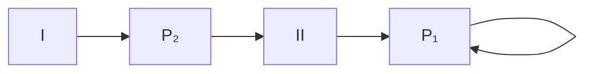
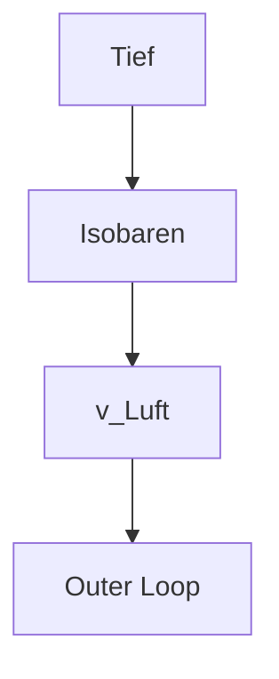
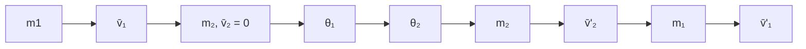

# 2 Mechanik des Massenpunktes

原始 PDF 第 50–161 页。

## 2 Mechanik des Massenpunktes

**Einleitung:** Der Massenpunkt – ohne Ausdehnung, aber massebehaftet – ist ein physikalisches Modell, um kinematische und dynamische mechanische Prozesse zu studieren. Da die „fundamentalen“ – aus heutiger Sicht nicht mehr weiter teilbaren – Elementarteilchen, aus denen die Materie besteht, auch als punktförmig und massebehaftet angesehen werden, hat der Massenpunkt in der modernen, sub atomaren Physik eine wichtige Bedeutung.

Zunächst wird die mathematische Beschreibung der Bewegung des Massenpunktes besprochen, ohne noch auf die Ursache dieser Bewegung einzugehen (Kinematik). Dann wird die Wirkung einer Kraft als Ursache der Bewegung eingeführt (Dynamik, Newtonsche Axiome). Die Begriffe Arbeit und Energie werden ausführlich diskutiert.

Um angeben zu können, wo sich ein Massenpunkt gerade befindet, welche Geschwindigkeit er besitzt und ob eine diese Geschwindigkeit verändernde Kraft wirkt, muss ein Koordinatensystem gewählt werden. Ist dieses Koordinatensystem nicht in Ruhe, sondern bewegt es sich beschleunigt (z. B. rotierend), so treten Scheinkräfte (Trägheitskräfte) auf. Von diesen Überlegungen ausgehend gab Einstein unter der Voraussetzung einer allgemein gültigen Maximalgeschwindigkeit (Grenzgeschwindigkeit), der Lichtgeschwindigkeit c im Vakuum, in seiner speziellen Relativitätstheorie eine Abänderung der in diesem Kapitel dargestellten „Newtonschen Mechanik“ an (siehe Band II, Kapitel „Relativistische Mechanik“). Das Kapitel schließt mit den Erhaltungssätzen von Massenpunktsystemen, die universell sind und in der gesamten Physik gelten.

Im umfangreichen Anhang zu diesem Kapitel werden einerseits die Gravitation und die damit in Beziehung stehenden Keplerschen Gesetze der Planetenbewegung besprochen; es wird auch auf die Messung der Erdbeschleunigung und der Gravitationskonstante eingegangen. Andererseits geht es um Stoßprozesse (elastischer und inelastischer Stoß) und die Streuung (= Ablenkung) von Teilchen am Potenzial eines Kraftfeldes. Beides ist besonders im Bereich der subatomaren Physik (Kernphysik und Elementarteilchenphysik, Band V, Kapitel „Subatomare Physik“) von außerordentlicher Bedeutung.

## 2.1 Kinematik (kinematics)

Der Massenpunkt (er besitzt Masse, aber keine Ausdehnung und keine Struktur) ist ein sehr einfaches Modell, mit dem man aber hinreichend genau einfache Bewe gungen beschreiben kann. Die Keplerschen Gesetze der Planetenbewegung wurden z. B. in dieser Näherung abgeleitet.<sup>1</sup> Der Massenpunkt (MP) ist auch ein gutes Mo

<small><span class="docvortex-page-footnote" data-block-type="page_footnote" style="color:#6b7280">1 Die ‚Ausdehnung‘ ist immer relativ zu den umgebenden Strukturen zu sehen!</span></small>

https://doi.org/10.1515/9783110675689-002

---

26

2 Mechanik des Massenpunktes

dell für die sehr kleinen Teilchen der Elementarteilchenphysik, man kann ihn daher auch einfach ‚Teilchen‘ ( particle) nennen.

Unsere erste Aufgabe ist, die (augenblickliche) Lage des MP im Raum zu beschreiben. Zur Angabe des Aufenthaltsortes unseres Teilchens im Raum benützen wir Koordinaten (coordinates), z. B.

1 kartesische Koordinaten (cartesian coordinates) $( x , y , z ) ,$ Kugelkoordinaten (spherical coordinates) (r, θ, φ), oder Zylinderkoordinaten (cylindrical coordinates) $( r ,   \varphi ,   \mathrm { z } ) ,$

die sich auf einen gewählten Koordinatenursprung O (origin) beziehen (Abb. I-2.1).


<details>
<summary>text_image</summary>

Mathematical diagrams showing 3D coordinate systems with labeled axes, surfaces, and angles for geometric or physical analysis.
</details>

Kartesische Koordinaten (x, y, z), beachte die Rechtsschraube<sup>2</sup> der Koordinatenachsen (‚Rechte-Hand-Regel‘)!

Kugelkoordinaten (r, θ, φ), der Polarwinkel θ (0 bis π) wird von z weg, der Azimutwinkel φ (0 bis 2 π) wird von x weg positiv gezählt

Zylinderkoordinaten (r, φ, z) φ wird von x weg positiv gezählt

Abb. I-2.1: Koordinatensysteme.

Wir verwenden zunächst nur kartesische Koordinaten. Die Bewegung des MP wird dann durch die zeitabhängigen Koordinaten des Ortsvektors r⇀( position vector) beschrieben, der dauernd vom Ursprung zum MP zeigt („gebundener Vektor“):

$$
\vec {r} = \vec {r} (t) = \vec {r} \Big (x (t), y (t), z (t) \Big). \tag {I-2.1}
$$

<small><span class="docvortex-page-footnote" data-block-type="page_footnote" style="color:#6b7280">2 Wird die positive x-Achse in die positive y-Achse gedreht, dann bewegt sich z im Sinne einer Rechtsschraube nach oben (in positive z-Richtung).</span></small>

---

2.1 Kinematik (kinematics)

27

Die zeitliche Abfolge der Endpunkte von $\vec { r } ( t )$ beschreibt eine Kurve im Raum, nämlich die Bahnkurve s des MP. Die Zeit t, der Parameter der Kurve, ist dabei eine eindimensionale Größe (Vergangenheit, Gegenwart, Zukunft).

Die moderne Physik hat hier zwei Probleme entdeckt:

1. Zur Bestimmung der Teilchenbahn sind Zeitmessungen an bestimmten Raumpunkten notwendig. Die Zeitmessung hat aber nur dann wirklich Sinn, wenn sie an allen Raumpunkten vergleichbar durchgeführt werden kann. Dies stellt in der klassischen Physik Newtons kein Problem dar, da die Zeit hier eine universelle Größe ist, die nicht vom Ort abhängig ist.<sup>3</sup> Seit der Erkenntnis aber, dass es eine Obergrenze der Geschwindigkeit für die Übertragung von Signalen gibt und dass diese Geschwindigkeit – die Lichtgeschwindigkeit c – in allen gegeneinander bewegten Bezugssystemen den selben Wert besitzt, kann die Zeit nicht mehr als universelle Größe angesehen werden. Die spezielle Relativitätstheorie zeigt, dass die Zeit eines Ereignisses an einem bestimmten Ort vom Bezugssystem abhängt und beim Wechsel des Bezugssystems wie eine Koordinate mittransformiert werden muss.

2. Bei der Beschreibung von Vorgängen in atomaren Dimensionen können Ort und Geschwindigkeit (Impuls) nicht mehr gleichzeitig beliebig genau angegeben werden (Heisenbergsche Unschärferelation). Zu einem bestimmten Zeitpunkt sind der Aufenthaltsort und der Impuls eines Teilchens nur mehr mit einer gewissen Wahrscheinlichkeit bekannt, die Beschreibung der Bewegung mit einer Teilchenbahn ist daher nur mehr innerhalb statistischer Grenzen möglich, die aber sehr eng sein können (z. B. Blasenkammerspuren von Elementarteilchen).

## 2.1.1 Geschwindigkeit und Beschleunigung

Die Geschwindigkeit υ⇀(velocity = speed) eines Teilchens ist die Änderung seines Ortsvektors in der Zeiteinheit:

$$
\vec {v} = \vec {v} (t) = \lim _ {\Delta t \to 0} \frac {\vec {r} (t + \Delta t) - \vec {r} (t)}{\Delta t} = \frac {d \vec {r}}{d t} = \dot {\vec {r}}. ^ {4} \tag {I-2.2}
$$

Einheit $:^{5}[v]=1   ms ^{-1}$

<small><span class="docvortex-page-footnote" data-block-type="page_footnote" style="color:#6b7280">3 Newton ahnte das Problem bereits, da er erkannte, dass seine Annahme der Absolutheit von Raum und Zeit rein hypothetisch war und nicht aus Beobachtungen oder durch induktiven Schluss abgeleitet werden konnte. Er blieb hier also inkonsequent gegenüber seiner Forderung der Hypothesenfreiheit in seinen Philosophiae Naturalis Principia Mathematica (1687).</span></small>

<small><span class="docvortex-page-footnote" data-block-type="page_footnote" style="color:#6b7280">4 Zeitableitungen werden der Kürze wegen seit Newton mit einem Punkt bezeichnet:</span></small>

$$
\underbrace {\frac {d x}{d t}} _ {\text {Leibniz}} \equiv \underbrace {\dot {x}} _ {\text {Newton}}
$$

<small><span class="docvortex-page-footnote" data-block-type="page_footnote" style="color:#6b7280">5 Eckige Klammern bezeichnen die SI-Einheiten der entsprechenden Größen.</span></small>

---

28

2 Mechanik des Massenpunktes

Für den Betrag der Geschwindigkeit gilt

$$
\nu = \left| \vec {v} \right| = \frac {\left| d \vec {r} \right|}{d t} = \frac {d s}{d t}
$$

s ist das Bogenelement der Bahnkurve (siehe Abb. I-2.3).

Die Beschleunigung a⇀(acceleration) ist die Änderung der Geschwindigkeit eines Teilchens in der Zeiteinheit:

$$
\vec {a} = \vec {a} (t) = \lim _ {\Delta t \to 0} \frac {\vec {v} (t + \Delta t) - \vec {v} (t)}{\Delta t} = \frac {d \vec {v}}{d t} = \dot {\vec {v}} = \ddot {\vec {r}}. \tag {I-2.3}
$$

Einheit: $[ a ] = 1   \mathrm { m } \; \mathrm { s } ^ { - 2 }$

## 2.1.2 Die allgemeine Bewegung des MP

Die Teilchengeschwindigkeit υ⇀zeigt immer in Richtung der Tangente an die Bahnkurve s, aber die Beschleunigung a⇀muss nicht in Bahnrichtung zeigen!

$\vec { e } _ { t }$ ist der Einheitsvektor in Bahnrichtung (tangential), ${ \vec { e } } _ { n }$ ist der Einheitsvektor in einer Richtung normal dazu. Für die Geschwindigkeit können wir daher $\vec { \upsilon } = \upsilon \cdot \vec { e } _ { t }$ schreiben und erhalten so für die Beschleunigung zwei Anteile:

$$
\vec {a} = \frac {d \vec {v}}{d t} = \frac {d v}{d t} \vec {e} _ {t} + v \frac {d \vec {e} _ {t}}{d t} = \vec {a} _ {t} + \vec {a} _ {n}. ^ {6} \tag {I-2.4}
$$

Die Beschleunigung kann also immer in eine Komponente ${ \vec { a } } _ { t }$ in Bahnrichtung und eine Komponente ${ \vec { a } } _ { n }$ normal zur Bahn zerlegt werden (Abb. I-2.2). Dabei sind

$$
\vec {a} _ {t} = \frac {d v}{d t} \vec {e} _ {t} \quad \begin{array}{l} \text {die Tangentialbeschleunigung} \\ (\text {Änderung des Betrags der Bahngeschwindigkeit}) \text {und} \end{array} \tag {I-2.5}
$$

$$
\vec {a} _ {n} = \nu \frac {d \vec {e} _ {t}}{d t} \quad \begin{array}{l} \text {die Normalbeschleunigung} \\ (\text {Änderung der Geschwindigkeitsrichtung}). \end{array} \tag {I-2.6}
$$

<small><span class="docvortex-page-footnote" data-block-type="page_footnote" style="color:#6b7280">$6 \frac { d \vec { e } _ { t } } { d t } \perp \vec { e } _ { t }$ , da die Änderung jedes dem Betrage nach konstanten Vektors nur senkrecht zu seiner Richtung erfolgen kann. Siehe auch: Berechnung der Normalbeschleunigung weiter unten.</span></small>

---

2.1 Kinematik (kinematics)

29


<details>
<summary>text_image</summary>

z
P₁
aₙ(t₁)
aₜ(t₁)
aₙ(t₂)
P₂
aₜ(t₂)
s
x
y
</details>

Abb. I-2.2: Die Bahnkurve s des MP wird in jedem Punkt (hier gezeigt für $P _ { 1 }$ und $P _ { 2 } )$ durch seine Tangential- und seine Normalbeschleunigung bestimmt.

## Berechnung der Normalbeschleunigung

Der Ortsvektor sei als Funktion der Bogenlänge $s = s ( t )$ gegeben.

Mit der ‚Kettenregel‘ gilt dann:


<details>
<summary>text_image</summary>

ds = |d\u0305r|
d\u0305
\u0305
\u0305 + d\u0305
s
</details>

Abb. I-2.3: Ortsvektor r⇀(t) und Bogenlänge $s ( t ) .$

Da $d \vec { r }$ in die Richtung der Bahntangente weist und wir der Abb. I-2.3 entnehmen können, dass $\left| d \vec { r } \right| = d s \; \mathrm { g i l t } ,$ so können wir daraus den Einheitsvektor in Tangentenrichtung bilden: $\vec { e } _ { t } = \frac { d \vec { r } } { d s } .$

Wir überlegen uns kurz die Differentiation eines Vektors konstanter Länge:

$$
\left| \vec {u} (s) \right| = \text { const.} \Rightarrow (\vec {u} (s)) ^ {2} = \text { const. }
$$

---

30

2 Mechanik des Massenpunktes

Es muss daher gelten

$$
\frac {d (\vec {u}) ^ {2}}{d s} = 2 \vec {u} \frac {d \vec {u}}{d s} = 0.
$$

Da $\vec { u } \neq 0$ und $\frac { d \vec { u } } { d s } \neq 0 \Rightarrow \frac { d \vec { u } } { d s } \perp \vec { u } .$

Das heißt, wenn wir einen Vektor konstanter Länge differenzieren, dann steht sein Differentialquotient auf dem Vektor normal. Dies ist auch geometrisch verständlich: Alle Endpunkte eines konstanten Vektors liegen auf einer Kugeloberfläche. Die Ableitung kann nur die Richtung ändern und die Änderung muss daher eine Tangente zur Kugeloberfläche sein, also auf dem Vektor normal stehen.

Daher gilt für den Tangenteneinheitsvektor $\vec { e } _ { t } ( s )$

$$
\frac {d \vec {e} _ {t}}{d s} \perp \vec {e} _ {t} \Rightarrow \frac {d \vec {e} _ {t}}{d s} / / \vec {e} _ {n}, \quad \text {also} \quad \frac {d \vec {e} _ {t}}{d s} = \left| \frac {d \vec {e} _ {t}}{d s} \right| \cdot \vec {e} _ {n}.
$$

Der Normaleneinheitsvektor ${ \vec { e } } _ { n }$ ist immer nach der konkaven Seite der Bahnkurve, also zu ihrem Krümmungsmittelpunkt M hin gerichtet.


<details>
<summary>flowchart</summary>

```mermaid
graph LR
  S["s"] --> P1["P"]
  P1 --> P2["P2"]
  P2 --> ds["ds"]
  ds --> en["en"]
  en --> dφ["dφ"]
  d["dφ"] --> e_t["e_t"]
  e_t --> dφ + e_t + dē_t["e_t + dē_t"]
  d --> e_t
  e_t --> s["s"]
  s --> M["M"]
  M --> Normal_ebene["Normal-ebene"]
  Normal_ebene --> Schmiegebene["Schmiegebene"]
```
</details>

Abb. I-2.4: Rektifizierende Ebene: steht $\perp \vec { e } _ { n }$ . Schmiegebene: wird von ${ \vec { e } } _ { t }$ und $d \vec { e } _ { t }$ aufgespannt. Normalebene: steht $\perp \vec { e } _ { t }$

Aus der Abb. I-2.4 ergibt sich ds $= \rho   d \varphi , \rho$ … Radius des Krümmungskreises um $M ,$ und außerdem $\left| d \vec { e } _ { t } \right| = d \varphi \cdot \left| \vec { e } _ { t } \right| = d \varphi = \frac { d s } { \rho }$

---

2.1 Kinematik (kinematics)

31

$$
\Rightarrow \quad \left| \frac {d \vec {e} _ {t}}{d s} \right| = \frac {1}{\rho} \quad \text {und} \quad \frac {d ^ {2} \vec {r}}{d s ^ {2}} = \frac {d}{d s} \left(\frac {d \vec {r}}{d s}\right) = \frac {d \vec {e} _ {t}}{d s} = \left| \frac {d \vec {e} _ {t}}{d s} \right| \cdot \vec {e} _ {n} = \frac {\vec {e} _ {n}}{\rho}
$$

und wir erhalten

$$
\underline {{\vec {a} _ {n}}} = \nu \frac {d \vec {e} _ {t}}{d s} \frac {d s}{d t} = \frac {\nu^ {2}}{\rho} \vec {e} _ {n}. \tag {I-2.7}
$$

Für die Krümmung (curvature) einer Kurve gilt $k = { \frac { d \varphi } { d s } } = \left| { \frac { d { \vec { e } } _ { t } } { d s } } \right| = \left| { \frac { d ^ { 2 } { \vec { r } } } { d s ^ { 2 } } } \right| = { \frac { 1 } { \rho } }$ , also

$$
k = \frac {1}{\rho} = \sqrt {\left(\frac {d ^ {2} \vec {r}}{d s ^ {2}}\right) ^ {2}} = \sqrt {\left(\frac {d ^ {2} x}{d s ^ {2}}\right) ^ {2} + \left(\frac {d ^ {2} y}{d s ^ {2}}\right) ^ {2} + \left(\frac {d ^ {2} z}{d s ^ {2}}\right) ^ {2}} \quad \begin{array}{l} K r i m m u n g d e r \\ B a h n k u r v e. \end{array} \tag {I-2.8}
$$

Damit erhalten wir den Beschleunigungsvektor für die allgemeine, krummlinige Bewegung:

$$
\vec {a} (t) = \frac {d v}{d t} \vec {e} _ {t} + \frac {v ^ {2}}{\rho} \vec {e} _ {n}, \quad \text {mit dem Betrag} \quad \left| \vec {a} \right| = a = \sqrt {\left(\frac {d v}{d t}\right) ^ {2} + \frac {v ^ {4}}{\rho^ {2}}} \tag {I-2.9}
$$

Der Beschleunigungsvektor $\vec { a } ( t )$ liegt also immer in der Schmiegebene, die von $\vec { e } _ { t } ( t )$ und $\vec { e } _ { n } ( t )$ aufgespannt wird!

## 2.1.3 Spezielle Bewegungen

1. Die unbeschleunigte Bewegung, $\vec { a } = \frac { d \vec { \upsilon } } { d t } = 0 .$

$\Rightarrow \vec { v } = \mathbf { c o n s t } .$ , d. h. Betrag und Richtung der Geschwindigkeit bleiben konstant, es handelt sich um eine gleichförmig geradlinige Bewegung.

2. Die gleichförmig beschleunigte Bewegung, $\vec { a } = \vec { a } _ { 0 } = \mathrm { c o n s t } .$

(z. B. Beispiel: freier Fall und „schiefer Wurf“ im Erdschwerefeld, Abb. I-2.5).

Die <u>erste Integration</u> ergibt die Geschwindigkeit:

$$
\vec {v} (t) = \vec {a} _ {0} \int d t = \vec {a} _ {0} t + \vec {v} _ {0}. \tag {I-2.10}
$$

Die Integrationskonstante $\vec { \nu } _ { 0 }$ folgt aus der Anfangsbedingung bei $t = 0$

$$
\vec {v} (0) = \vec {v} _ {0}.
$$

---

32

2 Mechanik des Massenpunktes


<details>
<summary>text_image</summary>

y
\vec{v}_0 = \vec{v}_{0h} + \vec{v}_{0v}
\vec{v}_{0h}
\vec{a}_{t_1}
\vec{a}_{n_1}
\vec{a}_{t_2}
\vec{a}_{n_2}
\vec{a}_0
\vec{a}_{t_0}
\vec{r}_{t_1}
\vec{r}_{t_2}
0
x
</details>

Abb. I-2.5: Der $\pmb { \mathscr { v } } ^ { \pmb { S } }$ chiefe $\mathsf { W u r f ^ { \mathsf { e c } } }$ im Erdschwerefeld als Beispiel einer gleichförmig beschleunigten Bewegung. Es ist $\vec { \upsilon } _ { 0 } = \upsilon _ { 0 h } \vec { e } _ { x } + \upsilon _ { 0 v } \vec { e } _ { y }$ und $\vec { a } _ { 0 } = a _ { 0 h } \vec { e } _ { x } + a _ { 0 v } \vec { e } _ { y }$ . Nach Gl. I-2.11 ergibt sich mit $\vec { a } _ { 0 h } = 0$ und $\vec { a } _ { 0 \nu } = a _ { 0 } \vec { e } _ { y }$ für die Bahnkurve eine Parabel (Parameterdarstellung): $x = \upsilon _ { 0 h } t + x _ { 0 }$ $y = \frac { 1 } { 2 } a _ { 0 } t ^ { 2 } + \upsilon _ { 0 \nu } t + y _ { 0 }$ . Im dargestellten Fall ist $x _ { 0 } = 0$

Die <u>zweite Integration</u> ergibt den augenblicklichen Aufenthaltsort des Teilchens:

$$
\vec {r} (t) = \int \vec {v} d t = \vec {a} _ {0} \int t d t + \vec {v} _ {0} \int d t = \frac {1}{2} \vec {a} _ {0} t ^ {2} + \vec {v} _ {0} t + \vec {r} _ {0}. \tag {I-2.11}
$$

Es treten zwei Integrationskonstanten auf, die Anfangsgeschwindigkeit $\vec { v } _ { 0 } =$ $( \upsilon _ { 0 h } , \upsilon _ { 0 \nu } )$ und die Anfangslage $\vec { r } _ { 0 } = ( x _ { 0 } = 0 , y _ { 0 } )$

Die Bahnkurve liegt stets in der von ${ \vec { a } } _ { 0 }$ und ${ \vec { v } } _ { 0 }$ aufgespannten Ebene und ist im allgemeinen Fall (schiefer Wurf) eine quadratische Parabel, bei der sich in jedem Punkt $r ( t )$ die Tangential- und die Normalbeschleunigung zum konstanten ${ \vec { a } } _ { 0 }$ zusammensetzen.

Nur wenn die Richtung der Anfangsgeschwindigkeit ${ \vec { v } } _ { 0 }$ mit der der Beschleunigung zusammenfällt (senkrechter Wurf nach oben oder nach unten), resultiert eine lineare Bewegung mit $\vec { a } _ { n } = 0$ (Krümmungsradius $\rho = \infty )$

3. Die allgemeine Kreisbewegung (bei fester Richtung der Achse).

Auch hier gilt wie bei der allgemeinen Bewegung (Gl. I-2.9):

$$
\vec {a} (t) = \vec {a} _ {t} + \vec {a} _ {n} = \frac {d \nu}{d t} \vec {e} _ {t} + \frac {\nu^ {2}}{R} \vec {e} _ {n},
$$

aber jetzt mit dem festen Bahnradius R.

---

2.1 Kinematik (kinematics)

33


<details>
<summary>text_image</summary>

ω̅ = dφ/dt ēω
P₂
φ̄
s
ēₜ = ēω × (-ēₙ)
P₁
r̄(t₂)
R
φ
M
ēₙ
r̄(t₁)
θ
r̄ω
ēω
O
r̄ = O M · ēω + R · (-ēₙ) = R̄
</details>

Abb. I-2.6: Zur allgemeinen Kreisbewegung.

Aus der Abb. I-2.6 sehen wir:

$$
\nu = \left| \vec {\upsilon} \right| = \frac {d s}{d t} = R \frac {d \varphi}{d t} = R \omega . \tag {I-2.12}
$$

Dabei ist $\vec { \omega } = \frac { d \vec { \varphi } } { d t } = \frac { d \varphi } { d t }   \vec { e } _ { \omega }$ die Winkelgeschwindigkeit $( \varphi$ … orientierter Winkel, Vektor in Richtung der Achse des Kreises), die auf der Ebene der Bahnkurve normal steht. Einheit: $[ \omega ] = 1   { \frac { \mathrm { r a d } } { \mathrm { s } } } = \mathrm { s } ^ { - 1 }$

Allgemein gilt: Ist $d \varphi = { \frac { \left| d { \vec { s } } \right| } { R } }$ ein differentiell kleiner Winkel über dem Bogen $| d \vec { s } |$ , dann ist dφ⇀ein orientiertes Winkelelement, das senkrecht auf jener Ebene steht, die von O und $| d \vec { s } |$ aufgespannt wird. Die gleiche Orientierung gilt auch für $\vec { \omega } = \frac { d \vec { \varphi } } { d t }$ . Anmerkung: Für differentiell kleine Winkel $d \varphi$ und dψ gilt das kommutative Gesetz $d \varphi   +   d \psi   =   d \psi   +   d \varphi$ ; Winkelgeschwindigkeiten sind daher kommutativ. Dies gilt aber nicht für endliche Winkel im Raum: $\varphi +$ $\psi \neq \psi + \varphi$ (siehe dazu z. B. G. Falk und W. Ruppel, 1983. „Mechanik Relativität Gravitation: Die Physik der Naturwissenschaften“, Springer Berlin, Heidelberg, New York, S. 227/228, insbesondere Abb. 24.3).

---

34

2 Mechanik des Massenpunktes

Es gilt weiter mit $\theta   =   \angle ( \vec { \omega } , \vec { r } )$

$$
R = \left| \vec {r} \right| \sin \theta
$$

und damit

$$
\Rightarrow \upsilon = \underbrace {\omega \cdot | \vec {r} | \cdot \sin \theta} _ {\substack {\text {Betrag des Vektor - } \\ \text {produkts} \bar {\omega} \times \vec {r}}} \tag{I - 2.13}
$$

Da außerdem $\vec { v }$ senkrecht auf $\vec { \omega }$ und $\vec { r }$ steht,7 folgt also für die Geschwindigkeit bei der allgemeinen Kreisbewegung mit $\vec { \omega } \times \vec { r } = \omega \vec { e } _ { \omega } \times \left( O M \vec { e } _ { \omega } - R   \vec { e } _ { n } \right) =$ ω $R \big ( \vec { e } _ { \omega } \times ( - \vec { e } _ { n } ) \big ) = \omega \cdot R \cdot \vec { e } _ { t }$

$$
\vec {v} (t) = \frac {d \vec {r}}{d t} = \vec {\omega} \times \vec {r} = \underbrace {\omega \cdot R} _ {= \nu} \cdot \vec {e} _ {t} = v \vec {e} _ {t}. \tag {I-2.14}
$$

Durch Differenzieren ergibt sich die Beschleunigung der Kreisbewegung:<sup>8</sup>

$$
\begin{array}{l} \vec {a} (t) = \frac {d \vec {v}}{d t} = \dot {\vec {\omega}} \times \vec {r} + \vec {\omega} \times \frac {d \vec {r}}{d t} = \dot {\vec {\omega}} \times \vec {r} + \vec {\omega} \times \vec {v} = \dot {\vec {\omega}} \times \vec {r} + \vec {\omega} \times (\vec {\omega} \times \vec {r}) = \\ = \frac {d ^ {2} \varphi}{d t ^ {2}}   \vec {e} _ {\omega} \times \underbrace {(\vec {r} _ {\omega} + \vec {R})} _ {\text {siehe   Abb. I - 2.6}} + \omega   \vec {e} _ {\omega} \times (\omega R \cdot \vec {e} _ {t}) = \\ = \dot {\omega} \vec {e} _ {\omega} \times (r _ {\omega} \vec {e} _ {\omega} - R \vec {e} _ {n}) + \omega^ {2} R \underbrace {(\vec {e} _ {\omega} \times \vec {e} _ {t})} _ {= \vec {e} _ {n}} = \dot {\omega} R \underbrace {(\vec {e} _ {\omega} \times (- \vec {e} _ {n}))} _ {= \vec {e} _ {t}} + \omega^ {2} R \cdot \vec {e} _ {n} \\ \Rightarrow \vec {a} (t) = \underbrace {\dot {\omega} R \cdot \vec {e} _ {t}} _ {\text {Tangentialbeschleunigung} a _ {t}} + \underbrace {R \omega^ {2} \cdot \vec {e} _ {n}} _ {\text {Zentripetalbeschleunigung} a _ {n}} \tag {I-2.15} \\ \end{array}
$$

4. Die gleichförmige Kreisbewegung, $\vec { a } _ { t } = \dot { \omega } R \cdot \vec { e } _ { t } = 0$

$$
\Rightarrow \omega = \text {const. Aber es bleibt} \vec {a} = \vec {a} _ {n} = R \omega^ {2} \vec {e} _ {n} = \frac {\nu^ {2}}{R} \vec {e} _ {n}, \tag {I-2.15a}
$$

die Zentripetalbeschleunigung.

<small><span class="docvortex-page-footnote" data-block-type="page_footnote" style="color:#6b7280">7 Denn: r⇀= OM ̄⋅e⇀ω + R⇀⇒ υ⇀× r⇀= OM ̄(υ⇀× e⇀ω) + υ⇀× R⇀ = 0 ⇒ υ⇀⊥ r⇀ = 0 mit υ⇀⊥ e⇀ = 0 mit υ⇀⊥R⇀</span></small>

<small><span class="docvortex-page-footnote" data-block-type="page_footnote" style="color:#6b7280">8 Da ω⇀hier eine feste Richtung hat (senkrecht zur Kreisbewegung), gilt ω⇀̇//ω⇀. Das ist bei der Kreiselbewegung (siehe Kapitel „Mechanik des starren Körpers“, Abschnitt 3.4) nicht der Fall!</span></small>

---

2.1 Kinematik (kinematics)

35

## Die Kreisbewegung ist immer eine beschleunigte Bewegung!

1

Wenn bei der Kreisbewegung eines Teilchens die Zentripetalbeschleunigung plötzlich verschwindet, folgt die Bahn der Augenblicksgeschwindigkeit des Teilchens, das heißt, das Teilchen verlässt die Kreisbahn tangential und nicht radial nach außen. Dies kann sehr schön mit dem ‚sprühenden Schleifstein‘ gezeigt werden.


Die sprühenden Funken sind glühende Metallpartikel der Feile, die auf die Umlaufgeschwindigkeit der Schleifscheibe beschleunigt wurden. Sobald die Zentripetalbeschleunigung – ausgeübt durch den Druck der Feile − nicht mehr auf sie wirkt, verlassen sie die Schleifscheibe tangential, also in der Richtung der augenblicklichen Bahngeschwindigkeit. Würden wir auf der Scheibe ‚sitzen‘, könnten wir die Teilchen radial nach außen fliegen sehen: im rotierenden System wirkt die Zentrifugalkraft.

4

Die Wirkung der Zentripetalbeschleunigung kann auch mit der „laufenden Kette“demonstriert werden.

Eine Kette wird auf eine Holzscheibe aufgezogen und auf schnelle Umdrehung gebracht. Dann wird sie von der Scheibe seitwärts herunter geworfen: Sie läuft wie ein stabiles Rad weiter und kann sogar über Hindernisse springen. Da die Zentripetalbeschleunigung proportional zu $\upsilon ^ { 2 } / R$ ist, kann man das sogar mit einer langen Kette zeigen, die nur teilweise auf der Holzscheibe liegt, deren unterer Krümmungsradius aber deutlich kleiner ist. Auch sie ist sehr stabil, wenn sie eine hohe Umlaufgeschwindigkeit hat und kann ‚laufen‘. Zum Verständnis dieses Versuches ist zu beachten, dass es sich hier nicht um einen rotierenden starren Körper handelt (vergleiche Kapitel 3), sondern dass jedes Kettenglied einem umlaufenden MP entspricht. Dann muss auf jedes Kettenglied die für die Kreisbewegung erforderliche Zentripetalkraft wirken. Diese kann nur durch die Wechselwirkung mit den benachbarten Kettengliedern hervorgerufen werden, wozu eine Spannkraft längs der rotierenden Kette aufgebaut werden muss. Diese Spannkraft stabilisiert die rotierende Kette (dynamisch stabilisiertes System).<sup>9</sup>

4

<small><span class="docvortex-page-footnote" data-block-type="page_footnote" style="color:#6b7280">9 Im rotierenden System der Kette tritt, wie wir später im Abschnitt 2.3.3 sehen werden, die Zentrifugalbeschleunigung auf, die die Kettenspannung bewirkt.</span></small>

---

36

2 Mechanik des Massenpunktes


## 2.2 Dynamik (dynamics)

In der Dynamik fragen wir nach den Ursachen von Bewegungen, also: Woher kommen die Beschleunigungen?

Die Antwort gab schon Newton: Kräfte seien die Ursache von Beschleunigungen. Aber was sind Kräfte? Es sind bestimmte objektive Konstellationen der einen Massenpunkt umgebenden Materie, die ihn zu einer beschleunigten Bewegung veranlassen können; man spricht von einer „Wechselwirkung“ (WW) des Teilchens mit der umgebenden Materie.

## 1

Die Ursache für Änderungen des augenblicklichen Bewegungszustandes (der Geschwindigkeit) eines Körpers liegt in seiner Wechselwirkung mit der ihn umgebenden Materie.

Aufgrund ihrer Wechselwirkungsnatur treten Kräfte stets paarweise auf.

Die Beschreibung dieser Wechselwirkung des Körpers (hier des MP) mit seiner Umgebung führt zum Konzept der Kraft (force): Wenn eine Kraft am Körper angreift, so ändert er seinen Bewegungszustand. Greift keine resultierende Kraft an, so ist der Körper ‚kräftefrei‘ (z. B. ein ‚freies Teilchen‘) und er ändert seinen Bewegungszustand (seine Geschwindigkeit) nicht.

Manchmal wird eine Kraft materiell durch Druck oder Stoß auf einen Körper übertragen, etwa durch eine Feder oder durch die Gasmoleküle beim Schall oder in thermischen Maschinen (Turbine, Verbrennungsmotor). Bei der Wechselwirkung durch Gravitation oder der elektromagnetischen Wechselwirkung trifft das nicht zu, es ist in diesen Fällen kein Medium zur Kraftübertragung nötig, diese Kräfte

---

2.2 Dynamik (dynamics)

37

wirken auch im Vakuum.<sup>10</sup> Dies führt zum Konzept des Kraftfeldes (force field): Jedem Raumpunkt wird eine Kraft (Größe und Richtung) zugeordnet, wodurch je der Raumpunkt zum Sitz einer Kraftwirkung wird. Der Raum wird also durch die vorhandene Materie physikalisch strukturiert und so zum Träger von Energie und Impuls. Die Kraftwirkungen des Feldes müssen nach Größe und Richtung durch einen Vektor, die Feldstärke $\mathcal { \bar { F } }$ festgelegt werden. Die Kraft $\vec { F }$ auf einen MP ergibt sich dann aus dem Produkt der Feldstärke $\mathcal { \bar { F } }$ und der Masse m des MP: $\vec { F } = m \cdot \vec { \mathcal { F } }$ Die Feldstärke ist also gleich der Kraft auf die Masseneinheit (ganz allgemein auf die Einheit jenes $, \mathtt { A g e n s ^ { \circ } }$ , das der Feldstärke zugrunde liegt, z. B. Masse, elektrische Ladung, etc.). Im Fall eines Nichtgleichgewichtszustandes der felderzeugenden Teilchen (dynamischer Fall) breiten sich die Kraftwirkungen, also die Felder, mit der Grenzgeschwindigkeit c (Lichtgeschwindigkeit im Vakuum) aus. Die Kraftwir kung unter der Vermittlung des den Raum erfüllenden Feldes bezeichnen wir als Nahwirkung: Die Kraft auf einen MP wird nur durch die Eigenschaften des Raumes in seiner unmittelbaren Umgebung, also der Feldstärke, hervorgerufen. Im Gegensatz dazu steht die alte, heute nicht mehr akzeptierte Fernwirkung, bei welcher die Kraftwirkung zwischen den Teilchen den dazwischen liegenden Raum unendlich schnell überspringen kann.<sup>11</sup>

Wir haben bereits die vier fundamentalen Wechselwirkungen als Ursache der Kräfte kennen gelernt:

| Wechselwirkung | Kopplungskonstante | Reichweite |
| --- | --- | --- |
| Gravitation | $10^{-41}$ | $\infty$ |
| elektromagnetische WW | 1/137 (Feinstrukturkonstante) | $\infty$ |
| starke WW | $\cong 1$ | $\cong 10^{-15}$ m = 1 fm (Femtometer) |
| schwache WW | $10^{-15}$ | $\cong 10^{-18}$ m = 1 am (Attometer) |

Die Kopplungskonstante beschreibt die ‚Stärke‘ der Wechselwirkung. Ein Vergleich der Gravitation und der elektromagnetischen WW ergibt: Die elektrische Abstoßung zweier Protonen ist $1 0 ^ { 3 6 }$ mal größer als ihre Massenanziehung. Wir können daher in vielen Fällen der Teilchenphysik die Gravitationswirkung vernachlässigen. Andererseits tritt im Alltag die elektromagnetische WW oft gegenüber der Gravitation nicht in Erscheinung, da die Ladungen abgeschirmt sind (Atome sind neutral).

<small><span class="docvortex-page-footnote" data-block-type="page_footnote" style="color:#6b7280">10 Letzten Endes sind aber auch die Feder- und Stoßkräfte elektromagnetischer Natur!</span></small>

<small><span class="docvortex-page-footnote" data-block-type="page_footnote" style="color:#6b7280">11 Das Paradebeispiel dafür ist das Newtonsche Gravitationsgesetz (die Zeit als universelle Größe!). Allerdings kann im statischen und quasistatischen Fall (υ ≪ c) immer noch mit den bequemen Fernwirkungsausdrücken des Newtonschen und Coulombschen Gesetzes gerechnet werden, dann ist keine Retardierung nötig (zur Retardierung siehe auch Band III, Kapitel „Wechselstromkreis und elektromagnetische Schwingungen und Wellen“, Abschnitt 5.3).</span></small>

---

38

2 Mechanik des Massenpunktes

**Beispiel:** Wir berechnen das Verhältnis zwischen der Massenanziehung zweier Protonen und ihrer Coulomb-Abstoßung.

Massenanziehung: $F _ { P - P } ^ { G } = \gamma   \frac { m _ { P }   m _ { P } } { r ^ { 2 } }   ,$

Elektromagnetische WW (Coulombkraft): $F _ { P - P } ^ { C } = \frac { 1 } { 4 \pi \varepsilon _ { 0 } }   \frac { q _ { P }   q _ { P } } { r ^ { 2 } }   ,$ ,

$$
m _ {P} = 1, 6 7 \cdot 1 0 ^ {- 2 7} \mathrm{kg}, \quad \gamma = 6, 6 7 \cdot 1 0 ^ {- 1 1} \mathrm{m} ^ {3} \mathrm{kg} ^ {- 1} \mathrm{s} ^ {- 2},
$$

Ladung des Protons $e = 1 . 6 0 \cdot 1 0 ^ { - 1 9 } \mathrm { C } , \quad 1 / ( 4 \pi \varepsilon _ { 0 } ) = 8 . 9 9 \cdot 1 0 ^ { 9 } \mathrm { N m } ^ { 2 } \mathrm { C } ^ { - 2 }$

$$
\Rightarrow \frac {F _ {P - P} ^ {G}}{F _ {P - P} ^ {C}} = 0, 8 \cdot 1 0 ^ {- 3 6}.
$$

## 2.2.1 Die Newtonschen Axiome und der Impuls (momentum)

Wir definieren nach Newton (Sir Isaac Newton, 1643–1727) zunächst eine Größe, die den augenblicklichen Bewegungszustand eines Teilchens charakterisiert und nennen sie Impuls<sup>12</sup> oder Bewegungsgröße $\bar { p }$ (linear momentum):

$$
\vec {p} = m \cdot \vec {\upsilon}. \tag {I-2.16}
$$

Einheit: $[ p ] = 1$ kg m $s ^ { - 1 }$

## 1. Axiom (Trägheitssatz, law of inertia, Newton 1, lex prima)

## 1 Der Impuls eines freien Teilchens ist zeitlich konstant.

Wenn also keine Kraft auf das Teilchen wirkt (freies Teilchen), so verharrt es in seinem augenblicklichen Bewegungszustand, d. h. es ruht oder bewegt sich gleichförmig geradlinig.

Wesentlich ist hier, dass für die Gültigkeit des Trägheitssatzes ein bestimmtes Bezugssystem (frame of reference)<sup>13</sup> gewählt werden muss. Der Trägheitssatz gilt nämlich nicht in allen Bezugssystemen, die möglich sind. Wir bezeichnen als Inertialsystem (inertial frame of reference) ein Bezugssystem, in dem der Trägheitssatz

<small><span class="docvortex-page-footnote" data-block-type="page_footnote" style="color:#6b7280">12 Genauer: linearer Impuls; Newton nannte den Ausdruck ‚motus‘ = Bewegung, siehe auch Abschnitt 2.2.3.</span></small>

<small><span class="docvortex-page-footnote" data-block-type="page_footnote" style="color:#6b7280">13 Oder ein ihm gleichwertiges: Gleichförmig geradlinig zueinander bewegte Systeme sind gleichwertige Inertialsysteme.</span></small>

---

2.2 Dynamik (dynamics)

39

gilt. Ein als Inertialsystem benütztes Bezugssystem darf nicht beschleunigt sein, also z. B. nicht rotieren, da in diesem System ein freies Teilchen eine Beschleuni gung zeigt, der Trägheitssatz also nicht gilt.

## 2. Axiom (Bewegungsgleichung, equation of motion, Newton 2, lex secunda)

Die Kraft ist die Ursache der Impulsänderung.

1

Quantitativ ergibt sich die Bewegungsgleichung:

$$
\vec {F} = \frac {d \vec {p}}{d t} = \dot {\vec {p}}. \tag {I-2.17}
$$

Einheit: [F] = 1 kg m $s ^ { - 2 }   =   1 \: \mathrm { N }$ (Newton)<sup>14</sup>

Die Kraft $\vec { F }$ wird also über die Impulsänderung definiert, die sie bewirkt. Dabei ist unter $\vec { F }$ die Summe aller auf das Teilchen wirkenden Kräfte zu verstehen.

Wir sehen sofort, dass in einem Inertialsystem der Trägheitssatz aus der Bewegungsgleichung unmittelbar folgt:

$$
\vec {F} = \dot {\vec {p}} = 0 \Rightarrow \vec {p} = \text { const. }
$$

In der Kern- und Elementarteilchenphysik gibt es Prozesse, bei denen Masse in Energie umgewandelt wird und umgekehrt. Wenn wir davon absehen, die Masse also konstant bleibt (m = const.), können wir schreiben:

$$
\vec {F} = m \cdot \vec {a}. ^ {1 5} \tag {I-2.18}
$$

Wir lesen die Bewegungsgleichung so: Die wirkende Kraft (linke Seite der Gleichung) führt zu einer beschleunigten Bewegung des MP (rechte Seite).

<small><span class="docvortex-page-footnote" data-block-type="page_footnote" style="color:#6b7280">14 1 Newton (1 N) heißt jene Kraft, die der Einheitsmasse von 1 kg eine Beschleunigung von dυ⇀ 1 m s−2 erteilt, denn bei konstanter Masse m gilt: F⇀= m⋅ ⇒ 1 N = 1 kg ⋅ 1 ms–2. dt</span></small>

<small><span class="docvortex-page-footnote" data-block-type="page_footnote" style="color:#6b7280">15 Die Ausgangsgleichung F⇀= dp⇀gilt auch in der Relativitätstheorie, während die Beziehung dt F⇀= m⋅a⇀dort im Allgemeinen nicht mehr gilt, da die Beschleunigung a⇀im Allgemeinen nicht mehr in Richtung der wirkenden Kraft erfolgt (vergleiche Band II, Kapitel „Relativistische Mechanik“, Abschnitt 3.10.3).</span></small>

---

40

2 Mechanik des Massenpunktes

## 4

Die Newtonsche Bewegungsgleichung wird mit dem ‚Maxwellschen Rad‘ demonstriert. An einer Balkenwaage hängt am rechten Balken ein massives Rad, das auf zwei auf der dünnen Radachse aufgewickelten Fäden abrollen kann. Es ist anfangs bis knapp unter den Waagebalken aufgerollt und dort mit einem Bindfaden fixiert. Am linken Balken hängt zur Dämpfung eine in einem Metallteller ruhende Metallkugel in einen mit Glyzerin gefüllten Zylinder. Die Waage ist anfänglich im Gleichgewicht, das heißt, die Gewichtskraft der Massen am linken Balken ist abzüglich der Auftriebskräfte gleich der Gewichtskraft, die auf das Rad wirkt (kein Drehmoment des Waagebalkens). Auch die wirkende Gesamtkraft ist anfänglich null, da die Gewichtskräfte durch die Aufhängung des Waagebalkens (Reaktionskraft im Mittellager) kompensiert werden.

Wird der Faden durchgebrannt, so beginnt sich das Rad beschleunigt in der Richtung der Schwerkraft zu bewegen (abzurollen). Das Rad hängt jetzt nicht mehr mit seinem gesamten Gewicht am Waagebalken, da ein Teil der Gewichtskraft zur Beschleunigung verwendet wird, die wegen der Rotation des Rades kleiner als $\vec { g }$ ist. Die Waage schlägt daher nach der Gegenseite aus. Wenn das Rad vollständig abgerollt ist, wickelt sich das Seil in der Gegenrichtung auf, die Geschwindigkeit dreht daher bei gleich bleibendem Betrag ihre Richtung um. Die Reaktionskraft reißt den Waagebalken kurzfristig nach unten. Aus Trägheitsgründen (Rotationsenergie, siehe Kapitel „Mechanik des starren Körpers“, Abschnitt 3.3.3) spult sich das Rad dann wieder auf, jetzt aber mit sich verlangsamender Geschwindigkeit, also negativer Beschleunigung, die also wieder nach unten weist. Die Wirkung auf die Waage ist beim Aufspulen daher die gleiche wie beim Abspulen, die Waage schlägt wieder auf die Seite der Dämpfungseinrichtung aus.


<details>
<summary>natural_image</summary>

Historic scientific instrument setup with a large cylindrical apparatus and a person holding a device (no visible text or symbols)
</details>

Waage im Gleichgewicht, Rad noch fixiert


<details>
<summary>natural_image</summary>

Historical scientific apparatus setup with scale and instrument (no visible text or symbols)
</details>

Rad bewegt sich beschleunigt nach unten, der Zeiger schlägt nach rechts aus


<details>
<summary>natural_image</summary>

Laboratory setup with a scientific apparatus and scale, no visible text or symbols
</details>

Rad bewegt sich verlangsamt nach oben, der Zeiger schlägt wieder nach rechts aus

Man kann die Bewegungsgleichung umschreiben und so eine andere Sicht gewinnen:

$$
\vec {a} = \frac {1}{m} \vec {F}, \tag {I-2.19}
$$

je größer also die Masse m ist, desto kleiner ist bei gegebener Kraft die Beschleunigung. Die Masse eines Körpers setzt also einer Bewegungsänderung einen Widerstand entgegen. Diese träge Masse $m _ { t }$ ist daher ein Maß für das Beharrungsvermö- gen des Körpers.

Wir schreiben also:

$$
\vec {F} = m _ {t} \vec {a}.
$$

---

2.2 Dynamik (dynamics)

41

Andererseits erfährt jeder Körper mit der trägen Masse $m _ { t }$ eine ‚Gewichtskraft‘ $\vec { F } _ { G }$ im Erdschwerefeld, die von der Substanzmenge und gemäß dem Newtonschen Gravitationsgesetz (siehe Anhang 1 ‚Gravitation und Planetenbewegung‘, A1.1: Das Gravitationsgesetz) von der Erdanziehung, also von $\vec { g }$ abhängt:

$$
\vec {F} _ {G} = m _ {s} \vec {g}. \tag {I-2.20}
$$

$\vec { g }$ ist also die Feldstärke $\vec { F }$ im Erdschwerefeld.

Hier ist $m _ { s }$ die schwere Masse (gravitational mass) und $\vec { g } = 9 \mathbf { , } 8 1$ m $s ^ { - 2 }$ die Erdbeschleunigung (gravitational acceleration) an der Erdoberfläche.

Bis vor Kurzem wurde die Einheit der schweren Masse (1 kg) durch einen Pt-Iridium Zylinder repräsentiert, der in Sèvres (bei Paris) aufbewahrt wurde. Seit 20. Mai 2019 wird die Einheit 1 kg über die Einheit $\mathrm { k g }   \mathrm { m } ^ { 2 } \mathrm { s } ^ { - 1 }$ definiert, wobei das Plancksche Wirkungsquantum h jetzt festgelegt ist:

$$
h = 6, 6 2 6 0 7 0 1 5 \cdot 1 0 ^ {- 3 4} \mathrm{kg} \mathrm{m} ^ {2} \mathrm{s} ^ {- 1} \Rightarrow 1 \mathrm{kg} = \frac {h}{6 , 6 2 6 0 7 0 1 5 \cdot 1 0 ^ {- 3 4}} \mathrm{m} ^ {- 2} \mathrm{s}.
$$

Das Beratungsgremium des „Bureau International des Poids et Mesures (BIPM)“, das $\bullet ^ { \prime }$ Consultative Committee for Mass and Related Quantities $( \mathrm { C C M } ) ^ { \infty }$ hat auch zwei Realisierungsmethoden vorgeschlagen, die Watt-Waage (Kibble-balance) und die Röntgenkristalldichtemessung (X-ray-crystal-density (XRCD) method). Siehe dazu das Kapitel „Einleitung“, Anhang 1: Definition der SI-Basiseinheiten.

Nehmen wir einen Körper mit dem Gewicht $\vec { F } _ { G } = m _ { s }   \vec { g }$ und lassen ihn fallen, so fällt er gemäß dem 2. Newtonschen Axiom beschleunigt:

$$
\vec {F} _ {G} = m _ {s} \vec {g} = m _ {t} \vec {a}.
$$

Die beobachtete Fallbeschleunigung ist also:

$$
\vec {a} = \frac {m _ {s}}{m _ {t}} \vec {g}.
$$

Sehr genaue Experimente, die schon von Newton mittels Pendelmessungen begonnen und schließlich 1909 von Eötvös (Loránd Eötvös, 1848–1919) und später 1964 von Dicke (Robert Henry Dicke, 1916–1997) verfeinert wurden (siehe Anhang 1 ‚Gravitation und Planetenbewegung‘, A1.4: Bestimmung der Gravitationskonstante), haben ergeben, dass am gleichen Ort der Erdoberfläche alle Körper gleich schnell fallen, dass also die Fallbeschleunigung keine Körpereigenschaft ist.

Es ergibt sich daher

$$
\frac {m _ {s}}{m _ {t}} = 1 \tag {I-2.21}
$$

---

42

2 Mechanik des Massenpunktes

als universelle Konstante. Das ist das Gesetz von der Äquivalenz der trägen und schweren Masse.<sup>16</sup> Wir brauchen daher im Folgenden nicht mehr zwischen träger und schwerer Masse zu unterscheiden, die Indizes t und s fallen weg. Eine bestimmte Substanzmenge (Masse) m wird demnach entweder durch ihr Gewicht oder durch ihre Trägheitswirkung (= Beschleunigung bei vorgegebener Kraft) gemessen.

Sind träge Masse $m _ { t }$ und schwere Masse $m _ { s }$ gleich, dann folgt aus dem Newtonschen Gravitationsgesetz (siehe Anhang A1.1), dass alle Körper gleich schnell fallen.

**Beispiel:** Die Äquivalenz von träger und schwerer Masse ergibt sich erst durch den experimentellen Befund, dass alle Körper gleich schnell fallen.

Das Newtonsche Gravitationsgesetz lautet (siehe Anhang A1.1):

$$
\left| \vec {F} \right| = \gamma \frac {m _ {1} m _ {2}}{r ^ {2}}.
$$

Wir lassen einen Körper mit der Masse $m _ { K }$ an der Erdoberfläche (Erdmasse $m _ { E } )$ fallen: mKt $\vec { a } = \gamma   \frac { m _ { K } ^ { s }   m _ { E } } { r ^ { ^ 2 } }$ Für $m _ { K } ^ { t } = m _ { K } ^ { s }$ fällt die Masse des Körpers aus der Gleichung und es gilt:

$$
\vec {a} = \vec {g} = \gamma \frac {m _ {E}}{r ^ {2}} = 6, 6 7 2 6 \cdot 1 0 ^ {- 1 1} \cdot \frac {5 , 9 7 5 \cdot 1 0 ^ {2 4}}{(6 , 3 7 6 \cdot 1 0 ^ {6}) ^ {2}} = 9, 8 0 7 \mathrm{ms} ^ {- 2}.
$$

Zum Vergleich: Normwert der Fallbeschleunigung $g_{n}=9,80665\mathrm{~m}\mathrm{~s}^{-2}$ exakt.

Der experimentelle Befund, dass alle Körper gleich schnell fallen, ist der Ausgangspunkt für die allgemeine Relativitätstheorie. Hier geht es um die Ununterscheidbarkeit zwischen der Kraftwirkung auf einen im Gravitationsfeld ruhenden Körper und jener auf einen Körper in einem gleichförmig beschleunigten Bezugssystem weit außerhalb jeder Gravitationswirkung. Das Einsteinsche Äquivalenzprinzip (nach Albert Einstein, 1879–1955) sagt, dass ein homogenes Gravitationsfeld völlig äquivalent zu einem gleichförmig beschleunigten Bezugssystem ist. Diese Aussage wird durch das Gedankenexperiment mit einem geschlossenen Fahrstuhl versinnbildlicht: Es ist für einen Beobachter im Fahrstuhl ununterscheidbar, ob der Fahrstuhl in einem Gravitationsfeld ruht oder ob er sich ohne jegliche Gravitationswirkung gleichförmig beschleunigt nach oben bewegt. Die Ergebnisse physikalischer Expe-

<small><span class="docvortex-page-footnote" data-block-type="page_footnote" style="color:#6b7280">16 Die relative Abweichung der schweren von der trägen Masse wird seit 2017 (Satellitenexperiment MICROSCOPE) kleiner als 10−15 angenommen. Der experimentelle Befund der Äquivalenz (= Gleichheit) von träger und schwerer Masse wurde später von Einstein zum Prinzip (Axiom) erhoben, dem Einsteinschen Äquivalenzprinzip der allgemeinen Relativitätstheorie.</span></small>

---

2.2 Dynamik (dynamics)

43

rimente sind gleich. Das ist der Ausgangspunkt für Einsteins allgemeine Relativitätstheorie, in der die Massenanziehung durch lokale Beschleunigungsfelder als Folge einer Raumkrümmung erklärt wird, die durch die Massenverteilung verursacht wird (Krümmung der Raum-Zeit).

## 3. Axiom (actio = reactio, Newton 3, lex tertia)

Wir nennen ein physikalisches System abgeschlossen, wenn auf die in ihm enthaltenen Massenpunkte nur innere Kräfte wirken, also Kräfte, die ihren Ursprung im System selbst besitzen, aber keine Kräfte von außen angreifen. Es gilt dann das 3. Newtonsche Axiom, das besonders für Systeme von MP wichtig ist (siehe Abschnitt 2.4 ‚Massenpunktsysteme und Erhaltungssätze‘):

In einem abgeschlossenen System treten Kräfte nur paarweise mit entgegengesetzter Größe auf.

1

In einem abgeschlossenen System ist daher die Summe aller Kräfte gleich Null.

## 2.2.2 Bahndrehimpuls und Drehmoment

Ein Teilchen bewege sich mit dem Impuls $\vec { p } = m \cdot \vec { \upsilon }$ auf einer Bahn $\vec { r } ( t )$


<details>
<summary>text_image</summary>

L
O
r̄(t)
m(MP)
ε(r, p̄)
s
p̄(t) = m · v̄(t)
</details>

Abb. I-2.7: Zum Bahndrehimpuls $\vec { L }$ eines Teilchens auf der Bahn $\vec { r } ( t )$

Wir definieren als Bahndrehimpuls (angular momentum) $\vec { L }$ in Bezug auf den Koordinatenursprung O (Abb. I-2.7):

$$
\vec {L} = \vec {r} \times \vec {p} = m (\vec {r} \times \vec {v}) \quad \text {Bahndrehimpuls.} \tag {I-2.22}
$$

Einheit: $[L]=1\  kg \  m ^{2}\  s ^{-1}=1\  Js$ .

---

44

2 Mechanik des Massenpunktes

Entsprechend der Definition des Vektorprodukts steht $\vec { L }$ senkrecht auf $\vec { r }$ und $\vec { p }$ Liegt die Bahn des Teilchens in einer Ebene $\varepsilon ( \vec { r } , \vec { p } )$ mit dem Koordinatenursprung $O ,$ so zeigt $\vec { L }$ immer in die gleiche Richtung senkrecht zu $\varepsilon ( \vec { r } _ { * } \vec { p } )$

Wir bilden die zeitliche Ableitung des Bahndrehimpulses und achten dabei auf das Vektorprodukt:

$$
\frac {d \vec {L}}{d t} = \dot {\vec {L}} = \underbrace {\frac {d \vec {r}}{d t}} _ {\substack {\vec {v} / / \vec {p} \\ = 0}} \times \vec {p} + \vec {r} \times \underbrace {\frac {d \vec {p}}{d t}} _ {\vec {F}}.
$$

$( \vec { r } \times \vec { F } ) = \vec { D }$ heißt Drehmoment (moment of a force) der Kraft in Bezug auf den Ursprung $O .$ Es bewirkt eine Änderung des Drehimpulses $\vec { L }$ analog zur $\ddot { \mathbf { A } }$ nderung des linearen Impulses $\vec { p }$ durch eine Kraft $\dot { \vec { p } } = \vec { F } ;$

$$
\vec {D} = \vec {r} \times \vec {F} = \dot {\vec {L}}. \tag {I-2.23}
$$

Einheit: [D] = 1 Nm = 1 J.

$\vec { D }$ und $\vec { L }$ sind axiale Vektoren, die bei einer Spiegelung am Ursprung (Paritätstransformation, Punktspiegelung) den Drehsinn beibehalten. $\vec { r } ,   \vec { \upsilon } ,   \vec { a } ,   \vec { F }$ sind polare Vektoren, die ihre Richtung bei einer Spiegelung am Ursprung umkehren. Siehe dazu auch Band VI, Kapitel „Materialphysik (Materials Science)“, Anhang 2.

Die Gl. I-2.23 ist unter anderem wichtig für die Planetenbewegung und die Keplerschen Gesetze (nach Johannes Kepler, 1571–1630).

## 1. Keplersches Gesetz

Die Planeten bewegen sich in einem Zentralkraftfeld, dem Gravitationsfeld der Sonne, bei dem die Kraft ständig auf einen Punkt weist, in diesem Fall dem Massenmittelpunkt der Sonne, und bei dem der Betrag der wirkenden Zentralkraft nur eine Funktion des Abstands von diesem Punkt ist. Wenn wir den Ursprung unseres Koordinatensystems in die Sonne legen, die wegen der großen Bahndurchmesser hier als ausdehnungslos behandelt werden kann, dann ist der Ortsvektor zu einem Planeten antiparallel zur Zentralkraft und es gilt $\vec { D } = 0 \Rightarrow \vec { L }$ = const. Die Planetenbewegung $\vec { r } ( t )$ erfolgt also nach Gl. I-2.23 in einer Ebene senkrecht zu $\vec { L }$ und es lässt sich zeigen, dass ihre geschlossenen Bahnkurven Ellipsen sind $^ { 1 7 }$ in deren einem Brennpunkt die Sonne steht (siehe Anhang A1.2: Das Keplerproblem).

<small><span class="docvortex-page-footnote" data-block-type="page_footnote" style="color:#6b7280">17 Im Falle des Newtonschen Gravitationsgesetzes ergibt sich als Bahnkurve eine Ellipse mit der Sonne in einem Brennpunkt, falls die Gesamtenergie des Systems negativ ist, es sich also um einen gebundenen Zustand handelt (siehe Anhang A1.2). Kometen, die ja nicht an die Sonne gebunden sind in deren einem Brennpunkt die Sonne steht (E > 0), beschreiben Hyperbelbahnen.</span></small>

---

2.2 Dynamik (dynamics)

45

## 2. Keplersches Gesetz (Flächensatz)

Es gilt für eine Zentralkraft:

$$
\vec {r} \times m \underbrace {\frac {d ^ {2} \vec {r}}{d t ^ {2}}} _ {\vec {F} \uparrow \downarrow \vec {r}} = m \cdot \vec {r} \times \frac {d ^ {2} \vec {r}}{d t ^ {2}} = 0 \quad \underset {m \neq 0} {\Rightarrow} \quad \vec {r} \times \frac {d ^ {2} \vec {r}}{d t ^ {2}} = 0
$$

und durch Integration

$$
\vec {r} \times \frac {d \vec {r}}{d t} = 2 \vec {c} = \text {const.} \tag {I-2.24}
$$

weil

$$
\frac {d}{d t} \Bigg (\vec {r} \times \frac {d \vec {r}}{d t} \Bigg) = \underbrace {\frac {d \vec {r}}{d t} \times \frac {d \vec {r}}{d t}} _ {= 0} + \underbrace {\vec {r} \times \frac {d ^ {2} \vec {r}}{d t ^ {2}}} _ {= 0} = 0.
$$


<details>
<summary>text_image</summary>

dA
r
d\u0305
r + d\u0305
S
\u0305 × d\u0305
</details>

Abb. I-2.8: Zum 2. Keplerschen Gesetz (Flächensatz).

Aus Abb. I-2.8 ist zu sehen:

$$
2 d A = \left| \vec {r} \times d \vec {r} \right|
$$

oder mit der orientierten Fläche $d { \vec { A } } : 2   d { \vec { A } } = { \vec { r } } \times d { \vec { r } } .$

Nach der Zeit differenziert erhalten wir ${ \frac { d { \vec { A } } } { d t } } = { \frac { 1 } { 2 } } \left( { \vec { r } } \times { \frac { d { \vec { r } } } { d t } } \right) = { \vec { c } } .$ , das ist die vom Radiusvektor (dem Fahrstrahl) in der Zeiteinheit überstrichene (orientierte) Fläche. $\vec { c } = \frac { d \vec { A } } { d t }$ nennt man die Flächengeschwindigkeit, sie ist bei der Zentralkräftebewegung zeitlich konstant. Anders formuliert: Der Fahrstrahl des Planeten zur Sonne überstreicht in gleichen Zeiten gleich große Flächenstücke.

---

46

2 Mechanik des Massenpunktes

## 3. Keplersches Gesetz

Das 3. Keplersche Gesetz, welches die Umlaufzeit eines Planeten mit der großen Halbachse a seiner Bahnellipse in Beziehung setzt, $\boldsymbol { T } ^ { 2 } = \boldsymbol { k } \cdot \boldsymbol { a } ^ { 3 } ,$ , wobei k eine Konstante des Planetensystems ist, wird in Anhang A1.2 besprochen.

Nach den Keplerschen Gesetzen betrachten wir auch noch den Bahndrehimpuls eines Teilchens, das sich auf einer geraden Bahn bewegt (Abb. I-2.9):


<details>
<summary>text_image</summary>

MP
r(t)
v(t)
θ
L̅ P
b
</details>

Abb. I-2.9: Zum Bahndrehimpuls L⇀eines Teilchens auf geradliniger Bahn.

Für den Bahndrehimpuls in Bezug auf den Beobachtungspunkt P gilt nach obiger Definition:

$\vec { L } = m ( \vec { r } \times \vec { v } ) \perp$ auf der von υ⇀und P gebildeten Ebene (hier in die Papierebene hinein). Für seinen Betrag erhalten wir entsprechend der Abb. I-2.9:

$$
\left| \vec {L} \right| = m \cdot r \cdot v \cdot \sin \theta = m \cdot r \cdot v \frac {b}{r} = m \cdot b \cdot v. \tag {I-2.25}
$$

## 2.2.3 Kraftstoß, Arbeit und Energie, Leistung

Wenn eine Kraft eine gewisse Zeit auf ein Teilchen einwirkt, ergeben sich zwei Ansätze:

1. Wir multiplizieren die Kraft mit der Zeit, in der sie wirkt
2. Wir multiplizieren die Kraft mit der Verschiebung des $M P ,$ die sie hervorruft.

ad 1: Zuerst bilden wir das Zeitintegral einer veränderlichen Kraft (Kraftstoß) durch Aufsummieren der Produkte aus Momentankraft und Zeitelement (Abb. I-2.10):

$$
\int_ {t _ {1}} ^ {t _ {2}} \vec {F} (\vec {r}) d t = \int_ {t _ {1}} ^ {t _ {2}} m \frac {d ^ {2} \vec {r}}{d t ^ {2}} d t = m \left(\frac {d \vec {r}}{d t}\right) _ {t _ {2}} - m \left(\frac {d \vec {r}}{d t}\right) _ {t _ {1}} = m (\vec {\upsilon} _ {2} - \vec {\upsilon} _ {1}) = \vec {p} _ {2} - \vec {p} _ {1}. \tag {I-2.26}
$$

---

2.2 Dynamik (dynamics)

47


<details>
<summary>line</summary>

| Time | Value |
| --- | --- |
| t1 | 0 |
| Peak | ~Maximum |
| t2 | 0 |
</details>

Abb. I-2.10: Der Kraftstoß ist das Zeitintegral der Kraft.

Der Kraftstoß (= Zeitintegral der Kraft) stellt also die gesamte $\ddot { \mathbf { A } }$ nderung des Impulses während der Zeit $t _ { 2 } - t _ { 1 }$ dar.

Gilt für den anfänglichen Impuls $\vec { p } _ { 1 } = 0$ , ist also $\vec { \upsilon } _ { 1 } ( t = 0 ) = 0$ , so wird

$$
\int_ {t _ {1}} ^ {t _ {2}} \vec {F} d t = m \vec {\upsilon} = \vec {p}. \tag {I-2.27}
$$

Der Impuls (Bewegungsgröße, linear momentum) ist also gleich jenem Kraftstoß, der den gestoßenen Massenpunkt aus der Ruhe auf die Geschwindigkeit $\bar { v }$ bringt.

ad 2: Wir betrachten jetzt wieder die Bahnkurve, die ein Teilchen unter der Einwirkung einer Kraft beschreibt (Abb. I-2.11).


<details>
<summary>text_image</summary>

d\vec{r} = \vec{v}dt
P₁
\vec{v}_1
P₂
\vec{v}_2
\vec{F}(\vec{r})
\vec{r}(t)
z
x
O
y
s
</details>

Abb. I-2.11: Zur Definition der Arbeit: Bahnkurve eines Teilchens unter der Einwirkung einer Kraft.

Wir definieren als Arbeit dW der Kraft $\vec { F }$ am Teilchen bei einer Verschiebung um $d \vec { r }$ das Skalarprodukt

i

---

48

2 Mechanik des Massenpunktes

$$
d W = \vec {F} \cdot d \vec {r}, \tag {I-2.28}
$$

also ‚Kraft mal Verschiebung in Richtung der Kraft‘ oder ‚Verschiebung mal Kraft in Richtung der Verschiebun $\mathbf { g } ^ { \bullet }$ . Die Arbeit ist positiv, wenn $\vec { F }$ und $d \vec { r }$ einen spitzen Winkel bilden (cos $( \vec { r } , d \vec { r } ) < 1 )$

Um das Teilchen von $P _ { 1 }$ nach $P _ { 2 }$ zu verschieben, verrichtet die Kraft also die Arbeit

$$
W = \int_ {P _ {1}} ^ {P _ {2}} \vec {F} d \vec {r}. \tag {I-2.29}
$$

Einheit: $[W]=1\  Nm =1\  J$ (Joule, nach James Prescott Joule, 1818–1889, sprich: ‚tschul‘).

## 1 Die Arbeit am Teilchen ist das Wegintegral der Kraft.

Es wird über die Skalarprodukte der Vektoren $\vec { F }$ und $d \vec { r }$ aufsummiert, daher verschwindet das Wegintegral der Kraft, also die Arbeit, wenn die wirkende Kraft $\vec { F }$ normal auf der Verschiebung $d \vec { r }$ steht (z. B. bei der Verschiebung eines MP horizontal zur Erdoberfläche).

Wir berechnen jetzt unter Verwendung des 2. Newtonschen Axioms die Beschleunigungsarbeit der Kraft am Teilchen

$$
\begin{array}{l} W = \int_ {P _ {1}} ^ {P _ {2}} \vec {F} d \vec {r} = m \int_ {P _ {1}} ^ {P _ {2}} \frac {d \vec {v}}{d t} d \vec {r} = m \int_ {P _ {1}} ^ {P _ {2}} \frac {d \vec {v}}{d t} \underbrace {\frac {d \vec {r}}{d t}} _ {\vec {v}} d t = m \int_ {v _ {1}} ^ {v _ {2}} \vec {v} d \vec {v} = \frac {1}{2} m v ^ {2} \Bigg | _ {v _ {1}} ^ {v _ {2}} = \\ = \frac {1}{2} m (\upsilon_ {2} ^ {2} - \upsilon_ {1} ^ {2}) = E _ {\mathrm{kin2}} - E _ {\mathrm{kin1}} = \Delta E _ {\mathrm{kin}}. \tag {I-2.30} \\ \end{array}
$$

und definieren als kinetische Energie (kinetic energy)

$$
E _ {\mathrm{kin}} = \frac {1}{2} m v ^ {2} = \frac {p ^ {2}}{2 m}. \tag {I-2.31}
$$

Einheit: $[ E _ { \mathrm { k i n } } ] = 1 ]$ .

Die Arbeit am Teilchen erhöht $( \angle ( \vec { F } , d \vec { r } )$ spitz) oder verringert $( \angle ( \vec { F } ,   d \vec { r } )$ stumpf) seine kinetische Energie. Für ein freies Teilchen gilt daher: Arbeit ist gleich der Energieänderung des Teilchens.

---

2.2 Dynamik (dynamics)

49

Wenn insbesondere für die Anfangsgeschwindigkeit des Teilchens $\nu _ { 1 } = 0$ gilt, dann ist die gesamte Energieänderung $\Delta E_{\mathrm{kin}} = \sqrt[1]{2 m v^{2}}$ Aufgrund seiner Bewegung hat das Teilchen also Arbeitsfähigkeit erlangt, da die kinetische Energie wieder zur Verrichtung von Arbeit genützt werden kann (z. B. die kinetische Energie des Wassers in einer Turbine).

Es lassen sich zwei große Klassen von Kraftfeldern unterscheiden:

konservative Kraftfelder,

bei denen die Arbeit zur Verschiebung des MP zwischen zwei seiner Lagen unabhängig vom Weg ist und die mechanische Energieänderung daher in jedem Fall gleich ist; bei einem geschlossenen Weg ist die Energieänderung Null (siehe unten), die Gesamtenergie bleibt also erhalten (conserved);

nichtkonservative Kraftfelder,

bei denen die Arbeit zwischen zwei Lagen des MP vom Weg abhängt und somit die mechanische Energie zumindest teilweise irreversibel in Wärmeenergie verwandelt wird.

Wir definieren ein Kraftfeld als konservativ, wenn die Arbeit bei der Verschiebung des MP vom Punkt $P _ { 1 }$ zum Punkt $P _ { 2 }$ vom Verschiebungsweg unabhängig ist.

Diese Bedingung für das Vorliegen eines konservativen Kraftfeldes kann dann auch so geschrieben werden:

$$
\oint \vec {F} d \vec {r} = 0. \tag {I-2.32}
$$

Begründung: Wir betrachten die Arbeit für die Verschiebung eines Teilchens zwischen zwei Punkten $P _ { 1 }$ und $P _ { 2 }$ längs zweier unterschiedlicher Wege entsprechend Abb. I-2.12.


<details>
<summary>flowchart</summary>


</details>

Abb. I-2.12: Zur Definition eines konservativen Kraftfeldes.

---

50

2 Mechanik des Massenpunktes

Im konservativen Kraftfeld muss gelten: $W _ { \mathrm { I } } = W _ { \mathrm { I I } }$ oder $W _ { \mathrm { I } } - W _ { \mathrm { I I } } = 0$ , daher folgt

$$
\underbrace {\int_ {P _ {1}} ^ {P _ {2}} \vec {F} d \vec {r}} _ {W _ {\mathrm{I}}} - \underbrace {\int_ {P _ {1}} ^ {P _ {2}} \vec {F} d \vec {r}} _ {W _ {\mathrm{II}}} = \int_ {P _ {1}} ^ {P _ {2}} \vec {F} d \vec {r} + \int_ {P _ {2}} ^ {P _ {1}} \vec {F} d \vec {r} = \oint \vec {F} d \vec {r} = 0. \tag {I-2.33}
$$

Das heißt:

Wenn wir das Teilchen in einem konservativen Kraftfeld so verschieben, dass es wieder zum Ausgangspunkt gelangt (geschlossener Weg), so müssen wir nur vorübergehend Arbeit verrichten, die aber später durch die Wirkung der Kraft zurückgewonnen wird. Insgesamt wird keine Arbeit verrichtet.

Anders sieht es in einem nichtkonservativen Kraftfeld aus: Hier wird eine einmal verrichtete Arbeit bei der Rückkehr zum Ausgangspunkt der Verschiebung z. B. durch Reibungseffekte (= Dissipation) nicht mehr vollständig zurück gewonnen.

**Beispiel:** Die Reibungskraft $\vec { F } _ { R }$ sei der Geschwindigkeit $\bar { v }$ proportional und entgegengesetzt gerichtet (Newtonsches Reibungsgesetz). Dann gilt: $\vec { F } _ { R } = - \boldsymbol { \beta } \cdot \vec { \upsilon }$

Daraus folgt für die Arbeit $W _ { \mathsf { O } }$ auf einem geschlossenen Weg:

$$
W _ {\mathrm{O}} = \oint \vec {F} _ {R} d \vec {r} = - \beta \oint \vec {v} \frac {d \vec {r}}{d t} \cdot d t = - \beta \oint v ^ {2} d t <   0.
$$

Diese Arbeit wird vom Teilchen verloren sodass die mechanische Gesamtenergie abnimmt (nicht aber die Energie insgesamt, da thermische Energie gewonnen wird). Soll die mechanische Energie, also die Geschwindigkeit des Teilchens, erhalten bleiben, dann muss die verlorene Energie von anderen konservativen Kräften aufgebracht werden. So wird z.B. beim unbeschleunigten Fall einer Kugel in einer zähen Flüssigkeit die Reibungsenergie durch die konservative Schwerkraft kompensiert: Die Geschwindigkeit der Kugel bleibt konstant, da die „verlorene“ Reibungsenergie von der Gravitationsenergie nachgeliefert wird. Vergleiche dazu den Millikan-Ehrenhaft-Versuch In Band III, Kapitel „Elektrostatik“, Abschnitt 1.1.2.

1

Wir erinnern uns an den Satz von Stokes aus der Vektoranalysis:

$$
\oint \vec {F} d \vec {r} = \int \operatorname{rot} \vec {F} d \vec {f}   _ {C = R a n d v o n A} \quad F l ä c h e A
$$

Daraus ergibt sich die Bedingung für ein konservatives Kraftfeld auch zu:

$$
\mathrm{rot} \vec {F} = \underbrace {\mathrm{curl} \vec {F}} _ {\text {engl.}} = \vec {\nabla} \times \vec {F} = 0, \tag {I-2.34}
$$

---

2.2 Dynamik (dynamics)

51


Abb. I-2.13: Beispiel eines nicht-konservativen Kraftfeldes (Wirbelkern): rot $\vec { F } = \vec { \nabla } \times \vec { F } \neq 0$ $\oint \vec{F}   d\vec{r} \neq 0$ (links) und eines konservativen Kraftfeldes (Quadrupol): rot F⇀= ∇⇀ × F⇀= 0 , ∮ F⇀dr⇀= 0 (rechts).

das heißt, ein konservatives Kraftfeld muss wirbelfrei sein.<sup>18</sup> Dabei bedeutet in bekannter Weise $\vec { \nabla } = \vec { e } _ { x }   \frac { \partial } { \partial x } + \vec { e } _ { y }   \frac { \partial } { \partial y } + \vec { e } _ { z }   \frac { \partial } { \partial z }$ den Nablaoperator.

Beispiele konservativer und nichtkonservativer Kraftfelder (siehe auch Abb. I-2.13):

| - konservativ | - homogenes Kraftfeld- zeitunabhängiges Zentralkraftfeld,z. B. das Feld einer Punktmasse (oder einer Punktladung) |
| --- | --- |
| - nichtkonservativ | - allgemeines ortsabhängiges Kraftfeld- zeitabhängige Kraftfelder- Kraftfelder in denen eine zusätzliche Kraft auftritt,die von der Geschwindigkeit abhängt (dissipative Kraft) |

In einem konservativen Kraftfeld ist also die Arbeit vom Verschiebungsweg des Teilchens zwischen zwei festen Punkten unabhängig, sie hängt daher nur vom Anfangs- und vom Endzustand ab. In diesem Fall können wir also jedem Punkt des Kraftfeldes den Wert jener Arbeit zuschreiben, die notwendig ist, um das Teilchen von einem willkürlich gewählten Nullpunkt zum entsprechenden Raumpunkt zu verschieben. Damit haben wir eine wesentliche Erleichterung für die Charakterisie rung des Kraftfeldes erzielt: Während wir bisher das Kraftfeld durch Kraftvektoren

<small><span class="docvortex-page-footnote" data-block-type="page_footnote" style="color:#6b7280">18 Diese Aussage gilt nur für einfach-zusammengängende Bereiche, deren Randkurve sich stetig auf einen Punkt zusammenziehen lässt.</span></small>

---

52

2 Mechanik des Massenpunktes

(Zahlentripel) beschreiben mussten, können wir ein konservatives Kraftfeld jetzt durch eine skalare Ortsfunktion (einfache Zahl) V(r⇀) beschreiben, nämlich den Wert der Verschiebungsarbeit vom Nullpunkt ausgehend. Wir nehmen allerdings konventioneller Weise den negativen Arbeitswert <sup>19</sup> und nennen ihn potenzielle Energie ( potential energy) $V = E _ { \mathrm { p o t } } = - \int \limits _ { 0 } ^ { P } \vec { F } \cdot d \vec { r } .$ . Für die Verschiebung von $P _ { 1 }$ nach $P _ { 2 }$ ergibt sich folgender Arbeitswert $\left( \mathbb{W} > 0 ; \right.$ Arbeit wird abgegeben, $W < 0 ;$ : Arbeit ist aufzuwenden):<sup>20</sup>

$$
W = \int_ {P _ {1}} ^ {P _ {2}} \vec {F} d \vec {r} = \int_ {P _ {1}} ^ {P _ {2}} - d V = \underbrace {V (P _ {1})} _ {E _ {\mathrm{pot}} (P _ {1})} - \underbrace {V (P _ {2})} _ {E _ {\mathrm{pot}} (P _ {2})} = - \Delta V = - \Delta E _ {\mathrm{pot}}. \tag {I-2.35}
$$

Die potenzielle Energie als Funktion des Ortes stellt ein skalares Feld $V ( \vec { r } )$ dar, das Feld der potenziellen Energie ( potential energy field).

Wichtig ist, dass offensichtlich nur Differenzen $\Delta V = \Delta E _ { \mathrm { p o t } }$ auftreten, der Nullpunkt kann frei (sinnvoll) gewählt werden.

**Beispiel:** Sinnvoller Nullpunkt für Experimente in denen die Schwerkraft wirkt: $\vec { F } = \{ 0 , 0 , - m g \}$ , wir wählen hier $V = 0$ für $z = 0$ (Bodenniveau).

Die Bedingung für ein konservatives Kraftfeld war (Gln. I-2.32 und I-2.34):

$$
\oint \vec {F} d \vec {r} = 0 \quad \Leftrightarrow \quad \mathrm{rot} \vec {F} = 0.
$$

1

Ein Satz aus der Vektoranalysis führt uns weiter:

$$
\mathrm{rot} (\mathrm{grad} u) = \vec {\nabla} \times \vec {\nabla} u \equiv 0.
$$

Das heißt, eine Kraft ist sicher konservativ, wenn sie sich als Gradient einer skalaren Funktion darstellen lässt. Wir können als Skalarfeld das eben betrachtete Feld der potenziellen Energie $V ( \vec { r } )$ nehmen und daraus immer das zugehörige konserva-

<small><span class="docvortex-page-footnote" data-block-type="page_footnote" style="color:#6b7280">19 Die Wahl des negativen Vorzeichens bei der Definition des Potenzials V als Verschiebungsarbeit im Feld bewirkt, dass Verschiebungen in Richtung des Feldes (F⇀// dr⇀), also vom Feld verursachte Bewegungen, immer vom höheren zum niedrigeren Potenzial verlaufen, die Bewegung also „bergab“ erfolgt. Die Kraft F⇀weist immer vom höheren zum niedrigeren Potenzial (siehe dazu auch Anhang A1.2).</span></small>

<small><span class="docvortex-page-footnote" data-block-type="page_footnote" style="color:#6b7280">P<sub>2</sub> 20 Da ∫F⇀dr⇀ vom Weg unabhängig ist, muss der Integrand F⇀dr⇀ ein totales Differential sein, P<sub>1</sub> wir bezeichnen es mit −dV.</span></small>

---

2.2 Dynamik (dynamics)

53

tive Kraftfeld bilden. Dazu erinnern wir uns zuerst, wie der Gradient definiert ist: Bei einer kleinen Verschiebung des Teilchens im Feld um $d \vec { r }$ ändert sich die Funktion der potenziellen Energie um $d V = d { \vec { r } }$ ⋅ grad $V$

Vergleichen wir dies mit der Definitionsgleichung für die potenzielle Energie funktion $V ( \vec { r } )$ , also $d W = - d V = { \vec { F } } \cdot d { \vec { r } }$ , so erkennen wir den Zusammenhang zwischen der potenziellen Energie und der zugehörigen konservativen Kraft:

$$
\vec {F} = - \operatorname{grad} V = - \vec {\nabla} V. \tag {I-2.36}
$$

Die Einführung der potenziellen Energie im konservativen Kraftfeld hat also eine wichtige Bedeutung: Wenn es gelingt, das Feld der potenziellen Energie einer vorgegebenen Massenverteilung (in der Elektrostatik: einer Ladungsverteilung) z. B. aus Punktmassen (Punktladungen), aufzubauen, dann können wir das Kraftfeld durch das skalare Feld der potenziellen Energie vollständig beschreiben und den Kraftvektor an jeder Stelle des Raumes durch negative Gradientenbildung aus der potenziellen Energie erhalten!<sup>21</sup>

Die Leistung einer mechanischen Arbeit beschreibt, in welcher Zeit ein Arbeitsprozess abläuft, sie gibt also die Arbeitsrate an, d. h. die pro Zeiteinheit verrichtete Arbeit:

$$
P = \frac {d W}{d t} \quad \text {Augenblicksleistung.} \tag {I-2.37}
$$

Mit $W = \int \limits _ { P _ { 1 } } ^ { P _ { 2 } } \vec { F } d \vec { r } \Rightarrow d W = \vec { F }$ ⋅dr⇀und daher

$$
P = \frac {d W}{d t} = \vec {F} \cdot \vec {v}. \tag {I-2.38}
$$

υ ist die Geschwindigkeit des Teilchens, an dem die Kraft $\vec { F }$ die Arbeit dW in der Zeit dt verrichtet.

## 2.2.4 Erhaltung der mechanischen Gesamtenergie

Die Arbeit, die bei der Verschiebung des Teilchens im Kraftfeld verrichtet wird, ist im Falle eines freien Teilchens auf zweifache Weise, nämlich aus der Beschleuni-

<small><span class="docvortex-page-footnote" data-block-type="page_footnote" style="color:#6b7280">21 Man führt dazu das Potenzial $\Phi = \operatorname* { l i m } _ { m \to 0 }   { \frac { V } { m } }$ als potenzielle Energie pro Masseneinheit einer ‚Probemasse‘ ein (siehe auch Anhang A1.2). Die Vorgehensweise wird von der ‚Potenzialtheorie‘ beschrieben (Lösung der Laplace- bzw. Poissongleichung, siehe dazu auch Band III, Kapitel ‚Elektro-F⇀ statik‘, Abschnitt 1.3). Die Kraft pro Masseneinheit wird als Feldstärke E⇀= lim bezeichnet (im m%0m elektrischen Feld ist die Masse m durch die Ladung q zu ersetzen).</span></small>

---

54

2 Mechanik des Massenpunktes

gungsarbeit und aus der $\ddot { \mathbf { A } }$ nderung der potenziellen Energie darstellbar (Gln. I-2.30 und I-2.35):

$$
W = \int_ {P _ {1}} ^ {P _ {2}} \vec {F} d \vec {r} = \frac {1}{2} m (\nu_ {2} ^ {2} - \nu_ {1} ^ {2}) = E _ {\mathrm{kin}} (P _ {2}) - E _ {\mathrm{kin}} (P _ {1}) = - \Delta V = V (P _ {1}) - V (P _ {2}). \tag {I-2.39}
$$

Daraus folgt der Energiesatz der klassischen Mechanik:

$$
E _ {\mathrm{kin}} (P _ {1}) + V (P _ {1}) = E _ {\mathrm{kin}} (P _ {2}) + V (P _ {2}) = E _ {\mathrm{ges}} = \text {const.} \tag {I-2.40}
$$

1

Bei konservativen Kräften bleibt die Summe aus kinetischer und potenzieller Energie, d. h. die mechanische Gesamtenergie, zeitlich konstant.

**Beispiel:** Der senkrechte Wurf. Wirkende Kraft: $\vec { F } _ { G } = - m   g   \vec { e } _ { z }$

Wir werfen einen Körper (Reibung vernachlässigt) senkrecht um eine Strecke h nach oben in Richtung der positiven $z - \mathbf { A }$ chse. Die Anfangsgeschwindigkeit $\upsilon _ { 0 }$ zum Zeitpunkt $t = 0$ am Punkt $P _ { 0 }$ wird von außen aufgebracht.

1. Der Körper hat bei $P _ { 0 }$ die Anfangsgeschwindigkeit $\vec { \upsilon } _ { 0 } : E _ { \mathrm { k i n } } ( P _ { 0 } ) = \frac { m   \upsilon _ { 0 } ^ { 2 } } { 2 }$ .

Wir legen den Nullpunkt der potenziellen Energie in $P _ { 0 } ~ ( z = 0 )$ Es gilt also $E _ { \mathrm { p o t } } ( 0 ) = 0$

2. Weg von $P _ { 0 }$ zum Punkt $\mathbf { P } _ { z }$ unterhalb vom Scheitelpunkt $P _ { S }$

$$
W _ {1} = \int_ {P _ {0}} ^ {P z} \vec {F} _ {G} d \vec {r} = F _ {G} \int_ {0} ^ {z} d z = - m g z \quad E _ {\text {pot}} = - \int_ {P _ {0}} ^ {P z} \vec {F} _ {G} d \vec {r} = - F _ {G} \int_ {0} ^ {z} d z = m g z.
$$

Dem Körper wird von der wirkenden Kraft Energie in Form von kinetischer Energie entzogen (die Steiggeschwindigkeit nimmt ab) und in potenzielle Energie umgewandelt $( \mathsf { W } _ { 1 } < 0 )$

3. Körper am Scheitelpunkt $P _ { S } \left( z = h \right)$ : hier ist $\nu = 0$ also $E _ { \mathrm { k i n } } = 0$ die gesamte kinetische Energie wurde aufgebraucht.

Für die potenzielle Energie gilt:

$$
E _ {\mathrm{pot}} = - W _ {1} = - \int_ {P _ {0}} ^ {P _ {S}} \vec {F} _ {G} d \vec {r} = + m g h \quad (W _ {1} <   0),
$$

die gesamte kinetische Energie wurde in potenzielle Energie umgewandelt! Energiesatz:

$$
\frac {m v _ {0} ^ {2}}{2} + 0 = 0 + m g h.
$$

---

2.3 Bezugssysteme und Trägheitskräfte

55

4. Weg von $P _ { S }$ zurück nach $P _ { 0 } ;$ Hier erfolgt die Energieumwandlung in umgekehrter Reihenfolge wie unter 2):

$$
W _ {2} = \int_ {P _ {S}} ^ {P z} \vec {F} _ {G} d \vec {r} = F _ {G} (z - h) = - m g (z - h) \quad \left(W _ {2} > 0\right).
$$

Während der der Körper fällt, wird also von der Kraft an ihm Arbeit verrichtet, dem Körper wird kinetische Energie auf Kosten der potenziellen Energie zugeführt (die Fallgeschwindigkeit nimmt zu).

5. Der Körper ist wieder bei $P _ { 0 } ;$ Seine Geschwindigkeit ist jetzt $- \vec { v } _ { 0 }$ , er hat daher wieder die kinetische Energie $E _ { \mathrm { k i n } } ( P _ { 0 } ) = \frac { m   v _ { 0 } ^ { 2 } } { 2 }$

Die gesamte potenzielle Energie, die der Körper am Scheitelpunkt hatte, wurde wieder vollständig (reibungsfreier Idealfall) in kinetische Energie umgewandelt.

Energiesatz:

$$
0 + m g h = \frac {m v _ {0} ^ {2}}{2} + 0.
$$

## 2.3 Bezugssysteme und Trägheitskräfte

## 2.3.1 Inertialsysteme, Galilei-Transformation

Die Angabe der Bahn und der Geschwindigkeit eines Teilchens setzen, wie wir bereits gesehen haben, ein Bezugssystem (Koordinatensystem) voraus. In der Physik Newtons gibt es den absoluten Raum, der sich immer gleich und unbeweglich im Hintergrund befindet, und die absolute Zeit, die auch ohne die Existenz von Uhren gleichmäßig fließt.

Als Inertialsystem bezeichnen wir Systeme, in denen Newtons Trägheitssatz (1. Axiom) gilt. Bezugssysteme, die sich relativ zu einem Inertialsystem mit gleichförmiger Geschwindigkeit geradlinig bewegen, sind ebenfalls Inertialsysteme.<sup>22</sup> Wir werden aber sehen, dass in beschleunigten Bezugssystemen der Trägheitssatz

<small><span class="docvortex-page-footnote" data-block-type="page_footnote" style="color:#6b7280">22 Es hängt vom jeweiligen Experiment (seiner zeitlichen und räumlichen Ausdehnung) ab, welches Bezugssystem als Inertialsystem betrachtet werden kann, wieweit also Trägheitskräfte vernachlässigt werden können. Für viele kurz dauernde Experimente mit kleinen Geschwindigkeiten reicht es aus, die Erdoberfläche als Inertialsystem zu betrachten. Für anspruchsvolle astronomische Untersuchungen wird ein Inertialsystem verwendet, das von 3 nicht-komplanaren Fixsternen aufgespannt wird (‚galaktisches System‘). Noch eine Anmerkung: In der heutigen, der allgemeinen Relativitätstheorie entsprechenden Sicht, gibt es kein (globales) Inertialsystem, d. h. der Trägheitssatz gilt nicht! Das ist eine Konsequenz der Wirkung der Gravitation. Nur in begrenzten Raumgebieten und für beschränkte Zeiten kann man lokale Inertialsysteme betrachten.</span></small>

---

56

2 Mechanik des Massenpunktes


<details>
<summary>text_image</summary>

z
Σ
z' Σ'
P
r̅
ū · t
O'
x'
y'
O
x
y
</details>

Abb. I-2.14: Zur Galilei-Transformation: Das System Σ′ bewegt sich zum System Σ mit konstanter Relativgeschwindigkeit $\vec { u }$

nicht gilt, sondern dass eine Beschleunigung des Teilchens beobachtet wird, obwohl keine (physikalische) Kraft (fundamentale WW) wirkt. Es treten also in den beschleunigten Bezugssystemen Schein- oder Trägheitskräfte (inertial forces) auf.

Wir betrachten zuerst zwei Bezugssysteme Σ und $\Sigma ^ { \prime } ,$ von denen eines ruht (Σ) und das andere (Σ′) sich dazu mit konstanter Geschwindigkeit u⇀(Relativgeschwindigkeit) bewegt (Abb. I-2.14).

Es gilt die Galilei-Transformation (nach Galileo Galilei, 1564–1642):

$$
\vec {r} ^ {\prime} = \vec {r} - \vec {u} \cdot t = \left\{ \begin{array}{l} x ^ {\prime} (t) = x (t) - u _ {x} \cdot t \\ y ^ {\prime} (t) = y (t) - u _ {y} \cdot t \\ z ^ {\prime} (t) = z (t) - u _ {z} \cdot t \\ t ^ {\prime} = t \quad (\text {gleichgehende Uhren in beiden Systemen}) \end{array} \right. \tag {I-2.41}
$$

Falls die Relativgeschwindigkeit u⇀der beiden Systeme längs der x-Achse auftritt $( u _ { y } = u _ { z } = 0 )$ lässt sich die Galilei-Transformation elegant in einem x-t-Diagramm geometrisch veranschaulichen. Für $t = t ^ { \prime } = 0$ sollen einfachheitshalber die Koordinatenanfangspunkte beider Systeme zusammenfallen. Die $t ^ { \prime } -$ Achse ist gegenüber der t-Achse entsprechend der Relativgeschwindigkeit $u _ { x }$ geneigt, die x-Achsen fallen zusammen (Abb. I-2.15). Die beiden Systeme sind gleichwertig, welches von beiden als „ruhend“ betrachtet wird, ist willkürlich. Dieses Diagramm wird später (Band II, Kapitel „Relativistische Mechanik“) für sehr große Geschwindigkeiten $u _ { x } \sim c$ , c = Lichtgeschwindigkeit, zum Minkowskidiagramm erweitert.

Wie sehen die Geschwindigkeit, die Beschleunigung und die Kraft im gleichförmig bewegten System $\Sigma ^ { \prime }$ aus?

$$
\begin{array}{l} \vec {v} = \frac {d \vec {r}}{d t}, \quad \vec {v} ^ {\prime} = \frac {d \vec {r} ^ {\prime}}{d t} = \frac {d \vec {r}}{d t} - \vec {u} = \vec {v} - \vec {u} \\ \vec {a} = \frac {d \vec {v}}{d t}, \quad \vec {a} ^ {\prime} = \frac {d \vec {v} ^ {\prime}}{d t} = \frac {d \vec {v}}{d t} = \vec {a}, \quad \mathrm{da} \quad \frac {d \vec {u}}{d t} = 0 \quad (\vec {u} = \text {const.}) \\ \end{array}
$$

$\begin{array} { r l } { \Rightarrow \; } & { { } { \vec { F } } ^ { \prime } = { \vec { F } } } \end{array}$ Die Kräfte sind in beiden Systemen gleich, daher beobachtet man auch in beiden Systemen dieselben physikalischen Gesetze, beide sind daher, wie bereits oben behauptet, Inertialsysteme.

---

2.3 Bezugssysteme und Trägheitskräfte

57


<details>
<summary>line</summary>

| Variable | Value |
| --- | --- |
| x' | 1 |
| x | 1 |
| \(\Sigma\) | 1 |
| \(\Sigma'\) | 1 |
</details>

Abb. I-2.15: Graphische Darstellung der Galilei-Transformation. Die Einheitslängen auf den Zeitachsen sind in beiden Systemen verschieden, die Maßstäbe für die Länge sind in beiden Systemen gleich. Das wird sich bei $u \approx c$ ändern! (Siehe Band II, Kapitel „Relativistische Mechanik“.)

Damit auch die Bewegungsabläufe in beiden Systemen gleich sind, müssen natürlich die Anfangsbedingungen in beiden Systemen gleich sein.

**Beispiel:** Ein am Bahnsteig lotrecht nach oben geworfener Stein $( \upsilon _ { x 0 } = 0 )$ zeigt, vom fahrenden Zug aus beobachtet, eine nach unten offene Wurfparabel, da er in diesem System die horizontale Anfangsgeschwindigkeit $\nu _ { y 0 } ^ { \prime } = - w ( w = \mathrm { Z u g } )$ geschwindigkeit) besitzt.

Ein im $Z   u g$ lotrecht nach oben geworfener Stein $\left( \upsilon _ { x 0 } ^ { \prime } = 0   \right)$ vollführt wieder eine geradlinige Bewegung ‚im Zugsystem‘, so wie der am Bahnsteig (Labor system) lotrecht geworfene Stein vom Bahnsteig aus beobachtet. Die Anfangsbedingungen sind in diesem Fall in beiden Systemen gleich $\left( \nu _ { x 0 } = \nu _ { x 0 } ^ { \prime } = 0 , \nu _ { y 0 } = \right.$ $\nu _ { y 0 } ^ { \prime } )$ , daher ist auch die Bahn des Steins in beiden Systemen gleich.

## 2.3.2 Geradlinig beschleunigte Bezugssysteme

Als Beispiel für $\Sigma ^ { \prime }$ wählen wir in diesem Fall den frei fallenden Fahrstuhl (Abb. I-2.16), den „fallenden Kasten“ (g … Betrag der Erdbeschleunigung):

---

58

2 Mechanik des Massenpunktes


<details>
<summary>text_image</summary>

Σ
z
O
x
- g/2 t² e_z
r̅
F_T = m g̅
m ruht im Fahrstuhl, da keine Gesamtkraft auf m wirkt und r̂_0 = 0 vorausgesetzt wird.
Σ'
O'
F = - m g̅
Fahrstuhl = mit g̅ beschleunigtes Bezugssystem
m ruht im Fahrstuhl, da keine Gesamtkraft auf m wirkt und r̂_0 = 0 vorausgesetzt wird.
</details>

Abb. I-2.16: Der im Erdschwerefeld frei fallende Fahrstuhl ist ein Beispiel für ein geradlinig beschleunigtes Bezugssystem.

$$
\vec {r} ^ {\prime} = \vec {r} - \left(- \frac {1}{2} g t ^ {2} \vec {e} _ {z}\right), \quad \dot {\vec {r}} ^ {\prime} = \dot {\vec {r}} + g t \vec {e} _ {z}, \quad \ddot {\vec {r}} ^ {\prime} = \ddot {\vec {r}} + g \vec {e} _ {z}. \tag {I-2.42}
$$

Daraus ergibt sich die wirkende Kraft in $\Sigma ^ { \prime } ;$

$$
\vec {F} ^ {\prime} = m \ddot {\vec {r}} ^ {\prime} = \vec {F} + m g \vec {e} _ {z} = \underbrace {- m g \vec {e} _ {z}} _ {\text {Schwerkkraft}} + \underbrace {m g \vec {e} _ {z}} _ {\text {Trägheitskraft} F _ {T}} = 0 \tag {I-2.43}
$$

Es tritt im Fahrstuhl also eine zusätzliche Trägheitskraft auf, die die Schwerkraft $( - m g   \vec { e } _ { z } )$ gerade aufhebt! Die Trägheitskraft ist der Beschleunigung des Bezugssystems immer entgegengerichtet.

Allgemein gilt: Falls das System $\Sigma ^ { \prime }$ eine beschleunigte Bewegung gegenüber Σ ausführt, dann folgt aus $\vec { \upsilon ^ { \prime } } = \vec { \upsilon } - \vec { u }$

$$
\frac {d \vec {v} ^ {\prime}}{d t} = \underbrace {\frac {d \vec {v}}{d t}} _ {\vec {a}} - \underbrace {\frac {d \vec {u}}{d t}} _ {\vec {A}} \tag {I-2.44}
$$

und nach Multiplikation mit der Masse m

$$
\vec {F} ^ {\prime} = \vec {F} \underbrace {- m \cdot \vec {A}} _ {F _ {T}}. \tag {I-2.45}
$$

---

2.3 Bezugssysteme und Trägheitskräfte

59

Dabei sind $\vec { F } ^ { \prime }$ die Kraft im beschleunigten System, $\vec { F }$ die Kraft im Inertialsystem und $\vec { F } _ { T } = - m \cdot \vec { A }$ die Trägheitskraft, wobei $\vec { A }$ die Beschleunigung von $\Sigma ^ { \prime }$ ist.

Diese Trägheitskraft kann durch den Versuch ‚Fallende Schere‘ demonstriert werden: Eine offene Schere, deren einer Arm noch durch ein Korkstück beschwert ist, wird hochgehoben und fallen gelassen. Die Schere klappt während des Falls nicht $z u ,$ da die am Korkstück wirkende Schwerkraft durch eine gleich große, entgegengesetzt gerichtete Trägheitskraft kompensiert wird. Beim Auftreffen auf das Holzbrett wird die Schere rasch abgebremst (negativ beschleunigt). Dies führt wieder zu einer Trägheitskraft, die das Zusammenklappen der Schere beschleunigt.


<details>
<summary>natural_image</summary>

An elderly man in a lab coat and blue shirt is operating equipment with a fire extinguisher on the table (no visible text or symbols)
</details>

Schere vor dem Fall, offen gehalten


<details>
<summary>text_image</summary>

Haltekraft
M·g
Haltekraft
m·g
</details>

M … Masse der Schere m ... Masse des Korkstücks


<details>
<summary>natural_image</summary>

Elderly man holding a tool on his head in a kitchen setting, with fire extinguishers and equipment visible (no text or symbols)
</details>

Schere fällt und bleibt geöffnet


<details>
<summary>text_image</summary>

Trägheitskraft F_T
M·g
m·g
Trägheitskraft F_T
</details>


<details>
<summary>natural_image</summary>

Exterior view of a wooden table with metal scissors and fire extinguishers in background (no visible text or symbols)
</details>

nach dem Auftreffen klappt die Schere beschleunigt zu Stützkraft (Tisch)


## 2.3.3 Rotierende Bezugssysteme

In einem mit $\vec { \omega } = \vec { \omega } ^ { ' }$ rotierenden Bezugssystem $\Sigma ^ { \prime }$ drehen sich die Koordinatenachsen relativ zu einem Inertialsystem $\Sigma ,$ das heißt, die Einheitsvektoren des Bezugssystems $\Sigma ^ { \prime } ,   \vec { e } _ { x } ^ { \prime } ,   \vec { e } _ { y } ^ { \prime } ,   \vec { e } _ { z } ^ { \prime }$ ändern dauernd ihre Richtung. Wir nehmen an, dass die Ursprünge beider Bezugssysteme $O$ und $O ^ { \prime }$ ständig zusammenfallen.

Für den Ortsvektor eines Massenpunktes gilt in den beiden Systemen Σ und $\Sigma ^ { \prime } ;$

$$
\vec {r} = \vec {r} ^ {\prime} = x \vec {e} _ {x} + y \vec {e} _ {y} + z \vec {e} _ {z} = x ^ {\prime} \vec {e} _ {x} ^ {\prime} + y ^ {\prime} \vec {e} _ {y} ^ {\prime} + z ^ {\prime} \vec {e} _ {z} ^ {\prime}. ^ {2 3} \tag {I-2.46}
$$

<small><span class="docvortex-page-footnote" data-block-type="page_footnote" style="color:#6b7280">23 Ein Vektor und eine Vektorgleichung sind von jedem Koordinatensystem völlig unabhängig! Sie können in verschiedenen Koordinatensystemen dargestellt, das heißt in ihre dann verschiedenen Komponenten zerlegt werden.</span></small>

↓

---

60

2 Mechanik des Massenpunktes

Die Einheitsvektoren des rotierenden Systems bleiben im raumfesten System nicht konstant und müssen differenziert werden, um die Geschwindigkeit im Inertialsystem zu bilden:

$$
\begin{array}{l} \vec {v} = \dot {\vec {r}} = \frac {d x ^ {\prime}}{d t} \vec {e} _ {x} ^ {\prime} + \frac {d y ^ {\prime}}{d t} \vec {e} _ {y} ^ {\prime} + \frac {d z ^ {\prime}}{d t} \vec {e} _ {z} ^ {\prime} + x ^ {\prime} \frac {d \vec {e} _ {x} ^ {\prime}}{d t} + y ^ {\prime} \frac {d \vec {e} _ {y} ^ {\prime}}{d t} + z ^ {\prime} \frac {d \vec {e} _ {z} ^ {\prime}}{d t} = \\ \underbrace {= \vec {v} ^ {\prime}} _ {\text {schwing dichroit}} + \underbrace {x ^ {\prime} \frac {d \vec {e} _ {x} ^ {\prime}}{d t} + y ^ {\prime} \frac {d \vec {e} _ {y} ^ {\prime}}{d t} + z ^ {\prime} \frac {d \vec {e} ^ {\prime}}{d t}} = \vec {v} ^ {\prime} + \vec {v} ^ {\star} \tag {I-2.47} \\ \end{array}
$$

Die Endpunkte der Einheitsvektoren von $\Sigma ^ { \prime }$ führen eine Kreisbewegung mit der Winkelgeschwindigkeit $\vec { \omega } ^ { 2 4 }$ um eine Achse durch $O = O ^ { \prime }$ aus. Wir wissen von der Kreisbewegung (Abschnitt 2.1.3), dass gilt $\vec { v } = \frac { d \vec { r } } { d t } = \vec { \omega } \times \vec { r }$ . Mit $\vec { r } = \vec { e } _ { x } ^ { \prime }   ,   \vec { e } _ { y } ^ { \prime }   ,   \vec { e } _ { z } ^ { \prime }$ folgt daher für die $\ddot { \mathbf { A } }$ nderung der Einheitsvektoren

$$
\frac {d \vec {e} _ {x} ^ {\prime}}{d t} = \vec {\omega} \times \vec {e} _ {x} ^ {\prime}, \quad \frac {d e _ {y} ^ {\prime}}{d t} = \vec {\omega} \times \vec {e} _ {y} ^ {\prime}, \quad \frac {d e _ {z} ^ {\prime}}{d t} = \vec {\omega} \times \vec {e} _ {z} ^ {\prime} \tag {I-2.48}
$$

und damit

$$
\begin{array}{l} \vec {v} ^ {\star} = x ^ {\prime} \big (\vec {\omega} \times \vec {e} _ {x} ^ {\prime} \big) + y ^ {\prime} \big (\vec {\omega} \times \vec {e} _ {y} ^ {\prime} \big) + z ^ {\prime} \big (\vec {\omega} \times \vec {e} _ {z} ^ {\prime} \big) = \vec {\omega} \times \big (x ^ {\prime} \vec {e} _ {x} ^ {\prime} + y ^ {\prime} \vec {e} _ {y} ^ {\prime} + z ^ {\prime} \vec {e} _ {z} ^ {\prime} \big) = \\ = \vec {\omega} \times \vec {r} ^ {\prime} = \vec {\omega} \times \vec {r} \cdot \tag {I-2.49} \\ \end{array}
$$

Damit ergibt sich für die Transformation des Geschwindigkeitsvektors von Σ nach $\Sigma ;$

$$
\vec {v} = \frac {d \vec {r}}{d t} = \vec {v} ^ {\prime} + \vec {\omega} \times \vec {r} = \frac {d \vec {r} ^ {\prime}}{d t} + \vec {\omega} \times \vec {r} ^ {\prime}. ^ {2 5} \tag {I-2.50}
$$

Wir erkennen, dass ein im ruhenden System Σ ruhender $\mathit { M P } \left( \vec { \upsilon } = 0 \right)$ im rotierenden System $\Sigma ^ { \prime }$ eine Kreisbewegung entgegen der Drehbewegung des rotierenden Systems ausführt:

$$
v ^ {\prime} = \vec {v} - \vec {\omega} \times \vec {r} ^ {\prime} = - \vec {\omega} \times \vec {r} ^ {\prime}. \tag {I-2.51}
$$

<small><span class="docvortex-page-footnote" data-block-type="page_footnote" style="color:#6b7280">24 Eigentlich sollte hier auch ω⇀′ stehen, da bei Berechnungen in Σ′ die Komponenten von ω⇀in Σ′ zu verwenden sind, für die Vektoren gilt aber: ω⇀′ = ω⇀.</span></small>

<small><span class="docvortex-page-footnote" data-block-type="page_footnote" style="color:#6b7280">25 Wenngleich r⇀= r⇀′ gilt, sollten doch im rotierenden System (rechte Seite der Gleichung) nur Terme auftreten, die sich auf Σ′ beziehen, die also für den Ortsvektor r⇀′ = {x′, y′, z′} mit der Komponentenzerlegung nach den Σ′-Achsen verwenden.</span></small>

---

2.3 Bezugssysteme und Trägheitskräfte

61

Eine analoge Transformationsgleichung muss für die zeitliche Ableitung jedes Vektors u⇀in Σ gelten, da sich die Vektorkomponenten von u⇀wie die Komponenten des Ortsvektors $\vec { r } = \{ x , y , z \}$ verhalten:

$$
\underline {\left(\frac {d \vec {u}}{d t}\right) _ {\text {fix}} = \left(\frac {d \vec {u} ^ {\prime}}{d t}\right) _ {\text {rotierend}} + \vec {\omega} \times \vec {u} ^ {\prime}.} \tag {I-2.52}
$$

Damit können wir den Beschleunigungsvektor vom Inertialsystem ins rotierende System transformieren. Wir setzen bei der nochmaligen Differentiation zur Berechnung der Beschleunigung für $\vec { u } ^ { \prime }$ den gerade erhaltenen Vektor $\vec { v } = \vec { v } ^ { \prime } + \vec { \omega } \times \vec { r } ^ { \prime }$ (Gl. I-2.50) in Komponenten von $\Sigma ^ { \prime }$ ein und beachten, dass wir beim Differenzieren des Vektorprodukts $\vec { \omega } \times \vec { r } ^ { \prime }$ für den Term $\left( { \frac { d { \vec { r } } ^ { \prime } } { d t } } \right) _ { \mathrm { r o t i e r e n d } } = { \vec { v } } ^ { \prime } .$ erhalten:

$$
\begin{array}{l} \vec {a} = \frac {d \vec {v}}{d t} = \frac {d}{d t} \left(\vec {v ^ {\prime}} + \omega \times \vec {r ^ {\prime}}\right) _ {\text {rotierend}} + \omega \times \left(\vec {v ^ {\prime}} + \vec {\omega} \times \vec {r ^ {\prime}}\right) = \\ = \frac {d \vec {v} ^ {\prime}}{d t} + \frac {d \vec {\omega}}{d t} \times \vec {r} ^ {\prime} + \vec {\omega} \times \vec {v} ^ {\prime} + \vec {\omega} \times \vec {v} ^ {\prime} + \vec {\omega} \times (\vec {\omega} \times \vec {r} ^ {\prime}) = \\ = \underbrace {\vec {a} ^ {\prime}} _ {\text {Relativ - beschleunigung}} + \underbrace {\dot {\vec {\omega}} \times \vec {r} ^ {\prime}} _ {\text {Transversal - beschleunigung}} + \underbrace {2 \cdot (\vec {\omega} \times \vec {v} ^ {\prime})} _ {\text {Coriolis - beschleunigung}} + \underbrace {\vec {\omega} \times (\vec {\omega} \times \vec {r} ^ {\prime})} _ {\text {Zentripetal - beschleunigung}}. ^ {2 6} \tag {I-2.53} \\ \end{array}
$$

Dabei ist $\vec { a }$ die durch die Wechselwirkungskräfte im Inertialsystem verursachte Beschleunigung.

Für die Bewegungsgleichung im Inertialsystem muss gelten

$$
\vec {F} = m \cdot \vec {a},
$$

wobei $\vec { F }   =   \sum _ { i } \vec { F } _ { i }$ die Resultierende aus allen wirkenden physikalischen Kräften ist.

Analog findet ein Beobachter im rotierenden System gemäß dem Newtonschen Ansatz $\vec { F ^ { \prime } } = m \cdot \vec { a ^ { \prime } }$ die im rotierenden System $\Sigma ^ { \prime }$ auf das Teilchen wirkende Kraft $\vec { F } ^ { \prime }$ wenn noch zusätzlich eine lineare Beschleunigung $\bar { A } _ { \mathrm { l i n e a r } }$ von $\Sigma ^ { \prime }$ gegen Σ vorliegt zu:

$$
\vec {F} ^ {\prime} = m \cdot \vec {a} ^ {\prime} = m \cdot \vec {a} - m (\dot {\vec {\omega}} \times \vec {r} ^ {\prime}) - 2 m (\vec {\omega} \times \vec {v} ^ {\prime}) - m \vec {\omega} \times (\vec {\omega} \times \vec {r} ^ {\prime}) - m \cdot \vec {A} _ {\text {linear}} ^ {2 7} \tag {I-2.54}
$$

<small><span class="docvortex-page-footnote" data-block-type="page_footnote" style="color:#6b7280">26 Es tritt die Zentripetalbeschleunigung als Komponente der im Inertialsystem wirklich wirkenden Beschleunigung auf. Sie ist daher auch, wie man sich aufgrund der Vektorprodukte leicht überzeugen kann, zum Zentrum hin gerichtet!</span></small>

<small><span class="docvortex-page-footnote" data-block-type="page_footnote" style="color:#6b7280">27 Jetzt, im rotierenden System betrachtet, ist die Beschleunigung −ω⇀× (ω⇀× r⇀′) nach außen gerichtet (negatives Vorzeichen!) und wird daher Zentrifugalbeschleunigung genannt.</span></small>

---

62

2 Mechanik des Massenpunktes

Die hier im rotierenden System außer der Wechselwirkungskraft $m \cdot { \vec { a } } = { \vec { F } } _ { \mathrm { p h y s i k a l i s c h } }$ auftretenden Schein- oder Trägheitskräfte<sup>28</sup> (inertial forces) werden folgendermaßen bezeichnet:

$$
\begin{array}{l} \vec {F} ^ {\prime} = m \cdot \vec {a} ^ {\prime} = \vec {F} _ {\text {physikalisch}} + \vec {F} _ {\text {Trägheit}} = \\ = \vec {F} _ {\text {physikalisch}} + \vec {F} _ {\text {transversal}} + \vec {F} _ {\text {Coriolis}} + \vec {F} _ {\text {zentrifugal}} + \vec {F} _ {\text {linear}} \\ \end{array}
$$

mit

$$
\vec {F} _ {\text {transversal}} = - m \big (\dot {\vec {\omega}} \times \vec {r} ^ {\prime} \big), \tag {I-2.55}
$$

der Transversalkraft (oft auch Tangentialkraft genannt) $) ^ { 2 9 }$ des rotierenden Systems, sie wirkt stets senkrecht (transversal) zu $\vec { r } ^ { \prime }$

$$
\vec {F} _ {\text {Coriolis}} = - 2 m (\vec {\omega} \times \vec {v} ^ {\prime}) = 2 m (\vec {v} ^ {\prime} \times \vec {\omega}), \tag {I-2.56}
$$

der Corioliskraft,<sup>30</sup> die im rotierenden System nur auftritt, wenn dort eine nicht verschwindende Geschwindigkeit $\vec { v } ^ { \prime }$ vorliegt,

$$
\vec {F} _ {\text {zentrifugal}} = - m (\vec {\omega} \times (\vec {\omega} \times \vec {r} ^ {\prime}))  , \tag {I-2.57}
$$

der Zentrifugalkraft, die nur in rotierenden Systemen auftritt, sie ist gleich groß, aber entgegengesetzt (nach außen) gerichtet wie die Zentripetalkraft der Kreisbewegung im Inertialsystem,

$$
\vec {F} _ {\text {linear}} = - m \cdot \vec {A} _ {\text {linear}}, \tag {I-2.58}
$$

der Trägheitskraft, die eine Folge der Linearbeschleunigung $\vec { A } _ { \mathrm { l i n e a r } }$ des Systems $\Sigma ^ { \prime }$ ist.

In einem gleichmäßig rotierenden Bezugssystem $( \dot { \vec { \omega } } = 0 )$ wie $\mathbf { z } , \mathbf { B } ,$ . der Erde, treten also für einen kräftefreien MP stets die Zentrifugalkraft und die Corioliskraft (für $\vec { \upsilon ^ { \prime } }   \neq   0 )$ als Trägheitskräfte auf.

<small><span class="docvortex-page-footnote" data-block-type="page_footnote" style="color:#6b7280">28 Der Begriff ‚Trägheitskraft‘ wurde erstmals 1743 von Jean Baptiste le Rond d’Alembert (1717–1783) in seinem berühmten ‚Traité de Dynamique‘ eingeführt.</span></small>

<small><span class="docvortex-page-footnote" data-block-type="page_footnote" style="color:#6b7280">29 Tangential, also in Richtung der Teilchengeschwindigkeit, ist die Kraft nur, wenn ω⇀̇// ω⇀ ist, also ω⇀nur seinen Betrag ändert, die Rotationsachse aber ungeändert bleibt. Im Falle der Kreiselbewegung z. B. ist ω⇀̇ nicht // ω⇀.</span></small>

<small><span class="docvortex-page-footnote" data-block-type="page_footnote" style="color:#6b7280">30 Nach Gaspard Gustave de Coriolis, franz. Ingenieur und Physiker (1792–1843).</span></small>

---

2.3 Bezugssysteme und Trägheitskräfte

63

**Beispiel:** Ein MP ruhe im Inertialsystem im Abstand r von M (Skizze). Im rotierenden System beschreibt der $M P$ dann eine Kreisbahn (Ortsvektor $\vec { r } ^ { \prime }$ vom Drehzentrum M mit $\left| { \vec { r } } ^ { \prime } \right| = r )$ und hat die Geschwindigkeit $\vec { v ^ { \prime } } = - \vec { \omega } \times \vec { r ^ { \prime } }$ mit dem konstanten Betrag $| \vec { v } ^ { \prime } | = \omega \cdot r ^ { \prime } \cdot \sin ( \vec { \omega } , \vec { r } ^ { \prime } ) = \omega   r$


<details>
<summary>text_image</summary>

Σ'
MP
Fz
Fc
r'
M
ω
v' = -(\u03b2 × r')
</details>

Im rotierenden System wirken also als einzige Kräfte die Zentrifugalkraft

$$
\vec {F} _ {z} = - m \vec {\omega} \times (\vec {\omega} \times \vec {r ^ {\prime}})
$$

und die Corioliskraft

$$
\vec {F} _ {C} = - 2 m (\vec {\omega} \times \vec {v ^ {\prime}}) = 2 m \vec {\omega} \times (\vec {\omega} \times \vec {r ^ {\prime}})
$$

Insgesamt wirkt also im rotierenden System die für eine gleichförmige Kreisbewegung erforderliche dem Betrage nach konstante Zentripetalkraft

$$
\vec {F} _ {\mathrm{ges}} = \vec {F} _ {z} + \vec {F} _ {C} = m \vec {\omega} \times (\vec {\omega} \times \vec {r} ^ {\prime}) = \vec {F} _ {\text {zentripetal}} \quad \text {mit} \quad \left| \vec {F} _ {\text {zentripetal}} \right| = m r \omega^ {2}.
$$

Zur Berechnung der Zentripetalbeschleunigung zerlegen wir $\vec { r }$ in die beiden Komponenten $\vec { r } _ { n } ^ { \prime }$ und $\vec { r } _ { p } ^ { \prime }$ normal und parallel zu $\vec { \omega }$ Aufgrund des Entwicklungssatzes $\vec{A} \times (\vec{B} \times \vec{C}) = \vec{B}(\vec{A} \cdot \vec{C}) - \vec{C}(\vec{A} \cdot \vec{B})$ gilt dann

$$
\begin{array}{l} \vec {\omega} \times (\vec {\omega} \times \vec {r} ^ {\prime}) = \vec {\omega} \cdot (\vec {\omega} \cdot [ \vec {r} _ {n} ^ {\prime} + \vec {r} _ {p} ^ {\prime} ]) - (\vec {r} _ {n} ^ {\prime} + \vec {r} _ {p} ^ {\prime}) (\vec {\omega} \cdot \vec {\omega}) = \\ = \vec {\omega} \cdot \big (\underbrace {\vec {\omega} \cdot \vec {r} _ {n} ^ {\prime}} _ {= 0} \big) + \vec {\omega} \cdot \big (\underbrace {\vec {\omega} \cdot \vec {r} _ {p} ^ {\prime}} _ {\omega r _ {p} ^ {\prime}} \big) - \omega^ {2} \vec {r} _ {n} ^ {\prime} - \underbrace {\omega^ {2} \vec {r} _ {p} ^ {\prime}} _ {= \bar {\omega} (\omega r _ {p} ^ {\prime})} = - \omega^ {2} \vec {r} _ {n} ^ {\prime}. \\ \end{array}
$$

Wir erhalten daher den bereits von der Kreisbewegung bekannten Ausdruck.

---

64

2 Mechanik des Massenpunktes

## Beispiel: Karussell.

Wir stehen mit Rollschuhen auf einer sich drehenden Scheibe (Karussell) und schauen zum Drehzentrum. Es wirkt die Zentrifugalkraft und wir rollen beschleunigt radial nach außen; dabei sind wir kräftefrei wie im fallenden Fahrstuhl, die Trägheitskraft kompensiert hier die Zentrifugalkraft wie dort die Gravitationskraft. Sobald wir nach außen rollen, also eine Geschwindigkeit besitzen, wirkt zusätzlich die Corioliskraft und unsere Bahn auf der Scheibe krümmt sich entsprechend. Wir bleiben dabei kräftefrei, denn solange wir die Beschleunigung mitmachen, ist in unserem Körpersystem die Beschleunigung Null, wir sind kräftefrei. Fallen wir zu Boden und krallen uns an der rotierenden Scheibe fest, so kompensieren wir die Zentrifugalkraft mit der Kraft unserer Arme und bleiben im rotierenden System in Ruhe, so wie wir auf der Erde die Schwerkraft mit der Kraft der Beine kompensieren. Die Zentrifugalkraft wirkt im rotierenden System immer – halten wir uns nicht fest, so werden wir beschleunigt und sie wird durch die Trägheitskraft kompensiert.

Die Wirkung der Zentrifugalkraft im rotierenden System kann sehr einfach mit der rotierenden Flüssigkeit gezeigt werden:

## 4

Eine wenig zähe Flüssigkeit (hier rot gefärbtes Wasser) wird in einem Becher in Rotationsbewegung versetzt. Die Flüssigkeit wird von der Mitte zum Rand gedrängt und steigt dort hoch. Es bildet sich eine rotations-paraboloidförmige Flüssigkeitsoberfläche aus.


Wir versuchen eine Erklärung des Effekts in Σ und in Σ′. In beiden Systemen muss gelten: Für eine ideale (reibungsfreie) Flüssigkeit ist der Schermodul G = 0 und die Flüssigkeitsoberfläche stellt sich normal zur resultierenden Gesamtkraft ein (siehe Kapitel ‚Mechanik deformierbarer Körper‘, Abschnitt 4.3).

<u>rotierendes System Σ′ (statische Sicht):</u> Es wirken das Gewicht der Flüssigkeit und die Zentrifugalkraft. Die resultierende Gesamtkraft zeigt schräg nach unten. Im Gleichgewicht wirkt eine gleich große Flüssigkeitskraft in entgegengesetzter Richtung, zu der sich die Flüssigkeitsoberfläche normal stellen muss.

<u>ruhendes Laborsystem Σ (dynamische Sicht):</u> Es wirken die Gewichtskraft und die Druckkraft (erzeugt durch den Druckgradienten) der Flüssigkeit, zu dem sich die Flüssigkeitsoberfläche normal stellt (Parabelform). Die Zentripetalkraft wird durch die Resultierende aus Gewichtskraft und Druckgradient erzeugt.

---

2.3 Bezugssysteme und Trägheitskräfte

65


<details>
<summary>other</summary>

| Variable | Description |
| --- | --- |
| f_FI | Force vector (blue arrow) |
| f_P | Force vector (black arrow) |
| f_R | Force vector (black arrow) |
| r | Horizontal coordinate axis |
| h0 | Initial height reference point |
| g_wichtskraft_mg | Vertical height reference point |
| Zentrifugalkraft_mrω^2 | Vertical moment of change in force vector |
| Resultierende_fR | Resultierende force vector (black arrow) |
| Flüssigkeitskraft = Druckgradient_fP = -F_R | Flüssigkeitskraft = Druckgradient (black arrow) |
</details>

Da die Zentrifugalkraft proportional zu r ist, nimmt sie nach außen hin zu und führt zur beobachteten Parabelform. Im rotierenden System herrscht Kräftegleichgewicht, da die Flüssigkeit in Σ′ ruht, der mitrotierende Beobachter merkt nur die Trägheitskraft, nicht die Rotationsbewegung.

Wirkende Kräfte in Σ′ auf ein Massenelement m: Gewichtskraft $\vec { F } _ { G } = m g ,$ Zentrifugalkraft $\vec { F } _ { z f }   =   m r \omega ^ { 2 }$ sowie die Druckkraft in der Flüssigkeit $\vec { F } _ { P }$ Es muss gelten: $\vec { F } _ { G } + \vec { F } _ { z f } + \vec { F } _ { P } = 0 .$


<details>
<summary>other</summary>

| Variable | Formula |
| --- | --- |
| Resultierende Zentripetalkraft | \(-mr\omega^{2}\) |
| Flüssigkeitskraft | Druckgradient |
| Gewichtskraft | mg |
</details>

Da die Zentripetalkraft proportional zu r ist, nimmt sie nach außen hin zu. Die resultierende Flüssigkeitskraft führt zur beobachteten Parabelform. Im raumfesten System herrscht kein Kräftegleichgewicht, da die resultierende Zentripetalkraft die rotierenden Flüssigkeitsteilchen dauernd auf ihrer Bahn halten muss.

Wirkende Kräfte auf m in Σ: Gewichtskraft $\vec { F } _ { G } = m g$ sowie die Flüssigkeitskraft $\vec { F } _ { P }$ Es muss gelten: $\vec { F } _ { G } + \vec { F } _ { P } = \vec { F } _ { z p } = - m r \omega ^ { 2 }$ (resultierende = erforderliche Zentripetalkraft).

$\Rightarrow \vec { F } _ { P } = \vec { F } _ { z p } - \vec { F } _ { G } = - \; m r { \omega } ^ { 2 } \; -$ mg; das ist der sich einstellende Druck in der Flüssigkeit, wenn diese gleichmäßig mit $\vec { \omega } \parallel \vec { g }$ rotiert.

In beiden Fällen muss die Flüssigkeitsoberfläche senkrecht auf $\vec { F } _ { P }$ stehen. Es gilt:

tan $\alpha = \frac{mr\omega^{2}}{mg} = \frac{r\omega^{2}}{g} = \frac{dh}{dr} \Rightarrow \frac{g}{\omega^{2}}dh = rdr$ Integriert ergibt sich $\frac { g } { \omega ^ { ^ 2 } } \; ( h - h _ { 0 } ) = \frac { r ^ { ^ 2 } } { 2 }$ und damit $\stackrel { \rightharpoonup } { \frac { 2 g } { \omega ^ { ^ 2 } } } ( h - h _ { 0 } ) = r ^ { ^ 2 } ,$ also eine Parabel.

## 2.3.4 Die Erde als rotierendes Bezugssystem

Es liegt nahe zu fragen, inwieweit die Erde als Inertialsystem verwendet werden kann. Wir betrachten dazu ein ‚raumfestes‘ System $( x ,   y ,   z )$ , das seinen Ursprung in der Sonne hat und von dem zwei Achsen (x und y) in der Ebene der elliptischen (nahezu kreisförmigen) Umlaufbahn der Erde (Ekliptik) liegen. Das bewegte System $( \xi , \eta , \zeta )$ sei fest mit der Erde verbunden, sein Ursprung liege im Erdmittelpunkt und die ζ-Achse falle mit der Drehachse (Polachse) der Erde zusammen. Die Polachse $\zeta$ ist gegen das feste System $( x , y , z )$ geneigt (Abb. I-2.17).

Die Drehung der Erde, also des Systems $( \xi , \eta , \zeta )$ , um die Polachse relativ zum festen System $( x , y , z )$ erfolgt mit der Winkelgeschwindigkeit

---

66

2 Mechanik des Massenpunktes


<details>
<summary>line</summary>

| Variable | Description |
| --- | --- |
| z | Vertical axis variable |
| x | Horizontal axis variable |
| \(\zeta\) | Vertical axis variable |
| \(\vec{e}_z\) | Horizontal axis variable |
| \(\vec{e}_x\) | Horizontal axis variable |
</details>

$$
\vec {e} _ {\zeta} = (\sin 2 3, 5 ^ {\circ}) \cdot \vec {e} _ {x} + (\cos 2 3, 5 ^ {\circ}) \cdot \vec {e} _ {z}
$$

**Abb. I-2.17:** Die Erde als rotierendes Bezugssystem. Das raumfestes System (x, y, z) hat seinen Ursprung in der Sonne; die zwei Achsen x und y liegen in der Ebene der nahezu kreisförmigen Umlaufbahn der Erde (Ekliptik). Die Drehachse (Polachse) der Erde $\zeta$ ist gegen die z-Achse geneigt („Schiefe der Ekliptik“).

$$
\vec {\omega} = \omega \cdot \vec {e} _ {\zeta} = 7, 2 9 2 4 \cdot 1 0 ^ {- 5} \cdot \vec {e} _ {\zeta} \mathrm{rad/s}. \tag {I-2.59}
$$

Die Bahngeschwindigkeit des Erdmittelpunkts um die Sonne ist verglichen mit der Drehung um die Polachse nahezu konstant, sodass keine lineare Trägheitskraft $\vec { F } _ { \mathrm { l i n } }$ auftritt. Es wirkt daher auf einen ruhenden $M P$ auf der Erdoberfläche nur die Zentrifugalbeschleunigung aufgrund der Erdrotation. Sie beträgt am Äquator

$$
a _ {z} = R _ {E} \omega^ {2} = 6 3 7 8, 1 3 7 \cdot 1 0 ^ {3} \mathrm{m} \cdot (7, 2 9 2 4 \cdot 1 0 ^ {- 5} \mathrm{s} ^ {- 1}) ^ {2} = 3, 3 9 2 \cdot 1 0 ^ {- 2} \mathrm{m} / \mathrm{s} ^ {2}. ^ {3 1} \tag {I-2.60}
$$

Bei der Beschreibung von Bewegungen im bewegten System $( \xi , \eta , \zeta )$ der Erde treten daher zentrifugale Trägheitskräfte auf. So vermindert der Maximalwert der Zentrifugalkraft am Äquator die Schwerkraft um 0,35 %. Die vom Erdumlauf um die Sonne herrührende Zentrifugalkraft beträgt etwa $\%$ des $\mathtt { W e r t s } ,$ der von der Erdrotation verursacht wird. In vielen Fällen kann daher die Erde als Inertialsystem verwendet werden. Dies gilt nicht für Bewegungen mit hohen Geschwindigkeiten oder bei Verfolgung der Bewegung über lange Zeiträume, da dann noch die Corioliskraft auftritt.

Auf der nördlichen Erdhalbkugel ragt der Vektor der Winkelgeschwindigkeit der Erdrotation aus dem Boden heraus (Rechte-Hand-Regel), am Pol senkrecht, am Äquator horizontal in Nordrichtung. Jeder bewegte Körper muss daher infolge der Corioliskraft $F _ { \mathrm { C o r i o l i s } } = 2   m ( \vec { \upsilon } \times \vec { \omega } _ { \varphi } )$ (mit $\vec { \omega } _ { \varphi } = \vec { \omega } \cdot \sin \varphi , \; \varphi \ldots$ geographische Breite) auf der Nordhalbkugel eine Rechtsabweichung erfahren; auf der Südhalbkugel tritt entsprechend eine Linksabweichung auf. Für die maximale Coriolisbeschleunigung gilt nach dem oben gesagten: $2   \omega \upsilon \approx 1 , 5 \cdot 1 0 ^ { - 4 }   \upsilon .$

**Beispiel 1:** Ein Flugzeug mit rund 1000 km/h erfährt daher eine maximale Coriolisbeschleunigung von $4.2 \cdot 10^{-2}    m/s ^2$ ein niedriger Satellit mit einer Geschwindigkeit von 8 km/s dagegen $1 , 2   \mathrm { m } / \mathrm { s } ^ { 2 } ,$ , das ist etwa

$$
0, 1 2 \mathrm{g} (\mathrm{g} = 9, 8 1 \mathrm{m} / \mathrm{s} ^ {2}).
$$

<small><span class="docvortex-page-footnote" data-block-type="page_footnote" style="color:#6b7280">31 Außerdem wirkt die Zentrifugalbeschleunigung aufgrund der Kreisbewegung um die Sonne. Diese ist zusammen mit der Gravitationskraft der Sonne gemeinsam mit der Mondeinwirkung für die Gezeiten verantwortlich, wobei der Einfluss des Mondes wegen seiner Erdnähe dominiert.</span></small>

---

2.3 Bezugssysteme und Trägheitskräfte

67

**Beispiel 2:** Trotz der geringen Windgeschwindigkeiten hat die Corioliskraft eine große Bedeutung für das Wettergeschehen, da die interessierenden Zeiträume sehr lang sind. Ohne Corioliskraft müsste die Strömungsrichtung der Luft dem Druckgradienten folgen (strichlierter Pfeil in der Skizze unten). Die Corioliskraft bewirkt aber auf der Nordhalbkugel eine Rechtsablenkung (blauer Pfeil).

Kräftegleichgewicht tritt erst dann ein, wenn Druckkraft und Corioliskraft gleich groß und entgegengesetzt gerichtet sind, die Corioliskraft also gegen den Druckgradienten weist. Ohne Reibungskräfte müsste die Luftströmung schließ- lich parallel zu den Isobaren im Gegenuhrzeigersinn um den Kern des Tiefdruckgebietes herum verlaufen, wegen der Reibungskräfte stellt sich aber ein Winkel von etwa $2 0 ^ { \circ } { - } 3 0 ^ { \circ }$ gegen die Isobaren ein.


<details>
<summary>text_image</summary>

tief
hoch
v̄_Luft
Isobaren
</details>

Rechtsablenkung der Luftbewegung auf der nördlichen Halbkugel.


<details>
<summary>flowchart</summary>


</details>

Die Luftteilchen werden nach rechts abgelenkt und ergeben in Summe eine Drehung der Luftmasse entgegen dem Uhrzeigersinn.

Idealisierte Windbewegung (ohne Reibung) in einem Tiefdruckgebiet auf der nördlichen Erdhalbkugel.


<details>
<summary>text_image</summary>

20°-30°
Tief
Isobaren
</details>

Die Berücksichtigung der Reibungskräfte führt zu einer tatsächlichen Windbewegung, die um $2 0 ^ { \circ } { - } 3 0 ^ { \circ }$ gegen die Isobaren geneigt ist.

---

68

2 Mechanik des Massenpunktes

**Beispiel 3:** Die Schwingungsebene eines ebenen Pendels dreht sich relativ zur (bewegten) Erdoberfläche (Foucaultsches Pendel, Foucault 1850, Leon Foucault (1819–1868)). Nach dem oben Gesagten ist klar, dass der Effekt wesentlich von der geographischen Breite abhängt, z. B. am Nordpol eine volle Drehung pro Tag erfolgt, während sich die Schwingungsebene am Äquator überhaupt nicht dreht. Aus der Sicht des rotierenden Erdsystems ist die Drehung der Pendelebene also eine Folge der wirkenden Corioliskraft. In einem Inertialsystem hat jedoch der Drehimpuls des Pendels konstante Richtung und damit ist die Pendelebene raumfest. Es dreht sich aber die Erdeoberfläche unter dem schwingenden Pendel vorbei.

## 2.4 Massenpunktsysteme und Erhaltungssätze (conservation laws)

Da alle Körper aus mehr oder weniger vielen Masseteilchen zusammengesetzt sind (letztlich aus den Elementarteilchen), stellen sie Massenpunktsysteme dar. Die im Folgenden abgeleiteten Erhaltungssätze sind daher die allgemeinsten, in der ge samten Physik geltenden Gesetzmäßigkeiten, deren Bedeutung und Anwendungsbereich universell sind! Aus der experimentellen Verifikation der unter Verwendung der Newtonschen Axiome aus ihnen gezogenen Schlüsse folgt dann umgekehrt die Bestätigung dieser Axiome.

Wir betrachten daher jetzt ein System aus vielen Massenpunkten und wenden auf die einzelnen MP die bisher entwickelten Gesetzmäßigkeiten an. Wir unterscheiden zwei Arten von Kräften, die am MP angreifen können:

innere Kräfte (internal forces) gehen von den anderen MP des Systems aus;
– äußere Kräfte (external forces) haben ihre Ursache außerhalb des Systems.

Wir sprechen von einem abgeschlossenen System, wenn die Summe der äußeren Kräfte verschwindet (resultierende äußere Gesamtkraft gleich Null). In Punktsys temen ist das 3. Newtonsche Axiom (actio = reactio) von besonderer Wichtigkeit.

## 2.4.1 Der Massenmittelpunkt (= Schwerpunkt) und der (lineare) Gesamtimpuls

Wir betrachten ein System von N Massenpunkten (Teilchen). Am i-ten MP greifen äußere Kräfte an (resultierende äußere Gesamtkraft $\vec { F } _ { i } )$ und eine innere Kraft ${ \vec { F } } _ { 1 i }$ vom ersten MP, $\vec { F } _ { 2 i }$ vom zweiten MP, allgemein $\vec { F } _ { j i }$ vom j-ten MP. Damit erhalten wir für die Bewegungsgleichung des i-ten MP:

$$
\vec {F} _ {i} + \sum_ {j \neq i} \vec {F} _ {j i} = m _ {i} \frac {d ^ {2} \vec {r} _ {i}}{d t ^ {2}}. \tag {I-2.61}
$$

---

2.4 Massenpunktsysteme und Erhaltungssätze (conservation laws)

69

Dies gilt für jeden der N MP, also gibt es insgesamt N solche Gleichungen. Wir summieren alle N Gleichungen:

$$
\sum_ {i} \vec {F} _ {i} + \underbrace {\sum_ {i \neq j} \sum_ {j \neq i} \vec {F} _ {j i}} _ {= 0 (\text {Newton3})} = \sum_ {i} m _ {i} \frac {d ^ {2} \vec {r} _ {i}}{d t ^ {2}}. \tag {I-2.62}
$$

In der Doppelsumme ist i = j auszuschließen, da es innere Kräfte mit gleichen Indizes (Teilchen wirkt auf sich selbst) nicht gibt. Zu jeder Kraft $\vec { \bar { F } } _ { j i }$ , die das Teilchen j auf das Teilchen i ausübt, gibt es jedoch eine Kraft $\vec { \bar { F } } _ { i j }$ , die das Teilchen i auf das Teilchen j ausübt. Nach dem 3. Newtonschen Axiom sind aber diese Kräfte entgegengesetzt gleich groß. Die Doppelsumme verschwindet daher, da sich die Summe der inneren Kräfte aufhebt.

Wir definieren als Massenmittelpunkt eines Systems jenen Punkt, dessen Ortsvektor $\vec { r } _ { S }$ (Ursprung beliebig) multipliziert mit der Gesamtmasse $M   =   \sum _ { i } m _ { i }$ des Systems gleich der Vektorsumme der mit den Einzelmassen multiplizierten Ortsvektoren der einzelnen Teilchen vom gleichen Ursprung aus ist:

$$
M \cdot \vec {r} _ {S} = \sum_ {i} m _ {i} \vec {r} _ {i} \quad \text {Massenmittelpunkt (centre of mass).} \tag {I-2.63}
$$

In die Summengleichung (I-2.62) eingesetzt ergibt sich:

$$
\sum_ {i} \vec {F} _ {i} = M \cdot \frac {d ^ {2} \vec {r} _ {S}}{d t ^ {2}} \quad \text {Bewegung des Massenmittelpunktes.} \tag {I-2.64}
$$

Der Massenmittelpunkt eines Systems bewegt sich so, als ob in ihm die Gesamtmasse des Systems vereinigt wäre und die resultierende äußere Gesamtkraft angriffe.

Ist das Teilchensystem abgeschlossen, verschwindet also die Summe aller äußeren Kräfte, so $\mathbf { g i l t } { : } ^ { 3 2 }$

$$
\sum_ {i} \vec {F} _ {i} = \sum_ {i} m _ {i} \frac {d ^ {2} \vec {r} _ {i}}{d t ^ {2}} = M \cdot \frac {d ^ {2} \vec {r} _ {S}}{d t ^ {2}} = 0
$$

$$
\Rightarrow \sum_ {i} m _ {i} \vec {v} _ {i} = M \vec {v} _ {S} = M \frac {d \vec {r} _ {S}}{d t} = \text {const.} \quad \text {linearer Impulssatz.} \tag {I-2.65}
$$

<small><span class="docvortex-page-footnote" data-block-type="page_footnote" style="color:#6b7280">32 Daraus ist auch ersichtlich, dass die gesamte Trägheitskraft eines Massenpunktsystems 11 (F⇀Trägheit mi = −M rS im Massenmittelpunkt angreift. dt2 dt2</span></small>

i

---

70

2 Mechanik des Massenpunktes

1 Greift an einem Teilchensystem keine resultierende äußere Kraft an, so bleibt der lineare Gesamtimpuls konstant und sein Massenmittelpunkt im Zustand der Ruhe oder der geradlinig gleichförmigen Bewegung.

**Beispiel:** Aus einer fahrbaren Kanone wird auf einer glatten Ebene (z. B. Eisfläche) ein Geschoß abgefeuert. Das Geschütz muss mit einer solchen Geschwindigkeit zurücklaufen (Rückstoß), dass der gemeinsame Massenmittelpunkt von Geschütz und Geschoß am ursprünglichen Ort bleibt. Die einzige äußere Kraft ist die Schwerkraft (wenn man von der Reibung absieht), die aber keine Horizontalkomponente besitzt.

Die häufigste äußere Kraft in der Mechanik ist die Schwerkraft. Man nennt den Massenmittelpunkt daher auch Schwerpunkt (centre of gravity), da im Schwerefeld die resultierende Gewichtskraft $\sum _ { i } \vec { F } _ { i } ^ { G } = \vec { G }$ an ihm wie an einem Massenpunkt der Gesamtmasse $\vec { M }$ angreift.

## 2.4.2 Der Gesamtdrehimpuls eines Teilchensystems

Wir betrachten jetzt den Gesamtdrehimpuls $\vec { L } = \sum _ { i } \vec { L } _ { i }$ als Summe der Drehimpulse $\vec { L } _ { i } = m _ { i } \left( \vec { r } _ { i } \times \vec { v } _ { i } \right)$ der Teilchen unseres Systems. Dazu multiplizieren wir die Bewegungsgleichung des einzelnen MP vektoriell mit seinem Ortsvektor $\vec { r } _ { i }$ und summieren über alle Teilchen:

$$
\sum_ {i} \left(\vec {r} _ {i} \times \vec {F} _ {i}\right) + \underbrace {\sum_ {i \neq j} \sum_ {j \neq i} \left(\vec {r} _ {i} \times \vec {F} _ {j i}\right)} _ {= 0} = \sum_ {i} m _ {i} \left(\vec {r} _ {i} \times \frac {d ^ {2} \vec {r} _ {i}}{d t ^ {2}}\right). \tag {I-2.66}
$$

Der erste Term der Gleichung stellt das resultierende Drehmoment $\vec { D } = \sum _ { i } \vec { D } _ { i }$ dar, das die äußeren Kräfte bewirken.

Der zweite Term beschreibt das resultierende Drehmoment der inneren Kräfte. Da gilt $\vec { F } _ { j i } = - \vec { F } _ { i j }$ , wird für jedes Teilchenpaar

$$
\vec {r} _ {i} \times \vec {F} _ {j i} + \vec {r} _ {j} \times \vec {F} _ {i j} = (\vec {r} _ {i} - \vec {r} _ {j}) \times \vec {F} _ {j i}. \tag {I-2.67}
$$

Das rechte Vektorprodukt verschwindet aber, da $\vec { F } _ { j i } \mathbin { / / } ( \vec { r } _ { i } - \vec { r } _ { j } ) ( \vec { F } _ { j i } = \mathbf { K r a f t }$ von Teilchen i auf Teilchen $j )$ . Der zweite Term von Gl. (I-2.66) verschwindet also, da die inneren Kräfte zwischen zwei Teilchen als Zentralkräfte die Richtung ihrer Verbindungslinie haben.

---

2.4 Massenpunktsysteme und Erhaltungssätze (conservation laws)

71

Der rechte Term der Gleichung stellt die zeitliche Ableitung des resultierenden Gesamtdrehimpulses $\frac { d \vec { L } } { d t } = \frac { d } { d t } \sum _ { i } m _ { i } ( \vec { r } _ { i } \times \vec { v } _ { i } )$ dar. Es gilt also:

$$
\vec {D} = \sum_ {i} \left(\vec {r} _ {i} \times \vec {F} _ {i}\right) = \frac {d \vec {L}}{d t} = \frac {d}{d t} \sum_ {i} m _ {i} \left(\vec {r} _ {i} \times \vec {\nu} _ {i}\right) \quad D r e h i m p u l s s a t z. \tag {I-2.68}
$$

In einem Teilchensystem, in dem die inneren Kräfte zwischen den Teilchen die Richtung ihrer Verbindungslinie haben, ist die zeitliche Änderung des Gesamtdrehimpulses gleich dem resultierenden Drehmoment der äußeren Kräfte.

Die Bedingung für die Wirkungsrichtung der inneren Kräfte ist keine bedeutende Einschränkung: Aus Symmetriegründen muss die Kraftwirkung zwischen zwei Punkten in die Richtung ihrer Verbindungslinie fallen, da außer dieser keine ausgezeichnete Richtung besteht.

Greift keine äußere Kraft an oder verschwindet das resultierende Drehmoment, so bleibt der Gesamtdrehimpuls zeitlich konstant:

$$
\vec {D} = \sum_ {i} (\vec {r} _ {i} \times \vec {F} _ {i}) = 0 \quad \Rightarrow \quad \vec {L} = \sum_ {i} m _ {i} (\vec {r} _ {i} \times \vec {v} _ {i}) = \text {const.} \tag {I-2.69}
$$

## 2.4.3 Die Gesamtenergie eines Teilchensystems

Zum Schluss betrachten wir die Energie unseres Teilchensystems. Dazu multiplizieren wir die Bewegungsgleichung des einzelnen Teilchens skalar mit $\frac { d \vec { r } _ { i } } { d t }$ und summieren wieder über alle Teilchen auf:

$$
\sum_ {i} \vec {F} _ {i} \cdot \frac {d \vec {r} _ {i}}{d t} + \sum_ {i \neq j} \sum_ {j \neq i} \vec {F} _ {j i} \cdot \frac {d \vec {r} _ {i}}{d t} = \sum_ {i} m _ {i} \frac {d ^ {2} \vec {r} _ {i}}{d t ^ {2}} \cdot \frac {d \vec {r} _ {i}}{d t} = \frac {d}{d t} \frac {1}{2} \sum_ {i} m _ {i} \left(\frac {d \vec {r} _ {i}}{d t}\right) ^ {2} \tag {I-2.70}
$$

Wir integrieren jetzt über die Zeit von $t _ { 0 }$ bis t, bzw. von $\vec { r } ( t _ { 0 } )$ r⇀(t0) bis $\vec { r } ( t )$ und erhalten

$$
\int_ {\vec {r} _ {i} (t _ {0})} ^ {\vec {r} _ {i} (t)} \sum_ {i} \vec {F} _ {i} d \vec {r} _ {i} + \int_ {\vec {r} _ {i} (t _ {0})} ^ {\vec {r} _ {i} (t)} \sum_ {i \neq j} \sum_ {j \neq i} \vec {F} _ {j i} d \vec {r} _ {i} = \frac {1}{2} \sum m _ {i} \left(\frac {d \vec {r} _ {i}}{d t}\right) _ {t} ^ {2} - \frac {1}{2} \sum m _ {i} \left(\frac {d \vec {r} _ {i}}{d t}\right) _ {t _ {0}} ^ {2} \tag {I-2.71}
$$

Links steht die Summe der Arbeiten der äußeren und inneren Kräfte (die Arbeiten der inneren Kräfte heben sich jetzt nicht weg, da die $d \vec { r } _ { i }$ für die einzelnen MP verschieden sind!), rechts steht die gesamte Änderung der kinetischen Energie des Systems.

i

i

---

72

2 Mechanik des Massenpunktes

Die kinetische Energie lässt sich in zwei Teile zerlegen. Wir führen ein zweites Koordinatensystem mit seinem Ursprung $O ^ { \prime }$ im Massenmittelpunkt mit dem Ortsvektor $\vec { r } _ { S }$ ein und bezeichnen alle darauf bezogenen Ortsvektoren mit ${ \vec { r } } ^ { \prime } ,$ Es gilt offenbar

$$
\vec {r} _ {i} = \vec {r} _ {S} + \vec {r} _ {i} ^ {\prime} \tag {I-2.72}
$$

und damit

$$
\left(\frac {d \vec {r} _ {i}}{d t}\right) ^ {2} = \left(\frac {d \vec {r} _ {S}}{d t}\right) ^ {2} + 2 \frac {d \vec {r} _ {S}}{d t} \frac {d \vec {r} _ {i} ^ {\prime}}{d t} + \left(\frac {d \vec {r} _ {i} ^ {\prime}}{d t}\right) ^ {2}. \tag {I-2.73}
$$

In den Ausdruck für die kinetische Energie eingesetzt folgt somit

$$
\sum_ {i} \frac {1}{2} m _ {i} \left(\frac {d \vec {r} _ {i}}{d t}\right) ^ {2} = \frac {1}{2} \left(\frac {d \vec {r} _ {S}}{d t}\right) ^ {2} \sum_ {i} m _ {i} + \frac {d \vec {r} _ {S}}{d t} \sum_ {i} m _ {i} \frac {d \vec {r} _ {i} ^ {\prime}}{d t} + \frac {1}{2} \sum_ {i} m _ {i} \left(\frac {d \vec {r} _ {i} ^ {\prime}}{d t}\right) ^ {2}. \tag {I-2.74}
$$

Aus $\vec { r } _ { i } = \vec { r } _ { S } + \vec { r } _ { i } ^ { \prime }$ folgt durch Multiplikation mit $\frac { m _ { i } } { M }$ und Summation über alle Teilchen

$$
\underbrace {\frac {1}{M} \sum_ {\vec {r} _ {S}} m _ {i} \vec {r} _ {i}} = \underbrace {\frac {\vec {r} _ {S}}{M} \sum_ {\vec {r} _ {S}} m _ {i}} + \frac {1}{M} \sum_ {i} m _ {i} \vec {r} _ {i} \tag {I-2.75}
$$

und daher

$$
\begin{array}{l} \sum_ {i} m _ {i} \vec {r} _ {i} ^ {\prime} = 0 \\ \Rightarrow \quad \sum m _ {i} \frac {d \vec {r} _ {i}}{d t} = 0 \tag {I-2.76} \\ \end{array}
$$

und der zweite Summand in Gl. (I-2.74) verschwindet. Es bleibt

$$
\sum_ {i} \frac {1}{2} m _ {i} \left(\frac {d r _ {i}}{d t}\right) ^ {2} = \underbrace {\frac {1}{2} M \left(\frac {d \bar {r} _ {S}}{d t}\right) ^ {2}} _ {E _ {\text {kin}} \text {der Gesamtmasse im Schwerpunkt}} + \underbrace {\frac {1}{2} \sum_ {i} m _ {i} \left(\frac {d \bar {r} _ {i} ^ {\prime}}{d t}\right) ^ {2}} _ {E _ {\text {kin}} \text {der Bewegung relativ zum Schwerpunkt}}. \tag {I-2.77}
$$

1 Die kinetische Energie des Teilchensystems ist die Summe aus der Translationsenergie der Gesamtmasse im Schwerpunkt und der Bewegungsenergie des Systems relativ zum Schwerpunkt.

Wir nehmen jetzt an, dass die inneren Kräfte konservativ sind, sich also eine potenzielle Energie (und damit auch ein Potenzial) definieren lässt. Die potenzielle Ener-

---

Zusammenfassung

73

gie $U _ { j i }$ der zwischen zwei Teilchen j und i wirkenden Kraft ist eine Funktion der Entfernung, das heißt der Koordinaten der beiden MP. Die auf das Teilchen i wirkende Kraft ergibt sich, wenn wir uns das Teilchen j fest denken und das Teilchen i im skalaren Feld der potenziellen Energie $U _ { j i }$ verschieben:

$$
\vec {F} _ {j i} = - \operatorname{grad} _ {i} U _ {j i} \quad \text {und ebenso} \quad \vec {F} _ {i j} = - \vec {F} _ {j i} = - \operatorname{grad} _ {j} U _ {j i}. \tag {I-2.78}
$$

Bei einer kleinen Verschiebung der Teilchen j und i werden die Arbeiten $\vec { F } _ { j i } \cdot d \vec { r } _ { i } + \vec { F } _ { i j } \cdot d \vec { r } _ { j } = \vec { F } _ { j i } ( d r _ { i } - d \vec { r } _ { j } ) = \vec { F } _ { j i } \cdot d \vec { r } _ { j i } = - d U _ { j i }$ verrichtet. $U _ { j i }$ hängt von den 6 Koordinaten beider Teilchen ab, das totale Differential $d U _ { j i }$ ergibt daher die negative Summe der Arbeiten $\vec { F } _ { j i } \cdot d \vec { r } _ { j i }$ . Damit können wir für die inneren Kräfte mit der inneren potenziellen Energie $U _ { j i }$ schreiben, wenn wir beachten, dass wegen $U _ { j i } = U _ { i j }$ (die potenzielle Energie hängt nur vom Abstand $r _ { j i } = r _ { i j }$ eines Teilchens ab) in der Doppelsumme jedes dU doppelt gezählt wird

$$
\sum_ {i \neq j} \sum_ {j \neq i} \vec {F} _ {j i} d \vec {r} _ {j i} = - \frac {1}{2} \sum_ {i \neq j} \sum_ {j \neq i} d U _ {j i}. \tag {I-2.79}
$$

Lassen sich auch die äußeren Kräfte von einer potenziellen Energie ableiten, so wird der Energiesatz der Mechanik zu (siehe auch Abschnitt 2.2.4, Gl. I-2.40)

$$
E _ {\mathrm{kin}} + \sum_ {i} U _ {i} + \frac {1}{2} \sum_ {i \neq j} \sum_ {j \neq i} U _ {j i} = E _ {\mathrm{kin}} ^ {0} + \sum_ {i} U _ {i} ^ {0} + \frac {1}{2} \sum_ {i \neq j} \sum_ {j \neq i} U _ {j i} ^ {0} = \text {const.} \tag {I-2.80}
$$

Die Summe aus der kinetischen, der äußeren und der inneren potenziellen Energie eines Teilchensystems ist konstant, wenn sowohl die äußeren als auch die zwischen den Teilchen wirkenden inneren Kräfte konservativ sind.

i

## Zusammenfassung

1. Das Modell des Massenpunktes (Teilchen mit Masse, aber ohne Volumen und Struktur) bewährt sich bei vielen einfachen Problemen der Kinematik und Dynamik.
2. Die allgemeine Bewegung eines Teilchens erfolgt auf einer allgemeinen Kurve im Raum. Die Beschleunigung, die das Teilchen erfährt, kann in einen zur Bahn tangentialen und einen dazu normalen, zum Krümmungsmittelpunkt weisenden Anteil zerlegt werden:

$$
\vec {a} = \frac {d \vec {v}}{d t} = \frac {d v}{d t} \vec {e} _ {t} + v \frac {d \vec {e} _ {t}}{d t} = \frac {d v}{d t} \vec {e} _ {t} + \frac {v ^ {2}}{\rho} \vec {e} _ {n} = \vec {a} _ {t} + \vec {a} _ {n}
$$

---

74

2 Mechanik des Massenpunktes

Dabei ist $\rho = \frac { 1 } { \sqrt { \left( \frac { d ^ { 2 } \bar { r } } { { d s } ^ { 2 } } \right) ^ { 2 } } }$ der augenblickliche Krümmungsradius der Teilchen-

bahn.

3. Die Bewegung des Teilchens auf einer Kreisbahn ist <u>immer</u> beschleunigt. Auch wenn keine tangentiale Beschleunigung erfolgt, <u>muss</u> eine Zentripetalbeschleunigung vorhanden sein, die zum Zentrum der Kreisbahn gerichtet ist und das Teilchen auf der Bahn hält.
4. Die Newtonsche Bewegungsgleichung definiert die Kraft als Ursache der Bewegungsänderung; quantitativ gilt mit $\vec { p } = m _ { t } \vec { \upsilon }$ als Bewegungsgröße bzw. Impuls $( m _ { t }$ … träge Masse):

$$
\vec {F} = \frac {d \vec {p}}{d t} = \dot {\vec {p}} = m _ {t} \cdot \dot {\vec {v}} = m _ {t} \cdot \vec {a}
$$

5. In einem abgeschlossenen System treten Kräfte immer paarweise und entgegengesetzt gerichtet auf (actio = reactio)!

6. Genaue Messungen haben die Gültigkeit der Äquivalenz von träger und schwerer Masse bis auf eine relative Abweichung von ${ 1 0 } ^ { - 1 2 }$ ergeben:

$$
m _ {s} = m _ {t} = m.
$$

Ein homogenes Gravitationsfeld ist daher völlig äquivalent zu einem gleichförmig beschleunigten Bezugssystem (Einsteinsches Äquivalenzprinzip).

7. Für ein Teilchen ist sein Bahndrehimpuls und das Drehmoment in Bezug auf ein- und denselben Koordinatenursprung folgendermaßen definiert:

Bahndrehimpuls:

Drehmoment:

und es gilt

8. Die Arbeit ist das Wegintegral der Kraft, sie ist für einen freien MP gleich der Änderung der kinetischen Energie des Teilchens:

$$
W = \int_ {P _ {1}} ^ {P _ {2}} \vec {F} d \vec {r} = \frac {1}{2} m (\nu_ {2} ^ {2} - \nu_ {1} ^ {2}) = \Delta E _ {\mathrm{kin}}
$$

9. Für konservative Kraftfelder gilt:

$$
\oint \vec {F} d \vec {r} = 0 \quad \Leftrightarrow \quad \mathrm{rot} \vec {F} = 0
$$

---

Zusammenfassung

75

In diesem Fall der Wegunabhängigkeit der Arbeit zwischen zwei Punkten kann jedem Raumpunkt eine potenzielle Energie als negativer Wert jener Arbeit zugeschrieben werden, die notwendig ist, um das Teilchen von einem gewählten Nullpunkt aus zum Raumpunkt zu verschieben. Das vektorielle Kraftfeld kann daher durch das skalare Feld der potenziellen Energie beschrieben werden. Aus rot $( \operatorname { g r a d } u ) = { \vec { \nabla } } \times { \vec { \nabla } } u \equiv 0$ (Vektoranalysis) folgt, dass alle Gradientenfelder

konservativ sind und aus der Definition der potenziellen Energie $V = - \int \limits _ { P _ { 0 } } ^ { P } \vec { F } d \vec { r }$ ergibt sich daher

$$
\vec {F} = - \mathrm{grad} V = - \vec {\nabla} V.
$$

10. In einem abgeschlossenen System konservativer Kräfte bleibt die Summe aus kinetischer und potenzieller Energie (die Gesamtenergie) erhalten.
11. In Inertialsystemen gilt der Trägheitssatz:

für $\vec { F } = 0 \Rightarrow \vec { p } = \mathrm { c o n s t . }$ Zu einem Inertialsystem gleichförmig bewegte Bezugssysteme sind auch Inertialsysteme. Dies gilt nicht für beschleunigte Bezugssysteme, in denen Trägheitskräfte $( = { \mathrm { S c h e i n k r i g f t e } } )$ auftreten, die nur von der Beschleunigung des Bezugssystems herrühren und nicht durch eine fundamentale WW verursacht sind.

12. In einem beschleunigten Bezugssystem sind im allgemeinen Fall folgende Kräfte wirksam:

$$
\begin{array}{l} \vec {F} ^ {\prime} = m \cdot \vec {a} ^ {\prime} = \vec {F} _ {\text {physikalisch}} + \vec {F} _ {\text {Trägheit}} = \\ = \bar {F} _ {\text {physikalisch}} + \bar {F} _ {\text {transversal}} + \bar {F} _ {\text {Coriolis}} + \bar {F} _ {\text {zentrifugal}} + \bar {F} _ {\text {linear}} \\ \end{array}
$$

Dabei treten neben der ’physikalisch’ wirkenden Kraft noch vier Scheinkräfte auf:

die Transversalkraft

$$
\vec {F} _ {\text {transversal}} = - m \left(\dot {\vec {\omega}} \times \vec {r} ^ {\prime}\right),
$$

die das Teilchen transversal zum momentanen Ortsvektor $\vec { r } ^ { \prime }$ beschleunigt,

die Corioliskraft

$$
\vec {F} _ {\text {Coriolis}} = - 2 m (\vec {\omega} \times \vec {v} ^ {\prime}),
$$

die in der Drehebene, also senkrecht zu $\vec { \omega } ,$ , aber normal auf die Geschwindigkeit $\nu ^ { \prime }$ des Teilchens in $\Sigma ^ { \prime }$ wirkt,

die Zentrifugalkraft

$$
\vec {F} _ {\text {zentrifugal}} = - \left(\vec {\omega} \times (\vec {\omega} \times \vec {r} ^ {\prime})\right),
$$

---

76

2 Mechanik des Massenpunktes

die vom Drehzentrum radial nach außen wirkt, und

die Linearkraft

$$
\vec {F} _ {\text {linear}} = - m \cdot \vec {A} _ {\text {linear}},
$$

wenn das sich drehende System $\Sigma ^ { \prime }$ zusätzlich noch linear beschleunigt ist.

13. Teilchensysteme:

Massenmittelpunkt:

$$
\vec {r} _ {S} = \frac {1}{M} \sum_ {i} m _ {i} \vec {r} _ {i},
$$

Bewegung des Massenmittelpunkts:

$$
\sum_ {i} \vec {F} _ {i} = M \frac {d ^ {2} \vec {r} _ {S}}{d t ^ {2}},
$$

Erhaltung des linearen Gesamtimpulses eines abgeschlossenen Teilchensystems:

Aus

$$
\sum_ {i} \vec {F} _ {i} = 0 \quad \Rightarrow \quad \sum_ {i} m _ {i} \vec {v} _ {i} = M \vec {v} _ {S} = M \frac {d \vec {r} _ {S}}{d t} = \text {const.},
$$

Gesamtdrehimpuls:

Drehimpulssatz:

Erhaltung des Gesamtdrehimpulses eines abgeschlossenen Teilchensystems:

Aus

Erhaltung der Gesamtenergie eines abgeschlossenen Teilchensystems:

$$
E _ {\mathrm{kin}} + \sum_ {i} U _ {i} + \frac {1}{2} \sum_ {i \neq j} \sum_ {j \neq i} U _ {j i} = E _ {\mathrm{kin}} ^ {0} + \sum_ {i} U _ {i} ^ {0} + \frac {1}{2} \sum_ {i \neq j} \sum_ {j \neq i} U _ {j i} ^ {0} = \text {const.}
$$

Dabei sind $U _ { i }$ die potenzielle Energie des i-ten Teilchens aufgrund der äußeren Kräfte und $U _ { j i }$ die innere potenzielle Wechselwirkungsenergie der Teilchen i und j.

---

Zusammenfassung

77

## Übungen:

Eine Autokolonne fährt mit einer Geschwindigkeit von 100 km/h (80 km/h, 130 km/h) auf einer Autobahn. Welchen Abstand müssen die Fahrzeuge einhalten, damit das jeweils hintere Fahrzeug nicht auf das vordere auffährt, wenn dieses plötzlich auf ein festes Hindernis stößt? Notwendige Daten: Im Mittel beträgt die maximale Bremsverzögerung 8 ms , während die Reaktionszeit im Mittel 1,4 s beträgt.

2. Eine Rakete startet aus der Ruhe vertikal nach oben. In der ersten Beschleunigungsphase von $t _ { 1 }   = 6 0 \; \mathrm { s }$ erfährt sie eine konstante Beschleunigung von $a_{1}=40\  ms ^{-2}$ Unmittelbar anschließend folgt die zweite Beschleunigungsphase einer Dauer von $t _ { 2 } = 2 0 ~ \mathrm { s }$ mit $a_{2}=90\;{\rm{ms}}^{-2}$ Anschließend fliegt sie mit konstanter Geschwindigkeit weiter.

Welche Höhe und Geschwindigkeit erreicht die Rakete am Ende der ersten und der zweiten Beschleunigungsphase? Nach welchem Gesetz wächst anschließend die Höhe der Rakete? Skizziere Beschleunigungs-, Geschwin digkeits- und Ort-Zeit-Diagramme.

3. Eine in sträflichem Leichtsinn rechtwinkelig und horizontal aus einem fahrenden Zug geworfene Bierflasche fällt auf eine 4 m unter dem Abwurfpunkt liegende Wiese und schlägt 20 m (in Fahrtrichtung gemessen) vom Abwurfpunkt und 8 m vom Bahnkörper entfernt auf. Mit welcher Geschwindigkeit

a) fährt der Zug?
b) wird die Flasche abgeworfen?
c) trifft die Flasche auf den Erdboden?

4. a) Wie groß ist die Reichweite einer Kanone (Luftreibung vernachlässigt), die eine Granate mit der Mündungsgeschwindigkeit υ unter einem Visierwinkel α (Winkel zwischen Sehlinie und Visierlinie) abfeuert?

b) Bei welchem Winkel ist die Reichweite am größten?

c) Wie groß ist der Visierwinkel einer Kanone, die eine Granate mit einer Mündungsgeschwindigkeit von $4 0 0 \; \mathrm { m / s }$ auf ein Ziel auf demselben Niveau in 5000 m Entfernung abfeuert?

5. Die Pedale eines Fahrrades werden mit einer Drehzahl von $2    { \boldsymbol { s } } ^ { - 1 }$ getreten.

a) Welche Winkelgeschwindigkeit ergibt sich für die Hinterachse, wenn das Kettenrad und der Zahnkranz 44 bzw. 20 Zähne besitzen?
b) Wie groß sind bei einem Raddurchmesser von 0,7 m die momentane Geschwindigkeit der Hinterachse und des jeweils höchsten Punktes des Hinterrades?
c) Wie viele km legt der Radfahrer in der Stunde zurück?

i

---

78

2 Mechanik des Massenpunktes

6. Ein Supertanker mit 400 000 t Wasserverdrängung fährt mit 15 kn Geschwindigkeit auf Südkurs auf der geographischen Breite $3 0 ^ { \circ }$

a) Wie groß ist die auf das Schiff wirkende Corioliskraft?
(1 kn = 1 Knoten = 1 Seemeile pro Stunde. 1 Seemeile entspricht einer Bogenminute am Äquator oder 1,853 km)
b) Gäbe es keine Reibung, wie lange müsste eine genauso große Kraft wirken, um den anfänglich ruhenden Tanker auf 15 kn zu beschleunigen?

7. Ein oben offener, leerer Eisenbahnwaggon der Masse $m _ { 0 }   =   1 5 \mathrm { ~ t ~ }$ bewege sich reibungsfrei mit $v_{0} = 2    ms ^{-1}$ Während der Bewegung fällt aus einem (ruhenden) Greifbagger senkrecht von oben Sand mit der Masse $m _ { 1 }   =   1$ t in den Wagen.

a) Wie groß sind die Geschwindigkeit des beladenen Wagens und die kine tische Energie des Wagens vor und nach der Beladung?
b) Anschließend wird der Wagen nach unten durch eine Klappe entleert. Wie groß sind danach Geschwindigkeit und kinetische Energie des Wagens?

Hinweis:

Der Energiesatz gilt bei der Beladung nicht (inelastischer Stoß), wohl aber bei der Entladung!

Der Impulssatz gilt immer und reicht zur Berechnung der Geschwindigkeiten und kinetischen Energien aus.

## Anhang 1 Gravitation und Planetenbewegung

## A1.1 Das Gravitationsgesetz

Zur Zeit Newtons waren die Keplerschen Gesetze der Planetenbewegung (siehe Abschnitt 2.2.2) als empirische Tatsache bekannt. Man wusste, dass die Beschleunigung eines Planeten als Massenpunkt auf seiner elliptischen Umlaufbahn um die (als ruhend angenommene) Sonne entgegen der Richtung des Ortsvektors des umlaufenden Planeten im Bezugssystem der Sonne erfolgte und umgekehrt proportional zum Quadrat des Betrags des Ortsvektors, also dem Abstand Sonne–Planet, war:

$$
\vec {a} = - \frac {k}{r ^ {2}} \vec {e} _ {r}, \tag {I-2.81}
$$

wobei $r = \left| { \vec { r } } \right|$ der Betrag des Ortsvektors $\bar { r }$ des umlaufenden Planeten im Bezugssystem der Sonne, k die Proportionalitätskonstante und $\vec { e } _ { r }$ der Einheitsvektor in Richtung des Ortsvektors ist. Newton erkannte, dass dies mit seiner Kraftdefinition

---

Anhang 1 Gravitation und Planetenbewegung

79

$\vec { F } = m \cdot \vec { a }$ als Folge einer Anziehungskraft $\vec { \bar { F } } _ { 1 2 }$ auf den Planeten (Masse $m _ { 1 } )$ durch die Sonne (Masse $m _ { 2 } )$ geschrieben werden konnte $( r _ { 1 2 }$ Abstand Sonne–Planet, $\vec { e } _ { 1 2 }$ Einheitsvektor in Richtung Sonne–Planet)

$$
\vec {F} _ {1 2} = - \frac {k \cdot m _ {1}}{r _ {1 2} ^ {2}} \vec {e} _ {1 2} \quad \text {Kraft auf den „punktförmigen“} ^ {3 3} \text {Planeten} m _ {1}. \tag {I-2.82}
$$

Entsprechend dem 3. Newtonschen Axiom $( a c t i o = r e a c t i o )$ wirkt aber auch die gleich große, entgegengesetzt gerichtete Kraft vom Planeten auf die Sonne

$$
\vec {F} _ {2 1} = - \vec {F} _ {1 2} = + \frac {k ^ {\prime} \cdot m _ {2}}{r _ {1 2} ^ {2}} \vec {e} _ {1 2} \quad \text {Kraft auf die „punktförmige“ Sonne} m _ {2}. \tag {I-2.83}
$$

Damit folgt

$$
\vec {F} _ {1 2} + \vec {F} _ {2 1} = \left(k ^ {\prime} \cdot m _ {1} - k \cdot m _ {2}\right) \frac {\vec {e} _ {1 2}}{r _ {1 2} ^ {2}} = 0,
$$

das heißt

$$
k ^ {\prime} \cdot m _ {1} = k \cdot m _ {2}.
$$

Diese Gleichung kann durch

$$
k = \gamma m _ {2} \quad \text {und} \quad k ^ {\prime} = \gamma m _ {1}
$$

erfüllt werden, wobei jetzt $\gamma$ eine universelle Konstante ist, die nicht von den einander anziehenden Massen abhängt; es ist die Gravitationskonstante. Damit ergibt sich

$$
\bar {F} _ {1 2} = - \bar {F} _ {2 1} = - \gamma \frac {m _ {1} \cdot m _ {2}}{r _ {1 2} ^ {2}} \vec {e} _ {1 2} \quad \begin{array}{l l} & \text {Newtonsches Gravitationsgesetz} \\ & (= \text {Massenanziehungsgesetz}, \\ & \text {Newton's law of gravitation}). \end{array} \tag {I-2.84}
$$

Die Bestimmung der Gravitationskonstante ist aus zwei Gründen nicht einfach:

1. ist die Stärke der Gravitationswechselwirkung sehr klein (sie ist ja mit einer Kopplungskonstanten von ca. ${ 1 0 } ^ { - 4 1 }$ die schwächste der vier fundamentalen Wechselwirkungen, vgl. Kapitel „Einleitung“, Abschnitt 1.1);

<small><span class="docvortex-page-footnote" data-block-type="page_footnote" style="color:#6b7280">33 „punktförmig“ bedeutet: der Abstand der beiden Körper ist viel größer als ihre Ausdehnung.</span></small>

---

80

2 Mechanik des Massenpunktes

2. kann die Wechselwirkung mit störenden Massen nicht abgeschirmt werden. Die Gravitationskonstante wurde zum ersten Mal (indirekt) im 1798 von Henry Cavendish (britischer Naturwissenschaftler, 1731–1810, Cavendish-Experiment: siehe Anhang A1.4) bestimmt. Ihr heute anerkannter Wert ist

$$
\gamma = (6, 6 7 4 3 0 \pm 0, 0 0 0 1 5) \cdot 1 0 ^ {- 1 1} \mathrm{m} ^ {3} \mathrm{kg} ^ {- 1} \mathrm{s} ^ {- 2} \quad \begin{array}{l} \text {Gravitationskonstante} \\ (\text {gravitational constant}). ^ {3 4} \end{array}
$$

Newtons entscheidende Verallgemeinerung war nun anzunehmen, dass dieses Kraftgesetz nicht nur für die Planetenbewegung, sondern für zwei beliebige Massen gelte und auch für den $\scriptstyle { \pmb { \mathscr { v } } } ^ { \mathrm { { I } } }$ freien Fall“ auf der Erdoberfläche verantwortlich sei. Aus einem Vergleich der Erdbeschleunigung an der Erdoberfläche und der Beschleunigung des Mondes infolge der Erdanziehung konnte er die Mondbeschleunigung berechnen und einer Bestimmung aus der Mondumlaufzeit gegenüberstellen. Die Übereinstimmung bestätigte die Übertragung des Gravitationsgesetzes auf beliebige Massen.

**Beispiel:** Berechnung der Beschleunigung $\left| a _ { M } \right|$ des Mondes auf seiner Umlaufbahn.

Die Erde (Masse $m _ { E }$ Erdradius R) erteilt einem auf ihrer Oberfläche befindlichen Massenpunkt (MP mit Masse m′) die Beschleunigung (aus $m ^ { \prime } \cdot \left| a _ { E } \right| = \gamma   \frac { m ^ { \prime } m _ { E } } { R ^ { 2 } } ) ^ { 3 5 }$

$$
\left| a _ {E} \right| = \frac {\gamma m _ {E}}{R ^ {2}} = g,
$$

g … Erdbeschleunigung.

Andererseits gilt für die Beschleunigung des Mondes (Masse $m _ { M } )$ auf seiner Bahn infolge der Erdanziehung mit einer Entfernung Erde–Mond von etwa 60 R und daher $( m _ { M } \cdot | a _ { M } | = \gamma   { \frac { m _ { M }   m _ { E } } { 6 0 ^ { 2 } R ^ { 2 } } } )$

$$
\left| a _ {M} \right| = \frac {\gamma m _ {E}}{6 0 ^ {2} R ^ {2}}.
$$

<small><span class="docvortex-page-footnote" data-block-type="page_footnote" style="color:#6b7280">34 Wert nach „Committee on Data for Science and Technology (CODATA)“ 2018.</span></small>

<small><span class="docvortex-page-footnote" data-block-type="page_footnote" style="color:#6b7280">35 Eine radialsymmetrische Massenverteilung wirkt für einen Punkt außerhalb, wie ein Massen punkt mit der im Zentrum vereinigt gedachten Gesamtmasse. Siehe dazu das analoge Problem der elektrischen Feldstärke im Außenraum einer geladenen Kugel, Band III, Kapitel „Elektrostatik“, Abschnitt 1.3.</span></small>

---

Anhang 1 Gravitation und Planetenbewegung

81

Aus beiden Gleichung erhält man

$$
\frac {\left| a _ {M} \right|}{\left| a _ {E} \right|} = \frac {\left| a _ {M} \right|}{g} = \frac {1}{6 0 ^ {2}},
$$

also $\left| a _ { M } \right| = \frac { g } { { 6 0 } ^ { 2 } }$ und mit $g = 9 , 8 1   \mathrm { m s } ^ { - 2 }$ ergibt sich

$$
\left| a _ {M} \right| \cong 2, 7 \cdot 1 0 ^ {- 3} \mathrm{ms} ^ {- 2}.
$$

Die erforderliche Beschleunigung des Mondes lässt sich kinematisch aus der Mondumlaufzeit bestimmen. Dazu nehmen wir in guter Näherung an, dass der Mond auf einer Kreisbahn mit dem Radius $r = 6 0   R$ mit konstanter Winkelgeschwindigkeit $\omega = \left| { \vec { \omega } } \right|$ umläuft. Dann gilt für die Zentripetalbeschleunigung des Mondes nach Gl. (I-2.15), da seine Bahnbeschleunigung (Tangentialbeschleunigung) bei konstanter Winkelgeschwindigkeit ja gleich Null ist

$$
\left| a _ {n} \right| = r \omega^ {2} = 6 0 R \omega^ {2}.
$$

Für den Zusammenhang von Winkelgeschwindigkeit und Umlaufszeit gilt

$$
\omega = \frac {2 \pi}{T}
$$

und mit $T \equiv 2 7 { , } 3$ Tage (siderische $\mathrm{Umlauffziit})=27,3\cdot 24\cdot 3600\ \mathrm{s}=2,36\cdot 10^{6}\ \mathrm{s}$ und $R = 6 , 3 7 \cdot { 1 0 } ^ { 6 }$ m erhält man so für $\left| a _ { M } \right|$ in Übereinstimmung mit dem oben aus dem Gravitationsgesetz bestimmten Wert

$$
\left| a _ {M} \right| = 6 0. 6, 3 7 \cdot 1 0 ^ {6} \cdot \left(\frac {2 \pi}{2 , 3 6 \cdot 1 0 ^ {6}}\right) ^ {2} \cong 2, 7 \cdot 1 0 ^ {- 3} \mathrm{ms} ^ {- 2}.
$$

Die Anwendung des Gravitationsgesetzes auf beliebige Massen ist daher gerechtfertigt.

Während in der geschichtlichen Entwicklung zunächst die exakten astronomischen Beobachtungen Tycho de Brahes (Tycho Brahe, genannt Tycho de Brahe, 1546–1601) standen, die von Kepler empirisch zu den drei Gesetzen der Planetenbewe gung zusammengefasst wurden (1609 erstes und zweites Gesetz, 1619 drittes Gesetz) und später (1686) zu Newtons (universellem) Gravitationsgesetz als tieferer Ursache führten, kann man die Keplerschen Gesetze aus der Gültigkeit des Gravitationsgesetzes ableiten, man spricht dann vom Keplerproblem.

---

82

2 Mechanik des Massenpunktes

## A1.2 Das Keplerproblem<sup>36</sup>

Wir betrachten die Bewegung eines Planeten (Masse m) im Kraftfeld der als ruhend angenommenen Sonne (Masse M), wobei wir den Ursprung des Koordinatensystems in den Sonnenmittelpunkt legen.<sup>37</sup>

Wir erinnern uns zunächst, dass für die konservative Gravitationskraft gelten muss (Abschnitt 2.2.3, Gl. I-2.36)

$$
\vec {F} _ {G} = - \gamma \frac {M \cdot m}{r ^ {2}} \frac {\vec {r}}{r} = - m \cdot \mathrm{grad} V _ {G} = - m \cdot \vec {\nabla} V _ {G},
$$

wobei der Ortsvektor r⇀des Planeten von der Sonne weg gemessen wird.

Das aus dem Gravitationsgesetz folgende Gravitationspotenzial ist daher für $V _ { G } ( \infty ) = 0$

$$
V _ {G} = \frac {E _ {\mathrm{pot}} ^ {G}}{m} = - \int_ {\infty} ^ {r} \frac {\vec {F} _ {G}}{m} d \vec {r} = \gamma M \int_ {\infty} ^ {r} \frac {d r}{r ^ {2}} = - \gamma M \left(\frac {1}{r}\right) \Bigg | _ {\infty} ^ {r} = - \gamma \frac {M}{r} \quad \text {Gravitations-}\tag {I-2.85}
$$

Außerdem ist die Gravitationskraft eine Zentralkraft und es muss daher außer der Erhaltung der Gesamtenergie des Planeten. $\cdot ^ { 3 8 }$ auch der Drehimpuls $\vec { L } = \vec { r } \times \vec { p }$ erhalten bleiben $1 ^ { 3 9 }$ Wir legen die z-Achse in Richtung von $\vec { L }$ und transformieren auf Polarkoordinaten r und $\varphi$ in der Ebene $\perp \vec { L }$ mit $x = r$ ⋅cos $\varphi$ und $y = r$ ⋅sin $\varphi$

Der Ortsvektor zum Planeten ist $\vec { r } = r \cdot \vec { e } _ { r }$ und daher seine Geschwindigkeit

$$
\dot {\vec {r}} = \dot {r} \cdot \vec {e} _ {r} + r \cdot \frac {d \vec {e} _ {r}}{d t} = \dot {r} \cdot \vec {e} _ {r} + r \cdot \dot {\varphi} \cdot \vec {e} _ {\varphi}, ^ {4 0} \tag {I-2.86}
$$

wenn ${ \vec { e } } _ { \varphi }$ der Einheitsvektor der Drehung um den Winkel $\varphi$ ist (er weist in die Richtung senkrecht zu $\vec { r } )$ . Damit ergibt sich für den Impuls $\vec { p } = m \dot { \vec { r } }$

$$
\vec {p} = m \cdot \dot {r} \cdot \vec {e} _ {r} + m \cdot r \cdot \dot {\varphi} \cdot \vec {e} _ {\varphi} \tag {I-2.87}
$$

<small><span class="docvortex-page-footnote" data-block-type="page_footnote" style="color:#6b7280">36 Sieht man die Sonne nicht als ruhend an, so muss man statt einer das Problem beschreibenden Bewegungsgleichung zwei ansetzen – das Zweikörperproblem.</span></small>

<small><span class="docvortex-page-footnote" data-block-type="page_footnote" style="color:#6b7280">37 Ganz korrekt wäre es, die Bewegung von Sonne und Planet um den gemeinsamen Schwerpunkt zu betrachten. Bei dem Massenverhältnis Sonne : Erde wie 3,33⋅ 10<sup>5</sup>: 1 kann die Sonne in sehr guter Näherung als ruhend angenommen werden.</span></small>

<small><span class="docvortex-page-footnote" data-block-type="page_footnote" style="color:#6b7280">38 V<sub>G</sub> ist ja ein konservatives Potenzial.</span></small>

<small><span class="docvortex-page-footnote" data-block-type="page_footnote" style="color:#6b7280">39 Also gilt stets: r⇀⊥ L⇀und p⇀⊥ L⇀⇒ die Bewegung erfolgt in einer Ebene senkrecht zu L⇀.</span></small>

<small><span class="docvortex-page-footnote" data-block-type="page_footnote" style="color:#6b7280">40 Aus e⇀r2= 1 folgt e⇀r ⋅ e⇀̇r = 0 ⇒ e⇀̇r ⊥ e⇀r ⇒ e⇀̇r ∝ e⇀φ ; mit |de⇀r | = dφ folgt e⇀̇r = de⇀r de⇀r ⋅e⇀φ = dφ e⇀φ dt dt dt</span></small>

---

Anhang 1 Gravitation und Planetenbewegung

83

und damit für den Drehimpuls mit $\vec { e } _ { r } \times \vec { e } _ { r } = 0$ und $\vec { e } _ { r } \times \vec { e } _ { \varphi } = \vec { e } _ { z }$

$$
\vec {L} = \vec {r} \times \vec {p} = r \vec {e} _ {r} \times m r \dot {\varphi} \vec {e} _ {\varphi} = m r ^ {2} \dot {\varphi} \vec {e} _ {z} = \text {const.} \tag {I-2.88}
$$

wegen $\frac { d \vec { L } } { d t } = \vec { D } = \vec { r } \times \vec { F } _ { G } = \vec { r } \times \vec { e } _ { r } \vec { F } _ { G } = 0 .$ (Zentralkraft).

Daraus erhalten wir mit $\left| { \vec { L } } \right| = L$

$$
\dot {\varphi} = \frac {L}{m r ^ {2}}. \tag {I-2.89}
$$

Für die kinetische Energie erhalten wir in Polarkoordinaten

$$
E _ {\mathrm{kin}} = \frac {\bar {p} ^ {2}}{2 m} = \frac {m \dot {r} ^ {2}}{2} + \frac {m r ^ {2} \varphi^ {2}}{2} = \frac {m \dot {r} ^ {2}}{2} + \frac {L ^ {2}}{2 m r ^ {2}} = \frac {m v ^ {2}}{2} \tag {I-2.90}
$$

und damit für die Gesamtenergie, die jetzt nur mehr von r abhängt

$$
E = \frac {m v ^ {2}}{2} - \gamma \frac {M m}{r} = \overbrace {\frac {m \dot {r} ^ {2}}{2} + \underbrace {\frac {L ^ {2}}{2 m r ^ {2}}} _ {V _ {\mathrm{eff}}} - \gamma \frac {M m}{r}} ^ {E _ {\mathrm{kin}}} = \overbrace {\frac {m \dot {r} ^ {2}}{2}} ^ {E _ {\mathrm{kin,rad}}} + V _ {\mathrm{eff}} (r) = \text {const.} \tag {I-2.91}
$$

mit der effektiven potenziellen Energie („effektives Potenzial“)

$$
V _ {\mathrm{eff}} (r) = \frac {L ^ {2}}{2 m r ^ {2}} + m V _ {G} (r) = \frac {L ^ {2}}{2 m r ^ {2}} - \gamma \frac {M m}{r}. ^ {4 1} \tag {I-2.92}
$$

Die graphische Darstellung (Abb. I-2.18) der drei Energieterme liefert sofort die Grenzwerte von r für den Fall der gebundenen Bewegung $( E < 0 )$

<small><span class="docvortex-page-footnote" data-block-type="page_footnote" style="color:#6b7280">² 41 wird als „Zentrifugalpotenzial“ bezeichnet (siehe das analoge Problem des α-Teilchens im 7 2 m r Coulombfeld in Anhang 2, Abschnitt A2.4.1 und in Band V, Kapitel „Atomphysik“, Anhang 3). In der Literatur wird oft unkorrekt die potenzielle Energie als Potenzial bezeichnet, auch beim Gravitationspotenzial. Das Potenzial ist gleich der potenziellen Energie pro Masseneinheit (bzw. pro Ladungseinheit im elektrischen Feld) und ist daher eine Eigenschaft des Kraftfeldes, unabhängig von der Masse (bzw. Ladung) des Probekörpers.</span></small>

---

84

2 Mechanik des Massenpunktes


<details>
<summary>line</summary>

| Parameter | Value |
| --- | --- |
| E, V (Y-intercept) | 0 |
| r (X-intercept) | ~1.5 |
| E_eff (Y-intercept) | 0 |
| r_min: Perihel \((r^{2}\) = 0) | ~0.3 |
| E_kin,rad > 0 | ~0.4 |
| E_max: Aphel \((r^{2}\) = 0) | ~0.6 |
| E = (m/r^2 / 2 + V_eff) | ~1.5 |
</details>

Abb. I-2.18: Energieverhältnisse der Keplerbewegung: nur für $E < 0$ ergibt sich eine periodische Bewegung zwischen $r _ { \mathrm { m a x } }$ und $r _ { \mathrm { m i n } } ,$ den Radien, an denen $\dot { r } = 0$ gilt.

Zur Ableitung des ersten Keplerschen Gesetzeszt gehen wir von der Energieerhaltung aus (Gl. I-2.91), ermitteln $\dot { r }$ zu

$$
\dot {r} = \frac {d r}{d t} = \pm \sqrt {\frac {2}{m} (E - V _ {\mathrm{eff}} (r))} = \pm \sqrt {2 \cdot \frac {E}{m} + \frac {2 \gamma M}{r} - \frac {L ^ {2}}{m ^ {2} r ^ {2}}} \tag {I-2.93}
$$

und suchen die Bahngleichung $r = r ( \varphi )$ . Dazu eliminieren wir die Zeit unter Verwendung der Drehimpulserhaltung. Mit $\dot { \varphi } = \frac { L } { m r ^ { 2 } }$ , also $d \varphi = { \frac { d t \cdot L } { m r ^ { ^ 2 } } }$ erhalten wir so die Differentialgleichung für die Planetenbahn

$$
\frac {d r}{d \varphi} = \frac {m r ^ {2}}{L} \cdot \frac {d r}{d t} = \pm \frac {r ^ {2}}{\frac {L}{m}} \sqrt {2 \cdot \frac {E}{m} + \frac {2 \gamma M}{r} - \frac {\left(\frac {L}{m}\right) ^ {2}}{r ^ {2}}}.\tag {I-2.94}
$$

---

Anhang 1 Gravitation und Planetenbewegung

85

Für die Lösung findet man<sup>42</sup>

$$
r (\varphi) = \frac {p}{1 + \varepsilon \cos (\varphi)}, \tag {I-2.95}
$$

das ist die Polardarstellung eines Kegelschnitts, wobei der Pol im Brennpunkt liegt (siehe Abb. I-2.19 für den gebundenen Zustand mit $\varepsilon < 1 )$ . In unserem Fall gilt also für den „Parameter“ p

**42** Zunächst setzen wir der einfacheren Schreibung halber $\frac{E}{m}=c\ \text { and }\ \frac{L}{m}=h$ und erhalten so aus Gl. (I-2.94) $d \varphi = \pm   \frac { \displaystyle \frac { h } { r ^ { ^ 2 } } } { \displaystyle \sqrt { 2 c + \frac { 2 \gamma M } { r } - \frac { h ^ { ^ 2 } } { r ^ { ^ 2 } } } }   d r .$ . Der Radikand im Nenner wird in die Differenz zweier

Quadrate umgeschrieben, wodurch die Integration sofort möglich ist: $2c + \frac{2\gamma M}{r} - \frac{h^{2}}{r^{2}} = \alpha^{2} - u^{2}$ mit $\alpha ^ { 2 } = 2 c + \frac { \gamma ^ { 2 } M ^ { 2 } } { h ^ { 2 } } = \mathrm { c o n s t . } , \qquad u ^ { 2 } = \left( \frac { \gamma M } { h } - \frac { h } { r } \right) ^ { 2 } = \frac { \gamma ^ { 2 } M ^ { 2 } } { h ^ { 2 } } - \frac { 2 \gamma M } { r } + \frac { h ^ { 2 } } { r ^ { 2 } } ;$ mit $d u = { \frac { h } { r ^ { ^ 2 } } }   d r$ folgt

$d \varphi = \pm \; \frac { d u } { \sqrt { \alpha ^ { ^ 2 } - u ^ { ^ 2 } } }$ und somit bei der Wahl des <u>negativen</u> Vorzeichens $\varphi + \underbrace{k}_{\substack{Integrations - \\ konstante}} = \arccos \frac{u}{\alpha} \Rightarrow$

$u = \frac{\gamma M}{h} - \frac{h}{r} = \alpha \cdot \cos\left( \varphi + k \right) \Rightarrow r\left( \varphi \right) = \frac{h}{\frac{\gamma M}{h} - \alpha\cos\left( \varphi + k \right)} = \frac{\frac{h^{2}}{\gamma M}}{1 - \frac{\alpha h}{\gamma M} \cdot \cos\left( \varphi + k \right)}$ . Messen wir den

Winkel φ vom Minimalwert des Radius $( , \mathrm { P e r i h e l } ^ { \mathrm { { e } } } )$ weg, dann wird $k = \pi$ für $\varphi = 0$ . Damit erhalten wir die Polardarstellung eines Kegelschnitts mit cos $( \varphi + \pi ) = - \cos { ( \varphi ) }$

$$
r (\varphi) = \frac {p}{1 + \varepsilon \cos (\varphi)}
$$

mit dem „Parameter“ $p = \frac{h^{2}}{\gamma M} = \frac{L^{2}}{\gamma m^{2}M}$ und der „numerischen Exzentrizität“

$\varepsilon = \frac{\alpha h}{\gamma M} = \frac{h}{\gamma M} \sqrt{2 \frac{E}{m} + \frac{\gamma^2 M^2}{h^2}} = \sqrt{1 + \frac{2Ep}{\gamma m M}}$ . Dasselbe Ergebnis hätte sich auch ergeben, wenn wir das positive Vorzeichen der Wurzel gewählt hätten. Für k wäre dann $\frac{3\pi}{2}$ zu wählen, damit an Stelle von cos $( \varphi + k )$ das sich jetzt ergebende sin $( \varphi + k ) = \cos \left( \varphi - { \frac { \pi } { 2 } } + k \right)$ für $\varphi = 0$ den Wert −1 annimmt, denn dann ist wieder sin $\ln(\varphi + k) = \cos\left(\varphi - \frac{\pi}{2} + \frac{3\pi}{2}\right) = \cos(\varphi + \pi) = -\cos(\varphi)$

---

86

2 Mechanik des Massenpunktes


<details>
<summary>text_image</summary>

Aphel
F₂
b
a
ε = e/a
e
p
φ
S = F₁
Perihel
r̃(φ)
P
d\u0304
d\u0304 = 1/2 r̃ × d\u0304 ⇒ d\u0304/dt = 1/2 r̃ × v̄ = 1/2 m L̅ = const.
</details>

Abb. I-2.19: 1. Keplersches Gesetz: Die Planetenbahnen des Sonnensystems sind $( E < 0 )$ Ellipsen, in deren einem Brennpunkt die Sonne steht.

$$
p = \frac {L ^ {2}}{\gamma m ^ {2} M} \quad \text {Parameter der Ellipsenbahn} \tag {I-2.96}
$$

und die „numerische Exzentrizitä $t ^ { \varepsilon } \varepsilon$

$$
\varepsilon = \sqrt {1 + \frac {2 E p}{\gamma m M}} = \sqrt {1 + \frac {2 E L ^ {2}}{m (\gamma m M) ^ {2}}} \quad \begin{array}{l} \text {numerische Exzentrizität} \\ \text {der Ellipsenbahn.} \end{array} \tag {I-2.97}
$$

Für $\varepsilon < 1$ ergibt sich so eine Ellipse, für $\varepsilon = 1$ eine Parabel und für $\varepsilon > 1$ eine Hyperbel. Der gebundene Zustand der Ellipsenbahn mit $E < 0$ ergibt sich also, wenn die kinetische Energie des Himmelskörpers kleiner ist als der Betrag der potenziellen Energie, wenn also gilt

$$
\frac {1}{2} m v ^ {2} <   \gamma \frac {m M}{r}. \tag {I-2.98}
$$

In diesem Fall wird die Gesamtenergie $E = { \frac { 1 } { 2 } }   m   \upsilon ^ { 2 } - \gamma   { \frac { m   M } { r } }$ daher negativ.

Damit ist das erste Keplersche Gesetz abgeleitet:

## 1 Die Planetenbahnen des Sonnensystems sind Ellipsen, in deren einem Brennpunkt die Sonne steht.<sup>43</sup>

<small><span class="docvortex-page-footnote" data-block-type="page_footnote" style="color:#6b7280">43 Die Erdbahn ist fast kreisförmig: a = 1 AE (= Astronomische Einheit) = 149,59787⋅ 10<sup>6</sup>km; ε = 0,0162 ⇒ b = a√1 − ε2= 149,578⋅ 106 km . Nur die Venusbahn ist mit ε = 0,0068 noch kreisähnlicher. Die höchste Exzentrizität weist die Merkurbahn mit ε = 0,2056 auf.</span></small>

---

Anhang 1 Gravitation und Planetenbewegung

87

Die für die Planetenbahn wichtigen Parameter sind die große Halbachse $a = { \frac { p } { 1 - \varepsilon ^ { 2 } } } = -   { \frac { \gamma   m   M } { 2 E } }$ ,44 sie hängt nur von der Gesamtenergie E ab, nicht vom Bahndrehimpuls L, und die kleine Halbachse $b = \frac{p}{\sqrt{1 - \varepsilon^{2}}} = \frac{L}{\sqrt{- 2mE}},$ sie ist bei vorgegebener Energie –E proportional zu L.

Unter Verwendung der beiden Ellipsenachsen a und b erhält man für die numerische Exzentrizität $\varepsilon = \frac{e}{a} = \frac{\sqrt{a^{2} - b^{2}}}{a} = \sqrt{1 - \frac{b^{2}}{a^{2}}}$ und für den Parameter

$$
p = a (1 - \varepsilon^ {2}) = a \left(1 - \left[ 1 - \frac {b ^ {2}}{a ^ {2}} \right]\right) = \frac {b ^ {2}}{a}. \tag {I-2.99}
$$

Die große Halbachse a hängt nur von der Gesamtenergie E ab, umgekehrt hängt die Gesamtenergie $E = -   { \frac { \gamma   m   M } { 2   a } }$ <sub>nur</sub> von der großen Halbachse a ab; alle Ellipsenbahnen mit gleich großer Halbachse a haben daher unabhängig von der kleinen Achse b, also unabhängig vom konstanten Drehimpuls L, dieselbe Energie.<sup>46</sup>

Für $E = \left( { \frac { m   \upsilon ^ { 2 } } { 2 } } - { \frac { \gamma   m   M } { r } } \right) \rightarrow 0 .$ gilt sowohl für die Halbachse $a \rightarrow \infty$ als auch für die Exzentrizität $\varepsilon \to 1$ , die Bahnkurve wird zur Parabel. Besitzt also ein Körper an der Oberfläche eines Zentralkörpers der Masse M und dem Radius R eine Geschwindigkeit $\upsilon \geq \upsilon _ { F l } = \sqrt { \frac { 2 \gamma M } { R } }$ , der Fluchtgeschwindigkeit (escape speed), dann verlässt der Körper den Zentralkörper unabhängig davon, unter welchem Winkel zur Oberfläche er startet. Für $\nu < \nu _ { F l }$ wird die Bahn zur Ellipse $( \varepsilon < 1 )$ , für $\nu > \nu _ { F l }$ zur Hyperbel $( \varepsilon > 1 )$

<small><span class="docvortex-page-footnote" data-block-type="page_footnote" style="color:#6b7280">44 Aus der Ellipsengleichung (I-2.95) ergibt sich für φ = 0 und r(0) = a − e (siehe Abb. I-2.18): r(0) = a − aε = a(1 − ε) = p ⇒ a = p = p . Aus Gl. (I-2.97) folgt 1 − ε2 = 2 Ep 1 + ε (1 − ε) (1 + ε) γ mM p γ mM a = 2 2 E 1 − ε</span></small>

<small><span class="docvortex-page-footnote" data-block-type="page_footnote" style="color:#6b7280">2 2 45 Es gilt: b<sup>2</sup>= a2− e2= a2− a2ε2= a2(1 − ε<sup>2</sup>) = p (1 − ε2) = p ⇒ (1 − ε2)2 (1 − ε2)</span></small>

<small><span class="docvortex-page-footnote" data-block-type="page_footnote" style="color:#6b7280">p L2√γ mML2√γ mM√γ m2ML b = = √1 − ε2γ m2M√−2 Epγ m2M√−2 E⋅L√−2 mE</span></small>

<small><span class="docvortex-page-footnote" data-block-type="page_footnote" style="color:#6b7280">46 Diese Tatsache war für die Sommerfeldsche Erweiterung des Bohrschen Atommodells wichtig (vgl. Band V, Kapitel „Atomphysik“, Abschnitt 2.2.4 und Anhang 1).</span></small>

---

88

2 Mechanik des Massenpunktes

**Beispiel:** Verschiedene Fluchtgeschwindigkeiten.

Erde: $M_{E}=5,98 \cdot 10^{24} \mathrm{~kg}, \quad R_{E}=6,37 \cdot 10^{6} \mathrm{~m} \Rightarrow$

$$
\nu_ {F l} = \sqrt {\frac {2 \cdot 6 , 6 7 \cdot 1 0 ^ {- 1 1} \cdot 5 , 9 8 \cdot 1 0 ^ {2 4}}{6 , 3 7 \cdot 1 0 ^ {6}}} = 1, 1 2 \cdot 1 0 ^ {4} \mathrm{ms} ^ {- 1}
$$

Sonne: $M _ { S } = 1 , 9 9 \cdot { 1 0 } ^ { 3 0 }$ kg, $R_{S}=6,96 \cdot 10^{8}  m  \Rightarrow$

$$
v _ {F l} = \sqrt {\frac {2 \cdot 6 , 6 7 \cdot 1 0 ^ {- 1 1} \cdot 1 , 9 9 \cdot 1 0 ^ {3 0}}{6 , 9 6 \cdot 1 0 ^ {8}}} = 6, 1 8 \cdot 1 0 ^ {5} \mathrm{ms} ^ {- 1}
$$

Mond: $M _ { M } = 7 , 3 4 \cdot { 1 0 } ^ { 2 2 }$ kg, $R_{M}=1,74 \cdot 10^{6}  m  \Rightarrow$

$$
\nu_ {F l} = \sqrt {\frac {2 \cdot 6 , 6 7 \cdot 1 0 ^ {- 1 1} \cdot 7 , 4 3 \cdot 1 0 ^ {2 2}}{1 , 7 4 \cdot 1 0 ^ {6}}} = 2, 3 8 \cdot 1 0 ^ {3} \mathrm{ms} ^ {- 1}
$$

Wir haben schon in Abschnitt 2.2.2 gesehen, dass für eine Zentralkraft gilt

$$
\vec {r} \times \underbrace {m \frac {d ^ {2} \vec {r}}{d t ^ {2}}} _ {\vec {F} \uparrow \downarrow \vec {r}} = m \cdot \vec {r} \times \frac {d ^ {2} \vec {r}}{d t ^ {2}} = 0 \quad \Rightarrow \quad \vec {r} \times \frac {d ^ {2} \vec {r}}{d t ^ {2}} = \frac {d}{d t} \left(\vec {r} \times \frac {d \vec {r}}{d t}\right) = 0
$$

und durch Integration (Gl. I-2.24)

$$
\vec {r} \times \frac {d \vec {r}}{d t} = 2 \vec {c} = \text { const. }
$$

Damit ist die vom Fahrstrahl (Abstand Planet–Sonne) in der Zeiteinheit überstrichene, orientierte Fläche, die Flächengeschwindigkeit

$$
\frac {d \vec {A}}{d t} = \frac {1}{2} (\vec {r} \times \frac {d \vec {r}}{d t}) = \frac {1}{2 m} \vec {L} = \vec {c} \tag {I-2.100}
$$

konstant. Dieser Flächensatz ist das zweite Keplersche Gesetz:

1 In gleichen Zeiten überstreicht der Fahrstrahl (Abstand Planet–Sonne) gleiche Flächen.

---

Anhang 1 Gravitation und Planetenbewegung

89

Der Flächeninhalt A einer Ellipse ist $A = \pi \cdot a \cdot b$ und mit $b = \sqrt{a \cdot p} = (a \cdot p)^{\gamma_2}$

$$
A = \pi a ^ {3 / 2} p ^ {1 / 2}.
$$

Der Flächensatz (Gl. I-2.100) liefert andererseits nach Integration mit $T$ als Umlaufzeit

$$
A = T \cdot \frac {L}{2 m}.
$$

Wir setzen gleich und quadrieren:

$$
\pi^ {2} a ^ {3} p = T ^ {2} \frac {L ^ {2}}{4 m ^ {2}}
$$

oder mit Gl. (I-2.96)

$$
\frac {a ^ {3}}{T ^ {2}} = \frac {L ^ {2}}{4 \pi^ {2} m ^ {2} p} = \frac {\gamma M}{4 \pi^ {2}}. \tag {I-2.101}
$$

Das Verhältnis $a ^ { 3 } / T ^ { 2 }$ ist damit gleich einer von den Planeten unabhängigen Eigenschaft des Sonnensystems und es gilt somit für zwei beliebige Planeten

$$
a _ {1} ^ {3}: a _ {2} ^ {3} = T _ {1} ^ {2}: T _ {2} ^ {2}. \tag {I-2.102}
$$

Das ist das dritte Keplersche Gesetz:

Die Quadrate der Umlaufzeiten zweier Planeten um die Sonne verhalten sich wie die dritten Potenzen der großen Halbachsen ihrer Ellipsenbahnen.<sup>47</sup>

i

<small><span class="docvortex-page-footnote" data-block-type="page_footnote" style="color:#6b7280">47 In dieser einfachen Form gilt das Gesetz nur für unendlich große Sonnenmasse (keine Sonnenbewegung um den gemeinsamen Schwerpunkt von Sonne und Planet). Bei der exakten Berechung als Zweikörperproblem ist in den dynamischen Beziehungen m durch die reduzierte m M Masse μ = zu ersetzen. Im Kraft- und Potenzialausdruck bleibt m natürlich unverändert m + M (vgl. Gl. (I-2.92): Im ersten Term rechts ist m durch μ zu ersetzen, nicht aber im zweiten Term, 3 a der die potenzielle Energie darstellt). Die obige Beziehung lautet daher genau: T2 2 L 2 μ γ m M γ m M (m + M) a 3 4 π μ p = 11 hängt auch von der Planetenmasse m ab, 4 π2μ2 L2 4 π 2 m M T2 m + M das 3. Keplersche Gesetz ist nur eine Näherung, die aber für m ≪ M sehr gut erfüllt ist.</span></small>

---

90

2 Mechanik des Massenpunktes

## A1.3 Bestimmung der Erdbeschleunigung

## A1.3.1 Das mathematische, ebene Pendel (simple pendulum)

Schon Newton bestimmte 1686 mit einem Schwerependel die Erdbeschleunigung und fand, dass die Schwingungsdauer nicht vom verwendeten Pendelmaterial abhängt.

Zur Bestimmung der Schwingung eines idealisierten Pendels (mathematisches Pendel) betrachten wir einen Massenpunkt (MP), der an einem masselosen, gespannten Faden im Erdschwerefeld um einen Aufhängepunkt schwingt. Auf den MP wirkt einerseits die Schwerkraft $\vec { F } _ { G } = m \cdot \vec { g }$ , andererseits die Fadenspannung $\vec { F } _ { S }$ , die der Komponente ${ \vec { F } } _ { n }$ der Schwerkraft in Fadenrichtung (Normalkomponente) sowie der Zentrifugalkraft $\vec { F } _ { z f } = m   \frac { \upsilon ^ { 2 } } { r }   \vec { r } _ { 0 } \; ( \vec { r } _ { 0 } =$ Einheitsvektor in Richtung Aufhängepunkt – Massenpunkt) gerade die Waage hält und dadurch den $M P$ auf die Kreisbahn zwingt (Zwangsbedingung).<sup>48</sup> Beschleunigend wirkt daher nur die Tangentialkomponente $\vec { F } _ { t } = m \cdot g \cdot \sin \varphi$ , die dazu führt, dass sich die Bogenlänge $\vec { s }$ mit der Zeit ändert und zwar sich bis zur Vertikallage $( x = 0 )$ verkleinert, sich dann infolge der erreichten kinetischen Energie bis zum maximalen Ausschlag gegen die wirkende Kraft $\vec { F } _ { t }$ vergrößert usf. Die beschleunigende Kraft $\vec { F } _ { t }$ ist also immer entgegen $\vec { s }$ gerichtet.

Entsprechend Abb. I-2.20 muss gelten

$$
m \frac {d ^ {2} s}{d t ^ {2}} = - m g \sin \varphi . \tag {I-2.103}
$$

Mit $s = l \cdot \varphi$ können wir dies in Polarkoordinaten überführen

$$
l m \ddot {\varphi} = - m g \sin \varphi \tag {I-2.104}
$$

und erhalten die Bewegungsgleichung

$$
\ddot {\varphi} + \frac {g}{l} \sin \varphi = 0 \quad \begin{array}{l} \text {Bewegungsgleichung des} \\ \text {mathematischen ebenen Kreispendels.} \end{array} \tag {I-2.105}
$$

Das ist eine nichtlineare Differentialgleichung (DG) 2. Ordnung (siehe Band II, Kapitel „Nichtlineare Dynamik und Chaos“, Abschnitt 2.1.3). Diese Bewegungsgleichung stimmt nicht mit der Schwingungsgleichung des harmonischen Oszillators überein! Nur für den Fall sehr kleiner Auslenkwinkel $\varphi ,$ , für den sin $\varphi \equiv \varphi$ gesetzt werden kann, gilt

<small><span class="docvortex-page-footnote" data-block-type="page_footnote" style="color:#6b7280">48 In Fadenrichtung kann sich m nicht bewegen, daher muss die Summe aller Kräfte in dieser Richtung Null sein: F⇀S + F⇀n + F⇀zf = 0 (Abb. I-2.20).</span></small>

---

Anhang 1 Gravitation und Planetenbewegung

91


<details>
<summary>text_image</summary>

y
x
l
φ
Fs = -(mv²/r + mg cos φ) Fadenspannung
m
Fzf = -mv²/r Zentrifugalkraft
s
φ
Fn = mg cos φ Schwerkraft in Fadenrichtung
Ft = mg sin φ
FG = m·g
</details>

Abb. I-2.20: Das mathematische, ebene Pendel. Zur einfacheren Darstellung sind nur die Beträge der wirkenden Kräfte dargestellt. Die Radialkraft $\vec { F } _ { n } + \vec { F } _ { z f }$ wird von der Fadenspannung $\bar { F } _ { S }$ aufgenommen.

$$
\ddot {\varphi} + \frac {g}{l} \varphi = 0 \quad \begin{array}{l} \text {Bewegungsgleichung des} \\ \text {mathematischen ebenen Kreispendels} \\ \text {für sehr kleine Ausschlagswinkel} \varphi , \end{array} \tag {I-2.106}
$$

was zur Schwingungsgleichung des harmonischen Oszillators analog ist (vgl. Kapitel $\mathbf { , } \mathbf { M }$ echanische Schwingungen und Wellen“, Abschnitt 5.1.1). Der Vergleich mit $\ddot { x } + \omega _ { 0 } ^ { 2 }   x = 0$ zeigt, dass in diesem Fall für die Frequenz des mathematischen Pendels gilt

$$
\omega_ {0} = \frac {2 \pi}{T _ {0}} = \sqrt {\frac {g}{l}} \tag {I-2.107}
$$

und damit für die Schwingungsdauer

$$
T _ {0} = 2 \pi \sqrt {\frac {l}{g}}. ^ {4 9} \tag {I-2.108}
$$

<small><span class="docvortex-page-footnote" data-block-type="page_footnote" style="color:#6b7280">49 Diese Beziehung wurde erstmals 1673 von Christiaan Huygens (1629–1695) angegeben.</span></small>

---

92

2 Mechanik des Massenpunktes

Durch Messung der Schwingungsdauer kann also der Betrag der Erdbeschleunigung g gemessen werden.

## A1.3.2 Das physikalische Pendel (physical pendulum)

In diesem Fall schwingt kein Massenpunkt sondern ein starrer Körper um eine raum- und körperfeste Achse (Abb. I-2.21).


<details>
<summary>text_image</summary>

-F_{zf} = -m \vec{s} \omega^2
Lagerkraft in O: -m \cdot \vec{g} - m \vec{s} \omega^2
O
s = |\vec{s}|
\vec{r}
dm
d\vec{F}_{zf} = dm \cdot \vec{r} \cdot \omega^2
\vec{g}
\vec{F}_{zf}
\vec{F}_{G} = m \cdot \vec{g}
\varphi
s \cdot \sin \varphi
Die d\vec{F}_{zf} besitzen keine Komponente senkrecht zu \vec{r} und bewirken daher keine Drehung. Ihre vereinigte Wirkung wird durch die Reaktionskraft -F_{zf} = \sum_{i} dm_i r_i \omega^2 in O kompensiert. Im Körper werden dadurch elastische Spannungen hervorgerufen.
Es gilt: F_{zf} = \int_{m} dm \vec{r} \omega^2 = \omega^2 \underbrace{\int_{m} \vec{r} dm}_{= m \vec{s}} = \omega^2 m \vec{s}
</details>

Abb. I-2.21: Das physikalische Pendel.

Zur Beschreibung der Bewegung benützen wir die Bewegungsgleichung $\dot { \bar { L } } = \bar { D }$ Die körperfeste Drehachse durch O legen wir in die z-Achse (normal zur Papierebene); damit liegt auch der Vektor der Winkelgeschwindigkeit $\vec { \omega } = \{ 0 , 0 , \omega _ { z } = \dot { \varphi } \}$ in der z-Achse. Die Komponenten des Drehimpulses sind daher (siehe Kapitel „Mechanik des starren Körpers“, Abschnitt 3.3.4) gemäß der Beziehung $\vec { L } = \tilde { I }   \cdot \vec { \omega }   ^ { 5 0 }$

$$
L _ {x} = I _ {x z} \dot {\varphi}, \quad L _ {y} = I _ {y z} \dot {\varphi}, \quad L _ {z} = I _ {z z} \dot {\varphi}. ^ {5 1} \tag {I-2.109}
$$

<small><span class="docvortex-page-footnote" data-block-type="page_footnote" style="color:#6b7280">50 I ̃ ist der Trägheitstensor.</span></small>

<small><span class="docvortex-page-footnote" data-block-type="page_footnote" style="color:#6b7280">51 Weist φ̇ in die Richtung einer Hauptachse des Körpers, dann sind nur mehr die diagonalen Trägheitsmomente I<sub>xx</sub>, I<sub>yy</sub>, I<sub>zz</sub> ungleich Null (siehe Kapitel „Mechanik des starren Körpers“, Abschnitt 3.3.2, Gl. 3.31) und es gilt: L<sub>x</sub> = L<sub>y</sub> = 0, L<sub>z</sub> = I<sub>zz</sub>φ̇ = I<sub>c</sub>φ̇ (Bewegung um eine freie Achse).</span></small>

---

Anhang 1 Gravitation und Planetenbewegung

93

Die Schwerkraft $\vec { F } _ { G } = m \cdot \vec { g }$ greift im Massenmittelpunkt (Schwerpunkt) an und verursacht ein bewegendes Drehmoment um die $z - \mathbf { A } ($ chse (s … Abstand des Schwerpunkts von der Drehachse)

$$
\vec {D} _ {z} = - m g s \cdot \sin \varphi \cdot \vec {e} _ {z}. \tag {I-2.110}
$$

Als Bewegungsgleichung erhalten wir so

$$
\dot {L} _ {z} = I _ {z z} \ddot {\varphi} = - m g s \cdot \sin \varphi \tag {I-2.111}
$$

bzw. mit $I _ { z z } = I _ { O }$ als Trägheitsmoment um die z-Achse

$$
\ddot {\varphi} + \frac {m g s}{I _ {O}} \sin \varphi = 0 ^ {5 2} \quad \begin{array}{l} \text {Bewegungsgleichung des} \\ \text {physikalischen Pendels.} \end{array} \tag {I-2.112}
$$

Diese Gleichung stimmt mit jener des mathematischen Pendels überein, wenn man

$$
\frac {1}{l} = \frac {m s}{I _ {O}} \tag {I-2.113}
$$

setzt.

Für den Fall sehr kleiner Auslenkungen kann man wieder sin $\varphi \equiv \varphi$ setzen und erhält durch Vergleich mit der Schwingungsgleichung des harmonischen Oszillators für die Schwingungsdauer

$$
T ^ {O} = 2 \pi \sqrt {\frac {I _ {O}}{D ^ {*}}} = 2 \pi \sqrt {\frac {I _ {O}}{m g s}} = 2 \pi \sqrt {\frac {l _ {r} ^ {O}}{g}} \quad \begin{array}{l} \text {Schwingungsdauer des} \\ \text {physikalischen Pendels} \\ \text {für kleine Ausschläge,} \end{array} \tag {I-2.114}
$$

wenn man mit $D ^ { \star } = m g s$ das Direktionsmoment bezeichnet. Die Schwingungsdauer $T _ { 0 }$ eines mathematischen Pendels stimmt mit jener des physikalischen $T ^ { o }$ überein, wenn für seine Pendellänge entsprechend Gl. (I-2.113) gilt

$$
l = l _ {r} ^ {O} = \frac {I _ {O}}{m s} \quad \text {reduzierte Pendellänge um} O. \tag {I-2.115}
$$

<small><span class="docvortex-page-footnote" data-block-type="page_footnote" style="color:#6b7280">52 Damit erhält man aus den Drehimpulsbeziehungen Gl. (I-2.109) noch zwei weitere periodisch wechselnde Drehmomente D<sub>x</sub> = L̇x = I<sub>xz</sub>φ̈ um die x-Achse und D<sub>y</sub> = L̇y = I<sub>yz</sub>φ̈ um die y-Achse. Da aber die Bewegung nur um die z-Achse möglich ist, werden diese beiden Drehmomente durch gegengleiche Drehmomente in den Lagern der Drehachse („Reaktionsmomente“) aufgehoben. Diese bewirken aber eine erhöhte Lagerreibung und damit eine starke Dämpfung der Drehschwingung. Der Pendelkörper sollte daher immer um eine freie Achse, also um eine Achse größten oder kleinsten Trägheitsmoments, schwingen (siehe dazu Kapitel „Mechanik des starren Körpers“, Abschnitt 3.3.7).</span></small>

---

94

2 Mechanik des Massenpunktes

**Beispiel:** Reduzierte Pendellänge eines einfachen Kugelpendels mit masselosem Aufhängefaden.


<details>
<summary>text_image</summary>

O
z
S
2ρ
m
</details>

Trägheitsmoment um $O$ (nach dem Steinerschen Satz, siehe „Mechanik des starren Körpers“, Abschnitt 3.3.5): $I _ { O } = m   z ^ { 2 } + { \frac { 2 } { 5 } }   m   \rho ^ { 2 } \Rightarrow$ reduzierte Pendellänge

$$
l _ {r} ^ {O} = \frac {I _ {O}}{m z} = \frac {1}{m z} \Bigg (m z ^ {2} + \frac {2}{5} m \rho^ {2} \Bigg) = z + \frac {2}{5} \frac {\rho^ {2}}{z} = z \Bigg (1 + \frac {2}{5} \frac {\rho^ {2}}{z ^ {2}} \Bigg)
$$

$\Rightarrow$ Eine Kugel von 5 cm Durchmesser an einem 1 m langen Faden besitzt eine reduzierte Pendellänge von

$$
l _ {r} ^ {O} = 1 0 0 \left(1 + \frac {2}{5} \cdot \frac {2 , 5 ^ {2}}{1 0 0 ^ {2}}\right) = 1 0 0, 0 2 5 \mathrm{cm} \Rightarrow \frac {T ^ {O}}{T _ {0}} = \sqrt {\frac {l _ {r} ^ {O}}{1 0 0}} = \sqrt {\frac {1 0 0 , 0 2 5}{1 0 0}} = 1, 0 0 0 1 2 5
$$

$\Rightarrow$ wird das Kugelpendel als mathematisches Pendel behandelt, beträgt der Fehler 0,125 ‰!

## A1.3.3 Das Reversionspendel <sup>53</sup>

Schwingungszeiten eines Pendels können zwar sehr genau gemessen werden, der einfache Zusammenhang mit der Erdbeschleunigung ergibt sich aber nur in der Näherung sin $\varphi \equiv \varphi$ . Außerdem müssen neben der Schwingungsdauer auch die Pendellänge oder der Schwerpunktsabstand gemessen werden. Zur genauen Bestimmung der Erdbeschleunigung verwendet man daher ein Reversionspendel. Die ses ist mit zwei Aufhängeschneiden ausgestattet, deren Abstand reguliert werden kann. Es gestattet eine sehr genaue Ermittlung der reduzierten Pendellänge $l _ { r } ^ { o }$

<small><span class="docvortex-page-footnote" data-block-type="page_footnote" style="color:#6b7280">53 Erdacht von Johann Gottlieb Friedrich von Bohnenberger (1765–1831), ausgeführt und angewendet von Henry Kater (1777–1835): das „Kater Pendulum“. Das Reversionspendel war lange Zeit das wichtigste Instrument zur Bestimmung der Erdbeschleunigung.</span></small>

---

Anhang 1 Gravitation und Planetenbewegung

95


<details>
<summary>text_image</summary>

m
O
s
l_r^o
S
l_r^o - S
A
x
y
</details>

Abb. I-2.22: Ein physikalisches Pendel mit zwei vertauschbaren Achsen bei O und A im Abstand der reduzierten Pendellänge $l _ { r } ^ { o } .$ .

Wir betrachten nochmals ein physikalisches Pendel und denken uns seine reduzierte Pendellänge $l _ { r } ^ { o }$ vom Drehpunkt O aus in Richtung des Schwerpunkts S bis zum Endpunkt A aufgetragen (Abb. I-2.22).

Jetzt vertauschen wir den bisherigen Drehpunkt O mit A, sodass das Pendel jetzt um A schwingt. Die neue reduzierte Pendellänge für diese Schwingung ist jetzt

$$
l _ {r} ^ {A} = \frac {I _ {A}}{m (l _ {r} ^ {O} - s)}. \tag {I-2.116}
$$

Nach dem Steinerschen Satz gilt allgemein für das Trägheitsmoment $I _ { A ^ { \prime } }$ bei der Drehung um eine Achse A′, die nicht durch den Schwerpunkt geht und zur Schwerpunktsachse A parallel ist (siehe Kapitel „Mechanik des starren Körpers“, Abschnitt 3.3.5)

$$
I _ {A ^ {\prime}} = \underbrace {I _ {A}} _ {\substack {\text {Trägheitsmoment um} \\ \text {Schwerpunktsachse}}} + \underbrace {l ^ {2} m} _ {\substack {\text {Trägheitsmoment der} \\ \text {Gesamtmasse in Sum A ^ {\prime}}}} \tag{I - 2.117}
$$

und daher im vorliegenden Fall für

$$
I _ {A} = \underbrace {I _ {S}} _ {\substack {\text {Trägheitsmoment um} \\ \text {Schwerpunktsachse}}} + \underbrace {(l _ {r} ^ {O} - s) ^ {2} m} _ {\substack {\text {Trägheitsmoment der} \\ \text {Gesamtmasse in Sum A}}}. \tag{I - 2.118}
$$

---

96

2 Mechanik des Massenpunktes

Für $l _ { r } ^ { A }$ ergibt sich daher

$$
l _ {r} ^ {A} = \frac {I _ {S} + (l _ {r} ^ {O} - s) ^ {2} \cdot m}{m (l _ {r} ^ {O} - s)} = l _ {r} ^ {O} - s + \frac {I _ {S}}{m (l _ {r} ^ {O} - s)}. \tag {I-2.119}
$$

Für $l _ { r } ^ { o }$ ergibt sich mit dem Steinerschen Satz

$$
l _ {r} ^ {O} = \frac {I _ {O}}{m s} = \frac {I _ {S} + s ^ {2} m}{m s} = s + \frac {I _ {S}}{m s} \tag {I-2.120}
$$

und daher

$$
l _ {r} ^ {O} - s = \frac {I _ {S}}{m s}. \tag {I-2.121}
$$

Das setzen wir in den obigen Ausdruck für $l _ { r } ^ { A }$ (Gl. I-2.119) ein und erhalten

$$
l _ {r} ^ {A} = l _ {r} ^ {O}. \tag {I-2.122}
$$

Vertauscht man also den Drehpunkt O mit A, so ändert sich die reduzierte Pendellänge nicht. Damit sind aber auch die beiden Schwingungsdauern gleich, also

$$
T ^ {A} = T ^ {O} \quad \text {Bedingung für das Reversionspendel.} \tag {I-2.123}
$$

Um die Erdbeschleunigung also genau zu messen, hängt man das Reversionspendel abwechselnd an seinen beiden Schneiden auf und reguliert den Schneidenabstand, bis die Schwingungsdauer für beide Aufhängungen genau gleich ist (Abb. I-2.23). Dann ist der leicht messbare Schneidenabstand gleich der reduzierten Pendellänge $l _ { r }$ und es gilt

$$
T = 2 \pi \sqrt {\frac {l _ {r}}{g}}. \tag {I-2.124}
$$

Hieraus kann nun $g$ mit großer Genauigkeit ermittelt werden.

Die Erdbeschleunigung $g$ ist wegen der Erdrotation, der Ortsabhängigkeit des Erdradius aufgrund der Abplattung und der ungleichmäßigen Dichteverteilung vom Ort abhängig. Ein Normwert $g _ { n }$ wurde 1901 international auf den exakten Wert

$$
g _ {n} = 9, 8 0 6 6 5 \mathrm{ms} ^ {- 2}
$$

festgelegt (Normalbeschleunigung). Er galt ursprünglich für Meereshöhe bei einer geographischen Breite von $\varphi = 4 5 ^ { \circ }$ . Wegen der später festgestellten Schwereano-

---

Anhang 1 Gravitation und Planetenbewegung

97

malien (ungleich verteilte Massen im Geoid) ist die Normalbeschleunigung eine willkürliche Festlegung. Sie wirkt in Richtung der Normalen zum Geoid.


<details>
<summary>text_image</summary>

Sch 1 (O)
S
s
l_r^O - s
l_r^O = l_r^A
Sch 2 (A)
g
</details>

Abb. I-2.23: Schematische Zeichnung eines Reversionspendels. Gesamte Systemmasse: m.

## A1.4 Bestimmung der Gravitationskonstante

Henry Cavendish (1731–1810) wollte mit einer von John Michell (1724–1793; englischer Naturphilosoph und Geologe) etwa 1760 konstruierten und gebauten Apparatur die Dichte der Erde bestimmen („die Welt abwiegen“). Seine Messwerte wurden erst mehr als 100 Jahre später von Boys (Sir Charles Vernon Boys, 1855–1944) für eine Bestimmung der Gravitationskonstante des Newtonschen Gravitationsgesetzes benützt (C. V. Boys, Nature **50**, 571 (1894)). Zu ihrer Bestimmung muss die Gravitationswirkung zweier bekannter Massen gemessen werden. Die Anordnung von Cavendish war ein „Massendipol“ (Hantel, dumbbell) aus kleinen Bleikugeln als Drehpendel, der mit zwei großen Bleikugeln außen in Wechselwirkung trat (Abbn. I-2.24 und I-2.25)

Wurden die großen Kugeln den kleinen genähert (Abstand der Kugelzentren $r = 230\  mm$ , konnte über den Spiegel durch Verschiebung eines Lichtzeigers auf einer Skala (bzw. die Verschiebung des Nullpunkts bei schwingender Messung) eine Drehung des Pendels gegen die Fadentorsion beobachtet werden. Im Gleichgewicht muss das Drehmoment durch die Massenanziehung $D _ { G r } = l \cdot F = l \cdot \gamma { \frac { m \cdot M } { r ^ { 2 } } }$

---

98

2 Mechanik des Massenpunktes


<details>
<summary>text_image</summary>

l = 180 cm
r = 23 cm
m = 0,73 kg
M = 158 kg
</details>

Abb. I-2.24: Das Cavendish Experiment, 1798: Ein Drehpendel mit zwei kleinen Bleikugeln (blau) wird durch zwei große Bleikugeln (grau) ausgelenkt. Ein Lichtstrahl wird an einem fest mit dem Pendel verbundenen Spiegel reflektiert und zeigt die Auslenkung auf einer Skala.


<details>
<summary>text_image</summary>

G H p H G
m
M M
P
r r
F F
K
L
T A E E A
S D W W D T
B C R R C B G
G
</details>

Abb. I-2.25: Schnittzeichnung durch die von Cavendish benützte Drehwaage mit Bleikugeln von 51 mm Durchmesser und $m = 0 , 7 3$ kg in einem Abstand von l = 1,8 m. Die großen Bleikugeln (300 mm Durchmesser, $M = 158    kg$ waren auf einem drehbaren Rahmen montiert. (Nach H. Cavendish, Philosophical Transactions of the Royal Society of London, 88, 469 (1798).)

---

Anhang 1 Gravitation und Planetenbewegung

99


<details>
<summary>natural_image</summary>

Historical illustration of a person operating a large mechanical device with a crane, surrounded by brick and foliage (no visible text or symbols)
</details>

Abb. I-2.26: Radierung, die Cavendish bei der Bestimmung der Gravitationskonstante mit seinem Drehpendel zeigt.

gleich dem Drehmoment durch die Fadentorsion, also dem Produkt aus Direktionsmoment $D ^ { \star } = \frac { \pi } { 2 }   \frac { G \cdot R ^ { 4 } } { L }   ( G )$ … Torsionsmodul des Aufhängedrahtes, R … Drahtdurchmesser, L … Drahtlänge) und Drehwinkel $\varphi$ sein (siehe Kapitel „Mechanik deformierbarer Körper“, Abschnitt 4.2.2), also

$$
D _ {G r} = l \cdot \gamma \frac {m \cdot M}{r ^ {2}} = D _ {T} = D ^ {\star} \cdot \varphi . \tag {I-2.125}
$$

Cavendish bestimmte das Direktionsmoment $D ^ { * }$ seines Drehpendels aus der gemessenen Schwingungsdauer von ca. 7 Minuten (siehe Abschnitt A1.3.2, Gl. I-2.114):

$$
T = 2 \pi \sqrt {\frac {I}{D ^ {*}}}
$$

(Abb. I-2.26).

Unter Vernachlässigung der Masse des Dreharms gegen die Masse der Kugeln folgt für das Trägheitsmoment I der als punktförmig angenommenen Massen m (siehe Kapitel „Mechanik des starren Körpers“, Abschnitt 3.3.4)

$$
I _ {A} = m \left(\frac {l}{2}\right) ^ {2} + m \left(\frac {l}{2}\right) ^ {2} = \frac {2 m l ^ {2}}{4} = \frac {m l ^ {2}}{2} \tag {I-2.126}
$$

und damit

$$
T = 2 \pi \sqrt {\frac {m l ^ {2}}{2 D ^ {*}}} \tag {I-2.127}
$$

---

100

2 Mechanik des Massenpunktes

bzw.

$$
D ^ {\star} = 4 \pi^ {2} \frac {m l ^ {2}}{2 T ^ {2}}. \tag {I-2.128}
$$

In die Gleichung der Drehmomente Gl. (I-2.125) eingesetzt, kann nach der Gravitationskonstante aufgelöst werden

$$
\gamma = \frac {D ^ {*} r ^ {2} \varphi}{l m M} = \frac {2 \pi^ {2} l r ^ {2}}{M T ^ {2}} \varphi . \tag {I-2.129}
$$

Bei bekanntem $\gamma$ können die Erdmasse und die Erddichte bestimmt werden, wenn man die Gewichtskraft, die auf eine Masse an der Erdoberfläche wirkt, der Gravitationswechselwirkung mit der Erdmasse gleichsetzt, also

$$
F _ {G} ^ {m} = m \cdot g = \gamma \frac {m M _ {E}}{r _ {E} ^ {2}} \tag {I-2.130}
$$

(g … Erdbeschleunigung, $M _ { E }$ … Erdmasse, $r _ { E }$ … Erdradius), woraus sich

$$
M _ {E} = \frac {g \cdot r _ {E} ^ {2}}{\gamma} \quad \text {und} \quad \rho_ {E} = \frac {M _ {E}}{4 \pi r _ {E} ^ {3} / 3} = \frac {3 g}{4 \pi r _ {E} \gamma} \tag {I-2.131}
$$

ergeben.<sup>54</sup>

Cavendish rechnete die Gravitationskonstante nicht explizit aus, sondern bestimmte aus den Verhältniszahlen nur die Dichte der Erde zu $\rho_{E}=5,448\  g\  cm ^{-3}=$ $5 , 4 4 8 \cdot 1 0 ^ { 3 } \mathrm { k g } \mathrm { m } ^ { - 3 }$ .55

Aus dem korrigierten Ergebnis der Erddichte (siehe Fußnote 55) bestimmte Boys 1894 den Wert der Gravitationskonstanten zu

$$
\gamma = g \frac {r _ {E} ^ {2}}{M _ {E}} = 6, 7 4 \cdot 1 0 ^ {- 1 1} \mathrm{m} ^ {3} \mathrm{kg} ^ {- 1} \mathrm{s} ^ {- 2}, \tag {I-2.132}
$$

<small><span class="docvortex-page-footnote" data-block-type="page_footnote" style="color:#6b7280">54 Der Erdradius r<sub>E</sub> war durch die erstmals von Tycho Brahe (1589) und Snellius (1615) vorgenommene und später vervollkommnete Gradmessung mittels Triangulation bereits hinreichend bekannt – Gradmessung in Peru (1735–1744) und Lappland (1736–1737) im Auftrage der Academie des Sciences de l’Institut de France (der „Pariser Akademie der Wissenschaften“). Mit dem heutigen mittleren Erdradius r<sub>E</sub>,mittel = 6371 km, einer mittleren Erdbeschleunigung von g = 9,82 m s und der Gravitationskonstante von γ = 6,674 mkg s ergibt sich die Erdmasse zu ME = 5,9723 ⋅ 10 kg. 55 Durch einen Fehler, den Francis Baily (1774–1844) später in der Rechnung fand, war das Ergebnis von Cavendish ρ<sub>E</sub> = 5,48 ± 0,038 g cm (heute: ρE = 5,515 g cm ).</span></small>

---

Anhang 1 Gravitation und Planetenbewegung

101

einen Wert, der auf 1 % genau mit dem derzeit akzeptierten Wert von

$$
\gamma = (6, 6 7 4 3 0 \pm 0, 0 0 0 1 5) \cdot 1 0 ^ {- 1 1} \mathrm{m} ^ {3} \mathrm{kg} ^ {- 1} \mathrm{s} ^ {- 2} \tag {I-2.132a}
$$

übereinstimmt.<sup>56</sup>

Die Experimente wurden 1896 von Eötvös (Loránd Eötvös, 1848–1919, ungarischer Physiker) mit höherer Präzision wiederholt; Eötvös untersuchte auch in den Jahren ab 1890 bis 1915 mit Hilfe eines Drehpendels, dessen eine Masse aus Platin, die andere aus 8 verschiedenen Stoffen bestand, die Gleichheit von träger und schwerer Masse mit großer Genauigkeit und fand so, dass träge und schwere Masse innerhalb der Messgenauigkeit übereinstimmen. Dicke (Robert Henry Dicke, 1916–1997, US-amerikanischer Physiker) zeigte 1964 in einem aufwendigen Experiment mit einem Drehpendel, das aus drei Massen bestand, zwei aus Aluminium, einer aus Gold,<sup>57</sup> dass der Unterschied in der Gravitationswechselwirkung von Aluminium und Gold kleiner als $( 1 . 3 \pm 1 . 0 ) \cdot { 1 0 } ^ { ^ { - 1 1 } }$ ist, fand also mit hoher Genauigkeit, dass die Gravitationswechselwirkung stoffunabhängig und damit keine Körpereigenschaft ist (P. G. Roll, R. Krotkov und R. H. Dicke, Annals of Physics **26**, 442 (1964)).

Eine sehr genaue Messung der Gravitationskonstanten erfolgte 2000 an der University of Washington in Seattle, USA. Als Pendel wurde in diesem Fall eine flache Platte aus Pyrexglas verwendet, die in einer Vakuumkammer auf einem Torsionsfaden hängend im Zentrum eines Drehtisches angebracht ist, auf dem vier Attraktormassen befestigt sind (Abb. I-2.27).

Wenn sich der Tisch mit konstanter Umdrehungsgeschwindigkeit $\omega _ { \alpha }$ dreht, wird auf das Pendel entsprechend der Gravitationswechselwirkung mit den Attraktormassen ein sinusförmiges Drehmoment ausgeübt. Nun wird die Kammer samt Pendel und Torsionsfaden so hin- und hergedreht $( \omega _ { i } ( t ) )$ , dass die Verdrehung des Pendels relativ zur Kammer minimal ist. In diesem Fall ist die Drehbeschleunigung $\dot { \omega } _ { i } ( t )$ der Vakuumkammer gleich der Drehbeschleunigung des Pendels durch die Gravitationswechselwirkung und diese kann aus der mit $\dot { \omega } _ { i } ( t )$ pendelnden Drehbe wegung der Kammer bestimmt werden. Da der Aufhängefaden praktisch nicht tordiert wird, spielen seine Torsionseigenschaften wie etwa seine Anelastizität keine Rolle. Mit dieser Anordnung wurde die Gravitationskonstante zu

$$
\gamma = (6, 6 7 4 2 1 5 \pm 0, 0 0 0 0 9 2) \cdot 1 0 ^ {- 1 1} \mathrm{m} ^ {3} \mathrm{kg} ^ {- 1} \mathrm{s} ^ {- 2}
$$

bestimmt. Als Erd- und Sonnenmasse ergeben sich daraus

<small><span class="docvortex-page-footnote" data-block-type="page_footnote" style="color:#6b7280">56 Wert für 2018 vom Committee on Data for Science and Technology (CODATA) (gültig seit 20. Mai 2019).</span></small>

<small><span class="docvortex-page-footnote" data-block-type="page_footnote" style="color:#6b7280">57 Das Drehpendel mit den gleichschweren, aber aus verschiedenen Stoffen bestehenden Kugeln war senkrecht zum Meridian aufgehängt und sollte daher eine Verdrehung erleiden, wenn die Zentrifugalkraft, die ja der trägen Masse proportional ist, zufolge der Erdrotation auf die beiden Kugeln differiert. Der Unterschied erwies sich als kleiner als 10 . Dieses Ergebnis war eine fundamentale Stützung für die allgemeine Relativitätstheorie.</span></small>

---

102

2 Mechanik des Massenpunktes


Abb. I-2.27: Apparat eines modernen Cavendish Experiments. (Nach J. H. Gundlach und S. M. Merkowitz, Physical Review Letters 85, 2869 (2000).)

$$
M _ {E} = (5, 9 7 2 2 4 5 \pm 0, 0 0 0 0 8 2) \cdot 1 0 ^ {2 4} \mathrm{kg}
$$

$$
M _ {S} = (1, 9 8 8 4 3 5 \pm 0, 0 0 0 0 2 7) \cdot 1 0 ^ {3 0} \mathrm{kg}.
$$

Neueste Messungen im MOE Key Laboratory of Fundamental Physical Quantities Measurements, School of Physics der Huazhong University of Science and Technology, Wuhan, China, wurden mit zwei voneinander unabhängigen Bestimmungsmethoden durchgeführt, von denen angenommen wird, dass sie nicht die gleichen systematischen Fehler enthalten: einmal mit der Schwingungsmethode an einem Torsionspendel, einmal wie gerade oben unter Benützung der Wirkung einer Drehbeschleunigung. Die in dieser Weise bestimmten Werte der Graviationskonstanten sind (Qing Li et al., Nature, **560**, 582 (2018)): $( 6 , 6 7 4 1 8 4 \pm 0 , 0 0 0 0 7 8 ) \cdot 1 0 ^ { - 1 1 }   \mathrm { m } ^ { 3 }   \mathrm { k g } ^ { - 1 }   \mathrm { s } ^ { - 2 }$ (Schwingung) und $( 6 , 6 7 4 4 8 4 \pm 0 , 0 0 0 0 7 8 ) \cdot 1 0 ^ { - 1 1 }   \mathrm { m } ^ { 3 }   \mathrm { k g } ^ { - 1 }   \mathrm { s } ^ { - 2 }$ (Drehbeschleunigung).

In jüngerer Zeit wurde auch der Versuch unternommen, das $1 / r ^ { 2 }$ Verhalten des Gravitationsgesetzes auf sehr kleinen Längenskalen (10 mm bis 55 μm) zu überprü- fen.<sup>58</sup> In diesem „Molybdän-Scheibenexperiment“ (auch „Eöt-Wash-Experiment“

<small><span class="docvortex-page-footnote" data-block-type="page_footnote" style="color:#6b7280">58 Zur Erklärung kosmologischer Effekte (dunkle Materie, kosmologische Konstante) wurden Ideen entwickelt, die in die Richtung einer schwächer werdenden Gravitationskraft weisen, wenn die Abstände in die Größenordnung einer kritischen Länge von 85 μm kommen.</span></small>

---

Anhang 1 Gravitation und Planetenbewegung

103


<details>
<summary>text_image</summary>

5 cm
Detektorscheibe
Attraktorsystem
</details>

Abb. I-2.28: Eöt-Wash-Experiment zum Nachweis des $1 / r ^ { 2 } .$ -Verhaltens der Gravitation: Schematische Darstellung der verwendeten ‚missing mass torsion balance‘. Die drei kleinen Kugeln dienen zur kontinuierlichen Kalibrierung des Drehmoments der Detektorscheibe durch Gravitationswechselwirkung mit drei großen Kugeln außerhalb der Apparatur. (Nach D. J. Kapner, T. S. Cook, E. G. Adelberger, J. H. Gundlach, B. R. Heckel, C. D. Hoyle und H. E. Swanson, Physical Review Letters 98, 021101 (2007).)

genannt, D. J. Kapner, T. S. Cook, E. G. Adelberger, J. H. Gundlach, B. R. Heckel, C. D. Hoyle und H. E. Swanson, Physical Review Letters **98**, 021101 (2007)) hängt an einem dünnen, 80 cm langen Wolframfaden eine Molybdänscheibe mit 42 kreisförmigen Löchern und bildet ein Drehpendel (Detektorscheibe). Knapp unter dieser Detektorscheibe befinden sich zwei starr miteinander verbundene Molybdänscheiben, das Attraktorsystem, das mit konstanter Winkelgeschwindigkeit rotieren kann: die obere Scheibe des Attraktors ist gleich dick wie die Detektorscheibe und hat auch 42 Löcher; die untere Scheibe ist dicker, weist nur 21, aber doppelt so große Löcher auf und ist gegen die obere um einen Winkel von $3 6 0 / 4 2 ^ { \circ }$ verdreht, sodass die Löcher der unteren Scheibe gerade unter den massiven Zwischenstegen der oberen Scheibe liegen (Abb. I-2.28). Die Löcher in den Scheiben erhöhen die Empfindlichkeit des Systems für die horizontalen Gravitationskräfte zwischen den Scheiben (als fehlende Masse können die Löcher als „negative Masse“ angesehen werden). Bei geeigneter Größe und Anordnung der Löcher in den beiden gleichdicken Scheiben ist die Gravitationswechselwirkung bei rotierendem Attraktor durch den Wechsel zwischen übereinander liegenden Massenbereichen (Zwischenstegen) und masselosen Löchern kurzzeitig höher und wieder niedriger. Dies würde zur Schwingung der Detektorscheibe führen, wenn sich die obere Attraktorscheibe dreht. Wird aber die Dicke der unteren Attraktorscheibe geeignet gewählt, so tritt gerade keine Torsionsschwingung auf, wenn das $1 / r ^ { 2 }$ Gesetz gilt. Die sehr genaue Untersuchung als Funktion der Distanz der Scheiben ergab keine Abweichungen vom $1 / r ^ { 2 }$ -Verhalten bis zu einem Scheibenabstand von 55 μm, der Messgrenze dieser Anordnung.

---

104

2 Mechanik des Massenpunktes

## Anhang 2 Stoßprozesse (collisions) und Streuung (scattering)

Bei Stoß- oder Streuprozessen wird die Wechselwirkung i. Allg. zweier Stoßpartner untersucht. Wenn sich die stoßenden Teilchen (wir nehmen an Massenpunkte, Rotationen können nicht auftreten) genügend nahe kommen, wird ein Wechselwirkungspotenzial wirksam, das meist sehr kurzreichweitig ist und nur vom Abstand der Teilchen abhängt. Bei genügend großem Abstand der Teilchen ist das Wechselwirkungspotenzial unwirksam und die Teilchen bewegen sich (in Abwesenheit äußerer Kräfte) kräftefrei, also gleichförmig geradlinig. Unsere Kenntnis über die atomare und insbesondere subatomare Struktur der Materie stammt wesentlich aus der Untersuchung von Stoßprozessen.

Wir betrachten zunächst den Stoß zweier Teilchen mit den Massen $m _ { 1 }$ und $m _ { 2 } ,$ die vor dem Stoß die Geschwindigkeiten ${ \vec { v } } _ { 1 }$ und $\vec { v } _ { 2 }$ besitzen (Abb. I-2.29). Nach dem Stoß setzen die Teilchen ihre Bahn unter den Winkeln $\theta _ { 1 }$ bzw. $\theta _ { 2 }$ gegen die jeweilige Einfallsrichtung mit den Geschwindigkeiten $\vec { v } _ { 1 } ^ { \prime }$ und $\vec { v } _ { 2 } ^ { \prime }$ fort. Bei der Wechselwirkung ändern beide Teilchen also ihren Impuls, oft auch ihre Energie.

Wirken nur „innere Kräfte“ im System der beiden Köper (abgeschlossenes System), so gilt:<sup>59</sup>

## 1 Solange keine äußeren Kräfte wirken, bleiben Energie und Impuls des Gesamtsystems immer erhalten.<sup>60</sup>

Dies soll im folgenden immer gelten.

Auch wenn über die Details der Wechselwirkung beim Stoß nichts bekannt ist, kann man über die Größe und Richtung der Impulse sowie die Energien nach dem Stoß in großer Entfernung von der Wechselwirkungszone, in der das Wechselwirkungspotenzial wirkt, definierte Aussagen machen, die sich auf die Erhaltungssätze stützen:<sup>61</sup>

Impulssatz:

$$
\underbrace {\vec {p} _ {1} + \vec {p} _ {2}} _ {\text {vor dem Sto} \beta} = m _ {1} \vec {v} _ {1} + m _ {2} \vec {v} _ {2} = \underbrace {\vec {p} _ {1} ^ {\prime} + \vec {p} _ {2} ^ {\prime}} _ {\text {nach dem Sto} \beta} = m _ {1} ^ {\prime} \vec {v} _ {1} ^ {\prime} + m _ {2} ^ {\prime} \vec {v} _ {2} ^ {\prime} = \text {const.} \tag {I-2.133}
$$

<small><span class="docvortex-page-footnote" data-block-type="page_footnote" style="color:#6b7280">59 Siehe Abschnitt 2.4, Gl. (I-2.65) und Band VI, Kapitel „Statistische Physik“, Abschnitt 1.2.3.</span></small>

<small><span class="docvortex-page-footnote" data-block-type="page_footnote" style="color:#6b7280">60 Der Energiesatz der Mechanik (Gln. I-2.40 und I-2.80) gilt allerdings nur, wenn beim Stoß die innere Energie der Teilchen unverändert bleibt, also bei elastischen Stößen, was bei Stoßexperimenten mit Atomen bzw. Atomkernen (z. B. in der Kernphysik) nicht immer der Fall ist. Wird beim Stoß von den Teilchen Energie als „innere“ Energie (= Anregungsenergie) aufgenommen oder abgegeben, handelt es sich also um einen inelastischen Stoß, muss diese Energie in der Energiebilanz des Stoßprozesses berücksichtigt werden.</span></small>

<small><span class="docvortex-page-footnote" data-block-type="page_footnote" style="color:#6b7280">61 Man beachte, dass Rechnungen relativistisch erfolgen müssen, wenn die beteiligten Geschwindigkeiten der Lichtgeschwindigkeit c bzw. die kinetischen Energien den Ruheenergien der Teilchen nahe kommen (siehe Band II, Kapitel „Relativistische Mechanik“).</span></small>

---

Anhang 2 Stoßprozesse (collisions) und Streuung (scattering)

105

Energiesatz:

$$
E _ {\mathrm{kin}} ^ {1} + E _ {\mathrm{kin}} ^ {2} = \frac {\bar {p} _ {1} ^ {2}}{2 m _ {1}} + \frac {\bar {p} _ {2} ^ {2}}{2 m _ {2}} = E _ {\mathrm{kin}} ^ {\prime 1} + E _ {\mathrm{kin}} ^ {\prime 2} + Q = \frac {\bar {p} _ {1} ^ {\prime 2}}{2 m _ {1} ^ {\prime}} + \frac {\bar {p} _ {2} ^ {\prime 2}}{2 m _ {2} ^ {\prime}} + Q. \tag {I-2.134}
$$


<details>
<summary>text_image</summary>

m₁ → v̄₁ → m₁ → v̄'₁
θ₁ → θ₂
m₂ → v̄₂ → m₂ → v̄'₂
Wechselwirkungspotenzial V ≠ 0
</details>

Abb. I-2.29: Stoß zweier Teilchen: $m _ { 1 } ,   \vec { v } _ { 1 }$ und $m _ { 2 } ,   \vec { v } _ { 2 }$

Dabei bezeichnen die gestrichenen Größen $\vec { v } _ { i } ^ { \prime }$ und $\vec { p } _ { i } ^ { \prime }$ die Geschwindigkeiten und Impulse der Teilchen nach dem Stoß. Q stellt die mechanische (kinetische) Energie dar, die beim Stoß in andere Energie umgewandelt wurde, z. B. in „innere Energie“der Stoßpartner (Anregung oder Erwärmung).

Gilt $Q = 0 ,$ , so handelt es sich um einen elastischen Stoß, bei dem die gesamte $E _ { \mathrm { k i n } }$ erhalten bleibt (die $E _ { \mathrm { k i n } }$ der einzelnen Teilchen kann sich ändern). Der vollkommen elastische Stoß ist ein idealer Grenzfall.

Ist $Q \neq 0$ , so liegt ein inelastischer (plastischer) Stoß vor:

$Q > 0;$ die gesamte $E _ { \mathrm { k i n } }$ nach dem Stoß ist kleiner als vorher, ein Teil ist in innere Energie der stoßenden Teilchen (Anregung) umgewandelt worden.

$Q < 0 ;$ innere Energie der Stoßpartner wird in Translationsenergien umgewandelt (Abregung, superelastische Stöße), die $E _ { \mathrm { k i n } }$ zumindest eines der Teilchen ist nach dem Stoß größer als vorher.

Bei reaktiven Stößen ändert sich die Masse der Stoßpartner z. B. durch chem. Reaktionen oder auch deren Anzahl (in der subatomaren Physik bei hochenergetischen Teilchen) durch Erzeugung neuer Teilchen.<sup>62</sup>

Inelastische und reaktive Stöße sind nur möglich, wenn mindestens ein Stoß- partner eine innere Struktur besitzt, also aus weiteren „Bausteinen“ zusammengesetzt ist. Nur dann kann nämlich $E _ { \mathrm { k i n } }$ in die „innere Energie“ des zusammengesetzten Systems übertragen werden.

<small><span class="docvortex-page-footnote" data-block-type="page_footnote" style="color:#6b7280">62 Beispiel: Beim Stoß des schweren $^{209}_{83} Be-Kerns$ mit D<sub>1</sub>2 (Deuteronen) fliegen nach dem Stoß der 7 (stripping reaction bzw. Oppenheimer-Phillips-Prozess).</span></small>

---

106

2 Mechanik des Massenpunktes

## A2.1 Der elastische Stoß (Q = 0) im Laborsystem (laboratory coordinate system)

Das Laborsystem $\Sigma _ { L }$ ist jenes Koordinatensystem, in dem auch das Streuexperiment abläuft. Wir machen die in den meisten Experimenten erfüllte Annahme, dass ein Teilchen vor dem Stoß ruht. Es soll $Q = 0$ sein und die Massen unverändert bleiben (Abb. I-2.30).


<details>
<summary>flowchart</summary>


</details>

Abb. I-2.30: Elastischer Stoß im Laborsystem.

Für den Impulssatz gilt in diesem Fall

$$
\vec {p} _ {1} = \vec {p} _ {1} ^ {\prime} + \vec {p} _ {2} ^ {\prime} \tag {I-2.135}
$$

Die Vektoren $\vec { p } _ { 1 }   , \vec { p } _ { 1 } ^ { \prime }$ und $\vec { p } _ { 2 } ^ { \prime }$ müssen daher ein Dreieck bilden und deshalb in einer Ebene liegen. Wir legen zunächst ein Koordinatensystem mit seinem Ursprung O in das ruhende Teilchen 2 so, dass die x-Achse in die Richtung von ${ \vec { v } } _ { 1 }$ weist, dass also für den Impuls des einfallenden Teilchens $\vec { p } _ { 1 } = \{ p _ { x } , 0 , 0 \}$ gilt.<sup>63</sup> Da wir den Ursprung O in das vor dem Stoß ruhende Teilchen gelegt haben, wollen wir den Vektor $\vec { p } ^ { \prime } { } _ { 2 }$ von O ausgehen lassen (Abb. I-2.31).

Im Punkt $P ( x , y )$ der Abb. I-2.31 liegen die Spitze von $\vec { p } _ { 2 } ^ { \prime }$ und der Anfangspunkt von $\vec { p } _ { 1 } ^ { \prime }$ . Wir wollen jetzt die Kurve ermitteln, auf der bei vorgegebenem $\vec { \pmb { p } }$ alle möglichen Punkte $P ( x , y )$ liegen.

<small><span class="docvortex-page-footnote" data-block-type="page_footnote" style="color:#6b7280">63 Das vor dem Stoß ruhende Teilchen 2 gibt einen festen Punkt im Koordinatensystem an. Die folgende Rechnung kann ganz analog auch für das Teilchen 1 geführt werden, wenn die Teilchengeschwindigkeiten vor dem Stoß durch eine Galileitransformation so abgeändert werden, dass υ⇀1 = 0 wird. Es lässt sich immer eine Transformation finden, die die Geschwindigkeit eines Teilchens zu Null reduziert.</span></small>

---

Anhang 2 Stoßprozesse (collisions) und Streuung (scattering)

107


<details>
<summary>text_image</summary>

y
P(x,y)
\vec{p}'_2 = m_2 \vec{v}'_2
y
\vec{p}'_1 = m_1 \vec{v}'_1
x
O
A
x
</details>

Abb. I-2.31: Der Impulssatz (Gl. I-2.135) verlangt, dass die Impulsvektoren $\vec { p } _ { 1 } , \vec { p } _ { 1 } ^ { \prime }$ und $\vec { p _ { 2 } } ^ { ' }$ ein Dreieck bilden müssen und daher in einer Ebene liegen.

Aus Abb. I-2.31 ergibt sich:

$$
x ^ {2} + y ^ {2} = p _ {2} ^ {\prime 2} \tag {I-2.136}
$$

und

$$
(p _ {1} - x) ^ {2} + y ^ {2} = p _ {1} ^ {\prime 2}. \tag {I-2.137}
$$

Wir setzen nun $p _ { 1 } ^ { \prime 2 }$ aus dem Energiesatz (Gl. I-2.134) $\frac{p_{1}^{2}}{2 m_{1}}=\frac{p_{1}^{\prime 2}}{2 m_{1}}+\frac{p_{2}^{\prime 2}}{2 m_{2}} \quad(p_{2}=0)$ $Q = 0 )$ in Gl. (I-2.137) ein und verwenden dabei $p _ { 2 } ^ { \prime 2 }$ aus Gl. (I-2.136). Damit erhalten wir

$$
(p _ {1} - x) ^ {2} + y ^ {2} = p _ {1} ^ {2} - \frac {m _ {1}}{m _ {2}} p _ {2} ^ {\prime 2} = p _ {1} ^ {2} - \frac {m _ {1}}{m _ {2}} (x ^ {2} + y ^ {2}) \tag {I-2.138}
$$

bzw.

$$
\begin{array}{l} p _ {1} ^ {2} - 2 p _ {1} x + x ^ {2} + y ^ {2} - p _ {1} ^ {2} + \frac {m _ {1}}{m _ {2}} x ^ {2} + \frac {m _ {1}}{m _ {2}} y ^ {2} = \\ = x ^ {2} \left(\frac {m _ {1}}{m _ {2}} + 1\right) + y ^ {2} \left(\frac {m _ {1}}{m _ {2}} + 1\right) - 2 p _ {1} x = \\ = x ^ {2} + y ^ {2} - 2 \frac {m _ {2}}{m _ {1} + m _ {2}} p _ {1} x = 0 \cdot \tag {I-2.139} \\ \end{array}
$$

Nach addieren von $\left( \frac { m _ { 2 } } { m _ { 1 } + m _ { 2 } }   p _ { 1 } \right) ^ { 2 }$ auf beiden Seiten können wir schreiben

---

108

2 Mechanik des Massenpunktes

$$
\left(x - \frac {m _ {2}}{m _ {1} + m _ {2}} p _ {1}\right) ^ {2} + y ^ {2} = \left(\frac {m _ {2}}{m _ {1} + m _ {2}} p _ {1}\right) ^ {2} \tag {I-2.140}
$$

oder mit der reduzierten Masse $\mu = \frac { m _ { 1 }   m _ { 2 } } { m _ { 1 } + m _ { 2 } }$

$$
\left(x - \mu v _ {1}\right) ^ {2} + y ^ {2} = \left(\mu v _ {1}\right) ^ {2}. \tag {I-2.141}
$$

Das ist eine Kreisgleichung mit Radius $\boldsymbol{r}=\frac{m_{2}}{m_{1}+m_{2}} \boldsymbol{p}_{1}=\frac{1}{1+\frac{m_{1}}{m_{2}}} \boldsymbol{p}_{1}=\mu \boldsymbol{v}_{1}$ um den

Mittelpunkt M mit dem Abstand vom Ursprung O. Die möglichen Punkte $P ( x , y )$ , d. h. die Spitzen aller möglichen Vektoren $\vec { p } _ { 2 } ^ { \prime }$ , liegen auf diesem Kreis (Abb. I-2.32).<sup>64</sup> Als Streuwinkel bezeichnet man den Winkel $\theta _ { 1 } = \angle ( \vec { p } _ { 1 } , \vec { p } _ { 1 } ^ { \prime } )$ zwischen den Impulsen $\vec { p } _ { 1 }$ und $\vec { p } _ { 1 } ^ { \prime }$ des Teilchens 1 vor und nach dem Stoß.<sup>65</sup>

Wir betrachten folgende Fälle:

Dieser Fall entspricht der obigen Abb. I-2.32; das Ende des Impulsvektors des Teilchens 1 vor dem Stoß (in x-Richtung) liegt außerhalb des Kreises mit Radius $\mu \upsilon _ { 1 }$ um M. In diesem Fall gibt es bei vorgegebenem $\vec { p } _ { 1 }$ einen maximalen Streuwinkel $\theta _ { 1 } ^ { \mathrm { m a x } }$ . Aus Abb. I-2.32 folgt für $\theta _ { 1 } ^ { \mathrm { m a x } }$

$$
\begin{array}{l} \sin \theta_ {1} ^ {\max} = \frac {\mu v _ {1}}{p _ {1} - \mu v _ {1}} = \frac {\mu v _ {1}}{(m _ {1} - \mu) v _ {1}} = \frac {\mu}{m _ {1} - \mu} = \frac {1}{\frac {m _ {1}}{\mu} - 1} = \\ = \frac {1}{\frac {m _ {1} (m _ {1} + m _ {2})}{m _ {1} m _ {2}} - \frac {m _ {2}}{m _ {2}}} = \frac {m _ {2}}{m _ {1}} <   1. (I-2.142) \\ \Rightarrow 0 \leq \theta_ {1} \leq \theta_ {1} ^ {\max} <   \frac {\pi}{2}, (I-2.143) \\ \end{array}
$$

<small><span class="docvortex-page-footnote" data-block-type="page_footnote" style="color:#6b7280">64 Im Raum ist die von uns gewählte Zeichenebene, also das Dreieck {p⇀1, p⇀′1, p⇀′2 }, durch nichts ausgezeichnet und kann daher um jeden beliebigen Winkel um p⇀1 gedreht werden ⇒ im Raum liegen die Spitzen aller möglichen Vektoren p⇀′2 auf einer Kugel, die durch Drehung des beschriebenen Kreises um p⇀1 entsteht.</span></small>

<small><span class="docvortex-page-footnote" data-block-type="page_footnote" style="color:#6b7280">65 Für punktförmige Teilchen, die nur beim unmittelbaren Zusammenstoß miteinander wechselwirken, kann über den sich einstellenden Ablenkwinkel (Streuwinkel θ<sub>1</sub>) nichts ausgesagt werden. Nur die in Abb. I-2.32 dargestellte Beziehung zwischen p⇀1, p⇀′1 und p⇀′2 muss stets erfüllt sein.</span></small>

---

Anhang 2 Stoßprozesse (collisions) und Streuung (scattering)

109

das heißt, in diesem Fall findet die Streuung nur in Vorwärtsrichtung statt, unabhängig von der Art der Wechselwirkung der beiden Teilchen.


<details>
<summary>text_image</summary>

O
θ₂
M
μv₁ = \frac{m₂}{m₁ + m₂} p₁ = r
P(x,y)
θ₁max
θ₁
A
P′₁
P′₂
θ₁
</details>

Abb. I-2.32: Impulsdiagramm für den elastischen Stoß im Laborsystem mit $m _ { 1 } \succ m _ { 2 } ;$ das Teilchen mit Masse $m _ { 2 }$ ruht vor dem Stoß. Aus Impuls und Energiesatz folgt, dass die Spitzen aller möglichen Impulsvektoren ${ \vec { p } } _ { 2 } ^ { \prime }$ des gestoßenen Teilchens 2 auf einem Kreis mit Radius $\mu { \cal U } _ { 1 } = \frac { m _ { 2 } } { m _ { 1 } + m _ { 2 } } \; p _ { 1 }$ um M im Abstand $\mu { \boldsymbol { U } } _ { 1 }$ von O liegen müssen. Die zum maximalen Streuwinkel $\theta _ { 1 } ^ { \mathsf { m a x } }$ gehörenden Impulsvektoren ${ \vec { p } } _ { 1 } ^ { \prime }$ und $\vec { p } _ { 2 } ^ { \prime }$ sind blau gezeichnet.

| $m_{1}/m_{2}$ | $\theta_{1}^{\max}$(Grad) |
| --- | --- |
| 1 | $90^{\circ\ 66}$ |
| 1,5 | $41,8^{\circ}$ |
| 2 | $30^{\circ}$ |
| 10 | $5,7^{\circ}$ |
| 100 | $0,6^{\circ}$ |
| 1000 | $0,06^{\circ}$ |

Die maximal an das Teilchen 2 übertragene Energie $E _ { 2 \mathrm { m a x } } ^ { \prime }$ ergibt sich für den kollinearen Stoß, für den $p _ { 2 \mathrm { m a x } } ^ { \prime } = 2 r = \frac { 2 m _ { 2 } } { m _ { 1 } + m _ { 2 } }   p _ { 1 }$ gilt. ⇒

$$
E _ {2 \max} ^ {\prime} = \frac {p _ {2 \max} ^ {\prime}}{2 m _ {2}} = \frac {4 r ^ {2}}{2 m _ {2}} = \frac {4 m _ {2} ^ {2}}{\left(m _ {1} + m _ {2}\right) ^ {2}} \cdot \frac {p _ {1} ^ {2}}{2 m _ {2}} = \frac {4 m _ {1} m _ {2}}{\left(m _ {1} + m _ {2}\right) ^ {2}} E _ {1} \Rightarrow \text {f ü r} m _ {2} = 0 \text {und} m _ {2} = \infty
$$

<small><span class="docvortex-page-footnote" data-block-type="page_footnote" style="color:#6b7280">66 Dies ist ein singulärer Fall, der nur im Grenzfall p⇀′1 % 0 möglich ist ⇒ der gesamte Impuls p⇀1 % 0 wird an das Teilchen 2 übergeben, p⇀′2 = p⇀1 (siehe auch Fall 3 mit m<sub>1</sub> = m<sub>2</sub>).</span></small>

---

110

2 Mechanik des Massenpunktes

(feste Wand) ist die übertragene Energie 0. $E _ { \mathrm { 2 m a x } } ^ { \prime }$ ist natürlich auch gleich dem maximalen Energieverlust des stoßenden Teilchens 1 (für $m _ { 1 }   = m _ { 2 }$ wird die gesamte Energie übertragen). Dies gilt auch für die Fälle 2, 3 und 4.

2. $m _ { 1 } < m _ { 2 }$ , also $p _ { 1 } < 2 r$ (Abb. I-2.33)

Wie aus Abb. I-2.33 zu entnehmen ist, sind in diesem Fall alle Streuwinkel $\theta _ { 1 }$ zwischen 0 und π möglich, also

$$
0 \leq \theta_ {1} \leq \pi \tag {I-2.144}
$$


<details>
<summary>text_image</summary>

p̅₂
p̅₁'
p̅₁ M
θ₁
</details>

Abb. I-2.33: Impulsdiagramm für den elastischen Stoß im Laborsystem mit $m _ { 1 } \lessdot m _ { 2 }$ , also $p _ { 1 } \ltimes 2   r _ { \circ }$

3. $m _ { 1 } = m _ { 2 } = m$ , also $p_{1}=2r\left(\mathrm{Abb}.\mathrm{I}-2.34\right)$

Für $m _ { 1 }   = m _ { 2 }$ beträgt der Winkel $\theta _ { 1 } + \theta _ { 2 }$ zwischen $\vec { p } _ { 1 } ^ { \prime }$ und $\vec { p } _ { 2 } ^ { \prime }$ gerade $\%$ , der Stoßkreis stellt für ${ \vec { p } } _ { 1 } ^ { \prime }$ und $\vec { p } _ { 2 } ^ { \prime }$ einen Thaleskreis dar.

Ein Spezialfall ist der zentrale (kollineare) Stoß, bei dem das Teilchen 2 in der Richtung des stoßenden Teilchens 1 weiterfliegt (der gemeinsame Schwerpunkt der beiden Teilchen liegt auf der Stoßlinie). Dann gilt (siehe Abb. I-2.34)

$$
\vec {p} _ {2} ^ {\prime} = \vec {p} _ {1} \quad \text {und damit} \quad \vec {p} _ {1} ^ {\prime} = 0. \tag {I-2.145}
$$

In diesem Fall übernimmt Teilchen 2 von Teilchen 1 den gesamten Impuls und Teilchen 1 ruht nach dem Stoß. Ebenso wird die gesamte kinetische Energie vom stoßenden Teilchen vollständig an das gestoßene übertragen. Zur Abbremsung

---

Anhang 2 Stoßprozesse (collisions) und Streuung (scattering)

111

eines Teilchens durch Energieübergabe an einen Stoßpartner ist also ein etwa gleich schweres am besten geeignet.<sup>67</sup>


<details>
<summary>text_image</summary>

P̅₂
P̅₁'
θ₂
M
P̅₁
θ₁
θ₁
</details>

Abb. I-2.34: Impulsdiagramm für den elastischen Stoß im Laborsystem mit $m _ { 1 } = m _ { 2 }$ , also $p _ { 1 } = 2   r .$

4. $m _ { 1 } \ll m _ { 2 }$ (Stoß gegen eine feste Wand); aus $r = \frac { m _ { 2 } } { m _ { 1 } + m _ { 2 } }   p _ { 1 }$ folgt $p_{1}=r\left ( \mathrm{Abb} \right )$ I-2.35)

Der maximale Impulsübertrag von Teilchen 1 auf Teilchen 2 (Wand) ergibt sich, wenn für $p _ { 2 } ^ { \prime }$ gilt

$$
p _ {2} ^ {\prime} = 2 \mu v _ {1},
$$

das Teilchen 2 also einen Impuls in Richtung des einfallenden Teilchens aufnimmt (kollinearer Stoß).

<small><span class="docvortex-page-footnote" data-block-type="page_footnote" style="color:#6b7280">67 Neutronen übertragen beim kollinearen Stoß ihre gesamte Energie an Wasserstoffkerne (Protonen), die in einem Zählrohr nachgewiesen werden können, was 1932 zu ihrer Entdeckung führte. Walter Bothe und Herber Becker entdeckten zunächst eine ungewöhnliche Strahlung, die beim Beschuss von B<sub>4</sub> e mit α-Teilchen entstand: sie war durchdringend wie γ-Strahlung und konnte leichte Atome in Bewegung versetzen. Irène und Frédéric Joliot-Curie stellten dann fest, dass diese „Strahlung“ aus einer wasserstoffhaltigen Substanz, z. B. Paraffin, Protonen auslösen kann. James Chadwick entdeckte schließlich, dass die „Strahlung“ aus massiven, neutralen Teilchen mit der Masse des Protons bestehen musste und nannte sie Neutronen.</span></small>

<small><span class="docvortex-page-footnote" data-block-type="page_footnote" style="color:#6b7280">Im statistischen Mittel aller möglichen Energieübertragungen sind mit H<sub>1</sub> 18 Zusammenstöße nötig, um die Energie eines 2 MeV-Neutrons auf Raumtemperatur (entspricht 0,025 eV) zu verringern. Mit dem wegen seines viel kleineren Einfangquerschnitts für Neutronen für kernphysikalische Anwendungen wesentlich günstigeren Deuterium ( H<sub>1</sub> ) sind dagegen im Mittel 24 Stöße erforderlich (siehe auch Band V, Kapitel „Subatomare Physik“, Abschnitt 3.1.5.2.5).</span></small>

---

112

2 Mechanik des Massenpunktes


<details>
<summary>text_image</summary>

p̅₂
p̅₁'
p̅₁
μν₁
M
θ₁
μν₁
</details>

Abb. I-2.35: Impulsdiagramm für den elastischen Stoß im Laborsystem mit $m _ { 1 } \ll m _ { 2 } ,$ also $p _ { 1 } = r$ (Stoß gegen eine feste Wand).

Im Falle $m _ { 2 } \gg m _ { 1 }$ ergibt sich für die reduzierte Masse

$$
\mu = \frac {m _ {1} m _ {2}}{m _ {1} + m _ {2}} = \frac {m _ {1} m _ {2}}{m _ {2}} = m _ {1}
$$

und somit für die maximale Impulsübertragung

$$
p _ {2, \max} ^ {\prime} = 2 m _ {1} v _ {1} = 2 p _ {1}, \quad \text { also } \quad \theta_ {1} = \pi ; \tag {I-2.146}
$$

das Teilchen 1 gibt an die Wand also den doppelten Impuls ab! Es fliegt aber infolge der Impulserhaltung mit seinem ursprünglichen Impulsbetrag in die Gegenrichtung zurück – es wird an der Wand reflektiert.

Für den Energieübertrag an die Wand gilt

$$
\Delta E _ {\mathrm{kin}} = \frac {p _ {2} ^ {\prime 2}}{2 m _ {2}} = \frac {(2 p _ {1}) ^ {2}}{2 m _ {2}} = \frac {4 m _ {1} ^ {2} v _ {1} ^ {2}}{2 m _ {2}} = 4 \frac {m _ {1}}{m _ {2}} E _ {1}. \tag {I-2.147}
$$

Wenn also $m _ { 2 } \rightarrow$ ∞ geht, so folgt $\Delta E _ { \mathrm { k i n } } \rightarrow 0$ , das heißt, das Teilchen „prallt“ von Wand ab, ohne Energie zu übertragen. Auch für alle anderen Streuwinkel $\theta _ { 1 } \neq \pi$ bleibt der Impulsbetrag $p _ { 1 }$ (also auch die Energie) des einfallenden Teilchens erhalten; nur der an die $, \mathrm { W a n d } ^ { \mathrm { { \textleftarrow } } } m _ { 2 }$ übertragene Impuls variiert.

Aus dem Dargestellten ergibt sich, dass die alleinige Anwendung des Energieund Impulssatzes nach Ablauf des Stoßvorganges (die Teilchen sind wieder außerhalb der Reichweite der Wechselwirkungskräfte), also ohne detaillierte Berücksichtigung des Wechselwirkungspotenzials (siehe Abschnitt $\mathrm { A } 2 . 4$ „Potenzialstreuung“) keine expliziten Werte für die Impulse $p _ { 1 } ^ { \prime }$ und $p _ { 2 } ^ { \prime }$ nach dem Stoß liefert, sondern nur in jedem Falle unter Berücksichtigung des Massenverhältnisses $m _ { 1 } / m _ { 2 }$ einzuhaltende Relationen zwischen ihnen: $\pmb { \mathscr { N } }$ enn $p _ { 1 } ^ { \prime }$ eintritt, dann hat $p _ { 2 } ^ { \prime }$ den berechneten $\mathtt { W e r t ^ { \acute { e } } }$

---

Anhang 2 Stoßprozesse (collisions) und Streuung (scattering)

113

## A2.2 Elastischer Stoß (Q = 0) im Schwerpunktsystem (centre of mass system)

Stoßprozesse lassen sich meist einfacher im Schwerpunktsystem beschreiben, besonders wenn kein Stoßpartner ruht. Im Schwerpunktsystem $( \Sigma _ { S } )$ ruht der Massenmittelpunkt S (Schwerpunkt) des betrachteten Teilchensystems, er ist der Ursprung des Koordinatensystems.

Für die Koordinaten des Massenmittelpunkts (Schwerpunkts, Abb. I-2.36) und seine Geschwindigkeit gilt allgemein im Laborsystem (siehe Abschnitt 2.4.1, Gl. (I-2.63): $M \cdot \vec { r } _ { S } = { \sum _ { i } } m _ { i } \vec { r } _ { i }   )$ für 2 beteiligte Massen $m _ { 1 }$ und $m _ { 2 }$

$$
\vec {r} _ {S} = \frac {m _ {1} \vec {r} _ {1} + m _ {2} \vec {r} _ {2}}{m _ {1} + m _ {2}} \Rightarrow \vec {v} _ {S} = \dot {\vec {r}} _ {S} = \frac {m _ {1} \vec {v} _ {1} + m _ {2} \vec {v} _ {2}}{m _ {1} + m _ {2}} = \text {const.} \tag {I-2.148}
$$

Der Übergang vom Laborsystem $( \Sigma _ { L } )$ zum Schwerpunktsystem $( \Sigma _ { S } )$ und umgekehrt erfolgt durch die Galileitransformation (Abschnitt 2.3.1, Gl. I-2.41)

$$
\vec {r} _ {\Sigma_ {S}} (t) = \vec {r} _ {\Sigma_ {L}} (t) - \vec {v} _ {S} t \quad \text {und} \quad \vec {v} _ {\Sigma_ {S}} (t) = \vec {v} _ {\Sigma_ {L}} (t) - \vec {v} _ {S}. \tag {I-2.149}
$$

Damit ergeben sich als Ortsvektoren der Teilchen $m _ { 1 }$ und $m _ { 2 }$ im Schwerpunktsystem $\vec { r } _ { 1 } ^ { S } = \vec { r } _ { 1 } - \vec { v } _ { S } \cdot t$ und $\vec { r } _ { 2 } ^ { S } = \vec { r } _ { 2 } - \vec { \upsilon } _ { S }   \cdot$ t oder $\vec { r } _ { 1 } ^ { S } = \vec { r } _ { 1 } - \vec { r } _ { S }$ und $\vec { r } _ { 2 } ^ { S } = \vec { r } _ { 2 } - \vec { r } _ { S }$ mit $\vec { \upsilon } _ { S } \cdot t = \vec { r } _ { S }$ , wobei $\vec { r } _ { S } = 0$ für $t = 0$ gesetzt wurde; ist also im Laborsystem $\vec { r } = \vec { r } _ { S }$ , dann ist im Schwerpunktsystem $\vec { r } _ { S } ^ { S } = \vec { r } _ { S } - \vec { r } _ { S } = 0$

Man beachte, dass im jetzigen Fall eines Systems stoßender Körper im Schwerpunktsystem (Schwerpunkt ruht) sich alle Vektoren mit Ausnahme von $\vec { r } _ { S }$ mit der Zeit ändern!


<details>
<summary>text_image</summary>

m₁
r̅₁(t)
r̅₁ˢ
r̅₁₂
S
r̅₂ˢ
r̅ₛ = vₛ · t
m₂
r̅₂(t)
O
</details>

Abb. I-2.36: Ortsvektoren der Teilchen und Ortsvektor zum Schwerpunkt im Laborsystem (zentraler Stoß).

---

114

2 Mechanik des Massenpunktes

Der Abstand der Teilchen ist durch den Relativvektor

$$
\vec {r} _ {1 2} = \vec {r} _ {1} - \vec {r} _ {2} = \vec {r} _ {1} ^ {S} - \vec {r} _ {2} ^ {S} \tag {I-2.150}
$$

gegeben, mit dem sich die Schwerpunktsabstände $\bar { r } _ { 1 } ^ { S }$ und $\bar { r } _ { 2 } ^ { S }$ wie folgt ergeben (siehe Abb. I-2.36):

$$
\begin{array}{l} \vec {r} _ {1} ^ {S} = \vec {r} _ {1} - \vec {r} _ {S} = \vec {r} _ {1} - \frac {m _ {1} \vec {r} _ {1} + m _ {2} \vec {r} _ {2}}{m _ {1} + m _ {2}} = \frac {m _ {1} \vec {r} _ {1} + m _ {2} \vec {r} _ {1} - m _ {1} \vec {r} _ {1} - m _ {2} \vec {r} _ {2}}{m _ {1} + m _ {2}} = \\ = \frac {m _ {2}}{m _ {1} + m _ {2}} \underbrace {\left(\vec {r} _ {1} - \vec {r} _ {2}\right)} _ {\vec {r} _ {1 2}}, \tag {I-2.151} \\ \end{array}
$$

also

$$
\vec {r} _ {1} ^ {S} = \frac {m _ {2}}{m _ {1} + m _ {2}} \vec {r} _ {1 2} \quad \text {und} \quad \vec {r} _ {2} ^ {S} = - \frac {m _ {1}}{m _ {1} + m _ {2}} \vec {r} _ {1 2}. \tag {I-2.152}
$$

Da im Schwerpunktsystem $\Sigma _ { S }$ der Schwerpunkt der beiden Teilchen ruht, müssen die Teilchen einander auf parallelen Geraden mit verschiedener Geschwindigkeit entgegenlaufen;<sup>68</sup> fallen die Geraden zusammen, so handelt es sich um einen zentralen Stoß, haben sie einen endlichen Abstand $b ,$ ist es ein exzentrischer Stoß, es tritt ein Stoßparameter b auf, der bei Teilchen mit weitreichender Wechselwirkung den Streuwinkel bestimmt. Nach dem Stoß kehren die Teilchen ihre Bewegungsrichtung beim zentralen Stoß um oder entfernen sich beim exzentrischen Stoß auf parallelen Geraden, die mit den ursprünglichen Richtungen einen Winkel bilden, der vom Stoßparameter abhängt (Abb. I-2.37). Die Einführung des Stoßparameters b bietet, wie wir später sehen werden (Anhang A2.4.1), die Möglichkeit, den Ablenkwinkel $\theta _ { 1 }$ bei bekanntem Wechselwirkungspotenzial zu berechnen.

Da der Gesamtimpuls vor und nach dem Stoß im Schwerpunktsystem = 0 sein muss (siehe Gl. I-2.65), gilt für den Impulssatz in $\Sigma _ { S }$

$$
0 = \bar {p} _ {1} ^ {S} + \bar {p} _ {2} ^ {S} = \bar {p} _ {1} ^ {\prime S} + \bar {p} _ {2} ^ {\prime S} \Rightarrow \bar {p} _ {1} ^ {S} = - \bar {p} _ {2} ^ {S}, \bar {p} _ {1} ^ {\prime S} = - \bar {p} _ {2} ^ {\prime S}. \tag {I-2.153}
$$

Für den Energiesatz mit Energieumwandlung folgt aus $\frac { ( \vec { p } _ { 1 } ^ {   S } ) ^ { 2 } } { 2 m _ { 1 } } + \frac { ( \vec { p } _ { 2 } ^ {   S } ) ^ { 2 } } { 2 m _ { 2 } } =$ $\frac { ( \vec { p ^ { \prime } } _ { 1 } ^ { S } ) ^ { 2 } } { 2 m _ { 1 } ^ { \prime } } + \frac { ( \vec { p ^ { \prime } } _ { 2 } ^ { S } ) ^ { 2 } } { 2 m _ { 2 } ^ { \prime } } + Q$

$$
\frac {1}{2} \Bigg (\frac {1}{m _ {1}} + \frac {1}{m _ {2}} \Bigg) (p _ {1} ^ {s}) ^ {2} = \frac {1}{2} \Bigg (\frac {1}{m _ {1}} + \frac {1}{m _ {2}} \Bigg) (p _ {1} ^ {s}) ^ {2} + Q \tag {I-2.154}
$$

<small><span class="docvortex-page-footnote" data-block-type="page_footnote" style="color:#6b7280">68 r⇀̇SS = υ⇀SS = m1 υ⇀1S + m2 υ⇀2S= 0 ⇒ υ⇀1S = m2⋅ υ⇀S . m<sub>1</sub> + m<sub>2</sub> m1</span></small>

---

Anhang 2 Stoßprozesse (collisions) und Streuung (scattering)

115


Abb. I-2.37: Exzentrischer Stoß $( b \neq 0 )$ im Laborsystem $\mathfrak { C } _ { L }$ , links) und im Schwerpunktsystem $\scriptstyle \sum S$ , rechts). Der Relativvektor $\vec { r } _ { 1 2 } ( t ) = \vec { r } _ { 1 } - \vec { r } _ { 2 } = \vec { r } _ { 1 } ^ { S } - \vec { r } _ { 2 } ^ { S }$ ist als Differenzvektor in beiden Systemen gleich, er dreht sich im Verlauf des Streuprozesses um $\pi - \theta _ { S }$

bzw. unter Verwendung der reduzierten Masse $\mu = \frac { m _ { 1 }   m _ { 2 } } { m _ { 1 } + m _ { 2 } }$

$$
\frac {(p _ {1} ^ {S}) ^ {2}}{2 \mu} = \frac {(p _ {1} ^ {S}) ^ {2}}{2 \mu} + Q. \tag {I-2.155}
$$

Für elastische Streuung ist $Q = 0$ , daher gilt

$$
(p _ {1} ^ {\prime S}) ^ {2} = (p _ {1} ^ {S}) ^ {2} = (p _ {2} ^ {\prime S}) ^ {2} = (p _ {2} ^ {S}) ^ {2}, \tag {I-2.156}
$$

d. h. im Schwerpunktsystem sind die Impulse und die Energien beider Stoßpartner vor und nach dem Stoß untereinander gleich. Damit besteht der elastische Stoß in $\Sigma _ { S }$ in einer bloße Drehung der Impulsvektoren, wobei die Impulse der beiden Teilchen entgegengesetzt gleich (Gesamtimpuls = 0) und sämtliche Streuwinkel $\theta _ { S }$ mit $0 \leq \theta _ { S } \leq \pi$ erlaubt sind (Abb. I-2.38).

Da der Streuwinkel praktisch immer im Laborsystem $\Sigma _ { L }$ gemessen wird, fragen wir nach der Transformation von $\theta _ { S }$ (Streuwinkel in $\Sigma _ { S } )$ nach $\theta _ { 1 }$ (Streuwinkel in $\Sigma _ { L } )$ . Wir betrachten dazu nochmals einen elastischen Stoß, bei dem das Teilchen 2 anfänglich ruht, also $\vec { v _ { 2 } } = 0$

Für die Bewegung des Schwerpunkts zweier Teilchen gilt allgemein (Gl. I-2.148)

$$
\vec {v} _ {S} = \frac {m _ {1} \vec {v} _ {1} + m _ {2} \vec {v} _ {2}}{m _ {1} + m _ {2}}
$$

und daher im vorliegenden Fall mit $\vec { v _ { 2 } } = 0$

---

116

2 Mechanik des Massenpunktes

$$
\vec {v} _ {S} = \frac {m _ {1}}{m _ {1} + m _ {2}} \vec {v} _ {1}. \tag {I-2.157}
$$


<details>
<summary>text_image</summary>

p̄₁'S
θₛ
p̄₁'S
p̄₂'S
p̄₂'S
φ
</details>

Abb. I-2.38: Elastischer Stoß im Schwerpunktsystem $\Sigma _ { S } .$ Der Streuwinkel $\theta _ { S }$ kann beliebige Werte $0 \leq \theta _ { S } \leq \pi$ annehmen. Der „Azimutwinkel“ φ hat für die Berechnung keine Bedeutung, da alle Impulse in einer Ebene, der Streuebene liegen.

Für den Ortsvektor eines Teilchens im Schwerpunktsystem $\Sigma _ { S }$ gilt (Gl. I-2.151)

$$
\vec {r} _ {1} ^ {S} = \vec {r} _ {1} - \vec {r} _ {S}
$$

(Abb. I-2.39):


<details>
<summary>text_image</summary>

ΣL
ΣS
m1
r̅1
r̅1S
S
r̅S
O
</details>

Abb. I-2.39: Ortsvektoren eines Teilchens im Labor- $( \Sigma _ { L } )$ und im Schwerpunktsystem $( \Sigma _ { S } )$

---

Anhang 2 Stoßprozesse (collisions) und Streuung (scattering)

117

Daraus ergibt sich die Transformation der Geschwindigkeit von $\Sigma _ { L }$ in $\Sigma _ { S }$ zu

$$
\vec {v} _ {1} ^ {S} = \vec {v} _ {1} - \vec {v} _ {S} \quad \text {und} \quad \vec {v} _ {2} ^ {S} = \vec {v} _ {2} - \vec {v} _ {S}, \tag {I-2.158}
$$

die vor und nach dem Stoß gelten muss.

Vor dem Stoß bewegt sich nur Teilchen 1 $\left( \vec { v } _ { 1 } \neq 0 , \vec { v } _ { 2 } = 0 \right)$


<details>
<summary>text_image</summary>

v̅₁
v̅₁ˢ
v̅ₛ
</details>

Nach dem Stoß bewegen sich beide Teilchen $\left( \vec { v } _ { 1 } ^ { \prime } \neq 0 , \vec { v } _ { 2 } ^ { \prime } \neq 0 \right)$ ; es gilt daher für ${ \vec { v } } _ { 1 } ^ { \prime }$ die Vektorgleichung (Abb. I-2.40)

$$
\vec {v} _ {1} ^ {\prime} = \vec {v} _ {1} ^ {\prime S} + \vec {v} _ {S}: \tag {I-2.159}
$$


<details>
<summary>text_image</summary>

v̅₁'S
θ₁
v̅₁'S cos θ_S
v̅₁'S sin θ_S = v̅₁'sin θ₁
v̅₁'
</details>

Abb. I-2.40: Geschwindigkeitsvektoren nach dem Stoß.

Der Abb. I-2.40 entnehmen wir:

$$
\tan \theta_ {1} = \frac {\nu_ {1} ^ {\prime S} \sin \theta_ {S}}{\nu_ {1} ^ {\prime S} \cos \theta_ {S} + \nu_ {S}} = \frac {\sin \theta_ {S}}{\cos \theta_ {S} + \frac {\nu_ {S}}{\nu_ {1} ^ {\prime S}}} = \frac {\sin \theta_ {S}}{\cos \theta_ {S} + \frac {\nu_ {S}}{\nu_ {1} ^ {S}}}, \tag {I-2.160}
$$

da nach dem Energiesatz gilt (Gl. I-2.156)

$$
(p _ {1} ^ {\prime S}) ^ {2} = (p _ {1} ^ {S}) ^ {2} \quad \Rightarrow \quad v _ {1} ^ {\prime S} = v _ {1} ^ {S}.
$$

Da aber $\upsilon _ { S } = \frac { m _ { 1 } } { m _ { 1 } + m _ { 2 } }   \upsilon _ { 1 }$ und $\boldsymbol { \upsilon } _ { 1 } = \boldsymbol { \upsilon } _ { 1 } ^ { S } + \boldsymbol { \upsilon } _ { S }$ , folgt

---

118

2 Mechanik des Massenpunktes

$$
\nu_ {S} = \frac {m _ {1}}{m _ {1} + m _ {2}} \nu_ {1} = \frac {m _ {1}}{m _ {1} + m _ {2}} \left(\nu_ {1} ^ {S} + \nu_ {S}\right) \tag {I-2.161}
$$

also

$$
\nu_ {S} \left(1 - \frac {m _ {1}}{m _ {1} + m _ {2}}\right) = \nu_ {1} ^ {S} \frac {m _ {1}}{m _ {1} + m _ {2}} \quad \text {oder} \quad \nu_ {S} \frac {m _ {2}}{m _ {1} + m _ {2}} = \nu_ {1} ^ {S} \frac {m _ {1}}{m _ {1} + m _ {2}} \tag {I-2.162}
$$

und daher

$$
\frac {v _ {S}}{v _ {1} ^ {S}} = \frac {m _ {1}}{m _ {2}}. \tag {I-2.163}
$$

Für die Transformation des Streuwinkels aus $\Sigma _ { S }$ in $\Sigma _ { L }$ erhalten wir also

$$
\tan \theta_ {1} = \frac {\sin \theta_ {S}}{\cos \theta_ {S} + \frac {m _ {1}}{m _ {2}}} \quad \begin{array}{l l} & \text {Transformation des Streuwinkels} \theta_ {S} \\ & \text {aus dem Schwerpunkt- ins} \\ & \text {Laborsystem.} \end{array} \tag {I-2.164}
$$

Umgekehrt folgt daraus für die Transformation des Streuwinkels $\theta _ { 1 }$ aus dem Laborsystem $\Sigma _ { L }$ ins Schwerpunktsystem $\Sigma _ { S }$

$$
\cos \theta_ {S} = - \frac {m _ {1}}{m _ {2}} \left(1 - \cos^ {2} \theta_ {1}\right) + \cos \theta_ {1} \sqrt {1 - \left(\frac {m _ {1}}{m _ {2}}\right) ^ {2} \left(1 - \cos^ {2} \theta_ {1}\right)}. ^ {6 9} \tag {I-2.164a}
$$

Für $m _ { 1 } \ll m _ { 2 }$ (Stoß gegen eine feste Wand) ergibt sich daher $\theta _ { 1 } = \theta _ { S }$ . Dies folgt sofort aus $\vec { \upsilon } _ { S } = \frac { m _ { 1 } } { m _ { 1 } + m _ { 2 } }   \vec { \upsilon } _ { 1 } \approx \frac { m _ { 1 } } { m _ { 2 } }   \vec { \upsilon } _ { 1 } \approx 0 .$ und Beachtung der Abb. I-2.40.

<small><span class="docvortex-page-footnote" data-block-type="page_footnote" style="color:#6b7280">69 Quadrieren von Gl. (I-2.164) ergibt tan $\hbar ^ { 2 } \theta _ { 1 } \left( \cos \theta _ { S } + \frac { m _ { 1 } } { m _ { 2 } } \right) ^ { 2 } = ( 1 - \cos ^ { 2 } \theta _ { S } ) ;$ mit cos2θS multipliziert folgt daraus nach umformen die quadratische Gleichung für θ<sub>S</sub></span></small>

<small><span class="docvortex-page-footnote" data-block-type="page_footnote" style="color:#6b7280">cos2θS + 2 sin 2 θ<sub>1</sub> m1 ⋅cos θS + 4 (sin θ1 m1 2 − cos2θ1 = 0 mit der Lösung m2 m2</span></small>

<small><span class="docvortex-page-footnote" data-block-type="page_footnote" style="color:#6b7280">cos θ<sub>S</sub> = − sin<sup>2</sup> θ<sub>1</sub> m1 ± cos θ1 1 − (sin θ1 m1) 2 . Für m1 ≪ m2 muss gelten θ<sub>1</sub> = θ<sub>S</sub> ⇒ nur die Lösung m2 m2 mit positiver Wurzel ist physikalisch sinnvoll.</span></small>

---

Anhang 2 Stoßprozesse (collisions) und Streuung (scattering)

119

## A2.3 Inelastischer Stoß (Q ≠ 0)

Beim inelastischen Stoß mit $Q > 0$ wird ein Teil der mechanischen Energie in andere Energieformen umgewandelt, ist $Q < 0$ , so wird ein Teil der inneren Teilchenenergien in (zusätzliche) Translationsenergie verwandelt. Wir behandeln zwei Extrem fälle, den maximal inelastischen Stoß (Teilcheneinfang) und den Teilchenzerfall.

## A2.3.1 Maximal inelastischer Stoß, Teilcheneinfang $( Q > 0 )$

In diesem Fall bleiben beide Stoßpartner nach dem Stoß zusammen und bewegen sich mit der Schwerpunktgeschwindigkeit $\vec { \nu } _ { S }$ , also

$$
\vec {v} _ {1} ^ {\prime} = \vec {v} _ {2} ^ {\prime} = \vec {v} _ {S} = \frac {1}{M} \sum_ {i} m _ {i} \vec {v} _ {i} = \frac {1}{m _ {1} + m _ {2}} \left(m _ {1} \vec {v} _ {1} + m _ {2} \vec {v} _ {2}\right). \tag {I-2.165}
$$

Wenn Teilchen 2, wie bisher angenommen, vor dem Stoß ruht, muss daher gelten

$$
\vec {v} _ {1} ^ {\prime} = \vec {v} _ {1} \frac {m _ {1}}{m _ {1} + m _ {2}} = \vec {v} _ {2} ^ {\prime}. \tag {I-2.166}
$$

Damit erhalten wir

$$
\vec {p} _ {1} ^ {\prime} = m _ {1} \vec {v} _ {1} ^ {\prime} = \frac {\mu}{m _ {2}} \vec {p} _ {1} \quad \text {und} \quad \vec {p} _ {2} ^ {\prime} = m _ {2} \vec {v} _ {2} ^ {\prime} = m _ {2} \vec {v} _ {1} ^ {\prime} = \frac {\mu}{m _ {1}} \vec {p} _ {1}. \tag {I-2.167}
$$

$\vec { p } _ { 1 }$ und $\vec { p } _ { 1 } ^ { \prime }$ weisen also in dieselbe Richtung, es ist $\theta _ { 1 } = 0$ . Da die beiden Teilchen „verschmelzen“, kann eigentlich von ${ \vec { p } } _ { 1 } ^ { \prime }$ und $\vec { p } _ { 2 } ^ { \prime }$ nicht mehr die Rede sein.<sup>70</sup>

Bewegen sich beide Teilchen vor dem Stoß mit den Geschwindigkeiten ${ \vec { v } } _ { 1 }$ und ${ \vec { v } } _ { 2 }$ und bleiben nach dem Stoß zusammen $\left( \vec { \upsilon } _ { 1 } ^ { \prime }   = \vec { \upsilon } _ { 2 } ^ { \prime }   = \vec { \upsilon } _ { S } \right)$ , so ergibt sich aus dem Energiesatz für den Anteil an mechanischer (kinetischer) Energie, der in innere Energie der Teilchen umgesetzt wird

$$
\underbrace {\frac {m _ {1} v _ {1} ^ {2}}{2} + \frac {m _ {2} v _ {2} ^ {2}}{2}} _ {\text {vor dem Sto} \beta} = \underbrace {\frac {m _ {1} v _ {S} ^ {2}}{2} + \frac {m _ {2} v _ {S} ^ {2}}{2} + Q} _ {\text {nach dem Sto} \beta} \tag {I-2.168}
$$

<small><span class="docvortex-page-footnote" data-block-type="page_footnote" style="color:#6b7280">70 Die beiden Teilchen besitzen zwar nach dem Stoß die gleiche Geschwindigkeit, transportieren aber aufgrund ihrer unterschiedlichen Massen einen verschiedenen Impuls in dem entstandenen „Verbundteilchen“.</span></small>

---

120

2 Mechanik des Massenpunktes

und mit $\vec { \upsilon } _ { S } = \frac { 1 } { m _ { 1 } + m _ { 2 } }   \left( m _ { 1 }   \vec { \upsilon } _ { 1 } + m _ { 2 }   \vec { \upsilon } _ { 2 } \right)$ nach Gl. (I-2.148)

$$
\begin{array}{l} Q = \frac {1}{2} \Bigg [ m _ {1} v _ {1} ^ {2} + m _ {2} v _ {2} ^ {2} - \frac {\left(m _ {1} v _ {1} + m _ {2} v _ {2}\right) ^ {2}}{\left(m _ {1} + m _ {2}\right) ^ {2}} \left(m _ {1} + m _ {2}\right) \Bigg ] = \\ = \frac{1}{2} \left[ \frac{m_{1}m_{2}\upsilon_{1}^{2} - 2m_{1}m_{2}\upsilon_{1}\upsilon_{2} + m_{1}m_{2}\upsilon_{2}^{2}}{m_{1} + m_{2}} \right] = \frac{1}{2}\underbrace{\frac{m_{1}m_{2}}{m_{1} + m_{2}}}_{\substack{\text{reduzierte}\\ \text{Masse}}}\underbrace{\left(\upsilon_{1} - \upsilon_{2}\right)^{2}}_{\substack{\text{Relativ-}\\ \text{geschwindigkeit}}} = \\ = \frac {1}{2} \mu v _ {1 2} ^ {2} \tag {I-2.169} \\ \end{array}
$$

Beim maximal inelastischen Stoß wird also die kinetische Energie der Relativgeschwindigkeit der reduzierten Masse der beiden stoßenden Teilchen in ihre innere Energie (z. B. Erwärmung, Anregung) umgewandelt. Die umgewandelte Energie Q wird dann maximal, wenn beide Teilchen nach dem Stoß in Ruhe bleiben, also $\vec { \nu } _ { S } = 0 ~ \mathrm { g i l t }$ , denn dann wird die gesamte ursprünglich vorhandene kinetische Energie in innere Energie verwandelt.

**Beispiel:** Das ballistische Pendel (= Stoßpendel, erfunden von Benjamin Robins, 1707–1751) bei elastischem und inelastischem Stoß.

Wir erinnern uns zunächst an den „Kraftstoß“, jenen Impuls, der den in der Zeit $t_{2}-t_{1},\mathrm{von}$ der Kraft gestoßenen“, ursprünglich ruhenden Massenpunkt auf die Geschwindigkeit υ bringt (Abschnitt 2.2.3, Gl. I-2.27)

$$
\int_ {t _ {1}} ^ {t _ {2}} \vec {F} d t = \vec {p} = m \nu (t _ {2}) \quad (\nu = 0 \text {   für   } t _ {1} = 0).
$$

Unter einem ballistisches Pendel versteht man ein Pendel, dessen Schwingungsdauer $T = 2 \pi { \sqrt { \frac { l } { g } } }$ sehr groß gegen die Dauer des Kraftstoßes $( t _ { 2 } - t _ { 1 } )$ ist, sodass der Stoßvorgang abgeschlossen ist, bevor sich das Pendel merklich aus der Ruhelage entfernt hat. Wir lassen ein kugelförmiges Geschoß der Masse $m _ { 1 }$ gegen das ballistische Pendel (Masse $m _ { 2 }$ , Fadenlänge l, Drehachse O normal zur Zeichenebene) fliegen und dort einen total inelastischen Stoß ausführen. Dazu sei das Pendel z. B. mit Sand so gefüllt, dass das Geschoß darin stecken bleibt (es handelt sich also um ein „inhomogenes“ physisches Pendel). Zur Möglichkeit eines Vergleichs mit einem elastischen Stoß ist das Pendel mit einer Stahlplatte verschließbar.

---

Anhang 2 Stoßprozesse (collisions) und Streuung (scattering)

121


<details>
<summary>text_image</summary>

m₁
→
p̄₁
→
O
α
l - h
l
m₁ + m₂
h
m₂
→
v̄₂' = v̄₁'
d
p̄₂ = v̄₂ = 0
für t = 0
</details>

Beim vollständig inelastischen Stoß des Geschoßes mit dem ballistischen Pendel erfährt das Geschoß den Kraftstoß (wobei das Pendel praktisch noch in Ruhe bleibt)

$$
\int_ {t _ {1}} ^ {t _ {2}} \vec {F} d t = \int_ {- \infty} ^ {+ \infty} \vec {F} d t = \vec {p} _ {1} ^ {\prime} - \vec {p} _ {1} = m _ {1} \underbrace {\vec {v} _ {1} ^ {\prime}} _ {= 0} - m _ {1} \vec {v} _ {1} = - m _ {1} \vec {v} _ {1},
$$

es wird also von ${ \vec { v } } _ { 1 }$ auf die Geschwindigkeit $\vec { v } _ { 1 } ^ { \prime } = 0$ im Kasten abgebremst, der sich noch nicht bewegt. Auf das System Geschoß + Kasten wirkt derselbe Kraftstoß, jedoch mit umgekehrtem Vorzeichen (actio = reactio!) und erhöht den Im puls des Kastens + Geschoß der Masse $m _ { 1 } + m _ { 2 }$ von $\vec { p } _ { 2 } = 0$ auf $\vec { p } _ { 2 } ^ { \prime } = \left( m _ { 1 } + m _ { 2 } \right) \vec { v } _ { 2 } ^ { \prime }$ Also gilt

$$
- \int_ {t _ {1}} ^ {t _ {2}} \vec {F} d t = - \int_ {- \infty} ^ {+ \infty} \vec {F} d t = \vec {p} _ {2} ^ {\prime} - \underbrace {\vec {p} _ {2}} _ {= 0} = (m _ {1} + m _ {2}) \vec {v} _ {2} ^ {\prime}
$$

Aus dem Impulssatz $\vec { p } _ { 1 } + \vec { p } _ { 2 } = \vec { p } _ { 1 } ^ { \prime } + \vec { p } _ { 2 } ^ { \prime }$ mit $m _ { 1 }   \vec { \upsilon _ { 1 } } + 0 = m _ { 1 }   \vec { \upsilon _ { 1 } ^ { \prime } } + m _ { 2 }   \vec { \upsilon _ { 2 } ^ { \prime } }$ folgt

$$
\vec {v} _ {1} = \frac {m _ {1} + m _ {2}}{m _ {1}} \vec {v} _ {2} ^ {\prime} \quad \text {bzw.} \quad \vec {p} _ {1} = \vec {p} _ {2} ^ {\prime} \quad \text {mit} \quad \vec {p} _ {1} = m _ {1} \vec {v} _ {1}, \vec {p} _ {2} ^ {\prime} = (m _ {1} + m _ {2}) \vec {v} _ {2} ^ {\prime},
$$

wobei $\vec { v } _ { 2 } ^ { \prime }$ die Geschwindigkeit ist, mit der sich die gesamte Pendelmasse $m _ { 1 } + m _ { 2 }$ von der untersten Lage wegbewegt. Der Impulssatz ist von allgemeiner Gültigkeit im Gegensatz zum Energiesatz der Mechanik (Summe aus kinetischer und potenzieller Energie in einem abgeschlossenen System ist konstant), der nur für verlustfreie Vorgänge gültig ist.

---

122

2 Mechanik des Massenpunktes

Nach dem Stoß wird die kinetische Energie des Gesamtsystems mit sich vergrö- ßerndem Ausschlag zunehmend in potenzielle Energie (Hebung h des Schwerpunkts) umgewandelt (Energiesatz der Mechanik, von Erwärmungseffekten wird abgesehen):

$$
\frac {m _ {1} + m _ {2}}{2} v _ {2} ^ {\prime 2} = (m _ {1} + m _ {2}) \cdot g \cdot h \Rightarrow v _ {2} ^ {\prime} = \sqrt {2 g h}.
$$

Für den Zusammenhang zwischen dem (schlecht messbaren) Auslenkwinkel α und der Hebung h gilt mit cos $\alpha = { \frac { l - h } { l } }$

$$
h = l - (l - h) = l - l \cos \alpha = l (1 - \cos \alpha).
$$

Zur Umrechnung der Hebung h in die gut messbare Auslenkung d lesen wir aus der Zeichnung ab:

$$
l ^ {2} = (l - h) ^ {2} + d ^ {2} = l ^ {2} - 2 l h + h ^ {2} + d ^ {2}.
$$

Für ein ballistisches Pendel gilt i. Allg. $h \ll l$ und daher

$$
h \approx \frac {d ^ {2}}{2 l}.
$$

Damit erhalten wir

$$
\nu_ {1} = \frac {m _ {1} + m _ {2}}{m _ {1}} \sqrt {2 g h} = d \frac {m _ {1} + m _ {2}}{m _ {1}} \sqrt {\frac {g}{l}}.
$$

## Zahlenbeispiel:

Geschoß: $m_{1}=10\  g , v_{1}=1000\  m/s ;$

Pendel: $m_{2}=100\; kg ,\;l=1\; m .$

Damit ergeben sich die Auslenkung

$$
d = \nu_ {1} \frac {m _ {1}}{m _ {1} + m _ {2}} \sqrt {\frac {l}{g}} = 1 0 0 0 \cdot \frac {0 , 0 1}{1 0 0 , 0 1} \sqrt {\frac {1}{9 , 8 1}} = 0, 0 3 1 9 \mathrm{m} = 3, 1 9 \mathrm{cm},
$$

die Schwerpunktshebung

$$
h = \frac {d ^ {2}}{2 l} = \frac {(0 , 0 3 1 9) ^ {2}}{2} = 5, 0 8 8 \cdot 1 0 ^ {- 4} \mathrm{m} = 0, 5 0 9 \mathrm{mm}
$$

---

Anhang 2 Stoßprozesse (collisions) und Streuung (scattering)

123

und der Auslenkwinkel

$$
\cos \alpha = \frac {l - h}{l} = \frac {1 0 0 - 0 , 0 5 0 9}{1 0 0} \Rightarrow \alpha = 1, 8 3 ^ {\circ}.
$$

Beim vollständig inelastischem Stoß (offene Tür zum Sandbehälter des ballistischen Pendels) ist also $\vec { p } _ { 2 } ^ { \prime } = \vec { p } _ { 1 }$ mit dem Ausschlagswinkel α. Wenn die Tür geschlossen ist, der Stoß also elastisch abläuft und die Kugel nicht in das Pendel eindringt, sondern gegen die Einfallsrichtung reflektiert wird, ergibt sich aber entsprechend oben (Abschnitt A2.1, Gl. I-2.146) für das Pendel $\vec { p } _ { 2 } ^ { \prime } = 2   \vec { p } _ { 1 }$ , e s schlägt also doppelt so weit (2 α) aus.

<u>Energetische Betrachtung des vollständig inelastischen Stoßes im Zahlenbeispiel:</u>

a) Energie des Geschoßes: $E_{1}=m_{1}\frac{v_{1}^{2}}{2}=0,01\mathrm{kg}\cdot\frac{\left(1000\mathrm{ms}^{-1}\right)^{2}}{2}=5000\mathrm{J}$
b) Energie des Kastens + Geschoß:

$$
E _ {2} = \frac {p _ {2} ^ {\prime 2}}{2 (m _ {1} + m _ {2})} = \frac {p _ {1} ^ {2}}{2 (m _ {1} + m _ {2})} = \frac {m _ {1} v _ {1} ^ {2}}{2 (m _ {1} + m _ {2})} = \frac {(0 , 0 1 \mathrm{kg} \cdot 1 0 0 0 \mathrm{ms} ^ {- 1}) ^ {2}}{2 \cdot 1 0 0 , 0 1 \mathrm{kg}} \cong 5 0 \mathrm{J}
$$

$\Rightarrow 9 9   \%$ der Geschoßenergie werden im Kasten, in dem es stecken bleibt, in Wärme verwandelt. Es ist $v_{2}^{\prime}=v_{1}\frac{m_{1}}{m_{1}+m_{2}}=1000\mathrm{ms^{-1}}\cdot 0,01\mathrm{kg}\cdot (100,01\mathrm{kg})^{-1}$ $\cong 0 , 1   \mathrm { m s } ^ { - 1 }$

## A2.3.2 Teilchenzerfall (Q < 0)

Anfänglich bilden beide späteren Teilchen ein gemeinsames Teilchen (gebundener Zustand). Die kinetische Energie vor dem Zerfall sei Null, also

$$
\vec {v} _ {1} = \vec {v} _ {2} = \vec {v} _ {1} ^ {S} = \vec {v} _ {2} ^ {S} = 0, \vec {p} _ {1} = \vec {p} _ {2} = \vec {p} _ {1} ^ {S} = \vec {p} _ {2} ^ {S} = 0. \tag {I-2.170}
$$

Damit ist der Schwerpunkt auch im Laborsystem fortwährend in Ruhe, also $\vec { v } _ { S } = 0$ und es folgt

$$
\vec {v} _ {1} ^ {\prime} = - \vec {v} _ {2} ^ {\prime} \quad \text {bzw.} \quad \vec {p} _ {1} ^ {\prime} = - \vec {p} _ {2} ^ {\prime}, \tag {I-2.171}
$$

Laborsystem $\Sigma _ { L }$ und Schwerpunktssystem $\Sigma _ { S }$ sind also identisch und damit sind auch die Geschwindigkeiten der Teilchen nach dem Zerfall in $\Sigma _ { L }$ und $\Sigma _ { S }$ gleich groß, d. h.

$$
\vec {v} _ {1} ^ {\prime} = \vec {v} _ {1} ^ {\prime S} \quad \text {und} \quad \vec {p} _ {1} ^ {\prime} = \vec {p} _ {1} ^ {\prime S}, \tag {I-2.172}
$$

und die Teilchen fliegen in beiden Systemen mit gleichem Impulsbetrag in entgegengesetzter Richtung auseinander.

---

124

2 Mechanik des Massenpunktes

Für den Energiesatz ergibt sich in diesem Fall $( \vec { p } _ { 1 } = \vec { p } _ { 1 } ^ { S } = 0 , \vec { p } _ { 2 } = \vec { p } _ { 2 } ^ { S } = 0$ $\vec { p } _ { 1 } ^ { \prime } = - \vec { p } _ { 2 } ^ { \prime } )$ , wobei innere Energie $- Q > 0$ in kinetische Energie der beiden auseinanderfliegenden Teilchen umgewandelt wird

$$
- Q = \frac {\bar {p} _ {1} ^ {\prime 2}}{2 m _ {1}} + \frac {\bar {p} _ {2} ^ {\prime 2}}{2 m _ {2}} = \frac {\bar {p} _ {1} ^ {\prime 2}}{2} \left(\frac {1}{m _ {1}} + \frac {1}{m _ {2}}\right) = \frac {\bar {p} _ {1} ^ {\prime 2}}{2 \mu} \tag {I-2.173}
$$

bzw. (Beträge!)

$$
p _ {1} ^ {\prime} = p _ {2} ^ {\prime} = \sqrt {- 2 \mu Q}, \quad Q <   0. \tag {I-2.174}
$$

Für die Geschwindigkeiten, mit denen die beiden Teilchen nach dem Zerfall in entgegengesetzter Richtung auseinander fliegen, folgt aus dem Impulssatz

$$
\vec {p} _ {1} ^ {\prime} = m _ {1} \vec {v} _ {1} ^ {\prime} = - \vec {p} _ {2} ^ {\prime} = - m _ {2} \vec {v} _ {2} ^ {\prime}, \tag {I-2.175}
$$

also

$$
\frac {\nu_ {1} ^ {\prime}}{\nu_ {2} ^ {\prime}} = \frac {m _ {2}}{m _ {1}} \tag {I-2.176}
$$

und aus der obigen Gl. (I-2.174)

$$
v _ {1} ^ {\prime} = \frac {1}{m _ {1}} \sqrt {- 2 \mu Q}, \quad Q <   0. \tag {I-2.177}
$$

## A2.4 Potenzialstreuung (Coulombstreuung)

## A2.4.1 Das α-Teilchen im Coulombfeld eines Atomkerns

Wenn das Wechselwirkungspotenzial bei Stoß oder Streuung bekannt ist, so kann die Ablenkung eines stoßenden Teilchens im Prinzip berechnet werden. Das Potenzial hängt vom Abstand der Stoßpartner ab, bei großem Abstand vor und nach dem Stoß verschwindet die Wechselwirkung (WW) und die Teilchenbahnen sind geradlinig. Wir nehmen wie bisher Teilchen 2 als ruhend an und definieren als Stoßparameter b den kleinsten Abstand, in dem Teilchen 1 an Teilchen 2 vorbeifliegen würde, wenn kein WW-Potenzial wirkte, Teilchen 1 also unabgelenkt bliebe (siehe auch Abschnitt A2.2, Abb. I-2.37).

Wir wollen nun als Beispiel für eine Streuung mit bekanntem Wechselwirkungspotenzial die Streuung von einem α-Teilchen (<sup>4</sup>He-Kern) an einem Atomkern

---

Anhang 2 Stoßprozesse (collisions) und Streuung (scattering)

125

betrachten. Dies beschreibt die Versuche von Rutherford (Sir Ernest Rutherford, 1. Baron Rutherford of Nelson, 1871–1937), Geiger (Johannes Wilhelm Geiger, 1882–1945) und Marsden (Sir Ernest Marsden, 1889–1970) zur Aufklärung der Struktur von Atomen (siehe Band V, Kapitel „Atomphysik“, Abschnitt 3.1.1). Wird Materie, z. B. eine dünne Goldfolie, mit einem Strahl aus α-Teilchen beschossen, so kommen einzelne positive α-Teilchen dem positiven Atomkern so nahe, dass aufgrund der Coulomb-WW (siehe Band III, Kapitel „Elektrostatik“, Abschnitt 1.1.1) eine Abstoßung eintritt. Die WW wird dann durch die Coulombkraft

$$
\vec {F} _ {1} = \frac {1}{4 \pi \varepsilon_ {0}} \frac {q _ {1} q _ {2}}{r _ {1 2} ^ {2}} \vec {e} _ {2 1} \tag {I-2.178}
$$

vermittelt. Dabei ist $q _ { 1 }$ die positive Ladung des α-Teilchens, $q _ { 2 }$ die positive Ladung des ruhenden Atomkerns,<sup>71</sup> $r _ { 1 2 }$ ihr Relativabstand und $\vec { e } _ { 2 1 }$ der Einheitsvektor, der von $q _ { 2 }$ nach $q _ { 1 }$ weist.

Vergleichen wir die in diesem Fall zwischen den Ladungen wirkende Coulombkraft mit der beim Keplerproblem zwischen zwei Massepunkten wirkenden Massenanziehung (siehe Anhang 1, Abschnitt A1.1, Gl. I-2.84), so zeigen sich beide Gesetze mit einer $1 / r ^ { 2 } \text {-} \text {A} \text {b} \text {h} \text {\ddot {a}} \text {n} \text {g} \text {i} \text {g} \text {k} \text {e} \text {i}$ formal gleich, wobei sich aber die gleichnamigen Ladungen $q _ { 1 }$ und $q _ { 2 }$ abstoßen, während sich Massen immer anziehen.

Wir wollen jetzt den Streuwinkel $\theta$ (ursprünglich $\theta _ { 1 } ,$ wir lassen den Index 1 beim Streuwinkel aber jetzt weg) des einfallenden α-Teilchens berechnen. Der Vergleich des abstoßenden Coulombpotenzials $( E _ { \mathrm { p o t } }$ im Coulombfeld wächst bei Annä- herung der beiden Teilchen)

$$
E _ {\mathrm{pot}} ^ {C} = \frac {1}{4 \pi \varepsilon_ {0}} \frac {q _ {1} q _ {2}}{r _ {1 2}} \tag {I-2.179}
$$

**71** Die Masse des Atomkerns wird als groß gegen die Masse des α-Teilchens angenommen, sodass der Kern bei der WW in erster Näherung in Ruhe bleibt.

In der Kernphysik werden die Massen entsprechend E<sub>0</sub> = m⋅c<sup>2</sup> oft in Ruheenergie pro c<sup>2</sup> angegeben (siehe Band V, Kapitel „Subatomare Physik“, 3.1.2.1). Für ein α-Teilchen gilt so

$$
\begin{array}{l} m _ {\alpha} = \underbrace {6 , 6 4 4 7 \cdot 1 0 ^ {- 2 7} \mathrm{kg}} _ {m _ {a}} \cdot \underbrace {(2 , 9 9 7 9 \cdot 1 0 ^ {8} \mathrm{ms} ^ {- 1}) ^ {2}} _ {c ^ {2}} = 5, 9 7 1 9 \cdot 1 0 ^ {- 1 0} \mathrm{J} / c ^ {2} = \frac {5 , 9 7 1 9 \cdot 1 0 ^ {- 1 0}}{1 , 6 0 2 \cdot 1 0 ^ {- 1 9}} \mathrm{eV} / c ^ {2} = \\ = 3, 7 2 7 8 \cdot 1 0 ^ {9} \mathrm{eV} / c ^ {2} \approx 4 \cdot 1 0 ^ {3} \mathrm{MeV} / c ^ {2} \quad (\Rightarrow 1 \mathrm{MeV} / c ^ {2} = 1, 7 8 2 5 \cdot 1 0 ^ {3 0} \mathrm{kg}). \\ \end{array}
$$

Für die Masse des Kerns eines Goldatoms mit der Massenzahl 197 ergibt sich analog mAu ≈ 2 ⋅ 10MeV/c also m2/m1 ≈ 50, also die Bedingung m<sub>2</sub> ≫ m<sub>1</sub> als gut erfüllt. Für ein vom α- Teilchen angestoßenes Elektron gilt dagegen (m<sub>e</sub> = 0,5 MeV/c<sup>2</sup> ) m2/m1 ≈ 10<sup>−4</sup>. Damit wird der mögliche Impulsübertrag auf das Elektron sehr klein. Als maximalen Streuwinkel fanden wir oben (Abschnitt A2.1, Gl. I-2.141): sin θ<sup>max</sup> = m2/m1 < 1. Im Experiment auftretende Streuwinkel von 90° und darüber können also damit nicht erklärt werden.

---

126

2 Mechanik des Massenpunktes

und der $E _ { \mathrm { p o t } }$ im Gravitationsfeld, die bei Annäherung der beiden Teilchen abnimmt

$$
E _ {\mathrm{pot}} ^ {G} = - \gamma \frac {m _ {1} m _ {2}}{r _ {1 2}} \tag {I-2.180}
$$

zeigt, dass in den Formeln der Berechnung der Keplerschen Planetenbahnen $- \gamma m _ { 1 } m _ { 2 }$ durch $\frac { 1 } { 4 \pi \varepsilon _ { 0 } }   q _ { 1 }   q _ { 2 }$ zu ersetzen ist.

Damit nimmt der Energieerhaltungssatz folgende Form an (vgl. Anhang A1.2, Gl. I-2.91), wobei $m _ { \alpha }$ die Masse des α-Teilchens ist:

$$
E = \frac {m _ {\alpha}}{2} \dot {r} ^ {2} + \frac {1}{4 \pi \varepsilon_ {0}} \frac {q _ {1} q _ {2}}{r} > 0. \tag {I-2.181}
$$

Da die Ladungen gleichnamig sind, ist die Gesamtenergie der sich abstoßenden Teilchen immer positiv. Für die numerische Exzentrizität ε der Bahn fanden wir in Anhang 1 für die Kepler-Ellipse (siehe Anhang A1.2, Gl. I-2.97) der sich anziehenden Massen

$$
\varepsilon = \sqrt {1 + \frac {2 E p}{\gamma m M}} = \sqrt {1 + \frac {2 E L ^ {2}}{m (\gamma m M) ^ {2}}} <   1 \quad (E <   0) \cdot
$$

Daraus folgt im jetzigen Fall der positiven Gesamtenergie E für die numerische Exzentrizität $\varepsilon$ der Bahn des α-Teilchens und den Parameter $p$ des Kegelschnitts (siehe Gln. I-2.96 und I-2.97)

$$
\varepsilon = \sqrt {1 + \frac {\left(4 \pi \varepsilon_ {0}\right) ^ {2} 2 E L ^ {2}}{m _ {\alpha} q _ {1} ^ {2} q _ {2} ^ {2}}} > 1, \quad p = - \frac {4 \pi \varepsilon_ {0} L ^ {2}}{m _ {\alpha} q _ {1} q _ {2}} <   0. \tag {I-2.182}
$$

Da $\varepsilon > 1$ ist, ist die Bahn also eine Hyperbel. Für die Bahngleichung ergibt sich mit der obigen Ersetzung in Polarkoordinaten (vgl. Anhang A1.2, Gl. I-2.95) in Bezug auf den auf der konvexen Hyperbelseite gelegenen Brennpunkt $F _ { 2 }$ (siehe Abb. I-2.41)

$$
r (\varphi) = \frac {- \left| p \right|}{1 - \varepsilon \cos \left(\varphi + k\right)}. \tag {I-2.183}
$$

Wir setzen die Integrationskonstante k so fest: Für $\varphi = 0$ (Null der Polarkoordinate $\varphi ,   ,   \mathrm { P o l a r a c h s e } ^ { \omega } )$ soll der Abstand $r _ { 0 } = e + a$ vom Streuzentrum (Atomkern) zum Scheitelpunkt S der Bahnkurve minimal sein (kürzester Abstand beider Teilchen), also auch den kleinsten Wert von $r ( \varphi )$ annehmen. Dies wird für $\varphi = 0$ mit $k = 0$ erreicht. Die Hyperbelgleichung in Bezug auf $F _ { 2 }$ lautet dann mit spitzem Winkel $\varphi$

---

Anhang 2 Stoßprozesse (collisions) und Streuung (scattering)

127

$$
r (\varphi) = \frac {- | p |}{1 - \varepsilon \cos \varphi} = \frac {| p |}{\varepsilon \cos \varphi - 1} = \frac {\frac {c ^ {2}}{a}}{\frac {e}{a} \cos \varphi - 1}. ^ {7 2} \tag {I-2.184}
$$

Wir wollen nun eine Beziehung zwischen dem Ablenkwinkel $\theta$ und dem Stoßparameter $b$ herleiten. Dazu betrachten wir zunächst die Verhältnisse zu einem Zeitpunkt lange vor dem Stoß. Das Teilchen 1 ist also weit vom Streuzentrum entfernt, im Grenzfall bei $r = \infty$ , und habe da die Geschwindigkeit $\upsilon _ { 0 }$ und damit die Polarkoordinaten $( r = \infty ,   \varphi = \varphi _ { 0 } )$ . Mit $\varphi = \varphi _ { 0 }$ muss in der obigen Gleichung für die Bahnkurve der Nenner verschwinden, da ja $r = \infty$ sein soll. Es muss also für den Asymptotenwinkel $\varphi _ { 0 }$ gelten

$$
\cos \varphi_ {0} = \frac {1}{\varepsilon}. \tag {I-2.185}
$$

Da für den Fall des kleinsten Abstandes $r _ { 0 }$ die Achse $\varphi = 0$ die Asymptoten an die Hyperbel teilt, gilt weiters entsprechend Abb. I-2.41

$$
\theta + 2 \varphi_ {0} = \pi \Rightarrow \frac {\theta}{2} = \frac {\pi}{2} - \varphi_ {0}. \tag {I-2.186}
$$

Daraus folgt für den Streuwinkel θ

$$
\begin{array}{l} \cos \frac {\theta}{2} = \sin \varphi_ {0} = + \sqrt {1 - \cos^ {2} \varphi_ {0}} = \sqrt {1 - \frac {1}{\varepsilon^ {2}}} = \frac {1}{\varepsilon} \sqrt {\varepsilon^ {2} - 1} = \\ = \cos \varphi_ {0} \sqrt {\varepsilon^ {2} - 1}. \tag {I-2.187} \\ \end{array}
$$

<small><span class="docvortex-page-footnote" data-block-type="page_footnote" style="color:#6b7280">p 72 Parameterdarstellung der Hyperbel. Hyperbelgleichung bezogen auf F<sub>2</sub>: r(φ) = , bezo-1 − ε cos φ gen auf F<sub>1</sub> auf der konkaven Hyperbelseite: r(φ) p . Dabei sind ε = edie numerische Exzentri-1 + ε cos φ a 2 zität, e2= a2+ c2die lineare Exzentrizität, p = c der „Parameter“ (manchmal auch „Halbparameter“) des Kegelschnitts. a und c (in der Literatur steht für c immer b, das hier aber schon für den Stoßparameter vergeben ist) sind die Halbachsen. Für den Polarwinkel φ gilt: 0 ≤ φ ≤ 2 φ<sub>0</sub> = π − θ, θ = Ablenkwinkel. Für φ = 0 ist entsprechend Gl. (I-2.184):</span></small>

<small><span class="docvortex-page-footnote" data-block-type="page_footnote" style="color:#6b7280">r(φ = 0) = r<sub>0</sub> = a = c² = c2(e + a)= e + a . e − 1 e − a e² − - a² a = c2</span></small>

---

128

2 Mechanik des Massenpunktes


Abb. I-2.41: Das Teilchen mit der Ladung $+ q _ { 1 }$ kommt aus sehr großer Entfernung in das WW-Gebiet mit der Ladung $+ q _ { 2 }$ (oben). Die stärkste WW findet statt, wenn die beiden Teilchen die kleinste Entfernung $r _ { 0 }$ aufweisen (unten). Am Ende der WW (wieder in großer Entfernung) ergibt sich eine Ablenkung um den Streuwinkel $\theta \left( = \theta _ { 1 } \right.$ , wir lassen den Index 1 beim Streuwinkel weg). Legt man in die ursprünglich ruhende Ladung 2 ein Polarkoordinatensystem $( r , \varphi )$ , so befindet sich die Ladung 1 anfänglich in der Position $( r = \infty ,$ $\varphi = \varphi _ { 0 }$ , Asymptotenwinkel). $r _ { 1 2 }$ ist der Relativabstand der beiden Ladungen, $\vec { e } _ { \mathbf { 2 1 } }$ der Einheitsvektor von $q _ { 2 }$ nach $q _ { 1 } , S$ der Scheitelpunkt der Bahnkurve, also der Hyperbel $( a , c$ Halbachsen, e lineare Exzentrizität).

$$
\text {Mit} \frac {\theta}{2} = \frac {\pi}{2} - \varphi_ {0} (\text {Gl. I - 2.186}) \text {folgt aus} \varphi_ {0} = \frac {\pi}{2} - \frac {\theta}{2}
$$

$$
\cos \varphi_ {0} = \sin \frac {\theta}{2}; \tag {I-2.188}
$$

dies in die obige Gleichung eingesetzt erhalten wir

---

Anhang 2 Stoßprozesse (collisions) und Streuung (scattering)

129

$$
\frac {\cos \frac {\theta}{2}}{\sin \frac {\theta}{2}} = \cot \frac {\theta}{2} = \sqrt {\varepsilon^ {2} - 1} = \sqrt {\frac {(4 \pi \varepsilon_ {0}) ^ {2} 2 E _ {\alpha} L ^ {2}}{m _ {\alpha} q _ {1} ^ {2} q _ {2} ^ {2}}}.\tag {I-2.189}
$$

Das α-Teilchen ist vor dem Stoß weit vom Streuzentrum entfernt und besitzt daher keine potenzielle, nur kinetische Energie

$$
E _ {\alpha} = \frac {m v _ {0} ^ {2}}{2}.
$$

Für den Drehimpuls L gilt allgemein (Abschnitt 2.2.2, Gln. I-2.22 und I-2.25)

$$
L = \left| \vec {r} \times m \vec {v} \right| = m \cdot v \cdot r \cdot \left| \sin (\vec {r}, \vec {v}) \right|.
$$


<details>
<summary>text_image</summary>

m₁,q₁
r
∠(r,v)
rₙ
O
m₂=∞, q₂
</details>

Abb. I-2.42: Streuung eines α-Teilchens $( m _ { 1 } , q _ { 1 } )$ am ruhenden Atomkern $( m _ { 2 } = \infty ,   q _ { 2 } )$ im Ursprung O.

Dabei ist $r \cdot \left| \sin(\vec{r}, \vec{v}) \right| = r$ ⋅sin $\alpha = r _ { n }$ die zu $\bar { v }$ senkrechte Komponente des Ortsvektors $\vec { r }$ oder auch der Abstand des Vektors $\bar { v }$ vom Ursprung $O ,$ also von der Ladung des Kerns $q_{2}(\mathrm{Abb}.\mathrm{I}-2.42).$ <sup>3</sup>

Beim vorliegenden Streuproblem der Bewegung des α-Teilchens im Zentralpotenzial bleibt der Drehimpuls erhalten (siehe Abschnitt 2.2.2, 1. Keplersches Gesetz bzw. Anhang A1.2, Gl. I-2.88). Für jeden Punkt der Bahn des α-Teilchens muss daher der Drehimpuls in Bezug auf den Koordinatenursprung im ruhenden Atomkern gleich sein, nämlich

$$
L = m \cdot v \cdot r \cdot \sin (\vec {r}, \vec {v}) = m \cdot v \cdot r \sin \alpha . \tag {I-2.190}
$$

Dies muss auch gelten, wenn das α-Teilchen sehr weit vom Streuzentrum entfernt ist, also für $r = \infty$ , und seine Anfangsgeschwindigkeit $\nu _ { 0 }$ besitzt. In dieser Position ist zwar sin $( \vec { r } _ { \infty } , \vec { v } ) = \sin \alpha _ { \infty } = 0$ (r⇀ und $\vec { v }$ sind antiparallel), aber das Produkt

<small><span class="docvortex-page-footnote" data-block-type="page_footnote" style="color:#6b7280">73 Für r⇀% ∞ wird dieser Abstand der beiden dann antiparallelen Vektoren r⇀und υ⇀also gleich b.</span></small>

---

130

2 Mechanik des Massenpunktes

$r _ { \infty }$ ⋅sin $( \vec { r } _ { \infty } , \vec { v } ) = \pmb { b }$ muss wegen des vorhandenen Drehimpulses endlich sein.<sup>74</sup> Der Drehimpuls ergibt sich daher zu

$$
L = m \cdot v _ {0} \cdot b. \tag {I-2.191}
$$

Die Größe b ist der Stoßparameter, der, wie wir schon früher definiert haben $( \mathbf { A } \mathbf { n } \cdot$ hang A2.2), angibt, in welcher Entfernung das α-Teilchen ohne WW am Kern vorbeifliegen würde.

Damit ergibt sich schließlich für den Streuwinkel

$$
\cot \frac {\theta}{2} = \sqrt {\frac {(4 \pi \varepsilon_ {0}) ^ {2} 2 E _ {\alpha} L ^ {2}}{m _ {\alpha} q _ {1} ^ {2} q _ {2} ^ {2}}} = \sqrt {\frac {(4 \pi \varepsilon_ {0}) ^ {2} m _ {\alpha} v _ {0} ^ {2} L ^ {2}}{m _ {\alpha} q _ {1} ^ {2} q _ {2} ^ {2}}} = \sqrt {\frac {(4 \pi \varepsilon_ {0}) ^ {2} v _ {0} ^ {2} (m _ {\alpha} v _ {0} b) ^ {2}}{q _ {1} ^ {2} q _ {2} ^ {2}}} \tag {I-2.192}
$$

also

$$
\cot \frac {\theta}{2} = 4 \pi \varepsilon_ {0} \frac {m _ {\alpha} v _ {0} ^ {2} b}{q _ {1} q _ {2}}. \tag {I-2.193}
$$

Wird der größte Streuwinkel $\theta _ { \mathrm { m a x } }$ gemessen, so kann daraus der kleinste Stoßparameter $b _ { \mathrm { m i n } }$ berechnet und daraus Aufschluss über die Ausdehnung des Atomkerns gewonnen werden (siehe Beispiel am Ende von Anhang A2.4.2). Die Berechnung des Streuwinkels unter Verwendung experimenteller Daten ist aber mit der obigen Formel nicht möglich, da der Stoßparameter experimentell nicht bestimmt werden kann.

## A2.4.2 Der differentielle Wirkungsquerschnitt – die Rutherfordsche Streuformel

Wir betrachten einen Strom von $N _ { 0 }$ α-Teilchen pro Quadratmeter und Sekunde $( N _ { 0 }$ ist also die Teilchenflussdichte), der in die Umgebung eines Atomkerns als Streuzentrum einfällt (Abb. I-2.43). Bei Streuexperimenten wird die mittlere Teilchenzahl $d N ( \theta , \varphi )$ gemessen, die in das Raumwinkelelement $d ^ { 2 }   \Omega \; ( \theta ,   \varphi )$ gestreut werden. Wir umgeben das Streuzentrum mit einer Kugel und beobachten die Streuung in ein Flächenelement dF der Kugeloberfläche (Kugelkoordinaten $R , \theta , \varphi )$ . Für das Raumwinkelelement $d ^ { 2 } \Omega$ gilt

$$
d ^ {2} \Omega = \frac {\text {Oberflächenelement der Kugel}}{\left(\text {Kugelradius}\right) ^ {2}} = \frac {d F}{R ^ {2}} = \frac {R ^ {2} \sin \theta d \theta d \varphi}{R ^ {2}} = \sin \theta d \theta d \varphi . \tag {I-2.194}
$$

<small><span class="docvortex-page-footnote" data-block-type="page_footnote" style="color:#6b7280">74 (r⋅sin(r⇀,υ⇀))r%∞ = ∞⋅0 = b</span></small>

---

Anhang 2 Stoßprozesse (collisions) und Streuung (scattering)

131


<details>
<summary>text_image</summary>

dF
dN(θ,φ)
d²Ω
θ - dθ
θ
Teilchenstrahl N₀
Atomkern
</details>

Abb. I-2.43: Streuung eines Teilchenstrahls (Teilchenflussdichte $N _ { 0 } )$ am Atomkern.

Durch das Flächenelement $d \boldsymbol { F } = \boldsymbol { R } ^ { 2 } d ^ { 2 } \boldsymbol { \Omega } = \boldsymbol { R } ^ { 2 }$ sin θ dθ dφ tritt pro Zeiteinheit die Teilchenzahl $d N ( \theta , \varphi )$ hindurch.

Wir wissen von oben (Anhang A2.4.1, Gln. I-2.186–I-2.193), dass der Streuwinkel θ unter sonst gleichen Bedingungen wegen der radialen Symmetrie um den streuenden Atomkern vom Azimutwinkel $\varphi$ unabhängig ist und nur vom Stoßparameter b abhängt. Nehmen wir parallele α-Strahlen an, so werden in den Winkelbereich $( \theta - d \theta , \theta )$ nur jene α-Teilchen abgelenkt, deren Stoßparameter zwischen b und $b + d b$ liegt, die also durch einen Kreisring mit den Radien b und $b + d b$ und mit der Fläche 2 π b db um die Einfallsrichtung des Teilchenstrahls treten (Abb. I-2.44).


<details>
<summary>text_image</summary>

Teilchenstrahl N₀
db
b
Δσ
dφ
Δσ
b + db
Atomkern
dN(θ,φ)
d²Ω
θ
θ - dθ
</details>

Abb. I-2.44: Zur Definition der effektiven Streufläche $\Delta \sigma = b \cdot d b \cdot d \varphi$

Das heißt also, wir können dem Streuzentrum eine effektive differentielle Streufläche

$$
\Delta \sigma = b \cdot d b \cdot d \varphi \tag {I-2.195}
$$

zuordnen, für die eine Streuung der α-Teilchen unter dem Streuwinkel $\theta$ in das Raumwinkelelement $d ^ { 2 } \Omega$ erfolgt. Es gilt

---

132

2 Mechanik des Massenpunktes

$$
d ^ {2} N (\theta , \varphi) = N _ {0} \cdot \Delta \sigma (\theta , \varphi) = N _ {0} \cdot \underbrace {\frac {d ^ {2} \sigma (\theta , \varphi)}{d ^ {2} \Omega}} _ {= \sigma_ {\text {diff}}} \cdot d ^ {2} \Omega \tag {I-2.196}
$$

und damit

$$
\frac {d ^ {2} \sigma (\theta , \varphi)}{d ^ {2} \Omega} = \sigma_ {\text {diff}} (\theta , \varphi) = \frac {d ^ {2} N (\theta , \varphi)}{N _ {0} \cdot d ^ {2} \Omega} \quad \begin{array}{l l} & \text {differentieller} \\ & \text {Wirkungsquerschnitt.} \end{array} \tag {I-2.197}
$$

Dabei bedeutet:

$$
\begin{array}{l} \Delta \sigma = \sigma_ {\mathrm{diff}} \cdot d ^ {2} \Omega \\ \sigma_ {\text {diff}} (\theta , \varphi) = \frac {d \sigma (\theta , \varphi)}{d ^ {2} \Omega} \quad \begin{array}{l} \text {differentialer Wirkungsquerschnitt (Wahrscheinlichkeit für die Streuung eines Teilchens in die Raumwinkeleinheit in Richtung (\theta ,\varphi))} \end{array} \\ N _ {0} \quad \begin{array}{l l} & \text {Zahl der pro Flächen- und Zeiteinheit} \\ & \text {einfallenden Teilchen} \end{array} \\ d ^ {2} N \quad \text {Zahl der pro Zeiteinheit in das Raumwinkel - element} d ^ {2} \Omega \text {gestreuten Teilchen} \\ \end{array}
$$

Wirkungsquerschnitt für die Streuung eines Teilchens in das Raumwinkelelement $d ^ { 2 } \Omega$

Damit ist der differentielle Wirkungsquerschnitt (differential cross section) $\frac { d \sigma } { d \Omega }$ definiert. $\cdot ^ { 7 5 }$

Ist das Streupotenzial kugelsymmetrisch $( \propto 1 / r )$ wie beim Coulombpotenzial, so hängt die Streuung nicht vom Winkel $\varphi$ (Azimut) ab und es genügt, die Streuung im Raumbereich zwischen den Winkeln $\theta$ und $\theta - d \theta$ zu untersuchen (Abb. I-2.45). Das entsprechende Raumwinkelelement $d ^ { 1 } \Omega$ erhält man durch Integration von $d ^ { 2 } \Omega$ über $\varphi$ von 0 bis $2   \pi \cdot$

$$
d ^ {1} \Omega = d \Omega = 2 \pi \sin \theta d \theta.
$$

<small><span class="docvortex-page-footnote" data-block-type="page_footnote" style="color:#6b7280">75 In der Literatur wird meist auf die Unterscheidung der Raumwinkelelemente $d ^ { 2 } \Omega ( \theta , \varphi )$ und d<sup>1</sup>Ω(θ) verzichtet, also keine weitere Unterteilung von d<sup>1</sup>Ω(θ) nach φ vorgenommen und der diffedσ d2σ dσ rentielle Wirkungsquerschnitt daher in beiden Fällen mit bezeichnet, d. h. gesetzt. dΩ d2Ω dΩ</span></small>

<small><span class="docvortex-page-footnote" data-block-type="page_footnote" style="color:#6b7280">Den totalen Wirkungsquerschnitt gewinnt man durch Integration des differentiellen Wirkungsdσ 2 π dσ querschnitts über alle Winkel: σtot = (θ,φ)dΩ = dφ π (θ) sin θ dθ , wenn keine Abhängigd2Ω 0 0 d1Ω dσ keit von φ vorliegt (Zentralpotenzial) σtot = 2 π∫π sin θ dθ . 0 d 1Ω</span></small>

---

Anhang 2 Stoßprozesse (collisions) und Streuung (scattering)

133


<details>
<summary>text_image</summary>

Teilchenstrahl N₀
Atomkern
dN(θ,φ)
dφ
θ - dθ
θ
φ
</details>

Abb. I-2.45: Streuung für ein kugelsymmetrisches Streupotenzial $( \propto 1 / r )$ . In diesem Fall hängt die Streuung nicht vom Winkel φ (Azimut) ab und es genügt, die Streuung im Raumbereich zwischen den Winkeln θ und $\theta - d \theta$ zu untersuchen.

Damit wird Δσ zu

$$
\Delta \sigma = \frac {d \sigma}{d \Omega} (\theta) d \Omega = \frac {d \sigma}{d \Omega} (\theta) 2 \pi \sin \theta d \theta = 2 \pi b d b \tag {I-2.198}
$$

bzw.

$$
\frac {d \sigma}{d \Omega} (\theta) = \frac {b}{\sin \theta} \frac {d b}{d \theta} \quad \begin{array}{l l} & \text {differentieller Wirkungsquerschnitt} \\ & \text {beim Zentralpotenzial, hängt nur} \\ & \text {von} \theta \text {ab.} \end{array} \tag {I-2.199}
$$

Von unserer Berechnung der Bahn des α-Teilchens im Coulombfeld kennen wir die Beziehung zwischen Streuwinkel θ und Stoßparameter b (siehe Anhang A2.4.1, Gl. I-2.193):

$$
\cot {\frac {\theta}{2}} = 4 \pi \varepsilon_ {0} \frac {m _ {\alpha} v _ {0} ^ {2} b}{q _ {1} q _ {2}}
$$

bzw. (mit $q _ { 1 } = 2   e ,   q _ { 2 } = Z   e )$

$$
b = \frac {1}{4 \pi \varepsilon_ {0}} \frac {q _ {1} q _ {2}}{m _ {\alpha} v _ {0} ^ {2}} \cot \frac {\theta}{2} = \frac {1}{4 \pi \varepsilon_ {0}} \cdot \frac {2 Z e ^ {2}}{2 E _ {\alpha}} \cot \frac {\theta}{2}. \tag {I-2.200}
$$

Wir bilden zunächst $b ^ { 2 }$

$$
b ^ {2} = \left(\frac {1}{4 \pi \varepsilon_ {0}} \frac {q _ {1} q _ {2}}{m _ {\alpha} v _ {0} ^ {2}}\right) ^ {2} \cot^ {2} \frac {\theta}{2} \tag {I-2.201}
$$

---

134

2 Mechanik des Massenpunktes

und differenzieren

$$
2 b \cdot d b = \left(\frac {1}{4 \pi \varepsilon_ {0}} \frac {q _ {1} q _ {2}}{m _ {\alpha} v _ {0} ^ {2}}\right) ^ {2} 2 \cot \frac {\theta}{2} \left(- \frac {1}{\sin^ {2} \frac {\theta}{2}}\right) \frac {1}{2} d \theta^ {7 6}
$$

bzw.

$$
\begin{array}{l} b \cdot d b = - \frac {1}{2} \left(\frac {1}{4 \pi \varepsilon_ {0}} \frac {q _ {1} q _ {2}}{m _ {\alpha} v _ {0} ^ {2}}\right) ^ {2} \frac {\cot \frac {\theta}{2}}{\sin^ {2} \frac {\theta}{2}} d \theta = \\ = - \frac {1}{2} \left(\frac {1}{4 \pi \varepsilon_ {0}} \frac {q _ {1} q _ {2}}{m _ {\alpha} v _ {0} ^ {2}}\right) ^ {2} \frac {\cos \frac {\theta}{2}}{\sin^ {3} \frac {\theta}{2}} d \theta . ^ {8 6} \tag {I-2.202} \\ \end{array}
$$

Jetzt setzen wir $b \cdot d b$ in den differentiellen Wirkungsquerschnitt $\frac { d \sigma } { d \Omega }$ (Gl. I-2.199) ein, wobei wir aber zuerst von sin θ zu sin $\frac { \theta } { 2 }$ übergehen $\left( \sin \theta = 2 \sin \frac{\theta}{2} \cos \frac{\theta}{2} \right)$

$$
\begin{array}{l} \frac {d \sigma}{d \Omega} = \frac {b}{\sin \theta} \frac {d b}{d \theta} = \frac {b}{2 \sin \frac {\theta}{2} \cos \frac {\theta}{2}} \frac {d b}{d \theta} = \\ = \frac {1}{2} \left(\frac {1}{4 \pi \varepsilon_ {0}} \frac {q _ {1} q _ {2}}{m _ {\alpha} v _ {0} ^ {2}}\right) ^ {2} \frac {\cos \frac {\theta}{2}}{\sin^ {3} \frac {\theta}{2}} \frac {1}{2 \sin \frac {\theta}{2} \cos \frac {\theta}{2}} = \\ = \frac {1}{4} \left(\frac {1}{4 \pi \varepsilon_ {0}} \frac {q _ {1} q _ {2}}{m _ {\alpha} v _ {0} ^ {2}}\right) ^ {2} \frac {1}{\sin^ {4} \frac {\theta}{2}} = \left(\frac {1}{4 \pi \varepsilon_ {0}} \frac {q _ {1} q _ {2}}{4 E _ {\alpha}}\right) ^ {2} \frac {1}{\sin^ {4} \frac {\theta}{2}} \tag {I-2.203} \\ \end{array}
$$

Setzen wir die Ladungen der beteiligten α-Teilchen und des Atomkerns als Vielfache der Elementarladung e ein,<sup>78</sup> also $q _ { 1 } = 2 e$ für das α-Teilchen und $q _ { 2 } = Z \cdot e$ für den Atomkern, so ergibt sich

$$
\frac {d \left(\cot^ {2} \frac {\theta}{2}\right)}{d \theta} = 2 \cot \frac {\theta}{2} \left(- \frac {1}{\sin^ {2} \frac {\theta}{2}}\right) \cdot \frac {1}{2} \tag {76}
$$

**77** Im Folgenden kann das Minuszeichen unberücksichtigt bleiben, da es nur aussagt, dass mit wachsendem b der Winkel θ kleiner wird.
**78** Siehe Band III, Kapitel „Elektrostatik“, Abschnitt 1.1.2.

---

Anhang 2 Stoßprozesse (collisions) und Streuung (scattering)

135

$$
\begin{array}{l} \frac {d \sigma}{d \Omega} = \frac {1}{4} \left(\frac {1}{4 \pi \varepsilon_ {0}} \frac {2 Z e ^ {2}}{m _ {\alpha} v _ {0} ^ {2}}\right) ^ {2} \frac {1}{\sin^ {4} \frac {\theta}{2}} = \left(\frac {1}{4 \pi \varepsilon_ {0}} \frac {Z e ^ {2}}{m _ {\alpha} v _ {0} ^ {2}}\right) ^ {2} \frac {1}{\sin^ {4} \frac {\theta}{2}} = \\ = \left(\frac {1}{4 \pi \varepsilon_ {0}} \frac {Z e ^ {2}}{2 E _ {\alpha}}\right) ^ {2} \frac {1}{\sin^ {4} \frac {\theta}{2}}. \tag {I-2.204} \\ \end{array}
$$

Das ist die Rutherfordsche Streuformel für den differentiellen Wirkungsquerschnitt der Streuung von α-Teilchen an Atomkernen.

Im Streuexperiment wird allerdings nicht der Wirkungsquerschnitt für ein ein zelnes Atom gemessen, sondern jener für alle streuenden Atomkerne im einfallenden Teilchenstrahl. Trifft ein Strahl von $N_{0} \alpha -Telichen pro m ^{2}$ und Sekunde auf die streuende Goldfolie (Volumen $V ,$ Fläche A normal zum Strahl, Dicke $d )$ , dann geht ein Teil der Teilchen ungehindert durch, ein anderer Teil $d N ( \theta )$ mit den Stoßparametern zwischen b und $b + d b$ wird in den Winkelbereich zwischen $\theta$ und $\theta - d \theta$ gestreut. Wir setzen eine gleichmäßige Verteilung der streuenden Atomkerne in einer so dünnen Folie voraus, dass sich die Wirkungsquerschnitte nicht überlagern und außerdem „Einfachstreuung“ vorliegt, das heißt, dass jedes α-Teilchen höchstens mit einem Atom in WW tritt. Diese Bedingung ist in einer genügend dünnen Streufolie sicher gut erfüllt, da der Streuquerschnitt der Streuzentren, also der Atomkerne, in der Dicke d wegen der Kleinheit der Atomkerne (Radius ca. $10^{-14}  m  = 10  fm ^{79}$ Querschnittsfläche ca. $10^{-28}  m ^2 = 100  fm ^2$ sehr gering und ihr Abstand dagegen sehr groß ist (Gitterkonstante ca. $4 \cdot 1 0 ^ { - 1 0 }   \mathrm { m } )$ .80

Wenn wir zunächst noch eine Abhängigkeit der Streuung vom Azimutwinkel $\varphi$ zulassen, so ist die effektive differentielle Streufläche eines Atomkerns (siehe oben Gl. I-2.195) $\Delta \sigma ( \theta , \varphi ) = b \cdot d b \cdot d \varphi$ . Bei einer Zahl n der streuenden Atomkerne pro Volumeneinheit ergibt sich daher der Anteil $\frac { d N ( \theta , \varphi ) } { N _ { 0 } }$ an α-Teilchen, der auf den Bereich $( b , b + d b )$ um ein Atom trifft und damit den Strahl in den Raumwinkel $d ^ { 2 } \Omega$ verlässt, als Verhältnis der Gesamtfläche n $V \Delta \sigma$ aller Kern-Streuflächen zur gesamten Fläche A der Folie, also

<small><span class="docvortex-page-footnote" data-block-type="page_footnote" style="color:#6b7280">−15 79 1 Femtometer = 1 fm = 10 m.</span></small>

<small><span class="docvortex-page-footnote" data-block-type="page_footnote" style="color:#6b7280">80 In einer Atomlage der Streufolie kommt auf die Fläche von a = (4 ⋅ 10−10 m)2= 16 ⋅ 10−20 2 2 m −28 etwa ein streuendes Atom mit einer Streufläche von etwa σ = 10 m. Damit ergibt sich eine Über-10−28 m2 deckung von α = = 6 ⋅ 10−10 : In einer Folie von d = 1 μm = 10<sup>−6</sup> m Dicke befinden sich 16 ⋅ 10− 20 m 10 6 m ca. = 2500 Atomlagen, sodass die Überdeckung noch immer erst α = 6⋅ 10 ⋅2500 = 4⋅ 10 10 m 1,5⋅ 10 beträgt! (Es ist allerdings zu beachten, dass die Streuung der α-Teilchen bereits bei einem Stoßparameter b einsetzt, der wesentlich größer als der Kernradius ist.)</span></small>

---

136

2 Mechanik des Massenpunktes

$$
\begin{array}{l} \frac {d N (\theta , \varphi)}{N _ {0}} = \frac {n \cdot \overbrace {V} ^ {= d \cdot A} \cdot b \cdot d b \cdot d \varphi}{A} \underset {\text {Gl. (I - 2.195)}} {=} \frac {n \cdot d \cdot A}{A} \Delta \sigma = n \cdot d \cdot \Delta \sigma = \\ = n \cdot d \frac {d \sigma}{d \Omega} (\theta , \varphi) d ^ {2} \Omega \tag {I-2.205} \\ \end{array}
$$

Für die Zahl der α-Teilchen, die pro Zeiteinheit in das Raumwinkelelement $d ^ { 2 } \Omega$ gestreut werden ergibt sich daher

$$
\frac {d N (\theta , \varphi)}{N _ {0}} = n \cdot d \frac {d \sigma}{d \Omega} (\theta , \varphi) d ^ {2} \Omega . \tag {I-2.206}
$$

Das ist ein allgemeiner Ausdruck für die messbare relative Zahl gestreuter Teilchen an im Volumen homogen verteilten Streuzentren unabhängig vom speziellen Ausdruck für den differentiellen Wirkungsquerschnitt.

Setzen wir jetzt den oben gewonnenen differentiellen Wirkungsquerschnitt für die Rutherfordstreuung ein (Gl. I-2.204), so erhalten wir entsprechend der Symmetrie des Coulombpotenzials nur mehr eine Abhängigkeit von θ

$$
\frac {d N (\theta)}{N _ {0}} = n \cdot d \left(\frac {1}{4 \pi \varepsilon_ {0}} \frac {2 Z e ^ {2}}{4 E _ {\alpha}}\right) ^ {2} \frac {1}{\sin^ {4} \frac {\theta}{2}} d \Omega \quad \begin{array}{l} \text {Rutherfordsche Streuformel} \\ \text {für einen Teilchenstrahl} \\ \text {an einer dünnen Folie.} \end{array} \tag {I-2.207}
$$

Dies ist die vollständige Rutherfordsche Streuformel für die Streuung von α-Teilchen im Feld der geladenen Atomkerne einer dünnen Folie.

Für Streuwinkel $\theta = 0$ (das entspricht $b = \infty )$ wird die Streuformel unbrauchbar, da dann ${ \frac { d N } { N _ { 0 } } } = \infty$ wird, also alle Teilchen die Folie ungestreut durchsetzen. Der Stoßparameter b darf aber nicht unbeschränkt groß sein, sein Maximalwert ist ja durch den mittleren Atomabstand in der Folie beschränkt.

Die experimentelle Bestätigung der Rutherfordschen Streuformel durch Geiger und Marsden rechtfertigt einerseits die Annahme eines Coulomb-Streupotenzials zwischen den α-Teilchen und den Atomkernen; andererseits kann man aus den auftretenden Streuwinkeln auf einen kleinsten beteiligten Stoßparameter von etwa ${ 1 0 } ^ { - 1 4 }$ m schließen, der die ungefähre Größe des Atomkerns angibt. Das Coulombpotenzial wirkt also unverändert bis zu Abständen von $1 0 ^ { - 1 4 }   \mathrm { { m } }$

**Beispiel:** Streuung von α-Teilchen in einer Goldfolie. Energie der α-Teilchen von $^ { 2 2 2 } \mathrm { R n }$ (Radon): $E_{\alpha}=5,59 MeV =5,59\cdot10^{6}.1,602\cdot10^{-19} J =8,955\cdot10^{-13} J$ . Ordnungszahl (Zahl der Protonen) von Gold: $Z = 7 9 .$ Ablenkwinkel: $\theta = 90^{\circ} \Rightarrow \cot(\theta / 2) =$ cot $\left( 4 5 ^ { \circ } \right) = 1$

Damit ergibt sich für den Stoßparameter (siehe Anhang A2.4.1, Gl. I-2.193)

$$
b = \frac {1}{4 \pi \varepsilon_ {0}} \frac {2 Z e ^ {2}}{2 E _ {\alpha}} \cot \frac {\theta}{2} = 8, 9 8 8 \cdot 1 0 ^ {9} \frac {2 \cdot 7 9 \cdot (1 , 6 0 2 \cdot 1 0 ^ {- 1 9}) ^ {2}}{2 \cdot 8 , 9 5 5 \cdot 1 0 ^ {- 1 3}} \cdot 1 \cong 2 \cdot 1 0 ^ {1 4} \mathrm{m}
$$
