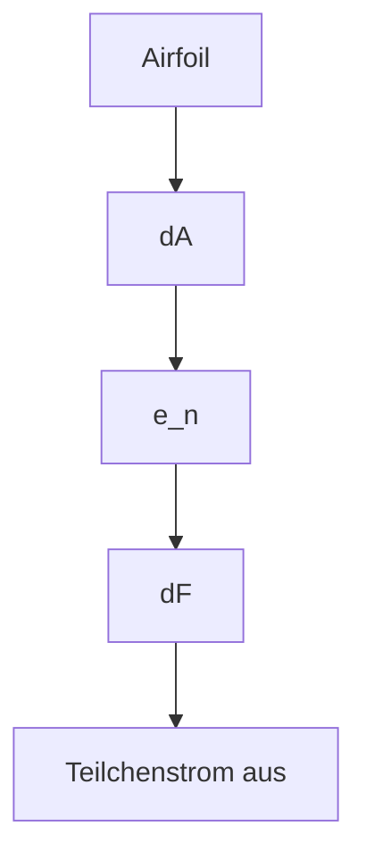
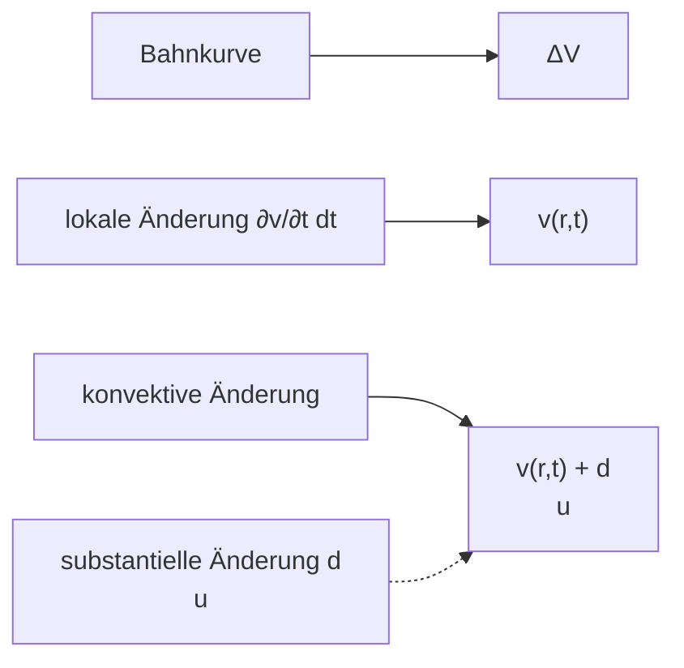

# 4 Mechanik deformierbarer Körper

原始 PDF 第 208–279 页。

## 4 Mechanik deformierbarer Körper

**Einleitung:** Der „starre Körper“ ist ein Modell für Körper, deren Gestalt auch beim Wirken von Kräften unverändert bleibt. Reale Festkörper sowie Flüssigkeiten und Gase können dagegen unter dem Einfluss äußerer Kräfte ihre Gestalt und ihr Volumen verändern. Feste Körper erfahren bei Wirkung äußerer Kräfte elastische (reversible) und plastische (irreversible) Formänderungen. Je nach der Art der am Festkörper angreifenden Kräfte wird er gedehnt, gebogen, tordiert (verdrillt) oder abgeschert. Flüssigkeiten und Gase („Fluide“) setzen reinen Formänderungen, die nicht mit Volumenänderungen verbunden sind, nur einen sehr kleinen Widerstand entgegen; daher können Fluide durch Rohre strömen. Diese Strömung kann entweder wirbelfrei (Potenzialströmung) oder mit Wirbeln vor sich gehen, wobei sie, abhängig von den Reibungsverhältnissen in der Flüssigkeit und an der Rohrwandung, auch turbulent verlaufen kann.

## 4.1 Aggregatzustände und Bindungen

Die Materie ist aus Atomen und Molekülen aufgebaut. Die Elektronen der Atomhülle und ihre Wechselwirkungen (WW) sind für die Eigenschaften der Materie, wie z. B. die chemischen, die mechanischen, die elektrischen und optischen, verantwortlich. Man unterscheidet vier Aggregatzustände fest, flüssig, gasförmig und plasmaartig.1 Wir schauen uns die drei klassischen Aggregatzustände genauer an:

<table><tr><td rowspan="2"></td><td colspan="2">Gas</td></tr><tr><td>ideal</td><td>real</td></tr><tr><td>WW zwischen den Atomen oder Molekülen</td><td>keine</td><td>schwach</td></tr><tr><td rowspan="2">Beweglichkeit der Teilchen</td><td colspan="2">hoch</td></tr><tr><td>bewegen sich unabhängig voneinander</td><td>T steigt: abnehmend, verflüssigbar</td></tr><tr><td>bei mechanischer Krafteinwirkung</td><td colspan="2">hohe Kompressibilität</td></tr><tr><td>Dichte (Normaldruck, 300 K)</td><td colspan="2"> $\sim 1 \text{ kg/m}^{3}$ </td></tr></table>

<small>1 Plasma ist ein Zustand der Materie, in dem die Atome weitgehend oder vollständig von ihren Elektronen getrennt sind, also ein Teilchengemisch aus Ionen und Elektronen vorliegt.</small>

https://doi.org/10.1515/9783110675689-004

---

184

4 Mechanik deformierbarer Körper

<table><tr><td rowspan="2"></td><td colspan="2">Flüssigkeit $^{2}$ </td></tr><tr><td>ideal</td><td>real</td></tr><tr><td rowspan="2">WW zwischen den Atomen oder Molekülen</td><td>reibungsfrei Schermodul  $G = 0$ </td><td>reibungsbehaftet</td></tr><tr><td colspan="2">WW stärker als im Gas, schwächer als im FK, ungerichtete Bindung</td></tr><tr><td rowspan="2">Beweglichkeit der Teilchen</td><td colspan="2">Teilchen leicht verschiebbar</td></tr><tr><td>bewegen sich unabhängig voneinander</td><td>T steigt: zunehmend</td></tr><tr><td>bei mechanischer Krafteinwirkung</td><td colspan="2">Volumenbeständigkeit, geringe Kompressibilität</td></tr><tr><td>Dichte (Normaldruck, 300 K)</td><td colspan="2"> $\sim 10^{3} \text{kg/m}^{3}$ </td></tr></table>

<table><tr><td rowspan="2"></td><td colspan="2">Festkörper (FK)</td></tr><tr><td>ideal</td><td>real</td></tr><tr><td>WW zwischen den Atomen oder Molekülen</td><td colspan="2">starke WW; kristallin (Atome in regelmäßigem Raumgitter), Kettenstruktur (Polymere)oder amorph (unterkühlte Flüssigkeit, z. B. Glas)</td></tr><tr><td>Beweglichkeit der Teilchen</td><td>Teilchen sind ortsfest, schwingen gekoppelt um ihre Ruhelage (thermische Bewegung)</td><td>geringe, stark von der Temperatur abhängige Beweglichkeit, im Kristall durch Gitterdefekte</td></tr><tr><td>bei mechanischer Krafteinwirkung</td><td colspan="2">Formbeständigkeit, geringe Kompressibilität, Elastizität</td></tr><tr><td>Dichte (Normaldruck, 300 K)</td><td colspan="2"> $\sim 10^{3}$  kg/m $^{3}$ </td></tr></table>

## 4.1.1 Gasförmiger Zustand

Die Atome oder Moleküle sind praktisch frei beweglich und nehmen jeden gebote nen Raum ein (Expansionsdruck), wodurch auch der mittlere Abstand zwischen den Teilchen bestimmt wird.

Die Gasdichte ist gegeben durch

$$
\rho = \frac {M}{V} \quad \text {bzw. durch} \quad \rho (\vec {r}) = \frac {d m}{d V}, \tag {I-4.1}
$$

bei variabler Massenverteilung.

<small>2 Wegen der starken Ähnlichkeit im Verhalten äußeren Kräften gegenüber, werden Gase und Flüssigkeiten in der Hydromechanik unter dem Namen Fluide zusammengefasst.</small>

---

4.1 Aggregatzustände und Bindungen

185

Dabei gilt $M = N \cdot m _ { \mathrm { s } }$ wobei N die Zahl der Moleküle mit Masse m ist.

Unterhalb einer gewissen Temperatur ist die mittlere $E _ { \mathrm { k i n } }$ der Gasmoleküle zu gering, um den gasförmigen Zustand (Verdampfung) gegen die Anziehung der Moleküle (Bindungsenergie) aufrecht zu erhalten und es setzt Kondensation (Verflüssigung) ein (siehe dazu Band II, Kapitel „Physik der Wärme“, Abschnitt 1.3.3.1).

## 4.1.2 Flüssiger Zustand

Die Verflüssigung (Phasenumwandlung durch Kondensation vom gasförmigen in den flüssigen Zustand bei einer bestimmten Temperatur $T _ { \mathrm { k o n d } } )$ ist mit einem sehr großen Anstieg der Dichte verbunden. Die Dichte von Flüssigkeiten ist nahezu so hoch wie jene von Festkörpern. Der umgekehrte Vorgang, die Verdampfung, erfolgt bei derselben Temperatur $T _ { \mathrm { v e r d } } = T _ { \mathrm { k o n d } }$ (gleicher Druck vorausgesetzt).

Die Atome oder Moleküle einer Flüssigkeit weisen bereits eine gewisse topologische Nahordnung auf, d. h. wenn man nur wenige Atomdistanzen betrachtet, findet man eine gewisse Regelmäßigkeit ihrer Anordnung (Abb. I-4.1). Dies ist die Folge einer schwach gerichteten, anziehenden Wechselwirkung zwischen den Flüssigkeitsmolekülen (in Abb. I-4.1 durch Striche dargestellt).

flowchart

Abb. I-4.1: Anordnung von Molekülen (links) und Bewegung von Molekülen in einer Flüssigkeit (rechts).

Wird die Temperatur kleiner als die Schmelztemperatur $T _ { S }$ , dann ist die $E _ { \mathrm { k i n } }$ der Flüssigkeitsmoleküle so klein, dass die Bindungsenergie zwischen den Atomen oder Molekülen ausreicht, um sie gegen die Stöße der Nachbarteilchen auf festen Plätzen zu halten.

## 4.1.3 Fester Zustand

Das atomare Potenzial zwischen zwei isolierten wechselwirkenden neutralen Atomen eines Festkörpers ist asymmetrisch und ergibt sich aus der Überlagerung von Abstoßungskräften und Anziehungskräften (Abb. I-4.2). Die Abstoßung wächst

---

186

4 Mechanik deformierbarer Körper

line

| Feature | Value |
| --- | --- |
| E0 | \(E_{0}\) |
| E1 | \(T_{1}\) |
| E2 | \(T_{2}\) |
| Anziehung | N/A |
| Abstoßung | N/A |
| Statische Gleichgewichtslage | N/A |

Abb. I-4.2: Schematische Darstellung des Potenzials zwischen zwei wechselwirkenden neutralen Atomen eines Festkörpers. Bei der Teilchenenergie $E _ { i }$ und der Temperatur $T _ { i }$ schwingt das Atom zwischen dem linken und dem rechten Zweig der Potenzialkurve, die punktierte Kurve verbindet die Schwingungsmittelpunkte.

sehr stark mit der Annäherung der Atome, während die Anziehung mit ihrer Distanz schwächer abnimmt. Dies führt zu einem mittleren Atomabstand, der von der Temperatur abhängt (punktiert in Abb. I-4.2).

Die Asymmetrie des Atompotenzials bedingt eine Anharmonizität der Atomschwingungen und ist für die Wärmeausdehnung der Festkörper verantwortlich, da sich der Schwingungsmittelpunkt bei größeren Amplituden (höherer Temperatur) zu größeren Atomabständen verschiebt.

## Bindungsarten

Wir unterscheiden 5 Bindungsarten des festen Zustands:3

| Ionenbindung (Abb. I-4.3): | starke elektrostatische WW durch $e^{-}$-Verlagerung |
| --- | --- |
| kovalente Bindung: | stark gerichtete Bindung, zwei Atome teilen sich ein $e^{-}$-Paar (Molekülbindung) |
| metallische Bindung: | die äußersten $e^{-}$ sind im Kristall nicht mehr lokalisiert, sie gehören dem Gitter als Ganzes an („superkovalent‘),hohe Leitfähigkeit |
| van der Waals Bindung: | schwach anziehende WW durch Polarisierung der $e^{-}$-Hülle |
| Wasserstoffbrückenbindung: | Ionenbindung durch Elektronentransfer zwischen einem H-Atom und zwei elektronegativen Fluor-, Sauerstoff- oder Stickstoffatomen. |

Die physikalischen Eigenschaften ‚homogener Körper‘ (z. B. Dichte, Elastizität, Festigkeit) sind im Inneren überall gleich. Ist der Körper isotrop, dann sind die Eigenschaften auch unabhängig von der Richtung. Die meisten Kristalleigenschaften sind aber anisotrop. Ein Beispiel für Anisotropie ist die Doppelbrechung von Kalkspat (siehe Band IV, Kapitel „Wellenoptik“, Abschnitt 1.4.5): Dieser Kristall ist zwar

<small>3 Siehe Band VI, Kapitel „Festkörperphysik“, Abschnitt 2.1.1.</small>

---

4.1 Aggregatzustände und Bindungen

187

chemical

Crystal lattice structure diagram showing Na⁺ and Cl⁻ ions in a cubic arrangement

Abb. I-4.3: Kochsalzkristall (NaCl) als Beispiel für die Bildung einer Kristallstruktur durch Ionenbindung zwischen den größeren Chlorionen (Cl) und den kleineren Natriumionen $( { N a } ^ { + } )$ Jedes Ion besitzt sechs nächste Nachbarn der anderen Sorte.

homogen, aber anisotrop; eindringende Lichtstrahlen, werden in zueinander senkrecht polarisierte Komponenten mit unterschiedlicher Phasengeschwindigkeit zerlegt (Abb. I-4.4). Die Geschwindigkeit einer der beiden Komponenten ist richtungsabhängig (außerordentlicher Strahl).

text_image

Do wellbreaching

Abb. I-4.4: Doppelbrechung von Calcit (Kalkspat, $\mathsf { C a C o } _ { 3 } )$ als Beispiel für anisotrope Eigenschaften.

---

188

4 Mechanik deformierbarer Körper

1941 schrieb R. W. Pohl in seinem dreibändigen Lehrbuch ‚Einführung in die Physik‘:

„Die festen Körper spielen für unser ganzes Dasein eine schlechthin entscheidende Rolle. Selbst eine kühne Phantasie vermag sich kein organisches Leben ohne feste Körper auszumalen. So ist eine bessere Erforschung des festen Zustandes die heute vielleicht vordringlichste Aufgabe der physikalischen Forschung.“

Die Forschung in der Festkörperphysik hat tatsächlich in der zweiten Hälfte des vorigen Jahrhunderts gewaltige Fortschritte gemacht, man denke nur an die Entwicklung der Elektronik seit der Erfindung des Transistors 1948. Heute steht die Physik fester Stoffe wieder an einer entscheidenden Stelle. Die Möglichkeit der ‚Nanostrukturierung‘ von Materialien (Nanomaterialien) ist gerade dabei, die technischen Möglichkeiten zu revolutionieren. Unter Nanomaterialien versteht man Strukturen oder Strukturelemente mit Abmessungen zwischen 1–100 nm. Wenn eine oder mehrere Dimensionen eines Stoffes in diese Größenordnung fallen (dünne Filme, Nanodrähte, Nanopunkte), kommt es zu teilweise drastischen Änderungen der physikalischen Eigenschaften und der vermittelnden Prozesse. Wir werden im Kapitel ‚Materialphysik‘ in Band VI auf diesen hochaktuellen Themenkreis zurückkommen.

## 4.2 Deformation fester Körper

## 4.2.1 Hookesches Gesetz, Elastizitätsmodul

Im elastischen Verformungsbereich (Hookescher Bereich) verschwindet die Verformung vollständig, wenn die verformende Kraft nicht mehr wirkt.

Beim Zugversuch (Abb. I-4.5) gilt daher im elastischen Bereich eine Proportiona lität zwischen der Längenänderung Δl und der wirkenden $\mathtt { Z u g } .$ oder Druckkraft F:

$$
\frac {\Delta l}{l _ {0}} = \frac {1}{E} \cdot \frac {F}{q _ {0}}. \tag {I-4.2}
$$

text_image

q₀
d₀ →
←
l₀
Δl
l₀ = 1 / E · F / q₀
d →
←
Δl
F̅

Abb. I-4.5: Zugversuch an einer stabförmigen Probe (blau).

---

4.2 Deformation fester Körper

189

Wir definieren als Normalspannung $\sigma$ die auf den Anfangsquerschnitt $q _ { 0 }$ bezogene Kraft normal zur Angriffsfläche, also

$$
\sigma = \frac {F}{q _ {0}} \tag {I-4.3}
$$

und als relative Dehnung

$$
\varepsilon = \frac {\Delta l}{l _ {0}}. \tag {I-4.4}
$$

Damit erhalten wir das Hooksche Gesetz (nach Robert Hooke, 1635–1703: ‚ut tensio, sic vis‘):

$$
\varepsilon = \frac {1}{E} \sigma \quad \text {Hookesches Gesetz.} \tag {I-4.5}
$$

Dabei ist

$$
E = \frac {\sigma}{\varepsilon} \tag {I-4.6}
$$

bzw. für differentielle Spannungsänderungen im Falle von Abweichungen von der linearen Spannungs-Dehnungsbeziehung oberhalb der Proportionalitätsgrenze (siehe Abb. I-4.6)

$$
E = \frac {d \sigma}{d \varepsilon} \quad \text {der Elastizitätsmodul (= E - Modul, Young's modulus)} \tag {I-4.7}
$$

(nach Thomas Young, 1773–1829) mit der Einheit $[ E ] = 1    N/m ^2 = 1    Pa$

Ein <u>großer E-Modul</u> bedeutet: Für eine vorgegebene Längenänderung brauchen wir eine <u>große Kraft</u> bzw. eine vorgegebene Kraft bewirkt eine <u>kleine Längenänderung</u>.

Isotrope elastische Moduln einiger fester Materialien.

| Material | E (GPa) | $\mu$ | K (GPa) | $\kappa$ ($m^{2}/N$) | G (GPa) |
| --- | --- | --- | --- | --- | --- |
| Aluminium | 70 | 0,34 | 75 | $1,33 \cdot 10^{-11}$ | 26 |
| Eisen | 211 | 0,29 | 168 | $5,95 \cdot 10^{-12}$ | 82 |
| Gold | 78 | 0,43 | 185 | $5,40 \cdot 10^{-12}$ | 27 |
| Kupfer | 128 | 0,34 | 136 | $7,35 \cdot 10^{-12}$ | 48 |
| Wolfram | 405 | 0,28 | 307 | $3,26 \cdot 10^{-12}$ | 158 |
| Chromstahl | 215 | 0,28 | 160 | $6,25 \cdot 10^{-12}$ | 82 |
| Messing | 105 | 0,35 | 117 | $8,55 \cdot 10^{-12}$ | 39 |
| Wolframkarbid | 534 | 0,22 | 318 | $3,14 \cdot 10^{-12}$ | 219 |
| Eis (-4 °C) | 10 | 0,33 | 10 | $1,00 \cdot 10^{-10}$ | 4 |
| Quarzglas | 73 | 0,17 | 37 | $2,70 \cdot 10^{-11}$ | 31 |

---

190

4 Mechanik deformierbarer Körper

**Beispiel:** Eine Klaviersaite (Stahldraht, $E=21500\  kN/cm ^{-2}=215\cdot10^{9}\  N/m ^{2}=$ 215 GPa) von 0,5 mm Durchmesser und 1 m Länge dehnt sich nach Anhängen eines Gewichts von 10 kg (entspricht 98,1 N) um

$$
\Delta l = l _ {0} \frac {F}{E \cdot q} = 1 \cdot \frac {9 8 , 1}{2 1 5 0 0 \cdot 1 0 ^ {3} \cdot 1 0 ^ {4} \cdot 0 , 2 5 ^ {2} \cdot 1 0 ^ {- 6} \cdot \pi} = 2, 3 \cdot 1 0 ^ {- 3} \mathrm{m} = 2, 3 \mathrm{mm}
$$

Bei der Dehnung eines Polykristalls, der aus vielen kleinen Einkristallen4 (Körnern) zusammengesetzt ist, treten mehrere Verformungsbereiche auf (Abb. I-4.6):

other

| Feature | Description |
| --- | --- |
| Y-axis | Zugspannung \((\sigma\) = F/q0, q0 ... Ausgangsquerschnitt) |
| X-axis | Bruch \((\epsilon)\) |
| Curve | \(\sigma max\), \(\epsilon max\) = \(\epsilon pl\) + \(\epsilon el\) |
| Key Points | Steckgrenze, Proportionalitätsgrenze, Verfestigungsbereich, Fließbereich, elastischer Bereich, tan \(\alpha\) = E, εel, \(\epsilon pl\), Bruchdehnung, Dehnung \((\epsilon\) = \(\Delta l/l)\) |
| Distance from peak | \(\sigma max\), \(\epsilon max\) = \(\epsilon pl\) + \(\epsilon el\); Zugfestigkeit; Örtliches Fließen; Einschnürung |

Abb. I-4.6: Spannungs-Dehnungsdiagramm eines Polykristalls. Die tatsächliche Spannung steigt bis zum Bruch stetig an, wobei der Probenquerschnitt stetig abnimmt. Das bei $\sigma _ { \mathsf { m a x } }$ auftretende Spannungsmaximum ergibt sich nur, weil die Spannung auf den konstanten Ausgangsquerschnitt $q _ { 0 }$ bezogen ist.

1. Der elastische Bereich: Die Verformung geht wieder völlig zurück.
2. Der Fließbereich: Der Kristall verformt sich ohne wesentliche Spannungssteigerung, er ‚fließt‘. Hier kommt es durch den Einbau von Gitterdefekten (im We-

<small>4 Bei einem Einkristall ändert sich die Orientierung des Kristallgitters in seinem ganzen Volumen nicht.</small>

---

4.2 Deformation fester Körper

191

sentlichen von Versetzungen5) zu plastischen Verformungen, die nach dem Wirken der Kraft nicht mehr zurückgehen.

3. Der Verfestigungsbereich: Durch WW der erzeugten Kristalldefekte nimmt die Spannung bei einer weiteren Verformung stark zu und führt zu einer Steigerung der Festigkeit des Kristalls. Schließlich wird die maximale Zugfestigkeit $\sigma _ { \mathrm { m a x } }$ des Kristalls erreicht.6
4. Der Einschnürbereich: Durch örtlich beschränktes Fließen aufgrund von Unregelmäßigkeiten des Querschnitts längs des Stabes kommt es zu einer starken lokalen Einschnürung mit entsprechender Spannungssteigerung, die zum Bruch führt.

weichgeglühter Kupferstab (Durchmesser: 1 cm)

der Stab kann relativ leicht verbogen werden

der Stab kann praktisch nicht zurück gebogen werden (Verfestigungseffekt)

## Erklärung:

Der weichgeglühte Cu-Stab enthält verhältnismäßig wenige Versetzungen $( \approx 1 0 ^ { 9 } \mathrm { ~ m } ^ { - 2 } )$ , diese Gitterdefekte wurden durch die Glühbehandlung ‚ausgeheilt‘. Durch die plastische Verformung beim Verbiegen, wurden sehr viele Versetzungen erzeugt $( \approx 1 0 ^ { 1 3 } \; \mathrm { m } ^ { - 2 } )$ die in unterschiedlichen ‚Gleitebenen‘7 des Kristalls liegen. Bei der weiteren Verformung behindern sich die Versetzungen gegenseitig und machen eine größere plastische Verformung sehr schwer.

Bei der Dehnung eines festen Stoffes kommt es zu einer Änderung der Querdimension, die eine Querschnittsverminderung verursacht. Sie wird durch die Poissonsche Zahl μ beschrieben:

<small>5 Wie der Name sagt, sind dies Störungen im regelmäßigen Gitteraufbau, die sich nicht auf eine Gitterstelle beschränken, sondern einen ‚versetzten‘, flächenförmigen Bereich umfassen (siehe dazu Band VI, Kapitel „Festkörperphysik“, Abschnitt 2.2.6.2. Die Berandungslinie heißt ‚Versetzungslinie oder kurz ‚Versetzung‘. Die Versetzungsdteichte wird als die Zahl der Versetzungslinien angegeben, die die Einheitsfläche durchstoßen (siehe Experiment unten ‚Biegung eines Cu-Stabes‘).</small>

<small>6 Wird jetzt der Prüfling entlastet (siehe Abb. I-4.6), dann kehrt er wieder längs einer elastischen Geraden mit der gleichen Steigung E zum Wert σ = 0 zurück. Nach Abzug des elastischen Verformungsanteils εel σmax verbleibt nun aber eine dauerhafte plastische Verformung εpl = εmax σmax E E</small>

<small>7 Gleitebenen sind ausgezeichnete Ebenen des Kristallgitters mit dichter Atombelegung, in denen die Versetzungen relativ leicht beweglich sind, also ‚gleiten‘ können (siehe Band VI, Kapitel „Festkörperphysik“, Abschnitt 2.2.6.2).</small>

↓

---

192

4 Mechanik deformierbarer Körper

$$
\mu = \frac {\frac {\Delta d}{d}}{\frac {\Delta l}{l}} = \frac {\text {relative Querkontraktion}}{\text {relative Längenänderung}} \quad \text {Poissonsche Zahl} \tag {I-4.8}
$$

(nach Siméon Denis Poisson, 1781–1840). Für die Volumenänderung bei der einseitigen Verformung gilt

$$
\text {bei Zug} \quad \frac {\Delta V}{V} = \frac {\Delta l}{l} - 2 \frac {\Delta d}{d} = \frac {\Delta l}{l} \left(1 - \frac {2 \frac {\Delta d}{d}}{\frac {\Delta l}{l}}\right) = \frac {\sigma}{E} (1 - 2 \mu), \tag {I-4.9}
$$

$$
\text {bei Druck} \quad \frac {\Delta V}{V} = \frac {- P}{E} (1 - 2 \mu) \quad \text {mit} \quad P = - \sigma \quad \dots \text {Druck}. \tag {I-4.10}
$$

Die angegebenen Werte für $\mu$ zeigen also, dass sich das Volumen eines Probekörpers bei Zug vergrößert und bei Druck verkleinert. Im Fließbereich (in Abb. I-4.6 von der Streckgrenze bis zum Bruch) ändert sich das Volumen praktisch nicht (wenn man von den vernachlässigbaren elastischen Änderungen absieht).

## Beispiel: Die Biegung eines Balkens.

Wenn wir einen Radiergummi fest zwischen Daumen und Zeigefinger zusammenbiegen, werden die Oberflächen nicht nur gekrümmt, sondern auch gewölbt: Es treten nicht nur Normalspannungen, sondern auch Schubspannungen auf, die bei einer exakten Festigkeitsberechnung zu berücksichtigen sind. J. Bernoulli hat in seiner vereinfachten Behandlungsweise der Balkenbiegung, der wir hier folgen wollen, diese Verformung der Querschnittsebene des Balkens vernachlässigt.

Unser Balken sei einseitig fest eingespannt, an seinem Ende bei $x = a$ sei er belastet, es wirke die Gewichtskraft $G = m \cdot g .$ Die Achse des Balkens, die durch die Schwerpunkte der Querschnittsflächen geht, wird zu einer Kurve gebogen, die in der Vertikalebene des Balkens liegt.

Wir betrachten horizontale Schichten des Balkens (‚Fasern‘). Diese werden oberhalb der Balkenmitte gedehnt (Zugspannung) und unterhalb gestaucht (Druckspannung). Bei der Biegung bleibt die mittlere Faser in ihrer Länge unverändert, sie ist spannungsfrei (neutrale Faser). Wir nehmen an, dass die ebenen Querschnitte auch nach der Biegung auf der Achse des Balkens senkrecht stehen. Zwei Querschnittsflächen im Abstand $d x ,$ die vorher parallel waren, bilden nach der Biegung den Winkel $d \varphi .$ Für die relative Längenänderung einer horizontalen Schicht des Balkens, die den Abstand z von der neutralen Faser hat, ergibt sich aus der Zeichnung $\left( \mathrm{Kr} \bar{\mathrm{u}} \mathrm{m} \mathrm{m} \mathrm{u} \mathrm{n} \mathrm{g} \frac{1}{\rho} = \frac{d \varphi}{d x} \right)$

---

4.2 Deformation fester Körper

193

text_image

z
y
a
b
c
x
dx
dφ
ρ
G = mg

$$
\frac {\Delta l}{l _ {0}} = \frac {(\rho + z) d \varphi - \rho d \varphi}{d x} = z \frac {d \varphi}{d x} = \frac {z}{\rho}.
$$

Die Dehnung und Stauchung unter dem Einfluss einer verformenden äußeren Kraft führt zu elastischen Gegenkräften, die durch den E-Modul beschrieben werden (siehe oben Gl. $\left(  I-4.2 \right) \frac{\Delta l}{l_{0}} = \frac{1}{E} \cdot \frac{F}{q_{0}}$ . Danach ist die elastische Kraft, die an einem Flächenelement $d f$ des Querschnitts angreift $d F = { \frac { E \cdot z } { \rho } }   d f$ und die Gesamtkraft an der Querschnittsfläche

$$
F = \frac {E}{\rho} \int z d f.
$$

Da laut Voraussetzung die Querschnittsfläche bezüglich der neutralen Faser keine Verschiebung, sondern nur eine Verdrehung erfährt, muss diese resultierende elastische Gesamtkraft in Balkenlängsrichtung verschwinden, was gleichzeitig bedeutet, dass die neutrale Faser durch die Schwerpunkte der Querschnittsflä- chen verläuft (Flächenschwerpunkt: $\int _ { A } z   d f   = 0 )$ also durch die Achse des Balkens. Es bleibt aber ein resultierendes elastisches Drehmoment (Drehzwilling), das die Querschnittsfläche A um eine Achse zu drehen versucht, die durch die neutrale Faser parallel zur y-Achse geht.

---

194

4 Mechanik deformierbarer Körper

Diese Kräfte wirken auf den „freigeschnittenen“Querschnitt und bewirken das innere Moment D

text_image

z
D
D'
x
a

D′ ist das von den äußeren Kräften hervorgerufene äußere Moment

Der Drehmomentvektor schaut aus der Papierebene heraus. Wir denken uns an der Stelle x einen Schnitt durch den Balken gelegt und betrachten den „freigeschnittenen“ Teil von x bis zum Balkenende bei $x = a ,$ Für diesen Teil gilt das Momentengleichgewicht, da er in Ruhe bleibt.

Es ist in Richtung der negativen $y - A$ chse gerichtet und hat den Betrag

$$
D = \int z d F = \frac {E}{\rho} \int_ {A} z ^ {2} d f = \frac {E}{\rho} J, \qquad \text {mit}
$$

$$
J = \int_ {A} z ^ {2} d f \quad \text {Flächenträgheitsmoment um die y - Achse.}
$$

J hat nur die ‚Form‘ des Trägheitsmoments um eine feste Achse $\int _ { V } r _ { n } ^ { 2 }$ dm , aber nicht dessen Dimension, es können aber die Berechnungsformeln des Trägheitsmoments zur Berechnung des Flächenträgheitsmoments von Konstruktionselementen (z. B. von Deckenträgern) verwendet werden, wenn die Masse m durch die Querschnittsfläche A ersetzt wird. Im obigen Falle eines rechteckigen Querschnitts ist die Integration von $y = 0$ bis $y = b$ und von $z = - c / 2$ bis $z = + c / 2$ zu erstrecken. Das Drehmoment an der Stelle x, das durch die äußere Kraft, also die Belastung des Balkens bei $x = a ,$ verursacht wird, ist

$$
D ^ {\prime} = G \cdot (a - x).
$$

Es ist in die Richtung der positiven y-Achse gerichtet und wird durch das Drehmoment der elastischen Kräfte im Gleichgewicht gehalten, also gilt

$$
\frac {E}{\rho} J = G (a - x).
$$

Die Differentialgeometrie liefert für die Krümmung einer Kurve $z ( x )$

$$
\frac {1}{\rho} = \frac {\frac {d ^ {2} z}{d x ^ {2}}}{\left(1 + \left(\frac {d z}{d x}\right) ^ {2}\right) ^ {3 / 2}} \underbrace {\cong} _ {\left(\frac {d z}{d x}\right) ^ {2} \ll 1} \frac {d ^ {2} z}{d x ^ {2}}, \quad \text {also} \quad \frac {d ^ {2} z}{d x ^ {2}} = - \frac {G}{E \cdot J} (a - x).
$$

---

4.2 Deformation fester Körper

195

Die Krümmung ist negativ, da die Kurve konkav in Richtung $- z$ (zur x-Achse hin) verläuft. Zweimalige Integration ergibt

$$
z = - \frac {G}{E \cdot J} \left(\frac {a x ^ {2}}{2} - \frac {x ^ {3}}{6}\right) + C _ {1} x + C _ {2}.
$$

Für $x = 0$ gilt $z = 0$ und $d z / d x = 0$ und daher $C _ { 1 } = C _ { 2 } = 0$ Für die Senkung des Balkenendpunkts, den Biegepfeil $s = z _ { a }$ erhalten wir so mit $x = a$

$$
s = z _ {a} = - \frac {G}{E \cdot J} \frac {a ^ {3}}{3}.
$$

Die Durchbiegung wächst also mit der dritten Potenz der Balkenlänge! Beim rechteckigen Querschnitt gilt $J = b \cdot c ^ { 3 } / 1 2$ das heißt, die Durchbiegung wächst indirekt proportional zur dritten Potenz der Balkendicke (Jakob Bernoulli, 1654–1705).

Die allseitige Kompression wird mit einem eigenen Modul geschrieben, dem Kompressionsmodul (bulk modulus) K bzw. der Kompressibilität (compressibility) κ

$$
\frac {\Delta V}{V} = - \frac {1}{K} \Delta P = - \kappa \cdot \Delta P, \tag {I-4.11}
$$

$$
K = - V \frac {\Delta P}{\Delta V} = \frac {1}{\kappa} \quad \text {Kompressionsmodul,} \tag {I-4.12}
$$

Einheit: $[ K ] = 1 \; \mathrm { P a } = 1 \; \mathrm { N / m } ^ { 2 } ,$

$$
\kappa = \frac {1}{K} = - \frac {1}{V} \frac {\Delta V}{\Delta P} \quad K o m p r e s s i b i l i t ä t, \tag {I-4.13}
$$

Einheit: $[ \kappa ] = 1    Pa ^{-1} = 1    m ^2 /  N$ (siehe dazu auch Band II, Kapitel „Physik der $\mathrm { { \bf W } { \bf \ddot { a } } r m { e } ^ { \omega } }$ Abschnitt 1.2.2 und Band VI, Kapitel „Festkörperphysik“, Anhang 1).

Bei allseitigem Druck P setzt sich die Volumenänderung aus drei analogen Anteilen für jede Kantenlänge $l _ { i }$ , wie oben in Gl. (I-4.10) mit $\sigma = - \Delta P$ berechnet, zusammen und man erhält

$$
K = \frac {E}{3 (1 - 2 \mu)} \quad \text {bzw.} \quad \kappa = \frac {1}{K} = \frac {3 (1 - 2 \mu)}{E}. \tag {I-4.14}
$$

---

196

4 Mechanik deformierbarer Körper

## 4.2.2 Scherung und Torsion

text_image

d
α
τ
τ
τ
τ

Abb. I-4.7: Bei einer Scherung um den Winkel α auftretende Schubspannungen τ.

Scherkräfte greifen tangential zu den Endflächen eines quaderförmigen Probekörpers (Volumenelement) an. Da sich der Quader im Gleichgewicht befindet, müssen auch an den geneigten Endflächen gleich große, entgegengesetzt gerichtete Schubspannungen wirken, damit das gesamte Drehmoment verschwindet (Abb. I-4.7). Wir definieren als Schubspannung τ

$$
\tau = \frac {F}{q} \quad \text {Schubspannung.} \tag {I-4.15}
$$

Für kleine Scherwinkel α gilt wieder das Hookesche Gesetz der Proportionalität zwischen Spannung und Verzerrung, hier zwischen der Schubspannung τ und dem Scherwinkel α:

$$
\tau = G \cdot \alpha \tag {I-4.16}
$$

$$
G = \frac {d \tau}{d \alpha} \quad \begin{array}{l l} & \text {ist der Schubmodul (= Schermodul,} \\ & \text {Torsionsmodul, shear modulus)} \end{array} \tag {I-4.17}
$$

mit der Einheit $[ G ] = 1   \mathrm { N m } ^ { - 2 } = \mathrm { P a }$

**Beispiel:** Die Torsion eines Stabes oder Drahtes.

Ein Stab (Radius R, Länge l) wird an seiner Oberseite um einen Winkel $\varphi$ (Winkelelement $d \psi )$ gegen die festgehaltene Unterseite verdreht (verdrillt).

text_image

dρ
R
dψ
φ
B
s
B′
α
l
A

---

4.2 Deformation fester Körper

197

Wir betrachten einen dünnen Zylindermantel vom Radius $\rho$ (Dicke $d \rho )$ , stark eingezeichnet. Seitenlinien, die vor der Deformation senkrecht waren $( \operatorname { z . } \operatorname { B . } { \overline { { A B } } } )$ schließen jetzt den Winkel α mit der Senkrechten ein $\overline { { ( A B ^ { \prime } ) } }$ Für die Bogenlänge s der Verdrehung gilt:

$$
s = \rho \cdot \tan \varphi \quad \text { and   der   Oberseite   berechnet, }
$$

$$
s = l \cdot \tan \alpha \quad \text {   an   der   Seitenfläche   berechnet.   }
$$

Für kleine Torsionswinkel $\varphi \left( \tan \varphi = \varphi \right)$ gilt also: $l \cdot \alpha = \rho \cdot \varphi \quad \Rightarrow \quad \alpha = \frac{\rho \cdot \varphi}{l}$ .

Die für die Scherung eines dünnen Stabelements mit AB als Zentrallinie aus der Lage B in die Lage $B ^ { \prime }$ nötige Schubspannung ist

$$
\tau (\rho) = G \cdot \alpha = G \frac {\rho \cdot \varphi}{l},
$$

sie nimmt also proportional zum Radius $\rho$ von innen nach außen $\mathbf { Z } \mathbf { u } ,$ Durch Integration über alle Stabelemente des Stabquerschnitts $q$ erhalten wir für das zugehörige Drehmoment

$$
D = \int_ {q} \rho \cdot \tau (\rho) d q,
$$

wobei die Kraft $\tau ( \rho ) \cdot d q$ in jedem Flächenelement dq senkrecht zu $\rho$ steht.

Mit $d q = \rho$ dρ dψ folgt

$$
D = \int_ {0} ^ {2 \pi} d \psi \int_ {0} ^ {R} \rho \frac {G \rho \varphi}{l} \cdot \rho d \rho = \frac {\pi}{2} \frac {G \cdot R ^ {4}}{l} \varphi = D ^ {*} \cdot \varphi ,
$$

wobei $D ^ { \star } = { \frac { \pi } { 2 } }   { \frac { G \cdot R ^ { 4 } } { l } }$ das Direktionsmoment (= Richtmoment, Drehmoment pro Winkeleinheit) ist $\left( \left[ \boldsymbol{D}^{\star} \right] = 1   \mathrm{Nm/rad} \right)$ . Man beachte D und $D ^ { \star } \propto R ^ { 4 } !$

Für die maximale Schubspannung $\tau _ { \mathrm { m a x } }$ am Umfang des Stabes folgt mit $\rho = R$ und $\varphi = { \frac { D } { D ^ { * } } } = { \frac { D \cdot 2 \cdot l } { \pi \cdot G \cdot { \boldsymbol { R } } ^ { 4 } } }$

$$
\tau_ {\mathrm{max}} = \frac {G \cdot R \cdot \varphi}{l} = \frac {2 D}{\pi R ^ {3}},
$$

eine für die Dimensionierung von Antriebswellen sehr wichtige Beziehung. $\tau _ { \mathrm { m a x } }$ ist für jeden Werkstoff und die Beanspruchungsart erfahrungsmäßig vorgegeben.

---

198

4 Mechanik deformierbarer Körper

**Beispiel:** Der Schnelldampfer ‚Bremen‘ (Stapellauf 16. 8. 1928, gewann 1929 das „Blaue Band“ als schnellstes Schiff auf der Transatlantik-Route nach New York) wurde von 4 Schiffsschrauben mit 5 m Durchmesser angetrieben. Durch eine Welle von 600 mm Durchmesser und 54 m Länge (aus 8 Stücken zusammengesetzt!) wurde von der Turbine zur Schraube eine Leistung von 16 000 kW bei einer Drehzahl von $n = 1 8 0 \mathrm { ~ U } /$ min geleitet. Wie groß waren die Verdrehung der Welle und $\tau _ { \mathrm { m a x } }$ am Wellenumfang?

$$
\omega = 2 \pi \nu = 2 \pi \frac {n}{6 0} = \frac {\pi \cdot 1 8 0}{3 0} = 1 8, 8 5 s ^ {- 1},
$$

$$
G _ {\text {Stahl}} = 8, 0 4 4 \cdot 1 0 ^ {1 0} \mathrm{Nm} ^ {- 2} (= 8 2 0 0 0 0 \mathrm{kp} / \mathrm{cm} ^ {- 2}).
$$

Wir haben beim Kräftepaar (Kapitel „Mechnik des starren Körpers“, Abschnitt 3.1.1) gesehen, dass für die Rotationsarbeit gilt $d W _ { \mathrm { r o t } } = \vec { D }$ dφ⇀und erhalten daher für die entsprechende Leistung als in der Zeiteinheit verrichtete Arbeit $N = \vec { D } \frac { d \vec { \varphi } } { d t } = \vec { D } \cdot \vec { \omega }$ Für die gesamte übertragene Leistung gilt daher $N = D \cdot \omega$ und damit

$$
D = \frac {N}{\omega} = \frac {1 6 0 0 0 \cdot 1 0 ^ {3}}{1 8 , 8 5} = 8, 4 8 8 \cdot 1 0 ^ {5} \mathrm{Nm}.
$$

Damit ergeben sich der Winkel $\varphi$ der Verdrehung der Welle und die maximale Schubspannung $\tau _ { \mathrm { m a x } }$ zu

$$
\varphi = \frac {2 l D}{\pi \cdot G \cdot R ^ {4}} = \frac {2 \cdot 5 4 \cdot 8 , 4 8 8 \cdot 1 0 ^ {5}}{\pi \cdot 8 , 0 4 4 \cdot 1 0 ^ {1 0} \cdot 0 , 3 ^ {4}} = 4, 4 8 \cdot 1 0 ^ {- 2} \mathrm{rad} = 2, 5 7 ^ {\circ},
$$

$$
\tau_ {\max} = \frac {2 D}{\pi R ^ {3}} = \frac {2 \cdot 8 , 4 8 8 \cdot 1 0 ^ {5}}{\pi \cdot 0 , 3 ^ {3}} = 2, 0 0 \cdot 1 0 ^ {7} \mathrm{Nm} ^ {- 2} (= 2 0 4 \mathrm{kpcm} ^ {- 2}).
$$

Durch Messung von l, R, $\varphi$ und D kann der Torsionsmodul G bestimmt werden (statische Bestimmung).

Hängt man an den Stab oder Draht einen Körper mit bekanntem Trägheitsmoment, so kann der Torsionsmodul auch schwingend bestimmt werden (dynamische Bestimmung). Die elastischen Kräfte des Festkörpers verursachen bei der Verdrillung ein dem Verdrillungsmoment D gleich großes rücktreibendes Drehmoment $D _ { r } = - D ^ { \star } \cdot \varphi$ , sodass der Körper nach der Auslenkung Drehschwingungen ausführt. Für die Schwingungsdauer dieser Torsionsschwingungen gilt:

$$
T = 2 \pi \sqrt {\frac {I _ {S}}{D ^ {*}}} = 2 \pi \sqrt {\frac {2 l I _ {S}}{\pi \cdot G \cdot R ^ {4}}}. \tag {I-4.18}
$$

---

4.2 Deformation fester Körper

199

Damit kann entweder der Torsionsmodul bei bekanntem Trägheitsmoment oder das Trägheitsmoment bei bekanntem Torsionsmodul bestimmt werden. Durch Messung der Schwingungsdauern mit einem bekannten Trägheitsmoment (z. B. einer Scheibe) und dem unbekannten plus dem bekannten Trägheitsmoment (durch Auflegen des Probekörpers auf die Scheibe) kann das gesuchte Trägheitsmoment unter Verwendung des Steinerschen Satzes (Abschnitt 3.3.5, Gl. I-3.42) ohne Kenntnis von G (bzw. D\*) bestimmt werden.

Wir haben bisher 4 elastische Moduln (= elastische Konstanten) kennen gelernt: E, μ, K (oder $\kappa = 1 / K )$ und G. Die Theorie zeigt aber, dass im isotropen Festkörper nur 2 unabhängige Konstanten zur Beschreibung der elastischen Verformung notwendig sind, das heißt aber, die 4 Moduln sind – wie die Elastizitätstheorie zeigt – miteinander verknüpft:

$$
\frac {E}{3 K} = 1 - 2 \mu \quad \text {und} \quad \frac {E}{2 G} = 1 + \mu \Rightarrow \frac {2 G}{3 K} = \frac {1 - 2 \mu}{1 + \mu}. \tag {I-4.19}
$$

## 4.2.3 Elastische Konstanten und Kristallstruktur

Im Festkörper halten eine anziehende und eine abstoßende Kraft die Atome auf festen Plätzen. Die Elastizität fester Körper ist daher die Folge der Wechselwirkung (WW) der Atome über das resultierende Atompotenzial.

Wir wollen nun zeigen, wie der E-Modul als Folge dieser atomaren Wechselwirkung berechnet werden kann.

line

| Parameter | Value |
| --- | --- |
| Abstoßung | \(\propto 1 / r^{12}\) |
| Anziehung | \(\propto 1 / r^{6}\) |
| Equilibrium point (r0) | r0 |

Abb. I-4.8: Annäherung des Atompotenzials wechselwirkender Atome im Festkörper durch das Lennard-Jones Potenzial (schematische Darstellung).

Für viele Materialien (z. B. Ionenkristalle, Metalle und ihre Legierungen) kann das Atompotenzial durch das Lennard-Jones Potenzial (benannt nach dem Physiker John Edward Lennard-Jones, 1894–1954) beschrieben werden (Abb. I-4.8, siehe dazu auch Band VI, Kapitel „Festkörperphysik“, Abschnitt 2.1.1.3):

---

200

4 Mechanik deformierbarer Körper

$$
E _ {\mathrm{pot}} = V (r) = b \cdot \left[ \underbrace {\left(\frac {a}{r}\right) ^ {1 2}} _ {\text {Abstoßung}} - \underbrace {\left(\frac {a}{r}\right) ^ {6}} _ {\text {Anziehung}} \right] \quad \text {Lennard-Jones 6 - 12 Potenzial.} \tag {I-4.20}
$$

Wir bestimmen den gesuchten Gleichgewichts(GG-)abstand $r _ { 0 }$ durch Differenzieren und Nullsetzen:

$$
\frac {d V (r)}{d r} = \left| - 1 2 b \frac {a ^ {1 2}}{r _ {0} ^ {1 3}} + 6 b \frac {a ^ {6}}{r _ {0} ^ {7}} = 0 \Rightarrow 2 \frac {a ^ {6}}{r _ {0} ^ {6}} = 1 \right. \tag {I-4.21}
$$

$$
\Rightarrow r _ {0} = \sqrt [ 6 ]{2} \cdot a. \tag {I-4.22}
$$

Damit ergibt sich für die potenzielle Energie im GG-Abstand:

$$
V (r _ {0}) = b \frac {a ^ {1 2}}{a ^ {1 2} \cdot \left(\sqrt [ 6 ]{2}\right) ^ {1 2}} - b \frac {a ^ {6}}{a ^ {6} \cdot \left(\sqrt [ 6 ]{2}\right) ^ {6}} = \frac {b}{4} - \frac {b}{2} = - \frac {b}{4}. \tag {I-4.23}
$$

Für den E-Modul können wir schreiben:

$$
E = \frac {d \sigma}{d \varepsilon} = \frac {d (F / A)}{d \left(\frac {r - r _ {0}}{r _ {0}}\right)} = \frac {\frac {1}{A} d F}{\frac {1}{r _ {0}} d (r - r _ {0})} = \frac {r _ {0} d F}{A d r}. \tag {I-4.24}
$$

Dabei ist die Spannung $\sigma = { \frac { F } { A } }$ gleich der Kraft bezogen auf die Querschnittsfläche des Atoms und $\frac { \Delta l } { l } = \frac { r - r _ { 0 } } { r _ { 0 } }$

Für die Abstandsabhängigkeit der Kraft $F ^ { \star }$ , die aus der atomaren WW resultiert, können wir gemäß der allgemeinen Beziehung ${ \vec { F } } ^ { \star } =$ −grad V und der Tatsache, dass $V = E _ { \mathrm { p o t } }$ nur von r abhängt, setzen

$$
F ^ {*} = - \frac {d V (r)}{d r} \tag {I-4.25}
$$

$$
\Rightarrow \frac {d F ^ {\star}}{d r} = - \frac {d ^ {2} V (r)}{d r ^ {2}} = b \left(\frac {1 5 6 a ^ {1 2}}{r ^ {1 4}} - \frac {4 2 a ^ {6}}{r ^ {8}}\right). \tag {I-4.26}
$$

Damit ergibt sich für den E-Modul im GG-Abstand $r = r _ { 0 } = a { \sqrt [ 6 ] { 2 } }$

---

4.2 Deformation fester Körper

201

(I-4.27)

$$
\underline {{E (r _ {0})}} = \frac {a \cdot \sqrt [ 6 ]{2}}{A} \cdot b \cdot \left(\frac {1 5 6 a ^ {1 2}}{a ^ {1 4} \cdot \left(\sqrt [ 6 ]{2}\right) ^ {1 4}} - \frac {4 2 a ^ {6}}{a ^ {8} \cdot \left(\sqrt [ 6 ]{2}\right) ^ {8}}\right) = \frac {b}{A r _ {0}} \left(\frac {1 5 6}{4} - \frac {4 2}{2}\right) = \frac {1 8 b}{\underline {{A r _ {0}}}}.
$$

Wir versuchen eine Abschätzung mit atomaren Werten für das kubisch-flächenzentrierte γ-Eisen:

Querschnittsfläche des Fe-Atoms $A \approx ( 1 2 5 \cdot 1 0 ^ { - 1 2 } ) ^ { 2 }   \pi = 5 \cdot 1 0 ^ { - 2 0 }   \mathrm { m } ^ { 2 } , \quad r _ { 0 } \approx$ $2 , 5 \cdot 1 0 ^ { - 1 0 }   \mathrm { m } . ^ { 8 }$ Der Parameter b folgt aus $\bar { E } _ { \mathrm { p o t } } = - \bar { b } / 4$ und der WW der nächsten Nachbaratome: Die Bindungsenergie eines Fe-Atoms beträgt nämlich $E_{B}=350\  kJ/mol =$ $3 , 6 \mathrm { e V } = 5 , 7 6 \cdot 1 0 ^ { - 1 9 } \mathrm { J }$ und da ein Fe-Atom im kubisch-raumzentrierten Gitter 8 nächste Nachbarn hat, ergibt sich für b ein Wert von $b \approx 2 { , } 9 \cdot 1 0 ^ { ^ { - 1 9 } }   \mathrm { J } .$ 9

Damit erhalten wir für den E-Modul $E \approx 4 \cdot 10^{11}    N/m ^2 = 400    GPa$ , ein Wert, der recht gut mit dem experimentell für Fe-Einkristalle gemessenen Werten von ca. $2 \cdot 10^{11}    N/m ^2 = 200$ GPa übereinstimmt (siehe Tabelle in Abschnitt 4.2.1).10 Unsere Vorstellung vom Zusammenhang zwischen den elastischen Kräften und dem Atompotenzial ist also offensichtlich richtig.

## 4.2.4 Der Elastizitätstensor, allgemeines Hookesches Gesetz

Die vier elastischen Konstanten, die wir bisher kennen gelernt haben, sind den experimentellen Bedürfnissen beim Zugversuch oder bei der Tordierung angepasst. Wie sieht es aber bei einer beliebigen Verformung des Festkörpers aus?

Wenn z. B. an einem Würfel an allen Flächen Spannungen in beliebigen Richtungen wirken, so werden durch eine Überlagerung von Stauchungen und Dehnungen, Scherungen und Volumenänderungen

– die Längen der Würfelkanten in allen 3 Raumrichtungen verändert,
– alle Würfelkanten verkippt,
– das Gesamtvolumen verändert.

<small>8 Aus der Gitterkonstante $a = 3 , 6 4 7 \cdot 1 0 ^ { - 1 0 }$ m von γ-Eisen.</small>

<small>9 Dieser Wert ergibt sich aus der Dissoziationsenergie (= Verdampfungswärme) des Kristalls pro Atom, denn dies entspricht der Entfernung der Atome aus ihrer GG-Lage ins Unendliche. Dabei wurde angenommen, dass dieser Wert auch für das kubisch-flächenzentrierte Gitter näherungsweise gilt.</small>

<small>10 Die obige Übereinstimmung darf nicht überbewertet werden, da der E-Modul von Einkristallen sehr stark von der Verformungsrichtung abhängt: Emax = 2,85⋅ 10 N/mbei Zug längs der Würfeldiagonale, E i = 1,32⋅ 10 N/mbei Zug längs der Würfelkante. Der E-Modul (und auch der Schubmodul G) sind anisotrope Kristalleigenschaften.</small>

---

202

4 Mechanik deformierbarer Körper

text_image

z
σzz
τxz → τyz
τzx → τyx
σxx → σyy
τzy
τxy
y
x

Abb. I-4.9: Kräfte, die in beliebiger Richtung an den Seitenflächen eines würfelförmigen Volumenelements eines Körpers angreifen, können in jeweils zwei Schubspannungen $\tau _ { i j }$ und eine Normalspannung $\sigma _ { i j }$ zerlegt werden.

Zunächst soll der Spannungszustand eines Volumenelements des Probekörpers beschrieben werden. Wir stellen uns ein würfelförmiges Volumenelement vor; auf jeder seiner Flächen greife eine Kraft in beliebiger Richtung an. Diese Kräfte sind nach den Koordinatenachsen in jeweils 2 Schubspannungen und eine Normalspannung zerlegbar (Abb. I-4.9). So ist z. B. $\tau _ { y z }$ die Schubspannung in y-Richtung, die an jener Fläche angreift, die normal zur z-Richtung orientiert ist, also erster Index: Kraftrichtung, zweiter Index: Flächennormale.

Bei den insgesamt 6 Flächen des Würfels führt dies zu $6 \cdot 3 = 1 8$ Spannungskomponenten. Wir fordern aber, dass der Schwerpunkt des Würfels in Ruhe bleiben soll; dann muss die Summe aller Kräfte verschwinden und es gilt daher

$$
\sigma_ {- i - i} = \sigma_ {i i}, \quad \tau_ {- i - j} = \tau_ {i j}. \tag {I-4.28}
$$

Außerdem fordern wir, dass keine Verdrehung stattfindet; dann muss die Summe aller Drehmomente verschwinden und es gilt daher

$$
\tau_ {i j} = \tau_ {j i}. \tag {I-4.29}
$$

Damit erhalten wir schließlich 6 voneinander unabhängige Spannungskomponenten, die zu einem Tensor zusammengefasst werden können:

$$
\tilde {\sigma} = \left( \begin{array}{c c c} \sigma_ {x x} & \tau_ {x y} & \tau_ {x z} \\ \tau_ {y x} & \sigma_ {y y} & \tau_ {y z} \\ \tau_ {z x} & \tau_ {z y} & \sigma_ {z z} \end{array} \right) \quad \text {Spannungstensor (stress tensor) mit} \tau_ {i j} = \tau_ {j i}. \tag {I-4.30}
$$

Dabei sind die $\sigma _ { i i }$ Normalspannungen und die $\tau _ { i j }$ Schubspannungen. Bei Kenntnis der 6 Komponenten des Spannungstensors $\tilde { \sigma }$ , die aus den Randbedingungen des

---

4.2 Deformation fester Körper

203

text_image

s
r̅
r̅_v = r̅ + ε̃ · r̅

Abb. I-4.10: Der Ortsvektor r⇀eines Punktes im elastischen Körper geht durch die Verschiebung $\vec { s } = \{ u , v , w \} = \tilde { \varepsilon }$ ⋅r⇀in den Punkt $\vec { r } _ { \nu } = \vec { r } + \tilde { \varepsilon }   \cdot \vec { r }$ über.

elastischen Problems, also den Kräften an der Oberfläche und den Volumskräften (z. B. Schwerkraft) zu ermitteln sind, kann für jede vorgegebene Richtung ${ \vec { e } } _ { n }$ (Einheitsvektor in der gewählten Richtung) die Spannung $\sigma$ berechnet werden, da gilt $\vec { \sigma } = \tilde { \sigma }   \cdot \vec { e } _ { n }$ . Diese Spannung wird i. Allg. nicht senkrecht auf das zu ${ \vec { e } } _ { n }$ senkrechte Flächenelement $d \vec { f } = d f \cdot \vec { e } _ { n }$ stehen. Da $\tilde { \sigma }$ ein symmetrischer Tensor ist, kann er auf Hauptachsen transformiert werden; dann bleiben nur mehr die Diagonalelemente $\sigma _ { \mathrm { I } } ,   \sigma _ { \mathrm { I I } } ,   \sigma _ { \mathrm { I I I } }$ übrig. Das sind Normalspannungen, sie werden Hauptspannungen genannt.

Ähnlich geht man bei der Beschreibung des Deformationszustands auch von einem würfelförmigen Volumenelement aus. Es treten relative Längenänderungen der Würfelkanten $\varepsilon _ { i i } = \frac { \Delta l _ { i } } { l }$ unter dem Einfluss der Normalspannungen auf und Scherwinkel $\gamma _ { i j } \left( i , j = x , \dot { y , } z \right)$ , das sind die Winkeländerungen, die die ursprünglich senkrechten Achsrichtungen $\vec { e } _ { i }$ und $\vec { e } _ { j }$ unter dem Einfluss der Schubspannungen erfahren. Beide werden zum Deformationstensor zusammengefasst:

$$
\tilde {\varepsilon} = \left( \begin{array}{c c c} \varepsilon_ {x x} & \gamma_ {x y} & \gamma_ {x z} \\ \gamma_ {y x} & \varepsilon_ {y y} & \gamma_ {y z} \\ \gamma_ {z x} & \gamma_ {z y} & \varepsilon_ {z z} \end{array} \right) \quad \begin{array}{l} \text {Deformationstensor} \\ (= \text {Verzerrungstensor, strain tensor}) \\ \text {mit} \gamma_ {i j} = \gamma_ {j i}. \end{array} \tag {I-4.31}
$$

Ist $\vec { r }$ der Ortsvektor eines Punktes im elastischen Körper, dann geht dieser durch die Verschiebung $\vec { s } = \{ u , v , w \} = \tilde { \varepsilon }   \cdot \vec { r }$ in den Punkt $\vec { r } _ { \nu } = \vec { r } + \tilde { \pmb { \varepsilon } }   \cdot \vec { r }$ über (Abb. I-4.10).

Diese lineare Transformation des ursprünglichen Körpers $( \vec { r } - \mathrm { R a u m } ^ { \circ } )$ in den verzerrten Körper $( , \vec { r } _ { v } \cdot \mathrm { R a u m } ^ { \circ } )$ stellt eine affine Abbildung dar. Dabei gehen Geraden und Ebenen wieder in (andere) Geraden und Ebenen über, Parallelitäten bleiben erhalten, ein würfelförmiger Körper geht also in ein allgemeines Rhomboeder $( a \neq b \neq c , \alpha \neq \beta \neq \gamma )$ über.

Der Verzerrungstensor $\tilde { \varepsilon }$ kann als symmetrischer Tensor so wie der Spannungstensor $\tilde { \sigma }$ auf Hauptachsen transformiert und durch eine Ellipsoidfläche (Deformations-Tensorellipsoid) dargestellt werden. Dann bleiben nur mehr die Diagonalelemente $\varepsilon _ { \mathrm { I } } ,   \varepsilon _ { \mathrm { I I } } ,   \varepsilon _ { \mathrm { I I I } }$ über, die Hauptdilatationen heißen.

Um die Verschiebungen $\vec { s } = \{ u , v , w \}$ eines Kräften und Momenten unterworfenen Körpers berechnen zu können, benützt man einen erfahrungsmäßigen Zusammenhang zwischen den Verzerrungskomponenten des ε ̃ -Tensors und den Spannungskomponenten des $\tilde { \sigma }$ -Tensors. Dieser ist für kleine Verschiebungen durch das

---

204

4 Mechanik deformierbarer Körper

allgemeine Hookesche Gesetz gegeben, wonach im allgemeinen Fall alle Verzerrungskomponenten lineare Funktionen aller Spannungskomponenten sind. Diesen Zusammenhang beschreibt der Elastizitätstensor (elasticity tensor) $\tilde { E } _ { \mathrm { ~ \tiny ~ \mu ~ } } = C _ { m n p q } = C _ { \mu \nu }$ ein symmetrischer Tensor 4. Stufe:

$$
\sigma_ {m n} = \sum_ {p = 1} ^ {3} \sum_ {q = 1} ^ {3} C _ {m n p q} \cdot \varepsilon_ {p q} \quad \text {oder} \quad \sigma_ {\mu} = \sum_ {\nu = 1} ^ {6} C _ {\mu \nu} \cdot \varepsilon_ {\nu}
$$

mit $1 \leq \mu \leq 6,   1 \leq \nu \leq 6$ , wobei die Werte der Indizes 1 bis 6 folgende Bedeutung besitzen:

$$
x x \rightarrow 1, y y \rightarrow 2, z z \rightarrow 3, y z \rightarrow 4, z x \rightarrow 5, x y \rightarrow 6, \tag {I-4.32}
$$

sie bezeichnen also die Komponenten des Spannungs- bzw. des Deformationstensors.

Dies ist die allgemeine Form des Hookeschen Gesetzes. Die $\sigma _ { \mu }$ sind die 6 Komponenten des symmterischen Spannungstensors, die $\varepsilon _ { \nu }$ sind die 6 Komponenten des symmetrischen Deformationstensors und $C _ { \mu \nu }$ ist der symmetrische Elastizitätstensor.

In Komponenten geschrieben gilt:

$$
\begin{array}{l} \sigma_ {1} = C _ {1 1} \varepsilon_ {1} + C _ {1 2} \varepsilon_ {2} + C _ {1 3} \varepsilon_ {3} + C _ {1 4} \gamma_ {4} + C _ {1 5} \gamma_ {5} + C _ {1 6} \gamma_ {6} \\ \sigma_ {2} = C _ {2 1} \varepsilon_ {1} + C _ {2 2} \varepsilon_ {2} + C _ {2 3} \varepsilon_ {3} + C _ {2 4} \gamma_ {4} + C _ {2 5} \gamma_ {5} + C _ {2 6} \gamma_ {6} \\ \sigma_ {3} = C _ {3 1} \varepsilon_ {1} + C _ {3 2} \varepsilon_ {2} + C _ {3 3} \varepsilon_ {3} + C _ {3 4} \gamma_ {4} + C _ {3 5} \gamma_ {5} + C _ {3 6} \gamma_ {6} \\ \tau_ {4} = C _ {4 1} \varepsilon_ {1} + C _ {4 2} \varepsilon_ {2} + C _ {4 3} \varepsilon_ {3} + C _ {4 4} \gamma_ {4} + C _ {4 5} \gamma_ {5} + C _ {4 6} \gamma_ {6} \\ \tau_ {5} = C _ {5 1} \varepsilon_ {1} + C _ {5 2} \varepsilon_ {2} + C _ {5 3} \varepsilon_ {3} + C _ {5 4} \gamma_ {4} + C _ {5 5} \gamma_ {5} + C _ {5 6} \gamma_ {6} \\ \tau_ {6} = C _ {6 1} \varepsilon_ {1} + C _ {6 2} \varepsilon_ {2} + C _ {6 3} \varepsilon_ {3} + C _ {6 4} \gamma_ {4} + C _ {6 5} \gamma_ {5} + C _ {6 6} \gamma_ {6} \\ \end{array}
$$

allgemeines

Hookesches (I-4.33)

Gesetz

Die 36 Konstanten $C _ { \mu \nu }$ der Dimension Kraft/Fläche $( \mathrm { N / m } ^ { 2 } )$ werden elastische Moduln (elastic moduli) genannt. Umgekehrt lassen sich aus dem Gleichungssystem die Verzerrungen als lineare Funktionen der Spannungen darstellen. Die dann auftretenden Konstanten heißen elastische Konstanten (elastic constants) $S _ { \mu \nu }$ mit

$$
\varepsilon_ {\mu} = \sum_ {\nu = 1} ^ {6} S _ {\mu \nu} \cdot \sigma_ {\nu}, \quad \mu = 1, 2,..., 6. \tag {I-4.34}
$$

Da aufgrund des Energiesatzes der Elastizitätstensor symmetrisch ist, können je nach Kristallsymmetrie maximal 21 unabhängige Komponenten $C _ { \mu \nu }$ auftreten. Diese Zahl verringert sich aber mit steigender Kristallsymmetrie sehr stark:

triklines Kristallsystem (niederste Symmetrie): 21 Konstanten
kubisch: 3 Konstanten $(C_{11}, C_{12}, C_{44})$
– isotrop: 2 Konstanten $\left( C _ { 1 1 } = 2   C _ { 4 4 } + C _ { 1 2 } ,   C _ { 1 2 } ,   C _ { 4 4 } \right)$

---

4.2 Deformation fester Körper

205

Für die Fälle kubisch und isotrop haben die Elastizitätstensoren folgende Gestalt:

$$
\tilde {E} = \left( \begin{array}{c c c c c c} C _ {1 1} & C _ {1 2} & C _ {1 2} & 0 & 0 & 0 \\ C _ {1 2} & C _ {1 1} & C _ {1 2} & 0 & 0 & 0 \\ C _ {1 2} & C _ {1 2} & C _ {1 1} & 0 & 0 & 0 \\ 0 & 0 & 0 & C _ {4 4} & 0 & 0 \\ 0 & 0 & 0 & 0 & C _ {4 4} & 0 \\ 0 & 0 & 0 & 0 & 0 & C _ {4 4} \end{array} \right) \quad \begin{array}{l} \text {Elastizitätstensor} \\ \text {im kubischen} \\ \text {Kristallsystem.} \end{array} \tag {I-4.35}
$$

In dem sehr wichtigen Fall des isotropen Festkörpers mit $C _ { 1 1 } = 2   C _ { 4 4 } + C _ { 1 2 }$ liegen also nur zwei unabhängige Moduln $C _ { 1 2 } = \lambda$ und $C _ { 4 4 } = m$ vor, die als Lamésche Elastizitätskonstanten bezeichnet werden. Mit Hilfe des E-Moduls E und der Poissonsche Zahl $\mu$ folgt für die Moduln11

$$
C _ {1 1} = E \cdot \frac {1 - \mu}{(1 + \mu) (1 - 2 \mu)}; \quad C _ {1 2} = E \cdot \frac {\mu}{(1 + \mu) (1 - 2 \mu)}; \quad C _ {4 4} = E \cdot \frac {1}{2 (1 + \mu)} = G = \frac {\tau}{\gamma}. \tag {I-4.36}
$$

Werden diese Komponenten des homogenen Festkörpers in den Elastizitätstensor eingesetzt, so ergeben sich die folgenden 6 Beziehungen zwischen den Spannungsund Verzerrungskomponenten:

$$
\sigma_ {1} = \frac {E}{1 + \mu} \left\{\varepsilon_ {1} + \frac {\mu}{1 - 2 \mu} \left(\varepsilon_ {1} + \varepsilon_ {2} + \varepsilon_ {3}\right) \right\}; \quad \tau_ {4} = \frac {E}{2 (1 + \mu)} \gamma_ {4}
$$

$$
\sigma_ {2} = \frac {E}{1 + \mu} \left\{\varepsilon_ {2} + \frac {\mu}{1 - 2 \mu} \left(\varepsilon_ {1} + \varepsilon_ {2} + \varepsilon_ {3}\right) \right\}; \quad \tau_ {5} = \frac {E}{2 (1 + \mu)} \gamma_ {5}
$$

$$
\sigma_ {3} = \frac {E}{1 + \mu} \left\{\varepsilon_ {3} + \frac {\mu}{1 - 2 \mu} \left(\varepsilon_ {1} + \varepsilon_ {2} + \varepsilon_ {3}\right) \right\}; \quad \tau_ {6} = \frac {E}{2 (1 + \mu)} \gamma_ {6}. \tag {I-4.37}
$$

Dies ist das allgemeine Hookesche Gesetz für einen isotropen elastischen Körper.

Wie hier nicht abgeleitet werden soll, bestehen zwischen den Komponenten des Verzerrungstensors $\tilde { \varepsilon }$ und den 3 Komponenten $\{ u ,   v ,   w \}$ des Verschiebungsvektors $\vec { s } = \tilde { \varepsilon }   \cdot \vec { r }$ folgende Beziehungen:

$$
\varepsilon_ {1} = \frac {\partial u}{\partial x}, \quad \varepsilon_ {2} = \frac {\partial v}{\partial y}, \quad \varepsilon_ {3} = \frac {\partial w}{\partial z};
$$

$$
\gamma_ {4} = \frac {\partial u}{\partial y} + \frac {\partial v}{\partial x}, \quad \gamma_ {5} = \frac {\partial v}{\partial z} + \frac {\partial w}{\partial y}, \quad \gamma_ {6} = \frac {\partial w}{\partial x} + \frac {\partial u}{\partial z}. \tag {I-4.38}
$$

Zum statischen Gleichgewicht am isotropen elastischen Körper siehe Anhang 1.

<small>11 Für die Ableitung siehe z. B. Clemens Schaefer, 2011. Einführung in die Theoretische Physik. Band 1. De Gruyter, Berlin, S. 539, mit σ =̂ μ, 2 a11 =̂ C11, 2 a44 =̂ C44 .</small>

---

206

4 Mechanik deformierbarer Körper

## 4.3 Mechanik von Flüssigkeiten und Gasen (Fluiden)

Flüssiger und gasförmiger Zustand setzen im Idealfall einer reinen Formänderung ohne Volumenänderung keinen Widerstand entgegen, es verschwindet also der Schermodul einer ‚idealen‘ Flüssigkeit: $G = 0 . ^ { 1 2 }$ Die Kompressibilität von Flüssigkeiten ist aber äußerst gering (ähnlich wie die fester Stoffe), während die Kompressibilität von Gasen sehr groß ist. Es gilt also:

## 1 In einer idealen Flüssigkeit verschwindet der Schubmodul: $G = 0 .$

Daraus ergibt sich, dass die Flüssigkeitsoberfläche immer normal auf der resultierenden Gesamtkraft steht, also eine Äquipotenzialfläche darstellt. Daraus folgt sofort, dass die Flüssigkeitsoberfläche einer rotierenden Flüssigkeit ein Rotationsparaboloid sein muss.

**Beispiel:** Flüssigkeit in einem rotierenden Gefäß (siehe dazu auch Kapitel „Mechanik des Massenpunktes“, Experiment am Ende von Abschnitt 2.3.3).

text_image

Äquipotenzialfläche
z
r
Δm
Δm·g⃗ = G̅
O
Z = Δm⃗ ω²
F gesamt
r

Da eine (ideale) Flüssigkeit keine Tangentialkräfte übertragen kann, muss die resultierende Gesamtkraft auf ein Flüssigkeitsteilchen Δm der Oberfläche normal auf der Oberfläche stehen ⇒ die Oberfläche ist eine Äquipotenzialfläche.

$E _ { \mathrm { p o t } }$ setzt sich im rotierenden Bezugssystem aus einem Anteil zusammen, der durch die Schwerkraft verursacht wird

$$
\vec {G} = - \Delta m \cdot \vec {g} \quad \Rightarrow \quad E _ {\mathrm{pot}, G} = - \int \vec {F} \cdot d \vec {r} = - \Delta m \int (- g) d z = \Delta m \cdot g \cdot z
$$

<small>12 Es existiert jedoch sowohl in Gasen wie in Flüssigkeiten eine Volumselastizität, die die Ausbreitung von Kompressionswellen (= Longitudinalwellen) ermöglicht.</small>

---

4.3 Mechanik von Flüssigkeiten und Gasen (Fluiden)

207

und einem Anteil, der von der Zentrifugalkraft stammt

$$
\vec {Z} = \Delta m \vec {r} \omega^ {2} \quad \Rightarrow \quad E _ {\mathrm{pot}, Z} = - \Delta m \omega^ {2} \int r d r = - \frac {\Delta m}{2} \omega^ {2} r ^ {2}.
$$

Für die gesamte potenzielle Energie muss also gelten $( E _ { \mathrm { k i n } } = 0$ im rotierenden System)

$$
E _ {\mathrm{pot}} = \Delta m \left(g z - \frac {\omega^ {2}}{2} r ^ {2}\right) = \text { const. } = 0,
$$

denn für $r = 0$ ist auch $z = 0 ,$ Damit erhalten wir für die Flüssigkeitsoberfläche

$$
z = \frac {\omega^ {2}}{2 g} \cdot r ^ {2},
$$

das ist die Gleichung eines Rotationsparaboloids. Die wirkende Gesamtkraft $\vec { F } = \vec { G } + \vec { Z }$ steht immer senkrecht auf der Äquipotenzialfläche.

Zur Beschreibung der Bewegung (Strömung) von Flüssigkeiten oder Gasen (Fluiden) ist es nicht mehr zweckmäßig, die Bewegung der einzelnen Massenpunkte zu beschreiben. Wir betrachten stattdessen die Bewegung eines kleinen Flüssigkeitselements $\Delta V$ an der Stelle $\bar { r }$ , das eine gewisse Zahl ΔN an Molekülen enthält.

Wir charakterisieren das Fluid durch seine Massendichte:

$$
\rho (\vec {r}, t) = \frac {\sum_ {i = 1} ^ {N} m _ {i}}{\Delta V} = \frac {\Delta m}{\Delta V}. \tag {I-4.39}
$$

Dabei ist es wichtig, dass unser Flüssigkeitselement ΔV groß gegen das Volumen der Teilchen ist, für die in $\Delta V$ enthaltenen Moleküle also gilt $\Delta N \gg 1$ . Andererseits soll es aber so klein sein, dass innerhalb von $\Delta V$ keine Änderung der makroskopi schen Eigenschaften auftritt, sodass $\rho ( \vec { r } , t )$ nicht von der Größe des gewählten $\Delta V$ abhängt.

**Beispiel:** Wir wählen für $\Delta N   =   { 1 0 } ^ { 7 }$ Moleküle. Dann ergibt sich für eine Flüssigkeit $\Delta V \approx 1 0 ^ { - 2 1 } \mathrm { m } ^ { 3 } ,$ , für ein Gas unter Normalbedingungen $\Delta V \approx 1 0 ^ { ^ { - 1 8 } } \mathrm { m } ^ { 3 }$

An die Stelle der Geschwindigkeit eines individuellen MP tritt jetzt ein Geschwindigkeitsfeld, also die Angabe der mittleren Geschwindigkeit $\vec { v } ( \vec { r } _ { \ast } t )$ eines Flüssigkeitselements $\Delta V$ für alle Punkte im strömenden Fluid zu einem bestimmten Zeitpunkt:

---

208

4 Mechanik deformierbarer Körper

$$
\vec {v} (\vec {r}, t) = \frac {1}{\Delta N} \sum_ {i = 1} ^ {N} \vec {v} _ {i} = \left\langle \vec {v} _ {i} \right\rangle . \tag {I-4.40}
$$

$\langle \vec { v } _ { i } \rangle$ ist die mittlere Geschwindigkeit der ΔN Moleküle im Volumenelement ΔV. Bezüglich der Geschwindigkeiten $\vec { v } _ { i }$ der N Moleküle sind zwei Anteile zu unterscheiden:

1. die ungeordnete, statistisch verteilte Temperaturbewegung $\vec { v } _ { i } ^ { \mathrm { T e m p } }$ ; für sie gilt $\langle \bar { \upsilon } _ { i } ^ { \mathrm { T e m p } } \rangle = 0$ ;
2. die allen N Teilchen gemeinsame, geordnete Geschwindigkeit $\bar { v } _ { i } ^ { \mathrm { o r d } }$ ; für sie gilt $\left\langle \vec { v } _ { i } ^ { \mathrm { o r d } } \right\rangle = \vec { v } _ { i } ^ { \mathrm { o r d } }$

Es gilt also:

$$
\langle \vec {v} _ {i} \rangle = \langle \vec {v} _ {i} ^ {\text {Temp}} + \vec {v} _ {i} ^ {\text {ord}} \rangle = \langle \vec {v} _ {i} ^ {\text {ord}} \rangle = \vec {v} _ {i} ^ {\text {ord}} = \vec {v} (\vec {r}, t); \tag {I-4.41}
$$

die in der Hydromechanik auftretenden Geschwindigkeiten sind immer die geordneten Geschwindigkeiten.

**Beispiel:** Einzelne Luftmoleküle im Raum haben eine mittlere Geschwindigkeit von ungefähr 300 m/s durch ihre ungeordnete Temperaturbewegung (siehe Band II, Kapitel „Physik der Wärme“, Abschnitt 1.2.5). Die mittlere Strömungsgeschwindigkeit der Luftmoleküle ist aber um einige Größenordnungen kleiner (geordnete Geschwindigkeit υ⇀(r⇀,t), z. B. ein Luftzug).

Wir unterscheiden im Geschwindigkeitsfeld die Bahnlinien und die Stromlinien der Flüssigkeitselemente. Während die Bahnlinien die Wege der einzelnen Flüssigkeitsteilchen im Laufe der Zeit beschreiben, sind die Stromlinien Kurven, deren Tangentenrichtung an jedem Ort mit der augenblicklichen Strömungsgeschwindigkeit zusammenfällt. Bahnlinien und Stromlinien fallen für eine stationäre Strömung zusammen, sind aber für nichtstationäre Strömung verschieden, d. h. die Teilchenbahn folgt hier keiner Stromlinie.

Bei einer stationären Strömung ist die Geschwindigkeit an jedem Ort und zu jeder Zeit konstant.

**Beispiele:** Das Strömungsfeld einer Flüssigkeit, die im Unendlichen die Geschwindigkeit υ⇀besitzt und eine ruhende Kugel umströmt ist stationär, Stromlinien und Bahnlinien fallen zusammen. Ein Beispiel für eine instationäre Strömung ist das Strömungsfeld einer ruhenden Flüssigkeit, durch die eine Kugel mit der Geschwindigkeit −υ⇀bewegt wird. Stromlinien und Bahnlinien sind verschieden, die Stromlinien (ein Dipolfeld) werden von der Kugel ‚mitgeführt‘. Die Bahnlinien eines Massenelements $m _ { i }$ ergeben sich durch Addition der in den aufeinanderfolgenden Zeitelementen dt erfolgenden Verschiebungen $d \vec { s } _ { i } = \vec { v } _ { i } ( t ) d t .$ Von der bewegten Kugel aus beobachtet ist das Strömungsfeld allerdings wieder stationär und stimmt mit dem der bewegten Flüssigkeit überein.

---

4.3 Mechanik von Flüssigkeiten und Gasen (Fluiden)

209

text_image

dA
v̅

Abb. I-4.11: Stromfaden.

Die Stromlinien durch die Berandung einer Fläche $d \vec { A }$ im Strömungsfeld bilden einen Stromfaden (Abb. I-4.11), durch dessen Mantel Flüssigkeit weder ein- noch austritt (υ⇀liegt in der Mantelfläche). Deshalb ist der Fluss (Volumen pro Zeiteinheit) $d Q = \frac { d V } { d t } = \frac { d \vec { s } \cdot d \vec { A } } { d t } = \vec { \nu } d \vec { A }$ längs der gesamten Stromlinie konstant, vorausgesetzt, dass $\rho = \mathrm { c o n s t . }$ ; andernfalls ist im stationären Fall der Massenfluss (Masse pro Zeiteinheit) $\frac { d m } { d t } = \rho d Q$ längs einer Stromlinie konstant.

Im flüssigen oder gasförmigen Medium herrscht ein Druck:

$$
P = P (\vec {r}, t) = \frac {\Delta F}{\Delta A}; \tag {I-4.42}
$$

Einheit $[ P ] = 1    Pa    (  Pascal ^{13} ) = 1    Nm ^{-2}$ (nach Blaise Pascal, 1623–1662). $\Delta F$ ist die resultierende Kraft, ΔA die Fläche, auf die die Kraft wirkt. P ist in Fluiden von der Orientierung der Fläche $\Delta A$ unabhängig.

Wenn $\Delta V$ entsprechend den obigen Bedingungen gewählt wird, sind die drei Felder $\rho ( \vec { r } , t ) , \vec { v } ( \vec { r } , t ) , P ( \vec { r } , t )$ von $\Delta V$ unabhängig.

Eine Flüssigkeit, für die diese drei Felder (2 Skalarfelder und ein Vektorfeld) zur Beschreibung ausreichen, ist eine ideale Flüssigkeit.

## 4.3.1 Die Kontinuitätsgleichung

Wir betrachten ein Flüssigkeitsvolumen V (Abb. I-4.12).

Für ein Flächenelement der Oberfläche $d \vec { f }$ gilt:

$d { \vec { f } } = d A \cdot { \vec { e } } _ { n }$ , wobei ${ \vec { e } } _ { n }$ der Einheitsvektor in Normalenrichtung ist (positiv nach außen). Die Gesamtmasse im Volumen V ist

$$
M = \int_ {V} \rho d V. \tag {I-4.43}
$$

<small>13 105Pa = 1 bar = 750,062 mm Hg; 1 mm Hg = 1 Torr. Der normale Luftdruck ist als „1 (physikalische) Atmosphäre“ = 1 atm festgelegt. 1 atm = 760 Torr = 101 325 Pa = 1,01325 bar. 1 ‚technische Atmosphäre‘ = 1 at = 1 kp/cm= 980 665 Pa.</small>

---

210

4 Mechanik deformierbarer Körper

Teilchenstrom ein

flowchart

Abb. I-4.12: Zur Ableitung der Kontinuitätsgleichung.

Wir fragen uns zunächst, wie viel Masse pro Zeiteinheit aus der gesamten Oberflä- che von V heraustritt. Die Differenz zwischen austretenden und eintretenden Flüs sigkeitselementen muss den Massenstrom bilden, der aus der Oberfläche (= ‚Rand‘) von V heraustritt:14

$$
\frac {\partial M}{\partial t} = \oint_ {O b e r f l a c h e (V)} \rho \cdot \vec {v} \cdot d \vec {f} = \oint_ {O b e r f l a c h e (V)} \vec {j} \cdot d \vec {f} \tag {I-4.44}
$$

mit der Stromdichte $\overline { { \vec { j } } } ( \vec { r } ,   t ) = \rho \cdot \vec { v } ( \vec { r } ,   t )$ . Einheit $\left[ j \right] = 1   \frac{\mathrm{kg}}{\mathrm{m}^2 \mathrm{s}}$

Die Änderung der gesamten Masse im Inneren von V ergibt sich bei einer Dichteänderung zu

$$
\frac {\partial M}{\partial t} = \frac {\partial}{\partial t} \int_ {V} \rho d V = \int_ {V} \frac {\partial \rho}{\partial t} d V. \tag {I-4.45}
$$

Bei Massenerhaltung $\left( { \frac { \partial M } { \partial t } } = 0 \right)$ muss die durch die Oberfläche austretende Masse der durch die Dichteabnahme im Inneren bereitgestellten Masse gleich sein, also:15

<small>14 Im Folgenden wird angenommen, dass sich im Volumen V keine Quellen befinden, die ständig Masse nachliefern.</small>

<small>15 Sind im Inneren von V Quellen vorhanden (siehe die „Radialströmung“ als Beispiel zur Poten-∂M zialströmung in Abschnitt 4.3.6), so gilt div j⇀dV = ∮ j⇀df⇀≠ 0 . Kontinuierlich verteilte ∂t V Oberfläche (V ) Quellen liegen vor, wenn div j⇀≠ 0 ist. Ist div j⇀= 0 mit Ausnahme singulärer Stellen, dann liegen Punktquellen vor (siehe Beispiel „Radialströmung“ in Abschnitt 4.3.6).</small>

---

4.3 Mechanik von Flüssigkeiten und Gasen (Fluiden)

211

$$
\oint_ {\text {Oberfläche} (V)} \vec {j} d \vec {f} - \int_ {V} \frac {\partial \rho}{\partial t} d V = 0. \tag {I-4.46}
$$

Wir erinnern uns an den Gaußschen Integralsatz:

$$
\oint \vec {u}   d \vec {f} = \int_ {V} \mathrm{div}   \vec {u} \cdot d V
$$

Wir können daher das Integral über die geschlossene Oberfläche in ein Volumsintegral umwandeln und so die beiden Integrale zusammenfassen:

$$
\int_ {V} \left(\mathrm{div} \vec {j} + \frac {\partial \rho}{\partial t}\right) d V = 0. \tag {I-4.47}
$$

Diese Gleichung gilt für beliebige Volumina, solange $V \geq \Delta V$ ist, der Integrand selbst muss also verschwinden und es gilt daher

$$
\frac {\partial \rho}{\partial t} + \operatorname{div} \vec {j} = \frac {\partial \rho}{\partial t} + \operatorname{div} \rho \vec {v} = 0 \quad \begin{array}{l} \text {Kontinuitätsgleichung} \\ (\text {continuity equation}). \end{array} \tag {I-4.48}
$$

Für ein quellenfreies, inkompressibles Fluid $( \rho = \mathrm { c o n s t . } )$ folgt daraus

$$
\operatorname{div} \vec {v} = 0. \tag {I-4.49}
$$

Dabei gibt

$$
Q = \oint_ {\text {Oberfläche} (V)} \vec {v} d \vec {f} = \int_ {V} \operatorname{div} \vec {v} d V \tag {I-4.50}
$$

den Überschuss des pro Zeiteinheit nach außen strömenden Flüssigkeitsvolumens über das einströmende Volumen an. Befindet sich keine Quelle im Inneren von V, so muss das Integral verschwinden. Liegen Quellen im Inneren von $V _ { \ast }$ so stellt das Integral ein Maß für die Ergiebigkeit der Quellen (Quellergiebigkeit, Quellstärke, source strength) von $V$ dar.

## 4.3.2 Die Eulergleichung

Wir wollen jetzt die Bewegungsgleichung der Volumenelemente aufstellen. Dazu greifen wir ein kleines $\Delta V$ heraus und betrachten die Bewegung der zugehörigen Masse $\Delta m = \rho \cdot \Delta V .$

i

---

212

4 Mechanik deformierbarer Körper

text_image

z
Δy · Δz · P(x)
ΔV
Δy · Δz · P(x + Δx)
y
x

Abb. I-4.13: Druckunterschied am Flüssigkeitselement ΔV in der x-Richtung; (analog für die beiden anderen Koordinatenrichtungen).

Die Newtonsche Bewegungsgleichung (Newton 2) lautet:

$$
\Delta m \frac {d \vec {v} (\vec {r} , t)}{d t} = \rho (\vec {r}, t) \Delta V \frac {d \vec {v} (\vec {r} , t)}{d t} = \Delta \vec {F} (\vec {r}, t) = \Delta \vec {F} _ {\mathrm{ext}} + \Delta \vec {F} _ {\mathrm{Druck}}. \tag {I-4.51}
$$

Dabei haben wir angenommen, dass die auf $\Delta m$ wirkende Kraft sich aus einer in der Flüssigkeit immer wirkenden Druckkraft $\Delta \vec { F } _ { \mathrm { D r u c k } }$ und einer externen Kraft $\Delta \vec { F } _ { \mathrm { e x t } }$ (z. B. Schwerkraft $\Delta \vec { F } _ { \mathrm { e x t } } = \rho \cdot \vec { g } \cdot \Delta V )$ zusammensetzt.

Den Anteil der Druckkraft kann man durch Betrachtung der Druckunterschiede am Flüssigkeitselement in den verschiedenen Koordinatenrichtungen erhalten (Abb. I-4.13):

$$
\begin{array}{l} \Delta \vec {F} _ {\mathrm{Druck}} = - \vec {e} _ {x} \Delta y \Delta z (P (x + \Delta x) - P (x)) - \vec {e} _ {y} \Delta x \Delta z (P (y + \Delta y) - P (y)) - \\ - \vec {e} _ {z} \Delta x \Delta y \Big (P (z + \Delta z) - P (z) \Big) = \\ = - \Delta V \left(\vec {e} _ {x} \frac {P (x + \Delta x) - P (x)}{\Delta x} + \vec {e} _ {y} \frac {P (y + \Delta y) - P (y)}{\Delta y} + \vec {e} _ {z} \frac {P (z + \Delta z) - P (z)}{\Delta z}\right). \tag {I-4.52} \\ \end{array}
$$

Wir sehen, dass in der Klammer partielle Differentialquotienten des Drucks nach den Koordinaten stehen, wenn wir den Grenzübergang Δx % dx etc. durchführen:

$$
\Delta \vec {F} _ {\mathrm{Druck}} = - \Delta V \Bigg (\vec {e} _ {x} \frac {\partial P}{\partial x} + \vec {e} _ {y} \frac {\partial P}{\partial y} + \vec {e} _ {z} \frac {\partial P}{\partial z} \Bigg) = - (\operatorname{grad} P) \Delta V = - (\vec {\nabla} P) \cdot \Delta V. \tag {I-4.53}
$$

Die substanzielle Beschleunigung $\frac { d \vec { v } } { d t }$ hat zwei Anteile (Abb. I-4.14):

1. $\vec { v } ( \vec { r } _ { \mathrm { { } } } ,   t )$ hängt am Ort $\vec { r }$ von der Zeit t ab (lokale Änderung)
2. das Massenelement bewegt sich während der Zeit dt vom Ort ${ \vec { r } } ,$ , an dem die mittlere Geschwindigkeit den Wert υ⇀(r⇀) hat, nach $\vec { r } + d \vec { r } = \vec { r } + \vec { \upsilon } d t$ , wo die

---

4.3 Mechanik von Flüssigkeiten und Gasen (Fluiden)

213

flowchart

Abb. I-4.14: Zur Ableitung der Eulergleichung: lokale und konvektive Änderung der Geschwindigkeit eines Volumenelements ΔV der Flüssigkeit.

Geschwindigkeit einen anderen Wert $\vec { \upsilon } ( \vec { r } + d \vec { r } ) = \vec { \upsilon } + d \vec { \upsilon }$ besitzt (konvektive Änderung).

Wir bilden daher das vollständige Differential, das die totale Änderung von $\vec { v } ( \vec { r } ,   t )$ beschreibt

$$
d\vec{v} = \underbrace{\frac{\partial\vec{v}}{\partial t}}_{\substack{\text{zeitl. Änderung}\\ \text{am Ort, lokale}\\ \text{Beschleunigung}}}dt + \underbrace{\frac{\partial\vec{v}}{\partial x}dx + \frac{\partial\vec{v}}{\partial y}dy + \frac{\partial\vec{v}}{\partial z}dz}_{\text{örtliche (konvektive) Änderung}}
$$

und davon die zeitliche Änderung

$$
\begin{array}{l} \frac {d \vec {v}}{d t} = \frac {\partial \vec {v}}{\partial t} + \frac {\partial \vec {v}}{\partial x} \underbrace {\frac {d x}{d t}} _ {\nu_ {x}} + \frac {\partial \vec {v}}{\partial y} \underbrace {\frac {d y}{d t}} _ {\nu_ {y}} + \frac {\partial \vec {v}}{\partial z} \underbrace {\frac {d z}{d t}} _ {\nu_ {z}} = \frac {\partial \vec {v}}{\partial t} + \left(\upsilon_ {x} \frac {\partial}{\partial x} + \upsilon_ {y} \frac {\partial}{\partial y} + \upsilon_ {z} \frac {\partial}{\partial z}\right) \vec {v} = \\ = \frac {\partial \vec {v}}{\partial t} + \underbrace {(\vec {v} \cdot \operatorname{grad}) \vec {v}} _ {\vec {v} - \text {Vektorgradient}}. \tag {I-4.54} \\ \left\{ \begin{array}{l} v _ {x} \frac {\partial v _ {x}}{\partial x} + v _ {y} \frac {\partial v _ {x}}{\partial y} + v _ {z} \frac {\partial v _ {x}}{\partial z} \\ v _ {x} \frac {\partial v _ {y}}{\partial x} + v _ {y} \frac {\partial v _ {y}}{\partial y} + v _ {z} \frac {\partial v _ {y}}{\partial z} \\ v _ {x} \frac {\partial v _ {z}}{\partial x} + v _ {y} \frac {\partial v _ {z}}{\partial y} + v _ {z} \frac {\partial v _ {z}}{\partial z} \end{array} \right\} = \bar {v} \text {-Vektorgradient von} \bar {v} \\ \end{array}
$$

Der Operator $( { \vec { \upsilon } } \cdot \mathtt { g r a d } )$ heißt ‚υ⇀-Vektorgradient‘ (oben in den 3 Komponenten $\mathbf { g e } -$ schrieben).

Der Vektorgradient von υ⇀ist dagegen das ‚dyadische‘ Produkt $\vec { \nabla } \vec { \upsilon } = \bar { \vec { G } } _ { i }$ das ist die Matrix der 9 Größen $\frac { \partial \upsilon _ { i } } { \partial k } \left( i ,   k = x ,   y ,   z \right)$ in folgender Form:

i

---

214

4 Mechanik deformierbarer Körper

$$
\bar {G} = \vec {\nabla} \vec {v} = \left( \begin{array}{c c c} \frac {\partial v _ {x}}{\partial x} & \frac {\partial v _ {x}}{\partial y} & \frac {\partial v _ {x}}{\partial z} \\ \frac {\partial v _ {y}}{\partial x} & \frac {\partial v _ {y}}{\partial y} & \frac {\partial v _ {y}}{\partial z} \\ \frac {\partial v _ {z}}{\partial x} & \frac {\partial v _ {z}}{\partial y} & \frac {\partial v _ {z}}{\partial z} \end{array} \right).
$$

Damit wird

$$
\vec {v} \cdot \bar {G} = \underbrace {\vec {v} \cdot (\vec {\nabla} \vec {v})} _ {\text {Matrixprodukt}} = (v \cdot \vec {\nabla}) \vec {v} = (\vec {v} \cdot \operatorname{grad}) \vec {v}, ^ {1 6}
$$

das ist der υ⇀-Vektorgradient von $\vec { v } . ^ { 1 7 }$

Während der ‚υ⇀-Vektorgradient‘ ein Skalar ist, ist der ‚υ⇀-Vektorgradient von $\vec { v } ^ { \bullet }$ ein Vektor und der ‚Vektorgradient von $\vec { v } ^ { \bullet }$ eine Dyade.

## 1

## ds⇀-Vektorgradient eines Skalarfeldes Φ:

(ds⇀⋅∇⇀) Φ = dΦ , der ds⇀-Gradient des Skalarfeldes Φ gibt an, wie sich die skalare Größe Φ ändert, wenn man sich im Raum um ds⇀weiter bewegt.

## ds⇀-Vektorgradient eines Vektorfeldes υ⇀:

(ds⇀⋅∇⇀) υ⇀, der ds⇀-Vektorgradient des Vektorfeldes υ⇀gibt an, wie sich der Vektor υ⇀ändert, wenn man sich im Raum um ds⇀weiter bewegt. Er ist nichts anderes als ein ds⇀-Gradient, angewendet auf jede Komponente des Vektors υ⇀.

Es gilt also

$$
\frac {d \vec {v}}{\underbrace {d t} _ {\text {定}}} \quad = \quad \frac {\partial \vec {v}}{\partial t} \quad + \underbrace {(\vec {v} \cdot \vec {\nabla}) \vec {v}}. \tag {I-4.55}
$$

Damit wird die Bewegungsgleichung mit der Gewichtskraft $\vec { G } = \Delta \vec { F } _ { \mathrm { e x t } } = \rho \cdot \vec { g } \cdot \Delta V$ als einziger externer Kraft zu

<small>16 Denn: (υ⇀⋅G⇀)x = υx ∂υx + υy ∂υx + υz ∂υx = (υ⇀⋅ grad)υx; der k-te Spaltenvektor ist hier der Vektor ∂x ∂y ∂z υ⇀selbst, der 1. Zeilenvektor von G⇀lautet ∂υx∂υx∂υx ∂x,∂y,∂z</small>

<small>17 Zur Matrixmultiplikation: Das Element aik der Produktmatrix ergibt sich als Skalarprodukt des k-ten Spaltenvektors der 1. Matrix mit dem i-ten Zeilenvektor der 2. Matrix, beide Vektoren müssen gleich viele Elemente besitzen.</small>

---

4.3 Mechanik von Flüssigkeiten und Gasen (Fluiden)

215

$$
\rho \cdot \Delta V \Bigg (\frac {\partial \vec {v}}{\partial t} + (\vec {v} \cdot \vec {\nabla}) \vec {v} \Bigg) = - (\vec {\nabla} P) \cdot \Delta V + \rho \cdot \vec {g} \cdot \Delta V \tag {I-4.56}
$$

und damit zu

$$
\rho \Bigg (\frac {\partial \vec {v}}{\partial t} + (\vec {v} \cdot \vec {\nabla}) \vec {v} \Bigg) = - \vec {\nabla} P + \rho \cdot \vec {g} \quad E u l e r g l e i c h u n g. \tag {I-4.57}
$$

Diese nichtlineare, partielle Differentialgleichung erster Ordnung beschreibt reibungsfreie, ideale Fluide. Sie wurde 1755 von Leonhard Euler (1707–1783) aufge stellt. Will man reale, reibungsbehaftete, also ‚zähe‘ Fluide beschreiben, muss man noch eine zusätzliche Reibungskraft hinzunehmen. Diese lautet für eine inkompressible Flüssigkeit (vergleiche Abschnitt 4.3.7.2):

$$
\Delta \vec {F} _ {\text {Reibung}} = \eta \cdot \Delta \vec {\nu} \Delta V, \tag {I-4.58}
$$

$$
\text {mit} \qquad \Delta \vec {v} = \left\{ \begin{array}{l} \frac {\partial^ {2} v _ {x}}{\partial x ^ {2}} + \frac {\partial^ {2} v _ {x}}{\partial y ^ {2}} + \frac {\partial^ {2} v _ {x}}{\partial z ^ {2}} \\ \frac {\partial^ {2} v _ {y}}{\partial x ^ {2}} + \frac {\partial^ {2} v _ {y}}{\partial y ^ {2}} + \frac {\partial^ {2} v _ {y}}{\partial z ^ {2}} \\ \frac {\partial^ {2} v _ {z}}{\partial x ^ {2}} + \frac {\partial^ {2} v _ {z}}{\partial y ^ {2}} + \frac {\partial^ {2} v _ {z}}{\partial z ^ {2}} \end{array} \right\}
$$

Laplace-Operator $\Delta = \frac { { \partial } ^ { 2 } } { { \partial x } ^ { 2 } } + \frac { { \partial } ^ { 2 } } { { \partial y } ^ { 2 } } + \frac { { \partial } ^ { 2 } } { { \partial z } ^ { 2 } }$ angewendet auf den Geschwindigkeitsvektor $\bar { v }$

Hier ist η die (dynamische) Zähigkeit (= Viskosität) des Fluids.

Einheit $[ \eta ] = \mathrm{N} \cdot \mathrm{s} / \mathrm{m}^2 = \mathrm{Pa} \cdot \mathrm{s}.$

Dynamische Zähigkeit η einiger Flüssigkeiten und Gase.18

| Flüssigkeit | (20 °C) | $\eta$ (mPa · s) |
| --- | --- | --- |
| Aceton |  | 0,320 |
| Glycerin | (20 °C/60 °C) | 1480/81 |
| Quecksilber |  | 1,554 |
| Wasser | (25 °C/75 °C) | 0,890/0,378 |
| Luft | (27 °C/127 °C) | 0,0186/0,0231 |

<small>18 Man beachte die Abnahme der Zähigkeit von Flüssigkeiten (z. B. Wasser) mit der Temperatur, hingegen den Anstieg bei Gasen (z. B. Luft)!</small>

i

---

216

4 Mechanik deformierbarer Körper

Wenn wir diese Reibungskraft (Gl. I-4.58) in der Bewegungsgleichung (I-4.57) berücksichtigen, erhalten wir die Navier-Stokes-Gleichung:

$$
\rho \left(\frac {\partial \vec {v}}{\partial t} + (\vec {v} \vec {\nabla}) \vec {v}\right) = - \vec {\nabla} P + \rho \cdot \vec {g} + \eta \cdot \Delta \vec {v}. \tag {I-4.59}
$$

Die Eulergleichung (oder die Navier-Stokes-Gleichung) und die Kontinuitätsgleichung stellen 4 partielle Differentialgleichungen für die fünf Feldgrößen $\rho ( \vec { r } , t ) , \vec { v } ( \vec { r } , t ) , P ( \vec { r } , t )$ dar. Wir benötigen also eine weitere Gleichung, um ein Strö- mungsproblem lösen zu können. Dies ist die Zustandsgleichung $P = P ( \rho ( \vec { r } , t ) )$ , die einen Zusammenhang zwischen Druck und Dichte angibt.

Für ideale Gase (vergleiche Band II, Kapitel „Physik der Wärme“, Abschnitte 1.1.2 und 1.2.1) gilt bei isothermen Prozessen $P \cdot V = \mathrm { c o n s t } .$ (Boyle-Mariottesches Ge setz). Bei adiabatischen Prozessen, also für isolierte Systeme ohne Energieaustausch mit der Umgebung gilt $P \cdot V ^ { \kappa } = { \mathrm { c o n s t } } .$ (Poisson-Gleichung = adiabatische Zustandsgleichung). Für die meisten Systeme lässt sich in der Praxis ein Wärmeaustausch mit der Umgebung nicht verhindern, er läuft aber andererseits meist so schnell ab, dass es zu keiner vollständigen Temperaturangleichung mit der Umgebung kommt, also kein isothermer Prozess vorliegt. Das Verhalten solcher, sehr unterschiedlicher Systeme kann durch die polytrope Zustandsgleichung

$$
P \cdot V ^ {n} = \text { const. } \tag {I-4.60}
$$

beschrieben werden. Diese Beziehung kann bei geeigneter Wahl des Polytropenexponenten n alle Zustandsänderungen beschreiben.

Prozesse am idealen Gas:

| isochor | (V = const.) | n = ∞19 |
| --- | --- | --- |
| isobar | (P = const.) | n = 0 |
| isotherm | (P · V = const.) | n = 1 |
| isentrop | (= adiabatisch, Entropie S = const., P · Vκ = const.) | n = κ |
| polytrop |  | 1 &lt; n &lt; κ |

Die Eulergleichung (und die Navier-Stokes-Gleichung) ist eine partielle nichtlineare Differentialgleichung. Probleme der Strömungsmechanik unterliegen daher der nichtlinearen Dynamik und führen zum deterministischen Chaos (vergleiche Band II, Kapitel „Nichtlineare Dynamik und Chaos“). Während das Vielteilchensystem

i

---

4.3 Mechanik von Flüssigkeiten und Gasen (Fluiden)

217

eines idealen Gases der Thermodynamik mikroskopisch chaotisch ist, das heißt, dass die Gasmoleküle zu einem bestimmten Zeitpunkt weder einen voraussagbaren Aufenthaltsort, noch einen voraussagbaren Impuls haben, können bei nichtlinearen Systemen differentiell kleine Unterschiede in den Anfangsbedingungen sehr schnell anwachsen und trotz vollständiger Kenntnis aller Systemparameter zur völligen Unvorhersagbarkeit des Bewegungsablaufs führen (deterministisches Chaos).

## 4.3.3 Ruhende Flüssigkeit im Schwerefeld

Erstes Anwendungsbeispiel der Eulergleichung ist der hydrostatische Druck in einer Flüssigkeit. Wie sehen die Felder aus?

Die Dichte der Flüssigkeit ist zeitlich konstant: $\rho ( \vec { r } ,   t ) = \rho ( \vec { r } )$
Die Flüssigkeit ruht, also $\vec { \upsilon } ( \vec { r } ,   t ) = 0$
Der Druck ist zeitlich konstant: $P ( \vec { r } , t ) = P ( \vec { r } )$

Da also gilt ${ \frac { \partial \rho } { \partial t } } = 0$ und $\vec { j } = \rho \cdot \vec { v } = 0$ , ist die Kontinuitätsgleichung (I-4.48) in trivialer Weise erfüllt.

Die Eulergleichung (I-4.57) wird dann zu

$$
- \operatorname{grad} P + \rho \cdot \vec {g} = 0, \tag {I-4.61}
$$

es herrscht also Gleichgewicht zwischen den äußeren Kräften und den Druckkräften

$$
\mathrm{grad} P = \rho \cdot \vec {g} = - \rho \cdot g \cdot \vec {e} _ {z}, \tag {I-4.62}
$$

mit mit $\vec { e } _ { z }$ als Einheitsvektor in der Ge enrichtun z der Schwerkraft als Einheitsvektor in der Gegenrichtung z der Schwerkraft.

Druck und Dichte können nur von der z-Richtung abhängen (grad $P = \frac { d P } { d z }   \vec { e } _ { z } )$ also

$$
\frac {d P}{d z} = - \rho (z) \cdot g. \tag {I-4.63}
$$

Ist die Flüssigkeit inkompressibel, gilt also $\rho ( \vec { r } ) = \mathrm { c o n s t . } = \rho _ { 0 }$ , so kann einfach integriert werden $d P = - \rho _ { 0 } \cdot g \cdot d z$

$$
\Rightarrow \quad P = - \rho_ {0} \cdot g \cdot z + P _ {0} \quad h y d r o s t a t i s c h e r D r u c k, \tag {I-4.64}
$$

mit $P = P _ { O }$ für $z = 0$ . Der hydrostatische Druck nimmt also linear mit der Tiefe $( z < 0 )$ zu!

---

218

4 Mechanik deformierbarer Körper

**Beispiel:** Der hydrostatische Druck beträgt in 10 m Wassertiefe

$P = \rho g h = 1 \cdot 10^{3}    kg     m ^{-3} \cdot 9.81    m     s ^{-2} \cdot 10    m  = 9.81 \cdot 10^{4}    kg     m ^{-1}    s ^{-2} = 0.981    bar  =$ 1 kp ${ \tt c m } ^ { - 2 }   =   1$ technische Atmosphäre = 1 at ( ≅ Luftdruck auf der Erdoberfläche).

An der Wasseroberfläche herrscht der Luftdruck von 1 atm ≅ 1 at; der Gesamtdruck in 10 m Wassertiefe ist somit doppelt so groß wie an der Oberfläche. Durch den atmosphärischen Luftdruck kann Wasser daher höchstens 10 m gehoben werden, wenn der Gasdruck über dem Wasserspiegel auf 0 atm abgesenkt wird (z. B. mit Hilfe eines hochgezogenen Pumpenkolbens).

text_image

h = 0, G = P₀
dK̅_vert = dK cos α
dK̅ = PdĀ
α
dG̅₀ = -ρghdf + P₀df
Δh
V
ΔVi
dA
df = dA · cos α
dG̅ᵤ = ρg(h + Δh)df + P₀df
dK̅_vert = PdĀ cos α = Pdf

Abb. I-4.15: Zur Entstehung des Auftriebs.

Der Druck ist richtungsunabhängig. Dies ist die Voraussetzung für die Entstehung des Auftriebs.

Grenzen wir innerhalb eines Körpers ein Volumenelement $\Delta V _ { i }$ vom Querschnitt df parallel zu $\vec { g }$ ab, so gilt für die Vertikalkräfte, die an der oberen bzw. unteren Begrenzungsfläche angreifen im Grenzfall verschwindenden Querschnitts (Abb. I-4.15).

– Vertikale Druckkraft auf der Oberseite: $d \vec { G } _ { O } = \rho \bar { g } h d f + P _ { 0 } d f$
Vertikale Druckkraft auf der Unterseite: $d \vec { G } _ { U } = \rho \vec { g } ( h + \Delta h ) d f + P _ { 0 } d f$ , $\rho$ ist die Dichte der Flüssigkeit.

Die Differenz stellt den Auftrieb dar:

$$
d \vec {G} _ {A} = d \vec {G} _ {O} - d \vec {G} _ {U} = - \rho \vec {g} \Delta h d f = - \rho \vec {g} \Delta V. \tag {I-4.65}
$$

Wird nun über alle Volumenelemente $\Delta V _ { i }$ summiert, so ergibt sich als gesamte Vertikalkraft am Körper

---

4.3 Mechanik von Flüssigkeiten und Gasen (Fluiden)

219

$$
\vec {G} _ {A} = - \rho \vec {g} V \quad \text {Auftrieb.} ^ {2 0} \tag {I-4.66}
$$

Die Auftriebskraft $G _ { A }$ ist also numerisch gleich dem Gewicht der vom Körper verdrängten Flüssigkeitsmenge (Archimedisches Prinzip).

$\bar { G } _ { A }$ greift, wie in der Mechanik der Massenpunktsysteme gezeigt wurde (Kapitel „Mechanik des Massenpunktes“, Abschnitt 2.4.1), im Schwerpunkt der verdrängten Flüssigkeitsmenge an. Bei einem inhomogenen Körper muss dieser nicht mit dem Körperschwerpunkt zusammenfallen. Der dann resultierende Drehzwilling dreht den eingetauchten Körper so lange, bis der Körperschwerpunkt unter dem Auftriebsschwerpunkt in einer Vertikalen liegt. Bei dieser Bewegung bleibt der Körperschwerpunkt in Ruhe, da die Summe aller am Körper angreifenden Kräfte gleich Null ist. Bei einem homogenen Körper ist seine Lage in der Flüssigkeit im indifferenten GG, jede Lage ist gleichberechtigt.

## 4.3.4 Ruhendes ideales Gas bei konstanter Temperatur im Schwerefeld

Ein weiteres Anwendungsbeispiel ist die Druckzunahme in einem Gas im Schwerefeld bzw. die Abnahme des Luftdrucks mit zunehmender Höhe.

Für ein ideales Gas gilt (vergleiche Band II, Kapitel „Physik der Wärme“, Abschnitt 1.1.2)

$$
P \cdot V = N \cdot k \cdot T \quad \text {Zustandsgleichung idealer Gase.} \tag {I-4.67}
$$

Dabei ist N die Gesamtzahl der Moleküle im Volumen V und k die Boltzmann-Konstante. Für die Gasdichte gilt: $\rho = { \frac { M } { V } } = { \frac { N \cdot m } { V } }$ , wenn M die Gesamtmasse der N Moleküle mit Masse m ist. Damit wird

$$
P = \frac {N}{V} k T = \frac {\rho}{m} k T \quad \text {und} \quad \rho = \frac {m \cdot P}{k T}. \tag {I-4.68}
$$

Wie bei der vorigen Anwendung (hydrostatischer Druck) folgt aus der Eulergleichung grad $\vec { P } = - \boldsymbol { \rho } \cdot \boldsymbol { g } \cdot \vec { e } _ { z }$ und es hängen $\rho$ und $P$ nur von der $z -$ Koordinate ab. Man erhält damit wieder $\frac { d P } { d z } = - \rho ( z ) \cdot g$ , nun aber mit variabler Dichte $\rho ( z )$ und damit

<small>20 Ohne Mathematik: Die den eingetauchen Körper umgebende Flüssigkeit wirkt auf ihn genau so wie auf ein gleichgestaltetes Volumen der Flüssigkeit, das sich nicht bewegt. ⇒ Der Auftrieb des Körpers ist gleich dem Gewicht der verdrängten Flüssigkeit und die Auftriebskraft geht durch den Schwerpunkt des verdrängten Flüssigkeitsvolumens.</small>

---

220

4 Mechanik deformierbarer Körper

$$
d P = - \frac {m \cdot g}{k T} P (z) d z. \tag {I-4.69}
$$

Nach der Trennung der Variablen

$$
\frac {d P}{P} = - \frac {m \cdot g}{k T} d z \tag {I-4.70}
$$

kann einfach integriert werden wenn man annimmt, dass die Temperatur in allen Höhen gleich ist $( T _ { 0 } )$ , also isotherme Verhältnisse vorliegen.21 Mit $P _ { 0 }$ als Druck im Bezugsniveau $z _ { 0 }$ folgt

$$
\ln P - \ln P _ {0} = \ln \frac {P}{P _ {0}} = - \frac {m \cdot g}{k T _ {0}} \cdot (z - z _ {0}) \tag {I-4.71}
$$

und man erhält mit $\frac { m } { k T _ { 0 } } = \frac { \rho _ { 0 } } { P _ { 0 } }$ nach Gl. (I-4.68) $\frac { P } { P _ { 0 } } = e ^ { \frac { \rho _ { _ 0 } g } { P _ { 0 } } } ( z - z _ { 0 } ) .$ und damit

$$
P (z) = P _ {0} \exp \left(- \frac {m \cdot g \cdot \left(z - z _ {0}\right)}{k T _ {0}}\right) \underbrace {=} _ {\frac {m}{k T _ {0}} = \frac {\rho_ {0}}{P _ {0}}} P _ {0} \exp \left(- \frac {\rho_ {0} \cdot g \cdot \left(z - z _ {0}\right)}{P _ {0}}\right)
$$

(I-4.72)

Aus der barometrischen Höhenformel kann durch Messung des Drucks $P ( z )$ in der Höhe z und des Bezugsdrucks $P _ { 0 }$ die Höhendifferenz $\left( z - z _ { 0 } \right)$ berechnet werden.

Der Druck nimmt also beim Eintauchen in die Atmosphäre exponentiell mit der Tiefe zu, mit der Höhe (z. B. über Meeresniveau) exponentiell ab. Da die Luft kompressibel ist, nimmt die Gewichtskraft eines bestimmten Luftvolumens beim Eintauchen für jeden Meter Höhenunterschied nicht linear mit der Tiefe zu, da das Gewicht der auf dieser Strecke hinzukommenden Luftmasse immer weiter wächst. Denn diese Masse und ihr Gewicht hängen ja wieder vom dort herrschenden Luftdruck ab. Der Luftdruck wächst also umso schneller, je höher er bereits ist, also exponentiell.

**Beispiel:** Für Luft bei 273 K gilt $\rho_{0}=\rho_{L}=1,293\  kg/m ^{3}$ für $z _ { 0 } = 0$ und $P _ { 0 } =$ $1 { , } 0 1 3 3 \cdot { 1 0 } ^ { 5 }$ Pa und daher $\frac{\rho_{0}g}{P_{0}}=1,251\cdot10^{-4}\mathrm{~m}^{-1}=0,1251\mathrm{~km}^{-1}=\frac{1}{8\mathrm{~km}}$

Damit wird $P ( z ) = P _ { 0 } \cdot \exp ( - z / 8 \mathrm { ~ k m } )$ .

Das heißt: Bei $z = 8$ km, also in 8 km Höhe über Meeresniveau, gilt $P = P _ { 0 } / e ;$ der Druck ist also auf den e-ten Teil $( \approx 1 / 2 { , } 7 )$ gefallen.

<small>21 Die Schwerebeschleunigung kann für kleine Höhen in guter Näherung als konstant angenommen werden.</small>

---

4.3 Mechanik von Flüssigkeiten und Gasen (Fluiden)

221

Die Annahme einer isothermen Atmosphäre ist eine recht grobe Näherung und kann durch Berücksichtigung der experimentell bestimmten linearen Temperaturabnahme mit zunehmender Höhe verbessert werden:

$$
T (z) = T (z _ {0}) - A \cdot (z - z _ {0}). \tag {I-4.73}
$$

A ist der atmosphärische Temperaturgradient, angegeben in $\mathrm { K } / 1 0 0$ m.

Damit kann Gl. (I-4.70) integriert werden:

$$
\begin{array}{l} \ln \frac {P (z)}{P (z _ {0})} = \int_ {z _ {0}} ^ {z} \frac {m \cdot g}{k T (z)} d z = - \int_ {z _ {0}} ^ {z} \frac {m \cdot g}{k \left(T (z _ {0}) - A \cdot (z - z _ {0})\right)} d z = \\ = \frac {m \cdot g}{k} \int_ {z _ {0}} ^ {z} \frac {- 1}{T \left(z _ {0}\right) + A \cdot z _ {0} - A \cdot z} d z = \frac {m \cdot g}{k} \left\{\frac {1}{A} \ln \left[ T \left(z _ {0}\right) + A \cdot z _ {0} - A \cdot z \right] \Bigg | _ {z _ {0}} ^ {z} \right\} = \\ = \frac {m \cdot g}{k} \frac {1}{A} \left(\ln \left[ T (z _ {0}) + A \cdot z _ {0} - A \cdot z \right] - \ln \left[ T (z _ {0}) + A \cdot z _ {0} - A \cdot z _ {0} \right]\right) = \\ = \frac {m \cdot g}{k} \frac {1}{A} \ln \left(\frac {T \left(z _ {0}\right) - A \cdot \left(z - z _ {0}\right)}{T \left(z _ {0}\right)}\right) = \frac {m \cdot g}{k} \frac {1}{A} \ln \left(1 - \frac {A \cdot \left(z - z _ {0}\right)}{T \left(z _ {0}\right)}\right). \tag {I-4.74} \\ \end{array}
$$

Dabei wurde verwendet: $\int \frac{1}{a - bx}   dx = -\frac{1}{b} \ln (a - bx)$

1

Es ergibt sich

$$
P (z) = P (z _ {0}) \exp \left(\frac {m \cdot g}{k} \frac {1}{A} \ln \left(1 - \frac {A \cdot (z - z _ {0})}{T (z _ {0})}\right)\right) = P (z _ {0}) \left(1 - \frac {A \cdot (z - z _ {0})}{T (z _ {0})}\right) ^ {\frac {m \cdot g}{k A}}. \tag {I-4.75}
$$

Dabei ist nach Gl. $\left( \mathrm{I} - 4.68 \right) \frac{m}{k} = \frac{\rho_{0} T_{0}}{P_{0}}$

Für die in der Luftfahrt wichtige Normalatmosphäre gilt $A = 0 , 6 5   \mathrm { K } / 1 0 0$ m bis zu einer Höhe $\Delta z _ { M }   =   1 1$ km. Ab dieser Höhe gilt $T _ { M } = - 5 6 , 5 ^ { \circ } \mathrm { C }$ konstant; die Bodentemperatur wird $T ( z _ { 0 } ) = 1 5   ^ { \circ } \mathrm { C }$ gesetzt.

Das Archimedische Prinzip gilt auch für Körper in einer Gasatmosphäre. Auch hier entsteht eine Auftriebskraft, die so groß ist wie das Gewicht der vom Körper verdrängten Gasmenge. Wegen der wesentlich kleineren Dichte von Gasen ist der Auftrieb viel kleiner als in Flüssigkeiten. Damit z. B. ein Ballon fliegen $( , { \mathrm { f a h r e n } } ^ { \omega } )$ kann, muss seine Auftriebskraft mindestens gleich seinem Gesamtgewicht inklusive Gondel, Fracht und Füllgas sein, es muss also für einen Ballon mit Gesamtmasse M und Gesamtvolumen V gelten

---

222

4 Mechanik deformierbarer Körper

$$
M \cdot g = V \cdot \rho_ {L} \cdot g. \tag {I-4.76}
$$

Das Füllgas muss daher eine kleinere Dichte als die ihn umgebende Luft haben, z. B. Helium, Wasserstoff oder auch mit einem Brenner erwärmte heiße Luft (Heiß- luftballon).

**Beispiel:** Ballondurchmesser $D = 16,84\  m  \Rightarrow  V_{ max } = 2500\  m ^3;\ M = 1100\  kg ;$ $T_{0}=293\  K ;\ P_{0}=101325\  Pa ;\rho_{0L}=1,205\  kg / m ^{3}$ Es ergibt sich (einsetzen in obige Gleichung für $P ( z )$ und iterativ lösen) eine maximal erreichbare Höhe $z _ { M } =$ $9 5 0 0 \; \mathrm { m } ^ { 2 2 }$ und ein Luftdruck $P ( z _ { M } ) = 2 9$ 190 Pa (mit der barometrischen Höhenformel isotherm gerechnet ergibt sich $P ( z _ { M , \mathrm { i s o t h e r m } } ) = 3 3 4 5 0 \; \mathrm { P a } )$ Die Temperatur ist $T(z_{M}) = 293 - A \cdot z_{M} = 231, 3  K  = -41, 7^{\circ}  C$ War der Ballon beim Abheben am Boden nur halb gefüllt $\left( V _ { 0 } = 1 / 2 V _ { \mathrm { m a x } } \right.$ Gewichtsersparnis!), dann erreicht er in $z _ { P } = 5 7 0 0$ m (‚Prallhöhe‘) seinen vollen Durchmesser (Innendruck = Atmosphärendruck).

## 4.3.5 Die Bernoulli-Gleichung

Wir betrachten eine kräftefreie, stationäre Strömung einer idealen, inkompressiblen Flüssigkeit, die Flüssigkeit ströme z. B. reibungsfrei durch ein Rohr. Für die Felder gilt also

$$
\rho (\vec {r}, t) = \rho_ {0}, \quad \vec {v} (\vec {r}, t) = \vec {v} (\vec {r}), \quad P (\vec {r}, t) = P (\vec {r}) \tag {I-4.77}
$$

und die Eulergleichung wird zu $( \vec { g }$ weist hier gegen die positive z-Achse, in deren Richtung die Höhe h (siehe weiter unten) gemessen wird)

$$
\rho_ {0} (\vec {v} \cdot \vec {\nabla}) \vec {v} = - \vec {\nabla} P - \rho_ {0} \vec {g}. \tag {I-4.78}
$$

1 Wir benützen einen Satz aus der Vektoranalysis:23

$$
\underbrace {(\vec {v} \cdot \vec {\nabla}) \vec {v}} _ {\substack {\text {Konvektions -}\\ \text {beschleunigung}}} = \underbrace {\frac {1}{2} \vec {\nabla} v ^ {2}} _ {\substack {\text {Änderung}\\ \text {von} |\vec {v} |}} - \underbrace {\vec {v} \times (\vec {\nabla} \times \vec {v})} _ {\substack {\text {Änderung der}\\ \text {Richtung =}\\ \text {Wirbelbewegung}}}
$$

<small>22 In der maximalen Höhe zM gilt (Auftrieb = Gewichtskraft): ρz ⋅ Vmax = M ⇒ M 1100 kg ρzM = = 0,44 kg m−3. Aus der idealen Gasgleichung PV = ν RT = mRST (siehe Band II, Vmax 2500 m 3 Kapitel „Physik der Wärme“, Gl. II-1.44) folgt mit RS = RL = 287,1 J kg−1 K−1 (spezifische Gaskonsρ0T0g tante für Luft): ρzM RL ⋅ TzM PzM P0R (T − Az ) (1 − AzM T0 P0A 0,44 kg m−3. Daraus ist zM zu ermitteln.</small>

<small>23 Dieser Satz wird aus dem ‚Entwicklungssatz‘ (Graßmann-Identität) A⇀× (B⇀× C⇀) = B⇀(A⇀⋅C⇀) − (A⇀⋅B⇀)C⇀abgeleitet:</small>

---

4.3 Mechanik von Flüssigkeiten und Gasen (Fluiden)

223

Damit schreiben wir die stationäre Eulergleichung $\left( \frac { \partial \vec { v } } { \partial t } = 0 \right)$ um

$$
\frac {\rho_ {0}}{2} \operatorname{grad} v ^ {2} - \rho_ {0} \vec {v} \times \operatorname{rot} \vec {v} = - \operatorname{grad} P - \rho_ {0} \vec {g}. \tag {I-4.79}
$$

Schon früher wurde definiert (Abschnitt 4.3), dass Stromlinien in jedem Punkt parallel zu $\vec { v } ( \vec { r } )$ sind, im stationären Fall (Bahnlinie = Stromlinie) sind also die Bahnelemente ds⇀ $\slash / \vec { v }$ . Wir integrieren die Eulergleichung längs einer Stromlinie zwischen den Punkten A und B, damit das Integral mit rot υ⇀verschwindet:

$$
\int_ {A} ^ {B} \frac {\rho_ {0}}{2} \underbrace {\operatorname{grad} \nu^ {2} d \vec {s}} _ {d \nu^ {2}} - \int_ {A} ^ {B} \rho_ {0} \underbrace {\left(\vec {\nu} \times \operatorname{rot} \vec {\nu}\right) d \vec {s}} _ {\substack {\perp \vec {\nu} \\ = 0, d a d \vec {s} / / \vec {\nu}}} + \int_ {A} ^ {B} \underbrace {\operatorname{grad} P d \vec {s}} _ {d P} + \rho_ {0} \int_ {A} ^ {B} \underbrace {\vec {g} d \vec {s}} _ {= - g d h} = 0. \tag {I-4.80}
$$

Nach der Definition des Gradienten als Änderung des Skalarfeldes u bei Bewegung in Richtung $d \vec { s }$ gilt $d \vec { s }$ ⋅ grad $u = d u$ und damit grad $\upsilon ^ { 2 }   d \vec { s } = d \upsilon ^ { 2 }$ , bzw. grad $P d { \vec { s } } = d P$ . Die Integration ergibt:

$$
\int_ {A} ^ {B} \frac {\rho_ {0}}{2} d v ^ {2} + \int_ {A} ^ {B} d P - \rho_ {0} g \int_ {A} ^ {B} d h = \frac {\rho_ {0}}{2} \left| v ^ {2} \right| _ {A} ^ {B} + \left| P \right| _ {A} ^ {B} + \left| \rho_ {0} g h \right| _ {A} ^ {B} = 0. \tag {I-4.81}
$$

Mit A als Bezugsniveau („Nullniveau“) und B als variablem Niveau erhalten wir:

$$
\frac {\rho_ {0}}{2} v ^ {2} + P + \rho_ {0} g h = \frac {\rho_ {0}}{2} v _ {0} ^ {2} + P _ {0} + \rho_ {0} g h _ {0} = \text {const.}, \tag {I-4.82}
$$

also

$$
\frac {\rho_ {0}}{2} v ^ {2} + P + \rho_ {0} g h = \text {const.} \quad \begin{array}{l} \text {entlang einer Stromlinie} \\ \text {Bernoulli - Gleichung.} \end{array} \tag {I-4.83}
$$

Diese allgemeine Bernoulli-Gleichung (nach Daniel Bernoulli, 1700–1782) gilt auch für wirbelbehaftete Strömungen, die Konstante variiert dann allerdings von Stromlinie zu Stromlinie. Ist die Strömung aber wirbelfrei, so gilt rot $\vec { \upsilon } = 0$ und die Eulergleichung lautet

<small>υ⇀× (∇⇀× υ⇀) = ∇⇀(υ⇀c⋅υ⇀) − (υ⇀⋅∇⇀)υ⇀; ferner gilt $\vec { \nabla } \pmb { v } ^ { 2 } = \vec { \nabla } ( \vec { v } \cdot \vec { v } ) = \vec { \nabla } ( \vec { v } _ { c } \cdot \vec { v } ) + \vec { \nabla } ( \vec { v } \cdot \vec { v } _ { c } ) = 2   \vec { \nabla } ( \vec { v } _ { c } \cdot \vec { v } ) \Rightarrow$ υ⇀× (∇⇀× υ⇀) 2 2 zweite υ⇀, das erste υ⇀ist konstant zu halten, wofür υ⇀c geschrieben wird.</small>

---

224

4 Mechanik deformierbarer Körper

$$
\frac {\rho_ {0}}{2} \operatorname{grad} \vec {v} ^ {2} + \operatorname{grad} P + \rho_ {0} g \cdot \operatorname{grad} z = \operatorname{grad} \left(\frac {\rho_ {0}}{2} \vec {v} ^ {2} + P + \rho_ {0} g z\right) = 0 ^ {2 4} \tag {I-4.84}
$$

und damit mit der Umbenennung $z \rightarrow h$

$$
\frac {\rho_ {0}}{2} v ^ {2} + P + \rho_ {0} g h = \frac {\rho_ {0}}{2} v _ {0} ^ {2} + P _ {0} + \rho_ {0} g h _ {0} = P _ {\text {gesamt}} = \text {const.} \tag {I-4.85}
$$

Für eine horizontale Strömung mit $h = h _ { 0 }$ gilt dann

$$
\frac {\rho_ {0}}{2} v ^ {2} + P = \frac {\rho_ {0}}{2} v _ {0} ^ {2} + P _ {0} = P _ {\text {gesamt}} = \text {const.} \tag {I-4.86}
$$

oder

$$
\frac {\rho_ {0}}{2} \upsilon^ {2} + P = P _ {\text {gesamt}}. \tag {I-4.86a}
$$

In einem Punkt des Strömungsfeldes, in dem $\vec { \upsilon } = 0$ ist (Staupunkt), herrscht der Gesamtdruck $P = P _ { \mathrm { g e s a m t } }$ . Der nur von $\nu ^ { 2 }$ abhängige Term $P _ { S }   =   \frac { \rho _ { 0 } } { 2 }   \upsilon ^ { 2 }$ heißt Staudruck. Der statische Druck $P = P _ { \mathrm { s t a t } } = P _ { \mathrm { g e s a m t } } - P _ { S }$ wird umso kleiner, je größer die Strömungsgeschwindigkeit υ ist. $P _ { H }   =   \rho _ { 0 } g h$ ist der hydrostatische Druck. Allgemein gilt daher $P _ { \mathrm { g e s a m t } } = P _ { S } + P _ { \mathrm { s t a t } } + P _ { H }$

**Beispiel:** Ein Luftstrahl $\rho_{L}=1,2\  kg \  m ^{-3}$ besitze die Geschwindigkeit $\nu _ { 0 } =$ $50   ms ^{-1} = 180   km/h$ Die Druckerhöhung beim Aufprall auf eine Wand $( \upsilon = 0 )$ gegenüber dem statischen Druck im Strahl beträgt $P - P_{0} = \frac{\rho_{L}}{2} \nu_{0}^{2} = \frac{1.2}{2} \cdot 50^{2} =$ 1300 Pa. Bei einem normalen Luftdruck von ca. $1 0 ^ { 5 }$ Pa bedeutet dies nur eine Drucksteigerung um 1,3 %. Damit ist für viele Gasströmungen die Annahme der Inkompressibilität gerechtfertigt.

Die Abnahme des statischen Drucks mit zunehmender Strömungsgeschwindigkeit kann experimentell beim Durchströmen enger Rohre mit unterschiedlichem Querschnitt gezeigt werden und führt zum hydrodynamischen Paradoxon.

<small>24 Hier wurde die äußere Kraft (Schwerkraft) als negativer Gradient der potenziellen Energie geschrieben.</small>

---

4.3 Mechanik von Flüssigkeiten und Gasen (Fluiden)

225

Ein horizontales Glasrohr, dessen Querschnitt im mittleren Teil deutlich kleiner ist, wird mit Luft aus einem Gebläse durchströmt.

natural_image

Laboratory setup with glassware, tubing, and a test tube on a tripod stand (no visible text or symbols)

Vor dem Versuch sind die beiden Flüssigkeitssäulen in den angesetzten dünnen Glasröhrchen, die als Manometer dienen, gleich.

natural_image

Person pouring liquid from a conical flask into a beige industrial machine (no visible text or symbols)

Der Glastrichter ist an das Gebläse angeschlossen, aus dem Trichter wird Luft heraus geblasen.

natural_image

Laboratory setup with vertical pipes and a gas cylinder, no visible text or symbols

Wenn das horizontale Rohr durchströmt wird, herrscht im dicken Rohrteil ein Überdruck (schwarze Pfeile), im dünnen Rohrteil aber ein Unterdruck (weiße Pfeile).

natural_image

Person operating a conical device with white arrows indicating airflow or pressure points, mounted on a wooden surface (no text or symbols visible)

Bei genügender Annäherung an den Kartonkegel wird dieser in den Trichter hineingezogen, da die Luft im engen Spalt zwischen Glastrichter und Kartonkegel sehr rasch herausströmt (Pfeile) und so ein Unterdruck erzeugt wird.25

natural_image

Person holding a small object with a string, casting a shadow on a plain wall (no text or symbols visible)

Ein Tischtennisball wird in einen eng begrenzten Luftstrom gebracht, er ‚schwebt‘. Da er von rasch strömenden Luftschichten umgeben ist, wird er an der Stelle gehalten, denn weicht er aus der Strahlmitte aus, kommt er in einen Bereich geringerer Geschwindigkeit, also größeren Drucks und wird zurückgetrieben.

In der Höhe gehalten wird der Ball durch die Impulsübertragung aus dem Luftstrom.

↓

↓

<small>25 Wenn der Kegel so eng im Trichter sitzt, dass keine Luft mehr an ihm vorbei streichen kann, wird er wieder etwas aus dem Trichter gedrückt, anschließend aber sofort wieder durch die hohe</small>

---

226

4 Mechanik deformierbarer Körper

Eine Anwendung dieses Effektes ist die Wasserstrahlpumpe: Durch eine hohe Strö- mungsgeschwindigkeit im Hauptrohr wird Luft aus dem Rezipienten gesaugt (Abb. I-4.16).

flowchart

Abb. I-4.16: Wasserstrahlpumpe zur Gefäßevakuierung.

Die Bernoulli-Gleichung lautet in diesem Fall $\frac { \rho v _ { e } ^ { 2 } } { 2 } + P _ { e } = \frac { \rho v _ { a } ^ { 2 } } { 2 } + P _ { a }$ ; damit wird

$$
P _ {e} = P _ {a} - \frac {\rho}{2} \left(v _ {e} ^ {2} - v _ {a} ^ {2}\right) = P _ {a} - \frac {\rho v _ {a} ^ {2}}{2} \left(\frac {v _ {e} ^ {2}}{v _ {a} ^ {2}} - 1\right). \tag {I-4.87}
$$

Mit der Kontinuitätsgleichung für inkompressible Strömung $q _ { a } \upsilon _ { a } = q _ { e } \upsilon _ { e }$ folgt daher

$$
P _ {e} = P _ {a} - \frac {\rho v _ {a} ^ {2}}{2} \left(\frac {q _ {a} ^ {2}}{q _ {e} ^ {2}} - 1\right). \tag {I-4.88}
$$

Bei Sturm führt der Effekt unter widrigen Umständen zum Abdecken von Häusern, da am Giebel die Strömungsgeschwindigkeit sehr hoch werden kann. Diese Beziehungen gelten aber nur so lange, wie $\rho$ als konstant betrachtet werden kann!

## 4.3.6 Die Potenzialströmung (wirbelfreie Strömung)26

Die allgemeine Bewegung eines Flüssigkeitselements $\Delta V$ besteht aus drei Anteilen: 1. Translation, 2. Verzerrung, 3. Rotation. Es ist aber wegen der mathematischen Behandlung zweckmäßig, die Anteile 1 und 2 als Potenzialströmung getrennt vom 3. Anteil, der Wirbelströmung zu behandeln, auch wenn i. Allg. alle 3 Anteile

<small>Umströmungsgeschwindigkeit angezogen und so fort. Es kommt zu einer Schwingung, die auch akustisch zu hören ist.</small>

<small>26 Das stationäre Potenzial Φ(x,y,z) ist ein Skalar, der von den 3 Ortskoordinaten (x,y,z) abhängt. Φ(r⇀) = Φ(x,y,z) ist als eine verkürzte Schreibweise aufzufassen!</small>

---

4.3 Mechanik von Flüssigkeiten und Gasen (Fluiden)

227

gleichzeitig vorhanden sind (z. B. Bewegung eines Rauchringes in einer Horizontalströmung).

Wir betrachten eine stationäre und rotationsfreie Strömung. Es gilt also

$$
\mathrm{rot} \vec {v} (\vec {r}) = 0 \tag {I-4.89}
$$

und alle Feldgrößen sind zeitunabhängig.

Wir erinnern uns an ein konservatives Kraftfeld (Kapitel „Mechanik des Massenpunktes“, Abschnitt 2.2.3): Dort galt rot $\vec { F } = 0$ und da rot grad $V = 0$ immer erfüllt sein muss, konnte mit ${ \vec { F } } = - \mathbf { g r a d }   V$ die zum Potenzial V gehörige konservative Kraft gebildet werden. Für unsere Strömung muss es offenbar ein Geschwindigkeitspotenzial $\Phi ( \vec { r } )$ geben, sodass

$$
\vec {v} (\vec {r}) = \mathrm{grad} \Phi (\vec {r}) ^ {2 7} \tag {I-4.90}
$$

und daher rot $\vec { \upsilon } ( \vec { r } ) = \mathbf { r o t }$ grad $\Phi ( \vec { r } ) = 0$ gilt.

Ist die Flüssigkeit auch inkompressibel, also $\rho = \mathrm{const.} = \rho_{0}$ und daher ${ \frac { \partial \rho } { \partial t } } = 0$ , so folgt aus der Kontinuitätsgleichung (I-4.48) div $\vec { j } = \rho _ { 0 }$ ⋅div $\vec { \upsilon } = 0$ , also div $\vec { \upsilon } = \vec { \nabla } \vec { \upsilon } = 0$ und damit

$$
\vec {\nabla} \cdot \vec {v} = \vec {\nabla} \cdot (\vec {\nabla} \Phi) = \Delta \Phi = 0 \tag {I-4.91}
$$

und so

$$
\Delta \Phi = 0 \quad \text {Laplace - Gleichung} \tag {I-4.92}
$$

mit dem Laplace-Operator

$$
\Delta = \vec {\nabla} \cdot \vec {\nabla} = \frac {\partial^ {2}}{\partial x ^ {2}} + \frac {\partial^ {2}}{\partial y ^ {2}} + \frac {\partial^ {2}}{\partial z ^ {2}}.
$$

Jede Funktion Φ, die der Laplaceschen Differentialgleichung (I-4.92) genügt, stellt also das Geschwindigkeitspotenzial einer wirbelfreien, inkompressiblen Strömung dar. Die Laplace-Gleichung kann so zur Berechnung des Geschwindigkeitsfeldes υ⇀(r⇀) der wirbelfreien Umströmung von Körpern aus dem Potenzial Φ(r⇀) unter Beachtung der Randbedingungen benützt werden,28 die Eulergleichung dient nur zur Berechnung der Druckverteilung im Strömungsfeld.

<small>27 Φ hat hier das positive Vorzeichen, d. h. das Fluid strömt in die Richtung steigenden Potenzials Φ(r⇀) . In manchen Lehrbüchern wird auch hier das negative Vorzeichen genommen.</small>

<small>28 Auch nahezu ‚ideale‘ Flüssigkeiten mit sehr geringer Zähigkeit bleiben an der Oberfläche von Hindernissen haften. In der Grenzschicht herrscht daher ein großer Geschwindigkeitsgradient und rot υ⇀verschwindet nicht mehr, es kommt zum Abreißen von Wirbeln. Mathematisch hat man jedoch die Möglichkeit, einer wirbelfreien Potenzialströmung Wirbel zu überlagern.</small>

---

228

4 Mechanik deformierbarer Körper

## Beispiel: Radialströmung.

Wir betrachten bei einer räumlichen Potenzialströmung die kugelsymmetrische Lösung der Laplace-Gleichung (I-4.92), also eine kugelsymmetrische Strömung. Wir nehmen daher an, dass für alle Variablen nur eine Abhängigkeit vom Abstand $r ^ { \star }$ vom Zentrum $Z$ der Kugel (Ortsvektor $\vec { r } _ { 0 } )$ besteht, also nur eine radiale Abhängigkeit.

Mit $\Phi = \Phi ( \boldsymbol { r } ^ { \star } )$ und $r ^ { \star } = { \sqrt { x ^ { 2 } + y ^ { 2 } + z ^ { 2 } } }$ wird $\frac{\partial \Phi}{\partial x} = \frac{d \Phi}{d r^{\star}} \frac{\partial r}{\partial x} = \frac{d \Phi}{d r^{\star}} \frac{x}{r^{\star}}$ und

$$
\frac {\partial^ {2} \Phi}{\partial x ^ {2}} = \frac {\partial}{\partial x} \left(\frac {d \Phi}{d r ^ {*}} \frac {x}{\sqrt {x ^ {2} + y ^ {2} + z ^ {2}}}\right) = \frac {d ^ {2} \Phi}{d r ^ {* 2}} \frac {x ^ {2}}{r ^ {* 2}} + \frac {d \Phi}{d r ^ {*}} \frac {r - \frac {x ^ {2}}{r ^ {*}}}{r ^ {* 2}}.
$$

Hinzu kommt analog $\frac { \partial ^ { 2 } \Phi } { \partial y ^ { 2 } } \quad \mathrm { u n d } \quad \frac { \partial ^ { 2 } \Phi } { \partial z ^ { 2 } }$ .

Damit wird der Laplace-Operator zu

$$
\Delta \Phi = \frac {d ^ {2} \Phi}{d r ^ {* 2}} \left(\frac {x ^ {2} + y ^ {2} + z ^ {2}}{r ^ {* 2}}\right) + \frac {d \Phi}{d r ^ {*}} \left(\frac {3 r ^ {* 2} - x ^ {2} - y ^ {2} - z ^ {2}}{r ^ {* 3}}\right) = \frac {d ^ {2} \Phi}{d r ^ {* 2}} + \frac {2}{r ^ {*}} \frac {d \Phi}{d r ^ {*}}
$$

und die Laplace-Gleichung zu

$$
\Delta \Phi = \frac {d ^ {2} \Phi}{d r ^ {* 2}} + \frac {2}{r ^ {*}} \frac {d \Phi}{d r ^ {*}} = 0.
$$

text_image

v
v
v
v
z
r₀
r*
P
v
O
r

Eine Lösung ist $\Phi = \frac { a } { | \vec { r } ^ { \star } | } + b = \frac { a } { | \vec { r } - \vec { r } _ { 0 } | } + b ,$ wie man sich durch differenzieren über-

zeugt $\left( \frac{d \Phi}{d r^{*}} = - \frac{a}{\left( r^{*} \right)^{2}}, \quad \frac{d^{2} \Phi}{\left( d r^{*} \right)^{2}} = 2 a \frac{1}{\left( r^{*} \right)^{3}} \right)$

---

4.3 Mechanik von Flüssigkeiten und Gasen (Fluiden)

229

Die Geschwindigkeit erhält man durch Gradientenbildung:

$$
\vec {v} = \operatorname{grad} \Phi (r ^ {\star}) = \frac {\partial \Phi (r ^ {\star})}{\partial r ^ {\star}} \cdot \vec {e} _ {r ^ {\star}} = - \frac {a}{(r ^ {\star}) ^ {2}} \cdot \vec {e} _ {r ^ {\star}} = - \frac {a}{(r ^ {\star}) ^ {2}} \cdot \frac {\vec {r} - \vec {r} _ {0}}{| \vec {r} - \vec {r} _ {0} |} = \frac {- a}{(r ^ {\star}) ^ {3}} \cdot \vec {r} ^ {\star}.
$$

Die Strömung verläuft also radial, und zwar für $\mathbf { a } < 0$ von $Z$ ausgehend (Punktquelle in $Z )$ für $\mathbf { a } > 0$ auf $Z$ zulaufend (Senke in $Z )$ Die Konstante a wird durch die Flüssigkeitsmenge bestimmt, die pro Zeit durch eine Kugel um $Z$ hindurchtritt (Quellergiebigkeit = Quellstärke $Q ,$ Dimension Volumen/Zeit, also gemessen in $\mathbf { m } ^ { 3 } / \mathbf { s } )$ :

$$
Q = \frac {M}{\rho} = \oint_ {\text {Kugeloberfläche}} \vec {v} d \vec {f} = - 4 \pi \left(r ^ {\star}\right) ^ {2} \frac {a}{\left(r ^ {\star}\right) ^ {2}} = - 4 \pi a.
$$

Für die Konstante $a$ folgt also $a = -   \frac { Q } { 4   \pi }$ und für die Geschwindigkeit daher $\vec { v } = \frac { Q } { 4   \pi }   \cdot   \frac { \vec { r } ^ { \star } } { \left( r ^ { \star } \right) ^ { 3 } }$

Die Konstante b ist für die Strömung ohne Bedeutung, da sie bei der Gradientenbildung herausfällt. Wenn man wie üblich das Potenzial so normiert, dass es für $\mathtt { r } \to \infty$ verschwindet, so wird $b = 0$

Aus $\Delta \Phi ( r ) = \mathbf { d i v }$ grad Φ $\bar { v } ( r ) = \mathrm { d i v }   \bar { v } ( r ) = \mathrm { d i v } \left( \frac { Q } { 4 \pi } \frac { \bar { r } ^ { \star } } { r ^ { \star 3 } } \right) = 0 .$ folgt, dass das Strö- mungsfeld im gesamten Raum quellenfrei ist, die singuläre Stelle bei $\vec { r } = \vec { r } _ { 0 }$ bzw. $\vec { r } ^ { \star } = 0$ ausgenommen.

Besitzt die inkompressible Strömung kontinuierlich verteilte Quellen, dann gilt $\rho _ { 0 }$ div $\vec { v } = q   \neq   0$

Mit $\vec { v } = \vec { \nabla } \Phi$ folgt dann

$$
\rho_ {0} \operatorname{div} \underbrace {\mathrm{grad} \Phi} _ {= \overline {{\upsilon}}} = \rho_ {0} \Delta \Phi = q (\vec {r}). \tag {I-4.93}
$$

Für die aus dem Volumen V pro Zeiteinheit austretende Flüssigkeitsmasse gilt

$$
\frac {M}{t} = \oint_ {F} \rho_ {0} \vec {v} d \vec {f} = \int_ {V} \rho_ {0} \operatorname{div} \vec {v} d V = \int_ {V} q (\vec {r}) d V. \tag {I-4.94}
$$

$\Rightarrow q ( \vec { r } ) = \rho _ { 0 }$ div $\cdot \vec { v }$ ist die Quelldichte der Strömung, denn $\frac { d \bigg ( \frac { M } { t } \bigg ) } { d V } = q ( \vec { r } ) .$

---

230

4 Mechanik deformierbarer Körper

In diesem Fall wird mit Hilfe des Geschwindigkeitspotenzials Φ die Differentialgleichung des Potenzialfeldes zu

$$
\Delta \Phi = \frac {q (\vec {r})}{\rho_ {0}} \quad \text {Poisson - Gleichung.} ^ {2 9} \tag {I-4.95}
$$

Die Potenzialströmung inkompressibler Fluide hat eine sehr große Bedeutung in der technischen Anwendung bei der Umströmung von Körpern, deren eine Dimension die beiden anderen stark übertrifft, z. B. Tragflügel, Säulen usw. Dann liegt nämlich eine ebene Strömung vor, die nur von den zwei Variablen x und y abhängt und für die die komplexe Analysis Lösungsmethoden bereitstellt.

## 4.3.7 Wirbelströmung (vortical flow), Turbulenz

## 4.3.7.1 Ideale, reibungsfreie Flüssigkeit, Wirbelsätze

Bei der Wirbelbewegung einer Flüssigkeit sind zwei Formen zu unterscheiden (Abb. I-4.17). Unter dem Kern eines Flüssigkeitswirbels verstehen wir ein Flüssigkeitsvolumen, das mit der Winkelgeschwindigkeit Ω⇀ wie ein starrer Körper rotiert.

text_image

v̅
Ω̅

**Abb. I-4.17:** Blick auf eine Wirbelröhre (links). In der Wirbelröhre liegt der Wirbelvektor $\bar { \Omega }$ , die Flüssigkeit rotiert in der Röhre ⊥ zu Ω⇀.

Blick in eine Wirbelröhre (rechts). Die Flüssigkeit rotiert (im Wirbelkern) wie ein starrer Körper mit der Winkelgeschwindigkeit Ω⇀, wobei υ⇀nach außen hin mit r proportional zunimmt, wenn Ω⇀ im Kern konstant ist. Außerhalb des Wirbelkerns führt die Flüssigkeit eine Zirkulationsbewegung aus, die Geschwindigkeit nimmt mit $1 / r$ ab.

Außerhalb des Wirbelkerns führen die Flüssigkeitsteilchen eine Zirkulationsbewegung aus (Abb. I-4.18). Dabei strömt die Flüssigkeit noch immer um ein Zentrum, aber die Flüssigkeitsteilchen drehen sich nicht mehr um die Achse, sondern führen Kreisbewegungen auf geschlossenen Bahnen aus (sie translatieren auf Kreisbahnen). In diesem Bereich des Strömungsfeldes ist $\vec { \Omega } = 0$

<small>29 Die allgemeine Lösung der Poisson-Gleichung lautet $\Phi = \frac{-1}{4 \pi \rho_0} \int \limits_{V} \frac{q(\vec{r})}{r}   dV + \Phi_{ Laplace }$ , wobei ΦLaplace eine beliebige Lösung der Laplace-Gleichung ΔΦ = 0 bedeutet.</small>

---

4.3 Mechanik von Flüssigkeiten und Gasen (Fluiden)

231

contour

| Feature | Description |
| --- | --- |
| Y-axis | v |
| X-axis | r |
| Curve | Circular trajectory with labeled velocity values (v ∝ r, v ∝ 1/r) |
| Left Annotation | Rotation im Wirbelkern der Fläche A |
| Right Annotation | Zirkulation im Außenraum („Potenzialwirbel“) |
| Condition | rot v̄ = 0 |

Abb. I-4.18: Rotation im Wirbelkern und Zirkulationsbewegung im Außenraum eines Wirbels bei der Wirbelbewegung einer Flüssigkeit.

Wir definieren als Zirkulation Γ längs einer geschlossenen Kurve C

$$
\Gamma = \oint_ {C} \vec {v} d \vec {s}. ^ {3 0} \tag {I-4.96}
$$

Im Wirbelkern (starrer Körper) gilt für die Geschwindigkeit υ⇀eines Massenpunktes am Ort r⇀

$$
\vec {v} = \vec {\Omega} \times \vec {r} \tag {I-4.97}
$$

und damit

$$
\mathrm{rot} \vec {v} = 2 \vec {\Omega}, \tag {I-4.98}
$$

da gilt

(I-4.99)

$$
\operatorname{rot} \vec{v} = \vec{\nabla}\times (\vec{\Omega}\times \vec{r}) = \vec{\nabla}\times (\underbrace{\vec{\Omega}_{c}}_{\substack{\vec{\Omega}\text{gegeben}\\ \text{und const.}}}\times \vec{r}) = \vec{\Omega} (\vec{\nabla}\vec{r}) - (\vec{\Omega}\cdot \vec{\nabla})\vec{r} = 3\vec{\Omega} -\vec{\Omega} = 2\vec{\Omega}.^{31}
$$

Der Vektor $\vec { \Omega } = \frac { 1 } { 2 }   \mathbf { r o t }   \vec { v }$ , der Wirbelvektor (vortex vector), der die Drehachse der Flüssigkeitsteilchen im Wirbelkern angibt, ist die entscheidende Größe für die ge-

<small>30 Im Falle der Kreissymmetrie gilt für Kreislinien C, die die Fläche A des Wirbels umfassen (Stokesscher Satz, siehe auch weiter unten): ∮υ⇀ds⇀=∫rot υ⇀df⇀= 2 Ω A = 2 WA (für rot υ⇀= 2 Ω⇀ = const.) ⇒ WA C A 2 r π υ = 2 WA ⇒ υ = wobei WA die ‚Wirbelstärke‘ ist. r π</small>

<small>31 div r⇀= ∇⇀r⇀= 3 , (Ω⇀∇⇀)r⇀= Ω⇀.</small>

---

232

4 Mechanik deformierbarer Körper

samte Wirbelbewegung der Flüssigkeit, auch für die Zirkulation, da ja gilt (Stokesscher Satz)

$$
\Gamma = \oint_ {C} \vec {v} d \vec {s} = \int_ {A} \mathrm{rot} \vec {v} d \vec {f} = 2 \int_ {A} \vec {\Omega} d \vec {f}. ^ {3 2} \tag {I-4.100}
$$

Der Wirbelvektor $\vec { \Omega } ( \vec { r } )$ ist in idealen Flüssigkeiten als Anfangsbedingung vorgegeben, da er, wie gleich gezeigt wird, in einer idealen Flüssigkeit nicht entstehen kann.

Wir schreiben nochmals die Eulergleichung (I-4.57) unter Verwendung des Satzes aus der Vektoranalysis (in Abschnitt 4.3.5) ohne externe Kräfte an, um nur jene Eigenschaften der Flüssigkeit zu betrachten, die mit der Wirbelbewegung zusammenhängen

$$
\left(\frac {\partial \vec {v}}{\partial t} + (\vec {v} \cdot \vec {\nabla}) \vec {v}\right) = \frac {\partial \vec {v}}{\partial t} + \underbrace {\frac {1}{2} \vec {\nabla} v ^ {2} - \vec {v} \times (\vec {\nabla} \times \vec {v})} _ {= (\vec {v} \cdot \vec {\nabla}) \vec {v}} = - \frac {1}{\rho} \vec {\nabla} P. \tag {I-4.101}
$$

Bilden wir nun die Rotation der Eulergleichung

$$
\underbrace {\operatorname{rot} \left(\frac {\partial \vec {v}}{\partial t}\right)} _ {= \frac {\partial}{\partial t} (\operatorname{rot} \vec {v})} + \underbrace {\operatorname{rot} \left(\frac {1}{2} \vec {\nabla} v ^ {2}\right)} _ {\text {rot grad} \vec {v} ^ {2} \equiv 0} - \underbrace {\operatorname{rot} \left(\vec {v} \times \underbrace {\vec {\nabla} \times \vec {v}} _ {\text {rot} \vec {v} = 2 \Omega}\right)} _ {= \vec {\nabla} \times (\vec {v} \times \operatorname{rot} \vec {v})} = \underbrace {- \operatorname{rot} \left(\frac {1}{\rho} \vec {\nabla} P\right)} _ {\text {rot grad} P \equiv 0} = 0 \tag {I-4.102}
$$

und setzen nach Gl. (I-4.98) für rot $\vec { \upsilon } = 2   \vec { \Omega }$ ein, so folgt als Wirbelgleichung

$$
\frac {\partial \vec {\Omega}}{\partial t} + \vec {\nabla} \times (\vec {\Omega} \times \vec {v}) = 0 \quad \text {Wirbelgleichung.} \tag {I-4.103}
$$

a) ideale Flüssi keit ohne Wirbel ldeale Flussigkeit ohne Wirbel:

Entsprechend dieser Annahme muss gelten (Gl. I-4.98): $\vec { \Omega } = \frac { 1 } { 2 }   \mathrm { { \bf { r o t } } }   \vec { v } = 0 .$ und daher $\frac { \partial \bar { \Omega } } { \partial t } = 0$ , also

## 1 Eine wirbelfreie ideale Flüssigkeit bleibt für alle Zeiten wirbelfrei.

<small>32 Auch wenn in einer Strömung rot υ⇀überall verschwindet (ausgenommen an singulären Linien), kann die Zirkulation von Null verschieden sein, nämlich dann, wenn der Integrationsweg eine Singularität umfasst.</small>

---

4.3 Mechanik von Flüssigkeiten und Gasen (Fluiden)

233

b) ideale Flüssigkeit mit Wirbeln:

Die Wirbelbewegung wird durch die Sätze von Thomson (William Thomson, später Lord Kelvin (eigentlich Baron Kelvin of Largs), 1824–1907) und Helmholtz (Hermann von Helmholtz, 1821–1894) beschrieben, wobei die Wirbelvektoren $\vec { \Omega }$ als zu einem Zeitpunkt $t _ { 0 }$ vorgegebene Größen aufzufassen sind, also als Anfangsbedingungen.

Ohne Beweis sei hier der Thomsonsche Satz von der Erhaltung der Zirkulation angeführt:

Die Zirkulation Γ längs einer im Laufe der Zeit aus denselben Flüssigkeitsteilchen bestehenden geschlossenen Kurve (‚flüssige Linie‘ 33) ist zeitlich konstant (konservative äußere Kräfte vorausgesetzt).

i

Es gilt also: $\frac { d \Gamma } { d t } = 0 \; \Rightarrow \; \Gamma =$ const. für eine flüssige Linie.

Analog zu den Stromlinien können wir im Strömungsfeld der Flüssigkeit Kurven bilden, deren Tangentenrichtung an jedem Ort mit der augenblicklichen Richtung des Wirbelvektors Ω⇀ zusammenfällt, die Wirbellinien.

Eine Wirbelröhre (Abb. I-4.19, siehe auch Abb. I-4.17) ist eine schlauchartige Fläche, die von Wirbellinien gebildet wird. Der flüssige Inhalt aus rotierenden Flüssigkeitsteilchen einer Wirbelröhre heißt Wirbelfaden. Für sehr dünne Wirbelröhren ist Ω⇀ über den Querschnitt A const.

text_image

2\u03c9 = rot \u03b7
dA

Abb. I-4.19: Wirbelröhre (Oberfläche) bzw. Wirbelfaden (flüssiger Inhalt).

Wir bezeichnen als Wirbelstärke (vorticity) $W _ { A }$ in der Fläche A

$$
W _ {A} = \frac {1}{2} \Big | \mathrm{rot}   \vec {\upsilon} _ {A} \Big | \cdot A = \Big | \vec {\Omega} _ {A} \Big | \cdot A = \Omega_ {A} \cdot A, \tag {I-4.104}
$$

das ist der Fluss der Wirbellinien durch den Querschnitt A des Wirbelfadens.

1858 entdeckte Helmholtz aus der Analogie zur Elektrodynamik (Magnetfeld von Strömen) seine Wirbelsätze.

<small>33 Eine ‚flüssige Linie‘ bewegt sich mit der Flüssigkeit mit und zerreißt dabei nicht!</small>

---

234

4 Mechanik deformierbarer Körper

## 1 Helmholtzsche Wirbelsätze:

$$
\bar {\Omega} = \frac {1}{2} \operatorname{rot} \vec {v} \quad \Rightarrow \underbrace {\operatorname{div} \bar {\Omega}} _ {\substack {\text {Quellergiebigkeit} \\ \text {für den Wirbelvektor}}} = \frac {1}{2} \operatorname{div} \operatorname{rot} \vec {v} \equiv 0. ^ {3 4} \tag{I - 4.105}
$$

Es existieren also weder Quellen noch Senken für die Wirbellinien, die Wirbellinien $/ / \vec { \Omega }$ sind daher stets geschlossene Linien oder reichen bis ins Unendliche oder an die Behälterwand.

2. Die Wirbelstärke $W _ { A } = \Omega \cdot A$ der Wirbelfäden ist in einer idealen Flüssigkeit längs einer Wirbelröhre zeitlich und örtlich konstant. In einer idealen Flüssigkeit können Wirbel also weder entstehen noch vergehen.
3. Jeder Wirbelfaden besteht dauernd aus denselben rotierenden Flüssigkeitsteilchen, da durch seine Mantelfläche keine Wirbellinien ein- oder austreten. Er wandert also mit der Flüssigkeit mit.

In zähen Flüssigkeiten können allerdings Wirbel entstehen, verändert werden und wieder vergehen.

## 4.3.7.2 Reibungsbehaftete (zähe) Flüssigkeiten

In reibungsfreien Flüssigkeiten können also keine Wirbel gebildet werden. Sie sind entweder schon vorhanden oder die Flüssigkeit bleibt wirbelfrei. In Flüssigkeiten mit starker Reibung tritt laminare Strömung auf, das ist eine Strömung, bei der sich die Stromlinien nicht vermischen, also keine Turbulenz auftritt. Die Bildung von Wirbeln geschieht dagegen in Flüssigkeiten mit kleiner Reibung an jenen Stellen, an denen der Geschwindigkeitsgradient besonders groß ist, d. h. an <u>Wänden und Hindernissen</u>. Die großen Geschwindigkeitsgradienten führen zu starken Tangentialkräften zwischen benachbarten Flüssigkeitsschichten und auf diese Weise zur Bildung von makroskopischen Wirbeln.

## a) Laminare (= ‚schlichte‘) Strömung

Die Flüssigkeit kann in glatte Schichten zerlegt werden, die mit differentiell steigender Geschwindigkeit aneinander vorbei gleiten. Gleichmäßige Strömung ohne Turbulenz und makroskopische Wirbelbildung ist zu erwarten, wenn die Reibungs-

$$
\text {div rot} \vec {v} = \underbrace {\vec {\nabla} \cdot (\vec {\nabla} \times \vec {v})} _ {\text {, Spatprodukt} ^ {*}} = \left| \begin{array}{c c c} \frac {\partial}{\partial x} & \frac {\partial}{\partial y} & \frac {\partial}{\partial z} \\ \frac {\partial}{\partial x} & \frac {\partial}{\partial y} & \frac {\partial}{\partial z} \\ v _ {x} & v _ {y} & v _ {z} \end{array} \right| \equiv 0, \text {denn eine Determinante verschwindet, wenn zwei}
$$

Zeilen gleich sind.

---

4.3 Mechanik von Flüssigkeiten und Gasen (Fluiden)

235

kräfte zwischen den Flüssigkeitsmolekülen groß gegen die beschleunigenden Kräfte sind, d. h. bei kleinen Strömungsgeschwindigkeiten. Im einfachsten Fall gleiten parallele Flüssigkeitsschichten mit gleicher Strömungsrichtung aneinander vorbei. Durch die inneren Reibungskräfte übt die schneller fließende Schicht auf die angrenzende eine Beschleunigung aus (Reibungskräfte $\propto \nu )$ , indem sie diese mitzunehmen versucht, während die langsamere Schicht die schnellere hemmt. Nach Newton ist diese in bewegten, zähen Flüssigkeiten auftretende Scherspannung proportional zur Fläche A der sich berührenden Schichten und der Änderung der Strömungsgeschwindigkeit senkrecht zur Strömung $\left( \tau \propto \frac { \partial \upsilon _ { x } } { \partial z } \right)$

Wir betrachten den einfachen Fall einer zähen Flüssigkeit, die horizontal, parallel zur x-Achse strömt und deren Geschwindigkeit sich in Richtung der $z - \mathbf { A }$ chse verändert. Für die Scherspannung gilt dann

$$
\vec {F} _ {\text {Reibung}} = \eta \cdot A \cdot \frac {d \vec {v}}{d z}. ^ {3 5} \tag {I-4.106}
$$

Die Reibungskraft hat hier die Richtung der positiven $x - A$ chse.

$\eta$ ist wieder der Koeffizient der dynamischen Zähigkeit (Viskosität).

Laminare Strömung bildet sich $\mathbf { z } , \mathbf { B } ,$ bei langsamem Durchfluss zäher Flüssigkeiten durch Rohre mit kreisförmigem Querschnitt aus. An der Rohrwand haftet die Flüssigkeit, die Geschwindigkeit nimmt daher zur Rohrachse hin zu, $\frac { d \nu } { d r }$ ist daher negativ (Abb. I-4.20), für $r = 0$ ist $\nu = \nu _ { \mathrm { m a x } }$

text_image

r
\bar{v} = \frac{1}{2} v_{max}
P_1
P_2
x
l

Abb. I-4.20: Laminare Strömung einer langsam fließenden, zähen Flüssigkeit durch ein Rohr mit kreisförmigem Querschnitt.

<small>35 Um die Reibungskraft auf ein Volumenelement dV = dx⋅dy⋅dz zu berechnen multipliziert man gemäß der bewährten ‚Viskositätshypothese‘ die Komponenten des Tensors der Deformationsgeschwindigkeit mit 2 η. Dadurch ergibt sich der Tensor der Reibungsspannungen. Durch Umrechnung der Oberflächenkräfte auf Volumenskräfte erhält man schließlich die weiter oben (Abschnitt 4.3.2, Gl. I-4.58) für die Navier-Stokes-Gleichung (I-4.59) verwendete Beziehung ΔF⇀Reibung = η⋅Δυ⇀ΔV.</small>

---

236

4 Mechanik deformierbarer Körper

Es bildet sich ein parabolisches Strömungsprofil aus und für den Flüssigkeitsstrom $I = \frac{V}{t} \left( = \mathrm{pro} \right)$ Zeiteinheit durch ein Rohr strömende Flüssigkeitsmenge) gilt das Hagen-Poiseuillesche Gesetz (nach dem Ingenieur Gotthilf Heinrich Ludwig Hagen, 1797–1884 und dem Arzt Jean Louis Marie Poiseuille, 1797–1869):

$$
I = \frac {\pi \cdot R ^ {4}}{8 \eta} \cdot \frac {\Delta P}{l} \quad \text {Hagen - Poiseuillesche Gesetz.} \tag {I-4.107}
$$

Dabei ist R der Rohrradius, l die Rohrlänge, $\Delta P$ die Druckdifferenz und $\eta$ die dynamische Zähigkeit.36

Die durch ein Rohr strömende Flüssigkeitsmenge ist also zur vierten Potenz des Rohrradius proportional, jeder Millimeter zählt!

## Beispiel: Der menschliche Blutkreislauf.

Dass die in Rohrsystemen strömende Flüssigkeitsmenge zur vierten Potenz des Rohrradius proportional ist, hat auch eine Bedeutung für den Blutkreislauf unseres Körpers: Die Regulation der Blutzirkulation erfolgt durch Variation des Kapillardurchmessers. Bei Muskelbetätigung z. B. erfolgt eine Erweiterung der Kapillaradern und den Blutspeichern Milz und Leber wird Blut entzogen und an die Orte des Verbrauchs geführt. Unser Kapillarsystem hat eine Länge von ca. $1 0 ^ { 5 }$ km, das entspricht etwa dem 2,5-fachen Erdumfang. Der Kapillardurchmesser liegt zwischen $5   \mu \mathrm { m }$ und $3 0   \mu \mathrm { m }$ das Gesamtvolumen des Kapillarsystems ist aber größer als das Blutvolumen von ca. 5 l, da nicht alle Körperregionen gleichzeitig gleichstark mit Blut gefüllt sind.

Mit einer mittleren Strömungsgeschwindigkeit υ̅ kann man für den Flüssigkeitsstrom $I = \bar { \boldsymbol { \upsilon } } \cdot \boldsymbol { R } ^ { 2 } \pi$ setzen und erhält für die Kraft auf die Rohrwand pro Längeneinheit mit Gl. (I-4.107)

$$
\frac {F}{l} = \frac {\Delta P \cdot R ^ {2} \pi}{l} = 8 \eta \cdot \frac {\bar {\nu} \cdot R ^ {2} \pi \cdot R ^ {2} \pi}{\pi R ^ {4}} = 8 \pi \eta \bar {\nu}. \tag {I-4.108}
$$

Mit Hilfe der Navier-Stokes Gleichung (I-4.59) und einigem mathematischen Aufwand lässt sich der Reibungswiderstand einer Kugel vom Radius $r ,$ die sich mit der konstanten Geschwindigkeit υ durch eine zähe Flüssigkeit bewegt, näherungsweise berechnen:

<small>36 Bei genauerer Betrachtung stellt sich heraus, dass der Wirbelvektor Ω⇀ bei der Strömung durch ein horizontales Rohr nicht verschwindet, sondern dass die strömende Flüssigkeit aus geschlossenen Wirbelringen besteht, die normal zur Ausbreitungsrichtung liegen. Diese Rotationsbewegung der Flüssigkeitsteilchen führt zusammen mit der Verzerrungsbewegung zu dem Geschwindigkeitsfeld mit geraden Stromlinien.</small>

---

4.3 Mechanik von Flüssigkeiten und Gasen (Fluiden)

237

$$
\vec {F} _ {r} = - 6 \pi \eta r \vec {v} \quad \text {Stokessches Widerstandsgesetz.} \tag {I-4.109}
$$

Anwendungen dieses Gesetzes (nach Sir George Gabriel Stokes, 1819–1903, irischer Mathematiker und Physiker) finden sich in der Bewegung von Aerosolen (Schwebeteilchen in der Luft) und z. B. von Öltröpfchen bei der Bestimmung der Elementarladung mit der Millikan-Methode (siehe Band III, Kapitel „Elektrostatik“, Abschnitt 1.1.2).

## b) Turbulenz, Reynoldssche Zahl

Wenn die Strömungsgeschwindigkeit einen kritischen Wert übersteigt, reicht der dämpfende Einfluss der Reibung nicht mehr aus und es kommt zur Vermischung der Stromlinien und zur Wirbelbildung, also zur Turbulenz.

Turbulente Strömung ist folgendermaßen charakterisiert:

die Ausströmgeschwindigkeit ist nicht mehr proportional zur Druckdifferenz, sondern wächst langsamer an;
die Werte für Strömungsgeschwindigkeit und Druck an einem bestimmten Ort sind zeitlich nicht konstant, sondern schwanken um einen Mittelwert;
die Bahnen der einzelnen Teilchen verlaufen nicht mehr geradlinig, es kommt zu einer Vermischung der Teilchenbahnen.

Offensichtlich kann die Position eines Flüssigkeitsteilchens in diesem Fall nicht mehr vorausgesagt werden. Dies ist eine Folge der Nichtlinearität der Eulerschen Bewegungsgleichung, also eine Folge der nichtlinearen Dynamik (siehe Band II, Kapitel „Nichtlineare Dynamik und Chaos“).

Der zu erwartende Strömungszustand einer Flüssigkeit, laminar oder turbulent, wird durch eine charakteristische, dimensionslose Größe, die Reynoldssche Zahl (nach dem britischen Physiker Osborne Reynolds, 1842–1912) bestimmt, die durch das Verhältnis der Beschleunigungsarbeit (kinetische Energie) zur Reibungsarbeit gegeben ist:

$$
\begin{array}{l} R e = \frac {\text {Beschleunigungsarbeit}}{\text {Reibungsarbeit}} = \frac {\text {Beschleunigungskraft}}{\text {Reibungskraft}} = \frac {m \cdot a}{\eta \cdot \frac {v}{l} A} = \\ = \frac {\rho l ^ {3} \cdot \frac {l}{t ^ {2}}}{\eta \cdot \frac {l}{l t} \cdot l ^ {2}} = \frac {\rho l ^ {2}}{\eta t} = \frac {\rho l v}{\eta} = R e \\ \end{array}
$$

$$
R e = \frac {l \cdot \rho \cdot v}{\eta} \quad R e y n o l d s s c h e Z a h l. \tag {I-4.110}
$$

Dabei ist l der Rohrdurchmesser oder eine gewählte charakteristische Länge (z. B. Flügeltiefe) eines umströmten Hindernisses, $\rho$ die Flüssigkeitsdichte, υ die Strö- mungsgeschwindigkeit und $\eta$ die Zähigkeit der Flüssigkeit.

---

238

4 Mechanik deformierbarer Körper

Kleines Re bedeutet starke Reibung und es ergibt sich laminare Strömung, großes Re bedeutet Überwiegen der kinetischen Energie und damit Turbulenz und Wirbelbildung. Für den Umschlag von laminarer zu turbulenter Strömung gibt es eine relativ scharfe untere Grenze von Re. Diese kritische Reynoldszahl $R e ^ { \mathrm { k r i t } }$ hat je nach Geometrie des um- oder durchströmten Körpers einen experimentell zu bestimmenden Wert. Beim Durchströmen von Rohren liegt er zwischen 1000 und 2000. In glatten Rohren gilt $R e ^ { \mathrm { k r i t } } = 1 1 6 0$ . Für das Umströmen von Flügelprofilen oder Schiffskörpern gilt andererseits $R e ^ { ^ { \mathrm { k r i t } } }   \approx 1 0 ^ { ^ 6 }$

Die Reynoldssche Zahl hat eine entscheidende Bedeutung bei der Ausführung von Strömungsmessungen an Modellen in Windkanälen. Die Strömungsformen von Original und Modell sind nur dann ähnlich, wenn das Verhältnis von Trägheitskraft zu Reibungskraft, also die Reynoldszahl, in beiden Fällen gleich ist.

## 4.3.8 Oberflächenspannung und Kapillarität

Wie wir gesehen haben, zeigen reale Flüssigkeiten als Folge der Wechselwirkung ihrer Moleküle untereinander und mit den Molekülen anderer Stoffe (z. B. Gefäß- oder Rohrwand) eine „innere“ Reibung, die zur Viskosität der Flüssigkeit führt (siehe Abschnitt 4.3.2, Gl. I-4.58 und Abschnitt 4.3.7.2). Diese molekularen Wechselwir kungen (siehe dazu auch den Abschnitt über die chemischen Bindungen in Band VI, Kapitel „Festkörperphysik“, Abschnitt 2.1) werden unter den Begriffen Kohä- sion37 und Adhäsion38 zusammengefasst. Unter Kohäsion versteht man die attraktive Wechselwirkung39 zwischen den Molekülen eines Fluids, die mit der Entfernung rasch abnehmen und daher im gasförmigen Zustand vernachlässigbar sind. Die Adhäsion beschreibt den mechanischen Zusammenhalt an einer Grenzschicht zwischen Flüssigkeiten und Feststoffen oder auch zwischen zwei unterschiedlichen Flüssigkeiten (z. B. $\mathrm { H } _ { 2 } \mathrm { O } / \mathrm { H g } )$ , die durch molekulare Wechselwirkungen zwischen den Molekü- len dieser beiden Substanzen in der Grenzflächenschicht hervorgerufen wird.

## 4.3.8.1 Spezifische Oberflächenenergie, spezifische Grenzflächenenergie, Oberflächenspannung, Grenzflächenspannung

Die Moleküle an der Oberfläche einer Flüssigkeit oder eines Festkörpers, die an Vakuum oder ein Gas (z. B. Luft) grenzen, erfahren aus der äußeren Hälfte der

<small>37 Nach lat. cohaerere: zusammenhängen.</small>

<small>38 Nach lat. adhaerere: anhaften.</small>

<small>39 Diese Wechselwirkungen sind elektrischer Natur, die Massenanziehung ist im atomaren und molekularen Bereich vernachlässigbar. Im astronomischen Bereich sind dagegen die elektrischen Wechselwirkungen elektrisch neutraler Teilchen, z. B. von Molekülen, (van der Waals WW ∝ r−6, siehe Band VI, Kapitel „Festkörperphysik“, Abschnitt 2.1.1.3) wegen der hier riesigen interatomaren Abstände gegen die Massenanziehung zu vernachlässigen.</small>

---

4.3 Mechanik von Flüssigkeiten und Gasen (Fluiden)

239

Wirkungssphäre der Molekularkräfte (van der Waals Kräfte mit $E _ { \mathrm { p o t } } \propto r ^ { - 6 } ,$ , siehe Band VI, Kapitel „Festkörperphysik“, Abschnitt 2.1.1.3) von ca. 100 Moleküldurchmessern praktisch keine Anziehungskräfte, sodass auf jedes Oberflächenmolekül ein Zug nach innen resultiert. Um also ein Molekül vom Inneren an die Oberfläche zu bringen, ist gegen diesen Zug eine reversible Arbeit aufzuwenden. Die Oberflä- che ist daher Sitz von potenzieller Energie, die pro Flächeneinheit als spezifische Oberflächenenergie40 (specific surface energy = surface free energy), σ bezeichnet wird.41

Einheit der spezifischen Oberflächenenergie σ: $[ \sigma ] = \mathrm { J m } ^ { - 2 } = \mathrm { N m } ^ { - 1 }$ . Als „praktische“ Einheit, die handlichere Zahlen ergibt, wird 10 $^{-3}\mathrm{~Jm}^{-2}=10^{-3}\mathrm{~Nm}^{-1}$ verwendet. σ ist – unabhängig von der Gestalt der Oberfläche – eine für jede Substanz positive, temperaturabhängige Größe.

<table><tr><td colspan="2">Werte von  $\sigma$  in  $10^{-3}$  Jm $^{-2}$ </td><td colspan="2">bei  $T$ </td></tr><tr><td>Wasser</td><td>72,82</td><td>20 °C</td><td></td></tr><tr><td>Schwefelkohlenstoff</td><td>32,4</td><td>20 °C</td><td></td></tr><tr><td>Essigsäure</td><td>27,7</td><td>20 °C</td><td></td></tr><tr><td>Tetrachlorkohlenstoff</td><td>26,7</td><td>20 °C</td><td></td></tr><tr><td>Benzol</td><td>29,2</td><td>20 °C</td><td></td></tr><tr><td>Mineralöl</td><td>36</td><td>20 °C</td><td></td></tr><tr><td>Quecksilber</td><td>474</td><td>20 °C</td><td></td></tr><tr><td>Glas</td><td>300–500</td><td>20 °C</td><td></td></tr><tr><td>Acrylglas (= Plexiglas)</td><td>36</td><td>20 °C</td><td></td></tr><tr><td>Teflon</td><td>18–20</td><td>20 °C</td><td></td></tr><tr><td>Aluminium</td><td>1140 ± 200</td><td>200 °C</td><td>fest</td></tr><tr><td>Kupfer</td><td>1710 ± 100</td><td>1000 °C</td><td>fest</td></tr><tr><td>Eisen</td><td>2150 ± 320</td><td>1380 °C</td><td>fest</td></tr><tr><td>Stahl</td><td>29–50</td><td>20 °C</td><td>fest</td></tr></table>

<small>40 Thermodynamisch exakt: spezifische freie Oberflächenenthalpie, das ist die Arbeit, die erforderlich ist, um reversibel bei konstantem Druck und konstanter Temperatur die Oberfläche A = 1 m zu erzeugen.</small>

<small>41 Ein Schnitt senkrecht zur Oberfläche zeigt, dass auf dieser an beiden Seiten des Schnitts Moleküle vorhanden sind (etwa halb so viele wie im Inneren), die einen Zusammenhalt (eine Normalspannung als Zug- oder Druckspannung) parallel zur Oberfläche bewirken, der sich als Oberflächenspannung bemerkbar macht. In zur Oberfläche senkrechter Richtung fehlen den unmittelbaren Oberflächenmolekülen ihre „molekularen Partner“, sodass in dieser Richtung keine Normalspannung vorhanden ist – sie wächst aber nach innen bis zum Verschwinden der Grenzschicht in einer Tiefe von ca. 100 Moleküldurchmessern an. Die Kraftwirkung auf ein Molekül in der Oberflächenschicht ist also – im Gegensatz zum Flüssigkeitsinneren – richtungsabhängig; die Normalspannung in der Flüssigkeits oberfläche ist ein zweistufiger Tensor mit zwei ungleichen Hauptwerten (Diagonalelement nach Hauptachsentransformation), im Inneren der Flüssigkeit sind die Hauptwerte gleich, das Tensorellip soid wird zur Kugel. Im Gegensatz zu elastischen Membranen (z. B. aus Gummi) ändert sich die Oberflächenspannung bei einer Verzerrung nicht! Allerdings wird dann der Krümmungsdruck (siehe Ab schnitt 4.3.8.2) wichtig (vgl. einen Wasserläufer auf der Wasseroberfläche).</small>

---

240

4 Mechanik deformierbarer Körper

text_image

G
L
A
B
L
h
F
Lamelle (Fläche A)
Flüssigkeitsoberfläche
Flüssigkeit

Abb. I-4.21: Drahtbügelmethode nach Lenard zur Messung der spezifischen Oberflächenenergie von Flüssigkeiten.

Die Werte von $\sigma$ für feste Stoffe schwanken erheblich wegen unterschiedlicher Reinheit und Bearbeitung der Oberfläche.

σ von Flüssigkeiten kann z. B. nach Lenard42 mit Hilfe einer Waage aus der Zugkraft F einer Lamelle ermittelt werden, die an einem dünnen $\left( \emptyset \approx 5   \mu \mathrm { m } \right)$ horizontalen Drahtstück AB der Länge L (≈ 4 cm) hängt. Das Drahtstück ist in einem rechteckigen Rahmen fest montiert (Gesamtgewicht eingetaucht: G), der nach dem Eintauchen in die Flüssigkeit etwas hochgezogen wird (Abb. I-4.21). Es gilt (vgl. weiter unten Gl. I-4.116)

$$
\sigma = \frac {F}{2 L}, ^ {4 3} \tag {I-4.111}
$$

da die Lamelle ja zwei Oberflächen besitzt.44 Einheit von $\sigma : [ \sigma ] = \mathrm { J } \mathrm { m } ^ { - 2 } = \mathrm { N } \mathrm { m } ^ { - 1 }$ . Für die Zugkraft F gilt:

$$
F = G (\text {mit Lamelle}) - \left[ G (\text {ohne Lamelle} + \text {Lamellengewicht} ^ {4 5}) \right]. \tag {I-4.112}
$$

Grenzen zwei kondensierte Phasen α und $\beta$ aneinander, dann ist auch in diesem Fall die Trennfläche Sitz potenzieller Energie, die jetzt von den beiden Stoffen α

<small>42 Philipp Eduard Anton Lenard, 1862–1947, österreichisch-ungarischer Physiker; für seine Arbeiten über Kathodenstrahlen erhielt er 1905 den Nobelpreis.</small>

<small>43 Für ein Linienelement dL⇀ einer gekrümmten Berandung gilt für die wirkende Zugkraft dF⇀= 2 σ (dL⇀× n⇀σ), wobei n⇀σ den Einheitsvektor der Oberflächennormale bedeutet.</small>

<small>44 Wenn der Bügel bis zur Höhe h über die Flüssigkeitsoberfläche gehoben wird, ist die verrichtete F Arbeit W = F ⋅h = σ⋅2 A = σ⋅2 Lh ⇒ σ = (F ist ja unabhängig von A, also auch von h, vgl. 2 L Fußnote 33).</small>

<small>45 Dieses kann vernachlässigt werden, wenn man – wie üblich – kurz vor dem Abreißen der Lamelle misst, wenn sie schon extrem dünn ist.</small>

---

4.3 Mechanik von Flüssigkeiten und Gasen (Fluiden)

241

und $\beta$ abhängt und pro Flächeneinheit als spezifische Grenzflächenenergie $\sigma _ { \alpha \beta }$ bezeichnet wird (Einheit wieder $[ \sigma _ { \alpha \beta } ] = \mathrm { J } \mathfrak { m } ^ { - 2 } )$ . Auch hier (siehe Fußnote 34) folgt wieder für den Rand der Grenzfläche eine einwärts wirkende, die Grenzfläche zu verkleinern suchende Grenzflächenspannung $F _ { C } ^ { \alpha \beta } = \sigma _ { \alpha \beta }$ mit $\left[ F _ { C } ^ { \alpha \beta } \right] = \mathrm { J m } ^ { - 2 } = \mathrm { N m } ^ { - 1 }$ Sie ist immer kleiner als die größere der beiden kombinierenden Oberflächenspannungen.

**Anmerkung:** Die spezifische Grenzflächenenergie $\sigma _ { \alpha \beta }$ hat in der Festkörper- und Materialphysik eine große Bedeutung, da die technisch wichtigen Werkstoffe ein mehrphasiges Gefüge besitzen, also Ausscheidungen (precipitates, „Teilchen“) enthalten, die eine sehr große innere Oberfläche darstellen (siehe Band VI, Kapitel „Festkörperphysik“, Abschnitt 2.2.6.4). Damit ist eine große innere Energie verbunden, die bei genügend hoher Temperatur – beim Einsetzen der Atomdiffusion – dadurch abgebaut wird, dass durch Diffusionsprozesse die „Teilchen“ wachsen, ihre Anzahl aber entsprechend verkleinert wird, wodurch die innere Oberfläche und damit auch die innere Energie abnehmen. Dieser Prozess wird als Vergröbe rung bezeichnet – er ist meist unerwünscht, da er zu einer Entfestigung der Werk stoffe führen kann.

**Beispiel:** Spreitung (spreading), Benetzung, Nichtbenetzung.

Ein Flüssigkeitstropfen $( \sigma _ { F l } )$ wird im Schwerefeld auf eine ebene, horizontale Platte $( \sigma _ { F l , f e s t } )$ gebracht; die Grenzflächenenergie zwischen Flüssigkeit und Platte ist $\sigma _ { F l , f e s t }$ Längs der aus Symmetriegründen kreisförmigen Begrenzungslinie bildet sich im Kräftegleichgewicht ein Randwinkel $\theta$ aus, dessen Größe zur Einteilung der Erscheinungen dient.

$$
\theta = 0
$$

$$
\begin{array}{c} \text {Spreitung} \\ = \text {vollständige Benetzung} \\ \text {Beispiel: Wasser auf Glas} \end{array}
$$

$$
0 <   \theta \leq 9 0^\circ
$$

$$
\text{Benetzung}
$$

$$
90^\circ <  \theta \leq 180^\circ
$$

$$
\text {Nichtbenetzung}
$$

$$
\begin{array}{l} \text {z.B.: Mineralöl auf Stahl} \\ \text {oder Plexiglas} \end{array}
$$

$$
\text {z.B. Quecksilber auf Glas}
$$

text_image

Flüssigkeit (σFl)
Feststoff (σfest)

text_image

σ_fest
σ_Fl
θ
σ_Fl, fest

text_image

σFl
θ
σfest
σFl, fest

Es gilt (vgl. z. B. mittleres Bild):

$$
\sigma_ {f e s t} = \sigma_ {F l, f e s t} + \sigma_ {F l} \cos \theta
$$

$$
\text {Youngsche Gleichung,}
$$

(nach Thomas Young 1773–1829, englischer Augenarzt und Physiker).

Es folgt, dass für $\sigma _ { f e s t } > \sigma _ { F l } + \sigma _ { F l , f e s t }$ kein Gleichgewicht längs der Randlinie möglich ist und die Flüssigkeit bis zu einer monomolekuaren Schicht auseinandergezogen wird (Spreitung) mit $\theta = 0$

---

242

4 Mechanik deformierbarer Körper

Der Randwinkel θ ist die bestimmende Größe für die in allen Lebensbereichen wichtige Kapillarität (siehe Abschnitt 4.3.8.3). Für große Tropfen nimmt die Oberfläche in genügender Entfernung von der Randkurve die Gestalt einer horizontalen Ebene als Äquipotenzialfläche im Schwerefeld an.

Betrachtet man eine Flüssigkeitsmenge, die keinen äußeren Kräften unterworfen ist, so nimmt diese die Form einer Kugel an, da sie in diesem Fall die kleinste mögliche Oberfläche, also die geringste potenzielle Energie besitzt. Ein Beispiel dafür sind fallende Wassertropfen. Die potenzielle Energie der Flüssigkeitsmenge enthält daher einen Anteil, der zur Oberfläche und einen Anteil, der zum Volumen proportional ist. Die Oberflächenenergie wird umso wichtiger, je kleiner das Volumen, also je kleiner die betrachtete Flüssigkeitsmenge ist. Für die Oberflächenenergie einer beliebigen Fläche A können wir also ansetzen:

$$
E _ {\mathrm{pot}} ^ {O} = \sigma \cdot A. \tag {I-4.113}
$$

Die Proportionalitätskonstante $\sigma$ ist die spezifische Oberflächenenergie (siehe Fuß- note 33) mit der Einheit $[ \sigma ] = \mathrm { J } \mathfrak { m } ^ { - 2 }$

Wir wollen jetzt zeigen, dass aufgrund der Oberflächenenergie (bzw. der Grenzflächenenergie) längs eines beliebigen Randes einer ebenen Oberfläche (Grenzflä- che) eine konstante Zugkraft pro Längeneinheit ${ \vec { F } } _ { C }$ normal zur Randkurve wirkt. Dazu grenzen wir auf einer Flüssigkeitsoberfläche ein Stück ab, das durch die geschlossene Kurve C begrenzt wird. Bei einer Vergrößerung der Oberfläche geht diese Kurve C in C′ über (Abb. I-4.22).

text_image

δn
ds
Fc ds
C
δA
C'

Abb. I-4.22: Vergrößerung eines Stücks der ebenen Flüssigkeitsoberfläche. Die Randkurve C geht in C′ über.

Die Arbeit, die zur Vergrößerung der Oberfläche durch die differentielle senkrechte Verschiebung δn⇀von C notwendig ist, muss gegen eine Kraft pro Längeneinheit ${ \vec { F } } _ { C }$ verrichtet werden, die entlang der Randkurve Csenkrecht zu dieser angreift und die Oberfläche aus energetischen Gründen zu verkleinern sucht (Einheit: $[ F _ { C } ] = \mathrm { N m } ^ { - 1 }$ Verschiebt man ein Linienelement ds der Randkurve um $\delta \vec { n }$ in der Oberfläche in Richtung der Normalen von $C ,$ so beträgt die gesamte zur Verschiebung von C verrichtete Arbeit δW

---

4.3 Mechanik von Flüssigkeiten und Gasen (Fluiden)

243

$$
\delta W = \oint_ {C} F _ {C} d s \delta n \tag {I-4.114}
$$

mit $\vec { F } _ { C } / /   \delta \vec { n }$ . Diese Arbeit steckt im Oberflächenzuwachs $\delta A = \oint _ { C } d s d n$ mit $d \vec { s } \perp \delta \vec { n }$ als potenzielle Energie. Daraus folgt

$$
\delta W = \oint_ {C} \sigma d s d n. \tag {I-4.115}
$$

Die beiden Beziehungen Gl. (I-4.114) und Gl. (I-4.115) für δW gelten für alle Kurven C. Daher folgt

$$
\underline {{F _ {C} = \sigma}}. ^ {4 6} \tag {I-4.116}
$$

Ebenso wie $\sigma$ ist auch $F _ { C }$ eine längs der Kurve C konstante Größe, die nicht von der Ausdehnung der umrandeten Fläche A abhängt.

Die Randspannung $F _ { C }$ (Kraft pro Längeneinheit) längs der Begrenzungslinie C der Oberfläche A ist also numerisch der spezifischen Oberflächenenergie σ gleich; daher wird $\sigma$ auch als Oberflächenspannung bezeichnet und synonym zu spezifische Oberflächenenergie verwendet. Die Oberflächenspannung ist also (auch) eine Kraft pro Längeneinheit (Einheit: $[ F _ { C } ] = \mathrm { N m } ^ { - 1 }$ .

## 4.3.8.2 Normaldruck gekrümmter Oberflächen

Betrachten wir zunächst eine zylindrische, also einfach gekrümmte Oberfläche und die Kräfte, die an einem Flächenelement $d s _ { 1 } d s _ { 2 }$ angreifen, das von zwei Mantellinien $( d s _ { 1 } )$ und von zwei dazu senkrechten Kurven $( d s _ { 2 } )$ begrenzt wird (Abb. I-4.23).

Die Kräfte, die an den beiden Linienelementen $d s _ { 2 }$ angreifen, liegen in der Oberfläche parallel zu den Mantellinien. Sie erzeugen daher keine Kraft senkrecht zur Oberfläche. Die an den Linienelementen $d s _ { 1 }$ angreifenden Kräfte schließen dagegen den Winkel dφ miteinander ein und erzeugen daher für kleine Winkel dφ die Kraft $d F _ { 1 } = 2 F _ { C } d s _ { 1 }$ sin $\frac { d \varphi } { 2 } = F _ { C } d s _ { 1 } d \varphi .$ . Ist $R _ { 1 }$ der Krümmungsradius der zylindrischen Oberfläche, so gilt mit $d \varphi = { \frac { d s _ { 2 } } { R _ { 1 } } }$

$$
d F _ {1} = F _ {C} \frac {d s _ {1} d s _ {2}}{R _ {1}} = \frac {F _ {C} d A}{R _ {1}} = \frac {\sigma d A}{R _ {1}} \tag {I-4.117}
$$

<small>46 Diese Gleichung wurde bereits bei der Besprechung der Drahtbügelmethode verwendet (Gl. I-4.111).</small>

---

244

4 Mechanik deformierbarer Körper

text_image

Fcds₁
Fcds₂
R₁
dφ
ds₂
dF₁
dF
Fcds₁
ds₁
dA
dφ

Abb. I-4.23: Zur Ableitung des Krümmungsdrucks.

und damit für den Druck („Krümmungsdruck“)

$$
P _ {1} = \frac {d F _ {1}}{d A} = \frac {\sigma}{R _ {1}}. \tag {I-4.118}
$$

Im Falle einer doppelt gekrümmten Fläche wird das Flächenelement durch zwei Paare benachbarter Hauptkrümmungslinien begrenzt. Da die beiden Hauptkrümmungslinienpaare aufeinander normal stehen, kann die obige Betrachtung einer zylindrische Oberfläche für jedes das Flächenelement begrenzende Linienpaar durchgeführt werden und die sich ergebende, gesamte Kraft normal zum Flächenelement wird

$$
d F = \sigma \Bigg (\frac {1}{R _ {1}} + \frac {1}{R _ {2}} \Bigg) d A. \tag {I-4.119}
$$

Damit ergibt sich für den Normaldruck

$$
P = \sigma \left(\frac {1}{R _ {1}} + \frac {1}{R _ {2}}\right). \tag {I-4.120}
$$

$R _ { 1 }$ und $R _ { 2 } ,$ die beiden Hauptkrümmungsradien, sind positiv zu nehmen, wenn der Krümmungsmittelpunkt im Inneren der Flüssigkeit liegt. Die Krümmungsdruckkraft weist immer von der konkaven Seite der Oberfläche weg.

Flüssigkeitslamellen, z. B. eine Seifenblase, bestehen aus zwei eng benachbarten parallelen Oberflächen. Sind keine äußeren Kräfte vorhanden (Vernachlässigung der Schwerkraft), dann nimmt jeder Tropfen und auch die Blase aus Symme-

---

4.3 Mechanik von Flüssigkeiten und Gasen (Fluiden)

245

triegründen Kugelgestalt an. Für eine Seifenblase gilt daher $R _ { 1 } = R _ { 2 } = R$ und es herrscht im Inneren der Druck

$$
P = 2 \sigma \left(\frac {1}{R} + \frac {1}{R}\right) = \frac {4 \sigma}{R}. ^ {4 7} \tag {I-4.121}
$$

Für einen Flüssigkeitstropfen mit nur einer Oberflächenschicht gilt

$$
P = \frac {2 \sigma}{R}. \tag {I-4.122}
$$

Sind die Tröpfchen sehr klein (Nebel), dann wird der Innendruck P und mit ihm auch der Dampfdruck $P _ { D }$ groß (siehe dazu Band II, Kapitel „Physik der Wärme“, Abschnitt 1.3.3.1). Für $\mathrm { H } _ { 2 } \mathrm { O }$ wird bei 2 R = 1 μm der Innendruck $P = 2.92    bar  =$ $2.92 \cdot 10^{5}   Pa  = 292   kPa$ und bei $T   =   2 0 \; ^ { \circ } \mathrm { C }$ der Dampfdruck $P_{D}=2,95P_{D,0}\left ( P_{D,0}= \right.$ Dampfdruck bei $T = 2 0 ~ ^ { \circ } \mathrm { C }$ und P = 1 bar), was für die Keimbildung von Bedeutung ist.48

Für begrenzte Flüssigkeitslamellen (z. B. innerhalb eines beliebig verbogenen Drahtringes ausgespannt) ist der Druck auf beiden Seiten der Lamelle gleich und somit die Druckdifferenz in jedem Punkt der Fläche gleich Null, also $P = \sigma \left( \frac { 1 } { R _ { 1 } } + \frac { 1 } { R _ { 2 } } \right) = 0 .$ . Daraus folgt unmittelbar $R _ { 1 } = - R _ { 2 }$ . Eine derartige Fläche heißt Minimalfläche, sie besteht nur aus Sattelpunkten.

## 4.3.8.3 Kapillarität

In der Praxis wird eine Flüssigkeit meist von einer Gefäßwand begrenzt, die aus der Flüssigkeitsoberfläche eine Randkurve ausschneidet (Abb. I-4.24).

<small>47 Dieser Druck folgt auch aus der Energieerhaltung bei der reversiblen isotherm-isobaren Vergrö- ßerung (siehe dazu Band II, Kapitel „Physik der Wärme“, Abschnitt 1.3.1.2) der kugelförmigen Blase um das Volumen dV = 4 RπdR durch Einblasen des Luftvolumens dV beim Druck P, wobei die Arbeit PdV = P4 R2πdR verrichtet wird. Diese Arbeit geht nicht verloren, da keine dissipativen Kräfte vorhanden sind, und wird als innere Energie U0 = σdA in der um dA = 8 RπdR vergrößerten Oberflä- 4 σ che gespeichert. ⇒ P⋅4 RπdR = 2 σ8 RπdR ⇒ P (Die innere Volumsenergie der Luft UV R ändert sich ja bei diesem Prozess nicht! UV dV wird durch das isobar-isotherme Einblasen geliefert). 48 Es gilt (siehe dazu R. Becker, 1961. Theorie der Wärme. Heidelberger Taschenbücher Band 10, PD,R MR 2σ Springer, Berlin, S. 59 f.) ln mit RGas = universelle Gaskonstante und der relati-P⏟⏟⏟⏟⏟⏟⏟⏟⏟⏟⏟⏟⏟⏟⏟⏟⏟ D,R = ∞ ρRGasTR = PD,0 ven Molekülmasse von Wasser MR = 18.</small>

---

246

4 Mechanik deformierbarer Körper

Abb. I-4.24: Randwinkel θ einer benetzenden (links, z. B. Plexiglas-Mineralöl) und einer nicht benetzenden Flüssigkeit (rechts, z. B. Glas-Hg).

An der Berührungsfläche der Flüssigkeit mit der Wand bewirkt die Adhäsion eine Grenzflächenspannung $\sigma _ { W F }$ , die vom Material der Wand und von der Flüssigkeit abhängt.49 Im Gleichgewicht müssen die in der Wand liegende Komponente der Oberflächenspannung $\sigma _ { F }$ cos $\theta$ der freien Flüssigkeit und die Grenzflächenspannung $\sigma _ { W F }$ der Oberflächenspannung entlang der Wand $\sigma _ { W }$ das Gleichgewicht halten.50

Ist $\theta$ der Randwinkel zwischen Wand und Flüssigkeit, so muss im Gleichgewicht gelten (vgl. die Youngsche Gleichung in Abschnitt 4.3.8.1, Beispiel Spreitung, Benetzung, Nichtbenetzung):

$$
\sigma_ {F} \cos \theta + \sigma_ {W F} = \sigma_ {W} \tag {I-4.123}
$$

bzw.

$$
\cos \theta = \frac {\sigma_ {W} - \sigma_ {W F}}{\sigma_ {F}}. \tag {I-4.124}
$$

Im Fall einer benetzenden Flüssigkeit mit dem Randwinkel $\theta < 90^{\circ} \left( \Rightarrow \cos \theta > 0 \right)$ ist $\sigma _ { W } - \sigma _ { W F } > 0$ . Gilt $\sigma _ { W } - \sigma _ { W F } > \sigma _ { F }$ , so besteht nach Gl. (I-4.124) in der Randkurve kein Gleichgewicht und die Flüssigkeit überzieht (benetzt) die ganze Wand: Die Flüssigkeit bildet auf der ganzen Wand einen dünnen Film und es gilt $\theta = 0$ . Auch bei einer senkrechten Wand ist die gegen die Schwerkraft zu verrichtende Arbeit vernachlässigbar klein, wenn der Film genügend dünn ist.

Die Gestalt der Meridiankurve (Oberflächenprofil) wird vom Randwinkel $\theta$ ausgehend durch das Zusammenwirken des Krümmungsdrucks $P = \sigma \Bigg ( \frac { 1 } { R _ { 1 } } + \frac { 1 } { R _ { 2 } } \Bigg )$ (siehe

<small>49 Streng genommen ist auch die Oberflächenspannung einer Flüssigkeit eine Grenzflächenspannung zu ihrem eigenen Dampf.</small>

<small>50 Die Normalkomponente wird von der festen Wand kompensiert.</small>

---

4.3 Mechanik von Flüssigkeiten und Gasen (Fluiden)

247

Abschnitt 4.3.8.2, Gl. I-4.120) und des hydrostatischen Drucks (Abschnitt 4.3.3, Gl. I-4.64) $P _ { \mathrm { s t a t } } = \rho g z$ bestimmt. In einiger Entfernung von der Wand ist nur mehr der hydrostatische Druck wirksam und die Oberfläche wird eine Äquipotenzialfläche im Schwerefeld, also eine Horizontalebene.

In einem engen Rohr führt dies bei einer benetzenden Flüssigkeit zum Ansteigen der Flüssigkeitssäule gegenüber dem Flüssigkeitsniveau außerhalb des Rohres, bei einer nicht benetzenden Flüssigkeit zu einer Depression der Flüssigkeitssäule. In einem engen Rohr ist der Meniskus (Flüssigkeitsoberfläche) in guter Nä- herung kugelförmig und daher gilt für den zum Kugelmittelpunkt gerichteten Normaldruck der Flüssigkeitsoberfläche nach Abschnitt 4.3.8.2, Gl. (I-4.122) mit $R _ { 1 } = R _ { 2 } = R$ cos θ:

$$
P _ {R} = \frac {2 \sigma}{R} \cos \theta . \tag {I-4.125}
$$

Dieser Druck hält dem von der Gewichtskraft der Flüssigkeitssäule erzeugten Druck $P _ { G } = \rho _ { F } g h ( \rho _ { F } \ldots$ spezifisches Gewicht der Flüssigkeit, $g$ … Betrag der Erdbeschleunigung, h … Steighöhe der Flüssigkeitssäule) das Gleichgewicht.

$$
h = \frac {2 \sigma \cos \theta}{R \rho_ {F} g} \quad \begin{array}{l l} & \text {Steighöhe bzw.} \\ & \text {Kapillardepression.} \end{array} \tag {I-4.126}
$$

Die maximale Steighöhe stellt sich also bei vollständig benetzenden Flüssigkeiten $\left( \theta = 0 ^ { \circ } \right)$ ein:

$$
h _ {\max} = \frac {2 \sigma}{R \rho_ {F} g}. ^ {5 1} \tag {I-4.127}
$$

h bzw. $h _ { \mathrm { m a x } }$ können zur Messung der Oberflächenspannung (= spezifische Grenzflä- chenenergie) σ verwendet werden.

Zusammen mit der Osmose (gerichteter Fluss von Molekülen durch eine halbdurchlässige Trennschicht) ist die Kapillarität für das Hochsteigen der Pflanzensäfte und den Wassernachschub von den Wurzeln verantwortlich. Die Saugwirkung von Papier, Dochten und Schwämmen ist ebenfalls eine Folge der Kapillarität.

<small>51 Diese Beziehung folgt auch aus dem Energiesatz: Zum Heben der Flüssigkeitssäule der Länge h (m = ρFRπh ) vom Bezugsniveau bis zur Höhe h ist die Arbeit W = mgh = ρFgRπhaufzuwenden. Gewonnen wird die Energie, die durch die Reduzierung der Flüssigkeitsoberfläche um A = 2 Rπh frei wird. ⇒ ρFgR2πh2= 2 Rπhσ ⇒ hmax 2 σ RρFg</small>

---

248

4 Mechanik deformierbarer Körper

**Beispiel:** Steighöhe in einem engen Rohr.

text_image

Druck in Punkt 2 =
= Druck im Bezugsniveau = P₀
P₀ = R / cos θ
r
θ
Pr
θ
2R
h
P₀ = Luftdruck
Bezugsniveau
2

Für eine nichtbenetzende Flüssigkeit wird in der allgemeinen Gleichung (I-4.126) cos $\theta < 0 ,$ h wird negativ (Kapillardepression).

## Zusammenfassung

1. Wir unterscheiden 4 Aggregatzustände der uns umgebenden Materie, die drei klassischen fest, flüssig und gasförmig und den plasmaartigen Aggregatzustand. Sie sind eine Folge der Stärke der interatomaren Wechselwirkung im Verhältnis zur kinetischen Energie ihrer Bestandteile, also zur Temperatur.
2. Die elastische Verformung fester Körper unter dem Einfluss äußerer Spannungen kann im allgemeinen Fall anisotroper Stoffe (Kristalle) durch die allgemeine Form des Hookeschen Gesetzes beschrieben werden

$$
\sigma_ {\mu} = \sum_ {\nu = 1} ^ {6} C _ {\mu \nu} \cdot \varepsilon_ {\nu}.
$$

Die $\sigma _ { \mu }$ sind die 6 Komponenten des symmterischen Spannungstensors, die $\varepsilon _ { \nu }$ sind die 6 Komponenten des symmetrischen Deformationstensors und $C _ { \mu \nu }$ ist der symmetrische Elastizitätstensor, der für die niederste Kristallsymmetrie (triklin) 21 unabhängige elastische Konstanten enthält. Im kubischen Kristall-

---

Zusammenfassung

249

system sind nur mehr 3 Konstanten unabhängig $(C_{11}, C_{12}, C_{44})$ , im isotropen Festkörper nur mehr $2 \left( C _ { 1 1 } , C _ { 4 4 } \right)$ . Vier elastische Konstanten sind für das Experiment von besonderer Bedeutung:

| Der Elastizitätsmodul $E$ | $E = \frac{d\sigma}{d\varepsilon}$ | $(\sigma \dots \text{Normalspannung}, \varepsilon = \frac{\Delta l}{l}),$ |
| --- | --- | --- |
| der Schubmodul $G$ | $G = \frac{d\tau}{d\alpha}$ | $(\tau \dots \text{Schubspannung}, \alpha \dots \text{Scherwinkel}),$ |
| die Poissonzahl $\mu$ | $\mu = \frac{\frac{\Delta d}{d}}{\frac{\Delta l}{l}}$ |  |

und

der Kompressionsmodul K bzw. die Kompressibilität κ

3. In idealen Flüssigkeiten und Gasen (Fluiden) treten keine Scherkräfte auf, der Schubmodul $G = 0$
4. Die Strömung (Stromdichte: $\vec { j } = \rho \cdot \vec { v } )$ in Fluiden wird durch 3 Felder beschrieben: das Dichtefeld $\rho ( \vec { r } , \vec { t } )$ , das Geschwindigkeitsfeld $\vec { v } ( \vec { r } _ { \mathrm { { } } } ,   t )$ und das Druckfeld $P ( \vec { r } , t )$ . Zur Lösung stehen 3 Gleichungen zur Verfügung:

Die Kontinuitätsgleichung

die Eulergleichung

und

die polytrope Zustandsgleichung $P \cdot V ^ { n } = { \mathrm { c o n s t . } }$

mit n als Polytropenexponent $\left( n   \geq   0 \right.$ , abhängig von der vorliegenden Zustandsänderung).

5. Als Anwendung ergaben sich:

Der hydrostatische Druck

---

250

4 Mechanik deformierbarer Körper

die barometrische Höhenformel

die Bernoulli-Gleichung

und

die Laplace-Gleichung für die Potenzialströmung mit $\vec { v } = \vec { \nabla } \cdot \Phi \left( \vec { r } \right)$

$$
\Delta \Phi = 0.
$$

6. Für die Wirbelströmung einer idealen Flüssigkeit gilt die Wirbelgleichung

$$
\frac {\partial \vec {\Omega}}{\partial t} + \vec {\nabla} \times (\vec {\Omega} \times \vec {v}) = 0, \quad \text {wobei} \vec {\Omega} = \frac {1}{2} \operatorname{rot} \vec {v} \quad (\text {Wirbelvektor}).
$$

Die Strömungsverhältnisse bei Wirbelströmung werden in folgenden Sätzen zusammengefasst:

$\frac { \partial \bar { \Omega } } { \partial t } = 0$ , Wirbel können weder entstehen noch vergehen;

die Zirkulation $\varGamma   =   \int \limits _ { C }   \vec { \upsilon } d \vec { s }$ ist zeitlich konstant (Thomsonscher Satz).

Helmholtzsche Wirbelsätze:

a) $\underbrace { \mathbf { d i v }   \vec { \Omega } } _ { \begin{array} { l } { Q u e l l e r g i e b i g k e i t } \\ { f \ddot { u } r d e n \; W i r b e l v e k t o r } \end{array} } = 0$ , es gibt weder Quellen noch Senken für Wirbel;

b) die Wirbelstärke $W _ { \mathrm { A } } = \Omega \cdot A$ der Wirbelfäden ist zeitlich und örtlich konstant;
c) die Wirbelfäden bestehen dauernd aus denselben rotierenden Flüssigkeitsteilchen.

7. In zähen Fluiden gilt das Hagen-Poiseuillesche Gesetz für den Flüssigkeitsstrom $I = { \frac { V } { t } } .$

$$
I = \frac {\pi \cdot R ^ {4}}{8 \eta} \cdot \frac {\Delta P}{l},
$$

das wichtig für die Blutzirkulation unseres Körpers ist.

8. Der Reibungswiderstand eines kugelförmigen Teilchens beträgt

$$
\vec {F} _ {R} = - 6 \pi \eta R \vec {\nu}.
$$

---

Zusammenfassung

251

9. Ob bei einer Strömung laminares oder turbulentes Strömungsverhalten vorliegt, kann durch Bestimmung der Reynoldsschen Zahl abgeschätzt werden

$$
R e = \frac {r \cdot \rho \cdot v}{\eta}.
$$

In glatten Rohren gilt für den Umschlag von laminarer zu turbulenter Strö- mung $R e ^ { \mathrm { k r i t } } = 1 1 6 0$

## Übungen:

1. a) Zeige, dass die Volumenänderung eines Stabes bei einem einachsigen Zugversuch durch $\Delta V / V = \sigma / E \cdot ( 1 - 2   \mu )$ gegeben ist, wobei $\sigma$ die Zugspannung, E der Elastizitätsmodul und $\mu$ die Poissonsche Querkontraktionszahl ist.
b) Zeige, dass für eine isostatische = allseitige Kompression mit dem Druck P gilt

$$
\Delta V / V = - 3 P / E \cdot (1 - 2 \mu).
$$

2. Gegeben sei ein Verbundwerkstoff, der aus lamellenförmigen Phasen mit den elastischen Dehnungsmoduln (Young’s moduli) $E _ { 1 }$ und $E _ { 2 }$ und gleicher Poissonscher Querkonzentrationszahl $\mu$ besteht. Überlege den effektiven Dehnungsmodul $E _ { \mathrm { e f f } }$ wenn der Werkstoff wie in der Abbildung in der Art a) bzw. b) belastet wird. Wie ist das Verhalten in beiden Fällen, wenn eine Phase elastisch wesentlich weicher ist als die andere, z. B. $E _ { 1 } \gg E _ { 2 }$ . (Im Fall a) wird angenommen, dass die Deck- und die Grundfläche auch nach der Belastung eben bleiben).

a)

text_image

F
D
d

b)

text_image

F

i

---

252

4 Mechanik deformierbarer Körper

3. Eine massive zylindrische Stahlsäule ist 3,5 m lang und hat einen Durchmesser von 10 cm. Wie groß ist ihre Längenabnahme, wenn sie eine Last von 80 t trägt? Ihr Dehnungsmodul betrage $E = 2 , 2 0 \cdot 1 0 ^ { 1 1 }   \mathrm { P a }$
4. Der Kompressionsmodul K von Quecksilber beträgt $2 { , } 8 \cdot { 1 0 } ^ { 1 0 }$ Pa. Berechne die Volumenkontraktion von $1 6 0 0 \; \mathrm { c m } ^ { 3 }$ Quecksilber, wenn es einem Druck von $1 { , } 4 \cdot 1 0 ^ { 6 }   \mathrm { P a }$ unterworfen wird.
5. Anwendung der Bernoulli-Gleichung: Wenn Wasser schnell strömt, dann kann der Druck so weit erniedrigt werden, dass er kleiner als der Gleichgewichtsdampfdruck des Wassers wird. In diesem Fall bilden sich Dampfblasen. Dieses als Kavitation bekannte Phänomen ist in der Schiffstechnik unerwünscht, da es zur Verminderung des Wirkungsgrades, zu Vibrationen und zu Beschädigungen z. B. an den Spitzen schnell drehender Schiffsschrauben führt.
Wie groß muss die Strömungsgeschwindigkeit sein, damit in 2 m Tiefe Kavitation auftritt? (Dichte von Wasser: $1000\;\mathrm{kg/m^{3}}$ Gleichgewichtsdampfdruck $P _ { \mathrm { H } _ { 2 } \mathrm { O } } = 2 3 { , } 3$ mbar bei $2 0 ~ ^ { \circ } \mathrm { C } ;$ auf der Wasseroberfläche laste eine Stan dardatmosphäre = 1 bar ${ = }   1 0 ^ { 5 }   \mathrm { P a } )$
6. Ein Stück Glasröhre, das einen äußeren Durchmesser von 4 cm und einen inneren Durchmesser von 3,5 cm besitzt, steht senkrecht mit einem Ende in Wasser eingetaucht. Wie groß ist die nach unten gerichtete Kraft auf die Röhre als Folge der Oberflächenspannung? Die Oberflächenspannung von Wasser gegen Luft beträgt $\sigma = 0 , 0 7 4 \mathrm { N / m }$ Annahme: Das Wasser benetzt das Glas vollständig und die Oberflächenspannung Wasser–Glas ist vernachlässigbar.
7. Ein Fass mit dem Durchmesser von 1 m ist mit Glyzerin $\left( \rho_{F} = 1260  kg m ^{-3} \right)$ gefüllt. Dessen Viskosität wird dadurch bestimmt, dass man eine Stahlkugel mit dem Durchmesser $2 r = 6$ mm $\left( \rho_{s} = 7800   kg   m ^{-3} \right)$ im Glyzerin sinken lässt und die konstante Sinkgeschwindigkeit von $v = 9    cm    s ^{-1}$ misst. Wie groß ist die Viskosität $\eta \ell$

---

Anhang 1 Gleichgewicht im elastischen Körper: Grundgleichung der Elastostatik

253

## Anhang 1 Gleichgewicht im elastischen Körper: Grundgleichung der Elastostatik

Wir betrachten ein endliches Volumen V im isotropen elastischen Körper (Abb. I-4.25):

text_image

dV
\vec{f}_v dV
V
O
\vec{\sigma} df = (\vec{\sigma} \cdot \vec{n}) df
\vec{n}
\vec{df} = \vec{n} df

Abb. I-4.25: Endliches Volumen V in einem isotropen elastischen Körper.

Im Inneren wirken auf jedes Volumenelement dV die Massenkräfte (z. B. die Schwerkraft im Erdschwerefeld) $d \vec { F } = \vec { f } _ { V }   d V \left( \vec { f } _ { V } \ldots \right.$ Kraftdichte, $[ f _ { V } ] = \mathrm { N } / \mathrm { m } ^ { 3 } )$ und an der Oberfläche O auf jedes Oberflächenelement df die Spannungskräfte σ⇀df (im Inneren annullieren sich alle Spannungskräfte an den Oberflächen der Volumenelemente dV). Im statischen Gleichgewicht (GG) muss die Summe aller Kräfte Null sein, daher gilt

$$
\int_ {V} \vec {f} _ {V} d V + \oint_ {O} \vec {\sigma} d f = 0. \tag {I-4.128}
$$

Die Spannung $\bar { \sigma }$ auf der Oberfläche im Flächenelement df mit der Normalen n⇀folgt aus dem Spannungstensor $\tilde { \sigma }$ (Abschnitt 4.2.4, Gl. I-4.30)

$$
\begin{array}{l} \vec {\sigma} = \tilde {\sigma} \cdot \vec {n} = \underbrace {\left(\sigma_ {1} n _ {x} + \tau_ {6} n _ {y} + \tau_ {5} n _ {z}\right)} _ {= \vec {P} _ {1} \cdot \vec {n}} \vec {e} _ {x} + \underbrace {\left(\tau_ {6} n _ {x} + \sigma_ {2} n _ {y} + \tau_ {4} n _ {z}\right)} _ {= \vec {P} _ {2} \cdot \vec {n}} \vec {e} _ {y} + \\ + \underbrace {\left(\tau_ {5} n _ {x} + \tau_ {4} n _ {y} + \sigma_ {3} n _ {z}\right)} _ {= \vec {P} _ {3} \cdot \vec {n}} \vec {e} _ {z}. \tag {I-4.129} \\ \end{array}
$$

Damit folgt für die x-Komponente von Gl. (I-4.128): (I-4.130)

$$
\int_ {V} f _ {V x}   d V + \oint_ {O} \vec {P} _ {1} \cdot \vec {n} \cdot d f = \int_ {V} f _ {V x}   d V + \oint_ {O} \vec {P} _ {1} \cdot d \vec {f} \underbrace {=} _ {\substack {\text {Gaußscher} \\ \text {Satz}}} \int_ {V} f _ {V x}   d V + \int_ {V} \operatorname{div} \vec {P} _ {1}   d V = 0
$$

---

254

4 Mechanik deformierbarer Körper

und damit

$$
f _ {V x} + \mathrm{div} \vec {P} _ {1} = f _ {V x} + \frac {\partial \sigma_ {1}}{\partial x} + \frac {\partial \tau_ {6}}{\partial y} + \frac {\partial \tau_ {5}}{\partial z} = 0 \tag {I-4.131}
$$

sowie zwei analoge Gleichungen für die y- und z-Koordinaten.

Werden in diesen drei Gleichungen die Spannungen $( \sigma _ { i } ,   \tau _ { i } )$ unter Benützung des Hookeschen Gesetzes durch die Verzerrungen $( \varepsilon _ { i } , \gamma _ { \mathrm { i } } )$ bzw. die Verschiebungen $\vec { s } = \{ u , v , w \} = \tilde { \varepsilon } \cdot \vec { r }$ ausgedrückt, so ergibt sich schließlich52 die fundamentale Beziehung zwischen der Kraftdichte $\vec { f } _ { V }$ und den Verschiebungen $\vec { s } = \{ v , v , w \}$ zu

$$
\vec {f} _ {V} + \frac {E}{2 (1 + \mu)} \left\{\Delta \vec {s} + \frac {\mu}{1 - 2 \mu} \operatorname{grad} \operatorname{div} \vec {s} \right\} = 0 \tag {I-4.132}
$$

Ist die äußere Kraftdichte $\vec { f } _ { V }$ vorgegeben, so können mit Gl. (I-4.132) unter Berücksichtigung der Randbedingungen die Verschiebungen s⇀berechnet werden.

<small>52 Die Komponenten des Deformationstensors ε ̃ können aus den Verschiebungen s⇀= {u,υ,w} nach Gl. (I-4.38) berechnet werden. Damit wird die Dimension des zweiten Terms der nachfolgenden N m N [F ] Gl. (I-4.132) zu = [ fV] und stimmt daher mit dem ersten Term, der Kraftdichte, 2 [V ] m m m überein.</small>

<small>53 Gl. (I-4.132) ist der statische Spezialfall der allgemeinen Grundgleichung der Elastokinetik: f⇀V + E {Δs⇀+ μ grad div s⇀} ∂2 s⇀ Das ist die bestimmende Gleichung der linearen 2 (1 + μ) 1 − 2 μ ∂t2 Mechanik elastischer Körper, die auch die Wellenausbreitung in elastischen Medien beschreibt. Genauere Darstellung in H. Stephani und G. Kluge, Theoretische Mechanik; Punkt- und Kontinuumsmechanik. Spektrum Akademischer Verlag, Heidelberg 1995.</small>
