Die Winkel α und Ω sind auch über $\alpha = 2 \pi$ und $\Omega = 4$ π hinaus definiert, wovon in der Schwingungs- und Wellenlehre Gebrauch gemacht wird (mehrfaches Durchlaufen des Einheitskreises). α und Ω sind dann nur bis auf ein Vielfaches von $2 \pi$ bzw. 4 π eindeutig!

In der Astronomie werden sehr kleine Raumwinkel Ω = A (= Fläche auf der Einheitskugel) als Maß für die Ausdehnung eines Objekts am Himmel in der kleineren Einheit Quadratgrad (deg<sup>2</sup>) angegeben, wofür per definitionem gilt: $\left( 1 ^ { \circ } \right) ^ { 2 } = 1   \mathrm { d e g } ^ { 2 } = \left( \frac { \pi } { 1 8 0 } \right) ^ { 2 } \mathrm { s r } \cong 3 , 0 4 6 2 \cdot 1 0 ^ { - 4 }$ sr bzw. $1   \mathrm { s r } \cong 3 2 8 3   \mathrm { d e g } ^ { 2 } .$ 1 Quadratgrad wird für kleine Winkel näherungsweise durch ein sphärisches Quadrat auf der Einheitskugel mit der Seitenlänge $s = 1 \deg = \frac{\pi}{180}$ rad dargestellt. Siehe $\mathbf { z } , \mathbf { B } ,$ Band $\mathrm { V } ,$ Kapitel „Materialphysik (Materials Science)“, Abschnitt 3.2.6.2, Bildunterschrift zu Abb. V-3.55.

## 1.3 Messgenauigkeit (accuracy) und Messfehler (error)<sup>10</sup>

Für die Beurteilung experimenteller Ergebnisse ist die Einschätzung der Genauig keit von Messungen wichtig. Wovon hängt die Güte einer Messung ab?

1. Von der Zuverlässigkeit der Messapparatur und des Beobachters inklusive der Analyse der direkten Messdaten: Hier wird der erfahrene, umsichtige, genaue und auch unvoreingenommene Experimentator gefordert. Diese Forderung bleibt erhalten, auch wenn man heute versucht die Sinneswahrnehmung des Experimentators und seine Ablesegeschicklichkeit weitgehend durch die Verwendung elektronischer Messgeräte (objektive Messung) und Datenspeicher zu ersetzen.
2. Von der Genauigkeit der Messung, also vom Messfehler: Eine detaillierte Fehlerbetrachtung ermöglicht die richtige Einschätzung des Messergebnisses.
3. Von der Reproduzierbarkeit der Ergebnisse: Erst nach weiteren Reproduktionen der Messung erhält das Ergebnis seine Gültigkeit.

Wir unterscheiden zwei Arten von Messfehlern:

1. Systematische Messfehler:

Sie sind durch die Apparatur oder den Experimentator (z. B. nicht Abwarten des Endausschlages eines Messgerätes) bestimmt. Beispiele dafür sind eine falsche Kalibrierung, ein unkorrigierter Nullpunkt, der nicht berücksichtigte Temperatureinfluss, etc. Hier hilft die Wiederholung der Messung nicht. <u>Systematische Fehler sind daher prinzipiell zu vermeiden!</u>

<small><span class="docvortex-page-footnote" data-block-type="page_footnote" style="color:#6b7280">10 Siehe z. B. Erwin Hardtwig, 1968. „Fehler- und Ausgleichsrechnung“, BI-Hochschultaschenbücher Bd. 262/262a, Bibliographisches Institut, Mannheim.</span></small>

## 2. Statistische Fehler:

Die Messwerte streuen immer aufgrund zahlreicher, statistisch wirkender Ein flussfaktoren um einen mittleren Wert. Rein statistische Fehler können mathe matisch erfasst werden, für sie gilt der im folgenden dargelegte zentrale Grenzwertsatz.

## 1.3.1 Festlegung eines Messwertes aus mehreren Einzelmessungen

Da die Abweichungen von einer zu bestimmenden Größe x positiv und negativ sein können, sich also bei der Aufsummierung wegheben, verlangen wir nach Gauß (Carl-Friedrich Gauß, 1777–1855) zur Festlegung eines geeigneten Wertes x̅ der Messgröße, dass die Summe der Quadrate aller Abweichungen $( \overline { { x } } - x _ { i } )$ , das sind die ‚scheinbaren‘<sup>11</sup> Fehler der einzelnen Messungen, minimal sein soll, dass also gilt:<sup>12</sup>

$$
\sum_ {i = 1} ^ {n} \left(\overline {{x}} - x _ {i}\right) ^ {2} = \min.
$$

Wir differenzieren $\frac { d \displaystyle \sum _ { i = 1 } ^ { n } ( \overline { { x } } - x _ { i } ) ^ { 2 } } { d \overline { { x } } } = 2 \displaystyle \sum _ { i = 1 } ^ { n } ( \overline { { x } } - x _ { i } ) ^ { 2 }$ und setzen Null (innere Ableitung = 1). Wir erhalten

$$
\left(\overline {{x}} - x _ {1}\right) + \left(\overline {{x}} - x _ {2}\right) + \left(\overline {{x}} - x _ {3}\right) + \dots = n \cdot \overline {{x}} - \sum_ {i = 1} ^ {n} x _ {i} = 0
$$

und damit als plausibelsten Wert der Messgröße x bei n Messungen

$$
\overline {{x}} \equiv \overline {{x}} _ {n} = \frac {1}{n} \sum_ {i = 1} ^ {n} x _ {i}, \quad \text {den arithmetischen Mittelwert.} \tag {I-1.5}
$$

## 1.3.2 Zentraler Grenzwertsatz (central limit theorem) für rein statistische Fehler

Der zentrale Grenzwertsatz folgt aus der Wahrscheinlichkeitstheorie:

Eine große Zahl voneinander unabhängiger, aufgrund vieler Einflussgrößen statistisch verteilter Zufallsgrößen (hier der Messwerte) ist annähernd normalverteilt, folgt also für $n \to \infty$ der Gaußverteilung.

1

<small><span class="docvortex-page-footnote" data-block-type="page_footnote" style="color:#6b7280">11 Diese Fehler sind deshalb ‚scheinbar‘, weil das erst festzulegende x̅ nicht der ‚wahre‘ Wert von x ist.</span></small>

<small><span class="docvortex-page-footnote" data-block-type="page_footnote" style="color:#6b7280">12 An Stelle der Quadrate könnten auch die Absolutwerte der Abweichungen |x̅ − x<sub>i</sub>| verwendet werden, was aber zu umständlichen Rechnungen führt.</span></small>

Wenn daher eine physikalische Messgröße von vielen kleinen, voneinander unabhängigen Störungen beeinflusst wird, was meist zutrifft, so ergibt sich bei oftmaliger Wiederholung der Messung annähernd eine Gaußverteilung der Messwerte um den wahren Wert. Wir sprechen dann von ‚rein statistischen‘ Fehlern.

In diesem Fall gilt für den wahren Wert $x _ { w }$ :

$$
x _ {w} = \lim _ {n \to \infty} \frac {1}{n} \sum_ {i = 1} ^ {n} x _ {i} = \lim _ {n \to \infty} \overline {{x}} _ {n}. \tag {I-1.6}
$$

Für $n \to \infty$ geht der Mittelwert ${ \overline { { x } } } _ { n }$ also in den wahren Wert $x _ { w }$ über.

Nun sind die ‚wahren Messfehler‘, also die Abweichungen vom ‚wahren Wert‘$x _ { w } ,$ zunächst unbekannt. Erst durch den zentralen Grenzwertsatz erhalten wir einen Zusammenhang zwischen dem wahren Wert $x _ { w }$ und dem Mittelwert ${ \overline { { x } } } _ { n }$ einer Messreihe, sodass wir jetzt die Fehler rechnerisch auf den wahren Wert beziehen können.

## 1.3.3 Die Fehler eines Messergebnisses

Der mittlere (wahre) Fehler oder die Standardabweichung der Einzelmessungen ergibt sich aus der Fehlerrechnung $\mathbf { z } \mathbf { u } { : } ^ { 1 3 }$

$$
s _ {n} = \sqrt {\frac {\sum_ {i} \left(\bar {x} - x _ {i}\right) ^ {2}}{n - 1}} = \sqrt {\frac {\left[ v _ {i} v _ {i} \right]}{n - 1}} \quad \text {mit} \quad v _ {i} = \bar {x} _ {n} - x _ {i}. \tag {I-1.7}
$$

Die Mittelwerte verschiedener Messreihen schwanken selbst um einen Mittelwert, aber weniger als die einzelnen Messungen jeder Reihe, die Verteilung der Mittelwerte ist schmäler als die Verteilung der Einzelmessungen.

Mittlerer (wahrer) Fehler oder Standardabweichung des Mittelwertes (aus der Fehlerrechnung):

$$
s _ {m} = \overline {{s}} _ {n} = \sqrt {\frac {\sum_ {i} \left(\overline {{x}} - x _ {i}\right) ^ {2}}{n (n - 1)}} = \sqrt {\frac {[ v _ {i} v _ {i} ]}{n (n - 1)}} = \frac {s _ {n}}{\sqrt {n}} \tag {I-1.8}
$$

**Man beachte:** Für oftmalige Messwiederholung, also $n \to \infty$ , gilt $s _ { n } \to \sigma ;$ dabei ist σ ein fester Wert, der durch die Fehlerverteilungsfunktion bestimmt ist. Es gilt aber $s _ { m } \to 0$ für $n \rightarrow$ ∞! Die mittleren Fehler der einzelnen Messungen einer Messreihe bleiben also annähernd gleich, wenn die Zahl der Messungen einer Messreihe zunimmt, während der Fehler des Mittelwertes mit $1 / { \sqrt { n } }$ kleiner wird („Gesetz der großen $\mathrm { Z a h l ^ { \mathrm { \textleftarrow } } }$ , siehe Band VI, Kapitel „Statistische Physik“, Abschnitt 1.1.3, Gl. VI-1.37). Mit steigender Zahl der Messungen wird bei gleich bleibendem mittleren Fehler $s _ { n }$ der Einzelmessungen ihr Mittelwert immer ‚sicherer‘: Viele Messungen sichern den Mittelwert!

<small><span class="docvortex-page-footnote" data-block-type="page_footnote" style="color:#6b7280">13 In der Fehlerrechnung wird üblicherweise die Summation durch eckige Klammern ausgedrückt.</span></small>

## 1.3.4 Die Fehlerverteilungsfunktion

Wir nehmen an, dass die in einer langen Messreihe ermittelten Messwerte x (quasi) kontinuierlich nach der Funktion $F ( x )$ verteilt sind. $F ( x )$ dx ist dann die Zahl der Messungen mit einem Messwert im Intervall $( x ,   x + d x )$ . Die Gesamtzahl der Messungen n ergibt sich somit zu

$$
n = \int_ {- \infty} ^ {+ \infty} F (x) d x. \tag {I-1.9}
$$

Wir bilden die auf die Anzahl n der Messungen normierte Funktion $f ( x ) = { \frac { 1 } { n } }   F ( x )$ , so dass $\int   f ( x ) d x = 1$ . Die Verteilung f(x) heißt jetzt (auf eins) normiert und $f ( x )$ dx gibt die Wahrscheinlichkeit an, dass ein Messwert im Intervall $( x ,   x + d x )$ liegt. Damit wird der Mittelwert $\overline { { x } } = \int   x \cdot f ( x ) d x .$ . Im Grenzwert einer unendlich großen Zahl von Messungen ist die Standardabweichung $\operatorname* { l i m } _ { n \to \infty } s _ { n } = \sigma$ ein Maß für die Breite der Fehlerverteilung.

Nach Gl. (1–1.7) ist $\sigma = \sqrt { \int _ { - \infty } ^ { + \infty } ( x - \overline { { x } } ) ^ { 2 } f ( x ) d x } .$ (1 kann jetzt gegen n vernachlässigt werden). Damit ergibt sich als Mittelwert des Fehlerquadrats, als Varianz

$$
\sigma^ {2} = \int_ {- \infty} ^ {+ \infty} (x - \bar {x}) ^ {2} f (x) d x. \tag {I-1.10}
$$

Eine normierte Gaußverteilung oder Normalverteilung lässt sich mit Hilfe der Varianz folgendermaßen darstellen (Abb. I-1.3, siehe auch Band VI, Kapitel „Statistische Physik, Abschnitt 1.1.4, Gl. VI-1.66):

$$
f (x) = \frac {1}{\sqrt {2 \pi \sigma^ {2}}} e ^ {- (x - \bar {x}) ^ {2} / 2 \sigma^ {2}}. \tag {I-1.11}
$$


<details>
<summary>violin</summary>

| X | \(\sigma=1/4\) | \(\sigma=1/2\) | \(\sigma=3/4\) | \(\sigma=1\) |
| --- | --- | --- | --- | --- |
| -2 | ~0.05 | ~0.01 | ~0.005 | ~0.002 |
| -1 | ~0.25 | ~0.15 | ~0.08 | ~0.02 |
| 0 | 0.4 | 0.46 | 0.56 | 0.8 |
| 1 | ~0.25 | ~0.15 | ~0.08 | ~0.02 |
| 2 | ~0.05 | ~0.01 | ~0.005 | ~0.002 |
</details>

Abb. I-1.3: Normierte Gaußverteilung um x̅ = 0 für verschiedene Werte von σ.

Wie viele Messwerte liegen bei einer Messreihe innerhalb von $\left( { \overline { { x } } } \pm \sigma \right)$ , bzw. wie groß ist also die Wahrscheinlichkeit, dass der wahre Wert in diesem ‚Vertrauensbereich‘um den Mittelwert liegt?

Wir nehmen an, dass σ aus n Messungen näherungsweise mit Hilfe der Formel für $\sigma _ { m }$ bestimmt wurde. Die Wahrscheinlichkeit, dass ein weiterer Messwert $x _ { i }$ im Intervall $( \overline { { x } } _ { n } \pm \sigma )$ liegt, ist

$$
P (\left| \overline {{x}} - x _ {i} \right| \leq \sigma) = \int_ {- \sigma} ^ {+ \sigma} f (x) d x. \tag {I-1.12}
$$

Mit der Gaußverteilung für $f ( x )$ ergibt sich $P ( \left| \overline { { x } } - x _ { i } \right| \leq \sigma ) = 0 ,   6 8 3$ . Im ‚Vertrauensbereich‘ ±σ liegen also 68 % der Messwerte. Im Vertrauensbereich ±2 σ liegen 95 %, in ±3 σ 99,7 % der Messwerte.

Messergebnisse werden meist so angegeben: $x _ { w } = \overline { { x } } \pm s _ { m }$ , wobei $s _ { m }$ aus einer Messreihe<sup>14</sup> bestimmt wird.

<small><span class="docvortex-page-footnote" data-block-type="page_footnote" style="color:#6b7280">14 Oft kann man die Genauigkeit eines Messinstruments der Gerätebeschreibung entnehmen und so auf eine Messreihe zur Fehlerbestimmung verzichten, wenn alle statistischen Schwankungen der Messgröße kleiner als dieser Wert sind. Mitunter muss der kleinste vom Gerät ablesbare Wert (bei unempfindlichen Geräten) als Fehler genommen werden.</span></small>

**Beispiel:** Mit einem Mikrometer (Mikrometerschraube) wird der Durchmesser eines runden Metallstabes $5 \times$ gemessen.

| Messwert $x_{i}$ [mm] | $v_{i} = \bar{x} - x_{i}$ | $v_{i}^{2}$ |
| --- | --- | --- |
| 5,115 | +0,0004 | $1,6 \cdot 10^{-7}$ |
| 5,118 | -0,0026 | $6,76 \cdot 10^{-6}$ |
| 5,113 | +0,0024 | $5,76 \cdot 10^{-6}$ |
| 5,112 | +0,0034 | $1,156 \cdot 10^{-5}$ |
| 5,119 | -0,0036 | $1,296 \cdot 10^{-5}$ |
| $\bar{x} = 25,577 / 5 = 5,1154$ | $[v_{i}] = 0$ | $[v_{i}v_{i}] = 3,72 \cdot 10^{-5}$ |

Damit erhalten wir $s _ { n }$ zu $^ { 0 , 0 0 3 }$ und $s _ { m }$ zu $0 { , } 0 0 1 4 { . } ^ { 1 5 }$ Das Ergebnis für den Stabdurchmesser ist also $d = ( 5 , 1 1 5 \pm 0 , 0 0 1 4 )$ mm.

Mit einer Schublehre (Ablesegenauigkeit $\approx 0 { , } 0 5$ mm) kann man bei diesem runden Stab keine Statistik bekommen, man muss $\pm 0 . 0 5$ mm als Fehler setzen! Für eine Messreihe muss das Auflösungsvermögen des Messgerätes wesentlich größer sein als die statistischen Schwankungen des Messwertes. Der Durchmesser des Stabes würde sich zu $d = 5 , 1 \pm 0 , 0 5$ mm ergeben.

## 1.3.5 Das Fehlerfortpflanzungsgesetz

Oft setzt sich ein Ergebnis aus mehreren fehlerbehafteten Größen zusammen. So gilt z. B. für die Durchschnittsgeschwindigkeit: $\nu = { \frac { l } { t } }$ . Gemessen werden etwa die Zeitdauer t und die in ihr zurückgelegte Wegstrecke l. Wie sieht der Mittelwert des Gesamtergebnisses aus und wie setzen sich die beiden Fehler des Mittelwertes $s _ { t }$ von t und $s _ { l }$ von l entsprechender Messreihen zu einem Gesamtfehler zusammen?

Wir erinnern uns an die Taylorentwicklung: Eine stetige Funktion $y = f ( x )$ die alle Ableitungen an der Stelle $x = a$ besitzt, kann als Summe einer Potenzreihe geschrieben werden:

$$
f (x) = f (a) + \frac {x - a}{1 !} f ^ {\prime} (a) + \frac {(x - a) ^ {2}}{2 !} f ^ {\prime \prime} (a) + \dots
$$

Für Funktionen von zwei Variablen $f ( x , y )$ gilt entsprechend:

$$
f (x + h, y + k) = f (x, y) + \left(\frac {\partial f (x , y)}{\partial x} \cdot h + \frac {\partial f (x , y)}{\partial y} \cdot k\right) + \dots
$$

<small><span class="docvortex-page-footnote" data-block-type="page_footnote" style="color:#6b7280">15 Man beachte, dass Taschenrechner üblicherweise die Standardabweichung der Einzelmessung angeben und dieser Wert bei Angabe von s<sub>m</sub> daher noch mit 1/√n zu multiplizieren ist!</span></small>

Mit Hilfe der Taylorentwicklung kann man zeigen,<sup>16</sup> dass der Mittelwert des zusammengesetzten Ergebnisses gleich dem aus den Mittelwerten der einzelnen Messgrö- ßen gebildeten Ergebnis ist, also:

$$
\overline {{f (x , y)}} = f (\bar {x}, \bar {y}). \tag {I-1.13}
$$

Die Differentialrechnung liefert uns also die Änderung von $f ( x , y )$ und damit den Fehler $\Delta f$ für kleine Schwankungen $( = \mathrm { F e h l e r } ) \Delta x$ und $\Delta y$ der Variablen x und $y ;$

$$
\Delta f = f (x + \Delta x, y + \Delta y) - f (x, y) = \frac {\partial f (x , y)}{\partial x} \cdot \Delta x + \frac {\partial f (x , y)}{\partial y} \cdot \Delta y. \tag {I-1.14}
$$

Den Größtfehler erhält man, wenn man die Absolutbeträge aller Fehlerterme, die $\mathbf { j a }$ negativ oder positiv sein können, einfach addiert:

$$
\Delta f ^ {\max} = \left| \frac {\partial f (x , y)}{\partial x} \Delta x \right| + \left| \frac {\partial f (x , y)}{\partial y} \Delta y \right|. \tag {I-1.15}
$$

Sind die Messgrößen voneinander unabhängig, so ist für eine realistische Abschätzung zu berücksichtigen, dass sich positive und negative Abweichungen teilweise kompensieren. Dies führt zum Gaußschen Fehlerfortpflanzungsgesetz für den mittleren Fehler des zusammengesetzten Ergebnisses $f ( x , y ) ;$

$$
\Delta f _ {m} = s _ {m} = \sqrt {\left(\Delta x\right) ^ {2} \cdot \left(\frac {\partial f}{\partial x}\right) ^ {2} + \left(\Delta y\right) ^ {2} \cdot \left(\frac {\partial f}{\partial y}\right) ^ {2}}. \tag {I-1.16}
$$

Die Fehler addieren sich also ‚pythagoreisch‘ (geometrisches Mittel).

Identifizieren wir die Abweichungen $\Delta x$ und $\Delta y$ mit den jeweiligen Standardabweichungen des Mittelwertes $\sigma _ { m , x }$ und $\sigma _ { m , y } ,$ so erhalten wir für ein Ergebnis, das aus zwei Messgrößen zusammengesetzt ist:

$$
f _ {w} (x, y) = f (\bar {x}, \bar {y}) \pm s _ {m} \quad \text {mit} \quad s _ {m} = \sqrt {s _ {m , x} ^ {2} \cdot \left(\frac {\partial f}{\partial x}\right) _ {\bar {x} , \bar {y}} ^ {2} + s _ {m , y} ^ {2} \cdot \left(\frac {\partial f}{\partial y}\right) _ {\bar {x} , \bar {y}} ^ {2}}. \tag {I-1.17}
$$

Die Erweiterung auf mehrere Messgrößen ist offensichtlich.

<small><span class="docvortex-page-footnote" data-block-type="page_footnote" style="color:#6b7280">16 Der Mittelwert der Messwerte x sei a, also x̅ = a. Dann folgt aus der Taylorreihe für eine Variable:</span></small>

$$
\overline {{f (x)}} = f (a) + \underbrace {\frac {\overline {{x - a}}}{1 !}} _ {0} f ^ {\prime} (a) + \frac {\overline {{(x - a) ^ {2}}}}{2 !} f ^ {\prime \prime} (a) + \dots \cong f (a) = f (\bar {x}).
$$

**Beispiel 1:** $\nu = \frac{l}{t}, \quad \frac{\partial \nu}{\partial t} = -\frac{l}{t^2}, \quad \left(\frac{\partial \nu}{\partial t}\right)^2 = \frac{l^2}{t^4}, \quad \frac{\partial \nu}{\partial l} = \frac{1}{t}, \quad \left(\frac{\partial \nu}{\partial l}\right)^2 = \frac{1}{t^2}.$

Messwerte: $t = ( 1 2 \pm 0 , 1 ) :$ s, Strecke $l = ( 3 , 0 0 0 \pm 0 , 0 0 1 )$ m.

Mittelwert der Geschwindigkeit: $\bar{v} = 0,25    m/s$

Mittlerer Fehler des Mittelwertes:

$$
s _ {m} = \sqrt {\underbrace {(0 , 1) ^ {2}} _ {s _ {m , t} ^ {2}} \frac {9}{2 0 7 3 6} + \underbrace {(0 , 0 0 1) ^ {2}} _ {s _ {m , l} ^ {2}} \frac {1}{1 4 4}} = \sqrt {4 , 3 4 \cdot 1 0 ^ {- 6} + 6 , 9 4 \cdot 1 0 ^ {- 9}} = 0, 0 0 2 1.
$$

Ergebnis: $v = (0,250 \pm 0,002)    m/s$

Mittels des relativen Fehlers $\Delta _ { \mathrm { r e l } } = \frac { S _ { m , x } } { x }$ kann die Genauigkeit verschiedener Messgrößen (hier z. B. l und t) verglichen werden:

$$
\frac {s _ {m , t}}{t} = \frac {0 , 1}{1 2} = \frac {1}{1 2 0}; \quad \frac {s _ {m , l}}{l} = \frac {0 , 0 0 1}{3} = \frac {1}{3 0 0 0}.
$$

Die Länge wurde also viel genauer gemessen als die Zeit. Die relativen Fehler der Längen- und der Zeitmessung gehen aber mit dem gleichen Gewicht in den resultierenden Fehler ein. Die Gewichtsfaktoren (siehe Beispiel 2) sind hier $m ^ { 2 } = 1 ^ { 2 } = 1$ und $n ^ { 2 } = ( - 1 ) ^ { 2 } = 1$ , da $\boldsymbol { \upsilon } = \boldsymbol { l } ^ { 1 } \cdot \boldsymbol { t } ^ { - 1 }$

**Beispiel 2:** Messung der Erdbeschleunigung g aus Fallweg l und Fallzeit t:

$$
g = \frac {2 l}{t ^ {2}}.
$$

Mit Hilfe des relativen Fehlers der einzelnen Messgrößen kann der mittlere Fehler des zusammengesetzten Ergebnisses so geschrieben werden:

$$
S _ {m} = \sqrt {\left(\frac {S _ {m , x}}{x}\right) ^ {2} \cdot x ^ {2} \left(\frac {\partial f}{\partial x}\right) ^ {2} + \left(\frac {S _ {m , y}}{y}\right) ^ {2} \cdot y ^ {2} \left(\frac {\partial f}{\partial y}\right) ^ {2}}.
$$

Im Falle eines Potenzprodukts $f   =   x ^ { m } \cdot y ^ { n }$ folgt sofort für den relativen Fehler des Ergebnisses

$$
\frac {S _ {m}}{f} = \sqrt {m ^ {2} \left(\frac {S _ {m , x}}{x}\right) ^ {2} + n ^ {2} \left(\frac {S _ {n , y}}{y}\right) ^ {2}}.
$$

Dabei sind $m ^ { 2 }$ und $n ^ { 2 }$ die Gewichtsfaktoren für den relativen Einfluss der verschiedenen Messgrößen.

Im vorliegenden Fall ergibt sich also für den relativen Fehler des Ergebnisses mit den Gewichtsfaktoren $m ^ { 2 } = 1 ^ { 2 } = 1$ und $n ^ { 2 } = ( - 2 ) ^ { 2 } = 4$

$$
\frac {s _ {m}}{f} = \sqrt {1 \cdot \left(\frac {s _ {l}}{l}\right) ^ {2} + 4 \cdot \left(\frac {s _ {t}}{t}\right) ^ {2}}.
$$

Hier zeigt sich also, dass die Zeitmessung mit dem 4-fachen Gewicht der Längenmessung in den relativen Fehler von g eingeht, die Zeit also entsprechend genau zu messen ist!

## Zusammenfassung

1. Die Physik erforscht die uns umgebende Materie, ihre Erscheinungsformen, ihre Grundbausteine und wie diese miteinander wechselwirken. Der Physiker entwirft Modelle zur Erklärung von Phänomenen und Experimenten, die in Theorien zusammengefasst werden. Mit der Sprache der Mathematik werden die Zusammenhänge beschrieben und Vorraussagen gemacht, die wieder experimentell überprüfbar sein müssen. Auf diese Weise ungültig gewordene, falsifizierte Theorien müssen abgeändert werden.
2. Das Experiment ist also ein wichtiger Prüfstein und letzte Instanz für die Gültigkeit einer Theorie. Experimente müssen deshalb sehr sorgfältig durchgeführt werden. Erst durch eine genaue Erfassung des Messfehlers kann das Messergebnis richtig eingeschätzt werden und erhält erst durch die Reproduktion seine Gültigkeit. Systematische Messfehler müssen durch entsprechende Sorgfalt und Umsicht vermieden werden. Rein statistische Fehler können durch eine Messreihe erfasst werden.
3. Das Ergebnis einer Messung, die n-mal wiederholt wurde, wird im allgemeinen so angegeben:

$$
x _ {w} = \bar {x} \pm s _ {m}, \quad \text {mit} \quad s _ {m} = \sqrt {\frac {\sum_ {i} (\bar {x} - x _ {i}) ^ {2}}{n (n - 1)}}.
$$

$s _ { m }$ ist der mittlere quadratische Fehler (die Standardabweichung) des Mittelwerts einer Messreihe mit n Messungen.

4. Setzt sich das Ergebnis aus mehreren Teilergebnissen mit entsprechenden Fehlern zusammen, so kann der Mittelwert aus den Teilmittelwerten gebildet und bei Unabhängigkeit der Fehler voneinander das Gaußsche Fehlerfortpflanzungsgesetz angewendet werden:

$$
f _ {w} (x, y, \dots) = f (\bar {x}, \bar {y}, \dots) \pm s _ {m} \quad \text {mit} \quad s _ {m} = \sqrt {s _ {x} ^ {2} \cdot \left(\frac {\partial f}{\partial x}\right) _ {\bar {x} , \bar {y}} ^ {2} + s _ {y} ^ {2} \cdot \left(\frac {\partial f}{\partial y}\right) _ {\bar {x} , \bar {y}} ^ {2} + \dots}
$$

## Übungen:

1. Umrechnung „exotischer“ Einheiten in SI-Einheiten:

a) In den USA wird der Benzinverbrauch eines Autos üblicherweise durch Angabe der Meilen (1 mile = 1,609 km) gemessen, die mit einer Gallone (1 US gallon = 3,785 l) zurückgelegt werden können. Wieviel l pro 100 km entspricht ein Verbrauch von 15,7 mpg (miles per gallon) bzw. 26 mpg? Entwickle eine Umrechnungsformel!
b) Ein Maß für den Druck, dem man in der technischen amerikanischen Literatur noch immer häufig begegnet, ist psi (auch ppsi), d. i. pounds per square inch. Mit pound ist poundweight (lb.wt.) gemeint: 1 lb.wt. = 4,448 N. 1 inch (Zoll) = 25,4 mm. Wieviel Pascal entsprechen 14,7 psi? Welche Bedeutung hat diese Zahl?
c) Spannungen in Materialien wurden früher häufig (und werden in der technischen Literatur noch immer) in $\mathrm { k p / m m } ^ { 2 }$ angegeben.17 Zum Beispiel betrage die Zugfestigkeit einer Polyamidfaser $80   kg/mm ^2$ Wieviel ist das in $\mathrm{Pa} = \mathrm{Nm}^{-2}$
d) Ein in der Schifffahrt gebräuchliches Raummaß ist die Registertonne (RT). 1 RT = 100 cu.ft. (Kubikfuß). 1 Fuß = 1 ft = 30,48 cm. Wieviel Kubik meter enthält ein Schiff mit 80 000 BRT (Brutto-Registertonnen<sup>18</sup>)?

2. In einer Messserie werden der Reihe nach folgende Messwerte ermittelt: 15,3 16,1 15,7 14,9 15,2 15,9 14,8 15,4 14,7 15,5.

Berechne den Mittelwert, die Standardabweichung und die Standardabweichung des Mittelwertes. Stelle den Rechenvorgang als Tabelle dar.

3. Fehlerfortpflanzungsrechnung: Die Dichte eines zylindrischen Probekörpers wird durch Abmessen von Durchmesser und Höhe und Wägung bestimmt. Es ergeben sich:

Durchmesser

Höhe

Masse

Berechne die Dichte mit dem zugehörigen Fehler. Bei welcher Messung sollte man versuchen, besonders genau zu sein?

<small><span class="docvortex-page-footnote" data-block-type="page_footnote" style="color:#6b7280">17 1 kp ist die Kraft, mit der die Masse 1 kg von der Erde mit dem Normwert der Fallbeschleunigung gn = 9,80665 m s angezogen wird.</span></small>

<small><span class="docvortex-page-footnote" data-block-type="page_footnote" style="color:#6b7280">18 Das Wort ‚Brutto‘ bedeutet: „einschließlich des Raumes für die technische Ausrüstung, die Betriebsmittel und die Mannschaftsunterkünfte“.</span></small>

## Anhang 1: Definition der SI-Basiseinheiten (base units)

In der 26. Generalkonferenz für Maß und Gewicht (Conférence Générale des Poids et Mesures, CGPM) wurde 2018 beschlossen, die sieben Basiseinheiten des SI-Systems aus sieben festgelegten Konstanten abzuleiten. Dazu wurden dem Planckschen Wirkungsquantum $h ,$ der Elementarladung $e ,$ der Boltzmann-Konstante k und der Avogadro-Konstante $N _ { A }$ feste Werte zugeordnet. Diese Änderung trat am 20. Mai 2019, dem Weltmetrologietag („Tag des Messens“), in Kraft. Die 7 Konstanten sind:

| $\Delta\nu_{Cs}$ | Strahlung des Caesium-Atoms$^{19}$ | 9 192 631 770 Hz | (seit 1967) |
| --- | --- | --- | --- |
| c | Lichtgeschwindigkeit (Vakuum) | 299 792 458 m/s | (seit 1983) |
| h | Plancksches Wirkungsquantum | 6,626 070 15 $\cdot$ 10$^{-34}$ J $\cdot$ s | (seit 2019) |
| e | Elementarladung | 1,602 176 634 $\cdot$ 10$^{-19}$ C | (seit 2019) |
| k | Boltzmannkonstante | 1,380 649 $\cdot$ 10$^{-23}$ J/K | (seit 2019) |
| $N_A$ | Avogadro-Konstante | 6,022 140 76 $\cdot$ 10$^{23}$ mol$^{-1}$ | (seit 2019) |
| $K_{cd}$ | Photometrisches Strahlungs-äquivalent$^{20}$ | 683 lm/W | (seit 1979) |

Die 7 Basiseinheiten können aus den 7 Konstanten abgeleitet werden:

$$
\text {Sekunde} (\mathbf {s}) \colon \Delta v _ {\mathrm{Cs}} = 9 1 9 2 6 3 1 7 7 0 \mathrm{Hz} \Rightarrow 1 s = \frac {9 1 9 2 6 3 1 7 7 0}{\Delta v _ {\mathrm{Cs}}}
$$

$$
\text {Meter (m):} c = 2 9 9 7 9 2 4 5 8 \mathrm{ms} ^ {- 1}
$$

$$
\Rightarrow 1 \mathrm{m} = \frac {c}{2 9 9 7 9 2 4 5 8} \mathrm{s} = \frac {9 1 9 2 6 3 1 7 7 0}{2 9 9 7 9 2 4 5 8} \frac {c}{\Delta v _ {\mathrm{Cs}}} \approx 3 0, 6 6 3 3 1 9 \frac {c}{\Delta v _ {\mathrm{Cs}}}
$$

$$
\text {Kilogramm (kg):} h = 6, 6 2 6 0 7 0 1 5 \cdot 1 0 ^ {- 3 4} \mathrm{kg} \mathrm{m} ^ {2} \mathrm{s} ^ {- 1} (1 \mathrm{Js} = 1 \mathrm{kg} \mathrm{m} ^ {2} \mathrm{s} ^ {- 1}) \Rightarrow
$$

$$
\begin{array}{l} 1 \mathrm{kg} = \frac {h}{6 , 6 2 6 0 7 0 1 5 \cdot 1 0 ^ {- 3 4}} \mathrm{m} ^ {- 2} \mathrm{s} = \frac {(2 9 9 7 9 2 4 5 8) ^ {2}}{6 , 6 2 6 0 7 0 1 5 \cdot 1 0 ^ {- 3 4} \cdot 9 1 9 2 6 3 1 7 7 0} \frac {h \Delta v _ {\mathrm{Cs}}}{c ^ {2}} \\ \approx 1, 4 7 5 5 2 1 4 \cdot 1 0 ^ {4 0} \frac {h \Delta v _ {\mathrm{Cs}}}{c ^ {2}} \\ \end{array}
$$

<small><span class="docvortex-page-footnote" data-block-type="page_footnote" style="color:#6b7280">19 Übergang zwischen den zwei Hyperfeinstrukturniveaus des Grundzustands des 133<sub>Cs</sub>-<sub>A</sub>toms. 20 Für monochromatische Strahlung der Frequenz 540⋅ 10<sup>12</sup> Hz (grünes Licht). Englisch: luminous efficacy of monochromatic radiation. Das photometrische Strahlungsäquivalent bezeichnet den Quotient aus dem Lichtstrom Φ<sub>v</sub> (photometrische Größe, Einheit Lumen (lm), der Index v steht für „visuell“) und der Strahlungsleistung Φ (radiometrische Größe, Einheit Watt (W)) mit der Einheit lm/W. Es gibt daher an, wie groß der für das Auge nutzbare Lichtstrom bei gegebener Strahlungsleistung ist; es ist also ein willkürlich festgelegter Umrechnungsfaktor zwischen physikalischen und physiologischen Größen. Siehe dazu auch Band IV, Kapitel „Wärmestrahlung“, Abschnitte 3.1.3 und 3.2.1.</span></small>

$$
\begin{array}{l} 1 \mathrm{A} = \frac {e}{1 , 6 0 2 1 7 6 6 3 4 \cdot 1 0 ^ {- 1 9}} \mathrm{s} ^ {- 1} = \frac {1}{1 , 6 0 2 1 7 6 6 3 4 \cdot 1 0 ^ {- 1 9} \cdot 9 1 9 2 6 3 1 7 7 0} \Delta v _ {\mathrm{Cs}} e \\ \approx 6, 7 8 9 6 8 7 \cdot 1 0 ^ {8} \Delta \nu_ {\mathrm{Cs}} e \\ \end{array}
$$

$$
\begin{array}{l} 1 \mathrm{K} = \frac {1 , 3 8 0 6 4 9 \cdot 1 0 ^ {- 2 3}}{k} \mathrm{kgm} ^ {2} \mathrm{s} ^ {- 2} = \frac {1 , 3 8 0 6 4 9 \cdot 1 0 ^ {- 2 3}}{6 , 6 2 6 0 7 0 1 5 \cdot 1 0 ^ {- 3 4} \cdot 9 1 9 2 6 3 1 7 7 0} \frac {h \Delta v _ {\mathrm{Cs}}}{k} \\ \approx 2, 2 6 6 6 6 5 3 \frac {h \Delta v _ {\mathrm{Cs}}}{k} \\ \end{array}
$$

$$
\begin{array}{l} 1 \mathrm{cd} = \frac {K _ {\mathrm{cd}}}{6 8 3} \mathrm{kg} \mathrm{m} ^ {2} \mathrm{sr} ^ {- 1} \mathrm{s} ^ {- 3} = \frac {1}{6 , 6 2 6 0 7 0 1 5 \cdot 1 0 ^ {- 3 4} \cdot (9 1 9 2 6 3 1 7 7 0) ^ {2} \cdot 6 8 3} (\Delta v _ {\mathrm{Cs}}) ^ {2} h K _ {\mathrm{cd}} = \\ = 2, 6 1 4 8 3 0 \cdot 1 0 ^ {1 0} \left(\Delta v _ {\mathrm{Cs}}\right) ^ {2} h K _ {\mathrm{cd}} \\ \end{array}
$$

Damit ergeben sich folgende Definitionen der 7 Basiseinheiten:

**Die Sekunde (s), Einheit der Zeit t:** Zeit von 9 192 631 770 Schwingungen der Strahlung, die dem Übergang zwischen den beiden Hyperfeinstrukturniveaus des Grundzustandes des Nuklids Cäsium-133 entspricht.<sup>21</sup>

**Das Meter (m), Einheit der Länge l:** Länge der Strecke, die von Licht im leeren Raum in $\frac { 1 } { 2 9 9   7 9 2 4 5 8 }$ s zurückgelegt wird.

**Das Kilogramm (kg), Einheit der Masse m:** Die Einheit Kilogramm wird über die Einheit kg $\mathbf { m } ^ { 2 }   \mathbf { s } ^ { - 1 }$ (Einheit der Wirkung und des Drehimpulses) definiert. Zusammen mit der Definition der Sekunde und des Meters führt dies zur Definition der Einheit der Masse bezogen auf das Plancksche Wirkungsquantum h. In Anlehnung an die „verbalen“ Definitionen der anderen Einheiten kann man sagen: „ 1 kg ist die Masse, deren Energie-Äquivalent dem $1 { \mathrm { , } } 4 7 5 5 2 1 4 \cdot 1 0 ^ { 4 0 }$ -fachen der Energie eines Strahlungsquants der Frequenz $\Delta \nu _ { C s }$ entspricht.“

**Das Ampere (A), Einheit des elektrischen Stromes I:** Elektrischer Strom, der dem Fluss von $\frac { 1 } { 6 { \scriptstyle , } 6 0 2   1 7 6   6 3 4 \cdot 1 0 ^ { ^ { - 1 9 } } }$ Elementarladungen pro Sekunde entspricht.

<small><span class="docvortex-page-footnote" data-block-type="page_footnote" style="color:#6b7280">21 Der Grundzustand von $^ { 1 3 3 } _ { 5 5 } \mathsf { C } \mathsf { s }$ (Kernspin I = 7/2) ist 62S1/2 (Zur Termbezeichnung siehe Band V, Kapitel „Atomphysik“, Abschnitt 2.5.3). Durch Wechselwirkung des durch die Elektronenhülle erzeugten Magnetfeldes mit dem magnetischen Moment des Atomkerns, spaltet dieses Energieniveau (ohne äußeres Magnetfeld, m<sub>F</sub> = 0) in zwei Niveaus F4 und F5 auf (Hyperfeinaufspaltung, siehe dazu auch Band V, Kapitel „Kernphysik“, Abschnitt 3.1.2.3, Unterabschnitt „Kernspin und Kernmagnetismus“). Die Energiedifferenz zwischen diesen beiden Niveaus entspricht einer Frequenz von 9 192 631 770 Hz.</span></small>

**Das Kelvin (K), Einheit der thermodynamischen Temperatur T:** Änderung der thermodynamischen Temperatur, die eine Änderung der thermischen Energie kT um $1 { , } 3 8 0   6 4 9 \cdot 1 0 ^ { - 2 3 }$ J verursacht.

**Das Mol (mol), Einheit der Stoffmenge ν**: Stoffmenge eines Systems, das $6 { , } 0 2 2 1 4 0   7 6 \cdot 1 0 ^ { 2 3 }$ Teilchen einer bestimmten Art enthält.<sup>22</sup>

**Die Candela** $( \mathbf { c d } ) ^ { 2 3 }$ **, Einheit der Lichtstärke J:** Lichtstärke (luminous intensity) einer Strahlungsquelle, die in einer gegebenen Richtung eine monochromatische Strahlung mit einer Frequenz von $5 4 0 \cdot 1 0 ^ { 1 2 }$ Hz aussendet und die in dieser Richtung eine Strahlstärke von 1/683 $W / \mathrm { s r }$ hat.

Zur Realisierung der neu definierten Masseneinheit 1 kg, die bisher als einzige Basiseinheit noch durch einen Standard, das „Urkilogramm“, dargestellt wurde,

```mermaid
graph TD
  Center(("SI")) --> A["kg"]
  Center --> B["m"]
  Center --> C["s"]
  Center --> D["A"]
  Center --> E["K"]
  Center --> F["cd"]
  Center --> G["100 m"]
  Center --> H["MOLE"]
  Center --> I["CANDELA"]
  Center --> J["METRE"]
  Center --> K["SECOND"]
  Center --> L["BASE quantity: luminous intensity (Iv)"]
  Center --> M["BASE quantity: mass (m)"]
  Center --> N["BASE quantity: length (l, x, r, etc.)"]
  Center --> O["BASE quantity: amount of substance (n)"]
  Center --> P["KELVIN"]
  Center --> Q["AMPERE"]
  Center --> R["BASE quantity: time (t)"]
  Center --> S["BASE quantity: thermodynamic temperature (T)"]
  Center --> T["BASE quantity: electric current (Ii,t)"]
```


<details>
<summary>flowchart</summary>


</details>

Abb. I-1.4: Die 7 Basiseinheiten des SI-Systems (Quelle: Bureau International des Poids et Mesures).

<small><span class="docvortex-page-footnote" data-block-type="page_footnote" style="color:#6b7280">22 Als Formelzeichen der Stoffmenge, der „Zahl der Mole“, wird allgemein „n“ verwendet (siehe Abb. I-1.4). In dieser Lehrbuchserie wird dafür das Formelzeichen „ν“ benützt, um Verwechslungen mit dem häufig gebrauchten Buchstaben „n“ zu vermeiden.</span></small>

<small><span class="docvortex-page-footnote" data-block-type="page_footnote" style="color:#6b7280">23 von lat. candela (Betonung auf der 2. Silbe): Kerze.</span></small>


<details>
<summary>natural_image</summary>

Large metallic mechanical assembly in a lab setting, featuring a central tower with multiple arms and wiring (no visible text or symbols)
</details>

Abb. I-1.5: Kibble Waage (Watt-Waage) am Bureau International des Poids et Mesures (BIPM) in Sèvres, einem Vorort von Paris (Vakuumabdeckung abgenommen, Gesamthöhe ca. 2,5 m).

schlug das Beratungsgremium des „Bureau International des Poids et Mesures (BIPM)“, das „Consultative Committee for Mass and Related Quantities (CCM)“ zwei Realisierungsmethoden vor, die Kibble Waage<sup>24</sup> (Kibble balance, Watt-Waage) und die Röntgenkristalldichtemessung (X-ray-crystal-density (XRCD) method).

Bei der Kibble-Waage befindet sich eine vom Strom I durchflossene Spule der Länge L, die fest mit der Testmasse m verbunden ist, so in einem äußeren radialen Magnetfeld B, dass die von B und I (B⇀⊥ ⇀I) erzeugte Lorentzkraft (siehe Band III, Kapitel „Statische Magnetfelder“, Abschnitt 3.1.1) entgegengesetzt zur Schwerkraft wirkt. Zunächst wird jener Strom I durch die Spule ermittelt, der die auf die Testmasse wirkende Schwerkraft gerade kompensiert. Dann gilt: m $g = I B L$ . Anschlie ßend wird die jetzt stromlose Spule bei gleichem Magnetfeld B mit einer konstanten Geschwindigkeit ${ \vec { v } } \perp { \vec { B } }$ bewegt und damit durch Induktion an der Spule die Spannung $U   =   \nu B L$ erzeugt. Aus den beiden Gleichungen kann $B \cdot L$ eliminiert werden, sodass $U I = m g \nu$ . Links steht eine elektrische, rechts eine mechanische Leistung, beide gemessen in Watt (W), daher auch die Bezeichnung „Watt-Waage“. Für die Testmasse m ergibt sich so $m = { \frac { U \cdot I } { g \cdot \upsilon } }$ . Alle Größen der rechten Seite können sehr genau gemessen werden (U als Vielfaches eines Josephson-Spannungsnormals, I mittels Quanten-Hall-Effekt, g mit einem Absolut-Gravimeter, υ mit Laser-Interferometrie und Atomuhr). In die Messung von U und I gehen die Elementarladung e und das Plancksche Wirkungsquantum h ein, es wird daher eine Beziehung zwischen der Testmasse m und h hergestellt. Bei der Kibble-Waage am BIPM in Sèvres, Frankreich, können beide Messungen sowohl hintereinander (two-mode measurement) als auch in einem Messvorgang (one-mode measurement) durchge führt werden (Abb. I-1.5).

<small><span class="docvortex-page-footnote" data-block-type="page_footnote" style="color:#6b7280">24 Nach Bryan Peter Kibble, 1938−2016, britischer Physiker und bahnbrechend in der Wissenschaft des Messens (Metrologie).</span></small>

Die zweite Methode (Röntgenkristalldichtemessung, XRCD method) beruht auf der Bestimmung der Masse eines Einkristalls (Monokristall). Es gilt mit der Teilchendichte $n = { \frac { N } { V } }$ für die Zahl der Teilchen pro Mol (siehe dazu Band II, Kapitel „Physik der Wärme“, Abschnitt 1.1.2): $N _ { A } = \frac { N } { \nu } \underbrace { = } _ { \nu = \frac { m } { M _ { m } } } \frac { N \cdot M _ { m } } { m } = \frac { M _ { m } \cdot V \cdot n } { m } .$ . Dabei sind

ν die Stoffmenge (Molzahl) und $M _ { m }$ die molare Masse (Kristallmasse $m = M _ { m } \cdot \nu )$ Die Teilchendichte n kann sehr genau aus der „Gitterkonstante“ (Kantenlänge a der Elementarzelle des Kristallgitters, siehe dazu Band VI, Kapitel „Festkörperphysik“, Abschnitt 2.2.2.2) bestimmt werden: $n = { \frac { N } { V } } = { \frac { A _ { E } } { a ^ { 3 } } } \left( A _ { E } \ldots \right.$ . Anzahl der Atome in der Elementarzelle). Damit ergibt sich für die Masse des Kristalls: $m = \frac{M_m \cdot V \cdot n}{N_A} = \frac{M_m \cdot V}{N_A} \cdot \frac{A_E}{a^3}$ . Als Material wurde isotopenreines Silizium $\mathbf { \Gamma } _ { 1 4 } ^ { 2 8 } \mathrm { S i } _ { \mathrm { i } }$ Reinheit: 99.9995 %) gewählt; für die Masse des Si-Kristalls (Diamantgitter) erhält man mit $A_{E}=8:m=\frac{M_{m}\cdot V}{N_{A}}\cdot \frac{A_{E}}{a^{3}}=\frac{8V}{a^{3}}\cdot \frac{M_{m}}{N_{A}}$ . In einer Kooperation der Physikalisch-Techn90ztischen Bundesanstalt (PTB) in Braunschweig mit 8 anderen metrologischen Instituten weltweit wurden zwei 1 kg-Einkristallkugeln von 93,7 mm Durchmesser mit einer maximalen Gestaltabweichung von 10 nm bis 20 nm hergestellt. Die auftretenden Größen können sehr genau gemessen werden: Die Gitterkonstante mit Röntgenlaserinterferometrie, der Kugeldurchmesser zur Bestimmung des Kugelvolumens mit optischer Kugel-Laserinterferometrie (Abb. I-1.6) und die molare Masse mit Isotopenverdünnungs-Massenspektrometrie (isotope dilution mass spectrometry, IDMS).


<details>
<summary>natural_image</summary>

Interior view of a high-tech scientific facility with reflective metallic components and glowing blue light beams (no visible text or symbols)
</details>

Abb. I-1.6: Kugelinterferometer an der PTB in Braunschweig zur Bestimmung des Volumens der Si-Einkristallkugel im Zentrum.

Zur Realisierung der Definitionen der Basiseinheiten siehe auch die homepage des BIPM unter https://www.bipm.org/en/publications/mises-en-pratique/.

## 2 Mechanik des Massenpunktes

**Einleitung:** Der Massenpunkt – ohne Ausdehnung, aber massebehaftet – ist ein physikalisches Modell, um kinematische und dynamische mechanische Prozesse zu studieren. Da die „fundamentalen“ – aus heutiger Sicht nicht mehr weiter teilbaren – Elementarteilchen, aus denen die Materie besteht, auch als punktförmig und massebehaftet angesehen werden, hat der Massenpunkt in der modernen, sub atomaren Physik eine wichtige Bedeutung.

Zunächst wird die mathematische Beschreibung der Bewegung des Massenpunktes besprochen, ohne noch auf die Ursache dieser Bewegung einzugehen (Kinematik). Dann wird die Wirkung einer Kraft als Ursache der Bewegung eingeführt (Dynamik, Newtonsche Axiome). Die Begriffe Arbeit und Energie werden ausführlich diskutiert.

Um angeben zu können, wo sich ein Massenpunkt gerade befindet, welche Geschwindigkeit er besitzt und ob eine diese Geschwindigkeit verändernde Kraft wirkt, muss ein Koordinatensystem gewählt werden. Ist dieses Koordinatensystem nicht in Ruhe, sondern bewegt es sich beschleunigt (z. B. rotierend), so treten Scheinkräfte (Trägheitskräfte) auf. Von diesen Überlegungen ausgehend gab Einstein unter der Voraussetzung einer allgemein gültigen Maximalgeschwindigkeit (Grenzgeschwindigkeit), der Lichtgeschwindigkeit c im Vakuum, in seiner speziellen Relativitätstheorie eine Abänderung der in diesem Kapitel dargestellten „Newtonschen Mechanik“ an (siehe Band II, Kapitel „Relativistische Mechanik“). Das Kapitel schließt mit den Erhaltungssätzen von Massenpunktsystemen, die universell sind und in der gesamten Physik gelten.

Im umfangreichen Anhang zu diesem Kapitel werden einerseits die Gravitation und die damit in Beziehung stehenden Keplerschen Gesetze der Planetenbewegung besprochen; es wird auch auf die Messung der Erdbeschleunigung und der Gravitationskonstante eingegangen. Andererseits geht es um Stoßprozesse (elastischer und inelastischer Stoß) und die Streuung (= Ablenkung) von Teilchen am Potenzial eines Kraftfeldes. Beides ist besonders im Bereich der subatomaren Physik (Kernphysik und Elementarteilchenphysik, Band V, Kapitel „Subatomare Physik“) von außerordentlicher Bedeutung.

## 2.1 Kinematik (kinematics)

Der Massenpunkt (er besitzt Masse, aber keine Ausdehnung und keine Struktur) ist ein sehr einfaches Modell, mit dem man aber hinreichend genau einfache Bewe gungen beschreiben kann. Die Keplerschen Gesetze der Planetenbewegung wurden z. B. in dieser Näherung abgeleitet.<sup>1</sup> Der Massenpunkt (MP) ist auch ein gutes Mo dell für die sehr kleinen Teilchen der Elementarteilchenphysik, man kann ihn daher auch einfach ‚Teilchen‘ ( particle) nennen.

<small><span class="docvortex-page-footnote" data-block-type="page_footnote" style="color:#6b7280">1 Die ‚Ausdehnung‘ ist immer relativ zu den umgebenden Strukturen zu sehen!</span></small>

Unsere erste Aufgabe ist, die (augenblickliche) Lage des MP im Raum zu beschreiben. Zur Angabe des Aufenthaltsortes unseres Teilchens im Raum benützen wir Koordinaten (coordinates), z. B.

1 kartesische Koordinaten (cartesian coordinates) $( x , y , z ) ,$ Kugelkoordinaten (spherical coordinates) (r, θ, φ), oder Zylinderkoordinaten (cylindrical coordinates) $( r ,   \varphi ,   \mathrm { z } ) ,$

die sich auf einen gewählten Koordinatenursprung O (origin) beziehen (Abb. I-2.1).


<details>
<summary>text_image</summary>

Mathematical diagrams showing 3D coordinate systems with labeled axes, surfaces, and angles for geometric or physical analysis.
</details>

Kartesische Koordinaten (x, y, z), beachte die Rechtsschraube<sup>2</sup> der Koordinatenachsen (‚Rechte-Hand-Regel‘)!

Kugelkoordinaten (r, θ, φ), der Polarwinkel θ (0 bis π) wird von z weg, der Azimutwinkel φ (0 bis 2 π) wird von x weg positiv gezählt

Zylinderkoordinaten (r, φ, z) φ wird von x weg positiv gezählt

Abb. I-2.1: Koordinatensysteme.

Wir verwenden zunächst nur kartesische Koordinaten. Die Bewegung des MP wird dann durch die zeitabhängigen Koordinaten des Ortsvektors r⇀( position vector) beschrieben, der dauernd vom Ursprung zum MP zeigt („gebundener Vektor“):

$$
\vec {r} = \vec {r} (t) = \vec {r} \Big (x (t), y (t), z (t) \Big). \tag {I-2.1}
$$

<small><span class="docvortex-page-footnote" data-block-type="page_footnote" style="color:#6b7280">2 Wird die positive x-Achse in die positive y-Achse gedreht, dann bewegt sich z im Sinne einer Rechtsschraube nach oben (in positive z-Richtung).</span></small>

Die zeitliche Abfolge der Endpunkte von $\vec { r } ( t )$ beschreibt eine Kurve im Raum, nämlich die Bahnkurve s des MP. Die Zeit t, der Parameter der Kurve, ist dabei eine eindimensionale Größe (Vergangenheit, Gegenwart, Zukunft).

Die moderne Physik hat hier zwei Probleme entdeckt:

1. Zur Bestimmung der Teilchenbahn sind Zeitmessungen an bestimmten Raumpunkten notwendig. Die Zeitmessung hat aber nur dann wirklich Sinn, wenn sie an allen Raumpunkten vergleichbar durchgeführt werden kann. Dies stellt in der klassischen Physik Newtons kein Problem dar, da die Zeit hier eine universelle Größe ist, die nicht vom Ort abhängig ist.<sup>3</sup> Seit der Erkenntnis aber, dass es eine Obergrenze der Geschwindigkeit für die Übertragung von Signalen gibt und dass diese Geschwindigkeit – die Lichtgeschwindigkeit c – in allen gegeneinander bewegten Bezugssystemen den selben Wert besitzt, kann die Zeit nicht mehr als universelle Größe angesehen werden. Die spezielle Relativitätstheorie zeigt, dass die Zeit eines Ereignisses an einem bestimmten Ort vom Bezugssystem abhängt und beim Wechsel des Bezugssystems wie eine Koordinate mittransformiert werden muss.

2. Bei der Beschreibung von Vorgängen in atomaren Dimensionen können Ort und Geschwindigkeit (Impuls) nicht mehr gleichzeitig beliebig genau angegeben werden (Heisenbergsche Unschärferelation). Zu einem bestimmten Zeitpunkt sind der Aufenthaltsort und der Impuls eines Teilchens nur mehr mit einer gewissen Wahrscheinlichkeit bekannt, die Beschreibung der Bewegung mit einer Teilchenbahn ist daher nur mehr innerhalb statistischer Grenzen möglich, die aber sehr eng sein können (z. B. Blasenkammerspuren von Elementarteilchen).

## 2.1.1 Geschwindigkeit und Beschleunigung

Die Geschwindigkeit υ⇀(velocity = speed) eines Teilchens ist die Änderung seines Ortsvektors in der Zeiteinheit:

$$
\vec {v} = \vec {v} (t) = \lim _ {\Delta t \to 0} \frac {\vec {r} (t + \Delta t) - \vec {r} (t)}{\Delta t} = \frac {d \vec {r}}{d t} = \dot {\vec {r}}. ^ {4} \tag {I-2.2}
$$

Einheit $:^{5}[v]=1   ms ^{-1}$

<small><span class="docvortex-page-footnote" data-block-type="page_footnote" style="color:#6b7280">3 Newton ahnte das Problem bereits, da er erkannte, dass seine Annahme der Absolutheit von Raum und Zeit rein hypothetisch war und nicht aus Beobachtungen oder durch induktiven Schluss abgeleitet werden konnte. Er blieb hier also inkonsequent gegenüber seiner Forderung der Hypothesenfreiheit in seinen Philosophiae Naturalis Principia Mathematica (1687).</span></small>

<small><span class="docvortex-page-footnote" data-block-type="page_footnote" style="color:#6b7280">4 Zeitableitungen werden der Kürze wegen seit Newton mit einem Punkt bezeichnet:</span></small>

$$
\underbrace {\frac {d x}{d t}} _ {\text {Leibniz}} \equiv \underbrace {\dot {x}} _ {\text {Newton}}
$$

<small><span class="docvortex-page-footnote" data-block-type="page_footnote" style="color:#6b7280">5 Eckige Klammern bezeichnen die SI-Einheiten der entsprechenden Größen.</span></small>

Für den Betrag der Geschwindigkeit gilt

$$
\nu = \left| \vec {v} \right| = \frac {\left| d \vec {r} \right|}{d t} = \frac {d s}{d t}
$$

s ist das Bogenelement der Bahnkurve (siehe Abb. I-2.3).

Die Beschleunigung a⇀(acceleration) ist die Änderung der Geschwindigkeit eines Teilchens in der Zeiteinheit:

$$
\vec {a} = \vec {a} (t) = \lim _ {\Delta t \to 0} \frac {\vec {v} (t + \Delta t) - \vec {v} (t)}{\Delta t} = \frac {d \vec {v}}{d t} = \dot {\vec {v}} = \ddot {\vec {r}}. \tag {I-2.3}
$$

Einheit: $[ a ] = 1   \mathrm { m } \; \mathrm { s } ^ { - 2 }$

## 2.1.2 Die allgemeine Bewegung des MP

Die Teilchengeschwindigkeit υ⇀zeigt immer in Richtung der Tangente an die Bahnkurve s, aber die Beschleunigung a⇀muss nicht in Bahnrichtung zeigen!

$\vec { e } _ { t }$ ist der Einheitsvektor in Bahnrichtung (tangential), ${ \vec { e } } _ { n }$ ist der Einheitsvektor in einer Richtung normal dazu. Für die Geschwindigkeit können wir daher $\vec { \upsilon } = \upsilon \cdot \vec { e } _ { t }$ schreiben und erhalten so für die Beschleunigung zwei Anteile:

$$
\vec {a} = \frac {d \vec {v}}{d t} = \frac {d v}{d t} \vec {e} _ {t} + v \frac {d \vec {e} _ {t}}{d t} = \vec {a} _ {t} + \vec {a} _ {n}. ^ {6} \tag {I-2.4}
$$

Die Beschleunigung kann also immer in eine Komponente ${ \vec { a } } _ { t }$ in Bahnrichtung und eine Komponente ${ \vec { a } } _ { n }$ normal zur Bahn zerlegt werden (Abb. I-2.2). Dabei sind

$$
\vec {a} _ {t} = \frac {d v}{d t} \vec {e} _ {t} \quad \begin{array}{l} \text {die Tangentialbeschleunigung} \\ (\text {Änderung des Betrags der Bahngeschwindigkeit}) \text {und} \end{array} \tag {I-2.5}
$$

$$
\vec {a} _ {n} = \nu \frac {d \vec {e} _ {t}}{d t} \quad \begin{array}{l} \text {die Normalbeschleunigung} \\ (\text {Änderung der Geschwindigkeitsrichtung}). \end{array} \tag {I-2.6}
$$

<small><span class="docvortex-page-footnote" data-block-type="page_footnote" style="color:#6b7280">$6 \frac { d \vec { e } _ { t } } { d t } \perp \vec { e } _ { t }$ , da die Änderung jedes dem Betrage nach konstanten Vektors nur senkrecht zu seiner Richtung erfolgen kann. Siehe auch: Berechnung der Normalbeschleunigung weiter unten.</span></small>


<details>
<summary>text_image</summary>

z
P₁
aₙ(t₁)
aₜ(t₁)
aₙ(t₂)
P₂
aₜ(t₂)
s
x
y
</details>

Abb. I-2.2: Die Bahnkurve s des MP wird in jedem Punkt (hier gezeigt für $P _ { 1 }$ und $P _ { 2 } )$ durch seine Tangential- und seine Normalbeschleunigung bestimmt.

## Berechnung der Normalbeschleunigung

Der Ortsvektor sei als Funktion der Bogenlänge $s = s ( t )$ gegeben.

Mit der ‚Kettenregel‘ gilt dann:


<details>
<summary>text_image</summary>

ds = |d\u0305r|
d\u0305
\u0305
\u0305 + d\u0305
s
</details>

Abb. I-2.3: Ortsvektor r⇀(t) und Bogenlänge $s ( t ) .$

Da $d \vec { r }$ in die Richtung der Bahntangente weist und wir der Abb. I-2.3 entnehmen können, dass $\left| d \vec { r } \right| = d s \; \mathrm { g i l t } ,$ so können wir daraus den Einheitsvektor in Tangentenrichtung bilden: $\vec { e } _ { t } = \frac { d \vec { r } } { d s } .$

Wir überlegen uns kurz die Differentiation eines Vektors konstanter Länge:

$$
\left| \vec {u} (s) \right| = \text { const.} \Rightarrow (\vec {u} (s)) ^ {2} = \text { const. }
$$

Es muss daher gelten

$$
\frac {d (\vec {u}) ^ {2}}{d s} = 2 \vec {u} \frac {d \vec {u}}{d s} = 0.
$$

Da $\vec { u } \neq 0$ und $\frac { d \vec { u } } { d s } \neq 0 \Rightarrow \frac { d \vec { u } } { d s } \perp \vec { u } .$

Das heißt, wenn wir einen Vektor konstanter Länge differenzieren, dann steht sein Differentialquotient auf dem Vektor normal. Dies ist auch geometrisch verständlich: Alle Endpunkte eines konstanten Vektors liegen auf einer Kugeloberfläche. Die Ableitung kann nur die Richtung ändern und die Änderung muss daher eine Tangente zur Kugeloberfläche sein, also auf dem Vektor normal stehen.

Daher gilt für den Tangenteneinheitsvektor $\vec { e } _ { t } ( s )$

$$
\frac {d \vec {e} _ {t}}{d s} \perp \vec {e} _ {t} \Rightarrow \frac {d \vec {e} _ {t}}{d s} / / \vec {e} _ {n}, \quad \text {also} \quad \frac {d \vec {e} _ {t}}{d s} = \left| \frac {d \vec {e} _ {t}}{d s} \right| \cdot \vec {e} _ {n}.
$$

Der Normaleneinheitsvektor ${ \vec { e } } _ { n }$ ist immer nach der konkaven Seite der Bahnkurve, also zu ihrem Krümmungsmittelpunkt M hin gerichtet.


<details>
<summary>flowchart</summary>

```mermaid
graph LR
  S["s"] --> P1["P"]
  P1 --> P2["P2"]
  P2 --> ds["ds"]
  ds --> en["en"]
  en --> dφ["dφ"]
  d["dφ"] --> e_t["e_t"]
  e_t --> dφ + e_t + dē_t["e_t + dē_t"]
  d --> e_t
  e_t --> s["s"]
  s --> M["M"]
  M --> Normal_ebene["Normal-ebene"]
  Normal_ebene --> Schmiegebene["Schmiegebene"]
```
</details>

Abb. I-2.4: Rektifizierende Ebene: steht $\perp \vec { e } _ { n }$ . Schmiegebene: wird von ${ \vec { e } } _ { t }$ und $d \vec { e } _ { t }$ aufgespannt. Normalebene: steht $\perp \vec { e } _ { t }$

Aus der Abb. I-2.4 ergibt sich ds $= \rho   d \varphi , \rho$ … Radius des Krümmungskreises um $M ,$ und außerdem $\left| d \vec { e } _ { t } \right| = d \varphi \cdot \left| \vec { e } _ { t } \right| = d \varphi = \frac { d s } { \rho }$

$$
\Rightarrow \quad \left| \frac {d \vec {e} _ {t}}{d s} \right| = \frac {1}{\rho} \quad \text {und} \quad \frac {d ^ {2} \vec {r}}{d s ^ {2}} = \frac {d}{d s} \left(\frac {d \vec {r}}{d s}\right) = \frac {d \vec {e} _ {t}}{d s} = \left| \frac {d \vec {e} _ {t}}{d s} \right| \cdot \vec {e} _ {n} = \frac {\vec {e} _ {n}}{\rho}
$$

und wir erhalten

$$
\underline {{\vec {a} _ {n}}} = \nu \frac {d \vec {e} _ {t}}{d s} \frac {d s}{d t} = \frac {\nu^ {2}}{\rho} \vec {e} _ {n}. \tag {I-2.7}
$$

Für die Krümmung (curvature) einer Kurve gilt $k = { \frac { d \varphi } { d s } } = \left| { \frac { d { \vec { e } } _ { t } } { d s } } \right| = \left| { \frac { d ^ { 2 } { \vec { r } } } { d s ^ { 2 } } } \right| = { \frac { 1 } { \rho } }$ , also

$$
k = \frac {1}{\rho} = \sqrt {\left(\frac {d ^ {2} \vec {r}}{d s ^ {2}}\right) ^ {2}} = \sqrt {\left(\frac {d ^ {2} x}{d s ^ {2}}\right) ^ {2} + \left(\frac {d ^ {2} y}{d s ^ {2}}\right) ^ {2} + \left(\frac {d ^ {2} z}{d s ^ {2}}\right) ^ {2}} \quad \begin{array}{l} K r i m m u n g d e r \\ B a h n k u r v e. \end{array} \tag {I-2.8}
$$

Damit erhalten wir den Beschleunigungsvektor für die allgemeine, krummlinige Bewegung:

$$
\vec {a} (t) = \frac {d v}{d t} \vec {e} _ {t} + \frac {v ^ {2}}{\rho} \vec {e} _ {n}, \quad \text {mit dem Betrag} \quad \left| \vec {a} \right| = a = \sqrt {\left(\frac {d v}{d t}\right) ^ {2} + \frac {v ^ {4}}{\rho^ {2}}} \tag {I-2.9}
$$

Der Beschleunigungsvektor $\vec { a } ( t )$ liegt also immer in der Schmiegebene, die von $\vec { e } _ { t } ( t )$ und $\vec { e } _ { n } ( t )$ aufgespannt wird!

## 2.1.3 Spezielle Bewegungen

1. Die unbeschleunigte Bewegung, $\vec { a } = \frac { d \vec { \upsilon } } { d t } = 0 .$

$\Rightarrow \vec { v } = \mathbf { c o n s t } .$ , d. h. Betrag und Richtung der Geschwindigkeit bleiben konstant, es handelt sich um eine gleichförmig geradlinige Bewegung.

2. Die gleichförmig beschleunigte Bewegung, $\vec { a } = \vec { a } _ { 0 } = \mathrm { c o n s t } .$

(z. B. Beispiel: freier Fall und „schiefer Wurf“ im Erdschwerefeld, Abb. I-2.5).

Die <u>erste Integration</u> ergibt die Geschwindigkeit:

$$
\vec {v} (t) = \vec {a} _ {0} \int d t = \vec {a} _ {0} t + \vec {v} _ {0}. \tag {I-2.10}
$$

Die Integrationskonstante $\vec { \nu } _ { 0 }$ folgt aus der Anfangsbedingung bei $t = 0$

$$
\vec {v} (0) = \vec {v} _ {0}.
$$


<details>
<summary>text_image</summary>

y
\vec{v}_0 = \vec{v}_{0h} + \vec{v}_{0v}
\vec{v}_{0h}
\vec{a}_{t_1}
\vec{a}_{n_1}
\vec{a}_{t_2}
\vec{a}_{n_2}
\vec{a}_0
\vec{a}_{t_0}
\vec{r}_{t_1}
\vec{r}_{t_2}
0
x
</details>

Abb. I-2.5: Der $\pmb { \mathscr { v } } ^ { \pmb { S } }$ chiefe $\mathsf { W u r f ^ { \mathsf { e c } } }$ im Erdschwerefeld als Beispiel einer gleichförmig beschleunigten Bewegung. Es ist $\vec { \upsilon } _ { 0 } = \upsilon _ { 0 h } \vec { e } _ { x } + \upsilon _ { 0 v } \vec { e } _ { y }$ und $\vec { a } _ { 0 } = a _ { 0 h } \vec { e } _ { x } + a _ { 0 v } \vec { e } _ { y }$ . Nach Gl. I-2.11 ergibt sich mit $\vec { a } _ { 0 h } = 0$ und $\vec { a } _ { 0 \nu } = a _ { 0 } \vec { e } _ { y }$ für die Bahnkurve eine Parabel (Parameterdarstellung): $x = \upsilon _ { 0 h } t + x _ { 0 }$ $y = \frac { 1 } { 2 } a _ { 0 } t ^ { 2 } + \upsilon _ { 0 \nu } t + y _ { 0 }$ . Im dargestellten Fall ist $x _ { 0 } = 0$

Die <u>zweite Integration</u> ergibt den augenblicklichen Aufenthaltsort des Teilchens:

$$
\vec {r} (t) = \int \vec {v} d t = \vec {a} _ {0} \int t d t + \vec {v} _ {0} \int d t = \frac {1}{2} \vec {a} _ {0} t ^ {2} + \vec {v} _ {0} t + \vec {r} _ {0}. \tag {I-2.11}
$$

Es treten zwei Integrationskonstanten auf, die Anfangsgeschwindigkeit $\vec { v } _ { 0 } =$ $( \upsilon _ { 0 h } , \upsilon _ { 0 \nu } )$ und die Anfangslage $\vec { r } _ { 0 } = ( x _ { 0 } = 0 , y _ { 0 } )$

Die Bahnkurve liegt stets in der von ${ \vec { a } } _ { 0 }$ und ${ \vec { v } } _ { 0 }$ aufgespannten Ebene und ist im allgemeinen Fall (schiefer Wurf) eine quadratische Parabel, bei der sich in jedem Punkt $r ( t )$ die Tangential- und die Normalbeschleunigung zum konstanten ${ \vec { a } } _ { 0 }$ zusammensetzen.

Nur wenn die Richtung der Anfangsgeschwindigkeit ${ \vec { v } } _ { 0 }$ mit der der Beschleunigung zusammenfällt (senkrechter Wurf nach oben oder nach unten), resultiert eine lineare Bewegung mit $\vec { a } _ { n } = 0$ (Krümmungsradius $\rho = \infty )$

3. Die allgemeine Kreisbewegung (bei fester Richtung der Achse).

Auch hier gilt wie bei der allgemeinen Bewegung (Gl. I-2.9):

$$
\vec {a} (t) = \vec {a} _ {t} + \vec {a} _ {n} = \frac {d \nu}{d t} \vec {e} _ {t} + \frac {\nu^ {2}}{R} \vec {e} _ {n},
$$

aber jetzt mit dem festen Bahnradius R.


<details>
<summary>text_image</summary>

ω̅ = dφ/dt ēω
P₂
φ̄
s
ēₜ = ēω × (-ēₙ)
P₁
r̄(t₂)
R
φ
M
ēₙ
r̄(t₁)
θ
r̄ω
ēω
O
r̄ = O M · ēω + R · (-ēₙ) = R̄
</details>

Abb. I-2.6: Zur allgemeinen Kreisbewegung.

Aus der Abb. I-2.6 sehen wir:

$$
\nu = \left| \vec {\upsilon} \right| = \frac {d s}{d t} = R \frac {d \varphi}{d t} = R \omega . \tag {I-2.12}
$$

Dabei ist $\vec { \omega } = \frac { d \vec { \varphi } } { d t } = \frac { d \varphi } { d t }   \vec { e } _ { \omega }$ die Winkelgeschwindigkeit $( \varphi$ … orientierter Winkel, Vektor in Richtung der Achse des Kreises), die auf der Ebene der Bahnkurve normal steht. Einheit: $[ \omega ] = 1   { \frac { \mathrm { r a d } } { \mathrm { s } } } = \mathrm { s } ^ { - 1 }$

Allgemein gilt: Ist $d \varphi = { \frac { \left| d { \vec { s } } \right| } { R } }$ ein differentiell kleiner Winkel über dem Bogen $| d \vec { s } |$ , dann ist dφ⇀ein orientiertes Winkelelement, das senkrecht auf jener Ebene steht, die von O und $| d \vec { s } |$ aufgespannt wird. Die gleiche Orientierung gilt auch für $\vec { \omega } = \frac { d \vec { \varphi } } { d t }$ . Anmerkung: Für differentiell kleine Winkel $d \varphi$ und dψ gilt das kommutative Gesetz $d \varphi   +   d \psi   =   d \psi   +   d \varphi$ ; Winkelgeschwindigkeiten sind daher kommutativ. Dies gilt aber nicht für endliche Winkel im Raum: $\varphi +$ $\psi \neq \psi + \varphi$ (siehe dazu z. B. G. Falk und W. Ruppel, 1983. „Mechanik Relativität Gravitation: Die Physik der Naturwissenschaften“, Springer Berlin, Heidelberg, New York, S. 227/228, insbesondere Abb. 24.3).

Es gilt weiter mit $\theta   =   \angle ( \vec { \omega } , \vec { r } )$

$$
R = \left| \vec {r} \right| \sin \theta
$$

und damit

$$
\Rightarrow \upsilon = \underbrace {\omega \cdot | \vec {r} | \cdot \sin \theta} _ {\substack {\text {Betrag des Vektor - } \\ \text {produkts} \bar {\omega} \times \vec {r}}} \tag{I - 2.13}
$$

Da außerdem $\vec { v }$ senkrecht auf $\vec { \omega }$ und $\vec { r }$ steht,7 folgt also für die Geschwindigkeit bei der allgemeinen Kreisbewegung mit $\vec { \omega } \times \vec { r } = \omega \vec { e } _ { \omega } \times \left( O M \vec { e } _ { \omega } - R   \vec { e } _ { n } \right) =$ ω $R \big ( \vec { e } _ { \omega } \times ( - \vec { e } _ { n } ) \big ) = \omega \cdot R \cdot \vec { e } _ { t }$

$$
\vec {v} (t) = \frac {d \vec {r}}{d t} = \vec {\omega} \times \vec {r} = \underbrace {\omega \cdot R} _ {= \nu} \cdot \vec {e} _ {t} = v \vec {e} _ {t}. \tag {I-2.14}
$$

Durch Differenzieren ergibt sich die Beschleunigung der Kreisbewegung:<sup>8</sup>

$$
\begin{array}{l} \vec {a} (t) = \frac {d \vec {v}}{d t} = \dot {\vec {\omega}} \times \vec {r} + \vec {\omega} \times \frac {d \vec {r}}{d t} = \dot {\vec {\omega}} \times \vec {r} + \vec {\omega} \times \vec {v} = \dot {\vec {\omega}} \times \vec {r} + \vec {\omega} \times (\vec {\omega} \times \vec {r}) = \\ = \frac {d ^ {2} \varphi}{d t ^ {2}}   \vec {e} _ {\omega} \times \underbrace {(\vec {r} _ {\omega} + \vec {R})} _ {\text {siehe   Abb. I - 2.6}} + \omega   \vec {e} _ {\omega} \times (\omega R \cdot \vec {e} _ {t}) = \\ = \dot {\omega} \vec {e} _ {\omega} \times (r _ {\omega} \vec {e} _ {\omega} - R \vec {e} _ {n}) + \omega^ {2} R \underbrace {(\vec {e} _ {\omega} \times \vec {e} _ {t})} _ {= \vec {e} _ {n}} = \dot {\omega} R \underbrace {(\vec {e} _ {\omega} \times (- \vec {e} _ {n}))} _ {= \vec {e} _ {t}} + \omega^ {2} R \cdot \vec {e} _ {n} \\ \Rightarrow \vec {a} (t) = \underbrace {\dot {\omega} R \cdot \vec {e} _ {t}} _ {\text {Tangentialbeschleunigung} a _ {t}} + \underbrace {R \omega^ {2} \cdot \vec {e} _ {n}} _ {\text {Zentripetalbeschleunigung} a _ {n}} \tag {I-2.15} \\ \end{array}
$$

4. Die gleichförmige Kreisbewegung, $\vec { a } _ { t } = \dot { \omega } R \cdot \vec { e } _ { t } = 0$

$$
\Rightarrow \omega = \text {const. Aber es bleibt} \vec {a} = \vec {a} _ {n} = R \omega^ {2} \vec {e} _ {n} = \frac {\nu^ {2}}{R} \vec {e} _ {n}, \tag {I-2.15a}
$$

die Zentripetalbeschleunigung.

<small><span class="docvortex-page-footnote" data-block-type="page_footnote" style="color:#6b7280">7 Denn: r⇀= OM ̄⋅e⇀ω + R⇀⇒ υ⇀× r⇀= OM ̄(υ⇀× e⇀ω) + υ⇀× R⇀ = 0 ⇒ υ⇀⊥ r⇀ = 0 mit υ⇀⊥ e⇀ = 0 mit υ⇀⊥R⇀</span></small>

<small><span class="docvortex-page-footnote" data-block-type="page_footnote" style="color:#6b7280">8 Da ω⇀hier eine feste Richtung hat (senkrecht zur Kreisbewegung), gilt ω⇀̇//ω⇀. Das ist bei der Kreiselbewegung (siehe Kapitel „Mechanik des starren Körpers“, Abschnitt 3.4) nicht der Fall!</span></small>

## Die Kreisbewegung ist immer eine beschleunigte Bewegung!

1

Wenn bei der Kreisbewegung eines Teilchens die Zentripetalbeschleunigung plötzlich verschwindet, folgt die Bahn der Augenblicksgeschwindigkeit des Teilchens, das heißt, das Teilchen verlässt die Kreisbahn tangential und nicht radial nach außen. Dies kann sehr schön mit dem ‚sprühenden Schleifstein‘ gezeigt werden.


Die sprühenden Funken sind glühende Metallpartikel der Feile, die auf die Umlaufgeschwindigkeit der Schleifscheibe beschleunigt wurden. Sobald die Zentripetalbeschleunigung – ausgeübt durch den Druck der Feile − nicht mehr auf sie wirkt, verlassen sie die Schleifscheibe tangential, also in der Richtung der augenblicklichen Bahngeschwindigkeit. Würden wir auf der Scheibe ‚sitzen‘, könnten wir die Teilchen radial nach außen fliegen sehen: im rotierenden System wirkt die Zentrifugalkraft.

4

Die Wirkung der Zentripetalbeschleunigung kann auch mit der „laufenden Kette“demonstriert werden.

Eine Kette wird auf eine Holzscheibe aufgezogen und auf schnelle Umdrehung gebracht. Dann wird sie von der Scheibe seitwärts herunter geworfen: Sie läuft wie ein stabiles Rad weiter und kann sogar über Hindernisse springen. Da die Zentripetalbeschleunigung proportional zu $\upsilon ^ { 2 } / R$ ist, kann man das sogar mit einer langen Kette zeigen, die nur teilweise auf der Holzscheibe liegt, deren unterer Krümmungsradius aber deutlich kleiner ist. Auch sie ist sehr stabil, wenn sie eine hohe Umlaufgeschwindigkeit hat und kann ‚laufen‘. Zum Verständnis dieses Versuches ist zu beachten, dass es sich hier nicht um einen rotierenden starren Körper handelt (vergleiche Kapitel 3), sondern dass jedes Kettenglied einem umlaufenden MP entspricht. Dann muss auf jedes Kettenglied die für die Kreisbewegung erforderliche Zentripetalkraft wirken. Diese kann nur durch die Wechselwirkung mit den benachbarten Kettengliedern hervorgerufen werden, wozu eine Spannkraft längs der rotierenden Kette aufgebaut werden muss. Diese Spannkraft stabilisiert die rotierende Kette (dynamisch stabilisiertes System).<sup>9</sup>

4

<small><span class="docvortex-page-footnote" data-block-type="page_footnote" style="color:#6b7280">9 Im rotierenden System der Kette tritt, wie wir später im Abschnitt 2.3.3 sehen werden, die Zentrifugalbeschleunigung auf, die die Kettenspannung bewirkt.</span></small>


## 2.2 Dynamik (dynamics)

In der Dynamik fragen wir nach den Ursachen von Bewegungen, also: Woher kommen die Beschleunigungen?

Die Antwort gab schon Newton: Kräfte seien die Ursache von Beschleunigungen. Aber was sind Kräfte? Es sind bestimmte objektive Konstellationen der einen Massenpunkt umgebenden Materie, die ihn zu einer beschleunigten Bewegung veranlassen können; man spricht von einer „Wechselwirkung“ (WW) des Teilchens mit der umgebenden Materie.

## 1

Die Ursache für Änderungen des augenblicklichen Bewegungszustandes (der Geschwindigkeit) eines Körpers liegt in seiner Wechselwirkung mit der ihn umgebenden Materie.

Aufgrund ihrer Wechselwirkungsnatur treten Kräfte stets paarweise auf.

Die Beschreibung dieser Wechselwirkung des Körpers (hier des MP) mit seiner Umgebung führt zum Konzept der Kraft (force): Wenn eine Kraft am Körper angreift, so ändert er seinen Bewegungszustand. Greift keine resultierende Kraft an, so ist der Körper ‚kräftefrei‘ (z. B. ein ‚freies Teilchen‘) und er ändert seinen Bewegungszustand (seine Geschwindigkeit) nicht.

Manchmal wird eine Kraft materiell durch Druck oder Stoß auf einen Körper übertragen, etwa durch eine Feder oder durch die Gasmoleküle beim Schall oder in thermischen Maschinen (Turbine, Verbrennungsmotor). Bei der Wechselwirkung durch Gravitation oder der elektromagnetischen Wechselwirkung trifft das nicht zu, es ist in diesen Fällen kein Medium zur Kraftübertragung nötig, diese Kräfte wirken auch im Vakuum.<sup>10</sup> Dies führt zum Konzept des Kraftfeldes (force field): Jedem Raumpunkt wird eine Kraft (Größe und Richtung) zugeordnet, wodurch je der Raumpunkt zum Sitz einer Kraftwirkung wird. Der Raum wird also durch die vorhandene Materie physikalisch strukturiert und so zum Träger von Energie und Impuls. Die Kraftwirkungen des Feldes müssen nach Größe und Richtung durch einen Vektor, die Feldstärke $\mathcal { \bar { F } }$ festgelegt werden. Die Kraft $\vec { F }$ auf einen MP ergibt sich dann aus dem Produkt der Feldstärke $\mathcal { \bar { F } }$ und der Masse m des MP: $\vec { F } = m \cdot \vec { \mathcal { F } }$ Die Feldstärke ist also gleich der Kraft auf die Masseneinheit (ganz allgemein auf die Einheit jenes $, \mathtt { A g e n s ^ { \circ } }$ , das der Feldstärke zugrunde liegt, z. B. Masse, elektrische Ladung, etc.). Im Fall eines Nichtgleichgewichtszustandes der felderzeugenden Teilchen (dynamischer Fall) breiten sich die Kraftwirkungen, also die Felder, mit der Grenzgeschwindigkeit c (Lichtgeschwindigkeit im Vakuum) aus. Die Kraftwir kung unter der Vermittlung des den Raum erfüllenden Feldes bezeichnen wir als Nahwirkung: Die Kraft auf einen MP wird nur durch die Eigenschaften des Raumes in seiner unmittelbaren Umgebung, also der Feldstärke, hervorgerufen. Im Gegensatz dazu steht die alte, heute nicht mehr akzeptierte Fernwirkung, bei welcher die Kraftwirkung zwischen den Teilchen den dazwischen liegenden Raum unendlich schnell überspringen kann.<sup>11</sup>

Wir haben bereits die vier fundamentalen Wechselwirkungen als Ursache der Kräfte kennen gelernt:

| Wechselwirkung | Kopplungskonstante | Reichweite |
| --- | --- | --- |
| Gravitation | $10^{-41}$ | $\infty$ |
| elektromagnetische WW | 1/137 (Feinstrukturkonstante) | $\infty$ |
| starke WW | $\cong 1$ | $\cong 10^{-15}$ m = 1 fm (Femtometer) |
| schwache WW | $10^{-15}$ | $\cong 10^{-18}$ m = 1 am (Attometer) |

Die Kopplungskonstante beschreibt die ‚Stärke‘ der Wechselwirkung. Ein Vergleich der Gravitation und der elektromagnetischen WW ergibt: Die elektrische Abstoßung zweier Protonen ist $1 0 ^ { 3 6 }$ mal größer als ihre Massenanziehung. Wir können daher in vielen Fällen der Teilchenphysik die Gravitationswirkung vernachlässigen. Andererseits tritt im Alltag die elektromagnetische WW oft gegenüber der Gravitation nicht in Erscheinung, da die Ladungen abgeschirmt sind (Atome sind neutral).

<small><span class="docvortex-page-footnote" data-block-type="page_footnote" style="color:#6b7280">10 Letzten Endes sind aber auch die Feder- und Stoßkräfte elektromagnetischer Natur!</span></small>

<small><span class="docvortex-page-footnote" data-block-type="page_footnote" style="color:#6b7280">11 Das Paradebeispiel dafür ist das Newtonsche Gravitationsgesetz (die Zeit als universelle Größe!). Allerdings kann im statischen und quasistatischen Fall (υ ≪ c) immer noch mit den bequemen Fernwirkungsausdrücken des Newtonschen und Coulombschen Gesetzes gerechnet werden, dann ist keine Retardierung nötig (zur Retardierung siehe auch Band III, Kapitel „Wechselstromkreis und elektromagnetische Schwingungen und Wellen“, Abschnitt 5.3).</span></small>

**Beispiel:** Wir berechnen das Verhältnis zwischen der Massenanziehung zweier Protonen und ihrer Coulomb-Abstoßung.

Massenanziehung: $F _ { P - P } ^ { G } = \gamma   \frac { m _ { P }   m _ { P } } { r ^ { 2 } }   ,$

Elektromagnetische WW (Coulombkraft): $F _ { P - P } ^ { C } = \frac { 1 } { 4 \pi \varepsilon _ { 0 } }   \frac { q _ { P }   q _ { P } } { r ^ { 2 } }   ,$ ,

$$
m _ {P} = 1, 6 7 \cdot 1 0 ^ {- 2 7} \mathrm{kg}, \quad \gamma = 6, 6 7 \cdot 1 0 ^ {- 1 1} \mathrm{m} ^ {3} \mathrm{kg} ^ {- 1} \mathrm{s} ^ {- 2},
$$

Ladung des Protons $e = 1 . 6 0 \cdot 1 0 ^ { - 1 9 } \mathrm { C } , \quad 1 / ( 4 \pi \varepsilon _ { 0 } ) = 8 . 9 9 \cdot 1 0 ^ { 9 } \mathrm { N m } ^ { 2 } \mathrm { C } ^ { - 2 }$

$$
\Rightarrow \frac {F _ {P - P} ^ {G}}{F _ {P - P} ^ {C}} = 0, 8 \cdot 1 0 ^ {- 3 6}.
$$

## 2.2.1 Die Newtonschen Axiome und der Impuls (momentum)

Wir definieren nach Newton (Sir Isaac Newton, 1643–1727) zunächst eine Größe, die den augenblicklichen Bewegungszustand eines Teilchens charakterisiert und nennen sie Impuls<sup>12</sup> oder Bewegungsgröße $\bar { p }$ (linear momentum):

$$
\vec {p} = m \cdot \vec {\upsilon}. \tag {I-2.16}
$$

Einheit: $[ p ] = 1$ kg m $s ^ { - 1 }$

## 1. Axiom (Trägheitssatz, law of inertia, Newton 1, lex prima)

## 1 Der Impuls eines freien Teilchens ist zeitlich konstant.

Wenn also keine Kraft auf das Teilchen wirkt (freies Teilchen), so verharrt es in seinem augenblicklichen Bewegungszustand, d. h. es ruht oder bewegt sich gleichförmig geradlinig.

Wesentlich ist hier, dass für die Gültigkeit des Trägheitssatzes ein bestimmtes Bezugssystem (frame of reference)<sup>13</sup> gewählt werden muss. Der Trägheitssatz gilt nämlich nicht in allen Bezugssystemen, die möglich sind. Wir bezeichnen als Inertialsystem (inertial frame of reference) ein Bezugssystem, in dem der Trägheitssatz gilt. Ein als Inertialsystem benütztes Bezugssystem darf nicht beschleunigt sein, also z. B. nicht rotieren, da in diesem System ein freies Teilchen eine Beschleuni gung zeigt, der Trägheitssatz also nicht gilt.

<small><span class="docvortex-page-footnote" data-block-type="page_footnote" style="color:#6b7280">12 Genauer: linearer Impuls; Newton nannte den Ausdruck ‚motus‘ = Bewegung, siehe auch Abschnitt 2.2.3.</span></small>

<small><span class="docvortex-page-footnote" data-block-type="page_footnote" style="color:#6b7280">13 Oder ein ihm gleichwertiges: Gleichförmig geradlinig zueinander bewegte Systeme sind gleichwertige Inertialsysteme.</span></small>

## 2. Axiom (Bewegungsgleichung, equation of motion, Newton 2, lex secunda)

Die Kraft ist die Ursache der Impulsänderung.

1

Quantitativ ergibt sich die Bewegungsgleichung:

$$
\vec {F} = \frac {d \vec {p}}{d t} = \dot {\vec {p}}. \tag {I-2.17}
$$

Einheit: [F] = 1 kg m $s ^ { - 2 }   =   1 \: \mathrm { N }$ (Newton)<sup>14</sup>

Die Kraft $\vec { F }$ wird also über die Impulsänderung definiert, die sie bewirkt. Dabei ist unter $\vec { F }$ die Summe aller auf das Teilchen wirkenden Kräfte zu verstehen.

Wir sehen sofort, dass in einem Inertialsystem der Trägheitssatz aus der Bewegungsgleichung unmittelbar folgt:

$$
\vec {F} = \dot {\vec {p}} = 0 \Rightarrow \vec {p} = \text { const. }
$$

In der Kern- und Elementarteilchenphysik gibt es Prozesse, bei denen Masse in Energie umgewandelt wird und umgekehrt. Wenn wir davon absehen, die Masse also konstant bleibt (m = const.), können wir schreiben:

$$
\vec {F} = m \cdot \vec {a}. ^ {1 5} \tag {I-2.18}
$$

Wir lesen die Bewegungsgleichung so: Die wirkende Kraft (linke Seite der Gleichung) führt zu einer beschleunigten Bewegung des MP (rechte Seite).

<small><span class="docvortex-page-footnote" data-block-type="page_footnote" style="color:#6b7280">14 1 Newton (1 N) heißt jene Kraft, die der Einheitsmasse von 1 kg eine Beschleunigung von dυ⇀ 1 m s−2 erteilt, denn bei konstanter Masse m gilt: F⇀= m⋅ ⇒ 1 N = 1 kg ⋅ 1 ms–2. dt</span></small>

<small><span class="docvortex-page-footnote" data-block-type="page_footnote" style="color:#6b7280">15 Die Ausgangsgleichung F⇀= dp⇀gilt auch in der Relativitätstheorie, während die Beziehung dt F⇀= m⋅a⇀dort im Allgemeinen nicht mehr gilt, da die Beschleunigung a⇀im Allgemeinen nicht mehr in Richtung der wirkenden Kraft erfolgt (vergleiche Band II, Kapitel „Relativistische Mechanik“, Abschnitt 3.10.3).</span></small>