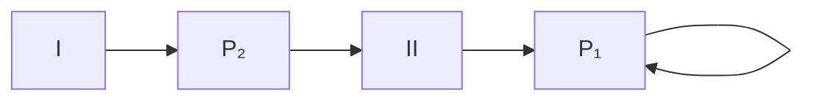
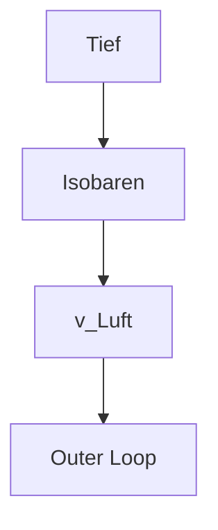

## 4

Die Newtonsche Bewegungsgleichung wird mit dem ‚Maxwellschen Rad‘ demonstriert. An einer Balkenwaage hängt am rechten Balken ein massives Rad, das auf zwei auf der dünnen Radachse aufgewickelten Fäden abrollen kann. Es ist anfangs bis knapp unter den Waagebalken aufgerollt und dort mit einem Bindfaden fixiert. Am linken Balken hängt zur Dämpfung eine in einem Metallteller ruhende Metallkugel in einen mit Glyzerin gefüllten Zylinder. Die Waage ist anfänglich im Gleichgewicht, das heißt, die Gewichtskraft der Massen am linken Balken ist abzüglich der Auftriebskräfte gleich der Gewichtskraft, die auf das Rad wirkt (kein Drehmoment des Waagebalkens). Auch die wirkende Gesamtkraft ist anfänglich null, da die Gewichtskräfte durch die Aufhängung des Waagebalkens (Reaktionskraft im Mittellager) kompensiert werden.

Wird der Faden durchgebrannt, so beginnt sich das Rad beschleunigt in der Richtung der Schwerkraft zu bewegen (abzurollen). Das Rad hängt jetzt nicht mehr mit seinem gesamten Gewicht am Waagebalken, da ein Teil der Gewichtskraft zur Beschleunigung verwendet wird, die wegen der Rotation des Rades kleiner als $\vec { g }$ ist. Die Waage schlägt daher nach der Gegenseite aus. Wenn das Rad vollständig abgerollt ist, wickelt sich das Seil in der Gegenrichtung auf, die Geschwindigkeit dreht daher bei gleich bleibendem Betrag ihre Richtung um. Die Reaktionskraft reißt den Waagebalken kurzfristig nach unten. Aus Trägheitsgründen (Rotationsenergie, siehe Kapitel „Mechanik des starren Körpers“, Abschnitt 3.3.3) spult sich das Rad dann wieder auf, jetzt aber mit sich verlangsamender Geschwindigkeit, also negativer Beschleunigung, die also wieder nach unten weist. Die Wirkung auf die Waage ist beim Aufspulen daher die gleiche wie beim Abspulen, die Waage schlägt wieder auf die Seite der Dämpfungseinrichtung aus.

natural_image

Historic scientific instrument setup with a large cylindrical apparatus and a person holding a device (no visible text or symbols)

Waage im Gleichgewicht, Rad noch fixiert

natural_image

Historical scientific apparatus setup with scale and instrument (no visible text or symbols)

Rad bewegt sich beschleunigt nach unten, der Zeiger schlägt nach rechts aus

natural_image

Laboratory setup with a scientific apparatus and scale, no visible text or symbols

Rad bewegt sich verlangsamt nach oben, der Zeiger schlägt wieder nach rechts aus

Man kann die Bewegungsgleichung umschreiben und so eine andere Sicht gewinnen:

$$
\vec {a} = \frac {1}{m} \vec {F}, \tag {I-2.19}
$$

je größer also die Masse m ist, desto kleiner ist bei gegebener Kraft die Beschleunigung. Die Masse eines Körpers setzt also einer Bewegungsänderung einen Widerstand entgegen. Diese träge Masse $m _ { t }$ ist daher ein Maß für das Beharrungsvermö- gen des Körpers.

Wir schreiben also:

$$
\vec {F} = m _ {t} \vec {a}.
$$

Andererseits erfährt jeder Körper mit der trägen Masse $m _ { t }$ eine ‚Gewichtskraft‘ $\vec { F } _ { G }$ im Erdschwerefeld, die von der Substanzmenge und gemäß dem Newtonschen Gravitationsgesetz (siehe Anhang 1 ‚Gravitation und Planetenbewegung‘, A1.1: Das Gravitationsgesetz) von der Erdanziehung, also von $\vec { g }$ abhängt:

$$
\vec {F} _ {G} = m _ {s} \vec {g}. \tag {I-2.20}
$$

$\vec { g }$ ist also die Feldstärke $\vec { F }$ im Erdschwerefeld.

Hier ist $m _ { s }$ die schwere Masse (gravitational mass) und $\vec { g } = 9 \mathbf { , } 8 1$ m $s ^ { - 2 }$ die Erdbeschleunigung (gravitational acceleration) an der Erdoberfläche.

Bis vor Kurzem wurde die Einheit der schweren Masse (1 kg) durch einen Pt-Iridium Zylinder repräsentiert, der in Sèvres (bei Paris) aufbewahrt wurde. Seit 20. Mai 2019 wird die Einheit 1 kg über die Einheit $\mathrm { k g }   \mathrm { m } ^ { 2 } \mathrm { s } ^ { - 1 }$ definiert, wobei das Plancksche Wirkungsquantum h jetzt festgelegt ist:

$$
h = 6, 6 2 6 0 7 0 1 5 \cdot 1 0 ^ {- 3 4} \mathrm{kg} \mathrm{m} ^ {2} \mathrm{s} ^ {- 1} \Rightarrow 1 \mathrm{kg} = \frac {h}{6 , 6 2 6 0 7 0 1 5 \cdot 1 0 ^ {- 3 4}} \mathrm{m} ^ {- 2} \mathrm{s}.
$$

Das Beratungsgremium des „Bureau International des Poids et Mesures (BIPM)“, das $\bullet ^ { \prime }$ Consultative Committee for Mass and Related Quantities $( \mathrm { C C M } ) ^ { \infty }$ hat auch zwei Realisierungsmethoden vorgeschlagen, die Watt-Waage (Kibble-balance) und die Röntgenkristalldichtemessung (X-ray-crystal-density (XRCD) method). Siehe dazu das Kapitel „Einleitung“, Anhang 1: Definition der SI-Basiseinheiten.

Nehmen wir einen Körper mit dem Gewicht $\vec { F } _ { G } = m _ { s }   \vec { g }$ und lassen ihn fallen, so fällt er gemäß dem 2. Newtonschen Axiom beschleunigt:

$$
\vec {F} _ {G} = m _ {s} \vec {g} = m _ {t} \vec {a}.
$$

Die beobachtete Fallbeschleunigung ist also:

$$
\vec {a} = \frac {m _ {s}}{m _ {t}} \vec {g}.
$$

Sehr genaue Experimente, die schon von Newton mittels Pendelmessungen begonnen und schließlich 1909 von Eötvös (Loránd Eötvös, 1848–1919) und später 1964 von Dicke (Robert Henry Dicke, 1916–1997) verfeinert wurden (siehe Anhang 1 ‚Gravitation und Planetenbewegung‘, A1.4: Bestimmung der Gravitationskonstante), haben ergeben, dass am gleichen Ort der Erdoberfläche alle Körper gleich schnell fallen, dass also die Fallbeschleunigung keine Körpereigenschaft ist.

Es ergibt sich daher

$$
\frac {m _ {s}}{m _ {t}} = 1 \tag {I-2.21}
$$

als universelle Konstante. Das ist das Gesetz von der Äquivalenz der trägen und schweren Masse.16 Wir brauchen daher im Folgenden nicht mehr zwischen träger und schwerer Masse zu unterscheiden, die Indizes t und s fallen weg. Eine bestimmte Substanzmenge (Masse) m wird demnach entweder durch ihr Gewicht oder durch ihre Trägheitswirkung (= Beschleunigung bei vorgegebener Kraft) gemessen.

Sind träge Masse $m _ { t }$ und schwere Masse $m _ { s }$ gleich, dann folgt aus dem Newtonschen Gravitationsgesetz (siehe Anhang A1.1), dass alle Körper gleich schnell fallen.

**Beispiel:** Die Äquivalenz von träger und schwerer Masse ergibt sich erst durch den experimentellen Befund, dass alle Körper gleich schnell fallen.

Das Newtonsche Gravitationsgesetz lautet (siehe Anhang A1.1):

$$
\left| \vec {F} \right| = \gamma \frac {m _ {1} m _ {2}}{r ^ {2}}.
$$

Wir lassen einen Körper mit der Masse $m _ { K }$ an der Erdoberfläche (Erdmasse $m _ { E } )$ fallen: mKt $\vec { a } = \gamma   \frac { m _ { K } ^ { s }   m _ { E } } { r ^ { ^ 2 } }$ Für $m _ { K } ^ { t } = m _ { K } ^ { s }$ fällt die Masse des Körpers aus der Gleichung und es gilt:

$$
\vec {a} = \vec {g} = \gamma \frac {m _ {E}}{r ^ {2}} = 6, 6 7 2 6 \cdot 1 0 ^ {- 1 1} \cdot \frac {5 , 9 7 5 \cdot 1 0 ^ {2 4}}{(6 , 3 7 6 \cdot 1 0 ^ {6}) ^ {2}} = 9, 8 0 7 \mathrm{ms} ^ {- 2}.
$$

Zum Vergleich: Normwert der Fallbeschleunigung $g_{n}=9,80665\mathrm{~m}\mathrm{~s}^{-2}$ exakt.

Der experimentelle Befund, dass alle Körper gleich schnell fallen, ist der Ausgangspunkt für die allgemeine Relativitätstheorie. Hier geht es um die Ununterscheidbarkeit zwischen der Kraftwirkung auf einen im Gravitationsfeld ruhenden Körper und jener auf einen Körper in einem gleichförmig beschleunigten Bezugssystem weit außerhalb jeder Gravitationswirkung. Das Einsteinsche Äquivalenzprinzip (nach Albert Einstein, 1879–1955) sagt, dass ein homogenes Gravitationsfeld völlig äquivalent zu einem gleichförmig beschleunigten Bezugssystem ist. Diese Aussage wird durch das Gedankenexperiment mit einem geschlossenen Fahrstuhl versinnbildlicht: Es ist für einen Beobachter im Fahrstuhl ununterscheidbar, ob der Fahrstuhl in einem Gravitationsfeld ruht oder ob er sich ohne jegliche Gravitationswirkung gleichförmig beschleunigt nach oben bewegt. Die Ergebnisse physikalischer Experimente sind gleich. Das ist der Ausgangspunkt für Einsteins allgemeine Relativitätstheorie, in der die Massenanziehung durch lokale Beschleunigungsfelder als Folge einer Raumkrümmung erklärt wird, die durch die Massenverteilung verursacht wird (Krümmung der Raum-Zeit).

<small>16 Die relative Abweichung der schweren von der trägen Masse wird seit 2017 (Satellitenexperiment MICROSCOPE) kleiner als 10−15 angenommen. Der experimentelle Befund der Äquivalenz (= Gleichheit) von träger und schwerer Masse wurde später von Einstein zum Prinzip (Axiom) erhoben, dem Einsteinschen Äquivalenzprinzip der allgemeinen Relativitätstheorie.</small>

## 3. Axiom (actio = reactio, Newton 3, lex tertia)

Wir nennen ein physikalisches System abgeschlossen, wenn auf die in ihm enthaltenen Massenpunkte nur innere Kräfte wirken, also Kräfte, die ihren Ursprung im System selbst besitzen, aber keine Kräfte von außen angreifen. Es gilt dann das 3. Newtonsche Axiom, das besonders für Systeme von MP wichtig ist (siehe Abschnitt 2.4 ‚Massenpunktsysteme und Erhaltungssätze‘):

In einem abgeschlossenen System treten Kräfte nur paarweise mit entgegengesetzter Größe auf.

1

In einem abgeschlossenen System ist daher die Summe aller Kräfte gleich Null.

## 2.2.2 Bahndrehimpuls und Drehmoment

Ein Teilchen bewege sich mit dem Impuls $\vec { p } = m \cdot \vec { \upsilon }$ auf einer Bahn $\vec { r } ( t )$

text_image

L
O
r̄(t)
m(MP)
ε(r, p̄)
s
p̄(t) = m · v̄(t)

Abb. I-2.7: Zum Bahndrehimpuls $\vec { L }$ eines Teilchens auf der Bahn $\vec { r } ( t )$

Wir definieren als Bahndrehimpuls (angular momentum) $\vec { L }$ in Bezug auf den Koordinatenursprung O (Abb. I-2.7):

$$
\vec {L} = \vec {r} \times \vec {p} = m (\vec {r} \times \vec {v}) \quad \text {Bahndrehimpuls.} \tag {I-2.22}
$$

Einheit: $[L]=1\  kg \  m ^{2}\  s ^{-1}=1\  Js$ .

Entsprechend der Definition des Vektorprodukts steht $\vec { L }$ senkrecht auf $\vec { r }$ und $\vec { p }$ Liegt die Bahn des Teilchens in einer Ebene $\varepsilon ( \vec { r } , \vec { p } )$ mit dem Koordinatenursprung $O ,$ so zeigt $\vec { L }$ immer in die gleiche Richtung senkrecht zu $\varepsilon ( \vec { r } _ { * } \vec { p } )$

Wir bilden die zeitliche Ableitung des Bahndrehimpulses und achten dabei auf das Vektorprodukt:

$$
\frac {d \vec {L}}{d t} = \dot {\vec {L}} = \underbrace {\frac {d \vec {r}}{d t}} _ {\substack {\vec {v} / / \vec {p} \\ = 0}} \times \vec {p} + \vec {r} \times \underbrace {\frac {d \vec {p}}{d t}} _ {\vec {F}}.
$$

$( \vec { r } \times \vec { F } ) = \vec { D }$ heißt Drehmoment (moment of a force) der Kraft in Bezug auf den Ursprung $O .$ Es bewirkt eine Änderung des Drehimpulses $\vec { L }$ analog zur $\ddot { \mathbf { A } }$ nderung des linearen Impulses $\vec { p }$ durch eine Kraft $\dot { \vec { p } } = \vec { F } ;$

$$
\vec {D} = \vec {r} \times \vec {F} = \dot {\vec {L}}. \tag {I-2.23}
$$

Einheit: [D] = 1 Nm = 1 J.

$\vec { D }$ und $\vec { L }$ sind axiale Vektoren, die bei einer Spiegelung am Ursprung (Paritätstransformation, Punktspiegelung) den Drehsinn beibehalten. $\vec { r } ,   \vec { \upsilon } ,   \vec { a } ,   \vec { F }$ sind polare Vektoren, die ihre Richtung bei einer Spiegelung am Ursprung umkehren. Siehe dazu auch Band VI, Kapitel „Materialphysik (Materials Science)“, Anhang 2.

Die Gl. I-2.23 ist unter anderem wichtig für die Planetenbewegung und die Keplerschen Gesetze (nach Johannes Kepler, 1571–1630).

## 1. Keplersches Gesetz

Die Planeten bewegen sich in einem Zentralkraftfeld, dem Gravitationsfeld der Sonne, bei dem die Kraft ständig auf einen Punkt weist, in diesem Fall dem Massenmittelpunkt der Sonne, und bei dem der Betrag der wirkenden Zentralkraft nur eine Funktion des Abstands von diesem Punkt ist. Wenn wir den Ursprung unseres Koordinatensystems in die Sonne legen, die wegen der großen Bahndurchmesser hier als ausdehnungslos behandelt werden kann, dann ist der Ortsvektor zu einem Planeten antiparallel zur Zentralkraft und es gilt $\vec { D } = 0 \Rightarrow \vec { L }$ = const. Die Planetenbewegung $\vec { r } ( t )$ erfolgt also nach Gl. I-2.23 in einer Ebene senkrecht zu $\vec { L }$ und es lässt sich zeigen, dass ihre geschlossenen Bahnkurven Ellipsen sind $^ { 1 7 }$ in deren einem Brennpunkt die Sonne steht (siehe Anhang A1.2: Das Keplerproblem).

<small>17 Im Falle des Newtonschen Gravitationsgesetzes ergibt sich als Bahnkurve eine Ellipse mit der Sonne in einem Brennpunkt, falls die Gesamtenergie des Systems negativ ist, es sich also um einen gebundenen Zustand handelt (siehe Anhang A1.2). Kometen, die ja nicht an die Sonne gebunden sind in deren einem Brennpunkt die Sonne steht (E > 0), beschreiben Hyperbelbahnen.</small>

## 2. Keplersches Gesetz (Flächensatz)

Es gilt für eine Zentralkraft:

$$
\vec {r} \times m \underbrace {\frac {d ^ {2} \vec {r}}{d t ^ {2}}} _ {\vec {F} \uparrow \downarrow \vec {r}} = m \cdot \vec {r} \times \frac {d ^ {2} \vec {r}}{d t ^ {2}} = 0 \quad \underset {m \neq 0} {\Rightarrow} \quad \vec {r} \times \frac {d ^ {2} \vec {r}}{d t ^ {2}} = 0
$$

und durch Integration

$$
\vec {r} \times \frac {d \vec {r}}{d t} = 2 \vec {c} = \text {const.} \tag {I-2.24}
$$

weil

$$
\frac {d}{d t} \Bigg (\vec {r} \times \frac {d \vec {r}}{d t} \Bigg) = \underbrace {\frac {d \vec {r}}{d t} \times \frac {d \vec {r}}{d t}} _ {= 0} + \underbrace {\vec {r} \times \frac {d ^ {2} \vec {r}}{d t ^ {2}}} _ {= 0} = 0.
$$

text_image

dA
r
d\u0305
r + d\u0305
S
\u0305 × d\u0305

Abb. I-2.8: Zum 2. Keplerschen Gesetz (Flächensatz).

Aus Abb. I-2.8 ist zu sehen:

$$
2 d A = \left| \vec {r} \times d \vec {r} \right|
$$

oder mit der orientierten Fläche $d { \vec { A } } : 2   d { \vec { A } } = { \vec { r } } \times d { \vec { r } } .$

Nach der Zeit differenziert erhalten wir ${ \frac { d { \vec { A } } } { d t } } = { \frac { 1 } { 2 } } \left( { \vec { r } } \times { \frac { d { \vec { r } } } { d t } } \right) = { \vec { c } } .$ , das ist die vom Radiusvektor (dem Fahrstrahl) in der Zeiteinheit überstrichene (orientierte) Fläche. $\vec { c } = \frac { d \vec { A } } { d t }$ nennt man die Flächengeschwindigkeit, sie ist bei der Zentralkräftebewegung zeitlich konstant. Anders formuliert: Der Fahrstrahl des Planeten zur Sonne überstreicht in gleichen Zeiten gleich große Flächenstücke.

## 3. Keplersches Gesetz

Das 3. Keplersche Gesetz, welches die Umlaufzeit eines Planeten mit der großen Halbachse a seiner Bahnellipse in Beziehung setzt, $\boldsymbol { T } ^ { 2 } = \boldsymbol { k } \cdot \boldsymbol { a } ^ { 3 } ,$ , wobei k eine Konstante des Planetensystems ist, wird in Anhang A1.2 besprochen.

Nach den Keplerschen Gesetzen betrachten wir auch noch den Bahndrehimpuls eines Teilchens, das sich auf einer geraden Bahn bewegt (Abb. I-2.9):

text_image

MP
r(t)
v(t)
θ
L̅ P
b

Abb. I-2.9: Zum Bahndrehimpuls L⇀eines Teilchens auf geradliniger Bahn.

Für den Bahndrehimpuls in Bezug auf den Beobachtungspunkt P gilt nach obiger Definition:

$\vec { L } = m ( \vec { r } \times \vec { v } ) \perp$ auf der von υ⇀und P gebildeten Ebene (hier in die Papierebene hinein). Für seinen Betrag erhalten wir entsprechend der Abb. I-2.9:

$$
\left| \vec {L} \right| = m \cdot r \cdot v \cdot \sin \theta = m \cdot r \cdot v \frac {b}{r} = m \cdot b \cdot v. \tag {I-2.25}
$$

## 2.2.3 Kraftstoß, Arbeit und Energie, Leistung

Wenn eine Kraft eine gewisse Zeit auf ein Teilchen einwirkt, ergeben sich zwei Ansätze:

1. Wir multiplizieren die Kraft mit der Zeit, in der sie wirkt
2. Wir multiplizieren die Kraft mit der Verschiebung des $M P ,$ die sie hervorruft.

ad 1: Zuerst bilden wir das Zeitintegral einer veränderlichen Kraft (Kraftstoß) durch Aufsummieren der Produkte aus Momentankraft und Zeitelement (Abb. I-2.10):

$$
\int_ {t _ {1}} ^ {t _ {2}} \vec {F} (\vec {r}) d t = \int_ {t _ {1}} ^ {t _ {2}} m \frac {d ^ {2} \vec {r}}{d t ^ {2}} d t = m \left(\frac {d \vec {r}}{d t}\right) _ {t _ {2}} - m \left(\frac {d \vec {r}}{d t}\right) _ {t _ {1}} = m (\vec {\upsilon} _ {2} - \vec {\upsilon} _ {1}) = \vec {p} _ {2} - \vec {p} _ {1}. \tag {I-2.26}
$$

line

| Time | Value |
| --- | --- |
| t1 | 0 |
| Peak | ~Maximum |
| t2 | 0 |

Abb. I-2.10: Der Kraftstoß ist das Zeitintegral der Kraft.

Der Kraftstoß (= Zeitintegral der Kraft) stellt also die gesamte $\ddot { \mathbf { A } }$ nderung des Impulses während der Zeit $t _ { 2 } - t _ { 1 }$ dar.

Gilt für den anfänglichen Impuls $\vec { p } _ { 1 } = 0$ , ist also $\vec { \upsilon } _ { 1 } ( t = 0 ) = 0$ , so wird

$$
\int_ {t _ {1}} ^ {t _ {2}} \vec {F} d t = m \vec {\upsilon} = \vec {p}. \tag {I-2.27}
$$

Der Impuls (Bewegungsgröße, linear momentum) ist also gleich jenem Kraftstoß, der den gestoßenen Massenpunkt aus der Ruhe auf die Geschwindigkeit $\bar { v }$ bringt.

ad 2: Wir betrachten jetzt wieder die Bahnkurve, die ein Teilchen unter der Einwirkung einer Kraft beschreibt (Abb. I-2.11).

text_image

d\vec{r} = \vec{v}dt
P₁
\vec{v}_1
P₂
\vec{v}_2
\vec{F}(\vec{r})
\vec{r}(t)
z
x
O
y
s

Abb. I-2.11: Zur Definition der Arbeit: Bahnkurve eines Teilchens unter der Einwirkung einer Kraft.

Wir definieren als Arbeit dW der Kraft $\vec { F }$ am Teilchen bei einer Verschiebung um $d \vec { r }$ das Skalarprodukt

$$
d W = \vec {F} \cdot d \vec {r}, \tag {I-2.28}
$$

also ‚Kraft mal Verschiebung in Richtung der Kraft‘ oder ‚Verschiebung mal Kraft in Richtung der Verschiebun $\mathbf { g } ^ { \bullet }$ . Die Arbeit ist positiv, wenn $\vec { F }$ und $d \vec { r }$ einen spitzen Winkel bilden (cos $( \vec { r } , d \vec { r } ) < 1 )$

Um das Teilchen von $P _ { 1 }$ nach $P _ { 2 }$ zu verschieben, verrichtet die Kraft also die Arbeit

$$
W = \int_ {P _ {1}} ^ {P _ {2}} \vec {F} d \vec {r}. \tag {I-2.29}
$$

Einheit: $[W]=1\  Nm =1\  J$ (Joule, nach James Prescott Joule, 1818–1889, sprich: ‚tschul‘).

## 1 Die Arbeit am Teilchen ist das Wegintegral der Kraft.

Es wird über die Skalarprodukte der Vektoren $\vec { F }$ und $d \vec { r }$ aufsummiert, daher verschwindet das Wegintegral der Kraft, also die Arbeit, wenn die wirkende Kraft $\vec { F }$ normal auf der Verschiebung $d \vec { r }$ steht (z. B. bei der Verschiebung eines MP horizontal zur Erdoberfläche).

Wir berechnen jetzt unter Verwendung des 2. Newtonschen Axioms die Beschleunigungsarbeit der Kraft am Teilchen

$$
\begin{array}{l} W = \int_ {P _ {1}} ^ {P _ {2}} \vec {F} d \vec {r} = m \int_ {P _ {1}} ^ {P _ {2}} \frac {d \vec {v}}{d t} d \vec {r} = m \int_ {P _ {1}} ^ {P _ {2}} \frac {d \vec {v}}{d t} \underbrace {\frac {d \vec {r}}{d t}} _ {\vec {v}} d t = m \int_ {v _ {1}} ^ {v _ {2}} \vec {v} d \vec {v} = \frac {1}{2} m v ^ {2} \Bigg | _ {v _ {1}} ^ {v _ {2}} = \\ = \frac {1}{2} m (\upsilon_ {2} ^ {2} - \upsilon_ {1} ^ {2}) = E _ {\mathrm{kin2}} - E _ {\mathrm{kin1}} = \Delta E _ {\mathrm{kin}}. \tag {I-2.30} \\ \end{array}
$$

und definieren als kinetische Energie (kinetic energy)

$$
E _ {\mathrm{kin}} = \frac {1}{2} m v ^ {2} = \frac {p ^ {2}}{2 m}. \tag {I-2.31}
$$

Einheit: $[ E _ { \mathrm { k i n } } ] = 1 ]$ .

Die Arbeit am Teilchen erhöht $( \angle ( \vec { F } , d \vec { r } )$ spitz) oder verringert $( \angle ( \vec { F } ,   d \vec { r } )$ stumpf) seine kinetische Energie. Für ein freies Teilchen gilt daher: Arbeit ist gleich der Energieänderung des Teilchens.

Wenn insbesondere für die Anfangsgeschwindigkeit des Teilchens $\nu _ { 1 } = 0$ gilt, dann ist die gesamte Energieänderung $\Delta E_{\mathrm{kin}} = \sqrt[1]{2 m v^{2}}$ Aufgrund seiner Bewegung hat das Teilchen also Arbeitsfähigkeit erlangt, da die kinetische Energie wieder zur Verrichtung von Arbeit genützt werden kann (z. B. die kinetische Energie des Wassers in einer Turbine).

Es lassen sich zwei große Klassen von Kraftfeldern unterscheiden:

konservative Kraftfelder,

bei denen die Arbeit zur Verschiebung des MP zwischen zwei seiner Lagen unabhängig vom Weg ist und die mechanische Energieänderung daher in jedem Fall gleich ist; bei einem geschlossenen Weg ist die Energieänderung Null (siehe unten), die Gesamtenergie bleibt also erhalten (conserved);

nichtkonservative Kraftfelder,

bei denen die Arbeit zwischen zwei Lagen des MP vom Weg abhängt und somit die mechanische Energie zumindest teilweise irreversibel in Wärmeenergie verwandelt wird.

Wir definieren ein Kraftfeld als konservativ, wenn die Arbeit bei der Verschiebung des MP vom Punkt $P _ { 1 }$ zum Punkt $P _ { 2 }$ vom Verschiebungsweg unabhängig ist.

Diese Bedingung für das Vorliegen eines konservativen Kraftfeldes kann dann auch so geschrieben werden:

$$
\oint \vec {F} d \vec {r} = 0. \tag {I-2.32}
$$

Begründung: Wir betrachten die Arbeit für die Verschiebung eines Teilchens zwischen zwei Punkten $P _ { 1 }$ und $P _ { 2 }$ längs zweier unterschiedlicher Wege entsprechend Abb. I-2.12.

flowchart

Abb. I-2.12: Zur Definition eines konservativen Kraftfeldes.

Im konservativen Kraftfeld muss gelten: $W _ { \mathrm { I } } = W _ { \mathrm { I I } }$ oder $W _ { \mathrm { I } } - W _ { \mathrm { I I } } = 0$ , daher folgt

$$
\underbrace {\int_ {P _ {1}} ^ {P _ {2}} \vec {F} d \vec {r}} _ {W _ {\mathrm{I}}} - \underbrace {\int_ {P _ {1}} ^ {P _ {2}} \vec {F} d \vec {r}} _ {W _ {\mathrm{II}}} = \int_ {P _ {1}} ^ {P _ {2}} \vec {F} d \vec {r} + \int_ {P _ {2}} ^ {P _ {1}} \vec {F} d \vec {r} = \oint \vec {F} d \vec {r} = 0. \tag {I-2.33}
$$

Das heißt:

Wenn wir das Teilchen in einem konservativen Kraftfeld so verschieben, dass es wieder zum Ausgangspunkt gelangt (geschlossener Weg), so müssen wir nur vorübergehend Arbeit verrichten, die aber später durch die Wirkung der Kraft zurückgewonnen wird. Insgesamt wird keine Arbeit verrichtet.

Anders sieht es in einem nichtkonservativen Kraftfeld aus: Hier wird eine einmal verrichtete Arbeit bei der Rückkehr zum Ausgangspunkt der Verschiebung z. B. durch Reibungseffekte (= Dissipation) nicht mehr vollständig zurück gewonnen.

**Beispiel:** Die Reibungskraft $\vec { F } _ { R }$ sei der Geschwindigkeit $\bar { v }$ proportional und entgegengesetzt gerichtet (Newtonsches Reibungsgesetz). Dann gilt: $\vec { F } _ { R } = - \boldsymbol { \beta } \cdot \vec { \upsilon }$

Daraus folgt für die Arbeit $W _ { \mathsf { O } }$ auf einem geschlossenen Weg:

$$
W _ {\mathrm{O}} = \oint \vec {F} _ {R} d \vec {r} = - \beta \oint \vec {v} \frac {d \vec {r}}{d t} \cdot d t = - \beta \oint v ^ {2} d t <   0.
$$

Diese Arbeit wird vom Teilchen verloren sodass die mechanische Gesamtenergie abnimmt (nicht aber die Energie insgesamt, da thermische Energie gewonnen wird). Soll die mechanische Energie, also die Geschwindigkeit des Teilchens, erhalten bleiben, dann muss die verlorene Energie von anderen konservativen Kräften aufgebracht werden. So wird z.B. beim unbeschleunigten Fall einer Kugel in einer zähen Flüssigkeit die Reibungsenergie durch die konservative Schwerkraft kompensiert: Die Geschwindigkeit der Kugel bleibt konstant, da die „verlorene“ Reibungsenergie von der Gravitationsenergie nachgeliefert wird. Vergleiche dazu den Millikan-Ehrenhaft-Versuch In Band III, Kapitel „Elektrostatik“, Abschnitt 1.1.2.

1

Wir erinnern uns an den Satz von Stokes aus der Vektoranalysis:

$$
\oint \vec {F} d \vec {r} = \int \operatorname{rot} \vec {F} d \vec {f}   _ {C = R a n d v o n A} \quad F l ä c h e A
$$

Daraus ergibt sich die Bedingung für ein konservatives Kraftfeld auch zu:

$$
\mathrm{rot} \vec {F} = \underbrace {\mathrm{curl} \vec {F}} _ {\text {engl.}} = \vec {\nabla} \times \vec {F} = 0, \tag {I-2.34}
$$

Abb. I-2.13: Beispiel eines nicht-konservativen Kraftfeldes (Wirbelkern): rot $\vec { F } = \vec { \nabla } \times \vec { F } \neq 0$ $\oint \vec{F}   d\vec{r} \neq 0$ (links) und eines konservativen Kraftfeldes (Quadrupol): rot F⇀= ∇⇀ × F⇀= 0 , ∮ F⇀dr⇀= 0 (rechts).

das heißt, ein konservatives Kraftfeld muss wirbelfrei sein.18 Dabei bedeutet in bekannter Weise $\vec { \nabla } = \vec { e } _ { x }   \frac { \partial } { \partial x } + \vec { e } _ { y }   \frac { \partial } { \partial y } + \vec { e } _ { z }   \frac { \partial } { \partial z }$ den Nablaoperator.

Beispiele konservativer und nichtkonservativer Kraftfelder (siehe auch Abb. I-2.13):

| - konservativ | - homogenes Kraftfeld- zeitunabhängiges Zentralkraftfeld,z. B. das Feld einer Punktmasse (oder einer Punktladung) |
| --- | --- |
| - nichtkonservativ | - allgemeines ortsabhängiges Kraftfeld- zeitabhängige Kraftfelder- Kraftfelder in denen eine zusätzliche Kraft auftritt,die von der Geschwindigkeit abhängt (dissipative Kraft) |

In einem konservativen Kraftfeld ist also die Arbeit vom Verschiebungsweg des Teilchens zwischen zwei festen Punkten unabhängig, sie hängt daher nur vom Anfangs- und vom Endzustand ab. In diesem Fall können wir also jedem Punkt des Kraftfeldes den Wert jener Arbeit zuschreiben, die notwendig ist, um das Teilchen von einem willkürlich gewählten Nullpunkt zum entsprechenden Raumpunkt zu verschieben. Damit haben wir eine wesentliche Erleichterung für die Charakterisie rung des Kraftfeldes erzielt: Während wir bisher das Kraftfeld durch Kraftvektoren (Zahlentripel) beschreiben mussten, können wir ein konservatives Kraftfeld jetzt durch eine skalare Ortsfunktion (einfache Zahl) V(r⇀) beschreiben, nämlich den Wert der Verschiebungsarbeit vom Nullpunkt ausgehend. Wir nehmen allerdings konventioneller Weise den negativen Arbeitswert 19 und nennen ihn potenzielle Energie ( potential energy) $V = E _ { \mathrm { p o t } } = - \int \limits _ { 0 } ^ { P } \vec { F } \cdot d \vec { r } .$ . Für die Verschiebung von $P _ { 1 }$ nach $P _ { 2 }$ ergibt sich folgender Arbeitswert $\left( \mathbb{W} > 0 ; \right.$ Arbeit wird abgegeben, $W < 0 ;$ : Arbeit ist aufzuwenden):20

<small>18 Diese Aussage gilt nur für einfach-zusammengängende Bereiche, deren Randkurve sich stetig auf einen Punkt zusammenziehen lässt.</small>

$$
W = \int_ {P _ {1}} ^ {P _ {2}} \vec {F} d \vec {r} = \int_ {P _ {1}} ^ {P _ {2}} - d V = \underbrace {V (P _ {1})} _ {E _ {\mathrm{pot}} (P _ {1})} - \underbrace {V (P _ {2})} _ {E _ {\mathrm{pot}} (P _ {2})} = - \Delta V = - \Delta E _ {\mathrm{pot}}. \tag {I-2.35}
$$

Die potenzielle Energie als Funktion des Ortes stellt ein skalares Feld $V ( \vec { r } )$ dar, das Feld der potenziellen Energie ( potential energy field).

Wichtig ist, dass offensichtlich nur Differenzen $\Delta V = \Delta E _ { \mathrm { p o t } }$ auftreten, der Nullpunkt kann frei (sinnvoll) gewählt werden.

**Beispiel:** Sinnvoller Nullpunkt für Experimente in denen die Schwerkraft wirkt: $\vec { F } = \{ 0 , 0 , - m g \}$ , wir wählen hier $V = 0$ für $z = 0$ (Bodenniveau).

Die Bedingung für ein konservatives Kraftfeld war (Gln. I-2.32 und I-2.34):

$$
\oint \vec {F} d \vec {r} = 0 \quad \Leftrightarrow \quad \mathrm{rot} \vec {F} = 0.
$$

1

Ein Satz aus der Vektoranalysis führt uns weiter:

$$
\mathrm{rot} (\mathrm{grad} u) = \vec {\nabla} \times \vec {\nabla} u \equiv 0.
$$

Das heißt, eine Kraft ist sicher konservativ, wenn sie sich als Gradient einer skalaren Funktion darstellen lässt. Wir können als Skalarfeld das eben betrachtete Feld der potenziellen Energie $V ( \vec { r } )$ nehmen und daraus immer das zugehörige konservative Kraftfeld bilden. Dazu erinnern wir uns zuerst, wie der Gradient definiert ist: Bei einer kleinen Verschiebung des Teilchens im Feld um $d \vec { r }$ ändert sich die Funktion der potenziellen Energie um $d V = d { \vec { r } }$ ⋅ grad $V$

<small>19 Die Wahl des negativen Vorzeichens bei der Definition des Potenzials V als Verschiebungsarbeit im Feld bewirkt, dass Verschiebungen in Richtung des Feldes (F⇀// dr⇀), also vom Feld verursachte Bewegungen, immer vom höheren zum niedrigeren Potenzial verlaufen, die Bewegung also „bergab“ erfolgt. Die Kraft F⇀weist immer vom höheren zum niedrigeren Potenzial (siehe dazu auch Anhang A1.2).</small>

<small>P2 20 Da ∫F⇀dr⇀ vom Weg unabhängig ist, muss der Integrand F⇀dr⇀ ein totales Differential sein, P1 wir bezeichnen es mit −dV.</small>

Vergleichen wir dies mit der Definitionsgleichung für die potenzielle Energie funktion $V ( \vec { r } )$ , also $d W = - d V = { \vec { F } } \cdot d { \vec { r } }$ , so erkennen wir den Zusammenhang zwischen der potenziellen Energie und der zugehörigen konservativen Kraft:

$$
\vec {F} = - \operatorname{grad} V = - \vec {\nabla} V. \tag {I-2.36}
$$

Die Einführung der potenziellen Energie im konservativen Kraftfeld hat also eine wichtige Bedeutung: Wenn es gelingt, das Feld der potenziellen Energie einer vorgegebenen Massenverteilung (in der Elektrostatik: einer Ladungsverteilung) z. B. aus Punktmassen (Punktladungen), aufzubauen, dann können wir das Kraftfeld durch das skalare Feld der potenziellen Energie vollständig beschreiben und den Kraftvektor an jeder Stelle des Raumes durch negative Gradientenbildung aus der potenziellen Energie erhalten!21

Die Leistung einer mechanischen Arbeit beschreibt, in welcher Zeit ein Arbeitsprozess abläuft, sie gibt also die Arbeitsrate an, d. h. die pro Zeiteinheit verrichtete Arbeit:

$$
P = \frac {d W}{d t} \quad \text {Augenblicksleistung.} \tag {I-2.37}
$$

Mit $W = \int \limits _ { P _ { 1 } } ^ { P _ { 2 } } \vec { F } d \vec { r } \Rightarrow d W = \vec { F }$ ⋅dr⇀und daher

$$
P = \frac {d W}{d t} = \vec {F} \cdot \vec {v}. \tag {I-2.38}
$$

υ ist die Geschwindigkeit des Teilchens, an dem die Kraft $\vec { F }$ die Arbeit dW in der Zeit dt verrichtet.

## 2.2.4 Erhaltung der mechanischen Gesamtenergie

Die Arbeit, die bei der Verschiebung des Teilchens im Kraftfeld verrichtet wird, ist im Falle eines freien Teilchens auf zweifache Weise, nämlich aus der Beschleunigungsarbeit und aus der $\ddot { \mathbf { A } }$ nderung der potenziellen Energie darstellbar (Gln. I-2.30 und I-2.35):

<small>21 Man führt dazu das Potenzial $\Phi = \operatorname* { l i m } _ { m \to 0 }   { \frac { V } { m } }$ als potenzielle Energie pro Masseneinheit einer ‚Probemasse‘ ein (siehe auch Anhang A1.2). Die Vorgehensweise wird von der ‚Potenzialtheorie‘ beschrieben (Lösung der Laplace- bzw. Poissongleichung, siehe dazu auch Band III, Kapitel ‚Elektro-F⇀ statik‘, Abschnitt 1.3). Die Kraft pro Masseneinheit wird als Feldstärke E⇀= lim bezeichnet (im m%0m elektrischen Feld ist die Masse m durch die Ladung q zu ersetzen).</small>

$$
W = \int_ {P _ {1}} ^ {P _ {2}} \vec {F} d \vec {r} = \frac {1}{2} m (\nu_ {2} ^ {2} - \nu_ {1} ^ {2}) = E _ {\mathrm{kin}} (P _ {2}) - E _ {\mathrm{kin}} (P _ {1}) = - \Delta V = V (P _ {1}) - V (P _ {2}). \tag {I-2.39}
$$

Daraus folgt der Energiesatz der klassischen Mechanik:

$$
E _ {\mathrm{kin}} (P _ {1}) + V (P _ {1}) = E _ {\mathrm{kin}} (P _ {2}) + V (P _ {2}) = E _ {\mathrm{ges}} = \text {const.} \tag {I-2.40}
$$

1

Bei konservativen Kräften bleibt die Summe aus kinetischer und potenzieller Energie, d. h. die mechanische Gesamtenergie, zeitlich konstant.

**Beispiel:** Der senkrechte Wurf. Wirkende Kraft: $\vec { F } _ { G } = - m   g   \vec { e } _ { z }$

Wir werfen einen Körper (Reibung vernachlässigt) senkrecht um eine Strecke h nach oben in Richtung der positiven $z - \mathbf { A }$ chse. Die Anfangsgeschwindigkeit $\upsilon _ { 0 }$ zum Zeitpunkt $t = 0$ am Punkt $P _ { 0 }$ wird von außen aufgebracht.

1. Der Körper hat bei $P _ { 0 }$ die Anfangsgeschwindigkeit $\vec { \upsilon } _ { 0 } : E _ { \mathrm { k i n } } ( P _ { 0 } ) = \frac { m   \upsilon _ { 0 } ^ { 2 } } { 2 }$ .

Wir legen den Nullpunkt der potenziellen Energie in $P _ { 0 } ~ ( z = 0 )$ Es gilt also $E _ { \mathrm { p o t } } ( 0 ) = 0$

2. Weg von $P _ { 0 }$ zum Punkt $\mathbf { P } _ { z }$ unterhalb vom Scheitelpunkt $P _ { S }$

$$
W _ {1} = \int_ {P _ {0}} ^ {P z} \vec {F} _ {G} d \vec {r} = F _ {G} \int_ {0} ^ {z} d z = - m g z \quad E _ {\text {pot}} = - \int_ {P _ {0}} ^ {P z} \vec {F} _ {G} d \vec {r} = - F _ {G} \int_ {0} ^ {z} d z = m g z.
$$

Dem Körper wird von der wirkenden Kraft Energie in Form von kinetischer Energie entzogen (die Steiggeschwindigkeit nimmt ab) und in potenzielle Energie umgewandelt $( \mathsf { W } _ { 1 } < 0 )$

3. Körper am Scheitelpunkt $P _ { S } \left( z = h \right)$ : hier ist $\nu = 0$ also $E _ { \mathrm { k i n } } = 0$ die gesamte kinetische Energie wurde aufgebraucht.

Für die potenzielle Energie gilt:

$$
E _ {\mathrm{pot}} = - W _ {1} = - \int_ {P _ {0}} ^ {P _ {S}} \vec {F} _ {G} d \vec {r} = + m g h \quad (W _ {1} <   0),
$$

die gesamte kinetische Energie wurde in potenzielle Energie umgewandelt! Energiesatz:

$$
\frac {m v _ {0} ^ {2}}{2} + 0 = 0 + m g h.
$$

4. Weg von $P _ { S }$ zurück nach $P _ { 0 } ;$ Hier erfolgt die Energieumwandlung in umgekehrter Reihenfolge wie unter 2):

$$
W _ {2} = \int_ {P _ {S}} ^ {P z} \vec {F} _ {G} d \vec {r} = F _ {G} (z - h) = - m g (z - h) \quad \left(W _ {2} > 0\right).
$$

Während der der Körper fällt, wird also von der Kraft an ihm Arbeit verrichtet, dem Körper wird kinetische Energie auf Kosten der potenziellen Energie zugeführt (die Fallgeschwindigkeit nimmt zu).

5. Der Körper ist wieder bei $P _ { 0 } ;$ Seine Geschwindigkeit ist jetzt $- \vec { v } _ { 0 }$ , er hat daher wieder die kinetische Energie $E _ { \mathrm { k i n } } ( P _ { 0 } ) = \frac { m   v _ { 0 } ^ { 2 } } { 2 }$

Die gesamte potenzielle Energie, die der Körper am Scheitelpunkt hatte, wurde wieder vollständig (reibungsfreier Idealfall) in kinetische Energie umgewandelt.

Energiesatz:

$$
0 + m g h = \frac {m v _ {0} ^ {2}}{2} + 0.
$$

## 2.3 Bezugssysteme und Trägheitskräfte

## 2.3.1 Inertialsysteme, Galilei-Transformation

Die Angabe der Bahn und der Geschwindigkeit eines Teilchens setzen, wie wir bereits gesehen haben, ein Bezugssystem (Koordinatensystem) voraus. In der Physik Newtons gibt es den absoluten Raum, der sich immer gleich und unbeweglich im Hintergrund befindet, und die absolute Zeit, die auch ohne die Existenz von Uhren gleichmäßig fließt.

Als Inertialsystem bezeichnen wir Systeme, in denen Newtons Trägheitssatz (1. Axiom) gilt. Bezugssysteme, die sich relativ zu einem Inertialsystem mit gleichförmiger Geschwindigkeit geradlinig bewegen, sind ebenfalls Inertialsysteme.22 Wir werden aber sehen, dass in beschleunigten Bezugssystemen der Trägheitssatz nicht gilt, sondern dass eine Beschleunigung des Teilchens beobachtet wird, obwohl keine (physikalische) Kraft (fundamentale WW) wirkt. Es treten also in den beschleunigten Bezugssystemen Schein- oder Trägheitskräfte (inertial forces) auf.

<small>22 Es hängt vom jeweiligen Experiment (seiner zeitlichen und räumlichen Ausdehnung) ab, welches Bezugssystem als Inertialsystem betrachtet werden kann, wieweit also Trägheitskräfte vernachlässigt werden können. Für viele kurz dauernde Experimente mit kleinen Geschwindigkeiten reicht es aus, die Erdoberfläche als Inertialsystem zu betrachten. Für anspruchsvolle astronomische Untersuchungen wird ein Inertialsystem verwendet, das von 3 nicht-komplanaren Fixsternen aufgespannt wird (‚galaktisches System‘). Noch eine Anmerkung: In der heutigen, der allgemeinen Relativitätstheorie entsprechenden Sicht, gibt es kein (globales) Inertialsystem, d. h. der Trägheitssatz gilt nicht! Das ist eine Konsequenz der Wirkung der Gravitation. Nur in begrenzten Raumgebieten und für beschränkte Zeiten kann man lokale Inertialsysteme betrachten.</small>

text_image

z
Σ
z' Σ'
P
r̅
ū · t
O'
x'
y'
O
x
y

Abb. I-2.14: Zur Galilei-Transformation: Das System Σ′ bewegt sich zum System Σ mit konstanter Relativgeschwindigkeit $\vec { u }$

Wir betrachten zuerst zwei Bezugssysteme Σ und $\Sigma ^ { \prime } ,$ von denen eines ruht (Σ) und das andere (Σ′) sich dazu mit konstanter Geschwindigkeit u⇀(Relativgeschwindigkeit) bewegt (Abb. I-2.14).

Es gilt die Galilei-Transformation (nach Galileo Galilei, 1564–1642):

$$
\vec {r} ^ {\prime} = \vec {r} - \vec {u} \cdot t = \left\{ \begin{array}{l} x ^ {\prime} (t) = x (t) - u _ {x} \cdot t \\ y ^ {\prime} (t) = y (t) - u _ {y} \cdot t \\ z ^ {\prime} (t) = z (t) - u _ {z} \cdot t \\ t ^ {\prime} = t \quad (\text {gleichgehende Uhren in beiden Systemen}) \end{array} \right. \tag {I-2.41}
$$

Falls die Relativgeschwindigkeit u⇀der beiden Systeme längs der x-Achse auftritt $( u _ { y } = u _ { z } = 0 )$ lässt sich die Galilei-Transformation elegant in einem x-t-Diagramm geometrisch veranschaulichen. Für $t = t ^ { \prime } = 0$ sollen einfachheitshalber die Koordinatenanfangspunkte beider Systeme zusammenfallen. Die $t ^ { \prime } -$ Achse ist gegenüber der t-Achse entsprechend der Relativgeschwindigkeit $u _ { x }$ geneigt, die x-Achsen fallen zusammen (Abb. I-2.15). Die beiden Systeme sind gleichwertig, welches von beiden als „ruhend“ betrachtet wird, ist willkürlich. Dieses Diagramm wird später (Band II, Kapitel „Relativistische Mechanik“) für sehr große Geschwindigkeiten $u _ { x } \sim c$ , c = Lichtgeschwindigkeit, zum Minkowskidiagramm erweitert.

Wie sehen die Geschwindigkeit, die Beschleunigung und die Kraft im gleichförmig bewegten System $\Sigma ^ { \prime }$ aus?

$$
\begin{array}{l} \vec {v} = \frac {d \vec {r}}{d t}, \quad \vec {v} ^ {\prime} = \frac {d \vec {r} ^ {\prime}}{d t} = \frac {d \vec {r}}{d t} - \vec {u} = \vec {v} - \vec {u} \\ \vec {a} = \frac {d \vec {v}}{d t}, \quad \vec {a} ^ {\prime} = \frac {d \vec {v} ^ {\prime}}{d t} = \frac {d \vec {v}}{d t} = \vec {a}, \quad \mathrm{da} \quad \frac {d \vec {u}}{d t} = 0 \quad (\vec {u} = \text {const.}) \\ \end{array}
$$

$\begin{array} { r l } { \Rightarrow \; } & { { } { \vec { F } } ^ { \prime } = { \vec { F } } } \end{array}$ Die Kräfte sind in beiden Systemen gleich, daher beobachtet man auch in beiden Systemen dieselben physikalischen Gesetze, beide sind daher, wie bereits oben behauptet, Inertialsysteme.

line

| Variable | Value |
| --- | --- |
| x' | 1 |
| x | 1 |
| \(\Sigma\) | 1 |
| \(\Sigma'\) | 1 |

Abb. I-2.15: Graphische Darstellung der Galilei-Transformation. Die Einheitslängen auf den Zeitachsen sind in beiden Systemen verschieden, die Maßstäbe für die Länge sind in beiden Systemen gleich. Das wird sich bei $u \approx c$ ändern! (Siehe Band II, Kapitel „Relativistische Mechanik“.)

Damit auch die Bewegungsabläufe in beiden Systemen gleich sind, müssen natürlich die Anfangsbedingungen in beiden Systemen gleich sein.

**Beispiel:** Ein am Bahnsteig lotrecht nach oben geworfener Stein $( \upsilon _ { x 0 } = 0 )$ zeigt, vom fahrenden Zug aus beobachtet, eine nach unten offene Wurfparabel, da er in diesem System die horizontale Anfangsgeschwindigkeit $\nu _ { y 0 } ^ { \prime } = - w ( w = \mathrm { Z u g } )$ geschwindigkeit) besitzt.

Ein im $Z   u g$ lotrecht nach oben geworfener Stein $\left( \upsilon _ { x 0 } ^ { \prime } = 0   \right)$ vollführt wieder eine geradlinige Bewegung ‚im Zugsystem‘, so wie der am Bahnsteig (Labor system) lotrecht geworfene Stein vom Bahnsteig aus beobachtet. Die Anfangsbedingungen sind in diesem Fall in beiden Systemen gleich $\left( \nu _ { x 0 } = \nu _ { x 0 } ^ { \prime } = 0 , \nu _ { y 0 } = \right.$ $\nu _ { y 0 } ^ { \prime } )$ , daher ist auch die Bahn des Steins in beiden Systemen gleich.

## 2.3.2 Geradlinig beschleunigte Bezugssysteme

Als Beispiel für $\Sigma ^ { \prime }$ wählen wir in diesem Fall den frei fallenden Fahrstuhl (Abb. I-2.16), den „fallenden Kasten“ (g … Betrag der Erdbeschleunigung):

text_image

Σ
z
O
x
- g/2 t² e_z
r̅
F_T = m g̅
m ruht im Fahrstuhl, da keine Gesamtkraft auf m wirkt und r̂_0 = 0 vorausgesetzt wird.
Σ'
O'
F = - m g̅
Fahrstuhl = mit g̅ beschleunigtes Bezugssystem
m ruht im Fahrstuhl, da keine Gesamtkraft auf m wirkt und r̂_0 = 0 vorausgesetzt wird.

Abb. I-2.16: Der im Erdschwerefeld frei fallende Fahrstuhl ist ein Beispiel für ein geradlinig beschleunigtes Bezugssystem.

$$
\vec {r} ^ {\prime} = \vec {r} - \left(- \frac {1}{2} g t ^ {2} \vec {e} _ {z}\right), \quad \dot {\vec {r}} ^ {\prime} = \dot {\vec {r}} + g t \vec {e} _ {z}, \quad \ddot {\vec {r}} ^ {\prime} = \ddot {\vec {r}} + g \vec {e} _ {z}. \tag {I-2.42}
$$

Daraus ergibt sich die wirkende Kraft in $\Sigma ^ { \prime } ;$

$$
\vec {F} ^ {\prime} = m \ddot {\vec {r}} ^ {\prime} = \vec {F} + m g \vec {e} _ {z} = \underbrace {- m g \vec {e} _ {z}} _ {\text {Schwerkkraft}} + \underbrace {m g \vec {e} _ {z}} _ {\text {Trägheitskraft} F _ {T}} = 0 \tag {I-2.43}
$$

Es tritt im Fahrstuhl also eine zusätzliche Trägheitskraft auf, die die Schwerkraft $( - m g   \vec { e } _ { z } )$ gerade aufhebt! Die Trägheitskraft ist der Beschleunigung des Bezugssystems immer entgegengerichtet.

Allgemein gilt: Falls das System $\Sigma ^ { \prime }$ eine beschleunigte Bewegung gegenüber Σ ausführt, dann folgt aus $\vec { \upsilon ^ { \prime } } = \vec { \upsilon } - \vec { u }$

$$
\frac {d \vec {v} ^ {\prime}}{d t} = \underbrace {\frac {d \vec {v}}{d t}} _ {\vec {a}} - \underbrace {\frac {d \vec {u}}{d t}} _ {\vec {A}} \tag {I-2.44}
$$

und nach Multiplikation mit der Masse m

$$
\vec {F} ^ {\prime} = \vec {F} \underbrace {- m \cdot \vec {A}} _ {F _ {T}}. \tag {I-2.45}
$$

Dabei sind $\vec { F } ^ { \prime }$ die Kraft im beschleunigten System, $\vec { F }$ die Kraft im Inertialsystem und $\vec { F } _ { T } = - m \cdot \vec { A }$ die Trägheitskraft, wobei $\vec { A }$ die Beschleunigung von $\Sigma ^ { \prime }$ ist.

Diese Trägheitskraft kann durch den Versuch ‚Fallende Schere‘ demonstriert werden: Eine offene Schere, deren einer Arm noch durch ein Korkstück beschwert ist, wird hochgehoben und fallen gelassen. Die Schere klappt während des Falls nicht $z u ,$ da die am Korkstück wirkende Schwerkraft durch eine gleich große, entgegengesetzt gerichtete Trägheitskraft kompensiert wird. Beim Auftreffen auf das Holzbrett wird die Schere rasch abgebremst (negativ beschleunigt). Dies führt wieder zu einer Trägheitskraft, die das Zusammenklappen der Schere beschleunigt.

natural_image

An elderly man in a lab coat and blue shirt is operating equipment with a fire extinguisher on the table (no visible text or symbols)

Schere vor dem Fall, offen gehalten

text_image

Haltekraft
M·g
Haltekraft
m·g

M … Masse der Schere m ... Masse des Korkstücks

natural_image

Elderly man holding a tool on his head in a kitchen setting, with fire extinguishers and equipment visible (no text or symbols)

Schere fällt und bleibt geöffnet

text_image

Trägheitskraft F_T
M·g
m·g
Trägheitskraft F_T

natural_image

Exterior view of a wooden table with metal scissors and fire extinguishers in background (no visible text or symbols)

nach dem Auftreffen klappt die Schere beschleunigt zu Stützkraft (Tisch)

## 2.3.3 Rotierende Bezugssysteme

In einem mit $\vec { \omega } = \vec { \omega } ^ { ' }$ rotierenden Bezugssystem $\Sigma ^ { \prime }$ drehen sich die Koordinatenachsen relativ zu einem Inertialsystem $\Sigma ,$ das heißt, die Einheitsvektoren des Bezugssystems $\Sigma ^ { \prime } ,   \vec { e } _ { x } ^ { \prime } ,   \vec { e } _ { y } ^ { \prime } ,   \vec { e } _ { z } ^ { \prime }$ ändern dauernd ihre Richtung. Wir nehmen an, dass die Ursprünge beider Bezugssysteme $O$ und $O ^ { \prime }$ ständig zusammenfallen.

Für den Ortsvektor eines Massenpunktes gilt in den beiden Systemen Σ und $\Sigma ^ { \prime } ;$

$$
\vec {r} = \vec {r} ^ {\prime} = x \vec {e} _ {x} + y \vec {e} _ {y} + z \vec {e} _ {z} = x ^ {\prime} \vec {e} _ {x} ^ {\prime} + y ^ {\prime} \vec {e} _ {y} ^ {\prime} + z ^ {\prime} \vec {e} _ {z} ^ {\prime}. ^ {2 3} \tag {I-2.46}
$$

<small>23 Ein Vektor und eine Vektorgleichung sind von jedem Koordinatensystem völlig unabhängig! Sie können in verschiedenen Koordinatensystemen dargestellt, das heißt in ihre dann verschiedenen Komponenten zerlegt werden.</small>

Die Einheitsvektoren des rotierenden Systems bleiben im raumfesten System nicht konstant und müssen differenziert werden, um die Geschwindigkeit im Inertialsystem zu bilden:

$$
\begin{array}{l} \vec {v} = \dot {\vec {r}} = \frac {d x ^ {\prime}}{d t} \vec {e} _ {x} ^ {\prime} + \frac {d y ^ {\prime}}{d t} \vec {e} _ {y} ^ {\prime} + \frac {d z ^ {\prime}}{d t} \vec {e} _ {z} ^ {\prime} + x ^ {\prime} \frac {d \vec {e} _ {x} ^ {\prime}}{d t} + y ^ {\prime} \frac {d \vec {e} _ {y} ^ {\prime}}{d t} + z ^ {\prime} \frac {d \vec {e} _ {z} ^ {\prime}}{d t} = \\ \underbrace {= \vec {v} ^ {\prime}} _ {\text {schwing dichroit}} + \underbrace {x ^ {\prime} \frac {d \vec {e} _ {x} ^ {\prime}}{d t} + y ^ {\prime} \frac {d \vec {e} _ {y} ^ {\prime}}{d t} + z ^ {\prime} \frac {d \vec {e} ^ {\prime}}{d t}} = \vec {v} ^ {\prime} + \vec {v} ^ {\star} \tag {I-2.47} \\ \end{array}
$$

Die Endpunkte der Einheitsvektoren von $\Sigma ^ { \prime }$ führen eine Kreisbewegung mit der Winkelgeschwindigkeit $\vec { \omega } ^ { 2 4 }$ um eine Achse durch $O = O ^ { \prime }$ aus. Wir wissen von der Kreisbewegung (Abschnitt 2.1.3), dass gilt $\vec { v } = \frac { d \vec { r } } { d t } = \vec { \omega } \times \vec { r }$ . Mit $\vec { r } = \vec { e } _ { x } ^ { \prime }   ,   \vec { e } _ { y } ^ { \prime }   ,   \vec { e } _ { z } ^ { \prime }$ folgt daher für die $\ddot { \mathbf { A } }$ nderung der Einheitsvektoren

$$
\frac {d \vec {e} _ {x} ^ {\prime}}{d t} = \vec {\omega} \times \vec {e} _ {x} ^ {\prime}, \quad \frac {d e _ {y} ^ {\prime}}{d t} = \vec {\omega} \times \vec {e} _ {y} ^ {\prime}, \quad \frac {d e _ {z} ^ {\prime}}{d t} = \vec {\omega} \times \vec {e} _ {z} ^ {\prime} \tag {I-2.48}
$$

und damit

$$
\begin{array}{l} \vec {v} ^ {\star} = x ^ {\prime} \big (\vec {\omega} \times \vec {e} _ {x} ^ {\prime} \big) + y ^ {\prime} \big (\vec {\omega} \times \vec {e} _ {y} ^ {\prime} \big) + z ^ {\prime} \big (\vec {\omega} \times \vec {e} _ {z} ^ {\prime} \big) = \vec {\omega} \times \big (x ^ {\prime} \vec {e} _ {x} ^ {\prime} + y ^ {\prime} \vec {e} _ {y} ^ {\prime} + z ^ {\prime} \vec {e} _ {z} ^ {\prime} \big) = \\ = \vec {\omega} \times \vec {r} ^ {\prime} = \vec {\omega} \times \vec {r} \cdot \tag {I-2.49} \\ \end{array}
$$

Damit ergibt sich für die Transformation des Geschwindigkeitsvektors von Σ nach $\Sigma ;$

$$
\vec {v} = \frac {d \vec {r}}{d t} = \vec {v} ^ {\prime} + \vec {\omega} \times \vec {r} = \frac {d \vec {r} ^ {\prime}}{d t} + \vec {\omega} \times \vec {r} ^ {\prime}. ^ {2 5} \tag {I-2.50}
$$

Wir erkennen, dass ein im ruhenden System Σ ruhender $\mathit { M P } \left( \vec { \upsilon } = 0 \right)$ im rotierenden System $\Sigma ^ { \prime }$ eine Kreisbewegung entgegen der Drehbewegung des rotierenden Systems ausführt:

$$
v ^ {\prime} = \vec {v} - \vec {\omega} \times \vec {r} ^ {\prime} = - \vec {\omega} \times \vec {r} ^ {\prime}. \tag {I-2.51}
$$

<small>24 Eigentlich sollte hier auch ω⇀′ stehen, da bei Berechnungen in Σ′ die Komponenten von ω⇀in Σ′ zu verwenden sind, für die Vektoren gilt aber: ω⇀′ = ω⇀.</small>

<small>25 Wenngleich r⇀= r⇀′ gilt, sollten doch im rotierenden System (rechte Seite der Gleichung) nur Terme auftreten, die sich auf Σ′ beziehen, die also für den Ortsvektor r⇀′ = {x′, y′, z′} mit der Komponentenzerlegung nach den Σ′-Achsen verwenden.</small>

Eine analoge Transformationsgleichung muss für die zeitliche Ableitung jedes Vektors u⇀in Σ gelten, da sich die Vektorkomponenten von u⇀wie die Komponenten des Ortsvektors $\vec { r } = \{ x , y , z \}$ verhalten:

$$
\underline {\left(\frac {d \vec {u}}{d t}\right) _ {\text {fix}} = \left(\frac {d \vec {u} ^ {\prime}}{d t}\right) _ {\text {rotierend}} + \vec {\omega} \times \vec {u} ^ {\prime}.} \tag {I-2.52}
$$

Damit können wir den Beschleunigungsvektor vom Inertialsystem ins rotierende System transformieren. Wir setzen bei der nochmaligen Differentiation zur Berechnung der Beschleunigung für $\vec { u } ^ { \prime }$ den gerade erhaltenen Vektor $\vec { v } = \vec { v } ^ { \prime } + \vec { \omega } \times \vec { r } ^ { \prime }$ (Gl. I-2.50) in Komponenten von $\Sigma ^ { \prime }$ ein und beachten, dass wir beim Differenzieren des Vektorprodukts $\vec { \omega } \times \vec { r } ^ { \prime }$ für den Term $\left( { \frac { d { \vec { r } } ^ { \prime } } { d t } } \right) _ { \mathrm { r o t i e r e n d } } = { \vec { v } } ^ { \prime } .$ erhalten:

$$
\begin{array}{l} \vec {a} = \frac {d \vec {v}}{d t} = \frac {d}{d t} \left(\vec {v ^ {\prime}} + \omega \times \vec {r ^ {\prime}}\right) _ {\text {rotierend}} + \omega \times \left(\vec {v ^ {\prime}} + \vec {\omega} \times \vec {r ^ {\prime}}\right) = \\ = \frac {d \vec {v} ^ {\prime}}{d t} + \frac {d \vec {\omega}}{d t} \times \vec {r} ^ {\prime} + \vec {\omega} \times \vec {v} ^ {\prime} + \vec {\omega} \times \vec {v} ^ {\prime} + \vec {\omega} \times (\vec {\omega} \times \vec {r} ^ {\prime}) = \\ = \underbrace {\vec {a} ^ {\prime}} _ {\text {Relativ - beschleunigung}} + \underbrace {\dot {\vec {\omega}} \times \vec {r} ^ {\prime}} _ {\text {Transversal - beschleunigung}} + \underbrace {2 \cdot (\vec {\omega} \times \vec {v} ^ {\prime})} _ {\text {Coriolis - beschleunigung}} + \underbrace {\vec {\omega} \times (\vec {\omega} \times \vec {r} ^ {\prime})} _ {\text {Zentripetal - beschleunigung}}. ^ {2 6} \tag {I-2.53} \\ \end{array}
$$

Dabei ist $\vec { a }$ die durch die Wechselwirkungskräfte im Inertialsystem verursachte Beschleunigung.

Für die Bewegungsgleichung im Inertialsystem muss gelten

$$
\vec {F} = m \cdot \vec {a},
$$

wobei $\vec { F }   =   \sum _ { i } \vec { F } _ { i }$ die Resultierende aus allen wirkenden physikalischen Kräften ist.

Analog findet ein Beobachter im rotierenden System gemäß dem Newtonschen Ansatz $\vec { F ^ { \prime } } = m \cdot \vec { a ^ { \prime } }$ die im rotierenden System $\Sigma ^ { \prime }$ auf das Teilchen wirkende Kraft $\vec { F } ^ { \prime }$ wenn noch zusätzlich eine lineare Beschleunigung $\bar { A } _ { \mathrm { l i n e a r } }$ von $\Sigma ^ { \prime }$ gegen Σ vorliegt zu:

$$
\vec {F} ^ {\prime} = m \cdot \vec {a} ^ {\prime} = m \cdot \vec {a} - m (\dot {\vec {\omega}} \times \vec {r} ^ {\prime}) - 2 m (\vec {\omega} \times \vec {v} ^ {\prime}) - m \vec {\omega} \times (\vec {\omega} \times \vec {r} ^ {\prime}) - m \cdot \vec {A} _ {\text {linear}} ^ {2 7} \tag {I-2.54}
$$

<small>26 Es tritt die Zentripetalbeschleunigung als Komponente der im Inertialsystem wirklich wirkenden Beschleunigung auf. Sie ist daher auch, wie man sich aufgrund der Vektorprodukte leicht überzeugen kann, zum Zentrum hin gerichtet!</small>

<small>27 Jetzt, im rotierenden System betrachtet, ist die Beschleunigung −ω⇀× (ω⇀× r⇀′) nach außen gerichtet (negatives Vorzeichen!) und wird daher Zentrifugalbeschleunigung genannt.</small>

Die hier im rotierenden System außer der Wechselwirkungskraft $m \cdot { \vec { a } } = { \vec { F } } _ { \mathrm { p h y s i k a l i s c h } }$ auftretenden Schein- oder Trägheitskräfte28 (inertial forces) werden folgendermaßen bezeichnet:

$$
\begin{array}{l} \vec {F} ^ {\prime} = m \cdot \vec {a} ^ {\prime} = \vec {F} _ {\text {physikalisch}} + \vec {F} _ {\text {Trägheit}} = \\ = \vec {F} _ {\text {physikalisch}} + \vec {F} _ {\text {transversal}} + \vec {F} _ {\text {Coriolis}} + \vec {F} _ {\text {zentrifugal}} + \vec {F} _ {\text {linear}} \\ \end{array}
$$

mit

$$
\vec {F} _ {\text {transversal}} = - m \big (\dot {\vec {\omega}} \times \vec {r} ^ {\prime} \big), \tag {I-2.55}
$$

der Transversalkraft (oft auch Tangentialkraft genannt) $) ^ { 2 9 }$ des rotierenden Systems, sie wirkt stets senkrecht (transversal) zu $\vec { r } ^ { \prime }$

$$
\vec {F} _ {\text {Coriolis}} = - 2 m (\vec {\omega} \times \vec {v} ^ {\prime}) = 2 m (\vec {v} ^ {\prime} \times \vec {\omega}), \tag {I-2.56}
$$

der Corioliskraft,30 die im rotierenden System nur auftritt, wenn dort eine nicht verschwindende Geschwindigkeit $\vec { v } ^ { \prime }$ vorliegt,

$$
\vec {F} _ {\text {zentrifugal}} = - m (\vec {\omega} \times (\vec {\omega} \times \vec {r} ^ {\prime}))  , \tag {I-2.57}
$$

der Zentrifugalkraft, die nur in rotierenden Systemen auftritt, sie ist gleich groß, aber entgegengesetzt (nach außen) gerichtet wie die Zentripetalkraft der Kreisbewegung im Inertialsystem,

$$
\vec {F} _ {\text {linear}} = - m \cdot \vec {A} _ {\text {linear}}, \tag {I-2.58}
$$

der Trägheitskraft, die eine Folge der Linearbeschleunigung $\vec { A } _ { \mathrm { l i n e a r } }$ des Systems $\Sigma ^ { \prime }$ ist.

In einem gleichmäßig rotierenden Bezugssystem $( \dot { \vec { \omega } } = 0 )$ wie $\mathbf { z } , \mathbf { B } ,$ . der Erde, treten also für einen kräftefreien MP stets die Zentrifugalkraft und die Corioliskraft (für $\vec { \upsilon ^ { \prime } }   \neq   0 )$ als Trägheitskräfte auf.

<small>28 Der Begriff ‚Trägheitskraft‘ wurde erstmals 1743 von Jean Baptiste le Rond d’Alembert (1717–1783) in seinem berühmten ‚Traité de Dynamique‘ eingeführt.</small>

<small>29 Tangential, also in Richtung der Teilchengeschwindigkeit, ist die Kraft nur, wenn ω⇀̇// ω⇀ ist, also ω⇀nur seinen Betrag ändert, die Rotationsachse aber ungeändert bleibt. Im Falle der Kreiselbewegung z. B. ist ω⇀̇ nicht // ω⇀.</small>

<small>30 Nach Gaspard Gustave de Coriolis, franz. Ingenieur und Physiker (1792–1843).</small>

**Beispiel:** Ein MP ruhe im Inertialsystem im Abstand r von M (Skizze). Im rotierenden System beschreibt der $M P$ dann eine Kreisbahn (Ortsvektor $\vec { r } ^ { \prime }$ vom Drehzentrum M mit $\left| { \vec { r } } ^ { \prime } \right| = r )$ und hat die Geschwindigkeit $\vec { v ^ { \prime } } = - \vec { \omega } \times \vec { r ^ { \prime } }$ mit dem konstanten Betrag $| \vec { v } ^ { \prime } | = \omega \cdot r ^ { \prime } \cdot \sin ( \vec { \omega } , \vec { r } ^ { \prime } ) = \omega   r$

text_image

Σ'
MP
Fz
Fc
r'
M
ω
v' = -(\u03b2 × r')

Im rotierenden System wirken also als einzige Kräfte die Zentrifugalkraft

$$
\vec {F} _ {z} = - m \vec {\omega} \times (\vec {\omega} \times \vec {r ^ {\prime}})
$$

und die Corioliskraft

$$
\vec {F} _ {C} = - 2 m (\vec {\omega} \times \vec {v ^ {\prime}}) = 2 m \vec {\omega} \times (\vec {\omega} \times \vec {r ^ {\prime}})
$$

Insgesamt wirkt also im rotierenden System die für eine gleichförmige Kreisbewegung erforderliche dem Betrage nach konstante Zentripetalkraft

$$
\vec {F} _ {\mathrm{ges}} = \vec {F} _ {z} + \vec {F} _ {C} = m \vec {\omega} \times (\vec {\omega} \times \vec {r} ^ {\prime}) = \vec {F} _ {\text {zentripetal}} \quad \text {mit} \quad \left| \vec {F} _ {\text {zentripetal}} \right| = m r \omega^ {2}.
$$

Zur Berechnung der Zentripetalbeschleunigung zerlegen wir $\vec { r }$ in die beiden Komponenten $\vec { r } _ { n } ^ { \prime }$ und $\vec { r } _ { p } ^ { \prime }$ normal und parallel zu $\vec { \omega }$ Aufgrund des Entwicklungssatzes $\vec{A} \times (\vec{B} \times \vec{C}) = \vec{B}(\vec{A} \cdot \vec{C}) - \vec{C}(\vec{A} \cdot \vec{B})$ gilt dann

$$
\begin{array}{l} \vec {\omega} \times (\vec {\omega} \times \vec {r} ^ {\prime}) = \vec {\omega} \cdot (\vec {\omega} \cdot [ \vec {r} _ {n} ^ {\prime} + \vec {r} _ {p} ^ {\prime} ]) - (\vec {r} _ {n} ^ {\prime} + \vec {r} _ {p} ^ {\prime}) (\vec {\omega} \cdot \vec {\omega}) = \\ = \vec {\omega} \cdot \big (\underbrace {\vec {\omega} \cdot \vec {r} _ {n} ^ {\prime}} _ {= 0} \big) + \vec {\omega} \cdot \big (\underbrace {\vec {\omega} \cdot \vec {r} _ {p} ^ {\prime}} _ {\omega r _ {p} ^ {\prime}} \big) - \omega^ {2} \vec {r} _ {n} ^ {\prime} - \underbrace {\omega^ {2} \vec {r} _ {p} ^ {\prime}} _ {= \bar {\omega} (\omega r _ {p} ^ {\prime})} = - \omega^ {2} \vec {r} _ {n} ^ {\prime}. \\ \end{array}
$$

Wir erhalten daher den bereits von der Kreisbewegung bekannten Ausdruck.

## Beispiel: Karussell.

Wir stehen mit Rollschuhen auf einer sich drehenden Scheibe (Karussell) und schauen zum Drehzentrum. Es wirkt die Zentrifugalkraft und wir rollen beschleunigt radial nach außen; dabei sind wir kräftefrei wie im fallenden Fahrstuhl, die Trägheitskraft kompensiert hier die Zentrifugalkraft wie dort die Gravitationskraft. Sobald wir nach außen rollen, also eine Geschwindigkeit besitzen, wirkt zusätzlich die Corioliskraft und unsere Bahn auf der Scheibe krümmt sich entsprechend. Wir bleiben dabei kräftefrei, denn solange wir die Beschleunigung mitmachen, ist in unserem Körpersystem die Beschleunigung Null, wir sind kräftefrei. Fallen wir zu Boden und krallen uns an der rotierenden Scheibe fest, so kompensieren wir die Zentrifugalkraft mit der Kraft unserer Arme und bleiben im rotierenden System in Ruhe, so wie wir auf der Erde die Schwerkraft mit der Kraft der Beine kompensieren. Die Zentrifugalkraft wirkt im rotierenden System immer – halten wir uns nicht fest, so werden wir beschleunigt und sie wird durch die Trägheitskraft kompensiert.

Die Wirkung der Zentrifugalkraft im rotierenden System kann sehr einfach mit der rotierenden Flüssigkeit gezeigt werden:

## 4

Eine wenig zähe Flüssigkeit (hier rot gefärbtes Wasser) wird in einem Becher in Rotationsbewegung versetzt. Die Flüssigkeit wird von der Mitte zum Rand gedrängt und steigt dort hoch. Es bildet sich eine rotations-paraboloidförmige Flüssigkeitsoberfläche aus.

Wir versuchen eine Erklärung des Effekts in Σ und in Σ′. In beiden Systemen muss gelten: Für eine ideale (reibungsfreie) Flüssigkeit ist der Schermodul G = 0 und die Flüssigkeitsoberfläche stellt sich normal zur resultierenden Gesamtkraft ein (siehe Kapitel ‚Mechanik deformierbarer Körper‘, Abschnitt 4.3).

<u>rotierendes System Σ′ (statische Sicht):</u> Es wirken das Gewicht der Flüssigkeit und die Zentrifugalkraft. Die resultierende Gesamtkraft zeigt schräg nach unten. Im Gleichgewicht wirkt eine gleich große Flüssigkeitskraft in entgegengesetzter Richtung, zu der sich die Flüssigkeitsoberfläche normal stellen muss.

<u>ruhendes Laborsystem Σ (dynamische Sicht):</u> Es wirken die Gewichtskraft und die Druckkraft (erzeugt durch den Druckgradienten) der Flüssigkeit, zu dem sich die Flüssigkeitsoberfläche normal stellt (Parabelform). Die Zentripetalkraft wird durch die Resultierende aus Gewichtskraft und Druckgradient erzeugt.

other

| Variable | Description |
| --- | --- |
| f_FI | Force vector (blue arrow) |
| f_P | Force vector (black arrow) |
| f_R | Force vector (black arrow) |
| r | Horizontal coordinate axis |
| h0 | Initial height reference point |
| g_wichtskraft_mg | Vertical height reference point |
| Zentrifugalkraft_mrω^2 | Vertical moment of change in force vector |
| Resultierende_fR | Resultierende force vector (black arrow) |
| Flüssigkeitskraft = Druckgradient_fP = -F_R | Flüssigkeitskraft = Druckgradient (black arrow) |

Da die Zentrifugalkraft proportional zu r ist, nimmt sie nach außen hin zu und führt zur beobachteten Parabelform. Im rotierenden System herrscht Kräftegleichgewicht, da die Flüssigkeit in Σ′ ruht, der mitrotierende Beobachter merkt nur die Trägheitskraft, nicht die Rotationsbewegung.

Wirkende Kräfte in Σ′ auf ein Massenelement m: Gewichtskraft $\vec { F } _ { G } = m g ,$ Zentrifugalkraft $\vec { F } _ { z f }   =   m r \omega ^ { 2 }$ sowie die Druckkraft in der Flüssigkeit $\vec { F } _ { P }$ Es muss gelten: $\vec { F } _ { G } + \vec { F } _ { z f } + \vec { F } _ { P } = 0 .$

other

| Variable | Formula |
| --- | --- |
| Resultierende Zentripetalkraft | \(-mr\omega^{2}\) |
| Flüssigkeitskraft | Druckgradient |
| Gewichtskraft | mg |

Da die Zentripetalkraft proportional zu r ist, nimmt sie nach außen hin zu. Die resultierende Flüssigkeitskraft führt zur beobachteten Parabelform. Im raumfesten System herrscht kein Kräftegleichgewicht, da die resultierende Zentripetalkraft die rotierenden Flüssigkeitsteilchen dauernd auf ihrer Bahn halten muss.

Wirkende Kräfte auf m in Σ: Gewichtskraft $\vec { F } _ { G } = m g$ sowie die Flüssigkeitskraft $\vec { F } _ { P }$ Es muss gelten: $\vec { F } _ { G } + \vec { F } _ { P } = \vec { F } _ { z p } = - m r \omega ^ { 2 }$ (resultierende = erforderliche Zentripetalkraft).

$\Rightarrow \vec { F } _ { P } = \vec { F } _ { z p } - \vec { F } _ { G } = - \; m r { \omega } ^ { 2 } \; -$ mg; das ist der sich einstellende Druck in der Flüssigkeit, wenn diese gleichmäßig mit $\vec { \omega } \parallel \vec { g }$ rotiert.

In beiden Fällen muss die Flüssigkeitsoberfläche senkrecht auf $\vec { F } _ { P }$ stehen. Es gilt:

tan $\alpha = \frac{mr\omega^{2}}{mg} = \frac{r\omega^{2}}{g} = \frac{dh}{dr} \Rightarrow \frac{g}{\omega^{2}}dh = rdr$ Integriert ergibt sich $\frac { g } { \omega ^ { ^ 2 } } \; ( h - h _ { 0 } ) = \frac { r ^ { ^ 2 } } { 2 }$ und damit $\stackrel { \rightharpoonup } { \frac { 2 g } { \omega ^ { ^ 2 } } } ( h - h _ { 0 } ) = r ^ { ^ 2 } ,$ also eine Parabel.

## 2.3.4 Die Erde als rotierendes Bezugssystem

Es liegt nahe zu fragen, inwieweit die Erde als Inertialsystem verwendet werden kann. Wir betrachten dazu ein ‚raumfestes‘ System $( x ,   y ,   z )$ , das seinen Ursprung in der Sonne hat und von dem zwei Achsen (x und y) in der Ebene der elliptischen (nahezu kreisförmigen) Umlaufbahn der Erde (Ekliptik) liegen. Das bewegte System $( \xi , \eta , \zeta )$ sei fest mit der Erde verbunden, sein Ursprung liege im Erdmittelpunkt und die ζ-Achse falle mit der Drehachse (Polachse) der Erde zusammen. Die Polachse $\zeta$ ist gegen das feste System $( x , y , z )$ geneigt (Abb. I-2.17).

Die Drehung der Erde, also des Systems $( \xi , \eta , \zeta )$ , um die Polachse relativ zum festen System $( x , y , z )$ erfolgt mit der Winkelgeschwindigkeit

line

| Variable | Description |
| --- | --- |
| z | Vertical axis variable |
| x | Horizontal axis variable |
| \(\zeta\) | Vertical axis variable |
| \(\vec{e}_z\) | Horizontal axis variable |
| \(\vec{e}_x\) | Horizontal axis variable |

$$
\vec {e} _ {\zeta} = (\sin 2 3, 5 ^ {\circ}) \cdot \vec {e} _ {x} + (\cos 2 3, 5 ^ {\circ}) \cdot \vec {e} _ {z}
$$

**Abb. I-2.17:** Die Erde als rotierendes Bezugssystem. Das raumfestes System (x, y, z) hat seinen Ursprung in der Sonne; die zwei Achsen x und y liegen in der Ebene der nahezu kreisförmigen Umlaufbahn der Erde (Ekliptik). Die Drehachse (Polachse) der Erde $\zeta$ ist gegen die z-Achse geneigt („Schiefe der Ekliptik“).

$$
\vec {\omega} = \omega \cdot \vec {e} _ {\zeta} = 7, 2 9 2 4 \cdot 1 0 ^ {- 5} \cdot \vec {e} _ {\zeta} \mathrm{rad/s}. \tag {I-2.59}
$$

Die Bahngeschwindigkeit des Erdmittelpunkts um die Sonne ist verglichen mit der Drehung um die Polachse nahezu konstant, sodass keine lineare Trägheitskraft $\vec { F } _ { \mathrm { l i n } }$ auftritt. Es wirkt daher auf einen ruhenden $M P$ auf der Erdoberfläche nur die Zentrifugalbeschleunigung aufgrund der Erdrotation. Sie beträgt am Äquator

$$
a _ {z} = R _ {E} \omega^ {2} = 6 3 7 8, 1 3 7 \cdot 1 0 ^ {3} \mathrm{m} \cdot (7, 2 9 2 4 \cdot 1 0 ^ {- 5} \mathrm{s} ^ {- 1}) ^ {2} = 3, 3 9 2 \cdot 1 0 ^ {- 2} \mathrm{m} / \mathrm{s} ^ {2}. ^ {3 1} \tag {I-2.60}
$$

Bei der Beschreibung von Bewegungen im bewegten System $( \xi , \eta , \zeta )$ der Erde treten daher zentrifugale Trägheitskräfte auf. So vermindert der Maximalwert der Zentrifugalkraft am Äquator die Schwerkraft um 0,35 %. Die vom Erdumlauf um die Sonne herrührende Zentrifugalkraft beträgt etwa $\%$ des $\mathtt { W e r t s } ,$ der von der Erdrotation verursacht wird. In vielen Fällen kann daher die Erde als Inertialsystem verwendet werden. Dies gilt nicht für Bewegungen mit hohen Geschwindigkeiten oder bei Verfolgung der Bewegung über lange Zeiträume, da dann noch die Corioliskraft auftritt.

Auf der nördlichen Erdhalbkugel ragt der Vektor der Winkelgeschwindigkeit der Erdrotation aus dem Boden heraus (Rechte-Hand-Regel), am Pol senkrecht, am Äquator horizontal in Nordrichtung. Jeder bewegte Körper muss daher infolge der Corioliskraft $F _ { \mathrm { C o r i o l i s } } = 2   m ( \vec { \upsilon } \times \vec { \omega } _ { \varphi } )$ (mit $\vec { \omega } _ { \varphi } = \vec { \omega } \cdot \sin \varphi , \; \varphi \ldots$ geographische Breite) auf der Nordhalbkugel eine Rechtsabweichung erfahren; auf der Südhalbkugel tritt entsprechend eine Linksabweichung auf. Für die maximale Coriolisbeschleunigung gilt nach dem oben gesagten: $2   \omega \upsilon \approx 1 , 5 \cdot 1 0 ^ { - 4 }   \upsilon .$

**Beispiel 1:** Ein Flugzeug mit rund 1000 km/h erfährt daher eine maximale Coriolisbeschleunigung von $4.2 \cdot 10^{-2}    m/s ^2$ ein niedriger Satellit mit einer Geschwindigkeit von 8 km/s dagegen $1 , 2   \mathrm { m } / \mathrm { s } ^ { 2 } ,$ , das ist etwa

$$
0, 1 2 \mathrm{g} (\mathrm{g} = 9, 8 1 \mathrm{m} / \mathrm{s} ^ {2}).
$$

<small>31 Außerdem wirkt die Zentrifugalbeschleunigung aufgrund der Kreisbewegung um die Sonne. Diese ist zusammen mit der Gravitationskraft der Sonne gemeinsam mit der Mondeinwirkung für die Gezeiten verantwortlich, wobei der Einfluss des Mondes wegen seiner Erdnähe dominiert.</small>

**Beispiel 2:** Trotz der geringen Windgeschwindigkeiten hat die Corioliskraft eine große Bedeutung für das Wettergeschehen, da die interessierenden Zeiträume sehr lang sind. Ohne Corioliskraft müsste die Strömungsrichtung der Luft dem Druckgradienten folgen (strichlierter Pfeil in der Skizze unten). Die Corioliskraft bewirkt aber auf der Nordhalbkugel eine Rechtsablenkung (blauer Pfeil).

Kräftegleichgewicht tritt erst dann ein, wenn Druckkraft und Corioliskraft gleich groß und entgegengesetzt gerichtet sind, die Corioliskraft also gegen den Druckgradienten weist. Ohne Reibungskräfte müsste die Luftströmung schließ- lich parallel zu den Isobaren im Gegenuhrzeigersinn um den Kern des Tiefdruckgebietes herum verlaufen, wegen der Reibungskräfte stellt sich aber ein Winkel von etwa $2 0 ^ { \circ } { - } 3 0 ^ { \circ }$ gegen die Isobaren ein.

text_image

tief
hoch
v̄_Luft
Isobaren

Rechtsablenkung der Luftbewegung auf der nördlichen Halbkugel.

flowchart

Die Luftteilchen werden nach rechts abgelenkt und ergeben in Summe eine Drehung der Luftmasse entgegen dem Uhrzeigersinn.

Idealisierte Windbewegung (ohne Reibung) in einem Tiefdruckgebiet auf der nördlichen Erdhalbkugel.

text_image

20°-30°
Tief
Isobaren

Die Berücksichtigung der Reibungskräfte führt zu einer tatsächlichen Windbewegung, die um $2 0 ^ { \circ } { - } 3 0 ^ { \circ }$ gegen die Isobaren geneigt ist.

**Beispiel 3:** Die Schwingungsebene eines ebenen Pendels dreht sich relativ zur (bewegten) Erdoberfläche (Foucaultsches Pendel, Foucault 1850, Leon Foucault (1819–1868)). Nach dem oben Gesagten ist klar, dass der Effekt wesentlich von der geographischen Breite abhängt, z. B. am Nordpol eine volle Drehung pro Tag erfolgt, während sich die Schwingungsebene am Äquator überhaupt nicht dreht. Aus der Sicht des rotierenden Erdsystems ist die Drehung der Pendelebene also eine Folge der wirkenden Corioliskraft. In einem Inertialsystem hat jedoch der Drehimpuls des Pendels konstante Richtung und damit ist die Pendelebene raumfest. Es dreht sich aber die Erdeoberfläche unter dem schwingenden Pendel vorbei.

## 2.4 Massenpunktsysteme und Erhaltungssätze (conservation laws)

Da alle Körper aus mehr oder weniger vielen Masseteilchen zusammengesetzt sind (letztlich aus den Elementarteilchen), stellen sie Massenpunktsysteme dar. Die im Folgenden abgeleiteten Erhaltungssätze sind daher die allgemeinsten, in der ge samten Physik geltenden Gesetzmäßigkeiten, deren Bedeutung und Anwendungsbereich universell sind! Aus der experimentellen Verifikation der unter Verwendung der Newtonschen Axiome aus ihnen gezogenen Schlüsse folgt dann umgekehrt die Bestätigung dieser Axiome.

Wir betrachten daher jetzt ein System aus vielen Massenpunkten und wenden auf die einzelnen MP die bisher entwickelten Gesetzmäßigkeiten an. Wir unterscheiden zwei Arten von Kräften, die am MP angreifen können:

innere Kräfte (internal forces) gehen von den anderen MP des Systems aus;
– äußere Kräfte (external forces) haben ihre Ursache außerhalb des Systems.

Wir sprechen von einem abgeschlossenen System, wenn die Summe der äußeren Kräfte verschwindet (resultierende äußere Gesamtkraft gleich Null). In Punktsys temen ist das 3. Newtonsche Axiom (actio = reactio) von besonderer Wichtigkeit.

## 2.4.1 Der Massenmittelpunkt (= Schwerpunkt) und der (lineare) Gesamtimpuls

Wir betrachten ein System von N Massenpunkten (Teilchen). Am i-ten MP greifen äußere Kräfte an (resultierende äußere Gesamtkraft $\vec { F } _ { i } )$ und eine innere Kraft ${ \vec { F } } _ { 1 i }$ vom ersten MP, $\vec { F } _ { 2 i }$ vom zweiten MP, allgemein $\vec { F } _ { j i }$ vom j-ten MP. Damit erhalten wir für die Bewegungsgleichung des i-ten MP:

$$
\vec {F} _ {i} + \sum_ {j \neq i} \vec {F} _ {j i} = m _ {i} \frac {d ^ {2} \vec {r} _ {i}}{d t ^ {2}}. \tag {I-2.61}
$$

Dies gilt für jeden der N MP, also gibt es insgesamt N solche Gleichungen. Wir summieren alle N Gleichungen:

$$
\sum_ {i} \vec {F} _ {i} + \underbrace {\sum_ {i \neq j} \sum_ {j \neq i} \vec {F} _ {j i}} _ {= 0 (\text {Newton3})} = \sum_ {i} m _ {i} \frac {d ^ {2} \vec {r} _ {i}}{d t ^ {2}}. \tag {I-2.62}
$$

In der Doppelsumme ist i = j auszuschließen, da es innere Kräfte mit gleichen Indizes (Teilchen wirkt auf sich selbst) nicht gibt. Zu jeder Kraft $\vec { \bar { F } } _ { j i }$ , die das Teilchen j auf das Teilchen i ausübt, gibt es jedoch eine Kraft $\vec { \bar { F } } _ { i j }$ , die das Teilchen i auf das Teilchen j ausübt. Nach dem 3. Newtonschen Axiom sind aber diese Kräfte entgegengesetzt gleich groß. Die Doppelsumme verschwindet daher, da sich die Summe der inneren Kräfte aufhebt.

Wir definieren als Massenmittelpunkt eines Systems jenen Punkt, dessen Ortsvektor $\vec { r } _ { S }$ (Ursprung beliebig) multipliziert mit der Gesamtmasse $M   =   \sum _ { i } m _ { i }$ des Systems gleich der Vektorsumme der mit den Einzelmassen multiplizierten Ortsvektoren der einzelnen Teilchen vom gleichen Ursprung aus ist:

$$
M \cdot \vec {r} _ {S} = \sum_ {i} m _ {i} \vec {r} _ {i} \quad \text {Massenmittelpunkt (centre of mass).} \tag {I-2.63}
$$

In die Summengleichung (I-2.62) eingesetzt ergibt sich:

$$
\sum_ {i} \vec {F} _ {i} = M \cdot \frac {d ^ {2} \vec {r} _ {S}}{d t ^ {2}} \quad \text {Bewegung des Massenmittelpunktes.} \tag {I-2.64}
$$

Der Massenmittelpunkt eines Systems bewegt sich so, als ob in ihm die Gesamtmasse des Systems vereinigt wäre und die resultierende äußere Gesamtkraft angriffe.

Ist das Teilchensystem abgeschlossen, verschwindet also die Summe aller äußeren Kräfte, so $\mathbf { g i l t } { : } ^ { 3 2 }$

$$
\sum_ {i} \vec {F} _ {i} = \sum_ {i} m _ {i} \frac {d ^ {2} \vec {r} _ {i}}{d t ^ {2}} = M \cdot \frac {d ^ {2} \vec {r} _ {S}}{d t ^ {2}} = 0
$$

$$
\Rightarrow \sum_ {i} m _ {i} \vec {v} _ {i} = M \vec {v} _ {S} = M \frac {d \vec {r} _ {S}}{d t} = \text {const.} \quad \text {linearer Impulssatz.} \tag {I-2.65}
$$

<small>32 Daraus ist auch ersichtlich, dass die gesamte Trägheitskraft eines Massenpunktsystems 11 (F⇀Trägheit mi = −M rS im Massenmittelpunkt angreift. dt2 dt2</small>

1 Greift an einem Teilchensystem keine resultierende äußere Kraft an, so bleibt der lineare Gesamtimpuls konstant und sein Massenmittelpunkt im Zustand der Ruhe oder der geradlinig gleichförmigen Bewegung.

**Beispiel:** Aus einer fahrbaren Kanone wird auf einer glatten Ebene (z. B. Eisfläche) ein Geschoß abgefeuert. Das Geschütz muss mit einer solchen Geschwindigkeit zurücklaufen (Rückstoß), dass der gemeinsame Massenmittelpunkt von Geschütz und Geschoß am ursprünglichen Ort bleibt. Die einzige äußere Kraft ist die Schwerkraft (wenn man von der Reibung absieht), die aber keine Horizontalkomponente besitzt.

Die häufigste äußere Kraft in der Mechanik ist die Schwerkraft. Man nennt den Massenmittelpunkt daher auch Schwerpunkt (centre of gravity), da im Schwerefeld die resultierende Gewichtskraft $\sum _ { i } \vec { F } _ { i } ^ { G } = \vec { G }$ an ihm wie an einem Massenpunkt der Gesamtmasse $\vec { M }$ angreift.

## 2.4.2 Der Gesamtdrehimpuls eines Teilchensystems

Wir betrachten jetzt den Gesamtdrehimpuls $\vec { L } = \sum _ { i } \vec { L } _ { i }$ als Summe der Drehimpulse $\vec { L } _ { i } = m _ { i } \left( \vec { r } _ { i } \times \vec { v } _ { i } \right)$ der Teilchen unseres Systems. Dazu multiplizieren wir die Bewegungsgleichung des einzelnen MP vektoriell mit seinem Ortsvektor $\vec { r } _ { i }$ und summieren über alle Teilchen:

$$
\sum_ {i} \left(\vec {r} _ {i} \times \vec {F} _ {i}\right) + \underbrace {\sum_ {i \neq j} \sum_ {j \neq i} \left(\vec {r} _ {i} \times \vec {F} _ {j i}\right)} _ {= 0} = \sum_ {i} m _ {i} \left(\vec {r} _ {i} \times \frac {d ^ {2} \vec {r} _ {i}}{d t ^ {2}}\right). \tag {I-2.66}
$$

Der erste Term der Gleichung stellt das resultierende Drehmoment $\vec { D } = \sum _ { i } \vec { D } _ { i }$ dar, das die äußeren Kräfte bewirken.

Der zweite Term beschreibt das resultierende Drehmoment der inneren Kräfte. Da gilt $\vec { F } _ { j i } = - \vec { F } _ { i j }$ , wird für jedes Teilchenpaar

$$
\vec {r} _ {i} \times \vec {F} _ {j i} + \vec {r} _ {j} \times \vec {F} _ {i j} = (\vec {r} _ {i} - \vec {r} _ {j}) \times \vec {F} _ {j i}. \tag {I-2.67}
$$

Das rechte Vektorprodukt verschwindet aber, da $\vec { F } _ { j i } \mathbin { / / } ( \vec { r } _ { i } - \vec { r } _ { j } ) ( \vec { F } _ { j i } = \mathbf { K r a f t }$ von Teilchen i auf Teilchen $j )$ . Der zweite Term von Gl. (I-2.66) verschwindet also, da die inneren Kräfte zwischen zwei Teilchen als Zentralkräfte die Richtung ihrer Verbindungslinie haben.

Der rechte Term der Gleichung stellt die zeitliche Ableitung des resultierenden Gesamtdrehimpulses $\frac { d \vec { L } } { d t } = \frac { d } { d t } \sum _ { i } m _ { i } ( \vec { r } _ { i } \times \vec { v } _ { i } )$ dar. Es gilt also:

$$
\vec {D} = \sum_ {i} \left(\vec {r} _ {i} \times \vec {F} _ {i}\right) = \frac {d \vec {L}}{d t} = \frac {d}{d t} \sum_ {i} m _ {i} \left(\vec {r} _ {i} \times \vec {\nu} _ {i}\right) \quad D r e h i m p u l s s a t z. \tag {I-2.68}
$$

In einem Teilchensystem, in dem die inneren Kräfte zwischen den Teilchen die Richtung ihrer Verbindungslinie haben, ist die zeitliche Änderung des Gesamtdrehimpulses gleich dem resultierenden Drehmoment der äußeren Kräfte.

Die Bedingung für die Wirkungsrichtung der inneren Kräfte ist keine bedeutende Einschränkung: Aus Symmetriegründen muss die Kraftwirkung zwischen zwei Punkten in die Richtung ihrer Verbindungslinie fallen, da außer dieser keine ausgezeichnete Richtung besteht.

Greift keine äußere Kraft an oder verschwindet das resultierende Drehmoment, so bleibt der Gesamtdrehimpuls zeitlich konstant:

$$
\vec {D} = \sum_ {i} (\vec {r} _ {i} \times \vec {F} _ {i}) = 0 \quad \Rightarrow \quad \vec {L} = \sum_ {i} m _ {i} (\vec {r} _ {i} \times \vec {v} _ {i}) = \text {const.} \tag {I-2.69}
$$

## 2.4.3 Die Gesamtenergie eines Teilchensystems

Zum Schluss betrachten wir die Energie unseres Teilchensystems. Dazu multiplizieren wir die Bewegungsgleichung des einzelnen Teilchens skalar mit $\frac { d \vec { r } _ { i } } { d t }$ und summieren wieder über alle Teilchen auf:

$$
\sum_ {i} \vec {F} _ {i} \cdot \frac {d \vec {r} _ {i}}{d t} + \sum_ {i \neq j} \sum_ {j \neq i} \vec {F} _ {j i} \cdot \frac {d \vec {r} _ {i}}{d t} = \sum_ {i} m _ {i} \frac {d ^ {2} \vec {r} _ {i}}{d t ^ {2}} \cdot \frac {d \vec {r} _ {i}}{d t} = \frac {d}{d t} \frac {1}{2} \sum_ {i} m _ {i} \left(\frac {d \vec {r} _ {i}}{d t}\right) ^ {2} \tag {I-2.70}
$$

Wir integrieren jetzt über die Zeit von $t _ { 0 }$ bis t, bzw. von $\vec { r } ( t _ { 0 } )$ r⇀(t0) bis $\vec { r } ( t )$ und erhalten

$$
\int_ {\vec {r} _ {i} (t _ {0})} ^ {\vec {r} _ {i} (t)} \sum_ {i} \vec {F} _ {i} d \vec {r} _ {i} + \int_ {\vec {r} _ {i} (t _ {0})} ^ {\vec {r} _ {i} (t)} \sum_ {i \neq j} \sum_ {j \neq i} \vec {F} _ {j i} d \vec {r} _ {i} = \frac {1}{2} \sum m _ {i} \left(\frac {d \vec {r} _ {i}}{d t}\right) _ {t} ^ {2} - \frac {1}{2} \sum m _ {i} \left(\frac {d \vec {r} _ {i}}{d t}\right) _ {t _ {0}} ^ {2} \tag {I-2.71}
$$

Links steht die Summe der Arbeiten der äußeren und inneren Kräfte (die Arbeiten der inneren Kräfte heben sich jetzt nicht weg, da die $d \vec { r } _ { i }$ für die einzelnen MP verschieden sind!), rechts steht die gesamte Änderung der kinetischen Energie des Systems.