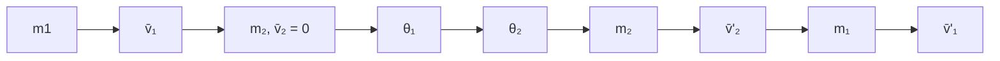

## Anhang 2 Stoßprozesse (collisions) und Streuung (scattering)

Bei Stoß- oder Streuprozessen wird die Wechselwirkung i. Allg. zweier Stoßpartner untersucht. Wenn sich die stoßenden Teilchen (wir nehmen an Massenpunkte, Rotationen können nicht auftreten) genügend nahe kommen, wird ein Wechselwirkungspotenzial wirksam, das meist sehr kurzreichweitig ist und nur vom Abstand der Teilchen abhängt. Bei genügend großem Abstand der Teilchen ist das Wechselwirkungspotenzial unwirksam und die Teilchen bewegen sich (in Abwesenheit äußerer Kräfte) kräftefrei, also gleichförmig geradlinig. Unsere Kenntnis über die atomare und insbesondere subatomare Struktur der Materie stammt wesentlich aus der Untersuchung von Stoßprozessen.

Wir betrachten zunächst den Stoß zweier Teilchen mit den Massen $m _ { 1 }$ und $m _ { 2 } ,$ die vor dem Stoß die Geschwindigkeiten ${ \vec { v } } _ { 1 }$ und $\vec { v } _ { 2 }$ besitzen (Abb. I-2.29). Nach dem Stoß setzen die Teilchen ihre Bahn unter den Winkeln $\theta _ { 1 }$ bzw. $\theta _ { 2 }$ gegen die jeweilige Einfallsrichtung mit den Geschwindigkeiten $\vec { v } _ { 1 } ^ { \prime }$ und $\vec { v } _ { 2 } ^ { \prime }$ fort. Bei der Wechselwirkung ändern beide Teilchen also ihren Impuls, oft auch ihre Energie.

Wirken nur „innere Kräfte“ im System der beiden Köper (abgeschlossenes System), so gilt:59

## 1 Solange keine äußeren Kräfte wirken, bleiben Energie und Impuls des Gesamtsystems immer erhalten.60

Dies soll im folgenden immer gelten.

Auch wenn über die Details der Wechselwirkung beim Stoß nichts bekannt ist, kann man über die Größe und Richtung der Impulse sowie die Energien nach dem Stoß in großer Entfernung von der Wechselwirkungszone, in der das Wechselwirkungspotenzial wirkt, definierte Aussagen machen, die sich auf die Erhaltungssätze stützen:61

Impulssatz:

$$
\underbrace {\vec {p} _ {1} + \vec {p} _ {2}} _ {\text {vor dem Sto} \beta} = m _ {1} \vec {v} _ {1} + m _ {2} \vec {v} _ {2} = \underbrace {\vec {p} _ {1} ^ {\prime} + \vec {p} _ {2} ^ {\prime}} _ {\text {nach dem Sto} \beta} = m _ {1} ^ {\prime} \vec {v} _ {1} ^ {\prime} + m _ {2} ^ {\prime} \vec {v} _ {2} ^ {\prime} = \text {const.} \tag {I-2.133}
$$

<small>59 Siehe Abschnitt 2.4, Gl. (I-2.65) und Band VI, Kapitel „Statistische Physik“, Abschnitt 1.2.3.</small>

<small>60 Der Energiesatz der Mechanik (Gln. I-2.40 und I-2.80) gilt allerdings nur, wenn beim Stoß die innere Energie der Teilchen unverändert bleibt, also bei elastischen Stößen, was bei Stoßexperimenten mit Atomen bzw. Atomkernen (z. B. in der Kernphysik) nicht immer der Fall ist. Wird beim Stoß von den Teilchen Energie als „innere“ Energie (= Anregungsenergie) aufgenommen oder abgegeben, handelt es sich also um einen inelastischen Stoß, muss diese Energie in der Energiebilanz des Stoßprozesses berücksichtigt werden.</small>

<small>61 Man beachte, dass Rechnungen relativistisch erfolgen müssen, wenn die beteiligten Geschwindigkeiten der Lichtgeschwindigkeit c bzw. die kinetischen Energien den Ruheenergien der Teilchen nahe kommen (siehe Band II, Kapitel „Relativistische Mechanik“).</small>

Energiesatz:

$$
E _ {\mathrm{kin}} ^ {1} + E _ {\mathrm{kin}} ^ {2} = \frac {\bar {p} _ {1} ^ {2}}{2 m _ {1}} + \frac {\bar {p} _ {2} ^ {2}}{2 m _ {2}} = E _ {\mathrm{kin}} ^ {\prime 1} + E _ {\mathrm{kin}} ^ {\prime 2} + Q = \frac {\bar {p} _ {1} ^ {\prime 2}}{2 m _ {1} ^ {\prime}} + \frac {\bar {p} _ {2} ^ {\prime 2}}{2 m _ {2} ^ {\prime}} + Q. \tag {I-2.134}
$$

text_image

m₁ → v̄₁ → m₁ → v̄'₁
θ₁ → θ₂
m₂ → v̄₂ → m₂ → v̄'₂
Wechselwirkungspotenzial V ≠ 0

Abb. I-2.29: Stoß zweier Teilchen: $m _ { 1 } ,   \vec { v } _ { 1 }$ und $m _ { 2 } ,   \vec { v } _ { 2 }$

Dabei bezeichnen die gestrichenen Größen $\vec { v } _ { i } ^ { \prime }$ und $\vec { p } _ { i } ^ { \prime }$ die Geschwindigkeiten und Impulse der Teilchen nach dem Stoß. Q stellt die mechanische (kinetische) Energie dar, die beim Stoß in andere Energie umgewandelt wurde, z. B. in „innere Energie“der Stoßpartner (Anregung oder Erwärmung).

Gilt $Q = 0 ,$ , so handelt es sich um einen elastischen Stoß, bei dem die gesamte $E _ { \mathrm { k i n } }$ erhalten bleibt (die $E _ { \mathrm { k i n } }$ der einzelnen Teilchen kann sich ändern). Der vollkommen elastische Stoß ist ein idealer Grenzfall.

Ist $Q \neq 0$ , so liegt ein inelastischer (plastischer) Stoß vor:

$Q > 0;$ die gesamte $E _ { \mathrm { k i n } }$ nach dem Stoß ist kleiner als vorher, ein Teil ist in innere Energie der stoßenden Teilchen (Anregung) umgewandelt worden.

$Q < 0 ;$ innere Energie der Stoßpartner wird in Translationsenergien umgewandelt (Abregung, superelastische Stöße), die $E _ { \mathrm { k i n } }$ zumindest eines der Teilchen ist nach dem Stoß größer als vorher.

Bei reaktiven Stößen ändert sich die Masse der Stoßpartner z. B. durch chem. Reaktionen oder auch deren Anzahl (in der subatomaren Physik bei hochenergetischen Teilchen) durch Erzeugung neuer Teilchen.62

Inelastische und reaktive Stöße sind nur möglich, wenn mindestens ein Stoß- partner eine innere Struktur besitzt, also aus weiteren „Bausteinen“ zusammengesetzt ist. Nur dann kann nämlich $E _ { \mathrm { k i n } }$ in die „innere Energie“ des zusammengesetzten Systems übertragen werden.

<small>62 Beispiel: Beim Stoß des schweren $^{209}_{83} Be-Kerns$ mit D12 (Deuteronen) fliegen nach dem Stoß der 7 (stripping reaction bzw. Oppenheimer-Phillips-Prozess).</small>

## A2.1 Der elastische Stoß (Q = 0) im Laborsystem (laboratory coordinate system)

Das Laborsystem $\Sigma _ { L }$ ist jenes Koordinatensystem, in dem auch das Streuexperiment abläuft. Wir machen die in den meisten Experimenten erfüllte Annahme, dass ein Teilchen vor dem Stoß ruht. Es soll $Q = 0$ sein und die Massen unverändert bleiben (Abb. I-2.30).

flowchart

Abb. I-2.30: Elastischer Stoß im Laborsystem.

Für den Impulssatz gilt in diesem Fall

$$
\vec {p} _ {1} = \vec {p} _ {1} ^ {\prime} + \vec {p} _ {2} ^ {\prime} \tag {I-2.135}
$$

Die Vektoren $\vec { p } _ { 1 }   , \vec { p } _ { 1 } ^ { \prime }$ und $\vec { p } _ { 2 } ^ { \prime }$ müssen daher ein Dreieck bilden und deshalb in einer Ebene liegen. Wir legen zunächst ein Koordinatensystem mit seinem Ursprung O in das ruhende Teilchen 2 so, dass die x-Achse in die Richtung von ${ \vec { v } } _ { 1 }$ weist, dass also für den Impuls des einfallenden Teilchens $\vec { p } _ { 1 } = \{ p _ { x } , 0 , 0 \}$ gilt.63 Da wir den Ursprung O in das vor dem Stoß ruhende Teilchen gelegt haben, wollen wir den Vektor $\vec { p } ^ { \prime } { } _ { 2 }$ von O ausgehen lassen (Abb. I-2.31).

Im Punkt $P ( x , y )$ der Abb. I-2.31 liegen die Spitze von $\vec { p } _ { 2 } ^ { \prime }$ und der Anfangspunkt von $\vec { p } _ { 1 } ^ { \prime }$ . Wir wollen jetzt die Kurve ermitteln, auf der bei vorgegebenem $\vec { \pmb { p } }$ alle möglichen Punkte $P ( x , y )$ liegen.

<small>63 Das vor dem Stoß ruhende Teilchen 2 gibt einen festen Punkt im Koordinatensystem an. Die folgende Rechnung kann ganz analog auch für das Teilchen 1 geführt werden, wenn die Teilchengeschwindigkeiten vor dem Stoß durch eine Galileitransformation so abgeändert werden, dass υ⇀1 = 0 wird. Es lässt sich immer eine Transformation finden, die die Geschwindigkeit eines Teilchens zu Null reduziert.</small>

text_image

y
P(x,y)
\vec{p}'_2 = m_2 \vec{v}'_2
y
\vec{p}'_1 = m_1 \vec{v}'_1
x
O
A
x

Abb. I-2.31: Der Impulssatz (Gl. I-2.135) verlangt, dass die Impulsvektoren $\vec { p } _ { 1 } , \vec { p } _ { 1 } ^ { \prime }$ und $\vec { p _ { 2 } } ^ { ' }$ ein Dreieck bilden müssen und daher in einer Ebene liegen.

Aus Abb. I-2.31 ergibt sich:

$$
x ^ {2} + y ^ {2} = p _ {2} ^ {\prime 2} \tag {I-2.136}
$$

und

$$
(p _ {1} - x) ^ {2} + y ^ {2} = p _ {1} ^ {\prime 2}. \tag {I-2.137}
$$

Wir setzen nun $p _ { 1 } ^ { \prime 2 }$ aus dem Energiesatz (Gl. I-2.134) $\frac{p_{1}^{2}}{2 m_{1}}=\frac{p_{1}^{\prime 2}}{2 m_{1}}+\frac{p_{2}^{\prime 2}}{2 m_{2}} \quad(p_{2}=0)$ $Q = 0 )$ in Gl. (I-2.137) ein und verwenden dabei $p _ { 2 } ^ { \prime 2 }$ aus Gl. (I-2.136). Damit erhalten wir

$$
(p _ {1} - x) ^ {2} + y ^ {2} = p _ {1} ^ {2} - \frac {m _ {1}}{m _ {2}} p _ {2} ^ {\prime 2} = p _ {1} ^ {2} - \frac {m _ {1}}{m _ {2}} (x ^ {2} + y ^ {2}) \tag {I-2.138}
$$

bzw.

$$
\begin{array}{l} p _ {1} ^ {2} - 2 p _ {1} x + x ^ {2} + y ^ {2} - p _ {1} ^ {2} + \frac {m _ {1}}{m _ {2}} x ^ {2} + \frac {m _ {1}}{m _ {2}} y ^ {2} = \\ = x ^ {2} \left(\frac {m _ {1}}{m _ {2}} + 1\right) + y ^ {2} \left(\frac {m _ {1}}{m _ {2}} + 1\right) - 2 p _ {1} x = \\ = x ^ {2} + y ^ {2} - 2 \frac {m _ {2}}{m _ {1} + m _ {2}} p _ {1} x = 0 \cdot \tag {I-2.139} \\ \end{array}
$$

Nach addieren von $\left( \frac { m _ { 2 } } { m _ { 1 } + m _ { 2 } }   p _ { 1 } \right) ^ { 2 }$ auf beiden Seiten können wir schreiben

$$
\left(x - \frac {m _ {2}}{m _ {1} + m _ {2}} p _ {1}\right) ^ {2} + y ^ {2} = \left(\frac {m _ {2}}{m _ {1} + m _ {2}} p _ {1}\right) ^ {2} \tag {I-2.140}
$$

oder mit der reduzierten Masse $\mu = \frac { m _ { 1 }   m _ { 2 } } { m _ { 1 } + m _ { 2 } }$

$$
\left(x - \mu v _ {1}\right) ^ {2} + y ^ {2} = \left(\mu v _ {1}\right) ^ {2}. \tag {I-2.141}
$$

Das ist eine Kreisgleichung mit Radius $\boldsymbol{r}=\frac{m_{2}}{m_{1}+m_{2}} \boldsymbol{p}_{1}=\frac{1}{1+\frac{m_{1}}{m_{2}}} \boldsymbol{p}_{1}=\mu \boldsymbol{v}_{1}$ um den

Mittelpunkt M mit dem Abstand vom Ursprung O. Die möglichen Punkte $P ( x , y )$ , d. h. die Spitzen aller möglichen Vektoren $\vec { p } _ { 2 } ^ { \prime }$ , liegen auf diesem Kreis (Abb. I-2.32).64 Als Streuwinkel bezeichnet man den Winkel $\theta _ { 1 } = \angle ( \vec { p } _ { 1 } , \vec { p } _ { 1 } ^ { \prime } )$ zwischen den Impulsen $\vec { p } _ { 1 }$ und $\vec { p } _ { 1 } ^ { \prime }$ des Teilchens 1 vor und nach dem Stoß.65

Wir betrachten folgende Fälle:

Dieser Fall entspricht der obigen Abb. I-2.32; das Ende des Impulsvektors des Teilchens 1 vor dem Stoß (in x-Richtung) liegt außerhalb des Kreises mit Radius $\mu \upsilon _ { 1 }$ um M. In diesem Fall gibt es bei vorgegebenem $\vec { p } _ { 1 }$ einen maximalen Streuwinkel $\theta _ { 1 } ^ { \mathrm { m a x } }$ . Aus Abb. I-2.32 folgt für $\theta _ { 1 } ^ { \mathrm { m a x } }$

$$
\begin{array}{l} \sin \theta_ {1} ^ {\max} = \frac {\mu v _ {1}}{p _ {1} - \mu v _ {1}} = \frac {\mu v _ {1}}{(m _ {1} - \mu) v _ {1}} = \frac {\mu}{m _ {1} - \mu} = \frac {1}{\frac {m _ {1}}{\mu} - 1} = \\ = \frac {1}{\frac {m _ {1} (m _ {1} + m _ {2})}{m _ {1} m _ {2}} - \frac {m _ {2}}{m _ {2}}} = \frac {m _ {2}}{m _ {1}} <   1. (I-2.142) \\ \Rightarrow 0 \leq \theta_ {1} \leq \theta_ {1} ^ {\max} <   \frac {\pi}{2}, (I-2.143) \\ \end{array}
$$

<small>64 Im Raum ist die von uns gewählte Zeichenebene, also das Dreieck {p⇀1, p⇀′1, p⇀′2 }, durch nichts ausgezeichnet und kann daher um jeden beliebigen Winkel um p⇀1 gedreht werden ⇒ im Raum liegen die Spitzen aller möglichen Vektoren p⇀′2 auf einer Kugel, die durch Drehung des beschriebenen Kreises um p⇀1 entsteht.</small>

<small>65 Für punktförmige Teilchen, die nur beim unmittelbaren Zusammenstoß miteinander wechselwirken, kann über den sich einstellenden Ablenkwinkel (Streuwinkel θ1) nichts ausgesagt werden. Nur die in Abb. I-2.32 dargestellte Beziehung zwischen p⇀1, p⇀′1 und p⇀′2 muss stets erfüllt sein.</small>

das heißt, in diesem Fall findet die Streuung nur in Vorwärtsrichtung statt, unabhängig von der Art der Wechselwirkung der beiden Teilchen.

text_image

O
θ₂
M
μv₁ = \frac{m₂}{m₁ + m₂} p₁ = r
P(x,y)
θ₁max
θ₁
A
P′₁
P′₂
θ₁

Abb. I-2.32: Impulsdiagramm für den elastischen Stoß im Laborsystem mit $m _ { 1 } \succ m _ { 2 } ;$ das Teilchen mit Masse $m _ { 2 }$ ruht vor dem Stoß. Aus Impuls und Energiesatz folgt, dass die Spitzen aller möglichen Impulsvektoren ${ \vec { p } } _ { 2 } ^ { \prime }$ des gestoßenen Teilchens 2 auf einem Kreis mit Radius $\mu { \cal U } _ { 1 } = \frac { m _ { 2 } } { m _ { 1 } + m _ { 2 } } \; p _ { 1 }$ um M im Abstand $\mu { \boldsymbol { U } } _ { 1 }$ von O liegen müssen. Die zum maximalen Streuwinkel $\theta _ { 1 } ^ { \mathsf { m a x } }$ gehörenden Impulsvektoren ${ \vec { p } } _ { 1 } ^ { \prime }$ und $\vec { p } _ { 2 } ^ { \prime }$ sind blau gezeichnet.

| $m_{1}/m_{2}$ | $\theta_{1}^{\max}$(Grad) |
| --- | --- |
| 1 | $90^{\circ\ 66}$ |
| 1,5 | $41,8^{\circ}$ |
| 2 | $30^{\circ}$ |
| 10 | $5,7^{\circ}$ |
| 100 | $0,6^{\circ}$ |
| 1000 | $0,06^{\circ}$ |

Die maximal an das Teilchen 2 übertragene Energie $E _ { 2 \mathrm { m a x } } ^ { \prime }$ ergibt sich für den kollinearen Stoß, für den $p _ { 2 \mathrm { m a x } } ^ { \prime } = 2 r = \frac { 2 m _ { 2 } } { m _ { 1 } + m _ { 2 } }   p _ { 1 }$ gilt. ⇒

$$
E _ {2 \max} ^ {\prime} = \frac {p _ {2 \max} ^ {\prime}}{2 m _ {2}} = \frac {4 r ^ {2}}{2 m _ {2}} = \frac {4 m _ {2} ^ {2}}{\left(m _ {1} + m _ {2}\right) ^ {2}} \cdot \frac {p _ {1} ^ {2}}{2 m _ {2}} = \frac {4 m _ {1} m _ {2}}{\left(m _ {1} + m _ {2}\right) ^ {2}} E _ {1} \Rightarrow \text {f ü r} m _ {2} = 0 \text {und} m _ {2} = \infty
$$

<small>66 Dies ist ein singulärer Fall, der nur im Grenzfall p⇀′1 % 0 möglich ist ⇒ der gesamte Impuls p⇀1 % 0 wird an das Teilchen 2 übergeben, p⇀′2 = p⇀1 (siehe auch Fall 3 mit m1 = m2).</small>

(feste Wand) ist die übertragene Energie 0. $E _ { \mathrm { 2 m a x } } ^ { \prime }$ ist natürlich auch gleich dem maximalen Energieverlust des stoßenden Teilchens 1 (für $m _ { 1 }   = m _ { 2 }$ wird die gesamte Energie übertragen). Dies gilt auch für die Fälle 2, 3 und 4.

2. $m _ { 1 } < m _ { 2 }$ , also $p _ { 1 } < 2 r$ (Abb. I-2.33)

Wie aus Abb. I-2.33 zu entnehmen ist, sind in diesem Fall alle Streuwinkel $\theta _ { 1 }$ zwischen 0 und π möglich, also

$$
0 \leq \theta_ {1} \leq \pi \tag {I-2.144}
$$

text_image

p̅₂
p̅₁'
p̅₁ M
θ₁

Abb. I-2.33: Impulsdiagramm für den elastischen Stoß im Laborsystem mit $m _ { 1 } \lessdot m _ { 2 }$ , also $p _ { 1 } \ltimes 2   r _ { \circ }$

3. $m _ { 1 } = m _ { 2 } = m$ , also $p_{1}=2r\left(\mathrm{Abb}.\mathrm{I}-2.34\right)$

Für $m _ { 1 }   = m _ { 2 }$ beträgt der Winkel $\theta _ { 1 } + \theta _ { 2 }$ zwischen $\vec { p } _ { 1 } ^ { \prime }$ und $\vec { p } _ { 2 } ^ { \prime }$ gerade $\%$ , der Stoßkreis stellt für ${ \vec { p } } _ { 1 } ^ { \prime }$ und $\vec { p } _ { 2 } ^ { \prime }$ einen Thaleskreis dar.

Ein Spezialfall ist der zentrale (kollineare) Stoß, bei dem das Teilchen 2 in der Richtung des stoßenden Teilchens 1 weiterfliegt (der gemeinsame Schwerpunkt der beiden Teilchen liegt auf der Stoßlinie). Dann gilt (siehe Abb. I-2.34)

$$
\vec {p} _ {2} ^ {\prime} = \vec {p} _ {1} \quad \text {und damit} \quad \vec {p} _ {1} ^ {\prime} = 0. \tag {I-2.145}
$$

In diesem Fall übernimmt Teilchen 2 von Teilchen 1 den gesamten Impuls und Teilchen 1 ruht nach dem Stoß. Ebenso wird die gesamte kinetische Energie vom stoßenden Teilchen vollständig an das gestoßene übertragen. Zur Abbremsung eines Teilchens durch Energieübergabe an einen Stoßpartner ist also ein etwa gleich schweres am besten geeignet.67

text_image

P̅₂
P̅₁'
θ₂
M
P̅₁
θ₁
θ₁

Abb. I-2.34: Impulsdiagramm für den elastischen Stoß im Laborsystem mit $m _ { 1 } = m _ { 2 }$ , also $p _ { 1 } = 2   r .$

4. $m _ { 1 } \ll m _ { 2 }$ (Stoß gegen eine feste Wand); aus $r = \frac { m _ { 2 } } { m _ { 1 } + m _ { 2 } }   p _ { 1 }$ folgt $p_{1}=r\left ( \mathrm{Abb} \right )$ I-2.35)

Der maximale Impulsübertrag von Teilchen 1 auf Teilchen 2 (Wand) ergibt sich, wenn für $p _ { 2 } ^ { \prime }$ gilt

$$
p _ {2} ^ {\prime} = 2 \mu v _ {1},
$$

das Teilchen 2 also einen Impuls in Richtung des einfallenden Teilchens aufnimmt (kollinearer Stoß).

<small>67 Neutronen übertragen beim kollinearen Stoß ihre gesamte Energie an Wasserstoffkerne (Protonen), die in einem Zählrohr nachgewiesen werden können, was 1932 zu ihrer Entdeckung führte. Walter Bothe und Herber Becker entdeckten zunächst eine ungewöhnliche Strahlung, die beim Beschuss von B4 e mit α-Teilchen entstand: sie war durchdringend wie γ-Strahlung und konnte leichte Atome in Bewegung versetzen. Irène und Frédéric Joliot-Curie stellten dann fest, dass diese „Strahlung“ aus einer wasserstoffhaltigen Substanz, z. B. Paraffin, Protonen auslösen kann. James Chadwick entdeckte schließlich, dass die „Strahlung“ aus massiven, neutralen Teilchen mit der Masse des Protons bestehen musste und nannte sie Neutronen.</small>

<small>Im statistischen Mittel aller möglichen Energieübertragungen sind mit H1 18 Zusammenstöße nötig, um die Energie eines 2 MeV-Neutrons auf Raumtemperatur (entspricht 0,025 eV) zu verringern. Mit dem wegen seines viel kleineren Einfangquerschnitts für Neutronen für kernphysikalische Anwendungen wesentlich günstigeren Deuterium ( H1 ) sind dagegen im Mittel 24 Stöße erforderlich (siehe auch Band V, Kapitel „Subatomare Physik“, Abschnitt 3.1.5.2.5).</small>

text_image

p̅₂
p̅₁'
p̅₁
μν₁
M
θ₁
μν₁

Abb. I-2.35: Impulsdiagramm für den elastischen Stoß im Laborsystem mit $m _ { 1 } \ll m _ { 2 } ,$ also $p _ { 1 } = r$ (Stoß gegen eine feste Wand).

Im Falle $m _ { 2 } \gg m _ { 1 }$ ergibt sich für die reduzierte Masse

$$
\mu = \frac {m _ {1} m _ {2}}{m _ {1} + m _ {2}} = \frac {m _ {1} m _ {2}}{m _ {2}} = m _ {1}
$$

und somit für die maximale Impulsübertragung

$$
p _ {2, \max} ^ {\prime} = 2 m _ {1} v _ {1} = 2 p _ {1}, \quad \text { also } \quad \theta_ {1} = \pi ; \tag {I-2.146}
$$

das Teilchen 1 gibt an die Wand also den doppelten Impuls ab! Es fliegt aber infolge der Impulserhaltung mit seinem ursprünglichen Impulsbetrag in die Gegenrichtung zurück – es wird an der Wand reflektiert.

Für den Energieübertrag an die Wand gilt

$$
\Delta E _ {\mathrm{kin}} = \frac {p _ {2} ^ {\prime 2}}{2 m _ {2}} = \frac {(2 p _ {1}) ^ {2}}{2 m _ {2}} = \frac {4 m _ {1} ^ {2} v _ {1} ^ {2}}{2 m _ {2}} = 4 \frac {m _ {1}}{m _ {2}} E _ {1}. \tag {I-2.147}
$$

Wenn also $m _ { 2 } \rightarrow$ ∞ geht, so folgt $\Delta E _ { \mathrm { k i n } } \rightarrow 0$ , das heißt, das Teilchen „prallt“ von Wand ab, ohne Energie zu übertragen. Auch für alle anderen Streuwinkel $\theta _ { 1 } \neq \pi$ bleibt der Impulsbetrag $p _ { 1 }$ (also auch die Energie) des einfallenden Teilchens erhalten; nur der an die $, \mathrm { W a n d } ^ { \mathrm { { \textleftarrow } } } m _ { 2 }$ übertragene Impuls variiert.

Aus dem Dargestellten ergibt sich, dass die alleinige Anwendung des Energieund Impulssatzes nach Ablauf des Stoßvorganges (die Teilchen sind wieder außerhalb der Reichweite der Wechselwirkungskräfte), also ohne detaillierte Berücksichtigung des Wechselwirkungspotenzials (siehe Abschnitt $\mathrm { A } 2 . 4$ „Potenzialstreuung“) keine expliziten Werte für die Impulse $p _ { 1 } ^ { \prime }$ und $p _ { 2 } ^ { \prime }$ nach dem Stoß liefert, sondern nur in jedem Falle unter Berücksichtigung des Massenverhältnisses $m _ { 1 } / m _ { 2 }$ einzuhaltende Relationen zwischen ihnen: $\pmb { \mathscr { N } }$ enn $p _ { 1 } ^ { \prime }$ eintritt, dann hat $p _ { 2 } ^ { \prime }$ den berechneten $\mathtt { W e r t ^ { \acute { e } } }$

## A2.2 Elastischer Stoß (Q = 0) im Schwerpunktsystem (centre of mass system)

Stoßprozesse lassen sich meist einfacher im Schwerpunktsystem beschreiben, besonders wenn kein Stoßpartner ruht. Im Schwerpunktsystem $( \Sigma _ { S } )$ ruht der Massenmittelpunkt S (Schwerpunkt) des betrachteten Teilchensystems, er ist der Ursprung des Koordinatensystems.

Für die Koordinaten des Massenmittelpunkts (Schwerpunkts, Abb. I-2.36) und seine Geschwindigkeit gilt allgemein im Laborsystem (siehe Abschnitt 2.4.1, Gl. (I-2.63): $M \cdot \vec { r } _ { S } = { \sum _ { i } } m _ { i } \vec { r } _ { i }   )$ für 2 beteiligte Massen $m _ { 1 }$ und $m _ { 2 }$

$$
\vec {r} _ {S} = \frac {m _ {1} \vec {r} _ {1} + m _ {2} \vec {r} _ {2}}{m _ {1} + m _ {2}} \Rightarrow \vec {v} _ {S} = \dot {\vec {r}} _ {S} = \frac {m _ {1} \vec {v} _ {1} + m _ {2} \vec {v} _ {2}}{m _ {1} + m _ {2}} = \text {const.} \tag {I-2.148}
$$

Der Übergang vom Laborsystem $( \Sigma _ { L } )$ zum Schwerpunktsystem $( \Sigma _ { S } )$ und umgekehrt erfolgt durch die Galileitransformation (Abschnitt 2.3.1, Gl. I-2.41)

$$
\vec {r} _ {\Sigma_ {S}} (t) = \vec {r} _ {\Sigma_ {L}} (t) - \vec {v} _ {S} t \quad \text {und} \quad \vec {v} _ {\Sigma_ {S}} (t) = \vec {v} _ {\Sigma_ {L}} (t) - \vec {v} _ {S}. \tag {I-2.149}
$$

Damit ergeben sich als Ortsvektoren der Teilchen $m _ { 1 }$ und $m _ { 2 }$ im Schwerpunktsystem $\vec { r } _ { 1 } ^ { S } = \vec { r } _ { 1 } - \vec { v } _ { S } \cdot t$ und $\vec { r } _ { 2 } ^ { S } = \vec { r } _ { 2 } - \vec { \upsilon } _ { S }   \cdot$ t oder $\vec { r } _ { 1 } ^ { S } = \vec { r } _ { 1 } - \vec { r } _ { S }$ und $\vec { r } _ { 2 } ^ { S } = \vec { r } _ { 2 } - \vec { r } _ { S }$ mit $\vec { \upsilon } _ { S } \cdot t = \vec { r } _ { S }$ , wobei $\vec { r } _ { S } = 0$ für $t = 0$ gesetzt wurde; ist also im Laborsystem $\vec { r } = \vec { r } _ { S }$ , dann ist im Schwerpunktsystem $\vec { r } _ { S } ^ { S } = \vec { r } _ { S } - \vec { r } _ { S } = 0$

Man beachte, dass im jetzigen Fall eines Systems stoßender Körper im Schwerpunktsystem (Schwerpunkt ruht) sich alle Vektoren mit Ausnahme von $\vec { r } _ { S }$ mit der Zeit ändern!

text_image

m₁
r̅₁(t)
r̅₁ˢ
r̅₁₂
S
r̅₂ˢ
r̅ₛ = vₛ · t
m₂
r̅₂(t)
O

Abb. I-2.36: Ortsvektoren der Teilchen und Ortsvektor zum Schwerpunkt im Laborsystem (zentraler Stoß).

Der Abstand der Teilchen ist durch den Relativvektor

$$
\vec {r} _ {1 2} = \vec {r} _ {1} - \vec {r} _ {2} = \vec {r} _ {1} ^ {S} - \vec {r} _ {2} ^ {S} \tag {I-2.150}
$$

gegeben, mit dem sich die Schwerpunktsabstände $\bar { r } _ { 1 } ^ { S }$ und $\bar { r } _ { 2 } ^ { S }$ wie folgt ergeben (siehe Abb. I-2.36):

$$
\begin{array}{l} \vec {r} _ {1} ^ {S} = \vec {r} _ {1} - \vec {r} _ {S} = \vec {r} _ {1} - \frac {m _ {1} \vec {r} _ {1} + m _ {2} \vec {r} _ {2}}{m _ {1} + m _ {2}} = \frac {m _ {1} \vec {r} _ {1} + m _ {2} \vec {r} _ {1} - m _ {1} \vec {r} _ {1} - m _ {2} \vec {r} _ {2}}{m _ {1} + m _ {2}} = \\ = \frac {m _ {2}}{m _ {1} + m _ {2}} \underbrace {\left(\vec {r} _ {1} - \vec {r} _ {2}\right)} _ {\vec {r} _ {1 2}}, \tag {I-2.151} \\ \end{array}
$$

also

$$
\vec {r} _ {1} ^ {S} = \frac {m _ {2}}{m _ {1} + m _ {2}} \vec {r} _ {1 2} \quad \text {und} \quad \vec {r} _ {2} ^ {S} = - \frac {m _ {1}}{m _ {1} + m _ {2}} \vec {r} _ {1 2}. \tag {I-2.152}
$$

Da im Schwerpunktsystem $\Sigma _ { S }$ der Schwerpunkt der beiden Teilchen ruht, müssen die Teilchen einander auf parallelen Geraden mit verschiedener Geschwindigkeit entgegenlaufen;68 fallen die Geraden zusammen, so handelt es sich um einen zentralen Stoß, haben sie einen endlichen Abstand $b ,$ ist es ein exzentrischer Stoß, es tritt ein Stoßparameter b auf, der bei Teilchen mit weitreichender Wechselwirkung den Streuwinkel bestimmt. Nach dem Stoß kehren die Teilchen ihre Bewegungsrichtung beim zentralen Stoß um oder entfernen sich beim exzentrischen Stoß auf parallelen Geraden, die mit den ursprünglichen Richtungen einen Winkel bilden, der vom Stoßparameter abhängt (Abb. I-2.37). Die Einführung des Stoßparameters b bietet, wie wir später sehen werden (Anhang A2.4.1), die Möglichkeit, den Ablenkwinkel $\theta _ { 1 }$ bei bekanntem Wechselwirkungspotenzial zu berechnen.

Da der Gesamtimpuls vor und nach dem Stoß im Schwerpunktsystem = 0 sein muss (siehe Gl. I-2.65), gilt für den Impulssatz in $\Sigma _ { S }$

$$
0 = \bar {p} _ {1} ^ {S} + \bar {p} _ {2} ^ {S} = \bar {p} _ {1} ^ {\prime S} + \bar {p} _ {2} ^ {\prime S} \Rightarrow \bar {p} _ {1} ^ {S} = - \bar {p} _ {2} ^ {S}, \bar {p} _ {1} ^ {\prime S} = - \bar {p} _ {2} ^ {\prime S}. \tag {I-2.153}
$$

Für den Energiesatz mit Energieumwandlung folgt aus $\frac { ( \vec { p } _ { 1 } ^ {   S } ) ^ { 2 } } { 2 m _ { 1 } } + \frac { ( \vec { p } _ { 2 } ^ {   S } ) ^ { 2 } } { 2 m _ { 2 } } =$ $\frac { ( \vec { p ^ { \prime } } _ { 1 } ^ { S } ) ^ { 2 } } { 2 m _ { 1 } ^ { \prime } } + \frac { ( \vec { p ^ { \prime } } _ { 2 } ^ { S } ) ^ { 2 } } { 2 m _ { 2 } ^ { \prime } } + Q$

$$
\frac {1}{2} \Bigg (\frac {1}{m _ {1}} + \frac {1}{m _ {2}} \Bigg) (p _ {1} ^ {s}) ^ {2} = \frac {1}{2} \Bigg (\frac {1}{m _ {1}} + \frac {1}{m _ {2}} \Bigg) (p _ {1} ^ {s}) ^ {2} + Q \tag {I-2.154}
$$

<small>68 r⇀̇SS = υ⇀SS = m1 υ⇀1S + m2 υ⇀2S= 0 ⇒ υ⇀1S = m2⋅ υ⇀S . m1 + m2 m1</small>

Abb. I-2.37: Exzentrischer Stoß $( b \neq 0 )$ im Laborsystem $\mathfrak { C } _ { L }$ , links) und im Schwerpunktsystem $\scriptstyle \sum S$ , rechts). Der Relativvektor $\vec { r } _ { 1 2 } ( t ) = \vec { r } _ { 1 } - \vec { r } _ { 2 } = \vec { r } _ { 1 } ^ { S } - \vec { r } _ { 2 } ^ { S }$ ist als Differenzvektor in beiden Systemen gleich, er dreht sich im Verlauf des Streuprozesses um $\pi - \theta _ { S }$

bzw. unter Verwendung der reduzierten Masse $\mu = \frac { m _ { 1 }   m _ { 2 } } { m _ { 1 } + m _ { 2 } }$

$$
\frac {(p _ {1} ^ {S}) ^ {2}}{2 \mu} = \frac {(p _ {1} ^ {S}) ^ {2}}{2 \mu} + Q. \tag {I-2.155}
$$

Für elastische Streuung ist $Q = 0$ , daher gilt

$$
(p _ {1} ^ {\prime S}) ^ {2} = (p _ {1} ^ {S}) ^ {2} = (p _ {2} ^ {\prime S}) ^ {2} = (p _ {2} ^ {S}) ^ {2}, \tag {I-2.156}
$$

d. h. im Schwerpunktsystem sind die Impulse und die Energien beider Stoßpartner vor und nach dem Stoß untereinander gleich. Damit besteht der elastische Stoß in $\Sigma _ { S }$ in einer bloße Drehung der Impulsvektoren, wobei die Impulse der beiden Teilchen entgegengesetzt gleich (Gesamtimpuls = 0) und sämtliche Streuwinkel $\theta _ { S }$ mit $0 \leq \theta _ { S } \leq \pi$ erlaubt sind (Abb. I-2.38).

Da der Streuwinkel praktisch immer im Laborsystem $\Sigma _ { L }$ gemessen wird, fragen wir nach der Transformation von $\theta _ { S }$ (Streuwinkel in $\Sigma _ { S } )$ nach $\theta _ { 1 }$ (Streuwinkel in $\Sigma _ { L } )$ . Wir betrachten dazu nochmals einen elastischen Stoß, bei dem das Teilchen 2 anfänglich ruht, also $\vec { v _ { 2 } } = 0$

Für die Bewegung des Schwerpunkts zweier Teilchen gilt allgemein (Gl. I-2.148)

$$
\vec {v} _ {S} = \frac {m _ {1} \vec {v} _ {1} + m _ {2} \vec {v} _ {2}}{m _ {1} + m _ {2}}
$$

und daher im vorliegenden Fall mit $\vec { v _ { 2 } } = 0$

$$
\vec {v} _ {S} = \frac {m _ {1}}{m _ {1} + m _ {2}} \vec {v} _ {1}. \tag {I-2.157}
$$

text_image

p̄₁'S
θₛ
p̄₁'S
p̄₂'S
p̄₂'S
φ

Abb. I-2.38: Elastischer Stoß im Schwerpunktsystem $\Sigma _ { S } .$ Der Streuwinkel $\theta _ { S }$ kann beliebige Werte $0 \leq \theta _ { S } \leq \pi$ annehmen. Der „Azimutwinkel“ φ hat für die Berechnung keine Bedeutung, da alle Impulse in einer Ebene, der Streuebene liegen.

Für den Ortsvektor eines Teilchens im Schwerpunktsystem $\Sigma _ { S }$ gilt (Gl. I-2.151)

$$
\vec {r} _ {1} ^ {S} = \vec {r} _ {1} - \vec {r} _ {S}
$$

(Abb. I-2.39):

text_image

ΣL
ΣS
m1
r̅1
r̅1S
S
r̅S
O

Abb. I-2.39: Ortsvektoren eines Teilchens im Labor- $( \Sigma _ { L } )$ und im Schwerpunktsystem $( \Sigma _ { S } )$

Daraus ergibt sich die Transformation der Geschwindigkeit von $\Sigma _ { L }$ in $\Sigma _ { S }$ zu

$$
\vec {v} _ {1} ^ {S} = \vec {v} _ {1} - \vec {v} _ {S} \quad \text {und} \quad \vec {v} _ {2} ^ {S} = \vec {v} _ {2} - \vec {v} _ {S}, \tag {I-2.158}
$$

die vor und nach dem Stoß gelten muss.

Vor dem Stoß bewegt sich nur Teilchen 1 $\left( \vec { v } _ { 1 } \neq 0 , \vec { v } _ { 2 } = 0 \right)$

text_image

v̅₁
v̅₁ˢ
v̅ₛ

Nach dem Stoß bewegen sich beide Teilchen $\left( \vec { v } _ { 1 } ^ { \prime } \neq 0 , \vec { v } _ { 2 } ^ { \prime } \neq 0 \right)$ ; es gilt daher für ${ \vec { v } } _ { 1 } ^ { \prime }$ die Vektorgleichung (Abb. I-2.40)

$$
\vec {v} _ {1} ^ {\prime} = \vec {v} _ {1} ^ {\prime S} + \vec {v} _ {S}: \tag {I-2.159}
$$

text_image

v̅₁'S
θ₁
v̅₁'S cos θ_S
v̅₁'S sin θ_S = v̅₁'sin θ₁
v̅₁'

Abb. I-2.40: Geschwindigkeitsvektoren nach dem Stoß.

Der Abb. I-2.40 entnehmen wir:

$$
\tan \theta_ {1} = \frac {\nu_ {1} ^ {\prime S} \sin \theta_ {S}}{\nu_ {1} ^ {\prime S} \cos \theta_ {S} + \nu_ {S}} = \frac {\sin \theta_ {S}}{\cos \theta_ {S} + \frac {\nu_ {S}}{\nu_ {1} ^ {\prime S}}} = \frac {\sin \theta_ {S}}{\cos \theta_ {S} + \frac {\nu_ {S}}{\nu_ {1} ^ {S}}}, \tag {I-2.160}
$$

da nach dem Energiesatz gilt (Gl. I-2.156)

$$
(p _ {1} ^ {\prime S}) ^ {2} = (p _ {1} ^ {S}) ^ {2} \quad \Rightarrow \quad v _ {1} ^ {\prime S} = v _ {1} ^ {S}.
$$

Da aber $\upsilon _ { S } = \frac { m _ { 1 } } { m _ { 1 } + m _ { 2 } }   \upsilon _ { 1 }$ und $\boldsymbol { \upsilon } _ { 1 } = \boldsymbol { \upsilon } _ { 1 } ^ { S } + \boldsymbol { \upsilon } _ { S }$ , folgt

$$
\nu_ {S} = \frac {m _ {1}}{m _ {1} + m _ {2}} \nu_ {1} = \frac {m _ {1}}{m _ {1} + m _ {2}} \left(\nu_ {1} ^ {S} + \nu_ {S}\right) \tag {I-2.161}
$$

also

$$
\nu_ {S} \left(1 - \frac {m _ {1}}{m _ {1} + m _ {2}}\right) = \nu_ {1} ^ {S} \frac {m _ {1}}{m _ {1} + m _ {2}} \quad \text {oder} \quad \nu_ {S} \frac {m _ {2}}{m _ {1} + m _ {2}} = \nu_ {1} ^ {S} \frac {m _ {1}}{m _ {1} + m _ {2}} \tag {I-2.162}
$$

und daher

$$
\frac {v _ {S}}{v _ {1} ^ {S}} = \frac {m _ {1}}{m _ {2}}. \tag {I-2.163}
$$

Für die Transformation des Streuwinkels aus $\Sigma _ { S }$ in $\Sigma _ { L }$ erhalten wir also

$$
\tan \theta_ {1} = \frac {\sin \theta_ {S}}{\cos \theta_ {S} + \frac {m _ {1}}{m _ {2}}} \quad \begin{array}{l l} & \text {Transformation des Streuwinkels} \theta_ {S} \\ & \text {aus dem Schwerpunkt- ins} \\ & \text {Laborsystem.} \end{array} \tag {I-2.164}
$$

Umgekehrt folgt daraus für die Transformation des Streuwinkels $\theta _ { 1 }$ aus dem Laborsystem $\Sigma _ { L }$ ins Schwerpunktsystem $\Sigma _ { S }$

$$
\cos \theta_ {S} = - \frac {m _ {1}}{m _ {2}} \left(1 - \cos^ {2} \theta_ {1}\right) + \cos \theta_ {1} \sqrt {1 - \left(\frac {m _ {1}}{m _ {2}}\right) ^ {2} \left(1 - \cos^ {2} \theta_ {1}\right)}. ^ {6 9} \tag {I-2.164a}
$$

Für $m _ { 1 } \ll m _ { 2 }$ (Stoß gegen eine feste Wand) ergibt sich daher $\theta _ { 1 } = \theta _ { S }$ . Dies folgt sofort aus $\vec { \upsilon } _ { S } = \frac { m _ { 1 } } { m _ { 1 } + m _ { 2 } }   \vec { \upsilon } _ { 1 } \approx \frac { m _ { 1 } } { m _ { 2 } }   \vec { \upsilon } _ { 1 } \approx 0 .$ und Beachtung der Abb. I-2.40.

<small>69 Quadrieren von Gl. (I-2.164) ergibt tan $\hbar ^ { 2 } \theta _ { 1 } \left( \cos \theta _ { S } + \frac { m _ { 1 } } { m _ { 2 } } \right) ^ { 2 } = ( 1 - \cos ^ { 2 } \theta _ { S } ) ;$ mit cos2θS multipliziert folgt daraus nach umformen die quadratische Gleichung für θS</small>

<small>cos2θS + 2 sin 2 θ1 m1 ⋅cos θS + 4 (sin θ1 m1 2 − cos2θ1 = 0 mit der Lösung m2 m2</small>

<small>cos θS = − sin2 θ1 m1 ± cos θ1 1 − (sin θ1 m1) 2 . Für m1 ≪ m2 muss gelten θ1 = θS ⇒ nur die Lösung m2 m2 mit positiver Wurzel ist physikalisch sinnvoll.</small>

## A2.3 Inelastischer Stoß (Q ≠ 0)

Beim inelastischen Stoß mit $Q > 0$ wird ein Teil der mechanischen Energie in andere Energieformen umgewandelt, ist $Q < 0$ , so wird ein Teil der inneren Teilchenenergien in (zusätzliche) Translationsenergie verwandelt. Wir behandeln zwei Extrem fälle, den maximal inelastischen Stoß (Teilcheneinfang) und den Teilchenzerfall.

## A2.3.1 Maximal inelastischer Stoß, Teilcheneinfang $( Q > 0 )$

In diesem Fall bleiben beide Stoßpartner nach dem Stoß zusammen und bewegen sich mit der Schwerpunktgeschwindigkeit $\vec { \nu } _ { S }$ , also

$$
\vec {v} _ {1} ^ {\prime} = \vec {v} _ {2} ^ {\prime} = \vec {v} _ {S} = \frac {1}{M} \sum_ {i} m _ {i} \vec {v} _ {i} = \frac {1}{m _ {1} + m _ {2}} \left(m _ {1} \vec {v} _ {1} + m _ {2} \vec {v} _ {2}\right). \tag {I-2.165}
$$

Wenn Teilchen 2, wie bisher angenommen, vor dem Stoß ruht, muss daher gelten

$$
\vec {v} _ {1} ^ {\prime} = \vec {v} _ {1} \frac {m _ {1}}{m _ {1} + m _ {2}} = \vec {v} _ {2} ^ {\prime}. \tag {I-2.166}
$$

Damit erhalten wir

$$
\vec {p} _ {1} ^ {\prime} = m _ {1} \vec {v} _ {1} ^ {\prime} = \frac {\mu}{m _ {2}} \vec {p} _ {1} \quad \text {und} \quad \vec {p} _ {2} ^ {\prime} = m _ {2} \vec {v} _ {2} ^ {\prime} = m _ {2} \vec {v} _ {1} ^ {\prime} = \frac {\mu}{m _ {1}} \vec {p} _ {1}. \tag {I-2.167}
$$

$\vec { p } _ { 1 }$ und $\vec { p } _ { 1 } ^ { \prime }$ weisen also in dieselbe Richtung, es ist $\theta _ { 1 } = 0$ . Da die beiden Teilchen „verschmelzen“, kann eigentlich von ${ \vec { p } } _ { 1 } ^ { \prime }$ und $\vec { p } _ { 2 } ^ { \prime }$ nicht mehr die Rede sein.70

Bewegen sich beide Teilchen vor dem Stoß mit den Geschwindigkeiten ${ \vec { v } } _ { 1 }$ und ${ \vec { v } } _ { 2 }$ und bleiben nach dem Stoß zusammen $\left( \vec { \upsilon } _ { 1 } ^ { \prime }   = \vec { \upsilon } _ { 2 } ^ { \prime }   = \vec { \upsilon } _ { S } \right)$ , so ergibt sich aus dem Energiesatz für den Anteil an mechanischer (kinetischer) Energie, der in innere Energie der Teilchen umgesetzt wird

$$
\underbrace {\frac {m _ {1} v _ {1} ^ {2}}{2} + \frac {m _ {2} v _ {2} ^ {2}}{2}} _ {\text {vor dem Sto} \beta} = \underbrace {\frac {m _ {1} v _ {S} ^ {2}}{2} + \frac {m _ {2} v _ {S} ^ {2}}{2} + Q} _ {\text {nach dem Sto} \beta} \tag {I-2.168}
$$

<small>70 Die beiden Teilchen besitzen zwar nach dem Stoß die gleiche Geschwindigkeit, transportieren aber aufgrund ihrer unterschiedlichen Massen einen verschiedenen Impuls in dem entstandenen „Verbundteilchen“.</small>

und mit $\vec { \upsilon } _ { S } = \frac { 1 } { m _ { 1 } + m _ { 2 } }   \left( m _ { 1 }   \vec { \upsilon } _ { 1 } + m _ { 2 }   \vec { \upsilon } _ { 2 } \right)$ nach Gl. (I-2.148)

$$
\begin{array}{l} Q = \frac {1}{2} \Bigg [ m _ {1} v _ {1} ^ {2} + m _ {2} v _ {2} ^ {2} - \frac {\left(m _ {1} v _ {1} + m _ {2} v _ {2}\right) ^ {2}}{\left(m _ {1} + m _ {2}\right) ^ {2}} \left(m _ {1} + m _ {2}\right) \Bigg ] = \\ = \frac{1}{2} \left[ \frac{m_{1}m_{2}\upsilon_{1}^{2} - 2m_{1}m_{2}\upsilon_{1}\upsilon_{2} + m_{1}m_{2}\upsilon_{2}^{2}}{m_{1} + m_{2}} \right] = \frac{1}{2}\underbrace{\frac{m_{1}m_{2}}{m_{1} + m_{2}}}_{\substack{\text{reduzierte}\\ \text{Masse}}}\underbrace{\left(\upsilon_{1} - \upsilon_{2}\right)^{2}}_{\substack{\text{Relativ-}\\ \text{geschwindigkeit}}} = \\ = \frac {1}{2} \mu v _ {1 2} ^ {2} \tag {I-2.169} \\ \end{array}
$$

Beim maximal inelastischen Stoß wird also die kinetische Energie der Relativgeschwindigkeit der reduzierten Masse der beiden stoßenden Teilchen in ihre innere Energie (z. B. Erwärmung, Anregung) umgewandelt. Die umgewandelte Energie Q wird dann maximal, wenn beide Teilchen nach dem Stoß in Ruhe bleiben, also $\vec { \nu } _ { S } = 0 ~ \mathrm { g i l t }$ , denn dann wird die gesamte ursprünglich vorhandene kinetische Energie in innere Energie verwandelt.

**Beispiel:** Das ballistische Pendel (= Stoßpendel, erfunden von Benjamin Robins, 1707–1751) bei elastischem und inelastischem Stoß.

Wir erinnern uns zunächst an den „Kraftstoß“, jenen Impuls, der den in der Zeit $t_{2}-t_{1},\mathrm{von}$ der Kraft gestoßenen“, ursprünglich ruhenden Massenpunkt auf die Geschwindigkeit υ bringt (Abschnitt 2.2.3, Gl. I-2.27)

$$
\int_ {t _ {1}} ^ {t _ {2}} \vec {F} d t = \vec {p} = m \nu (t _ {2}) \quad (\nu = 0 \text {   für   } t _ {1} = 0).
$$

Unter einem ballistisches Pendel versteht man ein Pendel, dessen Schwingungsdauer $T = 2 \pi { \sqrt { \frac { l } { g } } }$ sehr groß gegen die Dauer des Kraftstoßes $( t _ { 2 } - t _ { 1 } )$ ist, sodass der Stoßvorgang abgeschlossen ist, bevor sich das Pendel merklich aus der Ruhelage entfernt hat. Wir lassen ein kugelförmiges Geschoß der Masse $m _ { 1 }$ gegen das ballistische Pendel (Masse $m _ { 2 }$ , Fadenlänge l, Drehachse O normal zur Zeichenebene) fliegen und dort einen total inelastischen Stoß ausführen. Dazu sei das Pendel z. B. mit Sand so gefüllt, dass das Geschoß darin stecken bleibt (es handelt sich also um ein „inhomogenes“ physisches Pendel). Zur Möglichkeit eines Vergleichs mit einem elastischen Stoß ist das Pendel mit einer Stahlplatte verschließbar.

text_image

m₁
→
p̄₁
→
O
α
l - h
l
m₁ + m₂
h
m₂
→
v̄₂' = v̄₁'
d
p̄₂ = v̄₂ = 0
für t = 0

Beim vollständig inelastischen Stoß des Geschoßes mit dem ballistischen Pendel erfährt das Geschoß den Kraftstoß (wobei das Pendel praktisch noch in Ruhe bleibt)

$$
\int_ {t _ {1}} ^ {t _ {2}} \vec {F} d t = \int_ {- \infty} ^ {+ \infty} \vec {F} d t = \vec {p} _ {1} ^ {\prime} - \vec {p} _ {1} = m _ {1} \underbrace {\vec {v} _ {1} ^ {\prime}} _ {= 0} - m _ {1} \vec {v} _ {1} = - m _ {1} \vec {v} _ {1},
$$

es wird also von ${ \vec { v } } _ { 1 }$ auf die Geschwindigkeit $\vec { v } _ { 1 } ^ { \prime } = 0$ im Kasten abgebremst, der sich noch nicht bewegt. Auf das System Geschoß + Kasten wirkt derselbe Kraftstoß, jedoch mit umgekehrtem Vorzeichen (actio = reactio!) und erhöht den Im puls des Kastens + Geschoß der Masse $m _ { 1 } + m _ { 2 }$ von $\vec { p } _ { 2 } = 0$ auf $\vec { p } _ { 2 } ^ { \prime } = \left( m _ { 1 } + m _ { 2 } \right) \vec { v } _ { 2 } ^ { \prime }$ Also gilt

$$
- \int_ {t _ {1}} ^ {t _ {2}} \vec {F} d t = - \int_ {- \infty} ^ {+ \infty} \vec {F} d t = \vec {p} _ {2} ^ {\prime} - \underbrace {\vec {p} _ {2}} _ {= 0} = (m _ {1} + m _ {2}) \vec {v} _ {2} ^ {\prime}
$$

Aus dem Impulssatz $\vec { p } _ { 1 } + \vec { p } _ { 2 } = \vec { p } _ { 1 } ^ { \prime } + \vec { p } _ { 2 } ^ { \prime }$ mit $m _ { 1 }   \vec { \upsilon _ { 1 } } + 0 = m _ { 1 }   \vec { \upsilon _ { 1 } ^ { \prime } } + m _ { 2 }   \vec { \upsilon _ { 2 } ^ { \prime } }$ folgt

$$
\vec {v} _ {1} = \frac {m _ {1} + m _ {2}}{m _ {1}} \vec {v} _ {2} ^ {\prime} \quad \text {bzw.} \quad \vec {p} _ {1} = \vec {p} _ {2} ^ {\prime} \quad \text {mit} \quad \vec {p} _ {1} = m _ {1} \vec {v} _ {1}, \vec {p} _ {2} ^ {\prime} = (m _ {1} + m _ {2}) \vec {v} _ {2} ^ {\prime},
$$

wobei $\vec { v } _ { 2 } ^ { \prime }$ die Geschwindigkeit ist, mit der sich die gesamte Pendelmasse $m _ { 1 } + m _ { 2 }$ von der untersten Lage wegbewegt. Der Impulssatz ist von allgemeiner Gültigkeit im Gegensatz zum Energiesatz der Mechanik (Summe aus kinetischer und potenzieller Energie in einem abgeschlossenen System ist konstant), der nur für verlustfreie Vorgänge gültig ist.

Nach dem Stoß wird die kinetische Energie des Gesamtsystems mit sich vergrö- ßerndem Ausschlag zunehmend in potenzielle Energie (Hebung h des Schwerpunkts) umgewandelt (Energiesatz der Mechanik, von Erwärmungseffekten wird abgesehen):

$$
\frac {m _ {1} + m _ {2}}{2} v _ {2} ^ {\prime 2} = (m _ {1} + m _ {2}) \cdot g \cdot h \Rightarrow v _ {2} ^ {\prime} = \sqrt {2 g h}.
$$

Für den Zusammenhang zwischen dem (schlecht messbaren) Auslenkwinkel α und der Hebung h gilt mit cos $\alpha = { \frac { l - h } { l } }$

$$
h = l - (l - h) = l - l \cos \alpha = l (1 - \cos \alpha).
$$

Zur Umrechnung der Hebung h in die gut messbare Auslenkung d lesen wir aus der Zeichnung ab:

$$
l ^ {2} = (l - h) ^ {2} + d ^ {2} = l ^ {2} - 2 l h + h ^ {2} + d ^ {2}.
$$

Für ein ballistisches Pendel gilt i. Allg. $h \ll l$ und daher

$$
h \approx \frac {d ^ {2}}{2 l}.
$$

Damit erhalten wir

$$
\nu_ {1} = \frac {m _ {1} + m _ {2}}{m _ {1}} \sqrt {2 g h} = d \frac {m _ {1} + m _ {2}}{m _ {1}} \sqrt {\frac {g}{l}}.
$$

## Zahlenbeispiel:

Geschoß: $m_{1}=10\  g , v_{1}=1000\  m/s ;$

Pendel: $m_{2}=100\; kg ,\;l=1\; m .$

Damit ergeben sich die Auslenkung

$$
d = \nu_ {1} \frac {m _ {1}}{m _ {1} + m _ {2}} \sqrt {\frac {l}{g}} = 1 0 0 0 \cdot \frac {0 , 0 1}{1 0 0 , 0 1} \sqrt {\frac {1}{9 , 8 1}} = 0, 0 3 1 9 \mathrm{m} = 3, 1 9 \mathrm{cm},
$$

die Schwerpunktshebung

$$
h = \frac {d ^ {2}}{2 l} = \frac {(0 , 0 3 1 9) ^ {2}}{2} = 5, 0 8 8 \cdot 1 0 ^ {- 4} \mathrm{m} = 0, 5 0 9 \mathrm{mm}
$$

und der Auslenkwinkel

$$
\cos \alpha = \frac {l - h}{l} = \frac {1 0 0 - 0 , 0 5 0 9}{1 0 0} \Rightarrow \alpha = 1, 8 3 ^ {\circ}.
$$

Beim vollständig inelastischem Stoß (offene Tür zum Sandbehälter des ballistischen Pendels) ist also $\vec { p } _ { 2 } ^ { \prime } = \vec { p } _ { 1 }$ mit dem Ausschlagswinkel α. Wenn die Tür geschlossen ist, der Stoß also elastisch abläuft und die Kugel nicht in das Pendel eindringt, sondern gegen die Einfallsrichtung reflektiert wird, ergibt sich aber entsprechend oben (Abschnitt A2.1, Gl. I-2.146) für das Pendel $\vec { p } _ { 2 } ^ { \prime } = 2   \vec { p } _ { 1 }$ , e s schlägt also doppelt so weit (2 α) aus.

<u>Energetische Betrachtung des vollständig inelastischen Stoßes im Zahlenbeispiel:</u>

a) Energie des Geschoßes: $E_{1}=m_{1}\frac{v_{1}^{2}}{2}=0,01\mathrm{kg}\cdot\frac{\left(1000\mathrm{ms}^{-1}\right)^{2}}{2}=5000\mathrm{J}$
b) Energie des Kastens + Geschoß:

$$
E _ {2} = \frac {p _ {2} ^ {\prime 2}}{2 (m _ {1} + m _ {2})} = \frac {p _ {1} ^ {2}}{2 (m _ {1} + m _ {2})} = \frac {m _ {1} v _ {1} ^ {2}}{2 (m _ {1} + m _ {2})} = \frac {(0 , 0 1 \mathrm{kg} \cdot 1 0 0 0 \mathrm{ms} ^ {- 1}) ^ {2}}{2 \cdot 1 0 0 , 0 1 \mathrm{kg}} \cong 5 0 \mathrm{J}
$$

$\Rightarrow 9 9   \%$ der Geschoßenergie werden im Kasten, in dem es stecken bleibt, in Wärme verwandelt. Es ist $v_{2}^{\prime}=v_{1}\frac{m_{1}}{m_{1}+m_{2}}=1000\mathrm{ms^{-1}}\cdot 0,01\mathrm{kg}\cdot (100,01\mathrm{kg})^{-1}$ $\cong 0 , 1   \mathrm { m s } ^ { - 1 }$

## A2.3.2 Teilchenzerfall (Q < 0)

Anfänglich bilden beide späteren Teilchen ein gemeinsames Teilchen (gebundener Zustand). Die kinetische Energie vor dem Zerfall sei Null, also

$$
\vec {v} _ {1} = \vec {v} _ {2} = \vec {v} _ {1} ^ {S} = \vec {v} _ {2} ^ {S} = 0, \vec {p} _ {1} = \vec {p} _ {2} = \vec {p} _ {1} ^ {S} = \vec {p} _ {2} ^ {S} = 0. \tag {I-2.170}
$$

Damit ist der Schwerpunkt auch im Laborsystem fortwährend in Ruhe, also $\vec { v } _ { S } = 0$ und es folgt

$$
\vec {v} _ {1} ^ {\prime} = - \vec {v} _ {2} ^ {\prime} \quad \text {bzw.} \quad \vec {p} _ {1} ^ {\prime} = - \vec {p} _ {2} ^ {\prime}, \tag {I-2.171}
$$

Laborsystem $\Sigma _ { L }$ und Schwerpunktssystem $\Sigma _ { S }$ sind also identisch und damit sind auch die Geschwindigkeiten der Teilchen nach dem Zerfall in $\Sigma _ { L }$ und $\Sigma _ { S }$ gleich groß, d. h.

$$
\vec {v} _ {1} ^ {\prime} = \vec {v} _ {1} ^ {\prime S} \quad \text {und} \quad \vec {p} _ {1} ^ {\prime} = \vec {p} _ {1} ^ {\prime S}, \tag {I-2.172}
$$

und die Teilchen fliegen in beiden Systemen mit gleichem Impulsbetrag in entgegengesetzter Richtung auseinander.

Für den Energiesatz ergibt sich in diesem Fall $( \vec { p } _ { 1 } = \vec { p } _ { 1 } ^ { S } = 0 , \vec { p } _ { 2 } = \vec { p } _ { 2 } ^ { S } = 0$ $\vec { p } _ { 1 } ^ { \prime } = - \vec { p } _ { 2 } ^ { \prime } )$ , wobei innere Energie $- Q > 0$ in kinetische Energie der beiden auseinanderfliegenden Teilchen umgewandelt wird

$$
- Q = \frac {\bar {p} _ {1} ^ {\prime 2}}{2 m _ {1}} + \frac {\bar {p} _ {2} ^ {\prime 2}}{2 m _ {2}} = \frac {\bar {p} _ {1} ^ {\prime 2}}{2} \left(\frac {1}{m _ {1}} + \frac {1}{m _ {2}}\right) = \frac {\bar {p} _ {1} ^ {\prime 2}}{2 \mu} \tag {I-2.173}
$$

bzw. (Beträge!)

$$
p _ {1} ^ {\prime} = p _ {2} ^ {\prime} = \sqrt {- 2 \mu Q}, \quad Q <   0. \tag {I-2.174}
$$

Für die Geschwindigkeiten, mit denen die beiden Teilchen nach dem Zerfall in entgegengesetzter Richtung auseinander fliegen, folgt aus dem Impulssatz

$$
\vec {p} _ {1} ^ {\prime} = m _ {1} \vec {v} _ {1} ^ {\prime} = - \vec {p} _ {2} ^ {\prime} = - m _ {2} \vec {v} _ {2} ^ {\prime}, \tag {I-2.175}
$$

also

$$
\frac {\nu_ {1} ^ {\prime}}{\nu_ {2} ^ {\prime}} = \frac {m _ {2}}{m _ {1}} \tag {I-2.176}
$$

und aus der obigen Gl. (I-2.174)

$$
v _ {1} ^ {\prime} = \frac {1}{m _ {1}} \sqrt {- 2 \mu Q}, \quad Q <   0. \tag {I-2.177}
$$

## A2.4 Potenzialstreuung (Coulombstreuung)

## A2.4.1 Das α-Teilchen im Coulombfeld eines Atomkerns

Wenn das Wechselwirkungspotenzial bei Stoß oder Streuung bekannt ist, so kann die Ablenkung eines stoßenden Teilchens im Prinzip berechnet werden. Das Potenzial hängt vom Abstand der Stoßpartner ab, bei großem Abstand vor und nach dem Stoß verschwindet die Wechselwirkung (WW) und die Teilchenbahnen sind geradlinig. Wir nehmen wie bisher Teilchen 2 als ruhend an und definieren als Stoßparameter b den kleinsten Abstand, in dem Teilchen 1 an Teilchen 2 vorbeifliegen würde, wenn kein WW-Potenzial wirkte, Teilchen 1 also unabgelenkt bliebe (siehe auch Abschnitt A2.2, Abb. I-2.37).

Wir wollen nun als Beispiel für eine Streuung mit bekanntem Wechselwirkungspotenzial die Streuung von einem α-Teilchen (4He-Kern) an einem Atomkern betrachten. Dies beschreibt die Versuche von Rutherford (Sir Ernest Rutherford, 1. Baron Rutherford of Nelson, 1871–1937), Geiger (Johannes Wilhelm Geiger, 1882–1945) und Marsden (Sir Ernest Marsden, 1889–1970) zur Aufklärung der Struktur von Atomen (siehe Band V, Kapitel „Atomphysik“, Abschnitt 3.1.1). Wird Materie, z. B. eine dünne Goldfolie, mit einem Strahl aus α-Teilchen beschossen, so kommen einzelne positive α-Teilchen dem positiven Atomkern so nahe, dass aufgrund der Coulomb-WW (siehe Band III, Kapitel „Elektrostatik“, Abschnitt 1.1.1) eine Abstoßung eintritt. Die WW wird dann durch die Coulombkraft

$$
\vec {F} _ {1} = \frac {1}{4 \pi \varepsilon_ {0}} \frac {q _ {1} q _ {2}}{r _ {1 2} ^ {2}} \vec {e} _ {2 1} \tag {I-2.178}
$$

vermittelt. Dabei ist $q _ { 1 }$ die positive Ladung des α-Teilchens, $q _ { 2 }$ die positive Ladung des ruhenden Atomkerns,71 $r _ { 1 2 }$ ihr Relativabstand und $\vec { e } _ { 2 1 }$ der Einheitsvektor, der von $q _ { 2 }$ nach $q _ { 1 }$ weist.

Vergleichen wir die in diesem Fall zwischen den Ladungen wirkende Coulombkraft mit der beim Keplerproblem zwischen zwei Massepunkten wirkenden Massenanziehung (siehe Anhang 1, Abschnitt A1.1, Gl. I-2.84), so zeigen sich beide Gesetze mit einer $1 / r ^ { 2 } \text {-} \text {A} \text {b} \text {h} \text {\ddot {a}} \text {n} \text {g} \text {i} \text {g} \text {k} \text {e} \text {i}$ formal gleich, wobei sich aber die gleichnamigen Ladungen $q _ { 1 }$ und $q _ { 2 }$ abstoßen, während sich Massen immer anziehen.

Wir wollen jetzt den Streuwinkel $\theta$ (ursprünglich $\theta _ { 1 } ,$ wir lassen den Index 1 beim Streuwinkel aber jetzt weg) des einfallenden α-Teilchens berechnen. Der Vergleich des abstoßenden Coulombpotenzials $( E _ { \mathrm { p o t } }$ im Coulombfeld wächst bei Annä- herung der beiden Teilchen)

$$
E _ {\mathrm{pot}} ^ {C} = \frac {1}{4 \pi \varepsilon_ {0}} \frac {q _ {1} q _ {2}}{r _ {1 2}} \tag {I-2.179}
$$

**71** Die Masse des Atomkerns wird als groß gegen die Masse des α-Teilchens angenommen, sodass der Kern bei der WW in erster Näherung in Ruhe bleibt.

In der Kernphysik werden die Massen entsprechend E0 = m⋅c2 oft in Ruheenergie pro c2 angegeben (siehe Band V, Kapitel „Subatomare Physik“, 3.1.2.1). Für ein α-Teilchen gilt so

$$
\begin{array}{l} m _ {\alpha} = \underbrace {6 , 6 4 4 7 \cdot 1 0 ^ {- 2 7} \mathrm{kg}} _ {m _ {a}} \cdot \underbrace {(2 , 9 9 7 9 \cdot 1 0 ^ {8} \mathrm{ms} ^ {- 1}) ^ {2}} _ {c ^ {2}} = 5, 9 7 1 9 \cdot 1 0 ^ {- 1 0} \mathrm{J} / c ^ {2} = \frac {5 , 9 7 1 9 \cdot 1 0 ^ {- 1 0}}{1 , 6 0 2 \cdot 1 0 ^ {- 1 9}} \mathrm{eV} / c ^ {2} = \\ = 3, 7 2 7 8 \cdot 1 0 ^ {9} \mathrm{eV} / c ^ {2} \approx 4 \cdot 1 0 ^ {3} \mathrm{MeV} / c ^ {2} \quad (\Rightarrow 1 \mathrm{MeV} / c ^ {2} = 1, 7 8 2 5 \cdot 1 0 ^ {3 0} \mathrm{kg}). \\ \end{array}
$$

Für die Masse des Kerns eines Goldatoms mit der Massenzahl 197 ergibt sich analog mAu ≈ 2 ⋅ 10MeV/c also m2/m1 ≈ 50, also die Bedingung m2 ≫ m1 als gut erfüllt. Für ein vom α- Teilchen angestoßenes Elektron gilt dagegen (me = 0,5 MeV/c2 ) m2/m1 ≈ 10−4. Damit wird der mögliche Impulsübertrag auf das Elektron sehr klein. Als maximalen Streuwinkel fanden wir oben (Abschnitt A2.1, Gl. I-2.141): sin θmax = m2/m1 < 1. Im Experiment auftretende Streuwinkel von 90° und darüber können also damit nicht erklärt werden.

und der $E _ { \mathrm { p o t } }$ im Gravitationsfeld, die bei Annäherung der beiden Teilchen abnimmt

$$
E _ {\mathrm{pot}} ^ {G} = - \gamma \frac {m _ {1} m _ {2}}{r _ {1 2}} \tag {I-2.180}
$$

zeigt, dass in den Formeln der Berechnung der Keplerschen Planetenbahnen $- \gamma m _ { 1 } m _ { 2 }$ durch $\frac { 1 } { 4 \pi \varepsilon _ { 0 } }   q _ { 1 }   q _ { 2 }$ zu ersetzen ist.

Damit nimmt der Energieerhaltungssatz folgende Form an (vgl. Anhang A1.2, Gl. I-2.91), wobei $m _ { \alpha }$ die Masse des α-Teilchens ist:

$$
E = \frac {m _ {\alpha}}{2} \dot {r} ^ {2} + \frac {1}{4 \pi \varepsilon_ {0}} \frac {q _ {1} q _ {2}}{r} > 0. \tag {I-2.181}
$$

Da die Ladungen gleichnamig sind, ist die Gesamtenergie der sich abstoßenden Teilchen immer positiv. Für die numerische Exzentrizität ε der Bahn fanden wir in Anhang 1 für die Kepler-Ellipse (siehe Anhang A1.2, Gl. I-2.97) der sich anziehenden Massen

$$
\varepsilon = \sqrt {1 + \frac {2 E p}{\gamma m M}} = \sqrt {1 + \frac {2 E L ^ {2}}{m (\gamma m M) ^ {2}}} <   1 \quad (E <   0) \cdot
$$

Daraus folgt im jetzigen Fall der positiven Gesamtenergie E für die numerische Exzentrizität $\varepsilon$ der Bahn des α-Teilchens und den Parameter $p$ des Kegelschnitts (siehe Gln. I-2.96 und I-2.97)

$$
\varepsilon = \sqrt {1 + \frac {\left(4 \pi \varepsilon_ {0}\right) ^ {2} 2 E L ^ {2}}{m _ {\alpha} q _ {1} ^ {2} q _ {2} ^ {2}}} > 1, \quad p = - \frac {4 \pi \varepsilon_ {0} L ^ {2}}{m _ {\alpha} q _ {1} q _ {2}} <   0. \tag {I-2.182}
$$

Da $\varepsilon > 1$ ist, ist die Bahn also eine Hyperbel. Für die Bahngleichung ergibt sich mit der obigen Ersetzung in Polarkoordinaten (vgl. Anhang A1.2, Gl. I-2.95) in Bezug auf den auf der konvexen Hyperbelseite gelegenen Brennpunkt $F _ { 2 }$ (siehe Abb. I-2.41)

$$
r (\varphi) = \frac {- \left| p \right|}{1 - \varepsilon \cos \left(\varphi + k\right)}. \tag {I-2.183}
$$

Wir setzen die Integrationskonstante k so fest: Für $\varphi = 0$ (Null der Polarkoordinate $\varphi ,   ,   \mathrm { P o l a r a c h s e } ^ { \omega } )$ soll der Abstand $r _ { 0 } = e + a$ vom Streuzentrum (Atomkern) zum Scheitelpunkt S der Bahnkurve minimal sein (kürzester Abstand beider Teilchen), also auch den kleinsten Wert von $r ( \varphi )$ annehmen. Dies wird für $\varphi = 0$ mit $k = 0$ erreicht. Die Hyperbelgleichung in Bezug auf $F _ { 2 }$ lautet dann mit spitzem Winkel $\varphi$

$$
r (\varphi) = \frac {- | p |}{1 - \varepsilon \cos \varphi} = \frac {| p |}{\varepsilon \cos \varphi - 1} = \frac {\frac {c ^ {2}}{a}}{\frac {e}{a} \cos \varphi - 1}. ^ {7 2} \tag {I-2.184}
$$

Wir wollen nun eine Beziehung zwischen dem Ablenkwinkel $\theta$ und dem Stoßparameter $b$ herleiten. Dazu betrachten wir zunächst die Verhältnisse zu einem Zeitpunkt lange vor dem Stoß. Das Teilchen 1 ist also weit vom Streuzentrum entfernt, im Grenzfall bei $r = \infty$ , und habe da die Geschwindigkeit $\upsilon _ { 0 }$ und damit die Polarkoordinaten $( r = \infty ,   \varphi = \varphi _ { 0 } )$ . Mit $\varphi = \varphi _ { 0 }$ muss in der obigen Gleichung für die Bahnkurve der Nenner verschwinden, da ja $r = \infty$ sein soll. Es muss also für den Asymptotenwinkel $\varphi _ { 0 }$ gelten

$$
\cos \varphi_ {0} = \frac {1}{\varepsilon}. \tag {I-2.185}
$$

Da für den Fall des kleinsten Abstandes $r _ { 0 }$ die Achse $\varphi = 0$ die Asymptoten an die Hyperbel teilt, gilt weiters entsprechend Abb. I-2.41

$$
\theta + 2 \varphi_ {0} = \pi \Rightarrow \frac {\theta}{2} = \frac {\pi}{2} - \varphi_ {0}. \tag {I-2.186}
$$

Daraus folgt für den Streuwinkel θ

$$
\begin{array}{l} \cos \frac {\theta}{2} = \sin \varphi_ {0} = + \sqrt {1 - \cos^ {2} \varphi_ {0}} = \sqrt {1 - \frac {1}{\varepsilon^ {2}}} = \frac {1}{\varepsilon} \sqrt {\varepsilon^ {2} - 1} = \\ = \cos \varphi_ {0} \sqrt {\varepsilon^ {2} - 1}. \tag {I-2.187} \\ \end{array}
$$

<small>p 72 Parameterdarstellung der Hyperbel. Hyperbelgleichung bezogen auf F2: r(φ) = , bezo-1 − ε cos φ gen auf F1 auf der konkaven Hyperbelseite: r(φ) p . Dabei sind ε = edie numerische Exzentri-1 + ε cos φ a 2 zität, e2= a2+ c2die lineare Exzentrizität, p = c der „Parameter“ (manchmal auch „Halbparameter“) des Kegelschnitts. a und c (in der Literatur steht für c immer b, das hier aber schon für den Stoßparameter vergeben ist) sind die Halbachsen. Für den Polarwinkel φ gilt: 0 ≤ φ ≤ 2 φ0 = π − θ, θ = Ablenkwinkel. Für φ = 0 ist entsprechend Gl. (I-2.184):</small>

<small>r(φ = 0) = r0 = a = c² = c2(e + a)= e + a . e − 1 e − a e² − - a² a = c2</small>

Abb. I-2.41: Das Teilchen mit der Ladung $+ q _ { 1 }$ kommt aus sehr großer Entfernung in das WW-Gebiet mit der Ladung $+ q _ { 2 }$ (oben). Die stärkste WW findet statt, wenn die beiden Teilchen die kleinste Entfernung $r _ { 0 }$ aufweisen (unten). Am Ende der WW (wieder in großer Entfernung) ergibt sich eine Ablenkung um den Streuwinkel $\theta \left( = \theta _ { 1 } \right.$ , wir lassen den Index 1 beim Streuwinkel weg). Legt man in die ursprünglich ruhende Ladung 2 ein Polarkoordinatensystem $( r , \varphi )$ , so befindet sich die Ladung 1 anfänglich in der Position $( r = \infty ,$ $\varphi = \varphi _ { 0 }$ , Asymptotenwinkel). $r _ { 1 2 }$ ist der Relativabstand der beiden Ladungen, $\vec { e } _ { \mathbf { 2 1 } }$ der Einheitsvektor von $q _ { 2 }$ nach $q _ { 1 } , S$ der Scheitelpunkt der Bahnkurve, also der Hyperbel $( a , c$ Halbachsen, e lineare Exzentrizität).

$$
\text {Mit} \frac {\theta}{2} = \frac {\pi}{2} - \varphi_ {0} (\text {Gl. I - 2.186}) \text {folgt aus} \varphi_ {0} = \frac {\pi}{2} - \frac {\theta}{2}
$$

$$
\cos \varphi_ {0} = \sin \frac {\theta}{2}; \tag {I-2.188}
$$

dies in die obige Gleichung eingesetzt erhalten wir

$$
\frac {\cos \frac {\theta}{2}}{\sin \frac {\theta}{2}} = \cot \frac {\theta}{2} = \sqrt {\varepsilon^ {2} - 1} = \sqrt {\frac {(4 \pi \varepsilon_ {0}) ^ {2} 2 E _ {\alpha} L ^ {2}}{m _ {\alpha} q _ {1} ^ {2} q _ {2} ^ {2}}}.\tag {I-2.189}
$$

Das α-Teilchen ist vor dem Stoß weit vom Streuzentrum entfernt und besitzt daher keine potenzielle, nur kinetische Energie

$$
E _ {\alpha} = \frac {m v _ {0} ^ {2}}{2}.
$$

Für den Drehimpuls L gilt allgemein (Abschnitt 2.2.2, Gln. I-2.22 und I-2.25)

$$
L = \left| \vec {r} \times m \vec {v} \right| = m \cdot v \cdot r \cdot \left| \sin (\vec {r}, \vec {v}) \right|.
$$

text_image

m₁,q₁
r
∠(r,v)
rₙ
O
m₂=∞, q₂

Abb. I-2.42: Streuung eines α-Teilchens $( m _ { 1 } , q _ { 1 } )$ am ruhenden Atomkern $( m _ { 2 } = \infty ,   q _ { 2 } )$ im Ursprung O.

Dabei ist $r \cdot \left| \sin(\vec{r}, \vec{v}) \right| = r$ ⋅sin $\alpha = r _ { n }$ die zu $\bar { v }$ senkrechte Komponente des Ortsvektors $\vec { r }$ oder auch der Abstand des Vektors $\bar { v }$ vom Ursprung $O ,$ also von der Ladung des Kerns $q_{2}(\mathrm{Abb}.\mathrm{I}-2.42).$ 3

Beim vorliegenden Streuproblem der Bewegung des α-Teilchens im Zentralpotenzial bleibt der Drehimpuls erhalten (siehe Abschnitt 2.2.2, 1. Keplersches Gesetz bzw. Anhang A1.2, Gl. I-2.88). Für jeden Punkt der Bahn des α-Teilchens muss daher der Drehimpuls in Bezug auf den Koordinatenursprung im ruhenden Atomkern gleich sein, nämlich

$$
L = m \cdot v \cdot r \cdot \sin (\vec {r}, \vec {v}) = m \cdot v \cdot r \sin \alpha . \tag {I-2.190}
$$

Dies muss auch gelten, wenn das α-Teilchen sehr weit vom Streuzentrum entfernt ist, also für $r = \infty$ , und seine Anfangsgeschwindigkeit $\nu _ { 0 }$ besitzt. In dieser Position ist zwar sin $( \vec { r } _ { \infty } , \vec { v } ) = \sin \alpha _ { \infty } = 0$ (r⇀ und $\vec { v }$ sind antiparallel), aber das Produkt $r _ { \infty }$ ⋅sin $( \vec { r } _ { \infty } , \vec { v } ) = \pmb { b }$ muss wegen des vorhandenen Drehimpulses endlich sein.74 Der Drehimpuls ergibt sich daher zu

<small>73 Für r⇀% ∞ wird dieser Abstand der beiden dann antiparallelen Vektoren r⇀und υ⇀also gleich b.</small>

$$
L = m \cdot v _ {0} \cdot b. \tag {I-2.191}
$$

Die Größe b ist der Stoßparameter, der, wie wir schon früher definiert haben $( \mathbf { A } \mathbf { n } \cdot$ hang A2.2), angibt, in welcher Entfernung das α-Teilchen ohne WW am Kern vorbeifliegen würde.

Damit ergibt sich schließlich für den Streuwinkel

$$
\cot \frac {\theta}{2} = \sqrt {\frac {(4 \pi \varepsilon_ {0}) ^ {2} 2 E _ {\alpha} L ^ {2}}{m _ {\alpha} q _ {1} ^ {2} q _ {2} ^ {2}}} = \sqrt {\frac {(4 \pi \varepsilon_ {0}) ^ {2} m _ {\alpha} v _ {0} ^ {2} L ^ {2}}{m _ {\alpha} q _ {1} ^ {2} q _ {2} ^ {2}}} = \sqrt {\frac {(4 \pi \varepsilon_ {0}) ^ {2} v _ {0} ^ {2} (m _ {\alpha} v _ {0} b) ^ {2}}{q _ {1} ^ {2} q _ {2} ^ {2}}} \tag {I-2.192}
$$

also

$$
\cot \frac {\theta}{2} = 4 \pi \varepsilon_ {0} \frac {m _ {\alpha} v _ {0} ^ {2} b}{q _ {1} q _ {2}}. \tag {I-2.193}
$$

Wird der größte Streuwinkel $\theta _ { \mathrm { m a x } }$ gemessen, so kann daraus der kleinste Stoßparameter $b _ { \mathrm { m i n } }$ berechnet und daraus Aufschluss über die Ausdehnung des Atomkerns gewonnen werden (siehe Beispiel am Ende von Anhang A2.4.2). Die Berechnung des Streuwinkels unter Verwendung experimenteller Daten ist aber mit der obigen Formel nicht möglich, da der Stoßparameter experimentell nicht bestimmt werden kann.

## A2.4.2 Der differentielle Wirkungsquerschnitt – die Rutherfordsche Streuformel

Wir betrachten einen Strom von $N _ { 0 }$ α-Teilchen pro Quadratmeter und Sekunde $( N _ { 0 }$ ist also die Teilchenflussdichte), der in die Umgebung eines Atomkerns als Streuzentrum einfällt (Abb. I-2.43). Bei Streuexperimenten wird die mittlere Teilchenzahl $d N ( \theta , \varphi )$ gemessen, die in das Raumwinkelelement $d ^ { 2 }   \Omega \; ( \theta ,   \varphi )$ gestreut werden. Wir umgeben das Streuzentrum mit einer Kugel und beobachten die Streuung in ein Flächenelement dF der Kugeloberfläche (Kugelkoordinaten $R , \theta , \varphi )$ . Für das Raumwinkelelement $d ^ { 2 } \Omega$ gilt

$$
d ^ {2} \Omega = \frac {\text {Oberflächenelement der Kugel}}{\left(\text {Kugelradius}\right) ^ {2}} = \frac {d F}{R ^ {2}} = \frac {R ^ {2} \sin \theta d \theta d \varphi}{R ^ {2}} = \sin \theta d \theta d \varphi . \tag {I-2.194}
$$

<small>74 (r⋅sin(r⇀,υ⇀))r%∞ = ∞⋅0 = b</small>

text_image

dF
dN(θ,φ)
d²Ω
θ - dθ
θ
Teilchenstrahl N₀
Atomkern

Abb. I-2.43: Streuung eines Teilchenstrahls (Teilchenflussdichte $N _ { 0 } )$ am Atomkern.

Durch das Flächenelement $d \boldsymbol { F } = \boldsymbol { R } ^ { 2 } d ^ { 2 } \boldsymbol { \Omega } = \boldsymbol { R } ^ { 2 }$ sin θ dθ dφ tritt pro Zeiteinheit die Teilchenzahl $d N ( \theta , \varphi )$ hindurch.

Wir wissen von oben (Anhang A2.4.1, Gln. I-2.186–I-2.193), dass der Streuwinkel θ unter sonst gleichen Bedingungen wegen der radialen Symmetrie um den streuenden Atomkern vom Azimutwinkel $\varphi$ unabhängig ist und nur vom Stoßparameter b abhängt. Nehmen wir parallele α-Strahlen an, so werden in den Winkelbereich $( \theta - d \theta , \theta )$ nur jene α-Teilchen abgelenkt, deren Stoßparameter zwischen b und $b + d b$ liegt, die also durch einen Kreisring mit den Radien b und $b + d b$ und mit der Fläche 2 π b db um die Einfallsrichtung des Teilchenstrahls treten (Abb. I-2.44).

text_image

Teilchenstrahl N₀
db
b
Δσ
dφ
Δσ
b + db
Atomkern
dN(θ,φ)
d²Ω
θ
θ - dθ

Abb. I-2.44: Zur Definition der effektiven Streufläche $\Delta \sigma = b \cdot d b \cdot d \varphi$

Das heißt also, wir können dem Streuzentrum eine effektive differentielle Streufläche

$$
\Delta \sigma = b \cdot d b \cdot d \varphi \tag {I-2.195}
$$

zuordnen, für die eine Streuung der α-Teilchen unter dem Streuwinkel $\theta$ in das Raumwinkelelement $d ^ { 2 } \Omega$ erfolgt. Es gilt

$$
d ^ {2} N (\theta , \varphi) = N _ {0} \cdot \Delta \sigma (\theta , \varphi) = N _ {0} \cdot \underbrace {\frac {d ^ {2} \sigma (\theta , \varphi)}{d ^ {2} \Omega}} _ {= \sigma_ {\text {diff}}} \cdot d ^ {2} \Omega \tag {I-2.196}
$$

und damit

$$
\frac {d ^ {2} \sigma (\theta , \varphi)}{d ^ {2} \Omega} = \sigma_ {\text {diff}} (\theta , \varphi) = \frac {d ^ {2} N (\theta , \varphi)}{N _ {0} \cdot d ^ {2} \Omega} \quad \begin{array}{l l} & \text {differentieller} \\ & \text {Wirkungsquerschnitt.} \end{array} \tag {I-2.197}
$$

Dabei bedeutet:

$$
\begin{array}{l} \Delta \sigma = \sigma_ {\mathrm{diff}} \cdot d ^ {2} \Omega \\ \sigma_ {\text {diff}} (\theta , \varphi) = \frac {d \sigma (\theta , \varphi)}{d ^ {2} \Omega} \quad \begin{array}{l} \text {differentialer Wirkungsquerschnitt (Wahrscheinlichkeit für die Streuung eines Teilchens in die Raumwinkeleinheit in Richtung (\theta ,\varphi))} \end{array} \\ N _ {0} \quad \begin{array}{l l} & \text {Zahl der pro Flächen- und Zeiteinheit} \\ & \text {einfallenden Teilchen} \end{array} \\ d ^ {2} N \quad \text {Zahl der pro Zeiteinheit in das Raumwinkel - element} d ^ {2} \Omega \text {gestreuten Teilchen} \\ \end{array}
$$

Wirkungsquerschnitt für die Streuung eines Teilchens in das Raumwinkelelement $d ^ { 2 } \Omega$

Damit ist der differentielle Wirkungsquerschnitt (differential cross section) $\frac { d \sigma } { d \Omega }$ definiert. $\cdot ^ { 7 5 }$

Ist das Streupotenzial kugelsymmetrisch $( \propto 1 / r )$ wie beim Coulombpotenzial, so hängt die Streuung nicht vom Winkel $\varphi$ (Azimut) ab und es genügt, die Streuung im Raumbereich zwischen den Winkeln $\theta$ und $\theta - d \theta$ zu untersuchen (Abb. I-2.45). Das entsprechende Raumwinkelelement $d ^ { 1 } \Omega$ erhält man durch Integration von $d ^ { 2 } \Omega$ über $\varphi$ von 0 bis $2   \pi \cdot$

$$
d ^ {1} \Omega = d \Omega = 2 \pi \sin \theta d \theta.
$$

<small>75 In der Literatur wird meist auf die Unterscheidung der Raumwinkelelemente $d ^ { 2 } \Omega ( \theta , \varphi )$ und d1Ω(θ) verzichtet, also keine weitere Unterteilung von d1Ω(θ) nach φ vorgenommen und der diffedσ d2σ dσ rentielle Wirkungsquerschnitt daher in beiden Fällen mit bezeichnet, d. h. gesetzt. dΩ d2Ω dΩ</small>

<small>Den totalen Wirkungsquerschnitt gewinnt man durch Integration des differentiellen Wirkungsdσ 2 π dσ querschnitts über alle Winkel: σtot = (θ,φ)dΩ = dφ π (θ) sin θ dθ , wenn keine Abhängigd2Ω 0 0 d1Ω dσ keit von φ vorliegt (Zentralpotenzial) σtot = 2 π∫π sin θ dθ . 0 d 1Ω</small>

text_image

Teilchenstrahl N₀
Atomkern
dN(θ,φ)
dφ
θ - dθ
θ
φ

Abb. I-2.45: Streuung für ein kugelsymmetrisches Streupotenzial $( \propto 1 / r )$ . In diesem Fall hängt die Streuung nicht vom Winkel φ (Azimut) ab und es genügt, die Streuung im Raumbereich zwischen den Winkeln θ und $\theta - d \theta$ zu untersuchen.

Damit wird Δσ zu

$$
\Delta \sigma = \frac {d \sigma}{d \Omega} (\theta) d \Omega = \frac {d \sigma}{d \Omega} (\theta) 2 \pi \sin \theta d \theta = 2 \pi b d b \tag {I-2.198}
$$

bzw.

$$
\frac {d \sigma}{d \Omega} (\theta) = \frac {b}{\sin \theta} \frac {d b}{d \theta} \quad \begin{array}{l l} & \text {differentieller Wirkungsquerschnitt} \\ & \text {beim Zentralpotenzial, hängt nur} \\ & \text {von} \theta \text {ab.} \end{array} \tag {I-2.199}
$$

Von unserer Berechnung der Bahn des α-Teilchens im Coulombfeld kennen wir die Beziehung zwischen Streuwinkel θ und Stoßparameter b (siehe Anhang A2.4.1, Gl. I-2.193):

$$
\cot {\frac {\theta}{2}} = 4 \pi \varepsilon_ {0} \frac {m _ {\alpha} v _ {0} ^ {2} b}{q _ {1} q _ {2}}
$$

bzw. (mit $q _ { 1 } = 2   e ,   q _ { 2 } = Z   e )$

$$
b = \frac {1}{4 \pi \varepsilon_ {0}} \frac {q _ {1} q _ {2}}{m _ {\alpha} v _ {0} ^ {2}} \cot \frac {\theta}{2} = \frac {1}{4 \pi \varepsilon_ {0}} \cdot \frac {2 Z e ^ {2}}{2 E _ {\alpha}} \cot \frac {\theta}{2}. \tag {I-2.200}
$$

Wir bilden zunächst $b ^ { 2 }$

$$
b ^ {2} = \left(\frac {1}{4 \pi \varepsilon_ {0}} \frac {q _ {1} q _ {2}}{m _ {\alpha} v _ {0} ^ {2}}\right) ^ {2} \cot^ {2} \frac {\theta}{2} \tag {I-2.201}
$$

und differenzieren

$$
2 b \cdot d b = \left(\frac {1}{4 \pi \varepsilon_ {0}} \frac {q _ {1} q _ {2}}{m _ {\alpha} v _ {0} ^ {2}}\right) ^ {2} 2 \cot \frac {\theta}{2} \left(- \frac {1}{\sin^ {2} \frac {\theta}{2}}\right) \frac {1}{2} d \theta^ {7 6}
$$

bzw.

$$
\begin{array}{l} b \cdot d b = - \frac {1}{2} \left(\frac {1}{4 \pi \varepsilon_ {0}} \frac {q _ {1} q _ {2}}{m _ {\alpha} v _ {0} ^ {2}}\right) ^ {2} \frac {\cot \frac {\theta}{2}}{\sin^ {2} \frac {\theta}{2}} d \theta = \\ = - \frac {1}{2} \left(\frac {1}{4 \pi \varepsilon_ {0}} \frac {q _ {1} q _ {2}}{m _ {\alpha} v _ {0} ^ {2}}\right) ^ {2} \frac {\cos \frac {\theta}{2}}{\sin^ {3} \frac {\theta}{2}} d \theta . ^ {8 6} \tag {I-2.202} \\ \end{array}
$$

Jetzt setzen wir $b \cdot d b$ in den differentiellen Wirkungsquerschnitt $\frac { d \sigma } { d \Omega }$ (Gl. I-2.199) ein, wobei wir aber zuerst von sin θ zu sin $\frac { \theta } { 2 }$ übergehen $\left( \sin \theta = 2 \sin \frac{\theta}{2} \cos \frac{\theta}{2} \right)$

$$
\begin{array}{l} \frac {d \sigma}{d \Omega} = \frac {b}{\sin \theta} \frac {d b}{d \theta} = \frac {b}{2 \sin \frac {\theta}{2} \cos \frac {\theta}{2}} \frac {d b}{d \theta} = \\ = \frac {1}{2} \left(\frac {1}{4 \pi \varepsilon_ {0}} \frac {q _ {1} q _ {2}}{m _ {\alpha} v _ {0} ^ {2}}\right) ^ {2} \frac {\cos \frac {\theta}{2}}{\sin^ {3} \frac {\theta}{2}} \frac {1}{2 \sin \frac {\theta}{2} \cos \frac {\theta}{2}} = \\ = \frac {1}{4} \left(\frac {1}{4 \pi \varepsilon_ {0}} \frac {q _ {1} q _ {2}}{m _ {\alpha} v _ {0} ^ {2}}\right) ^ {2} \frac {1}{\sin^ {4} \frac {\theta}{2}} = \left(\frac {1}{4 \pi \varepsilon_ {0}} \frac {q _ {1} q _ {2}}{4 E _ {\alpha}}\right) ^ {2} \frac {1}{\sin^ {4} \frac {\theta}{2}} \tag {I-2.203} \\ \end{array}
$$

Setzen wir die Ladungen der beteiligten α-Teilchen und des Atomkerns als Vielfache der Elementarladung e ein,78 also $q _ { 1 } = 2 e$ für das α-Teilchen und $q _ { 2 } = Z \cdot e$ für den Atomkern, so ergibt sich

$$
\frac {d \left(\cot^ {2} \frac {\theta}{2}\right)}{d \theta} = 2 \cot \frac {\theta}{2} \left(- \frac {1}{\sin^ {2} \frac {\theta}{2}}\right) \cdot \frac {1}{2} \tag {76}
$$

**77** Im Folgenden kann das Minuszeichen unberücksichtigt bleiben, da es nur aussagt, dass mit wachsendem b der Winkel θ kleiner wird.
**78** Siehe Band III, Kapitel „Elektrostatik“, Abschnitt 1.1.2.

$$
\begin{array}{l} \frac {d \sigma}{d \Omega} = \frac {1}{4} \left(\frac {1}{4 \pi \varepsilon_ {0}} \frac {2 Z e ^ {2}}{m _ {\alpha} v _ {0} ^ {2}}\right) ^ {2} \frac {1}{\sin^ {4} \frac {\theta}{2}} = \left(\frac {1}{4 \pi \varepsilon_ {0}} \frac {Z e ^ {2}}{m _ {\alpha} v _ {0} ^ {2}}\right) ^ {2} \frac {1}{\sin^ {4} \frac {\theta}{2}} = \\ = \left(\frac {1}{4 \pi \varepsilon_ {0}} \frac {Z e ^ {2}}{2 E _ {\alpha}}\right) ^ {2} \frac {1}{\sin^ {4} \frac {\theta}{2}}. \tag {I-2.204} \\ \end{array}
$$

Das ist die Rutherfordsche Streuformel für den differentiellen Wirkungsquerschnitt der Streuung von α-Teilchen an Atomkernen.

Im Streuexperiment wird allerdings nicht der Wirkungsquerschnitt für ein ein zelnes Atom gemessen, sondern jener für alle streuenden Atomkerne im einfallenden Teilchenstrahl. Trifft ein Strahl von $N_{0} \alpha -Telichen pro m ^{2}$ und Sekunde auf die streuende Goldfolie (Volumen $V ,$ Fläche A normal zum Strahl, Dicke $d )$ , dann geht ein Teil der Teilchen ungehindert durch, ein anderer Teil $d N ( \theta )$ mit den Stoßparametern zwischen b und $b + d b$ wird in den Winkelbereich zwischen $\theta$ und $\theta - d \theta$ gestreut. Wir setzen eine gleichmäßige Verteilung der streuenden Atomkerne in einer so dünnen Folie voraus, dass sich die Wirkungsquerschnitte nicht überlagern und außerdem „Einfachstreuung“ vorliegt, das heißt, dass jedes α-Teilchen höchstens mit einem Atom in WW tritt. Diese Bedingung ist in einer genügend dünnen Streufolie sicher gut erfüllt, da der Streuquerschnitt der Streuzentren, also der Atomkerne, in der Dicke d wegen der Kleinheit der Atomkerne (Radius ca. $10^{-14}  m  = 10  fm ^{79}$ Querschnittsfläche ca. $10^{-28}  m ^2 = 100  fm ^2$ sehr gering und ihr Abstand dagegen sehr groß ist (Gitterkonstante ca. $4 \cdot 1 0 ^ { - 1 0 }   \mathrm { m } )$ .80

Wenn wir zunächst noch eine Abhängigkeit der Streuung vom Azimutwinkel $\varphi$ zulassen, so ist die effektive differentielle Streufläche eines Atomkerns (siehe oben Gl. I-2.195) $\Delta \sigma ( \theta , \varphi ) = b \cdot d b \cdot d \varphi$ . Bei einer Zahl n der streuenden Atomkerne pro Volumeneinheit ergibt sich daher der Anteil $\frac { d N ( \theta , \varphi ) } { N _ { 0 } }$ an α-Teilchen, der auf den Bereich $( b , b + d b )$ um ein Atom trifft und damit den Strahl in den Raumwinkel $d ^ { 2 } \Omega$ verlässt, als Verhältnis der Gesamtfläche n $V \Delta \sigma$ aller Kern-Streuflächen zur gesamten Fläche A der Folie, also

<small>−15 79 1 Femtometer = 1 fm = 10 m.</small>

<small>80 In einer Atomlage der Streufolie kommt auf die Fläche von a = (4 ⋅ 10−10 m)2= 16 ⋅ 10−20 2 2 m −28 etwa ein streuendes Atom mit einer Streufläche von etwa σ = 10 m. Damit ergibt sich eine Über-10−28 m2 deckung von α = = 6 ⋅ 10−10 : In einer Folie von d = 1 μm = 10−6 m Dicke befinden sich 16 ⋅ 10− 20 m 10 6 m ca. = 2500 Atomlagen, sodass die Überdeckung noch immer erst α = 6⋅ 10 ⋅2500 = 4⋅ 10 10 m 1,5⋅ 10 beträgt! (Es ist allerdings zu beachten, dass die Streuung der α-Teilchen bereits bei einem Stoßparameter b einsetzt, der wesentlich größer als der Kernradius ist.)</small>