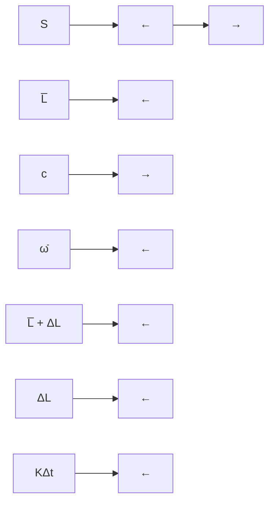
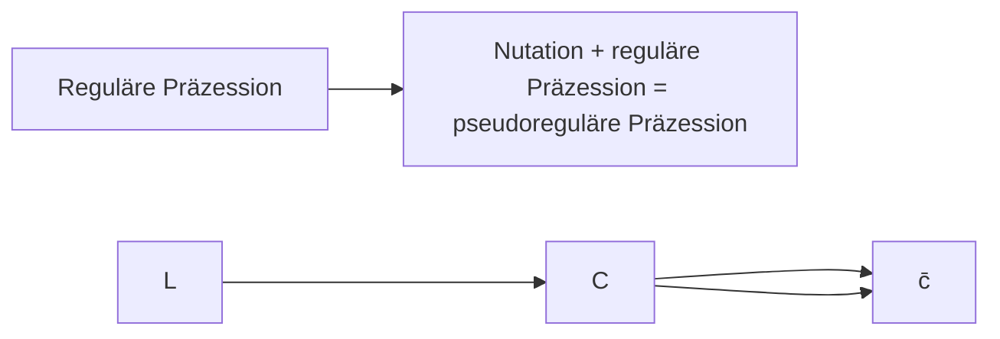

$$
\begin{array}{l} \frac {d N (\theta , \varphi)}{N _ {0}} = \frac {n \cdot \overbrace {V} ^ {= d \cdot A} \cdot b \cdot d b \cdot d \varphi}{A} \underset {\text {Gl. (I - 2.195)}} {=} \frac {n \cdot d \cdot A}{A} \Delta \sigma = n \cdot d \cdot \Delta \sigma = \\ = n \cdot d \frac {d \sigma}{d \Omega} (\theta , \varphi) d ^ {2} \Omega \tag {I-2.205} \\ \end{array}
$$

Für die Zahl der α-Teilchen, die pro Zeiteinheit in das Raumwinkelelement $d ^ { 2 } \Omega$ gestreut werden ergibt sich daher

$$
\frac {d N (\theta , \varphi)}{N _ {0}} = n \cdot d \frac {d \sigma}{d \Omega} (\theta , \varphi) d ^ {2} \Omega . \tag {I-2.206}
$$

Das ist ein allgemeiner Ausdruck für die messbare relative Zahl gestreuter Teilchen an im Volumen homogen verteilten Streuzentren unabhängig vom speziellen Ausdruck für den differentiellen Wirkungsquerschnitt.

Setzen wir jetzt den oben gewonnenen differentiellen Wirkungsquerschnitt für die Rutherfordstreuung ein (Gl. I-2.204), so erhalten wir entsprechend der Symmetrie des Coulombpotenzials nur mehr eine Abhängigkeit von θ

$$
\frac {d N (\theta)}{N _ {0}} = n \cdot d \left(\frac {1}{4 \pi \varepsilon_ {0}} \frac {2 Z e ^ {2}}{4 E _ {\alpha}}\right) ^ {2} \frac {1}{\sin^ {4} \frac {\theta}{2}} d \Omega \quad \begin{array}{l} \text {Rutherfordsche Streuformel} \\ \text {für einen Teilchenstrahl} \\ \text {an einer dünnen Folie.} \end{array} \tag {I-2.207}
$$

Dies ist die vollständige Rutherfordsche Streuformel für die Streuung von α-Teilchen im Feld der geladenen Atomkerne einer dünnen Folie.

Für Streuwinkel $\theta = 0$ (das entspricht $b = \infty )$ wird die Streuformel unbrauchbar, da dann ${ \frac { d N } { N _ { 0 } } } = \infty$ wird, also alle Teilchen die Folie ungestreut durchsetzen. Der Stoßparameter b darf aber nicht unbeschränkt groß sein, sein Maximalwert ist ja durch den mittleren Atomabstand in der Folie beschränkt.

Die experimentelle Bestätigung der Rutherfordschen Streuformel durch Geiger und Marsden rechtfertigt einerseits die Annahme eines Coulomb-Streupotenzials zwischen den α-Teilchen und den Atomkernen; andererseits kann man aus den auftretenden Streuwinkeln auf einen kleinsten beteiligten Stoßparameter von etwa ${ 1 0 } ^ { - 1 4 }$ m schließen, der die ungefähre Größe des Atomkerns angibt. Das Coulombpotenzial wirkt also unverändert bis zu Abständen von $1 0 ^ { - 1 4 }   \mathrm { { m } }$

**Beispiel:** Streuung von α-Teilchen in einer Goldfolie. Energie der α-Teilchen von $^ { 2 2 2 } \mathrm { R n }$ (Radon): $E_{\alpha}=5,59 MeV =5,59\cdot10^{6}.1,602\cdot10^{-19} J =8,955\cdot10^{-13} J$ . Ordnungszahl (Zahl der Protonen) von Gold: $Z = 7 9 .$ Ablenkwinkel: $\theta = 90^{\circ} \Rightarrow \cot(\theta / 2) =$ cot $\left( 4 5 ^ { \circ } \right) = 1$

Damit ergibt sich für den Stoßparameter (siehe Anhang A2.4.1, Gl. I-2.193)

$$
b = \frac {1}{4 \pi \varepsilon_ {0}} \frac {2 Z e ^ {2}}{2 E _ {\alpha}} \cot \frac {\theta}{2} = 8, 9 8 8 \cdot 1 0 ^ {9} \frac {2 \cdot 7 9 \cdot (1 , 6 0 2 \cdot 1 0 ^ {- 1 9}) ^ {2}}{2 \cdot 8 , 9 5 5 \cdot 1 0 ^ {- 1 3}} \cdot 1 \cong 2 \cdot 1 0 ^ {1 4} \mathrm{m}
$$

## 3 Mechanik des starren Körpers (rigid body)

**Einleitung:** Der sogenannte „starre Körper“ ist ein Modell, das über das Verhalten des Massenpunktes hinausgeht und spezielle räumlich ausgedehnte, materielle Objekte beschreibt. Es handelt sich dabei um Systeme von Massenpunkten, deren Ab stände voneinander sich im Laufe der Zeit nicht ändern; Deformationen jeglicher Art sind daher ausgeschlossen. Während ein Massenpunkt, der ja kein Volumen besitzt, nur eine Translation, aber keine mechanische Rotationsbewegung ausführen kann, kann ein ausgedehnter starrer Körper translatieren und um eine Körperachse rotieren. In der Quantenmechanik dagegen (Band V, Kapitel „Atomphysik“) wird auch einem punktförmigen Mikroteilchen ein Eigendrehimpuls (Spin) zugeordnet.

Die Gesamtbewegung des starren Körpers kann als Translation seines Schwerpunkts und als zusätzliche Rotation um den Schwerpunkt beschrieben werden.

Der Drehimpuls des starren Körpers ist das Produkt aus dem Trägheitstensor, der seine Massenverteilung berücksichtigt, und der Winkelgeschwindigkeit der Rotation, wobei der Drehimpulsvektor i. Allg. nicht in die Richtung der Winkelgeschwindigkeit weist. Zusätzlich zur Translationsenergie besitzt der rotierende starre Körper Rotationsenergie.

Die Kinematik starrer Körper ist Grundlage für die technische Anwendung in vielen Gebieten wie der Robotik, der Fahrzeugtechnik sowie der Luft- und Raumfahrt.

## 3.1 Statik und Gleichgewicht (statics and equilibrium)

Bisher haben wir den idealisierten Massenpunkt, unser Teilchen, betrachtet, jetzt geben wir einen Teil der Idealisierung auf: Wir betrachten ein ganzes System von Massepunkten, sie seien allerdings starr miteinander verbunden, d. h. Deformationen des Gesamtkörpers (Dehnung, Biegung, Scherung) treten nicht auf. Wir können uns so einen ‚starren Körper‘ am besten als unregelmäßig geformten Felsbrocken vorstellen, dürfen aber nicht davon ausgehen, dass seine Massendichte homogen ist. Wir müssen also jetzt die Massenverteilung in unserem starren Körper berücksichtigen. Dazu zerlegen wir den Körper in kleine Volumenelemente $\Delta V _ { i }$ mit dem Ortsvektor $\vec { r } _ { i }$ und der Masse $\Delta m _ { i }$ (Abb. I-3.1).

Im starren Körper müssen alle Vektoren $\vec { r } _ { i k }$ zwischen den einzelnen Volumenelementen zeitlich konstant sein.

Wir kommen dann zum Gesamtvolumen und zur Gesamtmasse, indem wir über die einzelnen Volumenelemente (= Massenelemente) aufsummieren, bzw. im Grenzübergang aufintegrieren:

$$
\text {Gesamtvolumen:} \quad V = \sum_ {i} \Delta V _ {i} \quad \xrightarrow [ \Delta V _ {i} \rightarrow 0 ]{} \quad V = \int_ {V} d V \tag {I-3.1}
$$

text_image

ρ(⃗)
⃗ᵢₖ
ΔVᵢ, Δmᵢ
⃗ᵣₖ
⃗ᵣᵢ
z
O
y
x

Abb. I-3.1: Zur Berücksichtigung der Massenverteilung im starren Körper.

Gesamtmasse: (I-3.2)

dabei ist $\rho _ { i } = \frac { \Delta m _ { i } } { \Delta V _ { i } }$ bzw. $\rho = { \frac { d m } { d V } }$

Ist der Körper homogen, so gilt:

$$
M = \rho \int_ {V} d V = \rho \cdot V. \tag {I-3.3}
$$

Im Unterschied zum Massenpunkt hat der starre Körper zwei Bewegungsmöglichkeiten:

1. Translation (translational motion): Alle MP eines Körpers besitzen zu jedem Zeitpunkt dieselbe Geschwindigkeit $\vec { v } _ { i } ( t )$ , deren Betrag aber von der Zeit abhängen kann. Unter dem Einfluss einer resultierenden äußeren Kraft $\vec { F } _ { R } = \sum _ { i } \vec { F } _ { i }$ erfolgt die Translation beschleunigt.
2. Rotation (rotational motion): Alle MP führen eine Kreisbewegung um eine momentane Drehachse mit der Winkelgeschwindigkeit $\vec { \omega } ( t )$ aus, deren Größe und Richtung so wie auch die Lage der Drehachse von der Zeit abhängen können. Unter dem Einfluss eines resultierenden äußeren Drehmoments $\vec { D } _ { R } = { \sum _ { i } } \vec { D } _ { i }$ erfolgt die Rotation beschleunigt.

Bei der Rotation tritt also das Drehmoment $\vec { D }$ an die Stelle der Kraft $\vec { F } .$

Die allgemeinen Gleichgewichtsbedingungen (Bedingungen für den nicht beschleunigten Zustand) eines starren Körpers lauten daher:

1.

$$
\vec {F} _ {R} = \sum_ {i} \vec {F} _ {i} = 0 \tag {I-3.4}
$$

Die translatorische Komponente der Beschleunigung verschwindet, wenn die Summe aller am starren Körper angreifenden Kräfte (resultierende Kraft $\vec { F } _ { R } )$ verschwindet. Der lineare Impuls ist dann konstant, also $\vec { p } = \mathbf { c o n s t . }$

2.

$$
\vec {D} _ {R} = \sum_ {i} \vec {D} _ {i} = 0 \tag {I-3.5}
$$

Die rotatorische Komponente der Beschleunigung verschwindet, wenn die Summe aller am starren Körper angreifenden Drehmomente (resultierendes Drehmoment $\left. \vec { D } _ { R } \right)$ verschwindet. Der Drehimpuls ist dann konstant, also $\vec { L } = \mathbf { c o n s t } .$

Diese beiden Gleichungen (I-3.4) und (I-3.5) enthalten auch den Fall des statischen Gleichgewichts:

$$
\vec {p} = \vec {L} = 0. \tag {I-3.6}
$$

Andererseits sind alle Kraftsysteme mit gleichem $\vec { F } _ { R }$ und ${ \vec { D } } _ { R }$ in ihrer Wirkung gleichwertig.

Es gilt: Jede an einem starren Körper angreifende Kraft $\vec { \bar { F } } _ { i }$ ist äquivalent zu der durch einen beliebigen Punkt, z. B. den Schwerpunkt S (siehe Abschnitt 3.1.2), parallel verschobenen Kraft $\vec { F } _ { i } ^ { S } \left( \left| \vec { F } _ { i } ^ { S } \right| \right. = \left. \left| \vec { F } _ { i } \right| \right)$ und einem Kräftepaar (Drehzwilling, siehe nächster Abschnitt 3.3.3) aus $\bar { F } _ { i }$ und $- \vec { F } _ { i }$ (siehe Abb. I-3.1a). Daraus folgt:

Jedes an einem starren Körper angreifende Kraftsystem kann durch eine resultierende Gesamtkraft $\vec { F } _ { i } ^ { S }$ im Schwerpunkt und ein resultierendes Kräftepaar ${ \bar { D } } _ { R }$ ersetzt werden.

text_image

S
F̅ᵢ
≡
-F̅ᵢˢ
S
||
F̅ᵢˢ
F̅ᵢ

Abb. I-3.1a: Die am starren Körper angreifende Kraft $\bar { \bar { F } } _ { i }$ ist zur parallel verschobenen Kraft $\bar { F } _ { i } ^ { S }$ durch den Schwerpunkt S und dem Kräftepaar aus $\bar { F } _ { i }$ und $- \bar { F } _ { i } ^ { S }$ äquivalent.

## 3.1.1 Drehmoment und Bezugspunkt

Das Drehmoment, das eine Kraft am starren Körper ausübt, ist i. Allg. vom Bezugspunkt abhängig, es ist kein ‚freier Vektor‘.

Wir wählen einen beliebigen Bezugspunkt B, der nicht mit dem Ursprung O zusammenfällt (Abb. I-3.2).

text_image

F_i
P_i
r_i - r_B
B
r_B
O
r_i

Abb. I-3.2: Zum Drehmoment einer im Punkt $P _ { i }$ am starren Körper angreifenden Kraft $\vec { F } _ { i }$ .

Für das Gesamtdrehmoment bezüglich B gilt:

$$
\begin{array}{l} \vec {D} _ {B} ^ {R} = \sum_ {i} \vec {D} _ {B} ^ {i} = \sum_ {i} \left[ \left(\vec {r} _ {i} - \vec {r} _ {B}\right) \times \vec {F} _ {i} \right] = \sum_ {i} \vec {r} _ {i} \times \vec {F} _ {i} - \sum_ {i} \left(\underbrace {\vec {r} _ {B}} _ {\text {const.}} \times \vec {F} _ {i}\right) = \\ = \underbrace {\sum_ {i} \vec {r} _ {i} \times \vec {F} _ {i}} _ {\sum_ {i} \bar {D} _ {i} b e z ü g l i c h (O)} - \vec {r} _ {B} \times \underbrace {\sum_ {i} \vec {F} _ {i}} _ {\text {Gesamtkraft} \vec {F} _ {R}} \tag {I-3.7} \\ \end{array}
$$

Damit erhalten wir für das Gesamtdrehmoment bezüglich B:

$$
\vec {D} _ {B} ^ {R} = \underbrace {\sum_ {i} \vec {r} _ {i} \times \vec {F} _ {i}} _ {\substack {\text {Summe aller} \\ \text {Drehmomente bezüglich O}}} - \underbrace {\vec {r} _ {B} \times \vec {F} _ {R}} _ {\substack {\text {Drehmoment der in B} \\ \text {angreifenden Gesamtkraft} \bar {F} _ {R} \\ \text {bezüglich O}}}. \tag{I - 3.8}
$$

## Spezialfall: Das Kräftepaar (= Drehzwilling, couple)

Führt der starre Körper keine oder eine unbeschleunigte Translationsbewegung aus (sein Schwerpunkt ruht also oder bewegt sich gleichförmig geradlinig), d. h. die resultierende Gesamtkraft verschwindet, so ist $\vec { F } _ { R } = \sum _ { i } \vec { F } _ { i } \; = \; 0$ . In diesem Fall gilt

$$
\vec {D} _ {B} ^ {R} = \sum_ {i} \vec {r} _ {i} \times \vec {F} _ {i}, \tag {I-3.9}
$$

text_image

l_n
F_1 = -F_2
F_1
r_1
r_2
α
F_2
O

Abb. I-3.3: Das Kräftepaar = der Drehzwilling. D⇀steht senkrecht auf der durch die Kräfte $\vec { \bar { F } } _ { 1 }$ und $( \vec { r } _ { 1 } - \vec { r } _ { 2 } )$ aufgespannten Ebene.

das Drehmoment ist dann vom beliebig wählbaren Bezugspunkt (= Drehpunkt) unabhängig (torque). Wenn also der Schwerpunkt des starren Körpers ruht oder sich gleichförmig geradlinig bewegt, ist ein allfällig wirkendes Drehmoment vom Bezugspunkt unabhängig, es ist dann ein ‚freier $\mathtt { V e k t o r ^ { \circ } }$ . Das Kraftsystem lässt sich dann immer auf ein Kräftepaar (Drehzwilling) reduzieren (Abb. I-3.3). Ein Kräftepaar sind zwei entgegengesetzt gleiche Kräfte, die an den Punkten $\vec { r } _ { 1 }$ und $\vec { r } _ { 2 }$ angreifen, sodass die Beziehungen gelten:

$$
\vec {F} _ {1} = \vec {F}, \vec {F} _ {2} = - \vec {F} \Rightarrow \sum_ {i} \vec {F} _ {i} = 0,
$$

$$
\vec {D} = \sum_ {i} \vec {D} _ {i} = \vec {r} _ {1} \times \vec {F} + \vec {r} _ {2} \times (- \vec {F})
$$

$$
\Rightarrow \quad \vec {D} = (\vec {r} _ {1} - \vec {r} _ {2}) \times \vec {F} \quad \begin{array}{l} \text {Drehmoment eines Kräftepaares} \\ \text {(Drehzwilling).} \end{array} \tag {I-3.10}
$$

Obwohl also keine resultierende Kraft wirkt, also $\vec { F } _ { R } = \sum _ { i } \vec { F } _ { i } \; = 0$ ist, gibt es ein resultierendes, nicht verschwindendes Drehmoment, das vom beliebigen Bezugspunkt unabhängig ist. $\vec { D }$ steht normal auf der durch die Kräfte gebildeten Ebene. Ist $\vec { D }$ vorgegeben, so sind die Lagen der beiden Kräfte ${ \vec { F } } _ { 1 }$ und $- \vec { F } _ { 1 }$ entsprechend zu wählen, nämlich in einer Ebene senkrecht zu $\vec { D }$

Für den Betrag des Kräftepaares gilt:

$$
\left| \vec {D} \right| = D = (r _ {1} - r _ {2}) \cdot F \cdot \sin \alpha = l _ {n} \cdot F. \tag {I-3.11}
$$

$l _ { n }$ ist der Normalabstand (der ‚Arm‘) des Kräftepaares.

Kräftepaare können (als ‚reines Drehmoment‘) im starren Körper beliebig verschoben werden (freier Vektor).1 Ein frei beweglicher starrer Körper, an dem nur

<small>1 Es muss nur das Produkt l ⋅F erhalten bleiben, nur wenn bei der Verschiebung die Kräfte konstant sind, muss auch ln erhalten bleiben. Frei verschiebbar ist eben der Vektor D⇀, wie er zustande kommt ist gleichgültig!</small>

Kräftepaare angreifen, dreht sich so, dass seine Drehachse durch den Massenmittelpunkt geht, da dieser im Falle $\sum _ { i } \vec { F } _ { i } = 0 .$ stets in Ruhe bleibt (Impulssatz eines Teilchensystems) bzw. bei konstanter Geschwindigkeit stets ein System gefunden werden kann, in welchem er ruht.

Über zwei Trinkhalme strömt Wasser aus einer drehbar aufgehängten Flasche aus (offener Pfeil $\Join$ unterhalb der Bilder) und verursacht als Reaktion an der Flasche einen Drehzwilling (voller Pfeil $\left( \lambda \right)$ . Die Distanz der Ausströmöffnungen ist in allen drei Fällen gleich, ihre Anordnung aber verschieden: symmetrisch (links), asymmetrisch (Mitte), beide Öffnungen auf einer Seite der Drehachse (rechts).

Die Drehung erfolgt immer gleichartig um den ruhenden Schwerpunkt.

## Die Arbeit des Drehzwillings bzw. des Drehmoments

Für eine Translation dr⇀(konstant für den ganzen Körper) verrichtet der Drehzwilling wegen $\vec { F } _ { 1 } = - \vec { F } _ { 2 }$ keine Arbeit. Für eine Rotation um den kleinen Winkel dφ⇀= ω⇀dt gilt mit $d \vec { r _ { 1 } } = ( \vec { \omega } \times \vec { r _ { 1 } } ) d t$ und $d \vec { r _ { 2 } } = ( \vec { \omega } \times \vec { r _ { 2 } } ) d t$

$$
\begin{array}{l} d W _ {\mathrm{rot}} = \vec {F} _ {1} d t \left[ \left(\vec {\omega} \times \vec {r} _ {1}\right) - \left(\vec {\omega} \times \vec {r} _ {2}\right) \right] = d t \vec {F} _ {1} \cdot \left[ \vec {\omega} \times \underbrace {\left(\vec {r} _ {1} - \vec {r} _ {2}\right)} _ {\vec {r}} \right] = \\ = \underbrace {d t \vec {\omega}} _ {d \bar {\varphi}} \underbrace {(\vec {r} \times \vec {F} _ {1})} _ {\bar {D}} = \vec {D} d \vec {\varphi}. \tag {I-3.12} \\ \end{array}
$$

Diese Beziehung ist analog zur linearen Bewegung $d W _ { \mathrm { l i n } } = { \vec { F } } d { \vec { r } } ,$ , es entspricht also das Drehmoment $\vec { D }$ der Kraft $\vec { F }$ und das Drehwinkelelement dφ⇀dem Wegelement $d \vec { r }$

## 3.1.2 Der Massenmittelpunkt (= Schwerpunkt)

Wir können die Wirkung von Kräften auf den starren Körper bezüglich seiner Translationsbewegung so beschreiben, dass wir ihn als MP ansehen, dessen Gesamtmasse $M = \sum _ { i } \Delta m _ { i }$ im Massenmittelpunkt S vereinigt ist (siehe Kapitel „Mechanik des Massenpunkts“, Abschnitt 2.4 ‚Massenpunktsysteme und Erhaltungssätze‘, Gl. I-2.63):

$$
\vec {r} _ {S} = \frac {1}{M} \sum_ {i} \vec {r} _ {i} \Delta m _ {i}
$$

bzw. im Grenzübergang $\Delta V _ { i }   \rightarrow 0$

$$
\vec {r} _ {S} = \frac {1}{M} \int_ {V} \vec {r} d m = \frac {1}{M} \int_ {V} \vec {r} \cdot \rho (\vec {r}) d V. \tag {I-3.13}
$$

Liegt der Koordinatenursprung im Schwerpunkt, dann ist $\vec { r } _ { S } = 0$ und daher ${ \sum _ { i } } { \vec { r } } _ { i } \Delta m _ { i } = 0 .$ bzw. $\int \limits _ { V } \vec { r } d m = 0 .$ (Schwerpunktsbedingung). Für einen homogenen Körper $( \rho = M / V )$ stimmt der Massenmittelpunkt mit dem Mittelpunkt des Volumens überein:

$$
\vec {r} _ {S} = \frac {1}{V} \int_ {V} \vec {r} d V. \tag {I-3.14}
$$

Die Koordinaten des Massenmittelpunkts lauten also:

$$
x _ {S} = \frac {\int_ {V} \rho \cdot x d V}{\int_ {V} \rho d V}, \quad y _ {S} = \frac {\int_ {V} \rho \cdot y d V}{\int_ {V} \rho d V}, \quad z _ {S} = \frac {\int_ {V} \rho \cdot z d V}{\int_ {V} \rho d V}. \tag {I-3.15}
$$

Wie groß ist das Drehmoment der Gewichtskraft in Bezug auf den Massenmittelpunkt $( \vec { r } _ { B } = \vec { r } _ { S }$ , siehe Abb. I-3.2)? Es gilt

$$
\begin{array}{l} \vec {F} _ {i} = \sum_ {i} \Delta m _ {i} \vec {g} \quad \Rightarrow \quad D _ {S} ^ {G} = \sum \left(\vec {r} _ {i} \times \Delta m _ {i} \vec {g}\right) - \vec {r} _ {S} \times \underbrace {\sum_ {i} \Delta m _ {i}} _ {M} \vec {g} = \\ = \sum_ {i} \Delta m _ {i} \vec {r} _ {i} \times \vec {g} - M \cdot \underbrace {\vec {r} _ {S}} _ {\frac {1}{M} \sum_ {i} \Delta m _ {i} \vec {r} _ {i}} \times \vec {g} = \sum_ {i} \Delta m _ {i} \vec {r} _ {i} \times \vec {g} - \sum \Delta m _ {i} \vec {r} _ {i} \times \vec {g} = 0. \tag {I-3.16} \\ \end{array}
$$

also: $\vec { D } _ { S } ^ { G } = 0$ . Ein Körper, der im Schwerpunkt aufgehängt ist oder frei fällt (es wirkt keine Gesamtkraft, siehe „fallender Kasten“, Kapitel „Mechanik des Massenpunk-$\mathbf { t e s ^ { \mathrm { { e c } } } }$ “, Abschnitt 2.3.2), erfährt also durch die Schwerkraft kein Drehmoment, er bleibt im Gleichgewicht oder fällt drehungsfrei.2

Der Ort des Schwerpunkts wird zu jedem Zeitpunkt durch die resultierende Kraft des angreifenden Kraftsystems festgelegt. Die eventuell vorhandenen Kräfte paare können wegen ihrer verschwindenden Kraftsumme die Schwerpunktslage nicht beeinflussen; die resultierende Winkelgeschwindigkeit $\vec { \omega } _ { R } ( t )$ , also die mo mentane Drehachse, muss daher durch den Schwerpunkt gehen. Das gilt allerdings nur, wenn die Drehachse ‚frei‘ ist, also nicht durch Lager festgehalten wird.

<small>2 Diese Überlegungen gelten für alle parallelen Massenkräfte, also auch für die Trägheitskräfte bei wirkender Translationsbeschleunigung (Linearbeschleunigung) A⇀linear : Es tritt keine Drehung um den Schwerpunkt bei einer Translationsbeschleunigung A⇀linear auf, g⇀ist oben einfach durch A⇀linear zu ersetzen.</small>

## 3.2 Kinematik und Freiheitsgrade (kinematics and degrees of freedom)

## 3.2.1 Allgemeine Bewegung der Massenpunkte eines starren Körpers

Um zu einer Beschreibung des Bewegungszustandes des starren Körpers zu gelangen, denken wir uns den starren Körper wieder in kleine Volumenelemente $\Delta V _ { i }$ mit einem Mittelpunkt $P _ { i }$ zerlegt, zu dem der Ortsvektor $\vec { r } _ { i }$ führt. Zum Schwerpunkt S zeigt der Vektor $\vec { r } _ { S }$ . Wir geben jetzt auch alle jene Vektoren $\vec { r } _ { i } ^ { S }$ an, die vom Schwerpunkt zu den einzelnen Volumenelementen führen (Abb. I-3.4).

Der starre Körper kann eine Translation durchführen und/oder eine Rotation um eine augenblickliche Drehachse. Die momentane Geschwindigkeit des Volumenelements $\Delta V _ { i }$ und damit von $P _ { i }$ in Bezug auf das verwendete Koordinatensystem sei $\vec { v } _ { i }$ , die Geschwindigkeit des Massenmittelpunktes S sei $\vec { \nu } _ { S }$ . Dann ergibt sich für die Relativgeschwindigkeit $\bar { \boldsymbol { v } } _ { i } ^ { S }$ des Volumenelements in Bezug auf den Schwerpunkt S mit $\vec { r } _ { i } ^ { S } = \vec { r } _ { i } - \vec { r } _ { S } { \bf \vec { \cdot } }$

$$
\vec {v} _ {i} ^ {S} = \frac {d \vec {r} _ {i} ^ {S}}{d t} = \vec {v} _ {i} - \vec {v} _ {S}. \tag {I-3.17}
$$

Wir beachten, dass die $\bar { r } _ { i } ^ { S }$ zwar andauernd ihre Richtung ändern, wenn der Körper mit der Winkelgeschwindigkeit $\vec { \omega } ( t )$ rotiert, dass ihr Betrag $\left| \vec { r } _ { i } ^ { S } \right|$ aber zeitlich konstant ist, es handelt sich ja um einen ‚starren‘ Körper. Es muss also gelten:

$$
\frac {d \left(\left(\vec {r} _ {i} ^ {S}\right) ^ {2}\right)}{d t} = 2 \cdot \vec {r} _ {i} ^ {S} \frac {d \vec {r} _ {i} ^ {S}}{d t} = 2 \cdot \underbrace {\vec {r} _ {i} ^ {S} \cdot \vec {v} _ {i} ^ {S}} _ {\text {Skalarprodukt}} = 0, \tag {I-3.18}
$$

also $\vec { \upsilon } _ { i } ^ { S } \perp \vec { r } _ { i } ^ { S } !$

$\vec { v } _ { i } ^ { S } \perp \vec { r } _ { i } ^ { S }$ bedeutet nur, dass $\bar { \boldsymbol { \upsilon } } _ { i } ^ { S }$ in einer Ebene ⊥ zu $\bar { \boldsymbol { r } } _ { i } ^ { S }$ liegt und durch Drehung $\left( \left| \vec{r}_{i}^{S} \right| =  const.  \right)$ um eine durch S gehende Achse $\vec { \omega } ( t )$ erfolgt, die wegen der Starrheit des Körpers für alle Volumenelemente $\Delta V _ { i }$ identisch ist. Dieses $\vec { \omega } ( t )$ bestimmt für einen Augenblick die gesamte Rotation des starren Körpers in einem raumfesten Koordinatensystem. Für die Geschwindigkeit $\bar { \boldsymbol { v } } _ { i } ^ { S }$ der Volumenelemente $\Delta V _ { i }$ bei einer Rotationsbewegung um eine Drehachse durch S gilt daher für alle Elemente mit dem Ortsvektor $\vec { r } _ { i } ^ { S }$

text_image

v̅ᵢ
v̅ₛ
v̅ᵢˢ
90°
Pᵢ
ΔVᵢ Δmᵢ
r̅ᵢˢ
S
v̅ₛ
r̅ₛ
ω̅(t)
aₛ = g̅
M·g̅ = g̅ · Σᵢ Δmᵢ
O

Abb. I-3.4: Zur Beschreibung des Bewegungszustandes eines starren Körpers im Erdschwerefeld.

$$
\vec {v} _ {i} ^ {S} = \vec {\omega} \times \vec {r} _ {i} ^ {S}. \tag {I-3.19}
$$

$\vec { v } _ { i } ^ { S }$ steht demnach in jedem Punkt P auf der durch $\vec { \omega }$ und $\bar { \boldsymbol { r } } _ { i } ^ { S }$ aufgespannten Ebene senkrecht und besitzt den Betrag $\boldsymbol { \upsilon } _ { i } ^ { S } = \boldsymbol { \omega } \cdot \boldsymbol { r } _ { i } ^ { S }$ ⋅sin $( \vec { \omega } , \vec { r } _ { i } ^ { S } )$ , wobei zu beachten ist, dass $\vec { \omega } = \vec { \omega } ( t )$ im Allgemeinen eine Funktion der Zeit ist, also sowohl seine Größe, als auch seine Richtung im Laufe der Zeit ändert.

Damit ergibt sich die allgemeine Bewegung der Volumenelemente, d. h. der Punkte $P _ { i }$ in einem Inertialsystem zu

$$
\vec {v} _ {i} = \vec {v} _ {S} + \vec {v} _ {i} ^ {S} = \vec {v} _ {S} + \vec {\omega} \times \vec {r} _ {i} ^ {S}. \tag {I-3.20}
$$

Die allgemeine Bewegung des starren Körpers setzt sich also aus einer Translation des Schwerpunkts und einer Rotation um den Schwerpunkt zusammen. Die Bestimmung der Rotation $\vec { \omega } ( t )$ eines starren Körpers unter der Einwirkung von Kräften stellt das zentrale Problem der Kreiseltheorie dar.

**Zu beachten:** Die Rotationsachse (durch den Schwerpunkt) braucht nicht raumfest zu sein, sondern kann ihre Richtung im Laufe der Zeit ändern, auch wenn keine Kräfte auf den Körper wirken (siehe Abschnitt 3.4 „Kreiselbewegung“).3

## 3.2.2 Die Freiheitsgrade des starren Körpers

Die Lage eines völlig frei beweglichen starren Körpers kann durch die Angabe von 6 zeitabhängigen Koordinaten beschrieben werden:

<small>3 Für einen freien Körper gibt es keinen ‚Erhaltungssatz der Drehachse‘ etwa in Analogie zum Erhaltungssatz des linearen Impulses und des Drehimpulses.</small>

1. Die 3 Ortskoordinaten des Schwerpunkts $\vec { r } _ { S } ( t ) = \left\{ x _ { S } ( t ) { , } y _ { S } ( t ) { , } z _ { S } ( t ) \right\}$ beschreiben die Translation.
2. 3 Winkelkoordinaten, die Eulerschen Winkel φ(t), θ(t), ψ(t) beschreiben die Rotation um S (Abb. I-3.5) relativ zu einem raumfesten Koordinatensystem. Da wir später zur Beschreibung der Bewegung des starren Körpers das körperfeste, mitrotierende Koordinatensystem verwenden, bezeichnen wir die Koordinaten des körperfesten Systems mit $( x , y , z )$ und jene des raumfesten Systems mit $( x ^ { \prime } ,$ $y ^ { \prime } , z ^ { \prime } )$ (vgl. dazu Abschnitt 3.4.3, Gl. I-3.60).4

text_image

raumfestes System (x', y', z')
körperfestes System (x, y, z)
Knotenebene
Knotenlinie
z'
y'
φ
θ
S
φ
z
ψ
ω̄c
D
90° - ψ
x, ω̄a
φ
ψ
θ
z
ψ
ω̄b
S
x'
y'
Knotenebene
Knotenlinie

Abb. I-3.5: Die Eulerschen Winkel vermitteln zwischen dem ‚körperfesten‘, mitrotierenden Koordinatensystem $( x , y , z )$ und dem ‚raumfesten‘ Koordinatensystem $( x ^ { \prime } , y ^ { \prime } , z ^ { \prime } )$ . Als z-Achse im körperfesten System wird üblicherweise eine Hauptträgheitsachse (siehe Abschnitt 3.3.2) gewählt. $\varphi _ { \cdots }$ Präzessionswinkel, $\theta . . .$ Pendelungswinkel, $\psi . .$ Eigendrehungswinkel. $\vec { \omega } _ { a } , \vec { \omega } _ { b } , \vec { \omega } _ { c }$ sind die Komponenten der Winkelgeschwindigkeit in Hauptachsenrichtung (siehe Abschnitt 3.4.3). $\bar { \omega } _ { c }$ steht normal auf der Knotenebene, in der $\bar { \omega } _ { a }$ und $\bar { \omega } _ { b }$ liegen. SD ist eine Hilfsrichtung normal zur Knotenlinie, die zur Berechnung von Gl. (I-3.60) dient.

Insgesamt ergeben sich so für den starren Körper 6 Freiheitsgrade, 3 der Translation und 3 der Rotation (freier Kreisel, z. B. Erdsatellit).

Wird ein Punkt des starren Körpers festgehalten, so ist keine Translation mehr möglich und es bleiben nur mehr die 3 Freiheitsgrade der Rotation (z. B. ‚unterstützter Kreisel‘, z. B. Kompassnadel). Erfolgt die Rotation um eine raumfeste und zusätzlich um eine dazu senkrechte Achse (Cardanisches Gelenk), so bleiben nur mehr 2 Freiheitsgrade der Rotation. Entfällt auch die Rotation um die zur raumfesten Achse senkrechte Achse (z. B. Turbinenwelle), dann bleibt nur mehr der Drehwin kel $\varphi$ der Welle als einziger Freiheitsgrad übrig.

<small>4 Bei Kenntnis der Eulerschen Winkel sind auch die Hauptachsen a⇀,b⇀,c⇀bekannt und damit ist die Orientierung des Körpers im Raum (siehe Abschnitt 3.4.3) für alle Zeiten berechenbar.</small>

## 3.3 Dynamik, Trägheitsmoment, Rotationsenergie (dynamics, moment of inertia, rotational energy)

Die Newtonsche Bewegungsgleichung müssen wir auch beim starren Körper für die Translationsbewegung wieder finden, zusätzlich muss aber noch eine Bewegungsgleichung für die Rotation gelten.

## 3.3.1 Bewegungsgleichungen des freien starren Körpers

Wie wir schon aus Abschnitt 3.2.1 wissen, setzt sich die allgemeine Bewegung des starren Körpers so zusammen:

1. Translation des Schwerpunkts durch eine resultierende Gesamtkraft $\vec{F};$

$$
\vec {F} = \frac {d \vec {p} _ {S}}{d t} = M \frac {d \vec {v} _ {S}}{d t} \quad \text {Satz von der Bewegung des Massenmittelpunktes. (I - 3.21)}
$$

Die Translation des Schwerpunkts erfolgt so, als wäre die Gesamtmasse in ihm konzentriert.

Wegen der Starrheit des Körpers bewegen sich alle seine Teile mit ${ \vec { v } } _ { s }$

2. Rotation um den Schwerpunkt durch ein resultierendes Drehmoment $\scriptstyle { \vec { D } } ;$

$$
\vec {D} = \frac {d \vec {L}}{d t} = \sum_ {i} (r _ {i} ^ {S} \times \vec {F} _ {i}) \quad \text {Rotation um den Schwerpunkt.} \tag {I-3.22}
$$

Beim starren Körper dürfen die Kräfte $\bar { F } _ { i }$ in ihrer Richtung (Wirkungslinie) verschoben werden, ohne $\vec { D }$ zu ändern (Linienflüchtigkeit der Kraft); dies ermöglicht5 die Reduktion des gesamten Kräftesystems auf eine Einzelkraft und einen Drehzwilling (Kräftepaar, siehe Abschnitt 3.1.1).

Wir sehen sofort:

$$
\text { Für } \quad \vec {F} _ {R} = \sum_ {i} \vec {F} _ {i} = 0 \Rightarrow \vec {p} _ {S} = M \cdot \vec {v} _ {S} = \text { const. } \tag {I-3.23}
$$

Wenn auf einen starren Körper keine resultierende Kraft ausgeübt wird, bleibt sein linearer Schwerpunktsimpuls erhalten.

<small>5 Zusammen mit der Einfügung von zwei entgegengesetzt gleichen Kräften F⇀i und −F⇀i in einem beliebigen Punkt (z. B. S), das entspricht einer seitlichen Verschiebung von F⇀i durch S mit Erzeugung eines Kräftepaares.</small>

und

$$
\text { Für } \quad \vec {D} _ {R} = \sum_ {i} \vec {D} _ {i} = 0 \Rightarrow \vec {L} = \text { const. } \tag {I-3.24}
$$

1 Wenn auf einen starren Körper kein Drehmoment ausgeübt wird, bleibt sein Drehimpuls erhalten.

## 3.3.2 Das Trägheitsmoment (moment of inertia)

Wir verwenden jetzt ein im Schwerpunkt S verankertes körperfestes Koordinatensystem $( x , y , z )$ , das mit dem Körper mitrotiert. Das ist in vielen Fällen von Vorteil, da sich im starren Körper die Massenelemente $\Delta m _ { i }$ nicht relativ zueinander verschieben können. Der Drehimpuls L⇀muss aus der Bewegung der Massenelemente $\Delta m _ { i }$ berechnet werden. Das Wesentliche dabei ist eine entsprechende Berücksichtigung der Massenverteilung. Wir betrachten dazu die Rotation eines starren Körpers um seinen Schwerpunkt $( O = S )$ und beschreiben seine Drehbewegung mit $\vec { v _ { i } } = \vec { \omega } \times \vec { r _ { i } } . ^ { 6 }$

Für den Drehimpuls eines einzelnen Massenelements gilt dann:

$$
\vec {L} _ {i} = \vec {r} _ {i} \times \vec {p} _ {i} = \Delta m _ {i} (\vec {r} _ {i} \times \vec {v} _ {i}) = \Delta m _ {i} (\vec {r} _ {i} \times (\vec {\omega} \times \vec {r} _ {i})) \tag {I-3.25}
$$

wobei $\vec { r } _ { i }$ der im körperfesten Koordinatensystem mit dem Ursprung $O = S$ dargestellte Ortsvektor des Massenelementes $\Delta m _ { i }$ ist. $\vec { L } _ { i }$ ist daher der Drehimpuls des Massenelementes $\Delta m _ { i }$ im körperfesten Koordinatensystem.

1 Wir erinnern uns, dass für ein Vektor-Tripelprodukt gilt:

$$
\vec {a} \times (\vec {b} \times \vec {c}) = \vec {b} \cdot (\vec {a} \cdot \vec {c}) - \vec {c} \cdot (\vec {a} \cdot \vec {b}).
$$

Hier ist $\vec { a } = \vec { r _ { i } } ,   \vec { b } = \vec { \omega } ,   \vec { c } = \vec { r _ { i } }$ und damit

$$
\vec {L} _ {i} = \Delta m _ {i} r _ {i} ^ {2} \vec {\omega} - \Delta m _ {i} \vec {r} _ {i} (\vec {r} _ {i} \cdot \vec {\omega}). \tag {I-3.26}
$$

<small>6 Die Winkelgeschwindigkeit ω⇀– also auch die Drehachse – gehe durch den Schwerpunkt, ist aber i. A. nicht körperfest: ω⇀= ω⇀(t). ω⇀beschreibt die Drehung des körperfesten Systems, also des starren Körpers, relativ zum raumfesten Koordinatensystem. (ω⇀× r⇀i) ist daher die Drehgeschwindigkeit der Massenelemente Δmi im raumfesten System. ωx,ω ,ωz sind die Komponenten von ω⇀im körperfesten System mit ωa = φ̇ sin θ sin ψ + θ̇cos ψ, ωb = φ̇ sin θ cos ψ − θ̇sin ψ, ωc = φ̇ cos θ + ψ̇, wenn die Koordinatenachsen x,y,z mit den Hauptachsen des Körpers a,b,c zusammenfallen.</small>

Den gesamten Drehimpuls erhalten wir durch Integration über alle Massenelemente:

$$
\vec {L} = \int_ {V} \left[ r ^ {2} \vec {\omega} - (\vec {r} \cdot \vec {\omega}) \cdot \vec {r} \right] d m = \int_ {V} \left[ r ^ {2} \vec {\omega} - (\vec {r} \cdot \vec {\omega}) \cdot \vec {r} \right] \rho d V. \tag {I-3.27}
$$

Wie sehen die Komponenten von $\vec { L }$ im körperfesten System aus? Dazu beachten wir, dass $r ^ { 2 } = x ^ { 2 } + y ^ { 2 } + z ^ { 2 }$ und $\vec { r } \cdot \vec { \omega } = x \omega _ { x } + y \omega _ { y } + z \omega _ { z }$ und erhalten:

$$
\begin{array}{l} L _ {x} = \int_ {V} [ \underbrace {x ^ {2} \omega_ {x} + y ^ {2} \omega_ {x} + z ^ {2} \omega_ {x} - x ^ {2} \omega_ {x}} _ {(y ^ {2} + z ^ {2}) \omega_ {x} = (r ^ {2} - x ^ {2}) \omega_ {x}} - x y \omega_ {y} - x z \omega_ {z} ] d m = \\ = \underbrace {\int_ {V} \left(r ^ {2} - x ^ {2}\right) d m} _ {I _ {x x}} \cdot \omega_ {x} - \underbrace {\int_ {V} x y d m} _ {I _ {x y}} \cdot \omega_ {y} - \underbrace {\int_ {V} x z d m} _ {I _ {x z}} \cdot \omega_ {z} \\ \end{array}
$$

$$
\begin{array}{l} L _ {y} = \int_ {V} [ x ^ {2} \omega_ {y} + y ^ {2} \omega_ {y} + z ^ {2} \omega_ {y} - y x \omega_ {x} - y ^ {2} \omega_ {y} - y z \omega_ {z} ] d m = \\ = \underbrace {- \int_ {V} y x d m} _ {I _ {y x}} \cdot \omega_ {x} + \underbrace {\int_ {V} \left(r ^ {2} - y ^ {2}\right) d m} _ {I _ {y y}} \cdot \omega_ {y} - \underbrace {\int_ {V} y z d m \cdot \omega_ {z}} _ {I _ {y z}} \\ \end{array}
$$

$$
\begin{array}{l} L _ {z} = \int [ x ^ {2} \omega_ {z} + y ^ {2} \omega_ {z} + z ^ {2} \omega_ {z} - z x \omega_ {x} - z y \omega_ {y} - z ^ {2} \omega_ {z} ] d m = \\ = - \underbrace {\int z x d m} _ {V} \cdot \omega_ {x} - \underbrace {\int z y d m} _ {V} \cdot \omega_ {y} + \underbrace {\int (r ^ {2} - z ^ {2}) d m} _ {V} \cdot \omega_ {z}. \tag {I-3.28} \\ \end{array}
$$

Die 6 Terme $I _ { n m } = I _ { m n }$ bilden die Komponenten des Trägheitstensors $\tilde { I }$ (moment of inertia tensor), eines symmetrischen Tensors 2. Stufe.

Für den Drehimpuls $\vec { L }$ gilt also mit $d m = \rho d V$ nach den Regeln für die Matrizenmultiplikation die folgende, in ω⇀lineare Vektorfunktion

$$
\vec {L} = \tilde {I} \cdot \vec {\omega} \quad \text {mit} \quad \tilde {I} = \int_ {V} d V \rho (x, y, z) \left( \begin{array}{c c c} r ^ {2} - x ^ {2} & - x y & - x z \\ - y x & r ^ {2} - y ^ {2} & - y z \\ - z x & - z y & r ^ {2} - z ^ {2} \end{array} \right) \tag {I-3.29}
$$

oder ausgeschrieben

(I-3.30)

$$
\left( \begin{array}{c} L _ {x} \\ L _ {y} \\ L _ {z} \end{array} \right) = \left( \begin{array}{c c c} I _ {x x} = \int_ {V} (\underbrace {r ^ {2} - x ^ {2}} _ {y ^ {2} + z ^ {2}}) \rho d V & I _ {x y} = - \int_ {V} x y \rho d V & I _ {x z} = - \int_ {V} x z \rho d V \\ I _ {y x} = I _ {x y} & I _ {y y} = \int_ {V} (\underbrace {r ^ {2} - y ^ {2}} _ {z ^ {2} + x ^ {2}}) \rho d V & I _ {y z} = - \int_ {V} y z \rho d V \\ I _ {z x} = I _ {x z} & I _ {z y} = I _ {y z} & I _ {z z} = \int_ {V} (\underbrace {r ^ {2} - z ^ {2}} _ {y ^ {2} + x ^ {2}}) \rho d V \end{array} \right) \left( \begin{array}{c} \omega_ {x} \\ \omega_ {y} \\ \omega_ {z} \end{array} \right).
$$

Dabei sind $\omega _ { x } , \omega _ { y } , \omega _ { z }$ die Komponenten von ω⇀im körperfesten System (siehe Fuß- note $6 ) , ( x , y , z )$ sind die Koordinaten des Massenelements im körperfesten Koordinatensystem und $\rho \left( x ,   y ,   z \right)$ ist die Massendichte. Die 6 voneinander unabhängigen Elemente des Trägheitstensors berücksichtigen die Massenverteilung des starren Körpers. $I _ { x x } ,   I _ { y y } ,   I _ { z z }$ heißen Trägheitsmomente, es sind die Trägheitsmomente bei Rotation um die feste $x - , y - , z - \mathrm { A } ($ chse durch den Schwerpunkt (vgl. Abschnitt 3.3.4), sie sind stets positiv. $I _ { x y } ,   I _ { y z } ,   I _ { z x }$ heißen Deviations- oder Zentrifugalmomente, sie können positiv oder negativ sein.

**Wichtig:** Im Allgemeinen tragen alle Elemente des Trägheitstensors zum Trägheitsverhalten bei, der Drehimpuls liegt dann nicht in Richtung der Drehachse, d. h. der Winkelgeschwindigkeit: L⇀nicht // ω⇀!

**Beispiel:** Wir betrachten eine freie Drehung um die raumfeste x-Achse, relativ zu welcher aber der Körper frei beweglich ist. Es gilt: $\omega _ { x } = \omega ,   \omega _ { y } = 0 ,   \omega _ { z } = 0$

Wir erhalten:

$$
\begin{array}{l} \vec {L} = \tilde {I} \cdot \vec {\omega} = \vec {e} _ {x} (\omega_ {x} I _ {x x} + \omega_ {y} I _ {x y} + \omega_ {z} I _ {x z}) + \\ + \vec {e} _ {y} (\omega_ {x} I _ {y x} + \omega_ {y} I _ {y y} + \omega_ {z} I _ {y z}) + \\ + \vec {e} _ {z} \big (\omega_ {x} I _ {z x} + \omega_ {y} I _ {z y} + \omega_ {z} I _ {z z} \big) = \vec {e} _ {x} \omega I _ {x x} + \vec {e} _ {y} \omega I _ {x y} + \vec {e} _ {z} \omega I _ {x z} \\ \end{array}
$$

$\vec { L }$ kann also trotz augenblicklicher Rotation um die x-Achse Komponenten normal dazu haben, die von $I _ { x y }$ und $I _ { x z }$ herrühren!

Eine anfängliche Drehung um die x-Achse bleibt daher nicht erhalten, deshalb der Name Deviationsmomente für $I _ { x y } ,   I _ { y z } ,   I _ { z x }$

Auch hier besteht wieder eine formale Analogie zwischen der linearen Bewegung $( \vec { p } = m \vec { \upsilon } )$ und der Drehbewegung $( \vec { L } = \vec { I } \cdot \vec { \omega } )$ : der Drehimpuls $\vec { L }$ entspricht dem linearen Impuls $\vec { p }$ , der Trägheitstensor $\tilde { I }$ der skalaren Masse m und die Winkelgeschwindigkeit $\vec { \omega }$ der Bahngeschwindigkeit $\vec { v }$ . Wir beachten aber den Unterschied zur Translation: Der lineare Impuls ${ \vec { p } } = m { \vec { \upsilon } }$ hat immer die Richtung von $\vec { v }$ (m ist ein Skalar)! Ebenso hat die Kraft $\vec { F } = m \vec { a }$ , wenn die Masse konstant bleibt, die Richtung des Beschleunigungsvektors ${ \vec { a } } . { \vec { } }$ Bei der Rotation eines starren Körpers muss der Drehimpuls aber nicht in die Richtung des Vektors der Winkelgeschwindigkeit weisen, also parallel zur Drehachse sein!

Für den Trägheitstensor lässt sich immer ein Koordinatensystem finden, in dem nur mehr die Diagonalelemente von $\tilde { I }$ nicht verschwinden: ‚Hauptachsentransformation‘. Der Trägheitstensor nimmt dann folgende Form an:

$$
\tilde {I} = \tilde {I} _ {0} = \left( \begin{array}{l l l} I _ {a} & 0 & 0 \\ 0 & I _ {b} & 0 \\ 0 & 0 & I _ {c} \end{array} \right). \tag {I-3.31}
$$

Die aufeinander senkrecht stehenden Achsen $a ,   b ,   c$ des entsprechenden körperfesten Bezugssystems nennt man Hauptträgheitsachsen (= Hauptachsen), die Trägheitsmomente $I _ { a } ,   I _ { b } ,   I _ { c }$ sind die Hauptträgheitsmomente.

Einheit des Trägheitsmoments: $[ I ] = \mathrm { k g }   \mathrm { m } ^ { 2 } .$

## 3.3.3 Die Rotationsenergie (Rotational Energy)

Bei der Rotation beschreiben alle Volumenelemente Kreisbogenelemente um die momentane Drehachse mit der Geschwindigkeit $\vec { \upsilon _ { i } } = \vec { \omega } \times \vec { r _ { i } }$ im raumfesten System. Damit erhalten wir für die Rotationsenergie

$$
\begin{array}{l} E _ {\mathrm{rot}} = \sum_ {i} \frac {1}{2} m _ {i} \cdot \vec {v} _ {i} \cdot \vec {v} _ {i} = \frac {1}{2} \sum_ {i} (\vec {\omega} \times \vec {r} _ {i}) \cdot m _ {i} \vec {v} _ {i} \underset {\text {mit} (\bar {a} \times \bar {b}) \cdot \hat {c} = \bar {a} \cdot (\bar {b} \times \bar {c})} {=} \frac {1}{2} \sum_ {i} \vec {\omega} \cdot (\vec {r} _ {i} \times m _ {i} \vec {v} _ {i}) = \\ = \frac {1}{2} \bar {\omega} \underbrace {\sum_ {i} (\vec {r} _ {i} \times m _ {i} \vec {v} _ {i})} _ {\bar {L}} = \frac {1}{2} \omega_ {L} \cdot L; \tag {I-3.32} \\ \end{array}
$$

da ohne äußeres Drehmoment $E _ { \mathrm { r o t } }$ und L konstant sind, so gilt dies auch für $\omega _ { L } = \mathbf { A }$ bstand der Tangentialebene (invariante Ebene) vom Schwerpunkt S (siehe Abschnitt 3.3.6, Abb. I-3.9).

<small>7 Dies gilt allerdings nicht mehr für die relativistische Punktmechanik. Für relativistische Geschwindigkeiten hat die Kraft im Allgemeinen eine Komponente, die von der Richtung der Beschleunigung abweicht, ist also nicht mehr parallel zu a⇀(siehe dazu Band II, Kapitel „Relativistische Mechanik“, Abschnitt 3.10.3).</small>

Also:

$$
\begin{array}{l} E _ {\mathrm{rot}} = \frac {1}{2} \vec {\omega} \vec {L} = \frac {1}{2} \vec {\omega} \cdot \tilde {I} \cdot \vec {\omega} = \frac {1}{2} \left(\omega_ {x}, \omega_ {y}, \omega_ {z}\right) \left( \begin{array}{c} I _ {x x} I _ {x y} I _ {x z} \\ I _ {y x} I _ {y y} I _ {y z} \\ I _ {z x} I _ {z y} I _ {z z} \end{array} \right) \left( \begin{array}{c} \omega_ {x} \\ \omega_ {y} \\ \omega_ {z} \end{array} \right) = \\ = \frac {1}{2} \left(I _ {x x} \omega_ {x} ^ {2} + I _ {y y} \omega_ {y} ^ {2} + I _ {z z} \omega_ {z} ^ {2} + 2 I _ {x y} \omega_ {x} \omega_ {y} + 2 I _ {x z} \omega_ {x} \omega_ {z} + 2 I _ {y z} \omega_ {y} \omega_ {z}\right). \tag {I-3.33} \\ \end{array}
$$

Im Hauptachsensystem gilt für die Rotationsenergie

$$
E _ {\mathrm{rot}} = \frac {1}{2} \left(I _ {a} \omega_ {a} ^ {2} + I _ {b} \omega_ {b} ^ {2} + I _ {c} \omega_ {c} ^ {2}\right). \tag {I-3.34}
$$

Dabei sind $\omega _ { a } , \omega _ { b } , \omega _ { c }$ die (sich zeitlich ändernden) Komponenten der Winkelgeschwindigkeit in Richtung der Hauptachsen.8

Für die Translationsenergie gilt:

$$
E _ {\mathrm{trans}} = \frac {1}{2} m v _ {S} ^ {2} = \frac {1}{2} \vec {v} _ {S} m \vec {v} _ {S} = \frac {1}{2} \vec {v} _ {S} \vec {p} _ {S}. \tag {I-3.35}
$$

Damit erhalten wir für die Gesamtenergie des starren Körpers:

$$
E _ {\mathrm{ges}} = E _ {\mathrm{rot}} + E _ {\mathrm{trans}} = \frac {1}{2} \vec {\omega} \vec {L} + \frac {1}{2} \vec {v} _ {S} \vec {p} _ {S} = \frac {1}{2} \left(\vec {\omega} \tilde {I} \vec {\omega} + \vec {v} _ {S} m \vec {v} _ {S}\right). \tag {I-3.36}
$$

## 3.3.4 Rotation um eine feste Achse

Wir nehmen als feste Achse einfach die z-Achse, dann weist $\vec { \omega }$ stets in z-Richtung, $\vec { \omega } = \omega \cdot \vec { e } _ { z }   ( \mathrm { A b b . I . 3 . 6 } )$ . Den Trägheitstensor berechnen wir im körperfesten System $\{ \vec { e } _ { x } , \vec { e } _ { y } , \vec { e } _ { z } \}$ , das sich mit $\vec { \omega }$ relativ zum raumfesten System dreht.

a) Für den <u>Drehimpuls</u> $\vec { L }$ gilt mit $\vec { \omega } = \{ 0 , 0 , \omega \}$

$$
\vec {L} = \tilde {I} \cdot \vec {\omega} = \underbrace {(I _ {x z} \cdot \omega) \vec {e} _ {x} + (I _ {y z} \cdot \omega) \vec {e} _ {y}} _ {= \vec {L} _ {n}} + (I _ {z z} \cdot \omega) \vec {e} _ {z}, \tag {I-3.37}
$$

er weist also nicht in die Richtung von $\vec { \omega } = \omega \cdot \vec { e } _ { z }$ . Die Komponente ⊥ ω⇀ $\vec { L } _ { n } = L _ { x } \vec { e } _ { x } + L _ { y } \vec { e } _ { y }$ dreht sich mit dem körperfesten System um die z-Achse. Es muss daher durch die ebenfalls umlaufenden Lagerkräfte ein entsprechendes Drehmoment $\vec { D } = \hat { \vec { L } } _ { n }$ erzeugt werden.9

<small>8 Ist Erot zeitlich konstant (kräftefreie Bewegung), so stellt die obige Beziehung E t = E ( ωi) eine Fläche 2. Grades in den Komponenten ωi dar (‚Energieellipsoid‘), auf der die Spitze des Vektors ω⇀ stets liegt (siehe Abschnitt 3.3.6).</small>

text_image

z
\vec{e}_y
L_n
L_y
S
L_x
\vec{e}_z
r_n
L_z
dV, dm
\vec{e}_x
\vec{e}_x, \vec{e}_y, \vec{e}_z sind
körperfest!

Abb. I-3.6: Rotation um eine feste Achse.

b) Für die <u>Rotationsenergie</u> um die feste z-Achse gilt nach Gl. (I-3.33), da $\vec { \omega } = \{ 0 , 0 , \omega \}$ :

$$
E _ {\text {rot}} = \underbrace {\frac {1}{2} \omega_ {z} ^ {2} I _ {z z}} _ {\text {alle anderenTerme} = 0} = \frac {1}{2} \omega^ {2} \int_ {V (N o r m a l a b s t a n d r _ {n}) ^ {2}} \left(\underbrace {x ^ {2} + y ^ {2}}\right) d m = \frac {\omega^ {2}}{2} \int_ {V} r _ {n} ^ {2} d m \tag {I-3.38}
$$

Wir sehen also jetzt, dass $I _ { z z }$ die für die Rotationsenergie maßgebliche Körpereigenschaft bei Drehung um die z-Achse ist. Analog sind $I _ { x x }$ und $I _ { y y }$ die Träg heitsmomente um die $X ^ { - }$ und y-Achse. Die $r _ { n }$ (mit $x ^ { 2 } + y ^ { 2 } = r _ { n } ^ { 2 } )$ sind die Normal abstände der Volumenelemente von der festen Drehachse $\omega \vec { e } _ { z }$

Damit ergibt sich das Trägheitsmoment um die z-Achse:

$$
I _ {z z} = I _ {z} = \int_ {V} r _ {n} ^ {2} d m = \int_ {V} \rho r _ {n} ^ {2} d V. \tag {I-3.39}
$$

<small>9 Für dieses Drehmoment gilt mit dL⇀n = −L dφ e⇀x + Lx dφ e⇀ und dφ = ωdt D⇀= L⇀n = −ωL e⇀x + + ω Lxe⇀y = ω (−Ixze⇀x + Iyze⇀y) = (ω⇀× L⇀n). D⇀ liegt also ebenfalls senkrecht zur Drehachse ω⇀= ω⋅e⇀z und eilt dem rotierenden L⇀ um den Winkel π/2 voraus (negatives Vorzeichen von Dx!), steht also ⊥ auf L⇀n und daher // zu L⇀n , wie es nach dem Drehimpulssatz sein muss. Die Lagerkräfte als Reaktionskräfte liefern dann das geforderte −D⇀. Es wird nur durch die Deviationsmomente verursacht und wird als Zentrifugalmoment bezeichnet (siehe Anhang A1.3). Fällt ω⇀ mit einer Hauptträgheitsachse zusammen (siehe Abschnitte 3.3.6 und 3.3.7), dann verschwinden Ixz und Iyz und es tritt kein Zentrifugalmoment, also keine zusätzliche Lagerbeanspruchung auf (dynamisches Auswuchten von Rädern).</small>

Dies gilt für jede beliebige feste Achsenrichtung A (Isotropie des Raumes), sodass bei Drehung um A mit der Winkelgeschwindigkeit $\vec { \omega }$ gilt:

$$
\begin{array}{l l} E _ {\text {rot}} = \frac {1}{2} I _ {A} \omega^ {2} & \text {Rotationsenergie und Trägheitsmoment} \\ I _ {A} = \int_ {V} r _ {n} ^ {2} d m & \text {für einen starren Körper, der um} \\ & \text {eine beliebige, feste Achse A rotiert.} \end{array} \tag {I-3.40}
$$

**Beispiel:** Wir betrachten das Trägheitsmoment einer massiven Kugel an einer Schnur bezüglich einer festen Drehachse.

In allen drei Fällen der Zeichnung ergibt sich das gleiche Trägheitsmoment von $I_{A} = 36\  kg \  m ^{2}$

Beispiele für Trägheitsmomente symmetrischer Körper mit homogener Masse m.

| Körper | Trägheitsmoment |
| --- | --- |
| Kugel | $\frac{2}{5}mr^{2}$ |
| dünne Kreisscheibe, Rotation um die Scheibenachse | $\frac{1}{2}mr^{2}$ |
| Zylinder, Rotation um die Zylinderachse | $\frac{1}{2}mr^{2}$ |
| Quader (a,b,c), Rotation parallel zu a | $\frac{1}{12}(b^{2} + c^{2})$ |

## 3.3.5 Der Steinersche Satz (parallel axes theorem)

Wie sieht das Trägheitsmoment in Bezug auf eine Achse $A ^ { \prime }$ aus, die nicht durch den Schwerpunkt geht?

Entsprechend Abb. I-3.7 gilt

$$
I _ {A ^ {\prime}} = \int_ {V} \left(\vec {r} _ {n} - \vec {r} _ {n} ^ {B}\right) ^ {2} d m = \underbrace {\int_ {V} \left(r _ {n}\right) ^ {2} d m} _ {I _ {A}} - 2 \vec {r} _ {n} ^ {B} \underbrace {\int_ {V} \vec {r} _ {n} d m} _ {0} + \underbrace {\left(\vec {r} _ {n} ^ {B}\right) ^ {2}} _ {= l ^ {2}} \underbrace {\int_ {V} d m} _ {m} \tag {I-3.41}
$$

text_image

dV, dm
\vec{r}_n - \vec{r}_n^B
\vec{r}_n
S = O
\vec{r}_n^B
A
A'
B

$\vec { r } _ { n }$ und $\vec { r } _ { n } ^ { B }$ liegen in einer Ebene senkrecht zu A und A′. Daher liegt auch $\vec { r } _ { n } - \vec { r } _ { n } ^ { B }$ in dieser Ebene.

Abb. I-3.7: Zum Steinerschen Satz. A und $A ^ { \prime }$ sind parallele, feste Achsen, A ist eine Schwerpunktsachse. $| \vec { r } _ { n } ^ { B } | = l$ ist der feste Normalabstand von A und $A ^ { \prime } ,$

Der mittlere Term verschwindet nach der Definition des Schwerpunkts $\int \limits _ { V } \vec { r } d m = m \vec { r } _ { S } ,$ da hier ja gilt $\vec { r } _ { S } = 0 \; ( S = O )$ und damit $\int \limits _ { V } \vec { r } d m = \int \vec { r } _ { n } d m = 0$ . Mit dem Abstand der Achsen $l = \vec { r } _ { n } ^ { B }$ bekommen wir den Steinerschen Satz:

$$
I _ {A ^ {\prime}} = \underbrace {I _ {A}} _ {\substack {\text {Trägheitsmoment um} \\ \text {Schwerpunktsachse}}} + \underbrace {l ^ {2} m} _ {\substack {\text {Trägheitsmoment der} \\ \text {Gesamtmasse in Sum A ^ {\prime}}}} \quad \text {Steinerscher Satz.} \tag{I - 3.42}
$$

## 3.3.6 Trägheits- und Energieellipsoid

Jedem symmetrischen Tensor 2. Stufe kann eine Fläche 2. Grades zugeordnet werden, das Tensorellipsoid. Das Tensorellipsoid des Trägheitstensors wird als Träg heitsellipsoid bezeichnet.

Wir betrachten eine beliebige Drehachse durch den Koordinatenursprung, der nicht mit dem Schwerpunkt zusammenfallen muss. Die Drehachse (gegeben durch den Vektor der Winkelgeschwindigkeit ω⇀) schließe mit den Achsen des körperfesten Systems die Winkel $\alpha ,   \beta$ und $\gamma$ ein: $\vec { \omega } = \{ \omega \cdot \cos \alpha , \omega \cdot \cos \beta , \omega \cdot \cos \gamma \}$ . Wir setzen die Komponenten $\omega _ { x } ,   \omega _ { y } ,   \omega _ { z }$ in die Formel für die Rotationsenergie (Gl. I-3.33) ein und erhalten die Energie für die Rotation um die Achse $\vec { \omega }$ :

$$
\begin{array}{l} E _ {\mathrm{rot}} = \frac {1}{2} \vec {\omega} \cdot \tilde {I} \cdot \vec {\omega} = \frac {1}{2} \left(\omega^ {2} \cos^ {2} \alpha \cdot I _ {x x} + \omega^ {2} \cos^ {2} \beta \cdot I _ {y y} + \omega^ {2} \cos^ {2} \gamma \cdot I _ {z z} + \right. \\ + 2 \omega^ {2} \cos \alpha \cos \beta \cdot I _ {x y} + 2 \omega^ {2} \cos \alpha \cos \gamma \cdot I _ {x z} + \\ \left. + 2 \omega^ {2} \cos \beta \cos \gamma \cdot I _ {y z}\right) = \frac {1}{2} I _ {\bar {e} _ {n}} \omega^ {2}, \tag {I-3.43} \\ \end{array}
$$

$$
\mathrm{mit} \vec {\omega} = \omega \cdot \left\{\cos \alpha , \cos \beta , \cos \gamma \right\} = \omega \cdot \vec {e} _ {n}.
$$

Dabei ist $I _ { \bar { e } _ { n } }$ das Trägheitsmoment um die Achse $\vec { \omega }$ mit der Richtung $\vec{e}_{n} = \left\{ \cos \alpha, \cos \beta, \cos \gamma \right\}$ , wobei $\left| \vec { e } _ { n } \right| = 1 . ^ { 1 0 }$ Ist also der Trägheitstensor $\tilde { I }$ gegeben, dann erhält man das Trägheitsmoment für eine Drehachse in Richtung ${ \vec { e } } _ { n }$ zu $I _ { \vec { e } _ { n } } = \vec { e } _ { n } \cdot \tilde { I }   \cdot \vec { e } _ { n }$ , also

$$
\begin{array}{l} I _ {\vec {e} _ {n}} = I _ {x x} \cos^ {2} \alpha + I _ {y y} \cos^ {2} \beta + I _ {z z} \cos^ {2} \gamma + \\ + 2 I _ {x y} \cos \alpha \cos \beta + 2 I _ {x z} \cos \alpha \cos \gamma + 2 I _ {y z} \cos \beta \cos \gamma = 2 \frac {E _ {\mathrm{rot}}}{\omega^ {2}}. \tag {I-3.44} \\ \end{array}
$$

Wir tragen für alle Richtungen ${ \vec { e } } _ { n }$ einen Vektor $\vec { R }$ der Länge $\frac { 1 } { \sqrt { I _ { \vec { e } _ { n } } } }$ in Richtung der Drehachse mit den Komponenten $\vec { R } = \left\{ x = \frac { 1 } { \sqrt { I _ { \vec { e } _ { n } } } } \cdot \cos \alpha , y = \frac { 1 } { \sqrt { I _ { \vec { e } _ { n } } } } \cdot \cos \beta , \right.$ $z = \frac { 1 } { \sqrt { I _ { \vec { e } _ { n } } } }   \cdot   \cos \gamma \Bigg \}$ ab. Damit ergibt sich für das Trägheitsmoment, wenn cos $\alpha = x \sqrt{I_{\bar{e}_n}} , \cos \beta = y \sqrt{I_{\bar{e}_n}}$ , cos $\gamma = z \sqrt { I _ { \vec { e } _ { n } } }$ eingesetzt wird

$$
I _ {\bar {e} _ {n}} = I _ {\bar {e} _ {n}} \cdot x ^ {2} I _ {x x} + I _ {\bar {e} _ {n}} \cdot y ^ {2} I _ {y y} + I _ {\bar {e} _ {n}} \cdot z ^ {2} I _ {z z} + 2 I _ {\bar {e} _ {n}} \cdot x y I _ {x y} + 2 I _ {\bar {e} _ {n}} \cdot x z I _ {x z} + 2 I _ {\bar {e} _ {n}} \cdot y z I _ {y z}
$$

oder

$$
P (x, y, z) = x ^ {2} I _ {x x} + y ^ {2} I _ {y y} + z ^ {2} I _ {z z} + 2 x y I _ {x y} + 2 x z I _ {x z} + 2 y z I _ {y z} = 1. \tag {I-3.45}
$$

Dies ist die Gleichung eines allgemeinen Ellipsoids, des Trägheitsellipsoids $P ( x , y , z )$ (nicht in Hauptlage). Diese Fläche 2. Ordnung $P ( x , y , z )$ gibt über die Länge seines Ortsvektors $R = \frac { 1 } { \sqrt { I _ { \vec { e } _ { n } } } }$ die Werte der Trägheitsmomente für unterschiedliche Raumrichtungen der Rotationsachse an.

Transformieren wir jetzt den Trägheitstensor $\tilde { I }$ auf das Hauptachsensystem $( a ,$ $b , c )$ , so verschwinden die Deviationsmomente $I _ { x y }$ etc. und es gilt

<small>10 Denn (Gl. I-3.39): Iω = Ie⇀n = ∫ρrn2dV mit V</small>

<small>rn = r⋅ sin(r⇀,e⇀n) = |r⇀× e⇀n | = |{x, y, z} × { cos α, cos β, cos γ}| = = |⇀i(y cos γ − z cos β) + j⇀(z cos α − x cos γ) + k⇀(x cos β − y cos α)|</small>

<small>⇒ r2= y2cos2γ − 2 yz cos β cos γ + z2cos2β + z2cos2α − 2 xz cos α cos γ + x2cos2γ + + x2cos2β − 2 xy cos α cos β + y2cos2α = (y2+ z2) cos2α + (z2+ x2) cos2β + + (x2+ y2) cos2γ − 2 yz cos β cos γ − 2 xz cos α cos γ − 2 xy cos α cos β .</small>

<small>Mit Gl. (I-3.30) folgt daraus Gl. (I-3.44).</small>

text_image

N ≅ L
A
1/√I_{\vec{e}_n}
P
ω̅/ω = \vec{e}_n
Tangentialebene
S
P(x, y, z)
≈ E(ω_x, ω_y, ω_z)

Abb. I-3.8: Trägheitsellipsoid: Für den Abstand $\overline { { s p } }$ vom Zentrum S zum Durchstoßpunkt P in Richtung der Drehachse A gilt $\frac { 1 } { \sqrt { I _ { \overline { { e } } _ { n } } } }$ ; er liefert also das Trägheitsmoment $I _ { \overline { { e } } _ { n } }$ für diese Drehachse A.

Der Vektor des Drehimpulses $\vec { L }$ steht senkrecht auf die Tangentialebene an das Trägheitsellipsoid im Punkt P. Für den Normalenvektor $\bar { N }$ auf das Trägheitsellipsoid $P ( x , y , z )$ gilt:

$$
\vec {N} = \frac {1}{2} \operatorname{grad} P (x, y, z) = \bar {e} _ {x} \left(x I _ {x x} + y I _ {x y} + z I _ {x z}\right) + \bar {e} _ {y} \left(y I _ {y y} + x I _ {x y} + z I _ {y z}\right) + \bar {e} _ {z} \left(z I _ {z z} + x I _ {x z} + y I _ {y z}\right).
$$

Das Energieellipsoid (Poinsot-Ellipsoid) ist dem Trägheitsellipsoid ähnlich, die Achsenrichtungen sind gleich, die Abstände $\overline { { s p } }$ verhalten sich wie $\frac { 1 } { \sqrt { I _ { \bar { e } _ { n } } } } \colon \frac { 1 } { \sqrt { 2 E _ { r o t } } } .$ Man erhält es nach Gl. (I-3.43), indem man in Gl. (I-3.45) x durch $\frac { \omega _ { x } } { \sqrt { 2   E _ { \mathrm { r o t } } } } , y$ durch $\frac { \omega _ { y } } { \sqrt { 2   E _ { \mathrm { r o t } } } }$ und z durch $\frac { \omega _ { z } } { \sqrt { 2   E _ { \mathrm { r o t } } } }$ ersetzt. Im ω-Raum $( \omega _ { x } , \omega _ { y } , \omega _ { z } )$ wird das Energieellipsoid dann zu

$$
E (\omega_ {x}, \omega_ {y}, \omega_ {z}) = \frac {1}{2 E _ {\mathrm{rot}}} \left(\omega_ {x} ^ {2} I _ {x x} + \omega_ {y} ^ {2} I _ {y y} + \omega_ {z} ^ {2} I _ {z z} + 2 \omega_ {x} \omega_ {y} I _ {x y} + 2 \omega_ {x} \omega_ {z} I _ {x z} + 2 \omega_ {y} \omega_ {z} I _ {y z}\right) = 1 \text {und}
$$

$$
\frac {1}{2} \operatorname{grad} _ {\vec {\omega}} E (\omega_ {x}, \omega_ {y}, \omega_ {z}) = \vec {L} (\omega_ {x}, \omega_ {y}, \omega_ {z}) = \frac {1}{2} \cdot \vec {N} (\omega_ {x}, \omega_ {y}, \omega_ {z}).
$$

$$
I _ {a} a ^ {2} + I _ {b} b ^ {2} + I _ {c} c ^ {2} = 1. \tag {I-3.46}
$$

Dies ist ein Ellipsoid in Hauptlage mit den Halbachsen

$$
A ^ {\star} = \frac {1}{\sqrt {I _ {a}}}, \quad B ^ {\star} = \frac {1}{\sqrt {I _ {b}}}, \quad C ^ {\star} = \frac {1}{\sqrt {I _ {c}}}. \tag {I-3.47}
$$

Im körperfesten Koordinatensystem $\Sigma ^ { \prime } = \{ a , b , c \}$ lässt sich jedem Punkt eines starren Körpers ein Trägheitsellipsoid zuordnen. Üblicherweise erfolgt die Beschreibung der Lage des Körpers im raumfesten System asdurch Angabe des mit dem Körper fest verbundenen Trägheitsellipsoids um den Schwerpunkt in Hauptlage. Wenn die Hauptträgheitsmomente bekannt sind, kann man das Trägheitsmoment $I _ { A }$ zu jeder beliebigen, durch den Punkt gehenden Achse A so finden (Abb. I-3.8): Der Abstand vom Zentrum des Ellipsoids zum Durchstoßpunkt der Drehachse A ist $\frac { 1 } { \sqrt { I _ { A } } }$

Im Allgemeinen ist das Trägheitsellipsoid nicht rotationssymmetrisch, dies gilt nur dann, wenn zwei Hauptträgheitsmomente gleich groß sind.

Wir betrachten nochmals die Rotationsenergie, jetzt im Hauptachsensystem (vgl. Gl. I-3.43):

$$
E _ {\mathrm{rot}} = \frac {1}{2} \left(I _ {a} \omega_ {a} ^ {2} + I _ {b} \omega_ {b} ^ {2} + I _ {c} \omega_ {c} ^ {2}\right). \tag {I-3.48}
$$

Für $E _ { \mathrm { r o t } } = \mathrm { c o n s t } .$ (kräftefreier Körper) ist das im ω-Raum ein Ellipsoid, auf dem die Spitzen der Vektoren $\vec { \omega } = \{ \omega _ { x } , \omega _ { y } , \omega _ { z } \}$ liegen. Man nennt es das Energieellipsoid (= Poinsot-Ellipsoid):

$$
\frac {I _ {a}}{2 E _ {\mathrm{rot}}} \omega_ {a} ^ {2} + \frac {I _ {b}}{2 E _ {\mathrm{rot}}} \omega_ {b} ^ {2} + \frac {I _ {c}}{2 E _ {\mathrm{rot}}} \omega_ {c} ^ {2} = 1 \tag {I-3.49}
$$

mit den Halbachsen

$$
\sqrt {\frac {2 E _ {\mathrm{rot}}}{I _ {a}}}, \qquad \sqrt {\frac {2 E _ {\mathrm{rot}}}{I _ {b}}}, \qquad \sqrt {\frac {2 E _ {\mathrm{rot}}}{I _ {c}}}.
$$

$\omega _ { a } ,   \omega _ { b } ,   \omega _ { c }$ sind die Komponenten der Winkelgeschwindigkeit $\vec { \omega }$ in Richtung der körperfesten Hauptachsen. Sie ändern sich bei der Bewegung des Körpers.

Das Energieellipsoid ist eine Fläche konstanter Rotationsenergie für verschiedene Drehvektoren $\vec { \omega }$ durch einen Punkt des starren Körpers. Da $E _ { \mathrm { r o t } }$ für eine feste Drehachse nur vom zugehörigen Trägheitsmoment abhängt, sind das Trägheitsellipsoid und das Energieellipsoid zueinander ‚ähnlich‘. Ein Vergleich mit den Achsen des Trägheitsellipsoids zeigt, dass der Proportionalitätsfaktor $\sqrt { 2 E _ { \mathrm { r o t } } }$ beträgt.

Wir haben bereits gesehen, dass der Vektor der Winkelgeschwindigkeit (≙ Drehachse) nicht mit dem Vektor des Drehimpulses gleichgerichtet sein muss. Grund dafür ist $\mathbf { j a } ,$ dass zwischen beiden der Trägheitstensor vermittelt. Das Energieellipsoid (oder das Trägheitsellipsoid) ermöglicht jetzt eine graphische Ermittlung der Richtung des Drehimpulses und seiner Größe (‚Poinsot-Konstruktion‘, ‚Poinsotsche Bewegungsdarstellung‘ (nach Louis Poinsot, 1777–1859), Abb. I-3.9 und Anhang 1). Man ermittelt den Durchstoßpunkt der Drehachse durch das Energieellipsoid und konstruiert in diesem Punkt die Tangentialebene (‚invariable Ebe-$\mathbf { n e } ^ { \epsilon }$ , sie ist bei der Körperbewegung raumfest). Der Drehimpuls steht dann normal auf diese Tangentialebene an das Energieellipsoid, sein Betrag ist $\left| \vec { L } \right| = \frac { 2 E _ { \mathrm { r o t } } } { \omega _ { L } }$ . Falls das Ellipsoid rotationssymmetrisch ist, liegen die Figurenachse $\vec { c }$ , $\vec { L }$ und ω⇀stets in einer Ebene, einer Meridianebene des Ellipsoids. Sie wird Nutationsebene genannt und dreht sich bei der Bewegung des Körpers um die bei einem kräftefreien Körper raumfeste Drehimpulsachse $\vec { L }$ , die sie ja enthält.

text_image

Figurenachse c̅
ωz
T
ω̅
S
ωL
ωy
ωx
Energietensorfläche
invariable
Ebene (projizierend)

Abb. I-3.9: Poinsotsche Bewegungsdarstellung mit dem Energieellipsoid. Für die Fläche des Energietensors im ω-Raum gilt: $E ( \omega _ { x } , \omega _ { y } , \omega _ { z } ) = 1 . \bar { L } ,$ ω⇀und $\omega _ { z }$ (= Figurenachse) liegen in einer Ebene. Da L⇀für einen freien Körper konstant ist, ist auch die Orientierung der auf L⇀ senkrecht stehenden Tangentialebene invariabel ebenso wie der Abstand $\omega _ { L }$ vom raumfesten Schwerpunkt S (vgl. Gl. I-3.32). Diese Ebene wird daher als invariable Ebene bezeichnet.

## 3.3.7 Freie Achsen

Wenn Drehimpuls und Drehachse, also $\vec { \omega } ,$ zusammenfallen, also wenn gilt $\vec { L } / / \vec { \omega }$ dann dreht sich der freie starre Körper wegen der Erhaltung des Drehimpulses um eine raumfeste Drehachse mit konstanter Winkelgeschwindigkeit, das heißt, die Bewegung erfolgt auch ohne festgehaltene Achse so, als würde die Achse festge halten werden. Solche Achsen nennt man freie Achsen.

Unter welchen Umständen gilt für eine nicht festgehaltene Achse $\vec { L } / /$ ω⇀? Aus der Poinsotschen Darstellung (Abb. I-3.9) folgt sofort:

1. Der Körper rotiert um eine Hauptträgheitsachse: Die Hauptachsen sind freie Achsen, eine stabile Rotation ist ohne feste Achslager möglich. Im Speziellen ist für einen sphärischen Körper (= Kugel), für den gilt $I _ { a } = I _ { b } = I _ { c } ,$ , jede Schwerpunktsachse eine freie Achse. Körper mit kubischer Symmetrie (z. B. Würfel, Kugel, Oktaeder etc.) sind „dynamisch kugelsymmetrisch“.
2. Der Körper ist rotationssymmetrisch. In diesem Fall ist neben der Symmetrieachse auch jede Schwerpunktsachse normal zur Symmetrieachse eine freie Achse.

Eine stabile Rotation erfolgt aber nur um die Achse mit dem kleinsten und dem größten Trägheitsmoment.11

<small>11 Es zeigt sich, dass bei Vorliegen von Energiedissipation eines freien Körpers, z. B. bei der Energieabstrahlung eines rotationsstabilisierten Satelliten, auch die Achse mit dem kleinsten Trägheitsmoment instabil wird.</small>

4

Quader, stabile Rotation um Achse mit $I _ { \mathbf { m a x } }$

natural_image

Interior view of a cleanroom or lab space with a metal brush, a yellow and red block, and a rotating machine (no visible text or symbols)

Quader, instabile Rotation um Achse mit

natural_image

Interior view of a laboratory or lab space with a small red and blue electronic device on the floor, no visible text or symbols.

Quader, stabile Rotation um Achse mit

natural_image

Interior view of a laboratory or lab space with a rotating machine and a red-and-white striped object on a tiled floor (no visible text or symbols)

4

## Stange

Die Stange rotiert stabil um die Achse mit $I _ { \mathrm { m a x } }$

## Kette

Die Kette rotiert stabil um die Achse mit $I _ { \mathrm { m a x } }$

## Doppelkugel

Zwei Kugeln unterschiedlicher Masse rotieren stabil um eine Achse durch den Mittelpunkt ihrer Verbindung.

natural_image

Interior view of a modern building with a hanging orange light fixture on the roof (no visible text or symbols)

natural_image

Interior view of a room with a chain hanging on the floor (no visible text or symbols)

natural_image

Interior view of a room with two yellow lights hanging from a wall, no visible text or symbols

Diese drei Körper sind nicht momentenfrei, da der Schwerpunkt nicht unterstützt ist. Es wirkt daher ein Drehmoment um den Aufhängepunkt, das durch die Gewichtskraft hervorgerufen wird. Die Körper führen daher neben der Rotation um die Hauptträgheitsachse noch eine kleine Präzessionsbewegung aus (die Hauptträgheitsachse bewegt sich auf einem schlanken Kegelmantel). Die Horizontalkomponente der Fadenspannung hält der Fliehkraft das Gleichgewicht, die Vertikalkomponente ist dem Gewicht gleich: Der Schwerpunkt S bleibt daher in Ruhe, die Systeme sind kräftefrei!

## 3.4 Kreiselbewegung (motion of a top)

Unter einem Kreisel versteht man einen um einen körperfesten Punkt rasch rotierenden starren Körper mit einem festen Punkt, bei dem keine Achse festgehalten wird.

Wir unterscheiden zwischen

asymmetrischem Kreisel:
alle Hauptträgheitsmomente sind verschieden $( I _ { a } \neq I _ { b } \neq I _ { c } \neq I _ { a } )$ und
– symmetrischem Kreisel:

2 Hauptträgheitsmomente sind gleich, das Trägheitsellipsoid (und auch das Energieellipsoid) ist daher ein Rotationsellipsoid. Es gibt 2 Möglichkeiten: $I _ { a } \triangleleft I _ { b } = I _ { c }$ (prolat, langgestreckt) oder $I _ { a } = I _ { b } \triangleleft I _ { c }$ (oblat, gestaucht).

| Kreisel | Hauptträgheitsmomente | Trägheitsellipsoid |
| --- | --- | --- |
| Kugel, Würfel, Tetraeder | $I_a = I_b = I_c$ | Kugel |
| prolat: Wellen, axialsymmetrisch,spindelförmig lang gestreckt | $I_a < I_b = I_c$ | lang gestrecktesRotationsellipsoid |
| oblat: Scheiben, axialsymmetrisch,tellerförmig gestaucht | $I_a = I_b < I_c$ | gestauchtesRotationsellipsoid |
| asymmetrisch | $I_a \neq I_b \neq I_c \neq I_a$ | allgemeines Ellipsoid |

## 3.4.1 Der kräftefreie, symmetrische Kreisel

Bei einem symmetrischen Kreisel sind also 2 Hauptträgheitsmomente gleich (z. B. $I _ { a } = I _ { b } )$ . In die Richtung der Figurenachse (= Symmetrieachse) zeigt der Vektor c⇀.

Wird der Kreisel im Schwerpunkt S unterstützt, so gilt ${ \sum _ { i } } { \vec { F } } _ { i } ^ { \mathrm { e x t } } = 0 . ^ { 1 2 }$ Wird kein äußeres Drehmoment ausgeübt, ist also $\sum _ { i } \vec { D } _ { i } = 0$ , so ist der Drehimpuls konstant, also $\vec { L } = \mathrm { c o n s t . ,   d . h }$ . der Kreisel rotiert im kräftefreien Fall so, dass die Figurenachse $\vec { c }$ um die raumfeste Drehimpulsachse $\vec { L }$ rotiert und die momentane Drehachse $\bar { \omega } ,$ die Figurenachse $\vec { c }$ und der Drehimpuls $\vec { L }$ stets in einer Ebene verbleiben (vgl. Abschnitt 3.3.6).13 Dreht sich der Kreisel insbesondere um seine Figurenachse, so gilt $\vec { L } / /   \vec { \omega } / /   \vec { c }$ , das heißt, die drei Richtungen stimmen in jeder Lage überein (Abb. I-3.10).

Im allgemeinen Fall sind jedoch alle drei Richtungen verschieden:

1. die raumfeste Drehimpulsachse $\vec { L } ,$
2. die momentane Drehachse $\vec { \omega } ,$ , die nicht raumfest ist,
3. die Figurenachse ${ \vec { c } } ,$ die ja nur raumfest ist, wenn L⇀in der Figurenachse liegt (ω⇀ $/ / \vec { c } )$

In diesem allgemeinen Fall führen die Drehachse $\vec { \omega }$ und die Figurenachse $\vec { c }$ eine Bewegung um den raumfesten Drehimpuls aus, die Nutation genannt wird. ω⇀und $\vec { c }$ beschreiben einen Kreiskegel um den raumfesten Drehimpuls L⇀(Abb. I-3.11). In der Poinsotschen Beschreibung entspricht dies dem gleichförmigen Abrollen des rotationssymmetrischen Energieellipsoids auf der invariablen Ebene längs der kreisförmigen Spurbahn und der sie berührenden kreisförmigen Polbahn am Ellip soid.

<small>12 Der Schwerpunkt eines freien Kreisels ruht, wenn die Anfangsgeschwindigkeit υ⇀0 = 0 ist oder er bewegt sich konstant mit υ⇀0 ≠ 0.</small>

<small>13 L⇀, ω⇀, c⇀liegen in einer Meridianebene des rotationssymmetrischen Energieellipsoids (vgl. Abb. I-3.9). Die Symmetrieachse c⇀(Richtung von ω ) und ω⇀bilden eine Meridianebene, in der auch L⇀und der Normalenvektor N⇀liegen.</small>

flowchart

Abb. I-3.10: Kräftefreier Kreisel, der sich um seine Figurenachse dreht.

flowchart

Abb. I-3.11: Allgemeiner, kräftefreier Kreisel mit oblatem Energieellipsoid.

Da nach Gl. (I-3.32) die Projektion $\bar { \omega } _ { L }$ von $\vec { \omega }$ auf den Drehimpuls $\vec { L }$ konstant bleibt, rollt das Ellipsoid bei der momentanen Drehung um $\vec { \omega }$ auf der invariablen Ebene so ab, dass der Berührungspunkt (= Spitze von $\bar { \omega } )$ einen raumfesten Kreis um $\vec { L }$ auf dieser Ebene, die „Herpolhodie“, beschreibt. Auf dem bewegten Ellipsoid entsteht ein körperfester Kreis (‚Polhodie‘, nicht eingezeichnet).14 Beide Kreise rollen aufeinander ab, ihr Berührungspunkt ist die Spitze von $\vec { \omega } .$ Da der Schwerpunkt S fest ist, muss bei dieser Bewegung die Länge des ω⇀-Pfeiles (also der Betrag von $\bar { \omega } )$ konstant sein: $\vec { \omega }$ muss sich auf einem Kegel um $\vec { L }$ bewegen (Rastpolkegel). Dasselbe gilt für die Figurenachse ${ \vec { c } } ,$ da c⇀, ω⇀, L⇀stets in einer Ebene liegen (siehe Energieellipsoid, Abb. I-3.9). Die Figurenachse $\vec { c }$ ist Achse eines weiteren Kegels, des Gangpolkegels, der bei der Bewegung des Kreisels am Rastpolkegel gleichmäßig abrollt. In der Berührungslinie der beiden Kegel liegt $\vec { \omega }$ (Abb. I-3.12), das dem Betrage nach konstant ist: $| \vec { \omega } | = \mathrm { c o n s t . }$

<small>14 Da ω⇀L = const. gilt (Gl. I-3.32 und Abb. I-3.9) ist in diesem Fall auch |ω⇀| = const. Die Bewegung der Figurenachse am Nutationskegel (= Nutation des Kreisels) erfolgt daher mit konstanter Winkelgeschwindigkeit ω.</small>

text_image

Rastpolkegel
C̅
L̅
ω̅
Gangpolkegel
Nutationskegel
S

Abb. I-3.12: Perizyklische Nutation des oblaten Kreisels mit dem Drehimpuls $\vec { L }$ zwischen der Figurenachse $\vec { c }$ und der augenblicklichen Drehachse ω⇀. Beim prolaten Kreisel liegt ω⇀zwischen $\vec { c }$ und $\vec { L }$ und der Gangpolkegel rollt außen am Rastpolkegel ab: Epizyklische Nutation. $\vec { c } , \vec { L }$ und ω⇀ liegen in einer Ebene (grau), einer Meridialebene des rotationssymmetrischen Energieellipsoids.

Bei einem kräftefreien, symmetrischen Kreisel, der sich zunächst um seine Figurenachse $\vec { c }$ und um $\vec { L }$ dreht, kann der allgemeine Bewegungsfall leicht dadurch erreicht werden, dass man der Achse des Kreisels einen kurzen Schlag versetzt, also kurzzeitig ein Drehmoment einwirken lässt. Dadurch wird die Drehimpulsachse gegenüber der momentanen Rotationsachse plötzlich um $\Delta \vec { L } = \vec { D } \cdot \Delta t$ versetzt $( \vec { D } = \vec { r } \cdot \vec { K }$ , wenn $\vec { K }$ die beim Schlag einwirkende Kraft ist und $\vec { r }$ der Abstand der rotierenden Scheibe vom Auflagepunkt = Schwerpunkt), da diese aufgrund der Massenträgheit während des kurzen Schlages ihre Lage beibehält und es kommt zur Nutation.15

Die momentane Drehachse kann z. B. durch eine auf die Achse gesetzte Scheibe sichtbar gemacht werden, die in drei Segmente unterschiedlicher Farbe geteilt ist. Beim Durchstoßpunkt der Drehachse durch die Scheibe, der keine momentane Drehbewegung ausführt, sich aber um den raumfesten Drehimpuls $\vec { L }$ bewegt, erscheint eine eindeutige Farbe, außerhalb sieht man eine Mischfarbe.

<small>15 Auch das „Einschalten“ eines Drehmoments durch Gewichtauflage auf die Figurenachse führt zu einer plötzlichen Verlagerung des ursprünglichen Drehimpulses und damit zu Nutationen, die sich der einsetzenden Präzession (siehe nächster Abschnitt 3.4.2, Abb. I-3.13) überlagert.</small>

4

natural_image

Diagram of a rotating scientific apparatus with labeled components (S, L, c) and directional arrows, no readable text or symbols present.

Vor dem Schlag: L⇀// ω⇀// c⇀

Nach dem Schlag (von oben auf die hintere Achse): Nutation der Figurenachse c⇀(weiß) um den raumfesten Drehimpuls L⇀(schwarz).

Vor dem Schlag (von oben gesehen): Aufgezogener Kreisel, im Schwerpunkt S unterstützt

flowchart

Nach dem Schlag (der bereits erfolgte Schlag $\vec { K } \Delta t$ ist hier mit eingezeichnet): Der Kreisel nutiert asymmetrisch zur ursprünglichen Achse.

## 3.4.2 Der ‚schwere Kreisel‘

Wirkt auf den Kreisel ein Drehmoment $\vec { D } = \frac { d \vec { L } } { d t } = \vec { r } \times \vec { F } ,$ so bleibt der Drehimpuls nicht raumfest, sondern ändert seine Richtung und Größe.

## a) Der symmetrische Kreisel dreht sich ständig um seine Figurenachse $\vec { c }$ (Reguläre Präzession)

Ausgangssituation: Die Richtungen von $\vec { L }   , \vec { \omega }$ und $\vec { c }$ fallen zusammen, es tritt also keine Nutation auf.

Wird der Kreisel nicht im Schwerpunkt unterstützt, so ist er ‚schwer‘, d. h. es wirkt ein dauerndes Drehmoment durch die Gewichtskraft:

$$
\vec {D} = \frac {d \vec {L}}{d t} = \vec {r} \times \vec {F} = \vec {r} \times m \vec {g}. \tag {I-3.50}
$$

Dabei zeigt der Vektor $\bar { r }$ vom Unterstützungspunkt zum Angriffspunkt der Kraft (hier der Schwerpunkt).

In unserem Fall gilt $\vec { L } / /   \vec { \omega } / /   \vec { r } ,$ daher steht der Vektor des Drehmoments $\vec { D }$ normal auf $\vec { L }$ und mg⇀, der Drehimpulsvektor $\vec { L } ,$ , der durch die anfängliche Rotation ω⇀ um die Figurenachse erzeugt wird, ändert also durch das wirkende Drehmoment $\vec { D }$ dauernd seine Richtung auf einem Kegelmantel und wenn sich der Kreisel rasch dreht, also $\vec { L }$ groß ist, bleibt die Figurenachse in der Nähe von $\vec { L } ,$ er präzediert (Abb. I-3.13).16

<small>16 Die stets zusätzlich vorhandenen Nutationen werden durch Reibungsmomente sehr stark gedämpft, sodass sie in diesem Fall der regulären Präzession kaum merkbar – obgleich immer vorhan-</small>

text_image

dL (infolge der Schwerkraft, //D)
L (Rotation, groß)
S
ω̅
r̄
A
F = m · g̃
ω̅P
L̅
D̅ = r̅ × F̅

Abb. I-3.13: „Schwerer Kreisel“: Symmetrischer Kreisel mit sehr großem $\bar { L } ,$ der sich um seine Figurenachse $\vec { c }$ dreht (Nutationen vernachlässigt). Er führt eine reguläre Präzessionsbewegung aus, er präzediert um den Unterstützungspunkt ohne merkliche Nutation. Ausgangslage: $\vec { \omega } \perp \vec { F } .$

Wir betrachten das Zeitintervall $d t ,$ in dem sich $\vec { L }$ um dφ dreht (dabei sei angenommen, dass $\vec { L }$ etwa senkrecht zur Drehachse $A$ bzw. zu $\vec { g }$ steht):

text_image

dφ
dL
L

$$
d L = \left| d \vec {L} \right| = L \cdot d \varphi \Rightarrow \frac {d L}{d t} = L \frac {d \varphi}{d t} \tag {I-3.51}
$$

Für die Präzessionsfrequenz $\omega _ { P }$ ergibt sich in der Näherung, dass $\vec { c }$ immer ganz nahe bei $\vec { L }$ bleibt (vernachlässigbare Nutation)

$$
\omega_ {P} = \frac {d \varphi}{d t} = \frac {1}{L} \frac {d L}{d t} = \frac {D}{L} = \underbrace {\frac {m g r}{L}} _ {\angle (\vec {r}, \vec {F}) = 9 0 ^ {\circ}} = \frac {m g r}{I \cdot \omega} = \frac {D}{I \cdot \omega}, \tag {I-3.52}
$$

bzw. in Vektorschreibweise, wenn man berücksichtigt, dass ${ \vec { D } } \perp { \vec { \omega } }$ und $\vec { D } \perp \vec { \omega } _ { P }$ und $\vec { \omega }$ nicht notwendig $\perp \vec { F }$ (bzw. $\bar { \omega } _ { P } )$

$$
\bar {D} = I (\vec {\omega} _ {P} \times \vec {\omega}) \Rightarrow D = I \omega \omega_ {P} \sin (\vec {\omega}, \vec {\omega} _ {P}). \tag {I-3.53}
$$

<small>den – sind. Das Drehmoment D⇀bewirkt ja nur eine Änderung von L⇀und trennt daher die Vektoren c⇀und ω⇀von L⇀, was zur Nutation um das zeitlich inkonstante L⇀führt, wobei sich die Spitze von c⇀ auf einer girlandenförmigen Bahn bewegt: Pseudoreguläre Präzession.</small>

Dabei ist I das Trägheitsmoment um die Figurenachse. $\cdot ^ { 1 7 }$

## 4

Symmetrischer, ‚schwerer‘Kreisel, nicht aufgezogen

Rotierender Kreisel führt eine Präzessionsbewegung aus; da er sich um die Figurenachse dreht, liegt keine Nutation vor (wobei der Drehimpuls nicht konstant bleibt).

Diese Präzessionsfrequenz der Figurenachse gilt nur, solange der durch die Kreiselbewegung erzeugte Drehimpuls groß ist gegen den durch das Drehmoment der Gewichtskraft erzeugten zusätzlichen Drehimpuls. Andernfalls kann die sich nur langsam drehende Figurenachse der raschen Drehung der Drehimpulsachse nicht folgen.

Ist das Trägheitsmoment des gesamten Kreiselsystems (= Kreisel + Lagerung) bezüglich der vertikalen z-Achse $I _ { \mathrm { s y s } , z }$ und präzediert der Kreisel mit $\omega _ { P }$ , dann beträgt der vertikale Drehimpuls $L _ { \mathrm { s y s } ,   z } = I _ { \mathrm { s y s } ,   z } \cdot \omega _ { P }$ . Durch das Drehmoment der Gewichtskraft, das stets in der Horizontalebene liegt, kann $L _ { \mathrm { s y s } , z }$ nicht erzeugt werden. Aus $D _ { z } = 0$ folgt, dass sich der vertikale Drehimpuls $L _ { z }$ des Kreiselsystems nicht ändern kann. Die Figurenachse $\vec { c }$ des Kreisels, um die er mit der Winkelgeschwindigkeit $\omega$ rotiert, muss daher um den Winkel ε nach unten kippen, damit die dadurch entstehende Vertikalkomponente $L _ { z }$ des Drehimpulses des gekippten Kreisels $\vec { L } _ { c } = I \cdot \vec { \omega }$ den „Präzessionsimpuls“ $L _ { \mathrm { s y s } , z }$ liefern kann (siehe Abb. I-3.14). Während der Präzessionsbewegung (ohne Nutation) bewegt sich die Figurenachse auf einem Kegelmantel mit dem stumpfen Winkel (180 − 2 ε).

Für ε folgt aus $\left| \vec{L}_{\mathrm{sys},z} \right| = \left| \vec{L}_z \right| : I_{\mathrm{sys},z} \cdot \omega_P = I \cdot \omega \cdot \underbrace{\sin \varepsilon}_{\approx \varepsilon}$ und damit $\varepsilon = \frac{I_{\mathrm{sys},z} \cdot \omega_{P}}{I \cdot \omega} \ll 1$

<small>17 Gl. (I-3.53) kann auch von rechts nach links gelesen werden und besagt dann: Wird dem Kreisel eine Winkelgeschwindigkeit ω⇀P ≠ ω⇀ aufgezwungen, dann wirkt auf ihn ein Drehmoment D⇀= I(ω⇀P × ω⇀).</small>

text_image

z
ωp
L̅ = L̅c + L̅z = L̅c + L̅sys
ursprünglicher Drehimpuls L̅
ε
ω
L̅z = L̅sys
L̅c
c, Figurenachse

Abb. I-3.14: Zur Lage der Figurenachse bei der Präzessionsbewegung. $\bar { L } _ { c }$ ist der Drehimpuls des gekippten Kreisels.

## b) Allgemeiner Fall

Wenn der Kreisel nicht um die Figurenachse rotiert, z. B. nach einem Schlag gegen die Achse oder nach plötzlichem Aufbringen eines Drehmoments, führt die Figurenachse zusätzlich eine Nutation um den präzedierenden Drehimpuls aus (Abb. I-3.15).

flowchart

Abb. I-3.15: Die Überlagerung der Nutation (strichliert) und der gleichzeitigen Präzession des Drehimpulses (volle Kurve) ergibt die pseudoreguläre Präzession.

## Beispiel: Die Erde als Kreisel.

Wir haben im Abschnitt 2.3.4 die Erde als rotierendes Bezugssystem betrachtet und dabei stillschweigend angenommen, dass die Drehachse der Erde (Polachse) raumfest ist. In Wirklichkeit stellt die Erde einen Kreisel dar, auf den Sonne, Mond und Planeten Kräfte ausüben. Wesentlich dabei ist, dass das ‚Geoid‘ der Erde (in guter Näherung ein Rotationsellipsoid) von der Gestalt einer Kugel abweicht: Der Durchmesser am Äquator ist um etwa 43 000 m größer, als über die Pole gemessen (‚Äquatorwulst‘).