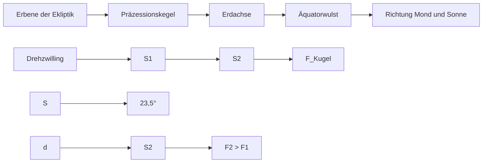

flowchart

Satz von der Bewegung des Massenmittelpunktes (Gl. I-2.64):

$$
\begin{array}{l} \sum_ {i} \vec {F} _ {i} = \vec {F} _ {K u g e l} + \vec {F} _ {1} + \vec {F} _ {2} = \\ = M_{E}\frac{d^{2}\vec{r}_{S}}{dt^{2}}\underset {\substack{\text{gleichf.}\\ \text{Kreis-}\\ \text{bewegg.}}}{} = M_{E}\frac{v_{E}^{2}}{R_{E}}\vec{e}_{n} \\ \end{array}
$$

bestimmt die Bahngeschwindigkeit $\nu _ { \mathsf { E } }$ der Erde

$$
(v _ {E} = 2 9, 7 8 0 \mathrm{km/s}).
$$

Die ganz überwiegend von Sonne und Mond (‚Lunisolarpräzession‘)18 auf den näheren $( S _ { 2 } )$ und ferneren Schwerpunkt $( S _ { 1 } )$ des Äquatorwulstes ausgeübten Kräfte sind ungleich $( \boldsymbol { F } \sim 1 / \boldsymbol { r } ^ { 2 } )$ und erzeugen daher bezüglich des Schwerpunkts S ein Drehmoment $\vec { D } = \vec { d } \times   ( \vec { F } _ { 2 } - \vec { F } _ { 1 } )$ das versucht, die Erdachse gegen die Achse der Ekliptik aufzurichten, also die ‚Schiefe der Ekliptik‘ zu verkleinern. $\cdot ^ { 1 9 }$ Die Erdachse weicht jedoch dazu senkrecht aus und beschreibt einen Präzessionskegel. Ein voller Umlauf der Erdachse dauert 25 780 Jahre (= Platonisches Jahr). Im Moment zeigt die Erdachse in Richtung Polarstern, aber in etwa 12 000 Jahren wird sie in Richtung Vega zeigen.

Die auf den $\ddot { \mathrm { A } } ($ quatorwulst wirkenden Kräfte sind selbst wieder sehr kleinen Schwankungen unterworfen, die zu einer astronomischen Nutation führen. Hauptsächlich wird die Nutation der Erdachse durch den Mond verursacht, dessen Achse um ca. $^ { 5 , 1 ^ { \circ } }$ gegen die Ekliptikebene geneigt ist und dessen Anziehungskraft auf den Äquatorwulst daher während seiner Bahnbewegung nicht immer genau in dieselbe Richtung wirkt. Dies führt zu einer elliptischen Bewegung der Erdachse (‚Nutationsellipse‘), die der Präzessionsbewegung überlagert ist. Die aus Präzession und Nutation zusammengesetzte Gesamtbewegung der Erdachse verläuft also wellenartig, ähnlich wie auf der vorhergehenden Skizze (Abb. I-3.15) gezeigt. Die weiter oben beschriebene Kreiselnutation und die astronomische Nutation der Erdachse haben also verschiedene Ursachen, nämlich einerseits das Auseinanderfallen von $\vec { L }$ und $\vec { \omega }$ und andererseits das Auftreten kleiner zusätzlicher Drehmomente am Kreisel.

<small>18 Der Frühlingspunkt (Äquinoktialpunkt, Schnittpunkt des Himmelsäquators mit der Ekliptik) wandert um 50,39″ im Jahr entgegen der scheinbaren Sonnenbewegung rückwärts im Tierkreis. Davon werden 30″ vom Mond verursacht.</small>

<small>19 Das gilt – wenn auch in geringerem Ausmaß – auch für die beiden Hälften der inneren Kugel links und rechts der Erdachse: Auch ohne einen „Wulst“ würde sich in dem inhomogenen Gravitationsfeld ein Drehmoment um S ergeben!</small>

## 3.4.3 Die Eulerschen Kreiselgleichungen

Wir können die 3-dimensionale Rotation eines starren Körpers unter der Wirkung externer Drehmomente im ‚raumfesten‘ Koordinatensystem mit der Bewegungsgleichung (I-3.22) beschreiben:

$$
\vec {D} = \frac {d \vec {L}}{d t} = \dot {\vec {L}}, \quad \text {wobei} \quad \vec {L} = \tilde {I} \cdot \vec {\omega}. \tag {I-3.54}
$$

Für die x-Komponente gilt z. B.:

$$
D _ {x} = \dot {L} _ {x} = \frac {d}{d t} \left(I _ {x x} \omega_ {x} + I _ {x y} \omega_ {y} + I _ {x z} \omega_ {z}\right). \tag {I-3.55}
$$

Im Allgemeinen sind $\omega _ { x } ,   \omega _ { y } ,   \omega _ { z }$ und $I _ { x x } ,   I _ { x y } ,   I _ { x z } ,   \ldots$ zeitabhängig, d. h. die Bewegungsgleichung für die Rotation ist eine komplizierte Differentialgleichung zur Bestimmung der $\omega _ { x } ,   \omega _ { y } ,   \omega _ { z }$ . Die Beschreibung wird wesentlich einfacher, wenn wir die Rotation im ‚körperfesten‘ Bezugssystem betrachten, das starr mit dem Körper verbunden ist und gegen das raumfeste Koordinatensystem mit der zeitabhängigen Winkelgeschwindigkeit $\vec { \omega } ( t )$ rotiert, da dann der Trägheitstensor zeitunabhängig wird. Lassen wir die Koordinatenachsen des körperfesten Bezugssystems mit den Hauptachsen des Körpers zusammenfallen, so gilt

$$
\vec {L} = \left\{I _ {a} \omega_ {a}, I _ {b} \omega_ {b}, I _ {c} \omega_ {c} \right\}. \tag {I-3.56}
$$

Wir haben früher gesehen (Ableitung der Coriolis- und Zentripetalbeschleunigung, siehe Kapitel „Mechanik des Massenpunktes“, Abschnitt 2.3.3), dass in einem mit ω⇀rotierenden Koordinatensystem für jeden Vektor bezüglich eines raumfesten Systems, das durch den Index $\mathbf { , } \mathbf { f i x } ^ { \mathsf { c c } }$ bezeichnet wird, gilt:

$$
\left(\frac {d \vec {u}}{d t}\right) _ {\text {fix}} = \left(\frac {d \vec {u}}{d t}\right) _ {\text {rot}} + \vec {\omega} \times \vec {u}. ^ {2 0} \tag {I-3.57}
$$

<small>20 Im Kapitel „Mechanik des Massenpunktes“, Abschnitt 2.3.3 ‚Rotierende Bezugssysteme‘, wurde ein Vektor u mit Koordinaten in Bezug auf das rotierende System Σ′ als u′ bezeichnet. Da hier nur im mit dem Körper rotierenden System gearbeitet wird, wird im folgenden auf die ‚Striche‘ verzichtet.</small>

Das können wir auch hier für die Ableitung von $\vec { L }$ verwenden und erhalten so die Bewegungsgleichung im körperfesten System, das im raumfesten, fixen System rotiert, wenn wir $\vec { D } _ { \mathrm { f i x } }$ (ebenso wie $\bar { \omega } )$ nach den körperfesten, bewegten Koordinatenachsen (Hauptachsen) $\vec { e } _ { a } ,   \vec { e } _ { b } ,   \vec { e } _ { c }$ zerlegen

$$
\vec {D} _ {\mathrm{fix}} = \left(\frac {d \vec {L}}{d t}\right) _ {\mathrm{fix}} = \left(\frac {d \vec {L}}{d t}\right) _ {\mathrm{rot}} + \vec {\omega} \times \vec {L} _ {\mathrm{rot}}. ^ {2 1} \tag {I-3.58}
$$

Dabei ist $\vec { D } _ { \mathrm { f i x } }$ das auf den Kreisel wirkende Drehmoment im raumfesten Koordinatensystem, $\bar { L } _ { \mathrm { r o t } }$ der Drehimpuls im körperfesten System mit $\tilde { I }$ als körperfestem Trägheitstensor.

Da $\vec { L } _ { \mathrm { r o t } } = \vec { I } \cdot \vec { \omega }$ , gilt für $\vec{\omega} \times \vec{L} = \vec{\omega} \times \left( \vec{I} \cdot \vec{\omega} \right) = \begin{vmatrix} \vec{e}_{a} & \vec{e}_{b} & \vec{e}_{c} \\ \omega_{a} & \omega_{b} & \omega_{c} \\ I_{a}   \omega_{a} & I_{b}   \omega_{b} & I_{c}   \omega_{c} \end{vmatrix}$ , also z. B. für

die a-Komponente:

$$
\big (\vec {\omega} \times \vec {L} \big) _ {a} = \omega_ {b} L _ {c} - \omega_ {c} L _ {b} = \omega_ {b} \cdot I _ {c} \omega_ {c} - \omega_ {c} \cdot I _ {b} \omega_ {b} = \omega_ {b} \omega_ {c} \big (I _ {c} - I _ {b} \big).
$$

$I _ { a } ,   I _ { b } ,   I _ { c }$ sind die Hauptträgheitsmomente und $\omega _ { a } ,   \omega _ { b } ,   \omega _ { c }$ die Komponenten von $\vec { \omega }$ in Hauptachsenrichtung im körperfesten Bezugssystem.

Damit erhalten wir die Eulerschen Kreiselgleichungen (nach Leonhard Euler, 1707–1783):

$$
\left( \begin{array}{c} D _ {a} \\ D _ {b} \\ D _ {c} \end{array} \right) = \left( \begin{array}{c} I _ {a} \dot {\omega} _ {a} \\ I _ {b} \dot {\omega} _ {b} \\ I _ {c} \dot {\omega} _ {c} \end{array} \right) + \left( \begin{array}{c} \omega_ {b} \omega_ {c} (I _ {c} - I _ {b}) \\ \omega_ {c} \omega_ {a} (I _ {a} - I _ {c}) \\ \omega_ {a} \omega_ {b} (I _ {b} - I _ {a}) \end{array} \right). \tag {I-3.59}
$$

Das Drehmoment ist meist in raumfesten Koordinaten gegeben, hier aber natürlich nach körperfesten Koordinaten zerlegt, die beiden Seiten einer Gleichung müssen sich $\mathbf { j a }$ auf dasselbe Koordinatensystem beziehen.22 Die Eulerschen Kreiselgleichungen sind nichtlineare, gekoppelte Differentialgleichungen für die körperfesten Winkelgeschwindigkeiten $\omega _ { a } ,   \omega _ { b } ,   \omega _ { c }$

<small>21 Der Index „rot“ bezeichnet den Drehimpuls im rotierenden, körperfesten System. Das körperfes te System mit dem festen Schwerpunkt als Ursprung kann nur eine rotierende Bewegung mit der zeitabhängigen Winkelgeschwindigkeit ω⇀(t) = {ω⇀a(t), ω⇀b(t), ω⇀c(t)}, ausführen, die im körperfesten Achsensystem e⇀a , e⇀b , e⇀c darzustellen ist.</small>

<small>22 Diese körperfesten Koordinaten sind wegen der Drehung des körperfesten Hauptachsensystems Funktionen der Zeit, also D = D (t) usf. Dies macht die Lösung der Gleichungen, die außerdem in den Variablen ω̇nichtlinear sind, nicht gerade einfach! Eine allgemeine Lösung ist derzeit nicht bekannt.</small>

Die früher kennen gelernten Eulerschen Winkel $\varphi ,   \theta$ und $\psi$ (Abschnitt 3.2.2, Abb. I-3.5) vermitteln zwischen dem raumfesten und dem körperfesten Koordinatensystem. Wenn die Funktionen $\varphi ( t ) , \; \theta ( t )$ und $\psi ( t )$ bekannt sind, ist die Lage des Körpers im raumfesten System zu jedem Zeitpunkt festgelegt. Zwischen der Winkelgeschwindigkeit ω⇀und den Eulerschen Winkeln besteht folgender Zusammenhang:23

$$
\vec {\omega} = \left( \begin{array}{l} \omega_ {a} \\ \omega_ {b} \\ \omega_ {c} \end{array} \right) = \left( \begin{array}{l} \dot {\varphi} \sin \theta \sin \psi + \dot {\theta} \cos \psi \\ \dot {\varphi} \sin \theta \cos \psi - \dot {\theta} \sin \psi \\ \dot {\varphi} \cos \theta + \dot {\psi} \end{array} \right). \tag {I-3.60}
$$

$$
\Rightarrow \quad \dot {\varphi} = \frac {1}{\sin \theta} \left(\omega_ {a} \sin \psi + \omega_ {b} \cos \psi\right)
$$

$$
\dot {\theta} = \omega_ {a} \cos \psi - \omega_ {b} \sin \psi \tag {I-3.60a}
$$

$$
\dot {\psi} = \omega_ {c} - \cot \theta \left(\omega_ {a} \sin \psi + \omega_ {b} \cos \psi\right).
$$

Dabei bedeuten $\varphi$ die Drehung um die $z ^ { \prime } - A$ chse $( \dot { \varphi }$ weist in z′-Richtung), θ die Drehung um die Knotenlinie (θ̇weist in Richtung der Knotenlinie) und $\psi$ die Drehung um die z-Achse $( \psi$ weist in z-Richtung, siehe Abb. I-3.5).

Wenn also die Komponenten der Winkelgeschwindigkeit in Richtung der Hauptachsen $\omega _ { a } ( t ) ,   \omega _ { b } ( t ) ,   \omega _ { c } ( t )$ durch Lösen der Eulerschen Gleichungen einmal bekannt sind, kann die zeitliche Entwicklung der Eulerschen Winkel und damit die zeitliche Entwicklung der Lage des starren Körpers im raumfesten System durch Integration des Systems der gekoppelten Differentialgleichungen (I-3.60a) und Ermittlung von {φ(t), θ(t), ψ(t)} zumindest grundsätzlich vollständig beschrieben werden.

**Beispiel 1:** Ein starrer Körper rotiere kräftefrei um eine im Raum und im Körper feste Achse mit konstanter Winkelgeschwindigkeit $\vec { \omega } = \{ \omega _ { a } , \omega _ { b } , \omega _ { c } \}$ also $\dot { \omega } _ { a } = \dot { \omega } _ { b } = \dot { \omega } _ { c } = 0$ Die Komponenten des konstanten Drehmoments in Richtung der körperfesten Hauptachsen (drehen sich auch mit $\vec { \omega } )$ die vom Lager aufgenommen werden müssen, sind dann:

$$
\left( \begin{array}{c} D _ {a} = \omega_ {b} \omega_ {c} (I _ {c} - I _ {b}) \\ D _ {b} = \omega_ {c} \omega_ {a} (I _ {a} - I _ {c}) \\ D _ {c} = \omega_ {a} \omega_ {b} (I _ {b} - I _ {a}) \end{array} \right).
$$

Fällt die Drehachse in die a-Hauptachse, so gilt: $\omega _ { b } = \omega _ { c } = 0 ,   \omega _ { a } = \omega$ . Damit verschwinden die Komponenten des Drehmoments, also $D _ { a } = D _ { b } = D _ { c } = 0$ die Hauptachse ist also eine freie Achse, das Lager wird nicht belastet – es braucht also gar nicht vorhanden zu sein! Deshalb auch der Name ‚freie Achse‘.

<small>23 Diese Beziehungen ergeben sich durch Projektion der Winkelgeschwindigkeiten φ,̇ θ̇, ψ̇, die ja auf die Winkelebenen φ, ψ, θ senkrecht stehen, (unter Zwischenschaltung der Hilfsrichtung SD ̄in Abb. I-3.5) auf die Hauptachsenrichtungen e⇀a, e⇀b, e⇀c mit Hilfe der Eulerschen Winkel φ, θ, ψ.</small>

**Beispiel 2:** Ein kräftefreier Körper rotiere wieder mit $\vec { \omega }$ als fester Achse, die aber keine Hauptträgheitsachse sein soll.

ω⇀besitze im Hauptachsensystem die Richtung $\vec { e } _ { n } = \left\{ \cos \alpha , \cos \beta , \right.$ cos γ}; dann gilt $\omega_{a} = \omega \cos \alpha , \omega_{b} = \omega \cos \beta , \omega_{c} = \omega \cos \gamma$ Wir setzen in die Eulergleichungen ein, das ergibt mit $\vec { \omega } = \mathrm { c o n s t . }$ :

$$
\vec {D} = \left\{ \begin{array}{l} D _ {a} \\ D _ {b} \\ D _ {c} \end{array} \right\} = \left\{ \begin{array}{l} \omega^ {2} \cos \beta \cos \gamma (I _ {c} - I _ {b}) \\ \omega^ {2} \cos \alpha \cos \gamma (I _ {a} - I _ {c}) \\ \omega^ {2} \cos \alpha \cos \beta (I _ {b} - I _ {a}) \end{array} \right\}.
$$

Die Projektion von $\vec { D }$ auf die ω⇀-Achse verschwindet offensichtlich, denn es gilt $\vec { D } \cdot \vec { e } _ { n } = D _ { a } \cos \alpha + D _ { b } \cos \beta + D _ { c } \cos \gamma = 0 ,$ das heißt, das Drehmoment $\vec { D }$ steht senkrecht auf der Drehachse ω⇀ und rotiert als körperfester Vektor mit $\omega .$ Vergleiche mit Abschnitt 3.3.4, wo dasselbe Problem ohne Verwendung der Hauptachsen behandelt wurde: Während das Drehmoment $\vec { D }$ hier durch die Hauptträgheitsmomente $I _ { a } , \; I _ { b } , \; I _ { c }$ dargestellt ist, war dort die Ermittlung des Trägheitsmoments $I _ { z z } = I _ { \omega }$ sowie der Deviationsmomente $I _ { x z }$ und $I _ { y z }$ erforderlich.25

## Zusammenfassung

1. Die Bewegung des starren Körpers setzt sich aus einer Translation des Schwerpunkts (3 Freiheitsgrade) und einer Rotation um den Schwerpunkt (3 Freiheitsgrade) zusammen. Für die Bewegung eines Massenelements i gilt:

$$
\vec {v} _ {i} = \vec {v} _ {s} + \vec {\omega} \times \vec {r} _ {i} ^ {S}.
$$

2. Für beide Bewegungsarten gilt $\mathbf { j e }$ eine Newtonsche Bewegungsgleichung:

$$
\vec {F} = \frac {d \vec {p} _ {S}}{d t} = \sum_ {i} m _ {i} \frac {d \nu_ {i}}{d t} = M \frac {d \vec {\nu} _ {S}}{d t} \quad \rightarrow \quad \text {Translation,}
$$

wenn ${ \sum _ { i } } { \vec { F } } _ { i } = 0 \Rightarrow$ Gleichgewicht (keine beschleunigte Translation).

<small>24 denn: (Ic − Ib) + (Ia − Ic) + (Ib − Ia) = 0</small>

<small>25 Anmerkung: Beide Beispiele zählen zu den mechanischen Problemen 1. Art, bei denen die Ge schwindigkeiten υ⇀bzw. ω⇀ vorgegeben sind und die erforderlichen Kräfte bzw. Drehmomente gesucht werden. Sie sind i. Allg. leichter zu lösen als die Probleme 2. Art, bei denen umgekehrt die Kräfte bzw. Momente gegeben sind und die Geschwindigkeiten υ⇀bzw. ω⇀gesucht werden.</small>

$$
\vec {D} = \frac {d \vec {L}}{d t} = \sum_ {i} (\vec {r} _ {i} ^ {S} \times \vec {F} _ {i}) \quad \rightarrow \quad \text {Rotation},
$$

wenn ${ \sum _ { i } } { \vec { D } } _ { i } = 0 \Rightarrow$ Gleichgewicht (keine beschleunigte Rotation).

3. Das Drehmoment ist i. Allg. vom Bezugspunkt $\vec { r } _ { B }$ abhängig:

$$
\underbrace {\vec {D} _ {B} ^ {R}} _ {\substack {\text {Gesamtdrehmoment}\\ \text {bezüglich} B}} = \underbrace {\sum_ {i} \vec {r} _ {i} \times \vec {F} _ {i}} _ {\substack {\text {Summe aller} \\ \text {Drehmomente bezüglich} O}} - \underbrace {\vec {r} _ {B} \times \vec {F} _ {R}} _ {\substack {\text {Drehmoment der in} B\\ \text {angreifenden Gesamtkraft} \bar {F} _ {R}\\ \text {bezüglich} O}}.
$$

Verschwindet aber die resultierende Gesamtkraft $\vec { F } _ { R }$ , so ist ein eventuell noch vorhandenes Drehmoment unabhängig vom Bezugspunkt (‚freier Vektor‘). Dies gilt insbesondere für den Drehzwilling (Kräftepaar):

$$
\vec {D} = \left(\vec {r} _ {1} - \vec {r} _ {2}\right) \times \vec {F}.
$$

4. Wesentlich für die Rotation des starren Körpers ist seine <u>Massenverteilung</u>. An die Stelle der skalaren Masse bei der Translation tritt im Falle der Rotation der symmetrische Trägheitstensor $\tilde { I }$ :

$$
\vec {L} = \tilde {I} \cdot \vec {\omega} \quad \text {mit} \quad \tilde {I} = \int_ {V} d V   \rho (x, y, z) \left( \begin{array}{c c c} y ^ {2} + z ^ {2} & - x y & - x z \\ - y x & x ^ {2} + z ^ {2} & - y z \\ - z x & - z y & x ^ {2} + y ^ {2} \end{array} \right).
$$

5. Für die Rotation um eine feste Schwerpunktsachse A gilt:

$$
E _ {\mathrm{rot}} = \frac {1}{2} I _ {A} \omega^ {2} \quad \text {mit} \quad I _ {A} = \int_ {V} r _ {n} ^ {2} d m
$$

Geht die Achse $A ^ { \prime }$ nicht durch den Schwerpunkt, sondern befindet sie sich im Abstand l von S, so gilt der Steinersche Satz:

$$
I_{A^{\prime}} = \underbrace{I_{A}}_{\substack{\text{Trägheitsmoment}\\ \text{um die parallele}\\ \text{Schwerpunktsachse}}} + \underbrace{l^{2}M}_{\substack{\text{Trägheitsmoment der}\\ \text{Gesamtmasse in Sum A^{\prime}}}}.
$$

6. Auch für die Rotationsenergie ist der Trägheitstensor maßgebend:

$$
\begin{array}{l} E _ {\mathrm{rot}} = \frac {1}{2} \vec {\omega} \vec {L} = \frac {1}{2} \vec {\omega} \cdot \tilde {I} \cdot \vec {\omega} = \frac {1}{2} \left(\omega_ {x}, \omega_ {y}, \omega_ {z}\right) \left( \begin{array}{c} I _ {x x} I _ {x y} I _ {x z} \\ I _ {y x} I _ {y y} I _ {y z} \\ I _ {z x} I _ {z y} I _ {z z} \end{array} \right) \left( \begin{array}{c} \omega_ {x} \\ \omega_ {y} \\ \omega_ {z} \end{array} \right) = \\ = \frac {1}{2} \left(I _ {x x} \omega_ {x} ^ {2} + I _ {y y} \omega_ {y} ^ {2} + I _ {z z} \omega_ {z} ^ {2} + 2 I _ {x y} \omega_ {x} \omega_ {y} + 2 I _ {x z} \omega_ {x} \omega_ {z} + 2 I _ {y z} \omega_ {y} \omega_ {z}\right). \\ \end{array}
$$

Für $E _ { \mathrm { r o t } } = \mathrm { c o n s t } .$ stellt dies die Gleichung des Energieellipsoids (= Poinsot-Ellipsoid) im ω-Raum dar.

7. Es kann immer ein ‚Hauptachsensystem‘ $^ { a , b , c }$ gefunden werden, in dem gilt:

$$
\tilde {I} = \tilde {I} _ {0} = \left( \begin{array}{c c c} I _ {a} & 0 & 0 \\ 0 & I _ {b} & 0 \\ 0 & 0 & I _ {c} \end{array} \right) \quad u n d \quad E _ {\mathrm{rot}} = \frac {1}{2} \left(I _ {a}   \omega_ {a} ^ {2} + I _ {b}   \omega_ {b} ^ {2} + I _ {c}   \omega_ {c} ^ {2}\right).
$$

$I _ { a } , \; I _ { b } , \; I _ { c }$ sind die Hauptträgheitsmomente, $\omega _ { a } , \omega _ { b } , \omega _ { c }$ die Komponenten der Winkelgeschwindigkeit in Richtung der Hauptachsen.

8. Der Wert des Trägheitsmoments sowie Richtung und Größe des Drehimpulses können mit Hilfe des Trägheitsellipsoids bzw. des Energieellipsoids bestimmt werden, wenn die Hauptträgheitsmomente bekannt sind.

9. Nutation des kräftefreien Kreisels: Momentane Drehachse $\vec { \omega }$ und Figurenachse $\vec { c }$ des Kreisels bewegen sich auf Kegelmänteln um den raumfesten Drehimpuls $\vec { L }$ . Ein Kegel mit $\vec { L }$ als Achse ist raumfest (Rastpolkegel), während der zweite Kegel mit $\vec { c }$ als Achse sich auf dem Rastpolkegel abwälzt (Gangpolkegel), wobei die Berührungslinie der beiden Kegel die momentane Drehachse $\vec { \omega }$ bildet.

10. Präzession eines Kreisels: Ein äußeres Drehmoment $\vec { D }$ bewirkt eine dauernde Richtungsänderung des Drehimpulses $\vec { L } .$ Zusätzlich kommt es stets noch zur Nutation, die aber unmerklich klein sein kann.

11. Die allgemeine Rotation des starren Körpers wird einfacher in körperfesten (mitrotierenden) Koordinaten angegeben als in raumfesten. Nimmt man als körperfeste Achsen die Hauptachsen, so ergeben sich als Bewegungsgleichungen der Rotation die ‚Eulerschen Kreiselgleichungen‘

$$
\left( \begin{array}{c} D _ {a} \\ D _ {b} \\ D _ {c} \end{array} \right) = \left( \begin{array}{c} I _ {a} \dot {\omega} _ {a} \\ I _ {b} \dot {\omega} _ {b} \\ I _ {c} \dot {\omega} _ {c} \end{array} \right) + \left( \begin{array}{c} \omega_ {b} \omega_ {c} (I _ {c} - I _ {b}) \\ \omega_ {c} \omega_ {a} (I _ {a} - I _ {c}) \\ \omega_ {a} \omega_ {b} (I _ {b} - I _ {a}) \end{array} \right)
$$

zur Bestimmung von $\vec { \omega } ( t ) = \left\{ \omega _ { a } ( t ) ,   \omega _ { b } ( t ) ,   \omega _ { c } ( t ) \right\}$ . Mit den daraus ermittelten Eulerschen Winkeln φ(t), θ(t), $\psi ( t )$ kann so die Bewegung des starren Körpers zu jedem Zeitpunkt auch im raumfesten Koordinatensystem angegeben werden.

## Übungen:

Eine waagrechte, kreisrunde Plattform rotiert reibungsfrei gelagert um eine senkrechte, durch ihren Mittelpunkt gehende Achse. Die Masse der Plattform beträgt 300 kg, ihr Radius ist 2,0 m, ihr Trägheitsmoment bezüglich der angegebenen Achse beträgt 300 kg $\mathbf { m } ^ { 2 }$ Eine Person mit 60 kg Masse rotiert mit der Plattform mit und bewegt sich langsam vom Rand der Plattform in Richtung ihres Mittelpunkts. Vor dieser Bewegung drehte sich die Plattform mit einer Winkelgeschwindigkeit von 1,5 rad/s. Wie groß ist die Winkelgeschwindigkeit, wenn sich die Person nur noch 0,5 m von der Mitte entfernt befindet?
2. Ein symmetrischer Kreisel mit der Masse 100 g dreht sich um seine Symmetrieachse mit einer Frequenz $\nu   =   1 0 ~ \mathrm { s } ^ { - 1 }$ um seine Achse. Bei Auslenkung aus der Vertikalen um einen Winkel $\beta = 3 0 ^ { \circ }$ führt er unter dem Einfluss seines Gewichtes eine Präzessionsbewegung aus. Die Präzessionsfrequenz beträgt $\nu _ { p } = 0 , 9 \; \mathrm { s } ^ { - 1 }$ der Abstand des Fußpunktes vom Kreiselschwerpunkt ist 6 cm. Wie groß ist das Trägheitsmoment des Kreisels?
3. Berechne die Trägheitsmomente folgender Körper:

a) Eine homogene Kreisscheibe der Masse M, bezüglich der Symmetrieach se und bezüglich einer dazu parallelen Achse, die durch den Halbie rungspunkt des Radius geht.
b) Ein aus einem dünnen, homogenen Blech geschnittenes gleichseitiges Dreieck bezüglich einer mit einer Dreiecksseite zusammenfallenden Achse.
c) Ein Ellipsoid ${ \frac { x } { { a } ^ { 2 } } } + { \frac { y } { { a } ^ { 2 } } } + { \frac { z } { { b } ^ { 2 } } } = 1$ das homogen mit Masse erfüllt ist und die Gesamtmasse M hat, bezüglich der z-Achse.

4. Ein Gyrobus26 bezieht seine Energie aus einem Schwungrad (Masse m, Trägheitsmoment I), das an den Endstationen aufgeladen, d. h. in schnelle Rotation versetzt wird. Wie lange kann der Bus mit einer mittleren Leistung fahren, bis das Schwungrad nur noch mit der halben ursprünglichen Winkelge schwindigkeit rotiert? Berechne das Ergebnis für folgende speziellen Werte: Tourenzahl des Kreisels beim Start $n = 3000\  min ^{-1}, I = 250\  kg \  m ^{2}, L = 20\  kW$ Warum empfiehlt es sich, zwei gegenläufig rotierende Kreisel zu verwenden?

<small>26 Ein Gyrobus ist ein elektrisch angetriebener Autobus, der seine Energie aber nicht aus einer Oberleitung bezieht, sondern aus der Rotationsenergie eines mitgeführten Schwungrades. An den Endstationen kann das Schwungrad mit Stromabnehmern wieder elektrisch beschleunigt werden.</small>

## Anhang 1 Poinsotsche Beschreibung der Starrkörperbewegung

Während der Bewegung des freien starren Körpers rollt das mit ihm verbundene Energieellipsoid (= Poinsot-Ellipsoid) auf der invariablen Ebene ab, ohne zu gleiten (Abb. I-3.16).

Der Abstand $\omega _ { L }$ der invariablen Ebene vom raumfesten Schwerpunkt S ändert sich während der Bewegung nicht (siehe Gl. I-3.32). Während der Bewegung weist $\vec { \omega }$ stets von S zum Berührungspunkt T des Ellipsoids mit der invariablen Ebene, der auf dem Ellipsoid die körperfeste Polbahn (Polhodie) beschreibt, die mit S als Pol und den Vektoren $\vec { \omega } ( t )$ einen allgemeinen, körperfesten Kegel, den Polhodiekegel, bildet. Die Bahn, die der Berührungspunkt $T$ auf der invariablen Ebene beschreibt (Abb. I-3.17), nennt man die Spurbahn (Herpolhodie).

Gyrobus der Schweizer Maschinenfabrik Oerlikon für die Verkehrsbetriebe Zürich um 1950 (rechts unten). Die Masse des Schwungrades mit $^ { 1 , 6 }$ m Durchmesser (links) betrug 1,5 t, die maximale Drehzahl war 3000 U/min; das bedeutet eine Umfangsgeschwindigkeit von ca. 900 km/h. Die Achse des Schwungrades war mit einem 3-Phasen Asynchronmotor verbunden, der das Schwungrad in den Ladestationen in 2–5 min wieder auf die maximale Drehzahl beschleunigte, im Fahrbetrieb aber als Generator für den 52 kW Antriebsmotor wirkte. Im Normalbetrieb konnte die Drehzahl des Schwun grades von 3000 U/min bis auf 2100 U/min abnehmen; damit wurde eine Reichweite von ca. 6 km erzielt. Stand das Schwungrad einmal still, dauerte es ca. 40 min bis die erforderliche Drehzahl wieder erreicht war; das Schwungrad wurde daher auch über Nacht in Rotation gehalten. Die maximale Geschwindigkeit des Gyrobusses lag bei etwa 55 km/h.

text_image

Polhodie
(Polbahn)
T
ω̄
S
Herpolhodie
(Spurbahn)
invariable Ebene
L̅

Abb. I-3.16: Poinsotsche Beschreibung der Starrkörperbewegung: Das Poinsot-Ellipsoid rollt auf der invariablen Ebene. (nach W. Greiner, 2008. „Klassische Mechanik II: Teilchensysteme, Lagrange-Hamiltonsche Dynamik, Nichtlineare Phänomene“. Verlag Harry Deutsch).

text_image

invariable Gerade
L
Herpolhodie
(Spurbahn)
T(t₂)
T(t₁)
invariable Ebene
ω̅(t₂)
ω̅(t₁)
O = S

Abb. I-3-17: Invariable Ebene und invariable Gerade. (nach W. Greiner, 2008. „Klassische Mechanik II: Teilchensysteme, Lagrange-Hamiltonsche Dynamik, Nichtlineare Phänomene“. Verlag Harry Deutsch).

Die Spurbahn ergibt von $S$ aus den raumfesten Herpolhodiekegel, auf dem der Polhodiekegel längs des gemeinsamen Vektors $\vec { \omega }$ abrollt. Polhodie und Herpolhodie sind i. A. keine geschlossenen Kurven. Ist der Körper symmetrisch, dann ist das Poinsot-Ellipsoid ein Rotationsellipsoid und beim Abrollen entstehen für die Polbahn und die Spurbahn Kreise. $\vec { \omega }$ ist zwar dem Werte nach konstant $\left( \left| \vec{\omega} \right| = \omega =  const.  \right)$ , ändert aber dauernd seine Richtung, d. h. $\vec { \omega }$ rotiert um die raumfeste Drehimpulsachse, die invariable Gerade, und bildet den Herpolhodiekegel. Auch die körperfeste Figurenachse $\vec { c }$ rotiert um $\vec { L }$ und erzeugt den Nutationskegel.

## Anhang 2 Weiteres vom Kreisel

## A2.1 Gleichsinniger Parallelismus

Wird ein Kreisel durch ein von außen einwirkendes Drehmoment $\vec { D }$ zu einer Bewegung seiner Achse gezwungen und ist dieses Drehmoment nach Größe und Richtung konstant, dann wird die Drehimpulsachse schließlich in die Richtung von $\vec { D }$ gedreht, wobei der Drehimpuls $\vec { L }$ wächst (Abb. I-3.18).

text_image

Kreisel
L̅
ΔL = D̄ · dt

Abb. I-3.18: Zum gleichsinnigen Parallelismus. Ein von außen auf die Kreiselachse einwirkendes Drehmoment $\vec { D }$ dreht die Drehimpulsachse In Richtung von ${ \bar { D } } .$ Die zunächst in Richtung L⇀ mit ω⇀rotierende Figurenachse c⇀beginnt zu nutieren; die gestrichelten Vektoren geben daher nicht die Lage der Figurenachse c⇀wieder.

Diese Erscheinung heißt Tendenz zum gleichsinnigen Parallelismus. Ist der Drehimpuls des Kreisels Null (nicht aufgezogener Kreisel), dann bewirkt ein aufgebrachtes Drehmoment $\vec { D }$ eine Drehbeschleunigung um die Richtung des Drehmoments senkrecht zur Achse A (Achsendrehung) und der Kreisel „folgt“ dem Mo ment, während der aufgezogene Kreisel dem Moment „ausweicht“.27 Versucht man z. B. beim aufgezogenen schweren Kreisel (siehe 3.4.2, Abb. I-3.13) die Präzessions frequenz $\omega _ { P }$ dadurch zu erhöhen oder zu erniedrigen, dass ein beschleunigendes oder verzögerndes Drehmoment ${ \bar { D } } _ { A }$ in Richtung der Achse A mit der Hand ausgeübt wird (Drehung der Achse), dann stellt sich der Kreisel auf bzw. kippt nach unten: $\Delta \vec { L } = \vec { D } _ { A } \cdot d t$ ist entweder nach oben oder nach unten gerichtet und addiert sich zum vorhandenen Drehimpuls $\vec { L } ,$ der selbst um $A$ präzediert). Es gelingt auf diese Weise nicht, die Präzessionsfrequenz $\omega _ { P }$ zu verändern, der Kreisel weicht dem Moment ${ \bar { D } } _ { A }$ senkrecht aus.

<small>27 In beiden Fällen ist aber natürlich der Drehimpulszuwachs im Zeitelement dt: ΔL⇀= D⇀⋅dt .</small>

## A2.2 Der Kreisel im mit der Präzessionsfrequenz Ωrotierenden Bezugssystem

In einem mit der Präzessionsfrequenz $\vec { \Omega } = \vec { \omega } _ { P }$ rotierenden Bezugssystem zeigt der Kreisel mit Winkelgeschwindigkeit $\vec { \omega }$ keine Präzession. (Das ist analog zu einem Massenpunkt im Schwerefeld in einem mit der Erdbeschleunigung $\vec { g }$ beschleunigten Bezugssystem, dem „fallender Kasten“, siehe Kapitel „Mechanik des Massenpunktes, Abschnitt 2.3.2). Die Summe der auf den Kreisel wirkenden Drehmomente muss also Null sein, oder: Das physikalische Drehmoment $\vec { D }$ , das im Inertialsystem die Präzession $\omega _ { P }$ verursacht, wird durch ein Trägheitsdrehmoment, das Coriolis moment $\bar { \omega } _ { T }$ , kompensiert und es gilt (siehe 3.4.2, Gl. I-3.53)

$$
\vec {D} _ {T} = - \vec {D} = - I (\vec {\omega} _ {P} \times \vec {\omega}). \tag {I-3.61}
$$

Ein mit $\bar { \Omega }$ rotierendes Bezugssystem ist also ein beschleunigtes Bezugssystem, in dem Trägheitsdrehmomente auftreten; so wie der „fallende Kasten“ ein beschleunigtes Bezugssystem ist, in dem Trägheitskräfte $\vec { F } _ { T }   = - m \cdot \vec { g }$ auftreten. Diese Trägheits drehmomente ${ \vec { D } } _ { T }$ , welche aufgrund ihrer Ursache als Coriolismomente bezeichnet werden, sind im drehenden (beschleunigten) Bezugssystem immer vorhanden und sind genauso wie etwa vorhandene physikalische Drehmomente (Kräfte) zu behandeln (siehe auch Kapitel „Mechanik des Massenpunkts“, Abschnitt 2.3.3).

**Beispiel 1:** Im drehenden Bezugssystem wirke kein physikalisches Moment $\vec { D }$ : Im Inertialsystem sei der Kreisel kräftefrei. Dann wirkt im mit $\bar { \omega } _ { P }$ rotierenden System nur das Trägheitsdrehmoment $\vec { D } _ { T } = - I ( \vec { \omega } _ { P } \times \vec { \omega } )$ , das den Kreisel im rotierenden System mit der Winkelgeschwindigkeit −Ω präzedieren lässt.

**Beispiel 2:** Kreisel im rotierenden Erdsystem – Kreiselkompass.

Die Winkelgeschwindigkeit der Erdrotation $\bar{\omega}_{E}=\frac{2\pi}{\mathrm{Tag}}=\frac{2\pi}{\mathrm{d}}$ nimmt jetzt im Coriolismoment ${ \vec { D } } _ { T }$ die Stelle von $\omega _ { P }$ ein: $\vec { D } _ { T } = - I ( \vec { \omega } _ { P } \times \vec { \omega } )$ . Wird der Kreisel mit seinem Lagergehäuse fest mit der rotierenden Erde verbunden, so ist er gezwungen, die Erdrotation $\bar { \omega } _ { E }$ voll mitzumachen, sodass er relativ zur Erde ruht. Dann müssen Lagerkräfte ein Zwangsmoment $\vec { D } _ { Z w }$ erzeugen, welches das Coriolismoment kompensiert: $\vec { D } _ { Z w } = I ( \vec { \omega } _ { E } \times \vec { \omega } )$ Ist der Kreisel andererseits so gelagert, dass er nur eine Komponente, die Horizontalkomponente $\vec { \omega } _ { E _ { H } }$ von $\bar { \omega } _ { E }$ mitzumachen gezwungen ist (Kreiselkompass), dann wird auch nur diese Komponente $\vec { \omega } _ { E _ { H } }$ ein Zwangsmoment $\vec { D } _ { Z w } ^ { \prime } = I ( \vec { \omega } _ { E _ { H } } \times \vec { \omega } )$ hervorrufen, das vertikal nach oben zeigt (in Zenitrichtung).

text_image

ω̅E
ω̅EV
φ
A'
ω̅
N
A
Horizont
φ
S

Dieses vertikale Zwangsmoment ist aber nur vorhanden, solange $\vec { \omega } _ { E _ { H } }$ und ω⇀ nicht parallel sind, die Kreiselachse also nicht in der Meridianebene der Erde liegt. Dann wird aber $\vec { D } _ { Z w } ^ { \prime }$ den Kreiselrahmen samt Kreisel beschleunigt um die Achse $A A ^ { \prime }$ in die Meridianebene zurückdrehen und darüber aufgrund der Trägheit hinaus schwingen, sodass die Einstellung in die Meridianebene in Form gedämpfter Schwingungen erfolgt. Die freie Komponente $\vec { \omega } _ { E _ { H } }$ von $\bar { \omega } _ { E }$ bewirkt eine Präzession des Kreisels mit $\vec { \omega } _ { P } = \vec { \omega } _ { E _ { H } }$ welche den Kreisel aus der Meridianebene nach Ost hinausdreht, das dadurch entstehende Zwangsmoment $\vec { D } _ { Z w } ^ { \prime }$ führt ihn aber wieder in die N-S-Richtung zurück. Am Nordpol ist der Kreiselkompass wegen des Verschwindens von $\vec { \omega } _ { E _ { H } }$ unwirksam. In dieser Region wird astronomisch bzw. heute mit $G P S ^ { 2 8 }$ navigiert.

<small>28 Global positioning system: Genaue Positionsbestimmung aus der Laufzeit von Signalen elektromagnetischer Wellen zu geostationären Navigationssatelliten. Geostationärer Satellit: künstlicher</small>

Bewegungsgleichung des Kreisels für kleine Winkelabweichungen α von der Meridianebene:

$$
\vec {D} _ {Z w} ^ {\prime} = I (\vec {\omega} _ {E _ {H}} \times \vec {\omega}) \Rightarrow D _ {Z w} ^ {\prime} = \left| D _ {Z w} ^ {\prime} \right| = I \cdot \omega_ {E _ {H}} \cdot \omega \cdot \sin \alpha \cong \underbrace {I \omega_ {E} \omega \cos \varphi} _ {= D} \cdot \alpha = I _ {A A ^ {\prime}} \ddot {\alpha}.
$$

Dies ist die Schwingungsgleichung eines physikalischen Pendels mit dem Direktionsmoment (zum Richtmoment, siehe Kapitel „Deformierbare $\mathtt { K \ddot { o } r p e r ^ { \omega } }$ Abschnitt 4.2.2, Beispiel ‚Torsion eines Stabes‘)

$$
D = I \omega_ {E} \omega \cos \varphi \quad \text { mit } \quad \omega_ {E} = \frac {2 \pi}{\mathrm{d}} = \frac {2 \pi}{8 6 1 6 4 \mathrm{s}} = 7, 3 \cdot 1 0 ^ {- 5} \mathrm{rad} \mathrm{s} ^ {- 1}.
$$

Die Idee zum Kreiselkompass stammt von L. Foucault (Jean Bernard Léon Foucault, 1819–1868) aus dem Jahre 1856. Wegen der Kleinheit des Direktionsmoments gelang die erste praktische Ausführung erst zu Beginn des 20. Jh.s Hermann Anschütz-Kaempfe (1872–1931) in einer von der beschriebenen Ausführung abweichenden Form, indem die Bindung an die Horizontalebene nicht durch einen um die Achse AA′ gelagerten Rahmen, sondern durch Pendelaufhängung gesichert wird, wobei der Kreisel an einem vertikalen Arm und dieser an einem Schwimmer montiert ist, der in einer Quecksilberwanne allseits beweglich getragen wird. Dadurch treten neben den Coriolismomenten auch noch physikalische Pendelmomente auf, die das Direktionsmoment vergrößern. Der Kreisel ist als Läufer eines Drehstrommotors mit 20 000 U/min ausgeführt und besitzt ein Trägheitsmoment $I = 14 \cdot 10^{-3}    kg     m ^2 \quad (\varnothing = 0.15    m , \quad m = 5    kg , \quad L = 28$ $10^{4}  kg m ^{2}/ s$ Damit ergibt sich am Äquator ein Richtmoment von $D = 2 \cdot 10^{-3}    Nm$ Zum Vergleich: Ein Fadenpendel mit l = 1 m Länge und der Masse m = 1 g besitzt ein Richtmoment von

$$
D _ {P} = m g l = 1 0 ^ {- 3} \mathrm{kg} \cdot 9, 8 1 \mathrm{m} / \mathrm{s} ^ {2} \cdot 1 \mathrm{m} = 9, 8 1 \cdot 1 0 ^ {- 3} \mathrm{Nm}.
$$

## A2.3 Das Zentrifugalmoment eines Körpers, der nicht um eine Hauptträgheitsachse rotiert

Ein symmetrischer Körper mit den Hauptachsen a und c rotiert um eine in Lagern gehaltene Achse x ≠ a ≠ c (Abb. I-3.19).

<small>Erdsatellit auf einer Bahn 35 786 km über dem Äquator („geostationäre Umlaufbahn“) mit genau einer Erdumrundung pro Tag. Die Position eines geostationären Satelliten ist daher in Bezug auf die Erdoberfläche konstant.</small>

text_image

F
S
μ
ω̅d
l
a
F
c
x

Abb. I-3.19: Zum Zentrifugalmoment eines Körpers, der nicht um eine Hauptträgheitsachse rotiert.

Es gilt:

$$
\omega_ {a} = \omega \cdot \sin \mu , \quad \dot {\omega} _ {a} = 0
$$

$$
\omega_ {b} = 0, \quad \dot {\omega} _ {b} = 0 \tag {I-3.62}
$$

$$
\omega_ {c} = \omega \cdot \cos \mu , \quad \dot {\omega} _ {c} = 0
$$

Aus den Euler-Gleichungen (Abschnitt 3.4.3, Gl (I-3.59)) folgt mit $I _ { a } = I _ { b } \triangleleft I _ { c }$

$$
D _ {a} = 0
$$

$$
- D _ {b} = (I _ {c} - I _ {a}) \omega^ {2} \sin \mu \cos \mu = F \cdot l \tag {I-3.63}
$$

$$
D _ {c} = 0.
$$

Diese Momente wirken im körperfesten Hauptachsensystem, das im Raum mit ω⇀ rotiert. Das auf den Kreisel wirkende Moment $- D _ { b } = F \cdot l$ wird von den Lagerkräften aufgenommen. Es steht senkrecht auf der durch die Hauptachsen a und c aufgespannten Ebene und dreht sich mit der Winkelgeschwindigkeit ω⇀um die Achsrichtung $x .   - D _ { b }$ wird Zentrifugalmoment genannt und bewirkt eine mit ω⇀umlaufende Lagerbeanspruchung durch die Kraft F.

## 4 Mechanik deformierbarer Körper

**Einleitung:** Der „starre Körper“ ist ein Modell für Körper, deren Gestalt auch beim Wirken von Kräften unverändert bleibt. Reale Festkörper sowie Flüssigkeiten und Gase können dagegen unter dem Einfluss äußerer Kräfte ihre Gestalt und ihr Volumen verändern. Feste Körper erfahren bei Wirkung äußerer Kräfte elastische (reversible) und plastische (irreversible) Formänderungen. Je nach der Art der am Festkörper angreifenden Kräfte wird er gedehnt, gebogen, tordiert (verdrillt) oder abgeschert. Flüssigkeiten und Gase („Fluide“) setzen reinen Formänderungen, die nicht mit Volumenänderungen verbunden sind, nur einen sehr kleinen Widerstand entgegen; daher können Fluide durch Rohre strömen. Diese Strömung kann entweder wirbelfrei (Potenzialströmung) oder mit Wirbeln vor sich gehen, wobei sie, abhängig von den Reibungsverhältnissen in der Flüssigkeit und an der Rohrwandung, auch turbulent verlaufen kann.

## 4.1 Aggregatzustände und Bindungen

Die Materie ist aus Atomen und Molekülen aufgebaut. Die Elektronen der Atomhülle und ihre Wechselwirkungen (WW) sind für die Eigenschaften der Materie, wie z. B. die chemischen, die mechanischen, die elektrischen und optischen, verantwortlich. Man unterscheidet vier Aggregatzustände fest, flüssig, gasförmig und plasmaartig.1 Wir schauen uns die drei klassischen Aggregatzustände genauer an:

<table><tr><td rowspan="2"></td><td colspan="2">Gas</td></tr><tr><td>ideal</td><td>real</td></tr><tr><td>WW zwischen den Atomen oder Molekülen</td><td>keine</td><td>schwach</td></tr><tr><td rowspan="2">Beweglichkeit der Teilchen</td><td colspan="2">hoch</td></tr><tr><td>bewegen sich unabhängig voneinander</td><td>T steigt: abnehmend, verflüssigbar</td></tr><tr><td>bei mechanischer Krafteinwirkung</td><td colspan="2">hohe Kompressibilität</td></tr><tr><td>Dichte (Normaldruck, 300 K)</td><td colspan="2"> $\sim 1 \text{ kg/m}^{3}$ </td></tr><tr><td rowspan="2"></td><td colspan="2">Flüssigkeit $^{2}$ </td></tr><tr><td>ideal</td><td>real</td></tr><tr><td rowspan="2">WW zwischen den Atomen oder Molekülen</td><td>reibungsfrei Schermodul  $G = 0$ </td><td>reibungsbehaftet</td></tr><tr><td colspan="2">WW stärker als im Gas, schwächer als im FK, ungerichtete Bindung</td></tr><tr><td rowspan="2">Beweglichkeit der Teilchen</td><td colspan="2">Teilchen leicht verschiebbar</td></tr><tr><td>bewegen sich unabhängig voneinander</td><td>T steigt: zunehmend</td></tr><tr><td>bei mechanischer Krafteinwirkung</td><td colspan="2">Volumenbeständigkeit, geringe Kompressibilität</td></tr><tr><td>Dichte (Normaldruck, 300 K)</td><td colspan="2"> $\sim 10^{3} \text{kg/m}^{3}$ </td></tr></table>

<small>1 Plasma ist ein Zustand der Materie, in dem die Atome weitgehend oder vollständig von ihren Elektronen getrennt sind, also ein Teilchengemisch aus Ionen und Elektronen vorliegt.</small>

<table><tr><td rowspan="2"></td><td colspan="2">Festkörper (FK)</td></tr><tr><td>ideal</td><td>real</td></tr><tr><td>WW zwischen den Atomen oder Molekülen</td><td colspan="2">starke WW; kristallin (Atome in regelmäßigem Raumgitter), Kettenstruktur (Polymere)oder amorph (unterkühlte Flüssigkeit, z. B. Glas)</td></tr><tr><td>Beweglichkeit der Teilchen</td><td>Teilchen sind ortsfest, schwingen gekoppelt um ihre Ruhelage (thermische Bewegung)</td><td>geringe, stark von der Temperatur abhängige Beweglichkeit, im Kristall durch Gitterdefekte</td></tr><tr><td>bei mechanischer Krafteinwirkung</td><td colspan="2">Formbeständigkeit, geringe Kompressibilität, Elastizität</td></tr><tr><td>Dichte (Normaldruck, 300 K)</td><td colspan="2"> $\sim 10^{3}$  kg/m $^{3}$ </td></tr></table>

## 4.1.1 Gasförmiger Zustand

Die Atome oder Moleküle sind praktisch frei beweglich und nehmen jeden gebote nen Raum ein (Expansionsdruck), wodurch auch der mittlere Abstand zwischen den Teilchen bestimmt wird.

Die Gasdichte ist gegeben durch

$$
\rho = \frac {M}{V} \quad \text {bzw. durch} \quad \rho (\vec {r}) = \frac {d m}{d V}, \tag {I-4.1}
$$

bei variabler Massenverteilung.

<small>2 Wegen der starken Ähnlichkeit im Verhalten äußeren Kräften gegenüber, werden Gase und Flüssigkeiten in der Hydromechanik unter dem Namen Fluide zusammengefasst.</small>

Dabei gilt $M = N \cdot m _ { \mathrm { s } }$ wobei N die Zahl der Moleküle mit Masse m ist.

Unterhalb einer gewissen Temperatur ist die mittlere $E _ { \mathrm { k i n } }$ der Gasmoleküle zu gering, um den gasförmigen Zustand (Verdampfung) gegen die Anziehung der Moleküle (Bindungsenergie) aufrecht zu erhalten und es setzt Kondensation (Verflüssigung) ein (siehe dazu Band II, Kapitel „Physik der Wärme“, Abschnitt 1.3.3.1).

## 4.1.2 Flüssiger Zustand

Die Verflüssigung (Phasenumwandlung durch Kondensation vom gasförmigen in den flüssigen Zustand bei einer bestimmten Temperatur $T _ { \mathrm { k o n d } } )$ ist mit einem sehr großen Anstieg der Dichte verbunden. Die Dichte von Flüssigkeiten ist nahezu so hoch wie jene von Festkörpern. Der umgekehrte Vorgang, die Verdampfung, erfolgt bei derselben Temperatur $T _ { \mathrm { v e r d } } = T _ { \mathrm { k o n d } }$ (gleicher Druck vorausgesetzt).

Die Atome oder Moleküle einer Flüssigkeit weisen bereits eine gewisse topologische Nahordnung auf, d. h. wenn man nur wenige Atomdistanzen betrachtet, findet man eine gewisse Regelmäßigkeit ihrer Anordnung (Abb. I-4.1). Dies ist die Folge einer schwach gerichteten, anziehenden Wechselwirkung zwischen den Flüssigkeitsmolekülen (in Abb. I-4.1 durch Striche dargestellt).

flowchart

Abb. I-4.1: Anordnung von Molekülen (links) und Bewegung von Molekülen in einer Flüssigkeit (rechts).

Wird die Temperatur kleiner als die Schmelztemperatur $T _ { S }$ , dann ist die $E _ { \mathrm { k i n } }$ der Flüssigkeitsmoleküle so klein, dass die Bindungsenergie zwischen den Atomen oder Molekülen ausreicht, um sie gegen die Stöße der Nachbarteilchen auf festen Plätzen zu halten.

## 4.1.3 Fester Zustand

Das atomare Potenzial zwischen zwei isolierten wechselwirkenden neutralen Atomen eines Festkörpers ist asymmetrisch und ergibt sich aus der Überlagerung von Abstoßungskräften und Anziehungskräften (Abb. I-4.2). Die Abstoßung wächst sehr stark mit der Annäherung der Atome, während die Anziehung mit ihrer Distanz schwächer abnimmt. Dies führt zu einem mittleren Atomabstand, der von der Temperatur abhängt (punktiert in Abb. I-4.2).

line

| Feature | Value |
| --- | --- |
| E0 | \(E_{0}\) |
| E1 | \(T_{1}\) |
| E2 | \(T_{2}\) |
| Anziehung | N/A |
| Abstoßung | N/A |
| Statische Gleichgewichtslage | N/A |

Abb. I-4.2: Schematische Darstellung des Potenzials zwischen zwei wechselwirkenden neutralen Atomen eines Festkörpers. Bei der Teilchenenergie $E _ { i }$ und der Temperatur $T _ { i }$ schwingt das Atom zwischen dem linken und dem rechten Zweig der Potenzialkurve, die punktierte Kurve verbindet die Schwingungsmittelpunkte.

Die Asymmetrie des Atompotenzials bedingt eine Anharmonizität der Atomschwingungen und ist für die Wärmeausdehnung der Festkörper verantwortlich, da sich der Schwingungsmittelpunkt bei größeren Amplituden (höherer Temperatur) zu größeren Atomabständen verschiebt.

## Bindungsarten

Wir unterscheiden 5 Bindungsarten des festen Zustands:3

| Ionenbindung (Abb. I-4.3): | starke elektrostatische WW durch $e^{-}$-Verlagerung |
| --- | --- |
| kovalente Bindung: | stark gerichtete Bindung, zwei Atome teilen sich ein $e^{-}$-Paar (Molekülbindung) |
| metallische Bindung: | die äußersten $e^{-}$ sind im Kristall nicht mehr lokalisiert, sie gehören dem Gitter als Ganzes an („superkovalent‘),hohe Leitfähigkeit |
| van der Waals Bindung: | schwach anziehende WW durch Polarisierung der $e^{-}$-Hülle |
| Wasserstoffbrückenbindung: | Ionenbindung durch Elektronentransfer zwischen einem H-Atom und zwei elektronegativen Fluor-, Sauerstoff- oder Stickstoffatomen. |

Die physikalischen Eigenschaften ‚homogener Körper‘ (z. B. Dichte, Elastizität, Festigkeit) sind im Inneren überall gleich. Ist der Körper isotrop, dann sind die Eigenschaften auch unabhängig von der Richtung. Die meisten Kristalleigenschaften sind aber anisotrop. Ein Beispiel für Anisotropie ist die Doppelbrechung von Kalkspat (siehe Band IV, Kapitel „Wellenoptik“, Abschnitt 1.4.5): Dieser Kristall ist zwar homogen, aber anisotrop; eindringende Lichtstrahlen, werden in zueinander senkrecht polarisierte Komponenten mit unterschiedlicher Phasengeschwindigkeit zerlegt (Abb. I-4.4). Die Geschwindigkeit einer der beiden Komponenten ist richtungsabhängig (außerordentlicher Strahl).

<small>3 Siehe Band VI, Kapitel „Festkörperphysik“, Abschnitt 2.1.1.</small>

chemical

Crystal lattice structure diagram showing Na⁺ and Cl⁻ ions in a cubic arrangement

Abb. I-4.3: Kochsalzkristall (NaCl) als Beispiel für die Bildung einer Kristallstruktur durch Ionenbindung zwischen den größeren Chlorionen (Cl) und den kleineren Natriumionen $( { N a } ^ { + } )$ Jedes Ion besitzt sechs nächste Nachbarn der anderen Sorte.

text_image

Do wellbreaching

Abb. I-4.4: Doppelbrechung von Calcit (Kalkspat, $\mathsf { C a C o } _ { 3 } )$ als Beispiel für anisotrope Eigenschaften.

1941 schrieb R. W. Pohl in seinem dreibändigen Lehrbuch ‚Einführung in die Physik‘:

„Die festen Körper spielen für unser ganzes Dasein eine schlechthin entscheidende Rolle. Selbst eine kühne Phantasie vermag sich kein organisches Leben ohne feste Körper auszumalen. So ist eine bessere Erforschung des festen Zustandes die heute vielleicht vordringlichste Aufgabe der physikalischen Forschung.“

Die Forschung in der Festkörperphysik hat tatsächlich in der zweiten Hälfte des vorigen Jahrhunderts gewaltige Fortschritte gemacht, man denke nur an die Entwicklung der Elektronik seit der Erfindung des Transistors 1948. Heute steht die Physik fester Stoffe wieder an einer entscheidenden Stelle. Die Möglichkeit der ‚Nanostrukturierung‘ von Materialien (Nanomaterialien) ist gerade dabei, die technischen Möglichkeiten zu revolutionieren. Unter Nanomaterialien versteht man Strukturen oder Strukturelemente mit Abmessungen zwischen 1–100 nm. Wenn eine oder mehrere Dimensionen eines Stoffes in diese Größenordnung fallen (dünne Filme, Nanodrähte, Nanopunkte), kommt es zu teilweise drastischen Änderungen der physikalischen Eigenschaften und der vermittelnden Prozesse. Wir werden im Kapitel ‚Materialphysik‘ in Band VI auf diesen hochaktuellen Themenkreis zurückkommen.

## 4.2 Deformation fester Körper

## 4.2.1 Hookesches Gesetz, Elastizitätsmodul

Im elastischen Verformungsbereich (Hookescher Bereich) verschwindet die Verformung vollständig, wenn die verformende Kraft nicht mehr wirkt.

Beim Zugversuch (Abb. I-4.5) gilt daher im elastischen Bereich eine Proportiona lität zwischen der Längenänderung Δl und der wirkenden $\mathtt { Z u g } .$ oder Druckkraft F:

$$
\frac {\Delta l}{l _ {0}} = \frac {1}{E} \cdot \frac {F}{q _ {0}}. \tag {I-4.2}
$$

text_image

q₀
d₀ →
←
l₀
Δl
l₀ = 1 / E · F / q₀
d →
←
Δl
F̅

Abb. I-4.5: Zugversuch an einer stabförmigen Probe (blau).

Wir definieren als Normalspannung $\sigma$ die auf den Anfangsquerschnitt $q _ { 0 }$ bezogene Kraft normal zur Angriffsfläche, also

$$
\sigma = \frac {F}{q _ {0}} \tag {I-4.3}
$$

und als relative Dehnung

$$
\varepsilon = \frac {\Delta l}{l _ {0}}. \tag {I-4.4}
$$

Damit erhalten wir das Hooksche Gesetz (nach Robert Hooke, 1635–1703: ‚ut tensio, sic vis‘):

$$
\varepsilon = \frac {1}{E} \sigma \quad \text {Hookesches Gesetz.} \tag {I-4.5}
$$

Dabei ist

$$
E = \frac {\sigma}{\varepsilon} \tag {I-4.6}
$$

bzw. für differentielle Spannungsänderungen im Falle von Abweichungen von der linearen Spannungs-Dehnungsbeziehung oberhalb der Proportionalitätsgrenze (siehe Abb. I-4.6)

$$
E = \frac {d \sigma}{d \varepsilon} \quad \text {der Elastizitätsmodul (= E - Modul, Young's modulus)} \tag {I-4.7}
$$

(nach Thomas Young, 1773–1829) mit der Einheit $[ E ] = 1    N/m ^2 = 1    Pa$

Ein <u>großer E-Modul</u> bedeutet: Für eine vorgegebene Längenänderung brauchen wir eine <u>große Kraft</u> bzw. eine vorgegebene Kraft bewirkt eine <u>kleine Längenänderung</u>.

Isotrope elastische Moduln einiger fester Materialien.

| Material | E (GPa) | $\mu$ | K (GPa) | $\kappa$ ($m^{2}/N$) | G (GPa) |
| --- | --- | --- | --- | --- | --- |
| Aluminium | 70 | 0,34 | 75 | $1,33 \cdot 10^{-11}$ | 26 |
| Eisen | 211 | 0,29 | 168 | $5,95 \cdot 10^{-12}$ | 82 |
| Gold | 78 | 0,43 | 185 | $5,40 \cdot 10^{-12}$ | 27 |
| Kupfer | 128 | 0,34 | 136 | $7,35 \cdot 10^{-12}$ | 48 |
| Wolfram | 405 | 0,28 | 307 | $3,26 \cdot 10^{-12}$ | 158 |
| Chromstahl | 215 | 0,28 | 160 | $6,25 \cdot 10^{-12}$ | 82 |
| Messing | 105 | 0,35 | 117 | $8,55 \cdot 10^{-12}$ | 39 |
| Wolframkarbid | 534 | 0,22 | 318 | $3,14 \cdot 10^{-12}$ | 219 |
| Eis (-4 °C) | 10 | 0,33 | 10 | $1,00 \cdot 10^{-10}$ | 4 |
| Quarzglas | 73 | 0,17 | 37 | $2,70 \cdot 10^{-11}$ | 31 |

**Beispiel:** Eine Klaviersaite (Stahldraht, $E=21500\  kN/cm ^{-2}=215\cdot10^{9}\  N/m ^{2}=$ 215 GPa) von 0,5 mm Durchmesser und 1 m Länge dehnt sich nach Anhängen eines Gewichts von 10 kg (entspricht 98,1 N) um

$$
\Delta l = l _ {0} \frac {F}{E \cdot q} = 1 \cdot \frac {9 8 , 1}{2 1 5 0 0 \cdot 1 0 ^ {3} \cdot 1 0 ^ {4} \cdot 0 , 2 5 ^ {2} \cdot 1 0 ^ {- 6} \cdot \pi} = 2, 3 \cdot 1 0 ^ {- 3} \mathrm{m} = 2, 3 \mathrm{mm}
$$

Bei der Dehnung eines Polykristalls, der aus vielen kleinen Einkristallen4 (Körnern) zusammengesetzt ist, treten mehrere Verformungsbereiche auf (Abb. I-4.6):

other

| Feature | Description |
| --- | --- |
| Y-axis | Zugspannung \((\sigma\) = F/q0, q0 ... Ausgangsquerschnitt) |
| X-axis | Bruch \((\epsilon)\) |
| Curve | \(\sigma max\), \(\epsilon max\) = \(\epsilon pl\) + \(\epsilon el\) |
| Key Points | Steckgrenze, Proportionalitätsgrenze, Verfestigungsbereich, Fließbereich, elastischer Bereich, tan \(\alpha\) = E, εel, \(\epsilon pl\), Bruchdehnung, Dehnung \((\epsilon\) = \(\Delta l/l)\) |
| Distance from peak | \(\sigma max\), \(\epsilon max\) = \(\epsilon pl\) + \(\epsilon el\); Zugfestigkeit; Örtliches Fließen; Einschnürung |

Abb. I-4.6: Spannungs-Dehnungsdiagramm eines Polykristalls. Die tatsächliche Spannung steigt bis zum Bruch stetig an, wobei der Probenquerschnitt stetig abnimmt. Das bei $\sigma _ { \mathsf { m a x } }$ auftretende Spannungsmaximum ergibt sich nur, weil die Spannung auf den konstanten Ausgangsquerschnitt $q _ { 0 }$ bezogen ist.

1. Der elastische Bereich: Die Verformung geht wieder völlig zurück.
2. Der Fließbereich: Der Kristall verformt sich ohne wesentliche Spannungssteigerung, er ‚fließt‘. Hier kommt es durch den Einbau von Gitterdefekten (im Wesentlichen von Versetzungen5) zu plastischen Verformungen, die nach dem Wirken der Kraft nicht mehr zurückgehen.

<small>4 Bei einem Einkristall ändert sich die Orientierung des Kristallgitters in seinem ganzen Volumen nicht.</small>

3. Der Verfestigungsbereich: Durch WW der erzeugten Kristalldefekte nimmt die Spannung bei einer weiteren Verformung stark zu und führt zu einer Steigerung der Festigkeit des Kristalls. Schließlich wird die maximale Zugfestigkeit $\sigma _ { \mathrm { m a x } }$ des Kristalls erreicht.6
4. Der Einschnürbereich: Durch örtlich beschränktes Fließen aufgrund von Unregelmäßigkeiten des Querschnitts längs des Stabes kommt es zu einer starken lokalen Einschnürung mit entsprechender Spannungssteigerung, die zum Bruch führt.

weichgeglühter Kupferstab (Durchmesser: 1 cm)

der Stab kann relativ leicht verbogen werden

der Stab kann praktisch nicht zurück gebogen werden (Verfestigungseffekt)

## Erklärung:

Der weichgeglühte Cu-Stab enthält verhältnismäßig wenige Versetzungen $( \approx 1 0 ^ { 9 } \mathrm { ~ m } ^ { - 2 } )$ , diese Gitterdefekte wurden durch die Glühbehandlung ‚ausgeheilt‘. Durch die plastische Verformung beim Verbiegen, wurden sehr viele Versetzungen erzeugt $( \approx 1 0 ^ { 1 3 } \; \mathrm { m } ^ { - 2 } )$ die in unterschiedlichen ‚Gleitebenen‘7 des Kristalls liegen. Bei der weiteren Verformung behindern sich die Versetzungen gegenseitig und machen eine größere plastische Verformung sehr schwer.

Bei der Dehnung eines festen Stoffes kommt es zu einer Änderung der Querdimension, die eine Querschnittsverminderung verursacht. Sie wird durch die Poissonsche Zahl μ beschrieben:

<small>5 Wie der Name sagt, sind dies Störungen im regelmäßigen Gitteraufbau, die sich nicht auf eine Gitterstelle beschränken, sondern einen ‚versetzten‘, flächenförmigen Bereich umfassen (siehe dazu Band VI, Kapitel „Festkörperphysik“, Abschnitt 2.2.6.2. Die Berandungslinie heißt ‚Versetzungslinie oder kurz ‚Versetzung‘. Die Versetzungsdteichte wird als die Zahl der Versetzungslinien angegeben, die die Einheitsfläche durchstoßen (siehe Experiment unten ‚Biegung eines Cu-Stabes‘).</small>

<small>6 Wird jetzt der Prüfling entlastet (siehe Abb. I-4.6), dann kehrt er wieder längs einer elastischen Geraden mit der gleichen Steigung E zum Wert σ = 0 zurück. Nach Abzug des elastischen Verformungsanteils εel σmax verbleibt nun aber eine dauerhafte plastische Verformung εpl = εmax σmax E E</small>

<small>7 Gleitebenen sind ausgezeichnete Ebenen des Kristallgitters mit dichter Atombelegung, in denen die Versetzungen relativ leicht beweglich sind, also ‚gleiten‘ können (siehe Band VI, Kapitel „Festkörperphysik“, Abschnitt 2.2.6.2).</small>

$$
\mu = \frac {\frac {\Delta d}{d}}{\frac {\Delta l}{l}} = \frac {\text {relative Querkontraktion}}{\text {relative Längenänderung}} \quad \text {Poissonsche Zahl} \tag {I-4.8}
$$

(nach Siméon Denis Poisson, 1781–1840). Für die Volumenänderung bei der einseitigen Verformung gilt

$$
\text {bei Zug} \quad \frac {\Delta V}{V} = \frac {\Delta l}{l} - 2 \frac {\Delta d}{d} = \frac {\Delta l}{l} \left(1 - \frac {2 \frac {\Delta d}{d}}{\frac {\Delta l}{l}}\right) = \frac {\sigma}{E} (1 - 2 \mu), \tag {I-4.9}
$$

$$
\text {bei Druck} \quad \frac {\Delta V}{V} = \frac {- P}{E} (1 - 2 \mu) \quad \text {mit} \quad P = - \sigma \quad \dots \text {Druck}. \tag {I-4.10}
$$

Die angegebenen Werte für $\mu$ zeigen also, dass sich das Volumen eines Probekörpers bei Zug vergrößert und bei Druck verkleinert. Im Fließbereich (in Abb. I-4.6 von der Streckgrenze bis zum Bruch) ändert sich das Volumen praktisch nicht (wenn man von den vernachlässigbaren elastischen Änderungen absieht).

## Beispiel: Die Biegung eines Balkens.

Wenn wir einen Radiergummi fest zwischen Daumen und Zeigefinger zusammenbiegen, werden die Oberflächen nicht nur gekrümmt, sondern auch gewölbt: Es treten nicht nur Normalspannungen, sondern auch Schubspannungen auf, die bei einer exakten Festigkeitsberechnung zu berücksichtigen sind. J. Bernoulli hat in seiner vereinfachten Behandlungsweise der Balkenbiegung, der wir hier folgen wollen, diese Verformung der Querschnittsebene des Balkens vernachlässigt.

Unser Balken sei einseitig fest eingespannt, an seinem Ende bei $x = a$ sei er belastet, es wirke die Gewichtskraft $G = m \cdot g .$ Die Achse des Balkens, die durch die Schwerpunkte der Querschnittsflächen geht, wird zu einer Kurve gebogen, die in der Vertikalebene des Balkens liegt.

Wir betrachten horizontale Schichten des Balkens (‚Fasern‘). Diese werden oberhalb der Balkenmitte gedehnt (Zugspannung) und unterhalb gestaucht (Druckspannung). Bei der Biegung bleibt die mittlere Faser in ihrer Länge unverändert, sie ist spannungsfrei (neutrale Faser). Wir nehmen an, dass die ebenen Querschnitte auch nach der Biegung auf der Achse des Balkens senkrecht stehen. Zwei Querschnittsflächen im Abstand $d x ,$ die vorher parallel waren, bilden nach der Biegung den Winkel $d \varphi .$ Für die relative Längenänderung einer horizontalen Schicht des Balkens, die den Abstand z von der neutralen Faser hat, ergibt sich aus der Zeichnung $\left( \mathrm{Kr} \bar{\mathrm{u}} \mathrm{m} \mathrm{m} \mathrm{u} \mathrm{n} \mathrm{g} \frac{1}{\rho} = \frac{d \varphi}{d x} \right)$

text_image

z
y
a
b
c
x
dx
dφ
ρ
G = mg

$$
\frac {\Delta l}{l _ {0}} = \frac {(\rho + z) d \varphi - \rho d \varphi}{d x} = z \frac {d \varphi}{d x} = \frac {z}{\rho}.
$$

Die Dehnung und Stauchung unter dem Einfluss einer verformenden äußeren Kraft führt zu elastischen Gegenkräften, die durch den E-Modul beschrieben werden (siehe oben Gl. $\left(  I-4.2 \right) \frac{\Delta l}{l_{0}} = \frac{1}{E} \cdot \frac{F}{q_{0}}$ . Danach ist die elastische Kraft, die an einem Flächenelement $d f$ des Querschnitts angreift $d F = { \frac { E \cdot z } { \rho } }   d f$ und die Gesamtkraft an der Querschnittsfläche

$$
F = \frac {E}{\rho} \int z d f.
$$

Da laut Voraussetzung die Querschnittsfläche bezüglich der neutralen Faser keine Verschiebung, sondern nur eine Verdrehung erfährt, muss diese resultierende elastische Gesamtkraft in Balkenlängsrichtung verschwinden, was gleichzeitig bedeutet, dass die neutrale Faser durch die Schwerpunkte der Querschnittsflä- chen verläuft (Flächenschwerpunkt: $\int _ { A } z   d f   = 0 )$ also durch die Achse des Balkens. Es bleibt aber ein resultierendes elastisches Drehmoment (Drehzwilling), das die Querschnittsfläche A um eine Achse zu drehen versucht, die durch die neutrale Faser parallel zur y-Achse geht.

Diese Kräfte wirken auf den „freigeschnittenen“Querschnitt und bewirken das innere Moment D

text_image

z
D
D'
x
a

D′ ist das von den äußeren Kräften hervorgerufene äußere Moment

Der Drehmomentvektor schaut aus der Papierebene heraus. Wir denken uns an der Stelle x einen Schnitt durch den Balken gelegt und betrachten den „freigeschnittenen“ Teil von x bis zum Balkenende bei $x = a ,$ Für diesen Teil gilt das Momentengleichgewicht, da er in Ruhe bleibt.

Es ist in Richtung der negativen $y - A$ chse gerichtet und hat den Betrag

$$
D = \int z d F = \frac {E}{\rho} \int_ {A} z ^ {2} d f = \frac {E}{\rho} J, \qquad \text {mit}
$$

$$
J = \int_ {A} z ^ {2} d f \quad \text {Flächenträgheitsmoment um die y - Achse.}
$$

J hat nur die ‚Form‘ des Trägheitsmoments um eine feste Achse $\int _ { V } r _ { n } ^ { 2 }$ dm , aber nicht dessen Dimension, es können aber die Berechnungsformeln des Trägheitsmoments zur Berechnung des Flächenträgheitsmoments von Konstruktionselementen (z. B. von Deckenträgern) verwendet werden, wenn die Masse m durch die Querschnittsfläche A ersetzt wird. Im obigen Falle eines rechteckigen Querschnitts ist die Integration von $y = 0$ bis $y = b$ und von $z = - c / 2$ bis $z = + c / 2$ zu erstrecken. Das Drehmoment an der Stelle x, das durch die äußere Kraft, also die Belastung des Balkens bei $x = a ,$ verursacht wird, ist

$$
D ^ {\prime} = G \cdot (a - x).
$$

Es ist in die Richtung der positiven y-Achse gerichtet und wird durch das Drehmoment der elastischen Kräfte im Gleichgewicht gehalten, also gilt

$$
\frac {E}{\rho} J = G (a - x).
$$

Die Differentialgeometrie liefert für die Krümmung einer Kurve $z ( x )$

$$
\frac {1}{\rho} = \frac {\frac {d ^ {2} z}{d x ^ {2}}}{\left(1 + \left(\frac {d z}{d x}\right) ^ {2}\right) ^ {3 / 2}} \underbrace {\cong} _ {\left(\frac {d z}{d x}\right) ^ {2} \ll 1} \frac {d ^ {2} z}{d x ^ {2}}, \quad \text {also} \quad \frac {d ^ {2} z}{d x ^ {2}} = - \frac {G}{E \cdot J} (a - x).
$$

Die Krümmung ist negativ, da die Kurve konkav in Richtung $- z$ (zur x-Achse hin) verläuft. Zweimalige Integration ergibt

$$
z = - \frac {G}{E \cdot J} \left(\frac {a x ^ {2}}{2} - \frac {x ^ {3}}{6}\right) + C _ {1} x + C _ {2}.
$$

Für $x = 0$ gilt $z = 0$ und $d z / d x = 0$ und daher $C _ { 1 } = C _ { 2 } = 0$ Für die Senkung des Balkenendpunkts, den Biegepfeil $s = z _ { a }$ erhalten wir so mit $x = a$

$$
s = z _ {a} = - \frac {G}{E \cdot J} \frac {a ^ {3}}{3}.
$$

Die Durchbiegung wächst also mit der dritten Potenz der Balkenlänge! Beim rechteckigen Querschnitt gilt $J = b \cdot c ^ { 3 } / 1 2$ das heißt, die Durchbiegung wächst indirekt proportional zur dritten Potenz der Balkendicke (Jakob Bernoulli, 1654–1705).

Die allseitige Kompression wird mit einem eigenen Modul geschrieben, dem Kompressionsmodul (bulk modulus) K bzw. der Kompressibilität (compressibility) κ

$$
\frac {\Delta V}{V} = - \frac {1}{K} \Delta P = - \kappa \cdot \Delta P, \tag {I-4.11}
$$

$$
K = - V \frac {\Delta P}{\Delta V} = \frac {1}{\kappa} \quad \text {Kompressionsmodul,} \tag {I-4.12}
$$

Einheit: $[ K ] = 1 \; \mathrm { P a } = 1 \; \mathrm { N / m } ^ { 2 } ,$

$$
\kappa = \frac {1}{K} = - \frac {1}{V} \frac {\Delta V}{\Delta P} \quad K o m p r e s s i b i l i t ä t, \tag {I-4.13}
$$

Einheit: $[ \kappa ] = 1    Pa ^{-1} = 1    m ^2 /  N$ (siehe dazu auch Band II, Kapitel „Physik der $\mathrm { { \bf W } { \bf \ddot { a } } r m { e } ^ { \omega } }$ Abschnitt 1.2.2 und Band VI, Kapitel „Festkörperphysik“, Anhang 1).

Bei allseitigem Druck P setzt sich die Volumenänderung aus drei analogen Anteilen für jede Kantenlänge $l _ { i }$ , wie oben in Gl. (I-4.10) mit $\sigma = - \Delta P$ berechnet, zusammen und man erhält

$$
K = \frac {E}{3 (1 - 2 \mu)} \quad \text {bzw.} \quad \kappa = \frac {1}{K} = \frac {3 (1 - 2 \mu)}{E}. \tag {I-4.14}
$$

## 4.2.2 Scherung und Torsion

text_image

d
α
τ
τ
τ
τ

Abb. I-4.7: Bei einer Scherung um den Winkel α auftretende Schubspannungen τ.

Scherkräfte greifen tangential zu den Endflächen eines quaderförmigen Probekörpers (Volumenelement) an. Da sich der Quader im Gleichgewicht befindet, müssen auch an den geneigten Endflächen gleich große, entgegengesetzt gerichtete Schubspannungen wirken, damit das gesamte Drehmoment verschwindet (Abb. I-4.7). Wir definieren als Schubspannung τ

$$
\tau = \frac {F}{q} \quad \text {Schubspannung.} \tag {I-4.15}
$$

Für kleine Scherwinkel α gilt wieder das Hookesche Gesetz der Proportionalität zwischen Spannung und Verzerrung, hier zwischen der Schubspannung τ und dem Scherwinkel α:

$$
\tau = G \cdot \alpha \tag {I-4.16}
$$

$$
G = \frac {d \tau}{d \alpha} \quad \begin{array}{l l} & \text {ist der Schubmodul (= Schermodul,} \\ & \text {Torsionsmodul, shear modulus)} \end{array} \tag {I-4.17}
$$

mit der Einheit $[ G ] = 1   \mathrm { N m } ^ { - 2 } = \mathrm { P a }$

**Beispiel:** Die Torsion eines Stabes oder Drahtes.

Ein Stab (Radius R, Länge l) wird an seiner Oberseite um einen Winkel $\varphi$ (Winkelelement $d \psi )$ gegen die festgehaltene Unterseite verdreht (verdrillt).

text_image

dρ
R
dψ
φ
B
s
B′
α
l
A

Wir betrachten einen dünnen Zylindermantel vom Radius $\rho$ (Dicke $d \rho )$ , stark eingezeichnet. Seitenlinien, die vor der Deformation senkrecht waren $( \operatorname { z . } \operatorname { B . } { \overline { { A B } } } )$ schließen jetzt den Winkel α mit der Senkrechten ein $\overline { { ( A B ^ { \prime } ) } }$ Für die Bogenlänge s der Verdrehung gilt:

$$
s = \rho \cdot \tan \varphi \quad \text { and   der   Oberseite   berechnet, }
$$

$$
s = l \cdot \tan \alpha \quad \text {   an   der   Seitenfläche   berechnet.   }
$$

Für kleine Torsionswinkel $\varphi \left( \tan \varphi = \varphi \right)$ gilt also: $l \cdot \alpha = \rho \cdot \varphi \quad \Rightarrow \quad \alpha = \frac{\rho \cdot \varphi}{l}$ .

Die für die Scherung eines dünnen Stabelements mit AB als Zentrallinie aus der Lage B in die Lage $B ^ { \prime }$ nötige Schubspannung ist

$$
\tau (\rho) = G \cdot \alpha = G \frac {\rho \cdot \varphi}{l},
$$

sie nimmt also proportional zum Radius $\rho$ von innen nach außen $\mathbf { Z } \mathbf { u } ,$ Durch Integration über alle Stabelemente des Stabquerschnitts $q$ erhalten wir für das zugehörige Drehmoment

$$
D = \int_ {q} \rho \cdot \tau (\rho) d q,
$$

wobei die Kraft $\tau ( \rho ) \cdot d q$ in jedem Flächenelement dq senkrecht zu $\rho$ steht.

Mit $d q = \rho$ dρ dψ folgt

$$
D = \int_ {0} ^ {2 \pi} d \psi \int_ {0} ^ {R} \rho \frac {G \rho \varphi}{l} \cdot \rho d \rho = \frac {\pi}{2} \frac {G \cdot R ^ {4}}{l} \varphi = D ^ {*} \cdot \varphi ,
$$

wobei $D ^ { \star } = { \frac { \pi } { 2 } }   { \frac { G \cdot R ^ { 4 } } { l } }$ das Direktionsmoment (= Richtmoment, Drehmoment pro Winkeleinheit) ist $\left( \left[ \boldsymbol{D}^{\star} \right] = 1   \mathrm{Nm/rad} \right)$ . Man beachte D und $D ^ { \star } \propto R ^ { 4 } !$

Für die maximale Schubspannung $\tau _ { \mathrm { m a x } }$ am Umfang des Stabes folgt mit $\rho = R$ und $\varphi = { \frac { D } { D ^ { * } } } = { \frac { D \cdot 2 \cdot l } { \pi \cdot G \cdot { \boldsymbol { R } } ^ { 4 } } }$

$$
\tau_ {\mathrm{max}} = \frac {G \cdot R \cdot \varphi}{l} = \frac {2 D}{\pi R ^ {3}},
$$

eine für die Dimensionierung von Antriebswellen sehr wichtige Beziehung. $\tau _ { \mathrm { m a x } }$ ist für jeden Werkstoff und die Beanspruchungsart erfahrungsmäßig vorgegeben.

**Beispiel:** Der Schnelldampfer ‚Bremen‘ (Stapellauf 16. 8. 1928, gewann 1929 das „Blaue Band“ als schnellstes Schiff auf der Transatlantik-Route nach New York) wurde von 4 Schiffsschrauben mit 5 m Durchmesser angetrieben. Durch eine Welle von 600 mm Durchmesser und 54 m Länge (aus 8 Stücken zusammengesetzt!) wurde von der Turbine zur Schraube eine Leistung von 16 000 kW bei einer Drehzahl von $n = 1 8 0 \mathrm { ~ U } /$ min geleitet. Wie groß waren die Verdrehung der Welle und $\tau _ { \mathrm { m a x } }$ am Wellenumfang?

$$
\omega = 2 \pi \nu = 2 \pi \frac {n}{6 0} = \frac {\pi \cdot 1 8 0}{3 0} = 1 8, 8 5 s ^ {- 1},
$$

$$
G _ {\text {Stahl}} = 8, 0 4 4 \cdot 1 0 ^ {1 0} \mathrm{Nm} ^ {- 2} (= 8 2 0 0 0 0 \mathrm{kp} / \mathrm{cm} ^ {- 2}).
$$

Wir haben beim Kräftepaar (Kapitel „Mechnik des starren Körpers“, Abschnitt 3.1.1) gesehen, dass für die Rotationsarbeit gilt $d W _ { \mathrm { r o t } } = \vec { D }$ dφ⇀und erhalten daher für die entsprechende Leistung als in der Zeiteinheit verrichtete Arbeit $N = \vec { D } \frac { d \vec { \varphi } } { d t } = \vec { D } \cdot \vec { \omega }$ Für die gesamte übertragene Leistung gilt daher $N = D \cdot \omega$ und damit

$$
D = \frac {N}{\omega} = \frac {1 6 0 0 0 \cdot 1 0 ^ {3}}{1 8 , 8 5} = 8, 4 8 8 \cdot 1 0 ^ {5} \mathrm{Nm}.
$$

Damit ergeben sich der Winkel $\varphi$ der Verdrehung der Welle und die maximale Schubspannung $\tau _ { \mathrm { m a x } }$ zu

$$
\varphi = \frac {2 l D}{\pi \cdot G \cdot R ^ {4}} = \frac {2 \cdot 5 4 \cdot 8 , 4 8 8 \cdot 1 0 ^ {5}}{\pi \cdot 8 , 0 4 4 \cdot 1 0 ^ {1 0} \cdot 0 , 3 ^ {4}} = 4, 4 8 \cdot 1 0 ^ {- 2} \mathrm{rad} = 2, 5 7 ^ {\circ},
$$

$$
\tau_ {\max} = \frac {2 D}{\pi R ^ {3}} = \frac {2 \cdot 8 , 4 8 8 \cdot 1 0 ^ {5}}{\pi \cdot 0 , 3 ^ {3}} = 2, 0 0 \cdot 1 0 ^ {7} \mathrm{Nm} ^ {- 2} (= 2 0 4 \mathrm{kpcm} ^ {- 2}).
$$

Durch Messung von l, R, $\varphi$ und D kann der Torsionsmodul G bestimmt werden (statische Bestimmung).

Hängt man an den Stab oder Draht einen Körper mit bekanntem Trägheitsmoment, so kann der Torsionsmodul auch schwingend bestimmt werden (dynamische Bestimmung). Die elastischen Kräfte des Festkörpers verursachen bei der Verdrillung ein dem Verdrillungsmoment D gleich großes rücktreibendes Drehmoment $D _ { r } = - D ^ { \star } \cdot \varphi$ , sodass der Körper nach der Auslenkung Drehschwingungen ausführt. Für die Schwingungsdauer dieser Torsionsschwingungen gilt:

$$
T = 2 \pi \sqrt {\frac {I _ {S}}{D ^ {*}}} = 2 \pi \sqrt {\frac {2 l I _ {S}}{\pi \cdot G \cdot R ^ {4}}}. \tag {I-4.18}
$$

Damit kann entweder der Torsionsmodul bei bekanntem Trägheitsmoment oder das Trägheitsmoment bei bekanntem Torsionsmodul bestimmt werden. Durch Messung der Schwingungsdauern mit einem bekannten Trägheitsmoment (z. B. einer Scheibe) und dem unbekannten plus dem bekannten Trägheitsmoment (durch Auflegen des Probekörpers auf die Scheibe) kann das gesuchte Trägheitsmoment unter Verwendung des Steinerschen Satzes (Abschnitt 3.3.5, Gl. I-3.42) ohne Kenntnis von G (bzw. D\*) bestimmt werden.

Wir haben bisher 4 elastische Moduln (= elastische Konstanten) kennen gelernt: E, μ, K (oder $\kappa = 1 / K )$ und G. Die Theorie zeigt aber, dass im isotropen Festkörper nur 2 unabhängige Konstanten zur Beschreibung der elastischen Verformung notwendig sind, das heißt aber, die 4 Moduln sind – wie die Elastizitätstheorie zeigt – miteinander verknüpft:

$$
\frac {E}{3 K} = 1 - 2 \mu \quad \text {und} \quad \frac {E}{2 G} = 1 + \mu \Rightarrow \frac {2 G}{3 K} = \frac {1 - 2 \mu}{1 + \mu}. \tag {I-4.19}
$$

## 4.2.3 Elastische Konstanten und Kristallstruktur

Im Festkörper halten eine anziehende und eine abstoßende Kraft die Atome auf festen Plätzen. Die Elastizität fester Körper ist daher die Folge der Wechselwirkung (WW) der Atome über das resultierende Atompotenzial.

Wir wollen nun zeigen, wie der E-Modul als Folge dieser atomaren Wechselwirkung berechnet werden kann.

line

| Parameter | Value |
| --- | --- |
| Abstoßung | \(\propto 1 / r^{12}\) |
| Anziehung | \(\propto 1 / r^{6}\) |
| Equilibrium point (r0) | r0 |

Abb. I-4.8: Annäherung des Atompotenzials wechselwirkender Atome im Festkörper durch das Lennard-Jones Potenzial (schematische Darstellung).

Für viele Materialien (z. B. Ionenkristalle, Metalle und ihre Legierungen) kann das Atompotenzial durch das Lennard-Jones Potenzial (benannt nach dem Physiker John Edward Lennard-Jones, 1894–1954) beschrieben werden (Abb. I-4.8, siehe dazu auch Band VI, Kapitel „Festkörperphysik“, Abschnitt 2.1.1.3):