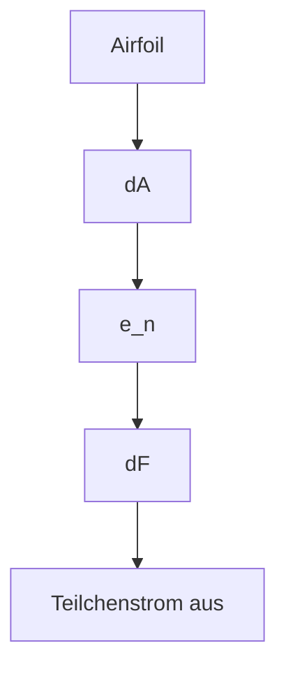
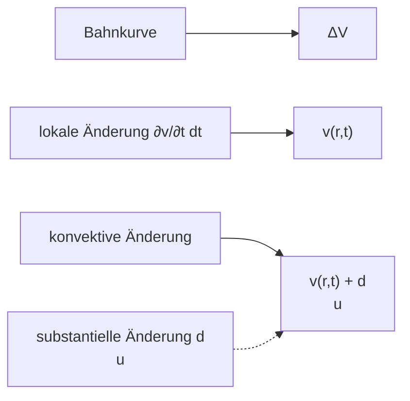

$$
E _ {\mathrm{pot}} = V (r) = b \cdot \left[ \underbrace {\left(\frac {a}{r}\right) ^ {1 2}} _ {\text {Abstoßung}} - \underbrace {\left(\frac {a}{r}\right) ^ {6}} _ {\text {Anziehung}} \right] \quad \text {Lennard-Jones 6 - 12 Potenzial.} \tag {I-4.20}
$$

Wir bestimmen den gesuchten Gleichgewichts(GG-)abstand $r _ { 0 }$ durch Differenzieren und Nullsetzen:

$$
\frac {d V (r)}{d r} = \left| - 1 2 b \frac {a ^ {1 2}}{r _ {0} ^ {1 3}} + 6 b \frac {a ^ {6}}{r _ {0} ^ {7}} = 0 \Rightarrow 2 \frac {a ^ {6}}{r _ {0} ^ {6}} = 1 \right. \tag {I-4.21}
$$

$$
\Rightarrow r _ {0} = \sqrt [ 6 ]{2} \cdot a. \tag {I-4.22}
$$

Damit ergibt sich für die potenzielle Energie im GG-Abstand:

$$
V (r _ {0}) = b \frac {a ^ {1 2}}{a ^ {1 2} \cdot \left(\sqrt [ 6 ]{2}\right) ^ {1 2}} - b \frac {a ^ {6}}{a ^ {6} \cdot \left(\sqrt [ 6 ]{2}\right) ^ {6}} = \frac {b}{4} - \frac {b}{2} = - \frac {b}{4}. \tag {I-4.23}
$$

Für den E-Modul können wir schreiben:

$$
E = \frac {d \sigma}{d \varepsilon} = \frac {d (F / A)}{d \left(\frac {r - r _ {0}}{r _ {0}}\right)} = \frac {\frac {1}{A} d F}{\frac {1}{r _ {0}} d (r - r _ {0})} = \frac {r _ {0} d F}{A d r}. \tag {I-4.24}
$$

Dabei ist die Spannung $\sigma = { \frac { F } { A } }$ gleich der Kraft bezogen auf die Querschnittsfläche des Atoms und $\frac { \Delta l } { l } = \frac { r - r _ { 0 } } { r _ { 0 } }$

Für die Abstandsabhängigkeit der Kraft $F ^ { \star }$ , die aus der atomaren WW resultiert, können wir gemäß der allgemeinen Beziehung ${ \vec { F } } ^ { \star } =$ −grad V und der Tatsache, dass $V = E _ { \mathrm { p o t } }$ nur von r abhängt, setzen

$$
F ^ {*} = - \frac {d V (r)}{d r} \tag {I-4.25}
$$

$$
\Rightarrow \frac {d F ^ {\star}}{d r} = - \frac {d ^ {2} V (r)}{d r ^ {2}} = b \left(\frac {1 5 6 a ^ {1 2}}{r ^ {1 4}} - \frac {4 2 a ^ {6}}{r ^ {8}}\right). \tag {I-4.26}
$$

Damit ergibt sich für den E-Modul im GG-Abstand $r = r _ { 0 } = a { \sqrt [ 6 ] { 2 } }$

(I-4.27)

$$
\underline {{E (r _ {0})}} = \frac {a \cdot \sqrt [ 6 ]{2}}{A} \cdot b \cdot \left(\frac {1 5 6 a ^ {1 2}}{a ^ {1 4} \cdot \left(\sqrt [ 6 ]{2}\right) ^ {1 4}} - \frac {4 2 a ^ {6}}{a ^ {8} \cdot \left(\sqrt [ 6 ]{2}\right) ^ {8}}\right) = \frac {b}{A r _ {0}} \left(\frac {1 5 6}{4} - \frac {4 2}{2}\right) = \frac {1 8 b}{\underline {{A r _ {0}}}}.
$$

Wir versuchen eine Abschätzung mit atomaren Werten für das kubisch-flächenzentrierte γ-Eisen:

Querschnittsfläche des Fe-Atoms $A \approx ( 1 2 5 \cdot 1 0 ^ { - 1 2 } ) ^ { 2 }   \pi = 5 \cdot 1 0 ^ { - 2 0 }   \mathrm { m } ^ { 2 } , \quad r _ { 0 } \approx$ $2 , 5 \cdot 1 0 ^ { - 1 0 }   \mathrm { m } . ^ { 8 }$ Der Parameter b folgt aus $\bar { E } _ { \mathrm { p o t } } = - \bar { b } / 4$ und der WW der nächsten Nachbaratome: Die Bindungsenergie eines Fe-Atoms beträgt nämlich $E_{B}=350\  kJ/mol =$ $3 , 6 \mathrm { e V } = 5 , 7 6 \cdot 1 0 ^ { - 1 9 } \mathrm { J }$ und da ein Fe-Atom im kubisch-raumzentrierten Gitter 8 nächste Nachbarn hat, ergibt sich für b ein Wert von $b \approx 2 { , } 9 \cdot 1 0 ^ { ^ { - 1 9 } }   \mathrm { J } .$ 9

Damit erhalten wir für den E-Modul $E \approx 4 \cdot 10^{11}    N/m ^2 = 400    GPa$ , ein Wert, der recht gut mit dem experimentell für Fe-Einkristalle gemessenen Werten von ca. $2 \cdot 10^{11}    N/m ^2 = 200$ GPa übereinstimmt (siehe Tabelle in Abschnitt 4.2.1).10 Unsere Vorstellung vom Zusammenhang zwischen den elastischen Kräften und dem Atompotenzial ist also offensichtlich richtig.

## 4.2.4 Der Elastizitätstensor, allgemeines Hookesches Gesetz

Die vier elastischen Konstanten, die wir bisher kennen gelernt haben, sind den experimentellen Bedürfnissen beim Zugversuch oder bei der Tordierung angepasst. Wie sieht es aber bei einer beliebigen Verformung des Festkörpers aus?

Wenn z. B. an einem Würfel an allen Flächen Spannungen in beliebigen Richtungen wirken, so werden durch eine Überlagerung von Stauchungen und Dehnungen, Scherungen und Volumenänderungen

– die Längen der Würfelkanten in allen 3 Raumrichtungen verändert,
– alle Würfelkanten verkippt,
– das Gesamtvolumen verändert.

<small>8 Aus der Gitterkonstante $a = 3 , 6 4 7 \cdot 1 0 ^ { - 1 0 }$ m von γ-Eisen.</small>

<small>9 Dieser Wert ergibt sich aus der Dissoziationsenergie (= Verdampfungswärme) des Kristalls pro Atom, denn dies entspricht der Entfernung der Atome aus ihrer GG-Lage ins Unendliche. Dabei wurde angenommen, dass dieser Wert auch für das kubisch-flächenzentrierte Gitter näherungsweise gilt.</small>

<small>10 Die obige Übereinstimmung darf nicht überbewertet werden, da der E-Modul von Einkristallen sehr stark von der Verformungsrichtung abhängt: Emax = 2,85⋅ 10 N/mbei Zug längs der Würfeldiagonale, E i = 1,32⋅ 10 N/mbei Zug längs der Würfelkante. Der E-Modul (und auch der Schubmodul G) sind anisotrope Kristalleigenschaften.</small>

text_image

z
σzz
τxz → τyz
τzx → τyx
σxx → σyy
τzy
τxy
y
x

Abb. I-4.9: Kräfte, die in beliebiger Richtung an den Seitenflächen eines würfelförmigen Volumenelements eines Körpers angreifen, können in jeweils zwei Schubspannungen $\tau _ { i j }$ und eine Normalspannung $\sigma _ { i j }$ zerlegt werden.

Zunächst soll der Spannungszustand eines Volumenelements des Probekörpers beschrieben werden. Wir stellen uns ein würfelförmiges Volumenelement vor; auf jeder seiner Flächen greife eine Kraft in beliebiger Richtung an. Diese Kräfte sind nach den Koordinatenachsen in jeweils 2 Schubspannungen und eine Normalspannung zerlegbar (Abb. I-4.9). So ist z. B. $\tau _ { y z }$ die Schubspannung in y-Richtung, die an jener Fläche angreift, die normal zur z-Richtung orientiert ist, also erster Index: Kraftrichtung, zweiter Index: Flächennormale.

Bei den insgesamt 6 Flächen des Würfels führt dies zu $6 \cdot 3 = 1 8$ Spannungskomponenten. Wir fordern aber, dass der Schwerpunkt des Würfels in Ruhe bleiben soll; dann muss die Summe aller Kräfte verschwinden und es gilt daher

$$
\sigma_ {- i - i} = \sigma_ {i i}, \quad \tau_ {- i - j} = \tau_ {i j}. \tag {I-4.28}
$$

Außerdem fordern wir, dass keine Verdrehung stattfindet; dann muss die Summe aller Drehmomente verschwinden und es gilt daher

$$
\tau_ {i j} = \tau_ {j i}. \tag {I-4.29}
$$

Damit erhalten wir schließlich 6 voneinander unabhängige Spannungskomponenten, die zu einem Tensor zusammengefasst werden können:

$$
\tilde {\sigma} = \left( \begin{array}{c c c} \sigma_ {x x} & \tau_ {x y} & \tau_ {x z} \\ \tau_ {y x} & \sigma_ {y y} & \tau_ {y z} \\ \tau_ {z x} & \tau_ {z y} & \sigma_ {z z} \end{array} \right) \quad \text {Spannungstensor (stress tensor) mit} \tau_ {i j} = \tau_ {j i}. \tag {I-4.30}
$$

Dabei sind die $\sigma _ { i i }$ Normalspannungen und die $\tau _ { i j }$ Schubspannungen. Bei Kenntnis der 6 Komponenten des Spannungstensors $\tilde { \sigma }$ , die aus den Randbedingungen des elastischen Problems, also den Kräften an der Oberfläche und den Volumskräften (z. B. Schwerkraft) zu ermitteln sind, kann für jede vorgegebene Richtung ${ \vec { e } } _ { n }$ (Einheitsvektor in der gewählten Richtung) die Spannung $\sigma$ berechnet werden, da gilt $\vec { \sigma } = \tilde { \sigma }   \cdot \vec { e } _ { n }$ . Diese Spannung wird i. Allg. nicht senkrecht auf das zu ${ \vec { e } } _ { n }$ senkrechte Flächenelement $d \vec { f } = d f \cdot \vec { e } _ { n }$ stehen. Da $\tilde { \sigma }$ ein symmetrischer Tensor ist, kann er auf Hauptachsen transformiert werden; dann bleiben nur mehr die Diagonalelemente $\sigma _ { \mathrm { I } } ,   \sigma _ { \mathrm { I I } } ,   \sigma _ { \mathrm { I I I } }$ übrig. Das sind Normalspannungen, sie werden Hauptspannungen genannt.

text_image

s
r̅
r̅_v = r̅ + ε̃ · r̅

Abb. I-4.10: Der Ortsvektor r⇀eines Punktes im elastischen Körper geht durch die Verschiebung $\vec { s } = \{ u , v , w \} = \tilde { \varepsilon }$ ⋅r⇀in den Punkt $\vec { r } _ { \nu } = \vec { r } + \tilde { \varepsilon }   \cdot \vec { r }$ über.

Ähnlich geht man bei der Beschreibung des Deformationszustands auch von einem würfelförmigen Volumenelement aus. Es treten relative Längenänderungen der Würfelkanten $\varepsilon _ { i i } = \frac { \Delta l _ { i } } { l }$ unter dem Einfluss der Normalspannungen auf und Scherwinkel $\gamma _ { i j } \left( i , j = x , \dot { y , } z \right)$ , das sind die Winkeländerungen, die die ursprünglich senkrechten Achsrichtungen $\vec { e } _ { i }$ und $\vec { e } _ { j }$ unter dem Einfluss der Schubspannungen erfahren. Beide werden zum Deformationstensor zusammengefasst:

$$
\tilde {\varepsilon} = \left( \begin{array}{c c c} \varepsilon_ {x x} & \gamma_ {x y} & \gamma_ {x z} \\ \gamma_ {y x} & \varepsilon_ {y y} & \gamma_ {y z} \\ \gamma_ {z x} & \gamma_ {z y} & \varepsilon_ {z z} \end{array} \right) \quad \begin{array}{l} \text {Deformationstensor} \\ (= \text {Verzerrungstensor, strain tensor}) \\ \text {mit} \gamma_ {i j} = \gamma_ {j i}. \end{array} \tag {I-4.31}
$$

Ist $\vec { r }$ der Ortsvektor eines Punktes im elastischen Körper, dann geht dieser durch die Verschiebung $\vec { s } = \{ u , v , w \} = \tilde { \varepsilon }   \cdot \vec { r }$ in den Punkt $\vec { r } _ { \nu } = \vec { r } + \tilde { \pmb { \varepsilon } }   \cdot \vec { r }$ über (Abb. I-4.10).

Diese lineare Transformation des ursprünglichen Körpers $( \vec { r } - \mathrm { R a u m } ^ { \circ } )$ in den verzerrten Körper $( , \vec { r } _ { v } \cdot \mathrm { R a u m } ^ { \circ } )$ stellt eine affine Abbildung dar. Dabei gehen Geraden und Ebenen wieder in (andere) Geraden und Ebenen über, Parallelitäten bleiben erhalten, ein würfelförmiger Körper geht also in ein allgemeines Rhomboeder $( a \neq b \neq c , \alpha \neq \beta \neq \gamma )$ über.

Der Verzerrungstensor $\tilde { \varepsilon }$ kann als symmetrischer Tensor so wie der Spannungstensor $\tilde { \sigma }$ auf Hauptachsen transformiert und durch eine Ellipsoidfläche (Deformations-Tensorellipsoid) dargestellt werden. Dann bleiben nur mehr die Diagonalelemente $\varepsilon _ { \mathrm { I } } ,   \varepsilon _ { \mathrm { I I } } ,   \varepsilon _ { \mathrm { I I I } }$ über, die Hauptdilatationen heißen.

Um die Verschiebungen $\vec { s } = \{ u , v , w \}$ eines Kräften und Momenten unterworfenen Körpers berechnen zu können, benützt man einen erfahrungsmäßigen Zusammenhang zwischen den Verzerrungskomponenten des ε ̃ -Tensors und den Spannungskomponenten des $\tilde { \sigma }$ -Tensors. Dieser ist für kleine Verschiebungen durch das allgemeine Hookesche Gesetz gegeben, wonach im allgemeinen Fall alle Verzerrungskomponenten lineare Funktionen aller Spannungskomponenten sind. Diesen Zusammenhang beschreibt der Elastizitätstensor (elasticity tensor) $\tilde { E } _ { \mathrm { ~ \tiny ~ \mu ~ } } = C _ { m n p q } = C _ { \mu \nu }$ ein symmetrischer Tensor 4. Stufe:

$$
\sigma_ {m n} = \sum_ {p = 1} ^ {3} \sum_ {q = 1} ^ {3} C _ {m n p q} \cdot \varepsilon_ {p q} \quad \text {oder} \quad \sigma_ {\mu} = \sum_ {\nu = 1} ^ {6} C _ {\mu \nu} \cdot \varepsilon_ {\nu}
$$

mit $1 \leq \mu \leq 6,   1 \leq \nu \leq 6$ , wobei die Werte der Indizes 1 bis 6 folgende Bedeutung besitzen:

$$
x x \rightarrow 1, y y \rightarrow 2, z z \rightarrow 3, y z \rightarrow 4, z x \rightarrow 5, x y \rightarrow 6, \tag {I-4.32}
$$

sie bezeichnen also die Komponenten des Spannungs- bzw. des Deformationstensors.

Dies ist die allgemeine Form des Hookeschen Gesetzes. Die $\sigma _ { \mu }$ sind die 6 Komponenten des symmterischen Spannungstensors, die $\varepsilon _ { \nu }$ sind die 6 Komponenten des symmetrischen Deformationstensors und $C _ { \mu \nu }$ ist der symmetrische Elastizitätstensor.

In Komponenten geschrieben gilt:

$$
\begin{array}{l} \sigma_ {1} = C _ {1 1} \varepsilon_ {1} + C _ {1 2} \varepsilon_ {2} + C _ {1 3} \varepsilon_ {3} + C _ {1 4} \gamma_ {4} + C _ {1 5} \gamma_ {5} + C _ {1 6} \gamma_ {6} \\ \sigma_ {2} = C _ {2 1} \varepsilon_ {1} + C _ {2 2} \varepsilon_ {2} + C _ {2 3} \varepsilon_ {3} + C _ {2 4} \gamma_ {4} + C _ {2 5} \gamma_ {5} + C _ {2 6} \gamma_ {6} \\ \sigma_ {3} = C _ {3 1} \varepsilon_ {1} + C _ {3 2} \varepsilon_ {2} + C _ {3 3} \varepsilon_ {3} + C _ {3 4} \gamma_ {4} + C _ {3 5} \gamma_ {5} + C _ {3 6} \gamma_ {6} \\ \tau_ {4} = C _ {4 1} \varepsilon_ {1} + C _ {4 2} \varepsilon_ {2} + C _ {4 3} \varepsilon_ {3} + C _ {4 4} \gamma_ {4} + C _ {4 5} \gamma_ {5} + C _ {4 6} \gamma_ {6} \\ \tau_ {5} = C _ {5 1} \varepsilon_ {1} + C _ {5 2} \varepsilon_ {2} + C _ {5 3} \varepsilon_ {3} + C _ {5 4} \gamma_ {4} + C _ {5 5} \gamma_ {5} + C _ {5 6} \gamma_ {6} \\ \tau_ {6} = C _ {6 1} \varepsilon_ {1} + C _ {6 2} \varepsilon_ {2} + C _ {6 3} \varepsilon_ {3} + C _ {6 4} \gamma_ {4} + C _ {6 5} \gamma_ {5} + C _ {6 6} \gamma_ {6} \\ \end{array}
$$

allgemeines

Hookesches (I-4.33)

Gesetz

Die 36 Konstanten $C _ { \mu \nu }$ der Dimension Kraft/Fläche $( \mathrm { N / m } ^ { 2 } )$ werden elastische Moduln (elastic moduli) genannt. Umgekehrt lassen sich aus dem Gleichungssystem die Verzerrungen als lineare Funktionen der Spannungen darstellen. Die dann auftretenden Konstanten heißen elastische Konstanten (elastic constants) $S _ { \mu \nu }$ mit

$$
\varepsilon_ {\mu} = \sum_ {\nu = 1} ^ {6} S _ {\mu \nu} \cdot \sigma_ {\nu}, \quad \mu = 1, 2,..., 6. \tag {I-4.34}
$$

Da aufgrund des Energiesatzes der Elastizitätstensor symmetrisch ist, können je nach Kristallsymmetrie maximal 21 unabhängige Komponenten $C _ { \mu \nu }$ auftreten. Diese Zahl verringert sich aber mit steigender Kristallsymmetrie sehr stark:

triklines Kristallsystem (niederste Symmetrie): 21 Konstanten
kubisch: 3 Konstanten $(C_{11}, C_{12}, C_{44})$
– isotrop: 2 Konstanten $\left( C _ { 1 1 } = 2   C _ { 4 4 } + C _ { 1 2 } ,   C _ { 1 2 } ,   C _ { 4 4 } \right)$

Für die Fälle kubisch und isotrop haben die Elastizitätstensoren folgende Gestalt:

$$
\tilde {E} = \left( \begin{array}{c c c c c c} C _ {1 1} & C _ {1 2} & C _ {1 2} & 0 & 0 & 0 \\ C _ {1 2} & C _ {1 1} & C _ {1 2} & 0 & 0 & 0 \\ C _ {1 2} & C _ {1 2} & C _ {1 1} & 0 & 0 & 0 \\ 0 & 0 & 0 & C _ {4 4} & 0 & 0 \\ 0 & 0 & 0 & 0 & C _ {4 4} & 0 \\ 0 & 0 & 0 & 0 & 0 & C _ {4 4} \end{array} \right) \quad \begin{array}{l} \text {Elastizitätstensor} \\ \text {im kubischen} \\ \text {Kristallsystem.} \end{array} \tag {I-4.35}
$$

In dem sehr wichtigen Fall des isotropen Festkörpers mit $C _ { 1 1 } = 2   C _ { 4 4 } + C _ { 1 2 }$ liegen also nur zwei unabhängige Moduln $C _ { 1 2 } = \lambda$ und $C _ { 4 4 } = m$ vor, die als Lamésche Elastizitätskonstanten bezeichnet werden. Mit Hilfe des E-Moduls E und der Poissonsche Zahl $\mu$ folgt für die Moduln11

$$
C _ {1 1} = E \cdot \frac {1 - \mu}{(1 + \mu) (1 - 2 \mu)}; \quad C _ {1 2} = E \cdot \frac {\mu}{(1 + \mu) (1 - 2 \mu)}; \quad C _ {4 4} = E \cdot \frac {1}{2 (1 + \mu)} = G = \frac {\tau}{\gamma}. \tag {I-4.36}
$$

Werden diese Komponenten des homogenen Festkörpers in den Elastizitätstensor eingesetzt, so ergeben sich die folgenden 6 Beziehungen zwischen den Spannungsund Verzerrungskomponenten:

$$
\sigma_ {1} = \frac {E}{1 + \mu} \left\{\varepsilon_ {1} + \frac {\mu}{1 - 2 \mu} \left(\varepsilon_ {1} + \varepsilon_ {2} + \varepsilon_ {3}\right) \right\}; \quad \tau_ {4} = \frac {E}{2 (1 + \mu)} \gamma_ {4}
$$

$$
\sigma_ {2} = \frac {E}{1 + \mu} \left\{\varepsilon_ {2} + \frac {\mu}{1 - 2 \mu} \left(\varepsilon_ {1} + \varepsilon_ {2} + \varepsilon_ {3}\right) \right\}; \quad \tau_ {5} = \frac {E}{2 (1 + \mu)} \gamma_ {5}
$$

$$
\sigma_ {3} = \frac {E}{1 + \mu} \left\{\varepsilon_ {3} + \frac {\mu}{1 - 2 \mu} \left(\varepsilon_ {1} + \varepsilon_ {2} + \varepsilon_ {3}\right) \right\}; \quad \tau_ {6} = \frac {E}{2 (1 + \mu)} \gamma_ {6}. \tag {I-4.37}
$$

Dies ist das allgemeine Hookesche Gesetz für einen isotropen elastischen Körper.

Wie hier nicht abgeleitet werden soll, bestehen zwischen den Komponenten des Verzerrungstensors $\tilde { \varepsilon }$ und den 3 Komponenten $\{ u ,   v ,   w \}$ des Verschiebungsvektors $\vec { s } = \tilde { \varepsilon }   \cdot \vec { r }$ folgende Beziehungen:

$$
\varepsilon_ {1} = \frac {\partial u}{\partial x}, \quad \varepsilon_ {2} = \frac {\partial v}{\partial y}, \quad \varepsilon_ {3} = \frac {\partial w}{\partial z};
$$

$$
\gamma_ {4} = \frac {\partial u}{\partial y} + \frac {\partial v}{\partial x}, \quad \gamma_ {5} = \frac {\partial v}{\partial z} + \frac {\partial w}{\partial y}, \quad \gamma_ {6} = \frac {\partial w}{\partial x} + \frac {\partial u}{\partial z}. \tag {I-4.38}
$$

Zum statischen Gleichgewicht am isotropen elastischen Körper siehe Anhang 1.

<small>11 Für die Ableitung siehe z. B. Clemens Schaefer, 2011. Einführung in die Theoretische Physik. Band 1. De Gruyter, Berlin, S. 539, mit σ =̂ μ, 2 a11 =̂ C11, 2 a44 =̂ C44 .</small>

## 4.3 Mechanik von Flüssigkeiten und Gasen (Fluiden)

Flüssiger und gasförmiger Zustand setzen im Idealfall einer reinen Formänderung ohne Volumenänderung keinen Widerstand entgegen, es verschwindet also der Schermodul einer ‚idealen‘ Flüssigkeit: $G = 0 . ^ { 1 2 }$ Die Kompressibilität von Flüssigkeiten ist aber äußerst gering (ähnlich wie die fester Stoffe), während die Kompressibilität von Gasen sehr groß ist. Es gilt also:

## 1 In einer idealen Flüssigkeit verschwindet der Schubmodul: $G = 0 .$

Daraus ergibt sich, dass die Flüssigkeitsoberfläche immer normal auf der resultierenden Gesamtkraft steht, also eine Äquipotenzialfläche darstellt. Daraus folgt sofort, dass die Flüssigkeitsoberfläche einer rotierenden Flüssigkeit ein Rotationsparaboloid sein muss.

**Beispiel:** Flüssigkeit in einem rotierenden Gefäß (siehe dazu auch Kapitel „Mechanik des Massenpunktes“, Experiment am Ende von Abschnitt 2.3.3).

text_image

Äquipotenzialfläche
z
r
Δm
Δm·g⃗ = G̅
O
Z = Δm⃗ ω²
F gesamt
r

Da eine (ideale) Flüssigkeit keine Tangentialkräfte übertragen kann, muss die resultierende Gesamtkraft auf ein Flüssigkeitsteilchen Δm der Oberfläche normal auf der Oberfläche stehen ⇒ die Oberfläche ist eine Äquipotenzialfläche.

$E _ { \mathrm { p o t } }$ setzt sich im rotierenden Bezugssystem aus einem Anteil zusammen, der durch die Schwerkraft verursacht wird

$$
\vec {G} = - \Delta m \cdot \vec {g} \quad \Rightarrow \quad E _ {\mathrm{pot}, G} = - \int \vec {F} \cdot d \vec {r} = - \Delta m \int (- g) d z = \Delta m \cdot g \cdot z
$$

<small>12 Es existiert jedoch sowohl in Gasen wie in Flüssigkeiten eine Volumselastizität, die die Ausbreitung von Kompressionswellen (= Longitudinalwellen) ermöglicht.</small>

und einem Anteil, der von der Zentrifugalkraft stammt

$$
\vec {Z} = \Delta m \vec {r} \omega^ {2} \quad \Rightarrow \quad E _ {\mathrm{pot}, Z} = - \Delta m \omega^ {2} \int r d r = - \frac {\Delta m}{2} \omega^ {2} r ^ {2}.
$$

Für die gesamte potenzielle Energie muss also gelten $( E _ { \mathrm { k i n } } = 0$ im rotierenden System)

$$
E _ {\mathrm{pot}} = \Delta m \left(g z - \frac {\omega^ {2}}{2} r ^ {2}\right) = \text { const. } = 0,
$$

denn für $r = 0$ ist auch $z = 0 ,$ Damit erhalten wir für die Flüssigkeitsoberfläche

$$
z = \frac {\omega^ {2}}{2 g} \cdot r ^ {2},
$$

das ist die Gleichung eines Rotationsparaboloids. Die wirkende Gesamtkraft $\vec { F } = \vec { G } + \vec { Z }$ steht immer senkrecht auf der Äquipotenzialfläche.

Zur Beschreibung der Bewegung (Strömung) von Flüssigkeiten oder Gasen (Fluiden) ist es nicht mehr zweckmäßig, die Bewegung der einzelnen Massenpunkte zu beschreiben. Wir betrachten stattdessen die Bewegung eines kleinen Flüssigkeitselements $\Delta V$ an der Stelle $\bar { r }$ , das eine gewisse Zahl ΔN an Molekülen enthält.

Wir charakterisieren das Fluid durch seine Massendichte:

$$
\rho (\vec {r}, t) = \frac {\sum_ {i = 1} ^ {N} m _ {i}}{\Delta V} = \frac {\Delta m}{\Delta V}. \tag {I-4.39}
$$

Dabei ist es wichtig, dass unser Flüssigkeitselement ΔV groß gegen das Volumen der Teilchen ist, für die in $\Delta V$ enthaltenen Moleküle also gilt $\Delta N \gg 1$ . Andererseits soll es aber so klein sein, dass innerhalb von $\Delta V$ keine Änderung der makroskopi schen Eigenschaften auftritt, sodass $\rho ( \vec { r } , t )$ nicht von der Größe des gewählten $\Delta V$ abhängt.

**Beispiel:** Wir wählen für $\Delta N   =   { 1 0 } ^ { 7 }$ Moleküle. Dann ergibt sich für eine Flüssigkeit $\Delta V \approx 1 0 ^ { - 2 1 } \mathrm { m } ^ { 3 } ,$ , für ein Gas unter Normalbedingungen $\Delta V \approx 1 0 ^ { ^ { - 1 8 } } \mathrm { m } ^ { 3 }$

An die Stelle der Geschwindigkeit eines individuellen MP tritt jetzt ein Geschwindigkeitsfeld, also die Angabe der mittleren Geschwindigkeit $\vec { v } ( \vec { r } _ { \ast } t )$ eines Flüssigkeitselements $\Delta V$ für alle Punkte im strömenden Fluid zu einem bestimmten Zeitpunkt:

$$
\vec {v} (\vec {r}, t) = \frac {1}{\Delta N} \sum_ {i = 1} ^ {N} \vec {v} _ {i} = \left\langle \vec {v} _ {i} \right\rangle . \tag {I-4.40}
$$

$\langle \vec { v } _ { i } \rangle$ ist die mittlere Geschwindigkeit der ΔN Moleküle im Volumenelement ΔV. Bezüglich der Geschwindigkeiten $\vec { v } _ { i }$ der N Moleküle sind zwei Anteile zu unterscheiden:

1. die ungeordnete, statistisch verteilte Temperaturbewegung $\vec { v } _ { i } ^ { \mathrm { T e m p } }$ ; für sie gilt $\langle \bar { \upsilon } _ { i } ^ { \mathrm { T e m p } } \rangle = 0$ ;
2. die allen N Teilchen gemeinsame, geordnete Geschwindigkeit $\bar { v } _ { i } ^ { \mathrm { o r d } }$ ; für sie gilt $\left\langle \vec { v } _ { i } ^ { \mathrm { o r d } } \right\rangle = \vec { v } _ { i } ^ { \mathrm { o r d } }$

Es gilt also:

$$
\langle \vec {v} _ {i} \rangle = \langle \vec {v} _ {i} ^ {\text {Temp}} + \vec {v} _ {i} ^ {\text {ord}} \rangle = \langle \vec {v} _ {i} ^ {\text {ord}} \rangle = \vec {v} _ {i} ^ {\text {ord}} = \vec {v} (\vec {r}, t); \tag {I-4.41}
$$

die in der Hydromechanik auftretenden Geschwindigkeiten sind immer die geordneten Geschwindigkeiten.

**Beispiel:** Einzelne Luftmoleküle im Raum haben eine mittlere Geschwindigkeit von ungefähr 300 m/s durch ihre ungeordnete Temperaturbewegung (siehe Band II, Kapitel „Physik der Wärme“, Abschnitt 1.2.5). Die mittlere Strömungsgeschwindigkeit der Luftmoleküle ist aber um einige Größenordnungen kleiner (geordnete Geschwindigkeit υ⇀(r⇀,t), z. B. ein Luftzug).

Wir unterscheiden im Geschwindigkeitsfeld die Bahnlinien und die Stromlinien der Flüssigkeitselemente. Während die Bahnlinien die Wege der einzelnen Flüssigkeitsteilchen im Laufe der Zeit beschreiben, sind die Stromlinien Kurven, deren Tangentenrichtung an jedem Ort mit der augenblicklichen Strömungsgeschwindigkeit zusammenfällt. Bahnlinien und Stromlinien fallen für eine stationäre Strömung zusammen, sind aber für nichtstationäre Strömung verschieden, d. h. die Teilchenbahn folgt hier keiner Stromlinie.

Bei einer stationären Strömung ist die Geschwindigkeit an jedem Ort und zu jeder Zeit konstant.

**Beispiele:** Das Strömungsfeld einer Flüssigkeit, die im Unendlichen die Geschwindigkeit υ⇀besitzt und eine ruhende Kugel umströmt ist stationär, Stromlinien und Bahnlinien fallen zusammen. Ein Beispiel für eine instationäre Strömung ist das Strömungsfeld einer ruhenden Flüssigkeit, durch die eine Kugel mit der Geschwindigkeit −υ⇀bewegt wird. Stromlinien und Bahnlinien sind verschieden, die Stromlinien (ein Dipolfeld) werden von der Kugel ‚mitgeführt‘. Die Bahnlinien eines Massenelements $m _ { i }$ ergeben sich durch Addition der in den aufeinanderfolgenden Zeitelementen dt erfolgenden Verschiebungen $d \vec { s } _ { i } = \vec { v } _ { i } ( t ) d t .$ Von der bewegten Kugel aus beobachtet ist das Strömungsfeld allerdings wieder stationär und stimmt mit dem der bewegten Flüssigkeit überein.

text_image

dA
v̅

Abb. I-4.11: Stromfaden.

Die Stromlinien durch die Berandung einer Fläche $d \vec { A }$ im Strömungsfeld bilden einen Stromfaden (Abb. I-4.11), durch dessen Mantel Flüssigkeit weder ein- noch austritt (υ⇀liegt in der Mantelfläche). Deshalb ist der Fluss (Volumen pro Zeiteinheit) $d Q = \frac { d V } { d t } = \frac { d \vec { s } \cdot d \vec { A } } { d t } = \vec { \nu } d \vec { A }$ längs der gesamten Stromlinie konstant, vorausgesetzt, dass $\rho = \mathrm { c o n s t . }$ ; andernfalls ist im stationären Fall der Massenfluss (Masse pro Zeiteinheit) $\frac { d m } { d t } = \rho d Q$ längs einer Stromlinie konstant.

Im flüssigen oder gasförmigen Medium herrscht ein Druck:

$$
P = P (\vec {r}, t) = \frac {\Delta F}{\Delta A}; \tag {I-4.42}
$$

Einheit $[ P ] = 1    Pa    (  Pascal ^{13} ) = 1    Nm ^{-2}$ (nach Blaise Pascal, 1623–1662). $\Delta F$ ist die resultierende Kraft, ΔA die Fläche, auf die die Kraft wirkt. P ist in Fluiden von der Orientierung der Fläche $\Delta A$ unabhängig.

Wenn $\Delta V$ entsprechend den obigen Bedingungen gewählt wird, sind die drei Felder $\rho ( \vec { r } , t ) , \vec { v } ( \vec { r } , t ) , P ( \vec { r } , t )$ von $\Delta V$ unabhängig.

Eine Flüssigkeit, für die diese drei Felder (2 Skalarfelder und ein Vektorfeld) zur Beschreibung ausreichen, ist eine ideale Flüssigkeit.

## 4.3.1 Die Kontinuitätsgleichung

Wir betrachten ein Flüssigkeitsvolumen V (Abb. I-4.12).

Für ein Flächenelement der Oberfläche $d \vec { f }$ gilt:

$d { \vec { f } } = d A \cdot { \vec { e } } _ { n }$ , wobei ${ \vec { e } } _ { n }$ der Einheitsvektor in Normalenrichtung ist (positiv nach außen). Die Gesamtmasse im Volumen V ist

$$
M = \int_ {V} \rho d V. \tag {I-4.43}
$$

<small>13 105Pa = 1 bar = 750,062 mm Hg; 1 mm Hg = 1 Torr. Der normale Luftdruck ist als „1 (physikalische) Atmosphäre“ = 1 atm festgelegt. 1 atm = 760 Torr = 101 325 Pa = 1,01325 bar. 1 ‚technische Atmosphäre‘ = 1 at = 1 kp/cm= 980 665 Pa.</small>

Teilchenstrom ein

flowchart

Abb. I-4.12: Zur Ableitung der Kontinuitätsgleichung.

Wir fragen uns zunächst, wie viel Masse pro Zeiteinheit aus der gesamten Oberflä- che von V heraustritt. Die Differenz zwischen austretenden und eintretenden Flüs sigkeitselementen muss den Massenstrom bilden, der aus der Oberfläche (= ‚Rand‘) von V heraustritt:14

$$
\frac {\partial M}{\partial t} = \oint_ {O b e r f l a c h e (V)} \rho \cdot \vec {v} \cdot d \vec {f} = \oint_ {O b e r f l a c h e (V)} \vec {j} \cdot d \vec {f} \tag {I-4.44}
$$

mit der Stromdichte $\overline { { \vec { j } } } ( \vec { r } ,   t ) = \rho \cdot \vec { v } ( \vec { r } ,   t )$ . Einheit $\left[ j \right] = 1   \frac{\mathrm{kg}}{\mathrm{m}^2 \mathrm{s}}$

Die Änderung der gesamten Masse im Inneren von V ergibt sich bei einer Dichteänderung zu

$$
\frac {\partial M}{\partial t} = \frac {\partial}{\partial t} \int_ {V} \rho d V = \int_ {V} \frac {\partial \rho}{\partial t} d V. \tag {I-4.45}
$$

Bei Massenerhaltung $\left( { \frac { \partial M } { \partial t } } = 0 \right)$ muss die durch die Oberfläche austretende Masse der durch die Dichteabnahme im Inneren bereitgestellten Masse gleich sein, also:15

<small>14 Im Folgenden wird angenommen, dass sich im Volumen V keine Quellen befinden, die ständig Masse nachliefern.</small>

<small>15 Sind im Inneren von V Quellen vorhanden (siehe die „Radialströmung“ als Beispiel zur Poten-∂M zialströmung in Abschnitt 4.3.6), so gilt div j⇀dV = ∮ j⇀df⇀≠ 0 . Kontinuierlich verteilte ∂t V Oberfläche (V ) Quellen liegen vor, wenn div j⇀≠ 0 ist. Ist div j⇀= 0 mit Ausnahme singulärer Stellen, dann liegen Punktquellen vor (siehe Beispiel „Radialströmung“ in Abschnitt 4.3.6).</small>

$$
\oint_ {\text {Oberfläche} (V)} \vec {j} d \vec {f} - \int_ {V} \frac {\partial \rho}{\partial t} d V = 0. \tag {I-4.46}
$$

Wir erinnern uns an den Gaußschen Integralsatz:

$$
\oint \vec {u}   d \vec {f} = \int_ {V} \mathrm{div}   \vec {u} \cdot d V
$$

Wir können daher das Integral über die geschlossene Oberfläche in ein Volumsintegral umwandeln und so die beiden Integrale zusammenfassen:

$$
\int_ {V} \left(\mathrm{div} \vec {j} + \frac {\partial \rho}{\partial t}\right) d V = 0. \tag {I-4.47}
$$

Diese Gleichung gilt für beliebige Volumina, solange $V \geq \Delta V$ ist, der Integrand selbst muss also verschwinden und es gilt daher

$$
\frac {\partial \rho}{\partial t} + \operatorname{div} \vec {j} = \frac {\partial \rho}{\partial t} + \operatorname{div} \rho \vec {v} = 0 \quad \begin{array}{l} \text {Kontinuitätsgleichung} \\ (\text {continuity equation}). \end{array} \tag {I-4.48}
$$

Für ein quellenfreies, inkompressibles Fluid $( \rho = \mathrm { c o n s t . } )$ folgt daraus

$$
\operatorname{div} \vec {v} = 0. \tag {I-4.49}
$$

Dabei gibt

$$
Q = \oint_ {\text {Oberfläche} (V)} \vec {v} d \vec {f} = \int_ {V} \operatorname{div} \vec {v} d V \tag {I-4.50}
$$

den Überschuss des pro Zeiteinheit nach außen strömenden Flüssigkeitsvolumens über das einströmende Volumen an. Befindet sich keine Quelle im Inneren von V, so muss das Integral verschwinden. Liegen Quellen im Inneren von $V _ { \ast }$ so stellt das Integral ein Maß für die Ergiebigkeit der Quellen (Quellergiebigkeit, Quellstärke, source strength) von $V$ dar.

## 4.3.2 Die Eulergleichung

Wir wollen jetzt die Bewegungsgleichung der Volumenelemente aufstellen. Dazu greifen wir ein kleines $\Delta V$ heraus und betrachten die Bewegung der zugehörigen Masse $\Delta m = \rho \cdot \Delta V .$

text_image

z
Δy · Δz · P(x)
ΔV
Δy · Δz · P(x + Δx)
y
x

Abb. I-4.13: Druckunterschied am Flüssigkeitselement ΔV in der x-Richtung; (analog für die beiden anderen Koordinatenrichtungen).

Die Newtonsche Bewegungsgleichung (Newton 2) lautet:

$$
\Delta m \frac {d \vec {v} (\vec {r} , t)}{d t} = \rho (\vec {r}, t) \Delta V \frac {d \vec {v} (\vec {r} , t)}{d t} = \Delta \vec {F} (\vec {r}, t) = \Delta \vec {F} _ {\mathrm{ext}} + \Delta \vec {F} _ {\mathrm{Druck}}. \tag {I-4.51}
$$

Dabei haben wir angenommen, dass die auf $\Delta m$ wirkende Kraft sich aus einer in der Flüssigkeit immer wirkenden Druckkraft $\Delta \vec { F } _ { \mathrm { D r u c k } }$ und einer externen Kraft $\Delta \vec { F } _ { \mathrm { e x t } }$ (z. B. Schwerkraft $\Delta \vec { F } _ { \mathrm { e x t } } = \rho \cdot \vec { g } \cdot \Delta V )$ zusammensetzt.

Den Anteil der Druckkraft kann man durch Betrachtung der Druckunterschiede am Flüssigkeitselement in den verschiedenen Koordinatenrichtungen erhalten (Abb. I-4.13):

$$
\begin{array}{l} \Delta \vec {F} _ {\mathrm{Druck}} = - \vec {e} _ {x} \Delta y \Delta z (P (x + \Delta x) - P (x)) - \vec {e} _ {y} \Delta x \Delta z (P (y + \Delta y) - P (y)) - \\ - \vec {e} _ {z} \Delta x \Delta y \Big (P (z + \Delta z) - P (z) \Big) = \\ = - \Delta V \left(\vec {e} _ {x} \frac {P (x + \Delta x) - P (x)}{\Delta x} + \vec {e} _ {y} \frac {P (y + \Delta y) - P (y)}{\Delta y} + \vec {e} _ {z} \frac {P (z + \Delta z) - P (z)}{\Delta z}\right). \tag {I-4.52} \\ \end{array}
$$

Wir sehen, dass in der Klammer partielle Differentialquotienten des Drucks nach den Koordinaten stehen, wenn wir den Grenzübergang Δx % dx etc. durchführen:

$$
\Delta \vec {F} _ {\mathrm{Druck}} = - \Delta V \Bigg (\vec {e} _ {x} \frac {\partial P}{\partial x} + \vec {e} _ {y} \frac {\partial P}{\partial y} + \vec {e} _ {z} \frac {\partial P}{\partial z} \Bigg) = - (\operatorname{grad} P) \Delta V = - (\vec {\nabla} P) \cdot \Delta V. \tag {I-4.53}
$$

Die substanzielle Beschleunigung $\frac { d \vec { v } } { d t }$ hat zwei Anteile (Abb. I-4.14):

1. $\vec { v } ( \vec { r } _ { \mathrm { { } } } ,   t )$ hängt am Ort $\vec { r }$ von der Zeit t ab (lokale Änderung)
2. das Massenelement bewegt sich während der Zeit dt vom Ort ${ \vec { r } } ,$ , an dem die mittlere Geschwindigkeit den Wert υ⇀(r⇀) hat, nach $\vec { r } + d \vec { r } = \vec { r } + \vec { \upsilon } d t$ , wo die

flowchart

Abb. I-4.14: Zur Ableitung der Eulergleichung: lokale und konvektive Änderung der Geschwindigkeit eines Volumenelements ΔV der Flüssigkeit.

Geschwindigkeit einen anderen Wert $\vec { \upsilon } ( \vec { r } + d \vec { r } ) = \vec { \upsilon } + d \vec { \upsilon }$ besitzt (konvektive Änderung).

Wir bilden daher das vollständige Differential, das die totale Änderung von $\vec { v } ( \vec { r } ,   t )$ beschreibt

$$
d\vec{v} = \underbrace{\frac{\partial\vec{v}}{\partial t}}_{\substack{\text{zeitl. Änderung}\\ \text{am Ort, lokale}\\ \text{Beschleunigung}}}dt + \underbrace{\frac{\partial\vec{v}}{\partial x}dx + \frac{\partial\vec{v}}{\partial y}dy + \frac{\partial\vec{v}}{\partial z}dz}_{\text{örtliche (konvektive) Änderung}}
$$

und davon die zeitliche Änderung

$$
\begin{array}{l} \frac {d \vec {v}}{d t} = \frac {\partial \vec {v}}{\partial t} + \frac {\partial \vec {v}}{\partial x} \underbrace {\frac {d x}{d t}} _ {\nu_ {x}} + \frac {\partial \vec {v}}{\partial y} \underbrace {\frac {d y}{d t}} _ {\nu_ {y}} + \frac {\partial \vec {v}}{\partial z} \underbrace {\frac {d z}{d t}} _ {\nu_ {z}} = \frac {\partial \vec {v}}{\partial t} + \left(\upsilon_ {x} \frac {\partial}{\partial x} + \upsilon_ {y} \frac {\partial}{\partial y} + \upsilon_ {z} \frac {\partial}{\partial z}\right) \vec {v} = \\ = \frac {\partial \vec {v}}{\partial t} + \underbrace {(\vec {v} \cdot \operatorname{grad}) \vec {v}} _ {\vec {v} - \text {Vektorgradient}}. \tag {I-4.54} \\ \left\{ \begin{array}{l} v _ {x} \frac {\partial v _ {x}}{\partial x} + v _ {y} \frac {\partial v _ {x}}{\partial y} + v _ {z} \frac {\partial v _ {x}}{\partial z} \\ v _ {x} \frac {\partial v _ {y}}{\partial x} + v _ {y} \frac {\partial v _ {y}}{\partial y} + v _ {z} \frac {\partial v _ {y}}{\partial z} \\ v _ {x} \frac {\partial v _ {z}}{\partial x} + v _ {y} \frac {\partial v _ {z}}{\partial y} + v _ {z} \frac {\partial v _ {z}}{\partial z} \end{array} \right\} = \bar {v} \text {-Vektorgradient von} \bar {v} \\ \end{array}
$$

Der Operator $( { \vec { \upsilon } } \cdot \mathtt { g r a d } )$ heißt ‚υ⇀-Vektorgradient‘ (oben in den 3 Komponenten $\mathbf { g e } -$ schrieben).

Der Vektorgradient von υ⇀ist dagegen das ‚dyadische‘ Produkt $\vec { \nabla } \vec { \upsilon } = \bar { \vec { G } } _ { i }$ das ist die Matrix der 9 Größen $\frac { \partial \upsilon _ { i } } { \partial k } \left( i ,   k = x ,   y ,   z \right)$ in folgender Form:

$$
\bar {G} = \vec {\nabla} \vec {v} = \left( \begin{array}{c c c} \frac {\partial v _ {x}}{\partial x} & \frac {\partial v _ {x}}{\partial y} & \frac {\partial v _ {x}}{\partial z} \\ \frac {\partial v _ {y}}{\partial x} & \frac {\partial v _ {y}}{\partial y} & \frac {\partial v _ {y}}{\partial z} \\ \frac {\partial v _ {z}}{\partial x} & \frac {\partial v _ {z}}{\partial y} & \frac {\partial v _ {z}}{\partial z} \end{array} \right).
$$

Damit wird

$$
\vec {v} \cdot \bar {G} = \underbrace {\vec {v} \cdot (\vec {\nabla} \vec {v})} _ {\text {Matrixprodukt}} = (v \cdot \vec {\nabla}) \vec {v} = (\vec {v} \cdot \operatorname{grad}) \vec {v}, ^ {1 6}
$$

das ist der υ⇀-Vektorgradient von $\vec { v } . ^ { 1 7 }$

Während der ‚υ⇀-Vektorgradient‘ ein Skalar ist, ist der ‚υ⇀-Vektorgradient von $\vec { v } ^ { \bullet }$ ein Vektor und der ‚Vektorgradient von $\vec { v } ^ { \bullet }$ eine Dyade.

## 1

## ds⇀-Vektorgradient eines Skalarfeldes Φ:

(ds⇀⋅∇⇀) Φ = dΦ , der ds⇀-Gradient des Skalarfeldes Φ gibt an, wie sich die skalare Größe Φ ändert, wenn man sich im Raum um ds⇀weiter bewegt.

## ds⇀-Vektorgradient eines Vektorfeldes υ⇀:

(ds⇀⋅∇⇀) υ⇀, der ds⇀-Vektorgradient des Vektorfeldes υ⇀gibt an, wie sich der Vektor υ⇀ändert, wenn man sich im Raum um ds⇀weiter bewegt. Er ist nichts anderes als ein ds⇀-Gradient, angewendet auf jede Komponente des Vektors υ⇀.

Es gilt also

$$
\frac {d \vec {v}}{\underbrace {d t} _ {\text {定}}} \quad = \quad \frac {\partial \vec {v}}{\partial t} \quad + \underbrace {(\vec {v} \cdot \vec {\nabla}) \vec {v}}. \tag {I-4.55}
$$

Damit wird die Bewegungsgleichung mit der Gewichtskraft $\vec { G } = \Delta \vec { F } _ { \mathrm { e x t } } = \rho \cdot \vec { g } \cdot \Delta V$ als einziger externer Kraft zu

<small>16 Denn: (υ⇀⋅G⇀)x = υx ∂υx + υy ∂υx + υz ∂υx = (υ⇀⋅ grad)υx; der k-te Spaltenvektor ist hier der Vektor ∂x ∂y ∂z υ⇀selbst, der 1. Zeilenvektor von G⇀lautet ∂υx∂υx∂υx ∂x,∂y,∂z</small>

<small>17 Zur Matrixmultiplikation: Das Element aik der Produktmatrix ergibt sich als Skalarprodukt des k-ten Spaltenvektors der 1. Matrix mit dem i-ten Zeilenvektor der 2. Matrix, beide Vektoren müssen gleich viele Elemente besitzen.</small>

$$
\rho \cdot \Delta V \Bigg (\frac {\partial \vec {v}}{\partial t} + (\vec {v} \cdot \vec {\nabla}) \vec {v} \Bigg) = - (\vec {\nabla} P) \cdot \Delta V + \rho \cdot \vec {g} \cdot \Delta V \tag {I-4.56}
$$

und damit zu

$$
\rho \Bigg (\frac {\partial \vec {v}}{\partial t} + (\vec {v} \cdot \vec {\nabla}) \vec {v} \Bigg) = - \vec {\nabla} P + \rho \cdot \vec {g} \quad E u l e r g l e i c h u n g. \tag {I-4.57}
$$

Diese nichtlineare, partielle Differentialgleichung erster Ordnung beschreibt reibungsfreie, ideale Fluide. Sie wurde 1755 von Leonhard Euler (1707–1783) aufge stellt. Will man reale, reibungsbehaftete, also ‚zähe‘ Fluide beschreiben, muss man noch eine zusätzliche Reibungskraft hinzunehmen. Diese lautet für eine inkompressible Flüssigkeit (vergleiche Abschnitt 4.3.7.2):

$$
\Delta \vec {F} _ {\text {Reibung}} = \eta \cdot \Delta \vec {\nu} \Delta V, \tag {I-4.58}
$$

$$
\text {mit} \qquad \Delta \vec {v} = \left\{ \begin{array}{l} \frac {\partial^ {2} v _ {x}}{\partial x ^ {2}} + \frac {\partial^ {2} v _ {x}}{\partial y ^ {2}} + \frac {\partial^ {2} v _ {x}}{\partial z ^ {2}} \\ \frac {\partial^ {2} v _ {y}}{\partial x ^ {2}} + \frac {\partial^ {2} v _ {y}}{\partial y ^ {2}} + \frac {\partial^ {2} v _ {y}}{\partial z ^ {2}} \\ \frac {\partial^ {2} v _ {z}}{\partial x ^ {2}} + \frac {\partial^ {2} v _ {z}}{\partial y ^ {2}} + \frac {\partial^ {2} v _ {z}}{\partial z ^ {2}} \end{array} \right\}
$$

Laplace-Operator $\Delta = \frac { { \partial } ^ { 2 } } { { \partial x } ^ { 2 } } + \frac { { \partial } ^ { 2 } } { { \partial y } ^ { 2 } } + \frac { { \partial } ^ { 2 } } { { \partial z } ^ { 2 } }$ angewendet auf den Geschwindigkeitsvektor $\bar { v }$

Hier ist η die (dynamische) Zähigkeit (= Viskosität) des Fluids.

Einheit $[ \eta ] = \mathrm{N} \cdot \mathrm{s} / \mathrm{m}^2 = \mathrm{Pa} \cdot \mathrm{s}.$

Dynamische Zähigkeit η einiger Flüssigkeiten und Gase.18

| Flüssigkeit | (20 °C) | $\eta$ (mPa · s) |
| --- | --- | --- |
| Aceton |  | 0,320 |
| Glycerin | (20 °C/60 °C) | 1480/81 |
| Quecksilber |  | 1,554 |
| Wasser | (25 °C/75 °C) | 0,890/0,378 |
| Luft | (27 °C/127 °C) | 0,0186/0,0231 |

<small>18 Man beachte die Abnahme der Zähigkeit von Flüssigkeiten (z. B. Wasser) mit der Temperatur, hingegen den Anstieg bei Gasen (z. B. Luft)!</small>

Wenn wir diese Reibungskraft (Gl. I-4.58) in der Bewegungsgleichung (I-4.57) berücksichtigen, erhalten wir die Navier-Stokes-Gleichung:

$$
\rho \left(\frac {\partial \vec {v}}{\partial t} + (\vec {v} \vec {\nabla}) \vec {v}\right) = - \vec {\nabla} P + \rho \cdot \vec {g} + \eta \cdot \Delta \vec {v}. \tag {I-4.59}
$$

Die Eulergleichung (oder die Navier-Stokes-Gleichung) und die Kontinuitätsgleichung stellen 4 partielle Differentialgleichungen für die fünf Feldgrößen $\rho ( \vec { r } , t ) , \vec { v } ( \vec { r } , t ) , P ( \vec { r } , t )$ dar. Wir benötigen also eine weitere Gleichung, um ein Strö- mungsproblem lösen zu können. Dies ist die Zustandsgleichung $P = P ( \rho ( \vec { r } , t ) )$ , die einen Zusammenhang zwischen Druck und Dichte angibt.

Für ideale Gase (vergleiche Band II, Kapitel „Physik der Wärme“, Abschnitte 1.1.2 und 1.2.1) gilt bei isothermen Prozessen $P \cdot V = \mathrm { c o n s t } .$ (Boyle-Mariottesches Ge setz). Bei adiabatischen Prozessen, also für isolierte Systeme ohne Energieaustausch mit der Umgebung gilt $P \cdot V ^ { \kappa } = { \mathrm { c o n s t } } .$ (Poisson-Gleichung = adiabatische Zustandsgleichung). Für die meisten Systeme lässt sich in der Praxis ein Wärmeaustausch mit der Umgebung nicht verhindern, er läuft aber andererseits meist so schnell ab, dass es zu keiner vollständigen Temperaturangleichung mit der Umgebung kommt, also kein isothermer Prozess vorliegt. Das Verhalten solcher, sehr unterschiedlicher Systeme kann durch die polytrope Zustandsgleichung

$$
P \cdot V ^ {n} = \text { const. } \tag {I-4.60}
$$

beschrieben werden. Diese Beziehung kann bei geeigneter Wahl des Polytropenexponenten n alle Zustandsänderungen beschreiben.

Prozesse am idealen Gas:

| isochor | (V = const.) | n = ∞19 |
| --- | --- | --- |
| isobar | (P = const.) | n = 0 |
| isotherm | (P · V = const.) | n = 1 |
| isentrop | (= adiabatisch, Entropie S = const., P · Vκ = const.) | n = κ |
| polytrop |  | 1 &lt; n &lt; κ |

Die Eulergleichung (und die Navier-Stokes-Gleichung) ist eine partielle nichtlineare Differentialgleichung. Probleme der Strömungsmechanik unterliegen daher der nichtlinearen Dynamik und führen zum deterministischen Chaos (vergleiche Band II, Kapitel „Nichtlineare Dynamik und Chaos“). Während das Vielteilchensystem eines idealen Gases der Thermodynamik mikroskopisch chaotisch ist, das heißt, dass die Gasmoleküle zu einem bestimmten Zeitpunkt weder einen voraussagbaren Aufenthaltsort, noch einen voraussagbaren Impuls haben, können bei nichtlinearen Systemen differentiell kleine Unterschiede in den Anfangsbedingungen sehr schnell anwachsen und trotz vollständiger Kenntnis aller Systemparameter zur völligen Unvorhersagbarkeit des Bewegungsablaufs führen (deterministisches Chaos).

## 4.3.3 Ruhende Flüssigkeit im Schwerefeld

Erstes Anwendungsbeispiel der Eulergleichung ist der hydrostatische Druck in einer Flüssigkeit. Wie sehen die Felder aus?

Die Dichte der Flüssigkeit ist zeitlich konstant: $\rho ( \vec { r } ,   t ) = \rho ( \vec { r } )$
Die Flüssigkeit ruht, also $\vec { \upsilon } ( \vec { r } ,   t ) = 0$
Der Druck ist zeitlich konstant: $P ( \vec { r } , t ) = P ( \vec { r } )$

Da also gilt ${ \frac { \partial \rho } { \partial t } } = 0$ und $\vec { j } = \rho \cdot \vec { v } = 0$ , ist die Kontinuitätsgleichung (I-4.48) in trivialer Weise erfüllt.

Die Eulergleichung (I-4.57) wird dann zu

$$
- \operatorname{grad} P + \rho \cdot \vec {g} = 0, \tag {I-4.61}
$$

es herrscht also Gleichgewicht zwischen den äußeren Kräften und den Druckkräften

$$
\mathrm{grad} P = \rho \cdot \vec {g} = - \rho \cdot g \cdot \vec {e} _ {z}, \tag {I-4.62}
$$

mit mit $\vec { e } _ { z }$ als Einheitsvektor in der Ge enrichtun z der Schwerkraft als Einheitsvektor in der Gegenrichtung z der Schwerkraft.

Druck und Dichte können nur von der z-Richtung abhängen (grad $P = \frac { d P } { d z }   \vec { e } _ { z } )$ also

$$
\frac {d P}{d z} = - \rho (z) \cdot g. \tag {I-4.63}
$$

Ist die Flüssigkeit inkompressibel, gilt also $\rho ( \vec { r } ) = \mathrm { c o n s t . } = \rho _ { 0 }$ , so kann einfach integriert werden $d P = - \rho _ { 0 } \cdot g \cdot d z$

$$
\Rightarrow \quad P = - \rho_ {0} \cdot g \cdot z + P _ {0} \quad h y d r o s t a t i s c h e r D r u c k, \tag {I-4.64}
$$

mit $P = P _ { O }$ für $z = 0$ . Der hydrostatische Druck nimmt also linear mit der Tiefe $( z < 0 )$ zu!

**Beispiel:** Der hydrostatische Druck beträgt in 10 m Wassertiefe

$P = \rho g h = 1 \cdot 10^{3}    kg     m ^{-3} \cdot 9.81    m     s ^{-2} \cdot 10    m  = 9.81 \cdot 10^{4}    kg     m ^{-1}    s ^{-2} = 0.981    bar  =$ 1 kp ${ \tt c m } ^ { - 2 }   =   1$ technische Atmosphäre = 1 at ( ≅ Luftdruck auf der Erdoberfläche).

An der Wasseroberfläche herrscht der Luftdruck von 1 atm ≅ 1 at; der Gesamtdruck in 10 m Wassertiefe ist somit doppelt so groß wie an der Oberfläche. Durch den atmosphärischen Luftdruck kann Wasser daher höchstens 10 m gehoben werden, wenn der Gasdruck über dem Wasserspiegel auf 0 atm abgesenkt wird (z. B. mit Hilfe eines hochgezogenen Pumpenkolbens).

text_image

h = 0, G = P₀
dK̅_vert = dK cos α
dK̅ = PdĀ
α
dG̅₀ = -ρghdf + P₀df
Δh
V
ΔVi
dA
df = dA · cos α
dG̅ᵤ = ρg(h + Δh)df + P₀df
dK̅_vert = PdĀ cos α = Pdf

Abb. I-4.15: Zur Entstehung des Auftriebs.

Der Druck ist richtungsunabhängig. Dies ist die Voraussetzung für die Entstehung des Auftriebs.

Grenzen wir innerhalb eines Körpers ein Volumenelement $\Delta V _ { i }$ vom Querschnitt df parallel zu $\vec { g }$ ab, so gilt für die Vertikalkräfte, die an der oberen bzw. unteren Begrenzungsfläche angreifen im Grenzfall verschwindenden Querschnitts (Abb. I-4.15).

– Vertikale Druckkraft auf der Oberseite: $d \vec { G } _ { O } = \rho \bar { g } h d f + P _ { 0 } d f$
Vertikale Druckkraft auf der Unterseite: $d \vec { G } _ { U } = \rho \vec { g } ( h + \Delta h ) d f + P _ { 0 } d f$ , $\rho$ ist die Dichte der Flüssigkeit.

Die Differenz stellt den Auftrieb dar:

$$
d \vec {G} _ {A} = d \vec {G} _ {O} - d \vec {G} _ {U} = - \rho \vec {g} \Delta h d f = - \rho \vec {g} \Delta V. \tag {I-4.65}
$$

Wird nun über alle Volumenelemente $\Delta V _ { i }$ summiert, so ergibt sich als gesamte Vertikalkraft am Körper

$$
\vec {G} _ {A} = - \rho \vec {g} V \quad \text {Auftrieb.} ^ {2 0} \tag {I-4.66}
$$

Die Auftriebskraft $G _ { A }$ ist also numerisch gleich dem Gewicht der vom Körper verdrängten Flüssigkeitsmenge (Archimedisches Prinzip).

$\bar { G } _ { A }$ greift, wie in der Mechanik der Massenpunktsysteme gezeigt wurde (Kapitel „Mechanik des Massenpunktes“, Abschnitt 2.4.1), im Schwerpunkt der verdrängten Flüssigkeitsmenge an. Bei einem inhomogenen Körper muss dieser nicht mit dem Körperschwerpunkt zusammenfallen. Der dann resultierende Drehzwilling dreht den eingetauchten Körper so lange, bis der Körperschwerpunkt unter dem Auftriebsschwerpunkt in einer Vertikalen liegt. Bei dieser Bewegung bleibt der Körperschwerpunkt in Ruhe, da die Summe aller am Körper angreifenden Kräfte gleich Null ist. Bei einem homogenen Körper ist seine Lage in der Flüssigkeit im indifferenten GG, jede Lage ist gleichberechtigt.

## 4.3.4 Ruhendes ideales Gas bei konstanter Temperatur im Schwerefeld

Ein weiteres Anwendungsbeispiel ist die Druckzunahme in einem Gas im Schwerefeld bzw. die Abnahme des Luftdrucks mit zunehmender Höhe.

Für ein ideales Gas gilt (vergleiche Band II, Kapitel „Physik der Wärme“, Abschnitt 1.1.2)

$$
P \cdot V = N \cdot k \cdot T \quad \text {Zustandsgleichung idealer Gase.} \tag {I-4.67}
$$

Dabei ist N die Gesamtzahl der Moleküle im Volumen V und k die Boltzmann-Konstante. Für die Gasdichte gilt: $\rho = { \frac { M } { V } } = { \frac { N \cdot m } { V } }$ , wenn M die Gesamtmasse der N Moleküle mit Masse m ist. Damit wird

$$
P = \frac {N}{V} k T = \frac {\rho}{m} k T \quad \text {und} \quad \rho = \frac {m \cdot P}{k T}. \tag {I-4.68}
$$

Wie bei der vorigen Anwendung (hydrostatischer Druck) folgt aus der Eulergleichung grad $\vec { P } = - \boldsymbol { \rho } \cdot \boldsymbol { g } \cdot \vec { e } _ { z }$ und es hängen $\rho$ und $P$ nur von der $z -$ Koordinate ab. Man erhält damit wieder $\frac { d P } { d z } = - \rho ( z ) \cdot g$ , nun aber mit variabler Dichte $\rho ( z )$ und damit

<small>20 Ohne Mathematik: Die den eingetauchen Körper umgebende Flüssigkeit wirkt auf ihn genau so wie auf ein gleichgestaltetes Volumen der Flüssigkeit, das sich nicht bewegt. ⇒ Der Auftrieb des Körpers ist gleich dem Gewicht der verdrängten Flüssigkeit und die Auftriebskraft geht durch den Schwerpunkt des verdrängten Flüssigkeitsvolumens.</small>

$$
d P = - \frac {m \cdot g}{k T} P (z) d z. \tag {I-4.69}
$$

Nach der Trennung der Variablen

$$
\frac {d P}{P} = - \frac {m \cdot g}{k T} d z \tag {I-4.70}
$$

kann einfach integriert werden wenn man annimmt, dass die Temperatur in allen Höhen gleich ist $( T _ { 0 } )$ , also isotherme Verhältnisse vorliegen.21 Mit $P _ { 0 }$ als Druck im Bezugsniveau $z _ { 0 }$ folgt

$$
\ln P - \ln P _ {0} = \ln \frac {P}{P _ {0}} = - \frac {m \cdot g}{k T _ {0}} \cdot (z - z _ {0}) \tag {I-4.71}
$$

und man erhält mit $\frac { m } { k T _ { 0 } } = \frac { \rho _ { 0 } } { P _ { 0 } }$ nach Gl. (I-4.68) $\frac { P } { P _ { 0 } } = e ^ { \frac { \rho _ { _ 0 } g } { P _ { 0 } } } ( z - z _ { 0 } ) .$ und damit

$$
P (z) = P _ {0} \exp \left(- \frac {m \cdot g \cdot \left(z - z _ {0}\right)}{k T _ {0}}\right) \underbrace {=} _ {\frac {m}{k T _ {0}} = \frac {\rho_ {0}}{P _ {0}}} P _ {0} \exp \left(- \frac {\rho_ {0} \cdot g \cdot \left(z - z _ {0}\right)}{P _ {0}}\right)
$$

(I-4.72)

Aus der barometrischen Höhenformel kann durch Messung des Drucks $P ( z )$ in der Höhe z und des Bezugsdrucks $P _ { 0 }$ die Höhendifferenz $\left( z - z _ { 0 } \right)$ berechnet werden.

Der Druck nimmt also beim Eintauchen in die Atmosphäre exponentiell mit der Tiefe zu, mit der Höhe (z. B. über Meeresniveau) exponentiell ab. Da die Luft kompressibel ist, nimmt die Gewichtskraft eines bestimmten Luftvolumens beim Eintauchen für jeden Meter Höhenunterschied nicht linear mit der Tiefe zu, da das Gewicht der auf dieser Strecke hinzukommenden Luftmasse immer weiter wächst. Denn diese Masse und ihr Gewicht hängen ja wieder vom dort herrschenden Luftdruck ab. Der Luftdruck wächst also umso schneller, je höher er bereits ist, also exponentiell.

**Beispiel:** Für Luft bei 273 K gilt $\rho_{0}=\rho_{L}=1,293\  kg/m ^{3}$ für $z _ { 0 } = 0$ und $P _ { 0 } =$ $1 { , } 0 1 3 3 \cdot { 1 0 } ^ { 5 }$ Pa und daher $\frac{\rho_{0}g}{P_{0}}=1,251\cdot10^{-4}\mathrm{~m}^{-1}=0,1251\mathrm{~km}^{-1}=\frac{1}{8\mathrm{~km}}$

Damit wird $P ( z ) = P _ { 0 } \cdot \exp ( - z / 8 \mathrm { ~ k m } )$ .

Das heißt: Bei $z = 8$ km, also in 8 km Höhe über Meeresniveau, gilt $P = P _ { 0 } / e ;$ der Druck ist also auf den e-ten Teil $( \approx 1 / 2 { , } 7 )$ gefallen.

<small>21 Die Schwerebeschleunigung kann für kleine Höhen in guter Näherung als konstant angenommen werden.</small>

Die Annahme einer isothermen Atmosphäre ist eine recht grobe Näherung und kann durch Berücksichtigung der experimentell bestimmten linearen Temperaturabnahme mit zunehmender Höhe verbessert werden:

$$
T (z) = T (z _ {0}) - A \cdot (z - z _ {0}). \tag {I-4.73}
$$

A ist der atmosphärische Temperaturgradient, angegeben in $\mathrm { K } / 1 0 0$ m.

Damit kann Gl. (I-4.70) integriert werden:

$$
\begin{array}{l} \ln \frac {P (z)}{P (z _ {0})} = \int_ {z _ {0}} ^ {z} \frac {m \cdot g}{k T (z)} d z = - \int_ {z _ {0}} ^ {z} \frac {m \cdot g}{k \left(T (z _ {0}) - A \cdot (z - z _ {0})\right)} d z = \\ = \frac {m \cdot g}{k} \int_ {z _ {0}} ^ {z} \frac {- 1}{T \left(z _ {0}\right) + A \cdot z _ {0} - A \cdot z} d z = \frac {m \cdot g}{k} \left\{\frac {1}{A} \ln \left[ T \left(z _ {0}\right) + A \cdot z _ {0} - A \cdot z \right] \Bigg | _ {z _ {0}} ^ {z} \right\} = \\ = \frac {m \cdot g}{k} \frac {1}{A} \left(\ln \left[ T (z _ {0}) + A \cdot z _ {0} - A \cdot z \right] - \ln \left[ T (z _ {0}) + A \cdot z _ {0} - A \cdot z _ {0} \right]\right) = \\ = \frac {m \cdot g}{k} \frac {1}{A} \ln \left(\frac {T \left(z _ {0}\right) - A \cdot \left(z - z _ {0}\right)}{T \left(z _ {0}\right)}\right) = \frac {m \cdot g}{k} \frac {1}{A} \ln \left(1 - \frac {A \cdot \left(z - z _ {0}\right)}{T \left(z _ {0}\right)}\right). \tag {I-4.74} \\ \end{array}
$$

Dabei wurde verwendet: $\int \frac{1}{a - bx}   dx = -\frac{1}{b} \ln (a - bx)$

1

Es ergibt sich

$$
P (z) = P (z _ {0}) \exp \left(\frac {m \cdot g}{k} \frac {1}{A} \ln \left(1 - \frac {A \cdot (z - z _ {0})}{T (z _ {0})}\right)\right) = P (z _ {0}) \left(1 - \frac {A \cdot (z - z _ {0})}{T (z _ {0})}\right) ^ {\frac {m \cdot g}{k A}}. \tag {I-4.75}
$$

Dabei ist nach Gl. $\left( \mathrm{I} - 4.68 \right) \frac{m}{k} = \frac{\rho_{0} T_{0}}{P_{0}}$

Für die in der Luftfahrt wichtige Normalatmosphäre gilt $A = 0 , 6 5   \mathrm { K } / 1 0 0$ m bis zu einer Höhe $\Delta z _ { M }   =   1 1$ km. Ab dieser Höhe gilt $T _ { M } = - 5 6 , 5 ^ { \circ } \mathrm { C }$ konstant; die Bodentemperatur wird $T ( z _ { 0 } ) = 1 5   ^ { \circ } \mathrm { C }$ gesetzt.

Das Archimedische Prinzip gilt auch für Körper in einer Gasatmosphäre. Auch hier entsteht eine Auftriebskraft, die so groß ist wie das Gewicht der vom Körper verdrängten Gasmenge. Wegen der wesentlich kleineren Dichte von Gasen ist der Auftrieb viel kleiner als in Flüssigkeiten. Damit z. B. ein Ballon fliegen $( , { \mathrm { f a h r e n } } ^ { \omega } )$ kann, muss seine Auftriebskraft mindestens gleich seinem Gesamtgewicht inklusive Gondel, Fracht und Füllgas sein, es muss also für einen Ballon mit Gesamtmasse M und Gesamtvolumen V gelten

$$
M \cdot g = V \cdot \rho_ {L} \cdot g. \tag {I-4.76}
$$

Das Füllgas muss daher eine kleinere Dichte als die ihn umgebende Luft haben, z. B. Helium, Wasserstoff oder auch mit einem Brenner erwärmte heiße Luft (Heiß- luftballon).

**Beispiel:** Ballondurchmesser $D = 16,84\  m  \Rightarrow  V_{ max } = 2500\  m ^3;\ M = 1100\  kg ;$ $T_{0}=293\  K ;\ P_{0}=101325\  Pa ;\rho_{0L}=1,205\  kg / m ^{3}$ Es ergibt sich (einsetzen in obige Gleichung für $P ( z )$ und iterativ lösen) eine maximal erreichbare Höhe $z _ { M } =$ $9 5 0 0 \; \mathrm { m } ^ { 2 2 }$ und ein Luftdruck $P ( z _ { M } ) = 2 9$ 190 Pa (mit der barometrischen Höhenformel isotherm gerechnet ergibt sich $P ( z _ { M , \mathrm { i s o t h e r m } } ) = 3 3 4 5 0 \; \mathrm { P a } )$ Die Temperatur ist $T(z_{M}) = 293 - A \cdot z_{M} = 231, 3  K  = -41, 7^{\circ}  C$ War der Ballon beim Abheben am Boden nur halb gefüllt $\left( V _ { 0 } = 1 / 2 V _ { \mathrm { m a x } } \right.$ Gewichtsersparnis!), dann erreicht er in $z _ { P } = 5 7 0 0$ m (‚Prallhöhe‘) seinen vollen Durchmesser (Innendruck = Atmosphärendruck).

## 4.3.5 Die Bernoulli-Gleichung

Wir betrachten eine kräftefreie, stationäre Strömung einer idealen, inkompressiblen Flüssigkeit, die Flüssigkeit ströme z. B. reibungsfrei durch ein Rohr. Für die Felder gilt also

$$
\rho (\vec {r}, t) = \rho_ {0}, \quad \vec {v} (\vec {r}, t) = \vec {v} (\vec {r}), \quad P (\vec {r}, t) = P (\vec {r}) \tag {I-4.77}
$$

und die Eulergleichung wird zu $( \vec { g }$ weist hier gegen die positive z-Achse, in deren Richtung die Höhe h (siehe weiter unten) gemessen wird)

$$
\rho_ {0} (\vec {v} \cdot \vec {\nabla}) \vec {v} = - \vec {\nabla} P - \rho_ {0} \vec {g}. \tag {I-4.78}
$$

1 Wir benützen einen Satz aus der Vektoranalysis:23

$$
\underbrace {(\vec {v} \cdot \vec {\nabla}) \vec {v}} _ {\substack {\text {Konvektions -}\\ \text {beschleunigung}}} = \underbrace {\frac {1}{2} \vec {\nabla} v ^ {2}} _ {\substack {\text {Änderung}\\ \text {von} |\vec {v} |}} - \underbrace {\vec {v} \times (\vec {\nabla} \times \vec {v})} _ {\substack {\text {Änderung der}\\ \text {Richtung =}\\ \text {Wirbelbewegung}}}
$$

<small>22 In der maximalen Höhe zM gilt (Auftrieb = Gewichtskraft): ρz ⋅ Vmax = M ⇒ M 1100 kg ρzM = = 0,44 kg m−3. Aus der idealen Gasgleichung PV = ν RT = mRST (siehe Band II, Vmax 2500 m 3 Kapitel „Physik der Wärme“, Gl. II-1.44) folgt mit RS = RL = 287,1 J kg−1 K−1 (spezifische Gaskonsρ0T0g tante für Luft): ρzM RL ⋅ TzM PzM P0R (T − Az ) (1 − AzM T0 P0A 0,44 kg m−3. Daraus ist zM zu ermitteln.</small>

<small>23 Dieser Satz wird aus dem ‚Entwicklungssatz‘ (Graßmann-Identität) A⇀× (B⇀× C⇀) = B⇀(A⇀⋅C⇀) − (A⇀⋅B⇀)C⇀abgeleitet:</small>

Damit schreiben wir die stationäre Eulergleichung $\left( \frac { \partial \vec { v } } { \partial t } = 0 \right)$ um

$$
\frac {\rho_ {0}}{2} \operatorname{grad} v ^ {2} - \rho_ {0} \vec {v} \times \operatorname{rot} \vec {v} = - \operatorname{grad} P - \rho_ {0} \vec {g}. \tag {I-4.79}
$$

Schon früher wurde definiert (Abschnitt 4.3), dass Stromlinien in jedem Punkt parallel zu $\vec { v } ( \vec { r } )$ sind, im stationären Fall (Bahnlinie = Stromlinie) sind also die Bahnelemente ds⇀ $\slash / \vec { v }$ . Wir integrieren die Eulergleichung längs einer Stromlinie zwischen den Punkten A und B, damit das Integral mit rot υ⇀verschwindet:

$$
\int_ {A} ^ {B} \frac {\rho_ {0}}{2} \underbrace {\operatorname{grad} \nu^ {2} d \vec {s}} _ {d \nu^ {2}} - \int_ {A} ^ {B} \rho_ {0} \underbrace {\left(\vec {\nu} \times \operatorname{rot} \vec {\nu}\right) d \vec {s}} _ {\substack {\perp \vec {\nu} \\ = 0, d a d \vec {s} / / \vec {\nu}}} + \int_ {A} ^ {B} \underbrace {\operatorname{grad} P d \vec {s}} _ {d P} + \rho_ {0} \int_ {A} ^ {B} \underbrace {\vec {g} d \vec {s}} _ {= - g d h} = 0. \tag {I-4.80}
$$

Nach der Definition des Gradienten als Änderung des Skalarfeldes u bei Bewegung in Richtung $d \vec { s }$ gilt $d \vec { s }$ ⋅ grad $u = d u$ und damit grad $\upsilon ^ { 2 }   d \vec { s } = d \upsilon ^ { 2 }$ , bzw. grad $P d { \vec { s } } = d P$ . Die Integration ergibt:

$$
\int_ {A} ^ {B} \frac {\rho_ {0}}{2} d v ^ {2} + \int_ {A} ^ {B} d P - \rho_ {0} g \int_ {A} ^ {B} d h = \frac {\rho_ {0}}{2} \left| v ^ {2} \right| _ {A} ^ {B} + \left| P \right| _ {A} ^ {B} + \left| \rho_ {0} g h \right| _ {A} ^ {B} = 0. \tag {I-4.81}
$$

Mit A als Bezugsniveau („Nullniveau“) und B als variablem Niveau erhalten wir:

$$
\frac {\rho_ {0}}{2} v ^ {2} + P + \rho_ {0} g h = \frac {\rho_ {0}}{2} v _ {0} ^ {2} + P _ {0} + \rho_ {0} g h _ {0} = \text {const.}, \tag {I-4.82}
$$

also

$$
\frac {\rho_ {0}}{2} v ^ {2} + P + \rho_ {0} g h = \text {const.} \quad \begin{array}{l} \text {entlang einer Stromlinie} \\ \text {Bernoulli - Gleichung.} \end{array} \tag {I-4.83}
$$

Diese allgemeine Bernoulli-Gleichung (nach Daniel Bernoulli, 1700–1782) gilt auch für wirbelbehaftete Strömungen, die Konstante variiert dann allerdings von Stromlinie zu Stromlinie. Ist die Strömung aber wirbelfrei, so gilt rot $\vec { \upsilon } = 0$ und die Eulergleichung lautet

<small>υ⇀× (∇⇀× υ⇀) = ∇⇀(υ⇀c⋅υ⇀) − (υ⇀⋅∇⇀)υ⇀; ferner gilt $\vec { \nabla } \pmb { v } ^ { 2 } = \vec { \nabla } ( \vec { v } \cdot \vec { v } ) = \vec { \nabla } ( \vec { v } _ { c } \cdot \vec { v } ) + \vec { \nabla } ( \vec { v } \cdot \vec { v } _ { c } ) = 2   \vec { \nabla } ( \vec { v } _ { c } \cdot \vec { v } ) \Rightarrow$ υ⇀× (∇⇀× υ⇀) 2 2 zweite υ⇀, das erste υ⇀ist konstant zu halten, wofür υ⇀c geschrieben wird.</small>

$$
\frac {\rho_ {0}}{2} \operatorname{grad} \vec {v} ^ {2} + \operatorname{grad} P + \rho_ {0} g \cdot \operatorname{grad} z = \operatorname{grad} \left(\frac {\rho_ {0}}{2} \vec {v} ^ {2} + P + \rho_ {0} g z\right) = 0 ^ {2 4} \tag {I-4.84}
$$

und damit mit der Umbenennung $z \rightarrow h$

$$
\frac {\rho_ {0}}{2} v ^ {2} + P + \rho_ {0} g h = \frac {\rho_ {0}}{2} v _ {0} ^ {2} + P _ {0} + \rho_ {0} g h _ {0} = P _ {\text {gesamt}} = \text {const.} \tag {I-4.85}
$$

Für eine horizontale Strömung mit $h = h _ { 0 }$ gilt dann

$$
\frac {\rho_ {0}}{2} v ^ {2} + P = \frac {\rho_ {0}}{2} v _ {0} ^ {2} + P _ {0} = P _ {\text {gesamt}} = \text {const.} \tag {I-4.86}
$$

oder

$$
\frac {\rho_ {0}}{2} \upsilon^ {2} + P = P _ {\text {gesamt}}. \tag {I-4.86a}
$$

In einem Punkt des Strömungsfeldes, in dem $\vec { \upsilon } = 0$ ist (Staupunkt), herrscht der Gesamtdruck $P = P _ { \mathrm { g e s a m t } }$ . Der nur von $\nu ^ { 2 }$ abhängige Term $P _ { S }   =   \frac { \rho _ { 0 } } { 2 }   \upsilon ^ { 2 }$ heißt Staudruck. Der statische Druck $P = P _ { \mathrm { s t a t } } = P _ { \mathrm { g e s a m t } } - P _ { S }$ wird umso kleiner, je größer die Strömungsgeschwindigkeit υ ist. $P _ { H }   =   \rho _ { 0 } g h$ ist der hydrostatische Druck. Allgemein gilt daher $P _ { \mathrm { g e s a m t } } = P _ { S } + P _ { \mathrm { s t a t } } + P _ { H }$

**Beispiel:** Ein Luftstrahl $\rho_{L}=1,2\  kg \  m ^{-3}$ besitze die Geschwindigkeit $\nu _ { 0 } =$ $50   ms ^{-1} = 180   km/h$ Die Druckerhöhung beim Aufprall auf eine Wand $( \upsilon = 0 )$ gegenüber dem statischen Druck im Strahl beträgt $P - P_{0} = \frac{\rho_{L}}{2} \nu_{0}^{2} = \frac{1.2}{2} \cdot 50^{2} =$ 1300 Pa. Bei einem normalen Luftdruck von ca. $1 0 ^ { 5 }$ Pa bedeutet dies nur eine Drucksteigerung um 1,3 %. Damit ist für viele Gasströmungen die Annahme der Inkompressibilität gerechtfertigt.

Die Abnahme des statischen Drucks mit zunehmender Strömungsgeschwindigkeit kann experimentell beim Durchströmen enger Rohre mit unterschiedlichem Querschnitt gezeigt werden und führt zum hydrodynamischen Paradoxon.

<small>24 Hier wurde die äußere Kraft (Schwerkraft) als negativer Gradient der potenziellen Energie geschrieben.</small>

Ein horizontales Glasrohr, dessen Querschnitt im mittleren Teil deutlich kleiner ist, wird mit Luft aus einem Gebläse durchströmt.

natural_image

Laboratory setup with glassware, tubing, and a test tube on a tripod stand (no visible text or symbols)

Vor dem Versuch sind die beiden Flüssigkeitssäulen in den angesetzten dünnen Glasröhrchen, die als Manometer dienen, gleich.

natural_image

Person pouring liquid from a conical flask into a beige industrial machine (no visible text or symbols)

Der Glastrichter ist an das Gebläse angeschlossen, aus dem Trichter wird Luft heraus geblasen.

natural_image

Laboratory setup with vertical pipes and a gas cylinder, no visible text or symbols

Wenn das horizontale Rohr durchströmt wird, herrscht im dicken Rohrteil ein Überdruck (schwarze Pfeile), im dünnen Rohrteil aber ein Unterdruck (weiße Pfeile).

natural_image

Person operating a conical device with white arrows indicating airflow or pressure points, mounted on a wooden surface (no text or symbols visible)

Bei genügender Annäherung an den Kartonkegel wird dieser in den Trichter hineingezogen, da die Luft im engen Spalt zwischen Glastrichter und Kartonkegel sehr rasch herausströmt (Pfeile) und so ein Unterdruck erzeugt wird.25

natural_image

Person holding a small object with a string, casting a shadow on a plain wall (no text or symbols visible)

Ein Tischtennisball wird in einen eng begrenzten Luftstrom gebracht, er ‚schwebt‘. Da er von rasch strömenden Luftschichten umgeben ist, wird er an der Stelle gehalten, denn weicht er aus der Strahlmitte aus, kommt er in einen Bereich geringerer Geschwindigkeit, also größeren Drucks und wird zurückgetrieben.

In der Höhe gehalten wird der Ball durch die Impulsübertragung aus dem Luftstrom.

<small>25 Wenn der Kegel so eng im Trichter sitzt, dass keine Luft mehr an ihm vorbei streichen kann, wird er wieder etwas aus dem Trichter gedrückt, anschließend aber sofort wieder durch die hohe</small>

Eine Anwendung dieses Effektes ist die Wasserstrahlpumpe: Durch eine hohe Strö- mungsgeschwindigkeit im Hauptrohr wird Luft aus dem Rezipienten gesaugt (Abb. I-4.16).

flowchart

Abb. I-4.16: Wasserstrahlpumpe zur Gefäßevakuierung.

Die Bernoulli-Gleichung lautet in diesem Fall $\frac { \rho v _ { e } ^ { 2 } } { 2 } + P _ { e } = \frac { \rho v _ { a } ^ { 2 } } { 2 } + P _ { a }$ ; damit wird

$$
P _ {e} = P _ {a} - \frac {\rho}{2} \left(v _ {e} ^ {2} - v _ {a} ^ {2}\right) = P _ {a} - \frac {\rho v _ {a} ^ {2}}{2} \left(\frac {v _ {e} ^ {2}}{v _ {a} ^ {2}} - 1\right). \tag {I-4.87}
$$

Mit der Kontinuitätsgleichung für inkompressible Strömung $q _ { a } \upsilon _ { a } = q _ { e } \upsilon _ { e }$ folgt daher

$$
P _ {e} = P _ {a} - \frac {\rho v _ {a} ^ {2}}{2} \left(\frac {q _ {a} ^ {2}}{q _ {e} ^ {2}} - 1\right). \tag {I-4.88}
$$

Bei Sturm führt der Effekt unter widrigen Umständen zum Abdecken von Häusern, da am Giebel die Strömungsgeschwindigkeit sehr hoch werden kann. Diese Beziehungen gelten aber nur so lange, wie $\rho$ als konstant betrachtet werden kann!

## 4.3.6 Die Potenzialströmung (wirbelfreie Strömung)26

Die allgemeine Bewegung eines Flüssigkeitselements $\Delta V$ besteht aus drei Anteilen: 1. Translation, 2. Verzerrung, 3. Rotation. Es ist aber wegen der mathematischen Behandlung zweckmäßig, die Anteile 1 und 2 als Potenzialströmung getrennt vom 3. Anteil, der Wirbelströmung zu behandeln, auch wenn i. Allg. alle 3 Anteile gleichzeitig vorhanden sind (z. B. Bewegung eines Rauchringes in einer Horizontalströmung).

<small>Umströmungsgeschwindigkeit angezogen und so fort. Es kommt zu einer Schwingung, die auch akustisch zu hören ist.</small>

<small>26 Das stationäre Potenzial Φ(x,y,z) ist ein Skalar, der von den 3 Ortskoordinaten (x,y,z) abhängt. Φ(r⇀) = Φ(x,y,z) ist als eine verkürzte Schreibweise aufzufassen!</small>

Wir betrachten eine stationäre und rotationsfreie Strömung. Es gilt also

$$
\mathrm{rot} \vec {v} (\vec {r}) = 0 \tag {I-4.89}
$$

und alle Feldgrößen sind zeitunabhängig.

Wir erinnern uns an ein konservatives Kraftfeld (Kapitel „Mechanik des Massenpunktes“, Abschnitt 2.2.3): Dort galt rot $\vec { F } = 0$ und da rot grad $V = 0$ immer erfüllt sein muss, konnte mit ${ \vec { F } } = - \mathbf { g r a d }   V$ die zum Potenzial V gehörige konservative Kraft gebildet werden. Für unsere Strömung muss es offenbar ein Geschwindigkeitspotenzial $\Phi ( \vec { r } )$ geben, sodass

$$
\vec {v} (\vec {r}) = \mathrm{grad} \Phi (\vec {r}) ^ {2 7} \tag {I-4.90}
$$

und daher rot $\vec { \upsilon } ( \vec { r } ) = \mathbf { r o t }$ grad $\Phi ( \vec { r } ) = 0$ gilt.

Ist die Flüssigkeit auch inkompressibel, also $\rho = \mathrm{const.} = \rho_{0}$ und daher ${ \frac { \partial \rho } { \partial t } } = 0$ , so folgt aus der Kontinuitätsgleichung (I-4.48) div $\vec { j } = \rho _ { 0 }$ ⋅div $\vec { \upsilon } = 0$ , also div $\vec { \upsilon } = \vec { \nabla } \vec { \upsilon } = 0$ und damit

$$
\vec {\nabla} \cdot \vec {v} = \vec {\nabla} \cdot (\vec {\nabla} \Phi) = \Delta \Phi = 0 \tag {I-4.91}
$$

und so

$$
\Delta \Phi = 0 \quad \text {Laplace - Gleichung} \tag {I-4.92}
$$

mit dem Laplace-Operator

$$
\Delta = \vec {\nabla} \cdot \vec {\nabla} = \frac {\partial^ {2}}{\partial x ^ {2}} + \frac {\partial^ {2}}{\partial y ^ {2}} + \frac {\partial^ {2}}{\partial z ^ {2}}.
$$

Jede Funktion Φ, die der Laplaceschen Differentialgleichung (I-4.92) genügt, stellt also das Geschwindigkeitspotenzial einer wirbelfreien, inkompressiblen Strömung dar. Die Laplace-Gleichung kann so zur Berechnung des Geschwindigkeitsfeldes υ⇀(r⇀) der wirbelfreien Umströmung von Körpern aus dem Potenzial Φ(r⇀) unter Beachtung der Randbedingungen benützt werden,28 die Eulergleichung dient nur zur Berechnung der Druckverteilung im Strömungsfeld.

<small>27 Φ hat hier das positive Vorzeichen, d. h. das Fluid strömt in die Richtung steigenden Potenzials Φ(r⇀) . In manchen Lehrbüchern wird auch hier das negative Vorzeichen genommen.</small>

<small>28 Auch nahezu ‚ideale‘ Flüssigkeiten mit sehr geringer Zähigkeit bleiben an der Oberfläche von Hindernissen haften. In der Grenzschicht herrscht daher ein großer Geschwindigkeitsgradient und rot υ⇀verschwindet nicht mehr, es kommt zum Abreißen von Wirbeln. Mathematisch hat man jedoch die Möglichkeit, einer wirbelfreien Potenzialströmung Wirbel zu überlagern.</small>

## Beispiel: Radialströmung.

Wir betrachten bei einer räumlichen Potenzialströmung die kugelsymmetrische Lösung der Laplace-Gleichung (I-4.92), also eine kugelsymmetrische Strömung. Wir nehmen daher an, dass für alle Variablen nur eine Abhängigkeit vom Abstand $r ^ { \star }$ vom Zentrum $Z$ der Kugel (Ortsvektor $\vec { r } _ { 0 } )$ besteht, also nur eine radiale Abhängigkeit.

Mit $\Phi = \Phi ( \boldsymbol { r } ^ { \star } )$ und $r ^ { \star } = { \sqrt { x ^ { 2 } + y ^ { 2 } + z ^ { 2 } } }$ wird $\frac{\partial \Phi}{\partial x} = \frac{d \Phi}{d r^{\star}} \frac{\partial r}{\partial x} = \frac{d \Phi}{d r^{\star}} \frac{x}{r^{\star}}$ und

$$
\frac {\partial^ {2} \Phi}{\partial x ^ {2}} = \frac {\partial}{\partial x} \left(\frac {d \Phi}{d r ^ {*}} \frac {x}{\sqrt {x ^ {2} + y ^ {2} + z ^ {2}}}\right) = \frac {d ^ {2} \Phi}{d r ^ {* 2}} \frac {x ^ {2}}{r ^ {* 2}} + \frac {d \Phi}{d r ^ {*}} \frac {r - \frac {x ^ {2}}{r ^ {*}}}{r ^ {* 2}}.
$$

Hinzu kommt analog $\frac { \partial ^ { 2 } \Phi } { \partial y ^ { 2 } } \quad \mathrm { u n d } \quad \frac { \partial ^ { 2 } \Phi } { \partial z ^ { 2 } }$ .

Damit wird der Laplace-Operator zu

$$
\Delta \Phi = \frac {d ^ {2} \Phi}{d r ^ {* 2}} \left(\frac {x ^ {2} + y ^ {2} + z ^ {2}}{r ^ {* 2}}\right) + \frac {d \Phi}{d r ^ {*}} \left(\frac {3 r ^ {* 2} - x ^ {2} - y ^ {2} - z ^ {2}}{r ^ {* 3}}\right) = \frac {d ^ {2} \Phi}{d r ^ {* 2}} + \frac {2}{r ^ {*}} \frac {d \Phi}{d r ^ {*}}
$$

und die Laplace-Gleichung zu

$$
\Delta \Phi = \frac {d ^ {2} \Phi}{d r ^ {* 2}} + \frac {2}{r ^ {*}} \frac {d \Phi}{d r ^ {*}} = 0.
$$

text_image

v
v
v
v
z
r₀
r*
P
v
O
r

Eine Lösung ist $\Phi = \frac { a } { | \vec { r } ^ { \star } | } + b = \frac { a } { | \vec { r } - \vec { r } _ { 0 } | } + b ,$ wie man sich durch differenzieren über-

zeugt $\left( \frac{d \Phi}{d r^{*}} = - \frac{a}{\left( r^{*} \right)^{2}}, \quad \frac{d^{2} \Phi}{\left( d r^{*} \right)^{2}} = 2 a \frac{1}{\left( r^{*} \right)^{3}} \right)$

Die Geschwindigkeit erhält man durch Gradientenbildung:

$$
\vec {v} = \operatorname{grad} \Phi (r ^ {\star}) = \frac {\partial \Phi (r ^ {\star})}{\partial r ^ {\star}} \cdot \vec {e} _ {r ^ {\star}} = - \frac {a}{(r ^ {\star}) ^ {2}} \cdot \vec {e} _ {r ^ {\star}} = - \frac {a}{(r ^ {\star}) ^ {2}} \cdot \frac {\vec {r} - \vec {r} _ {0}}{| \vec {r} - \vec {r} _ {0} |} = \frac {- a}{(r ^ {\star}) ^ {3}} \cdot \vec {r} ^ {\star}.
$$

Die Strömung verläuft also radial, und zwar für $\mathbf { a } < 0$ von $Z$ ausgehend (Punktquelle in $Z )$ für $\mathbf { a } > 0$ auf $Z$ zulaufend (Senke in $Z )$ Die Konstante a wird durch die Flüssigkeitsmenge bestimmt, die pro Zeit durch eine Kugel um $Z$ hindurchtritt (Quellergiebigkeit = Quellstärke $Q ,$ Dimension Volumen/Zeit, also gemessen in $\mathbf { m } ^ { 3 } / \mathbf { s } )$ :

$$
Q = \frac {M}{\rho} = \oint_ {\text {Kugeloberfläche}} \vec {v} d \vec {f} = - 4 \pi \left(r ^ {\star}\right) ^ {2} \frac {a}{\left(r ^ {\star}\right) ^ {2}} = - 4 \pi a.
$$

Für die Konstante $a$ folgt also $a = -   \frac { Q } { 4   \pi }$ und für die Geschwindigkeit daher $\vec { v } = \frac { Q } { 4   \pi }   \cdot   \frac { \vec { r } ^ { \star } } { \left( r ^ { \star } \right) ^ { 3 } }$

Die Konstante b ist für die Strömung ohne Bedeutung, da sie bei der Gradientenbildung herausfällt. Wenn man wie üblich das Potenzial so normiert, dass es für $\mathtt { r } \to \infty$ verschwindet, so wird $b = 0$

Aus $\Delta \Phi ( r ) = \mathbf { d i v }$ grad Φ $\bar { v } ( r ) = \mathrm { d i v }   \bar { v } ( r ) = \mathrm { d i v } \left( \frac { Q } { 4 \pi } \frac { \bar { r } ^ { \star } } { r ^ { \star 3 } } \right) = 0 .$ folgt, dass das Strö- mungsfeld im gesamten Raum quellenfrei ist, die singuläre Stelle bei $\vec { r } = \vec { r } _ { 0 }$ bzw. $\vec { r } ^ { \star } = 0$ ausgenommen.

Besitzt die inkompressible Strömung kontinuierlich verteilte Quellen, dann gilt $\rho _ { 0 }$ div $\vec { v } = q   \neq   0$

Mit $\vec { v } = \vec { \nabla } \Phi$ folgt dann

$$
\rho_ {0} \operatorname{div} \underbrace {\mathrm{grad} \Phi} _ {= \overline {{\upsilon}}} = \rho_ {0} \Delta \Phi = q (\vec {r}). \tag {I-4.93}
$$

Für die aus dem Volumen V pro Zeiteinheit austretende Flüssigkeitsmasse gilt

$$
\frac {M}{t} = \oint_ {F} \rho_ {0} \vec {v} d \vec {f} = \int_ {V} \rho_ {0} \operatorname{div} \vec {v} d V = \int_ {V} q (\vec {r}) d V. \tag {I-4.94}
$$

$\Rightarrow q ( \vec { r } ) = \rho _ { 0 }$ div $\cdot \vec { v }$ ist die Quelldichte der Strömung, denn $\frac { d \bigg ( \frac { M } { t } \bigg ) } { d V } = q ( \vec { r } ) .$

In diesem Fall wird mit Hilfe des Geschwindigkeitspotenzials Φ die Differentialgleichung des Potenzialfeldes zu

$$
\Delta \Phi = \frac {q (\vec {r})}{\rho_ {0}} \quad \text {Poisson - Gleichung.} ^ {2 9} \tag {I-4.95}
$$

Die Potenzialströmung inkompressibler Fluide hat eine sehr große Bedeutung in der technischen Anwendung bei der Umströmung von Körpern, deren eine Dimension die beiden anderen stark übertrifft, z. B. Tragflügel, Säulen usw. Dann liegt nämlich eine ebene Strömung vor, die nur von den zwei Variablen x und y abhängt und für die die komplexe Analysis Lösungsmethoden bereitstellt.

## 4.3.7 Wirbelströmung (vortical flow), Turbulenz

## 4.3.7.1 Ideale, reibungsfreie Flüssigkeit, Wirbelsätze

Bei der Wirbelbewegung einer Flüssigkeit sind zwei Formen zu unterscheiden (Abb. I-4.17). Unter dem Kern eines Flüssigkeitswirbels verstehen wir ein Flüssigkeitsvolumen, das mit der Winkelgeschwindigkeit Ω⇀ wie ein starrer Körper rotiert.

text_image

v̅
Ω̅

**Abb. I-4.17:** Blick auf eine Wirbelröhre (links). In der Wirbelröhre liegt der Wirbelvektor $\bar { \Omega }$ , die Flüssigkeit rotiert in der Röhre ⊥ zu Ω⇀.

Blick in eine Wirbelröhre (rechts). Die Flüssigkeit rotiert (im Wirbelkern) wie ein starrer Körper mit der Winkelgeschwindigkeit Ω⇀, wobei υ⇀nach außen hin mit r proportional zunimmt, wenn Ω⇀ im Kern konstant ist. Außerhalb des Wirbelkerns führt die Flüssigkeit eine Zirkulationsbewegung aus, die Geschwindigkeit nimmt mit $1 / r$ ab.

Außerhalb des Wirbelkerns führen die Flüssigkeitsteilchen eine Zirkulationsbewegung aus (Abb. I-4.18). Dabei strömt die Flüssigkeit noch immer um ein Zentrum, aber die Flüssigkeitsteilchen drehen sich nicht mehr um die Achse, sondern führen Kreisbewegungen auf geschlossenen Bahnen aus (sie translatieren auf Kreisbahnen). In diesem Bereich des Strömungsfeldes ist $\vec { \Omega } = 0$

<small>29 Die allgemeine Lösung der Poisson-Gleichung lautet $\Phi = \frac{-1}{4 \pi \rho_0} \int \limits_{V} \frac{q(\vec{r})}{r}   dV + \Phi_{ Laplace }$ , wobei ΦLaplace eine beliebige Lösung der Laplace-Gleichung ΔΦ = 0 bedeutet.</small>

contour

| Feature | Description |
| --- | --- |
| Y-axis | v |
| X-axis | r |
| Curve | Circular trajectory with labeled velocity values (v ∝ r, v ∝ 1/r) |
| Left Annotation | Rotation im Wirbelkern der Fläche A |
| Right Annotation | Zirkulation im Außenraum („Potenzialwirbel“) |
| Condition | rot v̄ = 0 |

Abb. I-4.18: Rotation im Wirbelkern und Zirkulationsbewegung im Außenraum eines Wirbels bei der Wirbelbewegung einer Flüssigkeit.

Wir definieren als Zirkulation Γ längs einer geschlossenen Kurve C

$$
\Gamma = \oint_ {C} \vec {v} d \vec {s}. ^ {3 0} \tag {I-4.96}
$$

Im Wirbelkern (starrer Körper) gilt für die Geschwindigkeit υ⇀eines Massenpunktes am Ort r⇀

$$
\vec {v} = \vec {\Omega} \times \vec {r} \tag {I-4.97}
$$

und damit

$$
\mathrm{rot} \vec {v} = 2 \vec {\Omega}, \tag {I-4.98}
$$

da gilt

(I-4.99)

$$
\operatorname{rot} \vec{v} = \vec{\nabla}\times (\vec{\Omega}\times \vec{r}) = \vec{\nabla}\times (\underbrace{\vec{\Omega}_{c}}_{\substack{\vec{\Omega}\text{gegeben}\\ \text{und const.}}}\times \vec{r}) = \vec{\Omega} (\vec{\nabla}\vec{r}) - (\vec{\Omega}\cdot \vec{\nabla})\vec{r} = 3\vec{\Omega} -\vec{\Omega} = 2\vec{\Omega}.^{31}
$$

Der Vektor $\vec { \Omega } = \frac { 1 } { 2 }   \mathbf { r o t }   \vec { v }$ , der Wirbelvektor (vortex vector), der die Drehachse der Flüssigkeitsteilchen im Wirbelkern angibt, ist die entscheidende Größe für die ge-

<small>30 Im Falle der Kreissymmetrie gilt für Kreislinien C, die die Fläche A des Wirbels umfassen (Stokesscher Satz, siehe auch weiter unten): ∮υ⇀ds⇀=∫rot υ⇀df⇀= 2 Ω A = 2 WA (für rot υ⇀= 2 Ω⇀ = const.) ⇒ WA C A 2 r π υ = 2 WA ⇒ υ = wobei WA die ‚Wirbelstärke‘ ist. r π</small>

<small>31 div r⇀= ∇⇀r⇀= 3 , (Ω⇀∇⇀)r⇀= Ω⇀.</small>