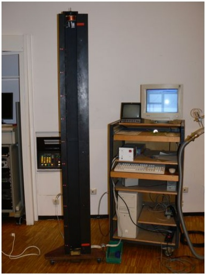
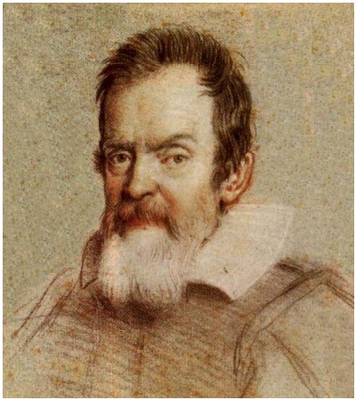
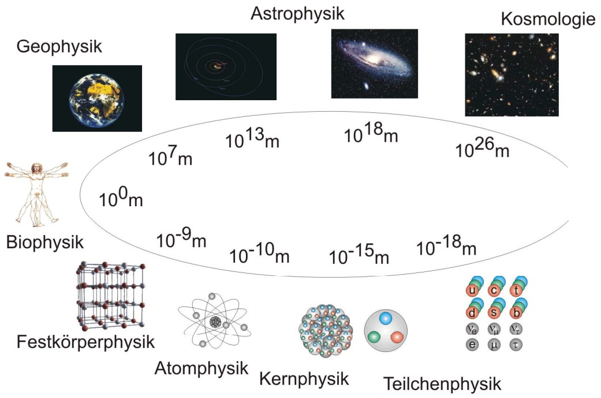
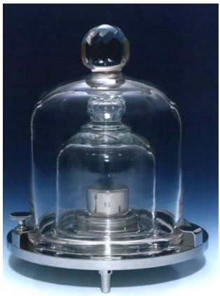
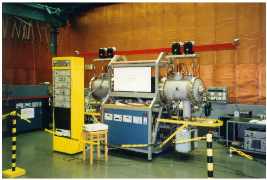
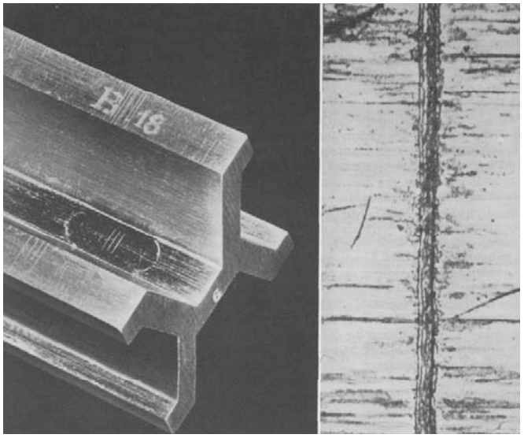
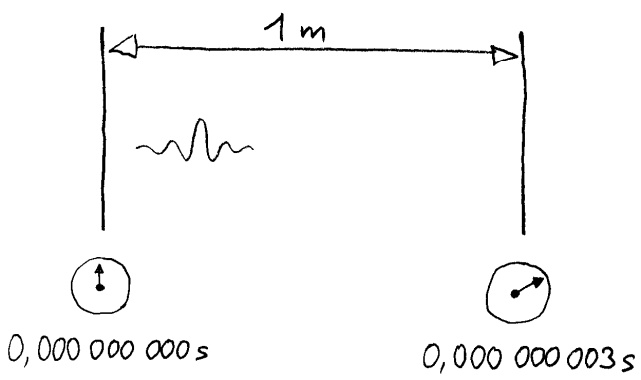

natural_image

Interior of a laboratory setup with a tall black vertical scale mounted on a wooden shelf, surrounded by equipment including a computer monitor and cables (no visible text or symbols)

Abbildung 1.1: Fallschiene zur Messung des freien Falls

## 1.2 Galileo Galilei

• 1564 (Pisa) - 1642 (bei Florenz)
- “Begründer der modernen Naturwissenschaften”
- Galileis neue Methode:

- Experiment als alleiniger Prüfstein für die Wahrheit
- Messung (Wie?, Wieviel?) anstelle des Philosophierens über den Zweck (Warum?):
"Man muss messen, was messbar ist, und messbar machen, was es nicht ist."
- Intellektuelle Analyse und Abstraktion von der Naturwirklichkeit:
Gedankenexperiment, Analyse der Versuchsbedingen, Extrapolation
- “Nutzen der Mathematik für das Urteil in den Naturwissenschaften”:
"Wer naturwissenschaftliche Fragen ohne Hilfe der Mathematik lösen will, unternimmt Undurchführbares."

natural_image

Portrait sketch of a bearded man in historical attire (no text or symbols visible)

Abbildung 1.2: Galileo Galilei

## 1.3 Die Physik heute

Die Physik versucht, die Natur quantitativ auf allen Größenskalen zu beschreiben (Abb. 1.3).

→ Film: Zehn hoch

Hierbei findet die Physik Anwendungen z.B. in der Elektrotechnik, Chemie, Medizin,...

bubble

| Stage | Evolution |
| --- | --- |
| Geophysik | 10^7 m |
| Astrophysik | 10^13 m |
| Kosmologie | 10^18 m |
| Biophysik | 10^0 m |
| Festkörperphysik | 10^-9 m |
| Atomphysik | 10^-10 m |
| Kernphysik | 10^-15 m |
| Teilchenphysik | 10^-18 m |

Abbildung 1.3: Größenordnungen

## 1.4 Physikalische Größen

Physikalische Größen

\- sind messbare Eigenschaften von Objekten, Zuständen und Vorgängen, z.B.

- Länge eines Stabes (Objekt)
- Stärke eines elektrischen Feldes (Zustand)
- Dauer einer Schwingung (Vorgang)

\- müssen durch ein Messverfahren eindeutig definiert sein.

\- z.B. Länge: Vergleich mit einem festgelegten Längennormal

\- können prinzipiell nie beliebig genau gemessen werden.

- von trivialen Fällen abgesehen
– Unterschied zu mathematischen Variablen

## 1.5 Messung und Maßeinheit

\- Physikalische Größen werden gemessen durch Vergleich mit einem Normal → Maßeinheit.

physikalische Größe = Zahlenwert · Einheit, abgekürzt:  $G = \{G\} \cdot [G]$

Beispiel: Strecke $s = 5,2\mathrm{m}$

\- Physikalische Größen werden häufig durch geeignete Buchstaben abgekürzt: Größen durch kursiv gesetzte, Einheiten durch nichtkursiv gesetzte. Für die Abkürzung von Größen nimmt man häufig statt lateinischer auch griechische Buchstaben (am gebräuchlichsten sind die gelb markierten):

1 Einführung

| Großbuchstaben | Kleinbuchstaben | Name |
| --- | --- | --- |
| A | α | Alpha |
| B | β | Beta |
| Γ | γ | Gamma |
| Δ | δ | Delta |
| E | ε | Epsilon |
| Z | ζ | Zeta |
| H | η | Eta |
| Θ | θ | Theta |
| I | ι | Iota |
| K | κ | Kappa |
| Λ | λ | Lambda |
| M | μ | My |
| N | ν | Ny |
| Ξ | ξ | Xi |
| O | o | Omikron |
| Π | π | Pi |
| P | ρ | Rho |
| Σ | σ | Sigma |
| T | τ | Tau |
| Y | υ | Ypsilon |
| Φ | φ | Phi |
| X | χ | Chi |
| Ψ | ψ | Psi |
| Ω | ω | Omega |

- jedes Messergebnis hat eine Einheit!
- Es gibt sehr viele physikalische Größen, aber nur wenige unabhängige Basisgrößen, z.B. Strecke s, Masse m, Zeit t.
- Die Einheiten der Basisgrößen werden Basiseinheiten genannt. Auswahl von Basiseinheiten (willkürlich, aber zweckmäßig), z.B. m, kg, s → siehe Kapitel über Einheiten (Kap. 1.6) Basiseinheiten müssen wohldefiniert und international anerkannt sein.

→ Experiment: Messung einer Strecke s in Meter und in Fuß

(wird in der nächsten Vorlesung nachgeholt)

- Alle anderen Einheiten werden aus diesen abgeleitet, z.B. ist die Einheit der Kraft, das Newton, definiert als $1\mathrm{N} = 1\mathrm{kg}\frac{\mathrm{m}}{\mathrm{s}^2}$.
- Die Dimension gibt Zusammensetzung einer Größe aus Basisgrößen an, z.B. hat Geschwindigkeit die Dimension Länge/Zeit.

## 1.6 Einheiten

\- seit 1969/70 in Deutschland gesetzlich vorgeschrieben: SI-Einheiten des internationalen Einheitensystems (Système International d'Unités)

<table><tr><td colspan="3">SI-Basiseinheiten</td></tr><tr><td>Größe</td><td>Einheit</td><td>Symbol</td></tr><tr><td>Zeit</td><td>Sekunde</td><td>s</td></tr><tr><td>Länge</td><td>Meter</td><td>m</td></tr><tr><td>Masse</td><td>Kilogramm</td><td>kg</td></tr><tr><td>Temperatur</td><td>Kelvin</td><td>K</td></tr><tr><td>Stromstärke</td><td>Ampere</td><td>A</td></tr><tr><td>Lichtstärke</td><td>Candela</td><td>cd</td></tr><tr><td>Substanzmenge</td><td>Mol</td><td>mol</td></tr></table>

Mehr über SI-Einheiten siehe Webseite der PTB (Physikalisch-Technische Bundesanstalt): https://www.ptb.de/cms/fileadmin/internet/Themenrundgaenge/ImWeltweitenNetzDerMetrologie/si.pdf

\- veraltete Einheitensysteme:

- cgs: Zentimeter, Gramm, Sekunde
- angelsächsisch: Fuß, Pfund, Sekunde

\- Kilogramm, Meter und Sekunde sind diejenigen SI-Basiseinheiten, die wir in der Mechanik benötigen. Die anderen Basiseinheiten werden in zukünftigen Kapiteln erläutert.

## Das Kilogramm

- Das Kilogramm (kg) ist die SI-Basiseinheit der Masse.
- Es ist seit dem 20. Mai 2019 durch den Wert der Planckschen Konstanten $h$ definiert, einer der Fundamentalkonstanten der Natur (davon später mehr).
- Alte Definition: 1 Kilogramm = Masse des Internationalen Kilogrammprototypes (liegt in einem Labor des “Bureau International des Poids et Mesures” in Sèvres bei Paris; s. Abb. 1.4)
- einzige SI-Basiseinheit, die vor kurzem noch über einen Prototyp definiert war.

natural_image

Close-up of a glass bell jar with a central cylindrical object, no visible text or symbols

Abbildung 1.4: Kilogrammprototyp

## Die Sekunde

- Die Sekunde (s) ist die SI-Basiseinheit der Zeit.
- 1 Sekunde = das 9 192 631 770-fache der Periodendauer der Strahlung aus dem Übergang zwischen den beiden Hyperfeinstrukturniveaus des Grundzustandes von $^{133}$Cs-Atomen (zu diesen Begriffen später mehr...)
- Die Sekunde kann von allen SI-Basiseinheiten am genauesten gemessen werden: Die primäre Atomuhr CS2 der PTB (s. Abb. 1.5) wich im Jahr 2008 nur um eine millionstel Sekunde von der “idealen” Sekunde ab (relative Unsicherheit  $10^{-14}$ ).

natural_image

Industrial testing setup with large machinery and control panel in a factory setting (no visible text or symbols)

Abbildung 1.5: Atomuhr

## Das Meter

- Das Meter (m) ist die SI-Basiseinheit der Länge
- Das “Ur-Meter” in Paris (s. Abb. 1.6) hat seit 1960 ausgedient.
- seit 1983:
das Meter ist die Länge der Strecke, die Licht im Vakuum während der Dauer von (1/299 792 458) Sekunden durchläuft.
- Damit ist die Lichtgeschwindigkeit im Vakuum exakt

$$
c = \frac {1 \mathrm{m}}{(1 / 2 9 9 7 9 2 4 5 8) \mathrm{s}} = 2 9 9 7 9 2 4 5 8 \frac {\mathrm{m}}{\mathrm{s}}, \text {also gerundet} c \approx 3 \cdot 1 0 ^ {8} \frac {\mathrm{m}}{\mathrm{s}} \tag {1.6.1}
$$

## 1 Einführung

\- Beispiel: Wie lange braucht das Licht im Vakuum für 1 Meter?

$$
c = \frac {s}{t} \tag {1.6.2}
$$

$$
\Rightarrow t = \frac {1 \mathrm{m}}{c} = \frac {1 \mathrm{m}}{2 9 9 7 9 2 4 5 8 \mathrm{m/s}} \approx 3 \cdot 1 0 ^ {- 9} \mathrm{s} = 3 \mathrm{ns} (3 \text {Nanosekunden}) \tag {1.6.3}
$$

natural_image

Close-up of a metal bracket with engraved markings and a close-up of a wooden surface texture (no readable text or symbols)

Abbildung 1.6: “Ur-Meter” mit Strichmarkierung

text_image

1 m
0,000 000 000 s
0,000 000 003 s

Abbildung 1.7: Lichtpropagation

## Abgeleitete Größen

\- Alle anderen Einheiten werden aus den Basiseinheiten abgeleitet, und erhalten zum Teil neue Namen, z.B.

<table><tr><td colspan="4">Abgeleitete SI-Einheiten</td></tr><tr><td>Größe</td><td>Dimension</td><td>SI-Einheit</td><td>Symbol</td></tr><tr><td>Geschwindigkeit</td><td>Länge / Zeit</td><td>Meter / Sekunde</td><td>m/s</td></tr><tr><td>Kraft</td><td>Masse x Länge / Zeit $^{2}$ </td><td>Newton</td><td>N</td></tr><tr><td>Energie</td><td>Masse x Länge $^{2}$  / Zeit $^{2}$ </td><td>Joule</td><td>J</td></tr><tr><td>Leistung</td><td>Masse x Länge $^{2}$  / Zeit $^{3}$ </td><td>Watt</td><td>W</td></tr><tr><td>Frequenz</td><td>1 / Zeit</td><td>Hertz</td><td>Hz</td></tr><tr><td>...</td><td>...</td><td>...</td><td>...</td></tr></table>

## Weitere Einheiten

\- seit 1978 offiziell verbotene physikalische Einheiten (kleine Auswahl):

<table><tr><td>Größe</td><td>Einheit</td><td>Umrechnung</td></tr><tr><td>Zeit</td><td>Stunde (h)</td><td>3600 s</td></tr><tr><td rowspan="3">Länge</td><td>Fermi</td><td> $10^{-15}$  m</td></tr><tr><td>Zoll (inch)</td><td>0,0254 m</td></tr><tr><td>engl. Meile</td><td>1609,33 m</td></tr><tr><td rowspan="2">Kraft</td><td>dyn</td><td> $10^{-5}$  N</td></tr><tr><td>Kilopond</td><td>9,81 N</td></tr><tr><td>Energie</td><td>Kalorie</td><td>4,1868 J</td></tr><tr><td>Leistung</td><td>Pferdestärke (PS)</td><td>735,49875 W</td></tr><tr><td>...</td><td>...</td><td>...</td></tr></table>

\- im Gegensatz zu diesen sind die abgeleiteten Einheiten im SI-System einfache Produkte aus den Basiseinheiten, ohne “krumme” Faktoren.

## SI-Vorsätze

| Potenz | Name | Zeichen | Potenz | Name | Zeichen |
| --- | --- | --- | --- | --- | --- |
| $10^1$ | Deka | da | $10^{-1}$ | Dezi | d |
| $10^2$ | Hekto | h | $10^{-2}$ | Zenti | c |
| $10^3$ | Kilo | k | $10^{-3}$ | Milli | m |
| $10^6$ | Mega | M | $10^{-6}$ | Mikro | μ |
| $10^9$ | Giga | G | $10^{-9}$ | Nano | n |
| $10^{12}$ | Tera | T | $10^{-12}$ | Piko | p |
| $10^{15}$ | Peta | P | $10^{-15}$ | Femto | f |

Beispiel: $1,2 \cdot 10^{4} \mathrm{~m} = 12 \cdot 10^{3} \mathrm{~m} = 12 \mathrm{~km}$

## 1.7 Einheiten umrechnen

- Jedes Messergebnis hat eine Einheit.
- Auswertung und Verarbeitung von Messergebnissen erfordert häufig das Umrechnen von Einheiten.

Beispiel: Welche Wegstrecke s legt ein PKW mit 90 "Stundenkilometern" in 10 Sekunden zurück?

$$
v = s / t \quad \Rightarrow \quad s = v \cdot t = 9 0 \frac {\mathrm{km}}{\mathrm{h}} \cdot 1 0 \mathrm{s} = 9 0 \frac {\mathrm{km}}{\mathrm{h}} \cdot \underbrace {\left(\frac {1 \mathrm{h}}{3 6 0 0 \mathrm{s}}\right)} _ {= 1} \cdot 1 0 \mathrm{s} = 0, 2 5 \mathrm{km} = 2 5 0 \mathrm{m} \tag {1.7.1}
$$

→ Strategie: Einfügen von “1” so, dass die zu ersetzende Einheit herausgekürzt werden kann.

Weiteres Beispiel: Umrechnen von 110 Kilowatt in PS

$$
1 \mathrm{PS} = 7 3 5, 4 9 8 7 5 \mathrm{W} \Rightarrow 1 = \left(\frac {1 \mathrm{PS}}{0 , 7 3 5 4 9 8 7 5 \mathrm{kW}}\right) \tag {1.7.2}
$$

$$
\Rightarrow 1 1 0 \mathrm{kW} = 1 1 0 \mathrm{kW} \cdot \left(\frac {1 \mathrm{PS}}{0 , 7 3 5 4 9 8 7 5 \mathrm{kW}}\right) \approx 1 5 0 \mathrm{PS} \tag {1.7.3}
$$