# Kurzlehrbuch Physik für Ingenieure

MinerU 4.0.12 Advanced；FULL 视图保留页眉、页脚、页码和边栏。

WILEY-VCH

**David Halliday, Robert Resnick und Jearl Walker**

# Halliday Physik

für natur- und ingenieurwissenschaftliche Studiengänge

Übersetzung herausgegeben von Stephan W. Koch

Dritte, vollständig überarbeitete und erweiterte Auflage


<details>
<summary>natural_image</summary>

Exterior view of a modern cable-stayed bridge with metal grating against a blue sky (no signage or text visible)
</details>

---


---

**Halliday Physik**

**für natur- und ingenieurwissenschaftliche**

**Studiengänge**

---


---

## Halliday Physik für natur- und ingenieurwissenschaftliche Studiengänge

David Halliday, Robert Resnick und Jearl Walker

Herausgeber der deutschen Übersetzung Stephan W. Koch

Dritte, vollständig überarbeitete und erweiterte Auflage

WILEY-VCH

Verlag GmbH & Co. KGaA

---

## Die Autoren

## David Halliday

University of Pittsburgh, USA

## Robert Resnick

Rensselaer Polytechnic Institute, USA

## Jearl Walker

Cleveland State University, USA

## Der Übersetzungsherausgeber

## Stephan W. Koch

Philipps-Universität Marburg

Fachbereich Physik

Renthof 6

35032 Marburg

Deutschland

## Die Übersetzer

**Michael Bär**, Wiesloch, Deutschland

**Matthias Delbrück**, Dossenheim, Deutschland

## Titel der Orginalausgabe

Fundamentals of Physics / Extended 10th Edition

Copyright © 2014 John Wiley & Sons, Inc.

All Rights Reserved. This translation published under license with the original publisher John Wiley & Sons, Inc.

1. Auflage © 2003 Wiley-VCH GmbH & Co. KGaA

2. Auflage © 2009 Wiley-VCH GmbH & Co. KGaA

## Titelbild

Adelevin/Stock-Illustration-ID: 480952174

## 3. Auflage 2020

Alle Bücher von Wiley-VCH werden sorgfältig erarbeitet.

Dennoch übernehmen Autoren, Herausgeber und Verlag in keinem Fall, einschließlich des vorliegenden Werkes, für die Richtigkeit von Angaben, Hinweisen und Ratschlägen sowie für eventuelle Druckfehler irgendeine Haftung.

## Library of Congress Card No.:

applied for

## Bibliografische Information der Deutschen Nationalbibliothek

Die Deutsche Nationalbibliothek verzeichnet diese Publikation in der Deutschen Nationalbibliografie; detaillierte bibliografische Daten sind im Internet über http://dnb.d-nb.de abrufbar.

© 2020 WILEY-VCH Verlag GmbH & Co. KGaA, Boschstr. 12, 69469 Weinheim, Germany

Alle Rechte, insbesondere die der Übersetzung in andere Sprachen, vorbehalten. Kein Teil dieses Buches darf ohne schriftliche Genehmigung des Verlages in irgendeiner Form – durch Photokopie, Mikroverfilmung oder irgendein anderes Verfahren – reproduziert oder in eine von Maschinen, insbesondere von Datenverarbeitungsmaschinen, verwendbare Sprache übertragen oder übersetzt werden. Die Wiedergabe von Warenbezeichnungen, Handelsnamen oder sonstigen Kennzeichen in diesem Buch berechtigt nicht zu der Annahme, dass diese von jedermann frei benutzt werden dürfen. Vielmehr kann es sich auch dann um eingetragene Warenzeichen oder sonstige gesetzlich geschützte Kennzeichen handeln, wenn sie nicht eigens als solche markiert sind.

**Umschlaggestaltung** Formgeber, Mannheim

**Satz** le-tex publishing services GmbH, Leipzig, Deutschland

**Print ISBN** 978-3-527-41368-3

**ePDF ISBN** 978-3-527-82264-5

**ePub ISBN** 978-3-527-82266-9

Gedruckt auf säurefreiem Papier.

---

# Vorwort zur dritten Auflage

Diese dritte deutsche Auflage des Halliday-Lehrbuchs für ingenieur- und naturwissenschaftliche Studiengänge ist noch besser auf die Bedürfnisse dieser Studierenden abgestimmt, die im Laufe ihres Studiums mit der Physik in Berührung kommen.

Der Inhalt deckt sämtliche für diese Zielgruppe relevanten Aspekte der Experimentalphysik ab und wurde noch einmal gestrafft und auf das Wesentliche fokussiert. Angefangen von den elementaren Konzepten der Bewegung von Massepunkten und einfachen Körpern, der Newtonschen Mechanik, den Grundlagen der Thermodynamik, der Physik elektrischer und magnetischer Felder und der Optik bis hin zu den Grundkonzepten der Quantenmechanik und der Festkörperphysik wird der Lehrstoff in didaktisch hervorragender Form präsentiert.

Dabei wurde der zugrundeliegende Ansatz des „Halliday beibehalten, der zu dessen großem Erfolg und Beliebtheit beigetragen hat: Die Physik wird stets in ihrer Bedeutung motiviert, und wichtige physikalische Konzepte werden oft auf mehrere Arten präsentiert, wobei auf mögliche Verständnisprobleme besonders eingegangen wird, um typische Fallstricke zu vermeiden. Lösungsstrategien für Aufgaben nehmen einen ebenso wichtigen Platz ein wie Zusammenfassungen des präsentierten Materials in allen Kapiteln.

Um veränderten Lehr- und Lerngewohnheiten Rechnung zu tragen, wurden die Lerninhalte in der dritten Auflage modular organisiert, so dass jeder Abschnitt explizit mit Lernzielen und Schlüsselideen beginnt.

Die größte Neuerung ist das Übungsbuch, das auf das Lehrbuch abgestimmt ist, aber auch unabhängig davon verwendet werden kann. Es enthält rund 300 ausführlich durchgerechnete Beispielaufgaben und rund 1200 Aufgaben unterschiedlichen Schwierigkeitsgrads mit detaillierten Lösungen. Auch wenn man nicht jede Aufgabe rechnet: nur durch eigenständiges Üben mit der Möglichkeit der Lösungskontrolle festigt sich der Lernstoff – zur optimalen Klausur- und Prüfungsvorbereitung.

Marburg/Weinheim, Herbst 2019

Stephan W. Koch

---

# Zum Aufbau des Buches

Die vorliegende deutsche Ausgabe übernimmt die meisten der erfolgreichen Stilelemente der englischsprachigen Originalausgabe. Der Text wird in großzügigem Layout präsentiert, wobei wichtige Lösungsstrategien, Merksätze und Formeln besonders hervorgehoben sind.

## ¿ Kapiteleinstieg

Jedes Kapitel beginnt mit einer physikalischen Motivation, jeder Unterabschnitt mit der expliziten Nennung von Lernzielen und Schlüsselideen.

## ¿ Kontrollfragen

An diesen Haltepunkten im Textfluss werden Fragen gestellt, die Studierende anhand des vorangegangenen Textabschnitts oder der Beispielaufgabe zu lösen in der Lage sein sollten. Ist dies nicht der Fall, wird empfohlen, den Stoff vor dem Weiterlesen zu wiederholen. Die Antworten auf alle Kontrollfragen sind am Ende des Buchs zusammengestellt.

## ¿ Lösungsstrategien

Insbesondere Studienanfängern geben diese kurzen Abschnitte Hinweise zum Herangehen an Probleme und zum Vermeiden häufiger Fehler.

## ¿ Zusammenfassungen

Am Ende jedes Kapitels wird dessen Inhalt in knapper, übersichtlicher Form zusammengefasst. Das Lesen dieser Übersicht kann und soll das Studium des Kapitels jedoch nicht ersetzen.

## ¿ Fragen

Ähnlich wie bei den Kontrollfragen sind zur Beantwortung der Fragen weniger Berechnungen als vielmehr Argumente erwünscht. Die Antworten auf einen Groß- teil der Fragen sind am Ende des Buchs zusammengestellt.

Perfekt auf das Lehrbuch abgestimmt ist das Übungsbuch, das rund 300 Beispielaufgaben und rund 1200 Aufgaben enthält:

## ¿ Beispielaufgaben

Diese durchgerechneten Aufgaben helfen Studierenden, den gelernten Stoff zu organisieren und ihre Fä- higkeit zur Lösung von Problemen zu entwickeln. Die Lösungswege werden schrittweise erklärt. Dabei wird oft von speziell hervorgehobenen Lösungsideen ausgegangen, die zur Bewältigung der Aufgabe herangezogen werden müssen.

## ¿ Aufgaben

Die Übungsaufgaben unterschiedlichen Schwierigkeitsgrads helfen dabei, das Gelernte zu festigen, auf unbekannte Sachverhalte zu übertragen und sich auf Klausuren und Prüfungen vorzubereiten. Dabei ist nur in wenigen Fällen das reine Einsetzen von Zahlen in Formeln gefragt, vielmehr stehen Konzepte, Begründungen und Argumente im Vordergrund. Zu allen Aufgaben gibt es ausführliche Lösungen.

---

## Inhaltsverzeichnis

## 1

## Bewegung

1.1 Ort, Verschiebung und mittlere Geschwindigkeit . . . . . 1
1.2 Momentangeschwindigkeit . . . . . . 4
1.3 Beschleunigung . . 5
1.4 Konstante Beschleunigung . . . . . 8
1.5 Der freie Fall . . . 1 2
1.6 Zwei und drei Raumdimensionen . . . . . . . . 1 4
1.7 Durchschnittsgeschwindigkeit und Momentangeschwindigkeit 1 5
1.8 Durchschnittsbeschleunigung und Momentanbeschleunigung 1 8
1.9 Wurfbewegungen . . 1 9
1.10 Die gleichförmige Kreisbewegung . . . . . . . . 2 4
1.11 Relativbewegung in einer Dimension . . . . . 26
1.12 Relativbewegung in zwei Dimensionen . . . 28
1.13 Zusammenfassung . . 2 9
1.14 Fragen . . . . . . 3 1

## 2

## Kraft und Bewegung

2.1 Das erste und das zweite Newtonsche Gesetz . . . 35
2.2 Einige besondere Kräfte . . . . 4 2
2.3 Die Newtonschen Gesetze in der Praxis . . . 47
2.4 Reibung 50
2.5 Strömungswiderstand und Endgeschwindigkeit . 5 4
2.6 Gleichförmige Kreisbewegung . 5 6
2.7 Scheinkräfte . . . . . 5 8
2.8 Zusammenfassung . . . . . 61
2.9 Fragen . . . . . . . 63

## 3

## Kinetische Energie und Arbeit

3.1 Energie . . . . . . 69
3.2 Arbeit und kinetische Energie . . . . . . . . . . . 7 1
3.3 Von der Gravitationskraft verrichtete Arbeit . 7 4

3.4 Von einer Federkraft verrichtete Arbeit . . . 76
3.5 Von einer allgemeinen veränderlichen Kraft verrichtete Arbeit . . . . 80
3.6 Leistung 83
3.7 Zusammenfassung . . . . . 85
3.8 Fragen . . . . . 8 6

## 4

## Potenzielle Energie und Energieerhaltung

4.1 Potenzielle Energie . . . . . 89
4.2 Der Energieerhaltungssatz der Mechanik . . 94
4.3 Grafische Darstellung der potenziellen Energie . 9 8
4.4 Von einer äußeren Kraft an einem System verrichtete Arbeit . . 101
4.5 Energieerhaltung 104
4.6 Zusammenfassung . . . . . 107
4.7 Fragen . . . . . . 109

## 5

## Systeme von Teilchen

5.1 Der Schwerpunkt . . . . 113
5.2 Das zweite Newtonsche Gesetz für ein Teilchensystem . . . 116
5.3 Der Impuls . . . . . 119
5.4 Stoßprozesse: Der Kraftstoß . . . . . . . . . . . . 121
5.5 Die Impulserhaltung . . 125
5.6 Inelastische eindimensionale Stöße . . . . . . 127
5.7 Elastische eindimensionale Stöße . . . . . . . . 129
5.8 Zweidimensionale Stöße . . 132
5.9 Systeme mit veränderlicher Masse: Eine Rakete . . . 133
5.10 Äußere Kräfte und Änderungen der inneren Energie . . 136
5.11 Zusammenfassung . . . 138
5.12 Fragen . . . . . 139

## 6

## Die Rotation ausgedehnter Körper

6.1 Die Variablen der Rotation . . 143

---

Inhaltsverzeichnis

6.2 Rotation mit konstanter Winkelbeschleunigung 148
6.3 Beziehungen zwischen den Variablen für lineare Bewegung und Rotation . . 149
6.4 Die kinetische Energie der Rotation . . . . . . 152
6.5 Die Berechnung des Trägheitsmoments . . . 154
6.6 Das Drehmoment . . . . . 156
6.7 Das zweite Newtonsche Gesetz für die Rotation . 158
6.8 Arbeit und kinetische Energie der Rotation . . 159
6.9 Zusammenfassung . . . . . 162
6.10 Fragen . . . . . . 164

## 7

## Rollbewegung, Drehmoment und Drehimpuls

7.1 Die Rollbewegung . . . . 167
7.2 Kräfte und die kinetische Energie der Rollbewegung . 169
7.3 Das Jo-Jo . . . . . . . 172
7.4 Eine erweiterte Definition des Drehmoments . . 173
7.5 Der Drehimpuls . . . 175
7.6 Das zweite Newtonsche Gesetz in Winkelschreibweise . . 177
7.7 Der Drehimpuls eines starren Körpers . . . . 179
7.8 Die Erhaltung des Drehimpulses . . . . . . . . . 182
7.9 Die Präzession eines Kreisels . . . . . . . . . . . 185
7.10 Zusammenfassung . . . . . 187
7.11 Fragen . . . . . . . 188

## 8

## Gleichgewicht und Elastizität

8.1 Gleichgewicht . . . 191
8.2 Beispiele für statische Gleichgewichte . . . . 195
8.3 Elastizität . . . . 198
8.4 Zusammenfassung . . . 203
8.5 Fragen . . . . . . 203

## 9

## Gravitation

9.1 Das Newtonsche Gravitationsgesetz . . . . . . 207
9.2 Gravitation und das Superpositionsprinzip . 210
9.3 Die Gravitation in der Nähe der Erdoberfläche . . 211
9.4 Die Gravitation innerhalb der Erde . . . . . . . 214
9.5 Die potenzielle Energie der Gravitation . . . 216
9.6 Planeten und Satelliten: Die Keplerschen Gesetze . 220
9.7 Satelliten: Umlaufbahnen und Energie . . . . 223
9.8 Einstein und die Gravitation . . . . . . . . . . . . 225
9.9 Zusammenfassung . . . . . 227
9.10 Fragen . . . . . . 229

## 10

## Fluide

10.1 Fluide, Dichte und Druck 233
10.2 Ruhende Fluide 235
10.3 Druckmessung . . . 238
10.4 Das Pascalsche Prinzip 240
10.5 Das archimedische Prinzip . . . . . . . . . . . 241
10.6 Die Kontinuitätsgleichung . . . . . . 245
10.7 Die Bernoulli-Gleichung . . 248
10.8 Zusammenfassung . . . . . 251
10.9 Fragen . . . . . . 252

## 11

## Schwingungen

11.1 Harmonische Schwingungen . . . . . . . . . . . . 255
11.2 Die Energie einer harmonischen Schwingung . . 260
11.3 Das Torsionspendel . . . 262
11.4 Pendel und Kreisbewegungen . . . . . . . . . . . 264
11.5 Gedämpfte harmonische Schwingungen . . 269
11.6 Erzwungene Schwingungen und Resonanz 271
11.7 Das Foucaultsche Pendel . . 273
11.8 Zusammenfassung . . . . . 274
11.9 Fragen . . . . . . 275

## 12

## Wellen – I

12.1 Transversalwellen . . . . . 279
12.2 Die Wellengeschwindigkeit eines gespannten Seils . . 285
12.3 Energie und Leistung einer sich ausbreitenden Seilwelle . . 288
12.4 Die Wellengleichung . . 290
12.5 Die Interferenz von Wellen . . . . . . . . . . 293
12.6 Darstellung von Wellen durch Zeiger . . . . . 297
12.7 Stehende Wellen und Resonanz . . . . . . . . . 298
12.8 Zusammenfassung . . . . . 304
12.9 Fragen . . . . . . 305

## 13

## Wellen – II

13.1 Die Schallgeschwindigkeit . . . 307
13.2 Die Ausbreitung von Schallwellen . . . . . . . . 310
13.3 Interferenz . . . . 314
13.4 Schallintensität und Schallpegel . . . . . . . . . 316
13.5 Musikalische Töne . . 319
13.6 Schwebungen . . . . 322
13.7 Der Doppler-Effekt 323
13.8 Überschallgeschwindigkeit und Stoßwellen . . . 328
13.9 Zusammenfassung . . . . . 329
13.10 Fragen . . . . . 330

VIII

---

Inhaltsverzeichnis

## 14

## Temperatur, Wärme und der erste Hauptsatz der Thermodynamik

14.1 Temperatur . . . . . . 333
14.2 Die Celsius- und die Fahrenheit-Skala . . . . 336
14.3 Wärmeausdehnung . . 339
14.4 Die Absorption von Wärme . . . . . . . . 341
14.5 Der erste Hauptsatz der Thermodynamik . 347
14.6 Mechanismen der Wärmeübertragung . . . . 353
14.7 Zusammenfassung . . . 358
14.8 Fragen . . . . . . 359

## 15

## Die kinetische Gastheorie

15.1 Ein neuer Blick auf Gase . . 363
15.2 Ideale Gase . . . . 364
15.3 Druck, Temperatur und gemittelte Geschwindigkeiten . . . . 368
15.4 Kinetische Translationsenergie . . . . . . . . . . 371
15.5 Die mittlere freie Weglänge . . . . . . . . . . . . 372
15.6 Die Verteilungsfunktion der Molekülgeschwindigkeiten . . . . . . . . . . 374
15.7 Die molare Wärmekapazität idealer Gase . 377
15.8 Freiheitsgrade und molare Wärmekapazität . . . 382
15.9 Die adiabatische Expansion eines idealen Gases . 385
15.10 Reale Gase . 389
15.11 Zusammenfassung . . 392
15.12 Fragen . . . . . 393

## 16

## Entropie und der zweite Hauptsatz der Thermodynamik

16.1 Entropie . . . . . 397
16.2 Entropie in Aktion: Thermodynamische Maschinen . . . . . . . . . 402
16.3 Kältemaschinen und reale Maschinen . . . . 407
16.4 Eine statistische Interpretation der Entropie . . 411
16.5 Zusammenfassung . . . . . 414
16.6 Fragen . . . . . 416

## 17

## Elektrische Ladung

17.1 Elektromagnetismus . 419
17.2 Die elektrische Ladung ist quantisiert . . . . . 426
17.3 Die elektrische Ladung ist eine Erhaltungsgröße 427
17.4 Zusammenfassung . . . . 429
17.5 Fragen . . . . . . 429

## 18

## Elektrische Felder

18.1 Das elektrische Feld . 433
18.2 Das elektrische Feld einer Punktladung . . . 436
18.3 Das elektrische Feld eines Dipols . . . . . . . . 438
18.4 Elektrisches Feld einer linearen Ladungsverteilung . . . 440
18.5 Das elektrische Feld einer geladenen Scheibe . . 444
18.6 Punktladung im elektrischen Feld . . . . . . . . 446
18.7 Ein Dipol in einem elektrischen Feld . . . . . 448
18.8 Zusammenfassung . . . 451
18.9 Fragen . . . . . . 452

## 19

## Der Gaußsche Satz

19.1 Das Coulombsche Gesetz in neuem Licht . 455
19.2 Der Gaußsche Satz . . . . 458
19.3 Eigenschaften eines geladenen, isolierten Leiters . . . 462
19.4 Eine Anwendung des Gaußschen Satzes: Zylindersymmetrie . . 465
19.5 Eine Anwendung des Gaußschen Satzes: Ebene Symmetrie . . . 466
19.6 Eine Anwendung des Gaußschen Satzes: Kugelsymmetrie . . . 469
19.7 Zusammenfassung . . . . . 471
19.8 Fragen . . . . . . 472

## 20

## Das elektrische Potenzial

20.1 Das elektrische Potenzial . . 475
20.2 Äquipotenzialflächen . . 479
20.3 Das Potenzial von Punktladungen . . . . . . . . 482
20.4 Das Potenzial eines elektrischen Dipols . . . 485
20.5 Das Potenzial einer kontinuierlichen Ladungsverteilung . . . 487
20.6 Die Berechnung des elektrischen Felds aus dem elektrischen Potenzial . . . . . . . . 490
20.7 Die elektrische potenzielle Energie eines Systems von Punktladungen . . . . . . . 492
20.8 Das Potenzial eines geladenen, isolierten leitenden Körpers . 493
20.9 Zusammenfassung . . . . 495
20.10 Fragen . . . . . 497

## 21

## Kapazität

21.1 Kondensatoren und ihre Anwendungen . . . 499
21.2 Die Berechnung der Kapazität 502
21.3 Parallel- und Reihenschaltung von Kondensatoren . . 506

IX

---

Inhaltsverzeichnis

21.4 In einem elektrischen Feld gespeicherte Energie . 511
21.5 Kondensator mit Dielektrikum . . . . . . . . . . 513
21.6 Dielektrika und Gaußscher Satz . . . . . . . . . 517
21.7 Zusammenfassung . . . 519
21.8 Fragen . . . . . . 520

## 22

## Elektrischer Strom und Widerstand

22.1 Ladung in Bewegung: Elektrischer Strom . . 523
22.2 Die Stromdichte . . . 525
22.3 Widerstand und spezifischer Widerstand . . 528
22.4 Das Ohmsche Gesetz . . . 532
22.5 Elektrische Leistung in Stromkreisen . . . . . 536
22.6 Zusammenfassung . . . 541
22.7 Fragen . . . . . . 542

## 23

## Stromkreise

23.1 Unverzweigte Stromkreise . . . . . . . . . . . . . . 545
23.2 Verzweigte Stromkreise . . . . 554
23.3 Amperemeter und Voltmeter . . . . . . . . . . . 558
23.4 RC-Kreise . . . . 559
23.5 Zusammenfassung . . . 563
23.6 Fragen . . . . . . 564

## 24

## Magnetfelder

24.1 Magnetfelder und die Definition von B⃗ . . . 567
24.2 Gekreuzte Felder: Die Entdeckung des Elektrons . . . . . . . . . . 572
24.3 Gekreuzte Felder: Der Hall-Effekt . . . . . . . . 574
24.4 Geladene Teilchen auf einer Kreisbahn . . . 576
24.5 Zyklotron und Synchrotron . . . . . . . 580
24.6 Die magnetische Kraft auf einen stromdurchflossenen Draht . . . . 582
24.7 Das Drehmoment auf eine stromdurchflossene Drahtschleife . . . . . . . 584
24.8 Das magnetische Dipolmoment . . . . . . . . . 587
24.9 Zusammenfassung . . . . 589
24.10 Fragen . . . . . 590

## 25

## Magnetfelder aufgrund von Strömen

25.1 Das Magnetfeld um einen Strom . . . . . . . . . 593
25.2 Die Kraft zwischen parallelen Strömen . . . . 598
25.3 Das Ampèresche Gesetz . . 599
25.4 Zylinder- und Ringspulen . . . . . . . 603
25.5 Eine stromführende Spule als magnetischer Dipol 606
25.6 Zusammenfassung . . . 609
25.7 Fragen . . . . . . 609

## 26

## Induktion und Induktivität

26.1 Das Faradaysche Gesetz und die Lenzsche Regel 613
26.2 Induktion und Energietransfer . . . . . . . . . . 619
26.3 Induzierte elektrische Felder . . . . 622
26.4 Induktivität . . . . 625
26.5 Selbstinduktion . . 627
26.6 RL-Kreise . . . 629
26.7 Energiespeicherung im Magnetfeld . . . . . . 632
26.8 Die Energiedichte eines Magnetfelds . . . . . 634
26.9 Gegeninduktion . . 635
26.10 Zusammenfassung . 637
26.11 Fragen . . . . . 638

## 27

## Elektromagnetische Schwingkreise und Wechselstrom

27.1 LC-Schwingungen . . . 641
27.2 Gedämpfte Schwingungen in einem RLC-Kreis . . 647
27.3 Erzwungene Schwingungen . . . . . 649
27.4 Der Reihen-RLC-Kreis . . 657
27.5 Leistung in Wechselstromkreisen . . . . . . . . 662
27.6 Transformatoren . . . 664
27.7 Zusammenfassung . . . . 668
27.8 Fragen . . . . . 669

## 28

## Magnetismus und Materie

28.1 Der Gaußsche Satz für Magnetfelder . . . . . 671
28.2 Induzierte magnetische Felder . . . . . . . . . . 673
28.3 Der Verschiebungsstrom und die Maxwell-Gleichungen . . . 675
28.4 Magnete . . . . . 678
28.5 Der Magnetismus von Elektronen . . . . . . . . 680
28.6 Diamagnetismus 687
28.7 Paramagnetismus . . 688
28.8 Ferromagnetismus . 691
28.9 Zusammenfassung . . . 694
28.10 Fragen . . . 696

## 29

## Elektromagnetische Wellen

29.1 Elektromagnetische Wellen . . . . . . . . . . . . . 699
29.2 Energietransport und Poynting-Vektor . . . . 707
29.3 Der Strahlungsdruck . . . 710
29.4 Polarisation . . 712
29.5 Reflexion und Brechung . . 716
29.6 Totalreflexion . . 721
29.7 Polarisation durch Reflexion . . . . . . . . 723
29.8 Zusammenfassung . . . . 724
29.9 Fragen . . . . . 726

X

---

Inhaltsverzeichnis

## 30

## Abbildungen

30.1 Bilder und ebene Spiegel . . 729
30.2 Kugelspiegel . . . 733
30.3 Sphärische brechende Flächen . . . . . 738
30.4 Dünne Linsen . . . . 740
30.5 Optische Instrumente . . 747
30.6 Drei Herleitungen . . 751
30.7 Zusammenfassung . . . . 753
30.8 Fragen . . . . . . 754

## 31

## Interferenz

31.1 Licht als Welle . 757
31.2 Beugung am Doppelspalt . . . . . . . . . . . . . . . 761
31.3 Interferenz und Intensität . . . . . . . . . 766
31.4 Interferenz an dünnen Schichten . . . . . . . . 770
31.5 Das Michelson-Interferometer . . . . . . . . . . 776
31.6 Zusammenfassung . . . . 777
31.7 Fragen . . . . . . 778

## 32

## Beugung

32.1 Beugung am Einzelspalt . . . . . . . 781
32.2 Intensitäten bei der Beugung am Einzelspalt . . 785
32.3 Beugung an einer kreisrunden Öffnung . . . 789
32.4 Beugung am Doppelspalt . . . . . . 792
32.5 Beugungsgitter . . . 795
32.6 Beugungsgitter: Dispersion und Auflösungsvermögen . 799
32.7 Röntgenbeugung . . 801
32.8 Zusammenfassung . . . 804
32.9 Fragen . . . . . . 805

## 33

## Relativitätstheorie

33.1 Gleichzeitigkeit und Zeitdilatation . . . . . . . 807
33.2 Die Relativität der Länge . . . . 816
33.3 Die Lorentz-Transformation . . . . . . . 818
33.4 Die Relativität der Geschwindigkeiten . . . . 822
33.5 Der Doppler-Effekt für Lichtwellen . . . . . . 823
33.6 Impuls und Energie . . 827
33.7 Zusammenfassung . . . . 833
33.8 Fragen . . . . . . 834

## 34

## Photonen und Materiewellen

34.1 Das Photon: Teilchen des Lichts . . . . . . . . . 837
34.2 Der photoelektrische Effekt . . . . 839
34.3 Photonenimpuls, Compton-Verschiebung und Lichtinterferenz . . . . . . . 842
34.4 Die Geburtsstunde der Quantenphysik . . . 848

34.5 Elektronen und Materiewellen . . . . . . . . . . 850
34.6 Die Schrödinger-Gleichung . . . . . 854
34.7 Die Heisenbergsche Unschärferelation . . . . 857
34.8 Reflexion an einer Potenzialschwelle . . . . . 858
34.9 Der Tunneleffekt . 860
34.10 Zusammenfassung . . 863
34.11 Fragen . . . . . 865

## 35

## Mehr über Materiewellen

35.1 Die Energie eines Elektrons in einer Elektronenfalle . 867
35.2 Die Wellenfunktionen eines Elektrons in einem Kastenpotenzial . . 871
35.3 Das eindimensionale endliche Kastenpotenzial . . 875
35.4 Zwei- und dreidimensionale Elektronenfallen . . 876
35.5 Das Wasserstoffatom . . 880
35.6 Zusammenfassung . . . . 891
35.7 Fragen . . . . . . 892

## 36

## Atome

36.1 Eigenschaften von Atomen . . 895
36.2 Das Stern-Gerlach-Experiment . . . . . . . . . . 901
36.3 Kernspinresonanz . . 904
36.4 Das Pauli-Prinzip . . 906
36.5 Der Aufbau des Periodensystems . . . . . . . . 908
36.6 Röntgenstrahlung . . . 911
36.7 Laser . . . . . . 915
36.8 Zusammenfassung . . . 920
36.9 Fragen . . . . . . 921

## 37

## Elektrische Leitfähigkeit von Festkörpern

37.1 Die elektrischen Eigenschaften von Metallen 923
37.2 Halbleiter und Dotierung 930
37.3 pn-Übergänge und Transistoren . . . . . . . . . 935
37.4 Zusammenfassung . . . 943
37.5 Fragen . . . . . . 944

## Anhang

A Das Internationale Einheitensystem (SI) . . . 948
B Astronomische Daten . 951
Umrechnungsfaktoren . . 952
D Mathematische Formeln . . 954
E Eigenschaften der Elemente . . . 959
F Antworten auf die Kontrollfragen und Fragen . . . 962
G Stichwortverzeichnis . . . 970

XI

---


---

# 1 Bewegung

## 1.1 Ort, Verschiebung und mittlere Geschwindigkeit

## Physikalische Motivation

Eines der Ziele der Physik ist, die Bewegung von Objekten zu beschreiben – z. B. wie schnell sie sich bewegen oder welche Entfernung sie in einer bestimmten Zeit zurücklegen. Die Konstrukteure von Rennautos sind an diesem Aspekt der Physik besonders interessiert, weil diese Zusammenhänge letztlich über Sieg oder Niederlage im Rennen entscheiden. Geologen verwenden diesen Teil der Physik, um die Bewegungen von tektonischen Platten zu messen und zu versuchen, daraus Erdbeben vorherzusagen. Mediziner brauchen diese physikalischen Zusammenhänge, um aus der beobachteten Strömung des Blutes in einem Patienten den Teilverschluss einer Arterie zu diagnostizieren, und Autofahrer nutzen sie, um zu bremsen, wenn ihr Radarwarner piepst. Natürlich gibt es noch unzählige weitere Beispiele. In diesem Kapitel untersuchen wir zunächst die Grundlagen der Physik von Bewegungen, in denen sich ein Objekt (ein Rennwagen, eine tektonische Platte, rote Blutkörperchen . . . ) entlang einer einzigen Achse bewegt. Danach beschäftigen wir uns mit der Beschreibung von Bewegungen in zwei und drei Raumdimensionen.


## 1.1.1 Bewegung

Die Erde – und alles auf ihr – bewegt sich. Selbst scheinbar regungslose Dinge, wie z. B. eine Straße, bewegen sich mit der Erddrehung, der Umlaufbahn der Erde um die Sonne, der Umlaufbahn des Sonnensystems um das Zentrum der Milchstraße und der Bewegung der Galaxis relativ zu anderen Galaxien. Die Klassifizierung und der Vergleich von Bewegungen – **Kinematik** genannt – können manchmal eine große Herausforderung darstellen. Was genau messen wir dabei und wie werden die Vergleiche gezogen?

Bevor wir versuchen, diese Fragen zu beantworten, werden wir einige allgemeine Eigenschaften einer ganz bestimmten Art von Bewegung studieren. Diese wird durch drei Bedingungen eingeschränkt:

1. Die Bewegung erfolgt nur entlang einer geraden Linie. Diese Linie kann senkrecht (wie bei einem fallenden Stein), waagerecht (wie bei einem Auto auf einer geraden Straße) oder schräg verlaufen, aber sie muss eine Gerade sein.
2. Bewegung wird durch Kräfte („ziehen“ und „schieben“) verursacht – diese werden jedoch erst in Kap. 5 behandelt. In dem vorliegenden Kapitel werden wir nur die Bewegung an sich sowie Veränderungen dieser Bewegung untersuchen. Wird das bewegte Objekt schneller oder langsamer, hält es an oder wechselt es die Richtung? Welche Rolle spielt die Zeit bei der Veränderung der Bewegung?
3. Das bewegte Objekt ist entweder ein **Teilchen**, d. h. ein punktförmiges Gebilde wie z. B. ein Elektron, oder ein Objekt, das sich wie ein Teilchen bewegt (derart, dass all seine Teile sich mit exakt derselben Geschwindigkeit in dieselbe

Halliday Physik für natur- und ingenieurwiss. Studiengänge, 3. Auflage. D. Halliday, R. Resnick und J. Walker. © 2020 WILEY-VCH Verlag GmbH & Co. KGaA. Published 2020 by WILEY-VCH Verlag GmbH & Co. KGaA.

1

---

1 Bewegung


<details>
<summary>other</summary>

| Category | X (m) |
| --- | --- |
| Positive Richtung | ~0.7 |
| Negative Richtung | ~-0.7 |
</details>

Abb. 1.1

Der Ort bzw. die Position eines Teilchens lässt sich anhand einer Achse bestimmen, die in Einheiten der Länge gekennzeichnet ist (hier in Metern) und sich unendlich weit in entgegengesetzte Richtungen erstreckt. Die Achsenbeschriftung – hier x – befindet sich immer auf der positiven Seite des Ursprungs.

Richtung bewegen). Ein Kind, das seinen Körper ganz steif macht und auf dem Spielplatz eine gerade Rutsche hinunterrutscht, bewegt sich wie ein Teilchen; ein vom Wind durch die Wüste getriebener, rollender Steppenläufer dagegen nicht, da sich verschiedene Punkte in seinem Inneren in verschiedene Richtungen bewegen.

## 1.1.2 Ort und Verschiebung

Den Ort eines Teilchens zu bestimmen bedeutet, seine Position in Bezug auf einen bestimmten Referenzpunkt festzulegen, oftmals in Bezug auf den Ursprung (oder Nullpunkt) einer Achse, wie der x-Achse in Abb. 1.1. Die **positive Richtung** der Achse ist die Richtung ansteigender Zahlen (Koordinaten), die in Abb. 1.1 nach rechts zeigt. Die entgegengesetzte Richtung wird als **negative Richtung** bezeichnet.

Ein Teilchen befindet sich z. B. am Ort x = 5 m, d. h., es befindet sich 5 m in positiver Richtung vom Ursprung entfernt. Läge es bei $x = - 5   \mathrm { m } ,$ so befände es sich genauso weit vom Ursprung entfernt, allerdings in der entgegengesetzten Richtung. Auf der Achse liegt eine Koordinate von −5 m weiter links – also zu kleineren Zahlen hin – als eine von −1 m, und beide Koordinaten befinden sich weiter links als eine Koordinate von +5 m. Das Pluszeichen einer Koordinate muss man nicht ausschreiben, das Minuszeichen dagegen muss immer aufgeführt werden.

Ein Wechsel von einem Ort $x _ { 1 }$ zu einem anderen Ort $x _ { 2 }$ wird eine **Verschiebung** Δx genannt, wobei

$$
\Delta x = x _ {2} - x _ {1}. \tag {1.1}
$$

(Das Symbol $\Delta ,$ der griechische Großbuchstabe Delta, steht für eine Veränderung einer Größe, also die Differenz von Endwert und Anfangswert dieser Größe.) Wenn für die Ortsangaben $x _ { 1 }$ und $x _ { 2 }$ Zahlenwerte eingesetzt werden, so ergibt eine Verschiebung in die positive Richtung (nach rechts in Abb. 1.1) immer einen positiven Wert, eine Verschiebung in die entgegengesetzte Richtung (nach links in der Abbildung) einen negativen Wert. Bewegt sich das Teilchen beispielsweise von $x _ { 1 } = 5$ m nach $x _ { 2 } = 1 2   \mathrm { m }$ , dann ist $\Delta x = ( 1 2   \mathrm { m } ) - ( 5   \mathrm { m } ) = + 7   \mathrm { m }$ . Der positive Wert gibt an, dass die Bewegung in die positive Richtung erfolgt. Kehrt das Teilchen dann zu $x = 5$ m zurück, so ist die Verschiebung für die ganze Bewegung gleich null. Die tatsächliche Anzahl von Metern, die auf der gesamten Strecke zurückgelegt wurde, ist irrelevant. Verschiebungen berücksichtigen nur den Anfangs- und den Endpunkt einer Bewegung.

Auch bei einer Verschiebung muss ein Pluszeichen nicht aufgeführt werden, ein Minuszeichen dagegen immer. Ignorieren wir das Vorzeichen (und damit die Richtung) einer Verschiebung, so erhalten wir den **Betrag** (oder **Absolutbetrag**) der Verschiebung. Im vorangehenden Beispiel ist der Betrag von Δx gleich 7 m.

Eine Verschiebung ist ein Beispiel für eine **Vektorgröße**, d. h., eine Größe, die sowohl über eine Richtung als auch über einen Betrag verfügt. Über Vektoren werden wir in Anhang D mehr erfahren; an dieser Stelle genügt die Feststellung, dass eine Verschiebung zwei Eigenschaften besitzt: (1) Ihr Betrag ist der Abstand (wie z. B. eine Zahl von Metern) zwischen Anfangs- und Endpunkt. (2) Die Richtung der Verschiebung zwischen Anfangs- und Endpunkt wird einfach mit einem Plusoder Minuszeichen angegeben, falls die Bewegung nur entlang einer einzigen Achse erfolgt.


Was an dieser Stelle folgt, ist die erste einer Vielzahl von „Kontrollfragen“, die Ihnen in diesem Buch begegnen werden. Sie bestehen aus einer oder mehreren Fragen, deren Beantwortung gewisse Argumentationsketten oder Kopfrechnungen erfordert und die Ihnen die Möglichkeit geben, Ihr Verständnis rasch zu überprüfen. Die Antworten finden Sie am Schluss dieses Buchs.

2

---

1.1 Ort, Verschiebung und mittlere Geschwindigkeit

## KONTROLLFRAGE 1

Hier sind drei Paare von Anfangs- und Endpunkten einer Bewegung gegeben, die entlang einer x-Achse erfolgt. Welche Paare ergeben eine negative Verschiebung: (a) −3 m, 5 m; (b) −3 m, −7 m; (c) 7 m, −3 m?

## 1.1.3 Durchschnittsgeschwindigkeit

Die Position eines Teilchens lässt sich auf kompakte Weise anhand der Ort-Zeit-Kurve $x ( t )$ beschreiben. Dabei wird der Ort x als Funktion der Zeit t aufgetragen. (Dabei steht der Ausdruck $\mathbf { , } x ( t ) ^ { \omega }$ für $\scriptstyle { \pmb { \mathscr { p } } } ^ { \pmb { \mathscr { x } } }$ als Funktion von $t ^ { \alpha } ,$ nicht für das Produkt x mal t.) Abb. 1.2 zeigt als einfaches Beispiel die Ortsfunktion $x ( t )$ x(t) eines ruhenden Gürteltiers (das wir wie ein Teilchen behandeln) bei $x = - 2   \pi$ .

Abbildung 1.3a ist interessanter, da sich das Gürteltier hier bewegt. Das Tier wird offensichtlich zum ersten Mal zum Zeitpunkt $t = 0$ gesichtet, als es sich am Ort $x = - 5   \mathrm { m }$ befindet. Es bewegt sich bis $x = 0 ,$ überquert diesen Punkt bei $t = 3   ;$ s und strebt dann nach immer größer werdenden positiven Werten von x.

Abbildung 1.3b zeigt die tatsächliche geradlinige Bewegung des Gürteltiers. Sie entspricht dem, was Sie in etwa sehen würden. Die Kurve in Abb. 1.3a ist abstrakter und weiter von dem entfernt, was Sie beobachten würden, doch sie enthält mehr Information. Sie macht auch deutlich, wie schnell sich das Gürteltier bewegt.

Tatsächlich hängt der Ausdruck „wie schnell“ mit mehreren Größen zusammen. Eine von ihnen ist die **Durchschnittsgeschwindigkeit** oder **mittlere Geschwindigkeit** $\nu _ { \mathrm { g e m } } .$ Sie wird durch das Verhältnis der Verschiebung $\Delta x ,$ die in einem bestimmten Zeitintervall $\Delta t$ stattfindet, zu diesem Zeitintervall gegeben:

$$
\nu_ {\mathrm{gem}} = \frac {\Delta x}{\Delta t} = \frac {x _ {2} - x _ {1}}{t _ {2} - t _ {1}}. \tag {1.2}
$$

Diese Schreibweise bedeutet, dass die Position zum Zeitpunkt $t _ { 1 }$ gleich $x _ { 1 }$ ist und entsprechend zum Zeitpunkt $t _ { 2 }$ gleich $x _ { 2 } .$ Eine gebräuchliche Einheit für $\nu _ { \mathrm { g e m } }$ ist Meter pro Sekunde (m/s oder $\mathbf { m } \cdot \mathbf { s } ^ { - 1 } )$ . In den Aufgaben werden Ihnen eventuell auch andere Einheiten begegnen, diese haben jedoch immer die Form Länge/Zeit.

Wird x gegen t aufgetragen, so ist $\nu _ { \mathrm { g e m } }$ durch die **Steigung** der Geraden gegeben, welche zwei bestimmte Punkte der Kurve x(t) verbindet: Einer dieser Punkte entspricht $x _ { 2 }$ und $t _ { 2 } ;$ , der andere $x _ { 1 }$ und $t _ { 1 } .$ Genau wie eine Verschiebung besitzt auch $\nu _ { \mathrm { g e m } }$ einen Betrag und eine Richtung – es ist ebenfalls eine Vektorgröße. Der Betrag von $\nu _ { \mathrm { g e m } }$ entspricht dem Betrag der Steigung der Geraden. Ist $\nu _ { \mathrm { g e m } }$ (und damit die Steigung der Geraden) positiv, so steigt die Gerade nach rechts hin an; ist $\nu _ { \mathrm { g e m } }$ negativ (negative Steigung), so verläuft die Gerade von links oben nach rechts unten. Die Durchschnittsgeschwindigkeit $\nu _ { \mathrm { g e m } }$ besitzt immer das gleiche Vorzeichen wie die Verschiebung $\Delta x ,$ da $\Delta t$ in Gl. 1.2 immer positiv ist.

Abbildung 1.4 zeigt, wie man $\nu _ { \mathrm { g e m } }$ im Falle des Gürteltiers aus Abb. 1.3 für das Zeitintervall zwischen $t = 1   s$ und $t = 4   \mathrm { s }$ ermitteln kann. Dazu zeichnen wir die Gerade, die den Punkt auf der Bahnkurve am Anfang des Zeitintervalls mit demjenigen am Ende des Zeitintervalls verbindet. Dann ermitteln wir die Steigung $\Delta x / \Delta t$ der Geraden. Für das gegebene Zeitintervall ist die Durchschnittsgeschwindigkeit damit:

$$
\nu_ {\mathrm{gem}} = \frac {6 \mathrm{m}}{3 \mathrm{s}} = 2 \mathrm{m/s}.
$$

„Wie schnell“ sich ein Teilchen bewegt, lässt sich auch durch die in einem Zeitintervall insgesamt zurückgelegte Entfernung (z. B. die zurückgelegte Anzahl von Metern), unabhängig von der Richtung ausdrücken:

$$
\nu_ {\mathrm{eff}} = \frac {\text {gesamte Entfernung}}{\Delta t}  . \tag {1.3}
$$


<details>
<summary>text_image</summary>

x (m)
+1
-1 0 1 2 3 4 t (s)
-1
x(t)
</details>

Abb. 1.2

Die Kurve x(t) für ein Gürteltier, das sich unbewegt bei $x = - 2$ m aufhält. Für alle Zeiten t ist der Wert von x gleich − 2 m.


<details>
<summary>line</summary>

| Time (s) | Position (m) |
| --- | --- |
| 0 | -5 |
| 3 | 0 |
| 4 | 2 |
</details>

Abb. 1.3

(a) Die x(t)-Kurve eines sich bewegenden Gürteltiers. (b) Die Bahn, die dieser Kurve entspricht. Die Skala unterhalb der x-Achse gibt die Zeiten an, zu denen das Gürteltier bestimmte Werte von x erreicht.

3

---

1 Bewegung


<details>
<summary>line</summary>

| t (s) | x (m) (Steigung dieser Geraden) | x (m) (Nonlinear) |
| --- | --- | --- |
| 1 | -4 | -4 |
| 3 | 0 | 0 |
| 4 | 2 | 2 |
</details>

Abb. 1.4

Berechnung der Durchschnittsgeschwindigkeit zwischen t = 1 s und t = 4 s: Die Durchschnittsgeschwindigkeit entspricht der Steigung der Geraden, welche die Punkte verbindet, die diesen Zeiten auf der x(t)-Kurve entsprechen.

Diese Größe, die wir auch als **Effektivgeschwindigkeit** bezeichnen können, besitzt kein Vorzeichen, da die insgesamt zurückgelegte Entfernung keine Angaben über die Richtung der Bewegung macht. Manchmal entspricht die Effektivgeschwindigkeit $\nu _ { \mathrm { e f f } }$ (bis auf das Vorzeichen) der Durchschnittsgeschwindigkeit $\nu _ { \mathrm { g e m } }$ . Wie in der Beispielaufgabe 1.1 im Übungsbuch gezeigt wird, können sich die beiden Größen allerdings deutlich voneinander unterscheiden, wenn ein Objekt auf seinem Weg umkehrt.

## KONTROLLFRAGE 2

Ebenfalls in Beispielaufgabe 1.1 im Übungsbuch fahren Sie gleich nach dem Auftanken Ihres Fahrzeugs mit 35 km/h zum Punkt $x _ { 1 }$ zurück. Wie groß ist Ihre Durchschnittsgeschwindigkeit für die gesamte Strecke?

## LÖSUNGSSTRATEGIEN

**Strategie 1: Verstehen Sie das Problem?** Wenn man im Aufgabenlösen noch unerfahren ist, passiert es häufig, dass man die gestellte Aufgabe einfach nicht versteht. Der beste Test für Ihr Verständnis ist folgender: Können Sie die Aufgabe in Ihren eigenen Worten erklären?

Schreiben Sie die vorgegebenen Daten mit den dazugehörigen Einheiten auf, indem Sie die Symbole aus diesem Kapitel benutzen. (In der Beispielaufgabe 1.1 im Übungsbuch erlauben Ihnen die vorgegebenen Daten, in Teil (a) Ihre Verschiebung Δx und in Teil (b) das entsprechende Zeitintervall Δt herauszufinden.) Identifizieren Sie die Unbekannte und das dazugehörige Symbol. (In der gleichen Aufgabe ist die Unbekannte in Teil (c) Ihre Durchschnittsgeschwindigkeit $\nu _ { \mathrm { g e m } ^ { \cdot } } )$ Finden Sie dann die Verbindung zwischen der Unbekannten und den gegebenen Daten. (Die Verbindung ist hier Gl. 1.2, also die Definition der Durchschnittsgeschwindigkeit.)

**Strategie 2: Stimmen die Einheiten?** Stellen Sie sicher, dass Sie ein konsistentes System von Einheiten benutzen, wenn Sie die Zahlen in die Gleichungen einsetzen. In der Beispielaufgabe 1.1 im Übungsbuch sind die Einheiten durch die vorgegebenen Daten bestimmt: Kilometer für Entfernungen, Stunden für Zeitintervalle und Kilometer pro Stunde für Geschwindigkeiten. Eventuell müssen Sie ab und zu eine Einheit in eine andere umformen.

**Strategie 3: Ist Ihre Antwort plausibel?** Ist Ihre Antwort sinnvoll? Ist der Wert viel zu groß oder viel zu klein? Stimmt das Vorzeichen? Sind die Einheiten korrekt? In Teil (c) der Beispielaufgabe 1.1 im Übungsbuch z. B. ist die richtige Antwort 17 km/h. Erhalten Sie an dieser Stelle 0,000 17 km/h, −17 km/h, 17 km/s oder 17 000 km/h, so sollte Ihnen sofort klar sein, dass Sie etwas falsch gemacht haben. Der Fehler liegt möglicherweise in Ihrer Vorgehensweise, in Ihren Rechnungen oder in Tippfehlern beim Eingeben der Zahlen in Ihren Taschenrechner.

**Strategie 4: Eine Kurve lesen** Die Abb. 1.2, 1.3a und 1.4 sind Kurven, die Sie leicht lesen können sollten. In jeder Kurve ist die Variable auf der horizontalen Achse die Zeit t mit nach rechts hin ansteigenden Werten. In allen Kurven gibt die vertikale Achse den Ort x des sich bewegenden Teilchens relativ zum Ursprung an, die positive x-Richtung zeigt nach oben. Achten Sie immer auf die Einheiten (Sekunden oder Minuten; Meter oder Kilometer), in denen die Variablen angegeben werden.

## 1.2 Momentangeschwindigkeit

## Lernziele

Nach dem Durcharbeiten dieses Abschnitts sollten Sie in der Lage sein, . . .

• aus dem Ort eines Teilchens als Funktion der Zeit seine Momentangeschwindigkeit zu jedem Zeitpunkt zu berechnen,
• aus der Auftragung des Ortes eines Teilchens als Funktion der Zeit seine Momentangeschwindigkeit zu jedem Zeitpunkt zu bestimmen,

4

---

1.3 Beschleunigung

zwischen der vektoriellen Geschwindigkeit (die gerichtet bzw. im eindimensionalen Fall vorzeichenbehaftet ist) und ihrem Betrag (einer skalaren und vorzeichenlosen Größe, die im allgemeinen Sprachgebrauch auch einfach als „Geschwindigkeit“ bezeichnet wird) zu unterscheiden.

## Schlüsselideen

• Die Momentangeschwindigkeit (oder einfach Geschwindigkeit) v eines sich bewegenden Teilchens ist

$$
\nu = \lim _ {\Delta t \to 0} \frac {\Delta x}{\Delta t} = \frac {\mathrm{d} x}{\mathrm{d} t}
$$

mit $\Delta x = x _ { 2 } - x _ { 1 }$ und $\Delta t = t _ { 2 } - t _ { 1 }$

• Die zu einem bestimmten Zeitpunkt geltende Momentangeschwindigkeit kann aus der Steigung der Kurve von x als Funktion von t zu diesem Zeitpunkt bestimmt werden.
• In vielen Fällen, in denen es nicht auf die Richtung des Geschwindigkeitsvektors ankommt, bezeichnet man den Betrag dieses Vektors als „Geschwindigkeit“.

## 1.2.1 Momentangeschwindigkeit

Bisher haben Sie zwei Wege kennengelernt, anhand derer man beschreiben kann, wie schnell sich etwas bewegt: die Durchschnittsgeschwindigkeit und die Effektivgeschwindigkeit. Beide werden über ein Zeitintervall Δt gemessen. Der Ausdruck „wie schnell“ bezieht sich meist jedoch darauf, wie schnell sich ein Teilchen zu einem gegebenen Zeitpunkt bewegt – damit ist die **Momentangeschwindigkeit** v gemeint, oft auch einfach nur **Geschwindigkeit** genannt.

Die Geschwindigkeit zu einem beliebigen Zeitpunkt erhält man aus der Durchschnittsgeschwindigkeit, indem man das Zeitintervall Δt immer weiter verkürzt und gegen null gehen lässt. Je kleiner Δt wird, desto mehr nähert sich die Durchschnittsgeschwindigkeit einem Grenzwert, der der Momentangeschwindigkeit zu diesem Zeitpunkt entspricht:

$$
\nu = \lim _ {\Delta t \to 0} \frac {\Delta x}{\Delta t} = \frac {\mathrm{d} x}{\mathrm{d} t}. \tag {1.4}
$$

Diese Gleichung macht zwei Charakteristika der Momentangeschwindigkeit v deutlich: Erstens ist v die Rate, mit der sich der Ort x des Teilchens zu einem bestimmten Zeitpunkt in Abhängigkeit von der Zeit verändert. Das heißt, v ist die Ableitung von x nach t. Zweitens entspricht v zu jedem gegebenen Zeitpunkt der Steigung der Ort-Zeit-Kurve des Teilchens zu diesem bestimmten Zeitpunkt. Die Geschwindigkeit ist eine Vektorgröße und beinhaltet deshalb eine entsprechende Richtung. Der Betrag der Geschwindigkeit entspricht dem Zahlenwert ohne das Vorzeichen: Eine Geschwindigkeit von +5 m/s und eine Geschwindigkeit von −5 m/s haben damit beide den gleichen Betrag von 5 m/s. Der Geschwindigkeitsmesser in einem Auto misst den Betrag der Geschwindigkeit, nicht die Geschwindigkeit selbst, da er die Richtung nicht bestimmen kann.

## 1.3 Beschleunigung

## Lernziele

Nach dem Durcharbeiten dieses Abschnitts sollten Sie in der Lage sein, . . .

eine Beziehung zwischen der mittleren Beschleunigung, die auf ein Teilchen wirkt, der daraus resultierenden Änderung seiner Geschwindigkeit und dem für diese Änderung erforderlichen Zeitintervall anzugeben,
• aus der gegebenen Geschwindigkeit eines Teilchens als Funktion der Zeit die zu jedem Zeitpunkt wirkende Momentanbeschleunigung zu berechnen,


5

---

1 Bewegung

• aus der Auftragung der Geschwindigkeit eines Teilchens als Funktion der Zeit die zu jedem Zeitpunkt wirkende Momentanbeschleunigung sowie die in einem beliebigen Zeitintervall wirkende mittlere Beschleunigung zu ermitteln.


## Schlüsselideen

• Die mittlere Beschleunigung ist das Verhältnis aus der Änderung $\Delta \nu$ einer Geschwindigkeit und dem Zeitintervall $\Delta t ,$ in dem diese Änderung erfolgt:

$$
a _ {\mathrm{gem}} = \frac {\Delta \nu}{\Delta t}.
$$

Das Vorzeichen von $a _ { \mathrm { g e m } }$ gibt die Richtung der Beschleunigung an.

• Die Momentanbeschleunigung (oder einfach Beschleunigung) ist die erste Ableitung der Geschwindigkeit v(t) bzw. die zweite Ableitung des Ortes $x ( t )$ nach der Zeit:

$$
a _ {\mathrm{gem}} = \frac {\mathrm{d} \nu}{\mathrm{d} t} = \frac {\mathrm{d} ^ {2} x}{\mathrm{d} t ^ {2}}.
$$

• In einer Auftragung von v gegen t ist die Beschleunigung a zu einem Zeitpunkt t gleich der Steigung der Kurve am Punkt t.

## 1.3.1 Beschleunigung

Wenn sich die Geschwindigkeit eines Teilchens ändert, so sagt man, das Teilchen unterliegt einer **Beschleunigung** bzw. es wird **beschleunigt**. Erfolgt die Bewegung entlang einer Achse, so ist die **Durchschnittsbeschleunigung** $a _ { \mathrm { g e m } }$ in dem Zeitintervall Δt gleich

$$
a _ {\mathrm{gem}} = \frac {\nu_ {2} - \nu_ {1}}{t _ {2} - t _ {1}} = \frac {\Delta \nu}{\Delta t}, \tag {1.5}
$$

wobei das Teilchen zum Zeitpunkt $t _ { 1 }$ die Geschwindigkeit $\nu _ { 1 }$ und zum Zeitpunkt $t _ { 2 }$ die Geschwindigkeit $\nu _ { 2 }$ hat. Die **Momentanbeschleunigung** (oder einfach nur Be**schleunigung**) ist die Ableitung der Geschwindigkeit nach der Zeit:

$$
a = \frac {\mathrm{d} \nu}{\mathrm{d} t}. \tag {1.6}
$$

In Worten ausgedrückt ist die Beschleunigung eines Teilchens zu jedem Zeitpunkt gleich der Rate, mit der sich seine Geschwindigkeit zu diesem Zeitpunkt ändert. Grafisch entspricht die Beschleunigung an jedem Punkt der Steigung der v(t)-Kurve an diesem Punkt.

Kombinieren wir Gl. 1.6 und Gl. 1.4, so erhalten wir:

$$
a = \frac {\mathrm{d} \nu}{\mathrm{d} t} = \frac {\mathrm{d}}{\mathrm{d} t} \left(\frac {\mathrm{d} x}{\mathrm{d} t}\right) = \frac {\mathrm{d} ^ {2} x}{\mathrm{d} t ^ {2}}. \tag {1.7}
$$

Abb. 1.5 Colonel J.P. Stapp in einem Raketenschlitten, der auf sehr hohe Geschwindigkeiten gebracht wird (dabei zeigt die Beschleunigung aus der Buchseite heraus) und dann ruckartig wieder abgebremst wird (die Beschleunigung weist dabei in die Buchseite hinein) [Quelle: Mit freundlicher Erlaubnis der US Air Force].


6

---

1.3 Beschleunigung

In Worten ausgedrückt ist die Beschleunigung eines Teilchens zu jedem Zeitpunkt gleich der zweiten Ableitung seines Ortes x(t) nach der Zeit.

Eine übliche Einheit für die Beschleunigung ist Meter pro Sekunde pro Sekunde bzw. Meter pro Quadratsekunde: $\mathbf { m } / ( \mathbf { s } \cdot \mathbf { s } )$ oder $\mathbf { m } / s ^ { 2 }$ bzw. $\mathbf { m } \cdot \mathbf { s } ^ { - 2 } .$ . In den Aufgaben werden Ihnen noch andere Einheiten begegnen, sie werden jedoch immer die Form Länge∕(Zeit ⋅ Zeit) oder Länge $/ \mathrm { Z e i t } ^ { 2 }$ haben. Die Beschleunigung besitzt sowohl einen Betrag als auch eine Richtung, sie ist eine weitere Vektorgröße. Genau wie bei der Verschiebung und der Geschwindigkeit gibt das Vorzeichen der Beschleunigung ihre Richtung entlang einer Achse an. Besitzt die Beschleunigung einen positiven Wert, so erfolgt sie in positiver Richtung der Achse; ist sie negativ, erfolgt sie entsprechend in negativer Richtung.

In Abb. Ü1.2c im Übungsbuch ist die Beschleunigung der Aufzugkabine aus der dortigen Beispielaufgabe 1.2 dargestellt. Vergleichen Sie die Kurve a(t) mit derjenigen von v(t). a(t) gibt die Ableitung (Steigung) der Kurve v(t) zum entsprechenden Zeitpunkt wieder. Ist v konstant (bei 0 oder 4 m/s), so ist die Ableitung gleich null und die Beschleunigung demzufolge auch. Während der Zeit, in der sich der Aufzug in Bewegung setzt, ist die Ableitung der v(t)-Kurve positiv (die Steigung ist positiv), d. h., auch die Beschleunigung ist positiv. Während des Abbremsens sind Ableitung und Steigung der v(t)-Kurve negativ; entsprechend ist a(t) ebenfalls negativ.

Vergleichen Sie als Nächstes die Steigung der v(t)-Kurve während der beiden Beschleunigungsvorgänge. Die Steigung, die dem Abbremsen bzw. der Verzögerung des Aufzugs entspricht, ist steiler, da die Kabine zum Anhalten nur halb so viel Zeit benötigt, wie sie gebraucht hatte, um ihre übliche Fahrtgeschwindigkeit zu erreichen. Die steilere Steigung sagt aus, dass der Betrag der Verzögerung, wie in Abb. Ü1.2c im Übungsbuch dargestellt, größer ist als derjenige der Beschleunigung.

Das Gefühl, das Sie während der Fahrt mit diesem Aufzug verspüren würden, ist anhand der skizzierten Figuren angedeutet. Während der Aufzug beschleunigt, fühlen Sie sich, als würden Sie nach unten gedrückt; während des Bremsvorgangs wirkt es so, als würden Sie nach oben in die Länge gezogen. Dazwischen spüren Sie nichts Besonderes. Ihr Körper reagiert auf Beschleunigungen (er ist ein guter Beschleunigungssensor), jedoch nicht auf Geschwindigkeiten (er ist kein Geschwin digkeitsmesser). Ob Sie sich in einem Auto befinden, das sich mit 90 km/h bewegt, oder in einem mit 900 km/h fliegenden Flugzeug – Ihr Körper spürt diese Bewegung nicht. Verändern Auto oder Flugzeug jedoch abrupt ihre Geschwindigkeit, so werden Sie sich dieser Veränderung nur allzu deutlich bewusst. Der Reiz eines Freizeitparks liegt zum großen Teil in den schnellen Geschwindigkeitsänderungen, denen Sie auf den Achterbahnen ausgesetzt sind. Ein extremeres Beispiel zeigt die Fotoserie von Abb. 1.5, die aufgenommen wurde, während ein Raketenschlitten entlang einer Schiene ruckartig beschleunigt und wieder abgebremst wurde.

Abb. 1.5

Fortsetzung


7

---

1 Bewegung

Große Beschleunigungen werden oft in Einheiten von g ausgedrückt, wobei

$$
1 g = 9, 8 \mathrm{m} / \mathrm{s} ^ {2} \quad (\text {Einheit} g). \tag {1.8}
$$

(Wie wir in Abschn. 2.5 sehen werden, ist g der Betrag der Beschleunigung eines fallenden Objekts in der Nähe der Erdoberfläche.) Auf einer Achterbahn erleben Sie kurzfristig Beschleunigungen von bis zu 3g, d. h. $(3)(9,8    m/s ^2)$ , also etwa $2 9   \mathrm { m } / \mathrm { s } ^ { 2 }$ – mehr als genug, um den teuren Fahrpreis zu rechtfertigen.

## LÖSUNGSSTRATEGIEN

**Strategie 5: Das Vorzeichen einer Beschleunigung** In der Umgangssprache hat das Vorzeichen einer Beschleunigung eine nichtwissenschaftliche Bedeutung: Positive Beschleunigung bedeutet, dass der Geschwindigkeitsbetrag eines Objekts größer wird, negative Beschleunigung sagt aus, dass das Objekt langsamer wird (der Betrag der Geschwindigkeit wird kleiner). In diesem Buch bezieht sich das Vorzeichen einer Beschleunigung jedoch auf eine Richtung und nicht etwa darauf, ob die Geschwindigkeit eines Objekts größer oder kleiner wird.

Wird ein Fahrzeug mit einer ursprünglichen Geschwindigkeit $\nu   =   - 2 5$ m/s z. B. innerhalb von $^ { 5 , 0 } s$ vollständig abgebremst, so ist $a _ { \mathrm { g e m } }   =   + 5 { , } 0   \mathrm { m } / \mathrm { s } ^ { 2 }$ . Die Beschleunigung ist positiv, doch der Betrag der Geschwindigkeit des Fahrzeugs nimmt ab. Der Grund liegt in den unterschiedlichen Vorzeichen: Die Richtung der Beschleunigung ist derjenigen der Geschwindigkeit entgegengesetzt.

So interpretieren Sie die Vorzeichen korrekt:


Sind die Vorzeichen der Geschwindigkeit und der Beschleunigung eines Teilchens gleich, so nimmt der Betrag der Geschwindigkeit zu, das Teilchen wird schneller. Sind die Vorzeichen unterschiedlich, so nimmt der Geschwindigkeitsbetrag ab, das Teilchen wird langsamer.

## KONTROLLFRAGE 3

Ein Teilchen bewegt sich entlang einer x-Achse. Was ist das Vorzeichen seiner Beschleunigung, wenn es sich (a) mit ansteigendem Geschwindigkeitsbetrag in positive x-Richtung, (b) mit abfallendem Geschwindigkeitsbetrag in positive x-Richtung, (c) mit ansteigendem Geschwindigkeitsbetrag in negative x-Richtung und (d) mit abfallendem Geschwindigkeitsbetrag in negative x-Richtung bewegt?

## 1.4 Konstante Beschleunigung


## Lernziele

Nach dem Durcharbeiten dieses Abschnitts sollten Sie in der Lage sein, . . .

• die Beziehungen zwischen Ort, Verschiebung, Geschwindigkeit, Beschleunigung und Zeit (Tab. 1.1) für konstante Beschleunigungen anzuwenden,
• die Änderung der Geschwindigkeit eines Teilchens zu berechnen, indem Sie seine Beschleunigung über die Zeit integrieren,
• die Änderung des Ortes eines Teilchens zu berechnen, indem Sie seine Geschwindigkeit über die Zeit integrieren.


## Schlüsselideen

• Die folgenden fünf Gleichungen beschreiben die Bewegung eines Teilchens unter dem Einfluss einer konstanten Beschleunigung:

$$
\begin{array}{l} \nu = \nu_ {0} + a t, \quad x - x _ {0} = \nu_ {0} t + \frac {1}{2} a t ^ {2}, \\ \nu^ {2} = \nu_ {0} ^ {2} + 2 a (x - x _ {0}), \quad x - x _ {0} = \frac {1}{2} (\nu + \nu_ {0}) t, \quad x - x _ {0} = \nu t - \frac {1}{2} a t ^ {2}. \\ \end{array}
$$

Sie gelten nur für den Fall einer konstanten Beschleunigung.

8

---

1.4 Konstante Beschleunigung

## 1.4.1 Konstante Beschleunigung: Ein Sonderfall

Bei vielen Arten von Bewegungen ist die Beschleunigung entweder konstant oder zumindest annähernd gleichmäßig. Sie können z. B. ein Auto annähernd gleichmäßig beschleunigen, wenn die Ampel von Rot auf Grün springt. Die Kurven Ihrer Position, Ihrer Geschwindigkeit und Ihrer Beschleunigung würden dann denen aus Abb. 1.6 ähneln. (Beachten Sie, dass $a ( t )$ in Abb. 1.6c konstant ist, was bedeutet, dass $\nu ( t )$ in Abb. 1.6b eine konstante Steigung besitzt.) Wenn Sie das Auto danach abbremsen, um anzuhalten, so ist die Verzögerung dabei möglicherweise ebenfalls annähernd konstant.

Diese Fälle treten so häufig auf, dass ein spezieller Satz von Gleichungen aufgestellt wurde, um sie zu behandeln. Ein möglicher Weg, diese Gleichungen herzuleiten, wird in diesem Abschnitt beschrieben. Einen weiteren finden Sie im nächsten Abschnitt. Sowohl beim Studium dieser beiden Abschnitte als auch später, wenn Sie zu Hause Aufgaben lösen, sollten Sie im Hinterkopf behalten, dass diese Gleichungen nur für konstante Beschleunigungen gelten (oder für Situationen, in denen Sie die Beschleunigung näherungsweise gleich einer Konstante setzen können).

Ist die Beschleunigung konstant, so sind Durchschnittsbeschleunigung und Momentanbeschleunigung gleich. Mit kleinen Änderungen in der Schreibweise wird Gl. 1.5 damit zu:

$$
a = a _ {\mathrm{gem}} = \frac {\nu - \nu_ {0}}{t - 0}.
$$

Hierbei ist $\nu _ { 0 }$ die Geschwindigkeit zur Zeit $t = 0$ und v die Geschwindigkeit zu jedem beliebigen späteren Zeitpunkt t. Diese Gleichung lässt sich umschreiben zu:

$$
\nu = \nu_ {0} + a t. \tag {1.9}
$$

Beachten Sie, dass diese Gleichung bei $t = 0$ wie gefordert $\nu   =   \nu _ { 0 }$ ergibt. Um die Richtigkeit des Ganzen nochmals zu überprüfen, bilden Sie die Ableitung von Gl. 1.9. Damit erhalten Sie $\mathrm { d } \nu / \mathrm { d } t = a ,$ , was der Definition von a entspricht. In Abb. 1.6b ist eine Kurve von Gl. 1.9, also von der Geschwindigkeitsfunktion v(t), aufgezeichnet; die Funktion ist linear, die Kurve damit eine Gerade.

Auf ähnliche Art und Weise können wir Gl. 1.2 (mit ein paar Veränderungen in der Schreibweise) zu

$$
\nu_ {\mathrm{gem}} = \frac {x - x _ {0}}{t - 0}
$$

umschreiben und erhalten dann

$$
x = x _ {0} + \nu_ {\mathrm{gem}} t, \tag {1.10}
$$

wobei $x _ { 0 }$ die Position des Teilchens bei $t = 0$ und $\nu _ { \mathrm { g e m } }$ die Durchschnittsgeschwindigkeit zwischen $t = 0$ und einem späteren Zeitpunkt t bezeichnet.

Für die lineare Geschwindigkeitsfunktion von Gl. 1.9 ist die Durchschnittsgeschwindigkeit in einem beliebigen Zeitintervall (z. B. von $t = 0$ bis zu einem spä- teren Zeitpunkt t) der Mittelwert zwischen der Geschwindigkeit am Anfang des Intervalls $( = \nu _ { 0 } )$ und der Geschwindigkeit am Ende des Intervalls $( = \nu )$ . Für das Intervall von $t = 0$ zu einer späteren Zeit t ist die Durchschnittsgeschwindigkeit damit:

$$
\nu_ {\mathrm{gem}} = \frac {1}{2} (\nu_ {0} + \nu). \tag {1.11}
$$

Ersetzt man v durch die rechte Seite von Gl. 1.9, so erhält man nach kleinen Umformungen:

$$
\nu_ {\mathrm{gem}} = \nu_ {0} + \frac {1}{2} a t. \tag {1.12}
$$


## Abb. 1.6

- (a) Der Ort x(t) eines Teilchens, das sich unter dem Einfluss einer konstanten Beschleunigung bewegt.
- (b) Seine Geschwindigkeit v(t), die in jedem Punkt durch die Steigung der x(t)-Kurve aus (a) gegeben wird.
- (c) Seine (konstante) Beschleunigung, die der (konstanten) Steigung der v(t)-Kurve entspricht.

9

---

1 Bewegung

Einsetzen von Gl. 1.12 in Gl. 1.10 ergibt dann schließlich:

$$
x - x _ {0} = \nu_ {0} t + \frac {1}{2} a t ^ {2}. \tag {1.13}
$$

Beachten Sie, dass das Einsetzen von $t = 0$ wie gefordert $x = x _ { 0 }$ ergibt. Außerdem liefert die Ableitung von Gl. 1.13 genau Gl. 1.9 – ebenfalls wie gefordert. Abbildung 1.6a stellt Gl. 1.13 grafisch dar: Die Funktion ist quadratisch, die Kurve verläuft daher gekrümmt.

Die Gln. 1.9 und 1.13 sind die grundlegenden Gleichungen der gleichmäßig beschleunigten Bewegung. Sie können sie benutzen, um jede beliebige Aufgabe in diesem Buch zu lösen, in der eine konstante Beschleunigung angenommen wird. Zusätzlich werden wir jedoch weitere Gleichungen herleiten, die sich in bestimmten Situationen als nützlich erweisen können. Beachten Sie zunächst, dass in Aufgaben mit gleichmäßiger Beschleunigung insgesamt fünf Größen auftreten können, und zwar $x - x _ { 0 } , \nu , t , a$ und $\nu _ { 0 } .$ Üblicherweise kommt eine dieser Größen in der Übungsaufgabe nicht vor, weder als vorgegebene Größe noch als Unbekannte. Man gibt uns dann drei der verbleibenden Größen vor und fordert uns auf, die vierte zu ermitteln.

Die Gln. 1.9 und 1.13 enthalten jeweils vier dieser Größen, allerdings nicht dieselben vier. In Gl. 1.9 fehlt die Verschiebung $x   -   x _ { 0 }$ . In Gl. 1.13 ist es die Geschwindig keit v. Diese beiden Gleichungen können außerdem auf drei verschiedene Arten zu drei weiteren Gleichungen kombiniert werden, die dann jeweils eine andere „fehlende Variable“ aufweisen. In einem ersten Schritt können wir t eliminieren und erhalten damit:

$$
\nu^ {2} = \nu_ {0} ^ {2} + 2 a (x - x _ {0}). \tag {1.14}
$$

Diese Gleichung ist dann von Nutzen, wenn wir t nicht kennen und auch nicht herausfinden sollen. In einem zweiten Schritt können wir die Beschleunigung a anhand der Gln. 1.9 und 1.13 eliminieren. Wir erhalten dann eine Gleichung, in der a nicht mehr vorkommt:

$$
x - x _ {0} = \frac {1}{2} (\nu_ {0} + \nu) t. \tag {1.15}
$$

Schließlich können wir $\nu _ { 0 }$ eliminieren und bekommen:

$$
x - x _ {0} = \nu t - \frac {1}{2} a t ^ {2}. \tag {1.16}
$$

Beachten Sie den subtilen Unterschied zwischen dieser Gleichung und Gl. 1.13. Die eine beinhaltet die Anfangsgeschwindigkeit $\nu _ { 0 } ,$ , die andere die Geschwindigkeit v zur Zeit t.

In Tab. 1.1 sind die grundlegenden Gleichungen der gleichmäßig beschleunigten Bewegung (Gln. 1.9 und 1.13) sowie die spezielleren Gleichungen aufgeführt, die wir daraus abgeleitet haben. Um eine einfache Aufgabe mit konstanter Beschleunigung zu lösen, können Sie normalerweise eine der Gleichungen aus dieser Liste benutzen – falls Sie die Liste zur Hand (oder im Kopf!) haben. Wählen Sie eine Gleichung, in der die einzige Unbekannte die in der Aufgabe gesuchte Größe ist. Einfacher ist es, sich nur die Gln. 1.9 und 1.13 zu merken und beide bei Bedarf als gekoppeltes Gleichungssystem zu lösen. Ein Beispiel dafür finden Sie in Beispielaufgabe 1.4 im Übungsbuch.

## KONTROLLFRAGE 4

Die folgenden Gleichungen geben die Position x(t) eines Teilchens in vier verschiedenen Situationen an: (1) $x = 3t - 4;   (2)   x = -5t^3 + 4t^2 + 6;   (3)   x = 2/t^2 - 4/t;$ $( 4 )   x = 5 t ^ { 2 }   -   3$ . Auf welche dieser Situationen können die Gleichungen aus Tab. 1.1 angewendet werden?

10

---

1.4 Konstante Beschleunigung

TABELLE 1.1: Bewegungsgleichungen der gleichmäßig beschleunigten Bewegung<sup>a)</sup>.

| Nummer der Gleichung | Gleichung | Fehlende Größe |
| --- | --- | --- |
| 1.9 | $\nu = \nu_{0} + at$ | $x - x_{0}$ |
| 1.13 | $x - x_{0} = \nu_{0}t + \frac{1}{2}at^{2}$ | $\nu$ |
| 1.14 | $\nu^{2} = \nu_{0}^{2} + 2a(x - x_{0})$ | $t$ |
| 1.15 | $x - x_{0} = \frac{1}{2}(\nu_{0} + \nu)t$ | $a$ |
| 1.16 | $x - x_{0} = vt - \frac{1}{2}at^{2}$ | $\nu_{0}$ |

a) Vergewissern Sie sich, dass die Beschleunigung tatsächlich konstant ist, bevor Sie die Gleichungen aus dieser Tabelle anwenden.

## LÖSUNGSSTRATEGIEN

**Strategie 6: Überprüfen Sie die Dimensionen** Die Dimension einer Geschwindigkeit ist $L / T -$ also die Dimension L einer Länge dividiert durch die Dimension T einer Zeit; die einer Beschleunigung ist $L / T ^ { \tilde { 2 } }$ ∕T2 . In jeder beliebigen Gleichung müssen die Dimensionen der beiden Terme links und rechts des Gleichheitszeichens die gleichen sein. Hegen Sie Zweifel an einer Gleichung, überprüfen Sie ihre Dimensionen.

Um die Dimensionen von Gl. 1.15 $\textstyle ( x   -   x _ { 0 } \; = \; \nu _ { 0 } t   +   \frac { 1 } { 2 } a t ^ { 2 } )$ zu überprüfen, stellen wir zunächst fest, dass jeder Summand auf der rechten Seite eine Länge sein muss, da dies die Dimension von x und $x _ { 0 }$ ist. Die Dimension des Ausdrucks $\nu _ { 0 } t$ ist $( L / T ) ( T ) ,$ also L. Die Dimension von $\left[ { \frac { 1 } { 2 } } a t ^ { 2 } \right.$ ist $( L / T ^ { 2 } ) ( T ^ { 2 } )$ , d. h. ebenfalls L. In dieser Gleichung gehen die Dimensionen somit auf.

## 1.4.2 Konstante Beschleunigung: ein anderer Blickwinkel<sup>1</sup>)

Die ersten beiden Gleichungen in Tab. 1.1 sind die Grundgleichungen, aus denen die anderen abgeleitet werden. Diese beiden Gleichungen können unter Ausnutzung der Bedingung, dass a konstant ist, durch Integration der Beschleunigung gewonnen werden. Um Gl. 1.9 zu erhalten, schreiben wir die Definition der Beschleunigung (Gl. 1.6) um:

$$
\mathrm{d} \nu = a \mathrm{d} t.
$$

Anschließend bilden wir das unbestimmte Integral von beiden Seiten der Gleichung:

$$
\int \mathrm{d} v = \int a \mathrm{d} t.
$$

Da die Beschleunigung a eine Konstante ist, können wir sie vor das Integralzeichen ziehen und erhalten damit:

$$
\int \mathrm{d} \nu = a \int \mathrm{d} t.
$$

oder

$$
\nu = a t + C. \tag {1.17}
$$

Um die Integrationskonstante $C$ zu ermitteln, setzen wir $t = 0 .$ Wie wir wissen, ist zu diesem Zeitpunkt $\nu = \nu _ { 0 }$ . Durch Einsetzen dieser Werte in Gl. 1.17 (die ja für alle Werte von t einschließlich $t = 0$ gelten muss) erhalten wir:

$$
\nu_ {0} = (a) (0) + C = C.
$$

1) Dieser Abschnitt ist für Studierende vorgesehen, die bereits die Integralrechnung beherrschen.

11

---

1 Bewegung

Dies schließlich in Gl. 1.17 eingesetzt ergibt Gl. 1.9.

Um Gl. 1.13 herzuleiten, schreiben wir die Definition der Geschwindigkeit (Gl. 1.4) in der Form

$$
\mathrm{d} x = \nu \mathrm{d} t
$$

und bilden dann auf beiden Seiten der Gleichung das unbestimmte Integral:

$$
\int \mathrm{d} x = \int \nu \mathrm{d} t.
$$

Im Allgemeinen ist v nicht konstant, wir können v also nicht vor das Integralzeichen ziehen. Wir können v jedoch anhand von Gl. 1.9 ersetzen und erhalten damit:

$$
\int \mathrm{d} x = \int (\nu_ {0} + a t) \mathrm{d} t.
$$

Da $\nu _ { 0 }$ ebenso wie die Beschleunigung a eine Konstante ist, lässt sich dies umschreiben als

$$
\int \mathrm{d} x = \nu_ {0} \int \mathrm{d} t + a \int t \mathrm{d} t.
$$

Nach der Integration ergibt sich nun:

$$
x = \nu_ {0} t + \frac {1}{2} a t ^ {2} + C ^ {\prime}, \tag {1.18}
$$

wobei $C ^ { \prime }$ eine weitere Integrationskonstante ist. Zum Zeitpunkt $t = 0$ ist $x = x _ { 0 }$ Einsetzen dieser Werte in Gl. 1.18 ergibt $x _ { 0 } = C ^ { \prime }$ . Ersetzen wir schließlich $C ^ { \prime }$ in Gl. 1.18 durch $x _ { 0 } ,$ so erhalten wir Gl. 1.13.

## 1.5 Der freie Fall


## Lernziele

Nach dem Durcharbeiten dieses Abschnitts sollten Sie in der Lage sein, . . .

zu verstehen, dass ein Teilchen im freien Fall (aufwärts oder abwärts) unter Vernachlässigung des Einflusses des Luftwiderstands auf seine Bewegung eine konstante nach unten gerichtete Beschleunigung mit einem Betrag g erfährt, den wir gerundet gleich $9 { , } 8   \mathrm { m } / \mathrm { s } ^ { 2 }$ setzen können,
• die Bewegungsgleichungen für konstante Beschleunigung (Tab. 1.1) auf die Bewegung im freien Fall anzuwenden.


## Schlüsselideen

Ein Objekt, das in der Nähe der Erdoberfläche frei aufsteigt oder fällt, ist ein wichtiges Beispiel einer geradlinigen Bewegung. Diese Bewegung wird durch die Gleichungen für Bewegungen unter konstanter Beschleunigung beschrieben, wir nehmen jedoch zwei Veränderungen an der Schreibweise vor: Erstens beschreiben wir die Bewegung jetzt bezüglich einer vertikalen y-Achse, deren positive Richtung nach oben zeigt, und zweitens ersetzen wir die Beschleunigung a durch $- g ,$ wobei $g$ der Betrag der Erdbeschleunigung ist. In der Nähe der Erdoberfläche ist $g = 9 , 8   \mathrm { m } / \mathrm { s } ^ { 2 }$

## 1.5.1 Der freie Fall

Sie werfen einen Gegenstand entweder nach oben oder nach unten. Könnten Sie dabei die Auswirkungen des Luftwiderstands auf seinen Flug ausschalten, so würden Sie feststellen, dass der Gegenstand mit einer bestimmten, konstanten Rate nach unten beschleunigt wird. Diese Rate wird **Gravitations-** oder **Erdbeschleunigung** genannt, ihren Betrag bezeichnet man mit $g .$ Die Beschleunigung hängt

12

---

1.5 Der freie Fall

nicht von den Eigenschaften des Gegenstands, wie Masse, Dichte oder Form, ab. Sie ist für alle Objekte gleich.

Abbildung 1.7 zeigt anhand einer Reihe von Stroboskopaufnahmen einer Feder und eines Apfels zwei Beispiele von Bewegungen im freien Fall. Während des Falls werden die beiden Gegenstände nach unten beschleunigt – beide mit derselben Rate $g .$ Ihre Geschwindigkeiten nehmen in gleichem Maße zu.

Der Betrag von $g$ hängt leicht von der geografischen Breite und von der Höhe ab. Auf Höhe des Meeresspiegels in mittleren Breiten beträgt er $9 { , } 8   \mathrm { m } / \mathrm { s } ^ { 2 }$ . Diesen Wert sollten Sie für alle Aufgaben in diesem Kapitel verwenden.

Die Bewegungsgleichungen für die gleichmäßig beschleunigte Bewegung in Tab. 1.1 gelten auch für den freien Fall in der Nähe der Erdoberfläche. Das heißt, sie gelten für ein Objekt mit senkrechter Flugrichtung – entweder nach oben oder nach unten – in dem Fall, dass die Wirkung des Luftwiderstands vernachlässigt werden kann. Beachten Sie jedoch, dass für den freien Fall Folgendes gilt: (1) Die Richtung der Bewegung liegt nun entlang einer senkrechten y-Achse anstatt einer waagerechten x-Achse, wobei die positive Richtung nach oben weist. (Dies ist für spätere Kapitel wichtig, in denen Bewegungen untersucht werden, die sowohl in horizontaler als auch in vertikaler Richtung erfolgen.) (2) Die Gravitationsbeschleunigung ist nun negativ, d. h., sie zeigt auf der y-Achse nach unten in Richtung Erdmittelpunkt und hat damit in den Gleichungen den $\mathtt { W e r t - } g$


Die Gravitationsbeschleunigung in der Nähe der Erdoberfläche ist $a =$ $- g = - 9 , 8   \mathrm { m } / \mathrm { s } ^ { 2 } ;$ der Betrag der Beschleunigung ist $g = 9 , 8   \mathrm { m } / \mathrm { s } ^ { 2 }$ . Setzen Sie für g nicht $- 9 . 8   \mathrm { m } / \mathrm { s } ^ { 2 }$ ein!

Nehmen Sie an, Sie werfen eine Tomate gerade nach oben, mit einer (positiven) Anfangsgeschwindigkeit $\nu _ { 0 } ,$ und fangen sie auf ihrer Ausgangshöhe wieder auf. Während des freien Falls – also von dem Moment an, nachdem Sie die Tomate losgelassen haben, bis kurz bevor Sie sie wieder auffangen – beschreiben die Gleichungen von Tab. 1.1 die Bewegung. Die Beschleunigung ist konstant gleich $a = - g = - 9 { , } 8   \mathrm { m } / \mathrm { s } ^ { 2 }$ , sie ist also negativ und weist nach unten. Die Geschwindigkeit jedoch verändert sich wie in den Gln. 1.9 und 1.14 angegeben: Während des Aufstiegs wird der Betrag der – positiven – Geschwindigkeit immer kleiner, bis er für einen Moment gleich null ist. Die Tomate hält zu diesem Zeitpunkt an und hat den höchsten Punkt ihrer Flugbahn erreicht. Während des Herunterfallens nimmt der Betrag der – nun negativen – Geschwindigkeit zu.

## KONTROLLFRAGE 5

(a) Wie lautet in Beispielaufgabe 1.5 im Übungsbuch das Vorzeichen der Ver schiebung des Balls während des Aufstiegs, vom Ausgangspunkt bis zum höchsten Punkt gemessen? (b) Wie lautet das Vorzeichen während des Falls nach unten, vom höchsten Punkt bis zur Rückkehr an den Ausgangspunkt gemessen? (c) Wie groß ist die Beschleunigung des Balls an seinem höchsten Punkt?

## LÖSUNGSSTRATEGIEN

**Strategie 7: Die Bedeutung von Minuszeichen** In Beispielaufgabe 1.5 im Übungs buch enthalten viele der Ergebnisse automatisch ein Minuszeichen. Es ist wichtig zu wissen, was diese Zeichen bedeuten. Bei diesen Aufgaben, die beide den freien Fall behandeln, haben wir eine vertikale Achse bestimmt (die y-Achse) und – etwas willkürlich – die Aufwärtsrichtung als positive Richtung gewählt.

Anschließend haben wir den Ursprung der y-Achse (d.h. den Ort $y = 0 )$ passend zur Aufgabe gewählt. Ein negativer Wert von y bedeutet dann, dass der Körper sich unterhalb des Ursprungs befindet. Eine negative Geschwindigkeit drückt aus, dass der Körper sich in negative Richtung – also nach unten – entlang der y-Achse bewegt. Dies gilt an jedem beliebigen Ort, an dem sich der Körper befindet.

In allen Aufgaben, die mit dem freien Fall zu tun haben, setzen wir eine negative Erdbeschleunigung an $( - 9 , 8   \mathrm { m } / \mathrm { s } ^ { 2 } )$ . Dies bedeutet, dass die Geschwindig


<details>
<summary>natural_image</summary>

Still life photo showing a white feather being placed next to several apples and a machine (no text or symbols visible)
</details>

Abb. 1.7

Eine Feder und eine Kugel, die sich im Vakuum im freien Fall befinden, bewegen sich beide unter dem Einfluss der Gravitationsbeschleunigung g nach unten. Die Beschleunigung bewirkt, dass sich der Abstand zwischen aufeinander folgenden Bildern während des Falls vergrößert. Beachten Sie, dass Feder und Apfel in Abwesenheit des Luftwiderstands jedes Mal die gleiche Strecke zurückgelegt haben [Quelle: Jim Sugar/CORBIS].

13

---

1 Bewegung

keit des Körpers im Lauf der Zeit entweder weniger positiv oder negativer wird. Dies gilt unabhängig davon, wo sich der Körper befindet, und unabhängig davon, wie schnell oder in welche Richtung er sich bewegt. In der Beispielaufgabe 1.5 im Übungsbuch ist die Beschleunigung des Balls während des gesamten Flugs negativ, d. h. nach unten gerichtet, ob der Ball nun aufsteigt oder hinunterfällt.

**Strategie 8: Unerwartete Ergebnisse** Die Mathematik liefert oft Antworten, an die Sie womöglich nicht gedacht haben, wie z. B. in der Beispielaufgabe 1.5c im Übungsbuch. Wenn Sie mehr Antworten erhalten, als Sie erwartet haben, verwerfen Sie nicht automatisch diejenigen, die nicht zu passen scheinen. Prüfen Sie sorgfältig, ob sie nicht doch eine physikalische Bedeutung haben. Ist die Zeit die gesuchte Variable, so können auch negative Zeiten etwas aussagen; ein negatives Vorzeichen verweist auf Zeiten vor t = 0, dem (willkürlich festgelegten) Zeitpunkt, an dem Sie Ihre Stoppuhr gestartet haben.

## 1.6 Zwei und drei Raumdimensionen


## Lernziele

Nach dem Durcharbeiten dieses Abschnitts sollten Sie in der Lage sein, . . .

• zwei- und dreidimensionale Ortsvektoren für ein Teilchen zu zeichnen und ihre Komponenten bezüglich der Achsen eines Koordinatensystems anzugeben,
• Betrag und Richtung des Ortsvektors eines Teilchens aus seinen Komponenten in einem Koordinatensystem zu bestimmen (und umgekehrt),
• die Beziehung zwischen dem Verschiebungsvektor eines Teilchens und seinen Start- und Endkoordinaten anzugeben.


## Schlüsselideen

• Die Position eines Teilchens relativ zum Ursprung eines Koordinatensystems wird durch einen Ortsvektor ⃗r beschrieben, der in Einheitsvektoren-Schreibweise die Form

$$
\vec {r} = x \vec {e} _ {x} + y \vec {e} _ {y} + z \vec {e} _ {z}
$$

hat. $x \vec { e } _ { x } ,   y \vec { e } _ { y }$ und $z \vec { e } _ { z }$ sind die Vektorkomponenten des Ortsvektors $\vec { r } ,$ dessen skalare Komponenten x, y und z sind (die auch die Koordinaten des Teilchens sind).

• Ein Ortsvektor wird entweder durch seinen Betrag und einen oder (in drei Dimensionen) zwei Winkel oder aber durch seine skalaren Komponenten spezifiziert.
• Wenn ein Teilchen sich so bewegt, dass sein Ortsvektor sich von ${ \vec { r } } _ { 1 }$ zu $\vec { r } _ { 2 }$ verändert, ist sein Verschiebungsvektor

$$
\Delta \vec {r} = \vec {r} _ {2} - \vec {r} _ {1}.
$$

Alternativ kann der Verschiebungsvektor auch wie folgt geschrieben werden:

$$
\begin{array}{l} \Delta \vec {r} = (x _ {2} - x _ {1}) \vec {e} _ {x} + (y _ {2} - y _ {1}) \vec {e} _ {y} + (z _ {2} - z _ {1}) \vec {e} _ {z} \\ = \Delta x \vec {e} _ {x} + \Delta \vec {e} _ {y} + \Delta z \vec {e} _ {z}. \\ \end{array}
$$

In den nun folgenden Abschnitten werden wir uns weiter mit der physikalischen Beschreibung von Bewegung beschäftigen, wobei nun aber Bewegungen in zwei oder drei Dimensionen zugelassen sein sollen. Beispielsweise können Sie ein Auto auf einer Autobahn oder Landstraße (zweidimensionale Bewegung) vermutlich sehr sicher fahren, hätten aber wahrscheinlich einige Probleme, ohne aufwändiges Training ebenso sicher ein Flugzeug zu landen (dreidimensionale Bewegung).

Bei unserer Untersuchung von zwei- und dreidimensionalen Bewegungen beginnen wir wieder mit den physikalischen Größen Ort und Verschiebung.

14

---

1.7 Durchschnittsgeschwindigkeit und Momentangeschwindigkeit

Eine allgemeine Methode, den Ort eines Teilchens (oder eines Objekts, das wie ein Teilchen behandelt werden kann) darzustellen, ist die Angabe seines **Ortsvektors** ⃗r. Dieser erstreckt sich von einem Referenzpunkt – üblicherweise dem Ursprung eines Koordinatensystems – bis zu dem entsprechenden Teilchen. In der Einheitsvektoren-Schreibweise (vergleiche Anhang D) kann ⃗r wie folgt ausgedrückt werden:

$$
\vec {r} = x \vec {e} _ {x} + y \vec {e} _ {y} + z \vec {e} _ {z}, \tag {1.19}
$$

wobei $x \vec { e } _ { x } ,   y \vec { e } _ { y }$ und $z \vec { e } _ { z }$ die Vektorkomponenten von $\vec { r }$ und die Koeffizienten x, y und z die skalaren Komponenten von ⃗r sind.

Die Koeffizienten x, y und z geben den Ort eines Teilchens entlang der Koordinatenachsen und relativ zum Ursprung an; das Teilchen besitzt also in dem rechtwinkligen Koordinatensystem die Koordinaten $( x ,   y ,   z )$ . Abbildung 1.8 zeigt z. B. ein Teilchen mit dem Ortsvektor

$$
\vec {r} = (- 3 \mathrm{m}) \vec {e} _ {x} + (2 \mathrm{m}) \vec {e} _ {y} + (5 \mathrm{m}) \vec {e} _ {z}
$$

und den rechtwinkligen Koordinaten $(-3   m , 2   m , 5   m )$ . Entlang der x-Achse befindet sich das Teilchen 3 m weit in Richtung $- \vec { e } _ { x }$ vom Ursprung entfernt. Entlang der y-Achse ist es 2 m in $+ \vec { e } _ { y }$ -Richtung und entlang der z-Achse 5 m in $+ \vec { e } _ { z }$ -Richtung vom Ursprung entfernt.

Wenn sich ein Teilchen bewegt, verändert sich sein Ortsvektor derart, dass er immer vom Referenzpunkt (dem Ursprung) zur aktuellen Position des Teilchens zeigt. Verändert sich der Ortsvektor z. B. von ${ \vec { r } } _ { 1 }$ nach $\vec { r } _ { 2 }$ innerhalb eines bestimmten Zeitintervalls, dann ist die **Verschiebung** $\Delta \vec { r }$ des Teilchens während dieses Zeitintervalls gleich

$$
\Delta \vec {r} = \vec {r} _ {2} - \vec {r} _ {1}. \tag {1.20}
$$

In der Einheitsvektoren-Schreibweise von Gl. 1.19 wird diese Verschiebung zu:

$$
\Delta \vec {r} = (x _ {2} \vec {e} _ {x} + y _ {2} \vec {e} _ {y} + z _ {2} \vec {e} _ {z}) - (x _ {1} \vec {e} _ {x} + y _ {1} \vec {e} _ {y} + z _ {1} \vec {e} _ {z})
$$

oder

$$
\Delta \vec {r} = (x _ {2} - x _ {1}) \vec {e} _ {x} + (y _ {2} - y _ {1}) \vec {e} _ {y} + (z _ {2} - z _ {1}) \vec {e} _ {z}, \tag {1.21}
$$

wobei die Koordinaten $( x _ { 1 } , y _ { 1 } , z _ { 1 } )$ zum Ortsvektor ${ \vec { r } } _ { 1 }$ und die Koordinaten $( x _ { 2 } , y _ { 2 } ,$ $z _ { 2 } )$ zum Ortsvektor $\vec { r } _ { 2 }$ gehören. Wir können die Verschiebung weiter umformen, indem wir $\Delta x$ für $( x _ { 2 } - x _ { 1 } ) ,   \Delta y$ für $( y _ { 2 } - y _ { 1 } )$ und $\Delta z$ für $( z _ { 2 } - z _ { 1 } )$ einsetzen:

$$
\Delta \vec {r} = \Delta x \vec {e} _ {x} + \Delta y \vec {e} _ {y} + \Delta z \vec {e} _ {z}. \tag {1.22}
$$

## KONTROLLFRAGE 6

(a) Eine Fledermaus fliege vom Ort mit den xyz-Koordinaten $(-2   m , 4   m , -3   m )$ nach $(6   m ,   -2   m ,   -3   m )$ . Wie lautet ihre Verschiebung $\Delta \vec { r }$ in Einheitsvektoren Schreibweise? (b) Verläuft $\Delta \vec { r }$ parallel zu einer der drei Ebenen, die von den Koordinatenachsen aufgespannt werden? Wenn ja, zu welcher?

## 1.7 Durchschnittsgeschwindigkeit und Momentangeschwindigkeit

## Lernziele

Nach dem Durcharbeiten dieses Abschnitts sollten Sie in der Lage sein, . . .

• zu verstehen, dass die Geschwindigkeit eine Vektorgröße ist und daher einen Betrag und eine Richtung sowie Komponenten besitzt,


<details>
<summary>text_image</summary>

(5 m) \vec{e}_z\n(2 m) \vec{e}_y\n(-3 m) \vec{e}_x\nO\nx\ny\n\vec{r}\nz
</details>

Abb. 1.8

Der Ortsvektor ⃗r eines Teilchens ist die Vektorsumme seiner Vektorkomponenten.


15

---

1 Bewegung

• zwei- und dreidimensionale Geschwindigkeitsvektoren für ein Teilchen zu zeichnen und ihre Komponenten bezüglich der Achsen des Koordinatensystems anzugeben,
eine Beziehung zwischen Start- und Endposition eines Teilchens, dem Zeitin tervall zwischen Start und Ankunft und dem zugehörigen Vektor der mittleren Geschwindigkeit des Teilchens sowohl in Betrag-Winkel- als auch in Einheitsvektoren-Schreibweise anzugeben,
• aus dem Ort eines Teilchens als Funktion der Zeit seinen (momentanen) Geschwindigkeitsvektor zu bestimmen.


## Schlüsselideen

• Wenn ein Teilchen im Zeitintervall Δt eine Verschiebung $\Delta \vec { r }$ erfährt, ist seine Durchschnittsgeschwindigkeit $\vec { \nu } _ { \mathrm { g e m } }$ in diesem Zeitintervall

$$
\vec {\nu} _ {\mathrm{gem}} = \frac {\Delta \vec {r}}{\Delta t}.
$$

• Wenn wir das Zeitintervall Δt gegen null gehen lassen, erhalten wir die Momentangeschwindigkeit $\vec { \nu } ( t ) = \vec { \nu }$ (oft auch einfach als Geschwindigkeit bezeichnet):

$$
\vec {\nu} = \frac {\mathrm{d} \vec {\nu}}{\mathrm{d} t},
$$

die wir in Einheitsvektoren-Schreibweise als

$$
\vec {\nu} = \nu_ {x} \vec {e} _ {x} + \nu_ {y} \vec {e} _ {y} + \nu_ {z} \vec {e} _ {z}
$$

mit $\nu _ { x } = \mathrm { d } \nu / \mathrm { d } x ,   \nu _ { y } = \mathrm { d } \nu / \mathrm { d } y$ und $\nu _ { z } = \mathrm { d } \nu / \mathrm { d }$ z schreiben können.

• Die Momentangeschwindigkeit v⃗ eines Teilchens zeigt stets in Richtung der Tangente an die Bahnkurve des Teilchens an seinem momentanen Ort.

## 1.7.1 Mittlere und Momentangeschwindigkeit

Wenn ein Teilchen in einem Zeitintervall $\Delta t$ eine Verschiebung $\Delta \vec { r }$ durchläuft, dann ist seine **Durchschnittsgeschwindigkeit** $\vec { \nu } _ { \mathrm { g e m ^ { \ast } } }$

$$
\text {Durchschnittsgeschwindigkeit} = \frac {\text {Verschiebung}}{\text {Zeitintervall}}
$$

beziehungsweise

$$
\vec {\nu} _ {\mathrm{gem}} = \frac {\Delta \vec {r}}{\Delta t}. \tag {1.23}
$$

Dies bedeutet, dass die Richtung von $\vec { \nu } _ { \mathrm { g e m } }$ (dem Vektor auf der linken Seite von Gl. 1.23) dieselbe sein muss wie die der Verschiebung $\Delta \vec { r }$ (des Vektors auf der rechten Seite). Anhand von Gl. 1.22 können wir Gl. 1.23 in Vektorkomponenten umschreiben und erhalten:

$$
\vec {\nu} _ {\mathrm{gem}} = \frac {\Delta x \vec {e} _ {x} + \Delta y \vec {e} _ {y} + \Delta z \vec {e} _ {z}}{\Delta t} = \frac {\Delta x}{\Delta t} \vec {e} _ {x} + \frac {\Delta y}{\Delta t} \vec {e} _ {y} + \frac {\Delta z}{\Delta t} \vec {e} _ {z}. \tag {1.24}
$$

Wenn sich die Fledermaus aus Kontrollfrage 6 in 2,0 s von ihrer Anfangs- zu ihrer Endposition bewegt, so ist ihre Durchschnittsgeschwindigkeit während dieses Zeitintervalls:

$$
\vec {v} _ {\mathrm{gem}} = \frac {\Delta \vec {r}}{\Delta t} = \frac {(8 \mathrm{m}) \vec {e} _ {x} - (6 , 0 \mathrm{m}) \vec {e} _ {y}}{2 , 0 \mathrm{s}} = (4, 0 \mathrm{m/s}) \vec {e} _ {x} - (3 \mathrm{m/s}) \vec {e} _ {y}.
$$

Wenn wir von der **Geschwindigkeit** eines Teilchens sprechen, so meinen wir üblicherweise die **Momentangeschwindigkeit** v⃗ des Teilchens zu einem bestimmten

16

---

1.7 Durchschnittsgeschwindigkeit und Momentangeschwindigkeit

Zeitpunkt. Diese Geschwindigkeit $\vec { \nu }$ ist der Grenzwert, den $\vec { \nu } _ { \mathrm { g e m } }$ anstrebt, wenn wir das Zeitintervall $\Delta t$ um diesen Zeitpunkt herum gegen null gehen lassen. Formal können wir v⃗ also als die Ableitung

$$
\vec {\nu} = \frac {\mathrm{d} \vec {r}}{\mathrm{d} t} \tag {1.25}
$$

schreiben. Abbildung 1.9 zeigt die Bahnkurve eines Teilchens, dessen Bewegung auf die $x y .$ -Ebene beschränkt ist. Während das Teilchen sich entlang der Kurve nach rechts bewegt, schwenkt auch sein Ortsvektor nach rechts. Während des Zeitintervalls $\Delta t$ ändert sich der Ortsvektor von ${ \vec { r } } _ { 1 }$ nach ${ \vec { r } } _ { 2 } ,$ die Verschiebung des Teilchens ist $\Delta \vec { r } = \vec { r } _ { 2 } - \vec { r } _ { 1 }$

Um die Momentangeschwindigkeit des Teilchens zur Zeit $t _ { 1 }$ zu bestimmen (zu der sich das Teilchen am Ort 1 befindet), lassen wir das Intervall $\Delta t$ um $t _ { 1 }$ herum gegen null gehen. Dabei passieren drei Dinge: (1) Der Ortsvektor $\vec { r } _ { 2 }$ in Abb. 1.9 bewegt sich au $\mathrm { f }   \vec { r } _ { 1 }$ zu, sodass $\Delta \vec { r }$ gegen null geht. (2) Die Richtung von $\Delta \vec { r } / \Delta t$ (also von $\vec { \nu } _ { \mathrm { g e m } } )$ nähert sich der Richtung der Tangente an die Bahnkurve des Teilchens im Punkt 1 an. (3) Die Durchschnittsgeschwindigkeit $\vec { \nu } _ { \mathrm { g e m } }$ nähert sich der Momentangeschwindigkeit $\vec { \nu }$ zum Zeitpunkt $t _ { 1 }$ an.

Für $\Delta t \rightarrow 0$ geht $\vec { \nu } _ { \mathrm { g e m } }$ im Grenzwert gegen $\vec { \nu } ;$ außerdem nimmt $\vec { \nu } _ { \mathrm { g e m } } - \mathrm { w a s }$ a n dieser Stelle besonders wichtig ist – die Richtung der Tangente an die Bahnkurve an. Also besitzt v⃗ ebenfalls diese Richtung:


Die Richtung der Momentangeschwindigkeit v⃗ eines Teilchens verläuft immer tangential zur Bahnkurve am momentanen Ort des Teilchens.

Dieses Ergebnis gilt genauso in drei Dimensionen: $\vec { \nu }$ weist immer entlang der Tangente an die (räumliche) Bahnkurve des Teilchens.

Um Gl. 1.25 in Einheitsvektoren-Schreibweise zu schreiben, ersetzen wir $\vec { r }$ anhand von Gl. 1.19:

$$
\vec {v} = \frac {\mathrm{d}}{\mathrm{d} t} (x \vec {e} _ {x} + y \vec {e} _ {y} + z \vec {e} _ {z}) = \frac {\mathrm{d} x}{\mathrm{d} t} \vec {e} _ {x} + \frac {\mathrm{d} y}{\mathrm{d} t} \vec {e} _ {y} + \frac {\mathrm{d} z}{\mathrm{d} t} \vec {e} _ {z}.
$$

Diese Gleichung lässt sich vereinfachen, indem wir sie in die Form

$$
\vec {\nu} = \nu_ {x} \vec {e} _ {x} + \nu_ {y} \vec {e} _ {y} + \nu_ {z} \vec {e} _ {z} \tag {1.26}
$$

bringen, wobei die skalaren Komponenten von v⃗ gleich

$$
\nu_ {x} = \frac {\mathrm{d} x}{\mathrm{d} t}, \quad \nu_ {y} = \frac {\mathrm{d} y}{\mathrm{d} t} \quad \text {und} \quad \nu_ {z} = \frac {\mathrm{d} z}{\mathrm{d} t} \tag {1.27}
$$

sind. So ist $\mathrm { d } x / \mathrm { d } t \mathrm {  ~ z . ~ } \mathrm { B } .$ die skalare Komponente von $\vec { \nu }$ entlang der x-Achse. Wir können also die skalaren Komponenten von v⃗ bestimmen, indem wir die skalaren Komponenten von $\vec { r }$ nach der Zeit ableiten.

Abbildung 1.10 zeigt einen Geschwindigkeitsvektor $\vec { \nu }$ und seine skalaren Komponenten in x- und $y \cdot$ Richtung. Beachten Sie, dass $\vec { \nu }$ am Ort des Teilchens tangential zur Bahnkurve des Teilchens verläuft. Vorsicht: Wenn ein Ortsvektor wie in den Abb. 1.8 und 1.9 gezeichnet wird, dann wird er durch einen Pfeil dargestellt, der sich von einem Punkt (einem „hier“) zu einem anderen Punkt (einem „dort“) erstreckt. Wenn ein Geschwindigkeitsvektor so gezeichnet wird wie in Abb. 1.10, dann erstreckt er sich nicht von einem Punkt zu einem anderen. Vielmehr zeigt er die momentane Richtung an, in der sich das Teilchen bewegt, das sich an seinem Anfang befindet. Die Länge des Pfeils (die dem Betrag der Geschwindigkeit entspricht) kann in einem beliebigen Maßstab gezeichnet werden.

## KONTROLLFRAGE 7

Die Abbildung zeigt die kreisförmige Bahn eines Teilchens. Die Momentangeschwindigkeit des Teilchens ist $\vec { \nu } = ( 2   \mathrm { m / s } ) \vec { e } _ { x } - ( 2   \mathrm { m / s } ) \vec { e } _ { y } .$ In welchem Quadranten befindet sich das Teilchen, wenn es den Kreis (a) im Uhrzeigersinn und (b) im Gegenuhrzeigersinn durchläuft? Zeichnen Sie v⃗ in beiden Fällen in die Abbildung ein.


<details>
<summary>text_image</summary>

y
Tangente
1
Δr
2
O
x
r₁
r₂
Bahnkurve
</details>

Abb. 1.9 Die Verschiebung $\Delta \vec { r }$ eines Teilchens während eines Zeitintervalls Δt von Position 1 mit Ortsvektor $\vec { r } _ { 1 }$ zur Zeit $t _ { 1 }$ zur Position 2 mit Ortsvektor $\vec { r } _ { 2 }$ zur Zeit $t _ { 2 } .$ Eingezeichnet ist auch die Tangente an die Bahnkurve des Teilchens am Ort 1.


<details>
<summary>text_image</summary>

y
Tangente
v_y
v
v_x
O
x
Bahnkurve
</details>

Abb. 1.10 Die Geschwindigkeit ⃗v eines Teilchens und die skalaren Komponenten von ⃗v.


<details>
<summary>natural_image</summary>

Simple geometric diagram showing a circle centered at the origin on a Cartesian coordinate system (x, y axes), no text or labels present.
</details>

17

---

1 Bewegung

## 1.8 Durchschnittsbeschleunigung und Momentanbeschleunigung


## Lernziele

Nach dem Durcharbeiten dieses Abschnitts sollten Sie in der Lage sein, . . .

• zu verstehen, dass die Beschleunigung eine Vektorgröße ist und daher sowohl einen Betrag als auch eine Richtung sowie Komponenten besitzt,
• zwei- und dreidimensionale Beschleunigungsvektoren für ein Teilchen zu zeichnen und ihre Komponenten anzugeben,
aus der Start- und Endgeschwindigkeit eines Teilchens und dem entsprechen den Zeitintervall den zugehörigen Vektor der mittleren Beschleunigung des Teilchens sowohl in Betrag-Winkel- als auch in Einheitsvektoren-Schreibweise anzugeben,
• aus der Geschwindigkeit eines Teilchens als Funktion der Zeit seinen (momentanen) Beschleunigungsvektor zu bestimmen,
• die Gleichungen für eine Bewegung mit konstanter Beschleunigung (siehe Abschn. 1.4) für jede Dimension der Bewegung anzuwenden, um Beschleunigung, Geschwindigkeit, Ort und Zeit in Beziehung zu setzen.


## Schlüsselideen

• Wenn sich die Geschwindigkeit eines Teilchens im Zeitintervall $\Delta t$ von ${ \vec { \nu } } _ { 1 }$ auf $\vec { \nu } _ { 2 }$ ändert, ist seine mittlere Beschleunigung $\vec { a } _ { \mathrm { g e m } }$ in diesem Zeitintervall

$$
\vec {a} _ {\mathrm{gem}} = \frac {\vec {\nu} _ {2} - \vec {\nu} _ {1}}{\Delta t} \frac {\Delta \vec {\nu}}{\Delta t}.
$$

• Wenn wir das Zeitintervall Δt gegen null gehen lassen, erhalten wir die Momentanbeschleunigung $\vec { a }$ (oft auch einfach als Beschleunigung bezeichnet):

$$
\vec {a} = \frac {\mathrm{d} \vec {v}}{\mathrm{d} t}.
$$

• In Einheitsvektoren-Schreibweise ist

$$
\vec {a} = a _ {x} \vec {e} _ {x} + a _ {y} \vec {e} _ {y} + a _ {z} \vec {e} _ {z}
$$

mit $a_{x} = \mathrm{d}a / \mathrm{d}x, a_{y} = \mathrm{d}a / \mathrm{d}y   and   a_{z} = \mathrm{d}a / \mathrm{d}z.$

## 1.8.1 Veränderliche Geschwindigkeiten

Wenn sich die Geschwindigkeit eines Teilchens innerhalb eines Zeitintervalls Δt von ${ \vec { \nu } } _ { 1 }$ auf $\vec { \nu } _ { 2 }$ ändert, dann ist seine **Durchschnittsbeschleunigung** (oder **mittlere Beschleunigung**) $\vec { a } _ { \mathrm { g e m } }$ im Zeitintervall Δt durch

$$
\text {Durchschnittsbeschleunigung} = \frac {\text {Geschwindigkeitsänderung}}{\text {Zeitintervall}}
$$

gegeben, d. h.:

$$
\vec {a} _ {\mathrm{gem}} = \frac {\vec {\nu} _ {2} - \vec {\nu} _ {1}}{\Delta t} = \frac {\Delta \vec {\nu}}{\Delta t}. \tag {1.28}
$$

Lassen wir $\Delta t$ um einen bestimmten Zeitpunkt herum gegen null gehen, dann nä- hert sich $\vec { a } _ { \mathrm { g e m } }$ im Grenzwert der **Momentanbeschleunigung** (oder Beschleuni**gung**) a⃗ zu diesem Zeitpunkt an, d. h.:

$$
\vec {a} = \frac {\mathrm{d} \vec {v}}{\mathrm{d} t}. \tag {1.29}
$$

Wenn die Geschwindigkeit sich entweder in ihrem Betrag oder in ihrer Richtung ändert (oder in beiden), dann muss das Teilchen einer Beschleunigung unterliegen.

18

---

1.9 Wurfbewegungen

Indem wir $\vec { \nu }$ anhand von Gl. 1.26 ersetzen, können wir Gl. 1.29 in die Einheitsvektoren-Schreibweise umschreiben:

$$
\vec {a} = \frac {\mathrm{d}}{\mathrm{d} t} (\nu_ {x} \vec {e} _ {x} + \nu_ {y} \vec {e} _ {y} + \nu_ {z} \vec {e} _ {z}) = \frac {\mathrm{d} \nu_ {x}}{\mathrm{d} t} \vec {e} _ {x} + \frac {\mathrm{d} \nu_ {y}}{\mathrm{d} t} \vec {e} _ {y} + \frac {\mathrm{d} \nu_ {z}}{\mathrm{d} t} \vec {e} _ {z}.
$$

Dies können wir wiederum in die Form

$$
\vec {a} = a _ {x} \vec {e} _ {x} + a _ {y} \vec {e} _ {y} + a _ {z} \vec {e} _ {z} \tag {1.30}
$$

bringen, wobei die skalaren Komponenten von a⃗ gleich

$$
a _ {x} = \frac {\mathrm{d} \nu_ {x}}{\mathrm{d} t}, \quad a _ {y} = \frac {\mathrm{d} \nu_ {y}}{\mathrm{d} t} \quad \text {und} \quad a _ {z} = \frac {\mathrm{d} \nu_ {z}}{\mathrm{d} t} \tag {1.31}
$$

sind. Demnach ermitteln wir die skalaren Komponenten von ${ \vec { a } } ,$ indem wir die skalaren Komponenten von v⃗ nach der Zeit ableiten.

Abbildung 1.11 zeigt einen Beschleunigungsvektor a⃗ und seine skalaren Komponenten für ein Teilchen, dass sich in zwei Dimensionen bewegt. Vorsicht: Wenn ein Beschleunigungsvektor wie in Abb. 1.11 gezeichnet wird, erstreckt er sich nicht von einem Punkt zu einem anderen. Vielmehr zeigt er die Richtung der Beschleunigung eines Teilchens an, das sich am Anfang des Vektors befindet. Seine Länge (der Betrag der Beschleunigung) kann in einem beliebigen Maßstab gezeichnet werden.

## KONTROLLFRAGE 8

Anbei finden Sie vier Angaben (in Metern) zur Position eines Eishockeypucks, der sich in einer xy-Ebene bewegt:

Bestimmen Sie für jede dieser Positionen, ob x- und y-Komponente der Beschleunigung des Pucks konstant sind und ob der Beschleunigungsvektor a⃗ konstant ist.

## KONTROLLFRAGE 9

Die Position einer Murmel wird durch $\vec { r } = ( 4 t ^ { 3 } - 2 t ) \vec { e } _ { x } + 3 \vec { e } _ { y }$ beschrieben, wobei ⃗r in Metern und t in Sekunden gemessen wird. Welche Einheiten besitzen die Koeffizienten $4 , - 2$ und 3?

## 1.9 Wurfbewegungen

## Lernziele

Nach dem Durcharbeiten dieses Abschnitts sollten Sie in der Lage sein, . . .

• in einer Skizze der Bahnkurve eines Teilchens Betrag und Richtung der Geschwindigkeit sowie die Komponenten der Beschleunigung anzugeben,
aus der gegebenen Startgeschwindigkeit eines Teilchens in Betrag-Richtungoder Einheitsvektoren-Schreibweise den Ort, die Verschiebung und die Geschwindigkeit des Teilchens für beliebige Zeitpunkte während seines Flugs zu berechnen,
• aus den Daten für einen beliebigen Zeitpunkt während des Flugs die Startgeschwindigkeit zu berechnen.

## Schlüsselideen

Bei Wurfbewegungen wird ein Teilchen mit einer Geschwindigkeit $\nu _ { 0 }$ in einem Winkel $\theta _ { 0 }$ (gegen eine horizontale x-Achse gemessen) in die Luft geworfen. Während des Flugs ist seine horizontale Beschleunigung (unter Vernachlässigung des Luftwiderstands) null und seine vertikale Beschleunigung beträgt −g (entlang einer vertikalen y-Achse nach unten).


<details>
<summary>text_image</summary>

y
ax
ay
a
Bahnkurve
O
x
</details>

Abb. 1.11

Die Beschleunigung a⃗ eines Teilchens und die skalaren Komponenten von a⃗.


19

---

1 Bewegung

• Während des Flugs lauten die Bewegungsgleichungen des Teilchens

$$
\begin{array}{l} x - x _ {0} = (\nu_ {0} \cos \theta_ {0}) t, \\ y - y _ {0} = (\nu_ {0} \sin \theta_ {0}) t - \frac {1}{2} g t ^ {2}, \\ \nu_ {y} = \nu_ {0} \sin \theta_ {0} - g t, \\ \nu_ {y} ^ {2} = (\nu_ {0} \sin \theta_ {0}) ^ {2} - 2 g (y - y _ {0}). \\ \end{array}
$$

• Die Trajektorie (Bahnkurve, Flugbahn) eines fliegenden Teilchens ist eine Parabel, die für $x _ { 0 } = y _ { 0 } = 0$ durch

$$
y = (\tan \theta_ {0}) x - \frac {g x ^ {2}}{2 (\nu_ {0} \cos \theta_ {0}) ^ {2}}
$$

gegeben ist.

• Die horizontale Reichweite R des Teilchens, d. h. die horizontale Entfernung vom Startpunkt bis zu der Stelle, an der es die Abwurfhöhe wieder erreicht, beträgt

$$
R = \frac {\nu_ {0} ^ {2}}{g} \sin 2 \theta_ {0}.
$$

## 1.9.1 Flugbahnen


<details>
<summary>natural_image</summary>

Microscopic view of a yellow-green cellular or biological structure with white branching patterns against a black background (no text or symbols)
</details>

Abb. 1.12

Eine Stroboskopaufnahme eines gelben Tennisballs, der von einer harten Oberfläche abprallt. Zwischen den Augenblicken, in denen er den Boden berührt, führt der Ball eine Wurfbewegung aus [Quelle: Richard Megna/Fundamental Photographs].

Als Nächstes betrachten wir einen Spezialfall der zweidimensionalen Bewegung: Ein Teilchen bewege sich in einer senkrechten Ebene mit einer bestimmten Anfangsgeschwindigkeit $\vec { \nu } _ { 0 }$ und unterliege dabei der nach unten gerichteten Gravitationsbeschleunigung $\vec { g } .$ Ein solches Teilchen wird ein **Projektil** genannt, da es geworfen oder geschossen wurde. Seine Bewegung bezeichnen wir als eine **Wurfbewegung**. Ein solches Projektil kann z. B. ein Tennisball (Abb. 1.12) oder ein Stein während des Flugs sein – ein Flugzeug oder eine fliegende Ente wären jedoch keine Projektile. Unser Ziel ist es hier, die Wurfbewegung anhand der in den Abschn. 4.1–4.3 vorgestellten „Werkzeuge“ für die zweidimensionale Bewegung zu analysieren. Dazu setzen wir voraus, dass die Auswirkungen des Luftwiderstands auf das Projektil vernachlässigt werden können.

Die Abb. 1.13, die im nächsten Abschnitt analysiert wird, zeigt die Bahnkurve, die ein Projektil beschreibt, wenn der Luftwiderstand gleich null ist. Das Projektil wird mit einer Anfangsgeschwindigkeit $\vec { \nu } _ { 0 }$ geworfen, die sich in der Form

$$
\vec {\nu} _ {0} = \nu_ {0 x} \vec {e} _ {x} + \nu_ {0 y} \vec {e} _ {y} \tag {1.32}
$$

Abb. 1.13

Die Bahn eines Projektils, das bei $x _ { 0 } = 0$ und $y _ { 0 } = 0$ mit einer Anfangsgeschwindigkeit $\vec { \nu } _ { 0 }$ geworfen wird. Eingezeichnet sind die Anfangsgeschwindigkeit sowie die Geschwindigkeiten an verschiedenen Punkten der Bahnkurve zusammen mit ihren Komponenten. Beachten Sie, dass die horizontale Geschwindigkeitskomponente konstant bleibt, die vertikale Geschwindigkeitskomponente sich jedoch kontinuierlich verändert. Die Reichweite R ist die horizontale Entfernung, die das Projektil in dem Moment zurückgelegt hat, in dem es wieder seine Ausgangshöhe erreicht.


<details>
<summary>text_image</summary>

y
vy = 0
vy
vx
vy
vx
O
v0x
θ0
R
x
vy
v
v
vx
vy
v
</details>

20

---

1.9 Wurfbewegungen

schreiben lässt. Die Komponenten $\vec { \nu } _ { 0 x }$ und $\vec { \nu } _ { 0 y }$ lassen sich mithilfe des Winkels $\theta _ { 0 }$ zwischen $\vec { \nu } _ { 0 }$ und der positiven x-Richtung bestimmen:

$$
\nu_ {0 x} = \nu_ {0} \cos \theta_ {0} \quad \text {und} \quad \nu_ {0 y} = \nu_ {0} \sin \theta_ {0}. \tag {1.33}
$$

Während der zweidimensionalen Bewegung des Projektils verändern sich sein Ortsvektor ⃗r und sein Geschwindigkeitsvektor v⃗ kontinuierlich; der Beschleuni gungsvektor a⃗ ist jedoch konstant und immer senkrecht nach unten gerichtet. Ein Projektil erfährt keine horizontale Beschleunigung.

Die in den Abb. 1.12 und 1.13 dargestellte Wurfbewegung sieht kompliziert aus, die folgende – experimentell bestätigte – Tatsache vereinfacht die Situation jedoch deutlich:


Bei der Wurfbewegung erfolgen die horizontale und die vertikale Bewegung unabhängig voneinander, sie beeinflussen sich gegenseitig nicht.

Diese Eigenschaft erlaubt es uns, eine Aufgabe mit einer zweidimensionalen Bewegung in zwei getrennte, einfachere eindimensionale Aufgaben zu zerlegen – eine für die horizontale Bewegung (bei der die Beschleunigung null ist) und eine für die vertikale Bewegung (mit einer gleichmäßigen, nach unten gerichteten Beschleunigung). Lassen Sie uns zwei Experimente betrachten, die zeigen, dass die waagerechte und die senkrechte Bewegung voneinander unabhängig sind.

## Zwei Golfbälle

Abbildung 1.14 zeigt eine Stroboskopaufnahme zweier Golfbälle: Während der eine Ball einfach fallen gelassen wird, wird der andere durch eine Feder in die ho rizontale Richtung geschossen. Die Golfbälle besitzen die gleiche vertikale Bewegung, beide fallen während desselben Zeitintervalls die gleiche senkrechte Strecke nach unten. Die Tatsache, dass sich der eine Ball während des Falls auch horizontal bewegt, hat keinen Einfluss auf seine vertikale Bewegung. Die waagerechte und die senkrechte Bewegung sind also unabhängig voneinander.

## Ein Beispiel für die Physikvorlesung

Abbildung 1.15 zeigt eine Vorführung, die bereits in zahlreichen Physikvorlesungen für Stimmung gesorgt hat. Dazu wird ein Blasrohr mit einem kleinen Ball als Projektil benötigt. Ziel ist es, eine an einem Magneten M aufgehängte Dose zu treffen; das Blasrohr ist dabei direkt auf die Büchse gerichtet. Das Experiment wird so aufgebaut, dass der Magnet die Dose genau in dem Augenblick freigibt, in dem der Ball das Blasrohr verlässt.

Wäre g (der Betrag der Erdbeschleunigung) gleich null, so würde der Ball wie in Abb. 1.15 gezeigt eine gerade Linie beschreiben und die Dose würde, nachdem der Magnet sie freigegeben hat, an ein und derselben Stelle hängenbleiben. Der Ball würde die Dose mit Sicherheit treffen.

Die Gravitationsbeschleunigung g ist jedoch nicht gleich null. Und dennoch trifft der Ball die Dose! Wie Abb. 1.15 zeigt, fallen Dose und Ball während der Flugzeit des Balls ab dem Moment, in dem der Ball das Blasrohr verlässt, um die gleiche Strecke h. Je stärker der Vorführende in das Rohr bläst, desto größer ist die Anfangsgeschwindigkeit des Balls, desto kürzer ist die Flugzeit und desto kleiner auch der Wert von h.

## 1.9.2 Analyse der Wurfbewegung

Lassen Sie uns nun die Wurfbewegung sowohl in horizontaler als auch in vertikaler Richtung im Einzelnen analysieren.


<details>
<summary>natural_image</summary>

Black background with scattered red and yellow dots, no text or symbols present
</details>

Abb. 1.14 Ein Ball wird ohne Anfangsgeschwindigkeit in dem Moment fallen gelassen, in dem ein anderer Ball horizontal nach rechts geworfen wird. Die vertikale Bewegung der beiden Bälle ist identisch [Quelle: Richard Megna/ Fundamental Photographs].


<details>
<summary>text_image</summary>

Bahnkurve für g = 0
M
Dose
h
G
</details>

Abb. 1.15 Der Ball – das Projektil – trifft die fallende Dose immer. Beide fallen eine Entfernung h von dem Punkt aus gemessen, an dem sie sich ohne Gravitationsbeschleunigung befinden würden.

21

---

1 Bewegung

## Die horizontale Bewegung

Da in horizontaler Richtung keine Beschleunigung stattfindet, bleibt die horizontale Komponente $\nu _ { x }$ der Projektilgeschwindigkeit während der gesamten Bewegung unverändert gleich der Anfangsgeschwindigkeit $\nu _ { 0 x }$ . Zu jeder beliebigen Zeit t ist die horizontale Verschiebung $\Delta x = x - x _ { 0 }$ des Projektils von seiner Ausgangsposition $x _ { 0 }$ durch Gl. 1.13 gegeben, wobei $\alpha = 0$ ist. Damit haben wir

$$
x - x _ {0} = \nu_ {0} t.
$$

Wegen $\nu _ { 0 x } = \nu _ { 0 }$ cos $\theta _ { 0 }$ wird daraus:

$$
x - x _ {0} = (\nu_ {0} \cos \theta_ {0}) t. \tag {1.34}
$$

## Die vertikale Bewegung

Die vertikale Bewegung entspricht derjenigen, die wir in Abschn. 2.5 für ein Teilchen im freien Fall untersucht hatten. Wichtig ist hier, dass die Beschleunigung konstant ist. Also gelten die Gleichungen aus Tab. 1.1, wobei wir a durch $- g$ ersetzen und die Gleichungen für y umschreiben müssen. So wird etwa Gl. 1.13 zu:

$$
y - y _ {0} = \nu_ {0 y} t - \frac {1}{2} g t ^ {2} = (\nu_ {0} \sin \theta_ {0}) t - \frac {1}{2} g t ^ {2}, \tag {1.35}
$$

wobei die vertikale Komponente $\nu _ { 0 y }$ der Anfangsgeschwindigkeit durch den äquivalenten Ausdruck $\nu _ { 0 }$ sin $\theta$ ersetzt wurde. Analog ergibt sich aus den Gln. 1.9 und 1.14

$$
\nu_ {y} = \nu_ {0} \sin \theta_ {0} - g t \tag {1.36}
$$

und

$$
\nu_ {y} ^ {2} = (\nu_ {0} \sin \theta_ {0}) ^ {2} - 2 g (y - y _ {0}). \tag {1.37}
$$

Wie aus Abb. 1.13 und Gl. 1.36 deutlich wird, verhält sich die vertikale Geschwin digkeitskomponente genauso wie bei einem Ball, der senkrecht nach oben geworfen wurde. Sie zeigt anfänglich nach oben und ihr Betrag nimmt kontinuierlich ab, bis er schließlich verschwindet – dieser Punkt entspricht der maximalen Höhe der Flugbahn. Daraufhin verändert die Geschwindigkeitskomponente ihre Richtung und ihr Betrag wird mit der Zeit immer größer.

## Die Bahngleichung

Wir können die Gleichung ermitteln, welche die Form der Flugbahn (**Trajektorie**) des Teilchens beschreibt, indem wir t aus den Gln. 1.34 und 1.35 eliminieren. Dazu lösen wir Gl. 1.34 nach t auf und setzen das Ergebnis in Gl. 1.35 ein. Nach kleinen Umformungen erhalten wir:

$$
y = (\tan \theta_ {0}) x - \frac {g x ^ {2}}{2 (\nu_ {0} \cos \theta_ {0}) ^ {2}}. \tag {1.38}
$$

Dies ist die Gleichung der in Abb. 1.13 gezeigten Bahnkurve. Bei ihrer Herleitung haben wir der Einfachheit halber in den Gln. 1.34 und 1.35 jeweils $x _ { 0 } = 0$ und $y _ { 0 } = 0$ gesetzt. Da $g , \theta _ { 0 }$ und $\nu _ { 0 }$ Konstanten sind, hat Gl. 1.38 die allgemeine Form $y = ax + bx^{2}$ , wobei a und b konstant sind. Dies ist die Gleichung einer Parabel; man sagt, das Projektil beschreibt eine parabolische Bahn bzw. eine Wurfparabel.

22

---

1.9 Wurfbewegungen

## Die horizontale Reichweite

Die horizontale Reichweite des Projektils ist, wie Abb. 1.13 zeigt, die Entfernung, die das Projektil in horizontaler Richtung zurückgelegt hat, wenn es seine ursprüngliche (Abwurf-)Höhe wieder erreicht. Um die Reichweite R zu bestimmen, setzen wir $x - x _ { 0 } = R$ in Gl. 1.34 und $y - y _ { 0 } = 0$ in Gl. 1.35. Damit erhalten wir:

$$
R = (\nu_ {0} \cos \theta_ {0}) t
$$

und

$$
0 = (\nu_ {0} \sin \theta_ {0}) t - \frac {1}{2} g t ^ {2}.
$$

Eliminieren wir t aus diesen beiden Gleichungen, so ergibt sich:

$$
R = \frac {2 \nu_ {0} ^ {2}}{g} \sin \theta_ {0} \cos \theta_ {0}.
$$

Nun nutzen wir aus, dass sin $2 \theta _ { 0 } = 2$ sin $\theta _ { 0 }$ cos $\theta _ { 0 }$ (siehe Anhang D), und erhalten damit:

$$
R = \frac {\nu_ {0} ^ {2}}{g} \sin 2 \theta_ {0}. \tag {1.39}
$$

Vorsicht: Diese Gleichung gibt nicht die horizontale Entfernung an, die ein Projektil zurückgelegt hat, wenn die Höhe des Endpunkts ungleich der Höhe des Startpunkts ist.

Beachten Sie, dass der Wert von R in Gl. 1.39 maximal wird, wenn sin $2 \theta _ { 0 } = 1$ ist; dies entspricht einem Winkel von $2 \theta _ { 0 } = 9 0 ^ { \circ }$ bzw. $\theta _ { 0 } = 4 5 ^ { \circ }$


Die horizontale Reichweite R ist maximal, wenn das Projektil in einem Winkel von $4 5 ^ { \circ }$ geworfen bzw. geschossen wird.

## Der Luftwiderstand

Wir haben bisher vorausgesetzt, dass die Luft, durch die sich das Projektil bewegt, keinerlei Auswirkungen auf seine Bewegung hat. In vielen Situationen kann die Abweichung zwischen unseren Rechnungen und der tatsächlichen Bewegung des Projektils allerdings ganz beträchtlich sein, da die Luft der Bewegung in der Realität durchaus einen Widerstand entgegensetzt. Abbildung 1.16 z. B. zeigt zwei Bahnkurven eines Balls, der in einem Winkel von 60° zur Horizontalen und mit einer Anfangsgeschwindigkeit von $4 4 . 7$ m/s geworfen wird. Bahn I entspricht einer be rechneten Kurve, welche die normalen Bedingungen (in Luft) annähernd wieder gibt. Bahn II ist die Kurve, die der Ball in einem Vakuum beschreiben würde.

TABELLE 1.2: Zwei $\mathrm { B \ddot { a } l l e ^ { a ) } }$

|  | Bahn I (in Luft) | Bahn II (im Vakuum) |
| --- | --- | --- |
| Reichweite | 98,5 m | 177 m |
| maximale Höhe | 53,0 m | 76,8 m |
| Flugzeit | 6,6 s | 7,9 s |

a) Siehe Abb. 1.16. Der Wurfwinkel beträgt 60°, die Abwurfgeschwindigkeit 44,7 m/s.


<details>
<summary>text_image</summary>

y
→v₀
60°
I
II
x
</details>

Abb. 1.16

(I) Die Bahn eines geworfenen Balls, wenn man sie unter Berücksichtigung des Luftwiderstands berechnet. (II) Die Bahn, die derselbe Ball im Vakuum beschreiben würde. Sie wurde mit den in diesem Kapitel vorgestellten Methoden berechnet. Die verwendeten Daten finden Sie in Tab. 1.2 [Quelle: Nach „The Trajectory of a Fly Ball“ von Brancazio, P.J. (1985). The Physics Teacher].

23

---

1 Bewegung

## KONTROLLFRAGE 10

Ein Fußball wird über das Spielfeld getreten. Was passiert während seines Flugs (bei dem Sie den Luftwiderstand vernachlässigen können) mit (a) der horizontalen und (b) der vertikalen Komponente seiner Geschwindigkeit? Wie groß sind (c) die horizontale und (d) die vertikale Komponente seiner Beschleunigung während des Anstiegs, des Herabfallens und am höchsten Punkt seiner Flugbahn?

## 1.10 Die gleichförmige Kreisbewegung


## Lernziele

Nach dem Durcharbeiten dieses Abschnitts sollten Sie in der Lage sein, . . .

• die Bahnkurve in einer gleichförmigen Kreisbewegung zu skizzieren und die während der Bewegung auftretenden Geschwindigkeits- und Beschleunigungsvektoren zu erläutern (Betrag und Richtung),
• Beziehungen zwischen dem Radius der Kreisbahn, der Periode der Bewegung, der Geschwindigkeit des Teilchens und dem Betrag seiner Beschleunigung anzugeben und anzuwenden.


## Schlüsselideen

• Wenn ein Teilchen sich mit konstanter Geschwindigkeit v im Kreis oder entlang eines Kreisbogens mit Radius r bewegt, spricht man von einer gleichförmigen Kreisbewegung. Ein solches Teilchen erfährt eine Beschleunigung $\vec { a }$ mit dem konstanten Betrag

$$
a = \frac {v ^ {2}}{r}
$$

in Richtung des Kreismittelpunkts, die als Zentripetalbeschleunigung bezeichnet wird.

• Zur Vollendung eines vollständigen Umlaufs benötigt das Teilchen die Zeit

$$
T = \frac {2 \pi r}{\nu},
$$

die als Periode der Kreisbewegung bezeichnet wird.


<details>
<summary>flowchart</summary>


</details>

Abb. 1.17

Geschwindigkeits- und Beschleunigungsvektoren eines Teilchens, das gegen den Uhrzeigersinn eine gleichförmige Kreisbewegung absolviert. Geschwindigkeit und Beschleunigung besitzen einen konstanten Betrag, ändern jedoch kontinuierlich ihre Richtung.

## 1.10.1 Konstanter Betrag, variable Richtung

Ein Teilchen führt eine **gleichförmige Kreisbewegung** aus, wenn es sich mit konstantem, d. h. gleichförmigem Geschwindigkeitsbetrag auf einem Kreis oder einem Kreisbogen bewegt. Obwohl sich der Betrag der Geschwindigkeit nicht ändert, wird das Teilchen beschleunigt. Dies mag auf den ersten Blick verwunderlich erscheinen, da wir eine Beschleunigung meist mit einer Vergrößerung oder Verkleinerung des Geschwindigkeitsbetrags in Verbindung bringen. Tatsächlich ist die Geschwindigkeit jedoch ein Vektor, kein Skalar. Wenn eine Geschwindigkeit also nicht ihren Betrag, sondern nur ihre Richtung verändert, so ist dennoch eine Beschleunigung im Spiel – und genau dies ist bei der gleichförmigen Kreisbewegung der Fall.

Abbildung 1.17 verdeutlicht die Beziehung zwischen dem Geschwindigkeitsvektor und dem Beschleunigungsvektor während verschiedener Phasen einer gleichförmigen Kreisbewegung. Während des Ablaufs der Bewegung ist der Betrag beider Vektoren konstant, ihre Richtung ändert sich jedoch kontinuierlich, da die Geschwindigkeit immer in Bewegungsrichtung entlang der Tangente an die Kreisbahn zeigt. Die Beschleunigung ist immer auf den Mittelpunkt des Kreises gerichtet. Deshalb wird die Beschleunigung in der gleichförmigen Kreisbewegung auch **Zentripetalbeschleunigung** genannt (was so viel bedeutet wie „den Mittelpunkt suchende“ Beschleunigung). Wie wir gleich beweisen werden, ist der Betrag

24

---

1.10 Die gleichförmige Kreisbewegung

dieser Beschleunigung $\vec { a }$ gleich

$$
a = \frac {v ^ {2}}{r} \quad (\text {Zentripetalbeschleunigung}), \tag {1.40}
$$

wobei r der Radius der Kreisbahn und v der Betrag der Geschwindigkeit des Teilchens ist.

Während dieser Beschleunigung bei konstantem Geschwindigkeitsbetrag legt das Teilchen den Umfang des Kreises (welcher der Strecke 2πr entspricht) in der Zeit $T$ zurück mit

$$
T = \frac {2 \pi r}{\nu} \quad (\text {Periode}). \tag {1.41}
$$

T wird die Periode der Bewegung genannt. Im Allgemeinen bezeichnet man damit die Zeit, die ein Teilchen benötigt, um eine geschlossene Bahn genau einmal zu durchlaufen.

## 1.10.2 Beweis von Gl. 1.40

Um den Betrag und die Richtung der Beschleunigung bei einer gleichförmigen Kreisbewegung zu bestimmen, betrachten wir Gl. 1.32. In Abb. 1.18a bewegt sich das Teilchen p mit konstantem Geschwindigkeitsbetrag v entlang einer Kreisbahn mit Radius r. Zu dem dargestellten Zeitpunkt besitzt p die Koordinaten $x _ { \mathrm { p } }$ und $y _ { \mathrm { p } } .$

In Abschn. 4.2 hatten wir gezeigt, dass die Geschwindigkeit v⃗ eines bewegten Teilchens immer entlang der Tangente an die Bahnkurve des Teilchens am momentanen Ort des Teilchens zeigt. In Abb. 1.18a bedeutet dies, dass ⃗v senkrecht auf dem Radius r steht, der zum Ort des Teilchens führt. Dann ist der Winkel $\theta ,$ den v⃗ am Ort von p mit der Vertikalen bildet, gleich dem Winkel θ zwischen dem Radius r und der x-Achse.

Die skalaren Komponenten von ⃗v sind in Abb. 1.18b dargestellt. Mit ihnen können wir die Geschwindigkeit v⃗ in der Form

$$
\vec {\nu} = \nu_ {x} \vec {e} _ {x} + \nu_ {y} \vec {e} _ {y} = (- \nu \sin \theta) \vec {e} _ {x} + (\nu \cos \theta) \vec {e} _ {y} \tag {1.42}
$$

schreiben. Indem wir das rechtwinklige Dreieck aus Abb. 1.18a nutzen, können wir sin θ durch $y _ { \mathrm { p } } / r$ und cos θ durch $x _ { \mathrm { p } } / r$ ersetzen und erhalten damit

$$
\vec {\nu} = \left(- \frac {\nu}{r} y _ {\mathrm{p}}\right) \vec {e} _ {x} + \left(\frac {\nu}{r} x _ {\mathrm{p}}\right) \vec {e} _ {y}. \tag {1.43}
$$

Um die Beschleunigung a⃗ des Teilchens p zu ermitteln, müssen wir diese Gleichung nach der Zeit ableiten. Da sich der Geschwindigkeitsbetrag v und der Radius r im Lauf der Zeit nicht ändern, ergibt dies

$$
\vec {a} = \frac {\mathrm{d} \vec {\nu}}{\mathrm{d} t} = \left(- \frac {\nu}{r} \frac {\mathrm{d} y _ {\mathrm{p}}}{\mathrm{d} t}\right) \vec {e} _ {x} + \left(\frac {\nu}{r} \frac {\mathrm{d} x _ {\mathrm{p}}}{\mathrm{d} t}\right) \vec {e} _ {y}. \tag {1.44}
$$

## Abb. 1.18

Das Teilchen p bewegt sich im Gegenuhrzeigersinn gleichförmig im Kreis. (a) Seine Position und Geschwindigkeit ⃗v zu einem bestimmten Zeitpunkt. (b) Die Geschwindigkeit ⃗v und ihre Komponenten. (c) Die Beschleunigung a⃗ des Teilchens und ihre Komponenten.


<details>
<summary>text_image</summary>

y
v
θ
P
r
θ
x_p
y_p
x
</details>

(a)


<details>
<summary>text_image</summary>

y
→
v
θ
vy
vx
x
</details>

(b)


<details>
<summary>text_image</summary>

y
a_x
→
φ
a_y
x
</details>

(c)

25

---

1 Bewegung

Beachten Sie nun, dass die Rate $\mathrm { d } y _ { \mathrm { p } } / \mathrm { d } t _ { \mathrm { r } }$ mit der sich $y _ { \mathrm { p } }$ verändert, gleich der Geschwindigkeitskomponente $\nu _ { y }$ ist. Entsprechend ist d $x _ { \mathrm { p } } ^ { \mathrm { ~ \scriptsize ~ r ~ } } / \mathrm { d } t = \nu _ { x }$ . Ebenfalls aus Abb. 1.18b sehen wir, dass $\nu _ { x } = - \nu$ sin θ und $\nu _ { y } = \nu \cos \hat { \theta }$ . Einsetzen in Gl. 1.44 liefert:

$$
\vec {a} = \left(- \frac {\nu^ {2}}{r} \cos \theta\right) \vec {e} _ {x} + \left(- \frac {\nu^ {2}}{r} \sin \theta\right) \vec {e} _ {y}. \tag {1.45}
$$

Dieser Vektor und seine Komponenten sind in Abb. 1.18c dargestellt. Mit der allgemeinen Regel für Beträge und Richtungen von Vektoren (vgl. Gl. D.6 in Anhang D) finden wir, dass der Betrag von a⃗ gleich

$$
a = \sqrt {a _ {x} ^ {2} + a _ {y} ^ {2}} = \frac {v ^ {2}}{r} \sqrt {(\cos \theta) ^ {2} + (\sin \theta) ^ {2}} = \frac {v ^ {2}}{r}
$$

ist, genau wie wir es beweisen wollten. Um die Richtung von $\vec { a }$ zu ermitteln, bestimmen wir den in Abb. 1.18c eingezeichneten Winkel $\varphi ;$

$$
\tan \varphi = \frac {a _ {y}}{a _ {x}} = \frac {- (\nu^ {2} / r) \sin \theta}{- (\nu^ {2} / r) \cos \theta} = \tan \theta.
$$

Demnach ist $\varphi = \theta ,$ was bedeutet, dass $\vec { a }$ entlang dem in Abb. 1.18a eingezeichneten Radius r in Richtung Kreismittelpunkt zeigt, wie wir es beweisen wollten.

## KONTROLLFRAGE 11

Ein Gegenstand bewege sich mit konstantem Geschwindigkeitsbetrag in einer ho rizontalen xy-Ebene entlang einer Kreisbahn mit Mittelpunkt im Ursprung des Koordinatensystems. In dem Moment, in dem sich der Gegenstand bei $x = - 2$ m befindet, sei seine Geschwindigkeit gleich $- ( 4   \mathrm { m / s } ) \vec { e } _ { y }$ . Geben Sie (a) die Geschwindigkeit und (b) die Beschleunigung des Gegenstands am Ort $y = 2$ m an.

## 1.11 Relativbewegung in einer Dimension


## Lernziele

Nach dem Durcharbeiten dieses Abschnitts sollten Sie in der Lage sein, . . .

• die Beziehung zwischen Ort, Geschwindigkeit und Beschleunigung eines Teilchens anzugeben, wenn diese in zwei Bezugssystemen gemessen werden, die sich mit konstanter Geschwindigkeit entlang einer Achse gegeneinander bewegen.


## Schlüsselideen

Wenn sich zwei Bezugssysteme A und B mit konstanter Geschwindigkeit relativ zueinander bewegen, unterscheidet sich die von einem Beobachter im Bezugssystem A gemessene Geschwindigkeit eines Teilchens P in der Regel von der, die ein Beobachter im Bezugssystem B misst. Die beiden gemessenen Geschwindig keiten hängen über

$$
\vec {\nu} _ {\mathrm{PA}} = \vec {\nu} _ {\mathrm{PB}} + \vec {\nu} _ {\mathrm{BA}}
$$

miteinander zusammen, wobei $\vec { \nu } _ { \mathrm { B A } }$ die Geschwindigkeit von B relativ zu A ist. Beobachter in beiden Bezugssystemen messen jedoch dieselbe Beschleunigung des Teilchens:

$$
\vec {a} _ {\mathrm{PA}} = \vec {a} _ {\mathrm{PB}}.
$$

## 1.11.1 Bezugssysteme

Nehmen Sie an, Sie beobachten eine Ente, die mit 30 km/h nach Norden fliegt. Aus Sicht einer zweiten Ente, die neben der ersten herfliegt, ändert die erste Ente ihre Position dagegen nicht (sie befindet sich immer „neben mir“). Mit anderen Worten: Die Geschwindigkeit eines Teilchens hängt vom **Bezugssystem** desjenigen ab,

26

---

1.11 Relativbewegung in einer Dimension

der die Bewegung beobachtet bzw. die Geschwindigkeit misst. In unserem Fall ist ein Bezugssystem durch das physikalische Objekt gegeben, an dem wir unser Koordinatensystem befestigen. Im Alltag ist dies meist der Erdboden. So wird z. B. die Geschwindigkeit, die auf Ihrem Bußgeldbescheid erscheint, immer relativ zum Erdboden gemessen. Die Geschwindigkeit relativ zum Auto vor Ihnen ist eine ganz andere, da sich dies während der Messung relativ zum Erdboden bewegt!

Nehmen wir an, dass Alex (am Ursprung des Bezugssystems A) am Rand der Autobahn hält und zusieht, wie das Auto P (das „Teilchen“) vorbeifährt. Barbara (im Ursprung des Bezugssystems B) fährt mit konstanter Geschwindigkeit die Autobahn entlang und beobachtet dabei ebenfalls das Auto P. Wie in Abb. 1.19 gezeigt, messen beide die Position des Autos zu einem bestimmten Zeitpunkt. Aus der Abbildung können wir ablesen, dass

$$
x _ {\mathrm{PA}} = x _ {\mathrm{PB}} + x _ {\mathrm{BA}}. \tag {1.46}
$$

Diese Gleichung besagt Folgendes: „Die von A gemessene Koordinate $x _ { \mathrm { P A } }$ von P ist gleich der von B gemessenen Koordinate $x _ { \mathrm { P B } }$ von P plus der von A gemessenen Koordinate $x _ { \mathrm { A B } }$ von B.“ Beachten Sie, wie diese Bedeutung in der Reihenfolge der Indizes zum Ausdruck kommt.

Indem wir Gl. 1.46 nach der Zeit ableiten, erhalten wir:

$$
\frac {\mathrm{d}}{\mathrm{d} t} (x _ {\mathrm{PA}}) = \frac {\mathrm{d}}{\mathrm{d} t} (x _ {\mathrm{PB}}) + \frac {\mathrm{d}}{\mathrm{d} t} (x _ {\mathrm{BA}})
$$

oder (da $\nu = \mathrm { d } x / \mathrm { d } t )$

$$
\nu_ {\mathrm{PA}} = \nu_ {\mathrm{PB}} + \nu_ {\mathrm{BA}}. \tag {1.47}
$$

Diese Gleichung bedeutet: „Die von A gemessene Geschwindigkeit $\nu _ { \mathrm { P A } }$ von P ist gleich der von B gemessenen Geschwindigkeit $\nu _ { \mathrm { P B } }$ von P plus der von A gemessenen Geschwindigkeit $\nu _ { \mathrm { B A } }$ von B.“ Der Term $\nu _ { \mathrm { B A } }$ entspricht der Geschwindigkeit des Bezugssystems B relativ zum Bezugssystem A. (Da die Bewegungen entlang einer einzigen Achse erfolgen, können wir hier in Gl. 1.47 die Komponenten entlang dieser Achse benutzen und die Vektorpfeile weglassen.)

An dieser Stelle beschränken wir unsere Betrachtungen auf Bezugssysteme, die sich relativ zueinander mit konstanter Geschwindigkeit bewegen. In unserem Beispiel bedeutet dies, dass Barbara (System B) relativ zu Alex (System A) immer mit derselben Geschwindigkeit $\nu _ { \mathrm { B A } }$ fährt. Das Auto P jedoch (das bewegte Teilchen) kann schneller oder langsamer werden, anhalten oder die Richtung wechseln (d. h, es darf einer Beschleunigung unterliegen).

Um die von Barbara und Alex gemessenen Beschleunigungen von P miteinander zu verknüpfen, leiten wir Gl. 1.47 nach der Zeit ab:

$$
\frac {\mathrm{d}}{\mathrm{d} t} (\nu_ {\mathrm{PA}}) = \frac {\mathrm{d}}{\mathrm{d} t} (\nu_ {\mathrm{PB}}) + \frac {\mathrm{d}}{\mathrm{d} t} (\nu_ {\mathrm{BA}}).
$$

Da $\nu _ { \mathrm { B A } }$ konstant ist, ist der letzte Term gleich null und wir erhalten:

$$
a _ {\mathrm{PA}} = a _ {\mathrm{PB}}. \tag {1.48}
$$

Mit anderen Worten:


Bei einem sich bewegenden Teilchen messen Beobachter in verschiedenen Bezugssystemen (die sich mit gleichförmiger Geschwindigkeit relativ zueinander bewegen) die gleiche Beschleunigung.

## KONTROLLFRAGE 12

Die nebenstehende Tabelle gibt für Barbara und das Auto P aus Abb. 1.19 in drei unterschiedlichen Situationen verschiedene Geschwindigkeiten an (in km/h). Wie lautet der fehlende Wert in jeder der drei Situationen und wie verändert sich die Entfernung zwischen Barbara und dem Auto P?


<details>
<summary>text_image</summary>

Bezug-
system A
Bezug-
system B
P
vBA
xPA = xPB + xBA
x
</details>

Abb. 1.19

Alex (Bezugssystem A) und Barbara (Bezugssystem B) beobachten das Auto P, während B und P sich mit unterschiedlichen Geschwindigkeiten entlang der identisch verlaufenden x-Achsen der beiden Systeme bewegen. Zu dem dargestellten Zeitpunkt ist $x _ { \mathrm { B A } }$ die Koordinate von B im System A. P besitzt im System B die Koordinate $x _ { \mathrm { P B } }$ und im System A die Koordinate $x _ { \mathrm { P A } } = x _ { \mathrm { P B } } + x _ { \mathrm { B A } } .$

|  | $\nu_{\text{BA}}$ | $\nu_{\text{PA}}$ | $\nu_{\text{PB}}$ |
| --- | --- | --- | --- |
| (a) | +50 | +50 |  |
| (b) | +30 |  | +40 |
| (c) |  | +60 | -20 |

27

---

1 Bewegung

## 1.12 Relativbewegung in zwei Dimensionen


## Lernziele

Nach dem Durcharbeiten dieses Abschnitts sollten Sie in der Lage sein, . . .

• die Beziehung zwischen Position, Geschwindigkeit und Beschleunigung eines Teilchens in zwei Dimensionen aus Sicht zweier Bezugssysteme zu formulieren, die sich mit konstanter Geschwindigkeit aneinander vorbeibewegen.


## Schlüsselideen

Wenn sich zwei Bezugssysteme A und B mit konstanter Geschwindigkeit aneinander vorbeibewegen, unterscheidet sich die in System A gemessene Geschwindigkeit eines Teilchens P in der Regel von der im System B gemessenen. Die beiden gemessenen Geschwindigkeiten hängen über die Beziehung

$$
\vec {\nu} _ {\mathrm{PA}} = \vec {\nu} _ {\mathrm{PB}} + \vec {\nu} _ {\mathrm{BA}}
$$

zusammen. Dabei ist $\vec { \nu } _ { \mathrm { B A } }$ die Geschwindigkeit von B relativ zu A. Beide Beobachter bzw. Systeme messen jedoch die gleiche Beschleunigung von P:

$$
\vec {a} _ {\mathrm{PA}} = \vec {a} _ {\mathrm{PB}}.
$$

## 1.12.1 Mehr als eine Dimension


<details>
<summary>text_image</summary>

P
rPB
y
rPA
Bezugssystem B
vBA
x
y
rBA
x
</details>

Bezugssystem A

Abb. 1.20

Bezugssystem B besitzt eine konstante zweidimensionale Geschwindigkeit $\vec { \nu } _ { \mathrm { B A } }$ relativ zum Bezugssystem A. Der Ortsvektor von B relativ zu A ist $\vec { r } _ { \mathrm { B A } } .$ Die Ortsvektoren des Teilchens P sind $\vec { r } _ { \mathrm { P A } }$ relativ zu A und $\vec { r } _ { \mathrm { P B } }$ relativ zu B.

Wir wenden uns nun der Relativbewegung in zwei (und nach Erweiterung auch in drei) Dimensionen zu. In Abb. 1.20 betrachten unsere beiden Beobachter wieder ein sich bewegendes Teilchen P vom Ursprung ihrer jeweiligen Bezugssysteme A und B aus. Dabei bewegt sich B mit einer konstanten Geschwindigkeit $\vec { \nu } _ { \mathrm { B A } }$ relativ zu A. (Die Achsen der beiden Bezugssysteme bleiben dabei jedoch parallel.)

Abbildung 1.20 stellt eine Momentaufnahme während der Bewegung dar. Zu diesem Zeitpunkt ist der Ortsvektor von B relativ zu A gleich $\vec { r } _ { \mathrm { B A } }$ . Die Ortsvektoren des Teilchens P sind $\vec { r } _ { \mathrm { P A } }$ relativ zu A und $\vec { r } _ { \mathrm { P B } }$ relativ zu B. Aus der Anordnung dieser drei Ortsvektoren können wir schließen, dass sie über die Gleichung

$$
\vec {r} _ {\mathrm{PA}} = \vec {r} _ {\mathrm{PB}} + \vec {r} _ {\mathrm{BA}} \tag {1.49}
$$

miteinander verknüpft sind. Indem wir diese Beziehung nach der Zeit ableiten, erhalten wir eine Verbindung zwischen den Geschwindigkeiten $\vec { \nu } _ { \mathrm { P A } }$ und $\vec { \nu } _ { \mathrm { P B } }$ des Teilchens P relativ zu unseren Beobachtern:

$$
\vec {\nu} _ {\mathrm{PA}} = \vec {\nu} _ {\mathrm{PB}} + \vec {\nu} _ {\mathrm{BA}}. \tag {1.50}
$$

Indem wir diese Gleichung wiederum nach der Zeit ableiten, können wir die Beschleunigungen $\vec { a } _ { \mathrm { P A } }$ und $\vec { a } _ { \mathrm { P B } }$ des Teilchens P relativ zu den beiden Beobachtern miteinander verbinden. Beachten Sie jedoch, dass die Ableitung von $\vec { \nu } _ { \mathrm { B A } }$ nach der Zeit null ist, da $\vec { \nu } _ { \mathrm { B A } }$ konstant ist. Damit erhalten wir also:

$$
\vec {a} _ {\mathrm{PA}} = \vec {a} _ {\mathrm{PB}}. \tag {1.51}
$$

Genau wie bei der eindimensionalen Bewegung gilt auch hier die Regel: Beobachter in verschiedenen Bezugssystemen, die sich mit konstanter Geschwindigkeit relativ zueinander bewegen, messen für ein sich bewegendes Teilchen die gleiche Beschleunigung.

## KONTROLLFRAGE 13

Nehmen Sie in Beispielaufgabe 1.13 im Übungsbuch an, dass der Pilot das Flugzeug so abwendet, dass es direkt in Richtung Osten zeigt, ohne dabei jedoch den Betrag der Fluggeschwindigkeit (relativ zum Wind) zu verändern. Welche der folgenden Beträge nehmen ab, welche nehmen zu und welche bleiben konstant: (a) $\nu _ { \mathrm { P G } , y } ,$ (b) $\nu _ { \mathrm { P G } , x }$ und $( \mathtt { c } )   \nu _ { \mathrm { P G } } ?$ (Diese Frage können Sie ohne Berechnungen beantworten.)

28

---

1.13 Zusammenfassung

## 1.13 Zusammenfassung

**Ort** Der Ort x eines Teilchens auf einer x-Achse gibt die Position eines Teilchens in Bezug auf den **Ursprung** oder **Nullpunkt** der Achse an. Der Ort ist entweder positiv oder negativ, je nachdem, auf welcher Seite des Ursprungs sich das Teilchen befindet. Er ist null, wenn das Teilchen sich am Ursprung befindet. Die **positive Richtung** der Achse ist die Richtung ansteigender positiver Zahlen; die entgegengesetzte Richtung ist die **negative Richtung**.

**Verschiebung** Die Verschiebung Δx eines Teilchens ist die Änderung seiner Position:

$$
\Delta x = x _ {2} - x _ {1}. \tag {1.1}
$$

Die Verschiebung ist eine Vektorgröße. Sie ist positiv, wenn das Teilchen sich in die positive Richtung der x-Achse bewegt hat. Sie ist negativ, wenn es sich in die negative Richtung bewegt hat.

**Durchschnittsgeschwindigkeit** Hat sich ein Teilchen während des Zeitintervalls $\Delta t = t _ { 2 } - t _ { 1 }$ von einem Ort $x _ { 1 }$ zu einem Ort $x _ { 2 }$ bewegt, so ist seine Durchschnittsgeschwindigkeit in diesem Intervall

$$
\nu_ {\mathrm{gem}} = \frac {\Delta x}{\Delta t} = \frac {x _ {2} - x _ {1}}{t _ {2} - t _ {1}}. \tag {1.2}
$$

Das Vorzeichen von $\nu _ { \mathrm { g e m } }$ gibt die Richtung der Bewegung an $( \nu _ { \mathrm { g e m } }$ ist eine Vektorgröße). Die Durchschnittsgeschwindigkeit hängt nicht von der tatsächlichen Entfernung ab, die ein Teilchen zurücklegt, sondern nur vom Anfangs- und Endpunkt seines Weges.

Auf einer Kurve von x in Abhängigkeit von t entspricht die Durchschnittsgeschwindigkeit in einem bestimmten Zeitintervall $\Delta t$ der Steigung der Geraden, die die Endpunkte des Zeitintervalls auf der Kurve verbindet.

**Effektivgeschwindigkeit** Die Effektivgeschwindigkeit $\nu _ { \mathrm { e f f } }$ eines Teilchens während eines Zeitintervalls Δt hängt von der Entfernung ab, die das Teilchen während dieses Zeitintervalls insgesamt zurückgelegt hat:

$$
\nu_ {\text {eff}} = \frac {\text {Gesamtentfernung}}{\Delta t}  . \tag {1.3}
$$

**Momentangeschwindigkeit** Die Momentangeschwindigkeit (oder kurz **Geschwindigkeit**) v eines sich bewegenden Teilchens ist gleich

$$
\nu = \lim _ {\Delta t \to 0} \frac {\Delta x}{\Delta t} = \frac {\mathrm{d} x}{\mathrm{d} t}, \tag {1.4}
$$

wobei $\Delta x$ und $\Delta t$ durch Gl. 1.2 gegeben sind. Die Momentangeschwindigkeit (zu einem bestimmten Zeitpunkt) entspricht der Steigung der Kurve von x in Abhängigkeit von t (zu diesem bestimmten Zeitpunkt).

**Mittlere Beschleunigung** Die mittlere Beschleunigung ist das Verhältnis einer Veränderung der Geschwindigkeit Δv zur Dauer des Zeitintervalls $\Delta t ,$ in dem die Veränderung stattfindet:

$$
a _ {\mathrm{gem}} = \frac {\Delta v}{\Delta t}. \tag {1.5}
$$

Das Vorzeichen gibt die Richtung von $a _ { \mathrm { g e m } }$ an.

**Momentanbeschleunigung** Die Momentanbeschleunigung (oder kurz **Beschleunigung**) a ist die Rate, mit der sich die Geschwindigkeit mit der Zeit ändert. Sie entspricht der zweiten Ableitung nach der Zeit am Ort x(t):

$$
a = \frac {\mathrm{d} v}{\mathrm{d} t} = \frac {\mathrm{d} ^ {2} x}{\mathrm{d} t ^ {2}}. \tag {1.6,1.7}
$$

Bei einer Kurve von v in Abhängigkeit von t ist die Beschleunigung a zu jedem Zeitpunkt t gleich der Steigung der Kurve an dem Punkt, der t entspricht.

**Konstante Beschleunigung** Die fünf Gleichungen in Tab. 1.1 beschreiben die Bewegung eines Teilchens, das gleichmäßig beschleunigt wird:

$$
\nu = \nu_ {0} + a t, \tag {1.9}
$$

$$
x - x _ {0} = \nu_ {0} t + \frac {1}{2} a t ^ {2}, \tag {1.13}
$$

$$
\nu^ {2} = \nu_ {0} ^ {2} + 2 a (x - x _ {0}), \tag {1.14}
$$

$$
x - x _ {0} = \frac {1}{2} (\nu_ {0} + \nu) t, \tag {1.15}
$$

$$
x - x _ {0} = \nu t - \frac {1}{2} a t ^ {2}. \tag {1.16}
$$

Diese Gleichungen gelten nicht, wenn die Beschleunigung nicht konstant ist.

**Der freie Fall** Ein wichtiges Beispiel einer geradlinigen, gleichmäßig beschleunigten Bewegung ist die eines Objekts, das sich nahe der Erdoberfläche im freien Fall bewegt. Die Gleichungen für die konstante Beschleunigung beschreiben diese Bewegung, dabei haben wir die Schreibweise jedoch in zwei Hinsichten verändert: (1) Wir beziehen die Bewegung auf eine senkrechte y-Achse, bei der die positive Richtung nach oben weist; (2) wir ersetzen a durch $- g ,$ wobei g der Betrag der Erdbeschleunigung ist. Nahe der Erdoberfläche ist $g = 9 { , } 8   \mathrm { m / s ^ { 2 } }$

**Ortsvektor im Raum** Die Position eines Teilchens relativ zum Ursprung des Koordinatensystems wird durch einen Ortsvektor ⃗r angegeben. In Einheitsvektoren-Schreibweise ist

$$
\vec {r} = x \vec {e} _ {x} + y \vec {e} _ {y} + z \vec {e} _ {z}. \tag {1.19}
$$

Dabei sind $x \vec { e } _ { x } ,   y \vec { e } _ { y }$ und $z \vec { e } _ { z }$ die Vektorkomponenten und $x ,   y$ und z die skalaren Komponenten des Ortsvektors ${ \vec { r } } , x ,$ y und z entsprechen außerdem den Koordinaten des Teilchens. Ein Ortsvektor kann über seinen Betrag und einen (oder im dreidimensionalen Fall zwei) Winkel für die Richtung, durch seine Vektorkomponenten oder durch seine skalaren Komponenten beschrieben werden.

29

---

1 Bewegung

**Verschiebung im Raum** Bewegt sich ein Teilchen so, dass sich sein Ortsvektor von ${ \vec { r } } _ { 1 }$ nach $\vec { r } _ { 2 }$ ändert, dann ist die Verschiebung $\Delta \vec { r }$ des Teilchens

$$
\Delta \vec {r} = \vec {r} _ {2} - \vec {r} _ {1}. \tag {1.20}
$$

Diese Verschiebung lässt sich auch in der Form

$$
\begin{array}{l} \Delta \vec {r} = (x _ {2} - x _ {1}) \vec {e} _ {x} + (y _ {2} - y _ {1}) \vec {e} _ {y} + (z _ {2} - z _ {1}) \vec {e} _ {z} \\ = \Delta x \vec {e} _ {x} + \Delta y \vec {e} _ {y} + \Delta z \vec {e} _ {z} \tag {1.21,1.22} \\ \end{array}
$$

schreiben, wobei die Koordinaten $( x _ { 1 } , y _ { 1 } , z _ { 1 } )$ dem Ortsvektor ${ \vec { r } } _ { 1 }$ und die Koordinaten $( x _ { 2 } ,   y _ { 2 } ,   z _ { 2 } )$ dem Ortsvektor $\vec { r } _ { 2 }$ zugeordnet sind.

**Durchschnittsgeschwindigkeit undMomentangeschwindigkeit in drei Dimensionen** Unterliegt ein Teilchen während eines Zeitintervalls Δt einer Verschiebung $\Delta \vec { r } _ { \star }$ so ist seine Durchschnittsgeschwindigkeit $\vec { \nu } _ { \mathrm { g e m } }$ in diesem Zeitintervall:

$$
\vec {\nu} _ {\mathrm{gem}} = \frac {\Delta \vec {r}}{\Delta t}. \tag {1.23}
$$

Geht $\Delta t$ in Gl. 1.23 gegen null, so strebt $\vec { \nu } _ { \mathrm { g e m } }$ gegen einen Grenzwert v⃗, der Momentangeschwindigkeit oder Geschwindigkeit genannt wird:

$$
\vec {v} = \frac {\mathrm{d} \vec {r}}{\mathrm{d} t}. \tag {1.25}
$$

In Einheitsvektoren-Schreibweise ist die Geschwindigkeit

$$
\vec {\nu} = \nu_ {x} \vec {e} _ {x} + \nu_ {y} \vec {e} _ {y} + \nu_ {z} \vec {e} _ {z}, \tag {1.26}
$$

wobei $\nu _ { x } = \mathrm { d } x / \mathrm { d } t ,   \nu _ { y } = \mathrm { d } y / \mathrm { d } t$ und $\nu _ { z } = \mathrm { d } z / \mathrm { d } t$ ist. Die Momentangeschwindigkeit ⃗v eines Teilchens zeigt immer entlang der Tangente an die Bahnkurve des Teilchens am momentanen Ort des Teilchens.

**Durchschnittsbeschleunigung und Momentanbeschleunigung in drei Dimensionen** Ändert sich die Geschwindigkeit eines Teilchens im Zeitintervall Δt von $\vec { \nu } _ { 1 }$ auf $\vec { \nu } _ { 2 } ,$ so ist seine Durchschnittsbeschleunigung während Δt gleich

$$
\vec {a} _ {\mathrm{gem}} = \frac {\vec {\nu} _ {2} - \vec {\nu} _ {1}}{\Delta t} = \frac {\Delta \vec {\nu}}{\Delta t}. \tag {1.28}
$$

Geht Δt in Gl. 1.28 gegen null, so strebt $\vec { a } _ { \mathrm { g e m } }$ gegen einen Grenzwert a⃗, der Momentanbeschleunigung oder Beschleunigung genannt wird:

$$
\vec {a} = \frac {\mathrm{d} \vec {v}}{\mathrm{d} t}. \tag {1.29}
$$

In Einheitsvektoren-Schreibweise ist

$$
\vec {a} = a _ {x} \vec {e} _ {x} + a _ {y} \vec {e} _ {y} + a _ {z} \vec {e} _ {z}, \tag {1.30}
$$

mit a<sub>x</sub> = dv<sub>x</sub>∕dt, a<sub>y</sub> = dv y∕dt und a<sub>z</sub> = dv<sub>z</sub>∕dt.

**Wurfbewegung** Als Wurfbewegung bezeichnet man die Bewegung eines Teilchens, das mit einer Anfangsgeschwindigkeit $\vec { \nu } _ { 0 }$ geworfen oder geschossen wird. Während des Flugs ist die horizontale Beschleunigung des Teilchens gleich null und die vertikale Beschleunigung gleich der

Gravitationsbeschleunigung $- g .$ (Die positive y-Richtung weist bei der Betrachtung nach oben.) Wird $\vec { \nu } _ { 0 }$ durch seinen Betrag $\nu _ { 0 }$ und den Winkel $\theta _ { 0 }$ ausgedrückt, so lauten die Bewegungsgleichungen des Teilchens entlang der horizontalen x- und der vertikalen y-Achse:

$$
x - x _ {0} = (\nu_ {0} \cos \theta_ {0}) t. \tag {1.34}
$$

$$
y - y _ {0} = \nu_ {0 y} t - \frac {1}{2} g t ^ {2} = (\nu_ {0} \sin \theta_ {0}) t - \frac {1}{2} g t ^ {2}, \tag {1.35}
$$

$$
\nu_ {y} = \nu_ {0} \sin \theta_ {0} - g t, \tag {1.36}
$$

$$
\nu_ {y} ^ {2} = (\nu_ {0} \sin \theta_ {0}) ^ {2} - 2 g (y - y _ {0}). \tag {1.37}
$$

Die **Trajektorie** (Bahnkurve) eines Teilchens während einer Wurfbewegung ist eine Parabel, die durch

$$
y = (\tan \theta_ {0}) x - \frac {g x ^ {2}}{2 (\nu_ {0} \cos \theta_ {0}) ^ {2}} \tag {1.38}
$$

gegeben ist. Hierbei wurde der Ursprung so gewählt, dass $x _ { 0 }$ und $y _ { 0 }$ in den Gln. 1.34–1.37 gleich null sind. Die ho**rizontale Reichweite** R des Teilchens ist die horizontale Entfernung zwischen dem Abwurfpunkt und dem Punkt, an dem das Teilchen wieder die Abwurfhöhe erreicht. Sie ist gegeben durch

$$
R = \frac {\nu_ {0} ^ {2}}{g} \sin 2 \theta_ {0}. \tag {1.39}
$$

**Gleichförmige Kreisbewegung** Bewegt sich ein Teilchen mit konstantem Geschwindigkeitsbetrag v entlang eines Kreises oder eines Kreisbogens mit Radius $r ,$ so spricht man von einer gleichförmigen Kreisbewegung.

Die Beschleunigung a⃗ besitzt den Betrag

$$
a = \frac {\nu^ {2}}{r} \tag {1.40}
$$

und zeigt zum Mittelpunkt des Kreises bzw. des Kreisbogens. a⃗ wird deshalb als Zentripetalbeschleunigung bezeichnet. Die Zeit, die ein Teilchen für einen kompletten Umlauf braucht, ist

$$
T = \frac {2 \pi r}{\nu}. \tag {1.41}
$$

T wird die Periode der Bewegung genannt.

**Relativbewegung** Bewegen sich zwei Bezugssysteme A und B relativ zueinander mit einer konstanten Geschwindigkeit, so unterscheidet sich die von einem Beobachter im System A gemessene Geschwindigkeit eines Teilchens P üblicherweise von der im Bezugssystem B gemessenen Geschwindigkeit. Die zwei gemessenen Geschwindigkeiten sind durch

$$
\vec {\nu} _ {\mathrm{PA}} = \vec {\nu} _ {\mathrm{PB}} + \vec {\nu} _ {\mathrm{BA}} \tag {1.50}
$$

miteinander verknüpft, wobei $\vec { \nu } _ { \mathrm { B A } }$ die Geschwindigkeit von B relativ zu A ist. Beide Beobachter messen für das Teilchen die gleiche Beschleunigung, d. h.

$$
\vec {a} _ {\mathrm{PA}} = \vec {a} _ {\mathrm{PB}}. \tag {1.51}
$$

30

---

1.14 Fragen

## 1.14 Fragen

**1.** Abbildung 1.F1 gibt die Geschwindigkeit eines Teilchens an, das sich auf einer x-Achse bewegt. In welche Richtung bewegt sich das Teilchen (a) am Anfang und (b) am Ende seiner Bahn? (c) Hält das Teilchen vorübergehend an? (d) Ist die Beschleunigung positiv oder negativ? (e) Bleibt sie konstant oder verändert sie sich?


<details>
<summary>natural_image</summary>

Pure linear function graph with x and y axes (no labels or data points)
</details>

Abb. 1.F1

**2.** Abbildung 1.F2 zeigt vier Bahnen, entlang derer sich verschiedene Objekte gleichzeitig von einem Anfangs- zu einem Endpunkt bewegen. Diese Bahnen verlaufen über einem Gitter aus Geraden, die in gleichem Abstand nebeneinanderliegen. Ordnen Sie die Bahnen in absteigender Reihenfolge nach (a) der Durchschnittsgeschwindigkeit und (b) der Effektivgeschwindigkeit der Objekte.


<details>
<summary>flowchart</summary>


</details>

Abb. 1.F2

**3.** Abbildung 1.F3 zeigt die Position eines Teilchens entlang der x-Achse als Funktion der Zeit. (a) Welches Vorzeichen hat die Position des Teilchens zur Zeit $t = 0 ?$ Ist die Geschwindigkeit des Teilchens zur Zeit (b) t = 1 s, (c) $t = 2   { \mathrm { { : } } }$ s und (d) $t = 3$ s positiv, negativ oder null? (e) Wie oft passiert das Teilchen den Ort $x = 0 ?$


<details>
<summary>line</summary>

| t (s) | x |
| --- | --- |
| 0 | ~-1.5 |
| 1 | 0 |
| 2 | ~1.0 |
| 3 | 0 |
| 4 | ~-1.5 |
</details>

Abb. 1.F3

**4.** Abbildung 1.F4 zeigt die Geschwindigkeit eines Teilchens, das sich entlang einer Achse bewegt. Punkt 1 bezeichnet den höchsten Punkt der Kurve, Punkt 4 den tiefs ten; die Punkte 2 und 6 liegen auf derselben Höhe. In welche Richtung bewegt sich das Teilchen (a) zur Zeit $t = 0$ und (b) an Punkt 4? (c) An welchen der sechs nummerierten Punkte ändert das Teilchen seine Bewegungsrichtung? (d) Ordnen Sie die sechs Punkte in der Reichenfolge absteigenden Betrags der Beschleunigung.


<details>
<summary>line</summary>

| Point | t | v |
| --- | --- | --- |
| 1 | ~0.25 | ~0.8 |
| 2 | ~0.6 | ~0.3 |
| 3 | ~0.9 | 0 |
| 4 | ~1.25 | ~-0.3 |
| 5 | ~1.6 | 0 |
| 6 | ~2.0 | ~0.3 |
</details>

Abb. 1.F4

5. Bei $t = 0$ befindet sich ein Teilchen, das sich entlang einer x-Achse bewegt, am Ort $x _ { 0 } = - 2 0   \mathrm { m }$ . Die Vorzeichen der ursprünglichen Geschwindigkeit $\nu _ { 0 }$ (zur Zeit $t _ { 0 } )$ und der konstanten Beschleunigung a sind in vier verschiedenen Situationen jeweils: $\left( 1 \right) + , + ; \left( 2 \right) + , - ; \left( 3 \right) - , + ; \left( 4 \right) - , -$ In welcher dieser Situationen wird das Teilchen (a) vorübergehend anhalten, (b) sich auf jeden Fall (bei ausreichend langer Zeit) über den Ursprung hinwegbewegen und (c) auf keinen Fall den Ursprung überqueren?
**6.** Die folgenden Gleichungen geben die Geschwindigkeit $\nu ( t )$ eines Teilchens in vier verschiedenen Situationen wieder: $(a) $\nu = 3 ; ( \mathrm { b } ) \; \nu = 4 t ^ { 2 } + 2 t - 6 ; ( \mathrm { c } ) \; \nu = 3 t - 4 ; ( \mathrm { d } ) \; \nu =$$ $5 t ^ { 2 } - 3$ . In welcher dieser Situationen gelten die Gleichungen aus Tab. 1.1?
**7.** Ein Passagier in einem Heißluftballon lässt beim Start versehentlich einen Apfel aus dem Korb fallen. Der Ballon beschleunigt in diesem Moment mit einer Beschleunigung von $4 \mathrm { , } 0   \mathrm { m / \bar { s ^ { 2 } } }$ nach oben und besitzt bereits eine nach oben gerichtete Geschwindigkeit von 2 m/s. Geben Sie (a) Betrag und (b) Richtung der Beschleunigung an, die direkt nach dem Loslassen auf den Apfel wirkt. (c) Bewegt sich der $\mathrm { A p } \cdot$ fel im Moment des Loslassens nach oben, nach unten oder ist er stationär? (d) Welchen Betrag besitzt seine Geschwindigkeit in diesem Moment? (e) Nimmt der Betrag seiner Geschwindigkeit in den folgenden Momenten zu, ab oder bleibt er konstant?
**8.** Abbildung 1.F8 zeigt die Beschleunigung, die ein sich entlang einer Achse bewegendes Teilchen in verschiedenen Zeitintervallen verspürt. Ordnen Sie diese Zeitintervalle ohne schriftliche Rechnung in absteigender Reihenfolge nach der durch sie bewirkten Änderung der Geschwindig keit des Teilchens.


<details>
<summary>bar</summary>

| Zeit | Beschleunigung |
| --- | --- |
| 0 | 0 |
| 1 | ~1.5 |
| 2 | 0 |
| 3 | ~0.75 |
| 4 | 0 |
| 5 | ~2.5 |
| 6 | 0 |
</details>

Abb. 1.F8

**9.** Die Fahrerin eines blauen Autos, das sich mit 80 km/h bewegt, bemerkt plötzlich, dass sie im Begriff ist, ein rotes Auto zu rammen, das mit 60 km/h vor ihr fährt. Wie groß darf die Geschwindigkeit des blauen Autos, kurz bevor es das rote Auto erreicht, maximal sein, um einen Zusammen-

31

---

1 Bewegung

stoß zu vermeiden? (Aufwärmübung für Aufgabe 1.34 im Übungsbuch)

**10.** Bei $t = 0$ und $x = 0$ beginnt ein parkendes Auto mit einer konstanten Beschleunigung von $2 { , } 0   \mathrm { m / s ^ { 2 } }$ in positiver Richtung entlang einer x-Achse zu beschleunigen. Zur Zeit $t = 2   s$ kommt ein auf der Nebenspur in die gleiche Richtung fahrendes Auto mit einer Geschwindigkeit von $8 ,   0   \mathrm { m } / \mathrm { s }$ und einer konstanten Beschleunigung von $3 ,   0   \mathrm { m } / \mathrm { s } ^ { 2 }$ bei $x = 0$ vorbei. Welche zwei gekoppelten Gleichungen muss man lösen, um herauszufinden, wann das rote Auto das blaue überholt? (Aufwärmübung für Aufgabe 1.32 im Übungsbuch)
**11.** Sie werfen einen Ball von der Oberkante einer Klippe gerade nach oben, er landet im Sand unterhalb der Klippe. Wenn Sie den Ball stattdessen mit dem gleichen Geschwindigkeitsbetrag direkt von der Klippe aus nach unten geworfen hätten, wäre der Geschwindigkeitsbetrag des Balls kurz vor dem Aufprall größer als, kleiner als oder genauso groß wie im ersten Fall? (Hinweis: Betrachten Sie Gl. 1.14.)
**12.** Abbildung 1.F12 zeigt die Anfangsposition 1 und die Endposition 2 eines Teilchens. Wie lauten (a) der Ortsvektor ${ \vec { r } } _ { 1 }$ des Teilchens an der Anfangsposition und (b) der Ortsvektor $\vec { r } _ { 2 }$ des Teilchens an der Endposition in Einheitsvektoren-Schreibweise? (c) Wie lautet die x-Komponente der Verschiebung $\Delta \vec { r }$ des Teilchens?


<details>
<summary>text_image</summary>

y
3 m
2 m
1 m
4 m
x
4 m
z
3 m
5 m
2
</details>

Abb. 1.F12

**13.** Im Folgenden finden Sie vier verschiedene Beschreibungen der Geschwindigkeit eines Eishockeypucks in einer xy-Ebene (in Metern pro Sekunde):

(a) Sind die $x -$ und y-Komponente der Beschleunigung bzw. der Beschleunigungsvektor a⃗ in allen Fällen konstant?
(b) Wie lauten in Fall (4) die Einheiten der Koeffizienten −2 und 3, wenn $\vec { \nu }$ in Metern pro Sekunde und t in Sekunden angegeben wird?

**14.** Zu einem bestimmten Zeitpunkt besitze ein Ball die Geschwindigkeit $\vec { \nu } = 2 5 \vec { e } _ { x } { - 4 } \mathbf { , } 9 \vec { e } _ { \perp }$ (die x-Achse verläuft horizontal, die y-Achse ist nach oben gerichtet und v⃗ wird in Metern pro Sekunde angegeben). Hat der Ball den höchsten Punkt seiner Trajektorie schon durchlaufen?

**15.** Sie sollen eine Rakete mit einer der folgenden Anfangsgeschwindigkeiten vom Boden aus starten:

In Ihrem Koordinatensystem verläuft x parallel zum Boden und y nimmt nach oben hin zu. (a) Ordnen Sie die Vektoren in absteigender Reihenfolge nach den Beträgen der Startgeschwindigkeiten. (b) Ordnen sie die Vektoren in absteigender Reihenfolge nach den Flugzeiten der Projektile.

**16.** Ein Flugzeug, das in horizontaler Richtung mit einem konstanten Geschwindigkeitsbetrag von 350 km/h über den ebenen Erdboden fliegt, werfe ein Paket mit Lebensmitteln ab. Vernachlässigen Sie die Auswirkungen des Luftwiderstands auf das Paket. Wie lauten (a) die vertikale und (b) die horizontale Komponente der Anfangsgeschwindigkeit des Pakets? (c) Wie lautet die horizontale Geschwindigkeitskomponente, unmittelbar bevor das Paket auf dem Boden auftrifft? (d) Wenn das Flugzeug stattdessen mit einem Geschwindigkeitsbetrag von 450 km/h fliegen würde, wäre die Fallzeit des Pakets dann länger, kürzer oder gleich lang?

**17.** Sie werfen einen Ball mit einer Wurfgeschwindigkeit $\vec { \nu } _ { 1 }   =   ( 3   \mathrm { m } / \mathrm { s } ) \vec { e } _ { x }   +   ( 4   \mathrm { m } / \mathrm { s } ) \vec { e } _ { y }$ gegen eine Wand, auf der er zur Zeit $t _ { 1 }$ nach dem Wurf in einer Höhe $h _ { 1 }$ auftrifft (Abb. 1.F17). Nehmen Sie an, die Wurfgeschwindigkeit sei stattdessen gleich $\vec { \nu } _ { 1 } = ( 5   \mathrm { m } / \mathrm { s } ) \vec { e } _ { x } + ( 4   \mathrm { m } / \mathrm { s } ) \vec { e } _ { y } .$

(a) Wäre die Zeit, die der Ball bis zur Wand braucht, in diesem Fall größer als, kleiner als oder genauso groß wie $t _ { 1 }$ – oder lässt sich diese Frage ohne Zusatzinformationen gar nicht beantworten?


<details>
<summary>text_image</summary>

h₁
Abb. 1.F17
</details>

(b) Wäre die Höhe, in welcher der Ball auf der Wand auftrifft, größer als, kleiner als oder genauso groß wie $h _ { 1 } -$ oder lässt sich diese Frage gar nicht beantworten?
Nehmen Sie nun an, dass die Wurfgeschwindigkeit stattdessen $\vec { \nu } _ { 1 } = ( 3   \mathrm { m / s } ) \vec { e } _ { x } + ( 5   \mathrm { m / s } ) \vec { e } _ { y }$ ist.

(c) Wäre die Zeit, die der Ball bis zur Wand braucht, in diesem Fall größer als, kleiner als oder genauso groß wie $t _ { 1 }$ – oder lässt sich diese Frage gar nicht beantworten?

32

---

1.14 Fragen

(d) Wäre die Höhe, in welcher der Ball auf der Wand auftrifft, größer als, kleiner als oder genauso groß wie $h _ { 1 } -$ oder lässt sich diese Frage gar nicht beantworten?
**18.** Abbildung 1.F18 zeigt drei Bahnkurven eines Fußballs, der vom Boden aus geschossen wurde. Vernachlässigen Sie die Auswirkungen des Luftwiderstands und ordnen Sie die Bahnkurven in absteigender Reihenfolge (a) nach den Flugzeiten, (b) der vertikalen Komponente der Anfangsgeschwindigkeit, (c) der horizontalen Komponente der Anfangsgeschwindigkeit und (d) dem Betrag der Anfangsgeschwindigkeit.


<details>
<summary>line</summary>

| Curve | X-axis Position (Relative) | Y-axis Position (Relative) |
| --- | --- | --- |
| 1 | Low | High |
| 2 | Medium-Low | High |
| 3 | Medium-High | High |
</details>

Abb. 1.F18

**19.** Abbildung 1.F19 zeigt die Geschwindigkeit und die Beschleunigung eines Teilchens zu einem bestimmten Zeitpunkt in drei verschiedenen Situationen. In welcher dieser Situationen (a) wächst der Geschwindigkeitsbetrag an, (b) nimmt der Geschwindigkeitsbetrag ab, (c) bleibt der Geschwindigkeitsbetrag gleich, (d) ist $\vec { \vec { \nu } } \cdot \vec { a }$ positiv, (e) ist v⃗ ⋅ a⃗ negativ und (f ) ist ${ \vec { \nu } } \cdot { \vec { a } } = 0 ?$


(1)


(2)


(3)

Abb. 1.F19

**20.** Abbildung 1.F20 stellt vier Gleise dar (deren Kurven entweder aus Viertel- oder Halbkreisen bestehen), die ein Zug mit konstanter Geschwindigkeit befährt. Ordnen Sie die Gleise in absteigender Reihenfolge nach dem Betrag der Beschleunigung des Zugs auf dem gekrümmten Teil der Gleise.


<details>
<summary>text_image</summary>

1
2
3
4
</details>

Abb. 1.F20

**21.** (a) Ist es möglich, beschleunigt zu werden, während man sich mit konstantem Geschwindigkeitsbetrag bewegt?

Ist es möglich, eine Kurve (b) mit einer Beschleunigung von null und (c) mit einer Beschleunigung, deren Betrag konstant bleibt, zu durchfahren?

**22.** Ein Ball wird mit einer bestimmten Anfangsgeschwindigkeit vom Boden aus geschossen. Abbildung 1.F22 zeigt die Reichweite R des Schusses als Funktion des Abschusswinkels θ. Ordnen Sie die drei bezeichneten Punkte auf der Kurve in absteigender Reihenfolge (a) nach der gesamten Flugdauer des Balls und (b) nach dem Betrag seiner Geschwindigkeit am höchsten Punkt seiner Flugkurve.


<details>
<summary>line</summary>

| Point | \(\theta\) | R |
| --- | --- | --- |
| A | ~0.45 | ~0.75 |
| B | ~0.65 | ~0.95 |
| C | ~0.85 | ~0.35 |
</details>

Abb. 1.F22

**23.** Das Teilchen P in Abb. 1.F23 vollführt eine gleichförmige Kreisbewegung um den Ursprung des xy-Koordinatensystems. (a) Bei welchen Werten von θ besitzt die vertikale Komponente $r _ { y }$ des Ortsvektors den größten Betrag? (b) Bei welchen Werten von θ besitzt die vertikale Komponente $\nu _ { y }$ des Geschwindigkeitsvektors den größten Betrag? (c) Bei welchen Werten von θ besitzt die vertikale Komponente $\alpha _ { y }$ des Beschleunigungsvektors den größten Betrag?


<details>
<summary>text_image</summary>

y
P
r
θ
x
</details>

Abb. 1.F23

**24.** Sie fahren direkt hinter einem Pickup mit derselben Geschwindigkeit wie dieser. Eine Kiste fällt von der Ladefläche des Wagens. (a) Kollidiert Ihr Auto mit der Kiste, bevor sie auf dem Boden aufschlägt, wenn Sie weder bremsen noch ausweichen? (b) Ist die horizontale Geschwindigkeit der Kiste während ihres Falls größer, kleiner oder gleich groß wie die des Pickups?
**25.** An welchem Punkt der Flugbahn eines Geschosses ist der Betrag seiner Geschwindigkeit minimal?
**26.** Beim Kugelstoßen wird die Kugel von oberhalb der Schulterhöhe des Athleten gestoßen. Ist der Abwurfwinkel, der den weitesten Wurf erzielt, größer oder kleiner als 45° oder gleich 45°?

33

---


---

# 2 Kraft und Bewegung

## 2.1 Das erste und das zweite Newtonsche Gesetz

## Physikalische Motivation

Wir haben bereits gesehen, dass sich ein wesentlicher Teil der Physik der Untersuchung von Bewegungen widmet, einschließlich der Untersuchung von Beschleunigungen, die nichts anderes sind als Veränderungen von Geschwindigkeiten. Die Physik beschäftigt sich aber auch mit der Frage, wodurch Beschleunigungen verursacht werden. Die Ursache einer Beschleunigung ist immer eine **Kraft** – vereinfacht gesagt, ein Ziehen oder Schieben des Objekts. Man sagt, dass eine Kraft auf das Objekt wirkt oder einwirkt, dessen Geschwindigkeit sie ändert. Wenn beispielsweise ein Rennauto beschleunigt, dann wirkt eine Kraft von der Fahrbahn auf seine Reifen und bewirkt die Änderung seiner Geschwindigkeit. Wenn im Fuß- ball ein Verteidiger einen gegnerischen Schuss mit dem Kopf abwehrt, wirkt eine Kraft vom Kopf des Verteidigers auf den Ball ein, die dessen Richtung (und damit Geschwindigkeit) verändert, ihn also beschleunigt. Oder wenn ein Auto in einen Telefonmast kracht, dann wirkt eine Kraft von dem Mast auf das Auto, die es ziemlich unsanft abbremst. Wissenschaftliche, technische, juristische und medizinische Zeitschriften sind voll mit Artikeln über die physikalischen, juristischen oder medizinischen Auswirkungen von Kräften, die auf Gegenstände oder Menschen einwirken oder eingewirkt haben.

**Kopf hoch** Viele Studierende werden dieses Kapitel als Herausforderung emp finden, jedenfalls als schwieriger als die vorhergehenden. Ein Grund dafür ist vermutlich, dass wir in den Gleichungen immer Vektoren verwenden müssen – man kann bei der Behandlung von Kräften nicht einfach Skalare addieren. Aus diesem Grund benötigen wir die Vektorrechnung (siehe Anhang D). Ein weiterer Grund mag sein, dass wir vielen unterschiedlichen physikalischen Situationen begegnen werden: Gegenstände werden sich entlang von Böden, Decken, Wänden oder Rampen bewegen. Sie bewegen sich an Seilen nach oben, hängen an Flaschenzügen oder fahren in auf- oder absteigenden Aufzügen. Manchmal sind Gegenstände auch miteinander verbunden.

Trotz der Vielzahl von Situationen benötigen wir jedoch nur eine einzige Schlüs selidee (das zweite Newtonsche Gesetz), um die meisten der Aufgaben zu lösen. Das Ziel dieses Kapitels ist es, zu zeigen und einzuüben, wie wir mit diesem zentralen Gesetz jede einzelne der vorgestellten Situationen entschlüsseln und analy sieren können. Das erfordert Erfahrung – Sie müssen dazu viele Aufgaben lösen, nicht nur einen Text durchlesen. Trotzdem beginnen wir mit etwas Text, bevor wir uns dann an die Aufgaben machen.


## 2.1.1 Die Newtonsche Mechanik

Wenn Sie beobachten, dass die Geschwindigkeit eines teilchenartigen Körpers ihren Betrag und/oder ihre Richtung ändert, so wissen Sie, dass irgendetwas diese

Halliday Physik für natur- und ingenieurwiss. Studiengänge, 3. Auflage. D. Halliday, R. Resnick und J. Walker. © 2020 WILEY-VCH Verlag GmbH & Co. KGaA. Published 2020 by WILEY-VCH Verlag GmbH & Co. KGaA.

35

---

2 Kraft und Bewegung

Veränderung (diese Beschleunigung) verursacht haben muss. In der Tat sagt Ihnen die Alltagserfahrung, dass eine solche Veränderung der Geschwindigkeit durch eine Wechselwirkung zwischen dem Körper und etwas aus seiner Umgebung hervorgerufen wurde. Wenn Sie z. B. einen Eishockeypuck dabei beobachten, wie er über eine Eisfläche gleitet und plötzlich anhält oder seine Richtung verändert, so werden Sie daraus schließen, dass der Puck an eine Unebenheit in der Eisfläche gestoßen ist.

Eine Wechselwirkung, die eine Beschleunigung eines Körpers hervorrufen kann, wird eine **Kraft** genannt. Salopp ausgedrückt handelt es sich dabei um ein Schieben oder Ziehen an dem entsprechenden Körper – man sagt, die Kraft wirkt auf den Körper. So übt die Unebenheit in der Eisfläche z. B. einen Schub auf den Puck aus und verursacht dabei eine Beschleunigung. Isaac Newton (1642–1727) war der Erste, der die Beziehung zwischen einer Kraft und der von ihr hervorgerufenen Beschleunigung erkannte. Diese Beziehung wird uns in diesem Kapitel beschäftigen; ihre – von Newton vorgestellte – Untersuchung wird Newtonsche Mechanik genannt. Wir werden uns hier auf ihre drei grundlegenden Bewegungsgesetze konzentrieren.

Die Newtonsche Mechanik gilt nicht für jede beliebige Situation. Wenn die Geschwindigkeiten der wechselwirkenden Körper sehr groß sind – d. h., wenn sie einen wesentlichen Bruchteil der Lichtgeschwindigkeit betragen –, so müssen wir die Newtonsche Mechanik durch Einsteins Spezielle Relativitätstheorie ersetzen, die für alle Geschwindigkeiten inklusive solcher nahe der Lichtgeschwindigkeit gilt. Sind die wechselwirkenden Körper von der Größenordnung atomarer Strukturen (handelt es sich z. B. um Elektronen in einem Atom), so müssen wir die Newtonsche Mechanik durch die Quantenmechanik ersetzen. Die Physiker sehen die Newtonsche Mechanik heutzutage als einen Spezialfall dieser beiden umfassenderen Theorien an. Dennoch handelt es sich dabei um einen äußerst wichtigen Spezialfall, da sich die Newtonsche Mechanik auf die Bewegung von Objekten anwenden lässt, deren Größe sich von kleinen (beinahe auf der Skala atomarer Strukturen) bis hin zu astronomischen Skalen (kosmische Objekte wie Galaxien und Galaxienhaufen) erstreckt.

## 2.1.2 Das erste Newtonsche Gesetz

Bevor Newton seine Mechanik formulierte, dachte man, dass irgendeine Art von Einwirkung, eine „Kraft“, notwendig sei, um einen Körper in einer gleichförmigen Bewegung zu halten. Dementsprechend sollte ein Körper genau dann in seinem „natürlichen Zustand“ sein, wenn er sich in Ruhe befindet. Damit sich der Körper mit konstanter Geschwindigkeit bewegte, musste er augenscheinlich durch etwas gezogen oder geschoben werden. Anderenfalls hätte er „natürlich“ angehalten.

Diese Ideen waren plausibel. Wenn Sie einen Puck über einen hölzernen Fuß- boden rutschen lassen, wird er in der Tat immer langsamer und hält schließlich an. Wollen Sie den Puck mit einer konstanten Geschwindigkeit über den Boden bewegen, müssen Sie ihn fortwährend ziehen oder schieben.

Wenn Sie den Puck jedoch über das Eis eines Eisstadions gleiten lassen, so wird er wesentlich weiter kommen. Sie können sich zudem noch längere und glattere Oberflächen ausdenken, auf denen der Puck weiter und weiter rutschen würde. Im Grenzfall können Sie sich eine lange, extrem glatte Oberfläche vorstellen (eine so genannte **reibungsfreie Oberfläche**), auf welcher der Puck überhaupt nicht langsamer wird. (Tatsächlich kommen wir im Labor oder einem Spielsalon einer solchen Situation sehr nahe, wenn wir den Puck über einen horizontalen Luftkissentisch gleiten lassen, über den er sich auf einer dünnen Luftschicht bewegt.)

Aus diesen Beobachtungen können wir darauf schließen, dass ein Körper sich weiterhin mit konstanter Geschwindigkeit bewegen wird, solange keine Kraft auf

36

---

2.1 Das erste und das zweite Newtonsche Gesetz

2

ihn wirkt. Dies führt uns zum ersten von Newtons drei Bewegungsgesetzen, das Newton ursprünglich etwa folgendermaßen formulierte:


**Erstes Newtonsches Gesetz (Trägheitsprinzip):** Wenn auf einen Körper keine Kräfte einwirken, dann bleibt er im Zustand der Ruhe oder der gleichförmigen Bewegung; der Körper wird also nicht beschleunigt.

Anders ausgedrückt: Ein Körper, der sich in Ruhe befindet, wird auch weiterhin in Ruhe bleiben. Bewegt sich der Körper, so wird er sich weiterhin mit derselben Geschwindigkeit fortbewegen (also mit demselben Betrag und derselben Richtung).

## 2.1.3 Kraft

Wir wollen nun die Einheit der Kraft definieren. Wir wissen, dass eine Kraft eine Beschleunigung eines Körpers verursachen kann. Also werden wir die Krafteinheit anhand der Beschleunigung definieren, die eine Kraft bei einem standardisierten Referenzkörper hervorruft. Als einen solchen Referenzkörper benutzen wir (bzw. stellen ihn uns vor) das in Paris aufbewahrte Urkilogramm. Diesem Körper wurde früher per Definition eine Masse von genau 1 kg zugewiesen.

Wir setzen das Urkilogramm auf einen horizontalen, reibungsfreien Tisch und ziehen es so nach rechts (Abb. 2.1), dass es eine Beschleunigung von 1 $\mathrm { m } / \mathrm { s } ^ { 2 }$ erfährt. Der Kraft, die wir in diesem Augenblick auf das Urkilogramm ausüben, weisen wir per Definition einen Betrag von 1 Newton (abgekürzt: N) zu.

Wir können eine 2 N große Kraft auf unser Urkilogramm ausüben, indem wir es derart ziehen, dass die gemessene Beschleunigung $\mathrm { \tilde { 2 }   m / s ^ { 2 } }$ beträgt, usw. Unterliegt unser Referenzkörper von 1 kg Masse einer Beschleunigung mit Betrag a, so wissen wir nun also, dass auf ihn eine Kraft F einwirken muss und dass der Betrag dieser Kraft in Newton gleich dem Betrag der Beschleunigung in Metern pro Sekundenquadrat sein muss.

Eine Kraft wird demnach anhand der Beschleunigung gemessen, die sie verursacht. Die Beschleunigung ist jedoch eine Vektorgröße, die sowohl einen Betrag als auch eine Richtung besitzt. Ist eine Kraft damit ebenfalls eine Vektorgröße? Wir können einer Kraft leicht eine Richtung zuordnen (z. B. die Richtung der Beschleunigung), doch dies ist nicht ausreichend. Wir müssen vielmehr experimentell beweisen, dass Kräfte Vektorgrößen sind. Solche Experimente wurden tatsächlich durchgeführt: Kräfte sind in der Tat Vektorgrößen; sie besitzen einen Betrag und eine Richtung und gehorchen den Regeln der Vektorrechnung (Anhang D).

Wirken zwei oder mehr Kräfte auf einen Körper ein, so können wir ihre **Gesamtkraft** oder **resultierende Kraft** bestimmen, indem wir die einzelnen Kräfte vektoriell addieren. Eine einzelne Kraft, die den Betrag und die Richtung der Gesamtkraft besitzt, hat die gleichen Auswirkungen auf den Körper wie alle einzelnen Kräfte zusammen. Diese Tatsache nennt man das **Superpositionsprinzip der Kräfte**.

In diesem Buch werden Kräfte meistens durch ein Vektorsymbol wie z. B. $\vec { F }$ symbolisiert, eine Gesamtkraft als $\vec { F } _ { \mathrm { g e s } }$ . Eine Kraft oder eine Gesamtkraft besitzt wie andere Vektoren auch Komponenten entlang der gerade gewählten Koordinatenachsen. Wirkt eine Kraft nur entlang einer einzigen Achse, so hat sie nur eine Komponente. Dann können wir die Pfeile über dem Symbol für die Kraft weglassen und ihre Richtung einfach durch ihr Vorzeichen angeben.

Zur Präzisierung der zuvor angegebenen Formulierung muss ergänzt werden, dass sich das erste Newtonsche Gesetz auf die resultierende Gesamtkraft bezieht, d. h., wenn keine Gesamtkraft $( \vec { F } _ { \mathrm { g e s } } = 0 )$ auf einen Körper einwirkt, dann bleibt er im Zustand der Ruhe oder der gleichförmigen Bewegung. Es kann durchaus eine Vielzahl von Kräften auf den Körper wirken, wenn die daraus resultierende Gesamtkraft jedoch gleich null ist, so kann der Körper nicht beschleunigen.


<details>
<summary>text_image</summary>

Diagram showing a hand holding a cylinder with force vector F and acceleration vector a labeled
</details>

Abb. 2.1 Eine Kraft F⃗ wirkt auf das Urkilogramm und beschleunigt es mit einer Beschleunigung a⃗.

37

---

2 Kraft und Bewegung


(a)


<details>
<summary>natural_image</summary>

Diagram of a globe with a downward arrow indicating direction, no text or symbols present
</details>

(b)

## Abb. 2.2

(a) Die Bahn eines Pucks, der auf einem 2000 km langen, reibungsfreien Stück Eis geradewegs nach Süden geschickt wird, aus der Sicht eines auf dem Erdboden stehenden Beobachters. (b) Der Erdboden rotiert aufgrund der Erddrehung unter dem nach Sü- den gleitenden Puck nach Osten.

## Inertialsysteme

Das erste Newtonsche Gesetz gilt nicht in allen Bezugssystemen. Wir können jedoch immer Bezugssysteme finden, in denen es Gültigkeit hat. Solche Bezugssysteme werden **Inertialsysteme** genannt.


Ein Inertialsystem ist ein Bezugssystem, in dem das erste Newtonsche Gesetz gilt.

Wir können z. B. annehmen, dass der Erdboden ein Inertialsystem darstellt, allerdings nur unter der Voraussetzung, dass wir die tatsächlichen astronomischen Bewegungen der Erde – wie die Erdrotation und ihren Lauf um die Sonne – vernachlässigen können.

Diese Annahme funktioniert gut, wenn wir einen Puck ein kurzes, reibungsfreies Stück Eis entlanggleiten lassen – ein auf dem Erdboden stehender Beobachter würde dann bestätigen, dass die Bewegung des Pucks den Gesetzen der Newtonschen Mechanik gehorcht. Stellen Sie sich jedoch vor, wir würden die Eisfläche sehr lang wählen, z. B. einige tausend Kilometer geradlinig nach Süden. Ein auf dem Erdboden stehender Beobachter würde dann feststellen, dass der Puck während seiner Bewegung nach Süden leicht nach Westen beschleunigt wird (Abb. 2.2a); dennoch wäre der Beobachter nicht in der Lage, eine Kraft zu finden, die diese Beschleunigung nach Westen verursacht. In diesem Fall ist der Erdboden ein **Nichtinertialsystem**, da die Erddrehung bei der langen Bahn des Pucks nicht mehr vernachlässigt werden kann. Die überraschende Beschleunigung des gleitenden Pucks relativ zum Erdboden nach Westen wird nämlich einfach dadurch verursacht, dass sich der Erdboden unter dem Puck nach Osten wegdreht (Abb. 2.2b).

Mithilfe des Begriffs Inertialsystem können wir das erste Newtonsche Gesetz folgendermaßen formulieren:


**Erstes Newtonsches Gesetz (moderne Fassung):** Es gibt Inertialsysteme, d. h. Koordinatensysteme, in denen ein kräftefreier Körper im Zustand der Ruhe oder der geradlinigen gleichförmigen Bewegung verbleibt.

In diesem Buch werden wir im Allgemeinen annehmen, dass der Erdboden ein Inertialsystem darstellt und dass die Messungen von Kräften und Beschleunigungen vom Erdboden aus durchgeführt werden. Werden Messungen z. B. in einem Aufzug gemacht, der relativ zum Erdboden beschleunigt, dann werden sie in einem Nichtinertialsystem durchgeführt – und die Ergebnisse können überaus überraschend sein. Einen solchen Fall werden wir in der Beispielaufgabe 2.6 im Übungsbuch behandeln.

## KONTROLLFRAGE 1

Welche der folgenden sechs Anordnungen zeigen die korrekte Vektoraddition der Kräfte ${ \vec { F } } _ { 1 }$ und $\overset { \mathrm {  当 } } { F _ { 2 } }$ zur daraus resultierenden Gesamtkraft $\vec { F } _ { \mathrm { g e s } ^ { 2 } }$


<details>
<summary>text_image</summary>

F₁
(a)
F₂
</details>


<details>
<summary>text_image</summary>

F₁
(b)
F₂
</details>


<details>
<summary>text_image</summary>

(c)
F₁
F₂
</details>


<details>
<summary>text_image</summary>

F₂
F₁
(d)
</details>


<details>
<summary>text_image</summary>

F₁
(e)
F₂
</details>


<details>
<summary>text_image</summary>

F₁
(f)
F₂
</details>

38

---

2.1 Das erste und das zweite Newtonsche Gesetz

2

## 2.1.4 Masse

Aus unserer Alltagserfahrung wissen wir, dass eine gegebene Kraft bei verschiedenen Körpern verschieden große Beträge der Beschleunigung hervorruft. Legen Sie eine Murmel und eine Bowlingkugel nebeneinander auf den Boden und geben sie beiden den gleichen scharfen Tritt. Selbst wenn Sie dies nicht wirklich ausprobieren, kennen Sie das Ergebnis: Die Murmel erhält eine merklich größere Beschleu nigung als die Bowlingkugel. Die zwei Beschleunigungen sind verschieden, weil die Masse der Murmel sich von der Masse der Bowlingkugel unterscheidet – doch was ist das genau, die Masse?

Wir können erklären, wie man Masse misst, indem wir uns eine Reihe von Experimenten in einem Inertialsystem vorstellen. Im ersten Experiment üben wir eine Kraft auf unser Urkilogramm aus, dessen Masse $m _ { 0 }$ definitionsgemäß gleich 1,0 kg ist. Nehmen wir an, dass es daraufhin mit $1 ,   0   \mathrm { m } / \mathrm { s } ^ { 2 }$ beschleunigt wird. Daraus können wir entnehmen, dass auf das Urkilogramm eine Kraft von 1,0 N wirkt.

In einem nächsten Schritt üben wir die gleiche Kraft (dazu müssten wir irgendwie sicherstellen, dass wir tatsächlich die gleiche Kraft ausüben) auf einen zweiten Körper X aus, dessen Masse wir nicht kennen. Nehmen Sie an, wir finden heraus, dass dieser Körper X mit $0 , 2 5   \mathrm { m } / \mathrm { s } ^ { 2 }$ beschleunigt. Uns ist bekannt, dass eine Murmel mit einer geringeren Masse eine größere Beschleunigung erhält als eine Bowlingkugel mit einer größeren Masse, wenn man auf beide die gleiche Kraft ausübt. Lassen Sie uns dann die folgende Vermutung aufstellen: Wird auf zwei Körper die gleiche Kraft ausgeübt, so ist das Verhältnis der Massen der beiden Körper gleich dem inversen Verhältnis ihrer Beschleunigungen. Im Fall des Körpers X und des Urkilogramms bedeutet dies, dass

$$
\frac {m _ {\mathrm{X}}}{m _ {0}} = \frac {a _ {0}}{a _ {\mathrm{X}}}.
$$

Auflösen nach $m _ { \mathrm { X } }$ ergibt:

$$
m _ {X} = m _ {0} \frac {a _ {0}}{a _ {\mathrm{X}}} = (1, 0 \mathrm{kg}) \frac {1 , 0 \mathrm{m/s} ^ {2}}{0 , 2 5 \mathrm{m/s} ^ {2}} = 4, 0 \mathrm{kg}.
$$

Unsere Vermutung ist natürlich nur dann von Nutzen, wenn sie auch für andere Werte der angewendeten Kraft gilt. Üben wir z. B. eine Kraft von 8,0 N auf das Urkilogramm aus, so erhalten wir eine Beschleunigung von $8 ,   0   \mathrm { m } / \mathrm { s } ^ { 2 }$ . Unsere Vermutung lautet dann:

$$
m _ {\mathrm{X}} = m _ {0} \frac {a _ {0}}{a _ {\mathrm{X}}} = (1, 0 \mathrm{kg}) \frac {8 , 0 \mathrm{m/s} ^ {2}}{2 , 0 \mathrm{m/s} ^ {2}} = 4, 0 \mathrm{kg},
$$

was mit unserem ersten Experiment konsistent ist. Eine Vielzahl von Experimen ten, die ähnliche Ergebnisse liefern, deutet darauf hin, dass unsere Vermutung eine konsistente und verlässliche Methode liefert, einem beliebigen Körper eine Masse zuzuordnen.

Unsere Experimente weisen darauf hin, dass Masse eine intrinsische, jedem Körper innewohnende Eigenschaft ist – d. h. eine Eigenschaft, die durch die Existenz des Körpers automatisch bedingt wird. Die Experimente zeigen außerdem an, dass die Masse eine skalare Größe ist. Dennoch bleibt die quälende Frage weiterhin bestehen: Was ist das nun genau, die Masse?

Da der Ausdruck $\mathrm { { \underline { { { ~ } } } M a s s e } ^ { \alpha } }$ in der Alltagssprache gebräuchlich ist, sollten wir von seiner Bedeutung ein intuitives Verständnis besitzen, vielleicht als etwas, das wir physisch spüren können. Ist es die Größe, das Gewicht oder die Dichte eines Körpers? Die Antwort ist nein, obwohl diese Eigenschaften mit der Masse zu tun ha ben und manchmal mit ihr verwechselt werden. Wir können nur sagen, dass die Masse eines Körpers jene Eigenschaft ist, welche die auf den Körper ausgeübte Kraft mit der daraus resultierenden Beschleunigung verknüpft. Man könnte sie auch den

39

---

2 Kraft und Bewegung

Trägheitswiderstand nennen, den der Körper der Veränderung seines Bewegungszustands entgegensetzt. Genau genommen diskutieren wir hier die **träge Masse**. (Wir werden im nächsten Abschn. 2.2 noch einen weiteren Aspekt der Masse kennenlernen, die schwere Masse.) Es gibt keine vertrautere Definition für Masse; Sie können Masse nur dann physisch spüren, wenn Sie versuchen, einen Körper zu beschleunigen, wie z. B. im Fall der Murmel und der Bowlingkugel.

## 2.1.5 Das zweite Newtonsche Gesetz

All die Definitionen, Experimente und Beobachtungen, die wir bis jetzt untersucht haben, lassen sich in einer einzigen Aussage zusammenfassen:


**Zweites Newtonsches Gesetz (Aktionsprinzip) für Körper mit konstanter Masse:** Die auf einen Körper mit zeitlich konstanter Masse wirkende Gesamtkraft ist gleich dem Produkt der Masse und der Beschleunigung des Körpers.

Mathematisch ausgedrückt bedeutet dies:

$$
\vec {F} _ {\mathrm{ges}} = m \vec {a} \quad (m = \text {const.}). \tag {2.1}
$$

(Die allgemeine Beschreibung wird in Kap. 5 dargestellt). Gleichung 2.1 ist einfach, doch wir müssen sie umsichtig gebrauchen. Zunächst müssen wir sicher sein, auf welchen Körper wir sie anwenden. Dann muss $\vec { F } _ { \mathrm { g e s } }$ gleich der Vektorsumme aller Kräfte sein, die auf diesen Körper wirken. Nur Kräfte, die auf diesen Körper wirken, dürfen in die Summe eingeschlossen werden – nicht jedoch Kräfte, die auf andere Körper wirken, die in der gegebenen Situation vielleicht ebenfalls vorhanden sind. Wenn Sie sich z. B. beim Rugby im Gedränge befinden, so ist die Gesamtkraft, die auf Sie wirkt, die Vektorsumme allen „Ziehens“ und „Schiebens“ an Ihrem Körper. Diese resultierende Gesamtkraft beinhaltet jedoch nicht die Kräfte, die Sie durch Ziehen oder Schieben auf einen anderen Spieler ausüben.

Und noch ein weiterer Warnhinweis: Auch das zweite Newtonsche Gesetz gilt zunächst nur für Inertialsysteme. In Nichtinertialsystemen muss man bei Anwendung des zweiten Newtonschen Gesetzes sogenannte Scheinkräfte berücksichtigen, auf die wir im Abschn. 2.7 näher eingehen werden.

Wie andere Vektorgleichungen entspricht Gl. 2.1 drei Komponentengleichungen, einer für jede Achse eines xyz-Koordinatensystems:

$$
F _ {\mathrm{ges}, x} = m a _ {x}, \quad F _ {\mathrm{ges}, y} = m a _ {y} \quad \text {und} \quad F _ {\mathrm{ges}, z} = m a _ {z}. \tag {2.2}
$$

Jede dieser Gleichungen verbindet die Komponente der Gesamtkraft entlang einer Achse mit der Beschleunigung entlang derselben Achse. So besagt die erste Gleichung z. B., dass die Summe aller Kraftkomponenten entlang der x-Achse die x-Komponente $\alpha _ { x }$ der Beschleunigung des Körpers verursacht, aber keine Beschleunigung in y- oder z-Richtung. Andersherum betrachtet wird die Komponente $\alpha _ { x }$ der Beschleunigung nur durch die Summe der Kraftkomponenten entlang der x-Achse verursacht. Im Allgemeinen gilt:


Die Komponente der Beschleunigung entlang einer Achse wird nur durch die Summe der Kraftkomponenten entlang dieser Achse und nicht durch Kraftkomponenten entlang anderer Achsen verursacht.

Gleichung 2.1 verrät uns, dass die Beschleunigung a⃗ eines Körpers gleich null ist, wenn die auf den Körper ausgeübte Gesamtkraft gleich null ist. Befindet sich der Körper in Ruhe, so bleibt er in Ruhe; bewegt er sich, so bewegt er sich mit konstanter Geschwindigkeit weiter. In einem solchen Fall gleichen sich die auf den Körper wirkenden Kräfte aus; man sagt, sowohl die Kräfte als auch der Körper befinden

40

---

2.1 Das erste und das zweite Newtonsche Gesetz

2

sich im Gleichgewicht. Oft wird auch behauptet, die Kräfte heben sich gegenseitig auf – dieser Begriff ist allerdings irreführend. Er bedeutet nicht, dass die Kräfte aufhören zu existieren. Die Kräfte wirken vielmehr weiterhin auf den Körper, nur ihre Wirkungen heben sich auf.

In SI-Einheiten bedeutet Gl. 2.1, dass

$$
1 \mathrm{N} = (1 \mathrm{kg}) (1 \mathrm{m} / \mathrm{s} ^ {2}) = 1 \mathrm{kg} \cdot \mathrm{m} / \mathrm{s} ^ {2}. \tag {2.3}
$$

Weitere Einheiten aus anderen Einheitensystemen finden Sie in Anhang C.

Um Aufgaben mithilfe des zweiten Newtonschen Gesetzes zu lösen, zeichnen wir oft ein sogenanntes **Kräftediagramm**, in dem nur der Körper erscheint, auf den die zu summierenden Kräfte wirken. In diesem Buch wird der Körper häufig vereinfachend durch einen Punkt angedeutet. Jede Kraft wird dann als ein Vektorpfeil gezeichnet, dessen Anfang auf dem Körper liegt. Meist enthält ein solches Diagramm auch ein Koordinatensystem; die Beschleunigung des Körpers wird manchmal ebenfalls als Vektorpfeil eingezeichnet.

Eine Ansammlung von zwei oder mehr Körpern wird ein **System** genannt. Jede Kraft, die von Körpern außerhalb des Systems auf einen der Körper in dem System ausgeübt wird, bezeichnet man als **äußere Kraft**. Sind die Körper starr miteinander verbunden, so können wir das System wie einen zusammengesetzten Körper behandeln; die resultierende Gesamtkraft $\vec { F } _ { \mathrm { g e s } } ,$ die auf diesen zusammengesetzten Körper wirkt, ist dann die Vektorsumme aller äußerer Kräfte. (**Innere Kräfte** – also Kräfte, die zwischen den zwei Körpern innerhalb des Systems wirken – werden hier nicht betrachtet.) Eine Lokomotive und der mit ihr verbundene Waggon bilden z. B. ein System. Zieht jemand an einem an der Spitze der Lokomotive befestigten Abschleppseil, so wirkt die durch das Seil verursachte Kraft auf das gesamte System aus Lokomotive und Waggon. Wie bei einem einzelnen Körper können wir auch hier die auf das System ausgeübte, resultierende äußere Kraft anhand des zweiten Newtonschen Gesetzes $\vec { F } _ { \mathrm { g e s } } = m \vec { a }$ mit der Beschleunigung des Systems in Verbindung bringen, wobei m die Gesamtmasse des Systems darstellt.

## KONTROLLFRAGE 2

Die Abbildung zeigt zwei horizontale Kräfte, die auf einen liegenden Block wirken. Dieser befindet sich auf einem reibungsfreien Untergrund. Nehmen Sie an, dass außerdem eine dritte horizontale Kraft $\vec { F } _ { 3 }$ auf den Block ausgeübt wird. Wie lauten Betrag und Richtung von $\vec { F } _ { 3 }$ für den Fall, dass der Block sich (a) in Ruhe befindet und sich (b) mit einer konstanten Geschwindigkeit von 5 m/s nach links bewegt?

## KONTROLLFRAGE 3

Die Abbildung zeigt Draufsichten von vier verschiedenen Situationen, in denen zwei Kräfte den gleichen Quader über einen reibungsfreien Untergrund beschleunigen. Ordnen Sie die Situationen in absteigender Reihenfolge nach dem Betrag (a) der resultierenden Gesamtkraft, die auf den Quader wirkt, und (b) der Beschleunigung des Quaders.


## LÖSUNGSSTRATEGIEN

**Strategie 1: Dimensionen und Vektoren** Vielen Studierenden fällt es schwer, die zweite Lösungsidee in Beispielaufgabe 2.2 im Übungsbuch nachzuvollziehen, und diese Schwierigkeit verfolgt sie das ganze Buch hindurch. Wenn Sie mit Kräften arbeiten, können Sie nicht einfach deren Beträge addieren oder subtrahieren, um die

41

---

2 Kraft und Bewegung

resultierende Gesamtkraft zu bestimmen – es sei denn, die Kräfte liegen auf der selben Achse. Ist das nicht der Fall, so müssen Sie die Vektoraddition verwenden, entweder mithilfe eines vektorfähigen Taschenrechners oder indem Sie die Kom ponenten entlang der Koordinatenachsen ermitteln, wie wir es in der Beispielaufgabe 2.2 im Übungsbuch getan haben.

**Strategie 2: Aufgaben mit Kräften lesen und verstehen** Lesen Sie den Text der Aufgabe mehrmals, bis Sie ein klares Bild davon haben, wie sich die Situation darstellt, welche Werte vorgegeben sind und wonach gefragt ist. Wenn Sie zwar erkennen können, worum es in dieser Aufgabe geht, jedoch nicht wissen, was Sie als Nächstes tun sollen, legen Sie die Aufgabe zur Seite und lesen Sie den entsprechenden Teil des Kapitels noch einmal. Fühlen Sie sich z. B. bezüglich des zweiten Newtonschen Gesetzes unsicher, lesen Sie diesen Abschnitt erneut. Arbeiten Sie die Beispielaufgaben durch. Und behalten Sie im Hinterkopf, dass die Fähigkeit, Physikaufgaben zu lösen, nicht etwas Angeborenes ist – ebenso wie die Fähigkeit, Autos zu reparieren oder Computerchips zu entwerfen, erfordert sie entsprechende Übung.

**Strategie 3: Zwei Arten von Diagrammen zeichnen** Eventuell brauchen Sie zwei Abbildungen. Die eine ist eine grobe Skizze der aktuellen Situation. Wenn Sie die Kräfte darin einzeichnen, platzieren Sie den Anfang eines jeden Kraftvektors entweder auf den Rand oder ins Innere des Körpers, auf den diese Kraft wirkt. Die andere Abbildung ist ein Kräftediagramm: Zeichnen Sie die Kräfte, die auf einen einzigen Körper wirken, und stellen Sie den Körper anhand eines Punkts oder einer kleinen Skizze dar. Platzieren Sie den Anfang jedes Kraftvektors auf dem Punkt oder der Skizze.

**Strategie 4: Was ist Ihr System?** Wenn Sie das zweite Newtonsche Gesetz verwenden, müssen Sie wissen, auf welchen Körper bzw. welches System Sie es anwenden. In Beispielaufgabe 2.1 im Übungsbuch ist es der Puck (nicht das Eis). In Beispielaufgabe 2.2 im Übungsbuch ist es die Keksdose.

**Strategie 5: Wählen Sie zweckmäßige Koordinatenachsen** In vielen Fällen kann man sich viel Arbeit ersparen, indem man das verwendete Koordinatensystem so ausrichtet, dass möglichst viele der auftretenden Kräfte mit der/den Richtung(en) der Achsen zusammenfallen.

## 2.2 Einige besondere Kräfte


## Lernziele

Nach dem Durcharbeiten dieses Abschnitts sollten Sie in der Lage sein, . . .

• Betrag und Richtung der Gravitationskraft auf einen Körper mit gegebener Masse an einem Ort mit gegebener Erdbeschleunigung zu bestimmen,
• zu verstehen, dass das Gewicht eines Körpers der Betrag der Gesamtkraft (im Bezugssystem des Erdbodens gemessen) ist, die erforderlich ist, um ihn vom Fallen abzuhalten,
• zu verstehen, dass eine Waage bei Anwendung in einem Inertialsystem das Gewicht eines Objekts anzeigt, bei Anwendung in einem beschleunigten Bezugssystem jedoch nur ein scheinbares Gewicht,
• Betrag und Richtung der Normalkraft anzugeben, die auftritt, wenn ein Objekt auf eine Oberfläche drückt oder auf ihr geschoben wird,
• zu verstehen, dass die Kraft parallel zu einer Oberfläche, auf der ein Objekt rutscht oder zu rutschen versucht, eine Reibungskraft ist,
• zu verstehen, dass eine Zugspannung auf die Enden einer gespannten Schnur (oder eines ähnlichen Objekts) wirkt.

42

---

2.2 Einige besondere Kräfte

2

## Schlüsselideen

Eine Gravitationskraft $\vec { F } _ { \mathrm { G } }$ auf einen Körper ist eine Zugkraft, die von einem anderen Körper ausgeübt wird. In den meisten in diesem Buch vorkommenden Fällen ist der andere Körper die Erde, manchmal auch ein anderer Himmelskörper. Im Fall der Erde ist diese Kraft nach unten auf den Boden gerichtet, den wir als Inertialsystem betrachten. Mit dieser Annahme ist der Betrag von $\vec { F } _ { \mathrm { G } }$

$$
F _ {\mathrm{G}} = m g,
$$

wobei m die Masse des Körpers ist und g der Betrag der Erdbeschleunigung.

• Das Gewicht W eines Objekts ist der Betrag der nach oben gerichteten Kraft, die erforderlich ist, um die Gravitationskraft auf das Objekt zu kompensieren. Das Gewicht eines Körpers hängt mit seiner Masse durch

$$
W = m g
$$

zusammen.

• Eine Normalkraft $\vec { N }$ ist die Kraft, die eine Fläche, auf der ein Objekt liegt, auf dieses ausübt. Die Normalkraft steht immer senkrecht auf der Oberfläche.
Eine Reibungskraft $\vec { f }$ ist die Kraft, die auf einen Körper wirkt, wenn er auf einer Oberfläche rutscht oder versucht zu rutschen. Diese Kraft ist immer parallel zur Oberfläche und der Gleitbewegung entgegen gerichtet. Auf einer reibungsfreien Oberfläche ist die Reibungskraft null (oder vernachlässigbar).
Wenn eine Schnur gespannt ist, zieht jedes Ende der Schnur an einem Objekt. Diese Zugkraft ist entlang der Schnur gerichtet, weg von dem Befestigungspunkt an dem Objekt. Für eine masselose Schnur (eine Schnur mit vernachlässigbarer Masse) besitzt die Zugkraft an beiden Enden denselben Betrag T, selbst wenn die Schnur um eine masselose, reibungsfreie Rolle (eine Rolle mit vernachlässigbarer Masse und vernachlässigbarer Reibung) läuft.


## 2.2.1 Einige besondere Kräfte

## Die Gravitationskraft

Die Gravitationskraft $\vec { F } _ { \mathrm { G } } ,$ die auf einen Körper wirkt, wird von einem zweiten Körper verursacht, der den ersten Körper zu sich hinzieht. In diesen anfänglichen Kapiteln werden wir uns nicht weiter mit der Natur dieser Kraft beschäftigen; meist betrachten wir Fälle, in denen der zweite Körper die Erde ist. Wenn wir also von der Gravitationskraft $\vec { F } _ { \mathrm { G } }$ sprechen, die auf einen Körper wirkt, so meinen wir üblicherweise eine Kraft, die den Körper direkt in Richtung Erdmittelpunkt „zieht“ – d. h. senkrecht nach unten in Richtung Erdboden. Wir gehen außerdem davon aus, dass der Erdboden als Inertialsystem betrachtet werden kann.

Nehmen Sie an, dass ein Körper der Masse m sich unter dem Einfluss der Gra vitationsbeschleunigung mit Betrag g im freien Fall befindet. Vernachlässigen wir die Auswirkungen des Luftwiderstands, so ist die einzige Kraft, die auf den Körper wirkt, die Gravitationskraft $\vec { F } _ { \mathrm { G } }$ . Diese nach unten gerichtete Kraft und die entsprechende, ebenfalls nach unten gerichtete Beschleunigung können wir anhand des zweiten Newtonschen Gesetzes $( \vec { F } = m \vec { a } )$ miteinander verknüpfen. Dazu legen wir eine vertikale y-Achse entlang der Bahnkurve des Körpers, wobei die positive Richtung nach oben zeigt. Für diese Achse kann das zweite Newtonsche Gesetz in der Form $F _ { \mathrm { g e s } ,   y } = m a _ {   y }$ geschrieben werden, was in unserem Fall

$$
- F _ {\mathrm{G}} = m (- g)
$$

oder

$$
F _ {\mathrm{G}} = m g \tag {2.4}
$$

ergibt. Mit anderen Worten ist der Betrag der Gravitationskraft gleich dem Produkt mg.

43

---

2 Kraft und Bewegung

Dieselbe Gravitationskraft wirkt – mit demselben Betrag – auch dann auf einen Körper, wenn dieser sich nicht im freien Fall befindet, sondern z. B. auf einem Billardtisch liegt oder sich über den Tisch bewegt.

In vektorieller Form lautet das zweite Newtonsche Gesetz für die Gravitationskraft:

$$
\vec {F} _ {\mathrm{G}} = - F _ {\mathrm{G}} \vec {e} _ {y} = - m g \vec {e} _ {y} = m \vec {g}, \tag {2.5}
$$

wobei $\vec { e } _ { y }$ den Einheitsvektor darstellt, der entlang der y-Achse vom Boden aus senkrecht nach oben zeigt, und $\vec { g }$ die nach unten gerichtete Gravitationsbeschleunigung in vektorieller Form bezeichnet.

Genau genommen handelt es sich bei der Masse m in Gl. 2.7 um die sogenannte **schwere Masse**. Im letzten Abschnitt hatten wir bereits die träge Masse kennengelernt, die ein Körper einer Veränderung seines Bewegungszustands als Trägheitswiderstand entgegensetzt. Es ist nun durchaus keine Selbstverständlichkeit, dass träge und schwere Masse gleich sind. Experimentelle Befunde zeigen jedoch, dass beide Massen sich höchstens um einen konstanten Faktor voneinander unterscheiden. Da man diesen Faktor in den Wert der Gravitationsbeschleunigung $\vec { g }$ in Gl. 2.7 aufnehmen könnte, wollen wir im Weiteren diesen Faktor auf 1, also den Wert der schweren Masse gleich dem der trägen Masse setzen und auf die Unterscheidung zwischen beiden verzichten.

## Gewicht

Das **Gewicht** $W$ eines Körpers entspricht dem von einem Beobachter auf dem Erdboden gemessenen Betrag der Gesamtkraft, die aufgewendet werden muss, um den Körper am freien Fall zu hindern. Um z. B. einen Ball in Ruhe in Ihrer Hand zu behalten, während Sie auf dem Boden stehen, müssen Sie eine aufwärts gerichtete Kraft aufbringen, welche die von der Erde auf den Ball ausgeübte Gravitationskraft kompensiert. Nehmen Sie an, der Betrag der Erdanziehungskraft ist 2,0 N. Dann muss der Betrag der von Ihnen ausgeübten, nach oben gerichteten Kraft ebenfalls gleich 2,0 N sein. Das Gewicht W des Balls ist damit 2,0 N. Wir sagen auch, der Ball wiegt 2,0 N, und sprechen von einem 2,0 N wiegenden Ball.

Ein Ball mit einem Gewicht von 3,0 N würde Ihnen eine größere Kraft abverlangen – eine von 3,0 N nämlich –, um den Ball in Ruhe halten zu können. Der Grund hierfür ist, dass die Gravitationskraft, die Sie ausgleichen müssen, in diesem Fall einen größeren Betrag besitzt, nämlich wiederum 3,0 N. Wir sagen, der zweite Ball ist schwerer als der erste.

Lassen Sie uns die Situation nun verallgemeinern. Betrachten Sie einen Körper, der eine Beschleunigung $\vec { a }$ von null relativ zum Boden besitzt, wobei wir auch hier den Erdboden als Inertialsystem ansehen. Zwei Kräfte wirken auf den Körper: die nach unten gerichtete Gravitationskraft $\vec { F } _ { \mathrm { G } }$ und eine ausgleichende, nach oben weisende Kraft mit Betrag W. Für eine vertikale y-Achse, deren positive Richtung nach oben zeigt, ist das zweite Newtonsche Gesetz:

$$
F _ {\mathrm{ges}, y} = m a _ {y}.
$$

In unserem Fall erhalten wir:

$$
W - F _ {\mathrm{G}} = m (0) \tag {2.6}
$$

oder

$$
W = F _ {\mathrm{G}} \quad (\text {Gewicht, mit Erdboden als Inertialsystem}). \tag {2.7}
$$

Diese Gleichung besagt (unter der Annahme, dass der Erdboden ein Inertialsystem darstellt):


Das Gewicht W eines Körpers ist gleich dem Betrag $F _ { \mathrm { G } }$ der Gravitationskraft, die auf diesen Körper wirkt.

44

---

2.2 Einige besondere Kräfte

2

Einsetzen von mg aus Gl. 2.6 anstelle von $F _ { \mathrm { G } }$ ergibt:

$$
W = m g \quad (\text {Gewicht}), \tag {2.8}
$$

also eine Gleichung, die das Gewicht eines Körpers mit seiner Masse verbindet.

Einen Körper zu wiegen, bedeutet, sein Gewicht zu messen. Dies kann man z. B. tun, indem man den Körper auf einen der Teller einer Hebelwaage (Abb. 2.3) legt und auf dem anderen Teller so lange Referenzkörper mit bekannten Massen hinzufügt, bis die Waage sich im Gleichgewicht befindet (d. h., bis die Gravitationskraft auf beiden Seiten der Waage gleich ist). Dann sind die Massen der beiden Teller gleich und wir kennen damit die Masse m des Körpers. Wissen wir den Wert von g am Ort der Waage, so können wir anhand von Gl. 2.9 auch das Gewicht des Körpers ermitteln.

Wir können einen Körper auch mit einer Federwaage wiegen (Abb. 2.4). Der Körper zieht dabei eine Feder in die Länge und bewegt einen Zeiger auf einer Ska-$\mathrm { l a } ,$ die zuvor kalibriert und mit Massen- oder Gewichtseinheiten beschriftet wurde. (Die meisten mechanischen Badezimmerwaagen funktionieren auf diese Art und Weise. Ihre Skalen zeigen hierzulande die Masseneinheit Kilogramm an; in anderen Ländern, z. B. den USA, geben die Waagen das Gewicht jedoch in der Gewichtseinheit Pound (Pfund) an.) Gibt die Skala Masseneinheiten an, so geht die Waage nur an solchen Orten genau, an denen der Wert von g derselbe ist wie an dem Ort, an dem die Waage kalibriert wurde.

Das Gewicht eines Körpers darf nur gemessen werden, wenn der Körper nicht senkrecht zum Erdboden beschleunigt wird. Sie können Ihr Gewicht z. B. in Ihrem Badezimmer oder in einem Schnellzug auf ebenen Gleisen messen. Wiederholen Sie die Messung jedoch mit derselben Waage in einem beschleunigten Aufzug, so wird der Zeiger auf der Skala aufgrund Ihrer Beschleunigung einen anderen Wert anzeigen als Ihr Gewicht. Ein solcher Messwert wird scheinbares Gewicht genannt.

Vorsicht: Das Gewicht eines Körpers entspricht nicht der Masse des Körpers. Das Gewicht wird durch den Betrag einer Kraft gegeben und ist mit der Masse über Gl. 2.9 verknüpft. Bewegen Sie einen Körper an einen Punkt, an dem $g$ einen anderen Wert besitzt, so verändert sich die Masse des Körpers (die eine intrinsische Eigenschaft des Körpers darstellt) nicht; das Gewicht jedoch ändert sich durchaus. Auf der Erde ist das Gewicht einer Bowlingkugel mit einer Masse von 7,2 kg gleich 71 N, auf dem Mond würde die Kugel dagegen nur 12 N wiegen. Die Masse der Kugel ist auf Erde und Mond dieselbe – die Gravitationsbeschleunigung beträgt auf dem Mond jedoch nur 1,7 m $/ \mathbf { s } ^ { 2 }$

## Die Normalkraft

Wenn Sie auf einer Matratze stehen, zieht die Erde Sie nach unten, doch Sie bleiben in Ruhe. Dies liegt daran, dass die Matratze sich unter Ihnen nach unten verformt und Sie nach oben drückt. Stehen Sie auf dem Fußboden, so verformt sich dieser ganz ähnlich (er wird durchgebogen oder eingedrückt, nur eben viel schwächer) und drückt Sie nach oben. Dies geschieht selbst bei einem scheinbar festen Betonboden. (Wenn ein solcher Betonboden nicht direkt auf dem Erdboden ruht, so kann er unter der Last einer entsprechenden Anzahl von Personen tatsächlich zusammenbrechen.)

Der Druck, den Matratze und Fußboden auf Sie ausüben, wird **Normalkraft** ge nannt und üblicherweise mit $\vec { N }$ bezeichnet. Der Name geht auf den mathematischen Ausdruck normal zurück, der so viel wie „senkrecht auf “ bedeutet: Die Kraft, die z. B. der Fußboden auf Sie ausübt, steht senkrecht auf dem Fußboden.


Wenn ein Körper gegen eine Oberfläche drückt, so verformt sich diese Oberfläche (selbst scheinbar feste Oberflächen verformen sich minimal) und wirkt auf den Körper mit einer Normalkraft $\vec { N } _ { i }$ die senkrecht zu der Oberfläche verläuft.


<details>
<summary>text_image</summary>

mL
F_{G,L} = m_Lg
mR
F_{G,R} = m_Rg
</details>

Abb. 2.3

Eine Hebelwaage. Wenn sich die Anordnung im Gleichgewicht befindet, sind die Gravitationskraft $\vec { F } _ { \mathrm { G , L } }$ , die auf den zu wiegenden Körper in der linken Waagschale wirkt, und die gesamte Gravitationskraft $\vec { F } _ { \mathrm { G , R } } ,$ die auf die Referenzkörper in der rechten Waagschale wirkt, gleich groß. Damit ist die Masse des zu wiegenden Körpers gleich der Gesamtmasse der Referenzkörper.


<details>
<summary>text_image</summary>

Skala in
Gewichts-
oder Massen-
einheiten
F_G = m\u0305g
</details>

Abb. 2.4

Eine Federwaage. Der angezeigte Wert ist proportional zum Gewicht des Gegenstands in der Waagschale. Ist die Skala in Gewichtseinheiten markiert, so gibt sie dieses Gewicht an. Ist die Skala dagegen in Masseneinheiten beschriftet, so ist der angezeigte Wert nur dann korrekt, wenn die Gravitationsbeschleunigung g am Ort der Waage der Gravitationsbeschleunigung an dem Ort entspricht, an dem die Waage geeicht wurde.

45

---

2 Kraft und Bewegung


<details>
<summary>text_image</summary>

Normalkraft N
Körper
FG
(a)
y
N
Körper
x
FG
(b)
</details>

Abb. 2.5

(a) Ein Körper, der auf einem Tisch ruht, unterliegt einer Normalkraft $\vec { N } ,$ die senkrecht zur Oberfläche des Tischs verläuft. (b) Das entsprechende Kräftediagramm für den Körper.

Ein Beispiel ist in Abb. 2.5a dargestellt. Ein Quader der Masse m liegt auf der ho rizontalen Oberfläche eines Tischs, drückt nach unten auf den Tisch und verformt diesen dabei aufgrund der Gravitationskraft $\vec { F } _ { \mathrm { G } }$ leicht. Der Tisch wiederum drückt den Quader mit einer Normalkraft $\vec { N }$ nach oben. Das Kräftediagramm für den Quader ist in Abb. 2.5b dargestellt. Die Kräfte $\vec { F } _ { \mathrm { G } }$ und $\vec { N }$ sind die einzigen Kräfte, die auf den Quader wirken, sie stehen beide senkrecht auf der Tischoberfläche. In Bezug auf eine vertikale, nach oben hin positive y-Achse lautet das zweite Newtonsche Gesetz $( F _ { \mathrm { g e s } ,   y } = m a _ {   y } )$ für den Quader:

$$
N - F _ {\mathrm{G}} = m a _ {y}.
$$

Einsetzen von mg aus Gl. 2.6 für $F _ { \mathrm { G } }$ ergibt:

$$
N - m g = m a _ {y}.
$$

Der Betrag der Normalkraft ist damit

$$
N = m g + m a _ {y} = m (g + a _ {y}) \tag {2.9}
$$

für jede beliebige vertikale Beschleunigung $\alpha _ { y }$ von Tisch und Quader (die beiden könnten sich z. B. in einem beschleunigten Aufzug befinden). Beschleunigen Tisch und Quader relativ zum Erdboden nicht, dann ist $a _ { y } = 0$ und Gl. 2.11 wird zu:

$$
N = m g. \tag {2.10}
$$

## KONTROLLFRAGE 4

Falls sich der Körper und der Tisch aus Abb. 2.5 in einem Aufzug befinden, der sich (a) mit konstantem Geschwindigkeitsbetrag und (b) mit anwachsendem Geschwindigkeitsbetrag nach oben bewegt, ist der Betrag der Normalkraft $\vec { N }$ dann größer als, kleiner als oder gleich groß wie mg?


<details>
<summary>text_image</summary>

Richtung der
versuchten
Bewegung
f
Abb. 2.6
</details>

Der Versuch, einen Körper über eine Oberfläche zu schieben: Eine Reibungskraft ⃗f wirkt der angestrebten Bewegung entgegen.

## Reibung

Wenn wir versuchen, einen Körper über eine Oberfläche gleiten zu lassen, so wirkt der Bewegung eine gewisse Haftung zwischen dem Körper und der Oberfläche entgegen. (Diese Haftung werden wir in Abschn. 2.4 näher untersuchen.) Der resultierende Widerstand wird mit einer Kraft $\vec { f }$ beschrieben, die **Reibungskraft** oder einfach nur **Reibung** genannt wird. Diese Kraft verläuft entlang der Oberfläche und ist immer der angestrebten Bewegung entgegengesetzt (Abb. 2.6). Um eine gegebene Situation zu vereinfachen, geht man oft davon aus, dass die Reibung vernachlässigt werden kann (die Oberfläche ist dann reibungsfrei).

## Zugspannung

Wenn eine Schnur (oder ein Seil, Draht oder ähnliches Objekt) an einem Körper befestigt und straff angezogen wird, dann zieht sie den Körper mit einer Kraft ${ \vec { T } } ,$ die entlang der Schnur verläuft und von dem Körper weg zeigt (Abb. 2.7a). Diese Kraft wird Zugkraft oder Zugspannung genannt, da die Schnur unter Spannung steht – was bedeutet, dass sie straff angezogen wird. Die Zugspannung (englisch: tension) in der Schnur ist der Betrag T der Kraft, die auf den Körper wirkt. Besitzt die auf den Körper wirkende Kraft z. B. den Betrag T = 50 N, so beträgt die Zugspannung in der Schnur 50 N.

Eine Schnur wird oft als masselos (ihre Masse ist im Vergleich zur Masse des Körpers vernachlässigbar klein) und undehnbar angenommen. Die Schnur existiert dann nur als eine Verbindung zwischen zwei Körpern. Sie zieht an beiden Seiten mit einem Betrag $T ,$ auch dann, wenn die Körper und die Schnur beschleunigen oder die Schnur um eine masselose, reibungsfreie Rolle läuft (Abb. 2.7b und c).

46

---

2.3 Die Newtonschen Gesetze in der Praxis

2


<details>
<summary>text_image</summary>

Diagram showing a hand pulling a rope with tension forces labeled T, illustrating mechanical or physical interaction.
</details>

(a)


<details>
<summary>text_image</summary>

Diagram illustrating a physics problem showing a lever system with tension T applied to a block on a horizontal surface, connected to a hand holding a rope.
</details>

(b)


<details>
<summary>text_image</summary>

Diagram of a pulley system with two hanging weights labeled T, showing mechanical advantage setup
</details>

(c)

Die Masse einer solchen Rolle kann im Vergleich zur Masse der Körper vernachlässigt werden; ebenso ist die Reibung im Achsenlager der Rolle, die der Bewegung entgegenwirkt, vernachlässigbar. Läuft die Schnur halb um die Rolle wie in Abb. 2.7c, dann ist der Betrag der Gesamtkraft, welche die Schnur auf die Rolle ausübt, gleich 2T.

## KONTROLLFRAGE 5

Der Körper, der in Abb. 2.7c von einem Seil herabhängt, hat ein Gewicht von 75 N. Ist T größer als, kleiner als oder gleich 75 N, wenn sich der Körper (a) mit konstantem Geschwindigkeitsbetrag, (b) mit ansteigendem Geschwindigkeitsbetrag und (c) mit abnehmendem Geschwindigkeitsbetrag nach oben bewegt?

## LÖSUNGSSTRATEGIEN

**Strategie 6: Normalkraft** Gleichung 2.12 für die auf einen Körper wirkende Normalkraft gilt nur, wenn N⃗ nach oben gerichtet ist und die vertikale Beschleunigung des Körpers gleich null ist. Für andere Richtungen von N⃗ oder im Fall einer nicht verschwindenden senkrechten Beschleunigung können wir die Gleichung nicht anwenden. Stattdessen müssen wir aus dem zweiten Newtonschen Gesetz einen neuen Ausdruck für N⃗ ableiten.

Es steht uns frei, N⃗ in einer Abbildung zu verschieben, solange wir ihre Orientierung im Raum beibehalten. In Abb. 2.5a z. B. können wir N⃗ nach unten verschieben, sodass die Spitze des Kraftpfeils auf der Grenzfläche zwischen dem Körper und der Oberfläche des Tischs liegt. Meist lässt sich N⃗ jedoch am einfachsten deuten, wenn der Anfang des Kraftpfeils auf der Grenzfläche bzw. irgendwo im Körper eingezeichnet ist (wie in der Abbildung dargestellt). Noch besser ist es, ein Kräftediagramm wie das aus Abb. 2.5b zu zeichnen, in dem der Anfang von N⃗ direkt auf dem Punkt bzw. der Skizze liegt, die den entsprechenden Körper darstellt.

## 2.3 Die Newtonschen Gesetze in der Praxis

## Lernziele

Nach dem Durcharbeiten dieses Abschnitts sollten Sie in der Lage sein, . . .

• das dritte Newtonsche Gesetz zu verstehen und anzuwenden und Paare von Kräften zu identifizieren, auf die dieses Gesetz zutrifft,
• das zweite Newtonsche Gesetz auf das Kräftediagramm eines Objekts anzuwenden, das sich vertikal oder auf einer horizontalen oder geneigten Ebene bewegt,
• ein Kräftediagramm für eine bewegte Anordnung aus starr miteinander verbundenen Objekten zu zeichnen und das zweite Newtonsche Gesetz sowohl auf die einzelnen Objekte als auch auf die Anordnung als Ganzes anzuwenden.

## Abb. 2.7

(a) Die straff angezogene Schnur befindet sich unter Zugspannung. Kann die Masse der Schnur vernachlässigt werden, so übt sie auf den Körper und die Hand die Kraft T⃗ aus, und zwar auch dann, wenn sie – wie in (b) und (c) dargestellt – um eine masselose, reibungsfreie Rolle läuft.


47

---

2 Kraft und Bewegung


## Schlüsselideen

• Die resultierende oder Gesamtkraft $\vec { F } _ { \mathrm { g e s } }$ , die auf ein Objekt mit der Masse m wirkt, ist gemäß

$$
\vec {F} _ {\mathrm{ges}} = m \vec {a}
$$

mit dessen Beschleunigung verknüpft; in Komponentenschreibweise

$$
F _ {\mathrm{ges}, x} = m a _ {x}, \quad F _ {\mathrm{ges}, y} = m a _ {y} \quad \text {und} \quad F _ {\mathrm{ges}, z} = m a _ {z}.
$$

• Wenn auf einen Körper B eine Kraft $\vec { F } _ { \mathrm { B C } }$ von einem Körper C ausgeübt wird, übt B eine entsprechende Kraft $\vec { F } _ { \mathrm { C B } }$ auf C aus:

$$
\vec {F} _ {\mathrm{BC}} = - \vec {F} _ {\mathrm{CB}}.
$$

Die beiden Kräfte haben denselben Betrag, sind aber entgegengesetzt gerichtet.


(a)


(b)

## Abb. 2.8

(a) Buch B lehnt an der Kiste C. (b) Gemäß dem dritten Newtonschen Gesetz besitzt die Kraft $\vec { F } _ { \mathrm { B C } } ,$ welche die Kiste auf das Buch ausübt, den gleichen Betrag, aber die entgegengesetzte Richtung wie die Kraft $\vec { F } _ { \mathrm { C B } } ,$ die das Buch auf die Kiste ausübt.

## 2.3.1 Das dritte Newtonsche Gesetz

Wenn zwei Körper einen Zug oder einen Druck aufeinander ausüben – wenn also auf jeden der Körper eine Kraft wirkt, die durch den anderen Körper verursacht wird –, so sagt man, die Körper wechselwirken miteinander. Nehmen Sie z.B. an, Sie lehnen ein Buch B an eine Kiste C (Abb. 2.8a). Dann wechselwirken Buch und Kiste miteinander: Die Kiste übt eine horizontale Kraft $\vec { F } _ { \mathrm { B C } }$ auf das Buch aus, während das Buch eine horizontale Kraft $\vec { F } _ { \mathrm { C B } }$ auf die Kiste ausübt. Dieses Paar von Kräften ist in Abb. 2.8b dargestellt. Das dritte Newtonsche Gesetz besagt nun Folgendes:


**Drittes Newtonsches Gesetz (Wechselwirkungsgesetz oder Reaktionsprinzip; Aktion ist gleich Reaktion):** Wenn zwei Körper miteinander wechselwirken, dann besitzen die Kräfte, welche die Körper aufeinander ausüben, denselben Betrag und entgegengesetzte Richtungen.

Im Fall des Buchs und der Kiste können wir dieses Gesetz in Form der skalaren Beziehung

$$
F _ {\mathrm{BC}} = F _ {\mathrm{CB}} \quad (\text { gleicher   Betrag })
$$

oder in Form der Vektorgleichung

$$
\vec {F} _ {\mathrm{BC}} = - \vec {F} _ {\mathrm{CB}} \quad \text {(gleicher Betrag und entgegengesetzte Richtung)}
$$

schreiben, wobei das Minuszeichen aussagt, dass die beiden Kräfte in entgegengesetzte Richtungen weisen. Die Kräfte zwischen zwei wechselwirkenden Körpern können wir als **Kraft-Gegenkraft-Paar** bezeichnen. In welcher Situation auch immer zwei Körper miteinander wechselwirken, immer tritt ein Kraft-Gegenkraft-Paar auf. Das Buch und die Kiste aus Abb. 2.8a befinden sich in Ruhe, das drit te Newtonsche Gesetz würde jedoch gleichermaßen gelten, wenn sich die Körper bewegen würden – selbst dann, wenn sie dabei beschleunigen.

Lassen Sie uns in einem weiteren Beispiel das Kraft-Gegenkraft-Paar in Abb. 2.9a bestimmen, in der eine Melone auf einem Tisch liegt, der wiederum auf dem Erdboden steht. Die Melone wechselwirkt mit dem Tisch und mit der Erde (in diesem Fall sind es also drei Körper, deren Wechselwirkungen wir ermitteln müssen).

48

---

2.3 Die Newtonschen Gesetze in der Praxis

2

Betrachten wir zunächst nur die Melone (Abb. 2.9b). Die Kraft $\vec { F } _ { \mathrm { C T } }$ ist die Normalkraft, die der Tisch auf die Melone ausübt, und die Kraft $\vec { F } _ { \mathrm { C E } }$ die Gravitations kraft, die die Erde auf die Melone ausübt. Bilden diese beiden Kräfte ein Kraft Gegenkraft-Paar? Nein, denn sie wirken beide auf denselben Körper.

Um ein Kraft-Gegenkraft-Paar zu bestimmen, dürften wir nicht allein die Melone betrachten, sondern müssen die Wechselwirkung zwischen der Melone und einem der beiden anderen Körper ins Auge fassen. Bei der Wechselwirkung zwischen Melone und Erde (Abb. 2.9c) zieht die Erde die Melone mit einer Gravitationskraft $\vec { F } _ { \mathrm { C E } }$ an, während die Melone die Erde mit einer Gravitationskraft $\vec { F } _ { \mathrm { E C } }$ anzieht. Bilden diese Kräfte ein Kraft-Gegenkraft-Paar? Ja, denn sie wirken auf zwei wechselwirkende Körper, und jede der Kräfte wird durch den einen Körper auf den jeweils anderen ausgeübt. Gemäß dem zweiten Newtonschen Gesetz ist:

$$
\vec {F} _ {\mathrm{CE}} = - \vec {F} _ {\mathrm{EC}} \quad \text {(Wechselwirkung Melone - Erde)}.
$$

Betrachten wir als Nächstes die Wechselwirkung zwischen Melone und Tisch. Die Kraft des Tischs auf die Melone ist $\vec { F } _ { \mathrm { C T } } ,$ die Kraft der Melone auf den Tisch $\vec { F } _ { \mathrm { T C } }$ (Abb. 2.9d). Diese Kräfte stellen ebenfalls ein Kraft-Gegenkraft-Paar dar, und deshalb gilt

$$
\vec {F} _ {\mathrm{CT}} = - \vec {F} _ {\mathrm{TC}} \quad \text {(Wechselwirkung Melone - Tisch)}.
$$

Um die Newtonschen Gesetze in der Praxis sicher anwenden zu können, ist es wichtig, dass Sie die hier angebotenen Kontrollfragen und die Beispielaufgaben im Übungsbuch eingehend studieren und dabei nicht die einzelnen Antworten auswendig lernen, sondern sich die gezeigten Methoden und Lösungswege einprägen. Besonders wichtig ist es, zu wissen, wie man die Skizze einer bestimmten Situation interpretiert und in ein Kräftediagramm mit zweckmäßigen Achsen „übersetzt“, sodass die Newtonschen Gesetze angewendet werden können.

## KONTROLLFRAGE 6

Nehmen Sie an, dass die Melone und der Tisch aus Abb. 2.9 sich in einem Aufzug befinden, der vom Halten aus nach oben beschleunigt. (a) Werden die Beträge der Kräfte $\vec { F } _ { \mathrm { T C } }$ und $\vec { F } _ { \mathrm { C T } }$ größer, kleiner oder bleiben sie gleich? (b) Besitzen diese beiden Kräfte immer noch den gleichen Betrag und die entgegengesetzte Richtung? (c) Werden die Beträge der Kräfte $\vec { F } _ { \mathrm { C E } }$ und $\vec { F } _ { \mathrm { E C } }$ größer, kleiner oder bleiben sie gleich? (d) Besitzen diese beiden Kräfte immer noch den gleichen Betrag und die entgegengesetzte Richtung?

## KONTROLLFRAGE 7

In der Abbildung wird die horizontale Kraft $\vec { F }$ auf einen Block angewendet, der auf einer Rampe liegt. (a) Ist die Komponente von ${ \vec { F } } ,$ die senkrecht zur Rampe verläuft, gleich F cos θ oder gleich F sin θ? (b) Verstärkt oder verringert die Kraft $\vec { F }$ den Betrag der Normalkraft, die die Rampe auf den Block ausübt?

## KONTROLLFRAGE 8

Eine Person der Masse $m = 7 2 { , } 2$ kg steht auf einer Brückenwaage in einem Aufzug. Wie lautet die Anzeige der Waage, wenn das Aufzugkabel reißt und der Aufzug frei hinunterfällt; d. h., wie groß ist das scheinbare Gewicht der Person im freien Fall?


<details>
<summary>text_image</summary>

Melone C
Tisch T
Erde E
</details>

(a)


(b)


<details>
<summary>text_image</summary>

Melone
F_CE
F_EC
Erde
</details>

(c)


(d)

## Abb. 2.9

(a) Eine Melone liegt auf einem Tisch, der auf der Erde steht. (b) Die Kräfte, die auf die Melone wirken, sind $\vec { F } _ { \mathrm { C T } }$ und $\vec { F } _ { \mathrm { C E ^ { * } } }$ (c) Das Kraft-Gegenkraft-Paar für die Wechselwirkung Melone–Erde. (d) Das Kraft-Gegenkraft-Paar für die Wechselwirkung Melone–Tisch.


<details>
<summary>text_image</summary>

θ
F
</details>

49

---

2 Kraft und Bewegung

## 2.4 Reibung


## Lernziele

Nach dem Durcharbeiten dieses Abschnitts sollten Sie in der Lage sein, . . .

• den Unterschied zwischen der Reibung in einer statischen Situation (Haftreibung) und der Reibung in einer kinetischen/dynamischen Situation (Gleitreibung) zu unterscheiden,
• Betrag und Richtung von Reibungskräften anzugeben,
• Kräftediagramme für Objekte auf horizontalen, vertikalen oder geneigten Ebenen zu zeichnen und das zweite Newtonsche Gesetz auf diese Situationen anzuwenden.


## Schlüsselideen

Wenn eine Kraft $\vec { F }$ darauf hinwirkt, ein Objekt auf einer Oberfläche zum Gleiten zu bringen, wirkt eine Reibungskraft von der Oberfläche auf das Objekt. Diese Reibungskraft ist parallel zur Oberfläche gerichtet und wirkt der Gleitbewegung entgegen. Sie resultiert aus der Wechselwirkung zwischen Objekt und Oberflä- che.
So lange der Körper nicht gleitet, handelt es sich bei der Reibungskraft um eine statische Reibungskraft (oder Haftreibungskraft) $\vec { f } _ { s }$ . Wenn er tatsächlich gleitet, handelt es sich um eine kinetische Reibungskraft (oder Gleitreibungskraft) ${ \vec { f } } _ { \mathrm { k } } ,$
• Wenn das Objekt sich nicht bewegt, sind die Haftreibungskraft $\vec { f } _ { s }$ und die Komponente von $\vec { \bar { F } }$ parallel zur Oberfläche gleich groß und einander entgegen gerichtet. Wenn die Komponente von $\vec { F }$ parallel zur Oberfläche zunimmt, erhöht sich auch $\vec { f } _ { \mathrm { s } } .$
• Der Betrag von $\vec { f } _ { s }$ besitzt einen Maximalwert $f _ { \mathrm { s , m a x } } ,$ der durch

$$
f _ {\mathrm{s,max}} = \mu_ {\mathrm{s}} N
$$

gegeben ist, wobei $\mu _ { s }$ der Koeffizient der statischen Reibung (Haftreibungskoeffizient) und N der Betrag der Normalkraft ist. Wenn die Komponente von $\vec { F }$ parallel zur Oberfläche größer wird als $f _ { \mathrm { s , m a x } }$ beginnt das Objekt, auf der Oberfläche zu gleiten.

• Wenn das Objekt auf der Oberfläche zu gleiten beginnt, verringert sich der Betrag der Reibungskraft schnell auf einen konstanten Wert

$$
f _ {\mathrm{k}} = \mu_ {\mathrm{k}} N,
$$

wobei $\mu _ { \mathrm { k } }$ der Koeffizient der kinetischen Reibung (Gleitreibungskoeffizient) ist. $\mu _ { \mathrm { k } }$ ist in der Regel kleiner als $\mu _ { s } .$

In den folgenden Abschnitten konzentrieren wir uns auf die Physik von drei häufig vorkommenden Arten von Kraft: Reibungs-, Widerstands- und Zentripetalkraft, bevor wir noch ein paar Kräfte vorstellen, die es eigentlich gar nicht gibt: die sogenannten Scheinkräfte.

Für einen Ingenieur, der ein Rennauto für den Grand Prix vorbereitet, sind alle drei „realen“ Kräfte wichtig: Reibungskräfte wirken auf die Reifen und sind von entscheidender Bedeutung für die Beschleunigung des Fahrzeugs aus der Boxengasse und die Kurvenlage (wenn das Auto z. B. auf eine Ölspur kommt, geht die Reibung verloren und das Auto wird aus der Kurve getragen). Der Ingenieur muss die Widerstandskräfte minimieren, die die vorbeiströmende Luft auf das Auto ausübt, da es dem Auto sonst an Geschwindigkeit fehlt, es zu viel Sprit verbraucht und vorzeitig an die Box muss (ein Boxenstopp von 14 s kann leicht den Sieg kosten!). Zentripetalkräfte sind wiederum in Kurven entscheidend – wenn es an Zentripetalkraft fehlt, rutscht das Auto von der Piste. Wir beginnen unsere Betrachtung mit Reibungskräften.

50

---

2.4 Reibung

2

## 2.4.1 Reibung

Reibungskräfte sind in unserem täglichen Leben unvermeidbar. Wären wir nicht in der Lage, ihnen entgegenzuwirken, würden sie jedes sich bewegende Objekt stoppen und jede sich drehende Antriebswelle anhalten. Etwa 20 % des von einem Auto verbrauchten Benzins werden dazu benötigt, die Reibung im Motor und im Antrieb auszugleichen. Gäbe es keine Reibung, so könnten wir allerdings kein Auto irgendwohin bewegen, wir könnten auch nicht laufen oder Fahrrad fahren. Wir könnten keinen Stift festhalten und, wenn wir es könnten, würde er nicht schreiben. Nägel und Schrauben wären nutzlos, gewebte Stoffe würden zerfallen und Knoten nicht halten.

An dieser Stelle beschäftigen wir uns mit Reibungskräften, die zwischen trocke nen, festen Oberflächen auftreten, welche sich entweder relativ zueinander in Ruhe befinden oder sich mit geringer Geschwindigkeit übereinander hinwegbewegen. Beginnen wir mit drei Gedankenexperimenten:

1. Lassen Sie ein Buch einen langen horizontalen Tisch entlang gleiten. Wie er wartet, wird das Buch langsamer und hält dann an. Dies bedeutet, dass das Buch eine Beschleunigung erfahren muss, die parallel zur Oberfläche des Tisches ver läuft und der Geschwindigkeit des Buchs entgegengesetzt gerichtet ist. Nach dem zweiten Newtonschen Gesetz (Aktionsprinzip) muss auf das Buch also eine Kraft wirken, die ebenfalls parallel zur Tischoberfläche verläuft und der Ge schwindigkeit des Buchs entgegengesetzt ist. Diese Kraft ist eine Reibungskraft
2. Schieben Sie das Buch horizontal so, dass es sich mit konstanter Geschwindigkeit über den Tisch bewegt. Kann die von Ihnen ausgeübte Kraft die einzige Kraft sein, die in horizontaler Richtung auf das Buch wirkt? Nein, denn sonst müsste das Buch beschleunigen. Gemäß dem zweiten Newtonschen Gesetz muss auf das Buch also eine zweite Kraft wirken, die den gleichen Betrag besitzt wie Ihre Kraft, deren Richtung ihr jedoch entgegengesetzt ist, sodass sich die beiden Kräfte aufheben. Diese zweite Kraft ist eine parallel zum Tisch wirkende Reibungskraft.
3. Versuchen Sie, eine schwere Kiste horizontal zu verschieben. Die Kiste bewegt sich nicht. Gemäß dem zweiten Newtonschen Gesetz muss also noch eine zweite Kraft auf die Kiste wirken, die Ihrer Kraft entgegenwirkt. Diese Kraft muss Ihrer entgegengerichtet sein und den gleichen Betrag wie Ihre Kraft besitzen, sodass sich die beiden Kräfte aufheben. Diese zweite Kraft ist eine Reibungskraft. Schieben Sie noch stärker. Die Kiste bewegt sich immer noch nicht. Offensichtlich kann die Reibungskraft ihren Betrag verändern, sodass sich die beiden Kräfte immer noch aufheben. Schieben Sie nun mit all Ihrer Kraft. Die Kiste beginnt zu rutschen. Offenbar gibt es einen maximalen Betrag der Reibungskraft: Wenn Sie diesen Maximalbetrag überschreiten, wird die Kiste (endlich) beschleunigt und fängt zu rutschen an.

Abbildung 2.10 zeigt eine ähnliche Situation im Detail. In Abb. 2.10a ruht ein Quader auf einer Tischplatte. Dabei wird die Gravitationskraft $\scriptstyle { \vec { F } } _ { \mathrm { G } }$ durch eine Normalkraft $\vec { N }$ ausgeglichen. In Abb. 2.10b üben Sie eine Kraft $\vec { F }$ auf den Quader aus, indem Sie versuchen, ihn nach links zu ziehen. Infolgedessen wirkt eine Reibungskraft $\vec { f } _ { s }$ nach rechts, die Ihre Kraft genau aufhebt. Die Kraft $\vec { f } _ { s }$ wird statische Reibungskraft oder **Haftreibungskraft** genannt. Der Quader bewegt sich nicht.

Die Abb. 2.10c und d zeigen, dass der Betrag der Haftreibungskraft $\vec { f } _ { s }$ in dem Maß, wie Sie den Betrag der aufgewendeten Kraft erhöhen, ebenfalls wächst und der Quader in Ruhe verbleibt. Erreicht die aufgewendete Kraft aber einen bestimmten Maximalbetrag, löst sich der Quader aus seinem engen Kontakt mit der Tisch platte und beschleunigt nach links (Abb. 2.10e). Die Reibungskraft, die der Bewegung dann entgegenwirkt, nennt man kinetische oder **Gleitreibungskraft** $\vec { f } _ { \mathrm { k } } .$

Normalerweise ist der Betrag der Gleitreibungskraft, die bei Bewegung wirkt, geringer als der Maximalbetrag der Haftreibungskraft, die in Ruhe wirkt. Wenn Sie den Quader also mit konstanter Geschwindigkeit über die Oberfläche bewe-


## Abb. 2.10

(a) Die Kräfte, die auf einen in Ruhe befindlichen Quader wirken.
(b)–(d) Eine äußere, auf den Quader wirkende Kraft $\vec { F }$ wird durch eine Haftreibungskraft $\vec { f } _ { s }$ aufgehoben. Wächst $F ,$ so nimmt $f _ { s }$ bis zu einem bestimmten Maximalwert ebenfalls zu. (e) Der Quader löst sich und wird plötzlich in Richtung von $\vec { F }$ beschleunigt. (f ) Soll sich der Quader mit konstanter Geschwindigkeit bewegen, so muss F von dem Maximalwert, den F beim Loslösen des Quaders besaß, verringert werden. (g) Einige Ergebnisse der Versuchsreihe (a) bis (f ).

51

---

2 Kraft und Bewegung


<details>
<summary>text_image</summary>

(a)
(b)
</details>

Abb. 2.11

Gleitreibung. (a) In dieser Gesamtansicht gleitet die obere Oberfläche auf der unteren nach rechts. (b) Der Ausschnitt zeigt zwei Punkte, die kalt verschweißt sind. Eine Kraft wird benö- tigt, um die Schweißstellen zu trennen und die Bewegung aufrechtzuerhalten.

gen wollen, müssen Sie meist die aufgewendete Kraft verringern, sobald sich der Quader wie in Abb. 2.10f gezeigt zu bewegen beginnt. Abbildung 2.10g zeigt als Beispiel die Ergebnisse eines Experiments, bei dem die auf einen Quader wirkende Kraft langsam erhöht wurde, bis sich der Quader loslöste. Beachten Sie, dass nach dem Loslösen eine geringere Kraft benötigt wird, um den Quader mit konstanter Geschwindigkeit zu bewegen.

Eine Reibungskraft ist im Wesentlichen die (äußerst komplizierte) Vektorsumme der unzähligen Kräfte, die zwischen den Oberflächenatomen eines Körpers und denen eines anderen wirken. Werden zwei extrem glatt polierte und sorgfältig gesäuberte Metalloberflächen im hochreinen Vakuum (damit sie sauber bleiben) zusammengebracht, gelingt es nicht, sie aufeinander gleiten zu lassen. Da ihre Oberflächen sehr glatt sind, berühren so viele Atome der einen Oberfläche die Atome der anderen, dass die Oberflächen sofort kalt zu einem einzigen Metallstück verschweißen. Hält ein Maschinenschlosser seine speziell polierten Maßblöcke in Luft aneinander, so berühren sich zwar weniger Atome, die Blöcke haften jedoch immer noch so fest aneinander, dass man sie nur durch eine ruckartige Drehbewegung wieder trennen kann. Im Allgemeinen können sich allerdings nicht so viele Atome berühren wie in diesen beiden Extremfällen. Sogar eine äußerst sorgfältig polierte Metalloberfläche ist weit davon entfernt, auf atomarer Skala glatt zu sein. Überdies sind die Oberflächen von Alltagsgegenständen mit Schichten von Oxiden und anderen Verunreinigungen bedeckt, die das Kaltschweißen verhindern.

Werden zwei gewöhnliche Oberflächen aufeinander gelegt, so berühren sich nur die Spitzen auf der Oberfläche – etwa so, als ob man die Schweizer Alpen umdreht und auf die Österreichischen Alpen klappt. Die tatsächliche mikroskopische Berührungsfläche ist viel geringer – vielleicht um das $1 0 ^ { 4 } - \mathrm { F a c h e } -$ als die scheinbare makroskopische. Trotzdem verschweißen viele Berührungspunkte kalt. Diese Schweißstellen erzeugen Haftreibung, wenn eine Kraft aufgewendet wird, um die Oberflächen übereinander gleiten zu lassen.

Ist die aufgewendete Kraft groß genug, um die eine Oberfläche über die andere zu ziehen, so werden zuerst die Schweißstellen getrennt (beim Loslösen) und dann an den zufälligen Berührungspunkten während der Bewegung ständig neue gebildet und wieder getrennt (Abb. 2.11). Die Gleitreibungskraft ${ \vec { f } } _ { \mathrm { k } } ,$ die der Bewegung entgegenwirkt, ist die Vektorsumme der an diesen vielen zufälligen Berührungspunkten wirkenden Kräfte.

Werden die zwei Oberflächen stärker zusammengepresst, verschweißen noch mehr Punkte kalt. Um die Oberflächen dann übereinander gleiten zu lassen, muss eine größere Kraft aufgewendet werden: Die Haftreibungskraft $\vec { f } _ { s }$ besitzt einen hö- heren Maximalbetrag. Sobald die zwei Oberflächen gleiten, gibt es viel mehr Punkte, die kurzzeitig kalt verschweißen, sodass die Gleitreibungskraft $\vec { f } _ { \mathrm { k } }$ ebenfalls grö- ßer ist.

Oft erfolgt die Gleitbewegung einer Oberfläche auf einer anderen ruckartig, da die zwei Oberflächen abwechselnd zusammenhaften und dann wieder übereinander gleiten. Ein solches wiederholtes Haften und Gleiten kann Quietschen und Kreischen erzeugen, wenn z. B. Reifen auf trockener Straße rutschen, Fingernä- gel an einer Tafel kratzen oder eine Tür mit rostigen Angeln geöffnet wird. Es kann aber auch sehr schöne Töne erzeugen, wenn z. B. eine Geigerin den Bogen gekonnt über die Saiten ihrer Violine führt.

## 2.4.2 Eigenschaften der Reibung

Experimentell zeigt sich Folgendes: Drückt ein trockener und nicht geschmierter Körper gegen eine ebensolche Oberfläche, während eine Kraft $i \vec { F }$ versucht, den Körper über die Oberfläche gleiten zu lassen, so besitzt die resultierende Reibungskraft drei Eigenschaften:

52

---

2.4 Reibung

2

**• Eigenschaft 1.** Bewegt sich der Körper nicht, so heben sich die Haftreibungskraft $\vec { f } _ { s }$ und die parallel zur Oberfläche wirkende Komponente von $\vec { F }$ auf. Ihr Betrag ist gleich, und $\vec { f } _ { s }$ ist dieser Komponente von $\vec { F }$ entgegen gerichtet.
**• Eigenschaft 2.** Der Maximalbetrag $f _ { \mathrm { s , m a x } }$ von $\vec { f } _ { s }$ wird durch

$$
f _ {\mathrm{s,max}} = \mu_ {\mathrm{s}} N \tag {2.11}
$$

bestimmt, wobei $\mu _ { s }$ der Koeffizient der statischen Reibung oder Haftreibungs**koeffizient** und N der Betrag der Normalkraft ist, welche die Oberfläche auf den Körper ausübt. Übersteigt der Betrag der parallel zur Oberfläche wirkenden Komponente von $\vec { F }$ den Wert $f _ { \mathrm { s , m a x ^ { \star } } }$ so beginnt der Körper, über die Oberfläche zu gleiten.

**• Eigenschaft 3.** Beginnt der Körper über die Oberfläche zu gleiten, so verringert sich der Betrag der Reibungskraft rasch auf einen Wert $f _ { \mathrm { k } } ,$ der durch

$$
f _ {\mathrm{k}} = \mu_ {\mathrm{k}} N \tag {2.12}
$$

gegeben ist. Dabei ist $\mu _ { \mathrm { k } }$ der Koeffizient der kinetischen Reibung oder Gleitrei**bungskoeffizient**. Während des Gleitens wirkt der Bewegung dann eine Gleitreibungskraft $\vec { f } _ { \mathrm { k } }$ entgegen, deren Betrag Gl. 2.12 angibt.

Der Betrag N der Normalkraft stellt bei den Eigenschaften 2 und 3 ein Maß dafür dar, wie stark der Körper gegen die Oberfläche drückt. Wird der Druck des Körpers größer, dann ist N gemäß dem dritten Newtonschen Gesetz ebenfalls größer. Die Eigenschaften 1 und 2 gehen hier von einer einzigen aufgewendeten Kraft F⃗ aus, sie gelten jedoch ebenso für eine Gesamtkraft, die von mehreren auf den Körper wirkenden Kräften ausgeübt wird. Beachten Sie, dass die Gln. 2.11 und 2.12 keine Vektorgleichungen sind: $\vec { f } _ { s }$ und $\vec { f } _ { \mathrm { k } }$ wirken stets parallel zur Oberfläche und entgegen der versuchten Gleitbewegung; die Normalkraft N wirkt senkrecht zur Oberfläche.

Die Koeffizienten $\mu _ { s }$ und $\mu _ { \mathrm { k } }$ sind dimensionslos und müssen experimentell bestimmt werden. Ihr Wert hängt von den speziellen Eigenschaften sowohl des Körpers als auch der Oberfläche ab. Im Allgemeinen werden sie deshalb mit der Präposition „zwischen“ angegeben, z. B. in der Aussage „der Wert von $\mu _ { s }$ zwischen einem Ei und einer teflonbeschichteten Bratpfanne ist $_ { 0 , 0 4 ; }$ zwischen Bergschuhen und Fels beträgt er immerhin 1,2“. Wir gehen davon aus, dass der Wert von $\mu _ { \mathrm { k } }$ nicht vom Geschwindigkeitsbetrag abhängt, mit dem der Körper über die Oberfläche gleitet.

## KONTROLLFRAGE 9

Ein Block liegt auf dem Fußboden. (a) Wie groß ist der Betrag der Reibungskraft, die der Fußboden auf den Block ausübt? (b) Nun wird eine horizontale Kraft von 5 N auf den Block angewendet, dieser bewegt sich jedoch nicht. Wie groß ist die auf den Block wirkende Reibungskraft? (c) Der Maximalwert $f _ { \mathrm { s , m a x } }$ der auf den Quader wirkenden Haftreibungskraft sei gleich 10 N. Bewegt sich der Block, wenn der Betrag der horizontal wirkenden Kraft gleich 8 N ist? (d) Und wenn der Betrag gleich 12 N ist? (e) Wie groß ist der Betrag der Reibungskraft in Teil (c)?

## KONTROLLFRAGE 10

In der Abbildung wirkt eine Kraft $\vec { F } _ { 1 }$ mit dem Betrag 10 N waagerecht auf eine Kiste, die sich auf dem Boden befindet; die Kiste bewegt sich jedoch nicht. Nun wird eine senkrecht nach oben wirkende Kraft $\vec { F } _ { 2 }$ auf die Kiste angewendet, deren Betrag von null ausgehend ansteigt, ohne dass sich die Kiste jedoch zur Seite bewegt. Werden die folgenden Größen anwachsen, abfallen oder gleich bleiben: (a) der Betrag der auf die Kiste wirkenden Reibungskraft; (b) der Betrag der vom Boden auf die Kiste ausgeübten Normalkraft; (c) der Maximalbetrag θ der auf die Kiste wirkenden Haftreibungskraft?


<details>
<summary>text_image</summary>

Physics diagram showing two forces F1 and F2 acting on a block on a horizontal surface
</details>

53

---

2 Kraft und Bewegung

## 2.5 Strömungswiderstand und Endgeschwindigkeit


## Lernziele

Nach dem Durcharbeiten dieses Abschnitts sollten Sie in der Lage sein, . . .

• die Beziehung zwischen dem Strömungswiderstand, den ein Körper bei einer Bewegung durch Luft spürt, und seiner Geschwindigkeit anzugeben,
• die Endgeschwindigkeit eines Körpers anzugeben, der in Luft fällt.


## Schlüsselideen

Wenn ein Körper sich relativ zu Luft (oder einem anderen Fluid) bewegt, erfährt er einen Strömungswiderstand $\vec { \bar { F } } _ { \mathrm { G } } ,$ die der relativen Bewegung entgegengesetzt ist und in die Richtung zeigt, in die das Fluid relativ zu dem Körper fließt. Der Betrag von $\vec { D }$ hängt über einen experimentell zu bestimmenden Luftwiderstandsbeiwert $C$ mit der Relativgeschwindigkeit v zwischen Körper und Fluid zusammen:

$$
D = \frac {1}{2} C \rho A \nu^ {2},
$$

wobei $\rho$ die Dichte des Fluids ist (Masse pro Volumeneinheit) und A die effektive Querschnittsfläche des Körpers (seine Querschnittsfläche senkrecht zur Relativgeschwindigkeit v⃗).

• Wenn ein gedrungener Gegenstand weit genug durch die Luft gefallen ist, werden die Beträge des Strömungswiderstands und der Schwerkraft des Körpers gleich. Er fällt dann mit einer konstanten Endgeschwindigkeit

$$
\nu_ {\mathrm{t}} = \sqrt {\frac {2 F _ {\mathrm{G}}}{C \rho A}}.
$$

## 2.5.1 Strömungswiderstand und Endgeschwindigkeit

Als ein **Fluid** bezeichnet man alles, was fließen kann – im Allgemeinen sowohl ein Gas als auch eine Flüssigkeit. Wenn sich ein Fluid und ein Körper relativ zueinander in Bewegung befinden (entweder weil sich der Körper durch das Fluid bewegt oder weil das Fluid an dem Körper vorbeiströmt), so erfährt der Körper einen **Strö- mungswiderstand** ${ \vec { D } } _ { i }$ welcher der Relativbewegung entgegengerichtet ist und in die Richtung zeigt, in die das Fluid relativ zum Körper fließt.

Wir betrachten an dieser Stelle nur Fälle, in denen die Luft das Fluid darstellt. Der betrachtete Körper ist eher gedrungen als schlank (wie z. B. ein Ball, nicht wie ein Speer) und die Relativgeschwindigkeit ist so hoch, dass die Luft hinter dem Körper turbulent wird, also Wirbel bildet. In solchen Fällen ist der Betrag des Strömungswiderstands $\vec { D }$ über einen experimentell bestimmten **Widerstandskoeffizienten** C mit dem Betrag der Relativgeschwindigkeit v verknüpft:

$$
D = \frac {1}{2} C \rho A \nu^ {2}, \tag {2.13}
$$


<details>
<summary>natural_image</summary>

Skier mid-air in a snowy mountain landscape, no visible text or symbols
</details>

Abb. 2.12

Diese Skifahrerin bückt sich in die Abfahrtshocke, um so ihre effektive Querschnittsfläche und damit den auf sie wirkenden Luftwiderstand zu minimieren [Quelle: resilva/Shutterstock].

wobei $\rho$ die Dichte der Luft (Masse pro Volumen) und A die effektive Quer**schnittsfläche** des Körpers darstellt, d. h. die Querschnittsfläche senkrecht zur Geschwindigkeit $\vec { \nu } .$ Der Widerstandskoeffizient C (dessen Werte typischerweise zwischen $^ { 0 , 4 }$ und 1,0 liegen) ist keine wirkliche Konstante für einen gegebenen Körper, da der Wert von C variieren kann, wenn v sich deutlich verändert. Solche Komplikationen lassen wir hier allerdings außer Acht.

Abfahrtsläufer wissen sehr genau, dass der Strömungswiderstand von A und $\nu ^ { 2 }$ abhängt. Um hohe Geschwindigkeiten zu erreichen, muss ein Skifahrer $D$ so gering wie möglich halten, indem er $\mathbf { Z } .$ B. in die Hocke geht (Abb. 2.12) und so A minimiert.

54

---

2.5 Strömungswiderstand und Endgeschwindigkeit

2

Wenn ein gedrungener Gegenstand aus seiner Ruheposition heraus durch Luft fällt, so ist der Strömungswiderstand $\vec { D }$ nach oben gerichtet; sein Betrag wächst mit dem Betrag der Geschwindigkeit des Körpers allmählich von null an. Diese nach oben wirkende Kraft $\vec { D }$ wirkt der nach unten gerichteten Gravitationskraft $\vec { F } _ { \mathrm { G } }$ auf den Körper entgegen. Wir können diese Kräfte mit der Beschleunigung des Körpers verbinden, indem wir das zweite Newtonsche Gesetz für eine vertikale y-Achse $( F _ { \mathrm { g e s } ,   y } = m a _ {   y } )$ benutzen:

$$
D - F _ {\mathrm{G}} = m a, \tag {2.14}
$$

mit m als Masse des Körpers. Wie in Abb. 2.13 angedeutet ist, gleichen sich $D$ und $F _ { \mathrm { G } }$ letztendlich aus, wenn der Körper lange genug fällt. Aus Gl. 2.14 ergibt sich, dass dann $\alpha = 0$ und folglich der Betrag der Geschwindigkeit des Körpers konstant ist. Der Körper fällt gleichförmig mit der „terminalen“ **Endgeschwindigkeit** $\nu _ { \mathrm { t } } .$

Um $\nu _ { \mathrm { t } }$ zu bestimmen, setzen wir $\alpha = 0$ in Gl. 2.14 ein, ersetzen D anhand von Gl. 2.13 und erhalten:

$$
\frac {1}{2} C \rho A \nu_ {\mathrm{t}} ^ {2} - F _ {\mathrm{G}} = 0,
$$

woraus

$$
\nu_ {\mathrm{t}} = \sqrt {\frac {2 F _ {\mathrm{G}}}{C \rho A}} \tag {2.15}
$$

folgt. Tabelle 2.1 zeigt Werte von $\nu _ { \mathrm { t } }$ für einige alltägliche Körper.

Berechnungen<sup>1</sup>) zufolge, die auf Gl. 2.13 beruhen, muss eine Katze etwa sechs Stockwerke tief fallen, um ihre Endgeschwindigkeit zu erreichen. Bis dies geschieht, ist $F _ { G } > D$ und die Katze wird wegen der nach unten gerichteten Gesamtkraft nach unten beschleunigt. Erinnern Sie sich an Kap. 1: Unser Körper ist ein Beschleunigungsmesser, kein Geschwindigkeitsmesser. Da die Katze ebenfalls die Beschleunigung fühlt, hat sie Angst, behält die Pfoten unter ihrem Körper, zieht den Kopf ein und macht einen Buckel, wodurch A klein, $\nu _ { \mathrm { t } }$ groß und eine Verletzung bei der Landung wahrscheinlich wird.

Erreicht die Katze jedoch die Endgeschwindigkeit $\nu _ { \mathrm { t } } ,$ so wird die Beschleunigung gleich null, die Katze entspannt sich etwas, streckt ihre Beine sowie den Hals horizontal aus und macht den Rücken gerade (sie erinnert dann an ein Eichhörnchen im Sprung). Dies vergrößert die Fläche A und somit laut Gl. 2.13 auch den Strö- mungswiderstand D. Der Fall der Katze verlangsamt sich, da nun $D > F _ { G }$ (die Gesamtkraft ist nach oben gerichtet), bis eine neue, kleinere Endgeschwindigkeit $\nu _ { \mathrm { t } }$


Abb. 2.13

Die auf einen in Luft fallenden Körper wirkenden Kräfte: (a) Der Körper zu Beginn des Falls; (b) Kräftediagramm etwas später, nachdem sich ein Strömungswiderstand entwickelt hat. (c) Der Strömungswiderstand hat zugenommen, bis er die auf den Körper wirkende Gravitationskraft ausgleicht. Der Körper fällt nun mit seiner konstanten Endgeschwindigkeit.

TABELLE 2.1: Einige Endgeschwindigkeiten beim freien Fall in Luft.

| Körper | Endgeschwindigkeit (m/s) | 95-%-Entfernunga)(m) |
| --- | --- | --- |
| Kugel (vom Kugelstoßen) | 145 | 2500 |
| Fallschirmspringer (durchschnittlich, Fallschirm nicht geöffnet) | 60 | 430 |
| Baseball | 42 | 210 |
| Tennisball | 31 | 115 |
| Basketball | 20 | 47 |
| Tischtennisball | 9 | 10 |
| Regentropfen (Radius = 1,5 mm) | 7 | 6 |
| Fallschirmspringer (durchschnittlich, Fallschirm geöffnet) | 5 | 3 |

a) Dies ist die Höhe, aus der ein Körper aus der Ruhe fallen muss, um 95 % seiner Endgeschwindigkeit zu erreichen [Quelle: nach Brancazio, P.J. (1984). Sport Science („Sportwissenschaft“). New York: Simon & Schuster].

1) Whitney, W.O. und Mehlhaff C.J. (1987). „High-Rise Syndrome in Cats“. The Journal of the American Veterinary Medical Association („Das Hochhaus-Phänomen bei Katzen“, Zeitschrift der Amerikanischen Veterinärmedizinischen Gesellschaft), 191: 1399–1403.

55

---

2 Kraft und Bewegung


<details>
<summary>natural_image</summary>

Aerial view of multiple people in mid-air during a parachute, surrounded by farmland and landscape (no text or symbols visible)
</details>

Abb. 2.14

Fallschirmspringer in einer horizontalen Spread-Eagle-Position, die ihren Strömungswiderstand maximiert [Quelle: Mauricio Graiki/Shutterstock].

erreicht wird. Die Verringerung von $\nu _ { \mathrm { t } }$ reduziert die Wahrscheinlichkeit einer ernsten Verletzung bei der Landung. Kurz vor Ende des Falls, wenn die Katze merkt, dass sie sich dem Boden nähert, zieht sie die Beine zurück unter den Körper, um sich auf die Landung vorzubereiten.

Beim Fallschirmspringen lassen sich Unerschrockene aus großen Höhen fallen, um das Gefühl des freien Falls zu genießen. Im April 1987 jedoch bemerkte der Fallschirmspringer Gregory Robertson, dass seine Kollegin Debbie Williams durch den Zusammenstoß mit einem dritten Fallschirmspringer das Bewusstsein verloren hatte und ihren Fallschirm nicht öffnen konnte. Robertson befand sich zu diesem Zeitpunkt weit über Williams und hatte seinen Fallschirm für den 4 km hohen Sprung noch nicht geöffnet. Er richtete seinen Körper neu aus, mit dem Kopf nach unten, um A zu minimieren und seine abwärts gerichtete Geschwindigkeit zu maximieren. Er erreichte dabei eine geschätzte Endgeschwindigkeit $\nu _ { \mathrm { t } }$ von 320 km/h, holte Williams ein und ging dann in eine horizontale Position über (wie in Abb. 2.14), um D zu erhöhen, sodass er sie fassen konnte. Er öffnete ihren Fallschirm und – nachdem er sie losgelassen hatte – seinen eigenen, gerade mal 10 s vor dem Aufprall. Williams erlitt wegen fehlender Kontrolle bei der Landung schwere innere Verletzungen, aber sie überlebte.

## KONTROLLFRAGE 11

Ist die Geschwindigkeit großer Regentropfen kurz über dem Erdboden größer als, kleiner als oder genauso groß wie die Geschwindigkeit kleiner Regentropfen, wenn wir annehmen, dass alle Regentropfen kugelförmig sind und den gleichen Widerstandskoeffizienten besitzen?

## 2.6 Gleichförmige Kreisbewegung


## Lernziele

Nach dem Durcharbeiten dieses Abschnitts sollten Sie in der Lage sein, . . .

den bei einer gleichförmigen Kreisbewegung zurückgelegten Weg zu skizzieren und die Vektoren der Geschwindigkeit, der Beschleunigung und der Kraft während der gesamten Bewegung zu erläutern (Beträge und Richtungen),
• zu verstehen, dass ein Objekt keine gleichförmige Kreisbewegung ausführen kann, wenn es keine radial nach innen gerichtete Kraft (eine Zentripetalkraft) gibt,
• für ein Teilchen, das eine gleichförmige Kreisbewegung ausführt, die Beziehung zwischen Kreisradius, Geschwindigkeit und Masse des Teilchens und der resultierenden Kraft auf das Teilchen anzugeben und anzuwenden.


## Schlüsselideen

Wenn sich ein Teilchen auf einer Kreisbahn oder einem Kreisbogen mit Radius R mit konstanter Geschwindigkeit v bewegt, sagt man, dass es eine gleichförmige Kreisbewegung ausführt. Es spürt dann eine Zentripetalbeschleunigung mit dem Betrag

$$
a = \frac {\nu^ {2}}{R}.
$$

• Diese Beschleunigung wird durch eine resultierende Zentripetalkraft auf das Teilchen mit dem Betrag

$$
F = \frac{mv^2}{R}
$$

verursacht, wobei m die Masse des Teilchens ist. Die Vektorgrößen $\vec { a }$ und $\vec { F }$ zeigen in Richtung auf den Krümmungsmittelpunkt der Bahn des Teilchens (den Kreismittelpunkt).

56

---

2.6 Gleichförmige Kreisbewegung

2

## 2.6.1 Gleichförmige Kreisbewegung

Wenn sich ein Körper mit einer konstanten Geschwindigkeit v auf einem Kreis bzw. einem Kreisbogen bewegt, spricht man – wie wir aus Abschn. 1.10 wissen – von einer gleichförmigen Kreisbewegung. Wir wissen auch, dass der Körper dabei einer (zum Kreismittelpunkt gerichteten) Zentripetalbeschleunigung unterliegt, deren Betrag durch

$$
a = \frac {\nu^ {2}}{R} \quad (\text {Zentripetalbeschleunigung}) \tag {2.16}
$$

bestimmt wird, wobei R der Radius des Kreises ist.

Lassen Sie uns zwei Bespiele von gleichförmigen Kreisbewegungen betrachten:

## 1. Mit einem Auto um eine Kurve fahren

Sie sitzen in der Mitte der Rückbank eines Autos, das sich mit konstanter, ho her Geschwindigkeit entlang einer ebenen Straße bewegt. In dem Moment, in dem der Fahrer plötzlich nach links steuert und eine kreisförmige Kurve fährt, rutschen Sie auf dem Sitz nach rechts und werden während des gesamten Rests der Kurve an die Seite des Autos gedrückt. Was geschieht dabei?

Während sich das Auto auf der Kreisbahn (bzw. dem Kreisbogen) bewegt, führt es eine gleichförmige Kreisbewegung aus, d. h., es besitzt eine auf den Kreismit telpunkt gerichtete Beschleunigung. Gemäß dem zweiten Newtonschen Gesetz muss eine Kraft diese Beschleunigung verursachen. Diese Kraft muss ebenfalls zum Kreismittelpunkt weisen. Es handelt sich dabei also um eine Zentripetalkraft, wobei „zentripetal“ nichts anderes als „zum Zentrum strebend“ bedeutet. In diesem Beispiel ist die Zentripetalkraft eine von der Straße auf die Reifen ausgeübte Reibungskraft. Sie ermöglicht das Abbiegen.

Wenn Sie sich zusammen mit dem Auto in einer gleichförmigen Kreisbewegung bewegen sollen, so muss auch auf Sie eine Zentripetalkraft wirken. Offensichtlich war jedoch die vom Sitz auf Sie ausgeübte Reibungskraft nicht groß genug, als dass Sie sich mit dem Auto im Kreis bewegen könnten. Deshalb rutscht der Sitz unter Ihnen weg, bis die rechte Wand des Autos gegen Sie drückt. Danach sorgt dieser Druck für die notwendige, auf Sie wirkende Zentripetalkraft, sodass Sie die gleichförmige Kreisbewegung zusammen mit dem Auto ausführen.

## 2. Umkreisen der Erde

Diesmal sind Sie Passagier einer Raumfähre. Während die Raumfähre und Sie die Erde umkreisen, schweben Sie sanft in Ihrer Kabine herum. Was geschieht nun?

Das Spaceshuttle und Sie führen beide eine gleichförmige Kreisbewegung aus, Sie werden beide zum Kreismittelpunkt beschleunigt. Auch hier müssen diese Beschleunigungen nach dem zweiten Newtonschen Gesetz durch Zentripetalkräfte verursacht werden. Dieses Mal sind die Zentripetalkräfte durch die Gra vitationskraft der Erde hervorgerufene, radial nach innen in Richtung Erdmit telpunkt zeigende Zugkräfte (die Gravitationskraft, die auf Sie wirkt, und die Gravitationskraft, die auf das Shuttle wirkt).

Sowohl im Auto als auch in der Raumfähre befinden Sie sich in einer gleichförmi gen Kreisbewegung, die durch eine Zentripetalkraft verursacht wird – Sie nehmen jedoch beide Situationen ganz unterschiedlich wahr. Im Auto werden Sie gegen die Wand gedrückt und nehmen diesen Druck der Wand bewusst wahr. In der Raumfähre auf der Umlaufbahn aber schweben Sie herum, ohne die auf Sie wirkende Kraft zu spüren. Woher kommt dieser Unterschied?

Die Ursache für diesen Unterschied liegt in der Natur der beiden Zentripetalkräfte. Im Auto ist die Zentripetalkraft der Druck gegen den Teil Ihres Körpers, der die Wand berührt. Sie können diesen Druck auf den Teil des Körpers spüren. In der Raumfähre ist die Zentripetalkraft die auf jedes Atom Ihres Körpers wirkende Erdanziehungskraft. Dadurch entsteht kein Druck (oder Zug) auf einen einzelnen Teil Ihres Körpers und somit auch kein Gefühl einer auf Sie wirkenden Kraft. (Dieses

57

---

2 Kraft und Bewegung


<details>
<summary>text_image</summary>

Puck
Schnur
T
R
v
r
</details>

Abb. 2.15

Draufsicht auf einen Eishockeypuck der Masse m, der sich mit einem konstanten Geschwindigkeitsbetrag v auf einer kreisförmigen Bahn mit dem Radius R auf einer waagerechten, reibungsfreien Oberfläche bewegt. Die auf den Puck wirkende Zentripetalkraft ist die Zugspannung $\vec { T }$ der Schnur, die entlang der sich durch den Puck erstreckenden radialen r-Achse nach innen zeigt.

Gefühl wird als „Schwerelosigkeit“ bezeichnet, doch diese Bezeichnung ist irreführend. Die auf Sie wirkende Erdanziehungskraft ist keineswegs verschwunden, sondern in Wirklichkeit nur etwas schwächer als am Erdboden.)

Ein weiteres Beispiel für eine Zentripetalkraft ist in Abb. 2.15 dargestellt. Dabei bewegt sich ein mit einer Schnur an einem Pflock befestigter Eishockeypuck mit einer konstanten Geschwindigkeit v im Kreis. In diesem Fall ist die Zentripetalkraft die durch die Schnur auf den Puck ausgeübte Zugspannung, die radial nach innen zeigt. Ohne diese Kraft würde der Puck in einer geraden Linie davonrutschen, anstatt sich im Kreis zu bewegen.

Beachten Sie, dass die Zentripetalkraft keine neue Art von Kraft ist. Der Name gibt nur die Richtung der Kraft und die spezielle Art der Bewegung (nämlich auf krummen Wegen) an. Es kann sich hierbei um eine Reibungskraft, eine Gravitationskraft, eine durch eine Wand bzw. Schnur verursachte Kraft oder eine beliebige andere Kraft handeln. In jedem Fall gilt:


Eine Zentripetalkraft beschleunigt einen Körper, indem sie die Richtung der Geschwindigkeit des Körpers verändert, ohne den Betrag der Geschwindigkeit zu verändern.

Nach dem zweiten Newtonschen Gesetz und Gl. 2.16 $( a = \nu ^ { 2 } / R )$ können wir den Betrag $F$ einer Zentripetalkraft (oder einer Gesamtzentripetalkraft) als

$$
F = m \frac {v ^ {2}}{R} \quad (\text {Betrag der Zentripetalkraft}) \tag {2.17}
$$

schreiben. Da der Betrag der Geschwindigkeit v hierbei konstant ist, sind auch die Beträge der Beschleunigung und der Kraft konstant.

Die Richtungen von Zentripetalbeschleunigung und -kraft sind jedoch nicht konstant, sie ändern sich ständig derart, dass sie immer zum Kreismittelpunkt weisen. Aus diesem Grund werden die Kraft- und Beschleunigungsvektoren manchmal entlang einer radialen r-Achse (Radialachse r) dargestellt, die sich mit dem Körper bewegt und sich stets vom Kreismittelpunkt zum Körper erstreckt, wie in Abb. 2.15 gezeigt. Die positive Richtung der Achse wird radial nach außen angenommen, die Beschleunigungs- und Kraftvektoren weisen radial nach innen.

## KONTROLLFRAGE 12

Sie sitzen in einem Riesenrad, das sich mit konstanter Geschwindigkeit bewegt. In welche Richtung zeigen die auf Sie wirkende Beschleunigung $\vec { a }$ sowie die Normalkraft $\vec { N }$ der waagerechten Sitzfläche beim Durchqueren (a) des höchsten und (b) des tiefsten Punkts der Fahrt?

## KONTROLLFRAGE 13

Nehmen Sie an, das Auto aus Abb. Ü2.13 im Übungsbuch ist bei dem Kreisradius $R _ { 1 }$ kurz davor wegzurutschen. (a) Wenn wir die Geschwindigkeit des Autos verdoppeln, wie groß muss der Radius dann mindestens sein, um ein Rutschen des Autos zu verhindern? (b) Wenn wir die Masse des Autos ebenfalls verdoppeln (z. B. durch Sandsäcke), wie groß muss der Radius dann mindestens sein, um ein Rutschen des Autos zu verhindern?

## 2.7 Scheinkräfte


## Lernziele

Nach dem Durcharbeiten dieses Abschnitts sollten Sie in der Lage sein, . . .

• zwischen Kräften in Inertialsystemen und Scheinkräften in rotierenden Koordinatensystemen zu unterscheiden,
• die Zentrifugalkraft, die Coriolis-Kraft und die Azimutalkraft auszurechnen.

58

---

2.7 Scheinkräfte

2

## Schlüsselideen

• Die Newtonschen Gesetze gelten nicht in rotierenden Koordinatensystemen, da diese keine Inertialsysteme sind.
• In rotierenden Koordinatensystemen treten Scheinkräfte auf, die die Dimension einer physikalischen Kraft haben und in geeigneten Situationen subjektiv als Kraft wahrgenommen werden.
• Man muss sorgfältig zwischen Bewegungsgleichungen in raumfesten, inertialen Koordinatensystemen und in rotierenden Koordinatensystem unterscheiden.
• Beim Umschreiben der Newtonschen Bewegungsgleichungen von einem raumfesten in ein rotierendes Koordinatensystem treten Zusatzterme auf, die als Scheinkräfte interpretiert werden können.

## 2.7.1 Nichtinertialsysteme

Die Newtonschen Gesetze gelten bekanntlich ja nur in **Inertialsystemen**, d. h., sie gelten nicht in **rotierenden Koordinatensystemen**. Nun befinden wir uns auf der Erde aber gerade in solch einem rotierenden System und es stellt sich die Frage, welche Auswirkungen dies auf die Bewegungsgleichungen hat.

Zur systematischen Untersuchung dieser Effekte definieren wir ein absolutes (nicht mit der Erde rotierendes) Koordinatensystem K, das ein echtes Inertialsystem darstellen soll. Hier auf der Erde haben wir das Koordinatensystem $\mathrm { K } ^ { \prime } ,$ das relativ zu K mit der **Winkelgeschwindigkeit** ω⃗ der Erddrehung rotiert. In dem Inertialsystem K gilt das Newtonsche Bewegungsgesetz

$$
\vec {F} _ {\mathrm{ext}} = \left. \frac {\mathrm{d} \vec {p}}{\mathrm{d} t} \right| _ {\mathrm{K}}, \tag {2.18}
$$

wobei wir die einwirkende externe Kraft mit $\vec { F } _ { \mathrm { e x t } }$ bezeichnen und $\mathrm { d } / \mathrm { d } t | _ { \mathrm { K } }$ anzeigen |soll, dass die Zeitableitung im Koordinatensystem K genommen wird. (Wir haben bisher immer die Formulierung des zweiten Newtonsches Gesetzes mit Masse und Beschleunigung benutzt (Gln. 2.1 bzw. 2.25), wie dies mit dem Impuls $\vec { p }$ zusammenhängt, wird in Abschn. 5.3 näher erläutert werden.)

Zwischen den Zeitableitungen im festen Koordinatensystem K und dem rotierenden Koordinatensystem besteht die Beziehung

$$
\left. \frac {\mathrm{d}}{\mathrm{d} t} \right| _ {\mathrm{K}} = \left. \frac {\mathrm{d}}{\mathrm{d} t} \right| _ {\mathrm{K} ^ {\prime}} + \vec {\omega} \times \tag {2.19}
$$

sodass wir Gl. 2.18 umschreiben können in

$$
\vec {F} _ {\mathrm{ext}} = \left. \frac {\mathrm{d} \vec {p}}{\mathrm{d} t} \right| _ {\mathrm{K} ^ {\prime}} + \vec {\omega} \times \vec {p}. \tag {2.20}
$$

Nun gilt für Systeme mit zeitlich konstanter Masse

$$
\vec {p} = m \left. \frac {\mathrm{d} \vec {r}}{\mathrm{d} t} \right| _ {\mathrm{K}}, \tag {2.21}
$$

was wir im rotierenden Koordinatensystem K′ schreiben können als

$$
\vec {p} = m \left. \frac {\mathrm{d} \vec {r}}{\mathrm{d} t} \right| _ {\mathrm{K} ^ {\prime}} + m \vec {\omega} \times \vec {r}. \tag {2.22}
$$

Setzen wir dies in Gl. 2.20 ein und sortieren die Terme um, so erhalten wir

$$
\vec {F} _ {\mathrm{ext}} = m \left. \frac {\mathrm{d} ^ {2} \vec {r}}{\mathrm{d} t ^ {2}} \right| _ {\mathrm{K} ^ {\prime}} + 2 m \vec {\omega} \times \left. \frac {\mathrm{d} \vec {r}}{\mathrm{d} t} \right| _ {\mathrm{K} ^ {\prime}} + m \left. \frac {\mathrm{d} \vec {\omega}}{\mathrm{d} t} \right| _ {\mathrm{K} ^ {\prime}} \times \vec {r} + m \vec {\omega} \times (\vec {\omega} \times \vec {r}). \tag {2.23}
$$


59

---

2 Kraft und Bewegung

Durch Umstellen der Terme wird daraus

$$
m \left. \frac {\mathrm{d} ^ {2} \vec {r}}{\mathrm{d} t ^ {2}} \right| _ {\mathrm{K} ^ {\prime}} = \vec {F} _ {\text {ext}} - m \vec {\omega} \times (\vec {\omega} \times \vec {r}) - 2 m \vec {\omega} \times \left. \frac {\mathrm{d} \vec {r}}{\mathrm{d} t} \right| _ {\mathrm{K} ^ {\prime}} - m \left. \frac {\mathrm{d} \vec {\omega}}{\mathrm{d} t} \right| _ {\mathrm{K} ^ {\prime}} \times \vec {r}. \tag {2.24}
$$

| | |Diese Gleichung hat genau die Form der Newtonschen Bewegungsgleichung für konstante Masse,

$$
m \vec {a} = \vec {F} _ {\text {effektiv}}, \tag {2.25}
$$

wenn wir die Beschleunigung

$$
\vec {a} = \left. \frac {\mathrm{d} ^ {2} \vec {r}}{\mathrm{d} t ^ {2}} \right| _ {\mathrm{K} ^ {\prime}} \tag {2.26}
$$

|auf der Erde, d. h. im rotierenden Koordinatensystem messen. Alle Terme auf der rechten Seite von Gl. 2.24 fassen wir als effektive Kraft auf,

$$
\vec {F} _ {\mathrm{effektiv}} = \vec {F} _ {\mathrm{ext}} - m \vec {\omega} \times (\vec {\omega} \times \vec {r}) - 2 m \vec {\omega} \times \left. \frac {\mathrm{d} \vec {r}}{\mathrm{d} t} \right| _ {\mathrm{K} ^ {\prime}} - m \left. \frac {\mathrm{d} \vec {\omega}}{\mathrm{d} t} \right| _ {\mathrm{K} ^ {\prime}} \times \vec {r}. (2. 2 7)
$$

Physikalisch gesehen handelt es sich dabei aber keineswegs um echte Kräfte, sondern um Korrekturterme, die nur aufgrund der Rotation unseres Koordinatensystems auftreten. Daher bezeichnet man diese Terme auch als Scheinkräfte. Speziell sind

$$
\vec {F} _ {\text {Zentrifugal}} = - m \vec {\omega} \times (\vec {\omega} \times \vec {r}) \quad \text {(Zentrifugalkraft)} \tag {2.28}
$$

die **Zentrifugalkraft**,

$$
\vec {F} _ {\text {Coriolis}} = - 2 m \vec {\omega} \times \frac {\mathrm{d} \vec {r}}{\mathrm{d} t} \Bigg | _ {\mathrm{K} ^ {\prime}} \quad \tag {2.29}
$$

die **Coriolis-Kraft** und

$$
\vec {F} _ {\text {Azimutal}} = - m \left. \frac {\mathrm{d} \vec {\omega}}{\mathrm{d} t} \right| _ {\mathrm{K} ^ {\prime}} \times \vec {r} \quad \tag {2.30}
$$

## die Azimutalkraft.

Die Scheinkräfte haben die Dimension einer physikalischen Kraft und werden von uns Menschen in geeigneten Situationen subjektiv auch als solche wahrge nommen. Zum Beispiel wirkt auf einen Menschen, der sich entlang eines Kreises des Radius R mit der Geschwindigkeit θ bewegt – wie z. B. in einem Kinderkarussell – nur die Zentripetalkraft, Gl. 2.17. Als Person auf dem Karussell nimmt man die Situation aber so wahr, als ob es zusätzlich noch eine nach außen gerichtete Zentrifugalkraft oder Fliehkraft gäbe. Wohlgemerkt nimmt ein äußerer Beobachter, der sich nicht auf dem Karussell befindet, diese Scheinkraft nicht wahr. Für diesen Beobachter gibt es nur die Zentripetalkraft.

Schauen wir uns die Situation auf dem Karussell nochmals genauer an. Der Einfachheit halber ersetzen wir den Menschen durch einen Massepunkt m. Auf diesen wirkt die **Zentripetalkraft** (Gl. 2.17) in Richtung des Karussellmittelpunktes, d. h. nach innen:

$$
\vec {F} _ {\text {Zentripetal}} = - m \frac {\nu^ {2}}{R} \vec {e} _ {R} = - m \omega^ {2} R \vec {e} _ {R}. \tag {2.31}
$$

Hierbei ist die Bahngeschwindigkeit $\nu = \omega R$ und $\vec { e } _ { R } = \vec { R } / R$ der Einheitsvektor in Richtung $\vec { R } ,$ d. h. in Richtung weg vom Zentrum der Drehbewegung.

Zur Auswertung der Zentrifugalkraft (Gl. 2.28) verwenden wir die im Anhang D angegebene Formel

$$
\vec {a} \times (\vec {b} \times \vec {c}) = (\vec {a} \cdot \vec {c}) \vec {b} - (\vec {a} \cdot \vec {b}) \vec {c}. \tag {2.32}
$$

60

---

2.8 Zusammenfassung

2

Für $\vec { a } = \vec { b } = \vec { \omega }$ und $\vec { c } = \vec { R }$ liefert dies

$$
\vec {\omega} \times (\vec {\omega} \times \vec {R}) = (\vec {\omega} \cdot \vec {R}) \vec {\omega} - (\vec {\omega} \cdot \vec {\omega}) \vec {R}.
$$

Da ω⃗ und $\vec { R }$ senkrecht aufeinander stehen, ergibt das Skalarprodukt $\vec { \omega } \cdot \vec { R } = 0$ und wir erhalten

$$
\vec {F} _ {\text {Zentrifugal}} = m \omega^ {2} \vec {R} = m \omega^ {2} R \vec {e} _ {R}. \tag {2.33}
$$

Für diesen Fall sind also Zentrifugal- und Zentripetalkraft vom Betrag her gleich, sie wirken aber in exakt entgegengesetzte Richtungen.

Die nach Gustave Gaspard **Coriolis** (1792–1843, sprich: „Koriolí“) benannte Scheinkraft (Gl. 2.29) wirkt nur auf Objekte, die sich relativ zum rotierenden Koordinatensystem bewegen, da ansonsten $\left. \mathrm { d } \vec { r } / \mathrm { d } t \right| _ { \mathrm { K } ^ { \prime } }   =   0$ ist. Die Wirkung der |Coriolis-Kraft zeigt sich an vielen Beispielen. Für die Physik spielt dabei wohl das sogenannte Foucaultsche Pendel, das wir in Kap. 12 vorstellen, die größte Rolle. Aber auch in der Meteorologie ist die Coriolis-Kraft sehr wichtig. Sie ist z. B. dafür verantwortlich, dass sich Tiefdruckgebiete auf der Nordhalbkugel der Erde gegen den Uhrzeigersinn und auf der Südhalbkugel im Uhrzeigersinn drehen.

Die Azimutalkraft ist proportional zur zeitlichen Ableitung der Winkelge schwindigkeit. Sie wirkt daher nur in nicht gleichförmig rotierenden Systemen und muss bei deren mathematischer Beschreibung berücksichtigt werden.

## 2.8 Zusammenfassung

**Newtonsche Mechanik** Die Geschwindigkeit eines Teilchens oder eines teilchenartigen Körpers kann sich ändern (das Teilchen kann beschleunigen), wenn eine oder mehrere, von anderen Objekten ausgeübte **Kräfte** auf das Teilchen wirken (z. B. „schieben“ oder „ziehen“). Die Newtonsche Mechanik setzt die entsprechenden Beschleunigungen und Kräfte miteinander in Beziehung.

**Kraft** Kräfte sind Vektorgrößen. Ihr Betrag wird anhand der Beschleunigung definiert, die sie beim Urkilogramm verursachen würden. Eine Kraft, die diesen Referenzkörper auf genau 1 $\mathrm { m } / \mathrm { s } ^ { 2 }$ beschleunigt, besitzt definitionsgemäß einen Betrag von 1 N. Die Kraft zeigt in die Richtung der Beschleunigung, die sie erzeugt. Kräfte werden gemäß den Rechenregeln der Vektorrechnung kombiniert. Insbesondere entspricht die auf einen Körper wirkende Gesamtkraft oder resultierende Kraft der Vektorsumme aller Kräfte, die auf diesen Körper wirken.

**Masse** Die Masse eines Körpers ist jene charakteristische Eigenschaft des Körpers, welche die Beschleunigung des Körpers mit der Kraft (bzw. der Gesamtkraft) verbindet, die diese Beschleunigung verursacht. Die Masse ist eine skalare Größe.

**Das erste Newtonsche Gesetz** Wirkt keine Kraft auf einen Körper, so bleibt dieser in Ruhe, wenn er sich vorher in Ruhe befand, bzw. er verbleibt in geradliniger gleichförmiger Bewegung, wenn er sich zuvor so bewegte.

**Inertialsysteme** Ein Bezugssystem, in dem das erste Newtonsche Gesetz gilt, wird Inertialsystem genannt. In den Fällen, in denen die Erdrotation (einschließlich ihrer sonstigen kosmischen Bewegungen) vernachlässigt werden kann, können wir den Erdboden als Inertialsystem ansehen. Bezugssysteme, in denen dies nicht der Fall ist heißen Nichtinertialsystem. Ein Aufzug, der relativ zum Erdboden beschleunigt, ist ein klassisches Beispiel hierfür.

**Das zweite Newtonsche Gesetz** Die Gesamtkraft $\vec { F } _ { \mathrm { g e s } } ,$ die auf einen Körper der Masse m wirkt, ist über die Gleichung

$$
\vec {F} _ {\mathrm{ges}} = m \vec {a} \tag {2.1}
$$

mit der Beschleunigung a⃗ des Körpers verknüpft. Diese Beziehung lautet in Komponentenform

$$
F _ {\mathrm{ges}, x} = m a _ {x}, F _ {\mathrm{ges}, y} = m a _ {y}, F _ {\mathrm{ges}, z} = m a _ {z}. \tag {2.2}
$$

Das zweite Newtonsche Gesetz zeigt, dass in SI-Einheiten

$$
1 \mathrm{N} = 1 \mathrm{kg} \cdot \mathrm{m} / \mathrm{s} ^ {2}. \tag {2.3}
$$

Ein **Kräftediagramm** kann beim Lösen von Aufgaben rund um das zweite Newtonsche Gesetz sehr hilfreich sein: Es besteht aus einem vereinfachten Diagramm, in dem nur ein Körper betrachtet wird. Dieser Körper wird durch eine grobe Skizze bzw. einfach nur als Punkt symbolisiert. Man zeichnet dann die auf den Körper wirkenden äußeren Kräfte ein sowie ein Koordinatensystem, dessen Achsen so gelegt werden, dass sie die Lösung der Aufgabe möglichst vereinfachen.

**Einige besondere Kräfte** Die **Gravitationskraft** $\vec { F } _ { \mathrm { G } } ,$ die auf einen Körper wirkt, ist eine durch einen anderen Körper verursachte Anziehung. In den meisten Situationen in diesem Buch ist dieser andere Körper die Erde oder auch ein anderer Himmelskörper. Im Fall der Erde weist die Kraft

61

---

2 Kraft und Bewegung

senkrecht nach unten in Richtung Erdboden, der als Inertialsystem betrachtet wird. Mit dieser Annahme ist

$$
F _ {\mathrm{G}} = m g, \tag {2.4}
$$

wobei m die Masse des Körpers und g den Betrag der Gravitationsbeschleunigung darstellt.

Das **Gewicht** W eines Körpers ist der Betrag der aufwärts gerichteten Kraft, die benötigt wird, um die von der Erde (bzw. einem anderen Himmelskörper) auf den Körper ausgeübte Gravitationskraft zu kompensieren. Das Gewicht ist über die Beziehung

$$
W = m g \tag {2.8}
$$

mit der Masse des Körpers verknüpft.

Eine **Normalkraft** $\vec { N }$ ist die Kraft, die von einer Oberflä- che auf einen Körper ausgeübt wird, wenn der Körper gegen diese Oberfläche drückt. Die Normalkraft steht immer senkrecht auf der betreffenden Oberfläche.

Eine **Reibungskraft** $\vec { f }$ ist die Kraft, die auf einen Körper wirkt, wenn dieser sich über eine Oberfläche bewegt bzw. versucht, sich darüber zu bewegen. Die Kraft verläuft immer parallel zu der Oberfläche, sie wirkt der Bewegung des Körpers entgegen. Wir sprechen von einer reibungsfreien Oberfläche, sobald die Reibungskraft vernachlässigt werden kann.

Wenn eine Schnur sich unter Spannung befindet, dann zieht sie mit jedem ihrer Enden an einem Körper. Diese **Zugspannung** verläuft entlang der Schnur und zeigt dabei von dem Punkt weg, an dem diese an dem jeweiligen Körper befestigt ist. Bei einer masselosen Schnur (einer Schnur, deren Masse vernachlässigt werden kann) besitzen die Zugspannungen an beiden Enden den gleichen Betrag T, selbst dann, wenn die Schnur um eine masselose, reibungsfreie Rolle läuft (eine Rolle, bei der die Masse und die Reibung, welche das Achslager der Drehbewegung der Rolle entgegensetzt, vernachlässigt werden können).

**Das dritte Newtonsche Gesetz** Wirkt eine durch den Körper C hervorgerufene Kraft $\vec { F } _ { \mathrm { B C } }$ auf den Körper B, dann existiert eine Gegenkraft $\vec { F } _ { \mathrm { C B } } ,$ die der Körper B auf den Körper C ausübt. Die beiden Kräfte besitzen den gleichen Betrag und entgegengesetzte Richtungen:

$$
\vec {F} _ {\mathrm{BC}} = - \vec {F} _ {\mathrm{CB}}.
$$

**Reibung** Wenn eine Kraft $\vec { F }$ versucht, einen Körper eine Oberfläche entlangzuschieben, so übt die Oberfläche eine **Reibungskraft** auf den Körper aus. Die Reibungskraft wirkt parallel zur Oberfläche und ist der Verschiebung entgegengerichtet. Sie ist auf eine Haftwirkung zwischen Körper und Oberfläche zurückzuführen.

Wenn der Körper nicht rutscht, so ist die Reibungskraft eine statische Reibungskraft oder **Haftreibungskraft** ${ \vec { f } } _ { s } .$ Rutscht der Körper, ist die Reibungskraft eine kinetische Reibungskraft oder **Gleitreibungskraft** $\vec { f } _ { \mathrm { k } }$

## Drei Eigenschaften der Reibung

1. Bewegt sich der Körper nicht, dann besitzen die Haftreibungskraft $\vec { f } _ { s }$ und die Komponente von $\vec { F } ,$ die parallel zur Oberfläche verläuft, den gleichen Betrag und $\vec { f } _ { s }$ wirkt dieser Komponente entgegen. Wenn sich der Betrag dieser parallelen Komponente von $\vec { F }$ erhöht, so steigt auch der Wert von $f _ { s } .$

2. Der Betrag von $\vec { f } _ { s }$ besitzt einen Maximalwert $f _ { \mathrm { s , m a x } } ,$ der durch

$$
f _ {\mathrm{s}, \max} = \mu_ {\mathrm{s}} N \tag {2.11}
$$

gegeben ist, wobei $\mu _ { s }$ der statische Reibungskoeffizient oder **Haftreibungskoeffizient** und N der Betrag der Normalkraft ist. Ist die parallel zur Oberfläche wirkende Komponente von $\vec { F }$ größer als $f _ { \mathrm { s , m a x } } ,$ so rutscht der Körper auf der Oberfläche.

3. Wenn der Körper auf der Oberfläche zu rutschen beginnt, sinkt der Betrag der Reibungskraft rasch auf einen konstanten Wert $f _ { \mathrm { k } } ,$ der durch

$$
f _ {\mathrm{k}} = \mu_ {\mathrm{k}} N \tag {2.12}
$$

bestimmt wird, wobei $\mu _ { \mathrm { k } }$ der kinetische Reibungskoeffizient oder **Gleitreibungskoeffizient** ist.

**Strömungswiderstand** Bewegen sich Luft (oder ein anderes Fluid) und ein Körper relativ zueinander, so erfährt der Körper einen Strömungswiderstand ${ \vec { D } } ,$ der der Relativbewegung entgegenwirkt und in die Richtung zeigt, in die das Fluid relativ zum Körper fließt. Der Betrag von $\vec { D }$ hängt über einen experimentell zu bestimmenden **Widerstandskoeffizienten** C mit dem Betrag der Relativgeschwindigkeit v zusammen:

$$
D = \frac {1}{2} C \rho A \nu^ {2}, \tag {2.13}
$$

wobei $\rho$ die Dichte des Fluids (Masse pro Volumen) und A die **effektive Querschnittsfläche** des Körpers (die Fläche eines Querschnitts senkrecht zur Geschwindigkeit v⃗) darstellt.

**Endgeschwindigkeit** Wenn ein gedrungener Körper weit genug durch die Luft gefallen ist, so gleichen sich die Beträge des Strömungswiderstands $\vec { D }$ und der auf den Körper wirkenden Gravitationskraft $\vec { F } _ { \mathrm { G } }$ aus. Der Körper fällt dann mit einer konstanten Endgeschwindigkeit $\nu _ { \mathrm { t } } ,$ die durch

$$
\nu_ {\mathrm{t}} = \sqrt {\frac {2 F _ {\mathrm{G}}}{C \rho A}} \tag {2.15}
$$

gegeben ist.

**Gleichförmige Kreisbewegung** Bewegt sich ein Teilchen mit einer konstanten Geschwindigkeit v auf einem Kreis oder einem Kreisbogen mit Radius R, so vollführt es eine gleichförmige Kreisbewegung. Es besitzt dann eine **Zentripetalbeschleunigung** a⃗ mit dem Betrag

$$
a = \frac {\nu^ {2}}{R}. \tag {2.16}
$$

Diese Beschleunigung ist auf eine auf das Teilchen wirkende (Gesamt-)**Zentripetalkraft** zurückzuführen, deren Betrag durch

$$
F = m \frac {\nu^ {2}}{R} \tag {2.17}
$$

62

---

2.9 Fragen

2

gegeben ist, wobei m die Masse des Teilchens ist. Die Vektorgrößen a⃗ und $\vec { F }$ zeigen zum Krümmungsmittelpunkt der Teilchenbahn.

**Scheinkräfte** In rotierenden Koordinatensystemen gelten die Newtonschen Gleichungen nicht, da es sich nicht um Inertialsysteme handelt. Für Körper konstanter Masse m kann man aber eine zum zweiten Newtonschen Gesetz analoge Gleichung der Form

$$
m \vec {a} = \vec {F} _ {\text {effektiv}} \tag {2.25}
$$

herleiten, wobei wir mit

$$
\vec {a} = \left. \frac {\mathrm{d} ^ {2} \vec {r}}{\mathrm{d} t ^ {2}} \right| _ {\mathrm{K} ^ {\prime}} \tag {2.26}
$$

die Beschleunigung im rotierenden Koordinatensystem $\mathrm { K ^ { \prime } }$ bezeichnen. Es ist dabei

$$
\vec {F} _ {\mathrm{effektiv}} = \vec {F} _ {\mathrm{ext}} + \vec {F} _ {\mathrm{Zentrifugal}} + \vec {F} _ {\mathrm{Coriolis}} + \vec {F} _ {\mathrm{Azimutal}}
$$

die Summe aus der physikalischen Kraft $\vec { F } _ { \mathrm { e x t } }$ und den Scheinkräften Zentrifugal-, Coriolis- und Azimutalkraft.

## 2.9 Fragen

**1.** Zwei horizontale Kräfte $\vec { F } _ { 1 }   =   ( 3   \mathrm { N } ) \vec { e } _ { x }   -   ( 4   \mathrm { N } ) \vec { e } _ { y }$ und $\vec { F } _ { 2 } \; = \; ( - 1   \mathrm { N } ) \vec { e } _ { x }   -   ( 2   \mathrm { N } ) \vec { e } _ { y }$ ziehen einen Eisbecher über eine reibungsfreie Kneipentheke. Geben Sie ohne einen

Taschenrechner zu benutzen an, welcher der Vektoren in dem Kräftediagramm aus Abb. 2.F1 (a) $\vec { F } _ { 1 }$ und (b) $\vec { F } _ { 2 }$ am besten darstellt. Wie lautet die Komponente der Gesamtkraft entlang (c) der x-Achse und (d) der y-Achse? In welche Quadranten zeigen (e) der Vektor der Gesamtkraft und (f ) der Beschleunigungsvektor des Eisbechers?


<details>
<summary>radar</summary>

| Vector | Direction |
| --- | --- |
| 1 | Up-Right |
| 2 | Down-Right |
| 3 | Up-Left |
| 4 | Up-Right |
| 5 | Down-Right |
| 6 | Down-Left |
| 7 | Down-Left |
| 8 | Down-Left |
</details>

Abb. 2.F1

**2.** Zum Zeitpunkt $t = 0$ fange eine einzelne Kraft $\vec { F }$ mit konstantem Betrag an, auf einen Stein zu wirken, der sich entlang einer x-Achse durch die Tiefen des Weltalls bewegt. Der Stein bewege sich nach Einsetzen der Kraft auch weiterhin die x-Achse entlang. (a) Welcher der folgenden Ausdrücke stellt für $t > 0$ eine mögliche Funktion $x ( t )$ für die Position des Steins dar: (1) $x = 4t - 3,   (2)   x = - 4t^{2} +$ $6t-3,(3)x=4t^{2}+6t-32$ Für welche der angegebenen Funktionen zeigt $\vec { F }$ in die der ursprünglichen Bewegungsrichtung des Steins entgegengesetzte Richtung?
**3.** Abbildung 2.F3 zeigt Draufsichten von vier Situationen, in denen verschiedene Kräfte auf einen Block wirken, der

**Zentrifugalkraft** Die **Zentrifugalkraft**

$$
\vec {F} _ {\text {Zentrifugal}} = - m \vec {\omega} \times (\vec {\omega} \times \vec {r}) \tag {2.28}
$$

ist die Scheinkraft, die in einem rotierenden Bezugssystem vom Mittelpunkt der Kreisbewegung weg wirkt. Für den rotierenden Beobachter auf einem Karussell wirkt sie der Zentripetalkraft entgegen.

**Coriolis-Kraft** Die **Coriolis-Kraft**

$$
\vec {F} _ {\text {Coriolis}} = - 2 m \vec {\omega} \times \frac {\mathrm{d} \vec {r}}{\mathrm{d} t} \Bigg | _ {\mathrm{K} ^ {\prime}} \tag {2.29}
$$

ist eine Scheinkraft, die auf Körper wirkt, die sich im rotierenden Koordinatensystem $\mathrm { K ^ { \prime } }$ mit einer Geschwindigkeit $\left. { \frac { \mathrm { d } { \vec { r } } } { \mathrm { d } t } } \right| _ { \mathrm { K ^ { \prime } } }$ bewegen.

|**Azimutalkraft** Bei der **Azimutalkraft**

$$
\vec {F} _ {\text {Azimutal}} = - m \left. \frac {\mathrm{d} \vec {\omega}}{\mathrm{d} t} \right| _ {\mathrm{K} ^ {\prime}} \times \vec {r} \tag {2.30}
$$

handelt es sich auch um eine Scheinkraft, die nur in rotierenden Systemen auftritt, deren Winkelgeschwindigkeit zeitlich veränderlich ist.

auf einer reibungsfreien Ebene liegt. In welcher dieser Situationen bleibt der Block bei geeignet ausgewählten Beträgen der Kräfte (a) in Ruhe bzw. (b) bewegt sich mit konstanter Geschwindigkeit?


Abb. 2.F3

**4.** In Abb. 2.F4 wirken zwei Kräfte ${ \vec { F } } _ { 1 }$ und $\vec { F } _ { 2 }$ auf einen Brotkasten, der mit konstanter Geschwindigkeit über einen reibungsfreien Fußboden gleitet. Unser Ziel ist $\mathbf { e } \mathbf { s } ,$ den Winkel θ immer weiter zu verkleinern, ohne den Betrag von ${ \vec { F } } _ { 1 }$ zu verändern. Der Brotkasten soll sich dabei weiterhin mit konstanter Geschwindigkeit bewegen. Müssen wir den Betrag von $\vec { F } _ { 2 }$ dazu vergrößern, verkleinern oder unverändert beibehalten?


<details>
<summary>text_image</summary>

F₁
θ
F₂
</details>

Abb. 2.F4

63

---

2 Kraft und Bewegung

**5.** Abbildung 2.F5 zeigt Kräftediagramme für vier Situationen, in denen ein Objekt von mehreren Kräften über einen reibungsfreien Boden gezogen wird (in Draufsicht). In welchen dieser Situationen besitzt die Beschleunigung a⃗ des Objekts (a) eine x-Komponente und (b) eine y-Komponente? (c) Geben Sie die Richtung von a⃗ für jede der Situationen anhand eines Quadranten bzw. einer Richtung entlang einer Achse an. (Dies können Sie mit ein paar Kopfrechnungen bewerkstelligen.)


Abb. 2.F5

**6.** Abbildung 2.F6 zeigt jeweils drei Kurven einer Geschwindigkeitskomponente $\nu _ { x } ( t )$ und einer Geschwindigkeitskomponente $\nu _ { y } ( t )$ . Die Kurven sind nicht maßstabsgetreu gezeichnet. Welche der Kurven für $\nu _ { x } ( t )$ und $\nu _ { y } ( t )$ entspricht den vier Situationen aus Frage 5 und Abb. 2.F5 am besten?


(a)


(b)


(c)


<details>
<summary>text_image</summary>

vy
t
</details>

(d)


<details>
<summary>text_image</summary>

vy
t
</details>

(e)


<details>
<summary>text_image</summary>

vy
t
</details>

(f)

**7.** Der Körper, der in Abb. 2.9c an einem Seil hängt, besitze ein Gewicht von 75 N. Ist T gleich, größer als oder kleiner als 75 N, wenn sich der Körper (a) mit anwachsendem Geschwindigkeitsbetrag bzw. (b) mit abnehmendem Geschwindigkeitsbetrag nach unten bewegt?
**8.** Eine vertikale Kraft $\vec { F }$ wirke auf einen Block der Masse m, der auf dem Boden liegt. Was passiert mit dem Betrag der Normalkraft $\vec { N } _ { i }$ die der Boden auf den Block ausübt, wenn der Betrag $F$ von null ausgehend vergrößert wird, in dem Fall, dass die Kraft ${ \vec { F } } \left( \mathbf { a } \right)$ nach unten bzw. (b) nach oben zeigt?
**9.** Abbildung 2.F9 zeigt vier miteinander verbundene Blö- cke, die von einer Kraft $\vec { F }$ über einen reibungsfreien Fuß- boden gezogen werden. Welche Gesamtmasse beschleunigt (a) die Kraft $\vec { F } ,$ (b) die Schnur 3 bzw. (c) die Schnur 1 nach rechts? (d) Ordnen Sie die Blöcke in absteigender Reihenfolge nach ihren Beschleunigungen. (e) Ordnen Sie die Schnü- re in absteigender Reihenfolge nach ihren Zugspannungen. (Aufwärmübung für Aufgabe 2.18 im Übungsbuch)


<details>
<summary>line</summary>

| Step | Weight (kg) | Schnur |
| --- | --- | --- |
| 1 | 10 | 1 |
| 2 | 3 | 2 |
| 3 | 5 | 3 |
| 4 | 2 | N/A |
</details>

Abb. 2.F9

**10.** Abbildung 2.F10 stellt eine Gruppe von drei Blöcken dar, die durch eine horizontale Kraft F⃗ über einen reibungsfreien Fußboden geschoben werden. Welche Gesamtmasse beschleunigt (a) die Kraft $\vec { F } ,$ (b) die Kraft $\vec { \bar { F } } _ { 2 1 }$ , die Block 1 auf Block 2 ausübt, und (c) die Kraft $\vec { F } _ { 3 2 } ,$ die Block 2 auf Block 3 ausübt, nach rechts? (d) Ordnen Sie die Blöcke in absteigender Reihenfolge nach den Beträgen ihrer Beschleunigungen. (e) Ordnen Sie die Kräfte $\vec { \vec { F } } , \vec { \vec { F } } _ { 2 1 }$ und $\vec { \bar { F } } _ { 3 2 }$ in absteigender Reihenfolge nach ihren Beträgen. (Aufwärmübung für Aufgabe 2.15 im Übungsbuch)


<details>
<summary>bar</summary>

| Category | Weight (kg) |
| --- | --- |
| 1 | 5 |
| 2 | 2 |
| 3 | 10 |
</details>

Abb. 2.F10

**11.** In Abb. 2.F11a liegt eine Kiste mit Spielzeug auf dem Dach einer (schwereren) Hundehütte, die auf einem Holzfußboden steht. In Abb. 2.F11b sind diese drei Gegenstände durch Punkte in den entsprechenden Höhen dargestellt. Die Abbildung enthält außerdem sechs senkrechte Vektoren (die nicht maßstabsgetreu gezeichnet sind). Welcher dieser Vektoren stellt die folgenden Kräfte jeweils am besten dar: (a) die auf die Hundehütte wirkende Gravitationskraft, (b) die auf die Spielzeugkiste wirkende Gravitationskraft, (c) die Kraft, welche die Hundehütte auf die Kiste ausübt, (d) die Kraft, welche die Kiste auf die Hütte ausübt, (e) die Kraft, die der Fußboden auf die Hütte ausübt, und (f ) die Kraft, welche die Hütte auf den Fußboden ausübt? (g) Welche dieser Kräfte besitzen den gleichen Betrag? Welche von ihnen besitzen (h) den größten und (i) den kleinsten Betrag?

Abb. 2.F6

64

---

2.9 Fragen

2


<details>
<summary>text_image</summary>

Spiel-
zeug
(a)
1
2
3
4
5
6
(b)
Abb. 2.F11
</details>

**12.** In Abb. 2.F12a ist ein Block mit einem Seil an einer Stange angebunden, die wiederum fest mit einer Rampe verbunden ist. Bestimmen Sie, ob die Beträge der folgenden Größen größer werden, kleiner werden oder gleich bleiben, wenn der Winkel θ der Rampe gegen null geht: (a) die Komponente der auf den Block wirkenden Gravitationskraft $\vec { F } _ { \mathrm { G } }$ entlang der Rampe, (b) die Zugspannung in dem Seil, (c) die Komponente von $\vec { F } _ { \mathrm { G } } ,$ die senkrecht auf der Rampe steht, sowie (d) die Normalkraft, welche die Rampe auf den Block ausübt. (e) Welche der Kurven aus Abb. 2.F12b entspricht welcher der in Teil (a) bis (d) aufgeführten Größen?


Abb. 2.F12

**13.** Abbildung 2.F13 zeigt eine Kiste in vier Situationen, in denen unterschiedliche horizontale Kräfte auf sie wirken. Ordnen Sie die Situationen absteigend nach dem Betrag der resultierenden Beschleunigung.


Abb. 2.F13

**14.** Abbildung 2.F14 zeigt vier Möglichkeiten, eine Kraft mit dem Betrag F auf einen Block auf einer geneigten Ebene auszuüben. Alle Richtungen sind entweder horizontal oder vertikal. (Für Variante b ist die Kraft nicht ausreichend, um den Block von der Ebene zu heben.) Ordnen Sie die Varianten absteigend nach dem Betrag der Normalkraft, die von der Ebene auf den Block wirkt.


<details>
<summary>text_image</summary>

a
b
c
d
30°
</details>

Abb. 2.F14

**15.** In drei Experimenten wirken drei verschiedene Kräfte horizontal auf denselben Körper, der immer auf derselben Tischplatte liegt. Die Beträge der Kräfte seien $F _ { \mathrm { 1 } } = 1 2   \mathrm { N } ,$ $F _ { 2 } = 8   \mathrm { N }$ und $F _ { 3 } = 4   \mathrm { N }$ . Bei jedem Experiment bleibt der Körper trotz der auf ihn ausgeübten Kraft in Ruhe. Ordnen Sie die Kräfte in absteigender Reihenfolge nach (a) dem Betrag $f _ { s }$ der von der Tischplatte auf den Körper ausgeübten Haftreibungskraft und (b) dem Maximalwert $f _ { \mathrm { s , m a x } }$ dieser Kraft.
**16.** In Abb. 2.F16a lassen wir eine Tasse über ein langes Plastiktablett nach links rutschen. In welche Richtung wirkt die Gleitreibungskraft (a) vom Tablett auf die Tasse und (b) von der Tasse auf das Tablett? (c) Erhöht oder verringert die Reibungskraft vom Tablett auf die Tasse den Geschwindigkeitsbetrag der Tasse relativ zum Fußboden? In Abb. 2.F16b lassen wir nun das Tablett unter der Tasse nach links rutschen. In welche Richtung wirkt nun die Gleitreibungskraft (d) vom Tablett auf die Tasse und (e) von der Tasse auf das Tablett? (f ) Erhöht oder verringert die Reibungskraft vom Tablett auf die Tasse den Geschwindigkeitsbetrag der Tasse relativ zum Fußboden? (g) Bremsen Gleitreibungskräfte Körper immer ab?


Abb. 2.F16

**17.** In Abb. 2.F17 wirkt eine Kraft $\vec { F } _ { 1 }$ mit dem Betrag 10 N horizontal auf eine Kiste, die auf dem Fußboden steht; die Kiste bewegt sich jedoch nicht. Wenn der Betrag der vertikalen Kraft ${ \vec { F } } _ { 2 }$ nun von null erhöht wird, bleiben die folgenden Größen gleich, erhöhen sie sich oder werden sie kleiner: (a) der Betrag der auf die Kiste wirkenden Reibungskraft $\dot { f } _ { s } ;$ (b) der Betrag der Normalkraft $\vec { N } _ { i }$ die der Fußboden auf die Kiste ausübt; (c) der Maximalwert $f _ { \mathrm { s , m a x } }$ des Betrags der auf die Kiste wirkenden Haftreibungskraft? (d) Bewegt sich die Kiste letztendlich?


<details>
<summary>text_image</summary>

Physics diagram showing two forces F1 and F2 acting on a block on a horizontal surface
</details>

Abb. 2.F17

**18.** Wenn Sie eine Apfelkiste so stark gegen eine Wand drücken, dass die Kiste nicht herunterrutschen kann, in welche Richtung wirken dann (a) die von der Wand auf die Kiste ausgeübte Haftreibungskraft $\vec { f } _ { s }$ und (b) die von

65

---

2 Kraft und Bewegung

der Wand auf die Kiste ausgeübte Normalkraft $\vec { N } _ { \star } ^ { 2 }$ Was geschieht mit (c) $f _ { s } ,$ (d) N und (e) $f _ { \mathrm { s , m a x } } ,$ wenn Sie den Druck erhöhen?

**19.** Wenn die Kiste aus Abb. 2.F19 in Ruhe ist und der Winkel $\theta$ der Kraft $\vec { F }$ vergrößert wird, bleiben die folgenden Größen gleich, erhöhen sie sich oder werden sie kleiner: (a) $F _ { x } ; ( \mathrm { b } ) f _ { s } ; ( \mathrm { c } ) N ; ( \mathrm { d } ) f _ { \mathrm { s , m a x } } ?$ (e) Wenn der Körper stattdessen rutscht und θ vergrößert wird, bleibt der Betrag der auf den Körper wirkenden Reibungskraft dann gleich, erhöht er sich oder nimmt er ab?


Abb. 2.F19

**20.** Wiederholen Sie Frage 19 für eine nach oben statt – wie abgebildet – nach unten gerichtete Kraft ${ \vec { F } } .$

**21.** Abbildung 2.F21 zeigt einen Quader der Masse m auf einer Platte der Masse M und eine horizontal auf den Quader einwirkende Kraft ${ \vec { F } } ,$ die ihn über die Platte gleiten lässt. Zwischen Quader und Platte tritt Reibung auf (nicht aber zwischen Platte und Fußboden). (a) Welche Masse bestimmt den Betrag der Reibungskraft zwischen Quader und Platte? (b) Ist der Betrag der auf den Quader wirkenden Reibungskraft an der Berührfläche zwischen Quader und Platte größer als, kleiner als oder genauso groß wie der Betrag der auf die Platte wirkenden Reibungskraft? (c) In welche Richtungen wirken diese beiden Reibungskräfte? (d) Welche Masse müssen wir mit der Beschleunigung der Platte multiplizieren, wenn wir das zweite Newtonsche Gesetz für die Platte aufstellen?


<details>
<summary>text_image</summary>

reibungsfrei
F
Quader, m
Platte, M
</details>

Abb. 2.F21

**22.** Fortsetzung von Aufgabe 2.42 aus dem Übungsbuch. Nehmen Sie an, der größere der beiden Blöcke aus Abb. 2.A42 sei stattdessen auf der darunter befindlichen Oberfläche befestigt. Der kleinere Block soll wiederum nicht an dem größeren herunterrutschen. (a) Ist der Betrag der Reibungskraft zwischen den Blöcken dann größer als, kleiner als oder genauso groß wie in der ursprünglichen Aufgabe? (b) Ist der erforderliche Minimalbetrag der horizontal wirkenden Kraft $\vec { F }$ dann größer als, kleiner als oder genauso groß wie in der ursprünglichen Aufgabe?

**23.** Abbildung 2.F23 zeigt das Gleis einer Bimmelbahn, die mit konstantem Geschwindigkeitsbetrag v durch fünf kreisförmige Bögen mit den Radien $R _ { 0 } , 2 R _ { 0 }$ und $3 R _ { 0 }$ fährt. Ordnen Sie die Bögen in absteigender Reihenfolge nach den Beträgen der auf die Insassen wirkenden Zentripetalkraft.


<details>
<summary>flowchart</summary>

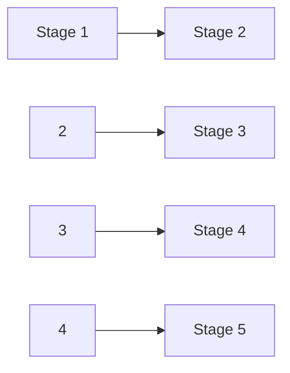
</details>

Abb. 2.F23

**24.** Ein Riesenrad fahrende Person bewegt sich durch (1) den höchsten, (2) den tiefsten und (3) einen auf halber Höhe liegenden Punkt. Ordnen Sie diese drei Positionen in absteigender Reihenfolge nach (a) dem Betrag der Zentripetalbeschleunigung der Person, (b) dem Betrag der auf die Person wirkenden Gesamtzentripetalkraft und (c) dem Betrag der auf die Person wirkenden Normalkraft, wenn sich das Riesenrad mit konstantem Geschwindigkeitsbetrag dreht.

**25.** 1987 gönnten sich zwei Fallschirmspringer ein Halloween-Vergnügen der besonderen Art. Sie sprangen westlich von Chicago gemeinsam ab und warfen sich während ihres freien Falls einen großen Kürbis gegenseitig zu. Das Ganze war ein großer Spaß, bis der Springer mit dem Kürbis schließlich seinen Fallschirm öffnete. Er konnte den Kürbis nicht mehr halten, der daraufhin etwa 0,5 km abstürzte, das Dach eines Hauses durchschlug und dort auf dem Küchenboden zerplatzte und die frisch renovierte Kü- che verunstaltete. Begründen Sie einmal aus der Sicht des Fallschirmspringers und einmal aus der Sicht des Kürbisses, warum der Springer die Kontrolle über den Kürbis verlor.

**26.** In Abb. 2.F26 wird ein Block der Masse m auf einer Rampe durch die von dieser ausgeübte Reibungskraft in Ruhe gehalten. Dann wird eine entlang der Rampe nach oben gerichtete Kraft $\vec { F }$ ausgeübt, deren Betrag allmählich von null ausgehend erhöht wird. Wie verändern sich während dieser Erhöhung Richtung und Betrag der auf den Block wirkenden Reibungskraft?


Abb. 2.F26

**27.** Wiederholen Sie Frage 26, aber nun mit einer entlang der Rampe nach unten gerichteten Kraft ${ \vec { F } } .$ Wie verändern sich jetzt während der Erhöhung der Kraft Richtung und Betrag der auf den Block wirkenden Reibungskraft?

**28.** In Abb. 2.F28 soll eine horizontale Kraft von 100 N auf eine Platte der Masse 10 kg ausgeübt werden, die anfänglich auf einem reibungsfreien Boden ruht, um die Platte zu beschleunigen. Auf der Platte liegt ein Blick mit einer Masse von 10 kg; der Reibungskoeffizient $\mu$ zwischen dem Block und der Platte ist nicht bekannt; der Block könnte verrutschen – möglicherweise ist der Kontakt zwischen dem Block und der Platte sogar reibungsfrei. (a) Welchen Bereich von Werten kann die Beschleunigung $a _ { \mathrm { P l a t t e } }$ der Platte unter Berücksichtigung dieser Möglichkeiten annehmen? (Hinweis: Sie brauchen dafür keine expliziten Berechnungen, betrachten Sie einfach Grenzwerte für μ.) (b) Welchen Bereich von Werten kann die Beschleunigung des Blocks $a _ { \mathrm { B l o c k } }$ annehmen?

66

---

2.9 Fragen

2


Abb. 2.F28

**29.** Während eines Routineflugs feuerte der Testpilot Tom Attridge 1956 zu Testzwecken auf 4000 m Höhe bei Überschallgeschwindigkeit einige Feuerstöße aus seinen 20-mm-Bordgeschützen ab. Anschließend steuerte er seinen Jet in einen Sturzflug mit einem Sturzwinkel von 20°, bevor er auf 2000 m Höhe bei einer Geschwindigkeit von 344 m/s eine weitere Salve abfeuerte. Die Geschwindigkeit der Geschosse relativ zu seinem Flugzeug betrug 730 m/s. Plötzlich zerriss es die Glaskuppel um ihn herum und sein rechter Lufteinlass wurde beschädigt. Er versuchte noch, zu seinem Stützpunkt zurückzukehren, aber schließlich stürzte der Jet in ein Waldgebiet; der Pilot überlebte verletzt.

Erklären Sie, was hier anscheinend kurz nach dem zweiten Auslösen der Bordkanonen passierte. (Attridge gilt bis heute als der einzige Pilot, der es schaffte, sich selbst abzuschießen.)

**30.** Eine Kiste steht auf einer Rampe, die in einem Winkel θ gegen die Horizontale geneigt ist. Bleiben die folgenden Größen gleich, erhöhen oder verringern sie sich, solange die Kiste noch nicht rutscht, wenn θ allmählich von null aus vergrößert wird: (a) die Komponente der Schwerkraft, die entlang der Rampe auf die Kiste wirkt, (b) der Betrag der Haftreibungskraft, die von der Rampe auf die Kiste wirkt, (c) die Komponente der Schwerkraft, die senkrecht zur Rampe auf die Kiste wirkt, (d) der Betrag der Normalkraft, die von der Rampe auf die Kiste wirkt und (e) der Maximalwert $f _ { \mathrm { s , m a x } }$ der Haftreibungskraft?

67

---


---

# 3 Kinetische Energie und Arbeit

## 3.1 Energie

## Physikalische Motivation

Möglichweise die wichtigste physikalische Größe überhaupt ist ein Begriff, über den heute auch außerhalb der Physik viel geredet wird: die Energie. Offensichtlich ist dieses Thema wichtig. In der Tat beruht unsere gesamte Zivilisation auf der Erzeugung und effektiven Nutzung von Energie.

Jedes Kind weiß, dass jede Art von Bewegung Energie erfordert, seien es Urlaubs- oder Geschäftsflüge auf andere Kontinente, Transport von Material in die oberste Etage eines Bürogebäudes oder zu einer Raumstation oder auch das Werfen oder Schießen eines Balles. Wir geben Unsummen von Geld aus, um Energie zu gewinnen oder zu verwenden. Kriege werden begonnen und Schlachten werden geschlagen, um Energiequellen zu erobern oder zu sichern – und die Kriege wurden gewonnen oder verloren, weil eine Seite zu einem neuartigen durchschlagenden Einsatz von Energie in der Lage war. Wir alle kennen zahllose Beispiele für Energie und ihre Nutzung – aber was bedeutet dieser Begriff eigentlich?


## 3.1.1 Kinetische Energie

Die Newtonschen Bewegungsgesetze erlauben uns, viele verschiedene Arten von Bewegungen zu analysieren. Oft ist die Analyse jedoch kompliziert und erfordert die Kenntnis von Details der Bewegung, die wir einfach nicht wissen können. Ein Beispiel: Ein Eishockeypuck wird über eine reibungsfreie Fläche geschossen, die auf und ab verläuft und mehrere, unterschiedlich geformte „Berge“ und „Täler enthält. Der Puck startet mit einer Anfangsgeschwindigkeit von 4,0 m/s auf einer Höhe von 0,46 m. Können Sie mithilfe des zweiten Newtonschen Gesetzes die Geschwindigkeit des Pucks am Ende seiner Bahn auf der Endhöhe null berechnen? Nein – nicht ohne zu wissen, wie die Steigungen der verschiedenen Schrägen entlang seiner Bahn verlaufen, und selbst dann wären die Rechnungen äußerst kompliziert.

Vor langer Zeit begannen Wissenschaftler und Ingenieure, eine weitere, teilweise sehr viel effektivere Technik für die Analyse von Bewegungen zu entwickeln. Diese ließ sich auch auf andere Situationen wie chemische Reaktionen, geologische Prozesse und biologische Funktionen ausweiten, die nichts mit Bewegung zu tun hatten. Dieser Ansatz basiert auf dem Konzept der **Energie**, einer Größe, die in vielen verschiedenen Formen auftritt. In der Tat ist der Begriff der Energie so weit gefasst, dass eine einfache Definition nur sehr schwer zu geben ist. Zunächst einmal ist Energie eine skalare Größe, die mit dem Zustand eines oder mehrerer Objekte in Zusammenhang steht. Diese Definition ist jedoch zu vage, als dass sie eine echte Hilfe sein könnte.

Eine etwas freiere Definition könnte uns zumindest einen ersten Anhaltspunkt bieten. Energie ist eine Zahl, die wir einem System aus einem oder mehreren Ob-

Halliday Physik für natur- und ingenieurwiss. Studiengänge, 3. Auflage. D. Halliday, R. Resnick und J. Walker. © 2020 WILEY-VCH Verlag GmbH & Co. KGaA. Published 2020 by WILEY-VCH Verlag GmbH & Co. KGaA.

69

---

3 Kinetische Energie und Arbeit

jekten zuordnen können. Verändert eine Kraft eines dieser Objekte, indem sie es z. B. in Bewegung versetzt, so ändert sich diese Zahl.

Die für diese Diskussion relevante Form von Energie nennt man die **kinetische Energie** K („kinetisch“ kommt aus dem Griechischen und bedeutet so viel wie „bewegungsmäßig“). Sie hängt unmittelbar mit dem Bewegungszustand eines Objekts zusammen: Je schneller sich das Objekt bewegt, desto größer ist seine kinetische Energie. Befindet sich das Objekt in Ruhe, so ist seine kinetische Energie null.

Für ein Objekt der Masse $m ,$ dessen Geschwindigkeit v weit unterhalb der Lichtgeschwindigkeit liegt, definieren wir die kinetische Energie als:

$$
K = \frac {1}{2} m v ^ {2} \quad (\text {kinetische Energie}). \tag {3.1}
$$

Eine Ente der Masse 3,0 kg, die mit 2,0 m/s an uns vorbeifliegt, besitzt z. B. eine kinetische Energie von $6,0\mathrm{kg}\cdot \mathrm{m}^{2}/\mathrm{s}^{2};$ ; wir ordnen der Bewegung der Ente also diesen Zahlenwert zu.

Die SI-Einheit der kinetischen Energie (und jeder anderen Form von Energie) ist das **Joule** (J), das nach James Prescott Joule benannt wurde, einem englischen Wissenschaftler des 19. Jahrhunderts. Es wird direkt über Gl. 3.1 anhand der Einheiten von Masse und Geschwindigkeit definiert:

$$
1 \text {Joule} = 1 \mathrm{J} = 1 \mathrm{kg} \cdot \mathrm{m} ^ {2} / \mathrm{s} ^ {2}. \tag {3.2}
$$

Die fliegende Ente besitzt also eine kinetische Energie von $^ { 6 , 0 1 }$ .

## 3.1.2 Arbeit

Wenn Sie ein Objekt auf eine größere Geschwindigkeit beschleunigen, indem Sie eine Kraft auf das Objekt ausüben, so vergrößern Sie die kinetische Energie $K ( =$ ${ \frac { 1 } { 2 } } m \nu ^ { 2 } )$ dieses Objekts. Analog verringern Sie die kinetische Energie eines Objekts, wenn Sie es auf eine geringere Geschwindigkeit verzögern, indem Sie eine Kraft auf das Objekt ausüben. Wir verfolgen diese Änderungen der kinetischen Energie, indem wir sagen, dass Ihre Kraft dem Objekt Energie (von Ihnen) zugeführt hat bzw. Ihnen von dem Objekt Energie zugeführt wurde.

Bei einem solchen Energietransfer über eine Kraft sagt man, dass die Kraft eine **Arbeit** W an dem Objekt verrichtet hat $( , W ^ { \alpha }$ steht für englisch „work“). Formaler definieren wir Arbeit wie folgt:


Die Arbeit W ist die Energie, die eine auf ein Objekt wirkende Kraft diesem Objekt zuführt bzw. von diesem Objekt abführt. Energie, die dem Objekt zugeführt wird, entspricht positiven Werten der Arbeit; Energie, die einem Objekt entzogen wird, entspricht negativen Werten der Arbeit.

„Arbeit“ ist also Energie, die übertragen wird; mit dem Ausdruck „Arbeit verrich ten“ bezeichnen wir das Übertragen von Energie. Die Arbeit besitzt dieselbe Einheit wie die Energie, sie ist ebenfalls eine skalare Größe. Übrigens: Da man in der Physik von Arbeit immer nur dann spricht, wenn Energie übertragen wird, ist es sinnlos zu sagen, dass ein Objekt eine gewisse Menge an Arbeit „hat“.

Der Begriff „übertragen“ kann auch irreführend sein. Er bedeutet nicht, dass etwas Materielles in das Objekt hinein- oder aus dem Objekt herausfließt; diese Energieübertragung darf man sich also nicht wie fließendes Wasser vorstellen. Sie entspricht vielmehr dem elektronischen Geldtransfer zwischen zwei Bankkonten: Die Zahl in dem einen Konto steigt an, während die Zahl in dem anderen Konto kleiner wird, obwohl zwischen den beiden Konten kein materieller Gegenstand ausgetauscht wird.

70

---

3.2 Arbeit und kinetische Energie

3

Beachten Sie, dass es uns hier nicht um die alltägliche Bedeutung des Worts $\mathbf { , } \mathbf { A r } \mathbf { \cdot }$ beit“ geht, die beinhaltet, dass jede Art von körperlicher oder mentaler Anstrengung Arbeit ist. Wenn Sie z. B. kräftig gegen eine Wand drücken, so werden Sie aufgrund der erforderten kontinuierlichen Muskelanspannung müde; im alltäglichen Sinne des Worts verrichten Sie dabei Arbeit. Eine solche Anstrengung bewirkt jedoch weder eine Übertragung von Energie auf die Wand noch von der Wand; in dem Wortsinn, den wir hier definiert haben, verrichten Sie demnach an der Wand keine Arbeit.

Um Verwechslungen vorzubeugen, werden wir den Buchstaben W in diesem Kapitel nur für die Arbeit verwenden und das Gewicht mit dem äquivalenten Ausdruck mg bezeichnen.

## 3.2 Arbeit und kinetische Energie

## Lernziele

Nach dem Durcharbeiten dieses Abschnitts sollten Sie in der Lage sein, . . .

• die Beziehung zwischen einem Kraftvektor (mit Betrag und Richtung) und der von ihm während der Verschiebung eines Teilchens an diesem verrichteten Arbeit anzugeben,
• die Arbeit zu berechnen, indem Sie das Skalarprodukt des Kraftvektors und des Verschiebungsvektors in Einheitsvektoren- oder Betrag-Winkel-Schreibweise berechnen,
• die gesamte verrichtete Arbeit zu berechnen, wenn mehrere Kräfte auf ein Teilchen wirken,
• die Beziehung zwischen der durch eine Kraft (oder mehrere Kräfte) verrichteten Arbeit und der hierdurch bewirkten Veränderung der kinetischen Energie eines Teilchens anzugeben.


## Schlüsselideen

Eine Arbeit W ist eine durch eine auf ein Objekt wirkende Kraft auf dieses übertragene (oder von diesem entnommene) Energiemenge. Wenn Energie auf das Objekt übertragen wird, ist die Arbeit positiv, wenn sie dem Objekt entnommen wird, ist die Arbeit negativ.
• Die im Zuge einer Verschiebung $\vec { d }$ durch eine Kraft $\vec { F }$ an einem Teilchen verrichtete Arbeit ist

$$
W = F d \cos \varphi = \vec {F} \cdot \vec {d},
$$


wobei 𝜑 der (konstante) Winkel zwischen $\vec { F }$ und $\vec { d }$ ist.

• Nur die Komponente von F⃗ in Richtung der Verschiebung $\vec { d }$ kann Arbeit an dem Teilchen verrichten.
• Wenn auf ein Objekt zwei oder mehr Kräfte wirken, ist die übertragene Arbeit die Summe der von den einzelnen Kräften jeweils verrichteten Arbeit. Dies ist gleichbedeutend mit der Sichtweise, dass die insgesamt verrichtete Arbeit die von der resultierenden Gesamtkraft $\vec { F } _ { \mathrm { g e s } }$ an dem Objekt verrichtete Arbeit ist.
• Die Veränderung $\Delta K$ der kinetischen Energie eines Teilchens ist gleich der insgesamt an diesem verrichteten Arbeit $W ;$

$$
\Delta K = K _ {\mathrm{f}} - K _ {\mathrm{i}} = W,
$$

wobei $K _ { \mathrm { i } }$ die anfängliche (initiale) kinetische Energie des Teilchens bedeutet und $K _ { \mathrm { f } }$ seine finale kinetische Energie ist, also am Ende des Prozesses, nachdem die Arbeit verrichtet wurde. Die kinetische Energie am Ende des Prozesses ist daher:

$$
K _ {\mathrm{f}} = K _ {\mathrm{i}} + W.
$$

71

---

3 Kinetische Energie und Arbeit


<details>
<summary>text_image</summary>

Perle
Draht
φ
F
x
v₀
v
d
Kᵢ
K_f
</details>

Abb. 3.1 Eine konstante Kraft $\vec { F } ,$ die einen Winkel 𝜑 zur Verschiebung d⃗ einer Perle auf einem Draht bildet, beschleunigt die Perle den Draht entlang. Dabei ändert sich die Geschwindigkeit der Perle von $\vec { \nu } _ { 0 }$ auf v⃗. Ein Messgerät zeigt die daraus resultierende Änderung der kinetischen Energie der Perle von $\bar { \iota } K _ { \mathrm { i } }$ auf $K _ { \mathrm { f } }$ an.

## 3.2.1 Arbeit und kinetische Energie

## Herleitung eines Ausdrucks für die Arbeit

Wir wollen zunächst einen Ausdruck für die Arbeit bestimmen. Dazu betrachten wir eine Perle, die über einen reibungsfreien, entlang der horizontalen x-Achse gespannten Draht gleiten kann (Abb. 3.1). Eine konstante Kraft ${ \vec { F } } ,$ die mit dem Draht einen Winkel $\varphi$ bildet, beschleunigt die Perle entlang des Drahts. Die Kraft und die daraus resultierende Beschleunigung können wir anhand des zweiten Newtonschen Gesetzes für die Komponenten entlang der x-Achse miteinander verbinden:

$$
F _ {x} = m a _ {x}, \tag {3.3}
$$

wobei m die Masse der Perle bezeichnet. Während die Perle um $\vec { d }$ verschoben wird, verändert die Kraft die Geschwindigkeit der Perle von einem Anfangswert $\vec { \nu } _ { 0 }$ zu einem anderen Wert $\vec { \nu } .$ Da die Kraft konstant ist, wissen wir, dass auch die Beschleunigung konstant ist. Damit können wir Gl. 1.14 (eine der Grundgleichungen der gleichmäßig beschleunigten Bewegung aus Kapitel 1) benutzen und erhalten für die Komponenten entlang der x-Achse:

$$
\nu^ {2} = \nu_ {0} ^ {2} + 2 a _ {x} d. \tag {3.4}
$$

Auflösen dieser Gleichung nach $a _ { x } ,$ Einsetzen in Gl. 3.3 und Umformen ergibt:

$$
\frac {1}{2} m \nu^ {2} - \frac {1}{2} m \nu_ {0} ^ {2} = F _ {x} d. \tag {3.5}
$$

Der erste Term auf der linken Seite der Gleichung entspricht der (finalen) kine tischen Energie $K _ { \mathrm { f } }$ der Perle am Ende ihrer Verschiebung $d ,$ während der zweite Term der (initialen) kinetischen Energie $K _ { \mathrm { i } }$ der Perle am Anfang der Verschiebung entspricht. Die linke Seite von Gl. 3.5 verrät uns also, dass die kinetische Energie durch die Kraft verändert wurde, und die rechte Seite besagt, dass diese Änderung gleich $F _ { x } d$ ist. Damit ist die durch die Kraft an der Perle verrichtete Arbeit $W$ (d. h. der durch die Kraft verursachte Energietransfer):

$$
W = F _ {x} d. \tag {3.6}
$$

Kennen wir die Werte von $F _ { x }$ und $d ,$ so können wir anhand dieser Gleichung die Arbeit W berechnen, welche die Kraft an der Perle verrichtet hat.


Um die Arbeit zu berechnen, die eine Kraft während einer Verschiebung an einem Objekt verrichtet hat, verwenden wir nur die Kraftkomponente in Richtung der Verschiebung des Objekts. Die Komponente der Kraft, die senkrecht auf der Verschiebung steht, verrichtet keine Arbeit.

Aus Abb. 3.1 können wir ersehen, dass $F _ { x }$ auch als F cos 𝜑 geschrieben werden kann, wobei $\varphi$ der Winkel zwischen den Richtungen der Verschiebung $\vec { d }$ und der Kraft $\vec { F }$ ist. Damit können wir Gl. 3.6 allgemeiner als

$$
W = F d \cos \varphi \quad (\text {von einer konstanten Kraft verrichtete Arbeit}) \tag {3.7}
$$

schreiben. Diese Gleichung ist sehr nützlich, wenn es darum geht, die Arbeit aus den bekannten Größen $F ,$ d und $\varphi$ zu berechnen. Da die rechte Seite dieser Gleichung dem Skalarprodukt $\vec { F } \cdot \vec { d }$ entspricht, lautet die Gleichung auch:

$$
W = \vec {F} \cdot \vec {d} \quad \text {(von einer konstanten Kraft verrichtete Arbeit)}. \tag {3.8}
$$

(Eventuell ist es hilfreich, wenn Sie sich an dieser Stelle die Eigenschaften des Skalarprodukts aus Anhang D vergegenwärtigen.) Gleichung 3.8 eignet sich besonders zur Berechnung der Arbeit, wenn $\vec { F }$ und $\vec { d }$ in Einheitsvektoren-Schreibweise angegeben sind.

72

---

3.2 Arbeit und kinetische Energie

3

Vorsicht: Die Gln. 3.6 bis 3.8 zur Berechnung der Arbeit, die eine Kraft an einem Objekt verrichtet, unterliegen zweierlei Einschränkungen. Erstens muss die Kraft konstant sein; d. h., weder der Betrag noch die Richtung der Kraft dürfen sich während der Bewegung des Objekts ändern. (Den Fall einer veränderlichen Kraft werden wir später untersuchen.) Zweitens muss das Objekt wie ein Teilchen behandelt werden können. Dies bedeutet, dass das Objekt starr sein muss; alle seine Teile müssen sich zusammen in die gleiche Richtung bewegen. In diesem Kapitel werden wir nur solche teilchenartigen Objekte untersuchen, wie z. B. Wagen und Kisten in Abb. 3.2.

**Vorzeichen der Arbeit** Die durch eine Kraft an einem Objekt verrichtete Arbeit kann entweder positiv oder negativ sein. Ist der Winkel $\varphi$ in Gl. 3.7 z. B. kleiner als 90°, so ist cos 𝜑 positiv und die Arbeit damit ebenfalls. Ist $\varphi$ größer als 90° (und kleiner als 180°), dann ist cos 𝜑 negativ und die Arbeit ebenso. (Erkennen Sie, dass die Arbeit null ist, wenn $\varphi = 9 0 ^ { \circ }$ ist?) Diese Ergebnisse führen zu einer einfachen Regel. Um das Vorzeichen der von einer Kraft verrichteten Arbeit zu ermitteln, betrachten Sie die Vektorkomponente der Kraft entlang der entsprechenden Verschiebung:


Eine Kraft verrichtet eine positive Arbeit, wenn sie eine Vektorkomponente besitzt, die in die gleiche Richtung zeigt wie die Verschiebung; eine Kraft verrichtet negative Arbeit, wenn sie eine Vektorkomponente besitzt, die in die entgegengesetzte Richtung weist. Die von einer Kraft verrichtete Arbeit ist null, wenn die Kraft keine derartige Vektorkomponente besitzt.

**Einheiten der Arbeit** Die Arbeit besitzt die gleiche Einheit wie die kinetische Energie, nämlich die SI-Einheit Joule. Aus den Gln. 3.6 und 3.7 können wir jedoch erkennen, dass die Einheit Newton mal Meter (N ⋅ m) dazu äquivalent ist. In Erweiterung von Gl. 3.2 gilt also:

$$
1 \mathrm{J} = 1 \mathrm{kg} \cdot \mathrm{m} ^ {2} / \mathrm{s} ^ {2} = 1 \mathrm{N} \cdot \mathrm{m}. \tag {3.9}
$$

**Von mehreren Kräften verrichtete Gesamtarbeit** Wenn zwei oder mehr Kräfte auf ein Objekt wirken, so ist die **resultierende Arbeit** oder **Gesamtarbeit** die Summe der von den einzelnen Kräften jeweils verrichteten Arbeit. Diese Gesamtarbeit können wir auf zwei Arten berechnen: (1) Wir bestimmen die von jeder einzelnen Kraft verrichtete Arbeit und summieren diese Werte anschließend auf. (2) Alternativ ermitteln wir zuerst die aus den einzelnen Kräften resultierende Gesamtkraft $\vec { F } _ { \mathrm { g e s } } .$ . Anschließend verwenden wir Gl. 3.7, wobei wir anstelle von $F$ den Betrag $\tilde { F _ { \mathrm { g e s } } }$ und anstelle von $\varphi$ den Winkel zwischen der Richtung von $\vec { F } _ { \mathrm { g e s } }$ und der Ver schiebung einsetzen müssen; oder wir benutzen die Vektorgleichung Gl. 3.8 und ersetzen dort $\vec { F }$ durch $\vec { F } _ { \mathrm { g e s } }$

## Der Zusammenhang zwischen Arbeit und kinetischer Energie

Gleichung 3.5 verbindet die Änderung der kinetischen Energie der Perle (von einer anfänglichen Energie $\begin{array} { r } { K _ { \mathrm { i } } = \frac { 1 } { 2 } m \nu _ { 0 } ^ { 2 } } \end{array}$ zu einer späteren Energie $K _ { \mathrm { f } } = { \textstyle { \frac { 1 } { 2 } } } \dot { m \nu ^ { 2 } ) }$ mit der Arbeit $W ( = F _ { x } d )$ , die an der Perle verrichtet wird. Für solche teilchenartigen Objekte können wir diese Gleichung verallgemeinern. Es sei ΔK die Änderung der kinetischen Energie des Objekts und $W$ die Gesamtarbeit, die an diesem Objekt verrichtet wird. Dann ist:

$$
\Delta K = K _ {\mathrm{f}} - K _ {\mathrm{i}} = W. \tag {3.10}
$$

Diese Gleichung besagt, dass

$$
\binom{\text {Änderung der kinetischen}}{\text {Energie eines Teilchens}} = \binom{\text {an dem Teilchen}}{\text {verrichtete Gesamtarbeit}}
$$


<details>
<summary>natural_image</summary>

Illustration of a person pushing a cart with stacked boxes and a force vector labeled F (no text or symbols on the cart or background)
</details>

## Abb. 3.2

Um die Arbeit zu berechnen, welche die von dem Lagerarbeiter ausgeübte Kraft an der Transportkarre und ihrem Inhalt verrichtet, können wir Wagen und Kisten näherungsweise als ein einziges Teilchen betrachten.

73

---

3 Kinetische Energie und Arbeit

ist. Dies können wir auch in der Form

$$
K _ {\mathrm{f}} = K _ {\mathrm{i}} + W \tag {3.11}
$$

schreiben, was so viel bedeutet wie

$$
\begin{array}{l} \binom{\text {kinetische Energie, nachdem die}}{\text {Gesamtarbeit verrichtet wurde}} \\ = \binom{\text {kinetische Energie, bevor die}}{\text {Gesamtarbeit verrichtet wurde}} + \binom{\text {verrichtete}}{\text {Gesamtarbeit}}. \\ \end{array}
$$

Diese Beziehungen gelten sowohl für Arbeit mit positivem als auch mit negativem Vorzeichen: Ist die an einem Teilchen verrichtete Gesamtarbeit positiv, dann erhöht sich die kinetische Energie des Teilchens um den Betrag (Absolutwert) der Arbeit. Ist die Gesamtarbeit negativ, dann nimmt die kinetische Energie um den Betrag der Arbeit ab.

Die kinetische Energie eines Teilchens betrage ursprünglich z. B. 5 J. Wird dem Teilchen eine Gesamtarbeit von 2 J zugeführt (ist die Gesamtarbeit also positiv), so beträgt die kinetische Energie danach 7 J. Wird dagegen eine Gesamtarbeit von 2 J von dem Teilchen abgeführt (ist die Gesamtarbeit also negativ), so ist die kinetische Energie daraufhin 3 J.

## KONTROLLFRAGE 1

Ein Teilchen bewege sich entlang einer x-Achse. Wird die kinetische Energie des Teilchens größer, kleiner oder bleibt sie gleich, wenn sich die Geschwindigkeit des Teilchens (a) von −3 m/s auf −2 m/s bzw. (b) von −2 m/s auf 2 m/s ändert? (c) Ist die an dem Teilchen verrichtete Arbeit in diesen Situationen jeweils positiv, negativ oder null?

## KONTROLLFRAGE 2

Die Abbildung zeigt vier Situationen, in denen eine Kraft auf eine Kiste wirkt, wäh rend diese über einen reibungsfreien Fußboden nach rechts gleitet. Die Beträge der einzelnen Kräfte sind gleich; ihre Richtungen verlaufen wie in der Abbildung angegeben. Ordnen Sie die verschiedenen Situationen nach der Arbeit, die während der Verschiebung an der Kiste verrichtet wird, von der positivsten zur negativsten.


## 3.3 Von der Gravitationskraft verrichtete Arbeit


## Lernziele

Nach dem Durcharbeiten dieses Abschnitts sollten Sie in der Lage sein, . . .

• die beim Anheben oder Absenken eines Objekts von der Gravitationskraft verrichtete Arbeit zu berechnen,
• die Beziehung zwischen der verrichteten Arbeit und der kinetischen Energie eines Objekts auf Situationen anzuwenden, in denen ein Objekt angehoben oder abgesenkt wird.


## Schlüsselideen

• Die von der Gravitationskraft $\vec { F } _ { \mathrm { G } }$ an einem teilchenartigen Objekt der Masse m während einer Verschiebung $\vec { d }$ verrichtete Arbeit $W _ { \mathrm { G } }$ ist

$$
W _ {\mathrm{G}} = m g d \cos \varphi ,
$$

wobei 𝜑 der Winkel zwischen $\vec { F } _ { \mathrm { G } }$ und $\vec { d }$ ist.

74

---

3.3 Von der Gravitationskraft verrichtete Arbeit

3

• Die Arbeit $W _ { \mathbf { a } } ,$ die eine äußere einwirkende Kraft an einem Objekt verrichtet, wenn dieses angehoben oder abgesenkt wird, hängt mit der von der Gravitationskraft verrichteten Arbeit $W _ { \mathrm { G } }$ und der Änderung $\Delta K$ der kinetischen Energie des Objekts gemäß

$$
\Delta K = K _ {\mathrm{f}} - K _ {\mathrm{i}} = W _ {\mathrm{a}} + W _ {\mathrm{G}}
$$

zusammen. Für $K _ { \mathrm { f } } = K _ { \mathrm { i } }$ reduziert sich dieser Ausdruck auf

$$
W _ {\mathrm{a}} = - W _ {\mathrm{G}},
$$

was bedeutet, dass die äußere Kraft gerade so viel Energie auf das Objekt überträgt, wie die Gravitationskraft ihm entnimmt (oder umgekehrt).

## 3.3.1 Von der Gravitationskraft verrichtete Arbeit

Als Nächstes untersuchen wir die Arbeit, die von einer besonderen Art von Kraft an einem Objekt verrichtet wird – nämlich von der Gravitationskraft, die auf dieses Objekt wirkt. Abbildung 3.3 zeigt eine teilchenartige Tomate der Masse m, die mit der Anfangsgeschwindigkeit $\nu _ { 0 } ,$ d. h. der anfänglichen kinetischen Energie $\begin{array} { r } { K _ { \mathrm { i } } = \frac { 1 } { 2 } m \nu _ { 0 } ^ { 2 } , } \end{array}$ , nach oben geworfen wird. Während des Anstiegs der Tomate wird sie durch die Gravitationskraft $\vec { F } _ { \mathrm { G } }$ abgebremst; d. h., die kinetische Energie der Tomate nimmt ab, da $\vec { F } _ { \mathrm { G } }$ während des Anstiegs an der Tomate Arbeit verrichtet.

Da wir die Tomate wie ein Teilchen behandeln können, können wir Gl. 3.7 $\left( W = F d \right.$ cos 𝜑) benutzen, um einen Ausdruck für die während einer Verschiebung $\vec { d }$ verrichtete Arbeit herzuleiten. Für den Betrag F der Kraft setzen wir mg ein, den Betrag von $\vec { F } _ { \mathrm { G } }$ . Damit ist die durch die Gravitationskraft $\vec { F } _ { \mathrm { G } }$ verrichtete Arbeit $W _ { \mathrm { G } }$

$$
W _ {\mathrm{G}} = m g d \cos \varphi \quad (\text {von der Gravitationskraft verrichtete Arbeit}). \tag {3.12}
$$

Wie in Abb. 3.3 dargestellt, zeigt $\vec { F } _ { \mathrm { G } }$ für ein ansteigendes Objekt in die entgegengesetzte Richtung der Verschiebung $\vec { d } .$ Damit ist $\varphi = 1 8 0 ^ { \circ }$ und

$$
W _ {\mathrm{G}} = m g d \cos 1 8 0 ^ {\circ} = m g d (- 1) = - m g d. \tag {3.13}
$$

Das Minuszeichen bedeutet, dass die Gravitationskraft, die auf das Objekt wirkt, während des Anstiegs eine Energiemenge mgd von der kinetischen Energie des Objekts abgeführt hat. Dies stimmt mit der Beobachtung überein, dass das Objekt während des Anstiegs immer langsamer wird.

Nachdem das Objekt seine Maximalhöhe erreicht hat, fällt es wieder nach unten und der Winkel $\varphi$ zwischen der Kraft $\vec { F } _ { \mathrm { G } }$ und der Verschiebung $\vec { d }$ ist gleich null. Dann gilt

$$
W _ {\mathrm{G}} = m g d \cos 0 ^ {\circ} = m g d (+ 1) = + m g d. \tag {3.14}
$$

Das Pluszeichen besagt, dass die Gravitationskraft nun der kinetischen Energie des Objekts eine Energiemenge mgd zuführt. Dies stimmt mit der Beobachtung überein, dass das Objekt während des Falls immer schneller wird. (Wie wir in Kap. 4 sehen werden, betreffen solche Energieübertragungen, die mit dem Steigen oder Fallen eines Objekts zusammenhängen, nicht nur das Objekt selbst, sondern das gesamte System Objekt–Erde. Ohne die Erde wäre in der Tat sogar der Begriff des „Steigens“ bedeutungslos.)

## Während des Anhebens und Absenkens eines Objekts verrichtete Arbeit

Nehmen Sie nun an, dass wir ein teilchenartiges Objekt anheben, indem wir eine senkrechte Kraft $\vec { F }$ auf das Objekt ausüben. Während der Aufwärtsverschiebung verrichtet unsere angelegte Kraft eine positive Arbeit $W _ { \mathrm { a } }$ an dem Objekt, während


<details>
<summary>text_image</summary>

v
F_G
d
K_f
v_0
F_G
K_i
</details>

Abb. 3.3 Eine teilchenartige Tomate der Masse m wird nach oben geworfen. Die Gravitationskraft $\vec { \bar { F } } _ { \mathrm { G } } ,$ die auf die Tomate wirkt, bremst die Tomate während der Verschiebung $\vec { d }$ von der Geschwindigkeit $\vec { \nu } _ { 0 }$ auf die Geschwindigkeit v⃗ ab. Ein Messgerät zeigt die daraus resultierende Änderung der kinetischen Energie der Tomate von $K _ { \mathrm { i } } \; ( = { \textstyle { \frac { 1 } { 2 } } } m \nu _ { 0 } ^ { 2 } )$ auf $K _ { \mathrm { f } } \: ( = { \textstyle { \frac { 1 } { 2 } } } m \nu ^ { 2 } )$ an.

75

---

3 Kinetische Energie und Arbeit

die Gravitationskraft eine negative Arbeit $W _ { \mathrm { G } }$ daran verrichtet. Unsere Kraft überträgt Energie auf das Objekt, während die Gravitationskraft ihm Energie entzieht. Gemäß Gl. 3.10 ist die Änderung ΔK der kinetischen Energie des Objekts aufgrund dieser beiden Energietransfers gleich

$$
\Delta K = K _ {\mathrm{f}} - K _ {\mathrm{i}} = W _ {\mathrm{a}} + W _ {\mathrm{G}}, \tag {3.15}
$$

wobei $K _ { \mathrm { f } }$ die kinetische Energie am Ende und $K _ { \mathrm { i } }$ diejenige am Anfang der Verschiebung darstellt. Diese Gleichung gilt auch, wenn wir das Objekt absenken, doch dann überträgt die Gravitationskraft Energie auf das Objekt, während unsere Kraft ihm Energie entzieht.

In bestimmten alltäglichen Situationen befindet sich das Objekt vor und nach unserer Einwirkung in Ruhe – so z. B., wenn Sie ein Buch vom Boden aufheben und ins Regal stellen. Dann sind $K _ { \mathrm { f } }$ und $K _ { \mathrm { i } }$ beide null und Gl. 3.15 wird zu:

$$
W _ {\mathrm{a}} + W _ {\mathrm{G}} = 0
$$

oder


<details>
<summary>text_image</summary>

Objekt
F
d
F_G
</details>

(a)


<details>
<summary>flowchart</summary>

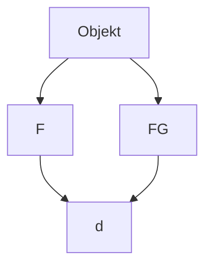
</details>

(b)

Abb. 3.4

(a) Eine angelegte Kraft $\vec { F }$ zieht ein Objekt hoch. Die Verschiebung $\vec { d }$ des Objekts bildet einen Winkel $\varphi =$ 180° mit der Gravitationskraft $\vec { \bar { F } } _ { \mathrm { G } } ,$ die auf das Objekt wirkt. Die angelegte Kraft verrichtet positive Arbeit an dem Objekt. (b) Eine angelegte Kraft senkt ein Objekt ab. Die Verschiebung d⃗ des Objekts bildet einen Winkel $\varphi = 0 ^ { \circ }$ mit der Gravitationskraft ${ \vec { F } } _ { \mathrm { G } } .$ Die angelegte Kraft verrichtet negative Arbeit an dem Objekt.

$$
W _ {\mathrm{a}} = - W _ {\mathrm{G}}. \tag {3.16}
$$

Beachten Sie, dass wir das gleiche Ergebnis erhalten, wenn $K _ { \mathrm { f } }$ und $K _ { \mathrm { i } }$ zwar von null verschieden sind, aber den gleichen Wert besitzen. In beiden Fällen besagt das Ergebnis, dass die von der angewendeten Kraft verrichtete Arbeit gleich dem Negativen der von der Gravitationskraft verrichteten Arbeit ist; die ausgeübte Kraft überträgt gerade so viel Energie auf das Objekt, wie die Gravitationskraft von ihm abführt. Anhand von Gl. 3.12 können wir Gl. 3.16 in der Form

$$
W _ {\mathrm{a}} = - m g d \cos \varphi \quad (\text {Arbeit beim Anheben und Absenken;} K _ {\mathrm{f}} = K _ {\mathrm{i}}) \tag {3.17}
$$

schreiben, wobei 𝜑 den Winkel zwischen $\vec { F } _ { \mathrm { G } }$ und $\vec { d }$ bezeichnet. Zeigt die Verschiebung senkrecht nach oben (Abb. 3.4a), so ist $\varphi = 1 8 0 ^ { \circ }$ und die Arbeit, die unsere Kraft verrichtet, wird gleich mgd. Erfolgt die Verschiebung senkrecht nach unten (Abb. 3.4b), dann ist $\varphi = 0 ^ { \circ }$ und die von unserer Kraft verrichtete Arbeit ist gleich −mgd.

Die Gln. 3.16 und 3.17 gelten für jede Situation, in der ein Objekt angehoben oder abgesenkt wird, wenn das Objekt sich vor und nach der Höhenveränderung in Ruhe befindet. Die Gleichungen sind unabhängig vom Betrag der angewendeten Kraft. Wenn ein Gewichtheber seine Hantel in die Höhe stemmt, ändert sich die Kraft, die er dabei auf die Hantel ausübt, im Laufe des Anhebens ganz beträchtlich. Da sich die Hantel jedoch vor und nach dem Anheben in Ruhe befindet, wird die Arbeit, die er an ihr verrichtet hat, durch die Gln. 3.16 und 3.17 gegeben. Dabei entspricht mg in Gl. 3.17 dem gestemmten Gewicht und d der Strecke, um die der Schwerathlet die Hantel angehoben hat.

## KONTROLLFRAGE 3

Nehmen Sie an, dass die Kiste um die gleiche Höhe h angehoben wird, jedoch auf einer längeren Rampe. (a) Ist die durch die Kraft $\vec { T }$ verrichtete Arbeit nun größer als, kleiner als oder gleich groß wie zuvor? (b) Ist der Betrag von ${ \vec { T } } ,$ der benötigt wird, um die Kiste zu bewegen, nun größer als, kleiner als oder gleich groß wie zuvor?

## 3.4 Von einer Federkraft verrichtete Arbeit


## Lernziele

Nach dem Durcharbeiten dieses Abschnitts sollten Sie in der Lage sein, . . .

• das Hookesche Gesetz, d. h. die Beziehung zwischen der von einer Feder auf ein Objekt wirkenden Kraft, der Dehnung oder Kompression der Feder und der Federkonstante anzugeben,
• zu verstehen, dass die Kraft einer Feder eine veränderliche Kraft ist,

76

---

3.4 Von einer Federkraft verrichtete Arbeit

3

• die von der Kraft einer Feder an einem Objekt verrichtete Arbeit durch Integration der Kraft zwischen der Anfangs- und der Endposition der Feder oder durch Anwendung des allgemeinen Ergebnisses dieser Integration zu berechnen,
• Arbeit zu bestimmen, indem Sie die Auftragung der Kraft als Funktion der Position des Objekts grafisch integrieren,
• die Beziehung zwischen der verrichteten Arbeit und der kinetischen Energie eines Objekts auf Situationen anzuwenden, in denen ein Objekt durch die Kraft einer Feder bewegt wird.

## Schlüsselideen

• Die Kraft $\vec { F } _ { \mathrm { F } }$ einer Feder ist durch

$$
\vec {F} _ {\mathrm{F}} = - k \vec {d} \quad \text {(Hookesches Gesetz)}
$$

gegeben, wobei $\vec { d }$ die Auslenkung der Feder aus ihrer Ruhelage (weder gedehnt noch komprimiert) und k die Federkonstante (ein Maß für die Härte oder Steifigkeit einer Feder) ist. Wenn die Feder in Richtung einer x-Achse liegt, deren Nullpunkt sich an der Stelle des Federendes im entspannten Zustand befindet, ist

$$
F _ {\mathrm{F}, x} = - k x \qquad (\text {Hookesches Gesetz}).
$$

• Die Kraft einer Feder ist folglich eine veränderliche Kraft: Sie hängt von der Auslenkung der Feder aus ihrer Ruhelage ab.
• Wenn am Ende der Feder ein Objekt befestigt ist, verrichtet die Feder an diesem Objekt eine Arbeit $W _ { \mathrm { F } } ,$ wenn es von einer anfänglichen Position $x _ { \mathrm { i } }$ zu einer Endposition $x _ { \mathrm { f } }$ bewegt wird:

$$
W _ {\mathrm{F}} = \frac {1}{2} k x _ {\mathrm{i}} ^ {2} - \frac {1}{2} k x _ {\mathrm{f}} ^ {2}.
$$

Für $x _ { \mathrm { i } } = 0$ und $x _ { \mathrm { f } } = x$ wird daraus

$$
W _ {\mathrm{F}, x} = - \frac {1}{2} k x ^ {2}.
$$

## 3.4.1 Von einer Federkraft verrichtete Arbeit

In dem folgenden Abschnitt untersuchen wir die Arbeit, die eine bestimmte Art von veränderlicher Kraft – nämlich eine von einer Feder ausgeübte **Federkraft** – an einem teilchenartigen Objekt verrichtet. Viele der in der Natur auftretenden Kräfte besitzen die gleiche mathematische Form wie die Federkraft. Indem Sie diese Kraft im Detail studieren, entwickeln Sie ein Verständnis für viele weitere derartige Kräfte.

## Die Federkraft

Abbildung 3.5a zeigt eine Feder im entspannten Zustand, dem **Ruhezustand**, in dem die Feder weder zusammengedrückt noch auseinandergezogen wird. Eines ihrer Enden ist fest; an dem anderen – dem freien – Ende ist ein teilchenartiges Objekt wie z. B. ein Block befestigt. Dehnen wir die Feder, indem wir den Block wie in Abb. 3.5b gezeigt nach rechts bewegen, so zieht die Feder den Block nach links. (Weil eine Federkraft immer danach strebt, den Entspannungszustand wiederherzustellen, wird sie auch Rückstellkraft genannt.) Stauchen wir die Feder, indem wir den Block wie in Abb. 3.5c dargestellt nach links schieben, so drückt die Feder den Block nach rechts.

In einer für viele Federn gültigen Näherung ist die von einer Feder ausgeübte Kraft $\vec { F }$ proportional zur hier **Auslenkung** genannten Verschiebung $\vec { d }$ des freien


<details>
<summary>text_image</summary>

x = 0
F = 0
an der Feder
befestigter
Block
0
x
</details>

(a)


<details>
<summary>text_image</summary>

x positiv
F negativ
F
d
x
0
x
</details>

(b)


<details>
<summary>text_image</summary>

x negativ
F positiv
x
0
x
</details>

(c)

## Abb. 3.5

(a) Eine Feder im entspannten Zustand. Der Ursprung der x-Achse wurde an dasjenige Ende der Feder gelegt, an dem der Block befestigt ist.
(b) Der Block wird um d⃗ verschoben, die Feder dabei um die positive Auslenkung x gedehnt. Beachten Sie die von der Feder ausgeübte Rückstellkraft F⃗. (c) Die Feder wird um die negative Auslenkung x gestaucht. Beachten Sie auch hier die Rückstellkraft der Feder.

77

---

3 Kinetische Energie und Arbeit

Endes von seiner Ausgangsposition im entspannten Zustand. Die Federkraft wird durch das **Hookesche Gesetz**

$$
\vec {F} = - k \vec {d} \quad (\text {Hookesches Gesetz}) \tag {3.18}
$$

beschrieben, das nach Robert Hooke, einem englischen Wissenschaftler des späten 17. Jahrhunderts, benannt ist. Das Minuszeichen in Gl. 3.18 drückt aus, dass die Federkraft immer der Auslenkung des freien Endes entgegenwirkt. Die Konstantek ist die **Federkonstante**; sie ist ein $\mathrm { M a } \&$ für die Steifigkeit oder Härte der Feder. Je größerk ist, desto steifer ist die Feder; d. h., desto stärker ist der Zug oder Druck für eine bestimmte Auslenkung. Die SI-Einheit vonk ist Newton pro Meter.

In Abb. 3.5 verläuft einex-Achse parallel zur Länge der Feder, wobei der Ursprung $( x = 0 )$ am Ort des freien Endes liegt, wenn die Feder sich im entspannten Zustand befindet. Für diese allgemein übliche Anordnung können wir Gl. 3.18 in der Form

$$
F = - k x \quad (\text {Hookesches Gesetz}) \tag {3.19}
$$

schreiben.

Istx positiv (d. h., die Feder wird entlang derx-Achse nach rechts gedehnt), dann ist F negativ (die Kraft zieht nach links). Ist x negativ (d. h., die Feder wird nach links gestaucht), dann ist $F$ positiv (die Kraft drückt nach rechts).

Beachten Sie, dass eine Federkraft eine veränderliche Kraft ist, da ihr Betrag und ihre Richtung vom Ortx des freien Endes abhängen; $F$ kann auch als Funktion $F ( x )$ geschrieben werden. Beachten Sie außerdem, dass das Hookesche Gesetz eine lineare Beziehung zwischen F und x darstellt.

## Von einer Federkraft verrichtete Arbeit

Um einen Ausdruck für die Arbeit herzuleiten, welche die Federkraft verrichtet, während sich der Block aus Abb. 3.5a bewegt, lassen Sie uns zwei vereinfachende Annahmen machen. (1) Die Feder ist masselos; d. h., ihre Masse kann im Vergleich zur Masse des Blocks vernachlässigt werden. (2) Die Feder ist eine ideale Feder; d. h., sie gehorcht dem Hookeschen Gesetz ohne Einschränkung. Außerdem nehmen wir an, dass der Kontakt zwischen dem Block und dem Boden reibungsfrei ist und dass der Block einem Teilchen gleichgesetzt werden kann.

Wir stoßen den Block nach rechts an, um ihn in Bewegung zu versetzen, und lassen ihn seine Bewegung ungestört weiter ausführen. Während der Block sich nach rechts bewegt, verrichtet die Federkraft $\vec { F }$ Arbeit an dem Block, sodass sich die kinetische Energie des Blocks verringert und er langsamer wird. Diese Arbeit können wir jedoch nicht bestimmen, indem wir Gl. 3.7 $\left( W = F d \right.$ cos𝜑) verwenden, da diese Gleichung eine konstante Kraft voraussetzt. Die Federkraft jedoch ist eine veränderliche Kraft.

Um die von der Federkraft verrichtete Arbeit zu ermitteln, müssen wir uns der Analysis bedienen. Die Anfangsposition des Blocks sei $x _ { \mathrm { i } } ,$ seine spätere Position $x _ { \mathrm { f } } .$ . Teilen Sie nun den Abstand zwischen diesen zwei Positionen in viele Segmente der (winzigen) Länge $\Delta x .$ Nummerieren Sie die Segmente von $x _ { \mathrm { i } }$ ausgehend der Reihe nach mit 1, 2 usw. Während der Block sich durch eines dieser Segmente bewegt, verändert sich die Federkraft kaum, da das Segment so klein ist, dass sich x kaum ändert. Also können wir den Betrag der Kraft in einem solchen Segment näherungsweise als konstant annehmen. Nummerieren Sie diese Beträge der Reihe nach mit $F _ { 1 }$ im Segment 1, $F _ { 2 }$ im Segment 2 usw.

Nachdem die Kräfte nun in jedem Segment konstant sind, können wir die in jedem Segment verrichtete Arbeit anhand von Gl. $3 . 7 \left( W = F d \right.$ cos𝜑) berechnen. Hier ist $\varphi = 0 ,$ d. h. cos $\varphi = 1$ . Die in Segment 1 verrichtete Arbeit ist dann $F _ { 1 } \Delta x ,$ die in Segment 2 verrichtete $F _ { 2 } \Delta ;$ x usw. Die von der Feder von $x _ { \mathrm { i } }$ bis $x _ { \mathrm { f } }$ verrichtete Gesamtarbeit $W _ { \mathrm { F } }$ ist die Summe all dieser Arbeiten:

$$
W _ {\mathrm{F}} = \sum_ {\mathrm{i}} ^ {\mathrm{f}} F _ {j} \Delta x, \tag {3.20}
$$

78

---

3.4 Von einer Federkraft verrichtete Arbeit

3

wobei der Index j die Nummer des Segments angibt. Geht $\Delta x$ im Grenzwert gegen null, wird Gl. 3.20 zu

$$
W _ {\mathrm{F}} = \int_ {x _ {\mathrm{i}}} ^ {x _ {\mathrm{f}}} F \mathrm{d} x. \tag {3.21}
$$

Setzen wir F aus Gl. 3.19 ein, so erhalten wir

$$
\begin{array}{l} W _ {\mathrm{F}} = \int_ {x _ {\mathrm{i}}} ^ {x _ {\mathrm{f}}} (- k x) \mathrm{d} x = - k \int_ {x _ {\mathrm{i}}} ^ {x _ {\mathrm{f}}} x \mathrm{d} x \\ = \left(- \frac {1}{2} k\right) \left[ x ^ {2} \right] _ {x _ {\mathrm{i}}} ^ {x _ {\mathrm{f}}} = \left(- \frac {1}{2} k\right) \left(x _ {\mathrm{f}} ^ {2} - x _ {\mathrm{i}} ^ {2}\right). \tag {3.22} \\ \end{array}
$$

Ausmultipliziert ergibt dies

$$
W _ {\mathrm{F}} = \frac {1}{2} k x _ {\mathrm{i}} ^ {2} - \frac {1}{2} k x _ {\mathrm{f}} ^ {2} \quad (\text {von einer Federkraft verrichtete Arbeit}). \tag {3.23}
$$

Diese von der Federkraft verrichtete Arbeit $W _ { \mathrm { F } }$ kann ein positives oder negatives Vorzeichen besitzen, je nachdem, ob der gesamte Energietransfer während der Bewegung von $x _ { \mathrm { i } }$ nach $x _ { \mathrm { f } }$ dem Block zugeführt oder von ihm abgeführt wird. Vorsicht: Die Endposition $x _ { \mathrm { f } }$ erscheint auf der rechten Seite von Gl. 3.23 im zweiten Term. Gleichung 3.23 besagt also:


Die Arbeit $W _ { \mathrm { F } }$ ist positiv, wenn der Block sich am Ende der Bewegung näher am entspannten Zustand $( x = 0 )$ befindet, als er es ursprünglich war. Die Arbeit ist negativ, wenn der Block am Ende der Bewegung weiter von $x = 0$ entfernt ist als am Anfang der Bewegung. Die Arbeit ist null, wenn der Block sich am Ende der Bewegung im gleichen Abstand von $x = 0$ befindet.

Ist $x _ { \mathrm { i } } = 0$ und nennen wir die Endposition des Blocks $x ,$ so lautet Gl. 3.23:

$$
W _ {\mathrm{F}} = - \frac {1}{2} k x ^ {2} \quad (\text {von einer Federkraft verrichtete Arbeit}). \tag {3.24}
$$

## Von einer angelegten Kraft verrichtete Arbeit

Nehmen Sie nun an, dass wir den Block entlang der x-Achse bewegen, indem wir kontinuierlich eine äußere Kraft $\vec { F } _ { \mathrm { a } }$ auf ihn ausüben. Diese angelegte Kraft verrichtet während der Verschiebung an dem Block eine Arbeit $W _ { \mathbf { a } } ,$ die Federkraft eine Arbeit $W _ { \mathrm { F } } .$ . Anhand von Gl. 3.10 ergibt sich für die Änderung $\Delta K$ der kinetischen Energie des Blocks aufgrund dieser beiden Energietransfers:

$$
\Delta K = K _ {\mathrm{f}} - K _ {\mathrm{i}} = W _ {\mathrm{a}} + W _ {\mathrm{F}}, \tag {3.25}
$$

wobei $K _ { \mathrm { f } }$ die (finale) kinetische Energie am Ende und $K _ { \mathrm { i } }$ die (initiale) kinetische Energie am Anfang der Verschiebung bezeichnet. Befindet sich der Block vor und nach der Verschiebung in Ruhe, dann sind $K _ { \mathrm { f } }$ und $K _ { \mathrm { i } }$ beide null und Gl. 3.25 wird zu:

$$
W _ {\mathrm{a}} = - W _ {\mathrm{F}}. \tag {3.26}
$$


Befindet sich ein an einer Feder befestigter Block vor und nach einer Verschiebung in Ruhe, dann ist die durch die angelegte Kraft, die den Block bewegt, verrichtete Arbeit gleich dem Negativen der von der Federkraft an dem Block verrichteten Arbeit.

Vorsicht: Befindet sich der Block vor und nach der Verschiebung nicht in Ruhe, dann gilt diese Aussage nicht.

79

---

3 Kinetische Energie und Arbeit

## KONTROLLFRAGE 4

In drei Situationen sind die Anfangs- und Endpositionen des Blocks aus Abb. 3.5 entlang der x-Achse durch die folgenden Werte gegeben: (a) −3 cm, 2 cm; (b) 2 cm, 3 cm und (c) −2 cm, 2 cm. Ist die von der Federkraft an dem Block verrichtete Arbeit in der jeweiligen Situation positiv, negativ oder null?

## 3.5 Von einer allgemeinen veränderlichen Kraft verrichtete Arbeit


## Lernziele

Nach dem Durcharbeiten dieses Abschnitts sollten Sie in der Lage sein, . . .

• aus einer gegebenen veränderlichen Kraft als Funktion des Orts die von ihr an einem Objekt verrichtete Arbeit durch Integration dieser Funktion vom Anfangs zum Endzustand in einer oder mehr Dimensionen zu berechnen,
• aus der Auftragung einer Kraft als Funktion des Orts die von ihr verrichtete Arbeit durch grafische Integration von der Anfangs- bis zur Endposition des Objekts zu bestimmen,
• eine Auftragung der Beschleunigung als Funktion des Orts in eine Auftragung der Kraft als Funktion des Orts umzuwandeln,
• die Beziehung zwischen der verrichteten Arbeit und der kinetischen Energie eines Objekts auf Situationen anzuwenden, in denen ein Objekt durch eine veränderliche Kraft bewegt wird.


## Schlüsselideen

Wenn die Kraft $\vec { F }$ auf ein teilchenartiges Objekt von dessen Position abhängt, muss die Arbeit, die diese Kraft an dem Objekt verrichtet, während es sich von einer Anfangsposition $( x _ { \mathrm { i } } , y _ { \mathrm { i } } , z _ { \mathrm { i } } )$ zu einer Endposition $( x _ { \mathrm { f } } ,   y _ { \mathrm { f } } ,   z _ { \mathrm { f } } )$ bewegt, durch Integration der veränderlichen Kraft bestimmt werden. Unter der Annahme, dass die Komponente $F _ { x }$ nur von x abhängt, nicht aber von y und z (und analog für $F _ { y }$ und $F _ { z } ) ,$ , gilt für die Arbeit

$$
W = \int_ {x _ {\mathrm{i}}} ^ {x _ {\mathrm{f}}} F _ {x} \mathrm{d} x + \int_ {y _ {\mathrm{i}}} ^ {y _ {\mathrm{f}}} F _ {y} \mathrm{d} y + \int_ {z _ {\mathrm{i}}} ^ {z _ {\mathrm{f}}} F _ {z} \mathrm{d} z.
$$

• Wenn die Kraft $\vec { F }$ nur eine x-Komponente besitzt, reduziert sich dieser Ausdruck auf

$$
W = \int_ {x _ {\mathrm{i}}} ^ {x _ {\mathrm{f}}} F (x) \mathrm{d} x.
$$

## 3.5.1 Von einer allgemeinen veränderlichen Kraft verrichtete Arbeit

## Eindimensionale Analyse

Lassen Sie uns zu der in Abb. 3.1 dargestellten Situation zurückkehren. Nehmen Sie nun jedoch an, dass die Kraft die x-Achse entlang weist und der Betrag der Kraft ortsabhängig ist, sich also mit der Position x verändert. Beachten Sie, dass sich hier nur der Betrag dieser Kraft ändert, nicht jedoch ihre Richtung; auch ändert sich der Betrag der Kraft an einem beliebigen festen Ort nicht mit der Zeit.

Abbildung 3.6a zeigt die Kurve einer solchen eindimensionalen veränderlichen Kraft. Gesucht ist ein Ausdruck für die Arbeit, die diese Kraft an einem Teilchen

80

---

3.5 Von einer allgemeinen veränderlichen Kraft verrichtete Arbeit

3

verrichtet, während sich das Teilchen von einem Anfangspunkt $x _ { \mathrm { i } }$ zu einem Endpunkt $x _ { \mathrm { f } }$ bewegt. Wir können jedoch nicht Gl. 3.7 verwenden, da diese nur für eine konstante Kraft $\vec { F }$ gilt. Auch hier werden wir uns deshalb wieder der Analysis bedienen. Wir teilen die Fläche unterhalb der Kurve aus Abb. 3.6a wiederum in eine Vielzahl von schmalen Streifen der Breite $\Delta x$ (Abb. 3.6b). Dabei wählen wir $\Delta x$ so schmal (infinitesimal), dass wir die Kraft $F ( x )$ in diesem Intervall mit gutem $\mathbf { G e } -$ wissen als konstant annehmen können. Es sei $F _ { j , \mathrm { g e m } }$ der mittlere Wert von $F ( x )$ im Intervall $j .   F _ { j , \mathrm { g e m } }$ gibt damit die Höhe des Streifens j an.

Da $F _ { j , \mathrm { g e m } }$ als konstant angenommen wird, wird die infinitesimale Änderung der Arbeit $\widetilde { \Delta }   W _ { j i }$ , welche die Kraft im Intervall $j$ verrichtet hat, nun näherungsweise durch Gl. 3.7 gegeben:

$$
\Delta W _ {j} = F _ {j, \mathrm{gem}} \Delta x. \tag {3.27}
$$

In Abb. 3.6b ist $\Delta W _ { \mathrm { i } }$ gleich der Fläche des rechteckigen, schattierten Streifens $j .$

Um nun die Arbeit W zu erhalten, welche die Kraft während der Bewegung des Teilchens von $x _ { \mathrm { i } }$ nach $x _ { \mathrm { f } }$ insgesamt näherungsweise verrichtet, addieren wir die Flächen aller Streifen, die in Abb. 3.6b zwischen $x _ { \mathrm { i } }$ und $x _ { \mathrm { f } }$ liegen:

$$
W = \sum \Delta W _ {j} = \sum F _ {j, \mathrm{gem}} \Delta x. \tag {3.28}
$$

Gleichung 3.28 ist eine Näherung, da die gebrochene $\mathrm{,Skyline}$ welche die oberen Ränder der schattierten rechteckigen Streifen in Abb. 3.6b bilden, den tatsächlichen Verlauf der Kurve $F ( x )$ nur annähernd beschreibt.

Wir können die Näherung verbessern, indem wir die Breite $\Delta x$ der Streifen wie in Abb. 3.6c dargestellt verkleinern und mehr Streifen verwenden. Im Grenzfall lassen wir die Breite der Streifen gegen null gehen; die Anzahl der Streifen wird dann unendlich groß und wir erhalten als exaktes Ergebnis

$$
W = \lim _ {\Delta x \to 0} \sum F _ {j, \mathrm{gem}} \Delta x. \tag {3.29}
$$

Dieser Grenzwert entspricht genau dem Integral der Funktion $F ( x )$ zwischen den Grenzen $x _ { \mathrm { i } }$ und $x _ { \mathrm { f } } .$ . Damit ist Gl. 3.29 also:

$$
W = \int_ {x _ {\mathrm{i}}} ^ {x _ {\mathrm{f}}} F (x) \mathrm{d} x \quad (\text {von einer veränderlichen Kraft verrichtete Arbeit}). \tag {3.30}
$$

Kennen wir die Funktion $F ( x ) ,$ , so können wir sie in Gl. 3.30 einsetzen, die passenden Integrationsgrenzen einfügen, die Integration ausführen und so die $\mathrm { A l }$ rbeit ermitteln. (Anhang D enthält eine Liste der gebräuchlichsten Integrale.) Geometrisch entspricht die Arbeit der Fläche, die innerhalb der Grenzen $x _ { \mathrm { i } }$ und $x _ { \mathrm { f } }$ zwischen der Kurve $F ( x )$ und der x-Achse enthalten ist (in Abb. 3.6d schattiert dargestellt).

## Dreidimensionale Analyse

Betrachten wir nun ein Teilchen, auf das eine dreidimensionale Kraft

$$
\vec {F} = F _ {x} \vec {e} _ {x} + F _ {y} \vec {e} _ {y} + F _ {z} \vec {e} _ {z} \tag {3.31}
$$

wirkt, wobei die Komponenten $F _ { x } , F _ { y }$ und $F _ { z }$ ortsabhängig, also Funktionen der Position des Teilchens sein können. Wir führen allerdings drei Vereinfachungen ein: $F _ { x }$ darf von x abhängen, nicht jedoch von $y$ oder z, $F _ { y }$ darf von $y$ abhängen, nicht jedoch von x oder $z ,$ und $F _ { z }$ darf von z abhängen, nicht jedoch von x oder $y .$ Das Teilchen bewege sich um eine infinitesimale Verschiebung

$$
\mathrm{d} \vec {r} = \mathrm{d} x \vec {e} _ {x} + \mathrm{d} y \vec {e} _ {y} + \mathrm{d} z \vec {e} _ {z}. \tag {3.32}
$$


<details>
<summary>line</summary>

| X | F(x) |
| --- | --- |
| \(x_i\) | ~0.25 |
| \(x_f\) | ~0.95 |
</details>

(a)


<details>
<summary>area</summary>

| Point | Description |
| --- | --- |
| x_i | Initial point on the curve |
| x_f | Final point on the curve |
| \(\Delta W_j\) | Difference between the two curves |
| F_{j, gem} | Geometric approximation of the area under the curve |
</details>

(b)


<details>
<summary>area</summary>

| X | F(x) |
| --- | --- |
| 0 | ~0.2 |
| xi | ~0.3 |
| xf | ~1.0 |
</details>

(c)


<details>
<summary>area</summary>

| X | F(x) |
| --- | --- |
| 0 | ~0.2 |
| x_i | ~0.3 |
| x_f | ~1.0 |
</details>

(d)

## Abb. 3.6

(a) Kurve einer eindimensionalen Kraft $\vec { F }$ in Abhängigkeit von der Verschiebung x des Teilchens, auf das die Kraft wirkt. Das Teilchen bewegt sich von $x _ { \mathrm { i } }$ nach $x _ { \mathrm { f } } .$ (b) Die gleiche Kurve wie in $( a ) ;$ die Fläche unterhalb der Kurve ist in schmale Streifen unterteilt. (c) Die gleiche Darstellung wie in (b); die Fläche unterhalb der Kurve ist in noch schmalere Streifen unterteilt. (d) Der Grenzfall. Die von der Kraft verrichtete Arbeit wird durch Gl. 3.30 gegeben, sie entspricht der schattierten Fläche zwischen der Kurve und der $x - \mathbf { A }$ chse einerseits und zwischen $x _ { \mathrm { i } }$ und $x _ { \mathrm { f } }$ andererseits.

81

---

3 Kinetische Energie und Arbeit

Die infinitesimale $\ddot { \mathrm { A } }$ nderung d $W$ der von $\vec { F }$ während der Verschiebung $\mathrm { d } \vec { r }$ an dem Teilchen verrichteten Arbeit ist gemäß Gl. 3.8:

$$
\mathrm{d} W = \vec {F} \cdot \mathrm{d} \vec {r} = F _ {x} \mathrm{d} x + F _ {y} \mathrm{d} y + F _ {z} \mathrm{d} z. \tag {3.33}
$$

Die Arbeit, die $\vec { F }$ verrichtet, während sich das Teilchen von einer Anfangsposition $r _ { \mathrm { i } }$ mit den Koordinaten $( x _ { \mathrm { i } } , y _ { \mathrm { i } } , z _ { \mathrm { i } } )$ zu einer Endposition $r _ { \mathrm { f } }$ mit den Koordinaten $( x _ { \mathrm { f } } )$ $y _ { \mathrm { f } } , z _ { \mathrm { f } } )$ bewegt, ist dann:

$$
W = \int_ {r _ {\mathrm{i}}} ^ {r _ {\mathrm{f}}} \mathrm{d} W = \int_ {x _ {\mathrm{i}}} ^ {x _ {\mathrm{f}}} F _ {x} \mathrm{d} x + \int_ {y _ {\mathrm{i}}} ^ {y _ {\mathrm{f}}} F _ {y} \mathrm{d} y + \int_ {z _ {\mathrm{i}}} ^ {z _ {\mathrm{f}}} F _ {z} \mathrm{d} z. \tag {3.34}
$$

Besitzt $\vec { F }$ nur eine x-Komponente, dann sind der zweite und der dritte Term in Gl. 3.34 gleich null und die Gleichung reduziert sich auf Gl. 3.30.

## Zusammenhang zwischen Arbeit und kinetischer Energie im Fall einer veränderlichen Kraft

Gleichung 3.30 gibt die von einer veränderlichen Kraft an einem Teilchen verrichtete Arbeit für eine eindimensionale Situation an. Stellen wir nun sicher, dass die mit Gl. 3.30 berechnete Arbeit tatsächlich der Änderung der kinetischen Energie des Teilchens entspricht.

Betrachten wir ein Teilchen der Masse $m ,$ das sich entlang einer $x - A$ chse bewegt und auf das eine Gesamtkraft $F ( x )$ wirkt, die entlang dieser Achse verläuft. Die Arbeit, die diese Kraft an dem Teilchen verrichtet, während es sich von einer Anfangsposition $x _ { \mathrm { i } }$ zu einer Endposition $x _ { \mathrm { f } }$ bewegt, ist durch Gl. 3.30 gegeben:

$$
W = \int_ {x _ {\mathrm{i}}} ^ {x _ {\mathrm{f}}} F _ {x} \mathrm{d} x = \int_ {x _ {\mathrm{i}}} ^ {x _ {\mathrm{f}}} m a \mathrm{d} x, \tag {3.35}
$$

wobei wir das zweite Newtonsche Gesetz ausgenutzt haben, um $F ( x )$ durch ma zu ersetzen. Die Größe ma dx in Gl. 3.35 können wir in der Form

$$
m a \mathrm{d} x = m \frac {\mathrm{d} \nu}{\mathrm{d} t} \mathrm{d} x \tag {3.36}
$$

umschreiben. Gemäß der „Kettenregel“ der Analysis ist:

$$
\frac {\mathrm{d} \nu}{\mathrm{d} t} = \frac {\mathrm{d} \nu}{\mathrm{d} x} \frac {\mathrm{d} x}{\mathrm{d} t} = \frac {\mathrm{d} \nu}{\mathrm{d} x} \nu . \tag {3.37}
$$

Damit wird Gl. 3.36 zu

$$
m a \mathrm{d} x = m \frac {\mathrm{d} \nu}{\mathrm{d} x} \nu \mathrm{d} x = m \nu \mathrm{d} \nu . \tag {3.38}
$$

Einsetzen von Gl. 3.38 in Gl. 3.35 ergibt

$$
\begin{array}{l} W = \int_ {\nu_ {\mathrm{i}}} ^ {\nu_ {\mathrm{f}}} m \nu   \mathrm{d} \nu = m \int_ {\nu_ {\mathrm{i}}} ^ {\nu_ {\mathrm{f}}} \nu   \mathrm{d} \nu \\ = \frac {1}{2} m v _ {\mathrm{f}} ^ {2} - \frac {1}{2} m v _ {\mathrm{i}} ^ {2}. \tag {3.39} \\ \end{array}
$$

Beachten $\mathrm { S i e } ,$ dass wir auch die Grenzen eines Integrals ändern müssen, wenn wir von der Integrationsvariable x zur Integrationsvariable v übergehen. Beachten Sie außerdem, dass wir die Masse m vor das Integral ziehen konnten, da m konstant ist.

82

---

3.6 Leistung

3

Die Terme auf der rechten Seite von Gl. 3.39 sind kinetische Energien; dies erlaubt uns, die Gleichung in der Form

$$
W = K _ {\mathrm{f}} - K _ {\mathrm{i}} = \Delta K
$$

zu schreiben.

## 3.6 Leistung

## Lernziele

Nach dem Durcharbeiten dieses Abschnitts sollten Sie in der Lage sein, . . .

• die Beziehung zwischen der mittleren Leistung, der von einer Kraft verrichteten Arbeit und dem Zeitintervall, in dem diese Arbeit geleistet wird, anzugeben und anzuwenden,
• aus einer gegebenen Arbeit als Funktion der Zeit die momentane Leistung zu bestimmen,
• die momentane Leistung als Skalarprodukt des Kraftvektors und des Geschwindigkeitsvektors zu berechnen (in Einheitsvektoren- und Betrag-Winkel-Schreibweise).


## Schlüsselideen

• Die von einer Kraft erbrachte Leistung ist die von dieser Kraft pro Zeitintervall verrichtete Arbeit.
• Wenn die Kraft im Zeitintervall Δt die Arbeit W verrichtet, ist die von ihr in diesem Zeitintervall erbrachte mittlere (gemittelte) Leistung

$$
P _ {\mathrm{gem}} = \frac {W}{\Delta t}.
$$

• Die momentane Leistung ist die Ableitung der verrichteten Arbeit nach der Zeit:

$$
P = \frac {\mathrm{d} W}{\mathrm{d} t}.
$$

• Wenn eine Kraft $\vec { F }$ in einem Winkel 𝜑 zur Richtung einer Momentangeschwindigkeit v⃗ wirkt, ist die von ihr erbrachte momentane Leistung

$$
P = \vec {F} \cdot \vec {\nu} = F \nu \cos \varphi .
$$


## 3.6.1 Leistung

Ein Bauunternehmer möchte eine Ladung Ziegelsteine mithilfe einer Winde vom Bürgersteig auf das Dach eines Gebäudes heben. Wir können nun berechnen, wie viel Arbeit die von der Winde ausgeübte Kraft an der Ladung verrichten muss, um die Ziegelsteine auf das Dach zu befördern. Den Bauunternehmer interessiert jedoch eigentlich eher die Rate, mit der diese Arbeit verrichtet wird. Wird er für das Anheben fünf Minuten brauchen (was einer akzeptablen Zeitspanne entspräche) oder eher eine Woche (was natürlich völlig inakzeptabel wäre)?

Die Zeitrate, mit der eine Kraft eine Arbeit verrichtet, wird als **Leistung** bezeichnet. Verrichtet eine Kraft eine Arbeit W in dem Zeitintervall $\Delta t ,$ so ist die gemittelte, **durchschnittliche** oder **mittlere Leistung** der Kraft während dieses Zeitintervalls:

$$
P _ {\mathrm{gem}} = \frac {W}{\Delta t} \quad (\text {durchschnittliche Leistung}). \tag {3.40}
$$

Die **momentane Leistung** oder einfach Leistung ist die momentane Rate, mit der Arbeit verrichtet wird:

$$
P = \frac {\mathrm{d} W}{\mathrm{d} t} \quad (\text {momentane Leistung}). \tag {3.41}
$$

83

---

3 Kinetische Energie und Arbeit

Nehmen Sie an, die von einer Kraft verrichtete Arbeit ist als Funktion der Zeit $W ( t )$ bekannt. Um die momentane Leistung $P$ während der verrichteten Arbeit, z. B. zum Zeitpunkt $t = 3 { , } 0   \mathrm { s } _ { i }$ zu berechnen, müssen wir $W ( t )$ zunächst nach der Zeit ableiten und das Ergebnis dann für $t = 3 \mathrm { , } 0$ s ausrechnen.

Die SI-Einheit der Leistung ist das Joule pro Sekunde. Diese Einheit wird so oft gebraucht, dass man ihr einen eigenen Namen gegeben hat, das **Watt** (W). Diese ist nach dem schottischen Erfinder James Watt benannt, der die Rate, mit der Dampfmaschinen Arbeit verrichteten, deutlich verbesserte. Manchmal wird als Einheit der Leistung auch noch die veraltete Nicht-SI-Einheit Pferdestärke (PS) verwendet. Es gilt

$$
1 \mathrm{Watt} = 1 \mathrm{W} = 1 \mathrm{J/s} \tag {3.42}
$$

und

$$
1 \text {Pferdestärke} = 1 \mathrm{PS} = 7 3 5 \mathrm{W}. \tag {3.43}
$$

Aus Gl. 3.40 wird ersichtlich, dass Arbeit auch als Leistung mal Zeit angegeben werden kann, wie man z. B. an der gebräuchlichen Energieeinheit Kilowattstunde ablesen kann:

$$
\begin{array}{l} 1 \text {Kilowattstunde} = 1 \mathrm{kW} \cdot \mathrm{h} = 1 \mathrm{kWh} = (1 0 ^ {3} \mathrm{W}) (3 6 0 0 \mathrm{s}) \\ = 3, 6 0 \cdot 1 0 ^ {6} \mathrm{J} = 3, 6 0 \mathrm{MJ}. \tag {3.44} \\ \end{array}
$$

Oft werden Watt und Kilowattstunde als Einheiten aus dem Bereich der Elektrizität angesehen – vielleicht deshalb, weil sie auf unseren Stromrechnungen erscheinen. Diese Einheiten können jedoch für beliebige Formen von Leistung und Arbeit oder Energie verwendet werden. Heben Sie z. B. dieses Buch vom Fußboden auf und legen es auf einen Tisch, so können Sie die Arbeit, die Sie dabei verrichtet haben, auch als $4 \cdot 1 0 ^ { - 6 }   \mathrm { k W h }$ (oder praktischer als 4 mWh) angeben.

Wir können die Rate, mit der eine Kraft Arbeit an einem Teilchen (oder einem teilchenartigen Objekt) verrichtet, auch durch Kraft und Geschwindigkeit des Teilchens ausdrücken. Für ein Teilchen, das sich auf einer Geraden bewegt (z. B. entlang der x-Achse) und auf das eine konstante Kraft $\vec { F }$ wirkt, die mit dieser Geraden einen Winkel $\varphi$ bildet, wird Gl. 3.41 zu:

$$
P = \frac {\mathrm{d} W}{\mathrm{d} t} = \frac {F \cos \varphi   \mathrm{d} x}{\mathrm{d} t} = F \cos \varphi \left(\frac {\mathrm{d} x}{\mathrm{d} t}\right)
$$

oder

$$
P = F \nu \cos \varphi . \tag {3.45}
$$

Die rechte Seite von Gl. 3.45 entspricht dem Skalarprodukt ${ \vec { F } } \cdot { \vec { \nu } } .$ Damit lässt sich Gl. 3.45 auch in der Form

$$
P = \vec {F} \cdot \vec {\nu} \quad (\text {momentane Leistung}) \tag {3.46}
$$

schreiben.

Der Motor des Pick-ups in Abb. 3.7 übt z. B. eine Kraft $\vec { F }$ auf Fahrzeug und Wohn wagen-Trailer aus, wobei diese zu einem bestimmten Zeitpunkt die gemeinsame Geschwindigkeit v⃗ haben. Die momentane Leistung von $\vec { \bar { F } }$ ist die Rate, mit der $\vec { F }$ zu diesem Zeitpunkt Arbeit am Trailer verrichtet; sie wird durch die Gln. 3.45 und 3.46 gegeben. Oft wird in diesem Zusammenhang von „der Leistung des Pickups“ gesprochen. Wir sollten dabei jedoch im Hinterkopf behalten, was damit wirklich gemeint ist: Leistung ist die Rate, mit der die wirkende Kraft Arbeit verrichtet.

## KONTROLLFRAGE 5

Ein Block bewege sich in einer gleichförmigen Kreisbewegung an einem Seil, das im Zentrum des Kreises befestigt ist. Ist die Leistung der Kraft, die auf den Block wirkt, positiv, negativ oder null?


<details>
<summary>natural_image</summary>

White pickup truck driving on a desert road with rugged terrain in the background (no visible text or symbols)
</details>

Abb. 3.7

Die Leistung der Kraft des Pick-up-Motors auf Fahrzeug und Trailer ist die Rate, mit der diese Kraft Arbeit verrichtet [Quelle: Condor 36/Shutterstock].

84

---

3.7 Zusammenfassung

3

## 3.7 Zusammenfassung

**Kinetische Energie** Die kinetische Energie K eines bewegten Teilchens der Masse m und Geschwindigkeit v (wobei v weit unterhalb der Lichtgeschwindigkeit liegt) ist:

$$
K = \frac {1}{2} m v ^ {2} \quad (\text {kinetische Energie}). \tag {3.1}
$$

**Arbeit** Die Arbeit $W$ entspricht einer Energie, die durch eine auf ein Objekt wirkende Kraft auf dieses Objekt übertragen bzw. von diesem Objekt abgeführt wird. Energie, die dem Objekt zugeführt wird, ist positive Arbeit; Energie, die von dem Objekt abgeführt wird, ist negative Arbeit.

**Von einer konstanten Kraft verrichtete Arbeit** Die $\mathrm { A r } -$ beit, die eine konstante Kraft $\vec { F }$ während einer Verschie bung d⃗ eines Teilchens an diesem Teilchen verrichtet, ist:

$$
W = F D \cos \varphi = \vec {F} \cdot \vec {d} \quad (\text {Arbeit; konstante Kraft}), \tag {3.7,3.8}
$$

wobei $\varphi$ der konstante Winkel zwischen den Richtungen von $\vec { F }$ und $\vec { d }$ ist. Nur die Komponente von ${ \vec { F } } ,$ die parallel zur Verschiebung $\vec { d }$ verläuft, kann an dem Objekt Arbeit verrichten. Wenn zwei oder mehr Kräfte auf ein Objekt wirken, so ist ihre **Gesamtarbeit** die Summe der von den einzelnen Kräften verrichteten Arbeiten. Dies ist auch gleich der Arbeit, welche die aus diesen Kräften resultierende Gesamtkraft $\vec { F } _ { \mathrm { g e s } }$ an dem Objekt verrichten würde.

**Arbeit und kinetische Energie** Wir können die Änderung ΔK der kinetischen Energie eines Teilchens und die an ihm verrichtete Arbeit über die Beziehung

$$
\Delta K = K _ {\mathrm{f}} - K _ {\mathrm{i}} = W \tag {3.10}
$$

miteinander verknüpfen, wobei $K _ { \mathrm { i } }$ die ursprüngliche $\mathbf { k i } -$ netische Energie und $K _ { \mathrm { f } }$ die kinetische Energie nach Abschluss der verrichteten Arbeit ist. Nach Umformung ergibt sich aus Gl. 3.10

$$
K _ {\mathrm{f}} = K _ {\mathrm{i}} + W. \tag {3.11}
$$

**Von der Gravitationskraft verrichtete Arbeit** Die von der Gravitationskraft $\vec { F } _ { \mathrm { G } }$ an einem teilchenartigen Objekt der Masse m während einer Verschiebung $\vec { d }$ des Objekts verrichtete Arbeit $W _ { \mathrm { G } }$ beträgt

$$
W _ {\mathrm{G}} = m g d \cos \varphi , \tag {3.12}
$$

wobei 𝜑 der Winkel zwischen $\vec { F } _ { \mathrm { G } }$ und $\vec { d }$ ist.

**Während des Anhebens und Absenkens eines Objekts verrichtete Arbeit** Die Arbeit $W _ { \mathrm { a } } ,$ , die eine angelegte Kraft während des Anhebens oder Absenkens eines teilchenartigen Objekts verrichtet, ist mit der von der Gravitationskraft verrichteten Arbeit $W _ { \mathrm { G } }$ und der Änderung $\Delta K$ der kinetischen Energie über die Beziehung

$$
\Delta K = K _ {\mathrm{f}} - K _ {\mathrm{i}} = W _ {\mathrm{a}} + W _ {\mathrm{G}} \tag {3.15}
$$

verknüpft. Ist die kinetische Energie vor dem Anheben gleich der kinetischen Energie nach dem Anheben, reduziert sich Gl. 3.15 auf:

$$
W _ {\mathrm{a}} = - W _ {\mathrm{G}}. \tag {3.16}
$$

Dies besagt, dass die angelegte Kraft dem Objekt genauso viel Energie zuführt, wie die Gravitationskraft dem Objekt entzieht.

**Federkraft** Die von einer Feder ausgeübte Kraft $\vec { F }$ ist

$$
\vec {F} = - k \vec {d} \quad (\text {Hookesches Gesetz}). \tag {3.18}
$$

Hierbei ist $\vec { d }$ die hier **Auslenkung** genannte Verschiebung des freien Endes der Feder aus der Position, in der sich die Feder im entspannten Zustand befindet (wenn sie also weder zusammengedrückt noch auseinandergezogen ist). k ist die **Federkonstante**, ein Maß für die Steifigkeit der Feder. Verläuft die x-Achse entlang der Feder und liegt der Ursprung am Ort des freien Endes der Feder im entspannten Zustand, so wird Gl. 3.18 zu

$$
F = - k x \quad (\text {Hookesches Gesetz}). \tag {3.19}
$$

Die Federkraft ist eine veränderliche Kraft: Sie hängt von der Auslenkung des freien Endes der Feder ab.

**Von einer Federkraft verrichtete Arbeit** Ist ein Objekt an dem freien Ende einer Feder befestigt, so ist die Arbeit $W _ { \mathrm { F } } ,$ welche die Federkraft verrichtet, während sich das Objekt von einer Anfangsposition $x _ { \mathrm { i } }$ zu einer Endposition $x _ { \mathrm { f } }$ bewegt, durch den Ausdruck

$$
W _ {\mathrm{F}} = \frac {1}{2} k x _ {\mathrm{i}} ^ {2} - \frac {1}{2} k x _ {\mathrm{f}} ^ {2} \tag {3.23}
$$

gegeben. Sind $x _ { \mathrm { i } } = 0$ und $x _ { \mathrm { f } } = x ,$ so wird Gl. 3.23 zu

$$
W _ {\mathrm{F}} = - \frac {1}{2} k x ^ {2}. \tag {3.24}
$$

**Von einer veränderlichen Kraft verrichtete Arbeit** Hängt die auf ein teilchenartiges Objekt ausgeübte Kraft F⃗ von der Position des Objekts ab, so muss man das Integral der Kraft bilden, um die Arbeit zu bestimmen, die F⃗ während einer Verschiebung des Objekts von einer $\mathrm { A n - }$ fangsposition $\vec { r } _ { \mathrm { i } }$ mit den Koordinaten $( x _ { \mathrm { i } } ,   y _ { \mathrm { i } } ,   z _ { \mathrm { i } } )$ zu einer Endposition $\vec { r } _ { \mathrm { f } }$ mit den Koordinaten $( x _ { \mathrm { f } } , \; y _ { \mathrm { f } } , \; z _ { \mathrm { f } } )$ an dem Objekt verrichtet. Unter der Annahme, dass die Komponente $F _ { x }$ von x abhängt, nicht jedoch von $y$ oder $z ,$ die Komponente $F _ { y }$ von y abhängt, nicht jedoch von x oder z

85

---

3 Kinetische Energie und Arbeit

und die Komponente $F _ { z }$ von z abhängt, nicht jedoch von x oder $y ,$ ist diese Arbeit gleich

$$
W = \int_ {x _ {\mathrm{i}}} ^ {x _ {\mathrm{f}}} F _ {x} \mathrm{d} x + \int_ {y _ {\mathrm{i}}} ^ {y _ {\mathrm{f}}} F _ {y} \mathrm{d} y + \int_ {z _ {\mathrm{i}}} ^ {z _ {\mathrm{f}}} F _ {z} \mathrm{d} z. \tag {3.34}
$$

Besitzt $\vec { F }$ nur eine x-Komponente, so reduziert sich Gl. 3.34 auf

$$
W = \int_ {x _ {\mathrm{i}}} ^ {x _ {\mathrm{f}}} F _ {x} \mathrm{d} x. \tag {3.30}
$$

**Leistung** Die Leistung einer Kraft ist die Rate, mit der diese Kraft Arbeit an einem Objekt verrichtet. Verrichtet die Kraft während eines Zeitintervalls $\Delta t$ die Arbeit $W ,$ so ist die gemittelte oder durchschnittliche Leistung der Kraft in diesem Zeitintervall

$$
P _ {\mathrm{gem}} = \frac {W}{\Delta t}. \tag {3.40}
$$

Die momentane Leistung oder einfach Leistung ist die momentane Rate, mit der Arbeit verrichtet wird:

$$
P = \frac {\mathrm{d} W}{\mathrm{d} t}. \tag {3.41}
$$

Bildet die Richtung einer Kraft $\vec { F }$ mit der Bewegungsrichtung, d. h. der Momentangeschwindigkeit ⃗v, des Objekts den Winkel $\varphi ,$ so ist die momentane Leistung

$$
P = F \nu \cos \varphi = \vec {F} \cdot \vec {\nu}. \tag {3.45,3.46}
$$

## 3.8 Fragen

**1.** Ordnen Sie die folgenden Geschwindigkeiten in absteigender Reihenfolge nach der kinetischen Energie, die ein Teilchen mit dieser Geschwindigkeit besitzen würde: (a) $\vec { \nu } = 4 \vec { e } _ { x } + 3 \vec { e } _ { y } , \left( \mathrm { b } \right) \vec { \nu } = - 4 \vec { e } _ { x } + 3 \vec { e } _ { y } ^ { \; ^ { \circ } } , \left( \mathrm { c } \right) \vec { \nu } = - 3 \vec { e } _ { x } + 4 \vec { e } _ { y } ,$ (d) $\vec { \nu } = 3 \ddot { \vec { e } } _ { x } - 4 \vec { \vec { e } } _ { y } ,   ( \mathrm { e } ) \; \vec { \nu } = 5 \vec { e } _ { x }$ und (f ) $\nu = 5$ m/s in einem Winkel von $3 0 ^ { \circ }$ zur Horizontalen.
**2.** Verrichtet eine konstante Kraft $\vec { F }$ an einem Teilchen während einer geradlinigen Verschiebung $\vec { d }$ eine positive oder negative Arbeit, wenn (a) der Winkel zwischen $\vec { F }$ und d⃗ 30° beträgt; (b) der Winkel 100° beträgt; (c) $\vec { F } = 2 \vec { e } _ { x }   -   3 \vec { e } _ { y }$ und $\vec { d } = - 4 \vec { e } _ { x }$ ist?
**3.** Abbildung 3.F3 zeigt sechs verschiedene Situationen, in denen zwei Kräfte gleichzeitig auf eine Kiste wirken, während diese nach links oder nach rechts über eine reibungsfreie Oberfläche gleitet. Die Kräfte besitzen je nach Länge der dargestellten Pfeile einen Betrag von 1 N oder 2 N. Ist die von der resultierenden Gesamtkraft an der Kiste verrichtete Arbeit während der angegebenen Verschiebung d⃗ in diesen Situationen jeweils positiv, negativ oder null?


<details>
<summary>flowchart</summary>

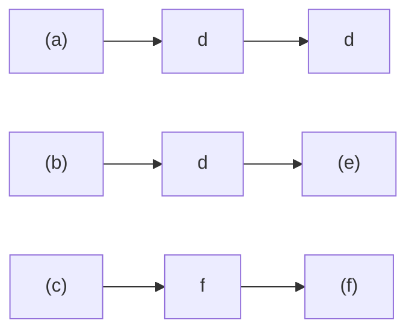
</details>

Abb. 3.F3

**4.** Abbildung 3.F4 zeigt die Werte einer Kraft ${ \vec { F } } ,$ die entlang einer x-Achse zeigt und auf ein Teilchen wirkt, das sich entlang der x-Achse bewegt. Wenn das Teilchen bei $x = 0$ aus der Ruhe startet, wie lautet dann seine Koordinate in dem Moment, in dem es (a) die größte kinetische Energie, (b) den größten Geschwindigkeitsbetrag bzw. (c) die Geschwindigkeit null besitzt? (d) In welche Richtung bewegt sich das Teilchen, nachdem es den Punkt $x = 6$ m erreicht hat?


<details>
<summary>line</summary>

| x (m) | F |
| --- | --- |
| 0 | F1 |
| 1 | F2 |
| 3 | 0 |
| 5 | -F2 |
| 7 | 0 |
| 8 | 0 |
</details>

Abb. 3.F4

**5.** Abbildung 3.F5 gibt für drei verschiedene Situationen die Position einer Kiste mit Schmuggelware in Abhängigkeit von der Zeit an; die Kiste wird von den an ihr angelegten, entlang der x-Achse zeigenden Kräften über eine reibungsfreie Oberfläche gezogen. Kurve B ist eine Gerade; die anderen Linien verlaufen gekrümmt. Ordnen Sie die Situationen in absteigender Reihenfolge nach der kinetischen Energie der Kiste (a) zur Zeit $t _ { 1 }$ und (b) zur Zeit $t _ { 2 } .$ (c) Ordnen Sie die Situationen nun in absteigender Reihenfolge nach der Gesamtarbeit, welche die angelegten Kräfte während des Zeitintervalls von $t _ { 1 }$ bis $t _ { 2 }$ an der Kiste verrichten. (d) Welche der folgenden Aussagen beschreibt die Gesamtarbeit, welche die angelegten Kräfte während des Zeitintervalls von $t _ { 1 }$ bis $t _ { 2 }$ verrichten, für jede Situation am besten?

(a) Der Kiste wird Energie zugeführt.
(b) Von der Kiste wird Energie abgeführt.
(c) Die Gesamtarbeit ist null.


<details>
<summary>line</summary>

| Category | Description |
| --- | --- |
| A | Orange curve representing a non-linear growth function starting from origin. |
| B | Green line representing a linear growth function starting from origin. |
| C | Purple line representing a non-linear growth function starting from origin. |
</details>

Abb. 3.F5

86

---

3.8 Fragen

3

**6.** Abbildung 3.F6 zeigt vier (im selben Maßstab gezeichnete) Kurven der x-Komponente einer veränderlichen Kraft $\vec { F }$ (die entlang der x-Achse zeigt) in Abhängigkeit von der Position x eines Teilchens, auf das die Kraft wirkt. Ordnen Sie die Kurven nach der zwischen $x = 0$ und $x _ { 1 }$ von der Kraft $\vec { F }$ an dem Teilchen verrichteten Arbeit, von der positivsten zur negativsten.


Abb. 3.F6

**7.** In Abb. 3.F7 hat ein Kind die Wahl zwischen drei reibungsfreien Rutschbahnen, auf denen es bis zum Erdboden hinunterrutschen kann. Ordnen Sie die Rutschbahnen in absteigender Reihenfolge nach der Arbeit, welche die Gravitationskraft während des Hinunterrutschens an dem Kind verrichtet.


<details>
<summary>text_image</summary>

(a)
(b)
(c)
</details>

Abb. 3.F7

**8.** Sie heben eine Kiste auf ein Regal. Hängt die Kraft, die Sie auf die Kiste ausüben, (a) von der Masse der Kiste, (b) vom Gewicht der Kiste, (c) von der Höhe des Regals, (d) von der Zeit, die Sie dafür benötigen, oder (e) davon ab, ob Sie die Kiste schräg oder senkrecht hinaufheben?
**9.** Abbildung 3.F9 zeigt einen Stapel Zeitschriften, der von einem Seil eine Strecke d angehoben wird. In der Tabelle sind sechs Paare von Werten der Anfangsgeschwindigkeit $\nu _ { 0 }$ und der Endgeschwindigkeit v (in Metern pro Sekunde) aufgeführt, die der Stapel jeweils am Anfang und am Ende der Strecke d besitzt. Ordnen Sie die Paare nach der Arbeit, welche die Kraft des Seils über die Entfernung d an dem Stapel verrichtet hat (die positivste zuerst, die negativste zuletzt).


<details>
<summary>text_image</summary>

v=
a b c d e f
0 2 2 2 0 1
v₀=
0 2 0 1 2 2
</details>

Abb. 3.F9

**10.** Die Feder A ist steifer als die Feder B; d. h. $k _ { \mathrm { A } } > k _ { \mathrm { B } }$ Welche der Federkräfte verrichtet die größere Arbeit, wenn die Federn (a) um die gleiche Strecke bzw. (b) mit der gleichen angelegten Kraft zusammengedrückt werden?
**11.** Abbildung 3.F11 zeigt drei Anordnungen, in denen ein Block mit einer Anzahl von identischen Federn verbunden ist. Die Federn sind entspannt, wenn der Block wie in der Abbildung gezeigt in der Mitte zwischen den Wänden liegt. Ordnen Sie die Anordnungen absteigend nach dem Betrag der resultierenden Gesamtkraft auf den Block, wenn der Block um einen Betrag d (a) nach rechts und (b) nach links ausgelenkt wird. Ordnen Sie die Anordnungen absteigend nach der von den Federn an dem Block verrichteten Arbeit, wenn der Block um einen Betrag d (c) nach rechts und (d) nach links ausgelenkt wird.


<details>
<summary>natural_image</summary>

Simple diagram of a spring attached to a block on a horizontal surface (no text or symbols)
</details>

(a)


<details>
<summary>natural_image</summary>

Simple diagram of a spring-mass system with no text or symbols
</details>

(b)

Abb. 3.F11

**12.** Abbildung 3.F12 zeigt die Geschwindigkeit eines Autoskooters, der durch eine veränderliche angelegte Kraft eine Achse entlang bewegt wird, in Abhängigkeit von der Zeit. Die Zeitachse ist in sechs Abschnitte unterteilt, für die gilt: $\begin{array} { r } { \Delta t _ { 1 } = \Delta t _ { 2 } = \Delta t _ { 3 } = \Delta t _ { 6 } = 2 \Delta t _ { 4 } = \frac { 2 } { 3 } \Delta t _ { 5 } } \end{array}$ . (a) Innerhalb welcher dieser Zeitintervalle führt die angelegte Kraft Energie von dem Autoskooter ab? (b) Ordnen Sie die Zeitintervalle nach der Arbeit, welche die angelegte Kraft während des Intervalls an dem Autoskooter verrichtet (die positivste zuerst, die negativste zuletzt). (c) Ordnen Sie die Zeitintervalle nach der Rate, mit der die angelegte Kraft Energie überträgt, die größte Energieübertragung auf den Skooter zuerst, die größte Energieübertragung von dem Skooter zuletzt.


<details>
<summary>line</summary>

| t | v |
| --- | --- |
| 0 | 0 |
| 1.5 | Peak |
| 2.5 | Peak |
| 3.5 | 0 |
| 4.2 | Trough |
| 5.5 | Trough |
| 6.5 | 0 |
</details>

Abb. 3.F12

87

---

3 Kinetische Energie und Arbeit

**13.** In drei verschiedenen Situationen wird eine Dose, die sich ursprünglich in Ruhe befand, durch eine angelegte Kraft über einen reibungsfreien Fußboden geschickt. Abbildung 3.F13 zeigt die Kurven der entsprechenden Beschleunigung für die drei Situationen in Abhängigkeit von der Zeit. Ordnen Sie die Kurven in absteigender Reihenfolge nach der Arbeit, welche die angelegte Kraft während der Beschleunigungsphase verrichtet hat.


<details>
<summary>area</summary>

| Time Interval | Process A | Process B | Process C |
| --- | --- | --- | --- |
| Start to End | High | High | Low |
</details>

**14.** Abbildung 3.F14a zeigt vier Situationen, in denen eine horizontale Kraft auf denselben Block wirkt, der sich anfänglich in Ruhe befindet. Die Beträge der Kräfte sind $F _ { 2 } = F _ { 4 } = 2 F _ { 1 } = 2 F _ { 3 }$ . Die horizontale Komponente $\nu _ { x }$ der Geschwindigkeit des Blocks ist für jede der vier Situationen in Abb. 3.F14b gezeigt. (a) Welche Kurve aus Abb. 3.F14b passt zu welcher Kraft aus Abb. 3.F14a? (b) Welche Kurve aus Abb. 3.F14c (kinetische Energie K als Funktion der Zeit t) passt am besten zu welcher Kurve aus Abb. 3.F14b?


<details>
<summary>text_image</summary>

F₁
F₂
F₃
F₄
x
</details>

(a)


<details>
<summary>text_image</summary>

vₓ
A
B
t
C
D
</details>

(b)


<details>
<summary>line</summary>

| Category | Trend Description |
| --- | --- |
| E | Positive growth curve |
| F | Moderate positive growth curve |
| G | Negative growth curve |
| H | Negative growth curve |
</details>

(c)

Abb. 3.F14

**15.** Ein Erdklumpen wird vom Rand einer Klippe geworfen. Welche der Kurven in Abb. 3.F15 könnte die Veränderung seiner kinetischen Energie während des Flugs zeigen?


Abb. 3.F15

**16.** Gegeben sind drei Situationen, in denen eine einzige Kraft auf ein sich bewegendes Teilchen wirkt. Die Geschwindigkeiten des Teilchens im betrachteten Moment und die Kräfte sind:

(1)
(2)
(3)

Ordnen Sie die drei Situationen absteigend nach der Geschwindigkeit des Energietransfers auf das oder von dem Teilchen.

88

---

# 4 Potenzielle Energie und Energieerhaltung

## 4.1 Potenzielle Energie

## Physikalische Motivation

Eine der Aufgaben der Physik ist es, die verschiedenen Arten von Energie zu identifizieren, die in der Natur vorkommen. Eine sehr häufig auftretende Energieform ist die **potenzielle Energie** U. Formal ausgedrückt ist sie eine Energie, die mit dem Zustand eines Systems aus mehreren Objekten zusammenhängt, die Kräfte aufeinander ausüben.

Trotz der ungewohnten Formulierung handelt es sich dabei um eine Tatsache, die uns allen wohlvertraut ist. Ein Beispiel hilft vielleicht, diesen Punkt besser zu verstehen: Wenn wir in einer Anordnung von Gegenständen, die Kräfte aufeinander ausüben, die Lage der Gegenstände relativ zueinander verändern wollen, müssen wir (häufig) Arbeit aufwenden – als beispielsweise der russische Gewichtheber Andrei Chemerkin während der Olympischen Spiele von 1996 seine Hantel mit einer Masse von 260 kg über seinen Kopf hob, vergrößerte er den Abstand zwischen der Hantel und dem Erdmittelpunkt. Die Arbeit, die er mit seiner Kraft dabei verrichtete, veränderte die potenzielle Energie des Systems Hantel–Erde (Abb. 4.1).

Eine andere Art von potenzieller Energie ist die **elastische potenzielle Energie**, die damit zusammenhängt, ob ein elastisches (einer Feder ähnliches) Objekt gestaucht oder gedehnt ist. Wenn Sie eine Feder zusammendrücken oder auseinanderziehen, so verrichten Sie Arbeit an ihr, um die Positionen der Windungen innerhalb der Feder relativ zueinander zu verändern. Das Ergebnis der von Ihrer Kraft verrichteten Arbeit ist eine Zunahme der elastischen potenziellen Energie der Feder.

Das Konzept der potenziellen Energie kann äußerst hilfreich sein, um Situationen zu analysieren, in denen es um die Bewegung von Objekten geht. Mithilfe der potenziellen Energie können wir Aufgaben ganz einfach lösen, die – nur mit den Techniken der vorangehenden Kapitel angegangen – aufwändige Computerprogramme erfordern würden.

## 4.1.1 Arbeit und potenzielle Energie

In Kapitel 7 haben wir die Beziehung zwischen der Arbeit und einer Änderung der kinetischen Energie untersucht. Hier wollen wir uns der Verbindung zwischen Arbeit und Änderung der potenziellen Energie zuwenden.

In Abb. 4.2 wird eine Tomate senkrecht nach oben geworfen. Wie wir bereits wissen, ist die von der Gravitationskraft an der Tomate verrichtete Arbeit $W _ { \mathrm { G } }$ während des Anstiegs negativ, da die Kraft Energie von der kinetischen Energie der Tomate abführt. Wir können unsere Analyse nun vervollständigen, indem wir festhalten, dass diese Energie durch die Gravitationskraft in die potenzielle Energie des Systems Tomate–Erde übertragen wurde.


<details>
<summary>natural_image</summary>

Two diagrams showing dumbbells on a horizontal surface, labeled (a) and (b), with no text or symbols present.
</details>

Abb. 4.1 Als Chemerkin die Hantel über seinen Kopf hob, vergrößerte er den Abstand zwischen der Hantel und der Erde und änderte damit die Konfiguration des Systems Hantel–Erde von der in (a) gezeigten zu der in (b) dargestellten Konfiguration.

Halliday Physik für natur- und ingenieurwiss. Studiengänge, 3. Auflage. D. Halliday, R. Resnick und J. Walker. © 2020 WILEY-VCH Verlag GmbH & Co. KGaA. Published 2020 by WILEY-VCH Verlag GmbH & Co. KGaA.

89

---

4 Potenzielle Energie und Energieerhaltung


Abb. 4.3

Ein an einer Feder befestigter Block, der sich ursprünglich bei in Ruhe befindet, wird nach rechts in Bewegung versetzt. (a) Während der Block sich nach rechts bewegt (wie durch den Pfeil angedeutet), verrichtet die Federkraft negative Arbeit an ihm. (b) Wenn der Block anschließend in Richtung $x = 0$ zurückkehrt, verrichtet die Federkraft positive Arbeit an ihm.

## Abb. 4.2

Eine Tomate wird nach oben geworfen. Während des Anstiegs verrichtet die Gravitationskraft negative Arbeit an der Tomate und verringert damit deren kinetische Energie. Während des Herabfallens verrichtet die Gravitationskraft positive Arbeit an der Tomate und lässt damit deren kinetische Energie wieder anwachsen.

Die Tomate wird langsamer, hält an und beginnt, unter dem Einfluss der Gravitationskraft wieder nach unten zu fallen. Während des Hinunterfallens findet die Energieübertragung in umgekehrter Richtung statt: Die von der Gravitationskraft an der Tomate verrichtete Arbeit $W _ { \mathrm { G } }$ ist nun positiv, die Kraft überträgt Energie von der potenziellen Energie des Systems Tomate–Erde auf die kinetische Energie der Tomate.

Sowohl für den Anstieg als auch für das Hinunterfallen ist die Änderung ΔU der potenziellen Energie als das Negative der Arbeit definiert, welche die Gravitationskraft an der Tomate verrichtet. Benutzen wir wie gehabt W als das allgemeine Symbol für die Arbeit, so haben wir:

$$
\Delta U = - W. \tag {4.1}
$$

Diese Gleichung gilt auch für ein System aus einem Masseblock und einer Feder, wie es in Abb. 4.3 dargestellt ist. Wenn wir dem Block plötzlich einen Stoß nach rechts versetzen, sodass er sich dorthin bewegt, so wirkt die Rückstellkraft der Feder nach links und verrichtet somit negative Arbeit an dem Block. Dabei wird Energie von der kinetischen Energie des Blocks in elastische potenzielle Energie der Feder umgewandelt. Der Block wird langsamer, hält an und beginnt, sich nach links zu bewegen, da die Federkraft weiterhin nach links wirkt. Der Energietransfer findet daraufhin umgekehrt statt – von der potenziellen Energie der Feder in die kinetische Energie des Blocks.

## Konservative und nichtkonservative Kräfte

Die folgenden Punkte sind die Schlüsselelemente für die beiden Situationen, die wir soeben untersucht haben:

1. Das System besteht aus zwei oder mehr Objekten.
2. Eine Kraft wirkt zwischen einem teilchenartigen Objekt des Systems (hier der Tomate bzw. dem Block) und dem Rest des Systems.
3. Wenn sich die Konfiguration des Systems – also die räumliche Anordnung der Komponenten des Systems relativ zueinander – ändert, so verrichtet die Kraft eine Arbeit $W _ { 1 }$ an dem teilchenartigen Objekt. Dabei überträgt sie Energie zwischen der kinetischen Energie K des Objekts und einer anderen Form von Energie des Systems.
4. Wird die Änderung der Konfiguration des Systems rückgängig gemacht, so überträgt die Kraft Energie in umgekehrter Richtung, wobei sie eine Arbeit $W _ { 2 }$ verrichtet.

Gilt für eine bestimmte Situation immer $W _ { 1 } = - W _ { 2 }$ , so ist diese andere Energieform eine potenzielle Energie und die Kraft wird als **konservative Kraft** bezeich net. Wie Sie vielleicht schon vermutet haben, sind die Gravitationskraft und die Federkraft beide konservativ.

Eine Kraft, für welche die Gleichung $W _ { 1 } = - W _ { 2 }$ nicht gilt, wird nichtkonser**vative Kraft** genannt. Die Gleitreibungskraft (auch kinetische Reibungskraft genannt, vgl. Kapitel 2) und der Strömungswiderstand sind nichtkonservative Kräfte. Lassen wir z. B. einen Block über einen Fußboden gleiten, der nicht reibungsfrei ist. Während der Block über den Boden rutscht, verrichtet eine von dem Boden ausgeübte Gleitreibungskraft negative Arbeit an dem Block. Dabei wird der Block langsamer, da die Kraft Energie von der kinetischen Energie des Blocks in eine andere Art von Energie überträgt, die thermische Energie oder Wärmeenergie genannt wird (Kap. 14). Aus Experimenten wissen wir, dass diese Art des Energietransfers

90

---

4.1 Potenzielle Energie

4

nicht umgekehrt werden kann (die Gleitreibungskraft kann die thermische Energie nicht wieder in kinetische Energie des Blocks umwandeln). Obwohl wir hier auch ein System (das aus dem Block und dem Fußboden besteht), eine zwischen den Komponenten des Systems wirkende Kraft und einen durch die Kraft verursachten Energietransfer haben, ist die Kraft nicht konservativ. Die thermische Energie ist demnach keine potenzielle Energie.

Wirken auf ein teilchenartiges Objekt nur konservative Kräfte, dann können wir Aufgaben, welche die Bewegung des Objekts betreffen und ansonsten nur sehr schwierig zu lösen wären, stark vereinfachen. In dem nächsten Abschnitt leiten wir her, wie man ermittelt, ob eine bestimmte Kraft konservativ ist oder nicht, und zeigen eine Methode auf, derartige Aufgaben zu vereinfachen.

## 4.1.2 Wegunabhängigkeit von konservativen Kräften

Ob eine Kraft konservativ ist oder nicht, können Sie grundsätzlich wie folgt testen: Nehmen Sie an, dass die Kraft auf ein Teilchen wirkt, das sich entlang eines belie bigen geschlossenen Wegs bewegt. Das heißt, das Teilchen beginnt seinen Weg an einem bestimmten Punkt, an den es am Ende seines Wegs zurückkehrt. Die Kraft ist genau dann konservativ, wenn die Gesamtenergie, die sie dem Teilchen wäh rend eines vollständigen Umlaufs zuführt oder entzieht, entlang dieses und jedes anderen geschlossenen Wegs gleich null ist. Mit anderen Worten:


Für jeden geschlossenen Weg ist die Gesamtarbeit, die von einer konservativen Kraft an einem Teilchen entlang dieses Wegs verrichtet wird, gleich null.

Aus Experimenten wissen wir, dass die Gravitationskraft dieses Kriterium erfüllt. Ein Beispiel dafür ist die in Abb. 4.2 geworfene Tomate. Die Tomate verlässt ihren Ausgangspunkt mit dem Geschwindigkeitsbetrag $\nu _ { 0 }$ und der kinetischen Energie $\frac { 1 } { 2 } m \overset { \leftrightarrow } { \nu _ { 0 } ^ { 2 } } .$ Die auf die Tomate wirkende Gravitationskraft bremst die Tomate ab, hält sie an und bewirkt, dass sie wieder hinunterfällt. In dem Moment, in dem die Tomate ihren Ausgangspunkt wieder erreicht, besitzt sie erneut den Geschwindig keitsbetrag $\nu _ { 0 }$ und die kinetische Energie $\frac { 1 } { 2 } m \nu _ { 0 } ^ { 2 } .$ Die Gravitationskraft führt während des Anstiegs also genauso viel Energie von der Tomate ab, wie sie ihr während des Herabfallens bis zum Ausgangspunkt wieder zuführt. Die Gesamtarbeit, welche die Gravitationskraft auf dem geschlossenen Weg an der Tomate verrichtet hat, ist null.

Nehmen Sie nun an, dass sich das Teilchen in Abb. 4.4a entweder auf dem Weg 1 oder dem Weg 2 von Punkt a nach Punkt b bewegt. Wirkt nur eine konservative Kraft auf das Teilchen, dann ist die an dem Teilchen verrichtete Arbeit entlang beider Wege gleich. Mathematisch können wir dieses Ergebnis wie folgt ausdrücken:

$$
W _ {\mathrm{ab}, 1} = W _ {\mathrm{ab}, 2}, \tag {4.2}
$$

wobei der Index ab die Anfangs- und Endpunkte bezeichnet und die Indizes 1 bzw. 2 den eingeschlagenen Weg angeben.

Dies ist ein äußerst bemerkenswertes Resultat:


Die Arbeit, die eine konservative Kraft an einem Teilchen verrichtet, das sich zwischen zwei Punkten bewegt, hängt nicht von dem Weg ab, den das Teilchen zwischen den beiden Punkten durchläuft.

Dieses Ergebnis ist deshalb so wichtig, weil es uns erlaubt, schwierige Fragestellungen in Fällen, in denen nur konservative Kräfte wirken, stark zu vereinfachen. Nehmen Sie an, Sie müssten die Arbeit berechnen, die eine konservative Kraft entlang eines bestimmten Wegs zwischen zwei Punkten verrichtet; die Berechnungen sind jedoch schwierig bzw. ohne zusätzliche Information gar nicht durchzuführen.


(a)


(b)

## Abb. 4.4

(a) Eine konservative Kraft wirkt auf ein Teilchen. Dieses kann sich dabei über den Weg 1 oder den Weg 2 von Punkt a nach Punkt b bewegen. (b) Das Teilchen bewegt sich auf einem geschlossenen Weg, von Punkt a nach Punkt b über den Weg 1 und dann zurück zum Punkt a via Weg 2.

91

---

4 Potenzielle Energie und Energieerhaltung

Dann können Sie die Arbeit trotzdem ermitteln, indem Sie den ursprünglichen Weg zwischen den zwei Punkten durch einen anderen ersetzen, für den die Berechnungen einfacher und durchführbar sind. Die Beispielaufgabe 4.1 im Übungsbuch beschreibt einen solchen Fall. Doch bevor wir uns ihr zuwenden, müssen wir erst noch Gl. 4.2 beweisen.

## Beweis von Gleichung 4.2

Abbildung 4.4b zeigt einen willkürlich gewählten geschlossenen Weg eines Teilchens, auf das eine einzelne Kraft wirkt. Das Teilchen bewegt sich von seinem Anfangspunkt a auf dem Weg 1 zu einem Punkt b und kehrt dann auf dem Weg 2 zum Punkt a zurück. Während sich das Teilchen die beiden Wege entlangbewegt, verrichtet die Kraft an ihm Arbeit. Wir kümmern uns nicht darum, in welchen Abschnitten die von der Kraft verrichtete Arbeit nun positiv bzw. negativ ist, sondern bezeichnen die von a nach b entlang des Wegs 1 verrichtete Arbeit allgemein als $W _ { \mathrm { a b , 1 } }$ und die von b nach a entlang des Wegs 2 verrichtete Arbeit als $W _ { \mathrm { b a , 2 } }$ . Da die Kraft konservativ ist, muss die während eines Umlaufs verrichtete Arbeit null sein:

$$
W _ {\mathrm{ab}, 1} + W _ {\mathrm{ba}, 2} = 0,
$$

das heißt

$$
W _ {\mathrm{ab}, 1} = - W _ {\mathrm{ba}, 2}. \tag {4.3}
$$

Die auf dem Hinweg verrichtete Arbeit ist also das Negative der auf dem Rückweg verrichteten Arbeit.

Betrachten wir nun die Arbeit $W _ { \mathsf { a b } , 2 } ,$ welche die Kraft an dem Teilchen verrichtet, wenn es sich wie in Abb. 4.4a dargestellt entlang des Wegs 2 von a nach b bewegt. Da die Kraft konservativ ist, ist diese Arbeit gleich dem Negativen von $W _ { \mathrm { b a , 2 ^ { \cdot } } }$

$$
W _ {\mathrm{ab}, 2} = - W _ {\mathrm{ba}, 2}. \tag {4.4}
$$

Ersetzen wir $- W _ { \mathrm { b a } , 2 }$ in Gl. 4.3 durch $W _ { \mathrm { a b , 2 } } ,$ so erhalten wir:

$$
W _ {\mathrm{ab}, 1} = W _ {\mathrm{ab}, 2},
$$

was zu beweisen war.

## KONTROLLFRAGE 1

Die Abbildung zeigt drei Wege, welche die Punkte a und b miteinander verbinden. Es ist jeweils angegeben, welche Arbeit eine Kraft $\vec { F }$ an einem Teilchen verrichtet, das sich in die eingezeichnete Richtung auf einem der drei Wege bewegt. Ist die Kraft $\vec { F }$ konservativ?

## 4.1.3 Berechnung der potenziellen Energie

In diesem Abschnitt wollen wir Gleichungen herleiten, anhand derer wir die Werte der potenziellen Energie bestimmen können. Dafür leiten wir zunächst eine all gemeine Beziehung zwischen einer konservativen Kraft und der entsprechenden potenziellen Energie her.

Betrachten wir ein teilchenartiges Objekt, das Teil eines Systems ist, in dem eine konservative Kraft $\vec { F }$ wirkt. Wenn diese Kraft eine Arbeit $W$ an dem Objekt verrichtet, ist die Änderung $\Delta U$ der mit dem System zusammenhängenden potenziellen Energie gleich dem Negativen der verrichteten Arbeit. Diese Tatsache haben wir in Gl. 4.1 ausgedrückt $\left( \Delta U = - W \right)$ . Für den allgemeinen Fall, dass sich die Kraft als Funktion des Orts verändert, können wir die verrichtete Arbeit anhand von Gl. 3.30 ausdrücken:

$$
W = \int_ {x _ {\mathrm{i}}} ^ {x _ {\mathrm{f}}} F (x) \mathrm{d} x. \tag {4.5}
$$


<details>
<summary>flowchart</summary>

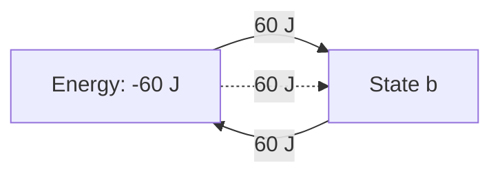
</details>

92

---

4.1 Potenzielle Energie

4

Diese Gleichung gibt die Arbeit an, welche die Kraft verrichtet, wenn sich das Ob jekt von einem Punkt $x _ { \mathrm { i } }$ zu einem Punkt $x _ { \mathrm { f } }$ bewegt und dabei die Konfiguration des Systems verändert. (Da die Kraft konservativ ist, ist die Arbeit für alle Wege zwischen diesen beiden Punkten gleich.)

Setzen wir Gl. 4.5 in Gl. 4.1 ein, so erhalten wir die durch die Veränderung der Konfiguration hervorgerufene Änderung der potenziellen Energie:

$$
\Delta U = - \int_ {x _ {\mathrm{i}}} ^ {x _ {\mathrm{f}}} F (x) \mathrm{d} x. \tag {4.6}
$$

Dies ist die allgemeine Beziehung, nach der wir gesucht haben. Wenden wir sie an!

## Potenzielle Energie der Gravitation

Wir betrachten zunächst ein Teilchen der Masse m, das sich in vertikaler Richtung entlang einer y-Achse bewegt, deren positive Richtung nach oben weist. Während es sich vom initialen Punkt $y _ { \mathrm { i } }$ zum finalen Punkt $y _ { \mathrm { f } }$ bewegt, verrichtet die Gravitationskraft $\vec { F } _ { \mathrm { G } }$ Arbeit an dem Teilchen. Um die entsprechende Änderung der potenziellen Energie des Systems Teilchen–Erde zu ermitteln, verwenden wir Gl. 4.6 mit zwei Abweichungen: (1) Wir integrieren hier entlang der y-Achse und nicht der x-Achse, da die Gravitationskraft im vorliegenden Fall in vertikaler Richtung wirkt. (2) Wir ersetzen das Kraftsymbol F durch −mg, da $\vec { F } _ { \mathrm { G } }$ den Betrag mg hat und entlang der y-Achse nach unten weist. Damit erhalten wir:

$$
\Delta U = - \int_ {y _ {\mathrm{i}}} ^ {y _ {\mathrm{f}}} (- m g) \mathrm{d} y = m g \int_ {y _ {\mathrm{i}}} ^ {y _ {\mathrm{f}}} \mathrm{d} y = m g \left[ y \right] _ {y _ {\mathrm{i}}} ^ {y _ {\mathrm{f}}}.
$$

beziehungsweise

$$
\Delta U = m g (y _ {\mathrm{f}} - y _ {\mathrm{i}}) = m g \Delta y. \tag {4.7}
$$

Nur Änderungen ΔU der potenziellen Energie besitzen eine physikalische Bedeutung. Um eine Rechnung oder eine Herleitung zu vereinfachen, ist es manchmal jedoch hilfreich, einem bestimmten System Teilchen–Erde, in dem sich das Teilchen in einer Höhe $y$ befindet, einen bestimmten Wert U der potenziellen Energie zuordnen zu können. Dazu schreiben wir Gl. 4.7 in der Form:

$$
U - U _ {\mathrm{i}} = m g (y - y _ {\mathrm{i}}). \tag {4.8}
$$

Dabei ist $U _ { \mathrm { i } }$ die potenzielle Energie des Systems in einer **Referenzkonfiguration**, in der sich das Teilchen an einem bestimmten **Referenzpunkt** $y _ { \mathrm { i } }$ befindet. Üblicherweise wählt man $U _ { \mathrm { i } } = 0$ und $y _ { \mathrm { i } } = 0$ . Damit wird Gl. 4.8 zu:

$$
U (y) = m g y. \tag {4.9}
$$

Diese Gleichung besagt Folgendes:


Die potenzielle Energie der Gravitationskraft in einem System Teilchen– Erde hängt nur von der vertikalen Position (d. h. der Höhe) des Teilchens relativ zum Referenzpunkt $y = 0$ ab; sie ist nicht von der horizontalen Position abhängig.

## Elastische potenzielle Energie

Als Nächstes betrachten wir das in Abb. 4.3 dargestellte System aus einem Block und einer Feder, bei dem der Block am Ende der Feder befestigt ist; die Federkonstante der Feder ist k. Während sich der Block vom Punkt $x _ { \mathrm { i } }$ zum Punkt $x _ { \mathrm { f } }$ bewegt,

93

---

4 Potenzielle Energie und Energieerhaltung

verrichtet die Federkraft $F = - k x$ Arbeit an dem Block. Um die entsprechende $\ddot { \mathrm { A n } } \cdot$ derung der elastischen potenziellen Energie des Systems Block–Feder zu ermitteln, ersetzen wir $F ( x )$ in Gl. 4.6 durch −kx. Wir erhalten:

$$
\Delta U = - \int_ {x _ {\mathrm{i}}} ^ {x _ {\mathrm{f}}} (- k x) \mathrm{d} x = k \int_ {x _ {\mathrm{i}}} ^ {x _ {\mathrm{f}}} x \mathrm{d} x = \frac {1}{2} k \left[ x ^ {2} \right] _ {x _ {\mathrm{i}}} ^ {x _ {\mathrm{f}}}
$$

beziehungsweise

$$
\Delta U = \frac {1}{2} k x _ {\mathrm{f}} ^ {2} - \frac {1}{2} k x _ {\mathrm{i}} ^ {2}. \tag {4.10}
$$

Um dem Block bei einer Position x einen bestimmten Wert der potenziellen Ener gie zuzuordnen, wählen wir als Referenzkonfiguration jene Anordnung, bei der die Feder im entspannten Zustand ist und der Block sich bei $x _ { \mathrm { i } } = 0$ befindet. Die elastische potenzielle Energie $U _ { \mathrm { i } }$ ist dann null und Gl. 4.10 wird zu

$$
U - 0 = \frac {1}{2} k x ^ {2} - 0,
$$

das heißt

$$
U (x) = \frac {1}{2} k x ^ {2} \quad \text {(elastische potenzielle Energie).} \tag {4.11}
$$

## KONTROLLFRAGE 2

Ein Teilchen bewege sich entlang einer x-Achse von $x = 0$ nach $x _ { 1 }$ . Dabei wirkt eine konservative Kraft auf das Teilchen, die ebenfalls in x-Richtung weist. Die Abbildung zeigt drei verschiedene Situationen, in denen die x-Komponente dieser Kraft sich in Abhängigkeit von x ändert. In allen drei Situationen besitzt die Kraft den gleichen Betrag $F _ { 1 }$ . In welcher Situation ist die Änderung der entsprechenden potenziellen Energie am größten? Ordnen Sie die jeweiligen Änderungen nach ihrer Größe.


## LÖSUNGSSTRATEGIEN

**Strategie 1: Verwendung des Ausdrucks „potenzielle Energie“** Eine potenzielle Energie wird einem System als Ganzem zugeordnet. Ab und zu werden Ihnen möglicherweise jedoch Aussagen begegnen, in denen die potenzielle Energie nur einem Teil des Systems zugeordnet wird, so z. B. in dem Satz: „Ein Apfel, der auf einem Baum hängt, besitzt eine potenzielle Energie von 30 J.“ Solche Aussagen sind meist annehmbar; Sie sollten jedoch immer im Hinterkopf behalten, dass die potenzielle Energie eigentlich mit einem System zusammenhängt, in diesem Fall dem System Apfel–Erde. Beachten Sie auch, dass die Zuordnung eines bestimmten Werts der potenziellen Energie – wie hier $, 30 ] ^{ \alpha }  .$ – zu einem Objekt oder sogar einem System nur dann sinnvoll ist, wenn ein Referenzwert der potenziellen Energie festgelegt wurde (siehe Beispielaufgabe 4.2 im Übungsbuch).

## 4.2 Der Energieerhaltungssatz der Mechanik


## Lernziele

Nach dem Durcharbeiten dieses Abschnitts sollten Sie in der Lage sein, . . .

• zu verstehen, dass die mechanische Gesamtenergie eines Systems, dass aus eindeutig definierten einzelnen Objekten besteht, die Summe der kinetischen und potenziellen Energien dieser Objekte ist,

94

---

4.2 Der Energieerhaltungssatz der Mechanik

4

den Energieerhaltungssatz anzuwenden, um aus den anfänglichen kinetischen und potenziellen Energien eines abgeschlossenen Systems, in dem nur konservative Kräfte wirken, die kinetischen und potenziellen Energien zu einem spä- teren Zeitpunkt zu bestimmen.

## Schlüsselideen

• Die mechanische Energie $E _ { \mathrm { m e c h } }$ eines Systems ist die Summe seiner potenziellen Energie U und seiner kinetischen Energie K:

$$
E _ {\mathrm{mech}} = K + U.
$$

Ein abgeschlossenes System ist ein System, in das keine Kräfte von außen einwirken und Energieänderungen bewirken können. Wenn in einem abgeschlos senen System nur konservative Kräfte wirken, kann sich die mechanische Energie $E _ { \mathrm { m e c h } }$ des Systems nicht ändern. Wir können den Energieerhaltungssatz der Mechanik in der Form

$$
K _ {2} + U _ {2} = K _ {1} + U _ {1}
$$

schreiben, wobei sich die Indizes 1 und 2 auf zwei verschiedene Zeitpunkte während der Übertragung von Energie beziehen. Eine andere Schreibweise dieses wichtigen Prinzips ist

$$
\Delta E _ {\mathrm{mech}} = \Delta K + \Delta U = 0.
$$


## 4.2.1 Der Energieerhaltungssatz der Mechanik

Die **mechanische Energie** $E _ { \mathrm { m e c h } }$ eines Systems ist die Summe seiner potenziellen Energie U und der kinetischen Energie K der Objekte, die es enthält:

$$
E _ {\mathrm{mech}} = K + U \quad (\text {mechanische Energie}). \tag {4.12}
$$

In diesem Abschnitt untersuchen wir, wie sich diese mechanische Energie verändert, wenn die Energieübertragung innerhalb des Systems von konservativen Kräften verursacht wird – wenn auf die Objekte in dem System also weder Reibungskräfte noch Strömungswiderstände wirken. Wir nehmen außerdem an, dass das System abgeschlossen, also von seiner Umgebung **isoliert** ist. Das heißt, es gibt keine äußere, von einem Objekt außerhalb des Systems ausgeübte Kraft, die eine Energieänderung innerhalb des Systems verursacht.

Verrichtet eine konservative Kraft eine Arbeit W an einem Objekt innerhalb des Systems, so überträgt sie Energie zwischen der kinetischen Energie K des Objekts und der potenziellen Energie U des Systems. Laut Gl. 7.10 ist die Änderung ΔK der kinetischen Energie:

$$
\Delta K = W. \tag {4.13}
$$

Laut Gl. 4.1 ist die Änderung ΔU der potenziellen Energie:

$$
\Delta U = - W. \tag {4.14}
$$

Indem wir die Gln. 4.13 und 4.14 kombinieren, erhalten wir:

$$
\Delta K = - \Delta U. \tag {4.15}
$$

Die eine Energie nimmt also in genau dem Maß zu, in dem die andere abnimmt.

Gleichung 4.15 können wir wie folgt umschreiben:

$$
K _ {2} - K _ {1} = - (U _ {2} - U _ {1}), \tag {4.16}
$$

95

---

4 Potenzielle Energie und Energieerhaltung

wobei die Indizes zwei verschiedene Zeitpunkte und damit zwei verschiedene An ordnungen der Objekte des Systems bezeichnen. Umformen von Gl. 4.16 ergibt:

$$
K _ {2} + U _ {2} = K _ {1} + U _ {1} \quad \text {(Energieerhaltungssatz der Mechanik)}  . \tag {4.17}
$$

Diese Gleichung besagt also, dass für ein abgeschlossenes System, auf dessen Objekte nur konservative Kräfte wirken, Folgendes gilt:

$$
\left( \begin{array}{c} \text {Summe von $K$ und $U$} \\ \text {für einen beliebigen} \\ \text {Zustand des Systems} \end{array} \right) = \left( \begin{array}{c} \text {Summe von $K$ und $U$} \\ \text {für jeden beliebigen anderen} \\ \text {Zustand des Systems} \end{array} \right).
$$

Anders ausgedrückt:


In einem abgeschlossenen System, in dem Änderungen der Energie nur durch konservative Kräfte verursacht werden, können sich kinetische und potenzielle Energie zwar ändern, ihre Summe – die mechanische Energie $E _ { \mathrm { m e c h } }$ des Systems – bleibt jedoch erhalten.

Dieses Ergebnis ist als **Energieerhaltungssatz der Mechanik** bekannt. Anhand von Gl. 4.15 können wir diesen Satz in einer weiteren Form schreiben:

$$
\Delta E _ {\mathrm{mech}} = \Delta K + \Delta U = 0. \tag {4.18}
$$

Der Energieerhaltungssatz der Mechanik erlaubt uns, Aufgaben zu lösen, die mithilfe der Newtonschen Gesetze allein nur sehr schwer zu berechnen wären:


Ist die mechanische Energie eines Systems erhalten, so ist die Summe der kinetischen und der potenziellen Energie zu einem bestimmten Zeitpunkt gleich der zu einem beliebigen anderen Zeitpunkt, unabhängig von etwaigen Bewegungen oder der von den beteiligten Kräften verrichteten Arbeit.

Abbildung 4.5 zeigt ein Beispiel, auf das der Energieerhaltungssatz der Mechanik angewendet werden kann: Während ein Pendel schwingt, wird die Energie des Systems Pendel–Erde zwischen der kinetischen Energie K des Pendels und der potenziellen Energie U des Systems hin und her übertragen, wobei die Summe $K + U$ konstant bleibt. Kennen wir die potenzielle Energie zu dem Zeitpunkt, zu dem sich das Ende des Pendels am höchsten Punkt seiner Bahn befindet (Abb. 4.5c), so liefert Gl. 4.17 die kinetische Energie des Pendelendes an seinem tiefsten Punkt (Abb. 4.5e).

Lassen Sie uns den tiefsten Punkt als den Referenzpunkt wählen, an dem die po tenzielle Energie $U _ { 2 } = 0$ ist. Nehmen Sie nun an, dass die potenzielle Energie relativ zu diesem Referenzpunkt am höchsten Punkt $U _ { \mathrm { 1 } } = 2 0   )$ beträgt. Da das Pendelende am höchsten Punkt vorübergehend anhält, ist die kinetische Energie dort $K _ { 1 } = 0$ . Einsetzen dieser Werte in Gl. 4.17 ergibt die kinetische Energie $K _ { 2 }$ am tiefsten Punkt:

$$
K _ {2} + 0 = 0 + 2 0 \mathrm{J}
$$

oder

$$
K _ {2} = 2 0 \mathrm{J}.
$$

Beachten Sie, dass wir dieses Ergebnis ermittelt haben, ohne die Bewegung zwischen dem höchsten und dem tiefsten Punkt (wie sie z. B. in Abb. 4.5d dargestellt ist) zu betrachten und ohne die Arbeit irgendeiner an der Bewegung beteiligten Kraft zu berechnen.

96

---

4.2 Der Energieerhaltungssatz der Mechanik

4


<details>
<summary>flowchart</summary>


</details>

Abb. 4.5

Ein Pendel, dessen Masse in dem Pendelkörper an seinem unteren Ende konzentriert ist, schwingt hin und her. Die Abbildung zeigt einen vollständigen Zyklus der Bewegung. Während des Zyklus verändern sich die Werte der potenziellen und der kinetischen Energie des Systems Pendel–Erde mit dem Auf- und Abstieg des Pendelkörpers, doch die mechanische Energie $E _ { \mathrm { m e c h } }$ des Systems bleibt konstant. Die Energie $E _ { \mathrm { m e c h } }$ verlagert sich sozusagen kontinuierlich von kinetischer zu potenzieller Energie und umgekehrt. In den Phasen (a) und (e) liegt die gesamte Energie in Form von kinetischer Energie vor. Der Pendelkörper besitzt dann seine größte Geschwindigkeit und befindet sich am tiefsten Punkt. In den Phasen (c) und (g) ist die gesamte Energie potenzielle Energie. Der Pendelkörper hat dann die Geschwindigkeit null und befindet sich am höchsten Punkt. In den Phasen (b), (d), (f ) und (h) ist die Hälfte der Energie kinetische und die andere Hälfte potenzielle Energie. Würde die Bewegung des Pendels einer Reibungskraft (z. B. an der Aufhängung des Pendels) oder einem merklichen Strömungswiderstand der Luft unterliegen, so wäre $E _ { \mathrm { m e c h } }$ nicht erhalten und das Pendel käme irgendwann zum Stehen.

## KONTROLLFRAGE 3

Die Abbildung zeigt vier Situationen – eine, in der ein ursprünglich in Ruhe be findlicher Block fallen gelassen wird, und drei, in denen der ursprünglich eben falls in Ruhe befindliche Block verschiedene reibungsfreie Rampen hinuntergleitet. (a) Ordnen Sie die Situationen in absteigender Reihenfolge nach der kinetischen Energie des Blocks am Punkt B. (b) Ordnen Sie sie in absteigender Reihenfolge nach dem Geschwindigkeitsbetrag des Blocks am Punkt B.


<details>
<summary>text_image</summary>

A
B
(1)
(2)
(3)
B
(4)
B
</details>

## LÖSUNGSSTRATEGIEN

**Strategie 2: Erhaltung der mechanischen Energie** Die folgenden Fragen werden Ihnen helfen, Aufgaben zu lösen, in denen es um die Erhaltung der mechanischen Energie geht.

97

---

4 Potenzielle Energie und Energieerhaltung

Für welches System ist die mechanische Energie erhalten? Sie sollten in der Lage sein, Ihr System von seiner Umgebung zu trennen. Stellen Sie sich vor, Sie würden eine geschlossene Fläche um das System herum zeichnen, sodass das Innere der Fläche Ihr System beinhaltet und alles, was sich außerhalb der Fläche befindet, die Umgebung Ihres Systems darstellt. Übrigens: in Beispielaufgabe 4.3 im Übungsbuch enthält das System das Kind und die Erde.

Treten Reibungskräfte oder Strömungswiderstände auf? Gibt es Reibungskräfte oder Strömungswiderstände, so ist die mechanische Energie nicht erhalten.

Ist Ihr System abgeschlossen? Die Erhaltung der mechanischen Energie gilt nur für abgeschlossene Systeme. Dies bedeutet, dass keinerlei äußere Kräfte (also Kräfte, die von Objekten außerhalb des Systems ausgeübt werden) an den Objekten innerhalb des Systems Arbeit verrichten.

Was sind der Anfangs- und der Endzustand Ihres Systems? Das System ändert sich von einem bestimmten Anfangszustand (oder einer Anfangskonfiguration) zu einem bestimmten Endzustand. Der Energieerhaltungssatz der Mechanik sagt aus, dass $E _ { \mathrm { m e c h } }$ in diesen beiden Zuständen den gleichen Wert hat. Machen Sie sich deutlich klar, welches diese beiden Zustände genau sind.

## 4.3 Grafische Darstellung der potenziellen Energie


## Lernziele

Nach dem Durcharbeiten dieses Abschnitts sollten Sie in der Lage sein, . . .

• aus der gegebenen potenziellen Energie eines Teilchens als Funktion seiner Position x die Kraft auf das Teilchen zu bestimmen,
• aus einer grafischen Darstellung der potenziellen Energie eines Teilchens als Funktion des Orts die Kraft auf das Teilchen zu bestimmen,
• in eine grafische Auftragung der potenziellen Energie eines Teilchens als Funktion seines Orts seine mechanische Energie einzutragen und seine kinetische Energie an beliebigen Orten zu bestimmen,
• mithilfe der Potenzialkurve für eine x-Achse für die Bewegung eines Teilchens entlang dieser Achse eine Beziehung zwischen seinen Energien an unterschiedlichen Orten anzugeben,
• auf der Potenzialkurve eines Teilchens anzugeben, wo gegebenenfalls Umkehrpunkte oder Bereiche liegen, in denen sich das Teilchen aus energetischen Gründen nicht aufhalten kann,
• die Begriffe neutrales Gleichgewicht, stabiles Gleichgewicht und instabiles Gleichgewicht zu erläutern.


## Schlüsselideen

• Wenn wir die Potenzialkurve U(x) eines Teilchens in einem System kennen, in dem eine Kraft F(x) in einer Dimension wirkt, ist die an einer beliebigen Stelle x auf das Teilchen wirkende Kraft

$$
F (x) = - \frac {\mathrm{d} U}{\mathrm{d} x}.
$$

• Wenn U(x) als grafische Auftragung gegeben ist, dann entspricht die Kraft F(x) für jeden Ort x der negativen Steigung der Kurve an diesem Punkt und die kinetische Energie K des Teilchens ist

$$
K (x) = - E _ {\mathrm{mech}} - U (x),
$$

wenn $E _ { \mathrm { m e c h } }$ die mechanische Energie des Teilchens ist.

• Ein Umkehrpunkt ist ein Ort, an dem das Teilchen seine Bewegungsrichtung umkehrt (dort gilt mindestens für einen kurzen Moment $K = 0 )$
• Ein Teilchen befindet sich an den Punkten seiner Potenzialkurve im Gleichgewicht, an denen die Steigung von U(x) null ist (dort gilt $F ( x ) = 0 )$

98

---

4.3 Grafische Darstellung der potenziellen Energie

4

## 4.3.1 Potenzialkurven

Wir betrachten erneut ein Teilchen, das Teil eines Systems ist, in dem eine konservative Kraft wirkt. Nehmen Sie nun an, dass sich das Teilchen entlang einer x-Achse bewegt, während die konservative Kraft Arbeit an ihm verrichtet. Wir können sehr viel über die Bewegung des Teilchens in Erfahrung bringen, wenn wir die potenzielle Energie $U ( x )$ des Systems grafisch auftragen. Bevor wir uns der Analyse solcher Kurven zuwenden, benötigen wir jedoch noch eine weitere Beziehung.

## Analytische Bestimmung der Kraft

Gleichung 4.6 verrät uns, wie wir in einer eindimensionalen Situation die Änderung $\Delta U$ einer potenziellen Energie zwischen zwei Punkten bestimmen können, wenn wir die entsprechende Kraft $F ( x )$ kennen. Nun möchten wir den umgekehrten Weg gehen: Wir kennen die potenzielle Energie $U ( x )$ als Funktion von x und möchten die Kraft $F ( x )$ ermitteln.

Ein Teilchen bewege sich in einer solchen eindimensionalen Situation um eine Entfernung $\Delta x .$ Die auf das Teilchen wirkende Kraft verrichtet dabei die Arbeit $W = F ( x ) \Delta x .$ . Damit können wir Gl. 4.1 in der Form

$$
\Delta U (x) = - W = - F (x) \Delta x
$$

schreiben. Lösen wir dies nach $F ( x )$ auf und bilden gleichzeitig den Grenzwert, so erhalten wir:

$$
F (x) = - \frac {\mathrm{d} U (x)}{\mathrm{d} x} \quad \text {(eindimensionale Bewegung).} \tag {4.19}
$$

Dies ist die Beziehung, die wir gesucht hatten.

Wir können dieses Ergebnis überprüfen, indem wir $\begin{array} { r } { U ( x ) = \frac { 1 } { 2 } k x ^ { 2 } } \end{array}$ setzen, d. h., wir betrachten die elastische potenzielle Energie einer Feder. Gleichung 4.19 ergibt dann wie erwartet das Hookesche Gesetz $F ( x ) = - k x .$ . Analog können wir $U ( x )$ gleich der potenziellen Energie der Gravitation in dem System Teilchen–Erde setzen, in dem sich ein Teilchen der Masse m in einer Höhe h über der Erdoberfläche befindet, also $U ( x ) = m g x .$ . Gleichung 4.19 liefert dann die auf das Teilchen wirkende Gravitationskraft $F = - m g$ (auch dies hatten wir erwartet).

## Die Kurve der potenziellen Energie

Abbildung 4.6a zeigt die Kurve der potenziellen Energie $U ( x )$ als Funktion von x (eine Potenzialkurve) für ein System, in dem ein Teilchen eine eindimensionale Bewegung ausführt, während eine konservative Kraft $F ( x )$ an ihm Arbeit verrichtet. Wir können $F ( x )$ leicht (grafisch) ermitteln, indem wir die Steigung der $U ( x )$ -Kurve an verschiedenen Punkten bestimmen. (Gleichung 4.19 besagt, dass F(x) das Negative der Steigung der U(x)-Kurve ist.) Abbildung 4.6b zeigt die auf diese Weise ermittelte Kurve von $F ( x )$ .

## Umkehrpunkte

In Abwesenheit einer nichtkonservativen Kraft besitzt die mechanische Energie eines Systems einen konstanten Wert, der durch

$$
U (x) + K (x) = E _ {\mathrm{mech}} \tag {4.20}
$$

gegeben ist. Hierbei ist $K ( x )$ die kinetische Energie des Teilchens als Funktion seines Orts x. Gleichung 4.20 können wir in der Form

$$
K (x) = E _ {\mathrm{mech}} - U (x) \tag {4.21}
$$

99

---

4 Potenzielle Energie und Energieerhaltung


umschreiben. Nehmen wir nun an, dass die mechanische Energie $E _ { \mathrm { m e c h } }$ (die ja einen konstanten Wert besitzt) gleich 5,0 J ist. In Abb. 4.6a wird dieser Sachverhalt durch eine horizontale Linie dargestellt, welche die Energieachse im Punkt 5,0 J schneidet.

Gleichung 4.21 verrät uns, wie wir die kinetische Energie K an jedem beliebi gen Ort x eines Teilchens bestimmen können: Finden Sie an jener Position x den entsprechenden Wert von U anhand der $U ( x )$ -Kurve und ziehen Sie dann U von $E _ { \mathrm { m e c h } }$ ab. Befindet sich das Teilchen z. B. an einem beliebigen Punkt rechts von $x _ { 5 } ,$ so ist $K = 1 , 0   )$ . Der Wert von $K$ ist am größten $^ { ( 5 , 0 } \mathrm { J ) }$ , wenn sich das Teilchen bei $x _ { 2 }$ befindet, und am kleinsten (0 J), wenn es sich bei $x _ { 1 }$ befindet.

Da K niemals negativ sein kann (weil $\nu ^ { 2 }$ immer positiv ist), kann sich das Teilchen niemals auf die linke Seite von $x _ { 1 }$ bewegen, wo $E _ { \mathrm { m e c h } } - U$ negativ ist. Während sich das Teilchen von $x _ { 2 }$ nach $x _ { 1 }$ bewegt, wird K immer kleiner (das Teilchen wird immer langsamer), bis K schließlich bei $x _ { 1 }$ gleich null wird (das Teilchen hält dort an).

Beachten Sie, dass die auf das Teilchen wirkende Kraft – die durch Gl. 4.19 gegeben ist – in dem Moment, in dem das Teilchen den Punkt $x _ { 1 }$ erreicht, positiv ist (da die Steigung dU∕dx negativ ist). Dies bedeutet, dass das Teilchen nicht im Punkt $x _ { 1 }$ bleibt, sondern stattdessen anfängt, sich entgegen seiner ursprünglichen Bewegungsrichtung nach rechts zu bewegen. $x _ { 1 }$ ist also ein **Umkehrpunkt:** ein Punkt, in dem $K = 0$ ist (da $U = E   \mathrm { i s t } )$ und das Teilchen seine Bewegungsrichtung wechselt. An der rechten Seite der Kurve gibt es keinen Umkehrpunkt. Bewegt sich das Teilchen einmal nach rechts, so wird es diese Bewegung unendlich lange fortführen.

## Gleichgewichtspunkte

Abbildung 4.6c zeigt drei verschiedene Werte von $E _ { \mathrm { m e c h } }$ sowie die gleiche Kurve der potenziellen Energie $U ( x )$ als Funktion von x wie in Abb. 4.6a. Untersuchen wir nun, wie diese verschiedenen Werte von $E _ { \mathrm { m e c h } }$ die jeweilige Situation beeinflussen. Ist $E _ { \mathrm { m e c h } } = 4 , 0 1$ (violette Linie), so ist der Umkehrpunkt nicht mehr $x _ { 1 }$ sondern liegt zwischen $x _ { 1 }$ und $x _ { 2 }$ . An jedem beliebigen Punkt rechts von $x _ { 5 }$ ist die mechanische Energie des Systems außerdem gleich seiner potenziellen Energie; das

100

---

4.4 Von einer äußeren Kraft an einem System verrichtete Arbeit

4

Teilchen besitzt hier also keine kinetische Energie und laut Gl. 4.19 wirkt hier keine Kraft auf das Teilchen. Es muss sich an diesen Punkten also in Ruhe befinden. Man spricht in diesem Fall von einem **neutralen** oder **indifferenten Gleichgewicht**. (Eine auf einem Tisch ruhende Murmel befindet sich z. B. in einem solchen Gleichgewichtszustand.)

Ist $E _ { \mathrm { m e c h } } = 3 ,   0 )$ (rosa Linie), so gibt es zwei Umkehrpunkte: Der eine liegt zwischen $x _ { 1 }$ und $x _ { 2 } ,$ der zweite zwischen $x _ { 4 }$ und $x _ { 5 } ,   x _ { 3 }$ ist außerdem ein Punkt, in dem $K = 0$ ist. Befindet sich das Teilchen genau an diesem Punkt, so ist die darauf wirkende Kraft ebenfalls gleich null und das Teilchen verharrt in Ruhe. Wird das Teilchen jedoch noch so geringfügig nach links oder rechts verschoben, so ist die Kraft nicht mehr null; sie drückt das Teilchen noch weiter in die eingeschlagene Richtung, sodass sich das Teilchen immer weiterbewegt. Befindet sich ein Teilchen in solch einer Position, spricht man von einem **instabilen** oder **labilen Gleichgewicht**. (In einem solchen Gleichgewichtszustand befindet sich z. B. eine Murmel, die auf einer Bowlingkugel ruht.)

Betrachten wir als Nächstes die Bewegung des Teilchens für den Fall, dass $E _ { \mathrm { m e c h } } = 1 , 0   )$ ist (grüne Linie). Setzen wir das Teilchen an den Punkt $x _ { 4 } ,$ so bleibt es dort stecken. Es kann sich hier von allein weder nach links noch nach rechts bewegen, da es dazu eine negative kinetische Energie bräuchte. Stoßen wir das Teilchen leicht nach links oder rechts an, so tritt eine Rückstellkraft auf, die das Teilchen zum Punkt $x _ { 4 }$ zurückbewegt. In einem solchen Fall spricht man von einem stabi**len Gleichgewicht**. (Eine Murmel, die am tiefsten Punkt einer halbkugelförmigen Schale liegt, ist ein Beispiel eines solchen Gleichgewichtszustands.) Setzen wir das Teilchen in den um $x _ { 2 }$ liegenden, schalenförmigen Potenzialtopf , befindet es sich zwischen zwei Umkehrpunkten. Es kann sich zwar ein wenig bewegen, doch nur bis zu $x _ { 1 }$ oder $x _ { 3 }$

## KONTROLLFRAGE 4

Die Abbildung zeigt die potenzielle Energie U(x) eines Systems, in dem ein Teilchen eine eindimensionale Bewegung ausführt. (a) Ordnen Sie die Abschnitte AB, BC und CD in absteigender Reihenfolge nach dem Betrag der auf das Teilchen wirkenden Kraft. (b) In welche Richtung zeigt die auf das Teilchen in Abschnitt AB wirkende Kraft?


<details>
<summary>line</summary>

| Segment | U(x) (J) |
| --- | --- |
| A | 3 |
| B | 1 |
| C | 1 |
| D | 5 |
</details>

## 4.4 Von einer äußeren Kraft an einem System verrichtete Arbeit

## Lernziele

Nach dem Durcharbeiten dieses Abschnitts sollten Sie in der Lage sein, . . .

• die Veränderungen der kinetischen und potenziellen Energie anzugeben, wenn an einem System in Abwesenheit von Reibung von einer äußeren Kraft Arbeit verrichtet wird,
• die Veränderungen der kinetischen, potenziellen und thermischen Energie anzugeben, wenn an einem System in Anwesenheit von Reibung von einer äußeren Kraft Arbeit verrichtet wird.


## Schlüsselideen

• Durch eine äußere Kraft, die auf das System wirkt, kann Arbeit an ihm verrichtet (auf es übertragen oder aus ihm entnommen) werden.
• Wenn auf ein System mehr als eine Kraft wirkt, entspricht die von ihnen verrichtete Gesamtarbeit der auf das System übertragenen (oder von ihm entnommenen) Energie.
• In Abwesenheit von Reibung ist die an dem System verrichtete Arbeit gleich der Änderung $\Delta E _ { \mathrm { m e c h } }$ seiner mechanischen Energie:

$$
W = \Delta E _ {\mathrm{mech}} = \Delta K + \Delta U.
$$


101

---

4 Potenzielle Energie und Energieerhaltung

• Wenn innerhalb des Systems eine Gleitreibungskraft wirkt, ändert sich die thermische Energie $E _ { \mathrm { t h } }$ des Systems (das ist die Energie, die mit der zufälligen Bewegung der Atome und Moleküle des Systems verknüpft ist). Für die an dem System verrichtete Arbeit gilt dann

$$
W = \Delta E _ {\mathrm{mech}} + \Delta E _ {\mathrm{th}}.
$$

• Die Änderung $\Delta E _ { \mathrm { t h } }$ hängt gemäß

$$
\Delta E _ {\mathrm{th}} = f _ {\mathrm{k}} d
$$

mit dem Betrag $f _ { \mathrm { k } }$ der Reibungskraft (oder kinetischen Reibung) und dem Betrag d der von der äußeren Kraft bewirkten Verschiebung zusammen.

## 4.4.1 Von einer äußeren Kraft an einem System verrichtete Arbeit


Abb. 4.7

(a) Wird an einem beliebigen System positive Arbeit W verrichtet, so bedeutet dies, dass Energie in das System übertragen wird. (b) Negative Arbeit W bedeutet, dass Energie von dem System abgeführt wird.

In Kap. 3 haben wir die Arbeit als Energie definiert, die durch eine auf ein Objekt wirkende Kraft auf das Objekt übertragen bzw. von diesem Objekt abgeführt wird. Diese Definition können wir nun auf Situationen erweitern, in denen eine äußere Kraft auf ein System von Objekten wirkt.


Arbeit ist Energie, die eine auf ein System wirkende äußere Kraft diesem System zuführt bzw. entzieht.

In Abb. 4.7a ist positive Arbeit dargestellt (also ein Energietransfer in ein System), in Abb. 4.7b negative Arbeit (also ein Energietransfer aus einem System). Wirkt auf ein System mehr als eine Kraft, so ist die von diesen Kräften verrichtete Gesamtarbeit die Energie, die dem System „netto“ zugeführt bzw. entzogen wurde.

Diese Energieübertragungen ähneln dem Geldtransfer auf oder von einem Bankkonto. Besteht ein System wie in Kap. 7 aus einem einzelnen Teilchen oder teilchenartigen Objekt, so kann die durch eine Kraft an dem System verrichtete Arbeit nur die kinetische Energie des Systems verändern. Diese Situation wird durch Gl. 7.10 (ΔK = W) beschrieben; d. h., ein einzelnes Teilchen besitzt nur ein „Energiekonto“, nämlich seine kinetische Energie. Äußere Kräfte können Energie auf dieses Konto bzw. von diesem Konto übertragen. Ist das System jedoch komplexer, so kann eine äußere Kraft auch andere Energieformen (wie z. B. die potenzielle Energie) verändern; ein komplexeres System kann sozusagen mehrere Energiekonten besitzen.

Um entsprechende Energiebilanzen für derartige Systeme herzuleiten, betrachten wir zwei grundlegende Situationen – eine, in der Reibung keine Rolle spielt, sowie eine weitere, in der eine Reibungskraft vorkommt.

## Abwesenheit von Reibung

Sie nehmen an einem Wettkampf im Kugelstoßen teil. Dazu heben Sie zunächst die auf dem Boden liegende Kugel auf, sodass Sie die Kugel etwa in Gesichtshöhe loswerfen. Während Ihrer Aufwärtsbewegung verrichtet die Kraft, die Sie auf die Kugel ausüben, offensichtlich Arbeit; d. h., diese Kraft ist eine äußere Kraft, die Energie überträgt – doch auf welches System?

Um diese Frage zu beantworten, überprüfen wir zunächst, welche Energien sich verändern. Die kinetische Energie der Kugel ändert sich um den Betrag ΔK; da Ku gel und Erde sich dabei weiter voneinander entfernen, gibt es auch eine Änderung ΔU der mit der Gravitationskraft verbundenen potenziellen Energie des Systems Kugel–Erde. Um beide Änderungen in unsere Betrachtungen einschließen zu können, müssen wir also das System Kugel–Erde untersuchen. Die Kraft, die Sie auf-

102

---

4.4 Von einer äußeren Kraft an einem System verrichtete Arbeit

4

wenden, ist dann eine äußere Kraft, die an diesem System Arbeit verrichtet, und die Arbeit ist durch

$$
W = \Delta K + \Delta U \tag {4.22}
$$

oder

$$
W = \Delta E _ {\text {mech}} \quad \begin{array}{l} \text {(in Abwesenheit von Reibung an einem} \\ \text {System verrichtete Arbeit)} \end{array} \tag {4.23}
$$

gegeben, wobei $\Delta E _ { \mathrm { m e c h } }$ die $\ddot { \mathrm { A } }$ nderung der mechanischen Energie des Systems ist. Diese zwei Gleichungen, die in Abb. 4.8 dargestellt sind, sind einander äquivalente Energiebilanzgleichungen für die durch eine äußere Kraft an einem System verrichtete Arbeit in einer Situation, in der keine Reibungskräfte auftreten.

## Anwesenheit von Reibung

Als Nächstes betrachten wir das in Abb. 4.9a dargestellte Beispiel. Hier zieht eine konstante horizontale Kraft $\vec { F }$ einen Block um eine Verschiebung d die x-Achse entlang und vergrößert dabei die Geschwindigkeit des Blocks von $\vec { \nu } _ { 0 }$ auf v⃗. Während der Bewegung übt der Boden eine konstante Gleitreibungskraft $\vec { f } _ { \mathrm { k } }$ auf den Block aus. Zunächst wählen wir den Block als unser System und wenden darauf das zweite Newtonsche Gesetz an. Für die Komponenten entlang der x-Achse $( F _ { \mathrm { g e s } , x } =$ ma ) ergibt sich hier:

$$
F - f _ {\mathrm{k}} = m a. \tag {4.24}
$$

Da die Kräfte konstant sind, ist auch die Beschleunigung $\vec { a }$ konstant. Also können wir Gl. (2.14) verwenden und erhalten:

$$
\nu^ {2} = \nu_ {0} ^ {2} + 2 a d.
$$

Auflösen nach a, Einsetzen des Ergebnisses in Gl. 4.24 und Umformen liefert dann

$$
F d = \frac {1}{2} m v ^ {2} - \frac {1}{2} m v _ {0} ^ {2} + f _ {\mathrm{k}} d \tag {4.25}
$$

beziehungsweise, da für den Block $\begin{array} { r } { \frac { 1 } { 2 } m \nu ^ { 2 } - \frac { 1 } { 2 } m \nu _ { 0 } ^ { 2 } = \Delta K } \end{array}$ ist:

$$
F d = \Delta K + f _ {\mathrm{k}} d. \tag {4.26}
$$

In einer allgemeineren Situation (in der sich der Block z. B. eine Rampe hinaufbewegt) kann außerdem eine Änderung der potenziellen Energie auftreten. Um eine solche mögliche Änderung einzuschließen, verallgemeinern wir Gl. 4.26 zu

$$
F d = \Delta E _ {\mathrm{mech}} + f _ {\mathrm{k}} d. \tag {4.27}
$$

Experimentell stellt sich heraus, dass sich sowohl der Block als auch der Teil des Fußbodens, über den er gleitet, während der Bewegung des Blocks erwärmen. Wie wir in Kap. 14 sehen werden, hängt die Temperatur eines Objekts mit seiner thermischen Energie oder Wärmeenergie $E _ { \mathrm { t h } }$ zusammen (der Energie, die der Zufallsbewegung der Atome und Moleküle in dem Objekt zugeordnet ist). Hier erhöht sich die thermische Energie von Block und Boden, weil (1) zwischen den beiden Reibung auftritt und (2) der Block über den Boden rutscht. Erinnern Sie sich daran, dass Reibung durch „Mikro-Kaltschweißen“ zwischen zwei Oberflächen entsteht (Kap. 2). Während der Block über den Boden gleitet, verursacht diese Gleitbewegung ein wiederholtes Aufbrechen und Neubilden der Schweißstellen zwischen dem Block und dem Boden, wodurch sich Block und Boden aufwärmen. Die Gleitbewegung vergrößert also deren thermische Energie $E _ { \mathrm { t h } }$


<details>
<summary>text_image</summary>

System
Kugel-Erde
ΔEmech = ΔK + ΔU
W
</details>

Abb. 4.8

An dem System Kugel–Erde wird eine positive Arbeit W verrichtet. Dies verursacht eine Änderung $\Delta E _ { \mathrm { m e c h } }$ der mechanischen Energie des Systems, eine Änderung ΔK der kinetischen Energie der Kugel sowie eine Änderung ΔU der potenziellen Energie des Systems.


<details>
<summary>text_image</summary>

v₀
F
v
x
fₖ
d
</details>

(a)


<details>
<summary>text_image</summary>

System
Block-Fuß-
boden
ΔE_mech
ΔE_th
W
</details>

(b)

## Abb. 4.9

(a) Ein Block wird von einer Kraft F⃗ über einen Boden gezogen. Dabei wirkt eine Gleitreibungskraft $\vec { f } _ { \mathrm { k } }$ der Bewegung entgegen. Am Anfang der Verschiebung d⃗ besitzt der Block die Geschwindigkeit $\vec { \nu } _ { 0 } ,$ am Ende der Verschiebung die Geschwindigkeit ⃗v. (b) Die Kraft $\vec { F }$ verrichtet eine positive Arbeit W an dem System Block– Boden, was eine Änderung $\Delta E _ { \mathrm { m e c h } }$ der mechanischen Energie des Blocks und eine Änderung $\Delta E _ { \mathrm { t h } }$ der thermischen Energie von Block und Boden verursacht.

103

---

4 Potenzielle Energie und Energieerhaltung

Experimentell zeigt sich außerdem, dass diese Zunahme $\Delta E _ { \mathrm { t h } }$ der thermischen Energie gleich dem Produkt der Beträge $f _ { \mathrm { k } }$ und d ist:

$$
\Delta E _ {\mathrm{th}} = f _ {\mathrm{k}} d \quad (\text {Zunahme der thermischen Energie durch Gleiten}). \tag {4.28}
$$

Damit können wir Gl. 4.27 also in der Form

$$
F d = \Delta E _ {\mathrm{mech}} + \Delta E _ {\mathrm{th}} \tag {4.29}
$$

schreiben.

Fd ist die von der äußeren Kraft $\vec { F }$ verrichtete Arbeit W (d. h. die Energie, die von der Kraft übertragen wird) – doch an welchem System wird diese Arbeit verrichtet (d. h., wo finden die Energieübertragungen statt)? Um diese Frage zu beantworten, überprüfen wir, welche Energien sich verändern. Die mechanische Energie des Blocks ändert sich ebenso wie die thermische Energie von Block und Boden. Die Kraft F⃗ verrichtet ihre Arbeit also an dem System Block–Fußboden. Diese Arbeit ist

$$
W = \Delta E _ {\text {mech}} + \Delta E _ {\text {th}} \quad \begin{array}{l} \text {(in Anwesenheit von Reibung} \\ \text {an einem System verrichtete Arbeit)} \end{array} . \tag {4.30}
$$

Diese Gleichung – die in Abb. 4.9b dargestellt ist – ist die Energiebilanzgleichung für die durch eine äußere Kraft an einem System verrichtete Arbeit in einer Situation, in der Reibungskräfte auftreten.

## KONTROLLFRAGE 5

Ein Block wird wie in Abb. 4.9a gezeigt in drei Versuchen von einer horizonta len Kraft über einen Fußboden geschoben, der nicht reibungsfrei ist. Die folgende Tabelle führt den Betrag F der angelegten Kraft und die durch das Schieben ver ursachte Änderung des Geschwindigkeitsbetrags des Blocks auf. In allen drei Versuchen legt der Block dieselbe Entfernung d zurück. Ordnen Sie die drei Versuche in absteigender Reihenfolge nach der auf dieser Strecke d auftretenden Änderung der thermischen Energie von Block und Fußboden.

| Versuch | F | Auswirkung auf den Geschwindigkeitsbetrag des Blocks |
| --- | --- | --- |
| a | 5,0 N | nimmt ab |
| b | 7,0 N | bleibt konstant |
| c | 8,0 N | nimmt zu |

## 4.5 Energieerhaltung

## Lernziele

Nach dem Durcharbeiten dieses Abschnitts sollten Sie in der Lage sein, . . .

• für ein abgeschlossenes System (keine resultierende äußere Kraft) die Energieerhaltung zu verwenden, um eine Beziehung zwischen der anfänglichen Gesamt energie des Systems und seiner Gesamtenergie zu einem späteren Zeitpunkt anzugeben,
• für ein nicht abgeschlossenes System eine Beziehung zwischen der durch eine äußere Kraft an dem System verrichteten Arbeit und den Änderungen der verschiedenen Energiearten im System anzugeben,
• die Beziehung zwischen der mittleren Leistung, der damit verbundenen Übertragung von Energie und dem Zeitintervall anzugeben, in dem diese Übertragung stattfindet,
• aus einer vorgegebenen Energieübertragung als Funktion der Zeit (entweder als Funktionsterm oder als grafische Auftragung) die momentane Leistung (die in einem gegebenen Moment übertragene Energie) zu bestimmen.


104

---

4.5 Energieerhaltung

4

## Schlüsselideen

Die Gesamtenergie eines Systems (die Summe seiner mechanischen Energie und aller internen Energiearten, einschließlich der thermischen Energie) kann sich nur ändern, wenn Energie auf das System übertragen oder aus ihm entnommen wird. Diese experimentelle Tatsache wird als Energieerhaltung bezeichnet.

• Wenn an einem System Arbeit verrichtet wird, dann gilt

$$
W = \Delta E = \Delta E _ {\mathrm{mech}} + \Delta E _ {\mathrm{th}} + \Delta E _ {\mathrm{int}}.
$$

Wenn das System abgeschlossen ist $\left( W = 0 \right)$ , gilt folglich

$$
\Delta E _ {\mathrm{mech}} + \Delta E _ {\mathrm{th}} + \Delta E _ {\mathrm{int}} = 0
$$

und

$$
E _ {\mathrm{mech,2}} = E _ {\mathrm{mech,1}} - \Delta E _ {\mathrm{th}} - \Delta E _ {\mathrm{int}},
$$

wobei die Indizes 1 und 2 zwei unterschiedliche Zeitpunkte bezeichnen.

• Die von einer Kraft erbrachte Leistung beschreibt die Geschwindigkeit des Energietransfers. Wenn eine Kraft in einem Zeitintervall Δt eine Energie $\Delta E$ auf ein System überträgt, erbringt sie eine mittlere (gemittelte) Leistung

$$
P _ {\mathrm{gem}} = \frac {\Delta E}{\Delta t}.
$$

• Die momentane Leistung, die eine Kraft erbringt, ist

$$
P = \frac {\mathrm{d} E}{\mathrm{d} t}.
$$

Trägt man die übertragene Energie gegen die Zeit auf, entspricht die Steigung der Kurve der Leistung zu einem gegebenen Zeitpunkt.

## 4.5.1 Energieerhaltung

Wir haben bisher einige Situationen untersucht, in denen Energie auf Objekte und Systeme übertragen bzw. von diesen abgeführt wird, ähnlich wie Geld auf ein Konto eingezahlt bzw. von einem Konto abgehoben wird. In all diesen Situationen sind wir davon ausgegangen, dass wir die entsprechende Energie immer verfolgen konnten – dass die Energie also nicht auf magische Weise einfach auftauchen oder verschwinden kann. Formaler ausgedrückt haben wir (ganz richtig) angenommen, dass die Energie dem sogenannten **Erhaltungssatz der Energie** gehorcht, der die **Gesamtenergie** E eines Systems betrifft. Diese Gesamtenergie ist die Summe der mechanischen Energie, der thermischen Energie und jeglicher weiteren Formen von innerer Energie eines Systems. (Diese weiteren Energiearten haben wir bisher noch nicht untersucht. Es gibt auch noch weitere „äußere“ Energieformen, auf die wir im Laufe des Buchs zurückkommen werden – Energieerhaltung gilt immer für alle auftretenden Formen.) Der Erhaltungssatz besagt Folgendes:


Die Gesamtenergie E eines Systems kann sich nur dann ändern, wenn Energie auf das System übertragen bzw. aus dem System abgeführt wird.

Die einzige Art des Energietransfers, die wir bisher betrachtet haben, ist die an einem System verrichtete Arbeit W. Zum jetzigen Zeitpunkt lautet der Energieerhaltungssatz für uns also

$$
W = \Delta E = \Delta E _ {\mathrm{mech}} + \Delta E _ {\mathrm{th}} + \Delta E _ {\mathrm{int}}, \tag {4.31}
$$

wobei $\Delta E _ { \mathrm { m e c h } }$ jegliche Änderung der mechanischen Energie des Systems, $\Delta E _ { \mathrm { t h } }$ jegliche Änderung der thermischen Energie des Systems und $\Delta E _ { \mathrm { i n t } }$ jegliche Änderung


105

---

4 Potenzielle Energie und Energieerhaltung

irgendeiner anderen Form von innerer Energie des Systems darstellt. $\Delta E _ { \mathrm { m e c h } }$ enthält die Änderungen ΔK der kinetischen Energie sowie die Änderungen ΔU der potenziellen Energie (der elastischen potenziellen Energie, der potenziellen Energie der Gravitation oder jeder anderen Form von Energie, der wir begegnen können).

Diesen Energieerhaltungssatz haben wir nicht aus anderen grundlegenden phy sikalischen Prinzipien hergeleitet. Vielmehr beruht dieser Satz auf zahlreichen Ex perimenten und es gibt bisher noch keinen Widerspruch zu diesem Satz. Manche sagen sogar, er sei das Grundgesetz der Physik schlechthin.

## Abgeschlossenes System


<details>
<summary>natural_image</summary>

Silhouette of a rock climber ascending a cliff against a sunset sky (no text or symbols)
</details>

Abb. 4.10

Um sich abzuseilen, muss die Kletterin Energie von der potenziellen Energie des Systems, das aus ihr, ihrer Ausrüstung und der Erde besteht, abführen. Dabei sorgt sie dafür, dass zwischen dem Seil, metallenen Ringen und der Felswand Reibungskräfte entstehen. Der größte Teil der übertragenen Energie wird dadurch der thermischen Energie von Seil, Ringen und Wand zugeführt – und nicht der kinetischen Energie der Kletterin [Quelle: Greg Epperson/iStockphoto].

Ist ein System abgeschlossen, also von seiner Umgebung isoliert, so kann keine Energie in das System hinein bzw. aus dem System heraus übertragen werden. In diesem Fall besagt der Energieerhaltungssatz:


Die Gesamtenergie E eines abgeschlossenen Systems kann sich nicht verändern.

Viele Energietransfers können innerhalb eines abgeschlossenen Systems stattfin den, so z. B. zwischen der kinetischen Energie und einer potenziellen Energie oder zwischen der kinetischen Energie und der thermischen Energie. Die Gesamtsumme aller Energieformen in dem System kann sich jedoch nicht ändern.

Betrachten wir als ein Beispiel die Kletterin aus Abb. 4.10. Mit ihrer Ausrüstung und der Erde bildet sie ein System, das wir näherungsweise als abgeschlossen betrachten können. Während sie sich die Felswand (ein Teil der Erde!) hinunter abseilt und dabei die Konfiguration des Systems verändert, muss sie den Energietransfer von der potenziellen Energie des Systems unter Kontrolle behalten. (Diese Energie kann nicht einfach verschwinden.) Ein Teil der potenziellen Energie wird in ihre kinetische Energie übertragen. Offensichtlich muss sie jedoch vermeiden, dass zu viel potenzielle Energie in diese Form von Energie übertragen wird, da sie sich sonst zu schnell bewegen würde. Deshalb hat sie das Seil um verschiedene Metallringe gewickelt, damit zwischen dem Seil und den Ringen während ihrer Abwärtsbewegung Reibung entsteht. Das Gleiten der Ringe entlang des Seils überträgt dann potenzielle Energie des Systems in die thermische Energie von Ringen und Seil – und zwar auf eine Art und Weise, die die Kletterin kontrollieren kann. Die Gesamtenergie des Systems Kletterin–Ausrüstung–Erde (d. h. die Summe aus seiner potenziellen Energie, kinetischen Energie und thermischen Energie) verändert sich während des Abseilens nicht.

Für ein abgeschlossenes System kann der Energieerhaltungssatz in zwei verschiedenen Formen geschrieben werden. Zunächst setzen wir in Gl. 4.31 $W = 0$ und erhalten damit

$$
\Delta E _ {\mathrm{mech}} + \Delta E _ {\mathrm{th}} + \Delta E _ {\mathrm{int}} = 0 \quad (\text {abgeschlossenes System}). \tag {4.32}
$$

Wir können auch $\Delta E _ { \mathrm { m e c h } } = \Delta E _ { \mathrm { m e c h , 2 } } - \Delta E _ { \mathrm { m e c h , 1 } }$ ansetzen, wobei die Indizes 1 und 2 zwei verschiedene Zeitpunkte bezeichnen, z. B. bevor und nachdem ein bestimmter Prozess stattgefunden hat. Dann wird Gl. 4.32 zu

$$
E _ {\mathrm{mech}, 2} = E _ {\mathrm{mech}, 1} - \Delta E _ {\mathrm{th}} - \Delta E _ {\mathrm{int}}. \tag {4.33}
$$

Gleichung 4.33 besagt Folgendes:


In einem abgeschlossenen System können wir die Gesamtenergie zu einem bestimmten Zeitpunkt mit der Gesamtenergie zu einem anderen Zeitpunkt in Beziehung setzen, ohne die Energie des Systems während der dazwischenliegenden Zeitpunkte betrachten zu müssen.

106

---

4.6 Zusammenfassung

4

Diese Tatsache kann sehr hilfreich sein, wenn es darum geht, Aufgaben zu lösen, bei denen Sie die Energie eines abgeschlossenen Systems vor und nach einem bestimmten Prozess miteinander in Verbindung bringen müssen.

In Abschn. 4.2 haben wir einen Spezialfall eines abgeschlossenen Systems untersucht – nämlich eine Situation, in der innerhalb der betrachteten Systeme keine nichtkonservativen Kräfte (wie z. B. Gleitreibungskräfte) wirken. In diesem speziellen Fall sind $\Delta E _ { \mathrm { t h } }$ und $\Delta E _ { \mathrm { i n t } }$ beide gleich null und Gl. 4.33 reduziert sich auf Gl. 4.18. Anders ausgedrückt ist die mechanische Energie eines abgeschlossenen Systems erhalten, wenn innerhalb des Systems keine nichtkonservativen Kräfte wirken.

## Leistung

Nachdem wir nun gesehen haben, wie Energie von einer Energieform in eine andere übertragen werden kann, können wir die in Abschn. 7.6 aufgestellte Definition der Leistung erweitern. Dort war die Leistung die Rate, mit der eine Kraft Arbeit verrichtet. Im allgemeineren Sinn ist die Leistung P die Rate, mit der eine Kraft Energie von einer Energieform in die andere überträgt. Wird während eines Zeitintervalls $\Delta t$ die Energiemenge ΔE übertragen, so ist die durchschnittliche Leis**tung** der Kraft

$$
P _ {\mathrm{gem}} = \frac {\Delta E}{\Delta t}. \tag {4.34}
$$

Analog ist die **momentane Leistung** der Kraft

$$
P = \frac {\mathrm{d} E}{\mathrm{d} t}. \tag {4.35}
$$

## 4.6 Zusammenfassung

**Konservative Kräfte** Eine Kraft ist konservativ, wenn die Gesamtarbeit, die sie an einem Teilchen verrichtet, welches sich von einem Anfangs- zu einem Endpunkt entlang eines beliebigen geschlossenen Wegs bewegt, gleich null ist. Gleichbedeutend ist die Aussage, dass die Gesamtarbeit unabhängig von dem Weg ist, auf dem sich das Teilchen bewegt. Gravitationskraft und Federkraft sind konservative Kräfte; die Reibungskräfte und Strömungswiderstand sind dagegen nichtkonservative Kräfte.

**Potenzielle Energie** Eine potenzielle Energie ist eine Energie, die mit der Konfiguration eines Systems zusammenhängt, in dem eine konservative Kraft wirkt. Verrichtet die konservative Kraft eine Arbeit W an einem Teilchen innerhalb des Systems, so ist die Änderung ΔU der potenziellen Energie des Systems

$$
\Delta U = - W. \tag {4.1}
$$

Bewegt sich das Teilchen von einem Punkt $x _ { \mathrm { i } }$ zu einem Punkt $x _ { \mathrm { f } } ,$ so lautet die Änderung der potenziellen Energie des Systems

$$
\Delta U = \int_ {x _ {\mathrm{i}}} ^ {x _ {\mathrm{f}}} F (x) \mathrm{d} x. \tag {4.6}
$$

**Potenzielle Energie der Gravitation** Die Energie, die einem System zugeordnet ist, das aus der Erde und einem sich nahe der Erde befindlichen Teilchen besteht, ist die potenzielle Energie der Gravitation oder auch Lageenergie. Bewegt sich das Teilchen von einer Höhe $y _ { \mathrm { i } }$ zu einer Hö- he $y _ { \mathrm { f } } ,$ so lautet die Änderung der potenziellen Energie des Systems Teilchen–Erde

$$
\Delta U = m g (y _ {\mathrm{f}} - y _ {\mathrm{i}}) = m g \Delta y. \tag {4.7}
$$

Legt man den **Referenzpunkt** der potenziellen Energie, bei dem $U _ { \mathrm { i } } = 0$ ist, an den Ort $y _ { \mathrm { i } } = 0$ , dann ist die potenzielle Energie U für jede beliebige Höhe y des Teilchens gerade

$$
U (y) = m g y. \tag {4.9}
$$

**Elastische potenzielle Energie** Die elastische potenzielle Energie ist die Energie, die dem Spannungszustand eines elastischen Objekts zugeordnet ist. Die elastische potenzielle Energie einer Feder, welche eine Federkraft $F = - k x$ ausübt, wenn ihr freies Ende um eine Verschiebung x ausgelenkt wurde, ist

$$
U (x) = \frac {1}{2} k x ^ {2}. \tag {4.11}
$$

107

---

4 Potenzielle Energie und Energieerhaltung

Bei einer Feder verwendet man als Referenzkonfiguration mit $U = 0$ den Zustand, in dem die Feder entspannt ist, die Auslenkung ist dann $x = 0$

**Mechanische Energie** Die mechanische Energie $E _ { \mathrm { m e c h } }$ eines Systems ist die Summe seiner kinetischen Energie K und seiner potenziellen Energie U:

$$
E _ {\mathrm{mech}} = K + U. \tag {4.12}
$$

Ein System heißt isoliert oder abgeschlossen, wenn keine äußere Kraft Energieänderungen in diesem System verursacht. Verrichten nur konservative Kräfte innerhalb eines abgeschlossenen Systems Arbeit, dann kann sich die mechanische Energie $E _ { \mathrm { m e c h } }$ des Systems nicht ändern. Dieser Energieerhaltungssatz der Mechanik lässt sich in der Form

$$
K _ {2} + U _ {2} = K _ {1} + U _ {1} \tag {4.17}
$$

schreiben, wobei die Indizes zwei verschiedene Zeitpunkte eines Prozesses bezeichnen, bei dem Energie übertragen wird. Eine weitere Form des Energieerhaltungssatzes ist

$$
\Delta E _ {\mathrm{mech}} = \Delta K + \Delta U = 0. \tag {4.18}
$$

**Potenzialkurven** Kennen wir die potenzielle Energie U(x) eines Systems, in dem eine eindimensionale Kraft F auf ein Teilchen wirkt, als Funktion des Orts x, so können wir die Kraft mithilfe der Gleichung

$$
F (x) = - \frac {\mathrm{d} U (x)}{\mathrm{d} x} \tag {4.19}
$$

bestimmen. Wird U(x) grafisch als Kurve aufgetragen, so ist die Kraft F für jeden Wert von x das Negative der Steigung der Kurve in diesem Punkt; die kinetische Energie des Teilchens ist dann durch

$$
K (x) = E _ {\mathrm{mech}} - U (x) \tag {4.21}
$$

gegeben, wobei $E _ { \mathrm { m e c h } }$ die mechanische Energie des Systems ist.

Ein **Umkehrpunkt** ist ein Punkt x, in dem das Teilchen seine Bewegungsrichtung ändert (dort gilt $K   =   0 )$ . Das Teilchen befindet sich im Gleichgewicht an Punkten, in denen die Steigung der U(x)-Kurve null ist (an diesen Stellen ist $F ( x ) = 0 )$ .

**Von einer äußeren Kraft an einem System verrichtete Arbeit** Eine Arbeit W ist Energie, die durch eine äußere, auf ein System wirkende Kraft auf das System übertragen bzw. dem System entzogen wird. Wirken mehrere Kräfte auf ein System, so ist die von ihnen verrichtete Gesamtarbeit die insgesamt übertragene Energie. In Abwesenheit von Reibung sind die an dem System verrichtete Arbeit und die

Änderung $\Delta E _ { \mathrm { m e c h } }$ der mechanischen Energie des Systems gleich:

$$
W = \Delta E _ {\mathrm{mech}} = \Delta K + \Delta U. \tag {4.22,4.23}
$$

Wirkt innerhalb des Systems eine Gleitreibungskraft $\vec { f } _ { \mathrm { k } ^ { \prime } }$ so ändert sich die thermische Energie oder Wärmeenergie $E _ { \mathrm { t h } }$ des Systems. (Diese Energie ist der Zufallsbewegung der Atome und Moleküle in dem System zugeordnet.) Die an dem System verrichtete Arbeit ist dann

$$
W = \Delta E _ {\mathrm{mech}} + \Delta E _ {\mathrm{th}}. \tag {4.30}
$$

Die Änderung $\Delta E _ { \mathrm { t h } }$ hängt mit dem Betrag $f _ { k }$ der Reibungskraft und dem Betrag d der von der äußeren Kraft verursachten Verschiebung über die Beziehung

$$
\Delta E _ {\mathrm{th}} = f _ {\mathrm{k}} d \tag {4.28}
$$

zusammen.

**Energieerhaltung** Die Gesamtenergie E eines Systems (die Summe seiner mechanischen Energie und seiner inneren Energien inklusive der thermischen Energie) kann sich nur um Energiebeträge ändern, die dem System zugeführt oder von dem System abgeführt werden. Diese experimentell nachgewiesene Tatsache wird **Energieerhaltungssatz** genannt. Wird an dem System eine Arbeit W verrichtet, so ist

$$
W = \Delta E = \Delta E _ {\mathrm{mech}} + \Delta E _ {\mathrm{th}} + \Delta E _ {\mathrm{int}}. \tag {4.31}
$$

Ist das System abgeschlossen $\left( W = 0 \right)$ , so ergibt dies

$$
\Delta E _ {\mathrm{mech}} + \Delta E _ {\mathrm{th}} + \Delta E _ {\mathrm{int}} = 0 \tag {4.32}
$$

sowie

$$
E _ {\mathrm{mech}, 2} = E _ {\mathrm{mech}, 1} - \Delta E _ {\mathrm{th}} - \Delta E _ {\mathrm{int}}, \tag {4.33}
$$

wobei die Indizes 1 und 2 zwei verschiedene Zeitpunkte bezeichnen.

**Leistung** Die Leistung einer Kraft ist die Rate, mit der diese Kraft Energie überträgt. Überträgt eine Kraft in einem Zeitintervall Δt eine Energiemenge ΔE, so ist die **durchschnittliche Leistung** dieser Kraft:

$$
P _ {\mathrm{gem}} = \frac {\Delta E}{\Delta t}. \tag {4.34}
$$

Die **momentane Leistung** der Kraft ist:

$$
P = \frac {\mathrm{d} E}{\mathrm{d} t}. \tag {4.35}
$$

108

---

4.7 Fragen

4

## 4.7 Fragen

**1.** Abbildung 4.F1 zeigt einen direkten und vier indirekte Wege zwischen einem Punkt i und einem Punkt f. Entlang des direkten Wegs und dreier der indirekten Wege wirkt nur eine konservative Kraft $F _ { \mathrm { k o n } }$ auf ein bestimmtes Objekt. Entlang des vierten indirekten Wegs wirken $F _ { \mathrm { k o n } }$ sowie eine weitere, nichtkonservative Kraft $F _ { \mathrm { n k } }$ auf das Objekt. Die Änderung $\Delta E _ { \mathrm { m e c h } }$ der mechanischen Energie des Objekts (in Joule) zwischen Punkt i und Punkt f ist an jedem geraden Segment des jeweiligen indirekten Wegs angegeben. (a) Wie groß ist $\Delta E _ { \mathrm { m e c h } }$ , wenn sich das Teilchen entlang des direkten Wegs von i nach f bewegt? (b) Wie groß ist die durch $F _ { \mathrm { n k } }$ verursachte Änderung von $\Delta E _ { \mathrm { m e c h } }$ entlang des Wegs, auf dem diese Kraft wirkt?


<details>
<summary>flowchart</summary>

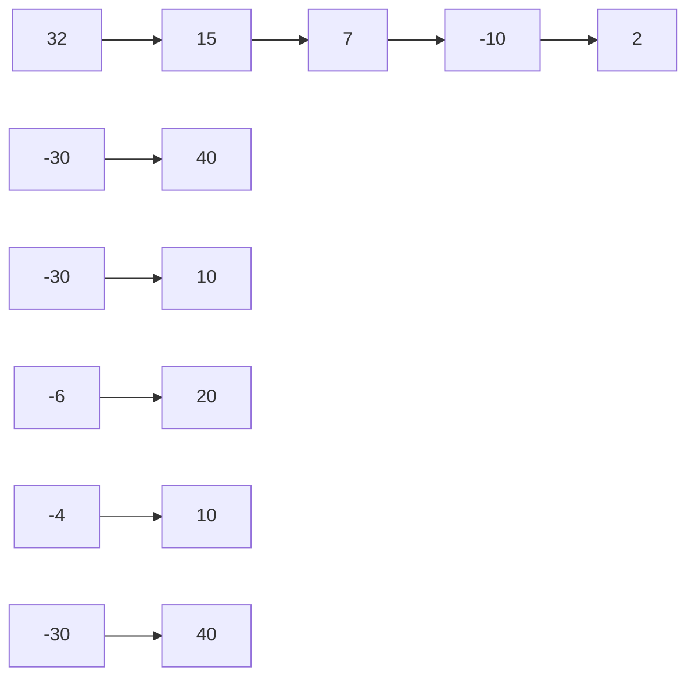
</details>

Abb. 4.F1

**2.** Eine Feder ist ursprünglich gedehnt und dabei um 3,0 cm aus ihrem entspannten Zustand ausgelenkt. Anbei folgen vier verschiedene Möglichkeiten, diese ursprüngliche Auslenkung zu verändern: (a) Die Feder ist hinterher um 2,0 cm gedehnt; (b) die Feder ist hinterher um 2,0 cm gestaucht; (c) die Feder ist hinterher um 4,0 cm gestaucht; (d) die Feder ist hinterher um 4,0 cm gedehnt. Ordnen Sie diese vier Möglichkeiten nach den Änderungen, die sie in der elastischen potenziellen Energie der Feder hervorrufen – die positivste zuerst, die negativste zuletzt.
**3.** Eine Kokosnuss wird mit einem anfänglichen Geschwin digkeitsbetrag $\nu _ { 0 } \; = \; 8   \mathrm { m / s }$ von einer Klippe in ein weites, flaches Tal geworfen. Ordnen Sie die folgenden möglichen Wurfrichtungen in absteigender Reihenfolge nach (a) der ursprünglichen kinetischen Energie der Kokosnuss und (b) ihrer kinetischen Energie, kurz bevor sie auf dem Boden des Tals auftrifft: (1) $\vec { \nu } _ { 0 }$ zeigt beinahe vertikal nach oben; $( 2 )   \vec { \nu } _ { 0 }$ zeigt in einem Winkel von $4 5 ^ { \circ }$ nach oben; $\left( 3 \right) \vec { \nu } _ { 0 }$ verläuft horizontal; $\left( 4 \right) \vec { \nu } _ { 0 }$ zeigt in einem Winkel von 45°nach unten und $( 5 )   \vec { \nu } _ { 0 }$ zeigt beinahe senkrecht nach unten.
**4.** In Abb. 4.F4 gleitet eine mutige Schlittschuhläuferin drei Hänge aus reibungsfreiem

Eis hinunter, deren vertikale Höhen d identisch sind. Ordnen Sie die Hänge in absteigender Reihenfolge nach (a) der von der Gravitationskraft wäh rend des Hinuntergleitens an diesem Hang an der Schlittschuhläuferin verrichteten Arbeit und (b) der Änderung ihrer kinetischen Energie, die durch das Hinuntergleiten an diesem Hang verursacht wird.


<details>
<summary>text_image</summary>

Hang 1
Hang 2
Hang 3
d
d
d
</details>

Abb. 4.F4

**5.** In Abb. 4.F5 wird ein kleiner, ursprünglich in Ruhe befindlicher Block in einer Höhe von 3,0m auf einer reibungsfreien Rampe losgelassen. Die Rampe verläuft wie dargestellt auf und ab über „Berge“ und „Täler“. Die Berge besitzen identische kreisbogenförmige Spitzen (nehmen Sie an, dass der Block an keiner der Bergspitzen abhebt). (a) Welcher Berg ist der erste, den der Block nicht mehr überqueren kann? (b) Was geschieht mit dem Block, nachdem er an diesem Berg „gescheitert“ ist? Auf welcher Bergspitze ist (c) die Zentripetalbeschleunigung des Blocks am größ- ten und (d) die auf den Block wirkende Normalkraft am geringsten?


<details>
<summary>line</summary>

| Stage | Wave Height (m) |
| --- | --- |
| 1 | 0.5 |
| 2 | 1.5 |
| 3 | 2.5 |
| 4 | 3.5 |
</details>

Abb. 4.F5

**6.** Abbildung 4.F6 gibt die potenzielle Energie eines Teilchens als Funktion des Orts x an. (a) Ordnen Sie die Abschnitte AB, BC, CD und DE in absteigender Reihenfolge nach dem Betrag der auf das Teilchen wirkenden Kraft. Wie groß darf die mechanische Energie $E _ { \mathrm { m e c h } }$ des Teilchens maximal sein, wenn das Teilchen (b) in dem linken Potenzialtopf gefangen sein soll, (c) in dem rechten Potenzialtopf gefangen sein soll bzw. (d) sich zwischen den beiden Potenzialtöpfen bewegen darf, dabei jedoch nicht weiter nach rechts kommen soll als Punkt H? In welchem der Abschnitte BC, DE und FG besitzt in Teilfrage (d) das Teilchen (e) die größte kinetische Energie und (f ) den kleinsten Geschwindigkeitsbetrag?


<details>
<summary>line</summary>

| x | U(x) (J) |
| --- | --- |
| A | 8 |
| B | 3 |
| C | 3 |
| D | 5 |
| E | 5 |
| F | 1 |
| G | 1 |
| H | 6 |
</details>

Abb. 4.F6

**7.** In Abb. 4.F7 wird ein Block mit einer initialen potenziellen Energie $U _ { \mathrm { i } }$ aus der Ruhe am oberen Ende einer Bahn losgelassen. Die gekrümmten Abschnitte der Bahn sind reibungsfrei, während das horizontale Stück der Länge L mit

109

---

4 Potenzielle Energie und Energieerhaltung

einer Reibungskraft f auf den Block einwirkt. (a) Wie viel Energie wird in thermische Energie umgewandelt, wenn der Block die Länge L einmal durchläuft? Wie oft durchläuft der Block diese Länge L, wenn die ursprüngliche potenzielle Energie $U _ { \mathrm { i } }$ gleich (b) 0,50 fL, (c) 1,25 fL bzw. (d) 2,25 fL ist? (e) Wo kommt der Block in diesen drei Situationen zum Halten – in der Mitte des horizontalen Abschnitts, links von der Mitte oder rechts von der Mitte? (Aufwärmübung für Aufgabe 4.29 im Übungsbuch)


<details>
<summary>text_image</summary>

L
</details>

Abb. 4.F7

**8.** In Abb. 4.F8 gleitet ein Block eine Bahn hinunter und verringert dabei seine Höhe um h. Die Bahn ist bis auf den unteren Abschnitt reibungsfrei. Dort kommt der Block nach einer bestimmten Strecke D aufgrund der Reibung zum Stehen. (a) Wenn wir h kleiner wählen, wird der Block bis zum Anhalten dann eine Strecke brauchen, die grö- ßer als, kleiner als oder gleich groß ist wie D? (b) Wenn wir stattdessen die Masse des Blocks vergrößern, ist die zum Anhalten benötigte Strecke dann größer als, kleiner als oder gleich groß wie D?


<details>
<summary>text_image</summary>

h
D
</details>

Abb. 4.F8

**9.** In Abb. 4.F9 rutscht ein Block entlang einer reibungsfreien Rampe von A nach C und durchquert dann den horizontalen Abschnitt CD, in dem eine Reibungskraft auf den Block wirkt. Wie verändert sich die kinetische Energie des Blocks in den Abschnitten (a) AB, (b) BC und (c) CD: Wird sie größer, kleiner oder bleibt sie unverändert? (d) Wird die mechanische Energie des Blocks in diesen Abschnitten grö- ßer, kleiner oder bleibt sie unverändert?


<details>
<summary>text_image</summary>

A
B
C
D
</details>

Abb. 4.F9

**10.** In Abb. 4.F10 kann ein sich zunächst horizontal bewegender Block drei reibungsfreie Wege nehmen, die sich nur in ihrer Höhe unterscheiden, um zu der gestrichelten (vertikalen) Ziellinie zu gelangen. Ordnen Sie die Wege in absteigender Reihenfolge (a) nach der Geschwindigkeit des

Blocks an der Ziellinie und (b) nach der Zeit, die der Block zum Erreichen der Ziellinie benötigt.


<details>
<summary>flowchart</summary>

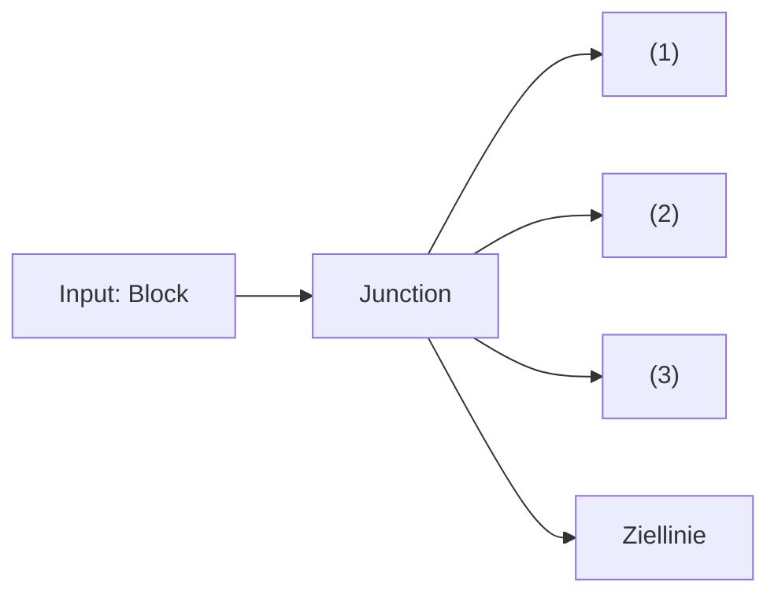
</details>

Abb. 4.F10

**11.** In der Situation in Abb. 4.F11a ziehen Sie an dem Seil nach oben, der daran befestigte Zylinder kann auf der vertikalen Stange hinauf- und hinuntergleiten, allerdings nur mühsam, da die aufgeraute Stangenoberfläche eine erhebliche Reibung ausübt. Ihre Kraft verrichtet die Arbeit W = +100 J an dem System Zylinder–Stange–Erde (Abb. 4.F11b). Eine „Energiebilanz“ des Systems ist in Abb. 4.F11c gezeigt: die kinetische Energie K nimmt um 50 J zu, die Gravitationsenergie $U _ { \mathrm { G } }$ steigt um 20 J. Die einzige weitere Energieänderung im System betrifft die thermische Energie $E _ { \mathrm { t h } } .$ . Wie groß ist $\Delta E _ { \mathrm { t h } } ?$


<details>
<summary>text_image</summary>

Stange
Seil
Zylinder
</details>

(a)


<details>
<summary>text_image</summary>

Arbeit W
System
Erde
</details>

(b)


<details>
<summary>text_image</summary>

W = +100 J
Energie im System:
ΔK = +50 J
ΔU_G = +20 J
ΔE_th = ?
</details>

(c)

Abb. 4.F11

**12.** Abbildung 4.F12 zeigt eine ähnliche Situation wie die aus Frage 11. Hier ziehen Sie nach unten an dem Seil, das an dem Zylinder befestigt ist, der eng auf der Stange sitzt. Während der Zylinder sich senkt, zieht er über ein zweites Seil einen Block über eine Tischplatte. Betrachten Sie wieder das System Zylinder–Stange–Erde, ähnlich wie in Abb. 4.F11b. Sie verrichten an dem System eine Arbeit von +200 J. Das System

verrichtet eine Arbeit von 60 J an dem Block auf dem Tisch. Innerhalb des Systems nimmt die kinetische Energie um 130 J zu und die potenzielle Energie der Gravitation sinkt um 20 J. (a) Skizzieren Sie eine „Energiebilanz“ für das System wie in Abb. 4.F11c. (b) Wie groß ist die Änderung der thermischen Energie innerhalb des Systems?


<details>
<summary>text_image</summary>

Block
Stange
Zylinder
Seil
</details>

Abb. 4.F12

110

---

4.7 Fragen

4

**13.** Abbildung 4.F13 zeigt drei Situationen mit einer nicht reibungsfreien Ebene, auf der ein Block gleitet. Der Block beginnt in allen drei Situationen mit derselben Geschwindigkeit zu gleiten, die Gleitreibung bringt ihn schließlich zum Stehen. Ordnen Sie die Situationen in absteigender Reihenfolge nach dem Anstieg der thermischen Energie durch das Gleiten.


Abb. 4.F13

**14.** Abbildung 4.F14 zeigt drei Pflaumen, die von derselben Höhe aus mit derselben Geschwindigkeit gestartet werden. Die erste wird senkrecht nach oben geworfen, die zweite in einem kleinen Winkel zur Vertikalen und die dritte wird entlang einer reibungsfreien geneigten Ebene nach oben geschubst. Ordnen Sie die Pflaumen in absteigender Reihenfolge nach der Geschwindigkeit, die sie in Höhe der gestrichelten Linie erreicht haben.


<details>
<summary>natural_image</summary>

Diagram showing two objects on a slope with curved paths and arrows indicating motion (no text or symbols)
</details>

(1) (2) (3)

Abb. 4.F14

**15.** Eine konservative Kraft $\vec { F }$ verrichtet die in Abb. 4.F15 gezeigte Arbeit an einem Teilchen, das sich entlang der gezeigten Wege und in den gezeigten Richtungen von i nach f bzw. von j nach f bewegt. Welche Arbeit verrichtet $\vec { F }$ an dem Teilchen, wenn es sich auf dem direkten Weg von i nach j bewegt?


<details>
<summary>flowchart</summary>


</details>

Abb. 4.F15

111

---


---

# 5 Systeme von Teilchen

## 5.1 Der Schwerpunkt

## Physikalische Motivation

Jeder Ingenieur, der als Gutachter vor Gericht geladen ist, um den Hergang eines Verkehrsunfalls aufzuklären, verlässt sich auf die Gesetze der Physik. Jeder Trainer, der einer Tänzerin beibringt, wie sie springen soll, verwendet dabei Physik. Jede Analyse einer beliebigen komplizierten Bewegung erfordert ein Verständnis der zugrunde liegenden Physik. In diesem Kapitel wollen wir uns damit befassen, wie wir die komplizierte Bewegung eines komplexen Systems von Objekten – wie z. B. einer Tänzerin oder eines Fahrzeugs – auf einfache Weise beschreiben können, indem wir einen besonderen Punkt des Systems bestimmen – seinen Schwerpunkt.

Wir wollen mit einem Beispiel beginnen: Stellen Sie sich vor, Sie werfen einen Ball in die Luft. Er bewegt sich, wie in Abb. 5.1a zu sehen ist, im Wesentlichen wie ein einfaches Teilchen. Nun werfen Sie einen Baseballschläger (Abb. 5.1b), und der Bewegungsablauf scheint viel komplizierter zu sein. Jeder Punkt des Schlägers folgt einer anderen Bahn, sodass Sie das System nicht als ein einzelnes Teilchen beschreiben können. Man erkennt sehr deutlich, dass es sich um ein System aus vielen Teilchen handelt.

Betrachten Sie dieses Systems allerdings genauer, so stellen Sie fest, dass sich einer der vielen Punkte tatsächlich auf einer parabelförmigen Bahn bewegt, die jener eines einzelnen Teilchens (Abb. 5.1a) gleicht. Dieser besondere Punkt bewegt sich so, als ob erstens die gesamte Masse des Schlägers hier konzentriert wäre und zweitens die Gravitation ausschließlich auf diesen Punkt wirkte. Wir nennen diesen Punkt den **Schwerpunkt**.

## 5.1.1 Der Schwerpunkt

Wir definieren den Schwerpunkt S eines Teilchensystems (z. B. eines menschlichen Körpers) anschaulich durch seine Rolle bei der Bewegung des Systems:


Der Schwerpunkt eines Körpers oder eines Systems mehrerer Körper ist derjenige Punkt, der sich bewegt, als ob die gesamte Masse des Systems dort konzentriert wäre und alle äußeren Kräfte ausschließlich dort angriffen.

Wir wollen nun untersuchen, wie man den Schwerpunkt verschiedener Systeme ermittelt. Dabei beginnen wir mit einen System aus wenigen, genauer gesagt zwei

## Abb. 5.1

(a) Ein in die Luft geworfener Ball beschreibt eine parabelförmige Bahn. (b) Der Schwerpunkt (schwarz markiert) eines nach oben geworfenen Baseballschlägers beschreibt ebenfalls eine Parabel; alle anderen Punkte des Schlägers bewegen sich hingegen auf komplizierteren Bahnkurven [Quelle: Richard Megna/Fundamental Photographs].


<details>
<summary>natural_image</summary>

A pink curved line with evenly spaced small dots against a black background, resembling a bell curve or arch (no text or symbols)
</details>

(a)


<details>
<summary>natural_image</summary>

Diagram showing two hands forming a symmetrical arch with multiple vertical bars and a dashed purple line connecting them (no text or symbols)
</details>

(b)

Halliday Physik für natur- und ingenieurwiss. Studiengänge, 3. Auflage. D. Halliday, R. Resnick und J. Walker. © 2020 WILEY-VCH Verlag GmbH & Co. KGaA. Published 2020 by WILEY-VCH Verlag GmbH & Co. KGaA.

113

---

5 Systeme von Teilchen

Teilchen, um anschließend zu einem komplizierteren System aus vielen Teilchen (ähnlich dem Baseballschläger) überzugehen.

## Teilchensysteme

In Abb. 5.2a sehen Sie zwei Teilchen mit den Massen $m _ { 1 }$ und $m _ { 2 }$ im Abstand d. Der Ursprung des Koordinatensystems wurde hier willkürlich auf das Teilchen mit der Masse $m _ { 1 }$ gelegt. Wir definieren nun den Schwerpunkt S dieses sehr einfachen Zweiteilchensystems als

$$
x _ {\mathrm{S}} = \frac {m _ {2}}{m _ {1} + m _ {2}} d. \tag {5.1}
$$

Nehmen wir beispielsweise an, es sei $m _ { 2 } = 0 .$ . Dann enthält das System nur ein Teilchen der Masse $m _ { 1 : }$ , der Schwerpunkt liegt am Ort dieses Teilchens, und Gl. 5.1 liefert erwartungsgemäß $x _ { \mathrm { S } } = 0$ . Ist hingegen $m _ { 1 } = 0 ,$ so enthält das System nur ein Teilchen der Masse $m _ { 2 }$ , und folglich ist $x _ { S } = d .$ Im Fall gleicher Massen, $m _ { 1 } =$ $m _ { 2 } ,$ befindet sich der Schwerpunkt exakt in der Mitte zwischen den Teilchen, $x _ { \mathrm { S } } =$ $d / 2 .$ Für den Fall schließlich, dass $m _ { 1 }$ und $m _ { 2 }$ nicht gleich, aber beide verschieden von null sind, kann der Schwerpunkt Gl. 5.1 zufolge nur Werte zwischen 0 und d annehmen. Er muss also irgendwo zwischen den Teilchen liegen.

Abbildung 5.2b zeigt eine allgemeinere Situation. Das Koordinatensystem wurde jetzt nach links verschoben, und der Ort des Schwerpunkts ist jetzt

$$
x _ {\mathrm{S}} = \frac {m _ {1} x _ {1} + m _ {2} x _ {2}}{m _ {1} + m _ {2}}. \tag {5.2}
$$

Setzen wir hier $x _ { 1 } = 0$ , so wird $x _ { 2 } = d ,$ und Gl. 5.2 geht wie erwartet in Gl. 5.1 über. Der Abstand des Schwerpunkts zu den beiden Teilchen wird durch die Verschiebung des Koordinatensystems nicht verändert.

Wir können Gl. 5.2 auch in der Form

$$
x _ {S} = \frac {m _ {1} x _ {1} + m _ {2} x _ {2}}{M} \tag {5.3}
$$

schreiben, wobei M die Gesamtmasse des Systems ist. (In unserem Fall gilt $M =$ $m _ { 1 } { + } m _ { 2 } . )$ Nun verallgemeinern wir diese Beziehung auf ein System von n Teilchen, welche sich sämtlich auf der x-Achse befinden. Die Gesamtmasse ist dann $M =$ $m_{1} + m_{2} + \cdots + m_{n},$ , und der Schwerpunkt befindet sich bei

$$
x _ {S} = \frac {m _ {1} x _ {1} + m _ {2} x _ {2} + m _ {3} x _ {3} + \cdots + m _ {n} x _ {n}}{M} = \frac {1}{M} \sum_ {i = 1} ^ {n} m _ {i} x _ {i}. \tag {5.4}
$$


(a)

## Abb. 5.2

(a) Zwei Teilchen mit den Massen $m _ { 1 }$ und $m _ { 2 } ;$ der Abstand zwischen ihnen ist gleich d. Der rote Punkt gibt den Schwerpunkt des Systems an, wie er aus Gl. 5.1 folgt. (b) Dieselbe Situation wie in (a), jetzt fällt jedoch der Ursprung des Koordinatensystems mit keinem der Teilchen zusammen. Die Position des Schwerpunkts muss nun mithilfe von Gl. 5.2 berechnet werden. Die Lage des Schwerpunkts bezüglich der beiden Teilchen hängt, wie sich herausstellt, nicht von der relativen Lage des Koordinatensystems ab.

114

---

5.1 Der Schwerpunkt

5

Der Index i, die Summationsvariable, durchläuft hier alle natürlichen Zahlen von 1 bis $n .$ Er bezeichnet die einzelnen Teilchen, deren Massen und x-Koordinaten.

Liegt eine dreidimensionale Verteilung von Teilchen vor, dann wird der Ort des Schwerpunkts durch drei Koordinaten beschrieben. Wir erweitern Gl. 5.4 entsprechend und erhalten

$$
x _ {\mathrm{S}} = \frac {1}{M} \sum_ {i = 1} ^ {n} m _ {i} x _ {i}, \quad y _ {\mathrm{S}} = \frac {1}{M} \sum_ {i = 1} ^ {n} m _ {i} y _ {i}, \quad z _ {\mathrm{S}} = \frac {1}{M} \sum_ {i = 1} ^ {n} m _ {i} z _ {i} \tag {5.5}
$$

Wir können den Schwerpunkt auch in Vektorschreibweise angeben. Wie Sie sich erinnern, wird die Position eines Teilchens mit den Koordinaten $x _ { i } , y _ { i }$ und $z _ { i }$ durch einen Ortsvektor ⃗r festgelegt:

$$
\vec {r} _ {i} = x _ {i} \vec {e} _ {x} + y _ {i} \vec {e} _ {y} + z _ {i} \vec {e} _ {z}. \tag {5.6}
$$

Der Index bezeichnet das Teilchen, und die Einheitsvektoren $\vec { e } _ { x } , \vec { e } _ { y }$ und $\vec { e } _ { z }$ zeigen in die positive Richtung der x-, y- bzw. z-Achse. Der Ort des Schwerpunkts des Teilchensystems ist ebenfalls durch den Ortsvektor

$$
\vec {r} _ {\mathrm{S}} = x _ {\mathrm{S}} \vec {e} _ {x} + y _ {\mathrm{S}} \vec {e} _ {y} + z _ {\mathrm{S}} \vec {e} _ {z} \tag {5.7}
$$

gegeben. Damit können wir die drei skalaren Gleichungen (Gl. 5.5) durch eine einzige Vektorgleichung ersetzen:

$$
\vec {r} _ {\mathrm{S}} = \frac {1}{M} \sum_ {i = 1} ^ {n} m _ {i} \vec {r} _ {i} \tag {5.8}
$$

(M ist wieder die Gesamtmasse des Systems). Um diese Gleichung zu überprüfen, setzen Sie die Gln. 5.6 und 5.7 ein und separieren die $x - , y -$ und z-Komponente. Sie erhalten dann die skalaren Gln. 5.5.

## Homogene feste Körper

Ein gewöhnliches Objekt, etwa ein Baseballschläger, enthält sehr viele Teilchen (Atome). Wir behandeln solche Objekte sinnvollerweise als kontinuierliche Materieverteilungen. Aus den „Teilchen“ werden dann differenzielle Massenelemente dm, die Summen in Gl. 5.5 werden zu Integralen und die Koordinaten des Schwerpunkts sind wie folgt definiert:

$$
x _ {\mathrm{S}} = \frac {1}{M} \int x \mathrm{d} m, \quad y _ {\mathrm{S}} = \frac {1}{M} \int y \mathrm{d} m, \quad z _ {\mathrm{S}} = \frac {1}{M} \int z \mathrm{d} m. \tag {5.9}
$$

M ist die Masse des Objekts.

Die Berechnung dieses Integrals ist für die meisten Dinge des täglichen Lebens, etwa einen Fernsehapparat oder eine Katze, sehr kompliziert. Wir wollen deshalb nur homogene Objekte betrachten, solche also, deren Dichte (oder Masse pro Vo lumeneinheit) überall gleich ist. Das bedeutet, die Dichte $\rho$ eines beliebigen Volu menelements ist gleich der Dichte des Objekts als Ganzem:

$$
\rho = \frac {\mathrm{d} m}{\mathrm{d} V} = \frac {M}{V}, \tag {5.10}
$$

mit dV als dem Volumenelement, das von einem Massenelement dm eingenommen wird, und V als Volumen des gesamten Objekts. Wir setzen nun $\mathrm { d } m   =$ (M∕V) dV aus Gl. 5.10 in Gl. 5.9 ein und erhalten

$$
x _ {\mathrm{S}} = \frac {1}{V} \int x \mathrm{d} V, \quad y _ {\mathrm{S}} = \frac {1}{V} \int y \mathrm{d} V, \quad z _ {\mathrm{S}} = \frac {1}{V} \int z \mathrm{d} V. \tag {5.11}
$$

115

---

5 Systeme von Teilchen


<details>
<summary>text_image</summary>

y
1
2
x
4
3
</details>

Bei Objekten, die eine räumliche Symmetrie besitzen (Symmetriezentrum, -achse, -ebene usw.), können Sie gegebenenfalls ein Integral oder mehrere weglassen. Der Schwerpunkt eines solchen Objekts ist stets im Symmetrieelement enthalten. So befindet sich der Schwerpunkt einer homogenen Kugel in deren Mittelpunkt, der gleichzeitig das Symmetriezentrum ist; der Schwerpunkt eines homogenen Kegels liegt auf dessen (Symmetrie-)Achse, und der Schwerpunkt einer idealen Banane befindet sich in der (Symmetrie-)Ebene, welche die Banane in zwei gleiche Teile teilt. Übrigens muss der Schwerpunkt eines beliebig geformten Objekts nicht notwendigerweise innerhalb des Objekts liegen – denken Sie z. B. an einen Schlüsselring oder ein Hufeisen.

## KONTROLLFRAGE 1

Die Abbildung zeigt eine homogene quadratische Tafel, aus deren Ecken sich vier identische Quadrate entfernen lassen. (a) Wo befindet sich der Schwerpunkt der Tafel, bevor ein Quadrat entfernt wurde? Wo liegt er nach Entfernen (b) von Quadrat 1, (c) der Quadrate 1 und 2, (d) der Quadrate 1 und 3, (e) der Quadrate 1, 2 und 3 sowie (f ) aller vier Quadrate? Drücken Sie Ihre Antworten mithilfe von Quadranten, Achsen und Punkten aus. Sie sollten ohne eine explizite Rechnung auskommen.

## LÖSUNGSSTRATEGIEN

**Strategie 1: Berechnung des Schwerpunkts** Aus den Beispielaufgaben 5.1 und 5.2 im Übungsbuch können wir drei grundsätzliche Strategien zur Vereinfachung der Berechnung von Schwerpunkten ableiten:

1. Machen Sie sich alle Symmetrieelemente des Objekts – Punkte, Achsen, Ebenen – zunutze.
2. Wenn das Objekt in mehrere Teile aufgeteilt werden kann, so behandeln Sie jeden Teil als Massepunkt, der sich im jeweiligen Schwerpunkt befindet.
3. Überlegen Sie genau, wie Sie ein Koordinatensystem auf das Objekt legen: Handelt es sich um eine Anordnung von Teilchen, so wählen Sie den Ort eines Teil chens als Ursprung; handelt es sich um einen Körper mit einer Symmetrieachse, so legen Sie die x- oder y-Achse auf dieses Symmetrieelement.

Wie Sie den Ursprung festlegen, hat keinerlei Einfluss auf Ihr Ergebnis, sondern nur auf den Aufwand, mit dem Sie es erhalten!

## 5.2 Das zweite Newtonsche Gesetz für ein Teilchensystem


## Lernziele

Nach dem Durcharbeiten dieses Abschnitts sollten Sie in der Lage sein, . . .

• das zweite Newtonsche Gesetz auf ein Teilchensystem anzuwenden, indem Sie die Beziehung zwischen der Gesamtkraft auf das System (der Vektorsumme aller äußeren Kräfte) und der Beschleunigung seines Schwerpunkts nutzen,
• die Beziehungen für Bewegungen mit konstanter Beschleunigung auf die Bewegungen der einzelnen Teilchen eines Systems sowie auf die Bewegung des Systemschwerpunkts anzuwenden,
• aus den Massen und Geschwindigkeiten der Teilchen in einem System die Geschwindigkeit des Systemschwerpunkts zu berechnen,
• aus den Massen und Beschleunigungen der Teilchen in einem System die Beschleunigung des Systemschwerpunkts zu berechnen,
• aus der Position des Schwerpunkts eines Systems als Funktion der Zeit dessen Geschwindigkeit zu berechnen,
• aus der Geschwindigkeit des Schwerpunkts eines Systems als Funktion der Zeit dessen Beschleunigung zu berechnen,
• die Veränderung der Geschwindigkeit eines Systemschwerpunkts durch Integration seiner Beschleunigung über die Zeit zu berechnen,

116

---

5.2 Das zweite Newtonsche Gesetz für ein Teilchensystem

5

• die Veränderung der Position eines Systemschwerpunkts durch Integration seiner Geschwindigkeit über die Zeit zu berechnen,
• für ein Zweiteilchensystem, in dem sich die Teilchen ohne Bewegung des Systemschwerpunkts relativ zueinander bewegen, Beziehungen zwischen den Verschiebungen der Teilchen und ihren Geschwindigkeiten anzugeben.

## Schlüsselideen

• Die Bewegung des Schwerpunkts eines beliebigen Teilchensystems wird durch das zweite Newtonsche Gesetz für Teilchensysteme beschrieben:

$$
\vec {F} _ {\mathrm{eff}} = M \vec {a} _ {\mathrm{S}}.
$$

Hierbei sind $\vec { F } _ { \mathrm { e f f } }$ die Resultierende aller äußeren Kräfte auf das System, M seine Gesamtmasse und ${ \vec { a } } _ { S }$ die Beschleunigung des Schwerpunkts.


## 5.2.1 Das zweite Newtonsche Gesetz für ein Teilchensystem

Wenn Sie eine Billardkugel auf eine zweite, ruhende Kugel zurollen lassen, erwarten Sie, dass sich beide Kugeln nach dem Aufprall weiter von Ihnen weg bewegen. Sicher wären Sie sehr überrascht, wenn die Kugeln stattdessen beide auf Sie zukä- men oder sich gemeinsam nach links oder rechts entfernten.

Was sich eigentlich weiter vorwärtsbewegt, ist der Schwerpunkt des Systems aus zwei Kugeln, dessen stetige Bewegung durch den Stoß in keiner Weise beeinflusst wird. An einem Billardtisch können Sie sich sofort von der Richtigkeit dieser Aussage überzeugen, wenn Sie den Schwerpunkt im Auge behalten, der sich stets in der Mitte zwischen den Kugeln befindet, sofern sie gleich schwer sind. Gleichgültig, ob der Zusammenstoß frontal oder streifend stattfindet – stets bewegt sich der Schwerpunkt unverändert vorwärts, als ob überhaupt kein Stoß stattgefunden hät te. Im Folgenden wollen wir diese Schwerpunktbewegung genauer untersuchen.

Wir ersetzen dazu unsere beiden Billardkugeln durch eine Menge von n Teilchen, die nicht notwendigerweise dieselbe Masse haben. Nun verfolgen wir nicht die Bewegung der einzelnen Teilchen, sondern ausschließlich diejenige ihres Schwerpunkts. Dieser bewegt sich – obwohl er $\mathbf { , } \mathbf { n u r } ^ { \omega }$ ein Punkt ist – wie ein Teilchen, dessen Masse gleich der Gesamtmasse des Systems ist, und wir können ihm einen Ort, eine Geschwindigkeit und eine Beschleunigung zuordnen. Wir behaupten nun (und werden später beweisen), dass die Bewegung eines solchen Schwerpunkts durch folgende (Vektor-)Gleichung bestimmt ist:

$$
\vec {F} _ {\mathrm{eff}} = M \vec {a} _ {\mathrm{S}}. \tag {5.12}
$$

Dies ist das zweite Newtonsche Gesetz für die Bewegung des Schwerpunkts eines Systems aus mehreren Teilchen. Wie Sie bemerken werden, hat es dieselbe Form wie das entsprechende Bewegungsgesetz für ein einzelnes Teilchen $( \vec { F } _ { \mathrm { e f f } } = m \vec { a } )$ Bei der Behandlung der drei in Gl. 5.12 auftretenden Größen ist jedoch eine gewisse Vorsicht geboten:

1. $\vec { F } _ { \mathrm { e f f } }$ ist die effektive von außen auf das System wirkende Kraft; innere Kräfte, die von einem Teil des Systems auf einen anderen ausgeübt werden, sind in Gl. 5.12 nicht enthalten.
2. M ist die Gesamtmasse des Systems. Wir gehen davon aus, dass die Masse des Systems während der Bewegung weder zu- noch abnimmt, sodass M konstant bleibt. Ein solches System nennen wir geschlossen.
3. ${ \vec { a } } _ { S }$ ist die Beschleunigung des Schwerpunkts des Systems. Gleichung 5.12 sagt nichts darüber aus, welche Beschleunigung die anderen Punkte des Systems erfahren.

Äquivalent zu Gl. 5.12 können wir auch drei Gleichungen für die einzelnen Komponenten der Vektoren $\vec { F } _ { \mathrm { e f f } }$ und ${ \vec { a } } _ { S }$ bezüglich der gewählten Koordinatenachsen aufschreiben:

$$
F _ {\mathrm{eff}, x} = M a _ {\mathrm{S}, x}, \quad F _ {\mathrm{eff}, y} = M a _ {\mathrm{S}, y}, \quad F _ {\mathrm{eff}, z} = M a _ {\mathrm{S}, z}. \tag {5.13}
$$

117

---

5 Systeme von Teilchen


<details>
<summary>natural_image</summary>

Illustration of a firecracker on a cliff face with a red arc and dashed trajectory line (no text or symbols)
</details>

Abb. 5.3

Ein Feuerwerkskörper explodiert im Flug. Vernachlässigt man die Luftreibung, so bewegt sich der Schwerpunkt der Bruchstücke weiter auf der ursprünglichen parabelförmigen Bahn der Rakete, bis die Fragmente den Boden erreichen.

Grand jeté. In veränderter Form übernommen aus The Physics of Dance von Kenneth Laws, Schirmer Books, 1984.

Abb. 5.4

Kehren wir nun zu unserem System aus zwei Billardkugeln zurück. Eine Kugel befinde sich in Ruhe. Sobald die zweite Kugel angestupst wurde und auf die erste zurollt, wirkt keine äußere Kraft mehr auf das System. Wegen $\vec { F } _ { \mathrm { e f f } } = 0$ ist gemäß Gl. 5.12 dann $\vec { a } _ { \mathrm { S } } = 0$ . Da die Beschleunigung die Rate der Geschwindigkeitsänderung angibt, folgern wir, dass sich die Geschwindigkeit des Schwerpunkts des Systems nicht ändert. Beim Zusammenstoß der Kugeln wirken nur innere Kräfte (von einer Kugel auf die andere), welche nicht zu $\vec { F } _ { \mathrm { e f f } }$ beitragen, und nach wie vor ist $\vec { F } _ { \mathrm { e f f } } = 0$ . Der Schwerpunkt des Systems, der sich vor dem Stoß vorwärts bewegt hat, muss sich nach dem Stoß weiterhin vorwärts bewegen, und zwar mit unveränderter Geschwindigkeit und in unveränderter Richtung.

Gleichung 5.12 gilt nicht nur für Systeme aus einzelnen Teilchen, sondern auch für feste Körper wie den Baseballschläger in Abb. 5.1b. In diesem Fall ist M in Gl. 5.12 die Masse des Schlägers und $\vec { F } _ { \mathrm { e f f } } ^ { \mathrm { ~ \tilde { ~ } } }$ die auf ihn wirkende Gravitationskraft. Wir entnehmen der Gleichung, dass $\vec { \alpha } _ { \mathrm { S } } = \vec { g }$ ist. Mit anderen Worten: Der Schwerpunkt des Schlägers bewegt sich so, als ob der Schläger ein Massepunkt mit der Masse M wäre, auf den die Kraft $\vec { F } _ { \mathrm { G } }$ wirkt.

Abbildung 5.3 zeigt einen anderen interessanten Fall. Bei einem Feuerwerk fliegt eine Rakete auf einer parabelförmigen Bahn. An einem bestimmten Punkt explodiert sie in Fragmente. Hätte die Explosion nicht stattgefunden, so wäre die Rakete auf der in Abb. 5.3 gestrichelt eingezeichneten Bahnkurve weitergeflogen. Die während der Explosion wirkenden Kräfte sind innere Kräfte, ausgeübt von einem Teil des Systems auf die anderen Teile. Wenn wir die Luftreibung vernachlässigen, verbleibt als äußere Kraft nur die Gravitationskraft, deren Wirkung nicht davon abhängt, ob die Rakete explodiert oder nicht. Gleichung 5.12 zufolge bleibt die Beschleunigung ${ \vec { a } } _ { S }$ des Schwerpunkts der Fragmente gleich $\vec { g }$ (solange sich die Fragmente in der Luft befinden). Der Schwerpunkt des Systems dieser Bruchstücke beschreibt nach wie vor dieselbe parabolische Bahn, auf der sich die Rakete bewegt hätte, wenn sie nicht explodiert wäre.

Bei einem grand jeté („großen Wurf “) streckt eine Tänzerin Arme und Beine waagerecht aus, sobald sich ihre Füße von der Bühne abgehoben haben (Abb. 5.4). Dadurch wird der Schwerpunkt ihres Körpers nach oben verschoben; in der Tat beschreibt er eine parabelförmige Bahn, ohne dass dazu Kopf und Torso der Tänzerin jedoch wesentlich an Höhe gewinnen müssen, wie es bei einem normalen Sprung der Fall wäre. Kopf und Körper bewegen sich nahezu waagerecht, und dem Zuschauer erscheint die Bewegung mehr als Schweben denn als Sprung.


<details>
<summary>text_image</summary>

Bahn des Kopfes
Bahn des Schwerpunkts
</details>

118

---

5.3 Der Impuls

5

## Herleitung von Gl. 5.12

Wir wollen nun das zweite Newtonsche Gesetz für die Bewegung des Schwerpunkts, Gl. 5.12, herleiten. Gemäß Gl. 5.8 gilt für ein System aus n Teilchen

$$
M \vec {r} _ {\mathrm{S}} = m _ {1} \vec {r} _ {1} + m _ {2} \vec {r} _ {2} + m _ {3} \vec {r} _ {3} + \dots + m _ {n} \vec {r} _ {n} \tag {5.14}
$$

mit M als Gesamtmasse des Systems und $\vec { r } _ { \mathrm { S } }$ als Ortsvektor des Schwerpunkts.

Wir leiten Gl. 5.14 nach der Zeit ab und erhalten

$$
M \vec {\nu} _ {S} = m _ {1} \vec {\nu} _ {1} + m _ {2} \vec {\nu} _ {2} + m _ {3} \vec {\nu} _ {3} + \dots + m _ {n} \vec {\nu} _ {n}. \tag {5.15}
$$

Dabei ist $\vec { \nu } _ { i } = \mathsf { d } \vec { r } _ { i } / \mathsf { d } t$ die Geschwindigkeit des i-ten Teilchens und $\vec { \nu } _ { S } = \mathrm { d } \vec { r } _ { S } / \mathrm { d } t$ die Geschwindigkeit des Schwerpunkts.

Nun leiten wir Gl. 5.15 nochmals nach der Zeit ab:

$$
M \vec {a} _ {\mathrm{S}} = m _ {1} \vec {a} _ {1} + m _ {2} \vec {a} _ {2} + m _ {3} \vec {a} _ {3} + \dots + m _ {n} \vec {a} _ {n}, \tag {5.16}
$$

wobei $\vec { a } _ { i } = \mathrm { d } \vec { \nu } _ { i } / \mathrm { d } t$ die Beschleunigung des i-ten Teilchens und $\vec { a } _ { S } = \mathrm { d } \vec { \nu } _ { S } / \mathrm { d } t$ die Beschleunigung des Schwerpunkts ist. Wie Sie sehen, können wir dem Schwerpunkt einen Ort, eine Geschwindigkeit und eine Beschleunigung zuordnen, obwohl es sich lediglich um einen (geometrischen) Massepunkt handelt, nicht um ein reales Teilchen. Aus dem zweiten Newtonschen Gesetz folgt, dass $m _ { i } \vec { a } _ { i }$ gleich der resultierenden Kraft $\vec { F } _ { i }$ ist, die auf das i-te Teilchen wirkt. Wir können Gl. 5.16 daher auch in der Form

$$
M \vec {a} _ {\mathrm{S}} = \vec {F} _ {1} + \vec {F} _ {2} + \vec {F} _ {3} + \dots + \vec {F} _ {n} \tag {5.17}
$$

schreiben. Zu den Kräften, die zur rechten Seite von Gl. 5.17 beitragen, gehören die Kräfte, welche die Teilchen des Systems aufeinander ausüben (innere Kräfte) sowie die Kräfte, welche von außen auf die Teilchen ausgeübt werden (äußere Kräfte). Dem dritten Newtonschen Gesetz gemäß heben die inneren Kräfte einander in der Summe, die auf der rechten Seite von Gl. 5.16 erscheint, auf; übrig bleibt die Vektorsumme aller von außen auf das System wirkenden Kräfte. Gleichung 5.17 lässt sich damit auf Gl. 5.12 zurückführen, die wir herleiten wollten.

## KONTROLLFRAGE 2

Zwei Schlittschuhläufer, Fred und Ethel, stehen auf einer reibungsfreien Eisbahn und halten je ein Ende eines Stabs von vernachlässigbar kleiner Masse fest. Eine Achse des Systems verläuft entlang des Stabs; der Ursprung dieser Achse liege auf dem Schwerpunkt des Systems. Fred ist doppelt so schwer wie Ethel. Wo begegnen die Läufer einander, wenn (a) Fred sich zu Ethel heranzieht, indem er Hand über Hand am Stab anfasst, (b) Ethel sich in gleicher Weise zu Fred heranzieht, (c) beide Läufer sich gleichzeitig zu ihrem Gegenüber ziehen?

## 5.3 Der Impuls

## Lernziele

Nach dem Durcharbeiten dieses Abschnitts sollten Sie in der Lage sein, . . .

• zu verstehen, dass der Impuls eine Vektorgröße ist und daher einen Betrag und eine Richtung sowie Komponenten besitzt,
• den Impuls eines Teilchens als Produkt aus seiner Masse und seiner Geschwindigkeit zu berechnen,
• die Änderung des Impulses eines Teilchens (Betrag und Richtung) zu berechnen, wenn das Teilchen den Betrag und/oder die Richtung seiner Geschwindig keit verändert,
• die Beziehung zwischen dem Impuls eines Teilchens und der (resultierenden) Kraft auf das Teilchen anzugeben und anzuwenden,


119

---

5 Systeme von Teilchen

• den Impuls eines Teilchensystems als Produkt seiner Gesamtmasse und seiner Schwerpunktgeschwindigkeit zu berechnen,
• die Beziehung zwischen dem Impuls des Schwerpunkts eines Teilchensystems und der resultierenden Gesamtkraft auf das System anzugeben und anzuwenden.


## Schlüsselideen

• Für ein einzelnes Teilchen definieren wir seinen Impuls $\vec { p }$ als die Vektorgröße

$$
\vec {p} = m \vec {\nu},
$$

die dieselbe Richtung besitzt wie seine Geschwindigkeit. Wir können das zweite Newtonsche Gesetz mit dem Impuls wie folgt formulieren:

$$
\vec {F} _ {\mathrm{eff}} = \frac {\mathrm{d} \vec {p}}{\mathrm{d} t}.
$$

• Für ein Teilchensystem wird aus diesen Beziehungen

$$
\vec {P} = m \vec {\nu} _ {\mathrm{S}} \quad \text {und} \quad \vec {F} _ {\mathrm{eff}} = \frac {\mathrm{d} \vec {P}}{\mathrm{d} t}.
$$

## 5.3.1 Der Impuls eines einzelnen Teilchens

In der Alltagssprache hat der Begriff Impuls mehrere Bedeutungen. In der Physik definieren wir den Impuls eines Teilchens als

$$
\vec {p} = m \vec {\nu} \tag {5.18}
$$

mit m als Masse und v⃗ als Geschwindigkeit des Teilchens. (Gelegentlich bezeich net man $\vec { p }$ als linearen Impuls zur Unterscheidung vom Drehimpuls, der mit der Drehbewegung zusammenhängt und in Kapitel 7 eingeführt wird.) Weil m stets eine positive skalare Größe ist, haben ⃗v und $\vec { p }$ Gl. 5.18 zufolge stets die gleiche Richtung. Ebenfalls aus dieser Gleichung entnehmen wir die SI-Einheit für den Impuls: Kilogramm mal Meter pro Sekunde (hierfür gibt es keine besondere Abkürzung).

Newton formulierte sein zweites Bewegungsgesetz ursprünglich mithilfe des Impulses:


**Zweites Newtonsches Gesetz (Aktionsprinzip):** Die zeitliche $\ddot { \mathrm { A } }$ nderung des Impulses eines Teilchens ist in Betrag und Richtung gleich der insgesamt auf dieses Teilchen wirkenden Kraft.

Diesen Zusammenhang gibt die Formel

$$
\vec {F} = \frac {\mathrm{d} \vec {p}}{\mathrm{d} t} \tag {5.19}
$$

wieder. Dabei nehmen wir an, dass die Masse konstant (nicht zeitabhängig) ist. Wir setzen hier $\vec { p }$ aus Gl. 5.18 ein und erhalten:

$$
\vec {F} = \frac {\mathrm{d} \vec {p}}{\mathrm{d} t} = \frac {\mathrm{d}}{\mathrm{d} t} (m \vec {v}) = m \frac {\mathrm{d} \vec {v}}{\mathrm{d} t} = m \vec {a}.
$$

Die Beziehungen $\vec { F } _ { \mathrm { e f f } } = \mathrm { d } \vec { p } / \mathrm { d } t$ und $\vec { F } _ { \mathrm { e f f } } = n$ a⃗ sind folglich äquivalente Schreibweisen des zweiten Newtonschen Gesetzes für die Bewegung eines Teilchens.

## KONTROLLFRAGE 3

Im Diagramm wurde der Impuls eines Teilchens, das sich entlang einer Achse be wegt, gegen die Zeit aufgetragen. Auf das Teilchen wirkt eine Kraft in Richtung dieser Achse. (a) Ordnen Sie die Bereiche 1–4 nach dem Betrag der Kraft, beginnend mit dem größten Wert. (b) In welchem Bereich wird das Teilchen langsamer?


<details>
<summary>line</summary>

| Phase | Pressure (p) |
| --- | --- |
| 1 | ~0.5 |
| 2 | ~0.8 |
| 3 | ~0.5 |
| 4 | 0 |
</details>

120

---

5.4 Stoßprozesse: Der Kraftstoß

5

## 5.3.2 Der Impuls eines Teilchensystems

Betrachten wir nun ein System aus n Teilchen mit verschiedenen Massen, Geschwindigkeiten und Impulsen. Die Teilchen können untereinander in Wechselwirkung treten, außerdem können von außen Kräfte auf das System einwirken. Der Impuls P⃗ des gesamten Systems ist definiert als die Vektorsumme der Impulse der einzelnen Teilchen:

$$
\begin{array}{l} \vec {P} = \vec {p} _ {1} + \vec {p} _ {2} + \vec {p} _ {3} + \dots + \vec {p} _ {n} \\ = m _ {1} \vec {\nu} _ {1} + m _ {2} \vec {\nu} _ {2} + m _ {3} \vec {\nu} _ {3} + \dots + m _ {n} \vec {\nu} _ {n}. \tag {5.20} \\ \end{array}
$$

Ein Vergleich dieser Beziehung mit Gl. 5.15 zeigt:

$$
\vec {P} = M \vec {\nu} _ {\mathrm{S}}. \tag {5.21}
$$

Damit bietet sich eine alternative Definition des Impulses eines Teilchensystems an:


Der Impuls eines Teilchensystems ist gleich dem Produkt aus der Gesamtmasse M und der Geschwindigkeit des Schwerpunkts des Systems.

Die Ableitung von Gl. 5.21 nach der Zeit liefert:

$$
\frac {\mathrm{d} \vec {P}}{\mathrm{d} t} = M \frac {\mathrm{d} \vec {v} _ {\mathrm{S}}}{\mathrm{d} t} = M \vec {a} _ {\mathrm{S}}. \tag {5.22}
$$

Durch Vergleich von Gl. 5.12 mit Gl. 5.22 gelangen wir zur folgenden, zu Gl. 5.21 äquivalenten Schreibweise des zweiten Newtonschen Gesetzes für ein Teilchensystem:

$$
\vec {F} _ {\mathrm{eff}} = \frac {\mathrm{d} \vec {P}}{\mathrm{d} t}, \tag {5.23}
$$

mit $\vec { F } _ { \mathrm { e f f } }$ als insgesamt auf das System wirkender äußerer Kraft. Diese Gleichung entspricht einer Verallgemeinerung der entsprechenden Gleichung für ein Teilchen, $\vec { F } _ { \mathrm { e f f } } = \mathrm { d } \vec { p } / \mathrm { d } t ,$ auf ein Vielteilchensystem.

## 5.4 Stoßprozesse: Der Kraftstoß

## Lernziele

Nach dem Durcharbeiten dieses Abschnitts sollten Sie in der Lage sein, . . .

• zu verstehen, dass der Kraftstoß eine Vektorgröße ist und daher einen Betrag und eine Richtung sowie Komponenten besitzt,
• die Beziehung zwischen dem Kraftstoß und der Änderung des Impulses anzugeben und anzuwenden,
• die Beziehung zwischen dem Kraftstoß, der mittleren Kraft und dem zugehörigen Zeitintervall anzugeben und anzuwenden,
• die Gleichungen für Bewegungen mit konstanter Beschleunigung anzuwenden, um den Kraftstoß mit der mittleren Kraft zu verknüpfen,
• aus der Kraft als Funktion der Zeit durch Integration den Kraftstoß (und damit die Impulsänderung) zu berechnen,
• aus einer Auftragung der Kraft gegen die Zeit durch grafische Integration den Kraftstoß (und damit die Impulsänderung) zu ermitteln,
• die mittlere auf ein Ziel ausgeübte Kraft zu bestimmen, wenn eine kontinuierli che Stoßserie von Projektilen auf es abgefeuert wird, und zwar aus der zeitlichen Abfolge der Stöße, der Massen der Projektile und der Geschwindigkeitsänderung der Projektile.


121

---

5 Systeme von Teilchen


## Schlüsselideen

• Anwendung des zweiten Newtonschen Gesetzes in der Impulsschreibweise auf den Stoß eines teilchenartigen Körpers führt zu der Beziehung

$$
\vec {p} _ {\mathrm{f}} - \vec {p} _ {\mathrm{i}} = \Delta \vec {p} = \vec {J},
$$

in der $\vec { p } _ { \mathrm { f } } - \vec { p } _ { \mathrm { i } } = \Delta \vec { p }$ die Änderung des Impulses des Körpers angibt und $\vec { J }$ der Kraftstoß aufgrund der Kraft $\vec { F } ( t )$ ist, die während des Stoßes auf den Körper wirkt:

$$
\vec {J} = \int_ {t _ {\mathrm{i}}} ^ {t _ {\mathrm{f}}} \vec {F} (t) \mathrm{d} t.
$$

• Wenn $F _ { \mathrm { g e m } }$ der gemittelte Betrag von $\vec { F } ( t )$ während des Stoßes und $\Delta t$ das entsprechende Zeitintervall ist, gilt für eine eindimensionale Bewegung

$$
J = F _ {\mathrm{gem}} \cdot \Delta t.
$$

• Wenn ein regelmäßiger Strom von Teilchen mit der Masse m und der Geschwindigkeit v auf ein feststehendes Ziel auftrifft, ist die mittlere Kraft auf das Ziel

$$
F _ {\mathrm{gem}} = - \frac {n}{\Delta t} \Delta p = - \frac {n}{\Delta t} m \Delta \nu ,
$$

wenn $n / \Delta t$ die (mittlere) Frequenz des Auftreffens eines Teilchens auf das Ziel angibt und Δv die Änderung der Geschwindigkeit der Teilchen beim Auftreffen ist. Die mittlere Kraft kann auch in der Form

$$
F _ {\mathrm{gem}} = - \frac {\Delta m}{\Delta t} \Delta \nu
$$

geschrieben werden, wobei $\Delta m / \Delta t$ die Rate des Auftreffens von Masse auf dem Ziel ist. Wenn die Teilchen auf dem Ziel auf null abgebremst werden, ist jeweils $\Delta \nu = - \nu ;$ falls sie mit konstantem Geschwindigkeitsbetrag v zurückprallen, ist $\Delta \nu = - 2 \nu$


<details>
<summary>text_image</summary>

L
-R(t)
R
-F(t)
x
</details>

Abb. 5.5

Zwei kleine, kugelförmige Körper L und R stoßen zusammen. Dabei übt Körper L eine Kraft $\vec { F } ( t )$ auf Körper

R aus, Körper R entsprechend eine Kraft $\cdot - F ( t )$ auf L. $\vec { F } ( t )$ und $- \vec { F } ( t )$ sind ein Kraft-Gegenkraft-Paar im Sinne des dritten Newtonschen Gesetzes.

Die Beträge der Kräfte ändern sich während des Stoßes, sind aber zu einem gegebenen Zeitpunkt stets gleich.

## 5.4.1 Einzelne Stöße

Abbildung 5.5 veranschaulicht das Kraft-Gegenkraft-Paar gemäß dem dritten Newtonschen Gesetz, $\vec { F } ( t )$ und $- \vec { F } ( t )$ , welches während eines einfachen zentralen Stoßes zwischen zwei kleinen, kugelförmigen Körpern verschiedener Massen wirkt. Infolge der Wirkung der Kräfte ändern sich die Impulse beider Körper. Das Ausmaß der Impulsänderungen hängt hierbei nicht nur von den zeitlichen Mittelwerten der Kräfte ab, sondern auch von der Dauer Δt ihrer Wirkung. Um dies quantitativ nachzuvollziehen, wenden wir das zweite Newtonsche Gesetz in der Form $\vec { F } = \mathbf { d } \vec { p } / \mathbf { d }$ t auf den rechten Körper (R) in Abb. 5.5 an:

$$
\mathrm{d} \vec {p} = \vec {F} (t) \mathrm{d} t. \tag {5.24}
$$

$\vec { F } ( t )$ ist eine zeitabhängige Kraft, deren Betrag durch den Graphen in Abb. 5.6a gegeben ist. Nun integrieren wir Gl. 5.24 im Intervall $\Delta t ,$ also zwischen einem (initialen) Zeitpunkt $t _ { \mathrm { i } }$ unmittelbar vor dem Stoß und einem (finalen) Zeitpunkt $t _ { \mathrm { f } }$ unmittelbar nach dem Stoß. Wir erhalten:

$$
\int_ {\vec {p} _ {\mathrm{i}}} ^ {\vec {p} _ {\mathrm{f}}} \mathrm{d} \vec {p} = \int_ {t _ {\mathrm{i}}} ^ {t _ {\mathrm{f}}} \vec {F} (t) \mathrm{d} t. \tag {5.25}
$$

122

---

5.4 Stoßprozesse: Der Kraftstoß

5


<details>
<summary>area</summary>

| Time | Value |
| --- | --- |
| ti | 0 |
| Peak (J) | High |
| tf | 0 |
</details>

(a)


<details>
<summary>text_image</summary>

F
Fgem
J
t_i
t_f
Δt
</details>

(b)

Die linke Seite dieser Gleichung ist $\vec { p } _ { \mathrm { f } } - \vec { p } _ { \mathrm { i } }$ , die Änderung des Impulses von R im Zuge des Stoßes. Die rechte Seite, ein Maß für sowohl den Betrag als auch die Dauer der Kraftwirkung, wird **Kraftstoß** ⃗J (oder, aus offensichtlichen Gründen, auch **Impulsübertrag**) genannt. Definiert ist der Kraftstoß folglich als

$$
\vec {J} = \int_ {t _ {\mathrm{i}}} ^ {t _ {\mathrm{f}}} \vec {F} (t) \mathrm{d} t. \tag {5.26}
$$

Gleichung 5.26 sagt aus, dass der Betrag des Kraftstoßes gleich der Fläche unter dem Graphen der Funktion $F ( t )$ ist (siehe Abb. 5.6a). Da es sich bei den Kräften $F ( t )$ und $- F ( t )$ , die auf die Körper R bzw. L wirken, um ein Kraft-Gegenkraft-Paar handelt, sind die zugehörigen Kraftstöße gleich groß, aber entgegengesetzt gerichtet.

Aus den Gln. 5.25 und 5.26 entnehmen wir, dass die Impulsänderung jedes an einem Stoß beteiligen Körpers gleich dem Kraftstoß ist, der auf diesen Körper wirkt:

$$
\vec {p} _ {\mathrm{f}} - \vec {p} _ {\mathrm{i}} = \Delta \vec {p} = \vec {J}. \tag {5.27}
$$

Diese Gleichung sagt außerdem Folgendes aus: Impuls und Kraftstoß sind vektorielle Größen und haben gleiche Einheiten und Dimensionen. In Komponentenschreibweise lautet Gl. 5.27

$$
p _ {\mathrm{f} x} - p _ {\mathrm{i} x} = \Delta p _ {x} = J _ {x}, \tag {5.28}
$$

$$
p _ {\mathrm{f} y} - p _ {\mathrm{i} y} = \Delta p _ {y} = J _ {y} \tag {5.29}
$$

und

$$
p _ {\mathrm{f} z} - p _ {\mathrm{i} z} = \Delta p _ {z} = J _ {z}. \tag {5.30}
$$

Ist $F _ { \mathrm { g e m } }$ der mittlere Betrag der Kraft in Abb. 5.6a, so ist der Betrag des Kraftstoßes gegeben durch:

$$
J = F _ {\mathrm{gem}} \Delta t \tag {5.31}
$$

mit Δt als Stoßzeit (Dauer des Stoßes). Der Wert von $F _ { \mathrm { g e m } }$ ist so zu wählen, dass die Fläche innerhalb des Rechtecks aus Abb. 5.6b gleich der Fläche unter dem Graphen der tatsächlichen Funktion F(t) (Abb. 5.6a) ist.

## KONTROLLFRAGE 4

Ein Fallschirmspringer, dessen Fallschirm sich nicht geöffnet hat, landet im Schnee und verletzt sich leicht. Wäre er auf dem schneefreien Boden gelandet, so wäre die Zeit, innerhalb der er zum Halten gekommen wäre, nur ein Zehntel so lang gewesen wie im Schnee, und er hätte tödliche Verletzungen davongetragen. Nimmt (a) die Impulsänderung des Springers, (b) der Kraftstoß, der den Springer stoppt, und (c) die Kraft, die den Springer stoppt, durch die Anwesenheit des Schnees zu, ab oder bleibt die betreffende Größe gleich?

## Abb. 5.6

(a) Graph des Betrags der zeitabhängigen Kraft $F ( t ) ,$ die während des in Abb. 5.5 dargestellten Stoßes auf Körper R wirkt. Die Fläche unter der Kurve ist gleich dem Betrag des dabei auf R ausgeübten Kraftstoßes ⃗J. (b) Die Höhe des Rechtecks entspricht der mittleren Kraft $F _ { \mathrm { g e m } } ,$ die während des Intervalls Δt auf den Körper R wirkt. Die Fläche des Rechtecks ist gleich der Fläche unter der Kurve in (a) und folglich auch gleich dem Betrag des während des Stoßes auftretenden Kraftstoßes ⃗J.

123

---

5 Systeme von Teilchen


<details>
<summary>flowchart</summary>


</details>

Abb. 5.7

Ein Strom von Geschossen mit identischen Impulsen trifft auf ein ortsfestes Ziel. Die mittlere Kraft $F _ { \mathrm { g e m } }$ auf das Ziel wirkt nach rechts; ihr Betrag hängt mit der Rate des Auftreffens der Geschosse (oder, gleichbedeutend, mit der Rate des Auftreffens der Masse) zusammen.


<details>
<summary>text_image</summary>

y
θ θ
x
</details>

## 5.4.2 Stoßserien

Betrachten wir nun die Kraft, die auf einen Körper wirkt, der eine ganze Reihe schnell hintereinander erfolgender identischer Stöße erleidet. Denken Sie z. B. an eine Maschine, die Tennisbälle auf eine Wand schießt. Bei jedem Treffer wird eine Kraft auf die Wand ausgeübt; diese interessiert uns aber nicht. Wir suchen die mittlere Kraft $F _ { \mathrm { g e m } } ,$ die während des Beschusses – d. h. während einer Serie aus vielen Stößen – auf die Wand wirkt.

In Abb. 5.7 sehen Sie, wie sich ein Strom von Geschossen mit identischen Massen m und Impulsen mv⃗ entlang einer x-Achse bewegt und auf ein ortsfestes Ziel trifft. Es sei n die Anzahl der im Intervall Δt aufprallenden Geschosse. Da die Bewegung entlang der x-Achse stattfindet, dürfen wir uns auf die x-Komponenten des Impulses beschränken. Jedes Geschoss besitzt also einen Anfangsimpuls mv, der sich im Zuge des Stoßes um $\Delta p$ ändert. Die Gesamtänderung des Impulses aller n Geschosse während $\Delta t$ ist dann $n \Delta p .$ Daraus folgt ein Kraftstoß $J ,$ der ebenfalls entlang der x-Achse gerichtet ist und den Betrag $n \Delta p$ hat, aber in die entgegengesetzte Richtung zeigt. In Komponentenschreibweise bedeutet das:

$$
J = - n \Delta p; \tag {5.32}
$$

das Minuszeichen gibt an, dass J und $\Delta p$ in entgegengesetzte Richtungen zeigen.

Wir stellen Gl. 5.31 um und setzen Gl. 5.32 ein. So erhalten wir die während der Stoßserie im Mittel auf das Ziel wirkende Kraft:

$$
F _ {\mathrm{gem}} = \frac {J}{\Delta t} = - \frac {n}{\Delta t} \Delta p = - \frac {n}{\Delta t} m \Delta \nu . \tag {5.33}
$$

Die Gleichung liefert uns $F _ { \mathrm { g e m } }$ als Funktion der Rate des Auftreffens der Geschosse, $n / \Delta t ,$ und der Änderung der Geschwindigkeit der Geschosse, $\Delta \nu .$

Kommen die Geschosse beim Auftreffen zum Stillstand, so können wir in Gl. 5.33 für $\Delta \nu$ einsetzen:

$$
\Delta \nu = \nu_ {\mathrm{f}} - \nu_ {\mathrm{i}} = 0 - \nu = - \nu . \tag {5.34}
$$

Dabei sind $\nu _ { \mathrm { i } } ( = \nu )$ und $\nu _ { \mathrm { f } } ( = 0 )$ die Geschwindigkeiten vor bzw. nach dem Stoß. Prallen die Geschosse hingegen mit unverändertem Betrag der Geschwindigkeit zurück, so ist $\nu _ { \mathrm { f } } = - \nu ,$ und wir erhalten

$$
\Delta \nu = \nu_ {\mathrm{f}} - \nu_ {\mathrm{i}} = - \nu - \nu = - 2 \nu . \tag {5.35}
$$

Während des Intervalls $\Delta t$ trifft insgesamt eine Masse $\Delta m = n m$ auf das Ziel. Wir können Gl. 5.33 damit in der Form

$$
F _ {\mathrm{gem}} = - \frac {\Delta m}{\Delta t} \Delta \nu \tag {5.36}
$$

schreiben. Diese Gleichung liefert die mittlere Kraft $F _ { \mathrm { g e m } }$ als Funktion der Rate des Auftreffens der Masse, $\Delta m / \Delta t .$ Je nach Art des Stoßes können wir hier wieder Gl. 5.34 oder Gl. 5.35 einsetzen.

## KONTROLLFRAGE 5

Die Zeichnung zeigt einen Ball, der ohne Geschwindigkeitsänderung von einer senkrechten Wand abprallt (in Draufsicht). Betrachten Sie die Impulsänderung $\Delta \vec { p }$ des Balls: (a) Ist $\Delta p _ { x }$ positiv, negativ oder null? (b) Ist $\Delta p _ { y }$ positiv, negativ oder null? (c) Geben Sie die Richtung von $\Delta \vec { p }$ an.

124

---

5.5 Die Impulserhaltung

5

## 5.5 Die Impulserhaltung

## Lernziele

Nach dem Durcharbeiten dieses Abschnitts sollten Sie in der Lage sein, . . .

• die Impulserhaltung auf ein abgeschlossenes Teilchensystem anzuwenden, um aus den anfänglichen Impulsen der Teilchen ihre Impulse zu einem späteren Zeitpunkt zu berechnen,
• zu verstehen, dass Sie die Impulserhaltung auch auf eine einzelne Achse anwenden können, solange keine Komponente einer äußeren Kraft in Richtung dieser Achse existiert.

## Schlüsselideen

• Wenn ein System abgeschlossen ist, d. h., keine resultierende äußere Kraft wirkt, muss der Impuls $\vec { P }$ des Gesamtsystems konstant bleiben, auch wenn sich die Impulse innerhalb des Systems ändern:

$$
\vec {P} = \text {const.}
$$

• Diese Impulserhaltung kann auch mithilfe der Impulse $\vec { P } _ { \mathrm { i } }$ des Systems zu Beginn der Betrachtung und $\vec { P } _ { \mathrm { f } }$ zu einem beliebigen späteren Zeitpunkt formuliert werden:

$$
\vec {P} _ {\mathrm{i}} = \vec {P} _ {\mathrm{f}}.
$$


## 5.5.1 Die Impulserhaltung

Nehmen wir an, auf ein Teilchensystem wirke keine äußere Kraft und die Anzahl der enthaltenen Teilchen sei konstant. (Ein solches System heißt isoliert und geschlossen.)

Setzen wir in Gl. 5.23 $\vec { F } _ { \mathrm { e f f } } = 0 ,$ so ergibt sich $\mathrm { d } \vec { P } / \mathrm { d } t = 0$ oder

$$
\vec {P} = \text {const.} \quad (\text {geschlossenes, isoliertes System}). \tag {5.37}
$$

In Worten ausgedrückt bedeutet dies:


Solange auf ein Teilchensystem keine äußere Kraft wirkt, ist der Gesamtimpuls $\vec { P }$ des Systems konstant.

Dieser **Impulserhaltungssatz** kann auch wie folgt formuliert werden:

$$
\vec {P} _ {\mathrm{i}} = \vec {P} _ {\mathrm{f}} \quad (\text {geschlossenes, isoliertes System}). \tag {5.38}
$$

Gleichung 5.38 sagt aus, dass für ein geschlossenes, isoliertes System gilt:

$$
\binom{\text {Gesamtimpuls zum}}{(\text {anfänglichen}) \text {Zeitpunkt} t _ {\mathrm{i}}} = \binom{\text {Gesamtimpuls zum}}{(\text {späteren}) \text {Zeitpunkt} t _ {\mathrm{f}}}.
$$

Die Gln. 5.37 und 5.38 enthalten vektorielle Größen und sind äquivalent zu je drei Gleichungen für die Impulserhaltung in drei aufeinander senkrecht stehenden Richtungen, etwa in den Richtungen der x-, y- und z-Achse eines kartesischen Koordinatensystems. In Abhängigkeit von den wirkenden äußeren Kräften kann die Impulserhaltung auch nur in einer oder zwei, aber nicht in allen drei Richtungen gelten. Stets gilt aber:


Ist die Komponente der auf ein abgeschlossenes System wirkenden äußeren Kraft entlang einer Koordinatenachse gleich null, so kann sich die Komponente des Gesamtimpulses des Systems entlang dieser Achse nicht ändern.

125

---

5 Systeme von Teilchen

Stellen Sie sich z. B. vor, Sie werfen einen Ball (= das System). Während des Flugs wirkt auf das System von außen die Gravitationskraft ${ \vec { F } } _ { \mathrm { G } } ,$ die senkrecht nach unten gerichtet ist. Folglich ändert sich die senkrechte Komponente des Impulses Ihres Balls. Die waagerechte Komponente hingegen ändert sich nicht, weil keine Kraft in waagerechter Richtung auf den Ball wirkt.

Vergessen Sie nicht, dass wir hier ausschließlich geschlossene Systeme betrach tet haben, auf die äußere Kräfte wirken. Innere Kräfte können zwar den Impuls von Teilen des Systems, nicht aber den Gesamtimpuls des Systems als Ganzes beeinflussen.

## KONTROLLFRAGE 6

Eine am Boden (reibungsfrei) liegende Mine explodiert in zwei Bruchstücke, die über den Boden davonfliegen. Eines der Stücke entfernt sich in positiver x-Richtung. (a) Geben Sie die Summe der Impulse der Bruchstücke nach der Explosion an. (b) Kann sich das zweite Stück unter einem Winkel $\theta \neq 0$ relativ zur x-Achse entfernen? (c) In welche Richtung zeigt der Impuls des zweiten Bruchstücks?

## KONTROLLFRAGE 7

In der Tabelle finden Sie die Geschwindigkeiten des Transporters und des Moduls (relativ zur Sonne) aus Beispielaufgabe 5.5 im Übungsbuch, nachdem letzteres abgestoßen wurde, sowie die Geschwindigkeit des Transporters relativ zum Modul für drei Situationen. Ergänzen Sie die fehlenden Werte.

|  | Geschwindigkeit des Moduls | Geschwindigkeit des Transporters | Relativgeschwindigkeit |
| --- | --- | --- | --- |
| (a) | 1500 km/h | 2000 km/h |  |
| (b) |  | 3000 km/h | 400 km/h |
| (c) | 1000 km/h |  | 600 km/h |

## KONTROLLFRAGE 8

Nehmen Sie an, die explodierende Kugel in Abb. Ü5.6 im Übungsbuch werde in negativer y-Richtung beschleunigt (etwa, indem sie eine entsprechend geneigte Ebene hinunterrollt). Bleibt der Impuls (a) entlang der x-Achse (Gl. 5.49) und/oder (b) entlang der y-Achse (Gl. 5.48) erhalten?

## LÖSUNGSSTRATEGIEN

**Strategie 2: Impulserhaltung** Spielt bei der Lösung einer Aufgabe die Impuls erhaltung eine Rolle, so überprüfen Sie zunächst, ob es sich um ein geschlosse nes, isoliertes System handelt. Geschlossen bedeutet hier, dass keinerlei Materie (Teilchen irgendeiner Art) die Systemgrenzen durchdringen kann, gleichgültig in welcher Richtung. Als isoliert bezeichnen wir ein System, auf das keine äußere (Gesamt-)Kraft wirkt. Ist das System nicht isoliert, so bedenken Sie, dass jede Komponente des Impulsvektors einzeln erhalten bleibt, sofern die zugehörige Komponente des Vektors der äußeren Kraft null ist. Möglicherweise bleiben nicht alle, sondern nur einzelne Komponenten des Impulsvektors erhalten.

Nun wählen Sie zwei geeignete Zustände des Systems (einen Anfangs- und einen Endzustand) und formulieren Sie den Impuls des Systems in beiden Zuständen. Beim Aufschreiben der Gleichungen beachten Sie, welches Bezugssystem Sie verwenden; geben Sie außerdem Acht, dass Sie das gesamte System berücksichtigen, keinen Teil übersehen und auch kein Objekt unberechtigterweise hinzunehmen.

Setzen Sie schließlich Ihre Ausdrücke für $\vec { P } _ { \mathrm { i } }$ und $\vec { P } _ { \mathrm { f } }$ gleich und lösen Sie die Gleichung gemäß der Aufgabenstellung.

126

---

5.6 Inelastische eindimensionale Stöße

5

## 5.6 Inelastische eindimensionale Stöße

## Lernziele

Nach dem Durcharbeiten dieses Abschnitts sollten Sie in der Lage sein, . . .

• den Unterschied zwischen elastischen Stößen, inelastischen Stößen und voll ständig inelastischen Stößen zu erklären,
• zu verstehen, dass sich bei einem eindimensionalen Stoß beide Stoßpartner sowohl vor als auch nach dem Stoß entlang einer einzigen Achse bewegen,
• die Impulserhaltung auf einen isolierten eindimensionalen Stoß anzuwenden, um aus den Impulsen der Stoßpartner vor dem Stoß ihre Impulse nach dem Stoß zu berechnen,
• zu verstehen, dass in einem isolierten System Impuls und Geschwindigkeit des Schwerpunkts bei einem Stoß zwischen zwei Objekten gleich bleiben.

## Schlüsselideen

• Bei einem inelastischen Stoß zweier Körper bleibt die kinetische Energie des Zweiteilchensystems nicht erhalten. Wenn das System geschlossen und isoliert ist, muss der Gesamtimpuls des Systems erhalten bleiben; dafür schreiben wir in Vektorform

$$
\vec {p} _ {\mathrm{1i}} + \vec {p} _ {\mathrm{2i}} = \vec {p} _ {\mathrm{1f}} + \vec {p} _ {\mathrm{2f}},
$$

wobei die Indizes i und f sich auf Momente unmittelbar vor bzw. nach dem Stoß beziehen.

• Wenn die Bewegung beider Körper entlang einer einzigen Achse erfolgt, handelt es sich um einen eindimensionalen Stoß und wir können die Gleichung für die Komponenten entlang dieser Achse wir folgt formulieren:

$$
m _ {1} \nu_ {\mathrm{1i}} + m _ {2} \nu_ {\mathrm{2i}} = m _ {1} \nu_ {\mathrm{1f}} + m _ {2} \nu_ {\mathrm{2f}}.
$$

• Wenn die Körper nach dem Stoß aneinander kleben bleiben, ist der Stoß voll ständig inelastisch und beide Körper haben nach dem Stoß dieselbe Geschwindigkeit V (weil sie jetzt einen gemeinsamen Körper bilden).
• Der Schwerpunkt eines geschlossenen und isolierten Systems aus zwei stoßenden Körpern wird durch den Stoß nicht beeinflusst. Insbesondere ändert sich die Geschwindigkeit ${ \vec { \nu } } _ { S }$ des Schwerpunkts durch den Stoß nicht.


## 5.6.1 Inelastische eindimensionale Stöße

In Abb. 5.8 sehen Sie zwei Körper unmittelbar vor bzw. nach einem eindimensionalen Stoß: Alle Bewegungen laufen entlang einer einzigen Achse ab. Angegeben sind die Geschwindigkeiten vor (initial, Index i) und nach dem Stoß (final, Index f ). Die beiden Körper bilden unser geschlossenes, isoliertes System, für das wir den Impulserhaltungssatz wie folgt formulieren können:

$$
\binom{\text {Gesamtimpuls} \vec {P} _ {\mathrm{i}}}{\text {vor dem Stoß}} = \binom{\text {Gesamtimpuls} \vec {P} _ {\mathrm{f}}}{\text {nach dem Stoß}}\left. \right.
$$

oder

$$
\vec {p} _ {1 \mathrm{i}} + \vec {p} _ {2 \mathrm{i}} = \vec {p} _ {1 \mathrm{f}} + \vec {p} _ {2 \mathrm{f}}. \tag {5.39}
$$

Weil die Bewegung in nur einer Dimension abläuft, dürfen wir uns auf die Komponente der Vektoren entlang der entsprechenden Achse beschränken (und in Gl. 5.39 die Pfeile weglassen). Mit $p = m \nu$ wird Gl. 5.39 zu:

$$
m _ {1} \nu_ {1 \mathrm{i}} + m _ {2} \nu_ {2 \mathrm{i}} = m _ {1} \nu_ {1 \mathrm{f}} + m _ {2} \nu_ {2 \mathrm{f}}. \tag {5.40}
$$

Sind die Massen, die Anfangsgeschwindigkeiten und eine Endgeschwindigkeit bekannt, so können wir mithilfe von Gl. 5.40 die andere Endgeschwindigkeit berechnen.


Abb. 5.8

Die Körper 1 und 2 bewegen sich vor und nach dem Stoß entlang der gleichen x-Achse.

127

---

5 Systeme von Teilchen


<details>
<summary>text_image</summary>

vorher
m₁
Geschoss
v₁i
m₂
Ziel
v₂i = 0
x
nachher
m₁ + m₂
V
x
</details>

Abb. 5.9

Vollständig inelastischer Stoß. Vor dem Stoß ruht der Körper mit der Masse $m _ { 2 } ,$ auf den sich der Körper mit der Masse m<sub>1</sub> zentral zubewegt. Nach dem Stoß bewegen sich beide Körper gemeinsam mit der Geschwindigkeit $\vec { V } .$


<details>
<summary>text_image</summary>

x
v1i
vS
v2i = 0
m1
m2
Stoß!
m1 + m2
V = vS
</details>

Abb. 5.10

Schnappschüsse der Bewegung des Zweikörpersystems aus Abb. 5.9. Es findet ein vollständig inelastischer Stoß statt. Der Schwerpunkt des Systems ist in jedem Teilbild eingezeichnet; die Geschwindigkeit $\vec { \nu } _ { S }$ wird durch den Stoß nicht beeinflusst. Nach dem Stoß bewegen sich beide Körper gemeinsam weiter; ihre Geschwindigkeit $\vec { V }$ muss folglich gleich $\vec { \nu } _ { \mathrm { S } }$ sein.

## 5.6.2 Vollständig inelastische eindimensionale Stöße

Abbildung 5.9 zeigt zwei Körper vor und nach einem vollständig inelastischen Stoß (nach dem Stoß sind sie fest verbunden). In diesem Beispiel befindet sich der Körper mit der Masse $m _ { 2 }$ vor dem Stoß in Ruhe $( \nu _ { 2 \mathrm { i } } = 0 )$ . Wir können diesen Körper als Ziel betrachten und den anderen entsprechend als Geschoss. Nach dem Stoß bewegen sich beide Körper gemeinsam mit der Geschwindigkeit V. Gleichung 5.40 lässt sich hierfür wie folgt umformulieren:

$$
m _ {1} v _ {1 \mathrm{i}} = (m _ {1} + m _ {2}) V \tag {5.41}
$$

oder

$$
V = \frac {m _ {1}}{m _ {1} + m _ {2}} v _ {\mathrm{li}}. \tag {5.42}
$$

Kennen wir die Massen und die Anfangsgeschwindigkeit $\nu _ { 1 \mathrm { i } }$ des Geschosses, so liefert uns Gl. 5.42 die Endgeschwindigkeit V. Wie Sie bemerken werden, ist V stets kleiner als $\nu _ { 1 \mathrm { i } } ,$ weil das Massenverhältnis $m _ { 1 } / ( m _ { 1 } + m _ { 2 } )$ stets kleiner als eins ist.

## 5.6.3 Die Geschwindigkeit des Schwerpunkts

In einem geschlossenen, isolierten System kann sich die Geschwindigkeit des Schwerpunkts, $\vec { \nu } _ { S } ,$ infolge eines Stoßes nicht ändern: Da es sich um ein isoliertes System handelt, wirkt keine äußere (Gesamt-)Kraft. Um einen Ausdruck für $\vec { \nu } _ { S }$ zu finden, kehren wir noch einmal zu unserem Zweikörpersystem mit eindimensionalem Stoß (Abb. 5.8) zurück. Gleichung 5.21 $( \vec { \cal P } = \vec { M } \vec { \nu } _ { S } )$ liefert uns einen Zusammenhang zwischen $\vec { \nu } _ { S }$ und dem Gesamtimpuls $\vec { P }$ des Zweikörpersystems:

$$
\vec {P} = M \vec {\nu} _ {\mathrm{S}} = (m _ {1} + m _ {2}) \vec {\nu} _ {\mathrm{S}}. \tag {5.43}
$$

Der Gesamtimpuls $\vec { P }$ bleibt während des Stoßes erhalten, er ist also durch beide Seiten von Gl. 5.39 gegeben. Wir verwenden die linke Seite und schreiben:

$$
\vec {P} = \vec {p} _ {1 \mathrm{i}} + \vec {p} _ {2 \mathrm{i}}. \tag {5.44}
$$

Dies setzen wir für $\vec { P }$ in Gl. 5.43 ein und lösen nach $\vec { \nu } _ { S }$ auf:

$$
\begin{array}{l} \vec {\nu} _ {S} = \frac {\vec {P}}{m _ {1} + m _ {2}} \\ = \frac {\vec {p} _ {1 \mathrm{i}} + \vec {p} _ {2 \mathrm{i}}}{m _ {1} + m _ {2}}. \tag {5.45} \\ \end{array}
$$

Die rechte Seite dieser Gleichung ist eine Konstante; das bedeutet, $\vec { \nu } _ { S }$ hat vor und nach dem Stoß den gleichen konstanten Wert.

In Abb. 5.10 sehen Sie eine Abfolge von Schnappschüssen, welche die Bewegung des Schwerpunkts während des vollständig inelastischen Stoßes von Abb. 5.9 verdeutlichen. Körper $2 ,$ das Ziel, hat einen Anfangsimpuls (Gl. 5.45) von $\vec { p } _ { 2 \mathrm { i } } =$ $m _ { 2 } \vec { \nu } _ { 2 \mathrm { i } } = 0 ;$ Körper 1, das Geschoss, hat den Anfangsimpuls $\vec { p } _ { \mathrm { 1 i } } = m _ { \mathrm { 1 } } \vec { \nu } _ { \mathrm { 1 i } }$ . Wie Sie feststellen, bewegt sich der Schwerpunkt des Systems vor, während und nach dem Stoß mit konstanter Geschwindigkeit nach rechts. Die Endgeschwindigkeit beider Körper nach dem Stoß, $\vec { V } ,$ ist gleich $\vec { \nu } _ { \mathsf { S } } ,$ denn der Schwerpunkt bewegt sich nun gemeinsam mit den aneinander haftenden Körpern.

## KONTROLLFRAGE 9

Zwischen Körper 1 und Körper 2 findet ein vollständig inelastischer, eindimensionaler Stoß statt. Berechnen Sie den Impuls des Systems nach dem Stoß, wenn die Anfangsimpulse der Körper wie folgt gegeben sind: (a) 10 kg ⋅ m/s und $0 ;$ (b) 10 kg ⋅ m/s und 4 kg ⋅ m/s; (c) 10 kg ⋅ m/s und −4 kg ⋅ m/s.

128

---

5.7 Elastische eindimensionale Stöße

5

## 5.7 Elastische eindimensionale Stöße

## Lernziele

Nach dem Durcharbeiten dieses Abschnitts sollten Sie in der Lage sein, . . .

• die Erhaltungssätze für die Gesamtenergie und den resultierenden Impuls der stoßenden Objekte auf isolierte, elastische Stöße in einer Dimension anzuwenden, um aus den Anfangswerten dieser Größen ihre Werte nach dem Stoß zu berechnen,
• für ein Projektil, das auf ein ruhendes Ziel auftrifft, die resultierende Bewegung für die drei Fälle (i) gleiche Massen, (ii) Ziel schwerer als Projektil und (iii) Projektil schwerer als Ziel anzugeben.

## Schlüsselideen

Ein elastischer Stoß ist ein Stoß, bei dem die kinetische Gesamtenergie der sto ßenden Teilchen erhalten bleibt. Wenn das System geschlossen und isoliert ist, bleibt auch sein Impuls erhalten. Für einen eindimensionalen Stoß, bei dem Körper 1 das Ziel und Körper 2 ein darauf auftreffendes Projektil ist, liefert die Erhaltung von kinetischer Energie und Impuls die folgenden Gleichungen für die Geschwindigkeiten unmittelbar nach dem Stoß:

$$
\nu_ {\mathrm{1f}} = \frac {m _ {1} - m _ {2}}{m _ {1} + m _ {2}} \nu_ {\mathrm{1i}} \quad \text {und} \quad \nu_ {\mathrm{2f}} = \frac {2 m _ {1}}{m _ {1} + m _ {2}} \nu_ {\mathrm{1i}}.
$$

## 5.7.1 Stöße auf ein ruhendes Objekt

Die uns aus unserem Alltag vertrauten Stöße sind in der Regel inelastisch. Eini ge von ihnen können wir aber näherungsweise als elastisch behandeln – d. h., wir können annehmen, die kinetische Gesamtenergie der Stoßpartner bleibe erhalten und werde nicht in andere Energieformen umgewandelt:

$$
\binom{\text {kinetische Gesamtenergie}}{\text {vor dem Stoß}} = \binom{\text {kinetische Gesamtenergie}}{\text {nach dem Stoß}}.
$$

Das bedeutet aber keineswegs, dass sich die kinetische Energie der einzelnen am Stoß beteiligten Körper nicht ändern kann. Es besagt lediglich Folgendes:


Während eines elastischen Stoßes kann sich die kinetische Energie jedes einzelnen Stoßpartners ändern, die kinetische Gesamtenergie des Systems hingegen ist konstant.

Den Zusammenstoß zweier Billardkugeln beispielsweise können wir als elastischen Stoß behandeln. Erfolgt der Stoß zentral (prallen die Kugeln frontal aufeinander), so wird die Energie der vor dem Stoß rollenden Kugel fast vollständig auf die vor dem Stoß ruhende Kugel übertragen. (Wie Sie sofort einwenden werden, ist dieser Zusammenstoß hörbar – d. h., ein kleiner, aber in unserer Rechnung eben vernachlässigbarer Teil der kinetischen Energie wird in Schallenergie umgewandelt.)

In Abb. 5.11 sehen Sie zwei Körper vor und nach einem eindimensionalen Stoß (etwa zwei Billardkugeln bei einem zentralen Zusammenstoß). Ein Geschoss mit der Masse $m _ { 1 }$ und der Anfangsgeschwindigkeit $\nu _ { 1 \mathrm { i } }$ bewegt sich auf ein ruhendes Ziel $( \nu _ { 2 \mathrm { i } } = 0 )$ mit der Masse $m _ { 2 }$ zu. Wir nehmen an, es handele sich um ein geschlossenes, isoliertes System. Dann bleibt der Gesamtimpuls des Systems erhalten, was wir mithilfe von Gl. 5.39 wie folgt formulieren können:

$$
m _ {1} \nu_ {1 \mathrm{i}} = m _ {1} \nu_ {1 \mathrm{f}} + m _ {2} \nu_ {2 \mathrm{f}}. \tag {5.46}
$$


<details>
<summary>flowchart</summary>

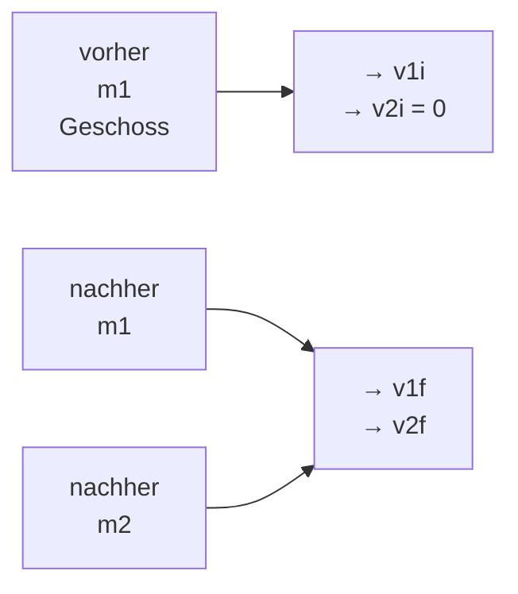
</details>

Abb. 5.11

Körper 1 bewegt sich entlang der x-Achse auf den (ruhenden) Körper 2 zu. Der Stoß verläuft elastisch, danach bewegen sich beide Körper weiter entlang der x-Achse.

129

---

5 Systeme von Teilchen

Verläuft der Stoß außerdem elastisch, so bleibt auch die kinetische Gesamtenergie des Systems erhalten:

$$
\frac {1}{2} m _ {1} v _ {\mathrm{1i}} ^ {2} = \frac {1}{2} m _ {1} v _ {\mathrm{1f}} ^ {2} + \frac {1}{2} m _ {2} v _ {\mathrm{2f}} ^ {2}. \tag {5.47}
$$

In allen diesen Gleichungen steht der Index i für den Anfangswert und der Index f für den Endwert der jeweiligen Geschwindigkeit. Kennen wir die Massen der Stoß- partner sowie die Anfangsgeschwindigkeit $\nu _ { 1 \mathrm { i } }$ der rollenden Kugel, so verbleiben als unbekannte Größen die Geschwindigkeiten der Stoßpartner nach dem $\mathrm { S t o } \mathbb { S } , \nu _ { \mathrm { 1 f } }$ und $\nu _ { 2 \mathrm { f } }$ . Um sie berechnen zu können, benötigen wir zwei Gleichungen.

Wir schreiben zunächst Gl. 5.46 in der Form

$$
m _ {1} (\nu_ {\mathrm{1i}} - \nu_ {\mathrm{1f}}) = m _ {2} \nu_ {\mathrm{2f}} \tag {5.48}
$$

und Gl. 5.47 in der Form

$$
m _ {1} (\nu_ {\mathrm{1i}} - \nu_ {\mathrm{1f}}) (\nu_ {\mathrm{1i}} + \nu_ {\mathrm{1f}}) = m _ {2} \nu_ {\mathrm{2f}} ^ {2}. \tag {5.49}
$$

Nun teilen wir Gl. 5.49 durch Gl. 5.48 und erhalten nach einigen Umformungsschritten (und unter Ausnutzung der dritten binomischen Formel):

$$
\nu_ {\mathrm{1f}} = \frac {m _ {1} - m _ {2}}{m _ {1} + m _ {2}} \nu_ {\mathrm{1i}} \tag {5.50}
$$

sowie

$$
\nu_ {2 \mathrm{f}} = \frac {2 m _ {1}}{m _ {1} + m _ {2}} \nu_ {1 \mathrm{i}}. \tag {5.51}
$$

Aus Gl. 5.51 folgt, dass $\nu _ { 2 \mathrm { f } }$ stets positiv ist. Das bedeutet, dass sich das vor dem Stoß ruhende Zielobjekt mit der Masse $m _ { 2 }$ sich nach dem Stoß stets vorwärts bewegt. Gleichung 5.50 sagt hingegen aus, dass $\nu _ { 1 \mathrm { f } }$ sowohl positiv als auch negativ sein kann: Ist $m _ { \mathrm { 1 } } > m _ { \mathrm { 2 } } ,$ so bewegt sich das Geschoss mit der Masse $m _ { 1 }$ nach dem Stoß vorwärts, ist $m _ { \mathrm { 1 } } < m _ { \mathrm { 2 } } ,$ , so prallt es in Rückwärtsrichtung ab.

Betrachten wir nun einige Spezialfälle:

## 1. Gleiche Massen

Für $m _ { \mathrm { 1 } } = m _ { \mathrm { 2 } }$ werden die Gln. 5.50 und 5.51 zu

$$
\nu_ {\mathrm{1f}} = 0 \quad \text {und} \quad \nu_ {\mathrm{2f}} = \nu_ {\mathrm{1i}}.
$$

Diese Situation strebt ein Billardspieler an: Nach dem zentralen Zusammenstoß zweier Kugeln gleicher Masse bleibt die ursprünglich rollende Kugel 1 ruhend zurück, während sich die ursprünglich ruhende Kugel 2 mit der Geschwindig keit von Kugel 1 vor dem Stoß weiterbewegt. Beim zentralen, elastischen Stoß vertauschen zwei Körper gleicher Masse lediglich ihre Geschwindigkeiten. Dies trifft auch dann zu, wenn sich Kugel 2 vor dem Stoß ebenfalls bewegt.

## 2. Ein schweres Ziel

Nun ist in Abb. 5.11 $m _ { 2 } \gg m _ { 1 }$ (stellen Sie sich dazu vor, Sie werfen einen Golfball gegen eine Kanonenkugel). Aus den Gln. 5.50 und 5.51 wird dann

$$
\nu_ {1 \mathrm{f}} \approx - \nu_ {1 \mathrm{i}} \quad \text {und} \quad \nu_ {2 \mathrm{f}} \approx \left(\frac {2 m _ {1}}{m _ {2}}\right) \nu_ {1 \mathrm{i}}. \tag {5.52}
$$

Dies sagt Folgendes aus: Körper 1 (der Golfball) prallt auf dem gleichen Weg und mit nahezu derselben Geschwindigkeit von Körper 2 ab, mit der er ankam. Körper 2 (die Kanonenkugel) bewegt sich sehr langsam vorwärts, denn der Klammerausdruck in Gl. 5.52 ist viel kleiner als eins. Dieses Ergebnis entspricht unserer Erfahrung.

130

---

5.7 Elastische eindimensionale Stöße

5

## 3. Ein schweres Geschoss

Die Situation ist nun genau umgekehrt, also $m _ { 1 } \gg m _ { 2 }$ (Sie schießen jetzt mit der Kanonenkugel auf den Golfball). Die Gln. 5.50 und 5.51 nehmen die Form

$$
\nu_ {1 \mathrm{f}} \approx \nu_ {1 \mathrm{i}} \quad \text {und} \quad \nu_ {2 \mathrm{f}} \approx 2 \nu_ {1 \mathrm{i}} \tag {5.53}
$$

an. Gleichung 5.53 besagt, dass sich Körper 1 (die Kanonenkugel) mit nur sehr geringfügig reduzierter Geschwindigkeit weiterbewegt, während Körper 2 (der Golfball) mit einer Geschwindigkeit nach vorne wegfliegt, die zweimal so groß ist wie die Geschwindigkeit der Kanonenkugel.

Vielleicht fragen Sie sich jetzt, wo der Faktor 2 herkommt. Denken Sie an den Stoß, der durch Gl. 5.52 beschrieben wurde: Die Geschwindigkeit des ankommenden leichten Körpers (des Golfballs) änderte sich dort von +v nach −v, d. h., die Änderung war gleich 2v. Dieselbe Geschwindigkeitsänderung (jetzt aber von 0 auf 2v) tritt auch in unserem letzten Beispiel auf.

## 5.7.2 Stöße auf ein bewegtes Objekt

Nachdem wir nun den elastischen Stoß eines bewegten auf ein ruhendes Objekt untersucht haben, wollen wir uns dem Fall zuwenden, dass sich ein solcher Stoß zwischen zwei bewegten Objekten ereignet.

Wir formulieren die Impulserhaltung für die in Abb. 5.12 skizzierte Situation:

$$
m _ {1} \nu_ {1 \mathrm{i}} + m _ {2} \nu_ {2 \mathrm{i}} = m _ {1} \nu_ {1 \mathrm{f}} + m _ {2} \nu_ {2 \mathrm{f}}. \tag {5.54}
$$

Die Erhaltung der kinetischen Energie bedeutet

$$
\frac {1}{2} m _ {1} v _ {\mathrm{1i}} ^ {2} + \frac {1}{2} m _ {2} v _ {\mathrm{2i}} ^ {2} = \frac {1}{2} m _ {1} v _ {\mathrm{1f}} ^ {2} + \frac {1}{2} m _ {2} v _ {\mathrm{2f}} ^ {2}. \tag {5.55}
$$

Um dieses Gleichungssystem nach $\nu _ { 1 \mathrm { f } }$ und $\nu _ { 2 \mathrm { f } }$ aufzulösen, schreiben wir zunächst Gl. 5.54 in der Form

$$
m _ {1} (\nu_ {1 \mathrm{i}} - \nu_ {1 \mathrm{f}}) = - m _ {2} (\nu_ {2 \mathrm{i}} - \nu_ {2 \mathrm{f}}) \tag {5.56}
$$

und Gl. 5.55 als

$$
m _ {1} (\nu_ {\mathrm{1i}} - \nu_ {\mathrm{1f}}) (\nu_ {\mathrm{1i}} + \nu_ {\mathrm{1f}}) = - m _ {2} (\nu_ {\mathrm{2i}} - \nu_ {\mathrm{2f}}) (\nu_ {\mathrm{2i}} + \nu_ {\mathrm{2f}}). \tag {5.57}
$$

Wir teilen Gl. 5.57 durch Gl. 5.56 und erhalten nach mehreren Umformungsschritten

$$
\nu_ {1 \mathrm{f}} = \frac {m _ {1} - m _ {2}}{m _ {1} + m _ {2}} \nu_ {1 \mathrm{i}} + \frac {2 m _ {2}}{m _ {1} + m _ {2}} \nu_ {2 \mathrm{i}} \tag {5.58}
$$

sowie

$$
\nu_ {2 \mathrm{f}} = \frac {2 m _ {1}}{m _ {1} + m _ {2}} \nu_ {1 \mathrm{i}} + \frac {m _ {2} - m _ {1}}{m _ {1} + m _ {2}} \nu_ {2 \mathrm{i}}. \tag {5.59}
$$

Die Zuordnung der Indizes 1 und 2 zu den beiden Körpern ist willkürlich. Vertau schen wir die Indizes in Abb. 5.12 sowie in den Gln. 5.58 und 5.59, so ändert dies das Ergebnis nicht. Setzen wir $\nu _ { 2 \mathrm { i } } = 0 ,$ befindet sich also Körper 2 zu Beginn in Ruhe wie in Abb. 5.11, so gehen die Gln. 5.58 und 5.59 in die oben angegebenen Gln. 5.50 bzw. 5.51 über.

## KONTROLLFRAGE 10

Geben Sie den Endwert des Impulses des anfangs ruhenden Körpers (des Ziels) in Abb. 5.11 an, wenn der Impuls des Geschosses vor dem Stoß gleich 6 kg ⋅ m/s und nach dem Stoß gleich (a) 2 kg ⋅ m/s und (b) −2 kg ⋅ m/s ist. (c) Wie groß ist der Endwert der kinetischen Energie des Ziels, wenn die kinetische Energie des Geschosses vor und nach dem Stoß gleich 5 J bzw. 2 J ist?


<details>
<summary>text_image</summary>

v₁i
m₁
v₂i
x
m₂
</details>

Abb. 5.12

Zwei Körper vor einem zentralen, eindimensionalen, elastischen Stoß.

131

---

5 Systeme von Teilchen

## 5.8 Zweidimensionale Stöße


## Lernziele

Nach dem Durcharbeiten dieses Abschnitts sollten Sie in der Lage sein, . . .

bei einem zweidimensionalen Stoß in einem isolierten System die Impulserhal tung für jede Achse des Koordinatensystems anzuwenden, um die Komponenten der Impulse bezüglich der jeweiligen Achse nach dem Stoß aus den Komponenten der Impulse bezüglich derselben Achse vor dem Stoß zu berechnen,
in einem isolierten System, in dem ein zweidimensionaler elastischer Stoß statt findet, (a) die Impulserhaltung für jede Achse des Koordinatensystems anzuwenden, um die Komponenten der Impulse bezüglich der jeweiligen Achse nach dem Stoß aus den Komponenten der Impulse bezüglich derselben Achse vor dem Stoß zu berechnen und (b) die Erhaltung der Gesamtenergie anzuwenden, um die kinetischen Energien der Stoßpartner nach dem Stoß aus ihren kinetischen Energien vor dem Stoß zu berechnen.


## Schlüsselideen

• Ein Stoß ist zweidimensional, wenn zwei Stoßpartner stoßen und ihre Bewegungen nicht entlang nur einer Achse verlaufen. Wenn das Zweikörpersystem geschlossen und isoliert ist, gilt der Impulserhaltungssatz, der die Form

$$
\vec {P} _ {\mathrm{1i}} + \vec {P} _ {\mathrm{2i}} = \vec {P} _ {\mathrm{1f}} + \vec {P} _ {\mathrm{2f}}
$$

annimmt. In Komponentenschreibweise ergeben sich daraus zwei Gleichungen, die gemeinsam den Stoß beschreiben (jeweils eine für jede Dimension). Im Sonderfall eines elastischen Stoßes liefert die Energieerhaltung noch eine dritte Gleichung:

$$
K _ {\mathrm{1i}} + K _ {\mathrm{2i}} = K _ {\mathrm{1f}} + K _ {\mathrm{2f}}.
$$

## 5.8.1 Zweidimensionale Stöße

Bei einem Stoß zwischen zwei Körpern entscheidet der auftretende Kraftstoß, in welcher Richtung sich die Stoßpartner anschließend weiterbewegen. Erfolgt der Stoß nicht zentral, so liegt die Bewegungsrichtung der Körper nach dem Stoß nicht auf der gleichen Achse wie vor dem Stoß. Für solche zweidimensionalen Stöße gilt in geschlossenen, isolierten Systemen die Erhaltung des Gesamtimpulses:

$$
\vec {P} _ {\mathrm{1i}} + \vec {P} _ {\mathrm{2i}} = \vec {P} _ {\mathrm{1f}} + \vec {P} _ {\mathrm{2f}}. \tag {5.60}
$$

Ist der Stoß außerdem elastisch, bleibt auch die kinetische Gesamtenergie erhalten:

$$
K _ {\mathrm{1i}} + K _ {\mathrm{2i}} = K _ {\mathrm{1f}} + K _ {\mathrm{2f}}. \tag {5.61}
$$

Zur Analyse zweidimensionaler Stöße bietet es sich an, Gl. 5.60 komponentenweise in einem xy-Koordinatensystem aufzuschreiben. Abbildung 5.13 zeigt beispielsweise einen streifenden (nicht zentralen) Stoß zwischen einem Geschoss und einem vor dem Stoß ruhenden Ziel. Infolge des Kraftstoßes entfernen sich die Körper nach dem Stoß unter den Winkeln $\theta _ { 1 }$ und $\theta _ { 2 }$ bezüglich der x-Achse, entlang derer sich das Geschoss vor dem Stoß bewegte. Wir formulieren für diese Situation Gl. 5.60 für die Komponenten entlang der x-Achse:

$$
m _ {1} \nu_ {1 \mathrm{i}} = m _ {1} \nu_ {1 \mathrm{f}} \cos \theta_ {1} + m _ {2} \nu_ {2 \mathrm{f}} \cos \theta_ {2}; \tag {5.62}
$$

entlang der $y - \mathrm { A }$ chse gilt entsprechend

$$
0 = - m _ {1} \nu_ {1 \mathrm{f}} \sin \theta_ {1} + m _ {2} \nu_ {2 \mathrm{f}} \sin \theta_ {2}. \tag {5.63}
$$


<details>
<summary>text_image</summary>

y
→ v₂f
m₂
θ₂
x
m₁
→ v₁i
θ₁
v₁f
</details>

Abb. 5.13

Ein elastischer, aber nicht zentraler Stoß zwischen zwei Körpern. Der Körper mit der Masse $m _ { 2 }$ ruht vor dem Stoß.

132

---

5.9 Systeme mit veränderlicher Masse: Eine Rakete

5

Erfolgt der Stoß elastisch, so können wir außerdem Gl. 5.61 unter Verwendung von Geschwindigkeiten angeben:

$$
\frac {1}{2} m _ {1} \nu_ {\mathrm{1i}} ^ {2} = \frac {1}{2} m _ {1} \nu_ {\mathrm{1f}} ^ {2} + \frac {1}{2} m _ {2} \nu_ {\mathrm{2f}} ^ {2}. \tag {5.64}
$$

Die Gln. 5.62–5.64 enthalten sieben Variablen: zwei Massen $( m _ { 1 }$ und $m _ { 2 } )$ , drei Geschwindigkeiten $( \nu _ { \mathrm { 1 i } } , \nu _ { \mathrm { 1 f } }$ und $\nu _ { \mathrm { 2 f } } )$ sowie zwei Winkel $( \theta _ { 1 }$ und $\theta _ { 2 } )$ . Das System aus drei Gleichungen ist folglich immer dann lösbar, wenn vier von diesen Variablen bekannt sind.

## KONTROLLFRAGE 11

Betrachten Sie noch einmal Abb. 5.13. Das Geschoss habe vor dem Stoß einen Impuls von $6   \mathrm { k g } \cdot \mathrm { m } / \mathrm { s } _ { \mathrm { r } }$ nach dem Stoß einen Impuls mit der x-Komponente $p _ { \mathrm { G f } , x } =$ $4   \mathrm { k g } \cdot \mathrm { m } / \mathrm { s }$ und der y-Komponente $p _ { \mathrm { G f } ,   y } = - 3   \mathrm { k g } \cdot \mathrm { m } / \mathrm { s } .$ Geben Sie (a) die x-Komponente $p _ { \mathrm { Z f } , x }$ und (b) die y-Komponente $p _ { \mathrm { Z f } , y }$ des Impulses des Zielobjekts nach dem Stoß an.

## 5.9 Systeme mit veränderlicher Masse: Eine Rakete

## Lernziele

Nach dem Durcharbeiten dieses Abschnitts sollten Sie in der Lage sein, . . .

• die erste Raketengleichung anzuwenden, um eine Beziehung zwischen der Massenverlustrate der Rakete, der Geschwindigkeit der Abgase relativ zu der Rakete, der Masse der Rakete und ihrer Beschleunigung anzugeben,
• die zweite Raketengleichung anzuwenden, um die Änderung der Geschwindigkeit der Rakete mit der Relativgeschwindigkeit der Abgase und der Anfangsbzw. Endmasse der Rakete zu verknüpfen,
• für ein bewegtes System mit veränderlicher Masse aus der Rate der Massenänderung die Veränderung des Impulses zu berechnen.

## Schlüsselideen

• In Abwesenheit äußerer Kräfte beschleunigt eine Rakete mit dem konstanten Betrag

$$
R \nu_ {\mathrm{rel}} = M a
$$

(erste Raketengleichung), wobei M die momentane Masse der Rakete ist (einschließlich des noch unverbrauchten Treibstoffs), R die Verbrauchsrate des Treibstoffs und $\nu _ { \mathrm { r e l } }$ die Relativgeschwindigkeit der Abgase relativ zur Rakete. Der Term $R \nu _ { \mathrm { r e l } }$ wird als Schubkraft der Rakete bezeichnet.

• Für eine Rakete mit konstanten Werten von R und $\nu _ { \mathrm { r e l } } ,$ deren Geschwindigkeit sich von $\nu _ { \mathrm { i } }$ auf $\nu _ { \mathrm { f } }$ und deren Masse sich von $M _ { \mathrm { i } }$ auf $M _ { \mathrm { f } }$ verändert, gilt die zweite Raketengleichung:

$$
\nu_ {\mathrm{f}} - \nu_ {\mathrm{i}} = \nu_ {\mathrm{rel}} \ln \frac {M _ {\mathrm{i}}}{M _ {\mathrm{f}}}.
$$

## 5.9.1 Raketen

Bei unseren bisherigen Überlegungen sind wir stets davon ausgegangen, dass die Masse des Systems konstant bleibt. In der Praxis trifft aber dies nicht immer zu. Ein klassisches Beispiel für ein System mit veränderlicher Masse sind Raketen (Abb. 5.14). Auf der Startrampe machen die Treibstofftanks einen großen Teil der Masse einer Rakete aus. Während der Beschleunigung des Flugkörpers werden diese Vorräte vollständig in den Triebwerken verbrannt und als gasförmige Verbrennungsprodukte ausgestoßen – dieser Ausstoß ist der Antrieb der Rakete.


<details>
<summary>natural_image</summary>

Rocket ascending above Earth, creating a bright exhaust plume (no text or symbols visible)
</details>

Abb. 5.14 Ein Raumfrachter bringt Material in den Weltraum [Quelle: 3Dsculptor/ Shutterstock].

133

---

5 Systeme von Teilchen

Die Massenänderung der Rakete während der Beschleunigung erfassen wir mit dem zweiten Newtonschen Gesetz, welches wir hier nicht auf die Rakete allein, sondern auf das System aus Rakete und Treibstofftanks anwenden. Die Masse dieses Systems bleibt auch während der Beschleunigung konstant.

## Berechnung der Beschleunigung

Nehmen wir an, wir befinden uns in den Weiten des Alls, in Ruhe relativ zu einem inertialen Bezugssystem (Kapitel 33), und sehen zu, wie eine Rakete beschleunigt. Auf den Flugkörper wirken weder Gravitations- noch atmosphärische Reibungskräfte, da sich keine Himmelskörper und schon gar keine Atmosphären von Himmelskörpern in der Nähe befinden. Für eine solche eindimensionale Bewegung sei M die Masse der Rakete und v ihre Geschwindigkeit zu einem beliebigen Zeitpunkt t (Abb. 5.15a).

Abbildung 5.15b zeigt die gleiche Situation nach einer Zeit dt. Die Rakete bewegt sich nun mit der Geschwindigkeit $\nu + \mathrm { d } \nu ,$ und ihre Masse ist $M + \mathsf { d } M ;$ die Massenänderung dM ist dabei eine negative Größe. Die Verbrennungsprodukte, die während der Zeit dt von der Rakete ausgestoßen wurden, haben die Masse − dM und bewegen sich mit der Geschwindigkeit U relativ zu unserem inertialen Bezugssystem.

Wir betrachten nun das System, das aus der Rakete und den während der Zeitspanne dt abgegebenen Verbrennungsprodukten besteht. Da es sich um ein geschlossenes und isoliertes System handelt, muss der Impuls während dt erhalten bleiben:

$$
P _ {\mathrm{i}} = P _ {\mathrm{f}} \tag {5.65}
$$

(die Indizes i und f stehen für den Beginn bzw. das Ende des Intervalls dt). Gleichung 5.65 können wir auch in der Form

$$
M \nu = - \mathrm{d} M U + (M + \mathrm{d} M) (\nu + \mathrm{d} \nu) \tag {5.66}
$$

schreiben, wobei der erste Term auf der rechten Seite dem Impuls der während dt freigesetzten Verbrennungsprodukte und der zweite Term dem Impuls der Rakete am Ende des Intervalls dt entspricht.

Gleichung 5.66 lässt sich vereinfachen, indem wir die Relativgeschwindigkeit $\nu _ { \mathrm { r e l } }$ von Rakete und Verbrennungsprodukten heranziehen. Der Zusammenhang zwischen $\nu _ { \mathrm { r e l } }$ und den Geschwindigkeiten relativ zum Bezugssystem lautet:

$$
\begin{array}{l} \binom{\text {Geschwindigkeit Rakete}}{\text {relativ zu Bezugssystem}} = \binom{\text {Geschwindigkeit Rakete}}{\text {relativ zu Produkten}} \\ + \binom{\text {Geschwindigkeit Produkte}}{\text {relativ zu Bezugssystem}}, \\ \end{array}
$$

also:

$$
(\nu + \mathrm{d} \nu) = \nu_ {\mathrm{rel}} + U
$$

Abb. 5.15

(a) Eine beschleunigte Rakete der Masse M zu einem Zeitpunkt t, gesehen von einem inertialen Bezugssystem aus. (b) Die gleiche Rakete zum Zeitpunkt t + dt. Während der Zeitspanne dt stößt die Rakete Verbrennungsprodukte mit einer Masse von − dM aus.


<details>
<summary>text_image</summary>

Grenze des Systems
M
v
x
</details>

(a)


<details>
<summary>flowchart</summary>


</details>

(b)

134

---

5.9 Systeme mit veränderlicher Masse: Eine Rakete

5

oder

$$
U = \nu + \mathrm{d} \nu - \nu_ {\mathrm{rel}}. \tag {5.67}
$$

Wir setzen diese Beziehung für U in Gl. 5.66 ein und erhalten nach einigen Umformungen

$$
- \mathrm{d} M \nu_ {\mathrm{rel}} = M \mathrm{d} \nu . \tag {5.68}
$$

Beide Seiten teilen wir durch dt und haben

$$
- \frac {\mathrm{d} M}{\mathrm{d} t} \nu_ {\mathrm{rel}} = M \frac {\mathrm{d} \nu}{\mathrm{d} t}. \tag {5.69}
$$

Die Rate, mit der die Rakete an Masse verliert $( \mathsf { d } M / \mathsf { d } t ) ,$ , setzen wir nun gleich −R mit R als (positiver) Rate des Verbrauchs an Brennstoff(-masse). Außerdem wissen wir, dass $\mathrm { d } \nu / \mathrm { d } t$ die Beschleunigung der Rakete angibt. Damit wird Gl. 5.69 zu

$$
R \nu_ {\mathrm{rel}} = M a. \tag {5.70}
$$

Dies ist die **erste Raketengleichung**. Gleichung 5.70 gilt zu jedem beliebigen Zeitpunkt, für den die Masse $M ,$ die Rate des Brennstoffverbrauchs R und die Beschleunigung a angegeben werden.

Die linke Seite von Gl. 5.70 hat die Dimension einer Kraft $( \mathrm { k g } \cdot \mathrm { m } / \mathrm { s } ^ { 2 } = \mathrm { N } )$ und hängt nur von der technischen Auslegung der Rakete (der Rate des Brennstoffverbrauchs und der Relativgeschwindigkeit $\nu _ { \mathrm { r e l } }$ des Ausstoßes der Verbrennungsprodukte) ab. Man bezeichnet diesen Term $R \nu _ { \mathrm { r e l } }$ auch als **Schub(kraft)** T der Rakete. Wenn wir Gl. 5.70 in der Form $T = M a$ schreiben, erkennen wir, dass es sich um eine spezielle Form des zweiten Newtonschen Gesetzes handelt: a ist die Beschleunigung der Rakete zu dem Zeitpunkt, zu dem deren Masse gleich M ist.

## Berechnung der Geschwindigkeit

Wie ändert sich die Geschwindigkeit der Rakete während des Brennstoffverbrauchs? Aus Gl. 5.68 folgt:

$$
\mathrm{d} \nu = - \nu_ {\mathrm{rel}} \frac {\mathrm{d} M}{M}.
$$

Die Integration dieser Gleichung liefert

$$
\int_ {\nu_ {\mathrm{i}}} ^ {\nu_ {\mathrm{f}}} \mathrm{d} \nu = - \nu_ {\mathrm{rel}} \int_ {M _ {\mathrm{i}}} ^ {M _ {\mathrm{f}}} \frac {\mathrm{d} M}{M}
$$

mit $M _ { \mathrm { i } }$ als Anfangs- und $M _ { \mathrm { f } }$ als Endmasse der Rakete. Wenn wir die Integrale ausführen, erhalten wir die **zweite Raketengleichung**:

$$
\nu_ {\mathrm{f}} - \nu_ {\mathrm{i}} = \nu_ {\mathrm{rel}} \ln \frac {M _ {\mathrm{i}}}{M _ {\mathrm{f}}} . \tag {5.71}
$$

Sie gibt an, um wie viel die Geschwindigkeit der Rakete zunimmt, während die Masse von $M _ { \mathrm { i } }$ nach $M _ { \mathrm { f } }$ abnimmt. An dieser Stelle erkennen wir den Vorteil mehr stufiger Raketen: $M _ { \mathrm { f } }$ wird reduziert, indem leere Treibstofftanks (Stufen) nach und nach abgestoßen werden. An Bord einer idealen Rakete befindet sich am Ziel der Reise nur noch die Nutzlast (einschließlich einer etwaigen Besatzung!).

135

---

5 Systeme von Teilchen

## 5.10 Äußere Kräfte und Änderungen der inneren Energie


## Lernziele

Nach dem Durcharbeiten dieses Abschnitts sollten Sie in der Lage sein, . . .

• den Zusammenhang zwischen äußerer Kraft und dem Transport der inneren Energie zu verstehen,
• die Umwandlung zwischen verschiedenen Energieformen analysieren zu können.


## Schlüsselideen

• In abgeschlossenen Systemen bleibt zwar die Gesamtenergie erhalten, in dynamischen Prozessen findet aber häufig eine Umwandlung zwischen verschiedenen Energieformen statt.
• Die Einwirkung einer äußeren Kraft führt zum Transport von innerer Energie.

## 5.10.1 Körper, die nicht starr sind


<details>
<summary>text_image</summary>

F
φ
Eis
</details>

(a)

Wenn sich die Schlittschuhläuferin in Abb. 5.16a von der Bande abstößt, wirkt auf sie eine Kraft $\vec { F }$ in einem Winkel $\varphi$ bezüglich der Waagerechten. Diese Kraft beschleunigt die Läuferin, bis deren Geschwindigkeit groß genug ist, um die Bande zu verlassen (Abb. 5.16b). Die kinetische Energie der Läuferin nimmt folglich durch das Wirken der Kraft zu. Dieses Beispiel unterscheidet sich in zweierlei Hinsicht von den bereits besprochenen Fällen der Änderung einer kinetischen Energie durch eine Kraft:


<details>
<summary>natural_image</summary>

Illustration of a woman in a dance pose with motion lines and a velocity vector (no text or symbols)
</details>

(b)

1. Bisher haben wir starre Objekte betrachtet, deren sämtliche Teile sich in gleicher Richtung bewegt haben. Im jetzigen Fall bewegt sich der Arm der Läuferin anders als der restliche Körper.
2. Bisher wurde durch die äußere Kraft Energie von der Umgebung auf das System übertragen: Die Kraft verrichtete Arbeit. Im jetzigen Fall sorgt die äußere Kraft dafür, dass Energie im Inneren des Objekts von einem Teil auf einen anderen übertragen wird (biochemische Energie der Muskeln wird in kinetische Energie umgewandelt).


<details>
<summary>text_image</summary>

S
F
φ
v₀
d
x
v
</details>

(c)

Wir wollen nun einen Zusammenhang zwischen der äußeren Kraft $\vec { F }$ und diesem Transport innerer Energie herstellen.

Trotz der beiden aufgeführten Unterschiede können wir $\vec { F }$ im Wesentlichen so zur Änderung der kinetischen Energie in Beziehung setzen, wie wir es in Abschn. 3.2 für ein Teilchen getan haben. Dazu stellen wir uns zunächst vor, die Masse M der Schlittschuhläuferin sei in deren Schwerpunkt konzentriert. Wir können die Läuferin dann als Massepunkt behandeln, der sich im Schwerpunkt befindet. Nun lassen wir die äußere Kraft $\vec { F }$ auf diesen Massepunkt wirken (Abb. 5.16c). Die horizontale Komponente der Kraft, F cos 𝜑, beschleunigt den Massepunkt und ändert dessen kinetische Energie um ΔK während einer Verschiebung um den Betrag d. Wie wir weiter unten beweisen werden, gilt

$$
\Delta K = F d \cos \varphi . \tag {5.72}
$$

## Abb. 5.16

(a) Eine Schlittschuhläuferin stößt sich von einer Bande ab; dabei wirkt auf sie eine Kraft F⃗. (b) Nach dem Verlassen der Bande bewegt sich der Schwerpunkt der Läuferin mit der Geschwindigkeit v⃗. (c) Die äußere Kraft F⃗ wirkt auf den Schwerpunkt der Läuferin unter einem Winkel 𝜑 bezüglich der waagerechten x-Achse. Verschiebt sich der Schwerpunkt um $\vec { d } ,$ so ändert sich die Geschwindigkeit $\vec { \nu } _ { 0 }$ nach ⃗v infolge der Wirkung der horizontalen Komponente von ${ \vec { F } } .$

Natürlich könnte sich durch die Wirkung der äußeren Kraft auch die Höhe des Schwerpunkts der Läuferin ändern, woraus sich wiederum eine Änderung ΔU der potenziellen Energie der Gravitation des Systems Läuferin–Erde ergäbe. Um eine solche Änderung einzubeziehen, erweitern wir Gl. 5.72 auf

$$
\Delta K + \Delta U = F d \cos \varphi . \tag {5.73}
$$

Die linke Seite entspricht hier der $\ddot { \mathrm { A } }$ nderung der mechanischen Energie des Systems, $\Delta E _ { \mathrm { m e c h } }$ . Allgemein können wir also aussagen:

$$
\Delta E _ {\mathrm{mech}} = F d \cos \varphi . \tag {5.74}
$$

136

---

5.10 Äußere Kräfte und Änderungen der inneren Energie

5

Betrachten wir nun die Energieumwandlungen innerhalb des Systems der Läufe rin. Zwar wirkt auf sie eine äußere Kraft ein, aber es wird keine Energie zum System oder vom System weg übertragen. Das heißt, die Gesamtenergie des Systems ändert sich nicht: $\Delta E = 0$ . Wenn sich die Läuferin von der Bande abstößt, ändert sich nicht nur die mechanische Energie ihres Schwerpunkts, sondern auch die Energie ihrer Muskeln. Ohne uns genauer mit den Details biochemischer Energieumwandlung zu beschäftigen, bezeichnen wir diese Änderung der inneren Energie summarisch mit $\Delta E _ { \mathrm { i n } }$ . Anstelle von $\Delta E = 0$ schreiben wir dann

$$
\Delta E _ {\mathrm{in}} + \Delta E _ {\mathrm{mech}} = 0 \tag {5.75}
$$

oder

$$
\Delta E _ {\mathrm{in}} = - \Delta E _ {\mathrm{mech}}. \tag {5.76}
$$

In Worten bedeutet dies: Die mechanische Energie $E _ { \mathrm { m e c h } }$ der Läuferin nimmt um den gleichen Betrag zu, wie ihre innere Energie $E _ { \mathrm { i n } }$ abnimmt. Wir setzen die Beziehung für $\Delta E _ { \mathrm { m e c h } }$ aus Gl. 5.76 in Gl. 5.74 ein und erhalten

$$
\Delta E _ {\mathrm{in}} = - F d \cos \varphi . \tag {5.77}
$$

Diese Beziehung gibt den Zusammenhang zwischen der Änderung der inneren Energie des Systems, $\Delta E _ { \mathrm { i n } }$ , und dem Wirken einer äußeren Kraft an. Ist der Betrag von $\vec { F }$ nicht konstant, so setzen wir anstelle von F in Gl. 5.74 und Gl. 5.77 den mittleren Betrag $F _ { \mathrm { g e m } }$ ein.

Die Gln. 5.74 und 5.77, die wir für eine Eisläuferin hergeleitet haben, gelten natürlich auch für andere Systeme, deren innere Energie sich durch Einwirken einer äußeren Kraft ändert. Betrachten wir z. B. ein Auto mit Vierradantrieb (der Motor setzt alle vier Räder in Bewegung) während der Beschleunigung. Die Räder stoßen sich nach hinten von der Straße ab, wobei Reibungskräfte auftreten, die auf jedes Rad in Vorwärtsrichtung wirken (siehe Abb. 5.17). Die äußere Kraft $\vec { F }$ insgesamt – also die Summe der Reibungskräfte an allen Rädern – bewirkt eine Beschleunigung a⃗ des Schwerpunkts des Autos. Innere, im Treibstoff gespeicherte Energie wird folglich in kinetische Energie des Fahrzeugs umgewandelt. Ist $\vec { F }$ konstant, so gibt bei gegebener Verschiebung d⃗ des Schwerpunkts Gl. 5.73 den Zusammenhang zwischen $\Delta K$ und $\vec { F }$ an; dabei sind $\Delta U = 0$ und $\varphi = 0 .$

Gleichung 5.73 gilt auch, wenn der Fahrer auf die Bremse tritt. Nun wirkt $\vec { F }$ aufgrund der Reibung in rückwärtiger Richtung $\left( \varphi = 1 8 0 ^ { \circ } \right)$ , und kinetische Energie des Schwerpunkts des Autos wird in thermische Energie von Bremsbelägen und -scheiben umgewandelt.


<details>
<summary>text_image</summary>

F₁
aₛ
F₂
</details>

Abb. 5.17

Ein Auto mit Vierradantrieb beschleunigt nach rechts. An allen vier Rädern (zwei sind zu sehen) übt die Straße Reibungskraft auf die Reifen aus. Zusammengenommen bilden diese vier Teilkräfte die äußere Kraft ${ \vec { F } } ,$ die auf das Auto wirkt.

## 5.10.2 Herleitung von Gl. 5.72

Kehren wir noch einmal zu unserer Schlittschuhläuferin (Abb. 5.16) zurück. Wir nehmen an, während der Verschiebung ⃗d ihres Schwerpunkts ändere sich die Geschwindigkeit dieses Punkts von $\vec { \nu } _ { 0 }$ nach v⃗. Der Betrag von $\vec { \nu }$ ist dann Gl. 1.14 zufolge

$$
\nu^ {2} = \nu_ {0} ^ {2} + 2 a _ {x} d \tag {5.78}
$$

mit $a _ { x }$ als Beschleunigung der Läuferin in $x -$ Richtung. Wir multiplizieren beide Seiten von Gl. 5.78 mit der Masse M der Läuferin und stellen die Gleichung um:

$$
\frac {1}{2} M \nu^ {2} - \frac {1}{2} M \nu_ {0} ^ {2} = M a _ {x} d. \tag {5.79}
$$

Die linke Seite von Gl. 5.79 entspricht der Differenz zwischen $K _ { \mathrm { f } }$ und $K _ { \mathrm { i } } ,$ dem Endund dem Anfangswert der kinetischen Energie des Schwerpunkts. Diese Differenz ist gleich der Energieänderung $\Delta K$ infolge der Wirkung der Kraft $\vec { F } .$ Wir setzen dies sowie das Produkt $F$ cos 𝜑 für $M a _ { x }$ (gemäß dem zweiten Newtonschen Gesetz) ein und erhalten

$$
\Delta K = F d \cos \varphi ,
$$

was wir herleiten wollten.

137

---

5 Systeme von Teilchen

## 5.11 Zusammenfassung

**Schwerpunkt** Als Schwerpunkt S eines Systems aus n Teilchen mit der Gesamtmasse M definiert man den Punkt mit den Koordinaten

$$
x _ {S} = \frac {1}{M} \sum_ {i = 1} ^ {n} m _ {i} x _ {i}, \quad y _ {S} = \frac {1}{M} \sum_ {i = 1} ^ {n} m _ {i} y _ {i}, \tag {5.5}
$$

$$
z _ {\mathrm{S}} = \frac {1}{M} \sum_ {i = 1} ^ {n} m _ {i} z _ {i}
$$

oder

$$
\vec {r} _ {\mathrm{S}} = \frac {1}{M} \sum_ {i = 1} ^ {n} m _ {i} \vec {r} _ {i}. \tag {5.8}
$$

**Zweites Newtonsches Gesetz für Teilchensysteme** Die Bewegung des Schwerpunkts eines aus mehreren Teilchen bestehenden Systems wird durch das zweite Newtonsche Gesetz für Teilchensysteme beschrieben:

$$
\vec {F} _ {\mathrm{eff}} = M \vec {a} _ {\mathrm{S}}. \tag {5.12}
$$

$\vec { F } _ { \mathrm { e f f } }$ ist die insgesamt von außen auf das System wirkende Kraft, M ist die Gesamtmasse des Systems und ${ \vec { a } } _ { S }$ ist die Beschleunigung des Schwerpunkts.

**Impuls und zweites Newtonsches Gesetz** Für ein einzelnes Teilchen definieren wir den **Impuls** $\vec { p }$ wie folgt:

$$
\vec {p} = m \vec {\nu}. \tag {5.18}
$$

In Impulsschreibweise lautet dann das zweite Newtonsche Gesetz

$$
\vec {F} _ {\mathrm{eff}} = \frac {\mathrm{d} \vec {p}}{\mathrm{d} t}. \tag {5.19}
$$

Für Systeme aus mehreren Teilchen gelten entsprechend die Gleichungen:

$$
\vec {P} = M \vec {\nu} _ {S} \tag {5.21}
$$

und

$$
\vec {F} _ {\mathrm{eff}} = \frac {\mathrm{d} \vec {P}}{\mathrm{d} t}. \tag {5.23}
$$

**Stoßprozesse und Kraftstoß** Die Anwendung des zweiten Newtonschen Gesetzes in Impulsschreibweise auf einen teilchenähnlichen, an einem Stoß beteiligten Körper führt zu der Beziehung

$$
\vec {p} _ {\mathrm{f}} - \vec {p} _ {\mathrm{i}} = \Delta \vec {p} = \vec {J} \tag {5.27,5.28}
$$

mit $\Delta \vec { p } = \vec { p } _ { \mathrm { f } }   -   \vec { p } _ { \mathrm { i } }$ als Impulsänderung des Körpers und $\vec { J }$ als Kraftstoß, der (aus der Kraft $\vec { F } ( t )$ folgend) von einem Stoß- partner auf den anderen ausgeübt wird:

$$
\vec {J} = \int_ {t _ {\mathrm{i}}} ^ {t _ {\mathrm{f}}} \vec {F} (t) \mathrm{d} t. \tag {5.26}
$$

Geben $F _ { \mathrm { g e m } }$ den gemittelten Betrag von $\vec { F } ( t )$ während des Stoßes und Δt die Stoßzeit an, so gilt für eindimensionale Bewegungen

$$
J = F _ {\mathrm{gem}} \Delta t. \tag {5.31}
$$

Ein Strom von Objekten gleicher Masse m und gleicher Geschwindigkeit v, der auf ein ortsfestes Ziel trifft, übt auf dieses die mittlere Kraft

$$
F _ {\mathrm{gem}} = - \frac {n}{\Delta t} \Delta p = - \frac {n}{\Delta t} m \Delta \nu \tag {5.33}
$$

aus; $n / \Delta t$ ist die Rate, mit der die Objekte auf das Ziel treffen, und $\Delta \nu$ gibt die Geschwindigkeitsänderung jedes auftreffenden Körpers an. Diese mittlere Kraft können wir auch wie folgt schreiben:

$$
F _ {\mathrm{gem}} = - \frac {\Delta m}{\Delta t} \Delta \nu . \tag {5.36}
$$

Hier ist $\Delta m / \Delta t$ die Rate, mit der Masse auf das Ziel trifft. In den Gln. 5.33 und 5.36 ist $\Delta \nu = - \nu ,$ wenn die Objekte beim Auftreffen zum Stillstand kommen, und $\Delta \nu = 2 \nu ,$ wenn sie ohne Geschwindigkeitsänderung direkt rückwärts abprallen.

**Impulserhaltung** In einem isolierten System – einem System, auf das keine äußere Kraft wirkt – ist der Gesamtimpuls konstant:

$$
\vec {P} = \text {const.} \quad (\text {geschlossenes, isoliertes System}) \tag {5.37}
$$

oder

$$
\vec {P} _ {\mathrm{i}} = \vec {P} _ {\mathrm{f}} \quad (\text {geschlossenes, isoliertes System}). \tag {5.38}
$$

Die Indizes i und f beziehen sich auf einen (initialen) Anfangs- bzw. einen (finalen) späteren Zeitpunkt. Die Gln. 5.37 und 5.38 sind gleichwertige Formulierungen des **Impulserhaltungssatzes**.

**Inelastische eindimensionale Stöße** Während eines inelastischen Stoßes zweier Körper bleibt die kinetische Energie des Zweikörpersystems nicht erhalten. Handelt es sich um ein geschlossenes, isoliertes System, so muss dessen Gesamtimpuls hingegen erhalten bleiben. Wir formulieren in Vektorschreibweise:

$$
\vec {p} _ {1 \mathrm{i}} + \vec {p} _ {2 \mathrm{i}} = \vec {p} _ {1 \mathrm{f}} + \vec {p} _ {2 \mathrm{f}}, \tag {5.39}
$$

wobei die Indizes i und f zu den entsprechenden Werten kurz vor bzw. kurz nach dem Stoß gehören.

Erfolgt die Bewegung entlang einer einzigen Achse, so sprechen wir von einem eindimensionalen Stoß. Gleichung 5.39 lautet dann für die Geschwindigkeitskomponenten entlang dieser Achse

$$
m _ {1} \nu_ {1 \mathrm{i}} + m _ {2} \nu_ {2 \mathrm{i}} = m _ {1} \nu_ {1 \mathrm{f}} + m _ {2} \nu_ {2 \mathrm{f}}. \tag {5.40}
$$

Nach einem vollständig inelastischen Stoß bewegen sich die Körper gemeinsam mit der Geschwindigkeit V weiter (sie haften aneinander).

138

---

5.12 Fragen

5

**Bewegung des Schwerpunkts** Der Schwerpunkt eines geschlossenen, isolierten Systems zweier Stoßpartner wird durch einen Stoß nicht beeinflusst. Insbesondere kann sich die Geschwindigkeit des Schwerpunkts, $\vec { \nu } _ { \mathrm { S } } ,$ infolge des Stoßes nicht ändern.

**Elastische eindimensionale Stöße** Ein Spezialfall ist der elastische Stoß: Hier bleibt die kinetische Energie des Systems der Stoßpartner erhalten. Einige im Alltag auftretende Stoßprozesse können näherungsweise als elastisch behandelt werden. Handelt es sich außerdem um ein geschlossenes, isoliertes System, so gilt auch die Impulserhaltung. Für einen eindimensionalen Stoß zwischen einem vor dem Stoß ruhenden Zielobjekt 2 und einem ankommenden Geschoss 1 ergeben sich aus der Erhaltung von kinetischer Energie und Impuls folgende Beziehungen für die Geschwindigkeiten unmittelbar nach dem Stoß:

$$
\nu_ {\mathrm{1f}} = \frac {m _ {1} - m _ {2}}{m _ {1} + m _ {2}} \nu_ {\mathrm{1i}} \tag {5.50}
$$

und

$$
\nu_ {2 \mathrm{f}} = \frac {2 m _ {1}}{m _ {1} + m _ {2}} \nu_ {1 \mathrm{i}}. \tag {5.51}
$$

Bewegen sich beide Körper vor dem Stoß, so sind ihre Geschwindigkeiten unmittelbar nach dem Stoß gegeben durch

$$
\nu_ {\mathrm{1f}} = \frac {m _ {1} - m _ {2}}{m _ {1} + m _ {2}} \nu_ {\mathrm{1i}} + \frac {2 m _ {2}}{m _ {1} + m _ {2}} \nu_ {\mathrm{2i}} \tag {5.58}
$$

und

$$
\nu_ {2 \mathrm{f}} = \frac {2 m _ {1}}{m _ {1} + m _ {2}} \nu_ {1 \mathrm{i}} + \frac {m _ {2} - m _ {1}}{m _ {1} + m _ {2}} \nu_ {2 \mathrm{i}}. \tag {5.59}
$$

Beachten Sie die Symmetrie der Indizes 1 und 2 in den Gln. 5.58 und 5.59.

**Zweidimensionale Stöße** Stoßen zwei Körper nicht zentral zusammen, so erfolgt die Bewegung nicht entlang einer einzelnen Achse, sondern zweidimensional. In einem geschlossenen, isolierten Zweikörpersystem kann der Impulserhaltungssatz auf den Stoß in vektorieller Form angewendet werden:

$$
\vec {P} _ {1 \mathrm{i}} + \vec {P} _ {2 \mathrm{i}} = \vec {P} _ {1 \mathrm{f}} + \vec {P} _ {2 \mathrm{f}}. \tag {5.60}
$$

## 5.12 Fragen

**1.** Abbildung 5.F1 zeigt drei Teilchen, auf die äußere Kräfte wirken. Für zwei Teilchen sind Betrag und Richtung der jeweiligen Kraft angegeben. Welchen Betrag und welche Richtung muss die auf das dritte Teilchen wirkende Kraft haben, wenn der Schwerpunkt des Dreiteilchensystems (a) stationär ist, (b) sich mit konstanter Geschwindigkeit nach rechts bewegt und (c) nach rechts beschleunigt wird?

In Komponentenform liefert der Impulserhaltungssatz zwei Gleichungen (je eine für jede Dimensionen). Im Spezialfall eines elastischen Stoßes ergibt sich aus der Erhaltung der kinetischen Energie während des Stoßes eine dritte Gleichung:

$$
K _ {1 \mathrm{i}} + K _ {2 \mathrm{i}} = K _ {1 \mathrm{f}} + K _ {2 \mathrm{f}}. \tag {5.61}
$$

**Systeme mit veränderlicher Masse** Ändert sich die Masse eines Systems, so definieren wir neue Systemgrenzen in der Weise, dass wieder ein System mit konstanter Masse entsteht. Dann können wir den Impulserhaltungssatz anwenden. Im Fall einer Rakete bedeutet dies, dass wir die ausgestoßenen Verbrennungsprodukte des Treibstoffs mit in das System einschließen müssen. Wirken keine äußeren Kräfte, so beschleunigt eine Rakete mit der momentanen Rate

$$
R \nu_ {\mathrm{rel}} = M a. \tag {5.70}
$$

In dieser ersten Raketengleichung ist M die momentane Masse der Rakete (einschließlich des unverbrannten Treibstoffs), R ist die Rate des Treibstoffverbrauchs und $\nu _ { \mathrm { r e l } }$ ist die Geschwindigkeit relativ zum Triebwerk, mit der die Verbrennungsprodukte ausgestoßen werden. Den Term $R \nu _ { \mathrm { r e l } }$ bezeichnet man als **Schub** der Rakete. Für eine Rakete mit konstanten Werten von R und $\nu _ { \mathrm { r e l } } ,$ deren Geschwindigkeit von $\nu _ { \mathrm { i } }$ auf $\nu _ { \mathrm { f } }$ steigt, während die Masse von $M _ { \mathrm { i } }$ auf $M _ { \mathrm { f } }$ sinkt, gilt die zweite Raketengleichung:

$$
\nu_ {\mathrm{f}} - \nu_ {\mathrm{i}} = \nu_ {\mathrm{rel}} \ln \frac {M _ {\mathrm{i}}}{M _ {\mathrm{f}}}  . \tag {5.71}
$$

**Äußere Kräfte und Änderungen der inneren Energie** Durch die Wirkung einer äußeren Kraft $\vec { F }$ können innerhalb eines Systems verschiedene Energieformen ineinander umgewandelt werden $( \mathbf { z } , \mathbf { B } .$ biochemisch gespeicherte Energie in mechanische Energie). Die Beziehung zwischen der Änderung der inneren Energie $\Delta E _ { \mathrm { i n } }$ und der äußeren Kraft lautet:

$$
\Delta E _ {\mathrm{in}} = - F d \cos \varphi , \tag {5.77}
$$

mit $\vec { d }$ als Verschiebung des Schwerpunkts des Systems und 𝜑 als Winkel zwischen den Richtungen von $\vec { d }$ und ${ \vec { F } } .$ Die Änderung der mechanischen Energie ist gegeben durch

$$
\Delta E _ {\mathrm{mech}} = \Delta K + \Delta U = F d \cos \varphi . \tag {5.73,5.74}
$$


<details>
<summary>text_image</summary>

1
5 N
2
3 N
3
x
y
</details>

Abb. 5.F1

139

---

5 Systeme von Teilchen

**2.** In Abb. 5.F2 sehen Sie vier Teilchen gleicher Masse, die mit konstanter Geschwindigkeit reibungsfrei über eine Fläche gleiten; die Bewegungsrichtung ist jeweils angegeben, die Beträge aller Geschwindigkeiten sind gleich

groß. Betrachten Sie Paare von Teilchen. Welche Paare bilden ein System (a) mit stationärem Schwerpunkt, (b) mit stationä- rem und im Ursprung befindlichen Schwerpunkt und (c) mit einem Schwerpunkt, der


<details>
<summary>text_image</summary>

y (m)
a
2
b
x (m)
-4
-2
2
4
c
-2
d
</details>

Abb. 5.F2

sich durch den Ursprung bewegt?

**3.** Betrachten wir einen Kasten, der in zwei Teile explodiert, während er sich mit konstanter positiver Geschwindigkeit eine x-Achse entlang bewegt. Die Geschwindigkeit eines Teils mit der Masse $m _ { 1 }$ sei $\vec { \nu } _ { 1 } ;$ der andere Teil mit der Masse $m _ { 2 }$ könnte dann (a) eine positive Geschwindigkeit $\vec { \nu } _ { 2 }$ (Abb. 5.F3a), (b) eine negative Geschwindigkeit $\vec { \nu } _ { 2 }$ (Abb. 5.F3b) oder (c) die Geschwindigkeit null (Abb. 5.F3c) haben. Ordnen Sie die Fälle (a) bis (c) nach dem zugehö- rigen Betrag der Geschwindigkeit ${ \vec { \nu } } _ { 1 } ,$ beginnend mit dem größten Wert.


(a)


(b)


(c)

Abb. 5.F3

**4.** In Abb. 5.F4 sehen Sie drei Graphen des Betrags der Kraft als Funktion der Zeit für einen Körper, der an einem Stoß beteiligt ist. Ordnen Sie die Graphen nach dem Betrag des Kraftstoßes, beginnend mit dem größten Wert.


(a)


(b)


<details>
<summary>line</summary>

| Time (t) | Force (F) |
| --- | --- |
| 0 | 2F0 |
| 12t0 | 12t0 |
</details>

(c)

Abb. 5.F4

**5.** Die Kräftediagramme in Abb. 5.F5 zeigen Draufsichten auf die horizontalen Kräfte auf drei Packungen Schokolade, die sich reibungsfrei über eine Ladentheke bewegen. Geben Sie für jede der Packungen an, ob ihr Impuls in x- bzw. y-Richtung erhalten bleibt.


<details>
<summary>text_image</summary>

y
3 N
4 N
x
6 N
2 N
2 N
</details>

(a)


<details>
<summary>text_image</summary>

8 N
60°
60°
8 N
3 N
2 N
5 N
x
y
</details>

(b)


<details>
<summary>text_image</summary>

y
60°
4 N
x
5 N
60°
6 N
</details>

(c)

Abb. 5.F5

**6.** Abbildung 5.F6 zeigt vier Gruppen von drei bzw. vier identischen Teilchen, die sich mit identischen Geschwindigkeiten parallel entweder zur x- oder zur y-Achse bewegen. Ordnen Sie die Gruppen in absteigender Reihenfolge nach dem Betrag ihrer Schwerpunktgeschwindigkeit.


Abb. 5.F6

**7.** Ein Block gleitet über einen reibungsfreien Boden auf einen ruhenden zweiten Block mit derselben Masse. Abbildung 5.F7 zeigt vier Möglichkeiten für den Verlauf der kinetischen Energie der beiden Blöcke. (a) Welche der angebotenen Möglichkeiten sind physikalisch unmöglich? Welche der übrigen Möglichkeiten beschreiben (b) einen elastischen oder (c) einen inelastischen Stoß?


Abb. 5.F7

**8.** Abbildung 5.F8 zeigt eine Momentaufnahme von Block 1, der auf einem reibungsfreien Boden entlang der x-Achse gleitet, kurz vor seiner elastischen Kollision mit dem stationären Block 2. Es sind drei mögliche Positionen des gemeinsamen Schwerpunkts der beiden Blöcke gezeigt (Punkt B liegt in der Mitte zwischen den Zentren der beiden Blö- cke). Ist Block 1 nach dem Stoß in Ruhe oder bewegt er sich

140

---

5.12 Fragen

5

vorwärts oder rückwärts, wenn der Schwerpunkt in der Momentaufnahme (a) bei A, (b) bei B und (c) bei C liegt?


Abb. 5.F8

**9.** Zwei Körper sind eindimensional (entlang einer x-Achse) elastisch zusammengestoßen. Abbildung 5.F9 zeigt eine Auftragung des Orts der Körper sowie ihres gemeinsamen Schwerpunkts als Funktion der Zeit. (a) Bewegten sich beide Körper vor dem Stoß, oder ruhte einer von ihnen? Welches der Linienstücke 1–6 entspricht der Bewegung des Schwerpunkts (b) vor dem Stoß und (c) nach dem Stoß? (d) Ist die Masse des Körpers, der sich vor dem Stoß schneller bewegte, größer als, kleiner als oder gleich der seines Stoßpartners?


<details>
<summary>line</summary>

| Line | Trend Description |
| --- | --- |
| 1 | Constant horizontal line at x=1 |
| 2 | Linear increase from origin to intersection with line 3 |
| 3 | Linear increase from origin to intersection with line 3 |
| 4 | Linear increase from origin to intersection with line 4 |
| 5 | Linear increase from intersection with line 5 |
| 6 | Horizontal line at x=1 |
</details>

**10.** Ein Block ruht entweder auf einem horizontalen Boden oder er gleitet in Richtung der positiven oder negativen x-Achse auf diesem entlang, als er plötzlich in zwei Stücke explodiert, die sich entlang der x-Achse (weiter)bewegen. Abbildung 5.F10 zeigt sechs mögliche Auftragungen des Impulses des intakten Blocks bzw. der beiden Teile gegen die Zeit t. Nehmen Sie an, das der Block und die beiden Teile ein geschlossenes, isoliertes System bilden und geben Sie an (mit Begründung), welche der gezeigten Auftragungen physikalisch unmöglich sind.


<details>
<summary>line</summary>

| Time (t) | p |
| --- | --- |
| 0~1 | Constant Value |
| 1~2 | Constant Value |
| 2~3 | Constant Value |
| 3~4 | Constant Value |
</details>

(a)


<details>
<summary>line</summary>

| Category | p | t |
| --- | --- | --- |
| 1 | Constant | Constant |
| 2 | Constant | Step Change |
| 3 | Constant | Constant |
</details>

(b)


<details>
<summary>line</summary>

| Time (t) | Value (p) |
| --- | --- |
| 0~1 | Constant Value |
| 1~2 | Increasing Value |
| 2~3 | Constant Value |
</details>

(c)


<details>
<summary>text_image</summary>

p
t
</details>

(d)


<details>
<summary>line</summary>

| Time (t) | Value (p) |
| --- | --- |
| 0~t1 | High |
| t1~t2 | Low |
| t2~t3 | Lower |
| t3~t4 | Low |
</details>

(e)


<details>
<summary>text_image</summary>

p
t
</details>

(f)

Abb. 5.F10

**11.** Block 1 mit der Masse $m _ { 1 }$ gleitet entlang der x-Achse auf einem reibungsfreien Boden und stößt elastisch gegen den ruhenden Block 2 mit der Masse $m _ { 2 } .$ . Abbildung 5.F11 zeigt eine Auftragung der Position x von Block 1 gegen die Zeit t bis zu dem Stoß bei $( x _ { \mathrm { S t } } , \; t _ { \mathrm { S t } } )$ . In welchen der mit Buchstaben bezeichneten Bereiche des Diagramms verläuft die Auftragung nach dem Stoß, wenn (a) $m _ { \mathrm { 1 } } < m _ { \mathrm { 2 } }$ und (b) $m _ { \mathrm { 1 } } > m _ { \mathrm { 2 } }$ ist? (c) Entlang welcher der mit Ziffern bezeichneten gestrichelten Linien verläuft die Auftragung nach dem Stoß für $m _ { 1 } = m _ { 2 } ?$


<details>
<summary>line</summary>

| Point | Description |
| --- | --- |
| 1 | Start of the line segment |
| 2 | Linear trend from A to B |
| 3 | Horizontal segment between points A and B |
| 4 | Linear trend from C to D |
| 5 | End of the line segment |
</details>

Abb. 5.F11

**12.** Die Diagramme in Abb. 5.F12 zeigen die Position zweier Körper und ihres gemeinsamen Schwerpunkts als Funktion der Zeit für vier Situationen. Es handelt sich um ein geschlossenes, isoliertes System; die Stöße erfolgen vollständig inelastisch und eindimensional entlang einer x-Achse. Bewegen sich in Diagramm 1 (a) die beiden Körper und (b) ihr gemeinsamer Schwerpunkt in positiver oder negativer x-Richtung? (c) Welche der Situationen (1) bis (4) sind physikalisch unmöglich? Erklären Sie Ihre Entscheidung.


(1)


(2)


(3)


(4)

Abb. 5.F12

141

---


---

# 6 Die Rotation ausgedehnter Körper

## 6.1 Die Variablen der Rotation

## Physikalische Motivation

Wie wir schon in den vergangenen Kapiteln diskutiert haben, hat Physik viel mehr mit Bewegung zu tun als sich das Nichtphysiker oft vorstellen. Bisher haben wir vor allem Translationsbewegungen untersucht, also solche, bei denen sich ein Objekt entlang einer geraden oder gekrümmten Linie bewegt wie in Abb. 6.1a. Nun wollen wir uns Rotationsbewegungen zuwenden, bei denen sich ein Körper um eine Achse dreht, wie in Abb. 6.1b.

Rotationsbewegungen sind in Maschinen praktisch allgegenwärtig. Auch wenn Sie ein Glas oder eine Flasche mit Schraubverschluss öffnen, setzen Sie jedes Mal eine Rotationsbewegung in Gang. Und wenn Sie einen Vergnügungspark besuchen, bezahlen Sie sogar dafür, Rotationsbewegungen erleben zu dürfen. Rotation ist auch im Sport oft der Schlüssel zum Erfolg, z. B. beim Schlagen eines langen Balls beim Golf (hier muss der Ball rotieren, damit er sich länger in der Luft hält) oder bei raffinierten Freistößen im Fußball (hier bewirkt die Rotation des Balls eine Krümmung der Flugbahn, die die Bahn des Balls schwer einschätzbar macht und sogar Eckbälle direkt ins Tor lenken kann). Rotation ist aber auch im Ingenieurwesen ein entscheidendes Thema, beispielsweise wenn es um das Versagen von Bauteilen bei älteren Flugzeugen geht.

Wir beginnen unsere Diskussion der Rotation, indem wir die wesentlichen Variablen für diese Art von Bewegung definieren, genau wie wir es in Kapitel 1 für die Translation gemacht haben. Wie wir sehen werden, sind die Variablen für die Rotation ganz analog zu denen für die eindimensionale Bewegung, und wie in Kapitel 1 werden wir feststellen, dass eine konstante Beschleunigung (hier: Rotationsbeschleunigung) einen besonders wichtigen Spezialfall darstellt. Wir werden ebenfalls feststellen, dass das zweite Newtonsche Gesetz auch für Rotationsbewegungen formuliert werden kann; allerdings müssen wir hierzu eine neue Größe definieren, die an die Stelle der Kraft tritt: das Drehmoment. Auch die Arbeit und die Beziehung zwischen Arbeit und kinetischer Energie finden wir bei Rotationsbewegungen wieder, nur dass auch in diesem Fall eine neue Größe auftritt: das Trägheitsmoment, das an die Stelle der Masse tritt. Kurz gesagt – vieles von dem,


<details>
<summary>natural_image</summary>

Speed skaters competing on an ice rink during a competition (no visible text or symbols)
</details>

(a)


<details>
<summary>natural_image</summary>

Figure skater performing a high acrobatic pose in red costume (no text or symbols visible)
</details>

(b)

Abb. 6.1 Zwei Bewegungsformen auf dem Eis: (a) Beim Eisschnelllauf kommt es im Wesentlichen auf die Translation in eine vorgegebene Richtung an [Quelle: McSmit/CC-SA-3.0]. (b) Beim Eiskunstlaufen ist eine Pirouette idealerweise eine reine Rotation [Quelle: Paolo Bona/Shutterstock].

Halliday Physik für natur- und ingenieurwiss. Studiengänge, 3. Auflage. D. Halliday, R. Resnick und J. Walker. © 2020 WILEY-VCH Verlag GmbH & Co. KGaA. Published 2020 by WILEY-VCH Verlag GmbH & Co. KGaA.

143

---

6 Die Rotation ausgedehnter Körper


<details>
<summary>text_image</summary>

Drehachse
Körper
Bezugslinie
O
y
x
z
</details>

Abb. 6.2

Ein starrer Körper mit zufällig gewählter Gestalt vollführt eine reine Rotation um die z-Achse des Koordinatensystems. Die Bezugslinie steht immer senkrecht auf der Drehachse, ansonsten ist ihre Lage beliebig wählbar, aber fest; die Bezugslinie rotiert mit dem Körper.


<details>
<summary>text_image</summary>

Bezugs-
linie
y
s
r
θ
Dreh-
achse
x
</details>

Abb. 6.3

Querschnitt durch den rotierenden Körper aus Abb. 6.2, von oben gesehen. Die Querschnittsebene ist senkrecht zur Drehachse, welche nun aus der Papierebene heraus zeigt. In der dargestellten Position des Körpers schließt die Bezugslinie einen Winkel θ mit der x-Achse ein.

was wir bisher diskutiert haben, kann mit einigen kleineren Änderungen auf Rotationsbewegungen übertragen werden.

Aber Vorsicht: Obwohl eine Reihe von physikalischen Ideen hier nicht zum ersten Mal an auftritt, finden viele Studierende dieses und das nächste Kapitel sehr anspruchsvoll. Dozenten diskutieren zahlreiche Gründe, warum das so ist, zwei Ursachen werden besonders häufig genannt: (1) Es kommt eine Vielzahl von Symbolen (viele davon mit griechischen Buchstaben) auf Sie zu, und (2) sind wir aus unserem Alltag mit linearen Bewegung sehr vertraut (wir alle können problemlos durch ein Zimmer oder über die Straße gehen), Rotationen bleiben uns dagegen eher fremd (was andererseits ein Grund sein mag, dass wir bereit sind, in Vergnü- gungsparks so viel Geld für schnell rotierende Fahrgeschäfte zu bezahlen). Wenn eine Aufgabe zum Thema Rotation Ihnen wie ein Text in einer unbekannten Sprache vorkommt, dann versuchen Sie doch einmal, ihren Text in die Ihnen bekannte Sprache der eindimensionalen linearen Bewegung aus Kapitel 1 zu übersetzen. Wenn Sie z. B. eine Winkelverschiebung bestimmen sollen, dann ignorieren Sie vorübergehend das Wort „Winkel“ und probieren Sie, ob Sie die Aufgabe mit der Notation und den Ideen aus Kapitel 1 angehen können.

## 6.1.1 Die Variablen der Rotation

Gegenstand unserer Diskussion ist die Rotation eines starren Körpers um eine festgehaltene Achse. Ein **starrer Körper** besteht aus fest miteinander verbundenen Teilchen, die sich während der Rotation nicht gegeneinander verschieben. Das bedeutet, die Gestalt des Körpers ändert sich dabei nicht. Eine **feste Achse** bleibt bei der Rotation unbewegt. Nicht beschäftigen werden wir uns demnach mit Objekten wie der Sonne, deren Teilchen (Gasmoleküle usw.) nicht unbeweglich miteinander verbunden sind. Auch Körper wie eine Bowlingkugel, die auf einer Bowlingbahn rollt, gehören nicht in dieses Kapitel, denn die Achse einer solchen Kugel bewegt sich während der Rotation (tatsächlich handelt es sich hier um eine Mischung aus Translation und Rotation).

In Abb. 6.2 sehen Sie einen starren Körper mit zufällig gewählter Form, der um eine feste Achse – die **Drehachse** (**Rotationsachse**) – rotiert. Jeder Punkt des Körpers beschreibt einen Kreis, dessen Mittelpunkt auf der Drehachse liegt, und jeder Punkt überstreicht innerhalb eines bestimmten Zeitintervalls den gleichen Winkel. Bei der reinen Translation bewegt sich jeder Punkt des Körpers auf einer geraden Linie, und jeder Punkt legt in einem bestimmten Zeitraum die gleich lineare Entfernung zurück. (Im Laufe dieses Kapitels werden wir die lineare und die Kreisbewegung einander mehrmals gegenüberstellen.)

Zunächst führen wir nacheinander die Rotations-Äquivalente der linearen Grö- ßen Ort, Weg, Geschwindigkeit und Beschleunigung ein.

## Die Winkelposition

In dem Körper in Abb. 6.2 wurde eine Bezugslinie festgelegt, die senkrecht auf der Drehachse steht und mit dem Körper rotiert. Die **Winkelposition** dieser Linie entspricht dem Winkel der Linie bezüglich einer bestimmten Richtung, welcher der Nullpunkt des Winkels zugeordnet wurde. In Abb. 6.3 wird die Winkelposition θ relativ zur positiven x-Richtung gemessen. Aus der Geometrie ist uns die folgende Beziehung für den Winkel $\theta ,$ die Länge s des Kreisbogens und den Radius r des zugehörigen Kreises bekannt:

$$
\theta = \frac {s}{r}. \tag {6.1}
$$

Ein in dieser Weise gemessener Winkel wird in **Bogenmaß** (rad) angegeben; zur Angabe von Winkeln stehen außerdem die Einheit Grad und die Hilfseinheit Umdrehungen (U) zur Verfügung. Das Bogenmaß ist als Verhältnis zweier Längen eine

144

---

6.1 Die Variablen der Rotation

6

dimensionslose Zahl, das „Einheitenzeichen“ rad wird nur der Deutlichkeit halber (und nicht immer) hinzugefügt. Da der Umfang eines Kreises mit dem Radius r gleich 2πr ist, entspricht ein Vollkreis 2π rad:

$$
1 \mathrm{U} = 3 6 0 ^ {\circ} = \frac {2 \pi r}{r} = 2 \pi \mathrm{rad}, \tag {6.2}
$$

also

$$
1 \mathrm{rad} = \frac {1 8 0 ^ {\circ}}{\pi} \approx 5 7, 3 ^ {\circ} = 0, 1 5 9 \mathrm{U}. \tag {6.3}
$$

Wir setzen $\theta$ nach einer vollständigen Umdrehung der Bezugslinie nicht auf null zurück. Führt die Bezugslinie also vom Winkel null ausgehend zwei ganze Umdrehungen aus, so ist $\theta = 4 \pi$ rad usw.

Über die reine Translationsbewegung eines Körpers entlang der x-Richtung wissen wir alles, wenn wir die Zeitabhängigkeit seines Orts kennen, die Funktion x(t). Ähnlich wissen wir über die reine Rotationsbewegung eines Körpers Bescheid, wenn die Zeitabhängigkeit der Winkelposition seiner Bezugslinie bekannt ist, θ(t).

## Der Drehwinkel

Wenn sich der in Abb. 6.3 dargestellte Körper um seine Achse dreht, wie es in Abb. 6.4 gezeigt ist, so ändert sich die Winkelposition der Bezugslinie. Bei einer Änderung des Winkels von $\theta _ { 1 }$ nach $\theta _ { 2 }$ ist der **Drehwinkel** Δθ des Körpers definiert als

$$
\Delta \theta = \theta_ {2} - \theta_ {1}. \tag {6.4}
$$

Diese Definition gilt nicht nur für den starren Körper im Ganzen, sondern auch für jeden einzelnen Punkt (jedes Teilchen) in seinem Inneren, weil alle Teilchen unverrückbar miteinander verbunden sind.

Bei einer Translationsbewegung eines Körpers entlang einer x-Achse ist die Verschiebung Δx positiv oder negativ, je nachdem, ob sich der Körper in positiver oder negativer Richtung dieser Achse bewegt. Auch der Drehwinkel eines rotierenden Körpers kann positiv oder negativ sein. Dafür vereinbaren wir folgende Konvention:


Ein Drehwinkel entgegen dem Uhrzeigersinn erhält ein positives Vorzeichen, ein Drehwinkel im Uhrzeigersinn ein negatives.

## KONTROLLFRAGE 1

Wir betrachten eine Scheibe, die um ihre Mittelachse rotieren kann (wie in Abb. 6.5a). Aus welchen der folgenden Wertepaare für die Winkelposition am Anfang und am Ende eines Zeitintervalls folgt ein negativer Drehwinkel? (a) −3 rad, +5 rad, (b) −3 rad, −7 rad, (c) 7 rad, −3 rad.

## Die Winkelgeschwindigkeit

Nehmen wir an, die Bezugslinie eines rotierenden Körpers befinde sich zum Zeitpunkt $t _ { 1 }$ beim Winkel $\theta _ { 1 }$ und zum (späteren) Zeitpunkt $t _ { 2 }$ beim Winkel $\theta _ { 2 }$ (siehe Abb. 6.4). Wir definieren nun die **mittlere Winkelgeschwindigkeit** im Intervall Δt (zwischen $t _ { 1 }$ und $t _ { 2 } )$ als

$$
\omega_ {\mathrm{gem}} = \frac {\theta_ {2} - \theta_ {1}}{t _ {2} - t _ {1}} = \frac {\Delta \theta}{\Delta t} \tag {6.5}
$$

mit $\Delta \theta$ als dem während des Intervalls Δt überstrichenen Drehwinkel (d. h. der Winkelverschiebung).


<details>
<summary>text_image</summary>

y
Bezugslinie
bei t₂
Δθ
bei t₁
O
x
θ₁
θ₂
Drehachse
</details>

Abb. 6.4 Die Bezugslinie des in Abb. 6.2 und 6.3 gezeigten Körpers befindet sich zur Zeit $t _ { 1 }$ an der Winkelposition $\theta _ { 1 } ,$ zum (späteren) Zeitpunkt $t _ { 2 }$ an $\theta _ { 2 }$ . Die Größe $\Delta \theta = \theta _ { 2 } - \theta _ { 1 }$ ist der während des Intervalls $\Delta t = t _ { 2 } - t _ { 1 }$ überstrichene Drehwinkel. Der Körper selbst ist nicht eingezeichnet.

145

---

6 Die Rotation ausgedehnter Körper

Die **momentane Winkelgeschwindigkeit** $\omega ,$ mit der wir uns in der Regel beschäftigen werden, ist der Grenzwert des Verhältnisses in Gl. 6.5 für ein unendlich kurzes Zeitintervall:

$$
\omega = \lim _ {\Delta t \to 0} \frac {\Delta \theta}{\Delta t} = \frac {\mathrm{d} \theta}{\mathrm{d} t}. \tag {6.6}
$$

Ist die Funktion $\theta ( t )$ bekannt, so können wir sie nach der Zeit ableiten, um ω zu ermitteln.

Auch die Gln. 6.5 und 6.6 gelten nicht nur für den starren Körper im Ganzen, sondern auch für jedes einzelne seiner Teilchen. In der Regel gibt man die Winkelgeschwindigkeit in den Einheiten rad pro Sekunde, rad/s, oder Umdrehungen pro Sekunde, U/s, an. Ein anderes Maß der Winkelgeschwindigkeit kennen Sie, wenn Sie schon als DJ gearbeitet haben, vielleicht von Plattenspielern, deren Plattenteller sich mit $, 33 ^ { 1 } /  _ { 3 }$ rpm“ oder „45 rpm“ drehten (rpm bedeutet revolutions per minute, auf Deutsch entsprechend U/min).

Bei der Translationsbewegung eines Teilchens entlang einer x-Achse geben wir die Geschwindigkeit entweder als positive oder als negative Größe an, je nachdem, ob sich das Teilchen in positiver oder negativer x-Richtung bewegt. Analog ist die Winkelgeschwindigkeit eines rotierenden starren Körpers positiv oder negativ, je nachdem, ob sich der Körper gegen den Uhrzeigersinn (positiv) oder im Uhrzeigersinn (negativ) dreht.

## Die Winkelbeschleunigung

Ist die Winkelgeschwindigkeit eines rotierenden Körpers nicht konstant, so ist seine Winkelbeschleunigung verschieden von null. Es seien $\omega _ { 1 }$ und $\omega _ { 2 }$ die Winkelge schwindigkeiten des Körpers zu den Zeitpunkten $t _ { 1 }$ und $t _ { 2 } .$ Dann definieren wir die **mittlere Winkelbeschleunigung** im Intervall zwischen $t _ { 1 }$ und $t _ { 2 }$ als

$$
\alpha_ {\mathrm{gem}} = \frac {\omega_ {2} - \omega_ {1}}{t _ {2} - t _ {1}} = \frac {\Delta \omega}{\Delta t} \tag {6.7}
$$

mit Δω als $\ddot { \mathrm { A } }$ nderung der Winkelgeschwindigkeit während des Intervalls Δt. Die **momentane Winkelbeschleunigung**, mit der wir uns meist beschäftigen werden, ist der Grenzwert dieser Größe für ein unendlich kleines Intervall $\Delta t ;$

$$
\alpha = \lim _ {\Delta t \to 0} \frac {\Delta \omega}{\Delta t} = \frac {\mathrm{d} \omega}{\mathrm{d} t}. \tag {6.8}
$$

Wieder gelten die Gln. 6.7 und 6.8 nicht nur für den ganzen Körper, sondern auch für jedes einzelne seiner Teilchen. Angegeben wird die Winkelbeschleunigung in den Einheiten rad $/ \mathrm { s } ^ { 2 }$ oder $\mathrm { U } / s ^ { 2 }$

## 6.1.2 Sind Winkelgrößen Vektoren?

Ort, Geschwindigkeit und Beschleunigung eines einzelnen Teilchens können wir mithilfe von Vektoren beschreiben. Kann sich das Teilchen nur entlang einer geraden Linie bewegen, müssen wir nicht notwendigerweise auf Vektoren zurückgreifen: Dem Teilchen stehen nur zwei Richtungen zur Verfügung, die wir einfach mit Plus und Minus bezeichnen können.

Ähnlich ist die Situation eines rotierenden starren Körpers. Auch hier kommen nur zwei Bewegungsrichtungen infrage (im Uhrzeigersinn bzw. entgegengesetzt dazu), denen wir das Plus- bzw. das Minuszeichnen zuordnen. Ist es möglich (und sinnvoll), den Drehwinkel, die Winkelgeschwindigkeit und die Winkelbeschleunigung eines rotierenden Körpers auch als Vektoren aufzufassen? Die Antwort lautet „zweimal $\mathrm { j a } ^ { \alpha }$ (beachten Sie allerdings die weiter unten erläuterte Besonderheit!).

Betrachten wir beispielsweise die Winkelgeschwindigkeit. In Abb. 6.5a sehen Sie eine Schallplatte, die sich mit der konstanten Winkelgeschwindigkeit ω (etwa $3 3 ^ { 1 } / _ { 3 }$

146

---

6.1 Die Variablen der Rotation

6


<details>
<summary>text_image</summary>

Achse
Spindel
z
</details>

(a)


(b)


<details>
<summary>text_image</summary>

Achse
z
ω
</details>

(c)

## Abb. 6.5

(a) Eine Schallplatte dreht sich um eine Achse, die mit der Spindel des Plattentellers zusammenfällt. (b) Die Winkelgeschwindigkeit der rotierenden Schallplatte kann als Vektor ω⃗ dargestellt werden, welcher auf der Drehachse liegt und in diesem Fall nach unten zeigt. (c) Die Richtung des Vektors ω⃗ ermitteln wir mithilfe der Rechte-Hand-Regel: Die Finger der rechten Hand krümmen sich um die Drehachse und zeigen in Drehrichtung. Dann weist ω⃗ in die gleiche Richtung wie der ausgestreckte Daumen.

Umdrehungen pro Minute) im Uhrzeigersinn auf einem Plattenteller dreht. Die Winkelgeschwindigkeit lässt sich als Vektor ω⃗ darstellen, der in Richtung der Drehachse zeigt (Abb. 6.5b). Die Länge des Vektors geben wir auf einer geeigneten Skala an (z. B. 1 mm je 1 U/min). Zur Festlegung der Richtung von ω⃗ verwenden wir die **Rechte-Hand-Regel**: Krümmen Sie die Finger Ihrer rechten Hand um die Drehachse des rotierenden Körpers (Abb. 6.5c), wobei die Finger in die Drehrichtung weisen. Dann strecken Sie Ihren Daumen aus; er zeigt in die gleiche Richtung wie der Vektor der Winkelgeschwindigkeit. Dreht sich die Schallplatte in die entgegengesetzte Richtung wie in Abb. 6.5a, dann zeigt ω⃗ nach oben, wovon Sie sich mithilfe Ihrer rechten Hand leicht überzeugen können. Auf diese Weise gibt der Vektor sowohl die „Stärke“ der Rotation also auch die Lage der Drehachse an, die Definition ist also tatsächlich sinnvoll.

Winkelgrößen als Vektoren aufzufassen ist etwas gewöhnungsbedürftig. Instinktiv erwarten wir, dass sich ein Körper in Richtung des Geschwindigkeitsvektors bewegt, was hier nicht der Fall ist: Der starre Körper rotiert um die Richtung dieses Vektors. Soweit es reine Rotationen betrifft, definiert der Vektor ω⃗ die Drehachse, nicht die Bewegungsrichtung. Damit definiert er, wie gesagt, die Rotationsbewegung vollständig. Außerdem erfüllt er alle in der Vektorrechnung gültigen Regeln (vgl. Anhang D). Dies gilt ebenfalls für den Vektor der Winkelbeschleunigung α⃗. Zur Unterscheidung von gewöhnlichen Vektoren bezeichnet man diese Größen auch als axiale Vektoren.

In diesem Kapitel sprechen wir nur über Rotationen um eine festgelegte Achse. In diesen Fällen benötigen wir die Vektordarstellung von Winkelgeschwindigkeit und -beschleunigung nicht unbedingt, sondern wir können beide Größen durch ihre Beträge ω und α darstellen und die Richtung mit einem Minuszeichen (im Uhrzeigersinn) oder Pluszeichen (entgegengesetzt dazu) angeben. Das Pluszeichen wird meist nicht ausgeschrieben.

Vorsicht geboten ist bei der Behandlung des Drehwinkels: Er darf (falls er nicht sehr klein ist) nicht als Vektor betrachtet werden, obwohl wir ihm einen Betrag und eine Richtung zuordnen können, wie wir es in Abb. 6.5 für die Winkelgeschwindigkeit getan haben. Der Grund dafür ist folgender: Damit man eine Größe als Vektor darstellen kann, muss sie auch die Gesetze der Vektoraddition befolgen. Eines von ihnen besagt, dass sich die Reihenfolge, in der man zwei Vektoren addiert, nicht auf das Ergebnis auswirken darf. Auf den Drehwinkel trifft das nicht zu, wie an einem Beispiel gezeigt werden soll.

Betrachten wir Abb. 6.6. Ein waagerecht liegendes Buch wird zweimal um je 90° gedreht, erst in der Reihenfolge gemäß Abb. 6.6a, dann in der Reihenfolge gemäß Abb. 6.6b. Die Drehwinkel sind also gleich, die Reihenfolgen verschieden. Wie Sie sich überzeugen können, erhält man zwei verschiedene Orientierungen des Buchs. Die Addition zweier Drehwinkel hängt demnach von der Reihenfolge der Summanden ab, weshalb es sich nicht um Vektoren handeln kann.


<details>
<summary>flowchart</summary>

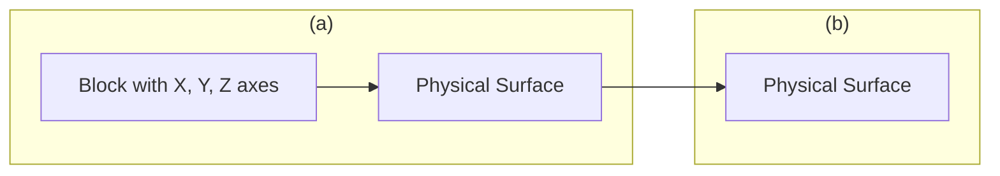
</details>

Abb. 6.6

Ausgehend von der waagerechten Anfangslage (oben) wird ein Buch zweimal um 90° gedreht, und zwar (a) erst um die waagerechte x-Achse, dann um die senkrechte y-Achse und (b) in umgekehrter Reihenfolge.

147

---

6 Die Rotation ausgedehnter Körper

## 6.2 Rotation mit konstanter Winkelbeschleunigung


## Lernziele

Nach dem Durcharbeiten dieses Abschnitts sollten Sie in der Lage sein, . . .

• die Beziehungen zwischen Winkelposition, Drehwinkel, Winkelgeschwindig keit, Winkelbeschleunigung und Zeit für Bewegungen mit konstanter Winkelbeschleunigung anzugeben und anzuwenden.


## Schlüsselideen

• Der Fall konstanter Winkelbeschleunigung $( \alpha = \mathrm { c o n s t . } )$ ist ein wichtiger Spezialfall der Rotationsbewegung. Die zugehörigen kinematischen Gleichungen lauten

$$
\begin{array}{l} \omega = \omega_ {0} + \alpha t, \\ \theta - \theta_ {0} = \omega_ {0} t + \frac {1}{2} \alpha t ^ {2}, \\ \omega^ {2} = \omega_ {0} ^ {2} + 2 \alpha (\theta - \theta_ {0}), \\ \theta - \theta_ {0} = \frac {1}{2} (\omega_ {0} + \omega) t, \\ \theta - \theta_ {0} = \omega t - \frac {1}{2} \alpha t ^ {2}. \\ \end{array}
$$

## 6.2.1 Rotation mit konstanter Winkelbeschleunigung

Bewegungen mit konstanter linearer Beschleunigung (z. B. das Fallen eines Körpers) sind wichtige Spezialfälle der reinen Translation. Tabelle 1.1 fasste einige der hierfür geltenden Gleichungen zusammen.

Bewegungen mit konstanter Winkelbeschleunigung sind analog Spezialfälle der reinen Rotation, für die ähnliche Gleichungen Gültigkeit besitzen. Wir werden diese Beziehungen hier nicht herleiten, sondern sie lediglich den Gleichungen für die Translation gegenüberstellen, wobei die linearen Größen gegen die Winkelgrößen ausgetauscht werden. Beide Sätze von Gleichungen finden Sie in Tab. 6.1 (Gln. 1.9 bis 1.16 sowie Gln. 6.9 bis 6.13).

Wie Sie sich erinnern werden, sind die Gln. 1.9 und 1.13 die grundlegenden Be ziehungen für Bewegungen mit konstanter linearer Beschleunigung. Alle anderen aufgeführten Zusammenhänge lassen sich daraus herleiten. In ähnlicher Weise grundlegend sind die Gln. 6.9 und 6.10 für Bewegungen mit konstanter Winkelbeschleunigung. Um eine Aufgabe zu lösen, die eine solche Bewegung beinhaltet,

TABELLE 6.1:

Bewegungsgleichungen für konstante Linear- bzw. Winkelbeschleunigung.

<table><tr><td>Gl.</td><td>Gleichung für beschleunigte Translation</td><td colspan="2">unbekannte Variable</td><td>Gleichung für beschleunigte Rotation</td><td>Gl.</td></tr><tr><td>1.9</td><td> $\nu = \nu_0 t + at$ </td><td> $x - x_0$ </td><td> $\theta - \theta_0$ </td><td> $\omega = \omega_0 + \alpha t$ </td><td>6.9</td></tr><tr><td>1.13</td><td> $x - x_0 = \nu_0 t + \frac{1}{2} at^2$ </td><td> $\nu$ </td><td> $\omega$ </td><td> $\theta - \theta_0 = \omega_0 t + \frac{1}{2} \alpha t^2$ </td><td>6.10</td></tr><tr><td>1.14</td><td> $\nu^2 = \nu_0^2 + 2a(x - x_0)$ </td><td> $t$ </td><td> $t$ </td><td> $\omega^2 = \omega_0^2 + 2\alpha(\theta - \theta_0)$ </td><td>6.11</td></tr><tr><td>1.15</td><td> $x - x_0 = \frac{1}{2} (\nu_0 + \nu)t$ </td><td> $a$ </td><td> $\alpha$ </td><td> $\theta - \theta_0 = \frac{1}{2} (\omega_0 + \omega)t$ </td><td>6.12</td></tr><tr><td>1.16</td><td> $x - x_0 = \nu t - \frac{1}{2} at^2$ </td><td> $\nu_0$ </td><td> $\omega_0$ </td><td> $\theta - \theta_0 = \omega t - \frac{1}{2} \alpha t^2$ </td><td>6.13</td></tr></table>

148

---

6.3 Beziehungen zwischen den Variablen für lineare Bewegung und Rotation

6

brauchen Sie nur diejenige Gleichung aus der Liste auszuwählen, deren Unbekann te der in der Aufgabe gefragten Variable entspricht. Sie sollten allerdings versuchen, mit den Gln. 6.9 und 6.10 auszukommen, wie es in Beispielaufgabe 6.4 im Übungsbuch vorgeführt wird.

## KONTROLLFRAGE 2

Die Winkelposition θ(t) eines rotierenden Körpers sei gegeben durch (a) $\theta = 3 t { - 4 } ,$ (b) $\theta = - 5 \bar { t ^ { 3 } } + 4 t ^ { 2 } + 6 , ( \mathrm { c } ) \theta = 2 / t ^ { 2 } - 4 / t .$ und (d) $\theta = 5 t ^ { 2 } - 3$ . Auf welche dieser Situationen können die in Tab. 6.1 angegebenen Gleichungen angewendet werden?

## 6.3 Beziehungen zwischen den Variablen für lineare Bewegung und Rotation

## Lernziele

Nach dem Durcharbeiten dieses Abschnitts sollten Sie in der Lage sein, . . .

für einen starren Körper, der sich um eine feste Achse dreht, Beziehungen zwischen den Winkelvariablen des Körpers (Winkelposition, Winkelgeschwindigkeit und Winkelbeschleunigung) und den linearen Variablen (Position, Geschwindigkeit und Beschleunigung) eines Teilchens an einer beliebigen Position innerhalb des Körpers anzugeben,
tangentiale und radiale Beschleunigungen zu unterscheiden und beide sowohl für eine Erhöhung als auch für eine Abnahme der Winkelgeschwindigkeit in einer Skizze eines um eine Achse rotierenden Körpers für ein beliebiges Teilchen innerhalb des Körpers einzeichnen zu können.


## Schlüsselideen

• Ein Punkt in einem starren rotierenden Körper im senkrechten Abstand r von der Drehachse bewegt sich auf einer Kreisbahn mit Radius r um diese Achse. Wenn der Körper sich um einen Winkel θ dreht, bewegt sich der Punkt entlang eines Kreisbogens der Länge

$$
s = \theta r \quad (\theta \text {im Bogenma} \beta)
$$

• Die lineare Geschwindigkeit v⃗ eines solchen Punkts verläuft tangential zu diesem Kreis; der Betrag v seiner linearen Geschwindigkeit ist

$$
\nu = \omega r \quad (\omega \text {im Bogenma} \beta),
$$


wobei ω die Winkelgeschwindigkeit (in rad/s) des Körpers und damit auch des Punkts ist.

• Die lineare Beschleunigung a⃗ des Punkts besitzt sowohl tangentiale als auch radiale Komponenten. Die tangentiale Komponente ist

$$
\alpha_ {\mathrm{t}} = \alpha r \qquad (\text {Bogenma} \beta),
$$

wobei α der Betrag der Winkelbeschleunigung (in rad/s<sup>2</sup>) des Körpers ist. Die radiale Komponente von a⃗ ist

$$
a _ {\mathrm{r}} = \frac {\nu^ {2}}{r} = \omega^ {2} r \qquad (\text {Bogenmaß}).
$$

• Bei einer gleichförmigen Kreisbewegung ist die Periode T der Bewegung für den Punkt und den Körper

$$
T = \frac {2 \pi r}{\nu} = \frac {2 \pi}{\omega} \qquad (\text {Bogenmaß}).
$$

149

---

6 Die Rotation ausgedehnter Körper

## 6.3.1 Beziehungen zwischen den Variablen für lineare Bewegung und Rotation

In Abschn. 1.10 diskutierten wir die gleichförmige Kreisbewegung: Ein Teilchen bewegt sich mit der konstanten Geschwindigkeit v auf einer Kreisbahn um eine Achse. Rotiert ein starrer Körper, etwa ein Karussell, um eine Achse, so beschreibt jedes seiner Teilchen eine derartige Kreisbahn. Da die Teilchen unbeweglich miteinander verbunden sind, benötigen sie für einen vollständigen Umlauf alle die gleiche Zeit; anders ausgedrückt, alle Teilchen bewegen sich mit gleicher Winkelgeschwindigkeit ω.

Je größer jedoch der Abstand eines Teilchens von der Drehachse ist, desto grö- ßer ist auch der Umfang seiner Kreisbahn – das bedeutet, umso größer muss seine lineare Geschwindigkeit v sein. Sie können diesen Zusammenhang nachprüfen, wenn Sie Karussell fahren: Gleichgültig, wie weit Ihr Platz von der Mitte des Karussells entfernt ist, Sie bewegen sich stets mit der gleichen Winkelgeschwindigkeit. Ihre lineare Geschwindigkeit nimmt hingegen merklich zu, wenn Sie nach außen rücken.

Häufig benötigt man Beziehungen zwischen den Variablen s, v und a für die lineare Bewegung eines Teilchens innerhalb eines rotierenden Körpers und den Variablen θ, ω und α für die Rotation des gesamten Körpers. Der Zusammenhang zwischen beiden Variablensätzen ist durch r gegeben, den senkrechten (d. h. entlang einer Senkrechten zur Achse gemessenen) Abstand des betreffenden Punkts von der Rotationsachse. Gleichzeitig ist r der Radius der Kreisbahn, die das einzelne Teilchen um die Achse beschreibt.


<details>
<summary>text_image</summary>

Kreisbahn
von P
Dreh-
achse
P
y
x
r
v
</details>

(a)

## Der Ort

Überstreicht die Bezugslinie eines starren Körpers einen Drehwinkel θ, so bewegt sich ein Punkt im Abstand r von der Drehachse um eine Strecke s entlang eines Kreisbogens; s ist gegeben durch Gl. 6.1:

$$
s = \theta r. \tag {6.14}
$$

Vorsicht: Diese Beziehung zwischen einer linearen und einer Rotationsvariablen gilt nur, wenn der Winkel θ in Bogenmaß angegeben wird. (Tatsächlich ist Gl. 6.14 die Definition der Winkelmessung in Bogenmaß!)


<details>
<summary>text_image</summary>

y
P
a_t
a_r
Drehachse
x
</details>

(b)

## Die Geschwindigkeit

Die Ableitung von Gl. 6.14 nach der Zeit (bei konstantem r) liefert

$$
\frac {\mathrm{d} s}{\mathrm{d} t} = \frac {\mathrm{d} \theta}{\mathrm{d} t} r.
$$

Wie Sie sofort bemerken werden, ist ds∕dt der Betrag der linearen Geschwindig keit des betrachteten Punkts, und $\mathrm { d } \theta / \mathrm { d } t$ ist die Winkelgeschwindigkeit ω des rotierenden Körpers. Also gilt

$$
\nu = \omega r. \tag {6.15}
$$

Der rotierende Körper aus Abb. 6.2 von oben im Querschnitt gesehen.
Jeder Punkt (z. B. P) bewegt sich auf einer Kreisbahn um die Drehachse. (a) Die lineare Geschwindig-
keit ⃗v jedes Punkts zeigt in Richtung der Tangente an die Kreisbahn in diesem Punkt. (b) Die lineare Beschleunigung eines Punkts hat in der Regel zwei Komponenten, eine radiale $( a _ { \mathrm { r } } )$ und eine tangentiale $( a _ { \mathrm { t } } )$

Auch hier ist Vorsicht geboten: Die Winkelgeschwindigkeit ω ist in Bogenmaß anzugeben.

Gleichung 6.15 besagt Folgendes: Während die Winkelgeschwindigkeit ω aller Punkte innerhalb eines starren Körpers gleich ist, nimmt die lineare Geschwindigkeit v mit dem Abstand r von der Drehachse zu. Abbildung 6.7a führt Ihnen vor Augen, dass die lineare Geschwindigkeit stets tangential zur Kreisbahn des jeweiligen Punkts gerichtet ist.

150

---

6.3 Beziehungen zwischen den Variablen für lineare Bewegung und Rotation

6

Ist die Winkelgeschwindigkeit ω eines starren Körpers konstant, so ist gemäß Gl. 6.15 auch die lineare Geschwindigkeit jedes seiner Punkte konstant. Das bedeutet, alle Punkte bewegen sich gleichförmig auf Kreisbahnen. Die Periode T der Kreisbewegung jedes einzelnen Punkts und des starren Körpers insgesamt ist gegeben durch Gl. 1.41:

$$
T = \frac {2 \pi r}{\nu}. \tag {6.16}
$$

In Worten besagt diese Gleichung: Die Zeit für einen vollständigen Umlauf eines Punkts ist gegeben durch die Länge der entsprechenden Kreisbahn 2πr geteilt durch die Geschwindigkeit, mit der diese Strecke zurückgelegt wird. Setzen wir v aus Gl. 6.15 ein und kürzen $r ,$ so ergibt sich

$$
T = \frac {2 \pi}{\omega}. \tag {6.17}
$$

Diese (wieder nur in Bogenmaß gültige!) Gleichung besagt, dass die Zeit für einen Umlauf gegeben ist durch den Drehwinkel $2 \pi ,$ der dabei überstrichen wird, geteilt durch die Winkelgeschwindigkeit, mit welcher der Drehwinkel durchlaufen wird.

## Die Beschleunigung

Die Ableitung von Gl. 6.15 nach der Zeit (wiederum bei konstantem r) liefert

$$
\frac {\mathrm{d} \nu}{\mathrm{d} t} = \frac {\mathrm{d} \omega}{\mathrm{d} t} r. \tag {6.18}
$$

Hier stoßen wir auf eine Schwierigkeit. In Gl. 6.18 steht der Ausdruck dv∕dt nur für den Teil der linearen Beschleunigung, der für die Änderung des Betrags v der linearen Geschwindigkeit ⃗v sorgt. Wie ⃗v selbst wirkt dieser Teil der Beschleunigung tangential zur Kreisbahn des fraglichen Punkts, weshalb wir ihn als tangentiale Komponente $a _ { \mathrm { t } }$ der linearen Beschleunigung bezeichnen:

$$
a _ {\mathrm{t}} = \alpha r \tag {6.19}
$$

mit $\alpha = \mathsf { d } \omega / \mathsf { d } t .$ (Die Winkelbeschleunigung α in Gl. 6.19 muss in Bogenmaß angegeben werden.)

Zusätzlich besitzt jedes Teilchen, das sich auf einer Kreisbahn bewegt, Gl. 1.40 zufolge eine radiale Komponente der linearen Beschleunigung $\alpha _ { \mathrm { r } } = \nu ^ { 2 } / r$ (radial zur Achse gerichtet). Diese Komponente ist für Änderungen der Richtung von $\vec { \nu }$ verantwortlich. Wir setzen v aus Gl. 6.15 ein und schreiben für die radiale Komponente:

$$
a _ {\mathrm{r}} = \frac {\nu^ {2}}{r} = \omega^ {2} r. \tag {6.20}
$$

Wie Abb. 6.7b veranschaulicht, besteht die lineare Beschleunigung eines Punkts innerhalb eines rotierenden starren Körpers im Allgemeinen also aus zwei Komponenten. Die radial nach innen gerichtete Komponente $a _ { \mathrm { r } }$ (Gl. 6.20) ist stets von null verschieden, wenn die Winkelgeschwindigkeit des Körpers von null verschieden ist. Die tangentiale Komponente $a _ { \mathrm { t } }$ (Gl. 6.19) ist von null verschieden, wenn die Winkelbeschleunigung von null verschieden ist.

## KONTROLLFRAGE 3

Eine Fliege sitzt auf dem Rand eines rotierenden Karussells. Die Winkelgeschwin digkeit des Systems Fliege–Karussell ist konstant. Ist (a) die Radialbeschleunigung und (b) die Tangentialbeschleunigung der Fliege verschieden von null? Sind (c) Radialbeschleunigung und (d) Tangentialbeschleunigung der Fliege verschieden von null, während das Karussell bremst?

151

---

6 Die Rotation ausgedehnter Körper

## LÖSUNGSSTRATEGIEN

**Strategie 1: Einheiten für die Variablen der Rotation** Von Gl. 6.1 $( \theta = s / r )$ a n haben wir alle Winkelgrößen, die gemeinsam mit linearen Größen in Gleichungen auftreten, in Bogenmaß angegeben (Drehwinkel in Radiant bzw. rad, Winkelgeschwindigkeiten in rad/s oder rad/min, Winkelbeschleunigungen in rad $/ s ^ { 2 }$ oder rad/min<sup>2</sup>). Dies gilt insbesondere für die Gln. 6.14–6.15, 6.17, 6.19 und 6.20. Die einzigen Ausnahmen von dieser Forderung bilden Gleichungen, in denen ausschließlich winkelbezogene Größen auftreten, etwa die Gln. 6.9–6.13 in Tab. 6.1. Hier steht es Ihnen frei, Winkel in Grad oder Umdrehungen anzugeben statt in Bogenmaß, solange Sie die Einheiten konsistent verwenden.

Kommen in einer Gleichung Winkel in Bogenmaß vor, so müssen Sie die „dimensionslose“ Einheit rad während des Rechenwegs nicht unbedingt mitnehmen, wie es bei anderen Einheiten erforderlich ist – eigentlich ist der Winkel im Bogenmaß einfach nur eine Zahl. Orientieren Sie sich einfach am Kontext.

## 6.4 Die kinetische Energie der Rotation


## Lernziele

Nach dem Durcharbeiten dieses Abschnitts sollten Sie in der Lage sein, . . .

• das Trägheitsmoment eines Teilchens für die Rotation um eine Achse zu bestimmen,
• das Trägheitsmoment eines Systems von Teilchen für die Rotation um eine gemeinsame Achse zu bestimmen,
• die kinetische Energie der Rotation eines Körpers aus seinem Trägheitsmoment und seiner Winkelgeschwindigkeit zu berechnen.


## Schlüsselideen

• Die kinetische Energie eines starren Körpers, der um eine feste Achse rotiert, ist

$$
K = \frac {1}{2} I \omega^ {2} \qquad (\text {Bogenmaß}),
$$

wobei I das Trägheitsmoment des Körpers ist, das für ein System von diskreten Teilchen definiert ist durch

$$
I = \sum m _ {i} r _ {i} ^ {2}.
$$

## 6.4.1 Die kinetische Energie der Rotation

Das schnell rotierende Blatt einer Kreissäge besitzt infolge dieser Drehbewegung ganz ohne Zweifel kinetische Energie. Wie können wir diese Energie formulieren? Wenden wir die gewohnte Formel $\tilde { K } = { \textstyle { \frac { 1 } { 2 } } } m \nu ^ { 2 }$ auf das Sägeblatt als Ganzes an, so erhalten wir lediglich die kinetische Energie des Schwerpunkts – und diese ist gleich null.

Stattdessen müssen wir das Sägeblatt (und jeden anderen rotierenden starren Körper) als Anordnung von Teilchen mit verschiedenen Geschwindigkeiten betrachten. Wir können dann die kinetischen Energien aller Teilchen aufsummieren und erhalten daraus die kinetische Gesamtenergie des Körpers. Formal bedeutet dies

$$
K = \frac {1}{2} m _ {1} \nu_ {1} ^ {2} + \frac {1}{2} m _ {2} \nu_ {2} ^ {2} + \frac {1}{2} m _ {3} \nu_ {3} ^ {2} + \dots ,
$$

152

---

6.4 Die kinetische Energie der Rotation

6

also

$$
K = \sum \frac {1}{2} m _ {i} v _ {i} ^ {2}, \tag {6.21}
$$

mit $m _ { i }$ als Masse der i-ten Teilchens und $\nu _ { i }$ als dessen Geschwindigkeit. Summiert wird über alle Teilchen, die der Körper enthält.

Bei der Anwendung von Gl. 6.21 haben wir ein wesentliches Problem: $\nu _ { i }$ ist nicht für alle Teilchen gleich groß. Die Lösung ist, v aus Gl. 6.15 $( \nu = \omega r )$ einzusetzen:

$$
K = \sum \frac {1}{2} m _ {i} (\omega r _ {i}) ^ {2} = \frac {1}{2} \left(\sum m _ {i} r _ {i} ^ {2}\right) \omega^ {2}, \tag {6.22}
$$

denn ω ist für alle Teilchen gleich.

Der Klammerausdruck auf der rechten Seite von Gl. 6.22 gibt an, wie die Masse des rotierenden Körpers um die Drehachse verteilt ist. Wir nennen diese Größe das **Trägheitsmoment** I des Körpers bezüglich der jeweiligen Achse. Für einen bestimmten starren Körper und eine bestimmte Achse ist I eine Konstante. (Ohne die Angabe dieser Achse ist ein Wert von I physikalisch sinnlos!)

Wir schreiben also für das Trägheitsmoment

$$
I = \sum m _ {i} r _ {i} ^ {2}. \tag {6.23}
$$

und setzen dies in Gl. 6.22 ein, wodurch sich die gesuchte Beziehung für die kinetische Energie ergibt:

$$
K = \frac {1}{2} I \omega^ {2}. \tag {6.24}
$$

Weil wir bei der Herleitung von Gl. 6.24 auf die Beziehung $\nu = \omega r$ zurückgegriffen haben, muss ω in Bogenmaß angegeben werden. Die SI-Einheit von I ist Kilogramm mal Quadratmeter $( \mathrm { k g } \cdot \mathrm { m } ^ { 2 } )$

Gleichung 6.24 gibt die kinetische Energie eines starren Körpers bei der reinen Rotation an und ist damit das Analogon zu der Beziehung $\bar { K } = { \textstyle \frac { 1 } { 2 } } M \nu _ { S } ^ { 2 }$ für die kinetische Energie eines starren Körpers bei der reinen Translation. In beiden Formeln findet sich der Faktor 1/2. An die Stelle der Masse M tritt in der Gleichung für die Rotation das Trägheitsmoment $I ,$ das die Masse und deren Verteilung in sich vereint. Schließlich enthalten beide Gleichungen eine quadratische Geschwindigkeit (der Translation bzw. Rotation). Die kinetische Energie der Translation unterscheidet sich nicht von der kinetischen Energie der Rotation – wir haben lediglich, in Abhängigkeit von der Bewegungsform, verschiedene Ausdrücke für dieselbe Energieform.

Wie bereits bemerkt, fließt in das Trägheitsmoment eines Körpers nicht nur seine Masse, sondern auch deren Verteilung ein. Ein Beispiel dafür, das Sie sofort nachvollziehen können, ist folgendes: Lassen Sie einen länglichen Gegenstand (eine Stange, einen Holzstab oder etwas Ähnliches) erst um seine Längs-, dann um seine Querachse rotieren (Abb. 6.8a bzw. b). Die Masse des Gegenstands ändert sich dabei offensichtlich nicht, aber mit Sicherheit empfinden Sie die erste Rotation als viel leichter. Die Masse befindet sich in diesem Fall näher an der Rotationsachse als im zweiten Fall. Folglich ist das Trägheitsmoment des Stabs bei der Rotation um die Längsachse deutlich kleiner als bei der Rotation um die Querachse. Je kleiner sein Trägheitsmoment ist, desto leichter lässt sich ein Körper drehen.

## KONTROLLFRAGE 4

Die nebenstehende Zeichnung zeigt drei kleine Kugeln, die sich um eine senkrechte Achse drehen. Gegeben ist jeweils der senkrechte Abstand zwischen der Achse und dem Mittelpunkt der Kugel. Ordnen Sie die Kugeln nach ihrem Trägheitsmoment bezüglich dieser Achse, beginnend mit dem größten Wert.


<details>
<summary>text_image</summary>

(a)
Drehachse
(b)
</details>

Abb. 6.8

Ein langer Stab lässt sich viel leichter um seine Längsachse drehen (a) als um seine Querachse (b). Der Grund dafür ist, dass die Masse in (a) näher an der Drehachse liegt als in (b).


<details>
<summary>bubble</summary>

| Position | Distance (m) | Weight (kg) |
| --- | --- | --- |
| Top | 1 | 36 |
| Middle | 2 | 9 |
| Bottom | 3 | 4 |
</details>

153

---

6 Die Rotation ausgedehnter Körper

## 6.5 Die Berechnung des Trägheitsmoments


## Lernziele

Nach dem Durcharbeiten dieses Abschnitts sollten Sie in der Lage sein, . . .

• das Trägheitsmoment eines Körpers zu bestimmen, sofern er in Tab. 6.2 aufgeführt ist,
• das Trägheitsmoment eines Körpers durch Integration über alle Massenelemente zu berechnen,
• den Steinerschen Satz für die Rotation um eine Achse anzuwenden, die nicht durch den Schwerpunkt des Körpers verläuft.


## Schlüsselideen

• Das Trägheitsmoment I eines Körpers ist für ein System von einzelnen Teilchen als

$$
I = \sum m _ {i} r _ {i} ^ {2}
$$

und für Körper mit einer kontinuierlichen Masseverteilung als

$$
I = \int r ^ {2} \mathrm{d} m
$$

definiert. Dabei bezeichnen r bzw. $r _ { i }$ die senkrechten Abstände des jeweiligen Teilchens bzw. Volumenelements von der Rotationsachse und die Summe bzw. Integration verläuft über alle Teilchen bzw. das gesamte Volumen des Körpers (über alle Massenelemente).

• Der Steinersche Satz stellt eine Beziehung zwischen dem Trägheitsmoment I eines Körpers um eine beliebige Achse zu seinem Trägheitsmoment $I _ { \mathrm { S } }$ um eine dazu parallele Achse durch seinen Schwerpunkt her:

$$
I = I _ {\mathrm{S}} + M h ^ {2},
$$

wobei M die Masse des Körpers und h der senkrechte Abstand der beiden Achsen ist. Anschaulich ist h der Abstand, um den die Rotationsachse gegen die dazu parallele Achse durch den Schwerpunkt des Körpers verschoben ist.

## 6.5.1 Die Berechnung des Trägheitsmoments

Besteht ein starrer Körper nur aus wenigen Teilchen, so können wir sein Trägheitsmoment bezüglich einer gegebenen Achse mithilfe von Gl. 6.23 $( I = \textstyle \sum m _ { i } \widetilde { r _ { i } ^ { 2 } } )$ berechnen. Das bedeutet, wir bilden das Produkt $m r ^ { 2 }$ für jedes einzelne Teilchen und summieren anschließend die Produkte. (Wie Sie sich erinnern, ist r der senkrechte Abstand eines Teilchens von der jeweiligen Drehachse.)

Besteht ein starrer Körper hingegen aus sehr vielen Teilchen (handelt es sich also um eine kontinuierliche Verteilung von Materie, etwa in Form einer Frisbeescheibe), so kann man Gl. 6.23 nur mithilfe eines Computers auswerten. Stattdessen ersetzen wir die Summe in dieser Gleichung durch ein Integral und definieren das Trägheitsmoment des Körpers als

$$
I = \int r ^ {2} \mathrm{d} m. \tag {6.25}
$$

In Tab. 6.2 finden Sie Lösungen dieser Gleichung für neun häufig auftretende Formen von Objekten bezüglich der angegebenen Drehachsen.

## Der Steinersche Satz

Gesucht ist das Trägheitsmoment I eines Körpers der Masse m bezüglich einer gegebenen Achse. Prinzipiell können wir I stets durch Integration von Gl. 6.25

154

---

6.5 Die Berechnung des Trägheitsmoments

6

TABELLE 6.2:

Einige Trägheitsmomente bei der Rotation.

<table><tr><td></td><td></td><td></td></tr><tr><td></td><td></td><td></td></tr><tr><td></td><td></td><td></td></tr></table>

ermitteln. Wir können den Rechenweg aber deutlich abkürzen, wenn wir bereits das Trägheitsmoment $I _ { \mathrm { S } }$ des Körpers bezüglich einer Achse kennen, die durch den Schwerpunkt und parallel zur interessierenden Achse verläuft. Es sei h der senkrechte Abstand zwischen der gegebenen Achse und der Achse durch den Schwer punkt (denken Sie daran, dass der folgende Algorithmus nur gilt, wenn diese Achsen parallel verlaufen!). Das Trägheitsmoment I bezüglich der gegebenen Achse ist dann

$$
I = I _ {\mathrm{S}} + M h ^ {2}. \tag {6.26}
$$

Im Folgenden werden wir diesen **Steinerschen Satz** herleiten und anschließend in Kontrollfrage 5 sowie Beispielaufgabe 6.6 im Übungsbuch anwenden.

## Herleitung des Steinerschen Satzes

Der Schwerpunkt eines in zufälliger Weise geformten Körpers, dessen Querschnitt Sie in Abb. 6.9 sehen, liege im Ursprung O eines xy-Koordinatensystems. Nun betrachten wir eine Achse senkrecht zur Querschnittsebene durch O und eine zweite, zur ersten parallele Achse, die durch einen Punkt P verläuft. Die Koordinaten von P seien a und b.

Es sei dm ein Massenelement mit den allgemeinen Koordinaten x und y. Das Trägheitsmoment des Körpers bezüglich der Achse durch P ist dann gemäß Gl. 6.25:

$$
I = \int r ^ {2} \mathrm{d} m = \int [ (x - a) ^ {2} + (y - b) ^ {2} ] \mathrm{d} m,
$$


<details>
<summary>text_image</summary>

y
dm
Drehachse
durch P
r
y - b
P
x - a
h
b
O
x
Schwer-
punkt
Drehachse
durch den
Schwerpunkt
</details>

Abb. 6.9

Querschnitt eines starren Körpers, der Schwerpunkt befindet sich im Ursprung O. Der Steinersche Satz (Gl. 6.26) gibt die Beziehung zwischen dem Trägheitsmoment des Körpers bezüglich einer Achse durch O und dem Trägheitsmoment bezüglich einer Achse durch einen Punkt P an, der sich im Abstand h vom Schwerpunkt befindet. Beide Achsen stehen senkrecht auf der Ebene des Querschnitts.

155

---

6 Die Rotation ausgedehnter Körper


<details>
<summary>text_image</summary>

(1)
(2)
(3) (4)
</details>

was wir auch in der Form

$$
I = \int (x ^ {2} + y ^ {2}) \mathrm{d} m - 2 a \int x \mathrm{d} m - 2 b \int y \mathrm{d} m + \int (a ^ {2} + b ^ {2}) \mathrm{d} m, \tag {6.27}
$$

schreiben können. Aus der Definition des Schwerpunkts (Gl. 5.9) entnehmen wir, dass die beiden mittleren Integrale die Koordinaten des Schwerpunkts angeben (multipliziert mit einem konstanten Faktor) und deshalb jeweils gleich null sein müssen. Weiterhin ist $x ^ { 2 } + y ^ { 2 } = R ^ { 2 }$ mit R als Abstand zwischen O und dm, weshalb das erste Integral schlicht gleich $I _ { S }$ ist, das Trägheitsmoment des Körpers bezüglich einer durch seinen Schwerpunkt verlaufenden Achse. Wie uns ein Blick auf Abb. 6.9 sagt, ist der letzte Term in Gl. 6.27 gleich $M h ^ { 2 }$ mit M als Gesamtmasse des Körpers. Wir können Gl. 6.27 folglich auf Gl. 6.26 zurückführen, welche wir herleiten wollten.

## KONTROLLFRAGE 5

Die Zeichnung zeigt ein flaches, quaderförmiges Objekt (etwa ein Buch) mit vier verschiedenen Drehachsen, die alle senkrecht auf der Deckfläche des Objekts stehen. Ordnen Sie die Achsen nach dem zugehörigen Trägheitsmoment des Objekts, beginnend mit dem größten Wert.

## 6.6 Das Drehmoment


## Lernziele

Nach dem Durcharbeiten dieses Abschnitts sollten Sie in der Lage sein, . . .

• zu verstehen, dass ein Drehmoment auf einen Körper von einer Kraft hervorgerufen wird, die an einem Punkt außerhalb der Drehachse angreift,
• ein Drehmoment aus (a) dem Winkel zwischen dem Orts- und dem Kraftvektor, (b) der Richtung und dem Hebel der Kraft oder (c) der Komponente der Kraft senkrecht zum Ortsvektor zu berechnen,
• zu verstehen, dass für die Berechnung eines Drehmoments immer auch die zugehörige Drehachse angegeben sein muss,
• zu verstehen, dass einem Drehmoment je nach der Richtung, in der es den Körper um die Rotationsachse drehen möchte, ein positives oder negatives Vorzeichen zugewiesen wird (im Uhrzeigersinn = negativ),
• das resultierende Drehmoment zu berechnen, wenn mehr als ein Drehmoment auf einen Körper wirkt.


## Schlüsselideen

• Ein Drehmoment versucht, einen Körper aufgrund einer Kraft $\vec { F }$ um eine Rotationsachse zu drehen. Wenn die Kraft $\vec { F }$ an einem Punkt angreift, der durch den Ortsvektor $\vec { r }$ relativ zur Rotationsachse gegeben ist, ist der Betrag des Drehmoments

$$
\tau = r F _ {\mathrm{t}} = r _ {\perp} F = r F \sin \varphi ,
$$

wobei $F _ { \mathrm { t } }$ die Komponente von $\vec { F }$ senkrecht zu $\vec { r }$ ist und 𝜑 der Winkel zwischen ⃗r und $\vec { F } .$ Die Größe $r _ { \perp }$ ist der senkrechte Abstand zwischen der Drehachse und einer gedachten Verlängerung des Kraftvektors. Diese Verlängerung ist die Richtung der Kraft $\vec { F } ; r _ { \perp }$ wird der Hebelarm von $\vec { F }$ genannt. Entsprechend ist r der Hebelarm von $F _ { \mathrm { t } }$

• Die SI-Einheit des Drehmoments ist das Newtonmeter (N ⋅ m). Ein Drehmo ment τ ist positiv, wenn es versucht, einen ruhenden Körper gegen den Uhrzeigersinn zu drehen, und negativ, wenn es versucht, den Körper im Uhrzeigersinn zu drehen.

156

---

6.6 Das Drehmoment

6

## 6.6.1 Das Drehmoment

Eine Türklinke ist stets so weit wie möglich vom Scharnier der Tür entfernt, und das aus gutem Grund. Wollen Sie eine schwere Tür öffnen, so müssen Sie natürlich eine Kraft aufwenden. Wichtig ist aber nicht nur der Betrag dieser Kraft, sondern auch der Angriffspunkt und die Richtung ihrer Wirkung. Drücken Sie in der Nähe des Scharniers oder unter einem Winkel gegen die Tür, der erheblich von $9 0 ^ { \circ }$ bezüglich der Türfläche abweicht, so müssen Sie wesentlich mehr Kraft aufwenden, als wenn Sie Ihre Kraft in der Nähe der Klinke und senkrecht zur Türfläche ansetzen.

In Abb. 6.10a sehen Sie den Querschnitt eines Körpers, der ungehindert um eine auf dem Querschnitt senkrecht stehende Achse durch O rotieren kann. Am Punkt $\mathrm { P } _ { \mathrm { r } }$ dessen Position relativ zu O durch den Ortsvektor $\boldsymbol { \cdot } \vec { r }$ gegeben ist, greift eine Kraft $\vec { F }$ an. Die Richtungen der Vektoren $\vec { F }$ und $\vec { r }$ schließen miteinander einen Winkel 𝜑 ein. (Der Einfachheit halber betrachten wir nur Kräfte, deren Komponente parallel zur Drehachse gleich null ist; das bedeutet, $\vec { F }$ liegt in der Papierebene.)

Wir wollen nun untersuchen, in welcher Weise $\vec { F }$ eine Rotation des Körpers um die angegebene Achse bewirkt. Dazu lösen wir $\vec { F }$ in zwei Komponenten auf (Abb. 6.10b). Eine davon, die radiale Komponente $F _ { \mathbf { r } } ,$ zeigt in Richtung von $\vec { r }$ und erzeugt keine Rotation, denn sie wirkt entlang einer Linie, die durch O verläuft. (Drücken Sie von einer Kante aus in Richtung des Scharniers gegen eine Tür, um sich zu überzeugen, dass sich die Tür dann nicht dreht.) Die tangentiale Komponente $F _ { \mathrm { t } }$ von $\vec { F }$ steht senkrecht au $\vec { r } _ { \vec { r } _ { r } } ^ { \rightarrow }$ ihr Betrag ist $F _ { \mathrm { t } } = F$ sin 𝜑. Diese Komponente ist für die Rotation verantwortlich. (Drücken Sie senkrecht gegen eine Tür, bewegt sie sich.)

Ob und wie effektiv die Anwendung der Kraft $\vec { F }$ eine Rotation bewirkt, hängt – wie bereits bemerkt – nicht nur vom Betrag ihrer tangentialen Komponente $F _ { \mathrm { t } }$ $\mathrm { a b } ,$ sondern auch vom Abstand zwischen dem Angriffspunkt der Kraft und O. Um beide Faktoren zu erfassen, definieren wir ihr Produkt als das **Drehmoment** τ (für englisch „torque“):

$$
\tau = r F \sin \varphi . \tag {6.28}
$$

Zwei äquivalente Schreibweisen dieser Definition sind

$$
\tau = r (F \sin \varphi) = r F _ {\mathrm{t}} \tag {6.29}
$$

und

$$
\tau = (r \sin \varphi) F = r _ {\perp} F \tag {6.30}
$$

mit $r _ { \perp }$ als senkrechtem Abstand zwischen der Rotationsachse in O und der Verlängerung der Richtung des Vektors $\vec { F }$ (siehe Abb. 6.10c). Diese Verlängerungslinie ist die **Richtung der Kraft** $\vec { F }$ und $r _ { \perp }$ ist der **Hebelarm** von F. Wie Sie Abb. 6.10 entnehmen können, ist $r ,$ der Betrag von $\vec { r } ,$ gleich dem Hebelarm der Komponente $F _ { \mathrm { t } }$ von ${ \vec { F } } .$

Das Drehmoment lässt sich als „drehende Wirkung“ der Kraft $\vec { F }$ auffassen. Wenn Sie ein Objekt wie einen Schraubenzieher oder einen Drehmomentschlüssel mithilfe einer Kraft in Rotation versetzen, so wenden Sie ein Drehmoment an. Die SI-Einheit des Drehmoments ist Newton mal Meter (N ⋅ m) bzw. Newtonmeter (Nm). (Vorsicht: Die gleiche Einheit gilt für die Arbeit. Arbeit und Drehmoment sind aber verschiedene Größen, die nicht verwechselt werden dürfen. Oft gibt man eine $\mathrm { A r } -$ beit in J (1 J = 1 N ⋅ m) an, für Drehmomente darf diese Einheit hingegen nicht verwendet werden.)

Im folgenden Kapitel werden wir das Drehmoment allgemeiner als vektorielle Größe diskutieren (und dann auch sehen, dass beim Drehmoment Kraft und Weg auf andere Weise multipliziert werden als bei der Arbeit). Da wir uns im Augenblick auf Drehbewegungen um einzelne Achsen beschränken, müssen wir das Drehmoment noch nicht als Vektor formulieren. Wir ordnen ihm stattdessen ein


Abb. 6.10 (a) Eine Kraft $\vec { F }$ greift im Punkt P eines starren Körpers an, der ungehindert um eine Achse durch O rotieren kann. Diese Achse steht senkrecht auf der hier abgebildeten Querschnittsebene. (b) Das zu dieser Kraft gehö- rende Drehmoment ist gegeben durch $( r ) ( F$ sin 𝜑) oder äquivalent durch $r F _ { \mathrm { t } } ,$ wobei $F _ { \mathrm { t } }$ die tangentiale Komponente von $\vec { F }$ ist. (c) Eine weitere Schreibweise für das Drehmoment ist $r _ { \perp } F$ mit $r _ { \perp }$ als Hebelarm von ${ \vec { F } } .$

157

---

6 Die Rotation ausgedehnter Körper


<details>
<summary>line</summary>

| Component | Force Direction |
| --- | --- |
| F1 | Downward |
| F2 | Upward |
| F3 | Downward |
| F4 | Upward |
</details>

positives oder negatives Vorzeichen zu, je nachdem, in welche Richtung sich ein ruhender Körper zu drehen beginnt, wenn dieses Drehmoment auf ihn wirkt. Rotiert der Körper im Uhrzeigersinn, so ist das Drehmoment negativ und umgekehrt (siehe zu dieser Vereinbarung Abschn. 6.1).

Drehmomente befolgen das in Kapitel 2 eingeführte Superpositionsprinzip: Wirken auf einen Körper mehrere Drehmomente, so ergibt sich das **resultierende Drehmoment** $\tau _ { \mathrm { g e s } }$ als Summe der einzelnen Beiträge.

## KONTROLLFRAGE 6

Die Skizze zeigt einen Meterstab (von oben gesehen), der sich um den markierten Punkt (Position 20 für 20 cm) drehen kann. Alle fünf waagerecht am Stab angreifenden Kräfte haben den gleichen Betrag. Ordnen Sie die Kräfte nach dem Drehmoment, das sie bewirken, beginnend mit dem größten Wert.

## 6.7 Das zweite Newtonsche Gesetz für die Rotation


## Lernziele

Nach dem Durcharbeiten dieses Abschnitts sollten Sie in der Lage sein, . . .

• das zweite Newtonsche Gesetz für die Rotation anzuwenden, um eine Bezie hung zwischen dem resultierenden Drehmoment auf einen Körper, dessen Träg heitsmoment und der Rotationsbeschleunigung aufzustellen, wobei alle Größen auf dieselbe Rotationsachse bezogen sein müssen.


## Schlüsselideen

• Das Analogon des zweiten Newtonschen Gesetzes für die Rotation ist

$$
\tau_ {\mathrm{ges}} = I \alpha ,
$$

wobei $\tau _ { \mathrm { g e s } }$ das auf ein Teilchen oder einen starren Körper wirkende resultierende Drehmoment ist, I ist das Trägheitsmoment des Teilchens bzw. Körpers um die Drehachse und α die resultierende Winkelbeschleunigung um diese Achse.

## 6.7.1 Das zweite Newtonsche Gesetz für die Rotation


<details>
<summary>text_image</summary>

y
Ft
F
φ
m
Fr
r
Stab
θ
O
Drehachse
x
</details>

Abb. 6.11

Ein einfacher starrer Körper, der nur um eine durch O verlaufende Achse rotieren kann. Er besteht aus einem Teilchen der Masse m, befestigt an einem Ende eines masselosen Stabs der Länge r. Durch das Einwirken einer Kraft $\vec { F }$ beginnt die Anordnung zu rotieren.

Wie wir im vorangegangenen Abschnitt gesehen haben, kann ein Drehmoment die Rotation eines starren Körpers bewirken. Wir suchen nun einen Zusammenhang zwischen dem resultierenden Drehmoment $\tau _ { \mathrm { g e s } } ,$ das an einem Körper angreift, und der Winkelbeschleunigung α bezüglich der Rotationsachse, die es verursacht. Dabei gehen wir wie beim zweiten Newtonschen Gesetz $( F _ { \mathrm { g e s } } = m a )$ für die Beschleunigung a eines Körpers der Masse m vor, auf den eine Kraft $F _ { \mathrm { g e s } }$ entlang einer Koordinatenachse wirkt. Wir ersetzen $F _ { \mathrm { g e s } }$ durch $\tau _ { \mathrm { g e s } } ,$ m durch I und a durch α. Dann haben wir bereits das zweite Newtonsche Gesetz für die Drehbewegung:

$$
\tau_ {\mathrm{ges}} = I \alpha \quad (\text {Bogenma} \beta). \tag {6.31}
$$

## Herleitung von Gl. 6.31

Betrachten wir zunächst die einfache, in Abb. 6.11 dargestellte Situation. Der starre Körper besteht hier aus einem einzelnen Teilchen der Masse m, befestigt an einem masselosen Stab der Länge r. Der Stab kann nur um eine Achse rotieren, die durch sein anderes Ende verläuft und senkrecht auf der Papierebene steht. Folglich kann das Teilchen nur eine Kreisbahn beschreiben, durch deren Mittelpunkt die Drehachse führt.

Auf das Teilchen wirkt nun eine Kraft ${ \vec { F } } .$ Da sich das Teilchen nur auf der Kreisbahn bewegen kann, wird es ausschließlich durch die tangentiale Komponente $F _ { \mathrm { t } }$

158

---

6.8 Arbeit und kinetische Energie der Rotation

6

der Kraft (die Komponente, die tangential zur Kreisbahn gerichtet ist) beschleunigt. Den Zusammenhang zwischen $F _ { \mathrm { t } }$ und der tangentialen Beschleunigung $a _ { \mathrm { t } }$ schreiben wir gemäß dem zweiten Newtonschen Gesetz auf als

$$
F _ {\mathrm{t}} = m a _ {\mathrm{t}}.
$$

Aus Gl. 6.29 folgt für das auf das Teilchen wirkende Drehmoment

$$
\tau = F _ {\mathrm{t}} r = m a _ {\mathrm{t}} r.
$$

Mithilfe von Gl. 6.19 $( a _ { \mathrm { t } } = \alpha r )$ schreiben wir dafür

$$
\tau = m (\alpha r) r = (m r ^ {2}) \alpha . \tag {6.32}
$$

Der Klammerausdruck auf der rechten Seite von Gl. 6.32 ist gleich dem Trägheitsmoment des Körpers bezüglich der Drehachse (siehe Gl. 6.23). So verkürzt sich Gl. 6.32 zu

$$
\tau = I \alpha \quad (\text {Bogenma} \beta). \tag {6.33}
$$

Für den Fall, dass mehr als eine Kraft an dem Teilchen angreift, verallgemeinern wir Gl. 6.33:

$$
\tau_ {\mathrm{ges}} = I \alpha \quad (\text {Bogenma} \beta). \tag {6.34}
$$

Diese Gleichung wollten wir herleiten. Sie gilt für beliebige um eine feste Achse rotierende starre Körper, weil sich jeder derartige Körper als Anordnung unverrückbar miteinander verbundener einzelner Teilchen behandeln lässt.

## KONTROLLFRAGE 7

Der skizzierte Meterstab kann um den angegebenen Punkt links von der Mitte des Stabs rotieren. Zwei Kräfte ${ \vec { F } } _ { 1 }$ und $\vec { F } _ { 2 }$ greifen waagerecht an dem Stab an; nur ${ \vec { F } } _ { 1 }$ ist eingezeichnet. Die Kraft $\vec { \bar { F } } _ { 2 }$ wirkt am rechten Ende, senkrecht zum Stab. (a) In welche Richtung muss $\vec { F } _ { 2 }$ zeigen und (b) wie groß muss $F _ { 2 }$ relativ zu $F _ { 1 }$ sein, wenn sich der Stab nicht drehen soll?


<details>
<summary>text_image</summary>

Drehpunkt
F₁
</details>

## 6.8 Arbeit und kinetische Energie der Rotation

## Lernziele

Nach dem Durcharbeiten dieses Abschnitts sollten Sie in der Lage sein, . . .

• die von einem Drehmoment an einem rotierenden Körper verrichtete Arbeit durch Integration des Drehmoments über den Drehwinkel zu berechnen,
aus der Beziehung zwischen Arbeit und kinetischer Energie eine Relation zwischen der von einem Drehmoment verrichteten Arbeit und der daraus resultierenden Änderung der kinetischen Rotationsenergie eines Körpers aufzustellen,
• die von einem konstanten Drehmoment verrichtete Arbeit aus dem Drehwinkel des Körpers zu bestimmen,
• die von einem Drehmoment erbrachte Leistung aus der Rate zu berechnen, mit der es Arbeit verrichtet,
• die momentane Leistung eines Drehmoments zu einem gegebenen Zeitpunkt aus dem Drehmoment und der Winkelgeschwindigkeit zu diesem Zeitpunkt zu bestimmen.


## Schlüsselideen

• Die Gleichungen für die verrichtete Arbeit und die erbrachte Leistung bei Rotationsbewegungen entsprechen denjenigen, die wir aus der Translationsbewegung kennen; sie lauten

$$
W = \int_ {\theta_ {\mathrm{i}}} ^ {\theta_ {\mathrm{f}}} \tau   \mathrm{d} \theta
$$


159

---

6 Die Rotation ausgedehnter Körper

und

$$
P = \frac {\mathrm{d} W}{\mathrm{d} t} = \tau \omega .
$$

• Wenn τ konstant ist, reduziert sich das Integral auf

$$
W = \Delta \theta = \tau (\theta_ {\mathrm{f}} - \theta_ {\mathrm{i}}).
$$

• Die Beziehung zwischen Arbeit und kinetischer Energie lautet für Rotationsbewegungen

$$
\Delta K = K _ {\mathrm{f}} - K _ {\mathrm{i}} = \frac {1}{2} I \omega_ {\mathrm{f}} ^ {2} - \frac {1}{2} I \omega_ {\mathrm{f}} ^ {2} = W.
$$

## 6.8.1 Arbeit und kinetische Energie der Rotation

Bewirkt eine Kraft F die Beschleunigung eines starren Körpers der Masse m entlang einer Koordinatenachse, so verrichtet sie, wie wir in Kapitel 3 diskutiert haben, an diesem Körper eine Arbeit W. Dabei kann sich die kinetische Energie des Körpers $\begin{array} { r } { K = \frac { 1 } { 2 } m \nu ^ { \hat { 2 } } } \end{array}$ ändern. Nehmen wir an, nur diese Energieform des Körpers ändere sich. Dann können wir gemäß Gl. 3.10 folgenden Zusammenhang zwischen $\Delta K$ und der Arbeit W formulieren:

$$
\Delta K = K _ {\mathrm{f}} - K _ {\mathrm{i}} = \frac {1}{2} m v _ {\mathrm{f}} ^ {2} - \frac {1}{2} m v _ {\mathrm{i}} ^ {2} = W. \tag {6.35}
$$

Ist die Bewegung auf die x-Achse beschränkt (eindimensional), so berechnen wir die Arbeit mithilfe von Gl. 3.30:

$$
W = \int_ {x _ {\mathrm{i}}} ^ {x _ {\mathrm{f}}} F \mathrm{d} x. \tag {6.36}
$$

Bei konstanter Kraft F ist dann $W = F d$ mit d als Verschiebung des Körpers. Die Rate, mit der die Arbeit verrichtet wird, ist die Leistung, zu berechnen mithilfe der Gln. 3.41 und 3.46:

$$
P = \frac {\mathrm{d} W}{\mathrm{d} t} = F \nu . \tag {6.37}
$$

Betrachten wir nun den analogen Fall bei einer Rotationsbewegung. Beschleunigt ein Drehmoment die Rotation eines starren Körpers um eine feste Achse, so verrichtet es dabei die Arbeit W. Dabei kann sich die kinetische Energie der Rotation des Körpers $\begin{array} { r } { K = \frac { 1 } { 2 } I \omega ^ { 2 } } \end{array}$ ändern. Wieder nehmen wir an, alle anderen Energieformen des Körpers seien konstant. Analog zu Gl. 6.35 formulieren wir dann einen Zusammenhang zwischen ΔK und der verrichteten Arbeit, wobei nun die kinetische Energie der Rotation einfließt:

$$
\Delta K = K _ {\mathrm{f}} - K _ {\mathrm{i}} = \frac {1}{2} I \omega_ {\mathrm{f}} ^ {2} - \frac {1}{2} I \omega_ {\mathrm{i}} ^ {2} = W. \tag {6.38}
$$

I ist das Trägheitsmoment des Körpers bezüglich der festen Achse; $\omega _ { \mathrm { i } }$ und $\omega _ { \mathrm { f } }$ sind die Winkelgeschwindigkeit des Körpers vor bzw. nach Verrichtung der Arbeit.

Die Arbeit berechnen wir mit der folgenden, zu Gl. 6.36 äquivalenten Beziehung:

$$
W = \int_ {\theta_ {\mathrm{i}}} ^ {\theta_ {\mathrm{f}}} \tau \mathrm{d} \theta . \tag {6.39}
$$

Hier ist τ das Drehmoment, welches die Arbeit W verrichtet; $\theta _ { \mathrm { i } }$ und $\theta _ { \mathrm { f } }$ bezeichnen die Winkelpositionen des Körpers vor bzw. nach der Verrichtung der Arbeit. Bei konstantem τ verkürzt sich Gl. 6.39 zu

$$
W = \tau (\theta_ {\mathrm{f}} - \theta_ {\mathrm{i}}). \tag {6.40}
$$

160

---

6.8 Arbeit und kinetische Energie der Rotation

6

TABELLE 6.3: Gleichungen für die Rotation und ihre Äquivalente für die Translation.

<table><tr><td colspan="2">Reine Translation (feste Richtung)</td><td colspan="2">Reine Rotation (feste Achse)</td></tr><tr><td>Ort</td><td>x</td><td>Winkelposition</td><td> $\theta$ </td></tr><tr><td>Geschwindigkeit</td><td> $\nu = dx/dy$ </td><td>Winkelgeschwindigkeit</td><td> $\omega = d\theta/dt$ </td></tr><tr><td>Beschleunigung</td><td> $a = d\nu/dt$ </td><td>Winkelbeschleunigung</td><td> $\alpha = d\omega/dt$ </td></tr><tr><td>Masse</td><td>m</td><td>Trägheitsmoment</td><td>I</td></tr><tr><td>Zweites Newtonsches Gesetz</td><td> $F_{ges} = ma$ </td><td>Zweites Newtonsches Gesetz</td><td> $\tau_{ges} = I\alpha$ </td></tr><tr><td>Arbeit</td><td> $W = \int F \, dx$ </td><td>Arbeit</td><td> $W = \int \tau \, d\theta$ </td></tr><tr><td>Kinetische Energie</td><td> $K = \frac{1}{2}mv^{2}$ </td><td>Kinetische Energie</td><td> $K = \frac{1}{2}I\omega^{2}$ </td></tr><tr><td>Leistung (konstante Kraft)</td><td> $P = F\nu$ </td><td>Leistung (konstantes Drehmoment)</td><td> $P = \tau\omega$ </td></tr><tr><td>Arbeit und Energie</td><td> $W = \Delta K$ </td><td>Arbeit und Energie</td><td> $W = \Delta K$ </td></tr></table>

Die Rate, mit der die Arbeit verrichtet wird, ist die Leistung. Wir berechnen sie mit der zu Gl. 6.37 äquivalenten Beziehung

$$
P = \frac {\mathrm{d} W}{\mathrm{d} t} = \tau \omega . \tag {6.41}
$$

Tabelle 6.3 stellt die Gleichungen für die Rotation eines starren Körpers um eine feste Achse den entsprechenden Beziehungen für die Translation gegenüber.

## Herleitung der Gln. 6.38–6.41

Betrachten wir noch einmal die Situation in Abb. 6.11: Die Kraft $\vec { F }$ wirkt auf einen starren Körper, bestehend aus einem einzelnen Teilchen der Masse m, befestigt an einem Ende eines masselosen Stabs. Der Körper beginnt zu rotieren; während der Rotation verrichtet $\vec { F }$ an dem Körper eine Arbeit. Nehmen wir an, $\vec { F }$ beeinflusse nur eine einzige Energieform des Körpers, nämlich die kinetische Energie. Dann können wir Gl. 6.35 anwenden:

$$
\Delta K = K _ {\mathrm{f}} - K _ {\mathrm{i}} = W. \tag {6.42}
$$

Mit $\begin{array} { r } { K = \frac { 1 } { 2 } m \nu ^ { 2 } } \end{array}$ und $\nu = \omega r$ (Gl. 6.15) schreiben wir diese Beziehung in der Form

$$
\Delta K = \frac {1}{2} m r ^ {2} \omega_ {\mathrm{f}} ^ {2} - \frac {1}{2} m r ^ {2} \omega_ {\mathrm{i}} ^ {2} = W. \tag {6.43}
$$

Aus Gl. 6.23 folgt für das Trägheitsmoment dieses (aus einem Teilchen bestehenden) Körpers $\bar { I = m r ^ { 2 } }$ . Wir setzen dies in Gl. 6.43 ein:

$$
\Delta K = \frac {1}{2} I \omega_ {\mathrm{f}} ^ {2} - \frac {1}{2} I \omega_ {\mathrm{i}} ^ {2} = W.
$$

Damit haben wir Gl. 6.38 für einen starren, aus einem Teilchen bestehenden Körper hergeleitet. Die Beziehung gilt für jeden starren Körper bei der Rotation um eine feste Achse.

Als zweiten Schritt wollen wir nun einen Zusammenhang zwischen der an dem Körper in Abb. 6.11 verrichteten Arbeit W und dem Drehmoment τ herstellen, das infolge der Kraft $\vec { F }$ auf den Körper wirkt. Bewegt sich das Teilchen eine Strecke ds auf seiner Kreisbahn, so wird es nur von der tangentialen Komponente $F _ { \mathrm { t } }$ der Kraft beschleunigt; das bedeutet, nur $F _ { \mathrm { t } }$ verrichtet an dem Teilchen Arbeit. Diese Arbeit dW schreiben wir als $F _ { \mathrm { t } }$ ds und ersetzten ds durch r dθ mit dθ als dem Winkel, den das Teilchen während des Durchlaufens von ds überstreicht. Es gilt also:

$$
\mathrm{d} W = F _ {\mathrm{t}} r \mathrm{d} \theta . \tag {6.44}
$$

161

---

6 Die Rotation ausgedehnter Körper

Wie ein Blick auf Gl. 6.29 zeigt, ist das Produkt $F _ { \mathrm { t } } r$ gleich dem Drehmoment τ, und wir können anstelle von Gl. 6.44 schreiben:

$$
\mathrm{d} W = \tau \mathrm{d} \theta . \tag {6.45}
$$

Die während des Durchlaufens eines endlichen Drehwinkels (von $\theta _ { \mathrm { i } }$ bis $\theta _ { \mathrm { f } } )$ geleistete Arbeit ist damit gleich:

$$
W = \int_ {\theta_ {\mathrm{i}}} ^ {\theta_ {\mathrm{f}}} \tau \mathrm{d} \theta .
$$

Dies ist Gl. 6.39, aus der Gl. 6.40 unmittelbar hervorgeht. Sie gilt für jeden starren Körper, der um eine feste Achse rotiert.

Die Leistung der Rotationsbewegung erhalten wir aus Gl. 6.45:

$$
P = \frac {\mathrm{d} W}{\mathrm{d} t} = \tau \frac {\mathrm{d} \theta}{\mathrm{d} t} = \tau \omega ,
$$

womit wir bei Gl. 6.41 angelangt sind.

## 6.9 Zusammenfassung

**Winkelposition** Um die Rotation eines starren Körpers um eine feste Achse, die **Dreh**- oder **Rotationsachse**, zu beschreiben, denken wir uns eine **Bezugslinie** senkrecht zu dieser Achse, die mit dem Körper rotiert. Wir messen die Winkelposition θ dieser Linie relativ zu einer festgelegten Richtung (der Winkelposition null). Wird θ in **Bogenmaß** angegeben, so gilt

$$
\theta = \frac {s}{r} \tag {6.1}
$$

mit s als Bogenlänge auf einer Kreisbahn mit dem Radius $r ,$ die beim Überstreichen des Winkels θ durchlaufen wird. Der Zusammenhang zwischen den Winkelangaben in Bogenmaß, Grad und Umdrehungen ist gegeben durch

$$
1 \mathrm{U} = 3 6 0 ^ {\circ} = 2 \pi \mathrm{rad}. \tag {6.2}
$$

**Drehwinkel** Ändert sich die Winkelposition eines rotierenden Körpers bezüglich einer Achse von $\theta _ { 1 }$ nach $\theta _ { 2 } ,$ so bezeichnen wir $\Delta \theta$ mit

$$
\Delta \theta = \theta_ {2} - \theta_ {1} \tag {6.4}
$$

als Drehwinkel. Er ist positiv für Rotationen entgegen dem Uhrzeigersinn und negativ für Rotationen im Uhrzeigersinn.

**Winkelgeschwindigkeit** Dreht sich ein Körper in einem Zeitintervall $\Delta t$ um einen Winkel $\Delta \theta ,$ so ist die mittlere Winkelgeschwindigkeit $\omega _ { \mathrm { g e m } }$ gegeben durch

$$
\omega_ {\mathrm{gem}} = \frac {\Delta \theta}{\Delta t}. \tag {6.5}
$$

Die momentane Winkelgeschwindigkeit ω des Körpers ist

$$
\omega = \frac {\mathrm{d} \theta}{\mathrm{d} t}. \tag {6.6}
$$

Sowohl $\omega _ { \mathrm { g e m } }$ als auch ω sind vektorielle Größen. Ihre Richtungen werden mithilfe der **Rechte-Hand-Regel** (Abb. 6.5) ermittelt. Sie sind positiv für Rotationen entgegen dem Uhrzeigersinn und negativ für Rotationen im Uhrzeigersinn.

**Winkelbeschleunigung** Ändert sich die Winkelgeschwindigkeit eines rotierenden Körpers innerhalb eines Zeitintervalls $\Delta t = t _ { 2 } - t _ { 1 }$ von $\omega _ { 1 }$ nach $\omega _ { 2 } ,$ so ist die mittlere Winkelbeschleunigung $\alpha _ { \mathrm { g e m } }$ des Körpers gleich

$$
\alpha_ {\mathrm{gem}} = \frac {\omega_ {2} - \omega_ {1}}{t _ {2} - t _ {1}} = \frac {\Delta \omega}{\Delta t}. \tag {6.7}
$$

Die momentane Winkelbeschleunigung α ist entsprechend

$$
\alpha = \frac {\mathrm{d} \omega}{\mathrm{d} t}. \tag {6.8}
$$

$\alpha _ { \mathrm { g e m } }$ und α sind Vektoren.

**Bewegungsgleichungen für die gleichmäßig beschleunigte Rotation** Die Rotation mit konstanter Winkelbeschleunigung α ist ein wichtiger Spezialfall der allgemeinen Drehbewegung. Die zugehörigen Bewegungsgleichungen, zusammengefasst in Tab. 6.1, sind

$$
\omega = \omega_ {0} + \alpha t, \tag {6.9}
$$

$$
\theta - \theta_ {0} = \omega_ {0} t + \frac {1}{2} \alpha t ^ {2}, \tag {6.10}
$$

$$
\omega^ {2} = \omega_ {0} ^ {2} + 2 \alpha (\theta - \theta_ {0}), \tag {6.11}
$$

$$
\theta - \theta_ {0} = \frac {1}{2} (\omega_ {0} + \omega) t, \tag {6.12}
$$

$$
\theta - \theta_ {0} = \omega t - \frac {1}{2} \alpha t ^ {2}. \tag {6.13}
$$

162

---

6.9 Zusammenfassung

6

**Beziehungen zwischen den Variablen für lineare Bewegung und Rotation** Ein Punkt innerhalb eines rotierenden starren Körpers, der sich in einem senkrechten Abstand r von der Drehachse befindet, bewegt sich auf einer Kreisbahn mit dem Radius r. Überstreicht der Körper einen Drehwinkel $\theta ,$ so legt der Punkt auf dem Kreisbogen die Strecke

$$
s = \theta r \tag {6.14}
$$

zurück (θ in Bogenmaß).

Die lineare Geschwindigkeit v⃗ des Punkts zeigt in Richtung der Tangente an den Kreis in diesem Punkt. Der Betrag dieser Geschwindigkeit ist gegeben durch

$$
\nu = \omega r \tag {6.15}
$$

mit $\omega$ als Betrag der Winkelgeschwindigkeit in rad/s. Die lineare Beschleunigung $\vec { a }$ des Punkts hat eine tangentiale und eine radiale Komponente. Die tangentiale Komponente ist

$$
a _ {\mathrm{t}} = \alpha r \tag {6.19}
$$

mit α als Betrag der Winkelbeschleunigung in rad $/ \mathbf { s } ^ { 2 } .$ . Die radiale Komponente von $\vec { a }$ ist

$$
a _ {\mathrm{r}} = \frac {\nu^ {2}}{r} = \omega^ {2} r. \tag {6.20}
$$

Bewegt sich der Punkt gleichförmig auf einer Kreisbahn, so ist $T$ die Periode der Bewegung des Punkts und des Körpers mit

$$
T = \frac {2 \pi r}{\nu} = \frac {2 \pi}{\omega} \tag {6.16,6.17}
$$

und ω in rad/s.

**Kinetische Energie und Trägheitsmoment der Rotation** Die kinetische Energie K eines Körpers bei der Rotation um eine feste Achse ist gegeben durch:

$$
K = \frac {1}{2} I \omega^ {2} \tag {6.24}
$$

mit ω in rad/s und I als Trägheitsmoment des Körpers bezüglich dieser Achse, definiert durch

$$
I = \sum m _ {i} r _ {i} ^ {2} \tag {6.23}
$$

für ein System diskreter Teilchen und durch

$$
I = \int r ^ {2} \mathrm{d} m \tag {6.25}
$$

für eine kontinuierliche Masseverteilung. In diesen Gleichungen bezeichnen r und $r _ { i }$ den senkrechten Abstand jedes Massenelements von der Drehachse.

**Steinerscher Satz** Der Steinersche Satz gibt die Beziehung zwischen dem Trägheitsmoment I eines Körpers bezüglich einer beliebigen Achse und dem Trägheitsmoment $I _ { \mathrm { S } }$ dieses Körpers bezüglich einer zur ersten parallelen, aber durch den Schwerpunkt des Körpers verlaufenden Achse an:

$$
I = I _ {\mathrm{S}} + M h ^ {2}. \tag {6.26}
$$

h ist der senkrechte Abstand zwischen beiden Achsen.

**Drehmoment** Erzeugt eine Kraft $\vec { F }$ eine Drehbewegung um eine Achse, so spricht man von einem Drehmoment. Greift $\vec { F }$ an einem Punkt an, der durch den Ortsvektor $\vec { r }$ bezüglich der Achse definiert ist, so ist der Betrag des Drehmoments gegeben durch:

$$
\tau = r F _ {\mathrm{t}} = r _ {\perp} F = r F \sin \varphi \tag {6.28-6.30}
$$

mit $F _ { \mathrm { t } }$ als Komponente von $\vec { F }$ senkrecht zu $1 \vec { r }$ und 𝜑 als Winkel zwischen den Richtungen von $\vec { r }$ und ${ \vec { F } } .$ Die Größe $r _ { \perp } ,$ der Hebelarm von ${ \vec { F } } ,$ ist der senkrechte Abstand zwischen der Drehachse und der Verlängerung des Vektors $\vec { F }$ durch eine Linie (die **Richtung der Kraft**). Analog ist r der Hebelarm von $F _ { \mathrm { r } }$ .

Die SI-Einheit des Drehmoments ist das Newtonmeter (N ⋅ m). Ein Drehmoment τ ist positiv, wenn es einen ruhenden Körper gegen den Uhrzeigersinn in Rotation versetzt, und negativ, wenn die Bewegung im Uhrzeigersinn erfolgt.

**Zweites Newtonsches Gesetz für die Drehbewegung** Das zweite Newtonsche Gesetz für die Drehbewegung ist:

$$
\tau_ {\mathrm{ges}} = I \alpha , \tag {6.34}
$$

mit $\tau _ { \mathrm { g e s } }$ als resultierendem Drehmoment, das auf einen Massepunkt oder einen festen Körper wirkt, I als Trägheitsmoment des Massepunkts oder Körpers bezüglich der Drehachse und α als resultierender Winkelbeschleunigung bezüglich dieser Achse.

**Arbeit und kinetische Energie der Rotation** Die Gleichungen, mit denen wir die Arbeit und die kinetische Energie der Rotation berechnen, entsprechen den für die Translation gültigen Beziehungen und lauten

$$
W = \int_ {\theta_ {\mathrm{i}}} ^ {\theta_ {\mathrm{f}}} \tau \mathrm{d} \theta \tag {6.39}
$$

sowie

$$
P = \frac {\mathrm{d} W}{\mathrm{d} t} = \tau \omega . \tag {6.41}
$$

Bei konstantem Drehmoment τ vereinfacht sich Gl. 6.39 zu

$$
W = \tau (\theta_ {\mathrm{f}} - \theta_ {\mathrm{i}}). \tag {6.40}
$$

Der Zusammenhang zwischen Arbeit und kinetischer Energie der Rotation ist gegeben durch

$$
\Delta K = K _ {\mathrm{f}} - K _ {\mathrm{i}} = \frac {1}{2} I \omega_ {\mathrm{f}} ^ {2} - \frac {1}{2} I \omega_ {\mathrm{i}} ^ {2} = W. \tag {6.38}
$$

163

---

6 Die Rotation ausgedehnter Körper

## 6.10 Fragen

**1.** In Abb. 6.F1b sehen Sie den Graphen der Winkelposition der in Abb. 6.F1a gezeigten rotierenden Scheibe als Funktion der Zeit. Ist die Winkelgeschwindigkeit der Scheibe positiv, negativ oder null bei (a) $t   =   1   \mathrm { s } ,$ (b) $t   =   2   \mathrm { s } _ { i }$ (c) $t = 3   \mathrm { s } ?$ (d) Ist die Winkelbeschleunigung der Scheibe positiv oder negativ?


<details>
<summary>text_image</summary>

Drehachse
</details>

(a)


<details>
<summary>line</summary>

| t (s) | \(\theta (\)rad) |
| --- | --- |
| 1 | 0 |
| 2 | Peak |
| 3 | 0 |
</details>

(b)

Abb. 6.F1

**2.** In Abb. 6.F2 sehen Sie einen Graphen der Winkelgeschwindigkeit der in Abb. 6.F1a gezeigten rotierenden Scheibe als Funktion der Zeit. Geben Sie die Drehrichtung (a) zu Beginn und (b) am Ende der Messung an! (c) Kommt die Scheibe vorübergehend zum Stillstand? (d) Ist die Winkelbeschleunigung positiv oder negativ? (e) Ist die Winkelbeschleunigung konstant oder ändert sie sich?


<details>
<summary>text_image</summary>

ω
t
</details>

Abb. 6.F2

**3.** Halten Sie Ihren rechten Arm nach unten neben den Körper, die Handfläche zeigt zum Oberschenkel. Das Handgelenk wird während den folgenden Aktionen relativ zum Arm nicht bewegt. (1) Heben Sie den Arm bis zur Waagerechten nach vorne; (2) führen Sie ihn waagerecht zur Seite, bis er direkt nach rechts zeigt, und (3) senken Sie ihn wieder nach unten ab. Ihre Handfläche zeigt nun nach vorne. Beginnen Sie noch einmal von vorn, wobei Sie diesmal aber erst den Arm zur Seite, dann nach vorne und dann wieder in die Ausgangsposition bringen. Warum zeigt Ihre Handfläche jetzt nicht nach vorne?
**4.** Die folgenden Ausdrücke geben Winkelgeschwindigkeiten ω(t) an. In welchen Fällen können Sie die in Tab. 6.1 aufgeführten Gleichungen anwenden? (a) $\omega = 3 ;$ (b) $\omega =$ $4t^{2}+2t-6;( c ) \; \omega = 3t - 4;( d ) \; \omega = 5t^{2}-3$ mit ω jeweils in rad/s und t in s.
**5.** Abbildung 6.F5 zeigt einen Graphen der Winkelgeschwindigkeit als Funktion der Zeit für die rotierende Scheibe aus Abb. 6.F1a. Ordnen Sie für einen Punkt auf dem Rand der Scheibe die vier Zeitpunkte a, b, c und d nach dem Betrag (a) der Tangentialbeschleunigung und (b) der Radialbeschleunigung, beginnend jeweils mit dem größten Wert.


<details>
<summary>line</summary>

| Time (t) | Frequency \((\omega)\) |
| --- | --- |
| 0 | 0 |
| a | ~0.5 |
| b | ~1.0 |
| c | ~1.0 |
| d | 0 |
</details>

Abb. 6.F5

**6.** In Abb. 6.F6 sehen Sie eine Momentaufnahme einer entgegen dem Uhrzeigersinn rotierenden Scheibe in Draufsicht. Die Winkelgeschwindigkeit ω der Scheibe nimmt allmählich ab (die Scheibe wird langsamer, aber ihre Drehrichtung ändert sich nicht). Am linken Rand eingezeichnet ist ein Insekt, das sich mit der Scheibe gemeinsam bewegt. Geben Sie für den Zeitpunkt der Aufnahme die Richtung (a) der Radialbeschleunigung und (b) der Tangentialbeschleunigung des Insekts an.


<details>
<summary>natural_image</summary>

Circular diagram with x and y axes intersecting at origin, showing radial lines and a central circle (no text or symbols)
</details>

Abb. 6.F6

**7.** In Abb. 6.F7 ist eine Anordnung aus drei kleinen Kugeln gleicher Masse skizziert, welche an einem masselosen Stab in den angegebenen Abständen befestigt sind. Betrachten Sie die Trägheitsmomente der Rotation dieser

Anordnung um jede der drei Kugeln. Ordnen Sie die Kugeln nach dem zugehörigen Trägheitsmoment, beginnend mit dem größten Wert.


Abb. 6.F7

**8.** Abbildung 6.F8a zeigt in Draufsicht einen waagerechten Balken, der sich um eine Achse drehen kann, die durch den eingezeichneten Punkt führt (senkrecht zur Papierebene). Auf den Balken wirken zwei horizontale Kräfte, aber der Balken bewegt sich nicht. Nun wird der Winkel zwischen $\vec { F } _ { 2 }$ und dem Balken ausgehend von 90° allmählich verkleinert. Muss der Betrag von $\vec { F } _ { 2 }$ steigen, sinken oder gleich bleiben, damit der Balken weiterhin still steht?


(a)


<details>
<summary>text_image</summary>

Drehachse
F₁
F₂
φ
</details>

(b)

Abb. 6.F8

Fragen 8 und 9.

164

---

6.10 Fragen

6

**9.** Abbildung 6.F8b zeigt in Draufsicht einen waagerechten Balken, der durch die Wirkung zweier horizontal an den Enden angreifender Kräfte $\vec { F } _ { 1 }$ und $\vec { F } _ { 2 }$ in Rotation um eine Achse durch den angegebenen Punkt versetzt wird. Die Richtung von $\vec { F } _ { 2 }$ schließt mit dem Balken einen Winkel $\varphi$ ein. Ordnen Sie folgende Werte von $\varphi$ nach dem zugehöri gen Betrag der Winkelbeschleunigung des Balkens, beginnend mit dem größten Wert: 90°, 70° und 110°.
**10.** In Abb. 6.F10 sehen Sie von oben, wie fünf Kräfte glei chen Betrags auf ein (reichlich seltsames) Karussell einwirken. Es handelt sich dabei um ein Quadrat, das um einen Punkt P rotieren kann, welcher sich in der Mitte einer Seite befindet. Ordnen Sie die Kräfte nach dem Betrag des Drehmoments, das sie bezüglich Punkt P erzeugen, beginnend mit dem größten Wert.


<details>
<summary>text_image</summary>

F₅
F₄
F₁
P
F₃
F₂
</details>

Abb. 6.F10

**11.** In Abb. 6.F11 sehen Sie eine Scheibe, die wie ein $\mathrm { K a } -$ russell um ihren Mittelpunkt rotiert, wobei zwei Kräfte ${ \vec { F } } _ { 1 }$ und ${ \vec { F } } _ { 2 }$ wirken. Während der Rotation (mit konstanter Geschwindigkeit gegen den Uhrzeigersinn) bleiben die angegebenen Winkel der Kräfte unverändert. Nun verkleinern wir den Winkel $\theta$ von ${ \vec { F } } _ { 1 }$ , wobei der Betrag der Kraft gleich bleibt. (a) Müssen wir den Betrag von $\vec { F } _ { 2 } ^ { \mathrm { ~   ~ } }$ gleichzeitig verringern, vergrößern oder konstant halten, wenn die Winkelgeschwindigkeit bei dieser Aktion konstant bleiben soll? Versetzt (b) die Kraft ${ \vec { F } } _ { 1 }$ allein und (c) die Kraft $\vec { F } _ { 2 }$ allein die Scheibe in Rotation gegen den oder im Uhrzeigersinn?


<details>
<summary>text_image</summary>

F₁
θ
F₂
</details>

Abb. 6.F11

**12.** In Abb. 6.F12 sehen Sie den Graphen der Winkelgeschwindigkeit ω eines Karussells, das mit einer variablen Kraft angetrieben wird, in Abhängigkeit von der Zeit t. Die Beträge der Steigung des Graphen in den Zeitabschnitten 1, 3, 4 und 6 sind gleich. (a) In welchem Intervall führt die wirkende Kraft Energie vom Karussell ab? (b) Ordnen Sie die Zeitintervalle nach der Arbeit, die jeweils durch Einwirken der Kraft am Karussell verrichtet wird, beginnend mit dem größten positiven und endend mit dem größten negativen Wert. (c) Ordnen Sie die Intervalle nach der Rate, mit der die wirkende Kraft Energie überträgt, beginnend mit der größten Rate zum Karussell, endend mit der größten Rate vom Karussell weg.


<details>
<summary>line</summary>

| t | \(\omega\) |
| --- | --- |
| 0 | 0 |
| 1.5 | Peak |
| 2.5 | Peak |
| 3.5 | 0 |
| 4.5 | Minimum |
| 5.5 | Minimum |
| 6.5 | 0 |
</details>

Abb. 6.F12

**13.** Abbildung 6.F13 zeigt Auftragungen der Winkelposition $\theta$ gegen die Zeit t für drei Fälle, in denen eine Scheibe wie ein Karussell gedreht wird. In jedem Fall wechselt die Drehrichtung bei einer bestimmten Winkelposition $\theta _ { \mathrm { W } }$ Bestimmen Sie für jeden Fall, (a) ob man von $\theta = 0$ durch eine Drehung im Uhrzeigersinn oder gegen den Uhrzeigersinn nach $\theta _ { \mathrm { W } }$ gelangt, (b) ob ω vor, nach oder bei $t = 0$ null ist und (c) ob α positiv, negativ oder null ist.


<details>
<summary>line</summary>

| t | Green Line \((\theta)\) | Blue Line \((\theta)\) | Purple Line \((\theta)\) |
| --- | --- | --- | --- |
| 0 | \(90{}^{\circ}\) | ~\(35{}^{\circ}\) | ~\(45{}^{\circ}\) |
| ~1.57 | — | — | ~\(-45{}^{\circ}\) |
</details>

Abb. 6.F13

**14.** Auf den Rand einer Scheibe, die sich wie ein Karussell drehen kann, wird eine Kraft ausgeübt, um die Winkelgeschwindigkeit der Scheibe zu verändern. Ihre Anfangs- bzw. Endwinkelgeschwindigkeiten in vier Versuchen sind (a) −2 rad/s, 5 rad/s, (b) 2 rad/s, 5 rad/s, (c) −2 rad $/ \mathbf { s } ,$ $^ { - 5 }$ rad/s und (d) 2 rad $/ s , - 5$ rad/s. Ordnen Sie die Versuche in absteigender Reihenfolge nach der von dem durch die Kraft bewirkten Drehmoment an der Scheibe verrichteten Arbeit.
**15.** Abbildung 6.F15 zeigt eine homogene Metallplatte, die quadratisch war, bevor ein Viertel herausschnitten wurde. Ordnen Sie die drei beschrifteten Punkte in absteigender Reihenfolge nach dem Trägheitsmoment der Platte bezüglich einer Rotation um eine senkrechte Achse durch den jeweiligen Punkt.


Abb. 6.F15

**16.** Abbildung 6.F16 zeigt drei flache Scheiben (mit dem selben Radius), die sich wie Karussells um ihre Mittelpunkte drehen können. Jede Scheibe besteht aus denselben zwei Materialien, von denen das eine dichter als das andere ist

165

---

6 Die Rotation ausgedehnter Körper

(Dichte ist Masse pro Volumeneinheit). Bei den Scheiben 1 und 3 bildet das dichtere Material die äußere Hälfte der Flä- che der Scheibe; bei Scheibe 2 bildet dieses Material die innere Hälfte der Fläche der Scheibe. Nun werden tangential zu den Scheiben identische Kräften ausgeübt, wie gezeigt entweder am äußeren Rand oder an der Grenzfläche der beiden Materialien. Ordnen Sie die Scheiben in absteigender Reihenfolge (a) nach dem Drehmoment um die Scheibenmitte, (b) nach ihrem Trägheitsmoment bezüglich der Scheibenmitte und (c) nach der resultierenden Winkelbeschleunigung der Scheibe.


<details>
<summary>text_image</summary>

dichter
F
</details>

Scheibe 1


<details>
<summary>text_image</summary>

weniger dicht
F
</details>

Scheibe 2


Scheibe 3

## Abb. 6.F16

**17.** Abbildung 6.F17a zeigt einen Meterstab, der zur Hälfte aus Holz und zur Hälfte aus Stahl besteht und an seinem hölzernen Ende bei O drehbar gelagert ist. An seinem stählernen Ende bei a wirkt eine Kraft F⃗. In Abb. 6.F17b ist der Stab umgedreht und ist jetzt an seinem stählernen Ende bei O′ drehbar gelagert; dieselbe Kraft F⃗ wirkt jetzt an seinem hölzernen Ende bei a′. Ist die resultierende Winkelbeschleunigung im Fall von Abb. 6.F17a größer als, kleiner als oder gleich groß wie in Abb. 6.F17b?


## Abb. 6.F17

**18.** Abbildung 6.F18 zeigt drei Scheiben mit homogener Massenverteilung; die Radien R und die Massen M sind angegeben. Jede Scheibe kann sich um ihre Mittelachse (senkrecht zur Scheibenfläche und durch ihre Mitte) drehen. Ordnen Sie die Scheiben in absteigender Reihenfolge nach ihren Trägheitsmomenten bezüglich ihrer Mittelachsen.


<details>
<summary>natural_image</summary>

Three metallic circular objects with gradient shading, arranged vertically (no text or symbols)
</details>

R :1 m 2 m 3 m M:26 kg 7 kg 3 kg

(a)

(b)

(c)

Abb. 6.F18

166

---

# 7 Rollbewegung, Drehmoment und Drehimpuls

## 7.1 Die Rollbewegung

## Physikalische Motivation

Wie wir in Kap. 10 diskutiert haben, macht die Untersuchung von Rotationen einen wesentlichen Teil der Physik aus. Die wichtigste Anwendung dieses Aspekts der Physik ist wohl die Rollbewegung von Rädern und ähnlichen Objekten. Diese Anwendung ist seit Jahrtausenden eine der Grundlagen der menschlichen Zivilisation. Als die Menschen der Osterinsel das Material für ihre riesigen Steinstatuen aus dem Steinbruch brachen und über die Insel bewegten, schleppten sie es vermutlich über Baumstämme, die als Rollen dienten. Viel später, als Siedler im 18. und 19. Jahrhundert auf dem Zug nach Westen durch Amerika fuhren, rollte ihr Besitz zunächst auf Planwagen, später dann mit der Eisenbahn – immer aber auf Rädern. Heutzutage ist unsere Welt – ob wir es mögen oder nicht – voller Autos, Lastwagen, Motorräder, Fahrräder und anderer rollender Fahrzeuge.

Die Physik und Technik der Rollbewegung ist so alt, dass man meinen könn-$\mathbf { t e } ,$ hier gäbe es keine neuen Ideen mehr zu entdecken. Trotzdem wurden solche großen wirtschaftlichen Erfolge wie Skateboards oder Inline-Skates erst vor relativ kurzer Zeit erfunden. Straßenrodeln ist ein ganz neuer Trend, und der selbstbalancierende Segway (Abb. 7.1) hat das Potenzial, die Art und Weise zu verändern, wie wir uns in Städten fortbewegen. Neue Anwendungen der Rollbewegung sind immer noch für eine Überraschung gut. Als Einstieg in die dafür relevante Physik wollen wir zuerst die Rollbewegung als solche verstehen.

## Abb. 7.1

Der selbstbalancierende Segway Personal Transporter wird mittlerweile auch bei der Polizei eingesetzt. Fotoaufnahme beim Bürgerfest im Rahmen der offiziellen Feiern zum 20. Tag der Deutschen Einheit vom 1.–3. Oktober 2010 in Bremen, hier auf dem Grasmarkt vor dem Neuen Rathaus [Quelle: Jocian/CC-AS-3.0].

## 7.1.1 Die Rollbewegung als Mischung aus Translation und Rotation

Wir betrachten das Rad eines Fahrrads, das mit konstanter Geschwindigkeit in einer reinen Rollbewegung (d. h. ohne zu gleiten) an uns vorbeifährt. Wie Sie Abb. 7.2 entnehmen können, bewegt sich der Schwerpunkt O des Rads mit der konstanten Geschwindigkeit $\nu _ { \mathrm { S } }$ vorwärts. Auch der Punkt P auf der Straße, der mit dem Rad in Kontakt steht, bewegt sich mit $\nu _ { S } ,$ sodass er sich stets direkt unter O befindet.

Während eines Zeitintervalls t legen sowohl O als auch P die Strecke s zurück. Aus der Sicht des Radfahrers dreht sich das Rad um einen Winkel θ um seinen Mittelpunkt, wobei der Punkt auf dem Reifen, der die Straße bei $t = 0$ berührte, einen Bogen mit der Länge s durchläuft. Gleichung 6.14 gibt die Beziehung zwischen der Bogenlänge s und dem Drehwinkel θ als Funktion des Radius R des Rads an:

$$
s = \theta R. \tag {7.1}
$$


<details>
<summary>natural_image</summary>

Two police officers in uniform and helmets standing beside a seotroller on a cobblestone street (no visible text or symbols)
</details>


<details>
<summary>text_image</summary>

O
v_S
θ
v_S
P
s
P
s
</details>

## Abb. 7.2

Der Schwerpunkt O eines rollenden Rads legt eine Strecke s mit der Geschwindigkeit $\vec { \nu } _ { \mathrm { S } }$ zurück, während sich das Rad um einen Winkel θ dreht. Der Punkt P, in dem das Rad die Straße berührt, bewegt sich dabei um dieselbe Strecke s.

Halliday Physik für natur- und ingenieurwiss. Studiengänge, 3. Auflage. D. Halliday, R. Resnick und J. Walker. © 2020 WILEY-VCH Verlag GmbH & Co. KGaA. Published 2020 by WILEY-VCH Verlag GmbH & Co. KGaA.

167

---

7 Rollbewegung, Drehmoment und Drehimpuls

## Abb. 7.3

Das Rollen eines Rads als Überlagerung einer reinen Translation und einer reinen Rotation. (a) Reiner Rotationsanteil: Alle Punkte des Rads bewegen sich mit derselben Winkelgeschwindigkeit ω. Alle Punkte auf der Außenkante bewegen sich mit derselben linearen Geschwindigkeit $\nu = \nu _ { S } .$ Eingezeichnet sind die linearen Geschwindigkeiten v⃗ zweier solcher Punkte, oben (T) und unten (P). (b) Reiner Translationsanteil: Alle Punkte des Rads bewegen sich mit derselben linearen Geschwindigkeit $\vec { \nu } _ { \mathrm { S } }$ wie der Mittelpunkt nach rechts. (c) Rollbewegung als Mischung von (a) und (b).

(a) reine Rotation


<details>
<summary>text_image</summary>

v⃗ = v⃗_S
T
ω
O
P
v⃗ = -v⃗_S
</details>


(b) reine Translation


<details>
<summary>text_image</summary>

v⃗ = v⃗_S
T
v⃗_S
O
P
v⃗ = v⃗_S
</details>


(c) Rollbewegung


<details>
<summary>text_image</summary>

T
ω
O
P
v = 2v_S
v_S
v = -v_S + v_S = 0
</details>

Die lineare Geschwindigkeit $\nu _ { \mathrm { S } }$ des Radmittelpunkts ist gegeben durch ds∕dt. (Die Mitte des Rads soll der Einfachheit halber gleichzeitig dessen Schwerpunkt sein – d. $\mathrm { h } _ { \star } ,$ wir nehmen an, das Rad habe eine homogene Massenverteilung.) Die Winkelgeschwindigkeit ω des Rads bezüglich seines Mittelpunkts ist dθ∕dt. Wir leiten Gl. 7.1 nach der Zeit ab (wobei R konstant gehalten wird) und erhalten für das reine Rollen (ohne Gleiten)

$$
\nu_ {S} = \omega R. \tag {7.2}
$$

Abbildung 7.3 interpretiert die Rollbewegung eines Rads als Überlagerung einer reinen Translation und einer reinen Rotation. In Abb. 7.3a sehen Sie den reinen Rotationsanteil (mit fest stehender Drehachse): Jeder Punkt des Rads dreht sich mit der Winkelgeschwindigkeit ω um die Achse. Wie Sie sich erinnern werden, haben wir diese Art der Bewegung ausführlich in Kap. 10 besprochen. Die lineare Geschwindigkeit $\nu _ { S }$ jedes Punkts an der Außenkante des Rads ist durch Gl. 7.2 gegeben. Abbildung 7.3b zeigt den reinen Translationsanteil (das Rad bewegt sich vorwärts, ohne sich zu drehen): Jeder Punkt des Rads bewegt sich mit der Geschwindigkeit $\nu _ { \mathrm { S } }$ nach rechts.

Die tatsächliche Rollbewegung des Rads (Abb. 7.3c) lässt sich nun als Mischung der Anteile in den Abb. 7.3a und 7.3b beschreiben. Wie Sie erkennen können, ist der untere Teil des Rads (Punkt P) stationär, während sich der obere Teil (Punkt T) schneller bewegt als alle anderen Punkte auf dem Rand des Rads, nämlich mit der Geschwindigkeit $2 \nu _ { \mathrm { S } } ,$ Abbildung 7.4, ein Foto eines rollenden Rads, veranschaulicht Ihnen dieses Ergebnis: Die Speichen im unteren Bereich des Rads sind schärfer abgebildet als diejenigen im oberen Bereich, woraus Sie folgern können, dass sich die oberen Speichen schneller bewegen als die unteren.

Analog zu Abb. 7.3 lässt sich die Bewegung jedes beliebigen runden Körpers, der ohne zu gleiten über eine Fläche rollt, in einen Translations- und einen Rotationsanteil trennen.


<details>
<summary>natural_image</summary>

Black and white photo of a bicycle wheel rim (no text or symbols visible)
</details>

Abb. 7.4 Foto eines rollenden Rads. Die Speichen im oberen Teil des Rads sind weniger scharf abgebildet, weil sie sich schneller bewegen als die Speichen im unteren Teil (siehe Abb. 7.3c) [Quelle: Alice Halliday].

168

---

7.2 Kräfte und die kinetische Energie der Rollbewegung

7

## 7.1.2 Die Rollbewegung als reine Rotation

Abbildung 7.5 legt eine alternative Interpretation der Rollbewegung nahe: als reine Rotation um eine Achse, die stets durch den Berührungspunkt zwischen Straße und Rad verläuft. Entsprechend betrachten wir das Rollen jetzt als reine Rotation um eine Achse durch P (Abb. 7.3c), senkrecht zur Papierebene. Die in Abb. 7.5 eingezeichneten Vektoren stellen dann die momentanen Geschwindigkeiten der zugehörigen Punkte auf dem Rand des Rads dar. Welche Winkelgeschwindigkeit bezüglich dieser Achse ordnet ein ruhender Beobachter einem rollenden Rad zu? Dieselbe Winkelgeschwindigkeit ω, so lautet die Antwort, die er auch für eine reine Rotation um eine Achse durch den Schwerpunkt des Rads angeben würde.

Um diese Antwort nachzuprüfen, wollen wir die lineare Geschwindigkeit des höchsten Punkts des rollenden Rads aus der Sicht eines ruhenden Beobachters in der beschriebenen Weise berechnen. Der Radius des Rads sei R, folglich beträgt der Abstand zwischen T und P in Abb. 7.5 2R, und die lineare Geschwindigkeit in T ist durch Gl. 7.2 gegeben:

$$
\nu_ {\mathrm{T}} = \omega (2 R) = 2 (\omega R) = 2 \nu_ {\mathrm{S}}.
$$

Dies stimmt, wie Sie sofort sehen, mit Abb. 7.3c überein. In analoger Weise können Sie nun die linearen Geschwindigkeiten in den Punkten O und P, wie sie Abb. 7.3c angibt, nachrechnen.

## KONTROLLFRAGE 1

Ein Clown fährt auf einem Fahrrad durch die Manege. Der Radius des Vorderrads ist nur halb so groß wie der des Hinterrads. (a) Ist die lineare Geschwindigkeit des höchsten Punkts des Hinterrads größer als, kleiner als oder ebenso groß wie die Geschwindigkeit des höchsten Punkts des Vorderrads? (b) Ist die Winkelge schwindigkeit des Hinterrads größer als, kleiner als oder ebenso groß wie diejenige des Vorderrads?

## 7.2 Kräfte und die kinetische Energie der Rollbewegung

## Lernziele

Nach dem Durcharbeiten dieses Abschnitts sollten Sie in der Lage sein, . . .

• die kinetische Energie eines Körpers für eine reine Rollbewegung als Summe der kinetischen Energie der Translation des Schwerpunkts und der kinetischen Energie der Rotation um den Schwerpunkt zu berechnen,
• die Beziehung zwischen der Arbeit an einem reibungslos rollenden Objekt und der Änderung seiner kinetischen Energie anzugeben und anzuwenden,
• für eine reine Rollbewegung (ohne Gleiten) mithilfe der Energieerhaltung eine Beziehung zwischen der anfänglichen Energie und der Energie zu einem späteren Zeitpunkt anzugeben,
• ein Kräftediagramm eines beschleunigenden Körpers zu skizzieren, der auf einer horizontalen Fläche oder einer geneigten Ebene aufwärts- oder abwärtsrollt,
• die Beziehung zwischen der Beschleunigung des Schwerpunkts und der Winkelbeschleunigung anzugeben und anzuwenden,
• für eine Rollbewegung eines Objekts auf einer geneigten Ebene die Beziehung zwischen der Beschleunigung des Objekts, seinem Trägheitsmoment und dem Neigungswinkel der Ebene anzuwenden.


<details>
<summary>text_image</summary>

T
O
</details>

Drehachse in P

## Abb. 7.5

Die Rollbewegung kann als reine Rotation mit der Winkelgeschwindigkeit ω um eine Achse betrachtet werden, die stets durch P führt. Die Vektoren geben die momentanen linearen Geschwindigkeiten ausgewählter Punkte auf dem Rand des Rads an. Sie erhalten diese Vektoren durch eine Kombination des Translations- und des Rotationsanteils in Abb. 7.3.


169

---

7 Rollbewegung, Drehmoment und Drehimpuls


## Schlüsselideen

• Ein rollendes Rad besitzt die kinetische Energie

$$
K = \frac {1}{2} I _ {\mathrm{S}} \omega^ {2} + \frac {1}{2} M \nu_ {\mathrm{S}} ^ {2},
$$

wobei $I _ { \mathrm { S } }$ das Trägheitsmoment des Rads um seinen Schwerpunkt ist und M seine Masse.

• Wenn das Rad beschleunigt wird, aber noch rollt, ohne zu gleiten, hängt die Beschleunigung ${ \vec { a } } _ { S }$ des Schwerpunkts gemäß

$$
a _ {S} = \alpha R
$$

mit der Winkelbeschleunigung α um die Mittelachse zusammen.

• Wenn ein Rad eine geneigte Ebene mit dem Neigungswinkel θ abwärtsrollt, ist seine Beschleunigung entlang einer x-Achse parallel zu der Ebene

$$
a _ {\mathrm{S}, x} = - \frac {g \sin \theta}{1 + I _ {\mathrm{S}} / (M R ^ {2})}.
$$

## 7.2.1 Die kinetische Energie der Rollbewegung

Wir wollen nun die kinetische Energie eines rollenden Rads aus der Sicht eines ruhenden Beobachters ermitteln. Betrachten wir das Rollen als reine Rotation um eine Achse durch P (siehe Abb. 7.5), so liefert uns Gl. 6.24

$$
K = \frac {1}{2} I _ {\mathrm{p}} \omega^ {2} \tag {7.3}
$$

mit ω als Winkelgeschwindigkeit des Rads und $I _ { \mathrm { P } }$ als Trägheitsmoment der Rotation um die Achse durch P. Aus dem Steinerschen Satz $( \mathrm { G l . }   6 . 2 6 , I = I _ { \mathrm { S } }   +   M h ^ { 2 } )$ folgt dann

$$
I _ {\mathrm{P}} = I _ {\mathrm{S}} + M R ^ {2}, \tag {7.4}
$$

wobei M die Masse des Rads ist und $I _ { \mathrm { S } }$ das Trägheitsmoment der Rotation um eine Achse durch den Schwerpunkt. Der Radius R entspricht dem senkrechten Abstand h. Wir setzen Gl. 7.4 in Gl. 7.3 ein und erhalten so

$$
K = \frac {1}{2} I _ {\mathrm{S}} \omega^ {2} + \frac {1}{2} M R ^ {2} \omega^ {2},
$$

woraus mithilfe von Gl. $7 . 2 \: ( \nu _ { S } = \omega R )$ folgt

$$
K = \frac {1}{2} I _ {\mathrm{S}} \omega^ {2} + \frac {1}{2} M \nu_ {\mathrm{S}} ^ {2}. \tag {7.5}
$$

Den Term $\frac { 1 } { 2 } I _ { S } \omega ^ { 2 }$ können wir als kinetische Energie der Rotation des Rads um eine Achse durch seinen Schwerpunkt (Abb. 7.3a) interpretieren; $\frac { 1 } { 2 } M \nu _ { S } ^ { 2 }$ ist die kinetische Energie der Translationsbewegung des Schwerpunkts des Rads (Abb. 7.3b). Wir merken uns die folgende Regel:


Ein rollendes Objekt besitzt zwei Formen kinetischer Energie: die Rotationsenergie $\frac { 1 } { 2 } \dot { I _ { S } \omega ^ { 2 } }$ infolge der Rotation um seinen Schwerpunkt und die Translationsenergie $\frac { 1 } { 2 } M \bar { \nu _ { S } ^ { 2 } }$ infolge der Translation seines Schwerpunkts.

## 7.2.2 Die Kräfte bei der Rollbewegung

## Rollen und Reibung

Ein Rad, das mit konstanter Geschwindigkeit rollt wie in Abb. 7.2 gezeigt, gleitet am Berührungspunkt P nicht. Folglich wirken dort keine Reibungskräfte. Wird das Rad hingegen durch eine resultierende Kraft beschleunigt oder verzögert, so

170

---

7.2 Kräfte und die kinetische Energie der Rollbewegung

7

verursacht diese Kraft eine Beschleunigung ${ \vec { a } } _ { S }$ des Schwerpunkts in der Bewe gungsrichtung. Sie bewirkt außerdem, dass sich das Rad schneller oder langsamer dreht – d. h., sie verursacht auch eine Winkelbeschleunigung α bezüglich des Schwerpunkts. Damit das Rad durch die Wirkung dieser Beschleunigungen nicht zu gleiten beginnt, muss dem eine Reibungskraft in Punkt P entgegenwirken.

Solange das Rad nicht gleitet, handelt es sich dabei um eine statische Reibungskraft (Haftreibung) ${ \vec { f } } _ { s } .$ Die Beträge der linearen Beschleunigung ${ \vec { a } } _ { S }$ und der Winkelbeschleunigung α können wir dann durch Ableiten von Gl. 7.2 nach der Zeit (bei konstantem $R )$ zueinander in Beziehung setzen. Auf der linke Seite ist $\mathrm { d } \nu _ { \mathrm { S } } / \mathrm { d } t$ gleich $a _ { S } ,$ auf der rechten Seite ist dω∕dt gleich α. Für reines (gleitfreies) Rollen gilt demnach

$$
a _ {S} = \alpha R. \tag {7.6}
$$

Sobald das Rad gleitet, wirkt in P eine kinetische Reibungskraft (Gleitreibung) $\vec { f } _ { \mathrm { k } }$ und wir können Gl. 7.6 nicht mehr anwenden. Unsere folgende Diskussion werden wir auf das reine Rollen beschränken.

In Abb. 7.6 sehen Sie ein Rad, das über eine ebene Fläche rollt und dabei beschleunigt wird (denken Sie an ein Fahrrad zu Beginn eines Rennens). In Folge der Beschleunigung droht Punkt $\mathrm { P } _ { \mathrm { r } }$ der tiefste Punkt des Rads, nach links zu rutschen. Dem wirkt in P eine nach rechts gerichtete Reibungskraft entgegen. Solange das Rad nicht gleitet, handelt es sich um eine statische Reibungskraft ${ \vec { f } } _ { s } ,$ und wir können Gl. 7.6 anwenden. (Ohne das Wirken der Reibungskräfte wären Radrennen ziemlich langweilig, weil kein Rennfahrer vom Fleck käme.)

Um mit Abb. 7.6 die Verzögerung eines Rads zu beschreiben, sind zwei Änderungen anzubringen: Sowohl die Beschleunigung ${ \vec { a } } _ { S }$ des Schwerpunkts als auch die Reibungskraft $\vec { f } _ { s }$ in Punkt P müssen dann nach links zeigen.

## Die Rollbewegung auf einer geneigten Ebene

In Abb. 7.7 sehen Sie, wie ein runder, homogener Körper mit der Masse M und dem Radius R entlang einer x-Achse von einer Ebene abrollt, die relativ zur Waagerechten um einen Winkel θ geneigt ist. Gesucht ist ein Ausdruck für die Beschleunigung $a _ { \mathrm { S } , x }$ des Körpers während des Abrollens. Um die Aufgabe zu lösen, verwenden wir das zweite Newtonsche Gesetz sowohl in linearer als auch in Winkelschreibweise $( F _ { \mathrm { g e s } } = M a \mathrm { b z w . } \tau _ { \mathrm { g e s } } = I \alpha )$

Zunächst zeichnen wir die wirkenden Kräfte ein (vgl. Abb. 7.7):

1. Die Schwerkraft $\vec { F } _ { \mathrm { G } }$ wirkt senkrecht nach unten. Der zugehörige Vektor beginnt im Schwerpunkt des Körpers. Die Komponente der Kraft entlang der x-Achse ist $F _ { \mathrm { G } }$ sin $\theta$ (äquivalent zu Mg sin θ).
2. Senkrecht zur Ebene der Rampe wirkt eine Normalkraft $\vec { N } .$ Sie greift am Berührungspunkt P an, der zugehörige Vektor wurde in Abb. 7.7 jedoch so weit nach oben verschoben, dass er ebenfalls im Schwerpunkt beginnt.
3. Im Berührungspunkt P greift die statische Reibungskraft $\vec { f } _ { s }$ an, deren Richtung die Rampe aufwärts zeigt. (Sie erkennen, warum dies so ist: Ohne das Wirken der Reibung würde der Körper die Rampe abwärts gleiten. Um dies zu verhindern, muss die Kraft die Rampe hinauf wirken.)

Das zweite Newtonsche Gesetz für die x-Komponenten der Kräfte in Abb. 7.7 $( F _ { \mathrm { g e s } , x } = m a _ { x } )$ können wir nun wie folgt formulieren:

$$
f _ {\mathrm{s}} - M g \sin \theta = M a _ {\mathrm{S}, x}. \tag {7.7}
$$

Dieser Ausdruck enthält zwei Unbekannte, $f _ { S }$ und $a _ { S , x ^ { \ast } }$ (Wir können nicht davon ausgehen, dass $f _ { S }$ den Maximalwert $f _ { \mathrm { s , m a x } }$ erreicht. Wir wissen lediglich, dass der Betrag von $f _ { S }$ gerade ausreicht, um das Abwärtsgleiten des Körpers zu verhindern.)


<details>
<summary>text_image</summary>

u_S
P
f_s
</details>

Abb. 7.6

Ein Rad rollt ohne zu gleiten über eine waagerechte Fläche, wobei eine lineare Beschleunigung ${ \vec { a } } _ { \mathrm { S } _ { \mathrm { s } } }$ wirkt. Eine statische Reibungskraft $f _ { s }$ wirkt in P dem Wegrutschen dieses Punkts nach links entgegen.


<details>
<summary>text_image</summary>

N
F_G sin θ
R
f_s
x
P
θ
θ
F_G cos θ
F_G
</details>

Abb. 7.7

Ein runder, homogener Körper mit dem Radius R rollt von einer geneigten Ebene ab. Auf den Körper wirken die Gravitationskraft $\vec { F } _ { \mathrm { G } } ,$ eine Normalkraft $\vec { N }$ und eine die Rampe aufwärts zeigende Reibungskraft ${ \vec { f } } _ { \mathrm { s } } .$ (Der Übersichtlichkeit halber wurde der Vektor N⃗ so verschoben, dass sein Anfangspunkt auf dem Schwerpunkt liegt.

171

---

7 Rollbewegung, Drehmoment und Drehimpuls

Wir wollen nun das zweite Newtonsche Gesetz in Winkelschreibweise auf die Rotation des Körpers um seinen Schwerpunkt anwenden. Zunächst notieren wir mithilfe von $\mathrm { G l . } \; 6 . 3 0 \; ( \tau = r _ { \perp } F )$ die Drehmomente bezüglich dieses Punkts. Die Reibungskraft $\vec { f } _ { s }$ mit dem Hebelarm $R$ erzeugt das Drehmoment $R f _ { S } ;$ es ist positiv, denn es bewirkt eine Rotation des Körpers gegen den Uhrzeigersinn (siehe Abb. 7.7). Die Hebelarme der Kräfte $\vec { F } _ { \mathrm { G } }$ und $\vec { N }$ sind null, folglich erzeugen diese Kräfte kein Drehmoment. Wir formulieren also das zweite Newtonsche Gesetz $( \tau _ { \mathrm { g e s } } = I \alpha )$ bezüglich einer Achse durch den Schwerpunkt des Körpers:

$$
R f _ {\mathrm{s}} = I _ {\mathrm{S}} \alpha . \tag {7.8}
$$

Auch diese Gleichung enthält zwei Unbekannte: $f _ { S }$ und $\alpha ,$

Da es sich hier um eine reine Rollbewegung handelt, können wir mithilfe von Gl. $7 . 6 \; ( a _ { \mathrm { S } } = \alpha R )$ die unbekannten Größen $a _ { \mathrm { S } , x }$ und α zueinander in Beziehung setzen. Hierbei ist allerdings Vorsicht geboten, weil $a _ { \mathrm { S } , x }$ negativ ist (in negative x-Richtung zeigt), α dagegen positiv (gegen den Uhrzeigersinn). Wir setzen also $- \alpha _ { S , x / R }$ für α in Gl. 7.8 ein und lösen nach $f _ { S }$ auf:

$$
f _ {\mathrm{s}} = - I _ {S} \frac {a _ {\mathrm{S} , x}}{R ^ {2}}. \tag {7.9}
$$

Nun setzen wir noch die rechte Seite dieser Gleichung für $f _ { S }$ in Gl. 7.7 ein und erhalten

$$
a _ {S, x} = - \frac {g \sin \theta}{1 + I _ {S} / (M R ^ {2})}. \tag {7.10}
$$

Mithilfe dieser Gleichung können wir die lineare Beschleunigung $a _ { \mathrm { S } , x }$ eines beliebigen Körpers beim Abrollen von einer um den Winkel θ bezüglich der Waagerechten geneigten Ebene berechnen.

## KONTROLLFRAGE 2

Zwei identische Scheiben A und B rollen mit gleicher Geschwindigkeit über den Boden. Scheibe A rollt eine geneigte Ebene hinauf und erreicht die maximale Hö- he h. Scheibe B rollt eine ebensolche Ebene hinauf, wobei aber keinerlei Reibungskräfte wirken. Erreicht B die gleiche, eine geringere oder eine größere Höhe als A?

## 7.3 Das Jo-Jo


## Lernziele

Nach dem Durcharbeiten dieses Abschnitts sollten Sie in der Lage sein, . . .

• ein Kräftediagramm für ein Jo-Jo zu skizzieren, das sich an seiner Schnur nach oben oder unten bewegt,
• zu verstehen, dass ein Jo-Jo im Prinzip ein Objekt ist, das auf einer geneigten Ebene mit einem Neigungswinkel von 90° aufwärts- oder abwärtsrollt,
• für ein Jo-Jo, das sich an seiner Schnur aufwärts oder abwärts bewegt, die Beziehungen zwischen seiner Beschleunigung und seinem Trägheitsmoment anzugeben,
• die Spannung (Seilkraft) in der Schnur eines Jo-Jos anzugeben, während es sich aufwärts oder abwärts bewegt.


## Schlüsselideen

• Ein Jo-Jo, das sich an seiner Schnur aufwärts oder abwärts bewegt, kann als Rad behandelt werden, das sich auf einer geneigten Ebene mit dem Neigungswinkel 90° bewegt.

172

---

7.4 Eine erweiterte Definition des Drehmoments

7

## 7.3.1 Das Jo-Jo

Ein Jo-Jo ist ein Physiklabor für die Hosentasche. Rollt es eine Strecke h abwärts, so verliert es die potenzielle Energie mgh, gewinnt aber dafür kinetische Energie der Translation $( \frac { 1 } { 2 } m \nu _ { \mathrm { S } } ^ { 2 } )$ und der Rotation $( \frac { 1 } { 2 } I _ { \mathrm { S } } \omega ^ { 2 } )$ . Rollt das Jo-Jo wieder aufwärts, so verliert es kinetische und gewinnt potenzielle Energie.

Bei einer modernen Variante ist das untere Ende des Fadens nicht fest an die Achse der Rolle gebunden, sondern nur darum geschlungen. Kommt die Rolle am Ende des Fadens an, so übt der Faden eine aufwärts gerichtete Kraft auf die Achse aus. Die Rolle fährt fort sich zu drehen (die Achse rotiert innerhalb der Fadenschlinge), wobei sie nur kinetische Energie der Rotation besitzt. Das Jo-Jo „schläft“, bis Sie es „aufwecken“, indem Sie den Faden kurz nach oben ziehen, wodurch er sich wieder auf die Achse wickelt und die Rolle aufwärts zu steigen beginnt. Die kinetische Energie der Rotation der Rolle in der Fadenschlinge (und damit die maximale „Schlafzeit“ des Jo-Jos) können Sie deutlich steigern, indem Sie die Rolle zu Beginn nach unten werfen, ihr also Anfangs(winkel)geschwindigkeiten $\nu _ { \mathrm { S } }$ bzw. ω verschieden von null verleihen.

Wir suchen nun einen Ausdruck für die lineare Beschleunigung $a _ { \mathrm { S } }$ eines abwärts abrollenden Jo-Jos. Dazu könnten wir das zweite Newtonsche Gesetz anwenden, analog zu unserem Vorgehen im Fall des von einer Rampe abrollenden Körpers (Abb. 7.7). Unsere Analyse unterscheidet sich von diesem Fall nur in wenigen Punkten:

1. Das Jo-Jo rollt keine um einen mehr oder weniger flachen Winkel θ geneigte Ebene hinab, sondern es rollt an einem senkrecht hängenden Faden $\left( \theta = 9 0 ^ { \circ } \right)$
2. Das Jo-Jo rollt nicht auf seinem Außenrand, sondern auf einer Achse, die sich beim Radius $R _ { 0 }$ befindet (siehe Abb. 7.8a).
3. Das Jo-Jo wird nicht von einer Reibungskraft $\vec { f } _ { s }$ gebremst, sondern von einer Seilkraft bzw. Spannung ${ \vec { T } } ,$ welche der Faden ausübt (siehe Abb. 7.8b).

Diese Analyse führt uns wieder zu Gl. 7.10. Wir ändern deshalb in dieser Gleichung lediglich die Notation und setzen $\theta = 9 0 ^ { \circ }$ . So erhalten wir für die lineare Beschleunigung:

$$
a _ {\mathrm{S}} = - \frac {g}{1 + I _ {\mathrm{S}} / (M R _ {0} ^ {2})} \tag {7.11}
$$

mit $I _ { S }$ als Trägheitsmoment für die Rotation des Jo-Jos um seine Mittelachse und M als Masse des Jo-Jos. Wenn das Jo-Jo am Faden wieder aufwärtssteigt, wirkt die selbe abwärtsgerichteteBeschleunigung, weil sich die in Abb. 7.8b eingezeichneten Kräfte nicht verändert haben.

## 7.4 Eine erweiterte Definition des Drehmoments

## Lernziele

Nach dem Durcharbeiten dieses Abschnitts sollten Sie in der Lage sein, . . .

• zu verstehen, dass das Drehmoment eine Vektorgröße ist,
• zu verstehen, dass bei der Berechnung eines Drehmoments immer der Punkt angegeben werden muss, auf den es sich bezieht,
• das von einer Kraft auf ein Teilchen ausgeübte Drehmoment zu berechnen, indem Sie das Kreuzprodukt des Ortsvektors des Teilchens und des Kraftvektors entweder in Einheitsvektoren- oder in Betrag-Winkel-Schreibweise bilden,
• die Rechte-Hand-Regel für Kreuzprodukte anzuwenden, um die Richtung eines Drehmomentvektors zu bestimmen.


<details>
<summary>text_image</summary>

R
R₀
(a)
T
R₀
Fₖ
(b)
</details>

Abb. 7.8

(a) Querschnitt eines Jo-Jos. Der Faden, dessen Dicke wir vernachlässigen wollen, ist um eine Achse mit dem Radius $R _ { 0 }$ gewickelt. (b) Kräftediagramm für das fallende Jo-Jo. Gezeigt ist nur die Achse.


173

---

7 Rollbewegung, Drehmoment und Drehimpuls


## Schlüsselideen

• In drei Dimensionen ist das Drehmoment eine Vektorgröße, die relativ zu einem Bezugspunkt (üblicherweise dem Ursprung des gewählten Koordinatensystems) als

$$
\vec {\tau} = \vec {r} \times \vec {F}
$$

definiert ist, wobei $\vec { F }$ eine Kraft ist, die auf ein Teilchen wirkt, und $\vec { r }$ ein Ortsvektor, der die Position des Teilchens relativ zu dem Bezugspunkt angibt.

• Der Betrag von $\vec { \tau }$ ist durch

$$
\tau = r F \sin \varphi = r F _ {\perp} = r _ {\perp} F
$$

gegeben, wobei $\varphi$ der Winkel zwischen $\vec { F }$ und $\vec { r }$ ist, $F _ { \perp }$ die Komponente von $\vec { F }$ senkrecht zu $\vec { r }$ und $r _ { \perp }$ der Hebelarm von ${ \vec { F } } .$

• Die Richtung von $\stackrel { \rightarrow } { \tau } = \stackrel { \rightarrow } { r } \times \stackrel { \rightarrow } { F }$ kann durch die Rechte-Hand-Regel für Kreuzprodukte bestimmt werden.

## 7.4.1 Ein erweiterter Blick auf das Drehmoment

In Kap. 10 hatten wir das Drehmoment τ eines starren, um eine feste Achse drehbaren Körpers definiert. Jeder Punkt des Körpers muss sich dabei auf einer Kreisbahn um diese Achse bewegen. Wir erweitern unsere Definition nun auf ein einzelnes Teilchen, das sich entlang eines beliebigen Wegs relativ zu einem festen Punkt (anstelle einer festen Achse) bewegt. Dieser Weg muss jetzt keine Kreisbahn mehr sein, weshalb wir das Drehmoment als Vektor τ⃗ mit beliebiger Richtung formulieren müssen.

Abbildung 7.9a zeigt ein solches Teilchen in einem Punkt A der xy-Ebene. Eine Kraft $\vec { F }$ wirkt in dieser Ebene auf das Teilchen, dessen Ort relativ zum Ursprung O durch den Ortsvektor $\vec { r }$ gegeben ist. Das relativ zum festen Punkt O auf das Teilchen wirkende Drehmoment τ⃗ ist definiert als

$$
\vec {\tau} = \vec {r} \times \vec {F}. \tag {7.12}
$$

Das hier auftretende Vektorprodukt (oder Kreuzprodukt) berechnen wir mithilfe der in Anhang D gegebenen Regeln. Um die Richtung von $\vec { \tau }$ zu ermitteln, verschieben wir den Vektor $\vec { F }$ (ohne Änderung der Richtung), bis die Anfangspunkte der im Vektorprodukt auftretenden Vektoren übereinander zu liegen kommen (siehe Abb. 7.9b). Dann wenden wir die Rechte-Hand-Regel an (Abb. 6.5c) und krümmen die Finger der rechten Hand von $\vec { r }$ (dem ersten Vektor) nach $\vec { F }$ (dem zweiten Vektor). Der ausgestreckte rechte Daumen zeigt nun in die Richtung von ⃗τ. In Abb. 7.9b ist dies die positive Richtung der z-Achse.

Nun ist noch der Betrag von $\vec { \tau }$ zu berechnen. Dazu verwenden wir die allgemeine Beziehung c = ab sin $\varphi$ (vgl. Anhang D) und erhalten

$$
\tau = r F \sin \varphi , \tag {7.13}
$$

Abb. 7.9 Zur Definition des Drehmoments: (a) Eine Kraft F⃗ in der xy-Ebene wirkt auf ein Teilchen im Punkt A. (b) Diese Kraft erzeugt ein Drehmoment $\vec { \tau } = \vec { r } \times \vec { F }$ relativ zu O auf das Teilchen. Die Rechte-Hand-Regel für Kreuzprodukte ergibt, dass ⃗τ in positiver z-Richtung zeigt. Der Betrag von ⃗τ ist gegeben durch $r F _ { \perp }$ (b) bzw. $r _ { \perp } F$ (c).


<details>
<summary>text_image</summary>

z
O
y
r
A
φ
F
x
</details>

(a)


<details>
<summary>text_image</summary>

z
τ (= r × F)
F (Anfangspunkt auf den Ursprung verschoben)
O
φ
y
r
F⊥
φ
A
φ
F
x
</details>

(b)


<details>
<summary>text_image</summary>

z
τ
O
y
r⊥
r
φ
A
F
x
Richtung der Kraft
F
</details>

(c)

174

---

7.5 Der Drehimpuls

7

mit $\varphi$ als Winkel zwischen den Richtungen von $\vec { r }$ und $\vec { F }$ (wenn die Anfangspunkte der Vektoren aufeinander liegen). Aus Abb. 7.9b entnehmen wir, dass sich Gl. 7.13 auch in der Form

$$
\tau = r F _ {\perp} \tag {7.14}
$$

aufschreiben lässt mit $F _ { \perp } = F$ sin 𝜑 als senkrecht zu $\vec { r }$ stehender Komponente von ${ \vec { F } } .$ Aus Abb. 7.9c folgt als alternative Schreibweise von Gl. 7.13

$$
\tau = r _ {\perp} F \tag {7.15}
$$

mit $r _ { \perp } = r$ sin 𝜑 als Hebelarm von $\vec { F }$ (dem senkrechten Abstand zwischen O und der Richtung der Kraft $\vec { F } )$ .

## KONTROLLFRAGE 3

Der Ortsvektor ⃗r eines Teilchens zeigt in die positive Richtung der z-Achse. In wel cher Richtung wirkt eine Kraft, die ein Drehmoment (a) von null, (b) in negativer x-Richtung und (c) in negativer y-Richtung auf dieses Teilchen erzeugt?

## LÖSUNGSSTRATEGIEN

**Strategie 1: Vektorprodukte und Drehmomente** Gleichung 7.13 ist die erste Anwendung des Vektorprodukts (Kreuzprodukts), die wir kennenlernen. Die entsprechenden Rechenregeln können Sie in Anhang D nachlesen.

Denken Sie daran, dass ein Drehmoment nur sinnvoll ist, wenn es bezüglich eines Punkts (für die Rotation um eine Achse durch diesen Punkt) angegeben wird. Von der Lage dieses Punkts hängt unter Umständen sowohl der Betrag als auch die Richtung des Drehmoments ab. In Beispielaufgabe 7.2 im Übungsbuch haben wir die Drehmomente bezüglich des Ursprungs O berechnet. Sie können sofort zeigen, dass alle drei Drehmomente bezüglich des Punkts A (des Orts des Teilchens) null sind, weil dann stets r = 0 ist.

## 7.5 Der Drehimpuls

## Lernziele

Nach dem Durcharbeiten dieses Abschnitts sollten Sie in der Lage sein, . . .


• zu verstehen, dass der Drehimpuls eine Vektorgröße ist,
• zu verstehen, dass zur Berechnung eines Drehimpulses immer der zugehörige Bezugspunkt angegeben werden muss,
• den Drehimpuls eines Teilchens aus dem Vektorprodukt des Ortsvektors des Teilchens und seines Impulsvektors entweder in Einheitsvektoren- oder Betrag-Winkel-Schreibweise zu berechnen,
• die Rechte-Hand-Regel für Vektorprodukteanzuwenden, um die Richtung eines Drehimpulsvektors zu bestimmen.


## Schlüsselideen

• Der Drehimpuls $\vec { \ell }$ eines Teilchens mit dem Impuls $\vec { p } ,$ der Masse m und der linearen Geschwindigkeit ⃗v ist eine relativ zu einem Bezugspunkt (üblicherweise dem Ursprung) definierte Vektorgröße:

$$
\vec {\ell} = \vec {r} \times \vec {p} = m (\vec {r} \times \vec {\nu}).
$$

• Der Betrag von $\vec { \ell }$ ist durch

$$
\begin{array}{l} \ell = r m \nu \sin \varphi \\ = r p _ {\perp} = r m v _ {\perp} \\ = r _ {\perp} p = r _ {\perp} m \nu \\ \end{array}
$$

175

---

7 Rollbewegung, Drehmoment und Drehimpuls


<details>
<summary>text_image</summary>

z
ℓ (= r × p)
p (Anfangspunkt
auf den Ursprung
verschoben)
O
φ
r
y
A
p₁
φ
φ
p
x
</details>

(a)


<details>
<summary>text_image</summary>

z
ℓ
O
y
r₁
r
φ₁
A
p
x
Verlängerung von p
</details>

(b)

Abb. 7.10

Zur Definition des Drehimpulses: Ein Teilchen, das sich durch den Punkt $\mathbf { A }$ bewegt, besitzt den linearen Impuls $\vec { p } ^ {   } = m \vec { \nu } ,$ wobei der Vektor $\vec { p }$ in der xy-Ebene liegt. Der Drehimpuls des Teilchens bezüglich O ist gegeben durch $\vec { \ell } = \vec { r } \times \vec { p } .$ Wie die Rechte-Hand-Regel ergibt, zeigt der Drehimpulsvektor hier in die positive z-Richtung. Der Betrag von $\vec { \ell }$ ist gegeben (a) durch $\ell = r p _ { \perp } = r m \nu _ { \perp }$ und (b) durch $\ell = r _ { \perp } p = r _ { \perp } m \nu$

gegeben, wobei $\varphi$ der Winkel zwischen $\vec { r }$ und $\vec { p }$ ist und $p _ { \perp }$ und $\nu _ { \perp }$ die Komponenten von $\vec { p }$ bzw. v⃗ senkrecht zu $\vec { r }$ sind. $r _ { \perp }$ ist der senkrechte Abstand zwischen dem Bezugspunkt und der Verlängerung von $\vec { p } .$ .

• Die Richtung von $\vec { \ell }$ ist durch die Rechte-Hand-Regel gegeben: Halten Sie Ihre rechte Hand $\mathbf { S O } ,$ dass die Finger in Richtung von $\vec { r }$ zeigen und drehen Sie die Hand um die Handfläche, bis sie in Richtung von $\vec { p }$ zeigen. Der ausgestreckte Daumen zeigt dann in die Richtung von $\vec { \ell } .$

## 7.5.1 Der Drehimpuls

Wie wir in den vergangenen Kapiteln gesehen haben, sind der lineare Impuls $\vec { p }$ und der zugehörige Impulserhaltungssatz leistungsfähige Hilfsmittel bei der Lö- sung vieler Aufgaben. Mit ihrer Hilfe können wir z. B. das Ergebnis eines Zusammenstoßes zwischen zwei Autos vorhersagen, ohne über Einzelheiten des Ablaufs der Kollision Bescheid zu wissen. In diesem Abschnitt wollen wir das Analogon von $\vec { p }$ für die Rotation einführen. Am Ende dieses Kapitels lernen wir den Erhaltungssatz für diese neue Größe kennen.

Abbildung 7.10 zeigt ein Teilchen mit der Masse m und dem linearen Impuls $\vec { p } = m \vec { \nu } ,$ , das sich durch den Punkt A in der xy-Ebene bewegt. Der **Drehimpuls** $\vec { \ell }$ dieses Teilchens relativ zu O ist definiert als die vektorielle Größe

$$
\vec {\ell} = \vec {r} \times \vec {p} = m (\vec {r} \times \vec {\nu}), \tag {7.16}
$$

mit $\vec { r }$ als Ortsvektor des Teilchens relativ zu O. Bewegt sich das Teilchen bezüglich $\mathrm { O }$ in der Richtung seines Impulses $\vec { p } = m \vec { \nu } ,$ , so rotiert der Ortsvektor $\vec { r }$ um O. Vorsicht: Auch ein Teilchen, das selbst nicht um O rotiert, kann einen Drehimpuls bezüglich O besitzen! Ein Vergleich der Gln. 7.12 und 7.16 zeigt, dass sich der Drehimpuls zum linearen Impuls verhält wie das Drehmoment zur Kraft. Die SI-Einheit des Drehimpulses ist $\mathrm { k g } \cdot \mathrm { m } ^ { 2 } / \mathrm { s }$ (äquivalent zu J ⋅ s).

Um die Richtung des Drehimpulsvektors $\vec { \ell }$ in Abb. 7.10 zu ermitteln, verschieben wir den Vektor $\vec { p } ,$ bis sein Anfangspunkt im Ursprung O liegt. Dann wenden wir die Rechte-Hand-Regel für Vektorproduktean und krümmen die Finger von $\boldsymbol { \cdot } \vec { r }$ nach $\vec { p } .$ Der ausgestreckte Daumen zeigt dann in Richtung von $\vec { \ell } ,$ nämlich in die positive z-Richtung (Abb. 7.10). Diese positive Richtung ist konsistent mit einer Rotation des Ortsvektors $\vec { r }$ des Teilchens gegen den Uhrzeigersinn um die z-Achse, wenn sich das Teilchen weiterbewegt. (Würde $\vec { \ell }$ in negative z-Richtung zeigen, so drehte sich ⃗r im Uhrzeigersinn um die z-Achse.)

Mithilfe der allgemeinen Beziehung $c = a b$ sin $\varphi$ (vgl. Anhang D) berechnen wir nun den Betrag von $\vec { \ell } .$ Dazu schreiben wir

$$
\ell = r m \nu \sin \varphi , \tag {7.17}
$$

mit $\varphi$ als Winkel zwischen $\vec { r }$ und $\vec { p }$ (wenn die Anfangspunkte beider Vektoren aufeinander liegen). Aus Abb. 7.10a entnehmen wir, dass wir Gl. 7.17 auch in der Form

$$
\ell = r p _ {\perp} = r m v _ {\perp} \tag {7.18}
$$

ausdrücken können, mit $p _ { \perp }$ als Komponente von $\vec { p }$ senkrecht zu $\vec { r }$ und $\nu _ { \perp }$ als Komponente von $\vec { \nu }$ senkrecht zu $\vec { r } .$ Aus Abb. 7.10b folgt alternativ

$$
\ell = r _ {\perp} p = r _ {\perp} m \nu \tag {7.19}
$$

mit $r _ { \perp }$ als senkrechtem Abstand zwischen O und der Verlängerung von $\vec { p } .$

Wie das Drehmoment ist auch der Drehimpuls nur bei Angabe eines Bezugs punkts sinnvoll. Läge das Teilchen in Abb. 7.10 nicht in der xy-Ebene oder läge der lineare Impuls $\vec { p }$ des Teilchens nicht ebenfalls in dieser Ebene, so wäre der Drehim puls $\vec { \ell }$ nicht parallel zur $z - \mathrm { A }$ chse. Die Richtung des Drehimpulsvektors steht stets senkrecht auf der Ebene, die vom Ortsvektor $\xrightarrow [ \vec { r } ] { - }$ und vom Vektor des linearen Impulses $\vec { p }$ aufgespannt wird.

176

---

7.6 Das zweite Newtonsche Gesetz in Winkelschreibweise

7

## KONTROLLFRAGE 4

In Teil (a) der Skizze sehen Sie zwei Teilchen 1 und 2, die sich in entgegengesetzten Richtungen um einen Punkt O bewegen. Die Radien der beiden Kreisbahnen sind gleich 2 m und 4 m. In Teil (b) bewegen sich zwei Teilchen 3 und 4 geradlinig in gleicher Richtung, wobei ihre Wege 4 m bzw. 2 m senkrecht von O entfernt sind. Teilchen 5 entfernt sich direkt von O. Alle fünf Teilchen haben gleiche Massen und gleiche Geschwindigkeiten. (a) Ordnen Sie die Teilchen nach dem Betrag des Drehimpulses bezüglich O, beginnend mit dem größten Wert. (b) Welche Teilchen haben einen negativen Drehimpuls bezüglich O?


<details>
<summary>text_image</summary>

1
O
2
</details>

(a)


<details>
<summary>text_image</summary>

3
O
5
4
</details>

(b)

## 7.6 Das zweite Newtonsche Gesetz in Winkelschreibweise

## Lernziele

Nach dem Durcharbeiten dieses Abschnitts sollten Sie in der Lage sein, . . .

• das zweite Newtonsche Gesetz in Winkelschreibweise anzuwenden, um aus dem auf ein Teilchen wirkenden Drehmoment die resultierende Änderungsrate seines Drehimpulses zu berechnen (alle Größen auf denselben Bezugspunkt bezogen).


## Schlüsselideen

Nach dem Durcharbeiten dieses Abschnitts sollten Sie in der Lage sein, . . .

• Das zweite Newtonsche Gesetz für ein Teilchen kann in Winkelschreibweise in der Form

$$
\vec {\tau} _ {\mathrm{ges}} = \frac {\mathrm{d}\vec {\ell}}{\mathrm{d} t}
$$

geschrieben werden, wobei $\vec { \tau } _ { \mathrm { g e s } }$ das gesamte (resultierende) Drehmoment auf das Teilchen und $\vec { \ell }$ sein Drehimpuls ist.


## 7.6.1 Das zweite Newtonsche Gesetz in Winkelschreibweise

Das zweite Newtonsche Gesetz für ein Teilchen in der Form

$$
\vec {F} _ {\mathrm{ges}} = \frac {\mathrm{d} \vec {p}}{\mathrm{d} t} \tag {7.20}
$$

drückt die fundamentale Beziehung zwischen Kraft und linearem Impuls eines einzelnen Teilchens aus. Wir haben die Parallelen zwischen linearen und Winkelgrö ßen hinreichend diskutiert, um annehmen zu können, dass eine ähnlich enge Beziehung zwischen Drehmoment und Drehimpuls besteht. Ausgehend von Gl. 7.20 vermuten wir, dass diese Beziehung

$$
\vec {\tau} _ {\mathrm{ges}} = \frac {\mathrm{d} \vec {\ell}}{\mathrm{d} t} \tag {7.21}
$$

lautet. Tatsächlich ist Gl. 7.21 das zweite Newtonsche Gesetz für ein einzelnes Teilchen, formuliert mit winkelabhängigen Größen:

177

---

7 Rollbewegung, Drehmoment und Drehimpuls


Die Vektorsumme aller Drehmomente, die auf ein Teilchen wirken, ist gleich der zeitlichen Änderungsrate des Drehimpulses dieses Teilchens.

Achtung: Gl. 7.21 ist nur dann physikalisch sinnvoll, wenn die Drehmomente τ⃗ und der Drehimpuls $\vec { \ell }$ in Bezug auf denselben Punkt angegeben werden!

## Herleitung von Gl. 7.21

Unser Ausgangspunkt ist Gl. 7.16, die Definition des Drehimpulses eines einzelnen Teilchens:

$$
\vec {\ell} = m (\vec {r} \times \vec {\nu}),
$$

mit $1   \vec { r }$ als Ortsvektor und v⃗ als Geschwindigkeit des Teilchens. Wir leiten beide Seiten dieser Gleichung nach $t   \mathrm { a b ^ { 1 ) } }$ und erhalten

$$
\frac {\mathrm{d} \vec {\ell}}{\mathrm{d} t} = m \left(\vec {r} \times \frac {\mathrm{d} \vec {v}}{\mathrm{d} t} + \frac {\mathrm{d} \vec {r}}{\mathrm{d} t} \times \vec {v}\right). \tag {7.22}
$$

In diesem Ausdruck ist $\mathrm { d } \vec { \nu } / \mathrm { d } t$ die Beschleunigung $\vec { a }$ des Teilchens und $\mathrm { d } \vec { r } / \mathrm { d } t$ ist dessen Geschwindigkeit v⃗. Wir können Gl. 7.22 folglich in der Form

$$
\frac {\mathrm{d} \vec {\ell}}{\mathrm{d} t} = m (\vec {r} \times \vec {a} + \vec {\nu} \times \vec {\nu})
$$

schreiben. Das Vektorprodukt eines Vektors mit sich selbst ist null, weil der Winkel zwischen den beiden Faktoren notwendigerweise gleich null ist: $\vec { \nu } \times \vec { \nu } = 0 .$ . Es gilt also

$$
\frac {\mathrm{d} \vec {\ell}}{\mathrm{d} t} = m (\vec {r} \times \vec {a}) = \vec {r} \times m \vec {a}.
$$

Mithilfe des zweiten Newtonschen Gesetzes, $\vec { F } _ { \mathrm { g e s } }   =   m \vec { a } ,$ ersetzen wir nun ma⃗ durch die Vektorsumme der Kräfte, die auf das Teilchen wirken:

$$
\frac {\mathrm{d} \vec {\ell}}{\mathrm{d} t} = \vec {r} \times \vec {F} _ {\mathrm{ges}} = \sum (\vec {r} \times \vec {F}). \tag {7.23}
$$

Das Summenzeichen $\sum$ besagt hier, dass wir die Vektorprodukte ⃗r× $\vec { F } \sum$ aller Kräfte aufsummieren müssen. Aus Gl. 7.12 wissen wir aber, dass jedes derartige Vektorprodukt gleich dem zu einer Kraft gehörigen Drehmoment ist. Gleichung 7.23 sagt deshalb aus:

$$
\vec {\tau} _ {\mathrm{ges}} = \frac {\mathrm{d} \vec {\ell}}{\mathrm{d} t}.
$$

Dies entspricht genau Gl. 7.21.

## KONTROLLFRAGE 5

Die Skizze zeigt den Ortsvektor ⃗r eines Teilchens in einem bestimmten Augenblick. Eingezeichnet sind vier mögliche Richtungen einer Kraft, welche das Teilchen beschleunigt (alle liegen in der xy-Ebene). (a) Ordnen Sie die Varianten nach der bewirkten zeitlichen Änderungsrate des Drehimpulses bezüglich Punkt O, beginnend mit dem größten Wert. (b) In welchem Fall ergibt sich eine negative Änderungsrate bezüglich O?

1) Achten Sie beim Ableiten eines Vektorprodukts darauf, die Reihenfolge der beiden beteiligten Größen (hier ⃗r und ⃗v) nicht zu ändern; siehe dazu auch Anhang D.


<details>
<summary>text_image</summary>

F₂
F₃
F₁
F₄
r
O
x
y
</details>

178

---

7.7 Der Drehimpuls eines starren Körpers

7

## 7.7 Der Drehimpuls eines starren Körpers

## Lernziele

Nach dem Durcharbeiten dieses Abschnitts sollten Sie in der Lage sein, . . .

• das zweite Newtonsche Gesetz in Winkelschreibweise auf ein Teilchensystem anzuwenden, um die zeitliche Änderung seines Drehimpulses aus dem auf das System wirkenden Gesamtdrehmoment zu berechnen,
• den Drehimpuls eines starren Körpers, der sich um eine feste Achse dreht, aus seinem Trägheitsmoment und seiner Winkelgeschwindigkeit um diese Achse zu berechnen,
• den Gesamtdrehimpuls zweier starrer Körper zu berechnen, die sich um dieselbe Achse drehen.


## Schlüsselideen

• Der Drehimpuls $\vec { L }$ eines Teilchensystems ist die Vektorsumme der Drehimpulse der einzelnen Teilchen:

$$
\vec {L} = \vec {\ell} _ {1} + \vec {\ell} _ {2} + \dots = \sum_ {i = 1} ^ {n} \vec {\ell} _ {i}.
$$

• Die zeitliche Änderung dieses Drehimpulses ist gleich dem resultierenden äußeren Drehmoment auf das System, also der Vektorsumme aller Drehmomente aufgrund von Wechselwirkungen zwischen Teilchen des Systems und Teilchen außerhalb des Systems:

$$
\vec {\tau} _ {\mathrm{ges}} = \frac {\mathrm{d} \vec {L}}{\mathrm{d} t}.
$$

• Für einen starren Körper, der um eine feste Achse rotiert, beträgt die Komponente seines Drehimpulses parallel zur Rotationsachse

$$
L = I \omega .
$$


## 7.7.1 Der Drehimpuls eines Systems von Teilchen

Wenden wir uns nun dem Drehimpuls eines Systems aus mehreren Teilchen bezüglich eines gegebenen Bezugspunkts zu. Der Gesamtdrehimpuls $\vec { L }$ ergibt sich als (Vektor-)Summe der Drehimpulse $\vec { \ell }$ der einzelnen Teilchen:

$$
\vec {L} = \vec {\ell} _ {1} + \vec {\ell} _ {2} + \vec {\ell} _ {3} + \dots + \vec {\ell} _ {n} = \sum_ {i = 1} ^ {n} \vec {\ell} _ {i} \tag {7.24}
$$

$( i = 1 , 2 , 3 , . . . , n$ ist die Summationsvariable).

Die Drehimpulse der einzelnen Teilchen können sich mit der Zeit ändern – entweder in Folge von Wechselwirkungen zwischen den Teilchen innerhalb des Systems oder durch äußere Einflüsse. Wir erfassen diese Änderung durch die Ableitung von Gl. 7.24 nach der Zeit:

$$
\frac {\mathrm{d} \vec {L}}{\mathrm{d} t} = \sum_ {i = 1} ^ {n} \frac {\mathrm{d} \vec {\ell} _ {i}}{\mathrm{d} t}. \tag {7.25}
$$

Gleichung 7.21 gemäß ist $\mathrm { d } \vec { \ell _ { i } } / \mathrm { d } t$ gleich dem resultierenden Drehmoment $\vec { \tau } _ { \mathrm { g e s } , i }$ des i-ten Teilchens. Deshalb können wir Gl. 7.25 auch in der Form

$$
\frac {\mathrm{d} \vec {L}}{\mathrm{d} t} = \sum_ {i = 1} ^ {n} \vec {\tau} _ {\mathrm{ges}, i} \tag {7.26}
$$

179

---

7 Rollbewegung, Drehmoment und Drehimpuls

schreiben. In Worten besagt diese Gleichung: Die zeitliche Änderungsrate des Gesamtdrehimpulses $\vec { L }$ eines Systems aus mehreren Teilchen ist gleich der Vektorsumme der Drehmomente, die auf diese Teilchen wirken. Berücksichtigt werden dabei sowohl innere Drehmomente (aufgrund von Wechselwirkungen zwischen den Teilchen innerhalb des Systems) als auch äußere Drehmomente (aufgrund von Kräften, die von außen auf das System ausgeübt werden). Kräfte zwischen den Teilchen des Systems treten jedoch stets als Kräftepaare im Sinne des dritten Newtonschen Gesetzes auf, weshalb sich die von ihnen erzeugten Drehmomente zu null addieren. Folglich kann sich der Gesamtdrehimpuls $\vec { L }$ eines Teilchensystems nur ändern, wenn Drehmomente von außen auf das System wirken.

Die Vektorsumme aller von außen auf die Teilchen des Systems wirkenden Drehmomente sei $\vec { \tau } _ { \mathrm { g e s } }$ . Dann wird Gl. 7.26 zu

$$
\vec {\tau} _ {\mathrm{ges}} = \frac {\mathrm{d} \vec {L}}{\mathrm{d} t}. \tag {7.27}
$$

Dieses zweite Newtonsche Gesetz für die Rotationsbewegung eines Teilchensystems in Winkelschreibweise besagt:


<details>
<summary>text_image</summary>

z
r⊥i
Δmᵢ
pᵢ
rᵢ
θ
O
x
y
</details>

(a)

Das von außen auf ein Teilchensystem wirkende resultierende Drehmoment $\vec { \tau } _ { \mathrm { g e s } }$ ist gleich der zeitlichen $\dot { \mathrm { A } }$ nderungsrate des Gesamtdrehimpulses $\vec { L }$ dieses Systems.

Gleichung 7.27 ist das „Rotationsanalogon“ von Gl. 5.19 $( \vec { F } _ { \mathrm { g e s } } = \mathrm { d } \vec { P } / \mathrm { d } t )$ . Achten Sie aber darauf, dass die Drehmomente und der Drehimpuls des Systems bezüglich desselben Punkts angegeben werden müssen! Solange der Schwerpunkt des Systems nicht relativ zu einem Inertialsystem beschleunigt wird, dürfen Sie den Bezugspunkt beliebig auswählen; anderenfalls muss der Schwerpunkt als Bezugspunkt verwendet werden. Betrachten wir beispielsweise ein Rad als Teilchensystem. Dreht sich das Rad um eine relativ zum Boden feste Achse, so kann als Bezugspunkt zur Anwendung von Gl. 7.27 jeder relativ zum Boden stationäre Punkt gewählt werden. Dreht sich das Rad hingegen um eine beschleunigte Achse (etwa beim Abrollen von einer geneigten Ebene), so müssen Sie den Schwerpunkt als Bezugspunkt wählen.


<details>
<summary>text_image</summary>

z
θ
ℓᵢₖ
θ
O
y
x
</details>

(b)

## 7.7.2 Der Drehimpuls eines rotierenden starren Körpers

Als Nächstes berechnen wir den Drehimpuls eines Teilchensystems, das einen starren, um eine feste Achse rotierenden Körper bildet. Einen solchen Körper zeigt Abb. 7.11a. Die feste Drehachse ist hier die z-Achse, um die der Körper mit der konstanten Winkelgeschwindigkeit ω rotiert. Gesucht ist der Drehimpuls des Körpers bezüglich dieser Achse.

Ein geeigneter Ansatz besteht darin, die z-Komponenten des Drehimpulses aller Massenelemente des Körpers zu addieren. In Abb. 7.11a wurde ein typisches Massenelement $\Delta m _ { i }$ ausgewählt, welches sich auf einer Kreisbahn um die z-Achse bewegt. Der Ort des Massenelements relativ zum Ursprung O ist durch den Ortsvektor $\vec { r } _ { i }$ gegeben. Der Radius der Kreisbahn des Elements ist gleich dessen senkrechtem Abstand zur z-Achse, $r _ { \perp i } .$

Den Betrag des Drehimpulses $\vec { \ell } _ { i }$ dieses Massenelements bezüglich O gibt Gl. 7.17 an:

$$
\ell_ {i} = r _ {i} p _ {i} (\sin 9 0 ^ {\circ}) = r _ {i} (\Delta m _ {i} \nu_ {i}).
$$

Hier sind $p _ { i }$ und $\nu _ { i }$ der lineare Impuls bzw. die lineare Geschwindigkeit des Massenelements, der Winkel zwischen $\vec { r } _ { i }$ und ${ \vec { p } } _ { i }$ beträgt 90°. Abbildung 7.11b zeigt den Drehimpulsvektor $\vec { \ell } _ { i }$ für das Massenelement in Abb. 7.11a; $\vec { \ell }$ muss senkrecht auf $\vec { r } _ { i }$ und $\vec { \vec { p } } _ { i }$ stehen.

Abb. 7.11 (a) Ein starrer Körper rotiert mit der Winkelgeschwindigkeit ω um die z-Achse. Ein Massenelement $\Delta m _ { i }$ des Körpers beschreibt eine Kreisbahn um die $z - \mathbf { A }$ chse mit dem Radius $r _ { \perp i } .$ Der Ort des Massenelements relativ zum Ursprung ist durch den Ortsvektor $\vec { r } _ { i }$ gegeben; das Massenelement besitzt den linearen Impuls ${ \vec { p } } _ { i }$ . Abgebildet ist das Massenelement in dem Augenblick, wenn $r _ { \perp i }$ parallel zur x-Achse ist. (b) Der Drehimpuls $\vec { \ell } _ { i }$ bezüglich O des Massenelements aus (a) sowie seine z-Komponente $\ell _ { i z } .$

180

---

7.7 Der Drehimpuls eines starren Körpers

7

TABELLE 7.1: Weitere Gleichungen für die Rotation und ihre Äquivalente für die Translation.

<table><tr><td colspan="2">Reine Translation</td><td colspan="2">Reine Rotation</td></tr><tr><td>Kraft</td><td> $\vec{F}$ </td><td>Drehmoment</td><td> $\vec{\tau} = \vec{r} \times \vec{F}$ </td></tr><tr><td>Linearer Impuls</td><td> $\vec{p}$ </td><td>Drehimpuls</td><td> $\vec{\ell} = \vec{r} \times \vec{p}$ </td></tr><tr><td> $Linearer\ Impuls^{a)}$ </td><td> $\vec{P} = \sum \vec{p}_{i}$ </td><td> $Drehimpuls^{a)}$ </td><td> $\vec{L} = \sum \vec{\ell}_{i}$ </td></tr><tr><td> $Linearer\ Impuls^{a)}$ </td><td> $\vec{P} = M\vec{\nu}_{S}$ </td><td> $Drehimpuls^{b)}$ </td><td> $L = I\omega$ </td></tr><tr><td>Zweites</td><td rowspan="2"> $\vec{F}_{ges} = \frac{d\vec{P}}{dt}$ </td><td>Zweites</td><td rowspan="2"> $\vec{\tau}_{ges} = \frac{d\vec{L}}{dt}$ </td></tr><tr><td> $Newtonsches\ Gesetz^{a)}$ </td><td> $Newtonsches\ Gesetz^{a)}$ </td></tr><tr><td> $Erhaltungssatz^{c)}$ </td><td> $\vec{P} = const.$ </td><td> $Erhaltungssatz^{c)}$ </td><td> $\vec{L} = const.$ </td></tr></table>

a) Für Teilchensysteme einschließlich starrer Körper.

b) Für einen starren Körper bezüglich einer festen Achse mit L als Komponente entlang dieser Achse.

c) Für ein geschlossenes, isoliertes System.

Wir suchen nun die Komponente von $\vec { \ell } _ { i }$ parallel zur Drehachse (hier der z-Achse), also die z-Komponente. Sie ist gegeben durch

$$
\ell_ {i z} = \ell_ {i} \sin \theta = (r _ {i} \sin \theta) (\Delta m _ {i} v _ {i}) = r _ {\perp i} \Delta m _ {i} v _ {i}.
$$

Die z-Komponente des Drehimpulses eines rotierenden starren Körpers ist gleich der Summe der Beiträge aller Massenelemente des Körpers. Mit $\nu = \omega r _ { \perp }$ gilt also

$$
\begin{array}{l} L _ {z} = \sum_ {i = 1} ^ {n} \ell_ {i z} = \sum_ {i = 1} ^ {n} \Delta m _ {i} v _ {i} r _ {\perp i} = \sum_ {i = 1} ^ {n} \Delta m _ {i} (\omega r _ {\perp i}) r _ {\perp i} \\ = \omega \left(\sum_ {i = 1} ^ {n} \Delta m _ {i} r _ {\perp i} ^ {2}\right). \tag {7.28} \\ \end{array}
$$

(Wir dürfen ω vor die Summe ziehen, weil der Wert von ω für alle Punkte des rotierenden starren Körpers gleich ist.)

Der Term $\textstyle \sum \Delta m _ { i } r _ { \perp i } ^ { 2 }$ in Gl. 7.28 ist das Trägheitsmoment I des Körpers um die feste Achse (siehe Gl. 6.23). Damit verkürzt sich Gl. 7.28 zu

$$
L = I \omega . \tag {7.29}
$$

Den Index z haben wir hier weggelassen, aber Sie dürfen nicht vergessen, dass sowohl der durch Gl. 7.29 definierte Drehimpuls als auch das auf der rechten Seite auftretende Trägheitsmoment bezüglich der z-Achse als Drehachse angegeben sind (und immer bezüglich derselben Achse formuliert werden müssen!).

In Ergänzung zu Tab. 6.1 und 6.3 fasst Tab. 7.1 weitere Gleichungen für die Rotation und ihre Äquivalente für die Translation zusammen.

## KONTROLLFRAGE 6

In der Skizze sehen Sie eine Scheibe, einen Ring und eine Kugel, die durch Ziehen an den (jeweils aufgewickelten) Bindfäden in Rotation um ihre mittlere Achse versetzt werden. Die Fäden üben auf alle drei Körper dieselbe tangentiale Kraft $\vec { F }$ aus. Alle Körper haben gleiche Massen und Radien und befinden sich zu Beginn in Ruhe. Ordnen Sie die Körper (a) nach dem Drehimpuls bezüglich der angegebenen Achsen und (b) nach ihrer Winkelgeschwindigkeit, nachdem eine Zeit t lang an den Fäden gezogen wurde.


181

---

7 Rollbewegung, Drehmoment und Drehimpuls

## 7.8 Die Erhaltung des Drehimpulses


## Lernziele

Nach dem Durcharbeiten dieses Abschnitts sollten Sie in der Lage sein, . . .

auf ein System ohne resultierendes äußeres Drehmoment bezüglich einer angegebenen Achse die Drehimpulserhaltung anzuwenden, um aus dem anfänglichen Drehimpuls des Systems bezüglich dieser Achse seinen Wert zu einem späteren Zeitpunkt zu berechnen.


## Schlüsselideen

• Der Drehimpuls $\vec { L }$ eines Systems bleibt konstant, wenn kein resultierendes äußeres Drehmoment auf das System wirkt:

$$
\vec {L} = \text {const.} \quad \text {oder} \quad \vec {L} _ {\mathrm{i}} = \vec {L} _ {\mathrm{f}}.
$$

Diese Aussage wird als Drehimpulserhaltungssatz bezeichnet.

## 7.8.1 Die Erhaltung des Drehimpulses

Wir haben bisher zwei überaus nützliche Erhaltungssätze kennengelernt, einen für die Energie und einen für den (linearen) Impuls. In diesem Abschnitt fügen wir den Satz von der Erhaltung des Drehimpulses hinzu. Dabei gehen wir von Gl. 7.27 aus $( \vec { \tau } _ { \mathrm { g e s } } = \mathrm { d } \vec { L } / \mathrm { d } t )$ , dem zweiten Newtonschen Gesetz in Winkelschreibweise. Wirkt auf das System kein äußeres Drehmoment, so wird aus dieser Gleichung $\mathrm { d } \vec { L } / \mathrm { d } t = 0$ oder

$$
\vec {L} = \text {const.} \quad (\text {isoliertes System}). \tag {7.30}
$$

Eine andere Formulierung dieses **Drehimpulserhaltungssatzes** lautet

$$
\binom{\text {resultierender Drehimpuls}}{\text {zum (früheren) Zeitpunkt t_{i}}} = \binom{\text {resultierender Drehimpuls}}{\text {zum (späteren) Zeitpunkt t_{f}}}
$$

oder

$$
\vec {L} _ {\mathrm{i}} = \vec {L} _ {\mathrm{f}} \quad (\text {isoliertes System}). \tag {7.31}
$$

In Worten ausgedrückt, besagen die Gln. 7.30 und 7.31:


Wirkt auf ein System kein äußeres Drehmoment, so ist der Drehimpuls $\vec { L }$ des Systems konstant, ungeachtet aller Prozesse, die innerhalb des Systems stattfinden.

In den Gln. 7.30 und 7.31 treten vektorielle Größen auf. Jede der Gleichungen ist deshalb äquivalent zu einem System aus drei Gleichungen für die Erhaltung des Drehimpulses entlang dreier aufeinander senkrecht stehender Achsen. In Abhängigkeit von den wirkenden Drehmomenten kann der Drehimpuls auch in nur einer oder zwei anstelle aller drei Raumrichtungen erhalten bleiben:


Ist die Komponente des resultierenden äußeren Drehmoments auf ein System entlang einer bestimmten Achse gleich null, so ist die Komponente des Drehimpulses dieses Systems entlang dieser Achse konstant, ungeachtet aller Prozesse, die innerhalb des Systems stattfinden.

Wir wollen diesen Satz auf den isolierten, um die z-Achse rotierenden Körper aus Abb. 7.11 anwenden. Nehmen wir an, während der Drehbewegung verteile sich die

182

---

7.8 Die Erhaltung des Drehimpulses

7

Masse des anfangs starren Körpers relativ zur Rotationsachse in bestimmter Weise um, wodurch sich das Trägheitsmoment des Körpers bezüglich dieser Achse ändert. Der Drehimpuls des Körpers hingegen kann sich entsprechend den Gln. 7.30 und 7.31 nicht ändern. Setzen wir Gl. 7.29 (für den Drehimpuls entlang der Dreh achse) in Gl. 7.31 ein, so erhalten wir den Erhaltungssatz für den Drehimpuls in der Form:

$$
I _ {\mathrm{i}} \omega_ {\mathrm{i}} = I _ {\mathrm{f}} \omega_ {\mathrm{f}}. \tag {7.32}
$$

Die Indizes i und f beziehen sich hier auf die initialen und finalen Werte des Träg heitsmoments und der Winkelgeschwindigkeit, d. h. vor bzw. nach dem Umverteilen der Masse.

Wie auch die beiden anderen bisher behandelten Erhaltungssätze gilt die Drehimpulserhaltung (Gln. 7.30 und 7.31) über die Grenzen der Newtonschen Mechanik hinaus, z. B. für Teilchen, deren Geschwindigkeit der Lichtgeschwindigkeit nahekommt (und die deshalb mithilfe der Relativitätstheorie beschrieben werden müssen), und für Teilchen subatomarer Dimension (die den Gesetzen der Quantenphysik unterworfen sind). Bis heute wurde kein Fall bekannt, in dem die Drehimpulserhaltung verletzt würde.

Zur Veranschaulichung der Drehimpulserhaltung diskutieren wir im Folgenden vier Beispiele.

## 1. Eine Person auf einem Drehstuhl

In Abb. 7.12 sehen Sie einen jungen Mann auf einem Drehstuhl, der ungehindert um seine vertikale Längsachse rotieren kann. In den ausgestreckten Händen hält er zwei Hanteln. Der Drehimpulsvektor $\vec { L }$ zeigt entlang der senkrechten Drehachse nach oben. Durch vorsichtiges Anstoßen wird der Mann auf eine mäßige Anfangswinkelgeschwindigkeit $\omega _ { \mathrm { i } }$ beschleunigt.

Nun zieht der Mann seine Arme an, wodurch sein Trägheitsmoment vom Anfangswert $I _ { \mathrm { i } }$ auf einen Wert $I _ { \mathrm { f } }$ absinkt, weil sich jetzt mehr Masse in der Nähe der Drehachse befindet. Gleichzeitig nimmt die Winkelgeschwindigkeit deutlich zu (von $\omega _ { \mathrm { i } }$ auf $\omega _ { \mathrm { f } } )$ . Um die Rotation zu verzögern, streckt der Mann die Arme wieder aus.

Warum ändert sich die Drehgeschwindigkeit? Auf das System Mann–Stuhl– Hanteln wirkt kein äußeres Drehmoment. Der Drehimpuls des Systems bezüg lich der angegebenen Achse muss deshalb konstant bleiben, gleichgültig, welche Bewegungen der Mann mit den Hanteln ausführt. In Abb. 7.12a ist die Winkelgeschwindigkeit $\omega _ { \mathrm { i } }$ des Mannes relativ gering und sein Trägheitsmoment relativ hoch. Gemäß Gl. 7.32 muss die Winkelgeschwindigkeit in Abb. 7.12b größer sein, um das reduzierte Trägheitsmoment zu kompensieren.


<details>
<summary>text_image</summary>

L
ωi
Ii
Drehachse
</details>

(a)


<details>
<summary>text_image</summary>

L
ωf
If
</details>

(b)

## Abb. 7.12

(a) Das Trägheitsmoment des Mannes bezüglich der senkrechten Achse ist relativ groß, die Winkelgeschwindigkeit relativ gering. (b) Indem er das Trägheitsmoment absenkt, erhöht er seine Winkelgeschwindigkeit: Der Drehimpuls L⃗ des rotierenden Systems bleibt konstant.

183

---

7 Rollbewegung, Drehmoment und Drehimpuls


<details>
<summary>text_image</summary>

Diagram illustrating a dynamic path with labeled vectors L and directional arrows, showing movement around two human figures.
</details>

Abb. 7.13

Der Drehimpuls L⃗ der Springerin, dargestellt durch das Symbol ⊕ (einen in die Papierebene hineinzeigenden Pfeil), bleibt während der Flugphase konstant. Der Schwerpunkt (durch Punkte angedeutet) beschreibt eine Parabel.


Abb. 7.14

(a) Stark vereinfachte Skizze eines Raumschiffs mit eingebautem Schwungrad. Wird das Rad wie dargestellt in Rotation (im Uhrzeigersinn) versetzt, so dreht sich das Raumschiff in entgegengesetzter Richtung (gegen den Uhrzeigersinn). (b) Wenn das Rad zum Stillstand gebracht wird, hört auch das Raumschiff auf, sich zu drehen, verbleibt aber in der neuen Orientierung, welche im Winkel $\Delta \theta _ { \mathrm { n e u } }$ zur alten Ausrichtung steht.

## 2. Ein Turmspringer

Abbildung 7.13 zeigt den Bewegungsablauf einer Turmspringerin bei einem anderthalbfachen Salto vorwärts. Wie Sie sicherlich erwarten, beschreibt der Schwerpunkt der Sportlerin eine parabelförmige Bahn. Beim Absprung besitzt die Springerin einen definierten Drehimpuls $\overrightarrow { \bar { L } }$ bezüglich einer Achse durch ihren Schwerpunkt, in Abb. 7.13 dargestellt durch einen Vektor, der senkrecht in die Abbildungsebene hineinzeigt. Während sich die Springerin in der Luft befindet, wirkt kein äußeres Drehmoment bezüglich ihres Schwerpunkts auf sie; folglich muss ihr Drehimpuls konstant bleiben. Indem sie Arme und Beine wie ein Taschenmesser zusammenklappt, kann die Sportlerin ihr Trägheitsmoment bezüglich der Drehachse deutlich herabsetzen, wodurch ihre Winkelgeschwindigkeit zunimmt (siehe Gl. 7.32). Am Ende des Sprungs streckt sich die Springerin wieder lang aus, das Trägheitsmoment erhöht sich, die Winkelgeschwindigkeit nimmt ab und das Eintauchen erfolgt mit möglichst wenigen Spritzern. Die Erhaltung des Drehimpulses (in Betrag und Richtung) gilt natürlich auch bei komplizierteren Sprüngen, die außer Saltos auch Schraubenbewegungen beinhalten.

## 3. Die Lenkung eines Raumschiffs

Abbildung 7.14 zeigt die Skizze eines Raumschiffs mit starr eingebautem Schwungrad, welche das Funktionsprinzip einer (sehr einfachen) Lenkung für ein Raumschiff illustriert: Das System Raumschiff–Schwungrad ist isoliert. Ist also der Drehimpuls $\vec { L }$ des Systems gleich null, weil sich weder das Raumschiff noch das Schwungrad dreht, so muss er bei allen Manövern null bleiben (solange das System isoliert bleibt).

Um die Flugrichtung des Raumschiffs zu ändern, wird das Schwungrad in Ro tation versetzt (Abb. 7.14a). Damit L⃗ null bleibt, beginnt sich das Raumschiff in der entgegengesetzten Richtung zu drehen. Wird das Schwungrad nun wieder angehalten, so hört auch das Raumschiff auf, sich zu drehen, aber es verbleibt in der neuen Orientierung (Abb. 7.14b). Während des gesamten Vorgangs ist der Drehimpuls des Systems Raumschiff–Schwungrad stets gleich null.

Bei ihrem Vorbeiflug am Planeten Uranus 1986 wurde die Raumsonde Voyager 2 durch einen ähnlichen Effekt immer dann in unerwünschte Rotation versetzt, wenn an Bord bei hoher Geschwindigkeit ein Kassettenrecorder eingeschaltet wurde. Das Bodenpersonal im Antriebslabor musste daraufhin den Bordcomputer so umprogrammieren, dass gleichzeitig mit dem Ein- oder Ausschalten des Recorders ein kurzer Schub der Triebwerke ausgelöst wurde, der diese ungewollte Rotation ausglich.

## 4. Ein Neutronenstern

Ist der Kernbrennstoff im Inneren eines Sterns nahezu verbraucht, so kann der Stern zusammenfallen – unter Umständen so weit, dass sein Radius von Dimensionen ähnlich denen der Sonne bis auf den unglaublich geringen Wert von wenigen Kilometern abnimmt. Dabei baut sich innerhalb des Sterns ein enormer Druck auf, und seine Bestandteile werden zu einem überwiegend aus Neutronen bestehenden Quantengas ungeheuer hoher Dichte komprimiert. Ein Neutronenstern ist entstanden.

Während dieses Kollapses ist der Stern ein isoliertes System, folglich kann sich sein Drehimpuls L⃗ nicht ändern. Da das Trägheitsmoment außerordentlich stark abnimmt, muss seine Winkelgeschwindigkeit entsprechend rasant ansteigen. Manche Neutronensterne rotieren 600- bis 800-mal in der Sekunde – unsere Sonne, ein typischer Stern, dreht sich in dreieinhalb Wochen einmal um sich selbst!

## KONTROLLFRAGE 7

Ein Insekt fährt auf dem Rand einer kleinen Scheibe Karussell. Nun krabbelt es in Richtung des Mittelpunkts der Scheibe. Nehmen dabei die folgenden Größen (jeweils relativ zur Drehachse) zu, ab oder bleiben sie gleich? (a) Trägheitsmoment des Systems Insekt–Scheibe, (b) Drehimpuls des Systems Insekt–Scheibe, (c) Winkelgeschwindigkeit des Insekts und der Scheibe.

184

---

7.9 Die Präzession eines Kreisels

7

## 7.9 Die Präzession eines Kreisels

## Lernziele

Nach dem Durcharbeiten dieses Abschnitts sollten Sie in der Lage sein, . . .

• zu verstehen, dass die auf einen rotierenden Kreisel wirkende Gravitationskraft bewirkt, dass sich der Drehimpulsvektor (und damit der Kreisel) in einer als Präzession bezeichneten Bewegung um seine vertikale Achse dreht,
• die Präzessionsgeschwindigkeit eines Kreisels zu berechnen,
• zu verstehen, dass die Präzessionsgeschwindigkeit eines Kreisels nicht von seiner Masse abhängt.

## Schlüsselideen

• Ein rotierender Kreisel präzediert mit der Geschwindigkeit

$$
\Omega = \frac {M g r}{I \omega}
$$

um eine vertikale Achse durch seinen Auflagepunkt, wenn die Gravitationskraft $M \vec { g }$ auf ihn einwirkt. Dabei sind M die Masse des Kreisels, r der Hebelarm, I das Trägheitsmoment und ω die Winkelgeschwindigkeit des Kreisels.

## 7.9.1 Die Präzession eines Kreisels

Ein einfacher Kreisel besteht aus einem Rad, das an einer Welle befestigt ist und frei um eine Drehachse in Richtung dieser Welle rotieren kann. Wenn ein Ende der Welle eines nicht rotierenden Kreisels wie in Abb. 7.15a auf einen Auflagepunkt gesetzt und der Kreisel losgelassen wird, fällt der Kreisel durch eine Rotation um den Auflagepunkt um. Da es sich bei diesem Umfallen um eine Rotation handelt, wird sie durch das zweite Newtonsche Gesetz in Winkelschreibweise beschrieben, also durch Gl. 7.27:

$$
\vec {\tau} = \frac {\mathrm{d} \vec {L}}{\mathrm{d} t}. \tag {7.33}
$$

Diese Gleichung besagt, dass das Drehmoment, das die Drehung (das Umfallen) bewirkt, den Drehimpuls $\vec { L }$ des Kreisels von seinem anfänglichen Wert von null verändert. Das Drehmoment ist auf die im Schwerpunkt des Kreisels (der im Zentrum des Rads liegen soll) wirkende Schwerkraft zurückzuführen. Der Hebelarm bezogen auf den Auflagepunkt (O in Abb. 7.15a) ist ⃗r. Da der Winkel zwischen $M \vec { g }$ und $\tilde { \vec { r } }   9 0 ^ { \circ }$ beträgt, ist sein Betrag

$$
\tau = M g r \sin 90^\circ = M g r \tag{7.34}
$$

und seine Richtung ist wie in Abb. 7.15a gezeigt.

Ein rotierender Kreisel verhält sich anders. Wir nehmen zunächst an, dass seine Drehachse im Moment des Loslassens ein wenig nach oben gerichtet ist. In diesem Fall wird er sich nach dem Loslassen zwar zunächst etwas nach unten bewegen, aber dann – während er weiterhin um seine Drehachse rotiert – wird seine Drehachse und damit sein Drehimpulsvektor beginnen, horizontal um eine vertikale Achse durch den Auflagepunkt O zu rotieren. Diese Bewegung wird als Präzession bezeichnet.

Warum kippt er nicht einfach um? Wie schafft es der rotierende Kreisel, sich in der Schwebe zu halten, während der ruhende Kreisel einfach umfällt? Der entscheidende Unterschied zwischen beiden Fällen ist, dass das Drehmoment aufgrund der Schwerkraft $M \vec { g }$ im Fall des rotierenden Kreisels nicht auf einen anfänglichen Drehimpuls von null trifft, den es zu ändern gilt, sondern auf einen von null ver schiedenen Drehimpuls, da der Kreisel ja bereits rotiert.

Um zu sehen, wie dieser von null verschiedene Anfangsdrehimpuls zu einer Prä- zession führt, betrachten wir zunächst den Drehimpuls $\vec { L }$ des Kreisels aufgrund


<details>
<summary>text_image</summary>

z
O
y
τ
x
Mg
Auflage
</details>

(a)


<details>
<summary>text_image</summary>

ω
x
Mg
r
L
O
z
y
τ̇ = dL/dt
</details>

(b)

Kreisbahn der Spitze des Drehimpulsvektors


<details>
<summary>text_image</summary>

z
O
dφ
L(t)
L(t + dt)
y
x
dL/dt
</details>

(c)

## Abb. 7.15

(a) Ein ruhender Kreisel fällt aufgrund des Drehmoments τ⃗ durch eine Rotation in der xz-Ebene um. (b) Ein schnell rotierender Kreisel mit dem Drehimpuls $\vec { L }$ präzediert um die z-Achse. Die Präzession findet in der xy-Ebene statt. (c) Die zeitliche Veränderung $\mathrm { d } \vec { L } / \mathrm { d } t$ des Drehimpulses bewirkt eine Rotation von $\vec { L }$ um O.

185

---

7 Rollbewegung, Drehmoment und Drehimpuls

seiner Rotation um die eigene Längsachse. Um die Situation zu vereinfachen, nehmen wir an, dass seine Rotation so schnell ist, dass der zusätzliche Drehimpuls infolge der Präzession gegenüber $\vec { L }$ vernachlässigbar ist. Außerdem nehmen wir an, dass die Drehachse des Kreisels zu Beginn der Präzession horizontal liegt, wie in Abb. 7.15b gezeigt. Der Betrag von $\vec { L }$ ist durch Gl. 7.29 gegeben,

$$
L = I \omega , \tag {7.35}
$$

wobei I das Trägheitsmoment des Kreisels um seine Drehachse ist und ω die Winkelgeschwindigkeit seiner Rotation um diese Achse. Der Vektor $\vec { L }$ zeigt wie in Abb. 7.15b parallel zur Welle bzw. zur Drehachse. Da $\vec { L }$ parallel zu $\vec { r }$ ist, muss das Drehmoment $\vec { \tau }$ senkrecht auf $\vec { L }$ stehen.

Nach Gl. 7.33 bewirkt das Drehmoment $\vec { \tau }$ in einem infinitesimalen Zeitintervall dt eine infinitesimale $\ddot { \mathrm { A } }$ nderung $\mathrm { d } \vec { L }$ des Drehimpulses des Kreisels, also

$$
\mathrm{d} \vec {L} = \vec {\tau} \mathrm{d} t. \tag {7.36}
$$

Für einen schnell rotierenden Kreisel ist der Betrag von $\vec { L }$ aber durch Gl. 7.35 vorgegeben, daher kann das Drehmoment nur die Richtung von $\vec { L }$ ändern, nicht aber seinen Betrag.

Aus Gl. 7.36 erkennen wir, dass $\mathrm { d } \vec { L }$ in Richtung von $\vec { \tau }$ zeigt, also senkrecht zu $\vec { L } .$ Die einzige Möglichkeit, $\dot { \vec { L } }$ in Richtung von $\vec { \tau }$ zu ändern, ohne dabei auch seinen Betrag $L$ zu verändern, ist eine Rotation der Kreiselachse um die $z - \mathrm { A }$ chse wie in Abb. 7.15c. So behält $\vec { L }$ seinen Betrag, während die Spitze des Vektors $\vec { L }$ eine Kreisbahn beschreibt und $\vec { \tau }$ zu jedem Zeitpunkt tangential zu dieser Bahn zeigt. Da $\vec { L }$ immer in Richtung der Drehachse des Kreisels zeigen muss, muss sich also auch diese Drehachse in Richtung von $\vec { \tau }$ um die z-Achse drehen. So entsteht die Präzession: Der rotierende Kreisel muss als Reaktion auf eine Änderung seines anfänglichen Drehimpulses dem zweiten Newtonschen Gesetz in Winkelschreibweise gehorchen und präzedieren, anstatt einfach nur umzufallen.

Die Geschwindigkeit der Präzession können wir bestimmen, indem wir zuerst mithilfe der Gln. 7.36 und 7.34 den Betrag von $\mathrm { d } \vec { L }$ berechnen:

$$
\mathrm{d} L = \tau \mathrm{d} t = M g r \mathrm{d} t. \tag {7.37}
$$

Wenn sich $\vec { L }$ innerhalb eines Zeitintervalls dt um einen infinitesimalen Betrag $\mathrm { d } \vec { L }$ ändert, präzediert die Drehachse $\vec { L }$ um einen infinitesimalen Winkel d𝜑 um die z-Achse. (In Abb. 7.15c ist der Winkel d𝜑 zur Verdeutlichung übertrieben dargestellt.) Mithilfe der Gln. 7.35 und 7.37 erhalten wir für d𝜑

$$
\mathrm{d} \varphi = \frac {\mathrm{d} L}{L} = \frac {M G r \mathrm{d} t}{I \omega}.
$$

Wir dividieren diesen Ausdruck durch dt und setzen die Präzessionsgeschwindig keit $\mathrm { d } \Omega = \mathrm { d } \varphi / \mathrm { d } t$ ein und gelangen so schließlich zu dem Ergebnis

$$
\Omega = \frac {M g r}{I \omega}. \tag {7.38}
$$

Dieses Ergebnis gilt, wie bereits gesagt, unter der vereinfachenden Annahme, dass die Rotationsgeschwindigkeit ω groß ist. Wenn ω zunimmt, nimmt Ω ab. Interessanterweise hängt $\Omega$ nicht von der Masse des Kreisels ab, weil sich M aufgrund der Massenabhängigkeit von $I$ aus dem Ausdruck in Gl. 7.38 herauskürzt, – und das, obwohl die Präzession überhaupt nur deshalb auftritt, weil die Schwerkraft $M \vec { g }$ auf den Kreisel wirkt.

Gleichung 7.38 gilt auch, wenn die Welle bzw. Drehachse des Kreisels schräg zur Horizontalen steht.

186

---

7.10 Zusammenfassung

7

## 7.10 Zusammenfassung

**Die Rollbewegung** Für ein rollendes (und dabei nicht gleitendes) Rad mit dem Radius R gilt

$$
\nu_ {\mathrm{S}} = \omega R \tag {7.2}
$$

mit $\nu _ { S }$ als linearer Geschwindigkeit der Mitte des Rads und ω als Winkelgeschwindigkeit des Rads bei der Rotation um seinen Mittelpunkt. Alternativ kann das Rollen eines Rads auch als momentane Rotation um den Berührungspunkt P zwischen Rad und Untergrund beschrieben werden. Die Winkelgeschwindigkeit des Rads bezüglich seines Mittelpunkts ist gleich der Winkelgeschwindigkeit bezüglich P. Die kinetische Energie eines rollenden Rads ist

$$
K = \frac {1}{2} I _ {\mathrm{S}} \omega^ {2} + \frac {1}{2} M \nu_ {\mathrm{S}} ^ {2}, \tag {7.5}
$$

mit $I _ { \mathrm { S } }$ als Trägheitsmoment des Rads bei der Rotation um seinen Mittelpunkt und M als Masse des Rads. Wird das Rad bei einer reinen (gleitfreien) Rollbewegung beschleunigt, so lautet die Beziehung zwischen der Beschleunigung des Schwerpunkts ${ \vec { a } } _ { S }$ und der Winkelbeschleunigung α bezüglich des Mittelpunkts des Rads

$$
a _ {S} = \alpha R. \tag {7.6}
$$

Rollt das Rad ohne zu gleiten eine Ebene hinab, die um den Winkel θ bezüglich der Waagerechten geneigt ist, so ist seine Beschleunigung entlang einer die Rampe aufwärts gerichteten x-Achse gleich:

$$
a _ {\mathrm{S}, x} = - \frac {g \sin \theta}{1 + I _ {\mathrm{S}} / (M R ^ {2})}. \tag {7.10}
$$

**Das Drehmoment als Vektor** Das Drehmoment τ⃗ ist eine in den drei Raumrichtungen relativ zu einem festen Punkt (in der Regel dem Ursprung des Koordinatensystems) definierte vektorielle Größe:

$$
\vec {\tau} = \vec {r} \times \vec {F}. \tag {7.12}
$$

$\vec { F }$ ist dabei eine an dem betreffenden Massepunkt (Teilchen) angreifende Kraft und $\vec { r }$ der zu diesem Massepunkt gehörende Ortsvektor bezüglich des erwähnten festen Punkts. Der Betrag von τ⃗ ist gegeben durch

$$
\tau = r F \sin \varphi = r F _ {\perp} = r _ {\perp} F \tag {7.13,7.15}
$$

mit $\varphi$ als Winkel zwischen den Richtungen von $\vec { F }$ und ⃗r, $F _ { \perp }$ als Komponente von $\vec { F }$ senkrecht zu $\vec { r }$ und $r _ { \perp }$ als Hebelarm von $\vec { F } .$ Die Richtung von $\vec { r }$ erhält man mithilfe der Rechte-Hand-Regel für Kreuzprodukte von Vektoren.

**Der Drehimpuls eines Teilchens** Der Drehimpuls $\vec { \ell }$ eines Teilchens mit dem linearen Impuls $\vec { p } ,$ der Masse m und der linearen Geschwindigkeit v⃗ ist eine vektorielle Größe, definiert relativ zu einem Bezugspunkt (in der Regel dem Ursprung des gewählten Koordinatensystems):

$$
\vec {\ell} = \vec {r} \times \vec {p} = m (\vec {r} \times \vec {v}). \tag {7.16}
$$

Der Betrag von $\vec { \ell }$ ist gegeben durch folgende Beziehungen:

$$
\ell = r m \nu \sin \varphi , \tag {7.17}
$$

$$
\ell = r p _ {\perp} = r m v _ {\perp}, \tag {7.18}
$$

$$
\ell = r _ {\perp} p = r _ {\perp} m \nu . \tag {7.19}
$$

Hier sind 𝜑 der Winkel zwischen den Richtungen von $\vec { r }$ und ⃗p, $p _ { \perp }$ und $\nu _ { \perp }$ die Komponenten von $\vec { p }$ bzw. ⃗v senkrecht zu $\vec { r }$ und $r _ { \perp }$ der senkrechte Abstand zwischen dem Bezugspunkt und der Verlängerung der Richtung von $\vec { p } .$ Die Richtung von $\vec { \ell }$ ergibt sich durch Anwendung der Rechte-Hand-Regel für Kreuzprodukte von Vektoren.

**Das zweite Newtonsche Gesetz in Winkelschreibweise** Formuliert mit winkelabhängigen Größen lautet das zweite Newtonsche Gesetz für ein Teilchen

$$
\vec {\tau} _ {\mathrm{ges}} = \frac {\mathrm{d} \vec {\ell}}{\mathrm{d} t} \tag {7.21}
$$

mit $\vec { \tau } _ { \mathrm { g e s } }$ als dem resultierenden auf das Teilchen wirkenden Drehmoment und $\vec { \ell }$ als seinem Drehimpuls.

**Der Drehimpuls eines Teilchensystems** Der Drehimpuls L⃗ eines Systems von Teilchen ergibt sich als Vektorsumme der Drehimpulse aller einzelnen Teilchen:

$$
\vec {L} = \vec {\ell} _ {1} + \vec {\ell} _ {2} + \dots + \vec {\ell} _ {n} = \sum_ {i = 1} ^ {n} \vec {\ell} _ {i}. \tag {7.24}
$$

Die zeitliche $\ddot { \mathrm { A } }$ nderungsrate dieses Drehimpulses ist gleich dem resultierenden von außen auf das System wirkenden Drehmoment (der Vektorsumme aller Drehmomente, die sich durch Wechselwirkung zwischen Teilchen des Systems und Teilchen außerhalb des Systems ergeben):

$$
\vec {\tau} _ {\mathrm{ges}} = \frac {\mathrm{d} \vec {L}}{\mathrm{d} t}. \tag {7.27}
$$

**Drehimpuls eines starren Körpers** Die Komponente des Drehimpulses eines starren, um eine feste Achse rotierenden Körpers parallel zur Drehachse ist gegeben durch

$$
L = I \omega . \tag {7.29}
$$

**Die Erhaltung des Drehimpulses** Der Drehimpuls L⃗ eines Systems bleibt konstant, wenn das resultierende von außen wirkende Drehmoment null ist:

$$
\vec {L} = \text {const.} \quad \text {(isoliertes System)} \tag {7.30}
$$

oder

$$
\vec {L} _ {\mathrm{i}} = \vec {L} _ {\mathrm{f}} \quad (\text {isoliertes System}). \tag {7.31}
$$

Dieser **Drehimpulserhaltungssatz** gehört zu den grundlegenden Erhaltungssätzen der Natur, dessen Gültigkeit sogar in Situationen bestätigt wurde, in denen die Newtonschen Gesetze nicht angewendet werden können (z. B. bei Wechselwirkungen zwischen extrem beschleunigten oder subatomaren Teilchen).

**Präzession eines Kreisels** Ein rotierender Kreisel präzediert unter dem Einfluss der Gravitationskraft Mg⃗ mit der Geschwindigkeit

$$
\Omega = \frac {M g r}{I \omega} \tag {7.38}
$$

um eine vertikale Achse durch seinen Auflagepunkt, wobei M die Masse des Kreisels ist, r der Hebelarm, I das Trägheitsmoment und ω seine Rotationsgeschwindigkeit.

187

---

7 Rollbewegung, Drehmoment und Drehimpuls

## 7.11 Fragen

**1.** In Abb. 7.F1 sehen Sie zwei Situationen dargestellt: Ein Quader gleitet eine um den Winkel θ gegen die Waagerechte geneigte Ebene hinab; eine Kugel rollt ohne zu gleiten eine ebensolche Ebene hinunter. Quader und Kugel sind gleich schwer und bewegen sich jeweils aus der Ruhelage (Punkt A) durch einen tiefer gelegenen Punkt B. (a) Verrichtet die Gravitationskraft bei der Abwärtsbewegung von A nach B an dem Quader eine größere, eine geringere oder gleiche Arbeit wie an der Kugel? Welches Objekt hat in B (b) die größere kinetische Energie der Translation und (c) die höhere Geschwindigkeit abwärts?


<details>
<summary>text_image</summary>

A
B
θ
A
B
θ
</details>

Abb. 7.F1

**2.** Eine Kanonenkugel rollt ohne zu gleiten einen Hang hinab. Anschließend rollt sie einen zweiten, ebenso hohen, aber weniger steilen Hang hinunter. Ist (a) die Zeit, in der die Kugel den Fuß des Hangs erreicht, und (b) die kinetische Energie der Kugel am Fuß des Hangs im zweiten Fall größer als, kleiner als oder ebenso groß wie im ersten?
**3.** In Abb. 7.F3 sehen Sie eine Frau, die mithilfe eines Bretts eine zylindrische Tonne vor sich herschiebt. Die Tonne bewegt sich ohne zu gleiten oder zu springen um die Strecke $L / 2 ,$ die Länge des Bretts ist $L ;$ das Brett rutscht nicht über die Tonne. (a) Über welche Länge rollt das Brett auf dem höchsten Punkt der Tonne? (b) Wie weit läuft die Frau?


<details>
<summary>text_image</summary>

L
L/2
</details>

Abb. 7.F3

**4.** Der Betrag des Ortsvektors $\vec { r }$ eines Teilchens relativ zu einem festen Punkt ist gleich 3 m, der Betrag der auf das Teilchen wirkenden Kraft $\vec { F }$ ist 4 N. Wie groß ist der Winkel zwischen den Richtungen von ⃗r und $\vec { F } ,$ wenn der Betrag des zugehörigen Drehmoments (a) gleich null und (b) gleich 12 N ⋅ m ist?
**5.** In Abb. 7.F5 sehen Sie ein Koordinatensystem, in das fünf Punkte mit den zugehörigen Koordinaten (x, y)eingetragen sind, außerdem ein Teilchen, das sich mit der konstanten Geschwindigkeit v⃗ bewegt. Ordnen Sie die Punkte nach dem Betrag des relativ zu jedem von ihnen gemessenen Drehimpulses des Teilchens, beginnend mit dem größten Wert.


<details>
<summary>text_image</summary>

y
c • (1, 3)
(-3, 1) a
→
v
e • (9, 1)
x
d • (4, -1)
-1, -2) b
Abb. 7.F5
</details>

**6.** Kehren wir noch einmal zurück zu Kontrollfrage 4. (a) Welches Drehmoment auf die Teilchen 1 und 2 bezüglich des Punkts O verursachen die Zentripetalkräfte, die für die gleichförmige (mit konstantem Geschwindigkeitsbetrag verlaufende) Kreisbewegung der Teilchen verantwortlich sind? (b) Nehmen die Drehimpulse der Teilchen 3, 4 und 5 bei einer Bewegung von links nach rechts durch O zu, ab oder bleiben sie gleich?
**7.** In Abb. 7.F7 sehen Sie drei gleich schwere Teilchen, die sich mit der gleichen konstanten Geschwindigkeit in die durch die Vektoren angegebenen Richtungen bewegen. Die Punkte a, b, c und d liegen auf den Ecken eines Quadrats, Punkt e ist dessen Mittelpunkt. Ordnen Sie die Punkte nach dem relativ zu ihnen gemessenen resultierenden Drehimpuls des Dreiteilchensystems, beginnend mit dem größten Wert.


<details>
<summary>text_image</summary>

a
b
e
d
c
</details>

Abb. 7.F7

**8.** Das Bola genannte Wurfgerät der südamerikanischen Gauchos besteht aus drei schweren Kugeln, die an gleich langen, in einem Punkt zusammenlaufenden kräftigen Seilen befestigt sind (siehe Abb. 7.F8). Man hält die Bola an einer Kugel über den Kopf und dreht das Handgelenk $\mathbf { \mathit { S } } \mathbf { \mathit { \mathbf { 0 } } } ,$ dass die anderen beiden Kugeln in einer waagerechten Kreisbahn um die Hand zu rotieren beginnen (Abb. 7.F8a). Dann lässt man die Bola los, woraufhin es sich sofort wie in Abb. 7.F8b (Draufsicht) gezeigt anordnet. Die Drehachse verläuft also zu Beginn durch die fest gehaltene

Kugel (Achse 1), anschließend durch den Schwerpunkt des Systems (Achse 2). Ist (a) der Drehimpuls und (b) die Winkelgeschwindigkeit bezüglich Achse 2 größer als, kleiner als oder ebenso groß wie bezüglich Achse 1?


<details>
<summary>chemical</summary>

Two molecular diagrams labeled (a) and (b), showing conformational or structural relationships with directional arrows
</details>

Abb. 7.F8

**9.** Ein Käfer sitzt auf dem Rand einer waagerechten, gegen den Uhrzeigersinn rotierenden Scheibe. Plötzlich beginnt

188

---

7.11 Fragen

7

er, in Drehrichtung auf dem Rand entlangzulaufen. Werden dabei die Beträge der folgenden Größen kleiner, grö- ßer oder bleiben sie gleich? (a) Drehimpuls des Systems Kä- fer–Scheibe, (b) Drehimpuls und Winkelgeschwindigkeit des Käfers, (c) Drehimpuls und Winkelgeschwindigkeit der Scheibe. (d) Wie lauten Ihre Antworten auf die Teilfragen (a) bis (c), wenn sich der Käfer entgegengesetzt der Drehrichtung bewegt?

**10.** Abbildung 7.F10 zeigt eine rechteckige Platte in Draufsicht, die sich wie ein Karussell um ihren Mittelpunkt O drehen kann. Eingezeichnet sind sieben Wege, auf denen Kugeln (gleicher Masse) aus Knete mit immer der gleichen Geschwindigkeit gegen die ruhende Platte geworfen werden, wo sie dann haften bleiben. (a) Ordnen Sie die Wege nach der Winkelgeschwindigkeit des Systems Knete–Plat-

te nach dem Auftreffen der jeweiligen Kugel, beginnend mit dem größten Wert. (b) Für welche Wege ergibt sich ein negativer Drehimpuls des Systems Knete–Platte bezüglich O aus Blickrichtung von Abb. 7.F10?


<details>
<summary>text_image</summary>

1
2
3
4
5
6
7
O
</details>

Abb. 7.F10

**11.** In Abb. 7.F11 sehen Sie drei Kräfte gleichen Betrags, die auf ein Teilchen im Ursprung des Koordinatensystems wirken $( \vec { F } _ { 1 }$ zeigt in die Abbildungsebene hinein). Ordnen Sie die Kräfte nach den Drehmomenten, die sie bezüglich (a) Punkt $\mathrm { P } _ { 1 }$ , (b) Punkt $\mathrm { P } _ { 2 }$ und (c) Punkt $\mathrm { P } _ { 3 }$ erzeugen, beginnend mit dem größten Wert.


<details>
<summary>text_image</summary>

y
P₃
F₂
P₂
P₁
×
F₁
F₃
x
</details>

Abb. 7.F11

**12.** In Abb. 7.F12 wurden zwei Teilchen A und B mit den Koordinaten $( x ,   y , z ) = ( 1   m , 1   m , 0 )$ und $( 1   m , 0 , 1   m )$ eingezeichnet. Auf jedes Teilchen wirken drei nummerierte Kräfte, alle gleichen Betrags und parallel zu je einer Koordinatenachse gerich-

tet. (a) Welche Kräfte erzeugen ein Drehmoment bezüglich des Ursprungs, welches parallel zur y-Achse gerichtet ist? (b) Ordnen Sie die Kräfte nach den Beträgen der Drehmomente, die sie bezüglich des Ursprungs auf die Teilchen erzeugen, beginnend mit dem größten Wert.


<details>
<summary>text_image</summary>

y
A
3
1
2
4
x
5
z
B
6
</details>

Abb. 7.F12

**13.** Betrachten wir noch einmal Abb. 6.F7: Drei kleine Ku geln gleicher Masse sind in den angegebenen Abständen an einem masselosen Stab befestigt. Mit einer Winkelgeschwindigkeit von 3,0 rad/s rotiert diese Anordnung um eine Achse, die senkrecht auf der Papierebene steht und durch eine der Kugeln verläuft. Wie Sie sofort feststellen werden, gibt es drei Möglichkeiten, eine solche Achse festzulegen. Ordnen Sie diese Alternativen (a) nach dem Betrag des Drehimpulses der Anordnung bezüglich der gewählten Achse und (b) nach der kinetischen Rotationsenergie der Anordnung, beginnend jeweils mit dem größten Wert.

**14.** Was geschieht, wenn man an dem zu Beginn ruhenden Jo-Jo in Abb. 7.F14 mit der Kraft (a) $\vec { \bar { F } } _ { 2 } ^ { \smile }$ (die Richtung der Kraft verläuft durch den Kontaktpunkt auf dem Tisch), (b) ${ \vec { F } } _ { 1 }$ (die Richtung der Kraft verläuft oberhalb des Kontaktpunkts) und (c) $\vec { F } _ { 3 } ^ { \mathrm { ~   ~ } }$ (die Richtung der Kraft verläuft rechts des Kontaktpunkts) an der Schnur zieht?


<details>
<summary>text_image</summary>

Diagram showing three force vectors (F1, F2, F3) acting on a circular object with a dashed line indicating direction.
</details>

Abb. 7.F14

**15.** Die Drehimpulse 𝓁(t) eines Teilchens in vier Situationen sind (1 $1) $\ell = 3 t + 4 ,$ (2) $\ell = - 6 t ^ { 2 } ,$$ (3) $\ell = 2$ und (4) $\ell = 4 / t .$ In welchen dieser Situationen ist das resultierende Drehmoment auf das Teilchen (a) null, (b) positiv und konstant, (c) negativ und mit der Zeit zunehmendem Absolutbetrag $( t > 0 )$ und (d) negativ und mit der Zeit abnehmendem Absolutbetrag $( t > 0 ) ?$

**16.** Abbildung 7.F16 zeigt den Betrag L des Drehimpulses eines Rads als Funktion der Zeit t. Ordnen Sie die vier beschrifteten Zeitintervalle in absteigender Reihenfolge nach dem Betrag des auf das Rad wirkenden Drehmoments.


<details>
<summary>line</summary>

| Time Interval | Value |
| --- | --- |
| 1 | Constant |
| 2 | Constant |
| 3 | Increasing |
| 4 | Maximum |
| 5 | Maximum |
| 6 | Maximum |
| 7 | Decreasing |
| t | 0 |
</details>

Abb. 7.F16

**17.** Eine Stahl- und eine Marmorkugel rollen aus dem Still stand ein Gefälle hinunter. Sind (a) die Zeit, die die Stahlku gel bis nach unten benötigt und (b) ihre kinetische Energie der Translation am Ende des Gefälles größer, kleiner oder gleich groß wie die der Marmorkugel?

**18.** Ein massiver Messingzylinder und ein massiver Holzzylinder haben denselben Radius und dieselbe Masse (der Holzzylinder ist länger). Sie rollen auf einer Rampe gleichzeitig aus dem Stillstand los. (a) Welcher Zylinder erreicht das Ende der Rampe zuerst? Oder kommen Sie gleichzeitig an? (b) Der Holzzylinder wird auf dieselbe Länge wie der Messingzylinder gekürzt, dafür erhält der Messingzylinder eine Bohrung entlang seiner Achse, damit er wieder dieselbe Masse wie der Holzzylinder hat. Wie geht das Rennen jetzt aus?

189

---


---

# 8 Gleichgewicht und Elastizität

## 8.1 Gleichgewicht

## Physikalische Motivation

Menschliche Bauwerke sollen in der Lage sein, den auf sie einwirkenden Kräften zu widerstehen. So sollen beispielsweise Gebäude trotz der Kraft der Gravitation und der auf sie einwirkenden Windkräfte stabil stehen und Brücken müssen sowohl der Schwerkraft, die sie nach unten zieht, als auch den unregelmäßigen Kräften aufgrund des über sie fließenden Verkehrs trotzen.

Ein wichtiges Gebiet der Physik beschäftigt sich damit, herauszufinden, welche Eigenschaften es Objekten ermöglichen, allen einwirkenden Kräften zum Trotz stabil zu bleiben. In diesem Kapitel untersuchen wir die beiden wichtigsten Gesichtspunkte der Stabilität: das Gleichgewicht der Kräfte und Drehmomente auf starre Objekte und die Elastizität von nichtstarren Objekten – eine Eigenschaft, die angibt, wie sich diese Objekte verformen. Sofern diese Aspekte der Physik beachtet werden, sind sie Gegenstand von Fachartikeln in physikalischen und ingenieurwissenschaftlichen Zeitschriften. Wenn sie nicht beachtet oder falsch eingeschätzt werden, rückt das Thema in die Schlagzeilen der Tages- und Boulevardpresse und wird anschließend in juristischen Fachzeitschriften aufgearbeitet.


## 8.1.1 Gleichgewicht

Betrachten Sie die folgenden Gegenstände: (1) ein auf einem Tisch liegendes Buch, (2) einen Eishockeypuck, der mit konstanter Geschwindigkeit über eine reibungs freie Oberfläche gleitet, (3) die rotierenden Blätter eines Deckenventilators und (4) das Rad eines Fahrrads, das mit konstanter Geschwindigkeit über einen geraden Weg fährt. Für alle diese Gegenstände gilt:

1. Der Impuls $\vec { P }$ des Schwerpunkts ist konstant.
2. Der Drehimpuls $\vec { L }$ in Bezug auf den Schwerpunkt (oder irgendeinen anderen Punkt) ist ebenfalls konstant.

Von solchen Gegenständen sagen wir, sie befinden sich im **Gleichgewicht** bzw. in einem **Gleichgewichtszustand**. Die beiden Bedingungen für das Vorliegen eines Gleichgewichts sind daher

$$
\vec {P} = \text {const.} \quad \text {und} \quad \vec {L} = \text {const.} \tag {8.1}
$$

In diesem Kapitel werden wir Situationen untersuchen, in denen die Konstanten in Gl. 8.1 sogar verschwinden. Wir beschäftigen uns also in erster Linie mit Gegenständen, die sich in dem von uns verwendeten Bezugssystem überhaupt nicht bewegen – weder in Form einer Translation noch einer Rotation. Solche Gegenstände befinden sich in einem **statischen Gleichgewicht**. Von den vier oben erwähnten Gegenständen ist nur einer – das ruhende Buch auf dem Tisch – im statischen Gleichgewicht.

Halliday Physik für natur- und ingenieurwiss. Studiengänge, 3. Auflage. D. Halliday, R. Resnick und J. Walker. © 2020 WILEY-VCH Verlag GmbH & Co. KGaA. Published 2020 by WILEY-VCH Verlag GmbH & Co. KGaA.

191

---

8 Gleichgewicht und Elastizität


<details>
<summary>natural_image</summary>

Rocky mountain landscape with a tall, reddish-brown rock formation and snow-capped peaks in the background (no text or symbols visible)
</details>

Abb. 8.1

Ein Felsen im Arches National Park im US-Staat Utah. Seine Lage mag bedenklich erscheinen, doch er befindet sich im statischen Gleichgewicht [Quelle: Joe Cornish/Getty Images].

Der Felsen in Abb. 8.1 ist ein weiteres Beispiel für einen Gegenstand, der sich (zumindest im Augenblick) in einem statischen Gleichgewicht befindet. Diese Eigenschaft teilt er mit unzähligen anderen Strukturen wie Kathedralen, Häusern, Aktenschränken oder Würstchenbuden, die sich im Verlauf der Zeit ebenfalls nicht verändern.

Wenn ein Körper in denselben Zustand des statischen Gleichgewichts zurückkehrt, nachdem er durch eine Kraft aus diesem Zustand gebracht wurde, dann sagen wir, dieser Körper befindet sich in einem stabilen statischen Gleichgewicht (vgl. Abschn. 4.3). Ein Beispiel hierfür ist eine Murmel am Grund einer halbkreisförmigen Schale. Kann jedoch eine winzige Störung den Körper dauerhaft aus seiner Gleichgewichtslage herausbringen, so sagt man, der Körper befinde sich in einem instabilen Gleichgewicht.

Betrachten Sie beispielsweise einen Dominostein, dessen Schwerpunkt sich genau über einer seiner aufliegenden Kanten befindet (Abb. 8.2a). Das Drehmoment um diese Kante aufgrund der Gravitationskraft $\vec { F } _ { \mathrm { G } }$ auf den Dominostein verschwindet, weil die Kraftrichtung genau durch diese Kante verläuft. Der Dominostein befindet sich daher im Gleichgewicht. Aber offensichtlich kann eine beliebig kleine, zufällige Kraft diesen Gleichgewichtszustand beenden. Verschiebt sich die Verlängerung der Kraftrichtung zu einer der beiden Seiten neben der Kante (wie in Abb. 8.2b), verstärkt $\vec { F } _ { \mathrm { G } }$ das Drehmoment und der Dominostein beginnt zu kippen. Der Dominostein in Abb. 8.2a befindet sich daher in einem instabilen Gleichgewichtszustand.

Der Dominostein in Abb. 8.2c ist nicht ganz so instabil. Um diesen Stein kippen zu können, muss man ihn über die Lage aus Abb. 8.2a, bei der sich der Schwerpunkt exakt über einer der beiden Kanten befindet, hinausdrehen. Eine sehr schwache Kraft bringt den Dominostein daher nicht zum Kippen, wohl aber ein kräftiger Stoß. (Stellen wir mehrere Dominosteine auf diese Weise hintereinander auf, kann ein Stoß gegen den ersten Stein die ganze Kette zu Fall bringen.)

Der Bauklotz aus Abb. 8.2d ist sogar noch stabiler, weil sein Schwerpunkt weiter bewegt werden muss, bis er sich direkt oberhalb einer der Kanten befindet. Ein leichter Stoß bringt ihn in der Regel nicht zu Fall. Der Mann in Abb. 8.3 befindet sich in einer besonders schwierigen Situation: Seine Gleichgewichtsposition quer zum Longboard ist sehr diffizil, weil er nur eine schmale Auflagefläche hat und das Longboard in dieser Richtung außerdem auch noch neigbar ist, seiner Kraft also keinen festen Widerstand entgegensetzt. In Längsrichtung hat er zwar eine breitere Auflagefläche, aber dafür kann sich das Bord in dieser Richtung in Bewegung setzen, sodass er ein dynamisches Gleichgewicht aufrechterhalten muss.

Die Untersuchung von statischen Gleichgewichtslagen ist bei Bauvorhaben von höchster Wichtigkeit. Der Bauingenieur muss alle auf eine Struktur einwirkenden äußeren Kräfte und Drehmomente erkennen und durch ein entsprechendes Design und eine gute Wahl der Werkstoffe sicherstellen, dass die geplante Struktur den Belastungen auch standhält. Solche Untersuchungen sind beispielsweise notwendig um sicherzustellen, dass Brücken nicht unter dem Gewicht des Verkehrs oder dem Druck eines Sturms zusammenbrechen, oder dass das Fahrgestell eines Flugzeugs auch den Schock einer rauen Landung übersteht.

Abb. 8.2

(a) Ein Dominostein balanciert auf einer seiner Kanten, d. h., der Schwerpunkt befindet sich genau über dieser Kante. Die Richtung der Gravitationskraft $\vec { F } _ { \mathrm { G } }$ auf den Dominostein verläuft exakt durch diese Kante. (b) Wird der Dominostein auch nur minimal aus dieser ausbalancierten Lage gebracht, verursacht $\vec { \bar { F } } _ { \mathrm { G } }$ ein Drehmoment und der Stein beginnt zu kippen. (c) Steht ein Dominostein auf einer seiner schmalen Seiten, ist er etwas stabiler als der Dominostein aus (a). (d) Ein quadratischer Bauklotz ist noch stabiler.


192

---

8.1 Gleichgewicht

8

## 8.1.2 Bedingungen für das Gleichgewicht

Die Translationsbewegung eines Körpers wird durch das zweite Newtonsche Gesetz beschrieben. Ausgedrückt durch den Impuls ist es durch Gl. 5.23 gegeben:

$$
\vec {F} _ {\mathrm{ges}} = \frac {\mathrm{d} \vec {P}}{\mathrm{d} t}. \tag {8.2}
$$

Befindet sich der Körper im Gleichgewicht bezüglich Translation – ist also $\vec { P }$ konstant $\neg ,$ dann gilt $\mathrm { d } \vec { P } / \mathrm { d } t = 0$ und es folgt

$$
\vec {F} _ {\text {ges}} = 0 \quad (\text {Kräftegleichgewicht}). \tag {8.3}
$$

Die Rotationsbewegung eines Körpers wird ebenfalls durch das zweite Newtonsche Gesetz bestimmt, allerdings jetzt ausgedrückt über den Drehimpuls (Gl. 7.27):

$$
\vec {\tau} _ {\mathrm{ges}} = \frac {\mathrm{d} \vec {L}}{\mathrm{d} t}. \tag {8.4}
$$

Befindet sich der Körper im Gleichgewicht bezüglich Rotation – ist also $\vec { L }$ konstant –, so gilt $\mathrm { d } \vec { L } / \mathrm { d } t = 0$ und es folgt

$$
\vec {\tau} _ {\text {ges}} = 0 \quad (\text {Gleichgewicht der Drehmomente}). \tag {8.5}
$$

Die beiden Bedingungen für einen Körper im Gleichgewicht lauten somit:

1. Die vektorielle Summe aller äußeren Kräfte auf einen Körper muss verschwinden.
2. Die vektorielle Summe aller äußeren Drehmomente auf einen Körper muss bezüglich aller Punkte verschwinden.

Diese Bedingungen gelten offensichtlich für ein statisches Gleichgewicht. Sie gelten ebenfalls für eine allgemeinere Form von Gleichgewicht, bei der $\vec { P }$ und $\vec { L }$ konstant sind, aber nicht null.

Die Gln. 8.3 und 8.5 sind Vektorgleichungen. Sie sind jeweils äquivalent zu drei unabhängigen Komponentengleichungen, eine für jede Richtung der Koordinatenachsen:

Kräftegleichgewicht Gleichgewicht der Drehmomente

| $F_{\text{ges},x} = 0$ | $\tau_{\text{ges},x} = 0$ |
| --- | --- |
| $F_{\text{ges},y} = 0$ | $\tau_{\text{ges},y} = 0$ |
| $F_{\text{ges},z} = 0$ | $\tau_{\text{ges},z} = 0$ |

Wir werden oft eine vereinfachte Situation betrachten, bei der die auf einen Körper wirkenden Kräfte nur in der xy-Ebene liegen. In diesem Fall können nur solche Drehmomente auftreten, die einen Körper in eine Drehung um eine Achse parallel zur z-Achse versetzen. Unter dieser Voraussetzung werden von den Gleichungen in Gl. 8.6 eine Kraftgleichung und zwei Drehmomentgleichungen eliminiert und wir erhalten:

$$
F _ {\mathrm{ges}, x} = 0 \quad (\text {Kräftegleichgewicht}), \tag {8.7}
$$

$$
F _ {\mathrm{ges}, y} = 0 \quad (\text {Kräftegleichgewicht}), \tag {8.8}
$$

$$
\tau_ {\mathrm{ges}, z} = 0 \quad (\text {Gleichgewicht der Drehmomente}). \tag {8.9}
$$

Hierbei ist $\tau _ { \mathrm { g e s } , z }$ das von den äußeren Kräften erzeugte gesamte Drehmoment entweder um die z-Achse oder irgendeine andere Achse parallel zur z-Achse.

Ein Eishockeypuck, der mit konstanter Geschwindigkeit über das Eis gleitet, erfüllt die Gln. 8.7–8.9 und befindet sich daher im Gleichgewicht, allerdings nicht im statischen Gleichgewicht. Für ein statisches Gleichgewicht muss der Impuls $\vec { P }$ des Pucks nicht nur konstant sein, sondern auch verschwinden: Der Puck muss auf dem Eis ruhen. Für ein statisches Gleichgewicht muss daher noch eine weitere Bedingung gelten:

3. Der Impuls $\vec { P }$ des Körpers muss null sein.


<details>
<summary>natural_image</summary>

Person performing a high-lying handstand on a skateboard, wearing jeans and black shirt (no text or symbols visible)
</details>

Abb. 8.3

Im Handstand auf dem Longboard befindet man sich zwar im Gleichgewicht – doch wenn das Brett ins Rollen kommt, wird es schwer, den Schwerpunkt über der Standfläche zu halten! [Quelle: DRB Images, LLC/iStockphoto].

193

---

8 Gleichgewicht und Elastizität

## KONTROLLFRAGE 1

Die Abbildung zeigt sechs Draufsichten eines homogenen Stabs. Zwei oder mehr Kräfte wirken senkrecht zu diesem Stab. In welchen Fällen kann sich der Stab in einem statischen Gleichgewicht befinden, wenn die Beträge der Kräfte geeignet adjustiert werden (allerdings von null verschieden bleiben)?


## 8.1.3 Das Gravizentrum

Die Gravitationskraft auf einen ausgedehnten Körper ist gleich der vektoriellen Summe der Gravitationskräfte auf die einzelnen Elemente (die Atome) dieses Körpers. Statt diese Elemente alle einzeln zu betrachten, können wir auch sagen:


<details>
<summary>text_image</summary>

y
O
Kraftarm
xi
x
mi
FGi
Kraft-
richtung
</details>

(a)

Die Gravitationskraft $\vec { F } _ { \mathrm { G } }$ auf einen Körper wirkt effektiv in einem einzelnen Punkt, den man das Gravizentrum (GZ) dieses Körpers nennt.

Der Begriff „effektiv“ bedeutet Folgendes: Würden die Kräfte auf die einzelnen Elemente irgendwie abgeschaltet und stattdessen eine einzelne Kraft $\vec { F } _ { \mathrm { G } }$ auf das Gravizentrum eingeschaltet, dann wären die Gesamtkraft und das Gesamtdrehmoment (um jeden Punkt) dieses Körpers unverändert.

Bisher sind wir immer davon ausgegangen, dass die Gravitationskraft $\vec { F } _ { \mathrm { G } }$ im Schwerpunkt eines Körpers angreift. Das ist gleichbedeutend mit der Annahme, dass das Gravizentrum sich im Schwerpunkt befindet. Für einen Körper der Masse M ist die Schwerkraft $\vec { F } _ { \mathrm { G } }$ gleich $M _ { \mathcal { S } _ { 1 } } ^ { \rightarrow }$ , wobei $\cdot \vec { g }$ die durch die Schwerkraft erzeugte (Fall-)Beschleunigung dieses Körpers wäre, wenn sich der Körper frei bewegen könnte. Im Folgenden werden wir beweisen:


<details>
<summary>text_image</summary>

y
O
GZ
F_G
x_GZ
Kraftarm
x
Kraft-
richtung
</details>

(b)

Wenn $\vec { g }$ für alle Elemente eines Körpers gleich ist, dann befindet sich das Gravizentrum (GZ) des Körpers in seinem Schwerpunkt (S).

Diese Bedingung ist für die meisten Alltagsgegenstände erfüllt, weil sich $\vec { g }$ entlang der Erdoberfläche nur wenig ändert und auch mit der Höhe nur langsam abnimmt. Im Anschluss an den folgenden Beweis werden wir diese Annahme weiterhin machen.

**Beweis:** Zunächst betrachten wir die einzelnen Elemente eines Körpers. Abbildung 8.4a zeigt einen ausgedehnten Körper mit der Masse M und eines seiner Elemente mit der Masse $m _ { i }$ . Auf jedes dieser Elemente wirkt eine Gravitationskraft $\vec { F } _ { G , i } = m _ { i } \vec { g } _ { i }$ . Der Index bei $\vec { g } _ { i }$ bedeutet, dass die Gravitationsbeschleunigung $\vec { g } _ { i }$ am Ort des Elements i zu nehmen ist, und dass diese sich von der Gravitationsbeschleunigung am Ort von anderen Elementen unterscheiden kann.

Wie in Abb. 8.4 erkennbar, erzeugt jede Kraft $\vec { F } _ { \mathrm { G } , i }$ für das Element i in Bezug auf den Koordinatenursprung O ein Drehmoment $\tau _ { i }$ mit zugehörigem Kraftarm $x _ { i }$ Nach Gl. 6.30 $( \tau = r _ { \perp } F )$ können wir für das Drehmoment $\tau _ { i }$ auch schreiben:

$$
\tau_ {i} = x _ {i} F _ {\mathrm{G}, i}. \tag {8.10}
$$

Abb. 8.4 (a) Ein Teilelement der Masse m<sub>i</sub> in einem ausgedehnten Körper. Vom Ursprung O des Koordinatensystems aus betrachtet gehört zu der Gravitationskraft $\vec { \bar { F } } _ { \mathrm { G } , i } ^ { \mathrm { ~   ~ } }$ auf dieses Element ein Kraftarm $x _ { i }$ . (b) Effektiv wirkt auf einen Körper die Gravitationskraft ${ \vec { F } } _ { \mathrm { G } } ,$ die im Gravizentrum (GZ) dieses Körpers angreift. Der Kraftarm zur Gravitationskraft bezüglich des Koordinatenursprungs O ist $x _ { \mathrm { G Z } ^ { * } }$

194

---

8.2 Beispiele für statische Gleichgewichte

8

Das Gesamtdrehmoment auf alle Elemente des Körpers ist somit

$$
\tau_ {\mathrm{ges}} = \sum \tau_ {i} = \sum x _ {i} F _ {\mathrm{G}, i}. \tag {8.11}
$$

Nun betrachten wir den Körper als Ganzes. Abbildung 8.4b zeigt die Gravitationskraft $\vec { F } _ { \mathrm { G } } ,$ die im Gravizentrum des Körpers angreift. Diese Kraft erzeugt für den Körper ein Drehmoment τ um O mit einem Kraftarm $x _ { \mathrm { G Z } } .$ . Dieses Drehmoment können wir wiederum nach Gl. 6.30 in der Form

$$
\tau = x _ {\mathrm{GZ}} F _ {\mathrm{G}} \tag {8.12}
$$

schreiben. Die Gravitationskraft $\vec { F } _ { \mathrm { G } }$ auf den Körper ist gleich der Summe der Gravitationskräfte $\vec { F } _ { \mathrm { G } , i }$ auf alle Elemente. Wir können daher $F _ { \mathrm { G } }$ in Gl. 4.12 durch $\sum F _ { G , i }$ ersetzen:

$$
\tau = x _ {\mathrm{GZ}} \sum F _ {\mathrm{G}, i}. \tag {8.13}
$$

Nun soll das Drehmoment aufgrund der Kraft $\vec { F } _ { \mathrm { G } } ,$ die im Gravizentrum angreift, gleich dem Gesamtdrehmoment aufgrund aller Kräfte $\vec { F } _ { \mathrm { G } , i }$ auf die einzelnen Elemente des Körpers sein. (So haben wir das Gravizentrum GZ definiert.) Daher ist τ aus Gl. 8.13 gleich $\tau _ { \mathrm { g e s } }$ aus Gl. 8.11:

$$
x _ {\mathrm{GZ}} \sum F _ {\mathrm{G}, i} = \sum x _ {i} F _ {\mathrm{G}, i}.
$$

Wir ersetzen $F _ { \mathrm { G } , i }$ durch $m _ { i } g _ { i }$ und erhalten

$$
x _ {\mathrm{GZ}} \sum m _ {i} g _ {i} = \sum x _ {i} m _ {i} g _ {i}.
$$

Nun kommt der kritische Punkt: Wenn die Beschleunigungen $g _ { i }$ an allen Orten der Elemente gleich sind, können wir sie aus der Gleichung herauskürzen. Das führt uns auf:

$$
x _ {\mathrm{GZ}} \sum m _ {i} = \sum x _ {i} m _ {i}. \tag {8.14}
$$

Die Summe $\sum m _ { i }$ der Massen der Elemente ist gleich der Gesamtmasse M des Körpers. Daher können wir für Gl. 8.14 auch als

$$
x _ {\mathrm{GZ}} = \frac {1}{M} \sum x _ {i} m _ {i} \tag {8.15}
$$

schreiben. Die rechte Seite dieser Gleichung entspricht der Koordinate $x _ { S }$ des Schwerpunkts des Körpers (Gl. 5.4). Wir erhalten somit, was wir beweisen wollten:

$$
x _ {\mathrm{GZ}} = x _ {\mathrm{S}}. \tag {8.16}
$$

## KONTROLLFRAGE 2

Angenommen, Sie spießen mit einem dünnen Spieß einen Apfel auf, treffen allerdings nicht das Gravizentrum des Apfels. Wenn Sie den Spieß waagerecht halten und der Apfel sich frei um den Spieß drehen kann, wo wird sich das Gravizentrum schließlich befinden? Weshalb?

## 8.2 Beispiele für statische Gleichgewichte

## Lernziele

Nach dem Durcharbeiten dieses Abschnitts sollten Sie in der Lage sein, . . .

• die Bedingungen für das Gleichgewicht der Kräfte und das der Drehmomente auf das statische Gleichgewicht anzuwenden,
zu verstehen, dass eine kluge Wahl des Koordinatenursprungs (auf den Drehmo mente zu beziehen sind) die Berechnung durch Eliminierung einer oder mehrerer unbekannter Kräfte aus den Gleichungen entscheidend vereinfachen kann.


195

---

8 Gleichgewicht und Elastizität


## Schlüsselideen

• Von einem ruhenden starren Körper sagt man, er befinde sich im statischen Gleichgewicht. Für einen solchen Körper ist die Vektorsumme der auf ihn wirkenden äußeren Kräfte null (Kräftegleichgewicht):

$$
\vec {F} _ {\mathrm{ges}} = 0.
$$

Wenn alle Kräfte beispielsweise in der xy-Ebene liegen, ist diese Vektorgleichung äquivalent zu den Komponentengleichungen

$$
F _ {\mathrm{ges}, x} = 0 \quad \text {und} \quad F _ {\mathrm{ges}, y} = 0.
$$

• Im statischen Gleichgewicht muss auch die Vektorsumme aller an einem beliebigen Punkt des Körpers angreifenden Drehmomente null sein (Gleichgewicht der Drehmomente):

$$
\vec {\tau} _ {\mathrm{ges}} = 0.
$$

Wenn alle Kräfte in der xy-Ebene liegen, sind alle Drehmomente parallel zur z-Achse und diese Vektorgleichung ist äquivalent zu der Komponentengleichung

$$
\tau_ {\mathrm{ges}, z} = 0.
$$

## 8.2.1 Beispiele für statische Gleichgewichte

In diesem Abschnitt untersuchen wir vier Beispiele von Systemen im statischen Gleichgewicht. In allen Fällen wenden wir die Gleichgewichtsbedingungen (Gln. 8.7–8.9) auf einen oder mehrere Gegenstände des Systems an. Die für die Gleichgewichtslage relevanten Kräfte befinden sich alle in der xy-Ebene, die Drehmomente stehen daher parallel zur z-Achse. Zur Anwendung von Gl. 8.9, dem Gleichgewicht der Drehmomente, wählen wir daher eine Achse parallel zur z-Achse, um das Drehmoment zu berechnen. Obwohl Gl. 8.9 für jede solche Achse erfüllt ist, werden wir sehen, dass sich die Anwendung von Gl. 8.9 für bestimmte Achsen vereinfacht, bei denen eine oder mehrere unbekannte Kräfte eliminiert werden können.

## KONTROLLFRAGE 3

Die Abbildung zeigt die Draufsicht eines homogenen Stabs im statischen Gleichgewicht. (a) Können Sie die Beträge der unbekannten Kräfte ${ \vec { F } } _ { 1 }$ und $\vec { F } _ { 2 }$ aus den Gleichgewichtsbedingungen für die Kräfte bestimmen? (b) Wenn Sie den Betrag von $\vec { F } _ { 2 }$ aus einer einzelnen Gleichung berechnen wollen, durch welchen Punkt sollten Sie eine Drehachse legen? (c) Der Betrag von $\vec { F } _ { 2 }$ sei 65 N. Wie groß ist der Betrag von $\vec { F } _ { 1 } { } ^ { ? }$


<details>
<summary>text_image</summary>

20 N
4d
2d
d
d
F₂
10 N
F₁
30 N
</details>


<details>
<summary>text_image</summary>

A
B
C
D
θ
</details>

## KONTROLLFRAGE 4

In der Abbildung wird ein ruhender 5 kg schwerer Stab AC durch ein Seil gehalten und gegen eine Wand gedrückt. Dort verhindert die Reibung zwischen Stab und Wand das Abrutschen. Der homogene Stab hat eine Länge von 1 m und wird unter einem Winkel von $\theta = 3 0 ^ { \circ }$ gehalten. (a) Wenn Sie den Betrag der Kraft ${ \vec { T } } ,$ die vom Seil auf den Stab ausgeübt wird, aus einer einzigen Gleichung berechnen wollen, bei welchem der markierten Punkte sollte dann die Drehachse gewählt werden?

196

---

8.2 Beispiele für statische Gleichgewichte

8

Wir betrachten nun die Drehmomente bezüglich dieser Achse und treffen wie immer die Konvention, gegen den Uhrzeigersinn wirkende Drehmomente positiv zu zählen. (b) Welches Vorzeichen hat das Drehmoment $\tau _ { \mathrm { G } } ,$ das durch das Gewicht des Stabs erzeugt wird? (c) Welches Vorzeichen hat das Drehmoment $\tau _ { \mathsf { S } } ,$ das durch die Aufhängung des Stabs am Seil erzeugt wird? (d) Ist der Betrag von $\tau _ { \mathrm { G } }$ größer, kleiner oder gleich dem Betrag von $\tau _ { \mathrm { S } } { } ^ { ? }$

## LÖSUNGSSTRATEGIEN

**Strateg**i**e 1: Aufgaben zum statischen Gl**e**ichgewicht** Es folgt eine Liste von Schritten zur Lösung von Aufgaben zum statischen Gleichgewicht:

1. Fertigen Sie eine Skizze an.
2. Wählen Sie das System, auf das Sie die Gleichgewichtsbedingungen anwenden wollen. Zeichnen Sie um dieses System eine geschlossene Kurve, damit Sie es klar vor Augen haben. In manchen Fällen können Sie als System einen einzelnen Gegenstand auswählen. Es handelt sich dann um den Gegenstand, der sich im Gleichgewicht befinden soll (wie beispielsweise den schiefen Turm in Beispielaufgabe 8.4 im Übungsbuch). In anderen Fällen kann es sinnvoll sein, weitere Gegenstände in das System mit aufzunehmen, wenn dadurch die Berechnungen für das Gleichgewicht vereinfacht werden. Angenommen, Sie hätten in Beispielaufgabe 8.3 im Übungsbuch nur die Leiter als System gewählt. Dann müssten Sie in Abb. Ü8.7b noch zusätzliche unbekannte Kräfte auf die Leiter berücksichtigen, die durch die Hände und die Füße der Feuerwehrfrau ausgeübt werden. Diese zusätzlichen Unbekannten hätten die Gleichgewichtsbedingungen wesentlich komplizierter gemacht. Wenn das System von Abb. Ü8.7 dagegen die Feuerwehrfrau enthält, werden diese unbekannten Kräfte zu einem inneren Teil des Systems und müssen daher zur Lösung von Beispielaufgabe 8.3 im Übungsbuch nicht bestimmt werden.
3. Zeichnen Sie ein Kräftediagramm des Systems. In diesem Diagramm sollten sämtliche Kräfte auftreten, die auf dieses System wirken. Markieren Sie diese Kräfte und stellen Sie sicher, dass die Angriffspunkte und Richtungen korrekt eingetragen sind.
4. Tragen Sie die x- und y-Achse eines Koordinatensystems ein. Wählen Sie diese Achsen so, dass mindestens eine der Achsen parallel zu einer oder mehreren der unbekannten Kräfte liegt. Zerlegen Sie die nicht parallel zu den Koordinatenachsen liegenden Kräfte in ihre Komponenten bezüglich dieses Koordinatensystems. In unseren Beispielaufgaben im Übungsbuch war es immer sinnvoll, die x-Achse horizontal und die y-Achse vertikal zu legen (das muss aber keineswegs immer so sein).
5. Schreiben Sie Gleichgewichtsbedingungen für die Kräfte inx- undy-Richtung auf, wobei sie noch Symbole (keine expliziten Zahlen) verwenden sollten.
6. Wählen Sie eine oder mehrere Drehachsen senkrecht zur Bildebene und for mulieren Sie die Gleichgewichtsbedingung für das Drehmoment zu jeder dieser Achsen. Liegt eine dieser Achsen in der Richtung einer der unbekannten Kräfte, so vereinfachen sich die Gleichungen, weil diese Kraft nicht mehr auftritt.
7. Lösen Sie die Gleichungen algebraisch nach den Unbekannten auf. Noch unerfahrene Studierende mögen sich sicherer fühlen, wenn sie an diesem Punkt Zahlen mit Einheiten in die unabhängigen Gleichungen einsetzen, insbesondere wenn die algebraischen Umformungen kompliziert erscheinen. Die Erfahreneren ziehen jedoch den algebraischen Zugang vor, da in diesem Fall die Abhängigkeit der Lösung von den einzelnen Variablen deutlich wird.
8. Setzen Sie nun Zahlen und Einheiten in die algebraische Lösung der Aufgabe ein. Sie erhalten dann die numerischen Werte für die Unbekannten.
9. Betrachten Sie ihre Antworten – erscheinen sie sinnvoll? Sind sie offensichtlich zu groß oder zu klein? Ist das Vorzeichen richtig? Passen die Einheiten zusammen?

197

---

8 Gleichgewicht und Elastizität

## 8.3 Elastizität


## Lernziele

Nach dem Durcharbeiten dieses Abschnitts sollten Sie in der Lage sein, . . .

• zu erklären, was ein unterbestimmtes System ist,
• für Zug- und Druckbelastungen die Beziehung zwischen Spannung, Dehnung und dem Youngschen Modul anzugeben und anzuwenden,
• zwischen Streckgrenze und Zugfestigkeit zu unterscheiden,
• für Scherbelastungen die Beziehung zwischen Spannung, Dehnung und Schubmodul anzugeben und anzuwenden,
• für hydraulische Beanspruchungen die Beziehung zwischen hydraulischer Spannung, Volumenänderung und Kompressionsmodul anzugeben und anzuwenden.


## Schlüsselideen

Um das elastische Verhalten (die Deformation) von Objekten als Reaktion auf einwirkende Kräfte zu beschreiben, verwendet man drei elastische Moduln. Allgemein hängt die Dehnung (relative Längenänderung) über den passenden Modul linear mit der angewandten Spannung (Kraft pro Flächeneinheit) zusammen, was die allgemeine Spannungs-Dehnungs-Beziehung beschreibt:

$$
\text {Dehnung} = \text {Modul} \cdot \text {Spannung}.
$$

• Wenn ein Objekt unter Zug oder Druck steht, wird die Spannungs-Dehnungs-Beziehung in der Form

$$
\frac {F}{A} = E \frac {\Delta L}{L}
$$

geschrieben. Dabei sind $\Delta L / L$ die Dehnung des Objekts durch Zug bzw. Druck ist, F der Betrag der einwirkenden Kraft, welche die Dehnung verursacht, A die Querschnittsfläche, auf welche die Kraft (senkrecht zu A) wirkt und E der Elastizitätsmodul des Objekts. Die Spannung ist $F / A$

• Wenn ein Objekt einer Scherspannung ausgesetzt ist, hat die Spannungs-Dehnungs-Beziehung die Form

$$
\frac {F}{A} = G \frac {\Delta x}{L}
$$

mit $\Delta x / L$ als der Scherbeanspruchung des Objekts, Δx als der Verschiebung des einen Endes des Objekts in Richtung der einwirkenden Kraft F und G als dem Schubmodul des Objekts. Die Spannung ist wiederum $F / A$

• Wenn ein Objekt von einer Flüssigkeit umgeben ist und diese das Objekt durch eine Druckkraft hydraulisch komprimiert, nimmt die Spannungs-Dehnungs-Beziehung die Form

$$
p = B \frac {\Delta V}{V}
$$

an, wobei p der Druck (die hydraulische Spannung) auf das Objekt aufgrund der Flüssigkeit ist, $\Delta V / V$ (die Dehnung) der Absolutbetrag der relativen Volumenänderung des Objekts aufgrund dieses Drucks und B der Kompressionsmodul des Objekts.

## 8.3.1 Unterbestimmte Strukturen

Zur Lösung der Aufgaben in diesem Kapitel gibt es nur drei unabhängige Glei chungen, meist zwei Gleichungen für das Kräftegleichgewicht und eine Gleichge wichtsbedingung für das Drehmoment um eine gegebene Drehachse. Wenn eine Aufgabe daher mehr als drei Unbekannte enthält, können wir sie nicht lösen.

198

---

8.3 Elastizität

8

Solche Aufgaben lassen sich leicht finden. In Beispielaufgabe 8.3 hätten wir beispielsweise auch annehmen können, dass die Wand nicht reibungsfrei ist und zwischen der Wand und der Leiterspitze daher auch vertikale Reibungskräfte auftre ten. In diesem Fall wären vier unbekannte Kräfte im Spiel gewesen. Mit nur drei Gleichgewichtsgleichungen wäre die Aufgabe nicht zu lösen gewesen.

Stellen Sie sich ein unsymmetrisch beladenes Auto vor. Wie groß sind die – alle jeweils verschiedenen – Kräfte auf die vier Räder? Auch diese Kräfte können wir nicht berechnen, wenn wir nur drei unabhängige Gleichungen zur Verfügung haben. Ein ähnliches Problem tritt bei einem Tisch auf: Wir können zwar die Gleichgewichtsaufgabe für einen Tisch mit drei Beinen lösen, nicht aber für einen Tisch mit vier Beinen. Solche Aufgaben, bei denen es mehr Unbekannte gibt als Gleichungen, bezeichnet man als **unbestimmt** oder **unterbestimmt**.

Offensichtlich existieren aber die Lösungen zu solchen unterbestimmten Aufgaben in der Wirklichkeit. Wenn Sie die Reifen des Autos auf vier Bodenwaagen stellen, wird jede dieser Waagen einen eindeutigen Wert anzeigen, und die Summe dieser Werte entspricht dem Gewicht des Autos. Was fehlt uns, wenn wir die einzelnen Kräfte durch das Lösen von Gleichungen bestimmen wollen?

Des Rätsels Lösung liegt darin, dass wir – ohne es besonders betont zu haben – sämtliche Körper, auf die wir die Gleichungen für ein statisches Gleichgewicht angewandt haben, als perfekt starr angenommen haben. Damit ist gemeint, dass sich diese Körper unter der Einwirkung von Kräften nicht verformen. Streng genommen gibt es solche Körper aber gar nicht. Autoreifen beispielsweise verformen sich bei Belastung vergleichsweise leicht, bis das Auto in einer statischen Gleichgewichtslage zur Ruhe kommt.

Wir alle haben unsere Erfahrungen mit wackeligen Esstischen in Restaurants. Üblicherweise legen wir in solchen Fällen gefaltetes Papier oder Bierdeckel unter eines der Tischbeine. Würde sich ein ausgewachsener Elefant auf einen solchen Tisch setzen und der Tisch dabei nicht zusammenbrechen, dann würden sich seine Beine wie die Reifen eines Autos so weit verformen, bis alle Beine den Boden berühren, die Kräfte würden vertikal nach oben entlang der Tischbeine wirken und wohldefinierte (verschiedene) Werte annehmen wie in Abb. 8.5. Und auch wackeln würde der Tisch nicht mehr. Wie können wir die Kräfte auf die Tischbeine bestimmen?

Wollen wir solche unterbestimmten Gleichgewichtsaufgaben lösen, müssen wir die Gleichgewichtsbedingungen noch um einige Kenntnisse aus dem Bereich der Elastizitätstheorie erweitern. Dabei handelt es sich um einen Zweig der Physik und der Ingenieurswissenschaften, der die Verformung wirklicher Körper unter dem Einfluss von Kräften beschreibt. Der folgende Abschnitt stellt eine Einführung in dieses Thema dar.

## KONTROLLFRAGE 5

Ein horizontaler homogener Balken von 10 N Gewicht hängt an zwei Drähten von der Decke. Diese Drähte üben auf den Balken zwei nach oben gerichtete Kräfte ${ \vec { F } } _ { 1 }$ und $\vec { F } _ { 2 }$ aus. Die Abbildung zeigt vier Anordnungen dieser Drähte. Gibt es Anordnungen, bei denen wir keine numerischen Werte für ${ \vec { F } } _ { 1 }$ und $\vec { F } _ { 2 }$ bestimmen können?


<details>
<summary>text_image</summary>

F₁
F₂
10 N
</details>

(a)


<details>
<summary>text_image</summary>

F₁ ← d → d → F₂
↓ 10 N
</details>

(b)


<details>
<summary>text_image</summary>

F₁ ← d → d/2 → F₂
↓ 10 N
</details>

(c)


<details>
<summary>text_image</summary>

F₁
F₂
10 N
</details>

(d)


<details>
<summary>text_image</summary>

S
F₁
F₂
Fₖ
F₃
F₅
</details>

Abb. 8.5

Ein perfekt starrer Tisch ist ein unterbestimmtes System. Die vier Kräfte an den Tischbeinen sind vom Betrag her verschieden und können nicht nur aus den Gesetzen der statischen Gleichgewichtszustände gefunden werden. In der Realität gibt er jedoch der Gewichtskraft des Elefanten nach und nimmt eine eindeutig bestimmte Position ein.

199

---

8 Gleichgewicht und Elastizität


<details>
<summary>natural_image</summary>

Abstract 3D molecular or crystal lattice structure with pink spheres and gray rods, no text or symbols present
</details>

Abb. 8.6

Die Atome eines metallischen Festkörpers sind in einem dreidimensionalen Gitter angeordnet. Die Federn stellen die interatomaren Kräfte dar.

(a) Ein Zylinder, auf den eine $Z   u g -$ spannung wirkt, ändert seine Länge um den Betrag ΔL. (b) Ein $\mathrm { Z y } -$ linder, auf den eine Scherspannung wirkt, verformt sich seitlich um einen Betrag $\Delta x ,$ ähnlich wie ein Stapel Spielkarten. (c) Das Volumen einer Vollkugel, die einem homogenen hydraulischen Druck eines Fluids unterworfen ist, schrumpft um einen Betrag ΔV. Alle Verformungen sind sehr übertrieben dargestellt.

Abb. 8.7

## 8.3.2 Elastizität

Wenn sich viele Atome zu einem metallischen Festkörper zusammenfinden, bei spielsweise zu einem Eisennagel, dann entsprechen die Gleichgewichtslagen der Atome einem dreidimensionalen Gitter. Dabei handelt es sich um eine sich wiederholende Anordnung, bei der jedes Atom einen wohldefinierten Gleichgewichtsabstand von seinen nächsten Nachbarn besitzt. Die Atome werden durch interatomare Kräfte zusammengehalten, die in Abb. 8.6 durch winzige Federn symbolisiert werden. Das Gitter ist bemerkenswert fest, was gleichbedeutend mit der Feststellung ist, dass diese „interatomaren Federn“ außerordentlich steif sind. Aus diesem Grund empfinden wir viele gewöhnliche Gegenstände, wie Metallleitern, Tische und Hämmer, als praktisch starr. Natürlich erscheinen uns andere Alltagsgegenstände, wie Gartenschläuche oder Gummihandschuhe, alles andere als starr. Die Atome solcher Gegenstände bilden kein starres Gitter wie in Abb. 8.6, sondern sie sind eher in langen, biegsamen Molekülketten angeordnet, wobei jede dieser Ketten nur lose mit ihren Nachbarn verbunden ist.

Alle sogenannten „starren“ Körper sind in Wirklichkeit bis zu einem gewissen Grad **elastisch**, d. h., wir können ihre Abmessungen etwas verändern, indem wir an ihnen ziehen, sie stoßen, drehen oder zusammendrücken. Um ein Gespür für die Größenordnung zu erhalten, stellen wir uns einen vertikalen Stahlstab vor, der 1 m lang ist und einen Durchmesser von 1 cm hat. Wenn wir an das Ende dieses Stabs einen Kleinwagen hängen, dehnt sich dieser $\operatorname { S t a b } ,$ allerdings nur um $^ { 0 , 5 }$ m m oder 0,05 %. Außerdem geht der Stab wieder auf seine ursprüngliche Länge zurück, wenn das Auto entfernt wird.

Hängt man zwei Autos an den $\operatorname { S t a b } ,$ so wird dieser Stab dauerhaft gedehnt bleiben und seine ursprüngliche Länge nicht wieder einnehmen, auch wenn die Belastung entfernt wird. Hängt man drei Autos an den Stab, wird er brechen. Kurz vor dem Bruch wird die Dehnung des Stabs etwas weniger als $^ { 0 , 2 }$ % betragen. Obwohl Verformungen dieser Größenordnung sehr klein erscheinen, sind sie für die Praxis von großer Bedeutung. (Ob ein Flügel bei Belastung an einem Flugzeug hängen bleibt, ist offensichtlich von sehr großer Bedeutung.)

Abbildung 8.7 zeigt drei Möglichkeiten, wie ein Festkörper seine Abmessungen unter dem Einfluss von Kräften verändern kann. In Abb. 8.7a wird ein Zylinder gedehnt. In Abb. 8.7b wird ein $\mathrm { Z y l }$ inder durch eine Kraft senkrecht zu seiner Achse verformt, ähnlich wie ein Stapel Spielkarten oder Bücher sich verformen würde. In Abb. 8.7c schließlich wird ein fester Gegenstand in eine Flüssigkeit unter hohem Druck gelegt und dabei gleichmäßig von allen Seiten zusammengepresst. Allen drei Verformungsarten ist gemeinsam, dass eine Spannung, oder auch eine Verformungskraft pro Flächeneinheit, zu einer Dehnung oder relativen Längenbzw. Volumenänderung führt. Abbildung 8.7 zeigt in (a) eine Zugspannung (entsprechend einer Dehnung), eine Scherspannung in (b) und eine hydraulische Spannung in (c).


200

---

8.3 Elastizität

8

Spannung und Dehnung zeigen sich in den drei Fällen von Abb. 8.7 in verschiedenen Formen, aber soweit es für die Anwendung in der Technik von Nutzen ist, sind Spannung und Dehnung proportional zueinander. Die Proportionalitätskonstante bezeichnet man als den **Elastizitätsmodul**, und es gilt:

$$
\text {Spannung} = \text {Elastizitätsmodul} \cdot \text {Dehnung}. \tag {8.17}
$$

(Man sagt übrigens in der Mechanik elastischer Körper immer „der Modul“ bzw., wenn es mehrere sind, „die Moduln“.) Bei Prüfverfahren zur Zugbelastbarkeit eines Materials wird ein Testzylinder (wie der in Abb. 8.8) einer Zugspannung unterworfen, die langsam von null gesteigert wird, bis der Zylinder bricht. Die Dehnung wird dabei sorgfältig gemessen und aufgetragen. Das Ergebnis ist ein Graph wie in Abb. 8.9, in dem die Spannung gegen die Dehnung aufgetragen ist. Bei nicht zu großen Werten ist die Beziehung zwischen Spannung und Dehnung linear und die Probe nimmt, nachdem die Spannung abgeschaltet wird, ihre ursprüngliche Form wieder an. Für diesen Bereich gilt Gl. 8.17. Wird die Spannung über die sogenannte **Streckgrenze** $R _ { \mathrm { e } }$ des Testzylinders erhöht, verformt sich die Probe dauerhaft. Wird die Spannung noch weiter erhöht, kommt es schließlich zum Bruch. Die zugehörige Spannung bezeichnet man als **Zugfestigkeit** $R _ { \mathrm { m } } ,$ (Bei Druckbelastungen spricht man auch von Druckfestigkeit.)

## Zug und Druck

Für die einfache Beanspruchung unter Zug oder Druck ist die Spannung eines Gegenstands definiert als $F / A _ { 1 }$ , wobei F der Betrag der senkrecht zur Fläche A wirkenden Kraft ist. Die Dehnung oder Verformung pro Längeneinheit ist dann gleich der dimensionslosen Größe $\Delta L / L$ , also gleich der relativen Längenänderung der Probe (die manchmal auch als prozentuale Längenänderung angegeben wird). Handelt es sich bei der Probe um einen langen Stab und steigt die Spannung nicht über die Streckgrenze, so erfährt bei einer gegebenen angelegten Spannung jedes Teilstück (also nicht nur der Stab als ganzer) dieselbe Dehnung. Da die Dehnung dimensionslos ist, hat der Elastizitätsmodul in Gl. 8.17 dieselbe Dimension wie die Spannung, nämlich Kraft pro Fläche.

Den Elastizitätsmodul für Zug- oder Druckspannungen bezeichnet man auch als **Youngschen Modul**, und er wird in der angewandten Technik durch das Symbol E repräsentiert. Gleichung 8.17 wird damit zu

$$
\frac {F}{A} = E \frac {\Delta L}{L}. \tag {8.18}
$$

Die Dehnung $\Delta L / L$ einer Probe lässt sich leicht mit einem elektrischen Dehnungsmessgerät (Abb. 8.10) bestimmen. Dieses einfache und nützliche Gerät wird mit einem Kleber direkt an der Probe befestigt und beruht auf der Abhängigkeit der elektrischen Eigenschaften des Materials von seiner Dehnung.

Obwohl der Elastizitätsmodul eines Gegenstands für Zug- und Druckbeanspruchung nahezu gleich ist, kann sich die Zugfestigkeit sehr von der Druckfestigkeit unterscheiden. Beton beispielsweise kann einen vergleichsweise hohen Druck aushalten, bevor es zum Bruch kommt, aber unter Zugbeanspruchungen ist Beton so schwach, dass er für solche Belastungen praktisch nie eingesetzt wird. In Tab. 8.1 sind der Elastizitätsmodul und weitere Elastizitätseigenschaften für technologisch relevante Werkstoffe angegeben.

## Abb. 8.10

Ein elektrischer Dehnungsmesser. Seine Abmessungen betragen 9,8 mm zu 4,6 mm. Das Messgerät wird an den Gegenstand geklebt, dessen Dehnung gemessen werden soll. Es erfährt dadurch dieselbe Dehnung wie die Probe. Der elektrische Widerstand des Messgeräts ändert sich in Abhängigkeit von der Dehnung. Auf diese Weise lassen sich Dehnungen bis zu 3 % messen [Quelle: Martin Meise/CC-AS-3.0].


## Abb. 8.8

Ein Testzylinder zur Bestimmung einer Spannungs-Dehnungs-Kurve wie in Abb. 8.9. Bei einem Zugspannungs-Dehnungs-Test wird die relative Längenänderung ΔL∕L in Abhängigkeit von der Spannung gemessen.


<details>
<summary>line</summary>

| Feature | Description |
| --- | --- |
| Y-axis | Spannung (F/A) |
| X-axis | Dehnung \((\Delta L/L)\) |
| Key Points | Zugfestigkeit, Bruch, Streckgrenze, linearer (elastic) Bereich |
| Region | Bereich bleibender Verformung |
</details>

## Abb. 8.9

Eine Spannungs-Dehnungs-Kurve für eine Probe aus Stahl wie in Abb. 8.8. Die Probe verformt sich dauerhaft, wenn die Spannung größer als die Streckgrenze des Materials wird. Sie bricht, wenn die Spannung die Zugfestigkeit des Materials überschreitet.


<details>
<summary>text_image</summary>

Kraft
Kraft
</details>

201

---

8 Gleichgewicht und Elastizität

TABELLE 8.1:

Einige Elastizitätseigenschaften technologisch wichtiger Werkstoffe.

| Material | Dichte ρ (kg/m3) | Elastizitätsmodul E (109N/m2) | Zug-/Druckfestigkeit Rm (106N/m2) | Streckgrenze Re (106N/m2) |
| --- | --- | --- | --- | --- |
| unlegierter Stahl | 7860 | 200 | 400 | 250 |
| Aluminium | 2710 | 70 | 110 | 95 |
| Glas | 2190 | 65 | 50b) | — |
| Hartbeton | 2320 | 30 | 40b) | — |
| Holza) | 525 | 13 | 50b) | — |
| Knochen | 1900 | 9b) | 170b) | — |
| Polystyrol | 1050 | 3 | 48 | — |

a) Douglasie (ein Nadelbaum)

b) unter Druck

## Scherung

Bei einer Scherung ist die Spannung ebenfalls durch das Verhältnis einer Kraft zu einer Fläche gegeben, allerdings steht der Kraftvektor in diesem Fall nicht senkrecht zur Flächenebene, sondern liegt in der Flächenebene. Mit den in Abb. 8.7b definierten Größen ist die Dehnung definiert als das dimensionslose Verhältnis $\Delta x / L$ . Den zugehörigen Modul bezeichnet man als **Schubmodul**, er wird in der Praxis meist mit dem Symbol G gekennzeichnet. Für eine Scherbeanspruchung wird aus Gl. 8.17

$$
\frac {F}{A} = G \frac {\Delta x}{L}. \tag {8.19}
$$

Scherspannungen spielen eine wichtige Rolle beim Abknicken von Achswellen, die sich unter Belastung drehen, wie auch bei Knochenbrüchen aufgrund von Biegebeanspruchungen.

## Hydraulische Spannung

In Abb. 8.7c besteht die Spannung aus dem allseitigen Flüssigkeitsdruck $p$ auf den vom Fluid umgebenen Gegenstand, der ebenfalls als eine Kraft pro Fläche angegeben wird (wie Sie in Kapitel 10 sehen werden). Die Verformung ist durch die relative Volumenänderung $\Delta V / V$ gegeben, wobei V das ursprüngliche Volumen der Probe ist und $\Delta V$ der Absolutwert der Volumenänderung. Der zugehörige Modul K ist der **Kompressionsmodul** des Materials. Der Gegenstand befindet sich in diesem Fall unter hydraulischem Druck, und den Druck selbst nennt man auch hydraulische Spannung. Für diese Situation wird Gl. 8.17 zu

$$
p = K \frac {\Delta V}{V}. \tag {8.20}
$$

Der Kompressionsmodul beträgt für Wasser $2 { , } 2 { \mathrm { ~ \cdot ~ } } 1 0 ^ { 9 }   \mathrm { N } / \mathrm { m } ^ { 2 }$ und für Stahl 16 $1 0 ^ { 1 0 }   \mathrm { N / m } ^ { \ddagger }$ . Der Druck am Grund des Pazifischen Ozeans in einer mittleren Tiefe von 4000 m beträgt $4 { , } 0 { \mathrm { ~ \cdot ~ } } 1 0 ^ { 7 }   \mathrm { N } / \mathrm { m } ^ { 2 } .$ . Die relative Volumenänderung $\Delta V / V$ von Wasser beträgt bei diesem Druck ungefähr 1,8 %, die für einen Gegenstand aus Stahl rund 0,025 %. Im Allgemeinen sind Festkörper mit ihren starren atomaren Gittern weniger kompressibel als Flüssigkeiten, in denen die Atome oder Moleküle nicht so fest an ihre Nachbarn gebunden sind.

## KONTROLLFRAGE 6

Die Abbildung zeigt einen horizontalen Block, der von zwei Drähten A und B gehalten wird. Die beiden Drähte seien abgesehen von ihren ursprünglichen Längen identisch. Der Schwerpunkt des Blocks sei näher an Draht B als an Draht A.


<details>
<summary>text_image</summary>

A
B
•S
</details>

202

---

8.4 Zusammenfassung

8

(a) Wenn Sie die Drehmomente um den Schwerpunkt abschätzen, ist der Betrag des von Draht A ausgeübten Drehmoments größer, kleiner oder gleich dem Betrag des von Draht B ausgeübten Drehmoments? (b) Welcher Draht übt eine größere Kraft auf den Block aus? (c) Wenn die Drähte nun gleiche Längen haben, welcher Draht war ursprünglich kürzer?

## 8.4 Zusammenfassung

**Statisches Gleichgewicht** Ein starrer Körper in Ruhe befindet sich in einem **statischen Gleichgewicht**. Für einen solchen Körper ist die vektorielle Summe aller äußeren Kräfte gleich null:

$$
\vec {F} _ {\mathrm{ges}} = 0 \quad (\text {Gleichgewicht der Kräfte}). \tag {8.3}
$$

Wenn alle Kräfte in der xy-Ebene liegen, ist diese Vektorgleichung äquivalent zu zwei Komponentengleichungen:

$$
F _ {\text {ges}, x} = 0 \quad \text {und} \quad F _ {\text {ges}, y} = 0 \quad (\text {Gleichgewicht der Kräfte}). \tag {8.7,8.8}
$$

Im statischen Gleichgewicht verschwindet auch die vektorielle Summe der äußeren Drehmomente auf den Körper um jeden Punkt:

$$
\vec {\tau} _ {\mathrm{ges}} = 0 \quad (\text {Gleichgewicht der Drehmomente}). \tag {8.5}
$$

Liegen die Kräfte in der xy-Ebene, sind alle Drehmomentvektoren parallel zur $z - \mathrm { A }$ chse und Gl. 8.5 ist äquivalent zu einer einzelnen Komponentengleichung:

$$
\tau_ {\mathrm{ges}, z} = 0 \quad (\text {Gleichgewicht der Drehmomente}). \tag {8.9}
$$

**Gravizentrum** Die Gravitationskraft wirkt auf jedes Element eines Körpers einzeln. Die Gesamtwirkung aller einzelnen Beiträge kann man sich auch als eine Gesamtgravitationskraft $\vec { \bar { F } } _ { \mathrm { G } }$ vorstellen, die in einem bestimmten Punkt, dem **Gravizentrum**, angreift. Ist die Gravitationsbeschleu nigung $\vec { g }$ für alle Elemente des Körpers gleich, dann befindet sich das Gravizentrum im Schwerpunkt.

**Elastizitätsmodul** Drei **elastische Modulen** werden zur Beschreibung des elastischen Verhaltens (den Verformungen) von Gegenständen aufgrund einwirkender Kräfte verwendet. Die **Dehnung** (relative Längenänderung) steht über den entsprechenden Elastizitätsmodul in linearem Zusammenhang mit der wirkenden **Spannung** (Kraft pro Fläche):

$$
\text {Spannung} = \text {Elastizitätsmodul} \cdot \text {Dehnung}. \tag {8.17}
$$

## 8.5 Fragen

**1.** Abbildung 8.F1 zeigt eine Draufsicht auf einen homogenen Stab, auf den vier Kräfte wirken. Angenommen, wir wählen eine Drehachse durch den Punkt O, berechnen die Drehmomente bezüglich dieser Achse aufgrund der Kräfte und stellen fest, dass diese Drehmomente die Gleichgewichtsbedingung erfüllen. Gelten die Gleichgewichtsbedingungen für die Drehmomente auch dann, wenn wir

**Zug und Druck** Wirken auf einen Gegenstand Zug- oder Druckkräfte, so wird aus Gl. 8.17

$$
\frac {F}{A} = E \frac {\Delta L}{L}, \tag {8.18}
$$

wobei $\Delta L / L$ die relative Längenänderung (Dehnung bei Zugkräften bzw. Stauchung bei Druckkräften) ist. F ist der Betrag der die Spannung verursachenden Kraft ${ \vec { F } } .$ A ist die Querschnittsfläche, über welche die Kraft $\vec { F }$ verteilt ist (senkrecht zu $A$ wie in Abb. 8.7a), und $E$ ist der Elastizi**tätsmodul** des Gegenstands. Die Spannung ist gleich $F / A$

**Scherung** Erfährt ein Gegenstand eine Scherspannung, wird aus Gl. 8.17

$$
\frac {F}{A} = G \frac {\Delta x}{L}. \tag {8.19}
$$

In diesem Fall ist $\Delta x$ der Betrag der Verschiebung des einen Endes des Gegenstands in Richtung der wirkenden Kraft $\vec { F }$ (wie in Abb. 8.7b). $\Delta x / L$ ist die relative Verschiebung, G der **Schubmodul** des Gegenstands und F∕AΔx∕Le Scherspannung.

**Hydraulische Spannung** Wirkt auf einen Gegenstand der hydraulische Druck eines umgebenden Fluids, so wird Gl. 8.17 zu

$$
p = K \frac {\Delta V}{V}, \tag {8.20}
$$

wobei $p$ der (hydraulische) Druck des Fluids auf den Gegenstand ist, $\Delta V / V$ der Absolutbetrag der relativen Volumenänderung aufgrund dieses Drucks, und K der **Kompressionsmodul** des Gegenstands.

stattdessen (a) Punkt $\mathrm { A } ,$ (b) Punkt B oder (c) Punkt C als Drehachse gewählt hätten?


<details>
<summary>text_image</summary>

C
O A B
Abb. 8.F1
</details>

203

---

8 Gleichgewicht und Elastizität

**2.** In Abb. 8.F2 ist ein starrer Balken auf zwei Stützen befestigt, die fest im Boden verankert sind. Ein kleiner, aber schwerer Safe wird der Reihe nach an die sechs eingezeichneten Positionen gestellt. Die Masse des Balkens soll im Vergleich zur Masse des Safes vernachlässigbar sein. (a) Ordnen Sie die Positionen nach der Stärke der vom Safe auf die Stütze A ausgeübten Kraft, angefangen beim größ- ten Druck bis zum größten Zug, und geben Sie an, ob (und wenn ja, wo) die Kraft verschwindet. (b) Wiederholen Sie diese Zuordnung für die Stütze B.


<details>
<summary>text_image</summary>

1 2 3 4 5 6
A B
</details>

Abb. 8.F2

**3.** Abbildung 8.F3 zeigt vier Draufsichten auf rotierende homogene Scheiben, die über einen reibungsfreien Boden gleiten. Auf jede dieser Scheiben wirken drei Kräfte vom Betrag $F ,   2 F$ oder $3 F$ entweder am Rand, im Mittelpunkt oder an einem Punkt auf der Hälfte zwischen Rand und Mittelpunkt. Die Kraftvektoren drehen sich mit den Scheiben und zeigen in der „Momentaufnahme“ von Abb. 8.F3 nach links oder rechts. Welche dieser Scheiben befindet sich im Gleichgewicht?


(a)


(b)


(c)


(d)

Abb. 8.F3

**4.** Abbildung 8.F4 zeigt Draufsichten auf zwei Strukturen, auf die jeweils drei Kräfte wirken. Die Richtungen der Kräfte sind eingezeichnet, die Beträge der Kräfte können noch geeignet justiert werden (sollen aber von null verschieden bleiben). Welche dieser Strukturen kann sich im statischen Gleichgewicht befinden?


(a)


(b)

Abb. 8.F4

**5.** Abbildung 8.F5 zeigt ein Mobile aus Spielzeugpinguinen, das von der Decke herunterhängt. Jede Querstange hängt waagerecht, hat eine vernachlässigbare Masse und erstreckt sich dreimal so weit zur Rechten der Aufhängung wie zur Linken. Pinguin 1 hat die Masse $m _ { \mathrm { 1 } } = 4 8   \mathrm { k g } .$ Welche Massen haben die anderen Pinguine?


<details>
<summary>flowchart</summary>

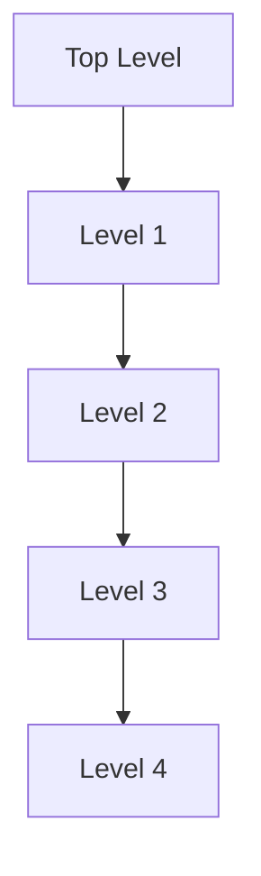
</details>

Abb. 8.F5

**6.** Eine Leiter lehnt gegen eine reibungsfreie Wand, wird aber durch die Reibung zwischen Leiter und Boden am Abrutschen gehindert. Angenommen, Sie verschieben den Fuß der Leiter näher zur Wand. Welche der folgenden Grö- ßen wird (betragsmäßig) größer, kleiner oder bleibt gleich: (a) die Normalkraft des Bodens auf die Leiter, (b) die Kraft der Wand auf die Leiter, (c) die Haftreibungskraft des Bodens auf die Leiter und (d) der Maximalwert $f _ { \mathrm { R , m a x } }$ der Haftreibungskraft?
**7.** Drei Tierfiguren hängen an der (ruhenden) Anordnung aus masselosen Rollen und Schnüren, wie sie in Abb. 8.F7 wiedergegeben ist. Eine Schnur verläuft von der Decke auf der rechten Seite zu der unteren Rolle links. An einigen kürzeren Schnüren hängen Rollen von der Decke bzw. Tierfiguren von den Rollen. Von zwei der Tierfiguren sind die Gewichte (in Newton) angegeben. (a) Welches Gewicht hat die dritte Tierfigur? (b) Wie groß ist die Zugkraft in der kurzen mit T gekennzeichneten Schnur ganz links? Hinweis: Wenn eine Schnur oberhalb einer Rolle halb herumläuft, dann zieht sie an dieser Rolle mit einer Gesamtkraft, die doppelt so groß ist wie die Zugkraft bzw. Seilkraft in der Schnur.


<details>
<summary>text_image</summary>

T
10
17
</details>

Abb. 8.F7

**8.** (a) Wenn Sie in Kontrollfrage 4 das Drehmoment $\tau _ { \mathsf { S } }$ durch T ausdrücken wollen, müssen Sie sin θ oder cos θ verwenden? (b) Wenn der Winkel θ kleiner wird (indem das Seil verkürzt wird, der Stab aber horizontal bleibt), wird das für das Gleichgewicht notwendige Drehmoment $\tau _ { \mathsf { S } }$ größer, kleiner oder bleibt es gleich? (c) Wird der Betrag der zugehörigen Kraft T größer, kleiner oder bleibt er gleich?
**9.** Die Tabelle gibt die Flächeninhalte von drei Flächen an sowie jeweils den Betrag einer Kraft, die senkrecht zu dieser Fläche wirkt und gleichförmig über sie verteilt ist. Ordnen

204

---

8.5 Fragen

8

Sie die Flächen nach der Größe der Spannung (die größte zuerst).

|  | Fläche | Kraft |
| --- | --- | --- |
| Fläche A | $0,5A_{0}$ | $2F_{0}$ |
| Fläche B | $2A_{0}$ | $4F_{0}$ |
| Fläche C | $3A_{0}$ | $6F_{0}$ |

**10.** Vier zylindrische Stäbe werden wie in Abb. 8.7a gedehnt. Die Beträge der Kräfte, die Querschnittsflächen, die Längenänderungen und die ursprünglichen Längen sind in der Tabelle aufgeführt. Ordnen Sie die Stäbe in absteigender Reihenfolge nach ihrem Elastizitätsmodul.

| Stab | Kraft | Fläche | absolute Längenänderung | ursprüngliche Länge |
| --- | --- | --- | --- | --- |
| 1 | F | A | $\Delta L$ | L |
| 2 | 2F | 2A | $2\Delta L$ | L |
| 3 | F | 2A | $2\Delta L$ | $2\Delta L$ |
| 4 | 2F | A | $\Delta L$ |  |

**11.** Abbildung 8.F11 zeigt drei Situationen, in denen der gleiche horizontale Stab an seinem einen Ende an einem Scharnier an einer Wand befestigt ist und an seinem anderen Ende von einer Schnur gehalten wird. Ordnen Sie die Situationen (1) bis (3) ohne Rechnung in absteigender Reihenfolge nach dem Betrag (a) der vertikalen Kraft der Schnur auf den Stab, (b) der vertikalen Kraft des Scharniers auf den Stab und (c) der horizontalen Kraft des Scharniers auf den Stab.


(1)


(2)


<details>
<summary>text_image</summary>

50°
</details>

(3)

Abb. 8.F11

**12.** Abbildung 8.F12 zeigt einen ruhenden Stab AC mit einer Masse von 5 kg, der durch ein Seil und die Reibung zwischen Stab und Wand gehalten wird. Der homogene Stab ist 1 m lang und der Winkel θ beträgt 30°. (a) Wenn Sie den Betrag der Kraft $\vec { T }$ des Seils auf den Stab aus einer einzigen Gleichung bestimmen sollten, an welche der markierten Positionen würden Sie die Drehachse legen? Welches Vorzeichen hat (b) das Drehmoment $\tau _ { \mathrm { G } }$ aufgrund des Gewichts des Stabes und (c) das Drehmoment $\tau _ { \mathrm { Z } }$ aufgrund der Zugspannung des Seils für diese Wahl der Drehachse, wenn Sie Drehmomente im Gegenuhrzeigersinn positiv zählen? (d) Ist der Betrag von $\tau _ { \mathrm { Z } }$ größer als, kleiner als oder gleich groß wie der von $\tau _ { \mathrm { G } } { } ^ { ? }$


<details>
<summary>text_image</summary>

D
θ
A B C
</details>

Abb. 8.F12

**13.** Die vertikale Stange in Abb. 8.F13 ist an ihrem unteren Ende beweglich und wird an ihrem oberen Ende durch ein Seil gehalten. Nun soll wie in der Abbildung gezeigt eine horizontale Kraft $\vec { F } _ { \mathrm { h } }$ auf die Stange ausgeübt werden. Nimmt die Zugspannung in dem Seil zu, ab oder bleibt sie gleich, wenn der Punkt, an dem die Kraft angreift, nach oben bewegt wird?


<details>
<summary>text_image</summary>

Diagram showing a vertical rod with applied force F_h acting on it, mounted on a horizontal surface.
</details>

Abb. 8.F13

205

---


---

# 9 Gravitation

## 9.1 Das Newtonsche Gravitationsgesetz

## Physikalische Motivation

Die Gravitation ist eine der Grundkräfte der Natur, sie zu verstehen ist daher eine wichtige Aufgabe der Physik. Sie ist die Kraft, die uns alle auf der Erde, den Mond auf seiner Umlaufbahn um die Erde und die Erde auf ihrer Umlaufbahn um die Sonne hält. Sie erstreckt sich durch unsere ganze Galaxie, die Milchstraße, und hält ihre Milliarden und Abermilliarden von Sternen ebenso zusammen wie die unzähligen Moleküle und Staubteilchen zwischen den Sternen. Wir befinden uns im Außenbereich dieser scheibenförmigen Ansammlung von Sternen und sonstiger Materie, etwa $^ { 2 , 6 \cdot 1 0 ^ { 4 } }$ Lichtjahre $( 2 , 5 \cdot 1 0 ^ { 2 0 }   \mathrm { m } )$ von dem galaktischen Zentrum entfernt, um das wir uns langsam drehen.

Die Gravitation wirkt auch auf noch größeren Maßstäben, durch den intergalaktischen Raum hält sie die Lokale Gruppe von Galaxien zusammen, die außer unserer Milchstraße auch die Andromeda-Galaxie (Abb. 9.1) in einem Abstand von $^ { 2 , 3 \cdot 1 0 ^ { 6 } }$ Lichtjahren von der Erde sowie einige näher gelegene Zwerggalaxien wie die Große und die Kleine Magellansche Wolke umfasst. Die Lokale Gruppe wiederum ist ein Teil des Lokalen Superhaufens von Galaxien, der seinerseits von der Schwerkraft in Richtung einer außerordentlich massiven Region voller Galaxienhaufen und -superhaufen gezogen wird, die als Großer Attraktor bezeichnet wird. Diese Region scheint etwa $\bar { 3 { , } 0 \cdot 1 0 ^ { 8 } }$ Lichtjahre von der Erde entfernt und auf der gegenüberliegenden Seite der Milchstraße zu liegen. Die Gravitation reicht sogar


<details>
<summary>natural_image</summary>

A spiral galaxy in deep space with star clusters and dust (no text or symbols visible)
</details>

Abb. 9.1

Der Andromeda-Nebel. Sein Abstand von uns beträgt $^ { 2 , 5 \cdot 1 0 ^ { 6 } }$ Lichtjahre und er ist als einzige Galaxie gerade noch mit dem bloßen Auge zu erkennen. Dieser kosmische Nachbar sieht unserer Heimatgalaxis, der Milchstraße, sehr ähnlich [Quelle: plefevre/iStockphoto].

Halliday Physik für natur- und ingenieurwiss. Studiengänge, 3. Auflage. D. Halliday, R. Resnick und J. Walker. © 2020 WILEY-VCH Verlag GmbH & Co. KGaA. Published 2020 by WILEY-VCH Verlag GmbH & Co. KGaA.

207

---

9 Gravitation

noch weiter, prinzipiell bis ins Unendliche – und sie versucht, das Universum als solches während der kosmischen Expansion zusammenzuhalten.

Die Gravitation ist auch für einige der geheimnisvollsten Strukturen im ganzen Universum verantwortlich: die Schwarze Löcher. Wenn ein Stern, der wesentlich größer ist als unsere Sonne, seinen nuklearen Brennstoffvorrat aufgebraucht hat, kann er die Gravitationskräfte zwischen seinen Teilchen nicht mehr kompensieren, sodass er kollabiert und im Extremfall zu einem Schwarzen Loch wird. Die Gravitation an der Oberfläche eines solchen kollabierten Sterns ist so stark, dass weder Teilchen noch Licht von seiner Oberfläche entweichen können (daher der Name „Schwarzes Loch“). Jeder Stern, der einem Schwarzen Loch zu nahe kommt, wird durch die starke Gravitation auseinander gerissen und in das Loch gezogen. Dies geschieht besonders häufig im Zentrum von Sternsystemen wie unserer Milchstraßen, wo sich daher im Laufe der Zeit ein sogenanntes supermassives Schwarzes Loch herausbildet. „Unser“ eigenes Schwarzes Riesenloch im Zentrum der Milchstraße liegt im Sternbild Schütze und wird deshalb Sagittarius A\* genannt, es hat eine Masse von etwa $^ { 3 , 7 \cdot 1 0 ^ { 6 } }$ Sonnenmassen. In der Nähe dieses Schwarzen Lochs ist die Gravitation so stark, dass sie kreisende Sterne zu einer peitschenden Bewegung um das Schwarze Loch antreibt, bei der sie für einen Umlauf nur wenige Jahre brauchen (die Sonne umrundet das Milchstraßenzentrum einmal in 220 Millionen Jahren).

Obwohl die Gravitation noch immer nicht vollständig verstanden ist, wollen wir mit unseren Ausführungen bei dem Gravitationsgesetz von Isaac Newton beginnen – vielleicht sind Sie ja derjenige oder diejenige, die in einigen Jahren die letzten Rätsel der Gravitation lösen wird.

## 9.1.1 Das Newtonsche Gravitationsgesetz

Physiker untersuchen gern scheinbar unzusammenhängende Phänomene, von denen sie dann zeigen wollen, dass es bei genauerer Betrachtung eine Beziehung zwischen ihnen gibt. Diese Suche nach Vereinheitlichungen hat eine jahrhundertelange Tradition. Im Jahr 1665 zeigte der damals 23-jährige Isaac Newton, dass es sich bei der Kraft, die den Mond in seiner Umlaufbahn hält, um dieselbe Kraft handelt, die auch einen Apfel zu Boden fallen lässt. Damit legte er einen Grundstein der Physik. Für uns heute ist dieser Zusammenhang so selbstverständlich geworden, dass es uns schwerfällt, anderslautende Vorstellungen der antiken Gelehrten nachzuvollziehen. Für sie waren die Bewegungen erdgebundener Körper und die Bewegungen der Himmelskörper von grundsätzlich unterschiedlicher Art und durch unterschiedliche Gesetze zu beschreiben.

Newton zeigte nicht nur, dass die Erde einen Apfel ebenso wie den Mond anzieht, sondern er schloss auch, dass jeder Körper im Universum jeden anderen Körper anzieht. Dieses Verhalten der Körper, sich aufeinander zuzubewegen, bezeichnet man als Gravitation. Newtons Schlussfolgerung ist nicht offensichtlich, denn die vertraute und starke Anziehungskraft, welche die Erde auf Körper auf ihrer Oberfläche ausübt, lässt die minimale Anziehungskräfte durch alltägliche Körper oft vergessen. Beispielsweise zieht die Erde einen Apfel mit einer Kraft von ungefähr 0,8 N an. Auch Sie ziehen einen Apfel an (und umgekehrt er Sie), aber diese Anziehungskraft ist kleiner als das Gewicht eines Staubteilchens.

Newton formulierte ein Kraftgesetz, das wir heute als das Newtonsche Gravitationsgesetz bezeichnen: Jedes Teilchen zieht jedes andere Teilchen mit einer Gravitationskraft an, deren Betrag durch die Beziehung

$$
F = G \frac {m _ {1} m _ {2}}{r ^ {2}} \quad \text {(Newtonsches Gravitationsgesetz)} \tag {9.1}
$$

gegeben ist. Hierbei sind $m _ { 1 }$ und $m _ { 2 }$ die Massen der Teilchen, r ist ihr Abstand und G die Gravitationskonstante. Ihr Wert beträgt

$$
G = 6, 6 7 \cdot 1 0 ^ {- 1 1} \mathrm{N} \cdot \mathrm{m} ^ {2} / \mathrm{kg} ^ {2} = 6, 6 7 \cdot 1 0 ^ {- 1 1} \mathrm{m} ^ {3} / \mathrm{kg} \cdot \mathrm{s} ^ {2}. \tag {9.2}
$$

208

---

9.1 Das Newtonsche Gravitationsgesetz

9

Wie in Abb. 9.2 zu sehen ist, wird ein Teilchen $m _ { 1 }$ von einem Teilchen $m _ { 2 }$ mit einer Gravitationskraft $\vec { F }$ angezogen, die auf Teilchen $m _ { 2 }$ gerichtet ist. Umgekehrt wird $m _ { 2 }$ von $m _ { 1 }$ durch eine Gravitationskraft $- \vec { F }$ in Richtung $m _ { 1 }$ angezogen. Die Kräfte $\vec { F }$ und $- \vec { F }$ bilden ein Kräftepaar im Sinn des dritten Newtonschen Gesetzes: Ihre Beträge sind gleich, aber sie sind entgegengesetzt gerichtet. Die Stärke dieser Kraft hängt vom Abstand zwischen den beiden Teilchen ab, allerdings nicht von ihrem Ort: Die beiden Teilchen können sich tief in einer Höhle oder auch tief im Weltraum befinden. Auch das Vorhandensein anderer Körper beeinflusst die beiden Kräfte $\vec { F }$ und $- \vec { F }$ nicht, selbst wenn sich diese anderen Körper genau zwischen den beiden Teilchen befinden.

Die Stärke der Gravitationskraft – wie stark sich also zwei Teilchen mit gege benen Massen in einem gegebenen Abstand anziehen – hängt von der Gravitationskonstanten G ab. Würde G durch ein Wunder plötzlich mit einem Faktor 10 multipliziert, würden Sie durch die Anziehungskraft der Erde auf den Boden geworfen. Betrüge andererseits G auf einmal nur noch 10 % des heutigen Werts, wäre die Anziehung der Erde so schwach, dass Sie über ein Gebäude springen könnten.

Obwohl sich das Newtonsche Gravitationsgesetz streng genommen auf Punktteilchen bezieht, können wir es auch auf ausgedehnte Gegenstände anwenden, sofern die Größe dieser Gegenstände klein im Vergleich zu ihrem Abstand ist. Mond und Erde sind weit genug voneinander entfernt, sodass wir beide Objekte in guter Näherung als punktförmig annehmen können – aber wie steht es mit dem Apfel und der Erde? Vom Standpunkt des Apfels erscheint die breite ausgedehnte Erde, die sich unter dem Apfel in jede Himmelsrichtung bis zum Horizont erstreckt, alles andere als punktförmig.

Newton löste dieses Apfel-Erde-Problem durch ein sehr wichtiges Theorem, das manchmal als das Kugelschalentheorem bezeichnet wird:


Eine homogene materielle Kugelschale zieht ein Teilchen außerhalb dieser Schale mit derselben Kraft an, die auch wirken würde, wenn die gesamte Materie der Schale sich in ihrem Mittelpunkt befände.

Die Erde kann man sich als eine Verschachtelung vieler solcher Kugelschalen vorstellen, vergleichbar mit Zwiebelschalen, und jede dieser Kugelschalen zieht ein Teilchen außerhalb der Erdoberfläche mit einer Kraft an, als ob ihre Masse im Mittelpunkt dieser Schale konzentriert wäre. Auch vom Standpunkt des Apfels aus be trachtet verhält sich die Erde daher wie ein Teilchen, das sich im Erdmittelpunkt befindet und dessen Masse gleich der Erdmasse ist.

Nehmen wir an, die Erde zieht wie in Abb. 9.3 dargestellt einen Apfel mit einer Kraft vom Betrag 0,8 N nach unten. Dann muss der Apfel die Erde mit einer Kraft vom Betrag 0,8 N nach oben ziehen. Von dieser Kraft können wir uns vorstellen, dass sie im Erdmittelpunkt angreift. Obwohl die Beträge dieser beiden Kräfte gleich sind, führen sie zu unterschiedlichen Beschleunigungen, wenn der Apfel losgelassen wird. Für den Apfel beträgt die Beschleunigung ungefähr $9 { , } 8   \mathrm { m / s ^ { 2 } ] }$ , die bekannte Beschleunigung eines frei fallenden Körpers in der Nähe der Erdoberfläche. Für die Erde beträgt die Beschleunigung im Schwerpunktsystem von Apfel und Erde aufgrund ihrer gigantisch großen Masse(nträgheit) nur rund $1 \cdot 1 0 ^ { - \hat { 2 } 5 }   \mathrm { m } / \mathrm { s } ^ { 2 }$

## KONTROLLFRAGE 1

Ein Teilchen wird der Reihe nach außerhalb der folgenden vier Gegenstände plat ziert, die jeweils die Masse m haben sollen: (1) eine große homogene Vollkugel, (2) eine große homogene Kugelschale, (3) eine kleine homogene Vollkugel und (4) eine kleine homogene Kugelschale. In allen Fällen beträgt der Abstand zwischen dem Teilchen und dem Mittelpunkt des Gegenstands d. Ordnen Sie die Gegenstände nach dem Betrag der Gravitationskraft, die sie auf das Teilchen ausüben.


<details>
<summary>text_image</summary>

m₁
F
-F
r
m₂
</details>

Abb. 9.2

Zwei Teilchen der Massen $m _ { 1 }$ und $m _ { 2 }$ im Abstand r ziehen sich gemäß dem Newtonschen Gravitationsgesetz (Gl. 9.1) an. Die Anziehungskräfte $\vec { F }$ und $- \vec { F }$ sind vom Betrag her gleich, aber entgegengesetzt gerichtet.


<details>
<summary>text_image</summary>

Diagram illustrating force vectors on an apple in a globe, showing positive and negative forces with arrows labeled F and -F.
</details>

Abb. 9.3

Der Apfel zieht die Erde mit derselben Kraft nach oben, mit der umgekehrt die Erde den Apfel nach unten zieht.

209

---

9 Gravitation

## 9.2 Gravitation und das Superpositionsprinzip


## Lernziele

Nach dem Durcharbeiten dieses Abschnitts sollten Sie in der Lage sein, . . .

• für Fälle, in denen mehr als eine Gravitationskraft auf ein Teilchen wirkt, ein Kräftediagramm zu zeichnen, das alle diese Kräfte zeigt, wobei die Enden aller Kraftvektoren an dem Teilchen angreifen,
• für Fälle, in denen mehr als eine Gravitationskraft auf ein Teilchen wirkt, die Gesamtkraft durch vektorielle Addition der einzelnen Kräfte zu berechnen.


## Schlüsselideen

• Gravitationskräfte gehorchen dem Superpositionsprinzip, d. h., wenn n Teilchen miteinander wechselwirken, ist die Gesamtkraft auf Teilchen 1 die Summe aller einzelnen Kräfte aufgrund von anderen Teilchen:

$$
\vec {F} _ {1, \mathrm{ges}} = \sum_ {i = 2} ^ {n} \vec {F} _ {1 i},
$$

wobei die vektorielle Summe alle Kräfte auf Teilchen 1 aufgrund von Teilchen $2 , 3 , \ldots , n$ umfasst.

• Die Gravitationskraft eines Teilchens aufgrund eines ausgedehnten Körpers kann berechnet werden, indem man den Körper in differenzielle Massenelemente dm aufteilt, die jeweils eine differenzielle Kraft $\mathrm { d } \vec { F }$ auf das Teilchen ausüben, und dann über alle diese Massenelemente integriert:

$$
\vec {F} _ {1} = \int \mathrm{d} \vec {F}.
$$

## 9.2.1 Gravitation und das Superpositionsprinzip

Für eine Gruppe aus mehreren Teilchen erhalten wir die Gesamtgravitationskraft, die auf jedes einzelne Teilchen von den anderen Teilchen ausgeübt wird, mithilfe des sogenannten Superpositionsprinzips. Hierbei handelt es sich um ein allgemeines Prinzip, wonach sich die Gesamtwirkung aus der Summe der einzelnen Wirkungen zusammensetzt. Im vorliegenden Fall bedeutet das Superpositionsprinzip, dass wir zunächst der Reihe nach die Gravitationskraft von jedem einzelnen Teilchen auf unser spezielles Teilchen berechnen können. Die Gesamtkraft erhalten wir dann, indem wir diese Kräfte vektoriell addieren.

Für n Teilchen in Wechselwirkung können wir das Superpositionsprinzip der Gravitationskraft in der folgenden Form ausdrücken:

$$
\vec {F} _ {1, \mathrm{ges}} = \vec {F} _ {1 2} + \vec {F} _ {1 3} + \vec {F} _ {1 4} + \vec {F} _ {1 5} + \dots + \vec {F} _ {1 n}. \tag {9.3}
$$

Hierbei ist $\vec { F } _ { 1 , \mathrm { g e s } }$ die Gesamtkraft auf Teilchen 1, und $\vec { \bar { F } } _ { 1 3 }$ ist z. B. die Kraft, die von Teilchen 3 auf Teilchen 1 ausgeübt wird. Wir können diese Gleichung auch etwas kompakter als Vektorsumme schreiben:

$$
\vec {F} _ {1, \text {ges}} = \sum_ {i = 2} ^ {n} \vec {F} _ {1 i}. \tag {9.4}
$$

Doch wie steht es mit der Gravitationskraft von einem wirklich ausgedehnten Kör per auf ein Teilchen? Diese Kraft erhalten wir, indem wir zunächst den Gegenstand in so kleine Teile zerlegen, dass wir diese wie Teilchen behandeln können, und anschließend nach Gl. 9.4 die vektorielle Summe aller Kräfte dieser einzelnen Teile bilden. Im Grenzfall unterteilen wir den ausgedehnten Gegenstand in infinitesimal

210

---

9.3 Die Gravitation in der Nähe der Erdoberfläche

9

kleine Teile der Masse dm, von denen jedes eine differenzielle Kraft $\mathrm { d } \vec { F }$ auf das Teilchen ausübt. In diesem Grenzfall wird aus der Summe in Gl. 9.4 ein Integral und wir erhalten

$$
\vec {F} _ {1} = \int \mathrm{d} \vec {F}. \tag {9.5}
$$

Das Integral erstreckt sich dabei über den gesamten Gegenstand und den Index $\mathbf { \nabla } _ { \mathbf { \nabla } ^ { \prime } } \mathbf { g e s } ^ { \alpha }$ haben wir weggelassen. Handelt es sich bei dem Gegenstand um eine homogene Vollkugel oder eine gleichförmige Kugelschale, können wir das Integral in Gl. 9.5 umgehen, indem wir uns die Masse des Gegenstands in seinem Mittelpunkt konzentriert denken und Gl. 9.1 anwenden.

## KONTROLLFRAGE 2

In der Abbildung erkennt man vier Anordnungen von jeweils drei Teilchen gleicher Masse. (a) Ordnen Sie die Anordnungen nach dem Betrag der Gesamtgravitationskraft (die größte zuerst) auf das mit $_ { v } m ^ { \alpha }$ gekennzeichnete Teilchen. (b) Liegt die Richtung der Gesamtkraft in Anordnung 2 näher an der Linie der Länge d oder näher an der Linie der Länge D?


## KONTROLLFRAGE 3

In welche Richtung wirkt in der Abbildung die Gesamtgravitationskraft auf das Teilchen der Masse $m _ { 1 }$ aufgrund der anderen Teilchen, die jeweils die Masse m haben und symmetrisch relativ zur y-Achse angeordnet sein sollen?


<details>
<summary>text_image</summary>

y
m₁
m
m
m
x
</details>

## LÖSUNGSSTRATEGIEN

**Strategie 1: Kräftediagramm für ein Teilchen** Wenn Sie ein Diagramm von Teilchen vor sich haben, wie beispielsweise Abb. 9.4a im Übungsbuch, und die Gesamtgravitationskraft auf eines dieser Teilchen bestimmen wollen, dann sollten Sie zunächst ein Kräftediagramm nur für dieses eine Teilchen zeichnen. In diesem Kräftediagramm sollten auch nur die Kräfte auf dieses eine Teilchen eingezeichnet sein, wie in Abb. 9.4b im Übungsbuch. Wenn Sie es jedoch vorziehen, die Kraftvektoren in dem gegebenen Diagramm direkt zu überlagern, dann sollten Sie die Vektoren mit ihren Enden oder ihren Spitzen an das Teilchen zeichnen, auf das die Kräfte wirken. Zeichnen Sie die Vektoren an anderer Stelle, kann das zu Verwirrung führen, und mit Sicherheit stiftet es Verwirrung, wenn Sie die Vektoren an die Teilchen zeichnen, welche die Kräfte auf das betreffende Teilchen verursachen.

## 9.3 Die Gravitation in der Nähe der Erdoberfläche

## Lernziele

Nach dem Durcharbeiten dieses Abschnitts sollten Sie in der Lage sein, . . .

• zwischen der Beschleunigung des freien Falls und der Gravitationsbeschleunigung zu unterscheiden,
• die Gravitationsbeschleunigung in der Nähe, aber außerhalb eines homogenen kugelförmigen astronomischen Körpers zu berechnen,
• zwischen dem gemessenen Gewicht und dem Betrag der Gravitationskraft zu unterscheiden.


211

---

9 Gravitation


## Schlüsselideen

• Die Gravitationsbeschleunigung $\alpha _ { \mathrm { G } }$ eines Teilchens der Masse m resultiert einzig aus der Schwerkraft. Wenn das Teilchen sich in einem Abstand r vom Mittelpunkt eines homogenen sphärischen Körpers der Masse M befindet, ist der Betrag F der Gravitationskraft auf das Teilchen durch Gl. 9.1 gegeben. Daher gilt nach dem zweiten Newtonschen Gesetz

$$
a _ {\mathrm{G}} = \frac {G M}{r ^ {2}}.
$$

Die Masse der Erde ist nicht homogen verteilt, weil die Erde nicht perfekt sphä- risch ist, die Erdkruste unterschiedlich dick ist und weil die Erde sich dreht. Daher unterscheidet sich die gemessene Beschleunigung $\vec { g }$ geringfügig von der Gravitationsbeschleunigung ${ \vec { a } } _ { \mathrm { G } }$ , und ebenso unterscheidet sich das Gewicht mg eines Teilchens geringfügig von der auf das Teilchen wirkenden Kraft der Gravitation.

## 9.3.1 Die Gravitation in der Nähe der Erdoberfläche

Wenn wir die Erde als eine homogene Kugel der Masse M ansehen, ist der Betrag der Gravitationskraft von der Erde auf ein Teilchen der Masse m, das sich im Abstand r vom Erdmittelpunkt über der Erdoberfläche befindet, durch Gl. 9.1 gegeben:

$$
F = G \frac {M m}{r ^ {2}}. \tag {9.6}
$$

Lässt man das Teilchen los, so fällt es aufgrund der Gravitationskraft $\vec { F }$ auf den Erdmittelpunkt zu (und dieser mit minimaler Geschwindigkeit auf das Teilchen zu!). Die Beschleunigung des Teilchens bezeichnen wir als Gravitationsbeschleunigung ${ \vec { a } } _ { \mathrm { G } }$ . Nach dem zweiten Newtonschen Gesetz hängen die Beträge F und $a _ { \mathrm { G } }$ über

$$
F = m a _ {\mathrm{G}} \tag {9.7}
$$

zusammen. Setzen wir F aus Gl. 9.6 in Gl. 9.7 ein und lösen nach $a _ { \mathrm { G } }$ auf, erhalten wir

$$
a _ {\mathrm{G}} = \frac {G M}{r ^ {2}}. \tag {9.8}
$$

Tabelle 9.1 gibt einige Werte für $a _ { \mathrm { G } }$ für verschiedene Höhen über der Erdoberflä- che an.

Seit Abschn. 2.2 haben wir angenommen, dass es sich bei der Erde um ein Iner tialsystem handelt, und ihre Eigendrehung vernachlässigt. Wegen dieser Vereinfachung konnten wir die tatsächliche Fallbeschleunigung (oder Erdbeschleunigung) $g$ eines Teilchens mit der Gravitationsbeschleunigung an der Erdoberfläche (die wir mit $x a _ { G } \; ( \mathrm { { \sf { m } } } / \mathrm { { s } } ^ { 2 } )$ bezeichnen) gleichsetzen. Außerdem haben wir angenommen,

TABELLE 9.1: Werte für $\alpha _ { \mathrm { G } }$ in Abhängigkeit von der Höhe.

| Höhe (km) | $a_{G}$ (m/s2) | Beispiel |
| --- | --- | --- |
| 0 | 9,83 | mittlere Höhe der Erdoberfläche |
| 8,8 | 9,80 | Mt. Everest |
| 36,6 | 9,71 | höchster bemannter Ballon |
| 400 | 8,70 | Bahn des Spaceshuttles |
| 35 700 | 0,225 | Nachrichtenübertragungssatelliten |

212

---

9.3 Die Gravitation in der Nähe der Erdoberfläche

9

dass g auf der gesamten Erdoberfläche den konstanten Wert $9 { , } 8   \mathrm { m / s ^ { 2 } }$ hat. Der für g gemessene Wert unterscheidet sich jedoch von dem aus Gl. 9.8 berechneten Wert $a _ { \mathrm { G } }$ aus drei Gründen: (1) Die Erde (und vor allem die Erdkruste) hat keine perfekt homogene Massenverteilung, (2) sie ist keine perfekte Kugel und (3) sie dreht sich, und zwar um eine Achse durch ihren Mittelpunkt. Da g und $a _ { \mathrm { G } }$ verschieden sind, unterscheidet sich aus denselben drei Gründen auch der Betrag des gemessenen Gewichts mg eines Teilchens von dem Betrag der Gravitationskraft nach Gl. 9.6. Diese Gründe wollen wir nun genauer untersuchen.

1. **Die Erde ist nicht homogen.** Die Dichte (Masse pro Volumen) der Erde verändert sich wie in Abb. 9.4 angegeben mit dem Radius. Außerdem ist die Dichte der Erdkruste (äußerer Bereich) an verschiedenen Orten der Erdoberfläche unterschiedlich – vergleichen Sie z. B. die Dicke der Erdkruste am Mt. Everest und am Boden des Pazifik. Daher hängt auch g vom Ort an der Erdoberfläche ab.
2. **Die Erde ist keine Kugel.** Die Erde ist näherungsweise ein Ellipsoid: abgeplattet an den Polen und etwas verdickt am Äquator. Ihr äquatorialer Radius ist um 21 km größer als ihr Radius an Nord- und Südpol. Ein Punkt am Pol ist daher dem Erdmittelpunkt näher als ein Punkt am Äquator. Das ist einer der Gründe, warum die Erdbeschleunigung g zunimmt, wenn man sich auf Meereshöhe vom Äquator zu einem der beiden Pole bewegt.
3. **Die Erde rotiert.** Die Drehachse verläuft durch Mittelpunkt, Nord- und Südpol der Erde. Ein Gegenstand irgendwo auf der Erdoberfläche (außer an den Polen selbst) muss sich auf einem Kreis um die Drehachse bewegen und daher eine Zentripetalbeschleunigung in Richtung des Kreismittelpunkts erfahren. Diese Zentripetalbeschleunigung erfordert eine ebenfalls auf diesen Mittelpunkt gerichtete Zentripetalkraft.

Zur Berechnung des Unterschieds zwischen g und $a _ { \mathrm { G } }$ aufgrund der Erdrotation untersuchen wir den einfachen Fall, in dem eine Kiste der Masse m am Äquator auf einer Waage liegt. Abbildung 9.5a zeigt diese Situation aus einem Blickwinkel weit oberhalb des Nordpols.

Abbildung 9.5b zeigt ein Kräftediagramm für die Kiste. Zwei Kräfte wirken auf die Kiste, beide entlang der radialen Achse vom Erdmittelpunkt. Die Normalkraft $\vec { N }$ von der Waage auf die Kiste ist nach außen gerichtet, entlang der positiven Richtung der r-Achse. Die Gravitationskraft, dargestellt durch $m \vec { a } _ { \mathrm { G } }$ , ist zum Erdmittelpunkt gerichtet. Da sich die Kiste mit der Erde auf einem Kreis um den Erdmittelpunkt dreht, wirkt die Zentripetalbeschleunigung nach innen. Nach Gl. 6.20 hat diese Beschleunigung die Form $\omega ^ { 2 } R ,$ wobei ω die Winkelgeschwindigkeit der Erde und R der Kreisradius (näherungsweise der Erdradius) ist. Das zweite Newtonsche Gesetz für die r-Achse $( F _ { \mathrm { g e s } , r } = m a _ { r } )$ wird damit zu

$$
N - m a _ {\mathrm{G}} = m (- \omega^ {2} R). \tag {9.9}
$$

Der Betrag N der Normalkraft ist gleich dem auf der Waage abgelesenen Gewicht mg. Ersetzen wir N in Gl. 9.9 durch mg, so erhalten wir

$$
m g = m a _ {\mathrm{G}} - m (\omega^ {2} R) \tag {9.10}
$$

beziehungsweise in Worten:

$$
\binom{\text {gemessenes}}{\text {Gewicht}} = \binom{\text {Betrag der}}{\text {Gravitationskraft}} - \binom{\text {Zentripetal-}}{\text {kraft}}.
$$

Das gemessene Gewicht ist daher wegen der Erddrehung kleiner als der Betrag der Gravitationskraft auf die Kiste.

Einen entsprechenden Ausdruck für $g$ und $\alpha _ { \mathrm { G } }$ erhalten wir, indem wir Gl. 9.10 durch m dividieren:

$$
g = a _ {\mathrm{G}} - \omega^ {2} R \tag {9.11}
$$


<details>
<summary>line</summary>

| Abstand vom Erdmittelpunkt (10^6 m) | Dichte (10^3 kg/m^3) |
| --- | --- |
| 0 | ~13.5 |
| 1.4 | ~12.0 |
| 3.3 | ~9.8 |
| 3.4 | ~5.3 |
| 6.4 | ~2.7 |
</details>

Abb. 9.4

Die Dichte der Erde als Funktion des Abstands von ihrem Mittelpunkt. Die Grenzen für den festen inneren Kern, den zum größten Teil flüssigen äußeren Kern und den festen Mantel sind eingetragen. Die Erdkruste ist jedoch zu dünn, um in dieser Zeichnung erkennbar zu sein.


<details>
<summary>text_image</summary>

Kiste
Waage
R
Nordpol
</details>

(a)


<details>
<summary>text_image</summary>

r
N
Kiste
a
maG
</details>

(b)

Abb. 9.5

(a) Eine Kiste liegt auf einer Waage am Erdäquator; die Blickrichtung verläuft entlang der Drehachse von einem Punkt oberhalb des Nordpols. (b) Ein Kräftediagramm für die Kiste mit einer radial nach außen gerichteten r-Achse. Die Gravitationskraft auf die Kiste ist durch ihr Äquivalent $m \vec { a } _ { \mathrm { G } }$ dargestellt. Die Normalkraft von der Waage auf die Kiste ist $\vec { N } .$ Wegen der Erdrotation wirkt auf die Kiste noch eine zum Erdmittelpunkt hin gerichtete Zentripetalbeschleunigung a⃗.

213

---

9 Gravitation

beziehungsweise in Worten:

$$
\binom{\text {freie Fall - }}{\text {beschleunigung}} = \binom{\text {Erd - }}{\text {beschleunigung}} - \binom{\text {Zentripetal - }}{\text {beschleunigung}}.
$$

Die gemessene freie Fallbeschleunigung ist also wegen der Erddrehung kleiner als die Erdbeschleunigung.

Der Unterschied zwischen den Beschleunigungen $g$ und $a _ { \mathrm { G } }$ beträgt $\omega ^ { 2 } R$ und ist am Äquator am größten (denn dort ist der Radius des von der Kiste durchlaufenen Kreises am größten). Zur Berechnung dieses Unterschieds verwenden wir Gl. 6.5 $\left( \omega = \Delta \theta / \Delta t \right)$ und den Erdradius $R = 6 , 3 7 \cdot 1 0 ^ { 6 }   \mathrm { m }$ . Für eine Erddrehung ist θ gleich 2π und die Zeitdauer beträgt ungefähr 24 h. Mit diesen Werten (und der Umrechnung $1   \mathrm { h } = 8 6   4 0 0   \mathrm { s } )$ erhalten wir $\operatorname { f i i r } g$ einen um $0 , 0 3 4   \mathrm { m } / \mathrm { s } ^ { 2 }$ kleineren Wert als für $a _ { \mathrm { G } } .$ Verglichen mit $9 { , } 8   \mathrm { m } / \mathrm { s } ^ { 2 }$ können wir diese Differenz zwischen g und $\alpha _ { \mathrm { G } }$ meist vernachlässigen. Aus demselben Grund ist auch der Unterschied zwischen der Gewichtskraft und dem Betrag der Gravitationskraft meist vernachlässigbar.

## 9.4 Die Gravitation innerhalb der Erde


## Lernziele

Nach dem Durcharbeiten dieses Abschnitts sollten Sie in der Lage sein, . . .

• zu verstehen, dass eine homogene Materieschale keine Gravitationskraft auf ein Teilchen ausübt, das sich in ihr befindet,
• die Gravitationskraft auf ein Teilchen zu berechnen, das sich im Inneren einer nicht rotierenden, homogenen Kugel in einem Abstand r vom Zentrum befindet.


## Schlüsselideen

• Eine homogene Schale übt keine resultierende Gravitationskraft auf ein darin befindliches Teilchen aus.
• Die Gravitationskraft auf ein Teilchen innerhalb einer homogenen Vollkugel in einem Abstand r vom Zentrum hängt nur von der Masse M in einer „inneren Kugel“ mit gerade diesem Radius r ab,

$$
M _ {\mathrm{in}} = \frac {4}{3} \pi r ^ {3} \rho = \frac {M}{R ^ {3}} r ^ {3},
$$

wobei ρ die Dichte der Vollkugel ist, R ihr Radius und M ihre Masse. Wir können diese „innere Masse“ auch gedanklich einem Teilchen im Zentrum der Vollkugel zuordnen und dann das Newtonsche Gravitationsgesetz für Teilchen anwenden. Der Betrag der auf die Masse m wirkenden Kraft ist

$$
F = \frac {g m M}{R ^ {3}} r.
$$

## 9.4.1 Die Gravitation innerhalb der Erde

Das Kugelschalentheorem von Newton lässt sich auch auf eine Situation anwenden, bei der sich ein Teilchen innerhalb einer gleichförmigen Kugelschale befindet. In diesem Fall folgt:


Eine homogene sphärische Materieschale übt auf ein Teilchen innerhalb dieser Schale keine Gesamtgravitationskraft aus.

Vorsicht: Diese Aussage bedeutet nicht, dass die Gravitationskräfte von den verschiedenen Elementen der Kugelschale auf das Teilchen auf mysteriöse Weise verschwinden. Sie besagt nur, dass die Summe aller Kraftvektoren von diesen Elementen auf das Teilchen null ist.

214

---

9.4 Die Gravitation innerhalb der Erde

9

Wäre die Dichte der Erde homogen, würde an der Erdoberfläche auf ein Teilchen die größtmögliche Gravitationskraft wirken. Bewegte sich das Teilchen vom Erdmittelpunkt weg, würde die Gravitationskraft kleiner. Bewegte sich das Teilchen zum Erdmittelpunkt hin, fällt es beispielsweise in einen tiefen Minenschacht, würde sich die Gravitationskraft ebenfalls verändern, und zwar aus zwei Gründen: (1) Sie würde zunehmen, weil sich das Teilchen näher auf den Erdmittelpunkt zubewegt, und (2) sie würde abnehmen, weil die dicker werdende Kugelschale aus Erdmaterie außerhalb der radialen Lage des Teilchens keine Gesamtkraft auf das Teilchen mehr ausübt.

Für eine homogene Erde würde der zweite Einfluss überwiegen. Die Kraft auf das Teilchen nähme immer weiter ab, wenn sich das Teilchen dem Erdmittelpunkt näherte und würde schließlich am Mittelpunkt verschwinden. Für unsere tatsächlich existierende (nicht homogene) Erde nimmt die Kraft jedoch zunächst zu, wenn sich das Teilchen von der Oberfläche nach unten bewegt. Die Kraft erreicht in einer bestimmten Tiefe ein Maximum, und erst wenn sich das Teilchen weiter auf den Erdmittelpunkt zubewegt, beginnt sie wieder abzunehmen.

Um einen Ausdruck für die Gravitationskraft im Inneren einer (homogen gedachten) Erdkugel zu bestimmen, orientieren wir uns an der Geschichte $_ { r ^ { V } }$ on Pol zu Pol“, einer frühen Science-Fiction-Erzählung von George Griffith. Hier versuchen drei Forscher, in einer Kapsel durch einen natürlich entstandenen (und natürlich fiktiven) Tunnel direkt vom Südpol zum Nordpol zu reisen. Abbildung 9.6 zeigt die Kapsel (mit der Masse m) in einem Abstand r vom Erdmittelpunkt. In diesem Moment wirkt eine resultierende Gravitationskraft auf die Kapsel, die sich aus der Masse $M _ { \mathrm { i n } }$ innerhalb der Kugel mit dem Radius r errechnet (die Masse innerhalb der gestrichelten Linie); die Masse in der äußeren Kugelschale (außerhalb der gestrichelten Linie) hat keinen Einfluss. Darüber hinaus können wir annehmen, dass die Masse $M _ { \mathrm { i n } }$ im Erdmittelpunkt konzentriert ist, und können daher Gl. 9.1 für den Betrag der Gravitationskraft auf die Kapsel verwenden; so erhalten wir

$$
F = \frac {G m M _ {\mathrm{in}}}{r ^ {2}}. \tag {9.12}
$$

Da wir von einer homogenen Dichte $\rho$ ausgehen, können wir die Masse $M _ { \mathrm { i n } }$ durch die Gesamtmasse M der Erde und ihren Radius R ausdrücken:

$$
\text {Dichte} = \frac {\text {Masse innen}}{\text {Volumen innen}} = \frac {\text {Gesamtmasse}}{\text {Gesamtvolumen}},
$$

$$
\rho = \frac {M _ {\mathrm{in}}}{\frac {4}{3} \pi r ^ {3}} = \frac {M}{\frac {4}{3} \pi R ^ {3}}.
$$

Auflösen nach $M _ { \mathrm { i n } }$ ergibt

$$
M _ {\mathrm{in}} = \frac {4}{3} \pi r ^ {3} \rho = \frac {M}{R ^ {3}} r ^ {3}. \tag {9.13}
$$

Nun setzen wir den zweiten Ausdruck für $M _ { \mathrm { i n } }$ in Gl. 9.12 ein und erhalten so den gesuchten Ausdruck für die Kraft der Gravitation auf eine Kapsel als Funktion ihres Abstands r von Erdmittelpunkt:

$$
F = \frac {G m M}{R ^ {3}} r. \tag {9.14}
$$

In der Geschichte von Griffith nimmt die Gravitationskraft auf die Forscher gefährlich zu, als sich ihre Kapsel dem Erdmittelpunkt nähert. Dann, exakt am Mittelpunkt, verschwindet die Kraft plötzlich für einen kurzen Moment. Aus Gl. 9.14 erkennen wir, dass die Kraft in Wirklichkeit linear abnimmt, während sich die Kapsel dem Erdmittelpunkt nähert und dort null wird. Wenigstens in diesem letzten Punkt hatte der Autor der Geschichte also recht.

Wir können Gl. 9.14 auch mit dem Kraftvektor $\vec { F }$ und dem Positionsvektor ⃗r der Kapsel formulieren, wenn wir $\vec { r }$ entlang der radialen Achse vom Erdmittelpunkt


<details>
<summary>text_image</summary>

M_in
r
m
</details>

Abb. 9.6

Eine Kapsel der Masse m fällt aus dem Stillstand durch einen Tunnel, der den Nord- und Südpol der Erde miteinander verbindet. Wenn sich die Kapsel in einem Abstand r vom Erdmittelpunkt befindet, trägt von der Erdmasse nur noch der Teil $M _ { \mathrm { i n } }$ zur Gravitationskraft bei, der sich in einer Kugel innerhalb dieses Radius r befindet.

215

---

9 Gravitation

wählen. Wir bezeichnen die Konstanten aus Gl. 9.14 zusammengefasst mit K und erhalten so für Gl. 9.14 in Vektorschreibweise

$$
\vec {F} = - K \vec {r}. \tag {9.15}
$$

Hierbei haben wir ein Minuszeichen eingefügt, um anzudeuten, dass $\vec { F }$ und ⃗r in entgegengesetzte Richtungen zeigen. Gleichung 9.15 hat die Form des Hookeschen Gesetzes (Gl. 3.18). Unter den von Griffith und uns angenommenen idealisierten Bedingungen würde die Kapsel also wie ein Gewicht an einer Feder um den Erdmittelpunkt schwingen, d. h., nachdem sie vom Südpol zum Erdmittelpunkt gefallen wäre, würde sie von dort weiter zum Nordpol fliegen (wie bei Griffith beschrieben) und anschließend wieder zurück. Dieser Prozess würde sich – vermutlich sehr zum Missfallen der Forscher in der Kapsel – unendlich wiederholen. Träte noch Luftreibung hinzu (eine realistische Annahme), nähme die Schwingungsamplitude mit der Zeit immer weiter ab, bis die Kapsel schließlich im Erdmittelpunkt zur Ruhe kommt, was den Forschern möglicherweise noch mehr missfallen würde.

## 9.5 Die potenzielle Energie der Gravitation


## Lernziele

Nach dem Durcharbeiten dieses Abschnitts sollten Sie in der Lage sein, . . .

• die potenzielle Energie der Gravitation für ein System von Teilchen (oder von Kugeln, die als Teilchen behandelt werden können) zu berechnen,
zu verstehen, dass die von der Gravitation an einem Teilchen verrichtete Arbeit (und damit die Veränderung von dessen potenzieller Gravitationsenergie), wenn sich dieses von einem Anfangspunkt zu einem Endpunkt bewegt, nicht von dem Weg abhängt, den das Teilchen nimmt,
aus der Kraft der Gravitation, die in der Nähe eines astronomischen (oder eines anderen ortsfesten) Körpers auf ein Teilchen wirkt, die Arbeit zu berechnen, die diese Kraft an dem Teilchen verrichtet, wenn es sich bewegt,
• die Erhaltung der mechanischen Energie (einschließlich der Gravitationsenergie) auf ein Teilchen anzuwenden, das sich relativ zu einem astronomischen (oder sonstigen ortsfesten) Körper bewegt,
• die Energie zu berechnen, die ein Teilchen aufbringen muss, um aus dem Schwerefeld eines astronomischen Körpers (in der Regel als homogene Kugel betrachtet) zu entkommen,
• die Fluchtgeschwindigkeit eines Teilchens für das Verlassen eines astronomischen Körpers zu berechnen.


## Schlüsselideen

Die potenzielle Gravitationsenergie U(r) eines Systems von zwei Teilchen mit den Massen M und m in einem Abstand r voneinander ist das Negative der Arbeit, die die Gravitationskraft eines der beiden Teilchen an dem jeweils anderen verrichten würde, wenn man den Abstand zwischen den Teilchen von unendlich (sehr groß) auf r verringern würde. Diese Energie ist

$$
U = - \frac {G M m}{r}.
$$

• Wenn ein System aus mehr als zwei Teilchen besteht, ist seine gesamte potenzielle Gravitationsenergie U die Summe der potenziellen Energien aller Paare von Teilchen. Für drei Teilchen der Massen $m _ { 1 } , m _ { 2 }$ und $m _ { 3 }$ gilt beispielsweise

$$
U = - \left(\frac {G m _ {1} m _ {2}}{r _ {1 2}} + \frac {G m _ {1} m _ {3}}{r _ {1 3}} + \frac {G m _ {2} m _ {3}}{r _ {2 3}}\right).
$$

• Ein Objekt kann aus dem Schwerefeld eines astronomischen Körpers mit der Masse M und dem Radius R entkommen (d. h., es kann einen unendlichen

216

---

9.5 Die potenzielle Energie der Gravitation

9

Abstand von diesem Körper erreichen), wenn seine Geschwindigkeit nahe der Oberfläche des Körpers mindestens gleich der Fluchtgeschwindigkeit v ist:

$$
\nu = \sqrt {\frac {2 G M}{R}}.
$$

## 9.5.1 Die potenzielle Energie der Gravitation

In Abschn. 4.1 haben wir die potenzielle Energie der Gravitation für ein System aus einem Teilchen und der Erde behandelt. Das Teilchen befand sich in diesem Fall in der Nähe der Erdoberfläche, sodass wir die Gravitationskraft als konstant annehmen konnten. Einer sinnvoll gewählten Referenzkonfiguration dieses Systems haben wir dann den Wert null für die potenzielle Energie zugeschrieben. Meist befand sich das Teilchen in dieser ausgezeichneten Konfiguration auf der Erdoberfläche. Für ein Teilchen oberhalb der Erdoberfläche nahm die potenzielle Gravitationsenergie mit zunehmendem Abstand von der Erde zu.

Nun wollen wir unsere Einsichten vertiefen und die potenzielle Gravitationsenergie U von zwei Teilchen der Massen m und M im Abstand r bestimmen. Wiederum wählen wir eine ausgezeichnete Bezugskonfiguration, für die U verschwinden soll. Diesmal vereinfachen sich allerdings die Gleichungen, wenn wir für diese Bezugskonfiguration den Abstand zwischen den Teilchen als so groß annehmen, dass wir ihn als unendlich approximieren dürfen. Wie vorher wird die potenzielle Energie der Gravitation abnehmen, wenn der Abstand zwischen den Teilchen abnimmt. Da $U = 0$ für $r = \infty$ , ist die potenzielle Energie für jeden endlichen $\mathrm { A b } \mathrm { - }$ stand negativ, und sie wird immer negativer, je näher sich die Teilchen kommen.

Wie wir gleich beweisen werden, ist die potenzielle Energie der Gravitation für das Zweiteilchensystem unter diesen Bedingungen durch

$$
U = - \frac {G M m}{r} \quad (\text {potenzielle Energie der Gravitation}) \tag {9.16}
$$

gegeben. Man beachte, dass $U ( r )$ für r gegen unendlich gegen null geht, und dass $U ( r )$ für jeden endlichen (positiven) Wert von r negativ ist.

Die durch Gl. 9.16 gegebene potenzielle Gravitationsenergie ist eine Eigenschaft des Zweiteilchensystems, nicht der einzelnen Teilchen für sich genommen. Diese Energie lässt sich auch nicht in zwei Anteile aufspalten, die den einzelnen Teilchen getrennt zugesprochen werden könnten. Ist jedoch $M \gg m ,$ , wie es beispielsweise bei der Erde (Masse M) und einem Tennisball (Masse m) der Fall ist, so sprechen wir oft von „der potenziellen Energie des Tennisballs“. Diese Sprechweise ist zulässig, weil für einen Tennisball in der Nähe der Erdoberfläche Änderungen in der potenziellen Energie des Gesamtsystems nahezu ausschließlich zu einer Änderung der kinetischen Energie des Tennisballs führen. Die Änderungen in der kinetischen Energie der Erde sind unmessbar klein. In Abschn. 9.7 werden wir von „der potenziellen Energie eines künstlichen Satelliten“ sprechen, weil auch in diesem Fall die Masse des Satelliten sehr viel kleiner als die Erdmasse ist. Wenn wir jedoch von der potenziellen Energie von Körpern vergleichbarer Masse sprechen, müssen wir diese immer als ein zusammenhängendes System ansehen.

Enthält unser System mehr als zwei Teilchen, so betrachten wir zunächst jedes Teilchenpaar getrennt. Wir berechnen nach Gl. 9.16 die potenzielle Gravitationsenergie für dieses Teilchenpaar und tun so, als ob die anderen Teilchen nicht vorhanden wären. Schließlich addieren wir die Ergebnisse. Wenden wir beispielsweise Gl. 9.16 auf jedes der drei Teilchenpaare in Abb. 9.7 an, so erhalten wir für die potenzielle Energie des Gesamtsystems

$$
U = - \left(\frac {G m _ {1} m _ {2}}{r _ {1 2}} + \frac {G m _ {1} m _ {3}}{r _ {1 3}} + \frac {G m _ {2} m _ {3}}{r _ {2 3}}\right) \quad \binom {\text {potenzielle Energie}} {\text {der Gravitation}}. \tag {9.17}
$$


<details>
<summary>flowchart</summary>

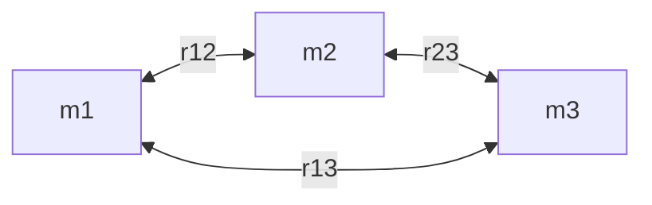
</details>

Abb. 9.7

Drei Körper bilden ein System. Der Abstand zwischen je zwei Teilchen ist durch einen Doppelindex gekennzeichnet, der sich auf die beiden Teilchen bezieht. Die potenzielle Energie der Gravitation für das System ist gleich der Summe der potenziellen Energien der drei Teilchenpaare.

217

---

9 Gravitation


<details>
<summary>text_image</summary>

r
d⃗r
F
P
M
R
</details>

Abb. 9.8

Ein Tennisball wird radial von der Erde weg durch den Punkt P im Abstand R vom Erdmittelpunkt geworfen. In der Zeichnung wiedergegeben sind die Gravitationskraft $\vec { F }$ auf den Ball sowie ein differenzieller Verschiebungsvektor d⃗r. Beide sind entlang der radialen r-Achse gerichtet.


<details>
<summary>flowchart</summary>


</details>

Abb. 9.9

In der Nähe der Erde wird ein Tennisball von Punkt A nach Punkt G entlang eines Wegs aus Radialabschnitten und Kreisbögen transportiert.

## Beweis von Gl. 9.16

Wir werfen einen Tennisball entlang des in Abb. 9.8 eingezeichneten Wegs radial von der Erde weg „nach unendlich“. Unser Ziel ist es, einen Ausdruck für die potenzielle Gravitationsenergie U des Balls am Punkt P auf diesem Weg im Abstand R vom Erdmittelpunkt zu finden. Dazu berechnen wir zunächst die Arbeit $W ,$ welche die Gravitationskraft an dem Ball während seines Flugs von Punkt P zu einem Punkt in sehr großem Abstand (unendlich) von der Erde leistet. Da die Gravitationskraft $\vec { F } ( r )$ nicht konstant ist (ihr Betrag hängt von r ab), müssen wir zur Bestimmung dieser Arbeit die Methoden aus Abschn. 3.5 anwenden. In Vektorschreibweise gilt

$$
W = \int_ {R} ^ {\infty} \vec {F} (r) \cdot \mathrm{d} \vec {r}. \tag {9.18}
$$

Das Integral enthält das Skalarprodukt der Kraft $\vec { F }$ mit dem differenziellen Verschiebungsvektor $\mathrm { d } \vec { r }$ entlang des Wegs des Balls. Dieses Produkt können wir auch in der Form

$$
\vec {F} (r) \cdot \mathrm{d} \vec {r} = F (r) \mathrm{d} r \cos \varphi \tag {9.19}
$$

schreiben, wobei 𝜑 der Winkel zwischen den Richtungen von $\vec { F } ( r )$ und $\mathrm { d } \vec { r }$ ist. Dieser Winkel 𝜑 beträgt immer 180°. Ersetzen wir jetzt noch $F ( r )$ durch den Ausdruck in Gl. 9.1, so wird aus Gl. 9.19

$$
\vec {F} (r) \cdot \mathrm{d} \vec {r} = - \frac {G M m}{r ^ {2}} \mathrm{d} r,
$$

wobei wir mit M die Masse der Erde und mit m die Masse des Tennisballs bezeichnen.

Diesen Ausdruck können wir nun in Gl. 9.18 einsetzen und die Integration ausführen:

$$
\begin{array}{l} W = - G M m \int_ {R} ^ {\infty} \frac {1}{r ^ {2}} \mathrm{d} r = \left[ \frac {G M m}{r} \right] _ {R} ^ {\infty} \\ = 0 - \frac {G M m}{R} = - \frac {G M m}{R}. \tag {9.20} \\ \end{array}
$$

In dieser Gleichung ist W die erforderliche Arbeit, um den Ball von Punkt P (im Abstand R) nach $R = \infty$ zu bringen. Gleichung 4.1 $\left( \Delta U = - W \right)$ sagt uns, dass wir diese Arbeit auch durch die potenzielle Energie ausdrücken können:

$$
U _ {\infty} - U = - W.
$$

Die potenzielle Energie $U _ { \infty }$ bei unendlich ist null, und U ist die potenzielle Energie bei P. Mit dem Ausdruck für W aus Gl. 9.20 wird aus dieser Gleichung

$$
U = W = - \frac {G M m}{R}.
$$

Ersetzen wir nun noch R durch r, so erhalten wir Gl. 9.16, die wir beweisen wollten.

## Wegunabhängigkeit

In Abb. 9.9 wird ein Tennisball von Punkt A nach Punkt G entlang eines Wegs transportiert, der aus drei radialen Abschnitten und drei Kreisbogenabschnitten (deren Zentrum im Erdmittelpunkt liege) besteht. Wir interessieren uns für die

218

---

9.5 Die potenzielle Energie der Gravitation

9

Gesamtarbeit W, die von der Gravitationskraft $\vec { F }$ der Erde an dem Ball verrichtet wird, wenn sich dieser von A nach G bewegt. Die Arbeit entlang der Kreisbögen ist in allen Fällen gleich null, weil die Richtung von $\vec { F }$ an jedem Punkt senkrecht zum Kreisbogen steht. Die einzige von $\vec { F }$ verrichtete Arbeit stammt daher von den drei radialen Abschnitten, und die Gesamtarbeit ist gleich der Summe dieser Einzelarbeiten.

Nun stellen wir uns vor, die Kreisbögen würden jeweils zur Länge null zusammengeschrumpft. In diesem Fall würden wir den Ball direkt von A nach G entlang eines einzelnen radialen Abschnitts bewegen. Ändert dies die Arbeit W? Nein. Da auf den Kreisbögen keine Arbeit verrichtet wurde, ändert sich auch die Arbeit nicht, wenn wir diese Kreisbögen eliminieren. Der Weg von A nach G hat sich offensichtlich verändert, aber die von $\vec { F }$ geleistete Arbeit ist die gleiche geblieben.

In einem allgemeinen Zusammenhang haben wir ein solches Ergebnis in Abschn. 4.1 diskutiert. Die wichtige Schlussfolgerung besteht darin, dass es sich bei der Gravitationskraft um eine konservative Kraft handelt. Die von der Gravitationskraft an einem vom Anfangspunkt i zum Endpunkt f bewegten Teilchen geleistete Arbeit ist unabhängig von dem tatsächlich durchlaufenen Weg zwischen diesen beiden Punkten. Nach Gl. 4.1 ist die Änderung ΔU der potenziellen Gravitationsenergie zwischen Punkt i und Punkt f durch

$$
\Delta U = U _ {\mathrm{f}} - U _ {\mathrm{i}} = - W \tag {9.21}
$$

gegeben. Da die von einer konservativen Kraft geleistete Arbeit W unabhängig von dem tatsächlich durchlaufenen Weg ist, ist auch die Änderung ΔU der potenziellen Gravitationsenergie unabhängig von dem durchlaufenen Weg.

## Potenzielle Energie und Kraft

Für den Beweis von Gl. 9.16 haben wir die potenzielle Energie $U ( r )$ aus der Kraft $\vec { F } ( r )$ abgeleitet. Auch der umgekehrte $\mathrm { W e g }$ sollte möglich sein: Wir beginnen mit der potenziellen Energie und leiten aus ihr die Kraft ab. In Analogie zu Gl. 4.19 schreiben wir

$$
F = - \frac {\mathrm{d} U}{\mathrm{d} r} = - \frac {\mathrm{d}}{\mathrm{d} r} \left(- \frac {G M m}{r}\right) = - \frac {G M m}{r ^ {2}}. \tag {9.22}
$$

Dies ist das Newtonsche Gravitationsgesetz (Gl. 9.1). Das Minuszeichen besagt, dass die auf die Masse m wirkende Kraft radial nach innen zur Masse M gerichtet ist.

## Die Fluchtgeschwindigkeit

Wenn Sie ein Projektil senkrecht nach oben abfeuern, wird es üblicherweise langsamer, hält für einen Augenblick an und kehrt zur Erde zurück. Es gibt jedoch eine bestimmte minimale Anfangsgeschwindigkeit, bei der sich das Projektil für immer von der Erde fortbewegen wird und theoretisch wenn überhaupt, dann erst in einem unendlich großen Abstand zur Ruhe kommt. Diese Anfangsgeschwindigkeit bezeichnet man als die Fluchtgeschwindigkeit (der Erde).

Wir betrachten ein Projektil der Masse $m ,$ das die Oberfläche eines Planeten (oder eines anderen astronomischen Körpers oder Systems) mit der Fluchtgeschwindigkeit v verlässt. Seine kinetische Energie $K$ ist durch $\textstyle { \frac { 1 } { 2 } } m \nu ^ { 2 }$ gegeben und seine potenzielle Energie U nach Gl. 9.16 durch

$$
U = - \frac {G M m}{r},
$$

wobei M die Masse des Planeten und R sein Radius sind.

219

---

9 Gravitation

TABELLE 9.2:

Einige Fluchtgeschwindigkeiten.

| Körper | Masse (kg) | Radius (m) | Fluchtgeschwindigkeit (km/s) |
| --- | --- | --- | --- |
| Ceresa) | $1,17 \cdot 10^{21}$ | $3,8 \cdot 10^{5}$ | 0,64 |
| Mond | $7,36 \cdot 10^{22}$ | $1,74 \cdot 10^{6}$ | 2,38 |
| Erde | $5,98 \cdot 10^{24}$ | $6,37 \cdot 10^{6}$ | 11,2 |
| Jupiter | $1,90 \cdot 10^{27}$ | $7,15 \cdot 10^{7}$ | 59,5 |
| Sonne | $1,99 \cdot 10^{30}$ | $6,96 \cdot 10^{8}$ | 618 |
| Sirius Bb) | $2 \cdot 10^{30}$ | $1 \cdot 10^{7}$ | 5200 |
| Neutronensternc) | $2 \cdot 10^{30}$ | $1 \cdot 10^{4}$ | $2 \cdot 10^{5}$ |

a) Ein Zwergplanet im Asteroidengürtel

b) Ein Weißer Zwerg (ein Stern im Endstadium seiner Entwicklung), Begleiter von Sirius, des hellsten Sterns am Nachthimmel

c) Nach einer Supernovaexplosion eines Sterns dessen übriggebliebener Kern

Bei $R = \infty$ kommt das Projektil zur Ruhe und besitzt keine kinetische Energie mehr. Es besitzt auch keine potenzielle Energie mehr, da es sich bei der ausgezeichneten Bezugskonfiguration mit verschwindender potenzieller Energie be findet $( U _ { \infty } = 0 )$ . Seine Gesamtenergie bei unendlich ist daher null. Aufgrund der Energieerhaltung muss die Gesamtenergie auch auf der Oberfläche des Planeten null gewesen sein, d. h.

$$
K + U = \frac {1}{2} m v ^ {2} + \left(- \frac {G M m}{R}\right) = 0.
$$

Daraus folgt

$$
\nu = \sqrt {\frac {2 G M}{R}}. \tag {9.23}
$$

Die Fluchtgeschwindigkeit v hängt nicht von der Abschussrichtung des Projektils ab. Man erreicht diese Geschwindigkeit allerdings leichter, wenn die Abschussrichtung des Projektils in die Richtung zeigt, in die sich auch die Abschussrampe aufgrund der Eigenrotation des Planeten bewegt. Beispielsweise werden Raketen vom Kennedy Space Center in Florida in östlicher Richtung abgeschossen, um die nach Osten gerichtete Geschwindigkeit aufgrund der Erdrotation (rund 1500km/h) ausnutzen zu können.

Mithilfe von Gl. 9.23 können wir die Fluchtgeschwindigkeit eines Projektils von jedem astronomischen Körper bestimmen, wir setzen dazu einfach für M die Masse dieses Körpers ein und für R seinen Radius. In Tab. 9.2 sind die Fluchtgeschwin digkeiten einiger astronomischer Körper angegeben.

## KONTROLLFRAGE 4

Sie bewegen einen Ball der Masse m weg von einer Kugel der Masse M. (a) Wird die potenzielle Gravitationsenergie des Systems Ball–Kugel größer oder kleiner? (b) Leistet die Gravitationskraft zwischen dem Ball und der Kugel positive oder negative Arbeit?

## 9.6 Planeten und Satelliten: Die Keplerschen Gesetze


## Lernziele

Nach dem Durcharbeiten dieses Abschnitts sollten Sie in der Lage sein, . . .

• die drei Keplerschen Gesetze anzugeben,
• anzugeben, welches der Keplerschen Gesetze dem Drehimpulserhaltungssatz entspricht,
• auf einer Skizze einer elliptischen Bahn die große Halbachse, die Exzentrizität, das Perihel, das Aphel und die Brennpunkte zu identifizieren,

220

---

9.6 Planeten und Satelliten: Die Keplerschen Gesetze

9

• die Beziehungen zwischen der großen Halbachse, der Exzentrizität, dem Perihel und dem Aphel für eine elliptische Umlaufbahn anzugeben,
• für einen natürlichen oder künstlichen Satelliten in einer Umlaufbahn die Keplersche Beziehung zwischen seiner Bahnperiode, seinem Bahnradius und der Masse des umkreisten Himmelskörpers anzugeben.

## Schlüsselideen

• Die Bewegung von natürlichen und künstlichen Satelliten unterliegt den Keplerschen Gesetzen:

1. Gesetz der Planetenbahnen: Alle Planeten bewegen sich auf elliptischen Bahnen um die Sonne, die in einem der Brennpunkte steht.
2. Flächensatz: Die Verbindungslinie zwischen einem Planeten und der Sonne überstreicht in gleichen Zeitintervallen gleiche Flächen. (Diese Aussage ist gleichbedeutend mit der Erhaltung des Drehimpulses.)
3. Gesetz der Umlaufzeiten: Das Quadrat der Periode T eines Planeten ist proportional zur dritten Potenz der großen Halbachse a seiner Umlaufbahn. Für Kreisbahnen mit Radius r gilt

$$
T ^ {2} = \left(\frac {4 \pi^ {2}}{G M}\right) r ^ {3},
$$

wobei M die Masse des anziehenden Himmelskörpers ist (im Fall des Sonnensystems also die Sonnenmasse). Für elliptische Planetenbahnen ist die große Halbachse a anstelle von r einzusetzen.

## 9.6.1 Planeten und Satelliten: Die Keplerschen Gesetze

Die scheinbaren Bewegungen der Planeten vor dem Hintergrund der Sterne waren den Menschen seit Anbeginn der Geschichte ein Rätsel. Besonders die manchmal auftretende rückläufige Schleifenbewegung (in Abb. 9.10 dargestellt für den Mars) erschien Priestern und Naturbeobachtern seltsam. Nach lebenslanger Suche konnte Johannes Kepler (1571–1630) schließlich die empirischen Gesetze formulieren, die diese Bewegungen beschreiben. Tycho Brahe (1546–1601), der letzte große Astronom, der noch ohne die Hilfe eines Teleskops seine Beobachtungen vornahm, hatte eine riesige Datenmenge zusammengetragen, woraus Kepler die drei Gesetze der Planetenbewegung ableiten konnte, die heute seinen Namen tragen. Später zeigte Newton (1642–1727), dass sich alle drei Keplerschen Gesetze aus seinem Gravitationsgesetz herleiten lassen.

In diesem Abschnitt behandeln wir der Reihe nach jedes der Keplerschen Gesetze. Obwohl wir die Gesetze hier zunächst nur auf Planetenbahnen um die Sonne anwenden, gelten sie ebenso gut für alle natürlichen und künstlichen Satelliten, welche irgendeinen hinreichend schweren Zentralkörper umkreisen.


1. Keplersches Gesetz – Gesetz der Planetenbahnen: Alle Planeten bewegen sich auf elliptischen Bahnen um die Sonne, die sich in einem der Brennpunkte dieser Bahn befindet.

Abbildung 9.11 zeigt einen Planeten der Masse m auf einer solchen Bahn um die Sonne, deren Masse wir mit M bezeichnen. Es gelte $M \gg m ,$ sodass sich der Schwerpunkt des Systems Planet–Sonne nahe beim Sonnenzentrum befindet.

Die Bahnkurve in Abb. 9.11 kann durch die große Halbachse a und die Exzentrizität e beschrieben werden. e ist so definiert, dass ea der Abstand vom Mittelpunkt der Ellipse zu einem der Brennpunkte F bzw. $F ^ { \prime }$ ist. Eine verschwindende Exzentri zität entspricht einem Kreis, bei dem die beiden Brennpunkte zu einem zentralen Punkt verschmelzen. Die Exzentrizitäten der Planetenbahnen sind nicht groß und ihre Bahnen sehen in einer Zeichnung nahezu kreisförmig aus. Die Exzentrizität


<details>
<summary>scatter</summary>

| Date | Description |
| --- | --- |
| 4. September | Cluster located near June and October |
| 6. Juni | Cluster located near October |
| 14. Oktober | Cluster located near October |
| 26. Juli | Cluster located near July |
</details>

Abb. 9.10

Die Bewegung des Planeten Mars vor dem Hintergrund des Sternzeichens Steinbock im Jahr 1971. Für vier bestimmte Tage ist seine Lage eingezeichnet. Sowohl Mars als auch die Erde bewegen sich auf Bahnen um die Sonne, und wir sehen die Position von Mars relativ zu uns. Wenn die Erde einen äußeren Planeten „innen“ überholt, resultiert daraus eine Schleife in der scheinbaren Bewegung des äußeren Planeten.


<details>
<summary>text_image</summary>

Rp
Ra
m
r
M
θ
F
ea
ea
F
a
</details>

Abb. 9.11

Ein Planet der Masse m bewegt sich auf einer elliptischen Bahn um die Sonne. Die Sonne mit Masse M befindet sich in einem der Brennpunkte F dieser Ellipse. Der andere Brennpunkt $F ^ { \prime }$ ist im leeren Raum. Jeder Brennpunkt besitzt einen Abstand ea vom Mittelpunkt der Ellipse, wobei der dimensionslose Faktor e die Exzentrizität der Ellipse ist. Die große Halbachse a der Ellipse, der Abstand $R _ { \mathrm { P } }$ des Perihels (des sonnennächsten Punkts) und der Abstand $R _ { \mathrm { A } }$ des Aphels (des sonnenfernsten Punkts) sind ebenfalls markiert.

221

---

9 Gravitation

Abb. 9.12

(a) In der Zeitspanne Δt dreht sich die Linie r zwischen dem Planeten und der Sonne (Masse M) um einen Winkel Δθ und überstreicht dabei die Fläche ΔA (getönt gezeichnet). (b) Der lineare Impuls ⃗p des Planeten und seine Komponenten.


<details>
<summary>text_image</summary>

Sonne
M
Δθ
r
ΔA
r Δθ
</details>

(a)


<details>
<summary>text_image</summary>

Sonne
M
θ
r
p
pr
p⊥
</details>

(b)

der in Abb. 9.11 zur Verdeutlichung übertrieben dargestellten Ellipse beträgt 0,74. Die Exzentrizität der Erdumlaufbahn ist dagegen nur 0,0167.


2. Keplersches Gesetz – Flächensatz: Die Verbindungslinie zwischen einem Planeten und der Sonne überstreicht in der Ebene der Planetenbahn in gleichen Zeiten gleiche Flächen; d. h., die Rate $\mathrm { d } A / \mathrm { d } t$ , mit der die Fläche A überstrichen wird, ist konstant.

Qualitativ besagt dieses zweite Gesetz, dass der Planet sich an der von der Sonne entferntesten Stelle seiner Bahn am langsamsten bewegt und an der sonnennächs ten Stelle am schnellsten. Das zweite Keplersche Gesetz ist äquivalent zur Drehimpulserhaltung. Das soll nun bewiesen werden.

Die getönt gezeichnete Fläche des Keils in Abb. 9.12a entspricht ziemlich genau der Fläche, die von der Verbindungslinie mit Länge r zwischen Sonne und Planeten in der Zeit Δt überstrichen wird. Diese Fläche $\Delta A$ ist gleich der Fläche eines Dreiecks mit Grundlinie rΔθ und Höhe r. Da die Dreiecksfläche gleich der Hälfte des Produkts aus Grundlinie und Höhe ist, folgt $\Delta A \approx { \textstyle { \frac { 1 } { 2 } } } r ^ { 2 } \Delta \theta$ . Dieser Ausdruck für $\Delta A$ wird umso genauer, je kleiner $\Delta t$ (und damit $\Delta \theta )$ ist. Die momentane Rate, mit der diese Fläche überstrichen wird, ist somit

$$
\frac {\mathrm{d} A}{\mathrm{d} t} = \frac {1}{2} r ^ {2} \frac {\mathrm{d} \theta}{\mathrm{d} t} = \frac {1}{2} r ^ {2} \omega , \tag {9.24}
$$

wobei $\omega$ die Winkelgeschwindigkeit der rotierenden Verbindungslinie zwischen Sonne und Planeten ist.

Abbildung 9.12b zeigt den linearen Impuls $\vec { p }$ des Planeten sowie seine radiale und die dazu senkrechte Komponente. Nach Gl. 7.18 $( L = r p _ { \perp } )$ ist der Betrag des Drehimpulses $\vec { L }$ des Planeten um die Sonne durch das Produkt aus r und der zu r senkrechten Impulskomponente $p _ { \perp }$ gegeben. Für einen Planeten der Masse m gilt somit

$$
L = r p _ {\perp} = (r) (m v _ {\perp}) = (r) (m \omega r) = m r ^ {2} \omega . \tag {9.25}
$$

Hierbei haben wir $\nu _ { \perp }$ durch den äquivalenten Ausdruck $\omega r$ (Gl. 6.15) ersetzt. In den Gln. 9.24 und 9.25 können wir nun $r ^ { 2 } ,$ ω eliminieren und erhalten

$$
\frac {\mathrm{d} A}{\mathrm{d} t} = \frac {L}{2 m}. \tag {9.26}
$$

Wenn $\mathrm { d } A / \mathrm { d } t$ konstant ist, wie es das Keplersche Gesetz besagt, dann ist nach Gl. 9.26 auch L konstant – der Drehimpuls ist erhalten. Das zweite Keplersche Gesetz ist also tatsächlich äquivalent zur Drehimpulserhaltung.


<details>
<summary>text_image</summary>

m
r
θ
M
</details>

Abb. 9.13

Ein Planet der Masse m bewegt sich auf einer kreisförmigen Umlaufbahn um die Sonne.


3. Keplersches Gesetz – Gesetz der Umlaufzeiten: Das Quadrat der Umlaufzeit eines Planeten ist proportional zur dritten Potenz der großen Halbachse seiner Umlaufbahn.

Zur Herleitung betrachten wir die kreisförmige Umlaufbahn in Abb. 9.13, deren Radius r sein soll (der Radius eines Kreises entspricht der großen Halbachse einer

222

---

9.7 Satelliten: Umlaufbahnen und Energie

9

TABELLE 9.3: Umlaufzeiten im Sonnensystem gemäß dem dritten Keplerschen Gesetz.

| Planet | Große Halbachse $a$$(10^{10} \text{ m})$ | Umlaufzeit $T$(Jahre) | $T^{2}/a^{3}$$(10^{-34} \text{ Jahr}^{2}/\text{m}^{3})$ |
| --- | --- | --- | --- |
| Merkur | 5,79 | 0,241 | 2,99 |
| Venus | 10,8 | 0,615 | 3,00 |
| Erde | 15,0 | 1,00 | 2,96 |
| Mars | 22,8 | 1,88 | 2,98 |
| Jupiter | 77,8 | 11,9 | 3,01 |
| Saturn | 143 | 29,5 | 2,98 |
| Uranus | 287 | 84,0 | 2,98 |
| Neptun | 450 | 165 | 2,99 |
| Pluto (Zwergplanet) | 590 | 248 | 2,99 |

Ellipse). Wenden wir das zweite Newtonsche Gesetz $( F = m a )$ auf den Planeten auf seiner Umlaufbahn in Abb. 9.13 an, so folgt

$$
\frac {G M m}{r ^ {2}} = (m) (\omega^ {2} r). \tag {9.27}
$$

Dabei haben wir Gl. 9.1 für den Betrag der Kraft eingesetzt und die Zentripetalbeschleunigung nach Gl. 6.20 durch $\omega ^ { \widetilde { 2 } } r$ ausgedrückt. Ersetzen wir nun noch nach Gl. 6.17 die Winkelgeschwindigkeit ω durch $\bar { 2 } \pi / T ,$ wobei T die Periodendauer der Bewegung ist, so erhalten wir bereits das dritte Keplersche Gesetz:

$$
T ^ {2} = \left(\frac {4 \pi^ {2}}{G M}\right) r ^ {3} \quad (\text {Gesetz der Umlaufzeiten}). \tag {9.28}
$$

Die Größe in der Klammer ist eine Konstante, die nur von der Masse M des Zentralkörpers abhängt, um den der Planet kreist.

Durch ausführliche Rechnung kann man zeigen, dass Gl. 9.28 auch für elliptische Bahnen gilt, wenn wir r durch die große Halbachse a der Ellipse ersetzen. Nach diesem Gesetz besitzt das Verhältnis $T ^ { 2 } / a ^ { 3 }$ im Wesentlichen denselben Wert für alle Planetenbahnen um einen gegebenen schweren Körper. Tabelle 9.3 zeigt, wie gut dieses Gesetz für die Planetenbahnen im Sonnensystem erfüllt ist.

## KONTROLLFRAGE 5

Satellit 1 und 2 befinden sich auf kreisförmigen Umlaufbahnen um einen Planeten; der Radius der Umlaufbahn von Satellit 2 sei größer. Welcher Satellit hat (a) die längere Umlaufzeit und (b) die größere Geschwindigkeit?

## 9.7 Satelliten: Umlaufbahnen und Energie

## Lernziele

Nach dem Durcharbeiten dieses Abschnitts sollten Sie in der Lage sein, . . .

• die potenzielle Energie, die kinetische Energie und die Gesamtenergie eines Satelliten in einer kreisförmigen Umlaufbahn um einen Himmelskörper zu berechnen,
• die Gesamtenergie eines Satelliten auf einer elliptischen Bahn zu berechnen.

## Schlüsselideen

• Wenn sich ein Planet oder ein Satellit mit der Masse m auf einer Kreisbahn mit dem Radius r bewegt, sind seine potenzielle Energie U und seine kinetische Energie K

$$
U = - \frac {G M m}{r} \quad \text {und} \quad K = \frac {G M m}{2 r}.
$$


223

---

9 Gravitation

Die mechanische Energie $E = K + U$ ist folglich

$$
E = - \frac {G M m}{2 r}.
$$

Für eine elliptische Bahn mit der großen Halbachse a gilt

$$
E = - \frac {G M m}{2 a}.
$$

## 9.7.1 Satelliten: Umlaufbahnen und Energie

Wenn ein Satellit auf seiner elliptischen Bahn die Erde umkreist, verändern sich sowohl seine Geschwindigkeit, durch die seine kinetische Energie K bestimmt ist, als auch sein Abstand vom Erdmittelpunkt, der seine potenzielle Energie U festlegt, periodisch. Die mechanische Energie E des Satelliten bleibt jedoch konstant. (Da die Satellitenmasse sehr viel kleiner ist als die Erdmasse, schreiben wir U und E des Systems Erde–Satellit nur dem Satelliten zu.)

Die potenzielle Energie des Systems ist durch Gl. 9.16 gegeben


<details>
<summary>contour</summary>

| Series | Value |
| --- | --- |
| Blue | 0 |
| Red | 0.5 |
| Green | 0.8 |
| Blue (inner) | N/A |
| Red (center) | M |
| Green (outer) | 0.9 |
</details>

Abb. 9.14

Vier Umlaufbahnen um einen Gegenstand der Masse M. Alle vier Umlaufbahnen haben dieselbe große Halbachse a und entsprechen somit derselben mechanischen Gesamtenergie E. Angegeben sind ihre Exzentrizitäten e.


<details>
<summary>contour</summary>

| r | K(r) | E(r) | U(r) |
| --- | --- | --- | --- |
| 0 | High | Low | Low |
| >0 | Decreasing towards zero | Increasing towards zero | Increasing towards zero |
</details>

Abb. 9.15

Die Abhängigkeit der kinetischen Energie $K ,$ der potenziellen Energie U und der Gesamtenergie $E$ vom Radius r für einen Satelliten auf einer Kreisbahn. Für alle Werte von r sind U und E negativ, K ist immer positiv und es gilt: $E = - K$ Für r → ∞ nähern sich alle drei Energiekurven dem Wert null.

$$
U = - \frac {G M m}{r}
$$

(mit der Konvention $U = 0$ für einen unendlich weit entfernten Satelliten). In die sem Fall ist r der Radius der Umlaufbahn, die wir für den Moment einmal als kreisförmig annehmen, und M bzw. m sind die Massen der Erde und des Satelliten.

Die kinetische Energie des Satelliten auf einer kreisförmigen Umlaufbahn erhalten wir aus dem zweiten Newtonschen Gesetz $( F = m a )$ in der Form

$$
\frac {G M m}{r ^ {2}} = m \frac {\nu^ {2}}{r}, \tag {9.29}
$$

wobei $\nu ^ { 2 } / r$ die Zentripetalbeschleunigung des Satelliten ist. Aus dieser Gleichung ergibt sich die kinetische Energie zu

$$
K = \frac {1}{2} m v ^ {2} = \frac {G M m}{2 r}. \tag {9.30}
$$

Für einen Satelliten auf einer kreisförmigen Umlaufbahn gilt daher

$$
K = - \frac {U}{2} \quad (\text {kreisförmige   Umlaufbahn}). \tag {9.31}
$$

Die gesamte mechanische Energie des Satelliten ist

$$
E = K + U = \frac {G M m}{2 r} - \frac {G M m}{r} \tag {9.32}
$$

oder

$$
E = - \frac {G M m}{2 r} \quad (\text {kreisförmige   Umlaufbahn}). \tag {9.33}
$$

Für einen Satelliten auf einer kreisförmigen Umlaufbahn ist daher die gesamte mechanische Energie gleich dem negativen der kinetischen Energie $K ;$

$$
E = - K \quad (\text {kreisförmige   Umlaufbahn}). \tag {9.34}
$$

Befindet sich der Satellit auf einer elliptischen Umlaufbahn mit großer Halbachse $a ,$ so kann man zeigen, dass man das gleiche Ergebnis wie Gl. 9.33 erhält, wenn man den Radius r durch a ersetzt. Wir erhalten für die mechanische Energie in diesem Fall

$$
E = - \frac {G M m}{2 a} \quad \text {(elliptische Umlaufbahn)}. \tag {9.35}
$$

224

---

9.8 Einstein und die Gravitation

9

Gleichung 9.35 besagt, dass die Gesamtenergie eines Satelliten auf seiner Umlaufbahn nur von der großen Halbachse seiner Bahnkurve abhängt, nicht jedoch von der Exzentrizität e. In Abb. 9.14 sind vier Bahnkurven mit derselben großen Halb achse dargestellt. Derselbe Satellit hätte auf allen vier Bahnkurven dieselbe mechanische Gesamtenergie E. Abbildung 9.15 zeigt das Verhalten von K, U und E als Funktion von r für einen Satelliten auf einer kreisförmigen Umlaufbahn um einen schweren Zentralkörper.

## KONTROLLFRAGE 6

In der Grafik befindet sich ein Spaceshuttle ursprünglich auf einer Kreisbahn vom Radius r um die Erde. Am Punkt P zündet der Pilot kurz die nach vorn gerichteten Korrekturtriebwerke, um die kinetische Energie K und die mechanische Energie E des Shuttles zu verringern. (a) Welche der in der Abbildung gestrichelt gezeichneten elliptischen Bahnkurven wird das Shuttle einnehmen? (b) Ist die Umlaufzeit T des Shuttles (die Zeit bis zur Rückkehr zum Punkt P) jetzt größer, kleiner oder gleich der Umlaufzeit auf der Kreisbahn?


<details>
<summary>text_image</summary>

2
1
P
r
</details>

## 9.8 Einstein und die Gravitation

## Lernziele

Nach dem Durcharbeiten dieses Abschnitts sollten Sie in der Lage sein, . . .

• das Einsteinsche Äquivalenzprinzip zu erklären,
• zu verstehen, dass Einsteins Modell die Gravitation auf die Krümmung der Raumzeit zurückführt.


## Schlüsselideen

Einstein zeigte, dass Gravitation und Beschleunigung gleichwertig sind. Dieses Äquivalenzprinzip führte ihn zur heute gültigen allgemeinen Theorie der Gravitation (die Allgemeine Relativitätstheorie). Diese erklärt die Wirkung der Gravitation als eine Krümmung des Raums.


## 9.8.1 Das Äquivalenzprinzip

Albert Einstein soll einmal gesagt haben: „Ich befand mich . . . in meinem Büro im Patentamt in Bern, als mir plötzlich ein Gedanke durch den Kopf schoss: Eine Person im freien Fall spürt ihr eigenes Gewicht nicht. Ich war verblüfft. Dieser einfache Gedanke hinterließ bei mir einen tiefen Eindruck. Er führte mich auf die Theorie der Schwerkraft.“

Einstein berichtet hier über den Ursprung seiner **Allgemeinen Relativitätstheorie**. Das grundlegende Postulat dieser Theorie der Gravitation (der Anziehung zwischen Gegenständen) bezeichnet man als **Äquivalenzprinzip**, und es besagt, dass Gravitation und Beschleunigung zueinander äquivalent sind. Ein in einer Kiste eingeschlossener Physiker (vgl. Abb. 9.16) kann nicht feststellen, ob diese Kiste auf der Erdoberfläche ruht (und damit der Schwerkraft der Erde unterliegt), wie in Abb. 9.16a, oder ob sie im interstellaren Raum mit 9,8 m/s<sup>2</sup> beschleunigt wird (und damit nur dieser die Beschleunigung verursachenden Kraft unterliegt), wie in Abb. 9.16b. In beiden Fällen spürt er dasselbe und in beiden Fällen zeigt eine Waage denselben Wert für sein Gewicht an. Beobachtet er einen frei fallenden Gegenstand, so hat dieser Gegenstand in beiden Fällen relativ zu ihm dieselbe Beschleunigung.

225

---

9 Gravitation


<details>
<summary>natural_image</summary>

Illustration of a person standing at a desk with a ball and an arrow indicating acceleration (no text or symbols present)
</details>

(a)


<details>
<summary>natural_image</summary>

Illustration of a person standing next to a ball with an arrow labeled 'a' and a clock on the base (no text or symbols beyond basic geometry)
</details>

(b)

Abb. 9.16

(a) Ein Physiker in einer auf der Erdoberfläche ruhenden Kammer beobachtet eine Melone, die mit einer Beschleunigung von $a = 9 , 8   \mathrm { m } / \mathrm { s } ^ { 2 }$ zu Boden fällt. (b) Würden er und die Kammer im freien Raum durch die von dem Triebwerk ausgeübte Kraft mit 9,8 m/s<sup>2</sup> beschleunigt, hätte die Melone relativ zu ihm dieselbe Beschleunigung. Durch kein Experiment innerhalb der Kammer kann der Physiker herausfinden, in welcher der beiden Situationen er sich befindet. Auch die Waage, auf der er steht, würde in beiden Fällen denselben Wert anzeigen.

## 9.8.2 Die Krümmung des Raums

Bisher haben wir die Gravitation als eine Kraft zwischen Massen diskutiert. Einstein zeigte jedoch, dass man die Gravitation eigentlich als durch die Massen verursachte Krümmung (oder Verformung) des Raums auffassen muss. (Später in diesem Buch werden wir noch sehen, dass Raum und Zeit miteinander verwoben sind, sodass die von Einstein angesprochene Krümmung sich in Wirklichkeit auf eine Krümmung der vierdimensionalen Raumzeit unseres Universums bezieht.)

Man kann sich die Krümmung des Raums (beispielsweise im Vakuum) nur schwer vorstellen. Allerdings ist hier vielleicht eine Analogie hilfreich: Angenommen, wir beobachten aus dem Weltraum ein Rennen zwischen zwei Booten, die im Abstand von 20 km am Äquator starten und sich beide in Richtung Süden bewegen (Abb. 9.17a). Für die Seeleute bewegen sich diese Boote entlang flacher, paralleler Wege. Im Lauf der Zeit kommen die Boote einander jedoch immer näher und treffen sich schließlich am Südpol. Die Seeleute können dieses „Näherkommen“ als eine zwischen den Booten wirkende Kraft interpretieren. Für uns ist jedoch offensichtlich, dass sich die Boote einfach aufgrund der Krümmung der Erdoberfläche einander nähern. Wir können das erkennen, weil wir das Rennen „von außerhalb der Erdoberfläche beobachten und es hier um eine – uns anschaulich vorstellbare – gekrümmte Fläche und nicht um ein gekrümmtes Volumen geht.

Abbildung 9.17b zeigt eine ähnliche Form von „Rennen“: Zwei horizontal entfernte Äpfel werden aus derselben Höhe oberhalb der Erdoberfläche fallen gelassen. Obwohl die beiden Äpfel entlang paralleler Wege zu fallen scheinen, bewegen sie sich tatsächlich aufeinander zu, denn beide fallen auf den Erdmittelpunkt zu. Wir können die Bewegung der Äpfel als Ergebnis der Gravitationskraft interpretieren, welche die Erde auf die Äpfel ausübt. Wir können die Bewegung aber auch als Wirkung der Raumkrümmung in der Nähe der Erde interpretieren, her vorgerufen durch die Masse der Erde. In diesem Fall können wir die Krümmung nicht unmittelbar sehen, weil wir uns nicht „außerhalb“ des gekrümmten Raums begeben können, so wie wir das Rennen der Boote von außerhalb der gekrümmten Erdoberfläche beobachten konnten. Wir können die Krümmung jedoch in einer Zeichnung, wie in Abb. 9.17c, darstellen. In diesem Fall bewegen sich die Äpfel auf einer Fläche, die aufgrund der Erdmasse zum Erdmittelpunkt hin gekrümmt ist.

Ein an der Erde vorbeifliegender Lichtstrahl wird durch die Raumkrümmung leicht abgelenkt. Diesen Effekt bezeichnet man als „Gravitationslinseneffekt“. In der Nähe eines wesentlich massiveren Gegenstands, beispielsweise einer Galaxie oder eines Schwarzen Lochs, wird sein Weg noch stärker abgelenkt. Befindet sich ein solches Objekt zwischen uns und einem Quasar (einer außerordentlich hel-


Abb. 9.17

(a) Zwei Gegenstände, die sich entlang von Längengraden in Richtung Südpol bewegen, kommen sich wegen der Krümmung der Erdoberfläche näher. (b) Zwei in der Nähe der Erde frei fallende Gegenstände bewegen sich entlang von Linien, die wegen der Raumkrümmung in Erdnähe im Erdmittelpunkt zusammentreffen. (c) In großer Entfernung von der Erde (und anderer Massen) ist der Raum flach, und parallele Wege bleiben parallel. In der Nähe der Erde beginnen parallele Linien zusammenzulaufen, weil der Raum durch die Erdmasse gekrümmt wird.

226

---

9.9 Zusammenfassung

9


len, sehr weit entfernten Lichtquelle), dann wird das Licht von dieser massiven Struktur auf seinem Weg zu uns abgelenkt (Abb. 9.18a). Da das Licht für uns nun aus vielen, etwas verschiedenen Richtungen zu uns zu gelangen scheint, sehen wir denselben Quasar unter all diesen Richtungen. In manchen Fällen sehen wir ihn sogar in Form eines großen leuchtenden Kreises, den man auch als Einstein-Ring bezeichnet (Abb. 9.18b).

Sollen wir die Gravitation der Krümmung der Raumzeit aufgrund von Massen oder dem Vorhandensein einer Kraft zwischen diesen Massen zusprechen? Oder beruht die Gravitation auf der Wirkung eines postulierten fundamentalen Quantenteilchens namens Graviton, wie im Rahmen von Theorien zur Quantengravitation vermutet wird? Wir wissen es nicht.

## Abb. 9.18

(a) Das Licht eines entfernten Quasars wird von einer Galaxie oder einem großen Schwarzen Loch abgelenkt, weil der Raum um die große Masse der Galaxie oder des Schwarzen Lochs merklich gekrümmt wird. Wenn wir das Licht des Quasars wahrnehmen, scheint sein Ursprung in der Richtung zu liegen, aus der uns die Strahlen treffen (gestrichelte Linien). (b) Der Einstein-Ring mit der Bezeichnung MG 1131+0456 auf dem Computerbildschirm eines Teleskops. Die Lichtquelle (in Wirklichkeit eine Quelle von Radiowellen, einer besonderen Art von unsichtbarem Licht) liegt weit hinter der großen, unsichtbaren Galaxie, die diesen Ring verursacht. Ein Teil der Quelle ist in Form von zwei hellen Punkten auf dem Ring erkennbar [Quelle: NRAO/AUI].

## 9.9 Zusammenfassung

**Das Gravitationsgesetz** Jedes Teilchen im Universum zieht jedes andere Teilchen mit einer **Gravitationskraft** an, deren Betrag durch

$$
F = G \frac {m _ {1} m _ {2}}{r ^ {2}} \quad (\text {Newtonsches Gravitationsgesetz}) \tag {9.1}
$$

gegeben ist. $m _ { 1 }$ und $m _ { 2 }$ sind die Massen der beiden Teilchen und r ihr Abstand. $G \; ( = 6 { , } 6 7 \cdot 1 0 ^ { - 1 1 }   \mathrm { N } \cdot \mathrm { m } ^ { 2 } / \mathrm { k g } ^ { 2 } )$ ist die **Gravitationskonstante**.

**Gravitationskraft bei homogenen Kugelschalen** Gleichung 9.1 gilt zunächst nur für Punktteilchen. Die Gravitationskraft zwischen ausgedehnten Körpern muss im Allgemeinen durch eine Summe (bzw. ein Integral) über alle Einzelkräfte auf die einzelnen Teilchen innerhalb der Körper ermittelt werden. Handelt es sich jedoch bei den Körpern um gleichförmige Kugelschalen oder homogene kugelförmige Festkörper, so ist die resultierende Kraft auf ein äußeres Teilchen dieselbe, als ob sich die gesamte Masse der Kugelschale oder der Vollkugel in deren Mittelpunkt befände.

**Superposition** Die Gravitationskraft gehorcht dem **Superpositionsprinzip**. Wenn n Teilchen miteinander wechselwirken, dann ist die Gesamtkraft $\vec { F } _ { 1 , \mathrm { g e s } }$ auf ein Teilchen (das als Teilchen 1 bezeichnet wird) durch die Summe der von allen anderen Teilchen auf dieses eine Teilchen ausgeübten Kräfte gegeben:

$$
\vec {F} _ {1, \text {ges}} = \sum_ {i = 2} ^ {n} \vec {F} _ {1 i}, \tag {9.4}
$$

wobei die Summe als vektorielle Summe über die Kräfte $\vec { F } _ { 1 i }$ von den Teilchen $2 ,   3 ,   \ldots ,   n$ auf das Teilchen 1 zu verstehen ist. Die Gravitationskraft $\vec { F } _ { 1 1 }$ , die ein ausgedehnter Körper auf ein Teilchen ausübt, erhält man, indem man diesen Körper in infinitesimale Elemente mit den differenziellen Massen dm aufteilt, die jeweils eine differenzielle Kraft d $\vec { F }$ auf das Teilchen ausüben, und dann über alle diese Kräfte integriert:

$$
\vec {F} _ {1} = \int \mathrm{d} \vec {F}. \tag {9.5}
$$

**Gravitationsbeschleunigung** Die Gravitationsbeschleu nigung $a _ { \mathrm { G } }$ eines Teilchens der Masse m beruht ausschließ- lich auf der Gravitationskraft auf dieses Teilchen. Befindet sich das Teilchen im Abstand r vom Mittelpunkt einer homogenen Vollkugel der Masse M, dann ist der Betrag der

227

---

9 Gravitation

Gravitationskraft F auf dieses Teilchen durch Gl. 9.1 gegeben. Nach dem zweiten Newtonschen Gesetz

$$
F = m a _ {\mathrm{G}} \tag {9.7}
$$

folgt

$$
a _ {\mathrm{G}} = \frac {G M}{r ^ {2}}. \tag {9.8}
$$

**Erdbeschleunigung und Gewicht** Die tatsächliche Beschleunigung $\vec { g }$ eines Teilchens an der Erdoberfläche unterscheidet sich etwas von der Gravitationsbeschleunigung ${ \vec { a } } _ { \mathrm { G } } .$ . Ebenso unterscheidet sich das Gewicht des Teilchens (gleich mg) von dem Betrag der Gravitationskraft auf dieses Teilchen, berechnet nach Gl. 9.1. Der Grund liegt darin, dass die Erde nicht homogen und nicht kugelförmig ist und außerdem um ihre Achse rotiert.

**Die Gravitation innerhalb einer Kugelschale** Eine gleichförmige massive Kugelschale übt auf ein Teilchen innerhalb dieser Schale keine Gesamtgravitationskraft aus. Befindet sich also ein Teilchen innerhalb einer homogenen Vollkugel im Abstand r von deren Mittelpunkt, so wirkt auf dieses Teilchen nur der Massenanteil $M _ { \mathrm { i n } } ,$ der sich innerhalb einer Kugel vom Radius r befindet. Diese Masse ist durch

$$
M _ {\mathrm{in}} = \rho \frac {4 \pi r ^ {3}}{3} \tag {9.13}
$$

gegeben, wobei $\rho$ die Dichte der Kugel ist.

**Potenzielle Gravitationsenergie** Für ein System aus zwei Teilchen der Massen M und m im Abstand r ist die potenzielle Energie der Gravitation U(r) gleich der negativen Arbeit, die gegen die Gravitationskraft von einem der beiden Teilchen an dem anderen verrichtet wird, wenn der Ab stand zwischen diesen Teilchen von unendlich (bzw. sehr groß) auf r verringert wird. Diese Energie entspricht

$$
U = - \frac {G M m}{r} \quad (\text {potenzielle Energie der Gravitation}). \tag {9.16}
$$

**Fluchtgeschwindigkeit** Ein Gegenstand kann der gravitativen Anziehung eines astronomischen Körpers mit Masse M und Radius R entkommen (einen unendlichen Ab stand erreichen), wenn die Geschwindigkeit dieses Gegenstands in der Nähe der Oberfläche des Körpers mindestens gleich der durch

$$
\nu = \sqrt {\frac {2 G M}{R}} \tag {9.23}
$$

gegebenen **Fluchtgeschwindigkeit** ist.

**Die Keplerschen Gesetze** Die gravitative Anziehung hält das Sonnensystem zusammen und ermöglicht es künstlichen und natürlichen Satelliten, auf einer Umlaufbahn um die Erde zu kreisen. Solche Bewegungen werden durch die drei Keplerschen Gesetze der Planetenbewegung beschrieben, die sich alle drei aus den Newtonschen Bewegungsund Gravitationsgesetzen ableiten lassen:

## 1. Gesetz der Planetenbahnen

Alle Planeten bewegen sich auf elliptischen Bahnen um die Sonne, die sich in einem der Brennpunkte dieser Bahn befindet.

## 2. Flächensatz

Die Verbindungslinie zwischen dem Planeten und der Sonne überstreicht in gleichen Zeiten gleiche Flächen. (Diese Aussage ist äquivalent zur Drehimpulserhaltung.)

## 3. Gesetz der Umlaufzeiten

Das Quadrat der Umlaufzeit T von einem Planeten um die Sonne ist proportional zur dritten Potenz der großen Halbachse a der Planetenbahn. Für kreisförmige Umlaufbahnen vom Radius r ist die große Halbachse a durch r zu ersetzen und das Gesetz hat die Form

$$
T ^ {2} = \left(\frac {4 \pi^ {2}}{G M}\right) r ^ {3} \quad (\text {Gesetz der Umlaufzeiten}), \tag {9.28}
$$

wobei M die Masse des anziehenden Zentralkörpers ist – im Fall des Sonnensystems die Sonne. Diese Gleichung gilt auch allgemeiner für elliptische Bahnkurven, wenn man statt des Kreisradius r die große Halbachse a einsetzt.

**Energie der Planetenbewegung** Bewegt sich ein Planet oder Satellit der Masse m auf einer kreisförmigen Umlaufbahn mit Radius r, dann sind seine potenzielle Energie U und seine kinetische Energie K durch

$$
U = - \frac {G M m}{r} \quad \text {und} \quad K = \frac {G M m}{2 r} \tag {9.16,9.30}
$$

gegeben. Die mechanische Energie $E = K + U$ ist damit

$$
E = - \frac {G M m}{2 r}. \tag {9.33}
$$

Für eine elliptische Bahnkurve mit großer Halbachse a gilt entsprechend

$$
E = - \frac {G M m}{2 a}. \tag {9.35}
$$

**Die Einsteinsche Sichtweise der Gravitation** Einstein machte darauf aufmerksam, dass Gravitation und Beschleunigung äquivalent sind. Dieses **Äquivalenzprinzip** führte ihn zu einer Theorie der Gravitation (der **Allgemeinen Relativitätstheorie**), wonach die Effekte der Gravitation auf einer Krümmung des Raums beruhen.

228

---

9.10 Fragen

9

## 9.10 Fragen

**1.** In Abb. 9.F1 befinden sich zwei Teilchen der Massen m und 2m fest auf einer Achse. (a) Wo kann auf dieser Achse ein drittes Teilchen der Masse 3m platziert werden (außer bei unendlich), sodass die resultierende Gravitationskraft von den ersten beiden Teilchen auf dieses Teilchen verschwindet: zur Linken der beiden Teilchen, zur Rechten, zwischen ihnen, aber näher am schwereren Teilchen oder zwischen ihnen, aber näher am leichteren Teilchen? (b) Ändert sich die Antwort, wenn dieses dritte Teilchen stattdessen eine Masse von 16m besitzt? (c) Gibt es einen Punkt außerhalb der Achse, an dem die Gesamtkraft auf das dritte Teilchen null ist?


Abb. 9.F1

**2.** In Abb. 9.F2 ist ein Teilchen (in der Mitte) von zwei kreisförmigen Ringen (Radien r und $R ,$ mit $R > r )$ aus Teilchen umgeben. Alle Teilchen haben die Masse m. Wie groß ist der Betrag und was ist die Richtung der Gesamtgravitationskraft auf das zentrale Teilchen?


<details>
<summary>natural_image</summary>

Geometric diagram with concentric circles and radial dashed lines, no text or symbols present
</details>

Abb. 9.F2

**3.** In Abb. 9.F3 ist ein Teilchen der Masse M (in der Mitte) von einem Quadrat aus anderen Teilchen umgeben, die entweder durch einen Abstand d oder $d / 2$ entlang der Quadratseiten getrennt sind. Wie groß ist der Betrag und was ist die Richtung der Gesamtgravitationskraft auf das zentrale Teilchen?


<details>
<summary>text_image</summary>

2M
7M
3M
5M
4M
M
M
M
4M
5M
7M
2M
4M
</details>

Abb. 9.F3

**4.** Abbildung 9.F4 zeigt vier Anordnungen aus jeweils einem Teilchen der Masse m und einem oder mehreren homogenen Stäben der Masse M und der Länge $L ,$ die alle einen Abstand $d$ vom zentralen Teilchen haben. Ordnen Sie diese Situationen nach dem Betrag der Gesamtgravitationskraft auf das Teilchen durch die Stäbe (der größte Wert zuerst).


<details>
<summary>natural_image</summary>

Simple crosshair diagram with a horizontal bar and a red dot at the center (no text or symbols)
</details>

(a)


<details>
<summary>natural_image</summary>

Pure electrical circuit lines without any symbols
</details>

(b)


<details>
<summary>natural_image</summary>

Pure electrical circuit lines without any symbols
</details>

(c)


<details>
<summary>natural_image</summary>

Pure electrical circuit lines without any symbols
</details>

(d)

Abb. 9.F4

**5.** Abbildung 9.F5 zeigt die Gravitationsbeschleunigung $\alpha _ { \mathrm { G } }$ für vier Planeten als Funktion des radialen Abstands r vom Planetenmittelpunkt, beginnend jeweils an der Oberfläche des Planeten (bei Radius $R _ { 1 } ,   R _ { 2 } ,   R _ { 3 }$ bzw. $R _ { 4 } )$ . Die Kurven 1 und 2 stimmen für $r \geq R _ { 2 }$ überein; die Kurven 3 und 4 für $r \geq R _ { 4 } .$ . Ordnen Sie die vier Planeten nach (a) ihren Massen und (b) ihren Dichten (jeweils größte zuerst).


<details>
<summary>line</summary>

| Point | Curve 1 | Curve 2 | Curve 3 | Curve 4 |
| --- | --- | --- | --- | --- |
| R1 | ~High | — | — | — |
| R2 | — | ~Medium-High | ~Low-Medium | — |
| R3 | — | — | — | ~Low |
| R4 | — | — | — | ~Lowest |
</details>

Abb. 9.F5

**6.** Abbildung 9.F6 zeigt drei homogene kugelförmige Planeten von identischer Größe und Masse. Die Eigenrotationszeiten T der Planeten sind angegeben und sechs Punkte durch Buchstaben markiert. Drei dieser Punkte befinden sich am Äquator der jeweiligen Planeten und drei Punkte am Nordpol. Ordnen Sie die Punkte nach dem Wert der bei ihnen wirkenden freien Fallbeschleunigung g (größte Werte zuerst).


Abb. 9.F6

229

---

9 Gravitation

**7.** Aus einem Inertialsystem im freien Raum beobachten wir zwei identische homogene Vollkugeln, die aufgrund ihrer gegenseitigen Schwerkraft aufeinander zufallen. Die anfängliche Geschwindigkeit der Kugeln sei null, und $U _ { \mathrm { i } } .$ sei die anfängliche potenzielle Energie des Zweikugelsystems. Wie groß ist die kinetische Energie jeder Kugel, wenn sich der Abstand zwischen den beiden Kugeln relativ zur Anfangskonfiguration halbiert hat?
**8.** Ordnen Sie die vier Systeme aus gleichschweren Teilchen in Kontrollfrage 2 nach dem Absolutwert der potenziellen Energie der Gravitation des Systems (größter Wert zuerst).
**9.** Abbildung 9.F9 zeigt sechs verschiedene Wege, über die eine Rakete in einer Umlaufbahn um einen Mond von Punkt A nach Punkt B gelangen kann. Ordnen Sie

die Wege (a) nach der jeweiligen Änderung in der potenziellen Energie des Systems Rakete–Mond und (b) nach der Gesamtarbeit, die durch die Gravitationskraft des Monds an der Rakete verrichtet wird (größte Werte zuerst).


<details>
<summary>text_image</summary>

1
2
3
4
B
5
A
6
</details>

Abb. 9.F9

**10.** In Abb. 9.F10 soll ein Teilchen der Masse m (nicht eingezeichnet) von einem unendlichen Abstand zu einer der drei möglichen Positionen $\mathrm { A } ,$ B oder C gebracht werden. Zwei andere Teilchen der Massen m und 2m $U _ { \mathrm { i } }$ seien fest. Ordnen Sie die drei möglichen Positionen nach der $\mathrm { A r } -$ beit, die über die Gravitationskraft von den beiden festen Teilchen an dem bewegten Teilchen geleistet wird (größter Wert zuerst).


<details>
<summary>text_image</summary>

d
d
d
d
A 2m B m C
</details>

Abb. 9.F10

**11.** In Abb. 9.F11 befinde sich ein Teilchen der Masse m anfänglich am Punkt A, der einen Abstand d vom Mittelpunkt einer homogenen Kugel und einen Abstand 4d vom Mittelpunkt einer zweiten homogenen Kugel haben soll. Die beiden homogenen Kugeln haben die Massen M ≫ m. Welche der folgenden Größen ist positiv, negativ oder null, wenn das Teilchen zum Punkt D gebracht wird: (a) die Änderung in der potenziellen Energie des Teilchens, (b) die bei diesem Transport von der Gesamtgravitationskraft an dem Teilchen verrichtete Arbeit, (c) die Arbeit, die Sie durch Ihren Kraftaufwand leisten? (d) Was änderte sich an den Antworten, wenn das Teilchen stattdessen von Punkt B nach Punkt C gebracht würde?


<details>
<summary>text_image</summary>

A
m
M
B
C
M
D
</details>

Abb. 9.F11

**12.** Abbildung 9.F13 zeigt die Massen und Abstände für drei Sternpaare, die jeweils ein Doppelsternsystem bilden. (a) Geben Sie den Punkt an, um den sich die Sterne in den einzelnen Fällen drehen. (b) Ordnen Sie die Paare nach dem Betrag der Zentripetalbeschleunigung der Sterne (größte zuerst).


<details>
<summary>flowchart</summary>

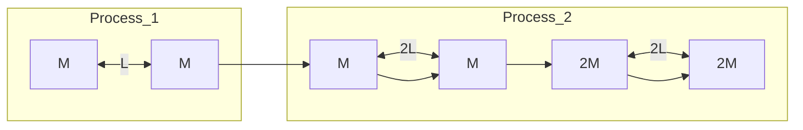
</details>

**13.** Abbildung 9.F13 zeigt drei Anordnungen derselben identischen Teilchen, von denen drei auf einem Kreis mit einem Radius von 0,20 m liegen und das vierte im Mittelpunkt des Kreises. (a) Ordnen Sie die Varianten in absteigender Reihenfolge nach dem Betrag der resultierenden Kraft der Gravitation auf das zentrale Teilchen aufgrund der anderen drei Teilchen. (b) Ordnen Sie die Varianten nach der potenziellen Energie der Gravitation des Vierteilchensystems, beginnend mit der am wenigsten negativen.


<details>
<summary>text_image</summary>

(a)
(b)
(c)
Abb. 9.F13
</details>

**14.** Abbildung 9.F14 zeigt drei Anordnungen eines punktförmigen Teilchens P mit der Masse m und einer Kugelschale mit einer homogen verteilten Masse M. Die Radien der Schalen sind gegeben. Ordnen Sie die Anordnungen in absteigender Reihenfolge nach dem Betrag der Gravitationskraft auf Teilchen P aufgrund der Kugelschale.


<details>
<summary>text_image</summary>

P
2R
(a)
d
P
R
(b)
R/2
(c)
</details>

Abb. 9.F14

**15.** Abbildung 9.F15 zeigt drei ortsfeste Teilchen A, B und C, wobei die Masse von B größer sein soll als die von $C .$ Kann ein viertes Teilchen D so platziert werden, dass die resultierende Gravitationskraft auf Teilchen A aufgrund der Teilchen B, C und D verschwindet? Falls ja, in welchem Quadranten und in der Nähe welcher Achse sollte es liegen?

230

---

9.10 Fragen

9


<details>
<summary>text_image</summary>

y
A
C
x
d
d
B
</details>

Abb. 9.F15

**16.** Abbildung 9.F16 zeigt drei Teilchen, deren Positionen zunächst fixiert sein sollen. B und C sind identisch und liegen symmetrisch zur y-Achse in einem Abstand d von A. (a) In welche Richtung zeigt die resultierende Gravitationskraft $\vec { F } _ { \mathrm { g e s } }$ auf A? (b) Ändert sich die Richtung von $\vec { F } _ { \mathrm { g e s } } ,$ wenn sich C in direkter Linie vom Ursprung wegbewegt? Falls ja, in welche Richtung bewegt es sich und was passiert im Grenzfall einer sehr großen Entfernung zwischen A und C?


<details>
<summary>text_image</summary>

B
θ
d
A
x
y
C
θ
d
</details>

Abb. 9.F16

231

---


---

# 10 Fluide

## 10.1 Fluide, Dichte und Druck

## Physikalische Motivation

Die Physik der Fluide ist die Grundlage des Wasserbaus, eines Zweigs des Ingenieurwesens mit zahllosen Anwendungen auf vielen Gebieten. Ein Kerntechniker wird vielleicht die Strömung von Fluiden im hydraulischen System eines alternden Kernreaktors untersuchen, während ein Medizintechniker eher an der Strömung des Bluts in den Arterien eines alternden Patienten interessiert sein dürfte. Ein Umwelttechniker studiert stattdessen die Entwässerung von Deponien oder die effiziente Bewässerung von Ackerland. Schiffsbauer analysieren die Gefahren für Tiefsee-Tauchboote oder suchen nach Möglichkeiten, Besatzungen aus gesunkenen U-Booten zu evakuieren. Luftfahrttechniker wollen mit sogenannten Winglets das Design der Tragflächen von Flugzeugen optimieren, um damit deutliche Einsparungen beim Treibstoffverbrauch der Jets zu erzielen.

Aber auch in vielen unspektakulären und für uns alltäglichen Anwendungen stehen Fluide mit ihren besonderen Eigenschaften im Mittelpunkt, beispielsweise überall dort, wo Hydrauliksysteme Kräfte übertragen. Bevor wir uns mit solchen Anwendungen der Fluide genauer beschäftigen können, müssen wir jedoch zuerst die Frage beantworten: „Was ist ein Fluid überhaupt?“


## 10.1.1 Was ist ein Fluid?

Im Gegensatz zu einem Festkörper ist ein **Fluid** eine Substanz, die strömen kann. Fluide passen sich den Begrenzungen jedes Behälters an, in die wir sie einfüllen. Der Grund hierfür liegt darin, dass ein Fluid keiner Kraft entgegenwirken kann, die tangential zu ihrer Oberfläche angreift. (In der formaleren Sprache von Abschn. 8.3 ist ein Fluid eine Substanz, die fließt oder strömt, weil sie keine Scher spannung aushalten kann. Sie kann jedoch eine Kraft senkrecht zu ihrer Oberflä- che ausüben.) Einige Stoffe, beispielsweise Pech, benötigen eine lange Zeit, bis sie sich der Form eines Behälters angepasst haben, aber letztendlich schaffen auch sie es. Daher rechnen wir auch solche Stoffe zu den Fluiden.

Es mag verwundern, warum wir Flüssigkeiten und Gase zusammenfassen und sie als Fluide bezeichnen. Schließlich (so könnte man einwerfen) unterscheidet sich flüssiges Wasser von Wasserdampf ebenso sehr wie von Eis. Doch tatsächlich ist das nicht der Fall. Eis hat, ebenso wie andere kristalline Festkörper, seine Atome in einer ziemlich starren, dreidimensionalen, regelmäßigen Struktur angeordnet, die wir als kristallines Gitter bezeichnen. Weder in Dampf noch in Wasser finden wir eine vergleichbar weitreichende regelmäßige Anordnung.

Halliday Physik für natur- und ingenieurwiss. Studiengänge, 3. Auflage. D. Halliday, R. Resnick und J. Walker. © 2020 WILEY-VCH Verlag GmbH & Co. KGaA. Published 2020 by WILEY-VCH Verlag GmbH & Co. KGaA.

233

---

10 Fluide

## 10.1.2 Dichte und Druck

Wenn wir uns mit festen Gegenständen beschäftigen, interessieren uns Materiebrocken, wie Holzscheite, Tennisbälle oder Metallstäbe. Bestimmte physikalische Größen empfinden wir für ihre Beschreibung als nützlich, und mit ihnen formulieren wir die Newtonschen Gesetze. Dazu gehören die Masse und die Kraft. Wir können beispielsweise von einem 3,6 kg schweren Holzblock sprechen, auf den eine Kraft von 25 N einwirkt.

Bei Fluiden sind wir eher an der ausgedehnten Substanz interessiert und an Eigenschaften, die an verschiedenen Punkten in der Substanz verschieden sein können. Es erweist sich als sinnvoller, statt von Masse und Kraft von **Dichte** und **Druck** zu sprechen.

## Dichte

Zur Bestimmung der Dichte eines Fluids an einem bestimmten Punkt isolieren wir ein kleines Volumenelement $\Delta V$ um diesen Punkt und messen die Masse Δm des Fluids in diesem Element. Die **Dichte** des Fluids ist dann an dieser Stelle

$$
\rho = \frac {\Delta m}{\Delta V}. \tag {10.1}
$$

Theoretisch ist die Dichte an jedem Punkt eines Fluids durch den Grenzwert dieses Verhältnisses gegeben, wenn das Volumenelement ΔV um den Punkt immer kleiner wird. In der Praxis nehmen wir meist an, dass eine Fluidprobe groß im Vergleich zu atomaren Abmessungen und daher $\mathrm { { \sf { p l a t } } ^ { \omega } }$ (von homogener Dichte) statt „klumpig“ (aus Atomen zusammengesetzt) ist. Mit dieser Annahme können wir Gl. 10.1 in der Form

$$
\rho = \frac {m}{V} \quad (\text {homogene Dichte}) \tag {10.2}
$$

schreiben, wobei m und V die Masse und das Volumen der Fluidprobe sind.

Die Dichte ist eine skalare Eigenschaft; ihre SI-Einheit ist Kilogramm pro Kubikmeter. Tabelle 10.1 gibt die Dichten einiger Substanzen und die durchschnittlichen Dichten einiger Gegenstände wieder. Man beachte, dass die Dichten von Gasen (beispielsweise der $\mathrm { { \tt { , } } { \tt { , } } { \tt { L u f t } } ^ { \omega } }$ in der Tabelle) sehr druckabhängig sind, was bei Flüssigkeiten (siehe „Wasser“) nicht der Fall ist. Gase lassen sich also im Gegensatz zu Flüssigkeiten leicht zusammendrücken oder komprimieren. Man sagt auch, Gase sind kompressibel, Flüssigkeiten dagegen inkompressibel.


<details>
<summary>text_image</summary>

Druck-
sensor
(a)
ΔF
ΔA
Vakuum
(b)
</details>

Abb. 10.1

(a) Ein mit einem Fluid gefüllter Behälter enthält einen kleinen Drucksensor, dessen Arbeitsweise in (b) vergrößert dargestellt ist. Der Druck wird durch die relative Lage des beweglichen Kolbens im Sensor angezeigt.

## Druck

Ein kleines druckempfindliches Gerät wird wie in Abb. 10.1a in einen mit einem Fluid gefüllten Behälter gebracht. Der Sensor (Abb. 10.1b) besteht aus einem Kolben der Querschnittsfläche ΔA, der in einem eng anliegenden Zylinder gegen eine Feder gedrückt wird. Abgelesen wird der Betrag, um den die (kalibrierte) Feder durch das umgebende Fluid zusammengedrückt wird, und damit indirekt der Betrag der senkrecht auf den Kolben wirkenden Kraft $\Delta F .$ Wir definieren den **Druck** des Fluids auf den Kolben als

$$
p = \frac {\Delta F}{\Delta A}. \tag {10.3}
$$

Theoretisch ist der Druck in jedem Punkt des Fluids durch den Grenzwert dieses Verhältnisses definiert, wenn die Fläche $\Delta A$ des an diesem Punkt befindlichen Kolbens immer kleiner wird. Ist die Kraft jedoch homogen über die ganze Fläche A verteilt, können wir Gl. 10.3 auch in der Form

$$
p = \frac {F}{A} \quad (\text {Druck einer homogen über die Fläche verteilten Kraft}) \tag {10.4}
$$

234

---

10.2 Ruhende Fluide

10

TABELLE 10.1: Einige Dichten.

| Material bzw. Gegenstand | Dichte (kg/m3) |
| --- | --- |
| interstellarer Raum | $10^{-20}$ |
| bestes Laborvakuum | $10^{-17}$ |
| Luft bei 20°C und 1,013 bar Druck | 1,21 |
| Luft bei 20°C und 50,66 bar Druck | 60,5 |
| Styropor | $1 \cdot 10^{2}$ |
| Eis | $0,917 \cdot 10^{3}$ |
| Wasser bei 20°C und 1,013 bar Druck | $0,998 \cdot 10^{3}$ |
| Wasser bei 20°C und 50,66 bar Druck | $1,000 \cdot 10^{3}$ |
| Meerwasser bei 20°C und 1,013 bar Druck | $1,024 \cdot 10^{3}$ |
| Blut | $1,60 \cdot 10^{3}$ |
| Eisen | $7,9 \cdot 10^{3}$ |
| Quecksilber | $13,6 \cdot 10^{3}$ |
| Erde (Mittelwert) | $5,5 \cdot 10^{3}$ |
| – Erdkern | $9,5 \cdot 10^{3}$ |
| – Erdkruste | $2,8 \cdot 10^{3}$ |
| Sonne (Mittelwert) | $1,4 \cdot 10^{3}$ |
| – Sonne (Zentrum) | $1,6 \cdot 10^{3}$ |
| Zentrum eines Weißen Zwergs | $10^{10}$ |
| Atomkern | $2-3 \cdot 10^{17}$ |
| Zentrum eines Neutronensterns | $10^{18}$ |

schreiben, wobei F der Betrag der senkrecht auf A wirkenden Kraft ist. (Wenn wir von einer homogen über eine Fläche verteilten Kraft sprechen, dann meinen wir, dass diese Kraft an jedem Punkt der Fläche denselben Wert hat.)

Experimentell findet man, dass an einem gegebenen Punkt in einem ruhenden Fluid der durch Gl. 10.3 definierte Druck denselben Wert hat, unabhängig davon, wie der Drucksensor orientiert ist. Der Druck ist eine skalare Größe ohne rich tungsspezifische Eigenschaften. Die auf den Kolben des Drucksensors wirkende Kraft ist zwar ein Vektor, aber in Gl. 10.3 geht nur der Betrag dieser Kraft ein, also eine skalare Größe.

Die SI-Einheit des Drucks ist Newton pro Quadratmeter, wofür man gewöhnlich den speziellen SI-Namen **Pascal** (Pa) verwendet. Der Reifendruck wird in Kilopascal angegeben. Neben dem Pascal gibt es noch einige andere gebräuchliche (nicht-SI-)Druckeinheiten:

$$
1 \mathrm{atm} = 1, 0 1 3 \mathrm{bar} = 1, 0 1 3 \cdot 1 0 ^ {5} \mathrm{Pa} = 1 0 1 3 \mathrm{hPa} = 7 6 0 \mathrm{Torr}.
$$

Die Atmosphäre (atm) ist, wie der Name schon andeutet, der ungefähre durch schnittliche Luftdruck auf Meereshöhe. Das Torr (nach Evangelista Torricelli, der im Jahr 1674 das Quecksilberbarometer erfand) wurde ursprünglich auch Millimeter Quecksilbersäule (mmHg) genannt. In Tab. 10.2 sind einige Drücke zusammengefasst.

## 10.2 Ruhende Fluide

## Lernziele

Nach dem Durcharbeiten dieses Abschnitts sollten Sie in der Lage sein, . . .

• die Beziehung zwischen dem hydrostatischen Druck, der Fluiddichte und der Höhe einer Fluidsäule über oder unter einer gegebenen Bezugshöhe anzugeben und anzuwenden,
• zwischen Gesamtdruck (oder absoluten Druck) und Überdruck zu unterscheiden.


235

---

10 Fluide

TABELLE 10.2: Einige Drücke.

|  | Druck (Pa) |
| --- | --- |
| Sonnenzentrum | $2 \cdot 10^{16}$ |
| Erdmittelpunkt | $4 \cdot 10^{11}$ |
| höchster im Labor erreichbarer Druck | $1,5 \cdot 10^{10}$ |
| tiefster Ozeangraben | $1,1 \cdot 10^{8}$ |
| Pfennigabsätze auf einer Tanzfläche | $1 \cdot 10^{6}$ |
| Autoreifena) | $2 \cdot 10^{5}$ |
| Atmosphäre auf Meereshöhe | $1,0 \cdot 10^{5}$ |
| normaler Blutdrucka)b) | $1,6 \cdot 10^{4}$ |
| bestes Laborvakuum | $10^{-12}$ |


<details>
<summary>text_image</summary>

Luft
Wasser
y1 — A — Niveau 1, p1
y2 — A — Niveau 2, p2
Test-
volumen
F1
mg
F2
y = 0
</details>

(a)


<details>
<summary>text_image</summary>

Test-
volumen
F₂
mg
F₁
</details>

(b)

## Abb. 10.2

(a) Ein zylinderförmiges Volumen mit horizontaler Grundfläche A in einem Wasserbecken. Die Kraft $\vec { F } _ { 1 }$ wirkt auf die obere Zylinderfläche, die Kraft $\vec { \bar { F } } _ { 2 }$ auf die untere Zylinderfläche. Die Gravitationskraft auf das Wasser im Zylinder ist durch m⃗g gegeben. (b) Ein Kräftediagramm für das Wasser im Zylinder.

a) Überdruck = Druck über Atmosphärendruck
b) systolischer Blutdruck; entspricht 120 mmHg, der von Medizinern nach wie vor verwendeten Einheit

## Schlüsselideen

• Der Druck in einem ruhenden Fluid hängt von der vertikalen Position y in dem Fluid ab. Wenn wir y nach oben positiv zählen, ist

$$
p _ {2} = p _ {1} + \rho g (y _ {1} - y _ {2}).
$$

Wenn wir die Tiefe eines Fluids unterhalb einer Bezugshöhe, auf der der Druck $p _ { 0 }$ ist, mit h bezeichnen, wird diese Gleichung zu

$$
p = p _ {0} + \rho g h;
$$

hier ist $p$ der Druck in der Tiefe h des Fluids.

• Der Druck in einem Fluid ist für alle Punkte auf derselben Höhe gleich.
• Als Überdruck bezeichnet man die Differenz zwischen dem tatsächlich herrschenden (absoluten) Druck an einem gegebenen Punkt und dem Atmosphä- rendruck.

## 10.2.1 Ruhende Fluide

Abbildung 10.2a zeigt ein mit Wasser (oder einer anderen Flüssigkeit) gefülltes Becken, das nach oben zur Atmosphäre hin geöffnet ist. Wie jeder Taucher weiß, nimmt der Druck mit der Tiefe unterhalb der Luft-Wasser-Grenze rasch zu. Der Tiefenmesser eines Tauchers ist übrigens ein Drucksensor wie in Abb. 10.1b. Wie jeder Bergsteiger weiß, nimmt der Druck mit der Höhe ab, wenn man in die Atmosphäre hinaufsteigt. Der vom Taucher und vom Bergsteiger gemessene Druck wird üblicherweise als hydrostatischer Druck bezeichnet, weil beide von ruhenden (statischen) Fluiden herrühren. Wir wollen nun einen Ausdruck für den hydrostatischen Druck als Funktion der Höhe bzw. Tiefe herleiten.

Betrachten wir zunächst die Druckzunahme mit der Tiefe unterhalb der Wasseroberfläche. Wir definieren für das Becken eine vertikale y-Achse, deren Ursprung an der Luft-Wasser-Grenze liegen soll und deren positive Richtung nach oben zeigt. Als Nächstes betrachten wir das Wasser in einem zylinderförmigen Volumen mit horizontaler Grundfläche $A ,$ sodass $y _ { 1 }$ und $y _ { 2 }$ (beides sind negative Zahlen) die jeweils von der Wasseroberfläche aus gemessenen Tiefen der oberen und unteren Zylinderflächen sind.

Abbildung 10.2b zeigt ein Kräftediagramm für das Wasser im Zylinder. Das Was ser befindet sich im statischen Gleichgewicht, d. h., es ist stationär und die auf das Wasser wirkenden Kräfte halten sich die Waage. Drei Kräfte wirken in vertikaler Richtung: Die Kraft ${ \vec { F } } _ { 1 }$ wirkt auf die obere Zylinderfläche und wird von dem Wasser oberhalb des Zylinders ausgeübt. Ähnlich wirkt die Kraft $\vec { F } _ { 2 }$ auf die Bodenfläche

236

---

10.2 Ruhende Fluide

10

des Zylinders; sie stammt von dem Wasser unterhalb des Zylinders. Die Gravitationskraft auf das Wasser im Zylinder entspricht mg⃗, wobei m die Wassermasse innerhalb des Zylinders ist. Die Ausgeglichenheit der Kräfte bedeutet:

$$
F _ {2} = F _ {1} + m g. \tag {10.5}
$$

Gleichung 10.5 soll nun in eine Gleichung umgeformt werden, in der die Drücke auftreten. Aus Gl. 10.4 wissen wir, dass

$$
F _ {1} = p _ {1} A \quad \text {und} \quad F _ {2} = p _ {2} A. \tag {10.6}
$$

Nach Gl. 10.2 ist die Masse m des Wassers im Zylinder durch $m = \rho V$ gegeben, wobei das Zylindervolumen V das Produkt aus Grundfläche A und Höhe $y _ { 1 } - y _ { 2 }$ ist. Daher ist m gleich $\rho A \; ( y _ { 1 } - y _ { 2 } )$ . Setzen wir dies sowie Gl. 10.6 in Gl. 10.5 ein, so erhalten wir

$$
p _ {2} A = p _ {1} A + \rho A g (y _ {1} - y _ {2})
$$

oder

$$
p _ {2} = p _ {1} + \rho g (y _ {1} - y _ {2}). \tag {10.7}
$$

Mithilfe dieser Gleichung können wir sowohl den Druck in einer Flüssigkeit (als Funktion der Tiefe) als auch in der Atmosphäre (als Funktion der Höhe) bestimmen. Wir wollen zunächst einen Ausdruck für den Druck $p$ im Wasser in einer Tiefe h unterhalb der Wasseroberfläche finden. Wir wählen als Niveau 1 die Oberfläche und als Niveau 2 eine Tiefe h unterhalb der Oberfläche (vgl. Abb. 10.3). $p _ { 0 }$ sei der Atmosphärendruck an der Wasseroberfläche. In Gl. 10.7 nehmen wir die folgenden Ersetzungen vor:

$$
y _ {1} = 0, p _ {1} = p _ {0}
$$

und

$$
y _ {2} = - h, p _ {2} = p
$$

und erhalten

$$
p = p _ {0} + \rho g h \quad (\text {Druck in einer Tiefe} h). \tag {10.8}
$$

Der Druck in einer Flüssigkeit in einer bestimmten Tiefe hängt nur von dieser Tiefe ab, nicht aber von irgendeiner horizontalen Abmessung.


Der Druck an einem Punkt in einem Fluid im statischen Gleichgewicht hängt von der Tiefe dieses Punkts ab, nicht jedoch von irgendeiner horizontalen Abmessung des Fluids oder des Behälters.

Gleichung 10.8 gilt daher unabhängig von der Form des Behälters. Befindet sich die Bodenfläche des Behälters in einer Tiefe h, dann liefert uns Gl. 10.8 den dortigen Druck.

Den Druck $p$ in Gl. 10.8 bezeichnet man auch als Gesamtdruck oder **absoluten Druck** auf Niveau 2. Diese Bezeichnung erklärt sich daraus, dass sich in Abb. 10.3 der Druck $p$ auf Niveau 2 aus zwei Anteilen zusammensetzt: (1) $p _ { 0 } ,$ dem Luftbzw. Atmosphärendruck, der von oben auf die Flüssigkeitsoberfläche drückt, und (2) $\rho g h ,$ dem Druck aufgrund der Flüssigkeitsmenge oberhalb von Niveau 2 (aber natürlich unterhalb der Flüssigkeitsoberfläche), die auf die Flüssigkeit in Niveau 2 drückt. Im Allgemeinen bezeichnet man die Differenz zwischen dem absoluten Druck und einem atmosphärischen Druck als **Überdruck**. Für die Situation in Abb. 10.3 ist der Überdruck durch $\rho g h$ gegeben.


<details>
<summary>text_image</summary>

Luft p0 Niveau 1 y = 0
Flüssig-
keit h
p Niveau 2
</details>

Abb. 10.3 Der Druck p nimmt mit der Tiefe h unter der Flüssigkeitsoberfläche nach Gl. 10.8 zu.

237

---

10 Fluide

Gleichung 10.7 gilt auch oberhalb der Flüssigkeitsoberfläche: Sie gibt uns den atmosphärischen Druck in einer bestimmten Höhe über Niveau 1 durch den atmosphärischen Druck $p _ { 1 }$ auf Niveau 1 an (aber nur unter der Annahme, dass die Dichte der Atmosphäre über diese Distanz konstant ist). Wenn wir beispielsweise den Atmosphärendruck in einem Abstand d oberhalb von Niveau 1 in Abb. 10.3 bestimmen möchten, setzen wir

$$
y _ {1} = 0, p _ {1} = p _ {0} \quad \text {und} \quad y _ {2} = d, p _ {2} = 0.
$$

Mit $\rho = \rho _ { \mathrm { L u f t } }   \mathrm { f o l g t } ;$

$$
p = p _ {0} - \rho_ {\mathrm{Luft}} g d.
$$

## KONTROLLFRAGE 1

Die Abbildung zeigt vier Behälter mit Olivenöl. Ordnen Sie diese Behälter in absteigender Reihenfolge nach dem Druck in der Tiefe h.


<details>
<summary>text_image</summary>

(a)
(b)
(c)
(d)
</details>

## 10.3 Druckmessung


## Lernziele

Nach dem Durcharbeiten dieses Abschnitts sollten Sie in der Lage sein, . . .

• zu beschreiben, wie die Druckmessung mit einem Barometer funktioniert,
• zu erklären, wie man mit einem offenen U-Rohr-Manometer den Überdruck eines eingeschlossenen Gases messen kann.


## Schlüsselideen

• Mit einem Quecksilbermanometer kann der Atmosphärendruck gemessen werden.
• Mit einem offenen U-Rohr-Manometer lässt sich der Überdruck eines eingeschlossenen Gases messen.

## 10.3.1 Druckmessung

## Das Quecksilberbarometer

Abbildung 10.4a zeigt das Prinzip eines Quecksilberbarometers, mit dem früher der Atmosphärendruck gemessen wurde. Eine lange Glasröhre wird mit dem unter Normalbedingungen flüssigen Schwermetall Quecksilber gefüllt und mit ihrem oberen, offenen Ende kopfüber in einen mit Quecksilber gefüllten Teller gestellt. Der Raum oberhalb der Quecksilbersäule enthält nur Quecksilberdampf, dessen Druck bei gewöhnlichen Temperaturen vernachlässigbar klein ist.

Mithilfe von Gl. 10.7 finden wir den atmosphärischen Druck $p _ { 0 }$ als Funktion der Höhe h der Quecksilbersäule. Niveau 1 in Abb. 10.2 sei nun die Grenzfläche zwischen dem Quecksilber und der Luft, und Niveau 2 sei der obere Rand der Quecksilbersäule, so wie in Abb. 10.4a angegeben. Nun ersetzen wir in Gl. 10.7

$$
y _ {1} = 0, p _ {1} = p _ {0} \quad \text {und}
$$

$$
y _ {2} = h, p _ {2} = 0
$$

und erhalten mit $\rho$ als Dichte des Quecksilbers

$$
p _ {0} = \rho g h. \tag {10.9}
$$

238

---

10.3 Druckmessung

10


<details>
<summary>text_image</summary>

y
p ≈ 0
Niveau 2
h
p₀
Niveau 1
(a)
p₀
(b)
p ≈ 0
h
</details>

Abb. 10.4

(a) Ein Quecksilberbarometer. (b) Ein anderes Quecksilberbarometer. Der Abstand h ist in beiden Fällen derselbe.

Für einen gegebenen Druck hängt die Höhe h der Quecksilbersäule nicht von der Querschnittsfläche der Röhre ab. Die Anzeige des etwas abstrusen Quecksilberbarometers aus Abb. 10.4b hat dieselbe Höhe wie die des handelsüblichen Exemplars in Abb. 10.4a – es zählt nur der vertikale Abstand zwischen den Quecksilberniveaus.

Wie aus Gl. 10.9 ersichtlich wird, hängt die Höhe der Quecksilbersäule bei einem gegebenen Druck auch noch von dem Wert für $g$ am Ort des Barometers und von der temperaturabhängigen Dichte des Quecksilbers ab. Die Säulenhöhe (in Millimeter) entspricht dem numerischen Wert des Drucks (in Torr bzw. mmHg) nur dann, wenn sich das Barometer an einem Ort befindet, an dem g den Standardwert von $9 { , } 8 0 6   6 5   \mathrm { m } / \mathrm { s } ^ { 2 }$ annimmt und wo die Temperatur des Quecksilbers $0   ^ { \circ } \mathrm { C }$ beträgt. Sind diese Bedingungen nicht erfüllt (was häufig der Fall ist), müssen kleine Korrekturen vorgenommen werden, bevor die Höhe der Quecksilbersäule in einen Druck umgerechnet werden kann.

## Das offene U-Rohr-Manometer

Ein offenes U-Rohr-Manometer (Abb. 10.5) misst den Überdruck $p _ { \mathrm { \hat { U } } }$ eines Gases. Es besteht aus einem U-Rohr, in dem sich eine Flüssigkeit befindet. Das eine Ende des Rohrs ist mit dem Gefäß verbunden, dessen Überdruck wir messen wollen, das andere Ende ist zur Atmosphäre hin offen. Mithilfe von Gl. 10.7 können wir den Überdruck als Funktion der Höhe h in Abb. 10.5 bestimmen. Die Niveaus 1 und 2 wählen wir wie in Abb. 10.5. In Gl. 10.7 setzen wir

$$
y _ {1} = 0, p _ {1} = p _ {0}
$$

und

$$
y _ {2} = - h, p _ {2} = p
$$

und erhalten

$$
p _ {\ddot {\mathrm{U}}} = p - p _ {0} = \rho g h, \tag {10.10}
$$

wobei $\rho$ die Dichte der Flüssigkeit in dem Rohr ist. Der Überdruck $p _ { \mathrm { \hat { U } } }$ ist direkt proportional zu h.

Der Überdruck kann positiv oder negativ sein, je nachdem ob $p > p _ { 0 }$ oder $p <$ $p _ { 0 } .$ In einem aufgeblasenen Reifen oder im menschlichen Blutsystem ist der (absolute) Druck größer als der Atmosphärendruck, der Überdruck ist also eine positive Größe. Wenn Sie an einem Strohhalm saugen, um ein Fluid hochzuziehen, dann ist der (absolute) Druck in Ihren Lungen kleiner als der Atmosphärendruck. Der „Überdruck“ in ihren Lungen ist also eine negative Größe, weshalb man auch meist von Unterdruck spricht.


<details>
<summary>text_image</summary>

P0
Niveau 1
h
Niveau 2
P_U
Behälter
Manometer
</details>

Abb. 10.5

Ein offenes U-Rohr-Manometer misst den Überdruck des Gases in dem Behälter zur Linken. Der rechte Arm des U-Rohrs ist zur Atmosphäre hin offen.

239

---

10 Fluide

## 10.4 Das Pascalsche Prinzip


## Lernziele

Nach dem Durcharbeiten dieses Abschnitts sollten Sie in der Lage sein, . . .

• das Pascalsche Prinzip zu verstehen,
• bei einer hydraulischen Presse die Beziehung zwischen Querschnitt und Ver schiebung des Presskolbens einerseits und Querschnitt und Verschiebung des Pumpkolbens andererseits anzugeben und anzuwenden.


## Schlüsselideen

• Das Pascalsche Prinzip besagt, dass eine Druckänderung in einem eingeschlossenen Fluid sich ohne Änderung auf alle Bereiche des Fluids und die Wände des umschließenden Behälters auswirkt.

## 10.4.1 Das Pascalsche Prinzip

Wenn Sie auf das eine Ende einer Zahnpastatube drücken, um am anderen Ende die Zahnpasta herauszupressen, sehen Sie das **Pascalsche Prinzip** in Aktion. Es ist auch die Grundlage für den Heimlich-Handgriff, bei dem ein plötzlicher Druck von unten auf das Zwerchfell ausgeübt wird. Dieser überträgt sich zur Luftröhre und kann dort eventuell festsitzende Speisereste herauspressen. Das Prinzip wurde 1652 zum ersten Mal von Blaise Pascal (nach dem auch die Einheit des Drucks benannt ist) formuliert.


<details>
<summary>text_image</summary>

Bleikugeln
Kolben
Flüssigkeit
P
pext
h
p
</details>

Abb. 10.6

Kleine Bleikugeln in einem Behälter auf einem Kolben erzeugen einen äußeren Druck $p _ { \mathrm { e x t } }$ am oberen Rand der eingeschlossenen (inkompressiblen) Flüssigkeit. Wird $p _ { \mathrm { e x t } }$ erhöht, indem beispielsweise mehr Bleikugeln in den Behälter gelegt werden, erhöht sich der Druck an allen Punkten in der Flüssigkeit um denselben Betrag.


Eine Druckänderung in einem abgeschlossenen, inkompressiblen Fluid wird unvermindert auf jeden Teil des Fluids sowie auf die Behälterwände übertragen.

## Ein Beispiel für das Pascalsche Prinzip

Als Beispiel für ein inkompressibles Fluid betrachten wir eine Flüssigkeit in einem schmalen Zylinder wie in Abb. 10.6. Der Zylinder sei oben durch einen Kolben abgeschlossen, auf dem ein Behälter mit kleinen Bleikugeln steht. Die Atmosphäre, der Behälter und die Bleikugeln üben den äußeren bzw. externen Druck $p _ { \mathrm { e x t } }$ auf den Kolben und damit auf die Flüssigkeit aus. Der Druck p an irgendeinem Punkt P in der Flüssigkeit ist dann

$$
p = p _ {\text {ext}} + \rho g h. \tag {10.11}
$$

Geben wir mehr Bleikugeln in den Behälter, so erhöht sich $p _ { \mathrm { e x t } }$ um den Betrag $\Delta p _ { \mathrm { e x t } }$ . Die Größen $\rho , g$ und h in Gl. 10.11 bleiben unverändert, daher ist auch die Druckänderung bei P durch

$$
\Delta p = \Delta p _ {\text {ext}} \tag {10.12}
$$

gegeben. Diese Druckänderung ist unabhängig von h und gilt daher für alle Punkte in der Flüssigkeit, wie es das Pascalschen Prinzip zum Ausdruck bringt.

## Die hydraulische Presse

Das Pascalsche Prinzip ist auch die Grundlage einer hydraulischen Presse bzw. eines hydraulischen Hebels (siehe Abb. 10.7). Auf den linken Kolben (den sogenannten Pumpkolben am Eingang des Systems) mit der Querschnittsfläche $A _ { e }$ wirkt eine äußere Kraft $F _ { \mathrm { e } }$ nach unten. Eine inkompressible Flüssigkeit überträgt diesen Druck und erzeugt eine nach oben gerichtete Kraft $F _ { \mathrm { a } }$ auf den rechten Kolben (den sogenannten Presskolben am Ausgang des Systems) mit der Querschnittsfläche $A _ { \mathrm { a } ^ { * } }$

240

---

10.5 Das archimedische Prinzip

10

Damit sich das System im Gleichgewicht befindet, muss auf den Presskolben eine äußere, nach unten gerichtete Kraft vom Betrag $F _ { \mathrm { a } }$ (beispielsweise in Form einer Last) wirken. Die Kraft $\vec { F } _ { \mathrm { e } }$ auf den linken Kolben und die nach unten gerichtete äußere Kraft $\vec { F } _ { \mathrm { a } }$ auf den rechten Kolben bewirken eine Druckänderung $\Delta p$ in der Flüssigkeit. Diese ist durch

$$
\Delta p = \frac {F _ {\mathrm{e}}}{A _ {\mathrm{e}}} = \frac {F _ {\mathrm{a}}}{A _ {\mathrm{a}}}
$$

gegeben. Damit folgt

$$
F _ {\mathrm{a}} = F _ {\mathrm{e}} \frac {A _ {\mathrm{a}}}{A _ {\mathrm{e}}}.\tag {10.13}
$$

Ist $A _ { \mathrm { a } } > A _ { \mathrm { e } }$ (wie in Abb. 10.7), dann ist nach Gl. 10.13 die Presskraft $F _ { \mathrm { a } }$ auf die Last größer als die Pumpkraft $F _ { e } .$

Wird der Pumpkolben um eine Strecke $d _ { \mathrm { e } }$ nach unten bewegt, bewegt sich der Presskolben um eine Strecke $d _ { \mathrm { a } }$ nach oben, sodass von der inkompressiblen Flüssigkeit dasselbe Volumen V vom einen zum anderen Kolben verschoben wird. Also gilt

$$
V = A _ {\mathrm{e}} d _ {\mathrm{e}} = A _ {\mathrm{a}} d _ {\mathrm{a}}
$$

beziehungsweise

$$
d _ {\mathrm{a}} = d _ {\mathrm{e}} \frac {A _ {\mathrm{e}}}{A _ {\mathrm{a}}}  . \tag {10.14}
$$

Ist also $A _ { \mathrm { a } } < A _ { \mathrm { e } }$ (wie in Abb. 10.7), dann bewegt sich der Presskolben um eine kürzere Strecke als der Pumpkolben.

Für die geleistete Arbeit folgt aus den Gln. 10.13 und 10.14

$$
W = F _ {\mathrm{a}} d _ {\mathrm{a}} = \left(F _ {\mathrm{e}} \frac {A _ {\mathrm{a}}}{A _ {\mathrm{e}}}\right) \left(d _ {\mathrm{e}} \frac {A _ {\mathrm{e}}}{A _ {\mathrm{a}}}\right) = F _ {\mathrm{e}} d _ {\mathrm{e}}. \tag {10.15}
$$

Die von dem Pumpkolben durch die aufgewandte Kraft geleistete Arbeit ist also gleich der vom Presskolben zum Anheben der Last verrichteten Arbeit.

Der Vorteil einer hydraulischen Presse ist:


Mit einer hydraulischen Presse kann eine gegebene Kraft, die über eine gegebene Strecke wirkt, in eine größere Kraft umgewandelt werden, die über eine kleinere Strecke wirkt.

Das Produkt aus Kraft und Strecke bleibt unverändert, es wird also dieselbe Arbeit geleistet. Oft ist es jedoch von großem Vorteil, auf diese Weise eine größere Kraft ausüben zu können. Nur die wenigsten von uns werden beim Reifenwechsel ihren Wagen ohne Hilfsmittel anheben können. Mit einem hydraulischen Wagenheber ist das jedoch kein Problem, auch wenn der Griff über eine größere Strecke gepumpt werden muss, als der Wagen angehoben wird. In diesem Fall wird die Verschiebung $d _ { \mathrm { e } }$ nicht durch eine einzelne große Bewegung ausgeführt, sondern in eine Serie von vielen kleinen Bewegungen umgewandelt.

## 10.5 Das archimedische Prinzip

## Lernziele

Nach dem Durcharbeiten dieses Abschnitts sollten Sie in der Lage sein, . . .

• das archimedische Prinzip zu beschreiben,
• die Beziehung zwischen der Auftriebskraft auf einen Körper und der Masse des von diesem Körper verdrängten Fluids anzugeben und anzuwenden,
• für einen schwimmenden Körper den Zusammenhang zwischen Auftrieb und Schwerkraft anzugeben,


<details>
<summary>text_image</summary>

Eingang
Fₑ
Aₑ
dₑ
Ausgang
Fₐ
Aₐ
dₐ
Öl
</details>

Abb. 10.7

Eine hydraulische Anordnung zur Verstärkung der am Eingang wirkenden Kraft $\vec { F } _ { \mathrm { e } } ^ { \mathrm { ~ - ~ } }$ Die jeweils geleistete Arbeit wird jedoch nicht verstärkt; sie ist für die Kräfte an Eingang und Ausgang dieselbe.


241

---

10 Fluide

• für einen schwimmenden Körper den Zusammenhang zwischen der Schwerkraft und der Masse des vom Körper verdrängten Fluids anzugeben,
• zwischen dem scheinbaren Gewicht und dem tatsächlichen Gewicht eines Körpers zu unterscheiden,
• das scheinbare Gewicht eines Körpers zu berechnen, der teilweise oder vollständig in ein Fluid eintaucht.


## Schlüsselideen

• Das archimedische Prinzip besagt, dass auf einen teilweise oder vollständig in ein Fluid eintauchenden Körper eine nach oben gerichtete Auftriebskraft mit dem Betrag

$$
F _ {\mathrm{A}} = m _ {\mathrm{F}} g
$$

wirkt, wobei $m _ { \mathrm { F } }$ die Masse des von dem (schwimmenden oder tauchenden) Körper verdrängten Fluids ist.

• Wenn ein Körper in einem Fluid schwimmt, ist der Betrag $F _ { \mathrm { A } }$ der nach oben gerichteten Auftriebskraft gleich dem Betrag $F _ { \mathrm { G } }$ der nach unten gerichteten Schwerkraft.
• Das scheinbare Gewicht $W _ { \mathrm { s c h } }$ eines Körpers, auf den eine Auftriebskraft wirkt, hängt wie folgt mit seinem tatsächlichen Gewicht W zusammen:

$$
W _ {\mathrm{sch}} = W - F _ {\mathrm{A}}.
$$

## 10.5.1 Das archimedische Prinzip


<details>
<summary>natural_image</summary>

Illustration of a person swimming in water, holding a blue object (no text or symbols)
</details>

Abb. 10.8

Eine dünnwandige, mit Wasser gefüllte Kunststofftüte befindet sich im Schwimmbecken im statischen Gleichgewicht. Die auf sie wirkende Gravitationskraft muss durch eine nach oben gerichtete Kraft des Wassers in ihrer Umgebung kompensiert werden.

In Abb. 10.8 erkennt man eine Studentin in einem Schwimmbecken mit einer Tü- te aus sehr dünnem Kunststoff (mit vernachlässigbarer Masse). Sie stellt fest, dass sich die Tüte und das in ihr enthaltene Wasser im statischen Gleichgewicht befinden und weder sinken noch aufsteigen. Die nach unten gerichtete Kraft $\vec { F } _ { \mathrm { G } }$ auf das in der Tüte enthaltene Wasser muss durch eine nach oben gerichtete Kraft des Umgebungswassers kompensiert werden.

Diese nach oben gerichtete Kraft ist die **Auftriebskraft** (oder kurz der Auftrieb) ${ \vec { F } } _ { \mathrm { A } } .$ Sie beruht auf der Zunahme des Drucks in dem umgebenden Wasser mit der Tiefe. Der Druck auf den unteren Teil der Tüte ist daher größer als der Druck am oberen Ende. Also sind auch die Beträge der Kräfte auf die Tüte unten größer als oben. Einige dieser Kräfte sind in Abb. 10.10a wiedergegeben, wobei der von der Tüte eingenommene Platz freigelassen wurde. Man beachte, dass die unteren Kräftevektoren (mit nach oben gerichteten Komponenten) länger sind als die oberen Kräftevektoren (mit nach unten gerichteten Komponenten). Bilden wir die Summe all dieser vom Umgebungswasser auf die Tüte wirkenden Kräfte, so heben sich die horizontalen Komponenten gegenseitig auf und die vertikalen Komponenten addieren sich zu der nach oben gerichteten Auftriebskraft ${ \vec { F } } _ { \mathrm { A } } .$ . (Die Kraft $\vec { F } _ { \mathrm { A } }$ ist auf der rechten Seite des Beckens in Abb. 10.10a eingezeichnet.)

Weil sich die Tüte im statischen Gleichgewicht befindet, ist der Betrag von $\vec { F } _ { \mathrm { A } }$ gleich dem Betrag m g $m _ { \mathrm { F } } g$ der Gravitationskraft $\vec { F } _ { \mathrm { G } }$ auf die mit Wasser gefüllte Tüte: $F _ { \mathrm { A } } = m _ { \mathrm { F } } g$ . (Der Index F bezieht sich auf das „Fluid“, in diesem Fall das Wasser.) Mit anderen Worten, der Betrag des Auftriebs ist gleich dem Gewicht der wassergefüllten Tüte.

Ein anderes, dramatisches Beispiel ist die Katastrophe am Nyos-See in Kamerun, als 1986 aus dem See aufsteigendes (weil dort leichteres) Kohlenstoffdioxid an der Luft (dort schwerer) eine tödliche Gasschicht bildete (Abb. 10.9).

In Abb. 10.10b haben wir die Wassertüte durch einen Stein ersetzt, der das Loch in Abb. 10.10a genau ausfüllt. Der Stein verdrängt das Wasser. Damit ist gemeint, dass der Stein einen Raum einnimmt, der anderenfalls von Wasser eingenommen würde. Wir haben an der Form des Lochs nichts geändert, die Kräfte an der Oberfläche des Lochs müssen also immer noch dieselben sein wie bei der Wassertüte.

242

---

10.5 Das archimedische Prinzip

10


(a)

(b)

## Abb. 10.9

Am späten Nachmittag des 21. August 1986 wurde der hoch gelegene See Nyos in Kamerun, der eine hohe Konzentration von gelöstem Kohlenstoffdioxid enthält, durch ein besonderes Ereignis (vermutlich ein vulkanisches Beben) gestört. Diese Störung bewirkte, dass sich in der Flüssigkeit Blasen aus Kohlenstoffdioxid bildeten. Da diese Blasen leichter waren als das Fluid der Umgebung (das Wasser), wurden sie zur Oberfläche getrieben, wo das Kohlenstoffdioxid frei wurde. Dort war das Gas schwerer als das Fluid der Umgebung (nun die Luft) und es rauschte wie ein Fluss den Abhang hinab. 1700 Menschen erstickten, ebenso eine Unzahl an Tieren. Bild (a) zeigt den See acht Tage nach dem Ausbruch. Gut zu erkennen ist der beim Ausbruch überschwemmte Uferstreifen des Sees [© United States Geological Survey]. (b) Seit 2005 sorgt ein Siphon dafür, dass die Gase gezielt entweichen können [Quelle: [http://pagesperso-orange.fr/mhalb/nyos](http://pagesperso-orange.fr/mhalb/nyos)].

Dieselbe Auftriebskraft, die vorher auf die Wassertüte wirkte, wirkt nun auf den Stein. Der Betrag $F _ { \mathrm { A } }$ des Auftriebs ist also gleich $m _ { \mathrm { F } } g ,$ dem Gewicht des von dem Stein verdrängten Wassers.

Doch anders als die wassergefüllte Tüte befindet sich der Stein nicht im statischen Gleichgewicht. Die nach unten gerichtete Gravitationskraft $\vec { F } _ { \mathrm { G } }$ auf den Stein ist vom Betrag her größer als der nach oben gerichtete Auftrieb. Dies wird in dem Kräftediagramm rechts neben dem Becken in Abb. 10.10b angedeutet. Der Stein wird daher nach unten beschleunigt und sinkt auf den Boden des Beckens.

Nun füllen wir das Loch aus Abb. 10.10a mit einem passend zurechtgefeilten Block aus leichtem (viele Luftblasen enthaltendem) Holz wie in Abb. 10.10c. Wieder hat sich an den Kräften an der Oberfläche des Lochs nichts geändert, der Betrag des Auftriebs $F _ { \mathrm { A } }$ ist daher immer noch gleich $m _ { \mathrm { F } } g ,$ dem Gewicht des verdrängten Wassers. Ebenso wie der Stein befindet sich auch der Holzblock nicht im statischen Gleichgewicht. Diesmal ist jedoch die Gravitationskraft $\vec { F } _ { \mathrm { G } }$ vom Betrag her kleiner als der Auftrieb (wie auf der rechten Seite des Beckens angedeutet). Der Block erfährt also eine nach oben gerichtete Beschleunigung und steigt zur Wasseroberfläche.

Die Ergebnisse unserer Überlegungen gelten für alle Fluide und lassen sich im **archimedischen Prinzip** zusammenfassen:


Wenn ein Körper ganz oder teilweise in ein Fluid eintaucht, wirkt auf den Körper eine Auftriebskraft $\vec { F } _ { \mathrm { A } }$ von dem umgebenden Fluid. Diese Kraft ist nach oben gerichtet und ist vom Betrag her gleich dem Gewicht $m _ { \mathrm { F } } g$ des von dem Körper verdrängten Fluids.

Die Auftriebskraft auf einen Gegenstand in einem Fluid hat den Betrag

$$
F _ {\mathrm{A}} = m _ {\mathrm{F}} g \quad (\text {Auftriebskraft}), \tag {10.16}
$$

wobei $m _ { \mathrm { F } }$ die Masse des von dem Gegenstand verdrängten Fluids ist.

## Abb. 10.10

(a) Das Wasser um das Loch herum erzeugt eine nach oben gerichtete Auftriebskraft auf jeden Gegenstand, der dieses Loch ausfüllt. (b) Bei einem Stein mit demselben Volumen wie das Loch ist der Betrag der Gravitationskraft größer als der Auftrieb. (c) Für einen Holzklotz desselben Volumens ist der Betrag der Gravitationskraft kleiner als der Auftrieb.


243

---

10 Fluide

## Schwimmen und Schweben

Wenn wir einen Klotz aus leichtem Holz gerade oberhalb einer Wasseroberfläche loslassen, sinkt er in das Wasser, weil die Gravitationskraft $\vec { F } _ { \mathrm { G } }$ ihn nach unten zieht. Je mehr Wasser von dem Klotz verdrängt wird, umso größer wird der Betrag der Auftriebskraft $F _ { \mathrm { A } }$ . An irgendeinem Punkt ist $F _ { \mathrm { A } }$ groß genug, um den Betrag $F _ { \mathrm { G } }$ der nach unten gerichteten Gravitationskraft auf den Klotz auszugleichen, und der Block kommt zur Ruhe. Er befindet sich dann im statischen Gleichgewicht und schwimmt auf dem Wasser. Ganz allgemein gilt:


Wenn ein Körper in einem Fluid schwimmt oder schwebt, so ist der Betrag $F _ { \mathrm { A } }$ der Auftriebskraft auf diesen Körper gleich dem Betrag $F _ { \mathrm { G } }$ der Schwerkraft auf diesen Körper.

Wir können diese Aussage auch in der Form

$$
F _ {\mathrm{A}} = F _ {\mathrm{G}} \quad (\text {schwimmender Körper}) \tag {10.17}
$$

schreiben. Nach Gl. 10.16 ist $F _ { \mathrm { A } } = m _ { \mathrm { F } } g$ und daraus folgt:


Wenn ein Körper in einem Fluid schwimmt oder schwebt, ist der Betrag $F _ { \mathrm { G } }$ der Gravitationskraft auf diesen Körper gleich dem Gewicht $m _ { \mathrm { F } } g$ des von dem Körper verdrängten Fluids.

Diese Aussage können wir in der folgenden Gleichung zusammenfassen:

$$
F _ {\mathrm{G}} = m _ {\mathrm{F}} g \quad (\text {schwimmender Körper}). \tag {10.18}
$$

Mit anderen Worten, schwimmende oder schwebende Körper verdrängen eine Fluidmenge, die genau ihrem eigenen Gewicht entspricht.

## Das scheinbare Gewicht in einem Fluid

Wenn wir einen Stein auf eine Waage zur Gewichtsmessung legen, entspricht die Anzeige der Waage auch dem Gewicht des Steins. Wenn wir das gleiche Experiment jedoch unter Wasser durchführen, vermindert der Auftrieb auf den Stein diese Anzeige. Sie entspricht nun dem scheinbaren Gewicht. Im Allgemeinen hängt das scheinbare Gewicht mit dem tatsächlichen Gewicht eines Körpers über folgende Beziehung zusammen:

$$
\binom{\text {scheinbares}}{\text {Gewicht}} = \binom{\text {tatsächliches}}{\text {Gewicht}} - \binom{\text {Betrag der}}{\text {Auftriebskraft}}
$$

beziehungsweise als Formel:

$$
W _ {\mathrm{sch}} = W - F _ {\mathrm{A}} \quad (\text {scheinbares Gewicht}). \tag {10.19}
$$

Sollten Sie im Rahmen irgendeines seltsamen Kräftetests einen schweren Stein hochheben müssen, so fällt Ihnen das unter Wasser leichter. Ihre Kraft muss nur das scheinbare Gewicht des Steins heben, nicht sein größeres tatsächliches Gewicht. Der nach oben gerichtete Auftrieb hilft Ihnen also bei der Bewältigung der Aufgabe.

Der Betrag der Auftriebskraft auf einen schwimmenden (oder im Wasser schwebenden) Gegenstand ist gleich dem Gewicht dieses Gegenstands. Nach Gl. 10.19 hat ein schwimmender (oder schwebender) Gegenstand das Gewicht null – das wäre auch die Anzeige auf einer Gewichtswaage. (Wenn sich Astronauten auf eine komplizierte Aufgabe im Weltraum vorbereiten, üben sie diese Aufgabe unter Wasser schwebend, weil ihr scheinbares Gewicht dort null ist – wie im Weltraum.)

244

---

10.6 Die Kontinuitätsgleichung

10

## KONTROLLFRAGE 2

Ein Pinguin schwimmt (nicht: taucht!) zunächst in einem Fluid der Dichte $\rho _ { 0 } ,$ dann in einem Fluid der Dichte $^ { 0 , 9 5 \rho _ { 0 } }$ und schließlich in einem Fluid der Dichte $^ { 1 , 1 } \rho _ { 0 } .$ (a) Ordnen Sie die Dichten nach dem Betrag der Auftriebskraft auf den Pinguin (größter Wert zuerst). (b) Ordnen Sie die Dichten in absteigender Reihenfolge nach der von dem Pinguin verdrängten Fluidmenge.

## 10.6 Die Kontinuitätsgleichung

## Lernziele

Nach dem Durcharbeiten dieses Abschnitts sollten Sie in der Lage sein, . . .

• die Begriffe gleichmäßige Strömung, inkompressible Strömung, nichtviskose Strömung und wirbelfreie Strömung zu erläutern,
• den Begriff Stromlinie zu erklären,
• die Kontinuitätsgleichung anzuwenden, um den Querschnitt und die Strö- mungsgeschwindigkeit an einer Stelle in einem durchströmten Rohr mit den jeweiligen Werten an einer anderen Stelle zu verknüpfen,
• das Konzept des Volumenstroms zu verstehen und den Volumenstrom zu berechnen,
• das Konzept des Massenstroms zu verstehen und den Massenstrom zu berechnen.

## Schlüsselideen

• Ein ideales Fluid ist nicht kompressibel und besitzt keine Viskosität; seine Strö- mung ist gleichmäßig und wirbelfrei.
• Eine Stromlinie ist der von einem einzelnen Fluidteilchen genommene Weg.
• Eine Flussröhre beschreibt ein Bündel von Stromlinien.
• Die Strömung in einer Stromröhre gehorcht der Kontinuitätsgleichung,

$$
R _ {\mathrm{V}} = A \nu = \text { const. },
$$

wobei $R _ { \mathrm { V } }$ die Volumenflussrate ist, A der Querschnitt der Stromröhre an einem gegebenen Punkt und v die Strömungsgeschwindigkeit des Fluids an diesem Punkt.

• Die Massenflussrate $R _ { M }$ ist

$$
R _ {\mathrm{M}} = \rho R _ {\mathrm{V}} = \rho A \nu = \text { const. }
$$


## 10.6.1 Ideale Fluide in Bewegung

Die Bewegung realer Fluide ist sehr kompliziert und immer noch nicht ganz verstanden. Stattdessen werden wir die Bewegung eines **idealen Fluids** untersuchen, die mathematisch einfacher zu behandeln ist und trotzdem interessante und nützliche Ergebnisse liefert. Die folgenden vier Annahmen werden wir über dieses ideale Fluid machen; sie beziehen sich alle auf die Art der Strömung:

1. **Gleichmäßige Strömung** Bei einer gleichmäßigen (oder laminaren) Strömung verändert sich die Geschwindigkeit des Fluids in einem gegebenen Punkt nicht, weder hinsichtlich ihres Betrags noch hinsichtlich ihrer Richtung. Das langsame Fließen des Wassers in der Mitte eines ruhigen Flusses ist gleichmäßig; das unregelmäßige Fließen in Stromschnellen ist nicht gleichmäßig. Abbildung 10.11 zeigt einen Übergang von einer gleichmäßigen Strömung zu einer nicht gleichmäßigen (oder turbulenten) Strömung in aufsteigendem Rauch. Die Geschwindigkeit der Rauchteilchen wird schnell größer, und bei einer kritischen Geschwindigkeit ändert sich die Strömung von einer gleichmäßigen zu


<details>
<summary>natural_image</summary>

Cigarette with smoke rising against a black background (no text or symbols)
</details>

Abb. 10.11

An einem Punkt etwas oberhalb der Zigarette ändert sich die aufwärts gerichtete Strömung aus Rauch und heißem Gas von einer gleichmäßigen zu einer turbulenten Strömung [Quelle: ConstantinosZ/Shutterstock].

245

---

10 Fluide


<details>
<summary>natural_image</summary>

Diagram showing fluid flow around a central red circle with streamlines (no text or symbols)
</details>

Abb. 10.12

Stromlinien um ein zylinderförmiges Hindernis.

einer nicht gleichmäßigen Strömung (d. h. von einer laminaren zu einer nichtlaminaren Strömung).

2. **Inkompressible Strömung** Wie schon bei den ruhenden Fluiden nehmen wir wieder an, dass unser ideales Fluid inkompressibel sei, d. h., seine Dichte hat überall denselben konstanten Wert.
3. **Nichtviskose Strömung** Grob gesprochen ist die Viskosität eines Fluids ein Maß dafür, wie sehr sich das Fluid gegen das Fließen sträubt. Honig beispielsweise fließt sehr viel schwerfälliger als Wasser, er besitzt daher eine wesentlich hö- here Viskosität als Wasser. Der Viskosität bei Fluiden entspricht die Reibung bei Festkörpern: Bei beiden Mechanismen wird die kinetische Energie des bewegten Gegenstands in thermische Energie umgewandelt. Ohne Reibung könnte ein Klotz mit konstanter Geschwindigkeit über eine horizontale Oberfläche gleiten. Ganz ähnlich könnte sich ein Gegenstand durch ein viskositätsfreies Fluid bewegen, ohne einen Widerstand zu verspüren – ohne Viskosität gäbe es keine bremsende Kraft. Der englische Wissenschaftler Lord Rayleigh bemerkte einmal, dass der Propeller eines Schiffs in einem idealen Fluid nicht funktionieren würde, allerdings würde ein Schiff (einmal in Bewegung versetzt) in einem idealen Fluid auch keinen Propeller benötigen!
4. **Wirbelfreie Strömung** Auch wenn wir davon keinen Gebrauch machen werden, nehmen wir die Strömung als wirbelfrei bzw. rotationsfrei an. Diese Eigenschaft lässt sich leicht überprüfen, indem man ein kleines Staubteilchen in das Fluid bringt. Dieses Staubteilchen darf sich zwar (muss aber nicht) entlang eines kreisförmigen Wegs bewegen, aber in einer wirbelfreien Strömung dreht sich das Staubteilchen nie um eine Achse durch seinen Schwerpunkt. Eine eher oberflächliche Analogie: Die Bewegung eines Riesenrads ist nicht wirbelfrei, die der Fahrgäste wohl.

Wir können die Strömung eines Fluids durch sogenannte Tracer sichtbar machen. Dabei kann es sich um einen Farbstoff handeln, der an mehreren Punkten in die Strömung eingespritzt wird oder um Rauchteilchen, die einer Gasströmung zugesetzt werden (Abb. 10.12 und 10.13). Jeder Teil des Tracers folgt einer Stromlinie, d. h. einem Weg, dem auch ein winziges Fluidelement in der Strömung folgen würde. Wie wir in Kapitel 1 gesehen haben, ist die Geschwindigkeit eines Teilchens immer tangential zu seiner Bahnkurve. In diesem Fall entspricht dem Teilchen das Fluidelement, und seine Geschwindigkeit v⃗ ist immer tangential zur Stromlinie (Abb. 10.14). Aus diesem Grund können sich zwei Stromlinien auch niemals schneiden. Andernfalls hätte nämlich ein Fluidelement an diesem Schnittpunkt gleichzeitig zwei verschiedene Geschwindigkeiten, was nicht möglich ist.

Abb. 10.13

Im Windkanal lassen sich die Stromlinien der Luftströmung um ein Auto durch Rauch sichtbar machen [Quelle: Viaframe/Getty Images].


<details>
<summary>text_image</summary>

Fluidelement
v
Stromlinie
</details>

Abb. 10.14

Die Bewegung eines Fluidelements P folgt einer Stromlinie. Der Geschwindigkeitsvektor des Elements ist an jedem Punkt tangential zur Stromlinie.


<details>
<summary>natural_image</summary>

Side profile of a black sports car driving against a dark, abstract background with motion blur (no text or symbols visible)
</details>

246

---

10.6 Die Kontinuitätsgleichung

10

## 10.6.2 Die Kontinuitätsgleichung

Ihnen ist sicherlich schon aufgefallen, dass Sie die Geschwindigkeit eines aus einem Gartenschlauch austretenden Wasserstrahls erhöhen können, indem Sie die Schlauchöffnung mit Ihrem Daumen teilweise abdecken. Offensichtlich hängt die Geschwindigkeit v des Wassers von der Querschnittsfläche A ab, durch die das Wasser strömt.

Im Folgenden wollen wir eine Beziehung zwischen v und A für eine laminare Strömung eines idealen Fluids herleiten, das durch ein Rohr mit variabler Querschnittsfläche fließt, wie in Abb. 10.15 skizziert. Das Fluid strömt von links nach rechts, und der wiedergegebene Rohrabschnitt (Teil eines längeren Rohrs) habe die Länge L. Die Geschwindigkeit des Fluids auf der linken Seite des Rohrabschnitts sei $\nu _ { 1 : }$ , die auf der rechten Seite sei $\nu _ { 2 } .$ . Entsprechend ist die Querschnittsfläche des Rohrs am linken Ende $A _ { 1 } ,$ die am rechten Ende $A _ { 2 } .$ Angenommen, während eines Zeitintervalls $\Delta t$ tritt auf der linken Seite ein Volumen $\Delta V _ { 1 }$ in den Rohrabschnitt ein (dieses Volumen ist in Abb. 10.15 violett wiedergegeben). Da das Fluid inkompressibel ist, muss in derselben Zeitspanne ein genauso großes Volumen $\Delta V _ { 2 }$ am rechten Ende des Rohrabschnitts wieder austreten (dieser Teil ist in Abb. 10.15 grün gezeichnet).

Über dieses gemeinsame Volumen ΔV stellen wir nun eine Beziehung zwischen den Geschwindigkeiten und den Querschnittsflächen auf. Dazu betrachten wir zunächst Abb. 10.16, in der eine Seitenansicht eines Rohrs mit gleichbleibender Querschnittsfläche A wiedergegeben ist. In Abb. 10.16a fließt ein Fluidelement e bei der gestrichelten Linie durch die entsprechende Querschnittsfläche des Rohrs. Die Geschwindigkeit des Elements sei $\nu ,$ sodass sich während des Zeitintervalls $\Delta t$ das Element in dem Rohr um eine Strecke $\Delta x = \nu \Delta t$ weiterbewegt hat. Das Fluidvolumen $\Delta V ,$ das in diesem Zeitintervall $\Delta t$ durch die gestrichelte Linie getreten ist, beträgt

$$
\Delta V = A \Delta x = A \nu \Delta t. \tag {10.20}
$$

Wenden wir diese Gleichung auf das linke und das rechte Rohrende in Abb. 10.15 an, erhalten wir

$$
\Delta V = A _ {1} \nu_ {1} \Delta t = A _ {2} \nu_ {2} \Delta t
$$

oder

$$
A _ {1} \nu_ {1} = A _ {2} \nu_ {2} \quad (\text {Kontinuitätsgleichung}). \tag {10.21}
$$

Diese Beziehung zwischen der Geschwindigkeit und der Querschnittsfläche be zeichnet man als **Kontinuitätsgleichung** für die Strömung eines idealen Fluids. Sie besagt, dass die Strömungsgeschwindigkeit zunimmt, wenn die Querschnittsfläche der Strömung kleiner wird (etwa wenn wir mit dem Daumen die Öffnung unseres Gartenschlauchs teilweise verschließen).

Gleichung 10.21 gilt nicht nur für ein tatsächlich vorhandenes Rohr, sondern auch für eine sogenannte Flussröhre. Dabei handelt es sich um eine gedachte Röhre, deren Begrenzung aus Stromlinien besteht. Eine solche Röhre wirkt wie ein richtiges Rohr, da kein Fluidelement eine Stromlinie kreuzen kann. Das in einer Flussröhre enthaltene Fluid muss also innerhalb dieser Grenzen bleiben. Abbildung 10.17 zeigt eine Flussröhre, bei der die Querschnittsfläche in Flussrichtung von $A _ { 1 }$ auf $A _ { 2 }$ zunimmt. Aus Gl. 10.21 wissen wir, dass eine Zunahme der Fläche eine Abnahme der Geschwindigkeit bedeutet, was durch den größeren Abstand zwischen den Stromlinien auf der rechten Seite von Abb. 10.17 angedeutet wird. Entsprechend erkennt man in Abb. 10.12, dass die Strömungsgeschwindigkeit direkt oberhalb und unterhalb des Zylinders am größten ist.

Wir können Gl. 10.21 auch in der Form

$$
R _ {\mathrm{V}} = A \nu = \text {const.} \quad \text {(Kontinuitätsgleichung für die Volumenflussrate)} \tag {10.22}
$$


<details>
<summary>text_image</summary>

(a) Zeit t
(b) Zeit t + Δt
</details>

## Abb. 10.15

Ein Fluid strömt von links nach rechts durch einen Rohrabschnitt der Länge L. Die Geschwindigkeit des Fluids auf der linken Seite sei $\nu _ { 1 } ,$ die auf der rechten Seite $\nu _ { 2 } .$ Die Querschnittsfläche des Rohrs auf der linken Seite sei $A _ { 1 } ,$ die auf der rechten Seite $A _ { 2 ^ { \bullet } }$ In dem Zeitintervall zwischen der Zeit t in $( \mathrm { a } )$ und der Zeit t + Δt in (b) fließt die violett gezeichnete Fluidmenge auf der linken Seite in das Rohr. Dieselbe Fluidmenge (in grün gezeichnet) fließt in dieser Zeitspanne auf der rechten Seite aus.


<details>
<summary>text_image</summary>

(a) Zeit t
(b) Zeit t + Δt
</details>

## Abb. 10.16

Ein Fluid strömt mit konstanter Geschwindigkeit v durch ein Rohr. (a) Zum Zeitpunkt t überquert das Fluidelement e die gestrichelte Linie. (b) Zum Zeitpunkt t + Δt befindet sich das Fluidelement e im Abstand $\Delta x = \nu \Delta t$ hinter der gestrichelten Linie.


<details>
<summary>text_image</summary>

A₁
A₂
</details>

## Abb. 10.17

Eine Flussröhre wird durch die Stromlinien (oder Flusslinien) definiert, die ihre Begrenzung ausmachen. Die Volumenflussrate ist für alle Querschnitte der Flussröhre dieselbe.

247

---

10 Fluide

schreiben, wobei $R _ { \mathrm { V } }$ die **Volumenflussrate** des Fluids ist (Volumen pro Zeiteinheit). Die SI-Einheit von $R _ { \mathrm { V } }$ ist Kubikmeter pro Sekunde $( \mathrm { m } ^ { 3 } / \mathrm { s } )$ . Ist die Dichte des Fluids überall gleich, können wir Gl. 10.22 mit dieser Dichte multiplizierten und erhalten so die **Massenflussrate** $R _ { M }$ (Masse pro Zeiteinheit):

$$
R _ {\mathrm{M}} = \rho R _ {\mathrm{V}} = \rho A \nu = \text {const.} \quad \text {(Massenflussrate)} \tag {10.23}
$$

Die SI-Einheit für die Massenflussrate ist Kilogramm pro Sekunde $( \mathrm { k g / s } )$ . Gleichung 10.23 besagt, dass die in einen Rohrabschnitt (Abb. 10.14) hineinfließende Masse in jedem Augenblick gleich der Masse sein muss, die diesen Rohrabschnitt verlässt.

## KONTROLLFRAGE 3

Die Abbildung zeigt ein Röhrensystem. Die Volumenflussrate (in $\mathtt { c m ^ { 3 } / s ) }$ und die Richtung der Strömung sind für alle Röhrenabschnitte außer einem angegeben. Wie groß ist die Volumenflussrate in diesem Abschnitt und in welche Richtung fließt dort die Strömung?


<details>
<summary>flowchart</summary>


</details>

## 10.7 Die Bernoulli-Gleichung

## Lernziele

Nach dem Durcharbeiten dieses Abschnitts sollten Sie in der Lage sein, . . .


<details>
<summary>text_image</summary>

y
L
v1
p1
Eingang
t
x
(a)
y
v2
p2
Ausgang
t + Δt
y2
x
</details>

(b)

Abb. 10.18

Ein Fluid strömt mit einer homogenen Rate von links nach rechts durch einen Rohrabschnitt der Länge L. Zwischen der Zeit t in (a) und der Zeit $t + \Delta t$ in (b) tritt die dunkelblau gezeichnete Fluidmenge auf der linken Seite in das Rohr, und dieselbe (grüne) Fluidmenge tritt auf der rechten Seite aus dem Rohr heraus.

• die kinetische Energiedichte aus der Dichte eines Fluids und seiner Strömungsgeschwindigkeit zu berechnen,
• den Druck in einem Fluid als eine Energiedichte aufzufassen,
• die Dichte der potenziellen Energie der Gravitation zu berechnen,
• die Bernoulli-Gleichung anzuwenden, um die Dichte der Gesamtenergie an einem Punkt einer Stromlinie mit ihrem Wert an einer anderen Stelle zu verknüpfen,
• zu verstehen, dass die Bernoulli-Gleichung eine alternative Formulierung des Energieerhaltungssatzes ist.

## Schlüsselideen

• Die Anwendung des Energieerhaltungssatzes auf die Strömung eines idealen Fluids entlang einer Stromröhre führt zur Bernoulli-Gleichung:

$$
p + \frac {1}{2} \rho v ^ {2} + \rho g y = \text {const.}
$$

## 10.7.1 Die Bernoulli-Gleichung

Abbildung 10.18 zeigt ein Rohr, durch das ein ideales Fluid mit konstanter Flussrate strömt. Angenommen, in dem Zeitintervall strömt ein Fluidvolumen $\Delta V$ auf der linken Seite in das Rohr hinein (dieses Fluidvolumen ist in Abb. 10.18 dunkelblau gezeichnet), dann strömt ein genauso großes Volumen (in Abb. 10.18 grün) im selben Zeitraum am rechten Ende heraus. Das einlaufende und das auslaufende Volumen müssen gleich sein, da das Fluid inkompressibel sein soll und eine konstante Dichte $\mathrm { ~ : ~ } \rho$ besitzt.

$y _ { 1 } ,   \nu _ { 1 }$ und $p _ { 1 }$ seien Höhe, Geschwindigkeit und Druck des einlaufenden Fluids am linken Ende, und $y _ { 2 } , \nu _ { 2 }$ und $p _ { 2 }$ seien die entsprechenden Größen auf der

248

---

10.7 Die Bernoulli-Gleichung

10

rechten Seite. Aus der Energieerhaltung für das Fluidsystem werden wir zwischen diesen Größen die folgende Beziehung herleiten:

$$
p _ {1} + \frac {1}{2} \rho v _ {1} ^ {2} + \rho g y _ {1} = p _ {2} + \frac {1}{2} \rho v _ {2} ^ {2} + \rho g y _ {2}. \tag {10.24}
$$

Wir können diesen Zusammenhang auch folgendermaßen ausdrücken:

$$
p + \frac {1}{2} \rho v ^ {2} + \rho g y = \text {const.} \quad \text {(Bernoulli - Gleichung)} \tag {10.25}
$$

Die Gln. 10.24 und 10.25 sind äquivalente Formen der **Bernoulli-Gleichung**<sup>1</sup>), benannt nach Daniel Bernoulli, der um 1700 Fluidströmungen untersuchte. Ebenso wie die Kontinuitätsgleichung (Gl. 10.22) bringt auch die Bernoulli-Gleichung kein neues Prinzip zum Ausdruck, sondern es handelt sich lediglich um eine Umformulierung eines bekannten Prinzips in eine der Fluidmechanik angemessenere Form. Als einfachen Test wenden wir die Bernoulli-Gleichung auf ein ruhendes Fluid an, indem wir in Gl. 10.24 die Geschwindigkeiten $\nu _ { 1 } = \nu _ { 2 } = 0$ setzen. Wir erhalten für diesen Fall

$$
p _ {2} = p _ {1} + \rho g (y _ {1} - y _ {2}),
$$

was Gl. 10.7 entspricht.

Eine wichtige Aussage der Bernoulli-Gleichung ergibt sich, wenn wir y als konstant annehmen $( \mathrm { z .   B .   y = 0 } )$ , die Fluidströmung also eine feste Höhe beibehält. In diesem Fall wird aus Gl. 10.24

$$
p _ {1} + \frac {1}{2} \rho v _ {1} ^ {2} = p _ {2} + \frac {1}{2} \rho v _ {2} ^ {2}. \tag {10.26}
$$

Das bedeutet:


Wenn die Geschwindigkeit eines einer horizontalen Stromlinie folgenden Fluidelements zunimmt, muss der Druck des Fluids abnehmen (und umgekehrt).

Mit anderen Worten, wo die Stromlinien vergleichsweise nahe beieinander liegen (die Geschwindigkeit also vergleichsweise groß ist), muss der Druck vergleichsweise niedrig sein und umgekehrt.

Diese Beziehung zwischen einer Geschwindigkeitsänderung und einer Druckän derung erscheint sinnvoll, wenn man sich ein Fluidelement anschaut: Nähert sich dieses Element einem engeren Bereich, wird es durch den größeren Druck hinter ihm beschleunigt, sodass es in dem engeren Bereich eine größere Geschwindigkeit besitzt. Nähert es sich umgekehrt einem breiteren Bereich, wird es durch den hö- heren Druck vor ihm abgebremst, sodass es in dem breiten Bereich eine geringere Geschwindigkeit besitzt.

Die Bernoulli-Gleichung gilt streng genommen nur für ideale Fluide. Sind Reibungskräfte vorhanden, spielt auch die thermische Energie eine Rolle. In der folgenden Herleitung werden wir diese jedoch nicht berücksichtigen.

## Beweis der Bernoulli-Gleichung

Unser System sei das gesamte Volumen des in Abb. 10.18 dargestellten (idealen) Fluids. Wir wenden das Gesetz der Energieerhaltung auf dieses System an, wie es sich von einem Anfangszustand (Abb. 10.18a) zu einem Endzustand (Abb. 10.18b) entwickelt. Das in Abb. 10.18 zwischen den beiden vertikalen Ebenen im Abstand L

1) In einer wirbelfreien Strömung (die wir hier annehmen) hat die Konstante in Gl. 10.25 an allen Punkten innerhalb einer Flussröhre denselben Wert. Die Punkte müssen dabei nicht auf derselben Stromlinie liegen. Auch die Punkte 1 und 2 in Gl. 10.24 können sich irgendwo innerhalb der Flussröhre befinden.

249

---

10 Fluide

befindliche Fluid ändert seine Eigenschaften während dieses Prozesses nicht; wir brauchen uns daher nur um die Veränderungen im Eingangs- und Ausgangsbereich der Röhre zu kümmern.

Wir wenden die Energieerhaltung in der folgenden Form an:

$$
W = \Delta K. \tag {10.27}
$$

Diese Gleichung besagt, dass die $\ddot { \mathrm { A } }$ nderung der kinetischen Energie unseres $S _ { \mathrm { { Y S } ^ { - } } }$ tems gleich der an dem System geleisteten Arbeit ist. Die Änderung in der kinetischen Energie ergibt sich aus der Änderung der Geschwindigkeit zwischen den beiden Enden der Röhre und beträgt

$$
\Delta K = \frac {1}{2} \Delta m v _ {2} ^ {2} - \frac {1}{2} \Delta m v _ {1} ^ {2} = \frac {1}{2} \rho \Delta V \left(v _ {2} ^ {2} - v _ {1} ^ {2}\right), \tag {10.28}
$$

wobei $\Delta m ( = \rho \Delta V )$ die Masse des Fluids ist, die während des kurzen Zeitintervalls $\Delta t$ am Eingang eintritt bzw. am Ende das Rohr verlässt.

Auf zwei Weisen wurde an dem System Arbeit geleistet: Gegen die Gravitationskraft $( \Delta m \vec { g } )$ wurde das Fluid der Masse Δm zwischen Anfang und Ende um eine bestimmte Höhe angehoben. Die dadurch verrichtete Arbeit $W _ { \mathrm { G } }$ ist

$$
W _ {\mathrm{G}} = - \Delta m g (y _ {2} - y _ {1}) = - \rho g \Delta V (y _ {2} - y _ {1}). \tag {10.29}
$$

Diese Arbeit ist negativ, da die Richtung des Anhebens und die Richtung der Gravitationskraft entgegengesetzt sind.

Am Eingang des Rohres wird Arbeit an dem System verrichtet, um das Fluid in das Rohr zu drücken, während am Ausgang von dem System Arbeit geleistet wird, um das vor dem herausströmenden Fluidelement befindliche Fluid nach vorne wegzudrücken. Ganz allgemein ist die von einer Kraft F (Betrag) an einem Fluid in einem Rohr mit der Querschnittsfläche A geleistete Arbeit, wenn dieses Fluid um eine Strecke $\Delta x$ vorwärts geschoben wird, gleich

$$
F \Delta x = (p A) (\Delta x) = p (A \Delta x) = p \Delta V.
$$

Die an dem System geleistete Arbeit ist somit $p _ { 1 } \Delta V ,$ die von dem System geleistete Arbeit ist $- p _ { 2 } \Delta V$ . Ihre Summe $W _ { p }$ ist

$$
W _ {p} = - p _ {2} \Delta V + p _ {1} \Delta V = - (p _ {2} - p _ {1}) \Delta V. \tag {10.30}
$$

Die Energieerhaltung in der Form von Gl. 10.27 lautet daher

$$
W = W _ {\mathrm{G}} + W _ {p} = \Delta K.
$$

Setzen wir die Ergebnisse aus Gln. 10.28–10.30 ein, so folgt

$$
- \rho g \Delta V (y _ {2} - y _ {1}) - \Delta V (p _ {2} - p _ {1}) = \frac {1}{2} \rho \Delta V \left(\nu_ {2} ^ {2} - \nu_ {1} ^ {2}\right) .
$$

Nach einer einfachen Umformung entspricht dies der Gl. 10.24, die wir beweisen wollten.

## KONTROLLFRAGE 4

Durch das Rohr in der Abbildung fließt eine laminare Wasserströmung abwärts. Ordnen Sie die vier nummerierten Rohrabschnitte nach (a) der durch sie fließenden Volumenflussrate $R _ { \mathrm { V } } ,$ (b) der Strömungsgeschwindigkeit v in ihnen und (c) dem Wasserdruck in ihnen (jeweils größte Werte zuerst).


<details>
<summary>text_image</summary>

1
Fluss
2
3
4
</details>

250

---

10.8 Zusammenfassung

10

## 10.8 Zusammenfassung

**Dichte** Die Dichte ρ eines Materials ist definiert als das Verhältnis aus Masse und Volumen:

$$
\rho = \frac {\Delta m}{\Delta V}. \tag {10.1}
$$

Ist eine homogene Substanzprobe groß im Vergleich zu atomaren Abständen, schreiben wir Gl. 10.1 gewöhnlich in der Form:

$$
\rho = \frac {m}{V}. \tag {10.2}
$$

**Fluiddruck** Ein **Fluid** ist eine fließfähige Substanz. Sie passt sich den Begrenzungen ihres Behälters an, weil es ihr nicht möglich ist, einer Scherspannung entgegenzuwirken. Sie kann jedoch eine Kraft senkrecht zu ihrer Oberfläche ausüben. Diese Kraft wird meist durch den **Druck** $p$ ausgedrückt:

$$
p = \frac {\Delta F}{\Delta A}. \tag {10.3}
$$

Hierbei ist ΔF die auf das Oberflächenelement ΔA wirkende Kraft. Ist die Kraft homogen über eine ebene Fläche verteilt, lässt sich Gl. 10.3 auch in der Form

$$
p = \frac {F}{A} \tag {10.4}
$$

schreiben.

Der von einem Fluid an einem bestimmten Punkt ausgeübte Druck hat in alle Richtungen denselben Betrag. Als Über- bzw. Unterdruck bezeichnet man die Differenz zwischen dem tatsächlichen Druck (oder absoluten Druck) an einem Punkt und dem Atmosphärendruck.

**Druckverhalten als Funktion der Höhe bzw. Tiefe** In einem ruhenden Fluid ist der Druck eine Funktion der vertikalen Position y. Wird $y$ nach oben als positiv gezählt, so gilt

$$
p _ {2} = p _ {1} + \rho g (y _ {1} - y _ {2}). \tag {10.7}
$$

An allen auf derselben Höhe liegenden Punkten ist der Druck in einem Fluid derselbe. Sei h die Tiefe einer Fluidprobe unterhalb eines Bezugsniveaus, an welchem der Druck $p _ { 0 }$ herrscht, so wird aus Gl. 10.7

$$
p = p _ {0} + \rho g h, \tag {10.8}
$$

wobei $p$ der Druck in der Fluidprobe ist.

**Das Pascalsche Prinzip** Das Pascalsche Prinzip lässt sich aus Gl. 10.7 ableiten und besagt, dass eine Druckänderung auf ein eingeschlossenes Fluid unvermindert auf jeden Teil innerhalb des Fluids sowie auf die Wände des Behälters übertragen wird.

**Das archimedische Prinzip** Taucht ein Körper ganz oder teilweise in ein Fluid ein, wirkt eine Auftriebskraft $\vec { F } _ { \mathrm { A } }$ von dem umgebenden Fluid auf diesen Körper. Die Kraft ist nach oben gerichtet und hat den Betrag

$$
F _ {\mathrm{A}} = m _ {\mathrm{F}} g, \tag {10.16}
$$

mit $m _ { \mathrm { F } }$ als der von dem Körper verdrängten Fluidmasse.

Schwimmt bzw. schwebt ein Körper in einem Fluid, so ist der Betrag $F _ { \mathrm { A } }$ des (nach oben gerichteten) Auftriebs auf den Körper gleich dem Betrag $F _ { \mathrm { G } }$ der (nach unten gerichteten) Gravitationskraft auf den Körper. Für das scheinbare Gewicht eines Körpers, auf den ein Auftrieb wirkt, und sein tatsächliches Gewicht gilt die Beziehung

$$
W _ {\mathrm{sch}} = W - F _ {\mathrm{A}}. \tag {10.19}
$$

**Strömung idealer Fluide** Ein ideales Fluid ist inkompressibel und fließt reibungsfrei (es besitzt keine Viskosität), seine Strömung ist außerdem laminar und wirbelfrei. Eine **Stromlinie** ist der von einem einzelnen Fluidteilchen durchlaufene Weg. Eine Flussröhre ist ein Bündel von Stromlinien. Die Strömung innerhalb einer Flussröhre genügt der **Kontinuitätsgleichung**:

$$
R _ {\mathrm{V}} = A \nu = \text {const.} \tag {10.22}
$$

Hierbei sind $R _ { \mathrm { V } }$ die **Volumenflussrate**, A die Querschnittsfläche der Flussröhre an irgendeinem Punkt und v die Fluidgeschwindigkeit an diesem Punkt, die entlang des Querschnitts A als konstant angenommen wird. Für die **Massenflussrate** $R _ { M }$ gilt

$$
R _ {\mathrm{M}} = \rho R _ {\mathrm{V}} = \rho A \nu = \text {const.} \tag {10.23}
$$

**Bernoulli-Gleichung** Wendet man das Prinzip der Erhaltung der mechanischen Energie auf die Strömung eines idealen Fluids an, so erhält man die Bernoulli-Gleichung:

$$
p + \frac {1}{2} \rho v ^ {2} + \rho g y = \text {const.} \tag {10.25}
$$

Diese Gleichung gilt entlang jeder Flussröhre.

251

---

10 Fluide

## 10.9 Fragen

**1.** Abbildung 10.F1 zeigt einen mit Wasser gefüllten Behälter. Fünf horizontale Böden und Decken sind markiert; sie alle haben dieselbe Fläche und befinden sich in den jeweiligen Abständen L, 2L bzw. 3L unterhalb der Obergrenze des Behälters. Ordnen Sie die Böden und Decken in absteigender Reihenfolge nach den Kräften, die das Wasser auf sie ausübt.


<details>
<summary>text_image</summary>

a
b
c
d
e
</details>

Abb. 10.F1

**2.** Der Teekannen-Effekt: Wird Wasser langsam aus einer Teekanne gegossen, kann es unterhalb des Schnabels für eine beachtliche Strecke zurücklaufen, bevor es sich löst und herabfällt. (Diese Wasserschicht wird durch den Atmosphärendruck von unten gegen den Schnabel gedrückt.) In Abb. 10.F2 sind in der Wasserschicht vier Punkte markiert: zwei Punkte innerhalb des Schnabels, davon ist Punkt (a) oben auf der Schicht und Punkt (b) am unte-

ren Rand, und zwei Punkte in der Wasserschicht unterhalb des Schnabels, (c) oben und (d) unten. Ordnen Sie diese vier Punkte in absteigender Reihenfolge nach dem Überbzw. Unterdruck im Wasser an der jeweiligen Stelle.


<details>
<summary>text_image</summary>

Schnabel
Wasserfluss
a
b
c
d
</details>

Abb. 10.F2

**3.** Abbildung 10.F3 zeigt vier Situationen, in denen sich eine rote und eine graue Flüssigkeit in einem U-Rohr befinden. In einer dieser Situationen können sich die Flüssigkeiten nicht im statischen Gleichgewicht befinden. (a) Um welche Situation handelt es sich? (b) Nehmen Sie für die anderen drei Situationen ein statisches Gleichgewicht an. Untersuchen Sie, in welchen Fällen die Dichte der roten Flüssigkeit größer, kleiner bzw. gleich der Dichte der grauen Flüssigkeit ist.


Abb. 10.F3

**4.** Drei Behälter sind mit verschiedenen Flüssigkeiten gefüllt. Abbildung 10.F4 zeigt den gemessenen Überdruck p als Funktion der Tiefe h für die drei Flüssigkeiten. In jeden Behälter wird eine starre Kunststoffperle vollständig eingetaucht. Ordnen Sie die Behälter in absteigender Reihenfolge nach dem Betrag der Auftriebskraft auf die Perle.


<details>
<summary>line</summary>

| Series | Trend |
| --- | --- |
| a | Linear increase |
| b | Linear increase |
| c | Linear increase |
</details>

Abb. 10.F4

**5.** Ein 3 kg schwerer, unregelmäßig geformter Klotz wird in ein bestimmtes Fluid voll eingetaucht. Das von dem Volumen des Klotzes verdrängte Fluid hat eine Masse von 2 kg. (a) Bewegt sich der Klotz nach oben, nach unten oder verbleibt er an der Stelle, wenn wir ihn loslassen? (b) Angenommen, wir tauchen den Klotz anschließend in ein weniger dichtes Fluid und lassen ihn wieder los. Was geschieht in diesem Fall?
**6.** Abbildung 10.F6 zeigt vier Festkörper, die in Sirup schwimmen. Ordnen Sie die vier Gegenstände in absteigender Reihenfolge nach ihrer Dichte.


<details>
<summary>text_image</summary>

(1)
(2)
(3)
(4)
</details>

Abb. 10.F6

**7.** Abbildung 10.F7 zeigt drei identische offene, bis zum Rand mit Wasser gefüllte Behälter. In zwei Behältern schwimmen Gummienten. Ordnen Sie die Behälter einschließlich ihres Inhalts in absteigender Reihenfolge nach ihrem Gewicht.


Abb. 10.F7

**8.** Ein Holzklotz schwimmt in einem Wassereimer in einem Aufzug. Liegt der Klotz tiefer im Wasser, höher im Wasser oder bleibt er auf gleicher Höhe, wenn sich der Aufzug (a) mit konstanter Geschwindigkeit nach oben bewegt, (b) mit konstanter Geschwindigkeit nach unten bewegt, (c) nach oben beschleunigt und (d) nach unten beschleu-

252

---

10.9 Fragen

10

nigt, wobei der Betrag der Beschleunigung kleiner als die Erdbeschleunigung g sein soll?

**9.** Ein Boot mit einem Anker an Bord schwimmt in einem Becken, das etwas größer als das Boot ist. Steigt der Wasserspiegel im Becken, sinkt er oder bleibt er auf gleicher Höhe, wenn der Anker (a) ins Wasser geworfen wird oder (b) auf den Boden außerhalb des Beckens geworfen wird? (c) Hebt sich der Wasserspiegel im Becken, sinkt er oder bleibt er gleich, wenn stattdessen ein Korken (der schwimmt) aus dem Boot ins Wasser geworfen wird?
**10.** Abbildung 10.F10 zeigt drei gerade, wasserdurchflossene Rohre. In der Abbildung sind die Strömungsgeschwindigkeiten und die Querschnittsflächen für jedes Rohr angegeben. Ordnen Sie die Rohre in absteigender Reihenfolge nach der Volumenflussrate pro Minute durch die Querschnittsflächen.


(a)


(b)


(c)

Abb. 10.F10

**11.** Abbildung 10.F11 zeigt vier Anordnungen von Rohren, durch die Wasser gleichmäßig nach rechts fließt. Die Radien der Rohrabschnitte sind angegeben. In welcher der Anordnungen ist die an einer Volumeneinheit Wasser auf dem Weg von ganz links nach ganz rechts verrichtete Arbeit (a) null, (b) positiv und (c) negativ?


(1)


<details>
<summary>text_image</summary>

3,00R 2,00R R
</details>

(2)


<details>
<summary>text_image</summary>

2,00R R 3,00R
</details>

(3)


<details>
<summary>text_image</summary>

R 3,00R R
</details>

(4)

Abb. 10.F11

**12.** Ein Quader wird nacheinander in drei Flüssigkeiten a, b und c gedrückt. Das scheinbare Gewicht $W _ { \mathrm { s c h } }$ des Quaders in den drei Flüssigkeiten ist in Abb. 10.F12 gegen die Eintauchtiefe h aufgetragen. Ordnen Sie die Flüssigkeiten in absteigender Reihenfolge nach ihrem Gewicht pro Volumeneinheit.


<details>
<summary>line</summary>

| Series | Trend Description |
| --- | --- |
| a | Linear decrease from top to bottom |
| b | Linear decrease from top to bottom |
| c | Linear decrease from top to bottom |
</details>

Abb. 10.F12

**13.** Wasser fließt sanft durch ein horizontales Rohr. Abbildung 10.F13 zeigt die kinetische Energie K eines Volumenelements Wasser auf seinem Weg durch das Rohr (x-Achse). Ordnen Sie die drei Abschnitte A, B und C des Rohres in absteigender Reihenfolge nach ihrem Radius.


Abb. 10.F13

253

---


---

# 11 Schwingungen

## 11.1 Harmonische Schwingungen

## Physikalische Motivation

Unsere Welt ist voller Schwingungen – regelmäßig wiederholten Bewegungen. Manche dieser Schwingungen sind unterhaltsam, manche lästig, aber viele sind auch gefährlich oder können immense wirtschaftliche Folgen haben. Ein paar Beispiele: Wenn ein Baseball auf einen Schläger trifft, kann der Schläger so stark in Schwingungen geraten, dass der Schlagmann ernsthafte Verletzungen (bis hin zu Knochenbrüchen) davonträgt. Starker Wind versetzt manchmal Hochspannungsleitungen in so heftige Schwingungen, dass die Drähte reißen und ganze Städte ohne Strom sind. Bei Flugzeugen kann die über die Tragflächen strömende Luft diese zum Schwingen bringen, was im Laufe der Zeit zu einer Ermüdung des Metalls und schließlich sogar zu Rissen führen kann. Wenn ein Zug um eine Kurve fährt, schwingen seine Räder in horizontaler Richtung, während sie ihre Richtung ändern.

Erdbeben sind nichts anderes als starke Schwingungen des Erdbodens; wenn sie in der Nähe einer Stadt auftreten, sind die Folgen oft katastrophal. Wird ein Pfeil von einem Bogen abgeschossen, passieren die Federn am Ende des Schafts den Bogen, ohne ihn zu berühren, weil der Pfeil quer zu seiner Längsachse schwingt. Die Kolben in Ottomotoren bewegen sich periodisch hin und zurück. Gitarrensaiten, Trommeln, Glocken, die Membranen von Lautsprechern oder Quarzkristalle in Armbanduhren – sie alle schwingen auf die eine oder andere (mehr oder weniger offensichtliche) Art und Weise.

Die Untersuchung und Kontrolle von Schwingungen sind zwei zentrale Ziele von Physik und Technik. In diesem Kapitel diskutieren wir eine grundlegende Art der Schwingung, die sogenannte einfache harmonische Bewegung.

**Kopf hoch:** Den Inhalt dieses Kapitels empfinden viele Studierende als ziemlich anspruchsvoll. Ein Grund dafür ist vermutlich, dass dabei eine Unmenge von Definitionen und Symbolen auftauchen, die einsortiert und verarbeitet sein wollen. Der Hauptgrund dürfte aber sein, dass es ein gewisses Abstraktionsvermögen und viel Übung braucht, um die Schwingungen eines Objekts (die wir sehen oder sogar fühlen können) mit den Gleichungen und Graphen in Beziehung zu setzen, mit denen wir diese Schwingungen physikalisch beschreiben.


## 11.1.1 Harmonische Schwingungen

Abbildung 11.1a zeigt eine Folge von „Momentaufnahmen“ eines einfachen schwingenden Systems: Ein Teilchen bewegt sich um den Ursprung der x-Achse vor und zurück. In diesem Abschnitt wollen wir diese Bewegung nur beschreiben. Später werden wir untersuchen, wie eine solche Bewegung zustande kommt.

Eine wichtige Eigenschaft einer schwingenden Bewegung ist ihre **Frequenz**, d. h. die Anzahl der pro Sekunde ausgeführten Schwingungen. Für die Frequenz ver-

Halliday Physik für natur- und ingenieurwiss. Studiengänge, 3. Auflage. D. Halliday, R. Resnick und J. Walker. © 2020 WILEY-VCH Verlag GmbH & Co. KGaA. Published 2020 by WILEY-VCH Verlag GmbH & Co. KGaA.

255

---

11 Schwingungen

Abb. 11.1

(a) Eine Folge von $_ { p } M$ omentaufnahmen“ (aufgenommen in gleichen Zeitabständen) zeigt jeweils den Ort eines Teilchens, das um den Ursprung der x-Achse zwischen den Grenzen $+ x _ { \mathrm { m } }$ und $- x _ { \mathrm { m } }$ hin- und herschwingt. Die Länge der Vektorpfeile deutet die Geschwindigkeit des Teilchens an. Die Geschwindigkeit ist jeweils maximal, wenn das Teilchen am Ursprung ist, und sie ist null, wenn sich das Teilchen bei $\pm x _ { \mathrm { m } }$ befindet. Wählt man die Zeitkoordinate $t \; { \bf s o } ,$ dass sich das Teilchen zum Zeitpunkt $t = 0$ bei $+ x _ { \mathrm { m } }$ befindet, dann ist das Teilchen zum Zeitpunkt $t = T$ wieder bei $+ x _ { \mathrm { m } } ,$ $T$ nennt man dann die Periode der Bewegung. Von nun an wiederholt sich die Bewegung. (b) x als Funktion der Zeit für die Bewegung aus (a).


wendet man meist das Symbol $f$ und die SI-Einheit ist das **Hertz** (abgekürzt Hz), wobei

$$
1 \text {Hertz} = 1 \mathrm{Hz} = 1 \text {Schwingung pro Sekunde} = 1 \mathrm{s} ^ {- 1}. \tag {11.1}
$$

Mit der Frequenz eng verknüpft ist die **Periode** (oder **Schwingungsdauer**) $T$ der Bewegung. Darunter versteht man die Zeitdauer einer vollständigen Schwingung (oder eines vollständigen Durchlaufs), d. h.

$$
T = \frac {1}{f}. \tag {11.2}
$$

Eine Bewegung, die sich in regelmäßigen Zeitabständen wiederholt, bezeichnet man als **periodische Bewegung**. Wir interessieren uns hier für eine ganz besondere Form dieser Bewegung, wie sie in Abb. 11.1a wiedergegeben ist. Bei dieser Bewegung lässt sich die Auslenkung x des Teilchens vom Ursprung in folgender Weise als Funktion der Zeit ausdrücken:

$$
x (t) = x _ {\mathrm{m}} \cos (\omega t + \varphi) \quad \text {(Auslenkung)}. \tag {11.3}
$$


<details>
<summary>flowchart</summary>

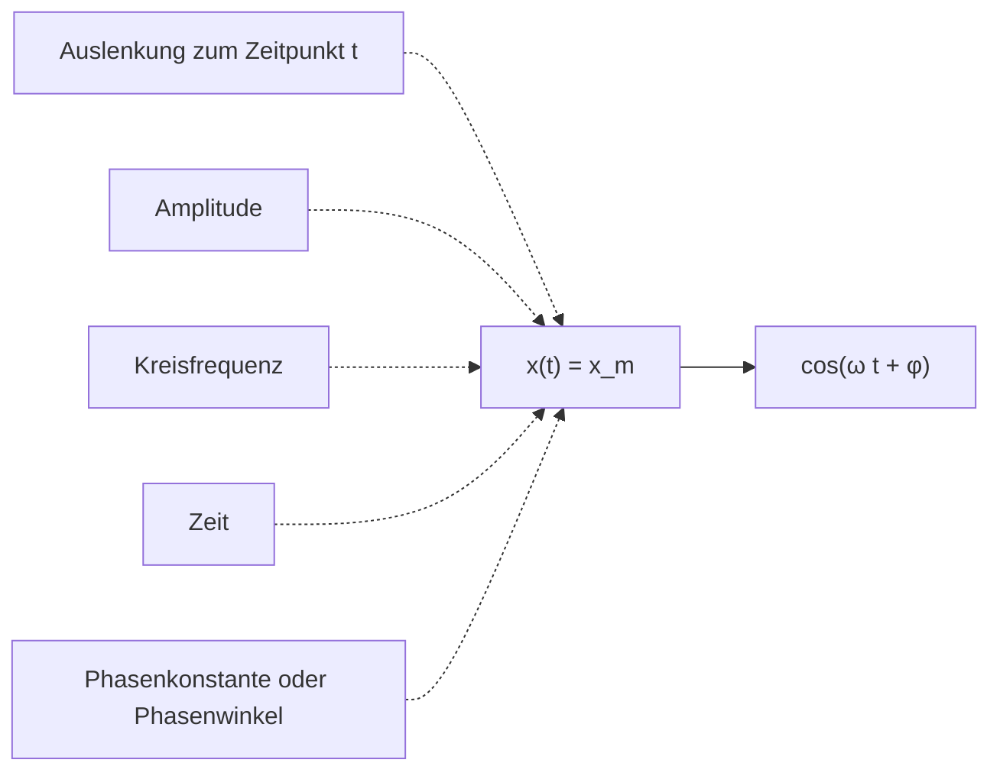
</details>

Abb. 11.2

Eine nützliche Zusammenfassung der in Gl. 11.3 auftretenden Größen für die harmonische Schwingung.

Eine solche Bewegung bezeichnet man als **harmonische Schwingung**. Die periodische Bewegung ist in diesem Fall eine kosinus- bzw. sinusförmige Funktion der Zeit. In Abb. 11.1b ist der Graph zu Gl. 11.3 aufgetragen. (Man erhält diesen Graph beispielsweise, indem man Abb. 11.1a gegen den Uhrzeigersinn um $9 0 ^ { \circ }$ dreht und anschließend die entsprechenden Lagen des Teilchens durch eine Kurve verbindet.) Die einzelnen Größen, welche die Form des Graphen bestimmen, sind zusammen mit ihren Bezeichnungen in Abb. 11.2 wiedergegeben. Wir wollen diese Größen nun definieren.

Die Größe $x _ { \mathrm { m } }$ bezeichnet man als **Amplitude** der Schwingung (oder auch **Schwingungsamplitude** oder **Auslenkungsamplitude**). Sie ist eine positive Konstante, deren Wert von den Anfangsbedingungen der Bewegung abhängt. Der Index $\mathrm { { _ { \mathrm { { \it { p } } } } m } ^ { \it { \it { \it { \it { \it { \it { \it { \it { \it { \it { \it { \it { } } } } } } } } } } } } } }$ steht für „maximal“, weil die Amplitude gerade der Betrag der maximalen Auslenkung des Teilchens in jede der beiden Richtungen ist. Die Kosinusfunktion in Gl. 11.3 variiert zwischen den Werten $\pm 1$ , daher variiert die Auslenkung x(t) zwischen den Grenzen $\pm x _ { \mathrm { m } }$

256

---

11.1 Harmonische Schwingungen

11


## Abb. 11.3

Die blaue Kurve ergibt sich in allen Fällen aus Gl. 11.3 mit Die rote Kurve unterscheidet sich von der blauen Kurve nur in ihrer Amplitude: ist größer (die Extremwerte der roten Kurve liegen jeweils höher bzw. tiefer). (b) Die rote Kurve unterscheidet sich von der blauen Kurve nur in der Periode: Es gilt (die rote Kurve erscheint horizontal zusammengedrückt). (c) Die rote Kurve unterscheidet sich von der blauen Kurve nur hinsichtlich der Phasenkonstante: rad statt null (der negative Wert von 𝜑 verschiebt die rote Kurve nach rechts).

Die zeitlich veränderliche $\mathrm { G r \ddot { o } \beta e } \left( \omega t + \varphi \right)$ in Gl. 11.3 nennt man die Phase der Bewegung, und die Konstante 𝜑 heißt **Phasenkonstante** (oder auch **Phasenwinkel**). Der Wert von 𝜑 hängt von der Auslenkung und der Geschwindigkeit des Teilchens zum Zeitpunkt $t = 0$ ab. Für den Graphen von $x ( t )$ in Abb. 11.3a ist die Phasenkonstante 𝜑 gleich null.

Zur Interpretation der Konstante $\omega ,$ der sogenannten **Kreisfrequenz** der Bewe gung, überlegen wir uns zunächst, dass die Auslenkung x(t) nach einer vollen Periode T der Bewegung wieder zu ihrem Ausgangswert zurückkehrt. Für alle Zeiten t muss $x ( t )$ daher gleich $x ( t + T )$ sein. Der Einfachheit halber setzen wir in Gl. 11.3 $\varphi = 0 ,$ , dann folgt:

$$
x _ {\mathrm{m}} \cos \omega t = x _ {\mathrm{m}} \cos \omega (t + T). \tag {11.4}
$$

Die Kosinusfunktion wiederholt sich zum ersten Mal wieder, wenn ihr Argument (die Phase) um 2π rad zugenommen hat. Nach Gl. 11.4 gilt daher

$$
\omega (t + T) = \omega t + 2 \pi
$$

oder

$$
\omega T = 2 \pi .
$$

Zusammen mit Gl. 11.2 erhalten wir somit für die Kreisfrequenz

$$
\omega = \frac {2 \pi}{T} = 2 \pi f. \tag {11.5}
$$

Die SI-Einheit für die Kreisfrequenz ist entweder Hertz oder Radiant pro Sekun de. (Aus Konsistenzgründen muss 𝜑 daher im zweiten Fall in Radiant angegeben werden, vgl. Anhang D) In Abb. 11.3 werden jeweils zwei harmonische Schwingungen miteinander verglichen, die sich entweder nur in ihrer Amplitude, nur in ihrer Periode (und daher in der Frequenz bzw. der Kreisfrequenz) oder nur in ihrer Phasenkonstante unterscheiden.

257

---

11 Schwingungen

## KONTROLLFRAGE 1

Ein Teilchen führe eine harmonische Schwingung mit der Periode T (vgl. Abb. 11.1) aus und befinde sich zum Zeitpunkt $t = 0$ bei $- x _ { \mathrm { m } } .$ Befindet sich das Teilchen bei (a) $t = 2 { , } 0 0 T _ { \mathrm { i } }$ , (b) $t = 3 { , } 5 0 T$ und (c) $t = 5 { , } 2 5 T$ bei $- x _ { \mathrm { m } } ,$ bei $+ x _ { \mathrm { m } } + x _ { \mathrm { m } } ,$ bei 0, zwischen $- x _ { \mathrm { m } }$ und 0 oder zwischen 0 und $+ x _ { \mathrm { m } } ?$


<details>
<summary>line</summary>

| Time | Auslenkung (x) | Geschwindigkeit (v) | Beschleunigung (a) |
| --- | --- | --- | --- |
| 0 | +xm | 0 | \(-\omega2\)xm |
| T1 | 0 | \(-\omega\)xm | 0 |
| T2 | -xm | 0 | \(+\omega2\)xm |
| T3 | 0 | +ωxm | 0 |
| T4 | +xm | 0 | \(-\omega2\)xm |
</details>

Abb. 11.4

(a) Die Auslenkung eines Teilchens bei einer harmonischen Schwingung mit $\varphi = 0 .$ Die Periode T entspricht der Zeitdauer einer vollständigen Schwingung. (b) Die Geschwindigkeit v(t) des Teilchens. (c) Die Beschleunigung a(t) des Teilchens.

## Die Geschwindigkeit eines harmonisch schwingenden Teilchens

Wenn wir Gl. 11.3 einmal nach der Zeit ableiten, erhalten wir einen Ausdruck für die Geschwindigkeit des Teilchens während einer harmonischen Schwingung (vgl. Anhang D zur Ableitung der trigonometrischen Funktionen):

$$
\nu (t) = \frac {\mathrm{d} x (t)}{\mathrm{d} t} = \frac {\mathrm{d}}{\mathrm{d} t} [ x _ {\mathrm{m}} \cos (\omega t + \varphi) ],
$$

also

$$
\nu (t) = - \omega x _ {\mathrm{m}} \sin (\omega t + \varphi) \quad \text {(Geschwindigkeit)}  . \tag {11.6}
$$

Abbildung 11.4a zeigt die Kurve zu Gl. 11.3 mit $\varphi = 0 .$ Abbildung 11.4b entspricht Gl. 11. $. 6 ,$ ebenfalls mit $\varphi = 0 .$ In Analogie zur Amplitude $x _ { \mathrm { m } }$ in Gl. 11.3 bezeichnet man die positive Größe $\omega x _ { \mathrm { m } }$ in Gl. 11.6 auch als Geschwindigkeitsamplitude $\nu _ { \mathrm { m } } .$ In Abb. 11.4b erkennt man, dass die Geschwindigkeit des oszillierenden Teilchens zwischen den Grenzen $\pm \nu _ { \mathrm { m } } = \pm \omega x _ { \mathrm { m } }$ variiert. Außerdem beachte man in dieser Abbildung, dass die Kurve von v(t) relativ zur Kurve von x(t) um eine Viertelperiode $\left( { \frac { 1 } { 4 } } T \right)$ nach links verschoben ist. Wenn der Betrag der Auslenkung am größten ist (d. h., wenn $x ( t ) = \pm x _ { \mathrm { m } } )$ ist der Betrag der Geschwindigkeit am kleinsten (d. h. $\nu ( t ) = 0 )$ . Ist der Betrag der Auslenkung am kleinsten (d. h. null), ist der Betrag der Geschwindigkeit am größten (d. h. $\nu ( t ) = \pm \nu _ { \mathrm { m } } = \pm \omega x _ { \mathrm { m } } )$

## Die Beschleunigung eines harmonisch schwingenden Teilchens

Aus der Geschwindigkeit v(t) der harmonischen Bewegung erhalten wir durch er neute Ableitung nach der Zeit einen Ausdruck für die Beschleunigung des oszillierenden Teilchens:

$$
a (t) = \frac {\mathrm{d} \nu (t)}{\mathrm{d} t} = \frac {\mathrm{d}}{\mathrm{d} t} [ - \omega x _ {\mathrm{m}} \sin (\omega t + \varphi) ]
$$

oder

$$
a (t) = - \omega^ {2} x _ {\mathrm{m}} \cos (\omega t + \varphi) \quad \text {(Beschleunigung).} \tag {11.7}
$$

Abbildung 11.4c zeigt einen Graphen von Gl. 11.7 für den Fall $\varphi = 0 .$ . Die positive Größe $\omega ^ { 2 } x _ { \mathrm { m } }$ in Gl. 11.7 ist die **Beschleunigungsamplitude** $a _ { \mathrm { m } }$ . Die Beschleunigung des Teilchens variiert also zwischen den Grenzen $\pm a _ { \mathrm { m } } = \pm \omega ^ { 2 } x _ { \mathrm { m } } ,$ wie in Abb. 11.4c zu erkennen ist. Außerdem ist die Kurve von a(t) relativ zur Kurve von v(t) wiederum um ${ \frac { 1 } { 4 } } T$ nach links verschoben.

Aus den Gln. 11.3 und 11.7 folgt

$$
a (t) = - \omega^ {2} x (t). \tag {11.8}
$$

Diese Beziehung ist das Markenzeichen der harmonischen Schwingung:


Bei einer harmonischen Schwingung ist die Beschleunigung proportional zur Auslenkung, allerdings mit entgegengesetztem Vorzeichen, und die Proportionalitätskonstante ist das Quadrat der Kreisfrequenz.

258

---

11.1 Harmonische Schwingungen

11

Wie man in Abb. 11.4 sieht, hat die Auslenkung ihren größten positiven Wert, wenn die Beschleunigung ihren größten negativen Wert hat, und umgekehrt. Ist die Auslenkung null, verschwindet auch die Beschleunigung.

## LÖSUNGSSTRATEGIEN

**Strategie 1: Phasenwinkel** Man beachte den Einfluss des Phasenwinkels $\varphi$ auf den Graphen von $x ( t )$ . Für $\varphi = 0$ hat $x ( t )$ einen Graphen wie in Abb. 11.4a, also eine typische Kosinuskurve. Wird 𝜑 größer, verschiebt sich diese Kurve entlang der t-Achse nach links. (Man kann sich das mit dem Symbol $仝  \varphi$ merken: Der Pfeil nach oben steht für die Zunahme von $\varphi$ und der Pfeil nach links zeigt die Verschiebung der Kurve an.) Wird $\varphi$ kleiner, verschiebt sich die Kurve nach rechts, beispielsweise in Abb. 11.3c für $\varphi = - \pi / 4$

Haben zwei harmonische Schwingung unterschiedliche Phasenwinkel, spricht man von einer Phasenverschiebung oder Phasendifferenz zwischen diesen Schwingungen. Die beiden Bewegungen sind relativ zueinander phasenverschoben oder außer Phase. Beispielsweise haben die Kurven in Abb. 11.3c eine Phasenverschiebung von π∕4 rad.

Da eine harmonische Schwingung sich nach jeder Periode T und die Kosinus-Funktion sich nach jeweils 2π rad wiederholt, entspricht eine Periode $T$ gerade einer Phasenverschiebung von 2π rad. In Abb. 11.4 ist $x ( t )$ relativ zu $\nu ( t )$ um eine Viertelperiode nach rechts, also um $- \pi / 2$ rad phasenverschoben, relativ zu $a ( t )$ beträgt die Phasenverschiebung eine halbe Periode oder −π rad. Bei einer Phasenverschiebung von 2π rad stimmt die Kurve der harmonischen Schwingung wieder mit sich selbst überein, sie erscheint also unverändert.

## 11.1.2 Das Kraftgesetz einer harmonischen Schwingung

Ist die Beschleunigung eines Teilchens als Funktion der Zeit einmal bekannt, kön nen wir mithilfe des zweiten Newtonschen Gesetzes auch die Kraft ermitteln, die dem Teilchen diese Beschleunigung erteilt. Setzen wir Gl. 11.8 in das zweite Newtonsche Gesetz ein, so erhalten wir für die harmonische Schwingung

$$
F = m a = - (m \omega^ {2}) x. \tag {11.9}
$$

Dieses Ergebnis – eine rücktreibende Kraft proportional zur Auslenkung, aber mit entgegengesetztem Vorzeichen – ist uns vertraut. Es handelt sich um das Hookesche Gesetz für eine Feder,

$$
F = - k x, \tag {11.10}
$$

wobei die Federkonstante in diesem Fall durch

$$
k = m \omega^ {2} \tag {11.11}
$$

gegeben ist (vgl. Abschn. 3.4).

Gleichung 11.10 bietet eine alternative Möglichkeit zur Definition der harmonischen Schwingung. Sie besagt:


Ein Teilchen der Masse m führt eine harmonische Schwingung aus, wenn auf dieses Teilchen eine Kraft proportional zu seiner Auslenkung und mit entgegengesetztem Vorzeichen wirkt.

Das System Feder–Masse in Abb. 11.5 bildet einen **eindimensionalen harmonischen Oszillator** (kurz: harmonischen Oszillator). Die Kreisfrequenz ω der harmonischen Schwingung der Masse hängt nach Gl. 11.11 von der Federkonstante k und der Masse m ab:

$$
\omega = \sqrt {\frac {k}{m}} \quad (\text {Kreisfrequenz}). \tag {11.12}
$$

259

---

11 Schwingungen


<details>
<summary>text_image</summary>

k
m
-x_m
x = 0
+x_m
x
</details>

Abb. 11.5

Ein linearer harmonischer Oszillator. Die Oberfläche ist reibungsfrei. Wie das Teilchen in Abb. 11.2 führt auch diese Masse eine harmonische Schwingung aus, wenn sie einmal zur Seite gezogen und dann losgelassen wird. Ihre Auslenkung folgt Gl. 11.3.

Zusammen mit Gl. 11.5 erhalten wir aus dieser Gleichung für die **Periode** des linearen Oszillators aus Abb. 11.5

$$
T = 2 \pi \sqrt {\frac {m}{k}} \quad (\text {Periode}). \tag {11.13}
$$

Aus diesen beiden Gleichungen lernen wir, dass eine große Kreisfrequenz (und somit eine kurze Periode) eine große Federkonstante (großes k) und eine kleine Masse (kleines m) erfordert.

Jedes oszillierende System, sei es der lineare Oszillator aus Abb. 11.5, ein Sprungbrett im Schwimmbad oder eine Geigensaite, hat etwas von einer Feder – etwas „Rücktreibendes“ – und etwas von einer Masse – etwas „Träges“ – an sich und ähnelt in diesem Sinn dem linearen Oszillator aus der Abbildung. Bei dem linearen Oszillator aus Abb. 11.5 liegen diese beiden Elemente in getrennten Teilen des Systems: Das rücktreibende Element liegt in der Feder, die wir als masselos ansehen, und das träge Element liegt in der Masse, die wir als starr annehmen. Bei einer Geigensaite befinden sich jedoch beide Elemente in der Saite selbst, wie wir in Kapitel 12 sehen werden.

## KONTROLLFRAGE 2

Welche der folgenden Beziehungen zwischen der Kraft F auf ein Teilchen und dem Ort x des Teilchens führen zu einer harmonischen Schwingung: (a) $F = - 5 ^ { 2 } x$ (b) $F = - 400x^{2}, \left(  c  \right) F = 10x, \left(  d  \right) F = 3x^{2}?$

## LÖSUNGSSTRATEGIEN

**Strategie 2: Wie man eine harmonische Schwingung erkennt** Bei einer harmonischen Schwingung sind die Beschleunigung a und die Auslenkung x des Systems über eine Gleichung der Form

$$
a = - (\text {positive Konstante}) \cdot x
$$

miteinander verknüpft. Die Beschleunigung ist also proportional zur Auslenkung aus der Gleichgewichtslage, hat allerdings das entgegengesetzte Vorzeichen. Wenn Sie einen solchen Ausdruck für ein oszillierendes System vorliegen haben, können sie ihn direkt mit Gl. 11.8 vergleichen und die positive Konstante als $\omega ^ { 2 }$ identifizie ren. Sie erhalten also sofort einen Ausdruck für die Kreisfrequenz der Bewegung. Mit Gl. 11.5 ergeben sich dann auch sofort die Periode $T$ und die Frequenz $\bar { f } .$

Bei manchen Aufgabenstellungen ist es vielleicht leichter, einen Ausdruck für die Kraft F als Funktion der Auslenkung x abzuleiten. Handelt es sich bei der Bewegung um eine lineare harmonische Schwingung, dann lautet die Beziehung zwischen Kraft und Auslenkung

$$
F = - (\text {positive Konstante}) \cdot x.
$$

Die Kraft ist also proportional zur Auslenkung, hat aber das entgegengesetzte Vorzeichen. Liegt eine solche Beziehung vor, können Sie durch Vergleich mit Gl. 11.10 die positive Konstante als k identifizieren. Kennen Sie zusätzlich noch die Masse des Systems, können Sie mit den Gln. 11.12, 11.13 und 11.15 die Kreisfrequenz $\omega ,$ die Periode $T$ und die Frequenz $f$ bestimmen.

## 11.2 Die Energie einer harmonischen Schwingung


## Lernziele

Nach dem Durcharbeiten dieses Abschnitts sollten Sie in der Lage sein, . . .

• für einen Oszillator aus einer Feder und einer Masse die kinetische Energie und die elastische potenzielle Energie zu einem beliebigen Zeitpunkt während seiner Bewegung anzugeben,

260

---

11.2 Die Energie einer harmonischen Schwingung

11

• für einen Oszillator aus einer Feder und einer Masse mithilfe der Energieerhaltung einen Zusammenhang zwischen seiner Gesamtenergie zu einem Zeitpunkt und seiner Gesamtenergie zu einem anderen Zeitpunkt anzugeben,
• für einen Oszillator aus einer Feder und einer Masse seine kinetische Energie, seine potenzielle Energie und seine Gesamtenergie als Funktion der Zeit oder der Position des Oszillators zu skizzieren,
• für einen Oszillator aus einer Feder und einer Masse seine Position anzugeben, wenn seine Gesamtenergie entweder vollständig als kinetische Energie oder vollständig als potenzielle Energie vorliegt.

## Schlüsselideen

• Ein Teilchen, das eine einfache harmonische Bewegung ausführt, besitzt zu jedem Zeitpunkt die kinetische Energie $\begin{array} { r } { K = \frac { 1 } { 2 } m \nu ^ { 2 } } \end{array}$ und die potenzielle Energie $\begin{array} { r } { U = \frac { 1 } { 2 } \bar { k } x ^ { 2 } } \end{array}$ . In Abwesenheit von Reibung ist die Gesamtenergie $E = K + U$ konstant, obwohl K und U sich fortlaufend ändern.


## 11.2.1 Die Energie einer harmonischen Schwingung

In Kapitel 4 hatten wir qualitativ gesehen, dass die Energie eines linearen harmo nischen Oszillators periodisch zwischen den Energieformen kinetische und potenzielle Energie hin- und herwechselt. Die Summe dieser beiden Energien – die mechanische Energie E des Oszillators – bleibt jedoch konstant. Wir untersuchen diese Situation nun quantitativ.

Die potenzielle Energie eines linearen Oszillators wie in Abb. 11.5 beruht ausschließlich auf dem Zustand der Feder. Der Wert der potenziellen Energie hängt davon ab, wie weit die Feder gedehnt oder zusammengedrückt ist, d. h. von x(t). Aus den Gln. 4.11 und 11.3 erhalten wir

$$
U (t) = \frac {1}{2} k x ^ {2} = \frac {1}{2} k x _ {\mathrm{m}} ^ {2} \cos^ {2} (\omega t + \varphi). \tag {11.14}
$$

Man beachte in diesem Zusammenhang, dass eine Funktion der Form $\cos ^ { 2 } A$ (wie hier) dasselbe bedeutet wie $( \cos A ) ^ { 2 }$ . Das ist nicht dasselbe wie cos $A ^ { 2 } ,$ was vielmehr für $\cos ( A ^ { 2 } )$ steht.

Die kinetische Energie des Systems aus Abb. 11.5 beruht ausschließlich auf dem Zustand der Masse, und ihr Wert hängt von der Geschwindigkeit v der Masse ab. Mit Gl. 11.6 erhalten wir

$$
K (t) = \frac {1}{2} m v ^ {2} = \frac {1}{2} m \omega^ {2} x _ {\mathrm{m}} ^ {2} \sin^ {2} (\omega t + \varphi). \tag {11.15}
$$

Nach Gl. 11.12 können wir $\omega ^ { 2 }$ durch das Verhältnis $k / m$ ersetzen und Gl. 11.15 auch in der folgenden Form schreiben:

$$
K (t) = \frac {1}{2} m v ^ {2} = \frac {1}{2} k x _ {\mathrm{m}} ^ {2} \sin^ {2} (\omega t + \varphi). \tag {11.16}
$$

Für die mechanische Energie folgt aus den Gln. 11.14 und 11.16

$$
\begin{array}{l} E = U + K = \frac {1}{2} k x _ {\mathrm{m}} ^ {2} \cos^ {2} (\omega t + \varphi) + \frac {1}{2} k x _ {\mathrm{m}} ^ {2} \sin^ {2} (\omega t + \varphi) \\ = \frac {1}{2} k x _ {\mathrm{m}} ^ {2} [ \cos^ {2} (\omega t + \varphi) + \sin^ {2} (\omega t + \varphi) ]. \\ \end{array}
$$

Für jeden beliebigen Winkel α gilt

$$
\cos^ {2} \alpha + \sin^ {2} \alpha = 1.
$$

Daher ist die Größe in den eckigen Klammern oben gleich eins und wir bekommen

$$
E = U + K = \frac {1}{2} k x _ {\mathrm{m}} ^ {2}. \tag {11.17}
$$

261

---

11 Schwingungen

## Abb. 11.6

(a) Potenzielle Energie U, kinetische Energie K und mechanische Energie E als Funktionen der Zeit t für einen linearen harmonischen Oszillator. Alle Energien sind positiv, und die potenzielle Energie wie auch die kinetische Energie erreichen innerhalb einer Periode zweimal ihren Maximalwert. (b) Potenzielle Energie $U ,$ kinetische Energie K und mechanische Energie E als Funktionen der Auslenkung x für einen linearen harmonischen Oszillator mit der Amplitude $x _ { \mathrm { m } } .$ Bei $x = 0$ besteht die gesamte Energie aus kinetischer Energie, für $x = \pm x _ { \mathrm { m } }$ liegt die gesamte Energie als potenzielle Energie vor.


<details>
<summary>line</summary>

| Time (t) | U(t) | K(t) |
| --- | --- | --- |
| 0 | E | 0 |
| T/2 | ~E - E | 0 |
| T | ~E + E | 0 |
</details>

(a)


<details>
<summary>contour</summary>

| X | U(x) | K(x) |
| --- | --- | --- |
| -xm | 0 | 0 |
| 0 | E | E |
| +xm | 0 | 0 |
</details>

(b)

Die mechanische Energie eines linearen Oszillators ist also tatsächlich konstant und zeitunabhängig. Die potenzielle Energie und die kinetische Energie eines linearen Oszillators sind in Abb. 11.6a als Funktionen der Zeit t und in Abb. 11.6b als Funktionen der Auslenkung x wiedergegeben.

Nun ist auch einsichtig, warum ein oszillierendes System normalerweise ein „rücktreibendes“ Element und ein Element der „Trägheit“ enthält: Das erste speichert die potenzielle Energie und das zweite die kinetische Energie.

## KONTROLLFRAGE 3

Wenn sich die Masse in Abb. 11.5 bei $x = + 2$ cm befindet, habe sie eine kinetische Energie von 3 J und die Feder eine elastische potenzielle Energie von 2 J. (a) Wie groß ist die kinetische Energie, wenn sich die Masse bei $x = 0$ befindet? Wie groß ist die elastische potenzielle Energie, wenn sich die Masse (b) bei $x = - 2 { , } 0$ cm und (c) bei $x = - x _ { \mathrm { m } }$ befindet?

## 11.3 Das Torsionspendel


## Lernziele

Nach dem Durcharbeiten dieses Abschnitts sollten Sie in der Lage sei $1 , \ldots .$

• die Bewegung eines einfachen harmonischen Torsionspendels zu beschreiben,
• für ein einfaches harmonisches Torsionspendel die Beziehung zwischen dem Drehmoment τ und der Winkelauslenkung θ (aus der Ruhelage) anzugeben und anzuwenden,
• für ein einfaches harmonisches Torsionspendel die Beziehung zwischen seiner Periode T (oder seiner Frequenz $f ) ,$ , seinem Trägheitsmoment I und der Torsionskonstante κ anzugeben und anzuwenden,
• für ein einfaches harmonisches Torsionspendel die Beziehung zwischen der Winkelbeschleunigung $\alpha ,$ der Kreisfrequenz ω und der Winkelauslenkung θ anzugeben und anzuwenden.


## Schlüsselideen

• Ein Torsionspendel besteht aus einem Objekt, das an einem Draht aufgehängt ist. Wenn der Draht zuerst verdreht und dann freigegeben wird, führt das Objekt eine einfache harmonische Drehschwingung mit einer Periode

$$
T = 2 \pi \sqrt {\frac {I}{\kappa}}
$$

aus, wobei I das Trägheitsmoment des Objekts und $\kappa ( \mathrm { { \tt { , } K a p p a } ^ { \omega } } )$ die Torsionskonstante des Drahts ist.

## 11.3.1 Das Torsionspendel

Abbildung 11.7 zeigt eine Version eines harmonischen Oszillators, bei der die Auslenkung eine Winkelvariable ist. Das rücktreibende Element bzw. die Elastizität be

262

---

11.3 Das Torsionspendel

11

ruht nun auf der Verdrillung einer Aufhängung (meist einem Draht). Diese Anord nung bezeichnet man als **Torsionspendel**, wobei Torsion wörtlich $_ { p } \mathrm { V }$ erdrillung bedeutet.

Wenn wir die Scheibe in Abb. 11.7 um einen Winkel θ aus ihrer Ruhelage (bei der sich die Bezugslinie beim Winkel $\theta = 0$ befindet) auslenken und dann loslassen, rotiert die Scheibe um diese Lage hin und her. Jede Auslenkung der Scheibe um einen Winkel θ nach rechts oder links erzeugt ein rücktreibendes Drehmoment, das durch

$$
\tau = - \kappa \theta \tag {11.18}
$$

gegeben ist. $\kappa$ (der griechische Buchstabe Kappa) ist hier eine Konstante, die man als **Torsionskonstante** (oder auch **Winkelrichtgröße**) bezeichnet und die von der Länge, dem Durchmesser und dem Material der Aufhängung abhängig ist.

Ein Vergleich von Gl. 11.18 mit Gl. 11.10 legt die Vermutung nahe, dass es sich bei Gl. 11.18 um das Winkelanalogon zum Hookeschen Gesetz handelt, und dass wir Gl. 11.13 für die Periode der linearen harmonischen Schwingung in eine entsprechende Gleichung für die Periode der harmonischen Drehschwingung umwandeln können: Wir ersetzen die Federkonstante k in Gl. 11.13 durch ihr Gegenstück, die Konstante κ aus Gl. 11.18, und wir ersetzen die Masse m in Gl. 11.13 durch ihr Gegenstück, das Massenträgheitsmoment I der schwingenden Scheibe. Diese Ersetzungen führen auf

$$
T = 2 \pi \sqrt {\frac {I}{\kappa}} \quad (\text {Torsionspendel}). \tag {11.19}
$$

Dies ist tatsächlich die korrekte Gleichung für die Periode einer harmonischen Drehschwingung bzw. die Periode des Torsionspendels.

## LÖSUNGSSTRATEGIEN

**Strategie 3: Woran erkennt man eine harmonische Drehschwingung?** Wenn ein System eine harmonische Drehschwingung ausführt, hängen seine Winkelbeschleunigung α und seine Winkelauslenkung θ über eine Gleichung der Form

$$
\alpha = - (\text {positive Konstante}) \cdot \theta
$$

miteinander zusammen. Diese Gleichung ist das Gegenstück zu Gl. 11.8 $( \alpha   =$ $- \omega ^ { 2 } x )$ bei der linearen harmonischen Schwingung. Sie besagt, dass die Winkelbeschleunigung α proportional zur Winkelauslenkung θ aus der Gleichgewichtslage ist, dass diese Winkelbeschleunigung allerdings das System entgegengesetzt zur Auslenkungsrichtung zu drehen versucht. Wenn Ihnen eine Gleichung dieser Form vorliegt, können Sie die positive Konstante als $\omega ^ { 2 }$ identifizieren und daraus $\omega ,   f$ und T berechnen.

Wenn Sie einen Ausdruck für das Drehmoment als Funktion der Winkelauslenkung haben, können Sie das Vorliegen einer harmonischen Drehschwingung auch daran erkennen, dass dieser Ausdruck von der Form von Gl. 11.18 $\left( \tau = - \kappa \theta \right)$ ist, also:

$$
\tau = - (\text {positive Konstante}) \cdot \theta .
$$

Dieser Gleichung entspricht bei der linearen harmonischen Schwingung Gl. 11.10 $( F = - k x )$ . Sie besagt, dass das Drehmoment τ proportional zur Winkelauslenkung θ aus der Gleichgewichtslage ist, dass dieses Drehmoment allerdings das System in die entgegengesetzte Richtung zu drehen versucht. Wenn Sie einen Aus druck dieser Form vorliegen haben, können Sie die positive Konstante als die Tor sionskonstante κ des Systems identifizieren. Kennen Sie das Massenträgheitsmo ment I des Systems, berechnen Sie dann die Periode T mithilfe von Gl. 11.19.


<details>
<summary>text_image</summary>

festes Ende
Draht
Bezugslinie
+θm
0
-θm
</details>

Abb. 11.7

Ein Torsionspendel ist eine besondere Version des harmonischen Oszillators aus Abb. 11.5, bei der die Auslenkung eine Winkelvariable ist. Die Scheibe führt in einer horizontalen Ebene eine Drehschwingung aus; die Bezugslinie schwingt mit einer Winkelamplitude $\theta _ { \mathrm { m } } .$ Die Verdrillung in der Aufhängung speichert ähnlich wie eine Feder potenzielle Energie und erzeugt ein rücktreibendes Drehmoment.

263

---

11 Schwingungen

## 11.4 Pendel und Kreisbewegungen


## Lernziele

Nach dem Durcharbeiten dieses Abschnitts sollten Sie in der Lage sein, . . .

• die Bewegung eines oszillierenden einfachen Pendels zu beschreiben,
• das Kräftediagramm eines Pendelkörpers zu zeichnen, wenn das Pendel einen Winkel θ zur Vertikalen bildet,
• für kleine Auslenkungen eines einfachen Pendels den Zusammenhang zwischen der Periode T (oder der Frequenz f ) und der Länge L des Pendels anzugeben,
• den Unterschied zwischen einem einfachen Pendel und einem physikalischen Pendel zu beschreiben,
• für kleine Auslenkungen eines physikalischen Pendels den Zusammenhang zwischen der Periode T (oder der Frequenz f ) und dem Abstand h zwischen Drehpunkt und Schwerpunkt anzugeben,
die Kreisfrequenz ω eines Torsionspendels entweder aus dem Zusammenhang zwischen dem Drehmoment τ und der Winkelauslenkung θ oder dem Zusammenhang zwischen der Winkelbeschleunigung α und der Winkelauslenkung θ zu bestimmen,
• den Unterschied zwischen der Kreisfrequenz ω eines Pendels (der Zahl der Schwingungszyklen pro Zeiteinheit) und seinem Wert für $\mathrm { d } \theta / \mathrm { d } t$ (der Geschwindigkeit, mit der sich der Winkel zur Vertikalen ändert) zu verstehen,
• aus gegebenen Werten der Winkelposition θ und ihrer Änderungsrate dθ∕dt an einen gegebenen Zeitpunkt die Phasenkonstante 𝜑 und die Amplitude $\theta _ { \mathrm { m } }$ zu bestimmen,
• zu beschreiben, wie die Fallbeschleunigung g mit einem einfachen Pendel gemessen werden kann,
• für ein gegebenes physikalisches Pendel die Lage des Schwingungszentrums zu bestimmen und zu verstehen, was dieser Begriff im Zusammenhang mit einem einfachen Pendel bedeutet,
• den Zusammenhang zwischen einer einfachen harmonischen Bewegung und einer gleichförmigen Kreisbewegung zu erklären.


## Schlüsselideen

Ein einfaches Pendel besteht aus einem Stab mit vernachlässigbarer Masse, der sich um sein oberes Ende drehen kann und an dessen unterem Ende ein Teilchen mit gegebener Masse (der Pendelkörper) befestigt ist. Wenn der Stab nur wenig ausgelenkt wird, ist seine Bewegung näherungsweise eine einfache harmonische Schwingung mit der Periode

$$
T = 2 \pi \sqrt {\frac {I}{m g L}},
$$

wobei I das Trägheitsmoment des Teilchens um den Drehpunkt ist, m die Masse des Teilchens und L die Länge des Stabs.

• Ein physisches Pendel besitzt eine kompliziertere Massenverteilung. Für kleine Auslenkungen ist auch seine Bewegung eine einfache harmonische Schwingung mit einer Periode

$$
T = 2 \pi \sqrt {\frac {I}{m g h}},
$$

wobei I das Trägheitsmoment des Pendels um den Drehpunkt ist, m seine Masse und h der Abstand zwischen Drehpunkt und Schwerpunkt des Pendels.

• Eine einfache harmonische Bewegung entspricht der Projektion einer gleichmä- ßigen Kreisbewegung auf einen Durchmesser des Kreises.

264

---

11.4 Pendel und Kreisbewegungen

11

## 11.4.1 Pendel

Wir wenden uns nun einer bestimmten Klasse von harmonischen Oszillatoren zu, bei denen das rücktreibende Element nicht durch eine zusammengedrückte bzw. gedehnte Feder oder die elastischen Eigenschaften eines verdrillten Drahts verursacht wird, sondern auf der Gravitationskraft beruht.

## Das einfache Pendel

Hängen Sie einen Apfel an das untere Ende einer langen Schnur, deren oberes Ende irgendwo befestigt ist, und stoßen Sie den Apfel leicht zu einer hin- und herschwingenden Bewegung an. Sie erkennen sofort, dass der Apfel eine periodische Bewegung ausführt. Handelt es sich hierbei sogar um eine harmonische Schwingung? Falls ja, welche Periode T hat diese Schwingung? Zur Beantwortung dieser Fragen betrachten wir ein **einfaches Pendel**: Es besteht aus einem Teilchen der Masse m (dem Pendelkörper), das an einem dehnungsfreien, masselosen, am oberen Ende fixierten Seil der Länge L hängt (vgl. Abb. 11.8a). Relativ zu einer senkrechten Linie durch den Aufhängepunkt kann das Gewicht in der Papierebene frei nach links und rechts ausgelenkt werden.

Auf das Gewicht wirken die Zugkraft $\vec { Z }$ des Seils und die Gravitationskraft ${ \vec { F } } _ { \mathrm { G } } .$ Beide sind in Abb. 11.8b eingetragen, wobei das Seil in diesem Fall unter einem Winkel θ relativ zur Senkrechten steht. Wir zerlegen $\vec { F } _ { \mathrm { G } }$ in eine radiale Komponente $F _ { \mathrm { G } }$ cos $\theta$ und eine Komponente $F _ { \mathrm { G } }$ sin θ tangential zur Bahnkurve des Gewichts. Diese tangentiale Komponente erzeugt ein rücktreibendes Drehmoment um die Aufhängung des Pendels, weil sie der Auslenkung des Gewichts immer entgegenwirkt und das Gewicht in seine Mittellage zu bringen versucht. Diese Mittellage bezeichnet man auch als Gleichgewichtslage $( \theta = 0 )$ , weil das nicht schwingende Pendel in dieser Lage ruhen würde.

Nach Gl. 6.30 $( \tau = r _ { \perp } F )$ können wir für das rücktreibende Drehmoment als

$$
\tau = - L (F _ {\mathrm{G}} \sin \theta) \tag {11.20}
$$

schreiben, wobei das Minuszeichen andeutet, dass das Drehmoment den Winkel θ zu verkleinern versucht. L ist der Kraftarm zu der Kraftkomponente $F _ { \mathrm { G } }$ sin $\theta$ um die Aufhängung. Setzen wir Gl. 11.20 in Gl. 6.33 $( \tau = I \alpha )$ ein und ersetzen $F _ { \mathrm { G } }$ durch mg, erhalten wir

$$
- L (m g \sin \theta) = I \alpha , \tag {11.21}
$$

wobei I das Massenträgheitsmoment des Pendels um die Aufhängung und α die Winkelbeschleunigung um diesen Punkt darstellen.

Wir können Gl. 11.21 noch vereinfachen, wenn wir θ als klein annehmen. In diesem Fall können wir sin θ nämlich durch θ annähern (ausgedrückt in Radiant). (Ist θ beispielsweise $5 ^ { \circ } = 0 { , } 0 8 7 3$ rad, dann ist sin $\theta = 0 { , } 0 8 7 2 ;$ der Unterschied beträgt also nur 0,1 %.) Mit dieser Näherung und einigen Umformungen bekommen wir schließlich

$$
\alpha = - \frac {m g L}{I} \theta . \tag {11.22}
$$

Diese Gleichung charakterisiert die harmonische Drehschwingung, ähnlich wie Gl. 11.8 die lineare harmonische Schwingung kennzeichnet. Sie besagt, dass die Winkelbeschleunigung α des Pendels proportional zur Winkelauslenkung θ des Pendels ist, allerdings mit entgegengesetztem Vorzeichen. Bewegt sich das Pendel beispielsweise nach rechts, wie in Abb. 11.8a, nimmt seine Beschleunigung nach links zu bis zu dem Moment, wo das Pendel anhält und sich anschließend nach links bewegt. Befindet es sich auf der linken Seite, ist seine Beschleunigung nach rechts gerichtet, und so weiter.


<details>
<summary>text_image</summary>

Auf-
hängung
L
m
</details>

(a)


<details>
<summary>text_image</summary>

L
θ
Z
s = L θ
m
F_G cos θ
θ
F_G sin θ
F_G
</details>

(b)

## Abb. 11.8

(a) Ein einfaches Pendel. (b) Auf das Gewicht wirken die Gravitationskraft $\vec { \bar { F } } _ { \mathrm { G } }$ und die Zugkraft Z⃗ des Seils. Die tangentiale Komponente $F _ { \mathrm { G } }$ sin θ der Gravitationskraft wirkt als eine rücktreibende Kraft, die das Pendel in seine Ruhelage in der Mitte zurückzubringen versucht.

265

---

11 Schwingungen


Die Bewegung eines einfachen, nur mit kleinen Auslenkungen schwingenden Pendels ist näherungsweise eine harmonische Schwingung.

Diese Einschränkung auf kleine Winkel können wir auch anders ausdrücken: Die **Winkelamplitude** $\theta _ { \mathrm { m } }$ der Bewegung (der maximale Auslenkungswinkel) muss klein sein.

Durch einen Vergleich d<u>er Gln.</u> 11.22 und 11.8 sehen wir, dass die Kreisfrequenz des Pendels durch $\tilde { \omega } = \sqrt { m g L / I }$ gegeben ist. Diesen Ausdruck setzen wir nun in Gl. 11.5 $( \omega = 2 \pi / T )$ ein und erhalten so die Periode des Pendels:

$$
T = 2 \pi \sqrt {\frac {I}{m g L}}. \tag {11.23}
$$

Bei einem einfachen Pendel ist die gesamte Masse des Pendels in der Masse m des teilchenartigen Gewichts konzentriert, das vom Aufhängepunkt den Abstand L hat. Wir können also mithilfe von Gl. 6.23 $( I = m r ^ { 2 } )$ für das Massenträgheitsmoment des Pendels $I = m L ^ { 2 }$ schreiben. Setzen wir dies in Gl. 11.23 ein und kürzen entsprechend, folgt als vereinfachter Ausdruck für die Periode eines einfachen Pendels bei kleinen Auslenkungen der Ausdruck

$$
T = 2 \pi \sqrt {\frac {L}{g}} \quad \text {(einfaches Pendel, kleine Amplitude).} \tag {11.24}
$$

(In diesem Kapitel werden wir immer kleine Auslenkungen der Pendel annehmen.)


<details>
<summary>text_image</summary>

O
θ
h
F_G sin θ
S
F_G cos θ
θ
F_G
</details>

Abb. 11.9

Ein physikalisches Pendel. Das rücktreibende Drehmoment ist $h F _ { G }$ sin θ. Für $\theta = 0$ hängt der Schwerpunkt S genau unter der Aufhängung O.

## Das physikalische Pendel

Ein reales Pendel bezeichnet man üblicherweise als **physikalisches Pendel**. Es kann eine komplizierte Massenverteilung haben, die sich von einem einfachen Pendel deutlich unterscheidet. Führt auch ein physikalisches Pendel eine harmonische Schwingung aus? Falls ja, was ist die Periode?

Abbildung 11.9 zeigt ein beliebig geformtes physikalisches Pendel, das um einen Winkel θ ausgelenkt ist. Die Gravitationskraft $\vec { F } _ { \mathrm { G } }$ wirkt auf den Schwerpunkt S, der sich im Abstand h von der Aufhängung O befindet. Trotz ihrer unterschiedlichen Formen zeigt ein Vergleich von Abb. 11.9 mit Abb. 11.8b nur einen wesentlichen Unterschied zwischen einem beliebigen Pendel und einem einfachen Pendel: Bei einem physikalischen Pendel hat die rücktreibende Komponente $F _ { \mathrm { G } }$ sin θ der Gravitationskraft einen Kraftarm der Länge h um die Aufhängung, während beim einfachen Pendel das Seil die Länge L hatte. Ansonsten würde eine detailliere Diskussion des physikalischen Pendels nur unsere Überlegungen zum einfachen Pendel bis hin zu Gl. 11.23 wiederholen. Wiederum ist die Bewegung des physikalischen Pendels (für kleine $\theta _ { \mathrm { m } } )$ die einer harmonischen Schwingung.

Ersetzen wir in Gl. 11.23 L durch $h ,$ so erhalten wir für die Periode eines physikalischen Pendels:

$$
T = 2 \pi \sqrt {\frac {I}{m g h}} \quad (\text {physikalisches Pendel, kleine Amplitude}). \tag {11.25}
$$

Wie beim einfachen Pendel bezeichnet I das Trägheitsmoment des Pendels um den Punkt O. In diesem Fall ist I jedoch nicht einfach gleich $m L ^ { 2 }$ , sondern es hängt von der Form des physikalischen Pendels ab. Trotzdem ist I immer noch proportional zu m.

Ein physikalisches Pendel führt keine Schwingungen aus, wenn sich die Aufhän gung O im Schwerpunkt befindet. In Gl. 11.25 entspricht dies formal dem Fall $h = 0 ,$ was zu einer Periode von $T \to \infty$ führt. Ein solches „Pendel“ würde also in endlicher Zeit keine Schwingung ausführen.

Zu jedem physikalischen Pendel, das um eine gegebene Aufhängung O mit der Periode T schwingt, gibt es ein einfaches Pendel der Länge $L _ { 0 }$ mit derselben Periode T. Wir können $L _ { 0 }$ nach Gl. 11.24 berechnen. $L _ { 0 }$ bezeichnet man auch als

266

---

11.4 Pendel und Kreisbewegungen

11

reduzierte Pendellänge des physikalischen Pendels. Den Punkt, der sich im physikalischen Pendel im Abstand $L _ { 0 }$ von O befindet, bezeichnet man als das Schwingungszentrum bezüglich der Aufhängung $\mathrm { O } .$

## Die Messung der Erdbeschleunigung g

Mithilfe eines physikalischen Pendels können wir die Erdbeschleunigung g an einem beliebigen Punkt auf der Erdoberfläche messen. (Im Rahmen geologischer Untersuchungen wurden tausende solcher Messungen durchgeführt.)

Wir betrachten im Folgenden einen einfachen Fall: Das Pendel bestehe aus einem gleichförmigen Stab der Länge $L ,$ der an einem seiner Enden aufgehängt wird. Für ein solches Pendel ist die Länge h in Gl. 11.25 durch den Abstand zwischen der Aufhängung und dem Massenschwerpunkt, also durch ${ \frac { 1 } { 2 } } L ,$ gegeben. Nach Tab. 6.2e ist das Trägheitsmoment für einen solchen Stab um eine Achse durch den Schwerpunkt senkrecht zur Ausdehnung des Stabs durch $\scriptstyle { \frac { 1 } { 1 2 } } m L ^ { 2 }$ gegeben. Nach dem Steinerschen Satz, Gl. 6.26 $( I = I _ { S } + M h ^ { 2 } )$ , erhalten wir für das Trägheitsmoment des Stabs um eine senkrecht zur Ausdehnung gelegene Achse durch eines der Stabenden:

$$
I = I _ {\mathrm{S}} + m h ^ {2} = \frac {1}{1 2} m L ^ {2} + m \left(\frac {1}{2} L\right) ^ {2} = \frac {1}{3} m L ^ {2}. \tag {11.26}
$$

Setzen wir $\begin{array} { r } { h = \frac { 1 } { 2 } L } \end{array}$ und $\begin{array} { r } { I = \frac { 1 } { 3 } m L ^ { 2 } } \end{array}$ in Gl. 11.25 ein und lösen nach $g$ auf, so finden wir

$$
g = \frac {8 \pi^ {2} L}{3 T ^ {2}}. \tag {11.27}
$$

Eine Messung von L und der Periode T liefert somit den Wert von $g$ am Ort des Pendels. (Für Präzisionsmessungen müssen noch einige Verbesserungen vorgenommen werden, beispielsweise muss sich das Pendel in einer luftleeren Kammer befinden.)

## KONTROLLFRAGE 4

Drei physikalische Pendel der Massen $m _ { 0 } , 2 m _ { 0 }$ und $3 m _ { 0 }$ haben dieselbe Form, Grö- ße und Aufhängung. Ordnen Sie die Massen in absteigender Reihenfolge nach den Schwingungsperioden der Pendel.

## 11.4.2 Harmonische Schwingungen und die gleichförmige Kreisbewegung

Im Jahr 1610 entdeckte Galileo Galilei mit seinem neu entwickelten Teleskop die vier Hauptmonde des Jupiters. Im Verlauf seiner wochenlangen Beobachtungen schien sich jeder Mond relativ zum Planeten vor- und zurückzubewegen. Heute würden wir von einer harmonischen Bewegung sprechen. Die Planetenscheibe war der Mittelpunkt dieser Schwingung. Die handgeschriebenen Aufzeichnungen von Galilei sind uns heute noch erhalten, und A.P. French vom MIT hat aus den Daten von Galilei die Position des Monds Callisto relativ zu Jupiter am Anfang des Jahres 1610 rekonstruiert. Die Ergebnisse sind in Abb. 11.10 wiedergegeben. Die Kreise basieren auf Galileis Beobachtungen und die Kurve entspricht der besten Anpassung an die Daten. Diese Kurve wird durch Gl. 11.3, die Auslenkungsfunktion einer harmonischen Schwingung, sehr gut beschrieben. Aus den Daten lässt sich eine Periode von 16,8 Tagen ablesen.

In Wirklichkeit bewegt sich Callisto mit nahezu konstanter Geschwindigkeit auf einer im Wesentlichen kreisförmigen Bahn um den Jupiter. Seine wahre Bewegung ist eine gleichförmige Kreisbewegung. Was Galilei sah – und was Sie mit einem guten Fernglas und etwas Geduld ebenfalls beobachten können – ist die Projektion

267

---

11 Schwingungen


<details>
<summary>text_image</summary>

y
x_m
ωt + φ
O
x(t)
P'
P
x
</details>

(a)


<details>
<summary>line</summary>

| Datum | Winkel (Bogenminuten) |
| --- | --- |
| ~26 | -11 |
| ~27 | -7 |
| ~30 | 8.5 |
| ~31 | 12.5 |
| ~32 | 12.5 |
| ~33 | 10.5 |
| ~34 | 5.5 |
| ~35 | -11 |
| ~36 | -12 |
| ~37 | -12 |
| ~38 | -10 |
| ~39 | -6 |
| ~40 | 2 |
| ~41 | 8.5 |
| ~42 | 10.5 |
| ~43 | 12.5 |
| ~44 | 10.5 |
| ~45 | -8.5 |
| ~46 | -10 |
| ~47 | -10 |
| ~48 | -9 |
| ~49 | -7.5 |
</details>

Abb. 11.10

Der Position des Monds Callisto relativ zum Jupiter aus Sicht der Erde. Die Kreise beruhen auf den Messungen von Galileo Galilei aus dem Jahr 1610. Die Kurve ist die beste Anpassung für diese Daten und legt eine harmonische Schwingung nahe. Für den mittleren Abstand des Jupiters von der Erde entsprechen 10 Bogenminuten ungefähr $2 \cdot 1 0 ^ { 6 }$ km. [Quelle: French, A.P. (1971). Newtonian Mechanics. New York: W.W. Norton & Company, S. 288].


<details>
<summary>text_image</summary>

y
v
ωx_m
ωt + φ
P'
ωt + φ
O
v(t)
P
x
</details>

(b)

dieser gleichförmigen Kreisbahn auf eine Linie in der Bewegungsebene. Die wichtigen Beobachtungen Galileis führen uns zu dem Schluss, dass aus einer in Wirklichkeit gleichförmigen Kreisbewegung eine scheinbare harmonische Schwingung wird, wenn man sie von der Seite betrachtet. Etwas formaler ausgedrückt heißt das:


Eine harmonische Schwingung entsteht als Projektion einer gleichförmigen Kreisbewegung auf den Durchmesser des Kreises, auf dem diese Kreisbewegung stattfindet.


<details>
<summary>text_image</summary>

y
ω²xₘ
P'
a
ωt + φ
O
a(t)
P
x
</details>

(c)

Abbildung 11.11a zeigt ein Beispiel. Man erkennt ein Referenzteilchen $\mathrm { P ^ { \prime } } _ { i }$ das sich mit konstanter Winkelgeschwindigkeit ω auf einem Kreis bewegt. Der Radius $x _ { \mathrm { m } }$ des Kreises ist gleich dem Betrag des Ortsvektors des Teilchens. Zu jedem Zeitpunkt t lässt sich die Position von $\mathrm { P ^ { \prime } }$ durch seinen Winkel (relativ zur x-Achse) ωt + 𝜑 kennzeichnen, wobei 𝜑 die Winkelposition zum Zeitpunkt $t = 0$ ist.

Die Projektion des Referenzteilchens $\mathrm { P ^ { \prime } }$ auf die x-Achse entspricht einem Punkt P, den wir als zweites Teilchen ansehen. Die Projektion des Ortsvektors von Teilchen $\mathrm { P ^ { \prime } }$ auf die x-Achse entspricht dem Ort x(t) des Teilchens P. Wir erhalten also

$$
x (t) = x _ {\mathrm{m}} \cos (\omega t + \varphi),
$$

was genau Gl. 11.3 entspricht. Unsere Schlussfolgerung war richtig: Wenn sich das Referenzteilchen $\mathrm { P ^ { \prime } }$ gleichförmig auf einer Kreisbahn bewegt, führt das Teilchen P eine harmonische Schwingung auf dem Durchmesser dieses Kreises aus.

Abbildung 11.11b gibt die Geschwindigkeit ⃗v des Referenzteilchens wieder. Nach Gl. 6.15 $\left( \nu = \omega r \right)$ ist der Betrag der Geschwindigkeit gleich $\omega x _ { \mathrm { m } }$ . Die Projektion der Geschwindigkeit auf die x-Achse ist somit

$$
\nu (t) = - \omega x _ {\mathrm{m}} \sin (\omega t + \varphi),
$$

Abb. 11.11

(a) Ein Referenzteilchen P′ bewegt sich mit konstanter Winkelgeschwindigkeit auf einem Kreis mit Radius $x _ { \mathrm { m } ^ { * } }$ Seine Projektion P auf die x-Achse führt dabei eine harmonische Schwingung aus. (b) Die Projektion des Geschwindigkeitsvektors ⃗v des Referenzteilchens ist gleich der Geschwindigkeit der harmonischen Schwingung. (c) Die Projektion der Radialbeschleunigung a⃗ des Referenzteilchens ist gleich der Beschleunigung der harmonischen Schwingung.

was genau Gl. 11.6 entspricht. Das Minuszeichen tritt auf, weil die Geschwindigkeitskomponente von P in Abb. 11.11b nach links gerichtet ist, also in negative x-Richtung.

In Abb. 11.11c erkennt man die Radialbeschleunigung $\vec { a }$ des Referenzteilchens. Nach Gl. 6.20 $( a _ { \mathrm { r } } = \omega ^ { 2 } r )$ ist der Betrag der Radialbeschleunigung gleich $\omega ^ { 2 } r _ { \mathrm { m } } .$ Seine Projektion auf die x-Achse ist daher

$$
a (t) = - \omega^ {2} x _ {\mathrm{m}} \cos (\omega t + \varphi),
$$

genau wie in Gl. 11.7. Gleichgültig ob wir die Auslenkung, die Geschwindigkeit oder die Beschleunigung betrachten, die Projektion der gleichförmigen Kreisbewegung ist tatsächlich eine harmonische Schwingung.

268

---

11.5 Gedämpfte harmonische Schwingungen

11

## 11.5 Gedämpfte harmonische Schwingungen

## Lernziele

Nach dem Durcharbeiten dieses Abschnitts sollten Sie in der Lage sein, . . .

• die Bewegung eines gedämpften harmonischen Oszillators zu beschreiben und seine Position als Funktion der Zeit zu skizzieren,
• die Position eines gedämpften harmonischen Oszillators zu einem gegebenen Zeitpunkt zu berechnen,
• die Amplitude eines gedämpften harmonischen Oszillators zu einem beliebigen Zeitpunkt zu berechnen,
• die Kreisfrequenz eines gedämpften harmonischen Oszillators aus seiner Federkonstante, seiner Dämpfungskonstante und seiner Masse zu berechnen und eine Näherung für die Kreisfrequenz für kleine Dämpfungskonstanten anzugeben,
• die (genäherte) Gesamtenergie eines gedämpften harmonischen Oszillators als Funktion der Zeit zu berechnen.


## Schlüsselideen

In realen schwingenden Systemen nimmt die mechanische Energie E im Verlauf der Schwingungen ab, da äußere Einflüsse wie z. B. Reibungskräfte die Schwingungen hemmen und mechanische Energie in thermische Energie umwandeln. Man bezeichnet einen solchen realen Oszillator bzw. seine Bewegung als gedämpft.
• Wenn die dämpfende Kraft durch $\vec { F } _ { \mathrm { D } } = - b \vec { \nu }$ gegeben ist, wobei v⃗ die Geschwindigkeit des Oszillators und b eine Dämpfungskonstante ist, dann folgt die Auslenkung des Oszillators der Gleichung

$$
x (t) = x _ {\mathrm{m}} \mathrm{e} ^ {- b t / (2 m)} \cos (\omega^ {\prime} t + \varphi),
$$

wobei für die Kreisfrequenz ω′ des gedämpften Oszillators gilt

$$
\omega^ {\prime} = \sqrt {\frac {k}{m} - \frac {b ^ {2}}{4 m ^ {2}}}.
$$

• Wenn die Dämpfungskonstante klein ist $( b \ll \sqrt { k m } )$ , gilt $\omega ^ { \prime } \approx \omega$ , wenn ω die Kreisfrequenz des ungedämpften Oszillators ist. Für kleine b ist die mechanische Energie E des Oszillators

$$
E (t) \approx \frac {1}{2} k x _ {\mathrm{m}} ^ {2} \mathrm{e} ^ {- b t / m}.
$$

## 11.5.1 Gedämpfte harmonische Schwingungen

Unter Wasser wird ein Pendel nur sehr kurz schwingen, da das Wasser auf das Pendel einen Widerstand ausübt, der die Bewegung rasch abklingen lässt. Die Schwingung eines Pendels in Luft hält schon länger an, aber über kurz oder lang klingt auch diese Bewegung ab, weil auch die Luft auf das Pendel einen Widerstand aus übt (und zusätzlich noch Reibungskräfte – beispielsweise an der Aufhängung – auftreten, vgl. Kapitel 2). Der Pendelbewegung wird also Energie entzogen.

Wenn die Bewegung eines Oszillators durch eine äußere Kraft abgeschwächt wird, bezeichnet man den Oszillator und seine Bewegung als **gedämpft**. Ein idealisiertes Beispiel einer gedämpften Schwingung zeigt Abb. 11.12. Ein Gewicht der Masse m schwingt vertikal an einer Feder mit der Federkonstante k. Unten an dem Gewicht befindet sich ein dünner Stab mit einem Dämpfungskolben (beide als masselos angenommen), die in eine Flüssigkeit eintauchen. Wenn sich der Kolben auf- und abbewegt, übt die Flüssigkeit einen Widerstand auf ihn aus und damit auf das gesamte oszillierende System. Im Verlauf der Zeit nimmt die mechanische


<details>
<summary>text_image</summary>

x
starre
Halterung
Feder, k
Masse m
Kolben
Dämpfung, b
</details>

Abb. 11.12

Ein idealisierter gedämpfter harmonischer Oszillator. Ein Kolben in einer Flüssigkeit überträgt auf das Gewicht eine dämpfende Kraft, während es in x-Richtung oszilliert.

269

---

11 Schwingungen

Energie des Systems Feder–Gewicht ab, und die Energie wird in thermische Energie von Flüssigkeit und Kolben umgewandelt.

Wir nehmen im Folgenden an, die Flüssigkeit übe eine **Reibungskraft** $\vec { \bar { F } } _ { \mathrm { R } }$ aus, die proportional zum Betrag der Geschwindigkeit v⃗ des Kolbens bzw. des Gewichts ist. (Diese Annahme ist zulässig, wenn sich der Kolben nicht zu schnell bewegt.) Für die x-Komponente (vgl. Abb. 11.12) dieser Kraft gilt dann

$$
F _ {\mathrm{R}} = - b \nu \tag {11.28}
$$

wobei b der **Dämpfungskoeffizient** ist, der sowohl von den Eigenschaften des Kolbens als auch von denen der Flüssigkeit abhängt. Seine SI-Einheit ist Kilogramm pro Sekunde. Das Minuszeichen deutet an, dass die Kraft $\vec { \bar { F } } _ { \mathrm { R } }$ der Bewegung entgegenwirkt.

Die von der Feder auf das Gewicht ausgeübte Kraft ist $F _ { \mathrm { F } } = - k x$ . Außerdem nehmen wir noch an, dass die Gravitationskraft auf das Gewicht im Vergleich zu $F _ { \mathrm { R } }$ und $F _ { \mathrm { F } }$ vernachlässigbar ist. In diesem Fall können wir das zweite Newtonsche Gesetz entlang der x-Achse $( F _ { \mathrm { g e s } , x } = m a _ { x } )$ in der Form

$$
- b v - k x = m a \tag {11.29}
$$

schreiben. Ersetzen wir v durch dx∕dt und a durch $\mathrm { d } ^ { 2 } x / \mathrm { d } t ^ { 2 }$ und bringen alle Terme auf eine Seite, so erhalten wir die Differenzialgleichung

$$
m \frac {\mathrm{d} ^ {2} x}{\mathrm{d} t ^ {2}} + b \frac {\mathrm{d} x}{\mathrm{d} t} + k x = 0. \tag {11.30}
$$

Mit ein bisschen mathematischem Aufwand kann man die Lösung dieser Gleichung auch als

$$
x (t) = x _ {\mathrm{m}} \mathrm{e} ^ {- b t / (2 m)} \cos (\omega^ {\prime} t + \varphi) \tag {11.31}
$$

schreiben, wobei $x _ { \mathrm { m } }$ die Amplitude und $\omega ^ { \prime }$ die Kreisfrequenz des gedämpften Oszillators ist.

Diese Kreisfrequenz ist durch

$$
\omega^ {\prime} = \sqrt {\frac {k}{m} - \frac {b ^ {2}}{4 m ^ {2}}} \tag {11.32}
$$

gegeben<u>. Fü</u>r den Fall $b   =   0$ (keine Dämpfung) wird Gl. 11.32 zu Gl. 11.12 $( \omega = \sqrt { k / m } )$ , der Kreisfrequenz des ungedämpften Oszillators, und Gl. 11.31 wird zu Gl. 11.3, der Gleichung für die Auslenkung des ungedämpften Oszillators. Für einen kleinen, aber von null verschiedenen Dämpfungskoeffizienten $( b \ll \sqrt { k m } )$ gilt $\omega ^ { \prime } \approx \omega$

Wir können Gl. 11.31 als Kosinusfunktion interpretieren, deren Amplitude – gegeben durch $x _ { \mathrm { m } } \mathrm { e } ^ { - b t / 2 ^ { m } }$ – mit der Zeit abnimmt. Für einen ungedämpften Oszillator ist die mechanische Energie konstant und durch Gl. 11.17 $\begin{array} { r } { \tilde { ( E = \frac { 1 } { 2 } k x _ { \mathrm { m } } ^ { 2 } ) } } \end{array}$ gegeben. Für einen gedämpften Oszillator ist die mechanische Energie nicht mehr konstant, sondern sie nimmt im Lauf der Zeit ab. Ist die Dämpfung schwach, können wir $E ( t )$ näherungsweise bestimmen, indem wir $x _ { \mathrm { m } }$ in Gl. 11.17 durch $x _ { \mathrm { m } } \mathrm { e } ^ { - b t / ( 2 m ) }$ ersetzen, die Amplitude der gedämpften Schwingung. Auf diese Weise erhalten wir

$$
E (t) \approx \frac {1}{2} k x _ {\mathrm{m}} ^ {2} \mathrm{e} ^ {- b t / m}. \tag {11.33}
$$

Wie die Amplitude nimmt auch die mechanische Energie exponentiell mit der Zeit ab.

## KONTROLLFRAGE 5

In der Tabelle sind Federkonstante, Dämpfungskoeffizient und Masse für drei Sys teme von gedämpften Oszillatoren wie in Abb. 11.12 angegeben. Ordnen Sie die se Systeme in absteigender Reihenfolge nach der Zeit, nach der die mechanische Energie auf ein Viertel ihres Anfangswerts gesunken ist.

| System 1 | $2k_{0}$ | $b_{0}$ | $m_{0}$ |
| --- | --- | --- | --- |
| System 2 | $k_{0}$ | $6b_{0}$ | $4m_{0}$ |
| System 3 | $3k_{0}$ | $3b_{0}$ | $m_{0}$ |

270

---

11.6 Erzwungene Schwingungen und Resonanz

11

## 11.6 Erzwungene Schwingungen und Resonanz

## Lernziele

Nach dem Durcharbeiten dieses Abschnitts sollten Sie in der Lage sein, . . .

• zwischen der natürlichen Kreisfrequenz ω und der antreibenden Erreger-Kreisfrequenz $\omega _ { \mathrm { e } }$ zu unterscheiden,
• für eine erzwungene Schwingung die Schwingungsamplitude als Funktion des Verhältnisses $\omega _ { \mathrm { e } } / \omega$ von antreibender zu natürlicher Kreisfrequenz zu skizzieren, den Resonanzfall anzugeben sowie die Auswirkungen einer zunehmenden Dämpfung zu erläutern,
• zu einer gegebenen natürlichen Kreisfrequenz ω die ungefähre antreibende Erreger-Kreisfrequenz $\omega _ { \mathrm { e } }$ anzugeben, bei der es zur Resonanz kommt.


## Schlüsselideen

• Wenn auf ein schwingendes oszillierendes System mit der natürlichen Kreisfrequenz ω eine externe antreibende Erregerkraft wirkt, die mit der Kreisfrequenz $\omega _ { e }$ oszilliert, schwingt das System mit der Kreisfrequenz $\omega _ { e }$
• Die Geschwindigkeitsamplitude $\nu _ { \mathrm { m } }$ des angetriebenen Systems ist für

$$
\omega_ {\mathrm{e}} = \omega
$$

am größten; man spricht in diesem Fall von Resonanz. Wenn diese Bedingung erfüllt ist, ist auch die Auslenkungsamplitude des Systems (näherungsweise) maximal.


## 11.6.1 Erzwungene Schwingungen und Resonanz

Eine Person auf einer Schaukel, die sich ohne äußere (und eigene) Hilfe hin- und herschwingen lässt, ist ein Beispiel für ein frei schwingendes System. Wird diese Person jedoch von einer anderen Person (oder von sich selbst) in regelmäßigen Abständen angestoßen, haben wir es mit einer erzwungenen (oder auch angetriebenen) Schwingung zu tun. Bei einer solchen erzwungenen Schwingung treten zwei Kreisfrequenzen auf: (1) die natürliche Kreisfrequenz ω des Systems, also die Kreisfrequenz, mit der das System ohne äußeren Einfluss schwingen würde, und (2) die Kreisfrequenz $\omega _ { e }$ der (als periodisch angenommenen) externen antreibenden Erregerkraft.

Wir können die Anordnung aus Abb. 11.12 auch zur Darstellung eines idealisierten getriebenen harmonischen Oszillators verwenden. Dazu müssen wir uns vorstellen, die als „starre Halterung“ gekennzeichnete Struktur bewege sich mit der (frei einstellbaren) Kreisfrequenz $\omega _ { \mathrm { e } }$ auf und ab. Ein solcher getriebener Oszillator schwingt mit der Winkelgeschwindigkeit der antreibenden Kraft und seine Auslenkung x(t) ist durch

$$
x (t) = x _ {\mathrm{m}} \cos (\omega_ {\mathrm{e}} t + \varphi) \tag {11.34}
$$

gegeben, wobei $x _ { \mathrm { m } }$ die Amplitude der Erregerschwingung ist.

Die Verschiebungsamplitude $x _ { \mathrm { m } }$ auszurechnen erfordert etwas mathematischen Aufwand. Es ergibt sich schließlich, dass (für kleine Dämpfungen) die Auslenkung bei

$$
\omega_ {\mathrm{e}} = \omega \quad (\text {Resonanz}) \tag {11.35}
$$

maximal wird. Das Vorliegen dieser Bedingung bezeichnet man als **Resonanz**. Die Resonanzbedingung ist näherungsweise auch die Bedingung dafür, dass die Verschiebungsamplitude $x _ { \mathrm { m } }$ am größten ist. Wenn Sie also eine Schaukel bei ihrer natürlichen Frequenz anstoßen, werden die Auslenkungs- und Geschwindigkeits amplituden sehr groß, eine Tatsache, die schon kleine Kinder spielend lernen. Sto ßen Sie die Schaukel mit einer anderen Frequenz an, gleichgültig ob größer oder kleiner, bleiben Auslenkungs- und Geschwindigkeitsamplituden kleiner.

271

---

11 Schwingungen


<details>
<summary>line</summary>

| \(\omega e/\omega\) | Amplitude (b=50 g/s) | Amplitude (b=70 g/s) | Amplitude (b=140 g/s) |
| --- | --- | --- | --- |
| 0.6 | ~0.1 | ~0.1 | ~0.05 |
| 0.8 | ~0.3 | ~0.25 | ~0.15 |
| 1.0 | ~1.0 | ~0.6 | ~0.3 |
| 1.2 | ~0.3 | ~0.25 | ~0.15 |
| 1.4 | ~0.1 | ~0.1 | ~0.05 |
</details>

## Abb. 11.13

Die Verschiebungsamplitude $X _ { \mathrm { m } }$ für eine erzwungene Schwingung ändert sich mit der Kreisfrequenz $\omega _ { \mathrm { e } }$ der antreibenden Kraft. In der Nähe von $\omega _ { \mathrm { e } } / \omega _ { \mathrm { r } }$ also der Resonanzbedingung, ist die Amplitude am größten. Die Kurven entsprechen drei verschiedenen Werten für den Dämpfungskoeffizienten b.

Abbildung 11.13 zeigt die Auslenkungsamplitude eines Oszillators als Funktion der Kreisfrequenz $\omega _ { e }$ der treibenden Kraft für drei verschiedene Werte des Dämpfungskoeffizienten $b .$ Die größten Werte für die Amplitude erhält man für alle drei Dämpfungskoeffizienten in der Nähe von $\omega _ { \mathrm { e } } / \omega = 1 ,$ , wenn also die Resonanzbedingung aus Gl. 11.35 erfüllt ist. Die Kurven in Abb. 11.13 lassen auch erkennen, dass weniger Dämpfung zu einer höheren und engeren Amplitudenresonanzfunktion führt.

Alle mechanischen Strukturen haben eine oder mehrere natürliche Schwingungsfrequenzen, und wenn eine solche Struktur einer starken äußeren periodischen Kraft ausgesetzt ist, die mit einer dieser Frequenzen übereinstimmt, können die resultierenden Schwingungen die Struktur zerstören. Ein Flugzeugkonstrukteur beispielsweise muss sich vergewissern, dass im Flug keine der natürlichen Schwingungsfrequenzen der Flügel mit den Schwingungsfrequenzen der Maschinen übereinstimmen. Ein bei bestimmten Fluggeschwindigkeiten heftig auf- und abschwingender Flügel wäre offensichtlich eine große Gefahr.

Das heftige Erdbeben an der mexikanischen Pazifikküste im September 1985 erreichte einen Wert von 8,1 auf der Richter-Skala. Trotzdem wären die seismischen Wellen eigentlich zu schwach gewesen, um in dem 400 km entfernten Mexiko-Stadt größere Schäden anrichten zu können. Mexiko-Stadt wurde allerdings zu einem Großteil auf einem alten Seebett erbaut, und die Erde des Untergrunds ist immer noch feucht und weich. Obwohl die Amplituden der seismischen Wellen auf dem festeren Grund auf dem Weg nach Mexiko-Stadt klein waren, wurden sie durch den weicheren Untergrund der Stadt wesentlich größer. Die Beschleunigungsamplituden der Wellen betrugen rund 0,20g, und die Frequenzen waren in der Nähe von 3 rad/s ungewöhnlich konzentriert. Nicht nur, dass der Boden vergleichsweise stark oszillierte, sondern viele der Gebäude mittlerer Größe hatten auch eine natürliche Resonanzfrequenz von ungefähr 3 rad/s. Die meisten dieser mittelgroßen Gebäude fielen während des Bebens zusammen, während niedrigere (mit einer größeren Resonanzfrequenz) und höhere Gebäude (mit einer kleineren Resonanzfrequenz) stehen blieben.

272

---

11.7 Das Foucaultsche Pendel

11

## 11.7 Das Foucaultsche Pendel

## Lernziele

Nach dem Durcharbeiten dieses Abschnitts sollten Sie in der Lage sein, . . .

• die Drehung der Schwingungsebene eines Foucaultschen Pendels relativ zum Erdboden zu verstehen und zu erklären.

## Schlüsselideen

• Die Schwingungsebene eines Foucaultschen Pendels scheint sich relativ zum Erdboden zu drehen. Korrekter ist es zu sagen, dass sich der Erdboden aufgrund der Erdrotation unter dem Pendel hinwegdreht.

## 11.7.1 Das Foucaultsche Pendel

Der französische Physiker J.B. Léon Foucault führte im Januar 1851 in seinem Haus erstmals ein einfaches Pendelexperiment aus, das im Laufe der Jahre zu einem der berühmtesten und am häufigsten kopierten Experimente der Physik wurde. Das **Foucaultsche Pendel** ist dadurch charakterisiert, dass es eine sehr lange (in der Regel mehrere Meter lange) Aufhängung hat, an der eine relativ schwere Masse befestigt ist (Abb. 11.14). Wenn man diese Masse aus ihrer Gleichgewichtslage auslenkt und loslässt, dann fängt das Pendel an zu schwingen. In Foucaults Experiment hat der Pendelkörper, d. h. die schwere Masse, eine Spitze, die während der Schwingungen eine Spur in einem mit Sand bestreuten Untergrund hinterlässt. Wenn man diese Spur über einige Stunden hinweg beobachtet, dann formt sie sich zu eine Rosette, d. h., die Schwingungsebene des Pendels ist nicht konstant, sondern sie rotiert im Laufe der Zeit. Das Auftreten dieser Rosette ist ein direkter Nachweis der **Erdrotation**, die damit in einem konzeptionell sehr einfachen Experiment von Laien beobachtet werden kann.

Wie können wir verstehen, dass die Rotation der Schwingungsebene beim Foucaultschen Pendel einen direkten Nachweis der Erdrotation darstellt? Dafür müssen wir die Pendelbewegung im rotierenden Koordinatensystem K auf der Erdoberfläche berechnen. Da die Erde sich innerhalb von 24 Stunden einmal um ihre durch die Pole verlaufende Rotationsachse dreht, ist der Betrag der Winkelgeschwindigkeit

$$
\omega = \omega_ {\mathrm{Erde}} = \frac {1}{2 4 \cdot 3 6 0 0} \mathrm{s} ^ {- 1} \approx 1, 1 5 7 \cdot 1 0 ^ {- 5} \mathrm{s} ^ {- 1}, \tag {11.36}
$$

das heißt ein recht kleiner Zahlenwert.

In Abschn. 2.7 hatten wir die Newtonsche Bewegungsgleichung in rotierenden Koordinatensystemen hergeleitet. (Dort hatten wir allerdings das rotierende Koordinatensystem mit $\mathrm { K ^ { \prime } }$ und das inertiale System mit K bezeichnet – hier verwenden wir die Bezeichnungen aus Gründen der Übersichtlichkeit genau umgekehrt!) Wir haben also in unserem Fall in den Koordinaten x, y, z des rotierenden Systems

$$
m \left. \frac {\mathrm{d} ^ {2} \vec {r}}{\mathrm{d} t ^ {2}} \right| _ {\text {Erde}} = \vec {F} _ {\text {ext}} + \vec {F} _ {\text {Zentrifugal}} + \vec {F} _ {\text {Coriolis}} + \vec {F} _ {\text {Azimutal}}. \tag {11.37}
$$

|Die Scheinkraft $\vec { F } _ { \mathrm { A z i m u t a l } }$ tritt nur auf, falls die Winkelgeschwindigkeit sich mit der Zeit ändert. Dieser Effekt ist bei der Erde so klein, dass wir ihn hier vernachlässigen können.

Von den beiden übrigen Scheinkräften $\vec { F } _ { \mathrm { Z e n t r i f u g a l } }$ und $\vec { F } _ { \mathrm { C o r i o l i s } }$ müssen wir nur

$$
\vec {F} _ {\text {Coriolis}} = (- 2 m \vec {\omega} _ {\mathrm{Erde}}) \times \left(\frac {\mathrm{d} \vec {r}}{\mathrm{d} t} \Bigg | _ {\mathrm{Erde}}\right) \tag {11.38}
$$

berücksichtigen, da

$$
\vec {F} _ {\text {Zentrifugal}} = - m \vec {\omega} _ {\text {Erde}} \times (\vec {\omega} _ {\text {Erde}} \times \vec {r}) \tag {11.39}
$$


<details>
<summary>text_image</summary>

θ
L
z
y
m
r
x
</details>

Abb. 11.14

Eine schwere Masse m ist an einer langen Aufhängung (Länge L) befes tigt. Nach der Auslenkung schwingt das Pendel, wobei seine Schwingungsebene wegen der von der Erdrotation bewirkten Coriolis-Kraft rotiert. Zur Aufzeichnung dieses Effekts versah Foucault in seinen Originalexperimenten die schwere Masse mit einer Spitze, die während der Schwingungen eine Spur in einem mit Sand bestreuten Untergrund hinterließ. Diese Spur ist in der Abbildung als rote Linie symbolisiert.

273

---

11 Schwingungen


<details>
<summary>text_image</summary>

z
y'
z'
x'
φ
x
y
</details>

Abb. 11.15

Bei den Koordinatensystemen, die für die Behandlung des Foucaultschen Pendelversuchs wichtig sind, unterscheidet man zwischen dem inertialen Koordinatensystem K′ (blau) mit Ursprung im Mittelpunkt der Erde (blau eingezeichnet) und dem rotierenden lokalen Koordinatensystem K mit Ursprung am Aufhängungsort des Pendels auf der Erdoberfläche (rot; beachten Sie, dass hier das „ungestrichene“ System das rotierende ist!). Die z-Achse der blauen Koordinaten ist die Rotationsachse der Erde. Das rot eingezeichnete lokale Koordinatensystem ist so orientiert, dass die lokale z-Achse radial vom Erdmittelpunkt nach außen und die xund die y-Achse tangential nach Süden bzw. Osten weisen. Der Breitengrad des lokalen Koordinatenursprungs ist durch den Winkel 𝜑 gegeben und der Vektor der Winkelgeschwindigkeit im lokalen Koordinatensystem ist durch den grünen Pfeil symbolisiert. Er steht senkrecht auf der lokalen (roten) y-Achse, schließt mit der lokalen negativen x-Achse den Winkel 𝜑 und mit der z-Achse den Winkel $9 0 ^ { \circ } - \varphi$ ein.

quadratisch in der kleinen Größe $\omega _ { \mathrm { E r d e } }$ ist, wohingegen die Coriolis-Kraft linear mit $\omega _ { \mathrm { E r d e } }$ skaliert. Daher ist für das Foucaultsche Pendel

$$
\left| \vec {F} _ {\text {Zentrifugal}} \right| \ll \left| \vec {F} _ {\text {Coriolis}} \right| \tag {11.40}
$$

und Gl. 11.37 vereinfacht sich weiter zu

$$
m \left. \frac {\mathrm{d} ^ {2} \vec {r}}{\mathrm{d} t ^ {2}} \right| _ {\text {Erde}} = \vec {F} _ {\text {ext}} - (2 m \vec {\omega} _ {\text {Erde}}) \times \left(\left. \frac {\mathrm{d} \vec {r}}{\mathrm{d} t} \right| _ {\text {Erde}}\right). \tag {11.41}
$$

Hierbei ist die externe Kraft die Vektorsumme aus der Schwerkraft, die auf den Massepunkt wirkt, und der Zugkraft $\vec { Z }$ des Seils, an dem der Massepunkt aufgehängt ist. Ohne Coriolis-Kraft wäre Gl. 11.41 daher gerade die sogenannte Pendelgleichung, deren Lösung eine harmonische Schwingung mit der Frequenz $\omega   =   \sqrt { g / L }$ (vgl. Gl. 11.24) beschreibt. Für das Foucaultsche Pendel erhält man nach einer länglichen Rechnung eine der harmonischen Oszillation überlagerte Drehung der Schwingungsebene. Die x-Komponente der Auslenkung variiert wie

$$
x (t) = A \cos (\Omega t) \cos (\omega t) \tag {11.42}
$$

und die y-Komponente wie

$$
y (t) = - A \sin (\Omega t) \cos (\omega t). \tag {11.43}
$$

Hierbei ist

$$
\Omega = \omega_ {\mathrm{Erde}} \sin \varphi . \tag {11.44}
$$

Der Winkel 𝜑 bezeichnet die geografische Breite des Pendelstandorts (siehe Abb. 11.15). Am Äquator ist $\varphi = 0$ und das Foucaultsche Pendel dreht seine Schwingungsebene überhaupt nicht. An Nord- und Südpol ist die Rotation am schnellsten, d. h. das Pendel vollführt dort eine volle Drehung um 360° pro Tag. In Deutschland, also bei ca. 50° nördlicher Breite, rotiert die Schwingungsebene um ca. $2 7 0 ^ { \circ }$ am Tag bzw. 11,25° in der Stunde, was (mit etwas Geduld) einfach zu beobachten ist. Demonstrationsexperimente des Versuchs von Foucault finden sich an vielen Orten weltweit, in Universitäten, Museen und anderen öffentlich zugänglichen Gebäuden.

## 11.8 Zusammenfassung

**Frequenz** Die **Frequenz** f einer periodischen oder oszillierenden Bewegung ist gleich der Anzahl der vollen Durchläufe (Schwingungen) pro Sekunde. Ihre SI-Einheit ist das Hertz:

$$
1 \text {Hertz} = 1 \mathrm{Hz} = 1 \text {Schwingung pro Sekunde} = 1 \mathrm{s} ^ {- 1}. \tag {11.1}
$$

**Periode** Die **Periode** T ist die für eine vollständige Oszillation bzw. einen vollständigen Durchlauf des Bewegungszyklus benötigte Zeit. Sie ist der Kehrwert der Frequenz:

$$
T = \frac {1}{f}. \tag {11.2}
$$

**Harmonische Schwingung** Bei einer harmonischen Schwingung lässt sich die Auslenkung x(t) eines Teilchens aus seiner Gleichgewichtslage durch die Gleichung

$$
x (t) = x _ {\mathrm{m}} \cos (\omega t + \varphi) \quad \text {(Auslenkung)} \tag {11.3}
$$

beschreiben. Hierbei ist $x _ { \mathrm { m } }$ die **Amplitude** der Verschiebung, die Größe $( \omega t + \varphi )$ ist die **Phase** der Bewegung und 𝜑 ist die Phasenkonstante. Die Kreisfrequenz ω hängt mit Periode und Frequenz über die Beziehung

$$
\omega = \frac {2 \pi}{T} = 2 \pi f \qquad (\text {Kreisfrequenz}) \tag {11.5}
$$

zusammen. Die erste und zweite Ableitung von Gl. 11.3 führen auf die Geschwindigkeit und die Beschleunigung des Teilchens bei einer harmonischen Schwingung als Funktion der Zeit:

$$
\nu = - \omega x _ {\mathrm{m}} \sin (\omega t + \varphi) \quad \text {(Geschwindigkeit)} \tag {11.6}
$$

und

$$
a = - \omega^ {2} x _ {\mathrm{m}} \cos (\omega t + \varphi) \quad \text {(Beschleunigung). (11.7)}
$$

Die positive Größe $\omega x _ { \mathrm { m } }$ in Gl. 11.6 bezeichnet man als Geschwindigkeitsamplitude $\nu _ { \mathrm { m } } ,$ die positive Größe $\omega ^ { 2 } x _ { \mathrm { m } }$ in

274

---

11.9 Fragen

11

Gl. 11.7 nennt man die **Beschleunigungsamplitude** $a _ { \mathrm { m } }$ der Bewegung.

**Harmonischer Oszillator** Ein Teilchen der Masse m führt unter dem Einfluss einer Hookeschen rücktreibenden Kraft $F = - k x$ eine harmonische Schwingung mit

$$
\omega = \sqrt {\frac {k}{m}} \quad (\text {Kreisfrequenz}) \tag {11.12}
$$

und

$$
T = 2 \pi \sqrt {\frac {m}{k}} \quad \text {(Periode)} \tag {11.13}
$$

aus. Ein solches System bezeichnet man als **linearen harmonischen Oszillator**.

**Energie** Bei einer harmonischen Schwingung hat ein Teilchen zu jedem Augenblick die kinetische Energie $K =$ $\textstyle { \frac { 1 } { 2 } } m \nu ^ { 2 }$ und die potenzielle Energie $\begin{array} { r } { U = \frac { 1 } { 2 } k x ^ { 2 } } \end{array}$ . Ohne Reibung ist die mechanische Energie $E = K + U$ konstant, obwohl K und U sich beständig ändern.

**Pendel** Beispiele für harmonisch schwingende Systeme sind das **Torsionspendel** aus Abb. 11.7, das **einfache Pendel** aus Abb. 11.8 und das **physikalische Pendel** aus Abb. 11.9. Die zugehörigen Perioden für kleine Schwingungen sind:

$$
T = 2 \pi \sqrt {\frac {I}{\kappa}}, \tag {11.19}
$$

$$
T = 2 \pi \sqrt {\frac {L}{g}}, \tag {11.24}
$$

$$
T = 2 \pi \sqrt {\frac {I}{m g h}}. \tag {11.25}
$$

**Harmonische Schwingung und gleichförmige Kreisbewegung** Die harmonische Bewegung entspricht der Projektion einer gleichförmigen Kreisbewegung auf den Durchmesser des Kreises, auf dem die Kreisbewegung stattfindet. In Abb. 11.11 erkennt man, dass alle Parameter der Kreisbewegung (Ort, Geschwindigkeit und Beschleunigung) auf die entsprechenden Parameter der harmonischen Schwingung projiziert werden.

**Gedämpfte harmonische Schwingung** Bei realen schwingenden Systemen nimmt die mechanische Energie

## 11.9 Fragen

**1.** Welche der folgenden Beziehungen zwischen der Beschleunigung a und der Auslenkung x eines Teilchens impliziert eine harmonische Schwingung: (a) $a   =   0 { , } 5 x ,$ (b) $a = 400x^{2}, \left(  c  \right) a = - 20x, \left(  d  \right) a = - 3x^{2} ?$
**2.** Gegeben sei die Auslenkung $x = ( 2 , 0 m ) \cos ( 5 t )$ einer harmonischen Schwingung, gesucht ist die Geschwindigkeit zum Zeitpunkt $t = 2   s$ . Sollten Sie zuerst t einsetzen und dann nach t differenzieren oder umgekehrt?

im Verlauf der Bewegung ab, weil äußere Kräfte, beispielsweise Luftwiderstand oder Reibungskräfte, die Schwingungen dämpfen und mechanische Energie in thermische umwandeln. Solche Oszillatoren und ihre Bewegungen bezeichnet man als **gedämpft**. Ist die dämpfende Kraft durch $\vec { F } _ { \mathrm { R } } = - b \vec { \nu }$ gegeben, wobei v die Geschwindigkeit des Oszillators und b der **Dämpfungskoeffizient** sind, dann wird die Auslenkung des Oszillators durch

$$
x (t) = x _ {\mathrm{m}} \mathrm{e} ^ {- b t / (2 m)} \cos (\omega^ {\prime} t + \varphi) \tag {11.31}
$$

beschrieben, wobei die Kreisfrequenz $\omega ^ { \prime }$ des gedämpften Oszillators durch

$$
\omega^ {\prime} = \sqrt {\frac {k}{m} - \frac {b ^ {2}}{4 m ^ {2}}} \tag {11.32}
$$

gegeben ist. Für kleine Dämpfungskoeffizienten $( b \ll$ $\sqrt { k m } )$ ist $\omega ^ { \prime }   \approx   \omega ,$ der Kreisfrequenz des ungedämpften Oszillators. Außerdem ist in diesem Fall die mechanische Energie E des Oszillators gleich

$$
E (t) \approx \frac {1}{2} k x _ {\mathrm{m}} ^ {2} \mathrm{e} ^ {- b t / m}. \tag {11.33}
$$

**Erzwungene Schwingungen und Resonanz** Greift an einem oszillierenden System mit der natürlichen Kreisfrequenz ω eine äußere periodische Kraft mit der Erreger-Kreisfrequenz $\omega _ { e }$ an, so schwingt dieses System mit der Kreisfrequenz $\omega _ { \mathrm { e } }$ . Die Amplitude des Systems ist am größ- ten, wenn die **Resonanzbedingung**

$$
\omega_ {\mathrm{e}} = \omega \tag {11.35}
$$

erfüllt ist. Dies gilt näherungsweise für kleine Dämpfungen.

**Foucaultsches Pendel** Hängt man eine schwere Masse an ein sehr langes Seil, so kann man bei kleinen Auslenkungen eine Rotation der Schwingungsebene des Pendels sehen.

Die Kreisfrequenz der Schwingungsebenenrotation ist durch

$$
\Omega = \omega_ {\mathrm{Erde}} \sin \varphi \tag {11.44}
$$

gegeben, wobei $\omega _ { \mathrm { E r d e } }$ die Winkelgeschwindigkeit der Erdrotation und $\varphi$ der Winkel der geografischen Breite des Aufhängungsortes des Foucaultschen Pendels ist.

**3.** Abbildung 11.F3 zeigt die Beschleunigung a(t) eines Teilchens bei einer harmonischen Schwingung. (a) Welcher der markierten Punkte entspricht dem Ort $- x _ { \mathrm { m } }$ des Teilchens? (b) Ist die Geschwindigkeit des Teilchens bei Punkt 4 positiv, negativ oder null? (c) Befindet sich das Teilchen bei Punkt 5 bei $- x _ { \mathrm { m } } ,$ bei $+ x _ { \mathrm { m } } ,$ bei $0 ,$ zwischen $- x _ { \mathrm { m } }$ und 0 oder zwischen 0 und $+ x _ { \mathrm { m } } ?$

275

---

11 Schwingungen

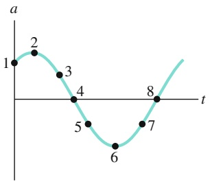

<details>
<summary>line</summary>

| Point | t | a |
| --- | --- | --- |
| 1 | ~0.2 | 1 |
| 2 | ~0.4 | ~1.3 |
| 3 | ~0.6 | ~0.7 |
| 4 | ~0.8 | 0 |
| 5 | ~1.0 | ~-0.7 |
| 6 | ~1.2 | ~-1.3 |
| 7 | ~1.4 | ~-0.7 |
| 8 | ~1.6 | 0 |
</details>

Abb. 11.F3

**4.** Welche der folgenden Bedingungen für 𝜑 entspricht der harmonischen Schwingung aus Abb. 11.F4a: $( \mathsf { a } ) - \pi < \varphi <$ $- \pi / 2 ,$ , (b) $\pi < \varphi < 3\pi/2, (  c  ) -3\pi/2 < \varphi < -\pi ?$

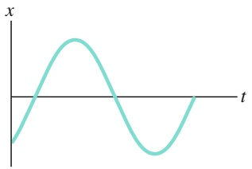

<details>
<summary>line</summary>

| t | x |
| --- | --- |
| 0 | ~-1.5 |
| 1 | 0 |
| 2 | ~1.5 |
| 3 | 0 |
| 4 | ~-1.5 |
| 5 | 0 |
</details>

(a)

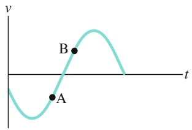

<details>
<summary>line</summary>

| Point | t | v |
| --- | --- | --- |
| A | ~0.25 | ~-0.3 |
| B | ~0.45 | ~0.3 |
</details>

(b)

Abb. 11.F4

Fragen 4 und 5.

**5.** Abbildung 11.F4b zeigt die Geschwindigkeit v(t) eines Teilchens bei einer harmonischen Schwingung. Ist (a) bei Punkt A bzw. (b) bei Punkt B das Teilchen gerade in Ruhe, auf dem Weg $\mathtt { z u } \mathtt { - } x _ { \mathfrak { m } }$ oder auf dem Weg zu $+ x _ { \mathrm { m } } ?$ Befindet sich das Teilchen bei $- x _ { \mathrm { m } } ,$ bei $+ x _ { \mathrm { m } } ,$ , bei 0, zwischen $- x _ { \mathrm { m } }$ und 0 oder zwischen 0 und $+ x _ { \mathrm { m } } ,$ wenn seine Geschwindigkeit (c) der von Punkt A bzw. (d) der von Punkt B entspricht? Nimmt die Geschwindigkeit des Teilchens bei (e) Punkt A bzw. (f ) Punkt B gerade zu oder ab?
**6.** Abbildung 11.F6 zeigt die Auslenkung x(t) von zwei harmonischen Oszillatoren A und B unter drei verschiedenen Bedingungen. Die Oszillatoren sind identisch, aber phasenverschoben. Welche Phasenverschiebung (in Radiant und in Grad) ist jeweils notwendig, um die Kurve von A mit der Kurve von B übereinstimmen zu lassen? Wählen Sie von den (unendlich) vielen möglichen Antworten diejenige, bei der die Phasenverschiebung den kleinsten Absolutbetrag hat.

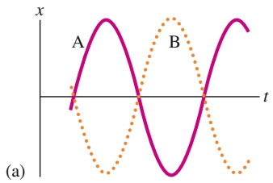

<details>
<summary>text_image</summary>

x
A
B
t
(a)
</details>

(b)

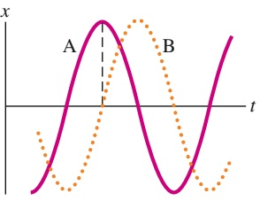

<details>
<summary>line</summary>

| Category | Value |
| --- | --- |
| A (Peak) | ~1.0 |
| B (Peak) | ~0.8 |
</details>

Abb. 11.F6

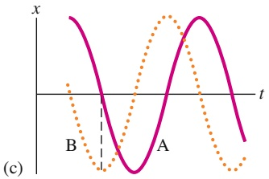

<details>
<summary>line</summary>

| Category | Solid Purple Line (x) | Dotted Orange Line (x) |
| --- | --- | --- |
| Start | High | Low |
| B | 0 | ~-1.5 |
| Midpoint | Negative | 0 |
| A | 0 | High |
| End | Negative | ~-1.5 |
</details>

**7.** In den Abb. 11.F7a und b sind in einer Momentaufnahme die momentanen Auslenkungen von vier Oszillatoren gleicher Masse und Federkonstante wiedergegeben. Wie groß ist die Phasenverschiebung zwischen den beiden linearen Oszillatoren (a) in Abb. 11.F7a und (b) in Abb. 11.F7b? (c) Welche Phasenverschiebung besteht zwischen dem roten Oszillator in Abb. 11.F7a und dem grünen Oszillator in Abb. 11.F7b?

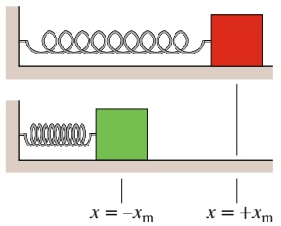

<details>
<summary>text_image</summary>

x = -x_m
x = +x_m
</details>

(a)

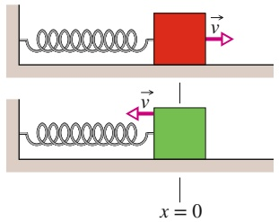

<details>
<summary>text_image</summary>

x = 0
</details>

(b)

Abb. 11.F7

**8.** (a) Bei welcher der Kurven in Abb. 11.F8a ist die Beschleunigung a(t) gegen die Auslenkung x(t) bei einem harmonischen Oszillator aufgetragen? (b) Bei welcher der Kurven in Abb. 11.F8b ist die Geschwindigkeit v(t) gegen x(t) aufgetragen?

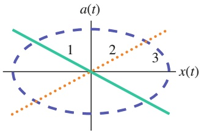

<details>
<summary>text_image</summary>

a(t)
1
2
3
x(t)
</details>

(a)

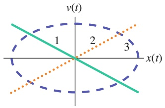

<details>
<summary>text_image</summary>

v(t)
1
2
3
x(t)
</details>

(b)

Abb. 11.F8

**9.** In Abb. 11.F9 erkennt man einen kleinen Block A auf einem größeren Block B. Zwischen ihnen gebe es einen nicht verschwindenden Haftreibungskoeffizienten. Block B liege auf einer reibungsfreien Unterlage und befinde sich zu Beginn bei $x = 0$ , der Ruhelage der Feder. Dann ziehen wir Block B um den Abstand d aus dieser Ruhelage nach rechts heraus und lassen ihn los. Während das System aus Feder und Blöcken eine harmonische Schwingung mit der Amplitude $x _ { \mathrm { m } }$ ausführt, befinde sich Block A kurz vor dem Abrutschen von Block B.

(a) Ist die Beschleunigung von Block A konstant oder verändert sie sich? (b) Ist der Betrag der Reibungskraft, die A beschleunigt, konstant oder verändert er sich? (c) Wird A eher bei $x = 0$ oder eher bei $x = \pm x _ { \mathrm { m } }$ zu rutschen beginnen? (d) Hätte die harmonische Schwingung bei einer grö- ßeren Auslenkung als d begonnen, würde Block A eher rutschen oder nicht? (Diese Frage dient als Vorübung für Aufgabe 11.8 im Übungsbuch.)

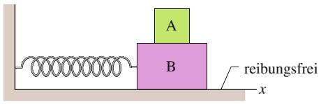

<details>
<summary>text_image</summary>

A
B
reibungsfrei
x
</details>

Abb. 11.F9

276

---

11.9 Fragen

11

**10.** Das System aus Feder und Gewicht in Abb. 11.F10 wird für zwei Experimente eingesetzt. In dem ersten Experiment wird das Gewicht aus der Gleichgewichtslage um eine Strecke $d _ { 1 }$ ausgelenkt und dann losgelassen. Im zweiten Experiment wird das Gewicht um eine größere Auslenkung $d _ { 2 }$ aus der Gleichgewichtslage gebracht und dann losgelassen. Sind (a) die Amplitude, (b) die Periode, (c) die Frequenz, (d) die maximale kinetische Energie und (e) die maximale potenzielle Energie größer, kleiner oder gleich den entsprechenden Werten des ersten Experiments?

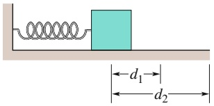

<details>
<summary>text_image</summary>

d₁→
d₂→
</details>

Abb. 11.F10

**11.** In Abb. 11.F11 erkennt man drei physikalische Pendel aus gleichartigen homogenen Kugeln derselben Masse, die jeweils durch einen Stab vernachlässigbarer Masse untereinander verbunden sind. Jedes Pendel hänge senk recht herunter und kann um die Aufhängung bei O schwingen. Ordnen Sie die Pendel nach ihrer Schwingungsdauer (größte zuerst).

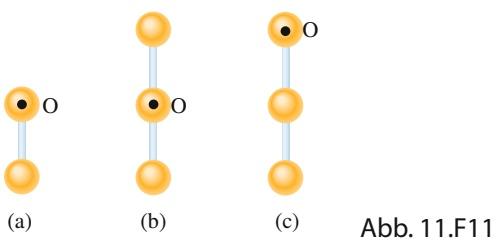

**12.** Diese Frage bezieht sich auf die Aufgabe 11.17 im Übungsbuch: Angenommen, die Patrone hätte eine grö- ßere Geschwindigkeit, welche der folgenden Größen der harmonischen Schwingung wären größer, kleiner oder gleich: (a) Amplitude, (b) Periode, (c) maximale potenzielle Energie?
**13.** Sie wollen die Anordnung in Abb. 11.F13 so nachbauen, dass die Schwingungen von einem Feder-Gewicht-System möglichst effektiv auf das andere übertragen werden. Wenn die Feder von System 1 gedehnt und dann losgelassen wird, überträgt sich die harmonische Schwingung von System 1 mit der Frequenz $f _ { 1 }$ auf den Trägerstab. Dadurch wirkt der Stab für das System 2 wie eine äußere periodische Erregerkraft mit der Frequenz $f _ { 1 }$ . Sie haben jeweils die Wahl, die Komponenten der beiden Systeme aus vier verschiedenen Federn mit den Federkonstanten k gleich 1600, 1500, 1400 und 1200N/m sowie aus vier verschiedenen Gewichten mit den Massen m gleich 800, 500, 400 und 200 kg auszusuchen. Überlegen Sie sich, welche Feder mit welchem Gewicht jeweils kombiniert werden sollte, damit die Schwingungsamplitude für System 2 möglichst groß wird.

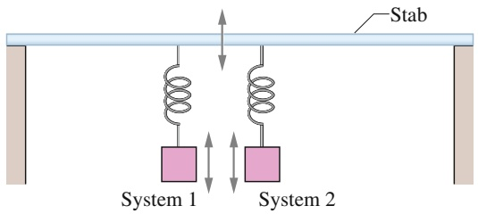

<details>
<summary>text_image</summary>

Stab
System 1
System 2
</details>

Abb. 11.F13

**14.** Vervollständigen Sie Abb. 11.F14a so, dass sie eine Auftragung der Geschwindigkeit v gegen die Zeit t für den in Abb. 11.F14b für $t = 0$ gezeigten aus Feder und Masse bestehenden Oszillator ergibt. (a) An welchem beschrifteten Punkt oder in welchem Bereich zwischen den Punkten muss die (vertikale) v-Achse die t-Achse schneiden? (Vielleicht in Punkt A oder im Bereich zwischen den Punkten A und B?) (b) Welchen Wert hat $\varphi ,$ wenn die Geschwindigkeit des Blocks durch $\nu = \nu _ { \mathrm { m } }$ sin(ωt + 𝜑) gegeben ist? Wählen Sie den Wert positiv, und falls Sie keinen genauen Wert (wie z. B. +π∕2 rad) angeben können, geben Sie zumindest einen Wertebereich an (z. B. zwischen 0 und $\pi / 2$ rad).

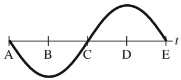

<details>
<summary>text_image</summary>

A
B
C
D
E
t
</details>

(a)

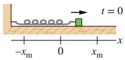

(b)

Abb. 11.F14

**15.** Vervollständigen Sie Abb. 11.F15a so, dass sie eine Auftragung der Beschleunigung a gegen die Zeit t für den in Abb. 11.F15b für $t = 0$ gezeigten Feder-Masse-Oszillator ergibt. (a) An welchem beschrifteten Punkt oder in welchem Bereich zwischen den Punkten muss die (vertikale) a-Achse die t-Achse schneiden? (Vielleicht in Punkt A oder im Bereich zwischen den Punkten A und B?) (b) Welchen Wert hat $\varphi ,$ wenn die Beschleunigung des Blocks durch $a = - a _ { \mathrm { m } }$ cos(ωt+𝜑) gegeben ist? Wählen Sie den Wert positiv, und falls Sie keinen genauen Wert (wie z. B. +π∕2 rad) angeben können, geben Sie zumindest einen Wertebereich an (z. B. zwischen 0 und $\pi / 2$ rad).

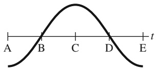

<details>
<summary>text_image</summary>

A B C D E t
</details>

(a)

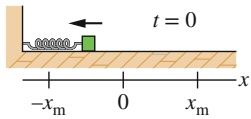

(b)

Abb. 11.F15

**16.** Abbildung 11.F16 zeigt die x(t)-Kurven für drei Experimente mit einem aus einer Feder und einer Masse bestehenden System, das einfache harmonische Schwindungen ausführt. Ordnen Sie die Kurven in absteigender Reihenfolge nach (a) der Kreisfrequenz des Systems, (b) der

277

---

11 Schwingungen

potenziellen Energie der Feder zum Zeitpunkt $t = 0 , ( c )$ der kinetischen Energie der Masse bei t = 0, (d) der Geschwindigkeit der Masse bei $t = 0 ,$ und (e) der maximalen kinetischen Energie des Systems.

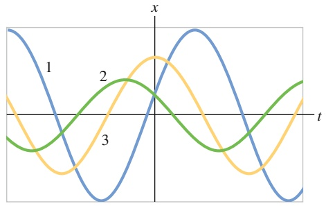

<details>
<summary>line</summary>

| t | Wave 1 | Wave 2 | Wave 3 |
| --- | --- | --- | --- |
| 0 | ~1.0 | ~0.0 | ~-0.8 |
| ~0.57 | ~0.0 | ~-0.8 | ~-0.4 |
| ~1.14 | ~-1.0 | ~-0.4 | ~0.2 |
| ~1.71 | ~-0.4 | ~0.2 | ~0.6 |
| ~2.28 | ~0.6 | ~0.6 | ~0.4 |
| ~2.85 | ~1.0 | ~0.4 | ~-0.2 |
| ~3.42 | ~0.4 | ~-0.2 | ~-0.8 |
| ~4.09 | ~-0.8 | ~-0.6 | ~-0.4 |
| ~4.66 | ~-1.0 | ~-0.4 | ~0.2 |
| ~5.23 | ~-0.4 | ~0.2 | ~0.6 |
| ~5.80 | ~0.6 | ~0.6 | ~0.4 |
| ~6.37 | ~1.0 | ~0.4 | ~-0.2 |
| ~7.04 | ~0.4 | ~-0.2 | ~-0.8 |
| ~7.61 | ~-0.8 | ~-0.6 | ~-0.4 |
| ~8.18 | ~-1.0 | ~-0.4 | ~0.2 |
| ~8.85 | ~-0.4 | ~0.2 | ~0.6 |
| 9 | ~0.6 | ~0.6 | ~0.4 |
</details>

Abb. 11.F16

**17.** Abbildung 11.F17 zeigt Auftragungen der kinetischen Energie K gegen die Position x für drei harmonische Oszillatoren mit gleicher Masse. Ordnen Sie die Diagramme in absteigender Reihenfolge nach (a) ihrer Federkonstanten und (b) der Periode des Oszillators.

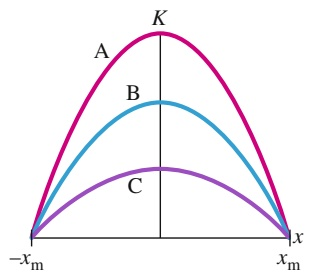

<details>
<summary>text_image</summary>

K
A
B
C
-x_m
x_m
x
</details>

Abb. 11.F17

278

---

# 12 Wellen – I

## 12.1 Transversalwellen

## Physikalische Motivation

Wellen sind ein zentrales Thema der klassischen wie der modernen Physik. Um zu verstehen, welche Rolle Wellen in unserem Leben spielen, betrachten Sie einfach die Musikindustrie. Jedes Musikstück, das Sie hören – ganz gleich ob von der lokalen Retro-Punk-Band auf einem kleinen Festival oder dem berühmtesten Sinfonie orchester in einer großartigen Konzerthalle –, beruht darauf, dass die Interpreten Wellen erzeugen und Ihr Gehör diese Wellen registriert. Zwischen der Erzeugung und dem Registrieren müssen die in den Wellen enthaltenen Informationen gegebenenfalls übertragen werden, auf jeden Fall als Schall durch die Luft, eventuell auch als elektromagnetische Welle zu einem Satelliten im Weltall und zurück oder auch durch ein Glasfaserkabel. Sie können auch aufgezeichnet und später wiedergegeben werden, z. B. mit einem CD- oder mp3-Spieler. Die wirtschaftliche Bedeutung dieser Wellen ist enorm, und entsprechend winken auch für Ingenieure und Wissenschaftler, die auf diesem Gebiet Neues entwickeln, außer Ruhm und Ehre nicht unerhebliche finanzielle Verlockungen.

Dieses Kapitel beschäftigt sich mit den Wellen, die sich entlang einer gespannten Saite ausbreiten, wie z. B. auf einer Gitarre. Das nächste Kapitel konzentriert sich dann auf durch Luft laufende Schallwellen, welche unter anderem von Gitarrensaite erzeugt werden. Bevor wir jedoch damit beginnen, müssen wir zuerst eine gewisse Ordnung in die Vielfalt der unterschiedlichen Wellen bringen.


## 12.1.1 Arten von Wellen

Es gibt drei grundlegende Arten von Wellen:

1. **Mechanische Wellen.** Sie sind uns vergleichsweise vertraut, da wir ihnen praktisch überall begegnen. Bekannte Beispiele sind Wasserwellen, Schallwellen und seismische Wellen. Alle diese Wellen haben bestimmte gemeinsame Eigenschaften: Sie beruhen letztendlich auf den Newtonschen Gesetzen und sind an ein materielles Medium gebunden, beispielsweise an Wasser, Luft oder Gestein.
2. **Elektromagnetische Wellen.** Diese Wellen sind zwar theoretisch etwas schwie riger zu fassen, aber auch sie sind in Natur und Technik allgegenwärtig. Beispiele sind das sichtbare Licht, das ultraviolette Licht, Radio- und Fernsehwellen, Mikrowellen, Röntgenstrahlung und Radar. Diese Wellen sind nicht an ein materielles Medium gebunden (vgl. Kapitel 29). Die Lichtwellen entfernter Sterne reisen beispielsweise durch das Vakuum des Weltraums zu uns. Alle elektromagnetischen Wellen breiten sich im Vakuum mit derselben Geschwindigkeit c aus, der Lichtgeschwindigkeit:

$$
c = 2 9 9   7 9 2   4 5 8 \mathrm{m/s} \quad (\text { Lichtgeschwindigkeit }). \tag {12.1}
$$

Halliday Physik für natur- und ingenieurwiss. Studiengänge, 3. Auflage. D. Halliday, R. Resnick und J. Walker. © 2020 WILEY-VCH Verlag GmbH & Co. KGaA. Published 2020 by WILEY-VCH Verlag GmbH & Co. KGaA.

279

---

12 Wellen – I

3. **Materiewellen.** Obwohl diese Wellen für die moderne Technologie von großer Bedeutung sind, dürften sie den meisten von uns eher fremd sein. Sie treten bei der Beschreibung von Elektronen, Protonen und anderen Elementarteilchen auf, ebenso bei Atomen und Molekülen. Da diese Partikel die mikroskopischen Bausteine der uns umgebenden Materie sind, bezeichnet man diese Wellen als Materiewellen (vgl. Kapitel 34).

Das meiste von dem, was wir in diesem Kapitel behandeln werden, gilt für alle drei Wellenformen. Trotzdem werden wir uns bei den Beispielen oft auf mechanische Wellen beziehen.

## 12.1.2 Transversal- und Longitudinalwellen


<details>
<summary>text_image</summary>

Puls
y
v
x
</details>

(a)


<details>
<summary>line</summary>

| Axis | Description |
| --- | --- |
| y | Y-axis variable (Horizontal) |
| x | X-axis variable (Vertical) |
| v | Amplitude (Vertical axis) |
</details>

(b)

Abb. 12.1

(a) Ein einzelner Wellenpuls breitet sich entlang eines gespannten Seils aus. Ein typisches Element des Seils (durch einen Punkt gekennzeichnet) bewegt sich einmal auf und ab, während der Puls vorbeiläuft. Die Bewegung dieses Elements verläuft senkrecht zur Ausbreitungsrichtung der Welle, daher bezeichnet man diesen Puls als transversale Welle. (b) Eine sinusförmige Welle läuft das Seil entlang. Ein typisches Element des Seils bewegt sich beim Durchgang der Welle ständig auf und ab. Auch hier handelt es sich um eine transversale Welle.

Schickt man eine Welle entlang eines straff gespannten Seils, erhält man eine sehr einfache Form einer mechanischen Welle. Wenn Sie dem einen Ende des Seils einen einzelnen kurzen „Auf-Ab“-Ruck geben, breitet sich eine Welle wie in Abb. 12.1a in Form eines einzelnen Wellenpulses das Seil entlang aus. Dieser Puls und seine Bewegung entstehen, weil das Seil einer großen Zugspannung unterliegt. Wenn Sie das eine Ende des Seils rasch nach oben bewegen, wird das benachbarte Seilelement ebenfalls nach oben gezogen, weil zwischen diesen beiden Abschnitten eine große Spannung herrscht. Wenn sich nun dieses benachbarte Element nach oben bewegt, zieht es wiederum sein Nachbarelement nach oben, und so weiter. Mittlerweile haben Sie vielleicht Ihr Ende des Seils wieder nach unten gedrückt. Während die vorderen Abschnitte sich noch nach oben bewegen, werden die hinteren bereits durch die Nachbarabschnitte auf Ihres Seite des Pulses wieder nach unten gezogen. Das Ergebnis ist eine charakteristische Verformung des Seils (der Puls), die sich mit einer Geschwindigkeit v⃗ entlang des Seils ausbreitet.

Wenn Sie Ihre Hand unablässig in einer harmonischen Bewegung auf- und abbewegen, entsteht eine kontinuierliche Welle, die sich mit der Geschwindigkeit v⃗ entlang des Seils ausbreitet. Da die Bewegung Ihrer Hand einer sinusförmigen Funktion der Zeit entspricht, hat auch die Welle zu jedem Zeitpunkt eine sinusförmige Gestalt (wie in Abb. 12.1b). Die Welle hat daher die Form einer Sinus- oder Kosinusfunktion.

Wir betrachten hier natürlich ein „ideales“ Seil ohne innere Reibungskräfte, welche die Welle bei ihrer Reise langsam abflachen lassen. Außerdem nehmen wir das Seil als ausreichend lang an, sodass wir die Reflexion der Wellen am anderen Ende nicht zu berücksichtigen brauchen.

Eine Möglichkeit, Wellen wie in Abb. 12.1 zu untersuchen, besteht in der Darstellung der **Wellenformen** (der Gestalt der Wellen), wie sie sich nach rechts ausbreiten. Wir können aber auch die Bewegung eines kurzen Seilabschnitts untersuchen, der auf- und abschwingt, während die Welle vorbeizieht. In diesem Fall würden wir finden, dass die Verschiebung jedes schwingenden Seilabschnitts senkrecht zur Ausbreitungsrichtung der Welle erfolgt, wie in Abb. 12.1 angedeutet. Diese Bewegung nennt man **transversal** und die zugehörige Welle bezeichnet man als **transversale Welle** oder **Transversalwelle**.

In Abb. 12.2 erkennt man, wie sich eine Schallwelle in einem langen, luftgefüllten Rohr erzeugen lässt. Man bewegt dazu einen Kolben an einem Ende des Rohrs ruckartig zunächst nach rechts und anschließend wieder nach links (also in Rohrrichtung vor und zurück), und schickt so einen Schallpuls entlang des Rohrs. Während der Kolben nach rechts bewegt wird, werden die Luftelemente in dem Rohr an dieser Stelle ebenfalls nach rechts geschoben und verändern dort den Luftdruck. Der erhöhte Luftdruck drückt wiederum auf die noch weiter rechts liegenden Luftelemente. Umgekehrt wird der Luftdruck rechts vom Kolben während der Linksbewegung herabgesetzt. Dadurch werden die zunächst nach rechts gedrückten Luftelemente nach links zurückgezogen. Auch diese Bewegung überträgt sich auf die weiter hinten im Rohr liegenden Luftelemente. Auf diese Weise breitet sich

280

---

12.1 Transversalwellen

12

im Rohr ein Druckunterschied (zunächst Über- dann Unterdruck) in Form eines Pulses nach rechts aus.

Wenn Sie stattdessen den Kolben harmonisch vor- und zurückschwingen lassen wie in Abb. 12.2, breitet sich eine sinusförmige Welle entlang des Rohrs aus. Da die Bewegung der Luftelemente hier parallel zur Ausbreitungsrichtung der Welle erfolgt, nennt man diese Bewegung **longitudinal** und die resultierende Welle heißt **Longitudinalwelle**. In diesem Kapitel konzentrieren wir uns auf transversale Wellen, insbesondere auf die eindimensionalen Wellen entlang eines Seils. In Kapitel 13 werden wir die longitudinalen Wellen näher untersuchen, speziell die Schallwellen.

Sowohl transversale als auch longitudinale Wellen bezeichnet man als **fortlaufende Wellen**, weil sich beide Wellenformen von einem Punkt zu einem anderen ausbreiten, beispielsweise von einem Ende des Seils zum anderen wie in Abb. 12.1 oder von einem Ende des Rohrs zum anderen wie in Abb. 12.2. Man beachte jedoch, dass sich nur die Wellen selbst ausbreiten, nicht aber das Medium selbst (Seil oder Luft), auf bzw. in dem sich die Welle ausbreitet.

Ein Sandskorpion nutzt zur Ortung seiner Beute sowohl transversale als auch longitudinale Wellen. Wenn ein Käfer auch nur leicht den Sand bewegt, breiten sich Wellenpulse entlang der Sandoberfläche aus (Abb. 12.3). Ein Teil dieser Pulse ist longitudinal und hat eine Geschwindigkeit von $\nu _ { \mathrm { l } } = 1 5 0   \mathrm { m / s } _ { \mathrm { l } }$ , der andere Teil ist transversal mit einer Geschwindigkeit von $\nu _ { \mathrm { t } } = 5 0   \mathrm { m } / \mathrm { s }$

Der Skorpion hat seine acht Beine ungefähr in einem Kreis mit einem Radius von 5 cm ausgebreitet. Er nimmt zunächst die schnelleren longitudinalen Wellen wahr und erkennt daraus die Richtung des Käfers: Es handelt sich um die Richtung, deren zugehöriges Bein den Puls zuerst wahrgenommen hat. Anschließend erspürt der Skorpion das Zeitintervall $\Delta t$ zwischen dem Eintreffen der longitudinalen Pulse und der langsameren transversalen Pulse und bestimmt daraus den Abstand d des Käfers. Für das Zeitintervall gilt nämlich

$$
\Delta t = \frac {d}{\nu_ {\mathrm{t}}} - \frac {d}{\nu_ {\mathrm{l}}}
$$

und damit berechnet sich der Abstand zu

$$
d = (7 5 \mathrm{m/s}) \Delta t.
$$

Für $\Delta t = 4 \mathrm { , } 0$ ms folgt beispielsweise $d = 3 0   \mathrm { c m }$ . Der Skorpion erhält so eine perfekte Ortsbestimmung seines potenziellen Beutetiers.

## 12.1.3 Wellenlänge und Frequenz

Zur vollständigen Beschreibung einer Seilwelle (und der Bewegung der einzelnen Seilabschnitte bzw. -elemente) benötigen wir eine Funktion, die uns die Wellenform angibt. Wir suchen also nach einer Beziehung der Form $y = y ( x , t )$ . Dabei ist $y$ die transversale Auslenkung eines Seilelements am Ort x zum Zeitpunkt t. Eine sinusförmige Welle wie in Abb. 12.1b wird – wie der Name schon sagt – mathematisch durch eine Sinus- oder Kosinusfunktion beschrieben; beide Funktionen haben im Prinzip die gleiche Gestalt, sie sind nur seitlich gegeneinander verschoben. In diesem Kapitel verwenden wir meist den Sinus.

Stellen Sie sich eine sinusförmige Welle wie in Abb. 12.1 vor, die sich entlang der positiven Richtung einer x-Achse ausbreitet. Wenn die Welle benachbarte Elemente (d. h. sehr kurze Abschnitte) erreicht, schwingen die einzelnen Elemente parallel zur y-Achse. Zum Zeitpunkt t ist die (transversale oder Quer-)Auslenkung y des Elements am Ort x durch

$$
y (x, t) = y _ {\mathrm{m}} \sin (k x - \omega t) \tag {12.2}
$$

gegeben. Da diese Gleichung die Auslenkung als Funktion des Orts x beschreibt, können wir mit ihrer Hilfe die Auslenkungen aller Elemente über die ganze Länge


<details>
<summary>text_image</summary>

Luft
v
</details>

Abb. 12.2

In einem luftgefüllten Rohr wird eine Schallwelle erzeugt, indem ein Kolben rasch vor- und zurückbewegt wird. Da die Schwingung eines Luftelements (dargestellt durch einen Punkt) parallel zur Ausbreitungsrichtung der Welle erfolgt, handelt es sich um eine longitudinale Welle.


<details>
<summary>text_image</summary>

Longitudinal-
pulse
Transversal-
pulse
Käfer
</details>

Abb. 12.3

Ein krabbelnder Käfer sendet mit jedem Schrittchen schnelle longitudinale und langsamere transversale Wellen durch die Sandoberfläche. Der Sandskorpion nimmt zunächst die longitudinalen Wellenpulse wahr. In diesem Fall registriert sein rechtes Hinterbein die Pulse zuerst.

281

---

12 Wellen – I


<details>
<summary>flowchart</summary>

```mermaid
graph LR
  A["Amplitude"] --> B["Schwingungs-term"]
  C["Auslenkung"] --> D["Phase"]
  E["y(x,t) = y_m sin(kx - ωt)"] --> F["Wellenzahl"]
  G["Ort"] --> H["Kreisfrequenz"]
  I["Zeit"] --> J["Phase"]
```
</details>

Abb. 12.4

Die Bezeichnungen der einzelnen Größen in Gl. 12.2 für eine transversale sinusförmige Welle.


Abb. 12.5

Fünf „Momentaufnahmen“ einer Wel-$\mathrm { l e } ,$ die sich in positive x-Richtung ausbreitet. Die Amplitude $y _ { \mathrm { m } }$ ist angegeben, ebenso ist von dem beliebigen Ort $x _ { 1 }$ eine Wellenlänge λ abgetragen.

des Seils als Funktion der Zeit angeben. Diese Gleichung gibt uns also die Form der Welle zu jedem beliebigen Zeitpunkt und sagt uns gleichzeitig, wie sich diese Form verändert, wenn die Welle das Seil entlangläuft. Die Bezeichnungen der einzelnen Größen in Gl. 12.2 sind in Abb. 12.4 zusammengefasst und werden im Folgenden exakt definiert.

Bevor wir auf die physikalischen Begriffe eingehen, wollen wir uns Abb. 12.5 noch etwas genauer ansehen. Dort erkennt man fünf „Momentaufnahmen“ einer sinusförmigen Welle, die sich in positive x-Richtung ausbreitet. Die Bewegung der Welle erkennt man an dem kurzen orangefarbenen Pfeil, der auf ein Maximum der Welle deutet. Von Aufnahme zu Aufnahme bewegt sich der Pfeil mit dem Maximum nach rechts, aber das Seil bewegt sich nursenkrecht dazu, d. h. in y-Richtung. Zur Verdeutlichung verfolgen wir die Bewegung des rot eingefärbten Seilelements am Ursprung $x = 0 .$ In der ersten Momentaufnahme (Abb. 12.5a) ist seine Auslenkung $y = 0 .$ . In der nächsten Aufnahme befindet es sich bei seiner maximalen unteren Auslenkung, weil gerade ein Minimum oder Wellental vorbeizieht. Dann kommt es zurück zu $y = 0 .$ In der vierten Aufnahme befindet es sich bei seiner maximalen oberen Auslenkung, weil gerade ein Maximum bzw. Wellenberg vorbeizieht. Und schließlich ist es in der fünften Momentaufnahme wieder bei $y = 0$ und hat einen vollen Schwingungszyklus durchlaufen.

## Amplitude und Phase

Die **Amplitude** einer Welle wie in Abb. 12.5 ist gleich dem Betrag der maximalen Auslenkung der Elemente aus ihrer Gleichgewichtslage beim Durchgang der Welle. (Der Index $\mathrm { { _ { \mathrm { { \it { p } } } } m } ^ { \it { \it { \it { \it { a } } } } } }$ steht wieder für „maximal“.) Da $y _ { \mathrm { m } }$ dem Betrag einer Auslenkung entspricht, handelt es sich immer um eine positive Größe, selbst wenn sie wie in Abb. 12.5a nach unten statt nach oben gemessen würde.

Die **Phase** der Welle ist gleich dem Argument kx − ωt der Sinusfunktion in Gl. 12.2. Wenn die Welle bei einem bestimmten Element an der Stelle x vorbeiläuft, ändert sich die Phase linear in der Zeit t. Damit ändert sich auch die Sinusfunktion und oszilliert zwischen −1 und +1. Der Maximalwert +1 entspricht einem Wellenberg, der durch das Element läuft; in diesem Fall nimmt y an der Stelle x den Wert $y _ { \mathrm { m } }$ an. Der Minimalwert −1 entspricht einem Wellental, das durch das Element läuft; in diesem Fall wird y an dieser Stelle x gleich $- y _ { \mathrm { m } } ,$ Die Sinusfunktion und die zeitabhängige Phase einer Welle beschreiben somit die Schwingungen eines Seilelements, und die Amplitude der Welle gibt die Extremwerte der Auslenkung an.

## Wellenlänge und Wellenzahl

Die **Wellenlänge** λ einer Welle ist der Abstand (in Richtung der Wellenausbreitung) zwischen zwei Wiederholungen der Wellenform, siehe Abb. 12.5. Zum Zeitpunkt $t = 0$ wird die Wellenform (Gl. 12.2) durch

$$
y (x, 0) = y _ {\mathrm{m}} \sin k x \tag {12.3}
$$

beschrieben. Per definitionem ist die Verschiebung y an zwei Orten im Abstand von einer Wellenlänge – also etwa bei $x = x _ { 1 }$ und $x = x _ { 1 }   +   \lambda$ – dieselbe, d. h., es ist

$$
y _ {\mathrm{m}} \sin k x _ {1} = y _ {\mathrm{m}} \sin k (x _ {1} + \lambda) = y _ {\mathrm{m}} \sin (k x _ {1} + k \lambda). \tag {12.4}
$$

Die Sinusfunktion nimmt identische Werte an, wenn ihr Winkel bzw. Argument um 2π rad vergrößert wird. In Gl. 12.4 muss daher $k \lambda = 2 \pi$ sein oder

$$
k = \frac {2 \pi}{\lambda} \quad (\text {Wellenzahl}). \tag {12.5}
$$

282

---

12.1 Transversalwellen

12

Wir nennen k die **Wellenzahl** der Welle; ihre SI-Einheit ist Radiant pro Meter bzw. inverse Meter. (Beachten Sie, dass das Symbol k in diesem Kapitel nicht mehr für eine Federkonstante steht!)

Die Welle in Abb. 12.5 bewegt sich zwischen zwei Momentaufnahmen um $\frac { 1 } { 4 } \lambda .$ nach rechts. In der fünften Aufnahme hat sie sich daher um 1λ nach rechts bewegt.

## Periode, Kreisfrequenz und Frequenz

Abbildung 12.6 zeigt den Graphen der Auslenkung an einem bestimmten Ort des Seils (hier $x = 0 )$ als Funktion der Zeit t. Dieses einzelne Element bei $x = 0$ bewegt sich nach Gl. 12.2 in einer harmonischen Schwingung auf und ab:

$$
y (0, t) = y _ {\mathrm{m}} \sin (- \omega t) = - y _ {\mathrm{m}} \sin \omega t \quad (x = 0). \tag {12.6}
$$

Hier haben wir die Relation sin $( - \alpha ) = - \sin \alpha$ verwendet, die für jeden Winkel α gilt. Abbildung 12.6 zeigt den Graphen zu dieser Gleichung, sie zeigt nicht die Form (Gestalt) der Welle.

Wir definieren die **Periode** T einer Welle als die Zeitdauer, in der ein beliebi ges Seilelement eine volle Schwingung ausführt. Eine typische Periode ist in dem Graphen von Abb. 12.6 eingezeichnet. Wir können Gl. 12.6 auf beide Enden dieses Zeitintervalls anwenden und erhalten

$$
- y _ {\mathrm{m}} \sin \omega t _ {1} = - y _ {\mathrm{m}} \sin \omega (t _ {1} + T) = - y _ {\mathrm{m}} \sin (\omega t _ {1} + \omega T). \tag {12.7}
$$

Diese Gleichung gilt nur, wenn ω $T = 2 \pi$ ist bzw.

$$
\omega = \frac {2 \pi}{T} \quad (\text {Kreisfrequenz}). \tag {12.8}
$$

Wir nennen ω die **Kreisfrequenz** der Welle. Ihre SI-Einheit ist Radiant pro Sekunde bzw. inverse Sekunde, d. h. Hertz.

Die fünf Momentaufnahmen in Abb. 12.5 wurden jeweils im zeitlichen Abstand von $\frac { 1 } { 4 } T$ gemacht. Bei der fünften Aufnahme hat jedes der Seilelemente daher eine volle Schwingung ausgeführt.

Die **Frequenz** $f$ einer Welle ist als $1 / T$ definiert und hängt mit der Kreisfrequenz ω über die Beziehung

$$
f = \frac {1}{T} = \frac {\omega}{2 \pi} \quad \text {(Frequenz)} \tag {12.9}
$$

zusammen. Wie die Frequenz der harmonischen Schwingung in Kapitel 11 bezeichnet auch hier die Frequenz f die Anzahl der Schwingungen – in diesem Fall eines Seilelements – pro Zeiteinheit. Und wie in Kapitel 11 hat $f$ die SI-Einheit Hertz.

## KONTROLLFRAGE 1

In der Abbildung wurden drei Momentaufnahmen von Wellen entlang eines Seils übereinandergelegt. Die Phasen der Wellen sind durch $\left( \mathsf { a } \right) 2 x - 4 t ,$ (b) 4x − 8t und (c) 8x − 16t gegeben. Welche Phase entspricht in der Abbildung welcher Welle?

## 12.1.4 Die Geschwindigkeit einer fortlaufenden Welle

Abbildung 12.7 zeigt zwei Momentaufnahmen der Welle von Gl. 12.2, die im kurzen Zeitabstand Δt aufgenommen wurden. Die Welle breitet sich in positive x-Richtung aus (in Abb. 12.7 nach rechts), die gesamte Wellenform verschiebt sich innerhalb des Intervalls Δt um einen Abstand Δx in diese Richtung. Das Verhältnis $\Delta x / \Delta t$ (oder, im differenziellen Grenzfall, $\mathrm { d } x / \mathrm { d } t )$ ist die **Wellengeschwindigkeit** oder **Ausbreitungsgeschwindigkeit** der Welle $\nu .$ Wie können wir diesen Wert bestimmen?


<details>
<summary>text_image</summary>

y
t₁
yₘ
T
t
</details>

Abb. 12.6

Der Graph der Auslenkung des Seilelements am Punkt $x = 0$ als Funktion der Zeit, während die sinusförmige Welle aus Abb. 12.5 vorbeiläuft. Die Amplitude $y _ { \mathrm { m } }$ ist eingezeichnet. Die Periode $T ,$ von einem beliebig gewählten Zeitpunkt $t _ { 1 }$ aus gemessen, ist ebenfalls angegeben.


<details>
<summary>line</summary>

| Wave | Description |
| --- | --- |
| 1 | First wave with peak amplitude |
| 2 | Second wave with peak amplitude |
| 3 | Third wave with peak amplitude |
</details>

283

---

12 Wellen – I


<details>
<summary>line</summary>

| Feature | Description |
| --- | --- |
| Y-axis | Displacement (y) |
| X-axis | Displacement (x) |
| Point A | Intersection of two waves |
| Vector | Direction of velocity (v) |
| Waveform Type | Waveform (Green = t = 0, Orange = \(t=\Delta t)\) |
| Key Metric | \(\Delta x\) |
</details>

Abb. 12.7

Zwei Momentaufnahmen der Welle aus Abb. 12.5 zum Zeitpunkt $t = 0$ und zum Zeitpunkt $t = \Delta t .$ Wenn sich die Welle mit der Geschwindigkeit v⃗ nach rechts ausbreitet, verschiebt sich die gesamte Kurve im Zeitintervall Δt um eine Strecke $\Delta x .$ Der Punkt A „reitet“ auf der Wellenform, die Elemente des Seils bewegen sich jedoch nur auf und ab.

Während sich die Welle in Abb. 12.7 bewegt, behält jeder Punkt der Wellenform, wie beispielsweise der Punkt A auf dem Wellenberg, seine Auslenkung y. (Die Punkte auf dem Seil verändern ihre Auslenkung, der „wandernde“ Wellenberg bleibt aber immer gleich hoch.) Da der Punkt A seine Auslenkung bei der Bewegung beibehält, muss die Phase in Gl. 12.2, die ihm diese Auslenkung gibt, konstant bleiben:

$$
k x - \omega t = \text {const.} \tag {12.10}
$$

Das Argument der Sinusfunktion bleibt zwar konstant, aber x und t verändern sich. Wenn t größer wird, muss offensichtlich auch x größer werden, damit das Argument konstant bleibt. Dies bestätigt nochmals, dass sich die Welle in positive x-Richtung ausbreitet.

Zur Berechnung der Ausbreitungsgeschwindigkeit v leiten wir Gl. 12.10 nach t ab:

$$
k \frac {\mathrm{d} x}{\mathrm{d} t} - \omega = 0
$$

oder

$$
\frac {\mathrm{d} x}{\mathrm{d} t} = \nu = \frac {\omega}{k}. \tag {12.11}
$$

Mit Gl. 12.5 $\left( k = 2 \pi / \lambda \right)$ und Gl. $1 2 . 8 \left( \omega = 2 \pi / T \right)$ können wir die Wellengeschwindigkeit auch folgendermaßen beschreiben:

$$
\nu = \frac {\omega}{k} = \frac {\lambda}{T} = \lambda f \quad (\text {Wellengeschwindigkeit}). \tag {12.12}
$$

Die Gleichung $\nu = \lambda / T$ sagt uns, dass die Wellengeschwindigkeit gleich einer Wellenlänge pro Periode ist: Die Welle bewegt sich in einer Schwingungsperiode um den Abstand einer Wellenlänge weiter.

Gleichung 12.2 beschreibt eine Welle, die sich in die positive x-Richtung ausbreitet. Wir erhalten die Gleichung für eine in die entgegengesetzte Richtung fortlaufende Welle, indem wir in Gl. 12.2 einfach t durch −t ersetzen. Dies entspricht der Bedingung

$$
k x + \omega t = \text {const.} \tag {12.13}
$$

Ein Vergleich mit Gl. 12.10 (und der anschließenden Diskussion) zeigt, dass x nun mit zunehmender Zeit kleiner werden muss. Eine sich in negative x-Richtung ausbreitende Welle wird daher durch die Gleichung

$$
y (x, t) = y _ {\mathrm{m}} \sin (k x + \omega t) \tag {12.14}
$$

beschrieben.

Für die Geschwindigkeit dieser Welle finden wir ganz ähnlich wie bei Gl. 12.2 die Beziehung:

$$
\frac {\mathrm{d} x}{\mathrm{d} t} = - \frac {\omega}{k}. \tag {12.15}
$$

Das Minuszeichen (im Vergleich zu Gl. 12.11) bestätigt, dass sich diese Welle in die negative x-Richtung ausbreitet und rechtfertigt daher unseren Wechsel im Vorzeichen der Zeitvariable.

Wir betrachten nun eine Welle beliebiger Form, die durch

$$
y (x, t) = h (k x \pm \omega t) \tag {12.16}
$$

beschrieben wird. Die Funktion h steht hier für eine beliebige Funktion, die Sinus funktion ist nur ein spezielles Beispiel. Unsere obigen Überlegungen zeigen, dass es sich bei allen Wellen, in denen die Variablen x und t in der Kombination $\omega ^ { k x \pm \omega t ^ { \alpha } }$ auftreten, um fortlaufende Wellen handelt. Außerdem müssen alle fortla<u>ufenden</u> Wellen die Form von Gl. 12.16 haben. Daher beschreibt auch $y ( x , t ) = { \sqrt { a x + b t } }$ eine mögliche (wenn auch physikalisch seltsame) fortlaufende Welle, wohingegen die Funktion $y ( x , t ) = \sin ( a x ^ { 2 } - b t )$ keiner fortlaufenden Welle entspricht.

284

---

12.2 Die Wellengeschwindigkeit eines gespannten Seils

12

## KONTROLLFRAGE 2

Die folgenden Gleichungen beschreiben drei verschiedene Wellen: (1) $y ( x , t ) =$ $2 \sin ( 4 x - 2 t ) ,   ( 2 ) y ( x , t ) = \sin ( 3 x - 4 t ) ,   ( 3 ) y ( x , t ) = 2 \sin ( 3 x - 3 t )$ . Ordnen Sie die Wellen in absteigender Reihenfolge nach (a) ihrer Ausbreitungsgeschwindigkeit und (b) der maximalen transversalen Geschwindigkeit.

## LÖSUNGSSTRATEGIEN

**Strategie 1: Der Umgang mit großen Phasen** Manchmal tauchen wie in Beispielaufgabe 12.2 im Übungsbuch Winkel auf, die sehr viel größer als 2π rad (oder 360°) sind, und Sie müssen den Sinus oder Kosinus dieser Winkel bestimmen. Addiert oder subtrahiert man ein Vielfaches von 2π rad zu solch einem Winkel, ändert sich keiner der Werte der trigonometrischen Funktionen dieser Winkel. In Beispielaufgabe 12.2 im Übungsbuch trat beispielsweise der Winkel −35,1855 rad auf. Wenn wir 6 ⋅ 2π rad = 12π rad zu diesem Winkel addieren, erhalten wir

$$
- 3 5, 1 8 5 5 \mathrm{rad} + 1 2 \pi \mathrm{rad} = 2, 5 1 3 6 1 \mathrm{rad}.
$$

Dieser Winkel ist kleiner als 2π rad und die Auswertung sämtlicher trigonometrischer Funktionen liefert für ihn denselben Wert wie für −35,1855 rad (vgl. Abb. 12.8).

Ihr Taschenrechner wird solche großen Winkel automatisch für Sie in kleinere Winkel umwandeln. Aber seien Sie vorsichtig: Runden Sie große Winkel nicht auf oder ab, wenn Sie aus ihnen den Sinus oder Kosinus berechnen wollen. Wenn Sie den Sinus eines sehr großen Winkels berechnen, bleibt der größte Teil des Winkels unberücksichtigt und nur ein kleiner Rest geht in die Berechnung der Sinusfunktion ein. Angenommen, sie hätten −35,1855 rad auf −35 rad abgerundet (eine Veränderung von 0,5 %, die normalerweise vernünftig ist), dann hätte sich der Sinus des Winkels um 27 % geändert! Die gleiche Warnung gilt, wenn Sie einen großen Winkel von Grad in Radiant umrechnen: Verwenden Sie den exakten Umrechnungsfaktor 180° = π rad und nicht eine Näherung, z. B. 57,3° ≈ 1 rad.


Abb. 12.8 Diese beiden Winkel sind verschieden, aber alle ihre trigonometrischen Funktionen haben identische Werte.

## 12.2 Die Wellengeschwindigkeit eines gespannten Seils

## Lernziele

Nach dem Durcharbeiten dieses Abschnitts sollten Sie in der Lage sein, . . .

• die lineare Dichte $\mu$ eines Seils aus seiner Masse und seiner Länge zu berechnen,
• den Zusammenhang zwischen Wellengeschwindigkeit $\nu ,$ Seilspannung τ und linearer Dichte $\mu$ anzugeben.

## Schlüsselideen

• Die Ausbreitungsgeschwindigkeit einer ein gespanntes Seil entlanglaufenden Welle wird durch die Eigenschaften des Seils bestimmt, nicht durch Eigenschaften der Welle wie Amplitude oder Frequenz.


285

---

12 Wellen – I

• Die Geschwindigkeit einer Seilwelle hängt von der Zugspannung τ und der linearen Dichte $\mu$ ab:

$$
\nu = \sqrt {\frac {\tau}{\mu}}.
$$

## 12.2.1 Die Wellengeschwindigkeit eines gespannten Seils

Die Geschwindigkeit einer Welle hängt über Gl. 12.12 mit Wellenlänge und Frequenz zusammen, aber letztlich sind es die Eigenschaften des Mediums, durch das sich die Welle ausbreitet, welche die Geschwindigkeit bestimmen. Wenn sich eine Welle in einem Medium wie Wasser, Luft, Stahl oder einem gespannten Seil ausbreitet, werden die Teilchen des Mediums zu Schwingungen angeregt. Damit es überhaupt zu solchen Schwingungen kommt, müssen die Teilchen des Mediums eine Masse haben (sodass es kinetische Energie gibt) und es muss gewisse Elastizitätseigenschaften geben (als Speicher für potenzielle Energie). Masse bzw. Massendichte und Elastizitätseigenschaften des Mediums legen daher die Ausbreitungsgeschwindigkeit einer Welle fest. Umgekehrt sollte sich die Wellengeschwindigkeit in dem Medium durch diese beiden Materialeigenschaften ausdrücken lassen. Für das gespannte Seil wollen wir diese Beziehung auf zwei verschiedene Weisen herleiten.

## Dimensionsbetrachtungen

Wenn wir eine Beziehung aus Dimensionsbetrachtungen herleiten wollen, müssen wir zunächst die Dimensionen bzw. Einheiten aller physikalischen Größen untersuchen, die in einer bestimmten physikalischen Situation relevant sind. Im vorliegenden Fall wollen wir die Wellengeschwindigkeit v mit Elastizitäts- und Träg heitseigenschaften des Seils in Beziehung setzen. Die gesuchte Geschwindigkeit v hat dabei die Dimension $\mathrm { L T ^ { - 1 } , d . h }$ . Länge L dividiert durch Zeit T.

Zur Charakterisierung der Trägheitseigenschaften des Seils verwenden wir die Masse eines Seilelements, die sich aus der Gesamtmasse m des Seils dividiert durch dessen Länge l berechnet. Dieses Verhältnis bezeichnen wir als längenbezogene Masse oder lineare Massendichte $\mu$ des Seils. Es gilt $\mu = m / l ,$ und die Dimension dieser Größe ist Masse durch Länge, $\mathrm { M L } ^ { - 1 }$

Entlang eines Seils, das nicht unter Spannung steht, d. h., das nicht durch Kräfte an den beiden Enden straff gespannt wird, kann sich keine Welle ausbreiten. Liegen solche Kräfte vor, ist die Zugspannung τ im Seil gleich dem (resultierenden) Betrag dieser Kräfte. Wenn sich die Welle entlang des Seils ausbreitet, bewirken die Auslenkungen eine zusätzliche Dehnung, wobei benachbarte Seilabschnitte aufgrund der Zugspannung aneinander ziehen. Die Zugspannung des Seils hängt also mit seiner elastischen Dehnung zusammen. Spannkraft und dehnende Kräfte haben beide die Dimension einer Kraft, d. h. ML $\dot { \boldsymbol { T } } ^ { - 2 }$ (vgl. das zweite Newtonsche Gesetz $F = m a )$

Unser Ziel ist es nun, eine Kombination der Größen $\mu$ (Einheit $\mathrm { M L ^ { - 1 } ) }$ und $\tau$ (Einheit $\mathrm { M L T ^ { - 2 } ) }$ zu finden, die einer Geschwindigkeit v entspricht (Einheit $\mathrm { L T ^ { - 1 } ) }$ Durch gezieltes Probieren findet man rasch

$$
\nu = C \sqrt {\frac {\tau}{\mu}}. \tag {12.17}
$$

wobei $C$ eine dimensionslose Konstante ist, die sich aus Dimensionsüberlegungen nicht herleiten lässt. Unser zweiter Weg zur Bestimmung der Wellengeschwindig keit wird zeigen, dass Gl. 12.17 tatsächlich richtig und $C = 1$ ist.

286

---

12.2 Die Wellengeschwindigkeit eines gespannten Seils

12

## Herleitung aus dem zweiten Newtonschen Gesetz

Statt einer sinusförmigen Welle wie in Abb. 12.1b betrachten wir einen einzelnen symmetrischen Wellenpuls wie in Abb. 12.9, der sich mit der Geschwindigkeit v von links nach rechts entlang des Seils ausbreitet. Der Einfachheit halber wählen wir ein Bezugssystem, in dem der Wellenpuls in Ruhe ist, d. h., wir laufen neben dem Seil her – immer auf gleicher Höhe mit dem Puls. In diesem Bezugssystem scheint sich das Seil mit der Geschwindigkeit v von rechts nach links an uns vorbeizubewegen (vgl. Abb. 12.9).

Wir betrachten ein kleines Seilelement der Länge Δl innerhalb des Pulses, das auf einem Kreisbogen mit Radius R liegt und vom Mittelpunkt dieses Kreises unter einem Winkel 2θ erscheint. An beiden Enden dieses Elements zieht tangential eine Kraft τ⃗, deren Betrag gleich der Zugspannung im Seil ist. Die horizontalen Komponenten dieser Kräfte heben sich gegenseitig auf, aber die vertikalen Komponenten addieren sich zu einer rücktreibenden radialen Kraft ${ \vec { F } } .$ Der Betrag dieser Kraft ist

$$
F = 2 (\tau \sin \theta) \approx \tau (2 \theta) = \tau \frac {\Delta l}{R} \qquad (\text {Kraft}), \tag {12.18}
$$

wobei wir für den kleinen Winkel $\theta$ in Abb. 12.9 sin θ durch $\theta$ angenähert haben. Aus dieser Abbildung lesen wir auch die Relation $2 \theta = \Delta l / R$ ab.

Die Masse des Elements ist durch

$$
\Delta m = \mu \Delta l \quad (\text {Masse}) \tag {12.19}
$$

gegeben, wobei $\mu$ die lineare Dichte des Seils ist.

In dem in Abb. 12.9 dargestellten Augenblick bewegt sich das Seilelement $\Delta l$ auf einem Kreisbogen. Daher wirkt auf dieses Element eine Zentripetalbeschleunigung in Richtung des Kreismittelpunkts von

$$
a = \frac {\nu^ {2}}{R} \quad (\text {Beschleunigung}). \tag {12.20}
$$

Die Gln. 12.18–12.20 enthalten die Bestandteile des zweiten Newtonschen Gesetzes. Die allgemeine Form

wird in diesem Fall zu

$$
\frac {\tau \Delta l}{R} = (\mu \Delta l) \frac {\nu^ {2}}{R}.
$$

Aufgelöst nach v erhalten wir

$$
\nu = \sqrt {\frac {\tau}{\mu}} \quad (\text {Geschwindigkeit}), \tag {12.21}
$$

in Übereinstimmung mit Gl. 12.17, wenn wir der Konstante C in dieser Gleichung den Wert eins geben. Gleichung 12.21 liefert uns die Geschwindigkeit des Pulses aus Abb. 12.9 sowie die Geschwindigkeit jeder anderen Welle entlang desselben Seils unter denselben Bedingungen.

Gleichung 12.21 besagt in Worten:


Die Geschwindigkeit einer Welle entlang eines straff gespannten idealen Seils hängt nur von der Spannkraft und der linearen Massendichte des Seils ab, nicht aber von der Frequenz der Welle.

Die Frequenz der Welle ist durch die Ursache gegeben, welche die Welle erzeugt (beispielsweise die Person in Abb. 12.1b). Die Wellenlänge ergibt sich dann aus $G \mathrm { l . }   1 \dot { 2 } . 1 2 \mathrm { : }   \lambda = \nu / f .$


<details>
<summary>text_image</summary>

Δl
τ
θ
θ
R
O
v
</details>

Abb. 12.9

Ein symmetrischer Wellenpuls in einem Bezugssystem, in dem dieser Puls in Ruhe ist und das Seil von rechts nach links mit der Geschwindigkeit v an uns vorbeigleitet. Wir berechnen die Geschwindigkeit v aus dem zweiten Newtonschen Gesetz, angewandt auf ein Seilelement der Länge Δl an der Spitze des Pulses.

287

---

12 Wellen – I

## KONTROLLFRAGE 3

Sie erzeugen eine Welle entlang eines bestimmten Seils, indem Sie das eine Ende des Seils rasch hin und her schwingen. Wenn Sie die Frequenz Ihrer Schwingungen erhöhen, was geschieht mit (a) der Wellengeschwindigkeit und (b) der Wellenlänge: bleiben sie gleich, werden sie größer oder kleiner? Wenn Sie stattdessen die Spannung des Seils erhöhen, wie verändern sich (c) die Wellengeschwindigkeit und (d) die Wellenlänge?

## 12.3 Energie und Leistung einer sich ausbreitenden Seilwelle


## Lernziele

Nach dem Durcharbeiten dieses Abschnitts sollten Sie in der Lage sein, . . .

• die mittlere Geschwindigkeit zu berechnen, mit der eine transversale Welle Energie transportiert.


## Schlüsselideen

• Die mittlere Leistung, also die mittlere Geschwindigkeit des Energietransports einer Sinuswelle entlang eines gespannten Seils ist

$$
P _ {\mathrm{gem}} = \frac {1}{2} \mu \nu \omega^ {2} y _ {\mathrm{m}} ^ {2}.
$$

## 12.3.1 Energie und Leistung einer fortlaufenden Seilwelle

Wenn wir auf einem gespannten Seil eine Welle erzeugen, übertragen wir auf das Seil Energie für seine Bewegung. Wenn die Welle sich entlang des Seils ausbreitet, transportiert sie diese Energie sowohl in Form von kinetischer Energie als auch in Form von elastischer potenzieller Energie. Beide Energieformen wollen wir zunächst getrennt betrachten.


<details>
<summary>text_image</summary>

y
λ
y_m
0
b
a
x
dx
dx
v
</details>

Abb. 12.10

Eine Momentaufnahme einer ein Seil entlanglaufenden Welle zum Zeitpunkt $t = 0 .$ Das Element a befindet sich bei der Auslenkung $y = + y _ { \mathrm { m } } ,$ , Element b bei der Auslenkung $y = 0 .$ Die kinetische Energie eines Seilelements an einem bestimmten Punkt hängt von der transversalen Geschwindigkeit dieses Elements ab. Die potenzielle Energie hängt davon ab, wie weit das Seilelement gedehnt ist; sie ist also bei Element b größer als bei Element a.

## Kinetische Energie

Ein Seilelement der Masse dm, das transversal zur Wellenausbreitung eine harmo nische Schwingung ausführt, ist Träger von kinetischer Energie in Verbindung mit seiner transversalen Geschwindigkeit u⃗. Wenn dieses Element durch seine Ruhelage bei $y = 0$ schwingt (Element b in Abb. 12.10), ist seine transversale Geschwindigkeit – und damit seine kinetische Energie – am größten. Bei den Extremlagen $y = \pm y _ { \mathrm { m } }$ (Element a) ist seine transversale Geschwindigkeit – und daher auch seine kinetische Energie – gleich null.

## Elastische potenzielle Energie

Damit sich eine sinusförmige Welle entlang des Seils ausbreiten kann, muss die Welle das Seil notwendigerweise dehnen. Wenn ein Seilelement dx transversal schwingt und dabei die sinusförmige Gestalt der Welle entstehen soll, muss die Länge des Seilelements periodisch zu- und abnehmen. Die elastische potenzielle Energie hängt mit diesen Längenänderungen zusammen, ähnlich wie bei einer Feder.

Befindet sich das Seilelement bei den Extrempositionen $y = \pm y _ { \mathrm { m } }$ (z. B. Element a in Abb. 12.10), entspricht seine Länge dem normalen Wert dx, seine potenzielle Energie ist daher null. Wenn die Elemente jedoch durch ihre Ruhelage bei $y = 0$

288

---

12.3 Energie und Leistung einer sich ausbreitenden Seilwelle

12

schwingen (Element b in Abb. 12.10), werden sie maximal gedehnt, und die elastische potenzielle Energie erreicht ihr Maximum.

## Energietransport

Das schwingende Seilelement besitzt daher sowohl seine größte kinetische Energie als auch seine größte elastische potenzielle Energie bei $y = 0 .$ In der Momentaufnahme aus Abb. 12.10 tragen die Bereiche des Seils, die sich gerade bei einer maximalen Auslenkung befinden, keine Energie, während in den Bereichen bei der Auslenkung null die maximale Energie konzentriert ist. Während sich die Welle entlang des Seils ausbreitet, leisten die Spannungskräfte im Seil ständig Arbeit, um Energie aus den Bereichen mit hoher Energie in Bereiche mit niedriger Energie zu transportieren.

Angenommen, wir erzeugen eine Welle in einem entlang der x-Achse gespannten Seil, sodass Gl. 12.2 die Auslenkung des Seils beschreibt. Dies können wir beispielsweise erreichen, indem wir das eine Ende des Seils kontinuierlich auf- und abbewegen wie in Abb. 12.1b. Dabei übertragen wir von unserem Körper ständig Energie auf das Seil für dessen Bewegung und Dehnung, und da die Abschnitte des Seils senkrecht zur x-Achse schwingen, tragen sie kinetische und elastische potenzielle Energie. Wenn die Welle nun in Bereiche eindringt, die vorher in Ruhe waren, wird Energie auf diese neuen Bereiche übertragen. In diesem Sinn transportiert die Welle Energie entlang des Seils.

## Die Geschwindigkeit des Energietransports

Die kinetische Energie dK eines Seilelements der Masse dm ist durch

$$
\mathrm{d} K = \frac {1}{2} \mathrm{d} m u ^ {2} \tag {12.22}
$$

gegeben, wobei u die transversale Geschwindigkeit des schwingenden Seilelements ist. u ist die Ableitung von Gl. 12.2 nach der Zeit, wenn x konstant gehalten wird:

$$
u = \frac {\partial y}{\partial t} = - \omega y _ {\mathrm{m}} \cos (k x - \omega t). \tag {12.23}
$$

Mit dieser Beziehung und $\mathsf { d } m = \mu$ dx können wir Gl. 12.22 in der folgenden Form schreiben:

$$
\mathrm{d} K = \frac {1}{2} (\mu \mathrm{d} x) (- \omega y _ {\mathrm{m}}) ^ {2} \cos^ {2} (k x - \omega t). \tag {12.24}
$$

Dividieren wir Gl. 12.24 noch durch dt, erhalten wir die Rate, mit der sich die kinetische Energie eines Seilelements verändert und somit auch die Rate, mit welcher die Welle kinetische Energie transportiert. Das Verhältnis $\mathrm { d } x / \mathrm { d } t ,$ das in diesem Fall auf der rechten Seite von Gl. 12.24 auftritt, ist die Wellengeschwindigkeit v. Wir erhalten also:

$$
\frac {\mathrm{d} K}{\mathrm{d} t} = \frac {1}{2} \mu \nu \omega^ {2} y _ {\mathrm{m}} ^ {2} \cos^ {2} (k x - \omega t). \tag {12.25}
$$

Die gemittelte Transportrate der kinetischen Energie ist

$$
\left(\frac {\mathrm{d} K}{\mathrm{d} t}\right) _ {\mathrm{gem}} = \frac {1}{2} \mu \nu \omega^ {2} y _ {\mathrm{m}} ^ {2} [ \cos^ {2} (k x - \omega t) ] _ {\mathrm{gem}} = \frac {1}{4} \mu \nu \omega^ {2} y _ {\mathrm{m}} ^ {2}. \tag {12.26}
$$

Wir haben an dieser Stelle die Leistung über eine Wellenlänge gemittelt und dabei ausgenutzt, dass der Mittelwert des Quadrats der Kosinusfunktion über eine Periode (und damit auch über ein ganzzahliges Vielfaches einer Periode) gleich 1/2 ist.

289

---

12 Wellen – I

Auch die elastische potenzielle Energie wird von der Welle mittransportiert, und zwar mit derselben Rate wie Gl. 12.25. Dies soll hier nicht bewiesen werden, aber zur Veranschaulichung wollen wir daran erinnern, dass in einem schwingenden System (beispielsweise einem Pendel oder einem System aus einer Feder und einer Masse) die gemittelte kinetische Energie gleich der gemittelten potenziellen Energie ist.

Die **gemittelte Leistung**, d. h. die gemittelte Transportgeschwindigkeit beider Energieformen zusammengenommen, ist daher

$$
P _ {\mathrm{gem}} = 2 \left(\frac {\mathrm{d} K}{\mathrm{d} t}\right) _ {\mathrm{gem}} \tag {12.27}
$$

beziehungsweise mit Gl. 12.26

$$
P _ {\mathrm{gem}} = \frac {1}{2} \mu \nu \omega^ {2} y _ {\mathrm{m}} ^ {2} \quad \text {(mittlere Leistung)}  . \tag {12.28}
$$

Die Faktoren $. \mu$ und v in dieser Gleichung sind durch die Materialeigenschaften des Seils bestimmt. Die Faktoren ω und $y _ { \mathrm { m } }$ hängen von dem Prozess ab, der die Welle erzeugt. Die Abhängigkeit der gemittelten Leistung einer Welle vom Quadrat der Amplitude und vom Quadrat der Kreisfrequenz ist ein allgemeines Ergebnis, das für alle Arten von Wellen zutrifft.

## KONTROLLFRAGE 4

In Beispielaufgabe 12.3 im Übungsbuch haben wir für eine gegebene Seilwelle drei Parameter vorgeben: die Spannkraft innerhalb des Seils, die Frequenz der Welle und die Amplitude der Welle. Wird die gemittelte Energietransportrate entlang des Seils größer, kleiner, oder bleibt sie gleich, wenn wir (a) die Spannung, (b) die Frequenz und (c) die Amplitude vergrößern?

## 12.4 Die Wellengleichung


## Lernziele

Nach dem Durcharbeiten dieses Abschnitts sollten Sie in der Lage sein, . . .

• für eine Gleichung, die die transversale Auslenkung als Funktion der Position x und der Zeit t beschreibt, den Zusammenhang zwischen der zweiten Ableitung nach x und der zweiten Ableitung nach t anzugeben.


## Schlüsselideen

• Die Ausbreitung von transversalen Wellen aller Art wird durch eine Differenzialgleichung beschrieben, die man die allgemeine Wellengleichung nennt:

$$
\frac {\partial^ {2} y}{\partial x ^ {2}} = \frac {1}{\nu^ {2}} \frac {\partial^ {2} y}{\partial t ^ {2}}
$$

Die Welle schwingt dabei in $y -$ Richtung und breitet sich mit der Geschwindigkeit v in (positive oder negative) x-Richtung aus.

## 12.4.1 Die Wellengleichung

Wenn eine transversale Welle durch eine Position auf einer gespannten Gitarrensaite läuft, bewegt sich diese Stelle der Saite senkrecht zur Ausbreitungsrichtung der Welle (wir betrachten im Folgenden nur Transversalwellen). Durch Anwendung des zweiten Newtonschen Gesetzes auf die Bewegung der Saite können wir eine allgemeine Differenzialgleichung ableiten, die sogenannte Wellengleichung, die die Bewegung von Wellen jeder Art bestimmt.

290

---

12.4 Die Wellengleichung

12


Abbildung 12.11a zeigt eine Momentaufnahme eines Abschnitts einer in horizontaler x-Richtung gespannten Gitarrensaite, auf der sich eine Welle entlangbewegt. Die Saite hat eine lineare Dichte $\mu$ und der Abschnitt besitzt die Masse dm und die Länge $\ell .$ Wir nehmen an, dass die Amplitude der Welle klein ist, sodass der Abschnitt nur sehr wenig von der x-Achse ausgelenkt wird, wenn die Welle durch ihn hindurchläuft. Der Betrag der leicht nach oben gerichteten Kraft $\vec { F } _ { 2 }$ am rechten Ende des Abschnitts ist gleich der Zugspannung τ in der Saite. Die Kraft $\vec { F } _ { 1 }$ am linken Ende des Abschnitts besitzt denselben Betrag, ist aber leicht nach unten gerichtet. Wegen der leichten Krümmung des Abschnitts zeigen die beiden Kräfte nicht einfach in entgegengesetzte Richtungen und heben sich daher nicht auf. Stattdessen addieren sie sich zu einer resultierenden Kraft, die eine aufwärts gerichtete Beschleunigung $\alpha _ { y }$ des Abschnitts bewirkt. Das zweite Newtonsche Gesetz für die y-Komponenten $( F _ { \mathrm { g e s } ,   y } = m a _ {   y } )$ ergibt dann

$$
F _ {2 y} - F _ {1 y} = \mathrm{d} m a _ {y}. \tag {12.29}
$$

Wir wollen diese Gleichung Schritt für Schritt analysieren: zunächst die Masse dm, dann die Komponente $\alpha _ { y }$ der Beschleunigung, dann die Kraftkomponenten $F _ { 2 y }$ und $F _ { 1 y }$ und schließlich die resultierende Gesamtkraft auf der linken Seite von Gl. 12.29.

## Masse

Die Masse dm des Abschnitts können wir durch die lineare Dichte $\mu$ der Saite und die Länge $\ell$ des Abschnitts in der Form $\mathsf { d } m = \mu \ell$ schreiben. Da der Abschnitt nur wenig aus der x-Achse ausgelenkt wird, ist $\ell \approx$ dx (Abb. 12.11a) und es gilt näherungsweise

$$
\mathrm{d} m = \mu \mathrm{d} x. \tag {12.30}
$$

## Beschleunigung

Die Beschleunigung $\alpha _ { y }$ in Gl. 12.29 ist die zweite Ableitung der Auslenkung nach der Zeit:

$$
a _ {y} = \frac {\mathrm{d} ^ {2} y}{\mathrm{d} t ^ {2}}. \tag {12.31}
$$

## Kräfte

Abbildung 12.11b zeigt, dass $\vec { F } _ { 2 }$ am rechten Ende des Abschnitts tangential an der Saite anliegt. Daher hängen die Komponenten der Kraft wie folgt mit der Steigung $S _ { 2 }$ der Saite am rechten Ende des Abschnitts zusammen:

$$
\frac {F _ {2 y}}{F _ {2 x}} = S _ {2}. \tag {12.32}
$$

## Abb. 12.11

(a) Ein Abschnitt einer Saite, während eine sinusförmige Transversalwelle auf der gespannten Saite durch ihn hindurchwandert. An seinem linken bzw. rechten Ende wirken die Kräfte ${ \vec { F } } _ { 1 }$ und ${ \vec { F } } _ { 2 } ,$ die eine Beschleunigung a⃗ mit einer vertikalen Komponente $\alpha _ { y }$ bewirken. (b) Die Kraft am rechten Ende des Abschnitts wirkt in Richtung der Tangente an dieser Stelle.

291

---

12 Wellen – I

Der Zusammenhang zwischen den Komponenten von $\vec { F } _ { 2 }$ und dem Betrag $F _ { 2 } ( = \tau )$ dieser Kraft lautet

$$
F _ {2} = \sqrt {F _ {2 x} ^ {2} + F _ {2 y} ^ {2}}
$$

oder

$$
\tau = \sqrt {F _ {2 x} ^ {2} + F _ {2 y} ^ {2}}. \tag {12.33}
$$

Da wir jedoch annehmen, dass der Abschnitt nur sehr wenig aus der Richtung der x-Achse ausgelenkt ist, gilt $F _ { 2 y } \ll F _ { 2 x }$ und wir können Gl. 12.33 in der Form

$$
\tau = F _ {2 x} \tag {12.34}
$$

schreiben. Wenn wir dies in Gl. 12.32 einsetzen und nach $F _ { 2 y }$ auflösen, erhalten wir

$$
F _ {2 y} = \tau S _ {2}. \tag {12.35}
$$

Eine entsprechende Analyse liefert für $F _ { 1 y }$

$$
F _ {1 y} = \tau S _ {1}. \tag {12.36}
$$

## Gesamtkraft

Nun sind wir in der Lage, die Gln. 12.30–12.31 und 12.35–12.36 in Gl. 12.29 einzusetzen; das Ergebnis ist

$$
\tau S _ {2} - \tau S _ {1} = (\mu \mathrm{d} x) \frac {\mathrm{d} ^ {2} y}{\mathrm{d} x ^ {2}}
$$

oder

$$
\frac {S _ {2} - S _ {1}}{\mathrm{d} x} = \frac {\mu}{\tau} \frac {\mathrm{d} ^ {2} y}{\mathrm{d} t ^ {2}}. \tag {12.37}
$$

Da der Abschnitt kurz ist, unterscheiden sich die Steigungen $S _ { 1 }$ und $S _ { 2 }$ am linken bzw. rechten Ende nur um einen differenziellen Betrag dS, wobei S die Steigung an einem beliebigen Punkt ist:

$$
S = \frac {\mathrm{d} y}{\mathrm{d} x}. \tag {12.38}
$$

Nun ersetzen wir zuerst $S _ { 2 } - S _ { 1 }$ in Gl. 12.37 durch dS und verwenden dann Gl. 12.38, um S durch $\mathrm { d } y / \dot { c }$ x zu ersetzen. So erhalten wir

$$
\frac {\mathrm{d} S}{\mathrm{d} x} = \frac {\mathrm{d} \left(\frac {\mathrm{d} y}{\mathrm{d} x}\right)}{\mathrm{d} x} = \frac {\mu}{\tau} \frac {\mathrm{d} ^ {2} y}{\mathrm{d} t ^ {2}},
$$

und

$$
\frac {\partial^ {2} y}{\mathrm{d} x ^ {2}} = \frac {\mu}{\tau} \frac {\partial^ {2} y}{\partial t ^ {2}}. \tag {12.39}
$$

Im letzten Schritt haben wir die Ableitungen als partielle Ableitungen geschrieben, da wir auf der linken Seite nur nach x ableiten (und t als konstant betrachten), während wir auf der rechten Seite nur nach t ableiten (und x als konstant betrachten). Schließlich setzen wir noch Gl. 12.21 $( \nu = \sqrt { \tau / \mu } )$ ein und erhalten so unser Ergebnis

$$
\frac {\partial^ {2} y}{\mathrm{d} x ^ {2}} = \frac {1}{\nu} \frac {\partial^ {2} y}{\partial t ^ {2}} \quad \text {(Wellengleichung)}. \tag {12.40}
$$

Dies ist die allgemeine Differenzialgleichung für die Ausbreitung von Wellen jeder Art.

292

---

12.5 Die Interferenz von Wellen

12

## 12.5 Die Interferenz von Wellen

## Lernziele

Nach dem Durcharbeiten dieses Abschnitts sollten Sie in der Lage sein, . . .

• das Überlagerungs- bzw. Superpositionsprinzip anzuwenden, um zu zeigen, dass zwei überlappende Wellen sich algebraisch addieren und eine resultierende (oder Gesamt-)Welle ergeben,
für zwei transversale Wellen mit gleicher Amplitude und Wellenlänge, die sich parallel zueinander ausbreiten, die Gleichung für die Auslenkung der resultie renden Welle zu bestimmen und deren Amplitude aus den Amplituden der beiden Einzelwellen und ihrer Phasendifferenz zu berechnen,
• zu beschreiben, wie die Phasendifferenz zwischen zwei transversalen Wellen (mit gleicher Amplitude und Wellenlänge) zu konstruktiver, destruktiver oder teilweiser Interferenz führen kann,
• die Art der Interferenz zweier Wellen direkt aus ihrer in Wellenlängen ausgedrückten Phasendifferenz abzulesen.


## Schlüsselideen

Wenn zwei oder mehr Wellen sich durch dasselbe Medium ausbreiten, so ist die Auslenkung jedes Teilchens in dem Medium die Summe der Auslenkungen, die die einzelnen Wellen allein hervorrufen würden. Dieser Effekt wird als Superpositionsprinzip für Wellen bezeichnet.
• Zwei sinusförmige Wellen, die sich entlang derselben Saite ausbreiten, zeigen dem Superpositionsprinzip entsprechend Interferenz, d. h., sie verstärken einander oder schwächen einander ab. Wenn beide sich in dieselbe Richtung bewe gen und die gleiche Amplitude $y _ { \mathrm { m } }$ und die gleiche Frequenz f (und demzufolge dieselbe Wellenlänge) besitzen, sich aber in der Phase um eine Phasenkonstante 𝜑 unterscheiden, ergibt sich eine einzige Welle mit derselben Frequenz:

$$
y ^ {\prime} (x, t) = [ 2 y _ {\mathrm{m}} \cos (\varphi / 2) ] \sin (k x - \omega t + \varphi / 2).
$$


Für $\varphi = 0$ sind die Wellen genau in Phase und ihre Interferenz ist konstruktiv; für $\varphi = \pi$ rad sind sie exakt außer Phase bzw. gegenphasig und ihre Interferenz ist destruktiv.

## 12.5.1 Das Superpositionsprinzip für Wellen

Oft breiten sich zwei oder mehr Wellen gleichzeitig in demselben Raumgebiet aus. Wenn wir beispielsweise einem Konzert lauschen, treffen die Schallwellen vieler Instrumente gleichzeitig auf unser Trommelfell. Die Elektronen in unseren Radiooder Fernsehantennen werden durch die Überlagerung vieler elektromagnetischer Wellen von verschiedenen Radio- bzw. Fernsehsendern in Bewegung gesetzt. Und auch die Bewegung des Wassers in einem See oder einem Hafen entsteht (unter anderem) durch die Überlagerung der Wellen hinter vielen Booten.

Angenommen, zwei Wellen breiten sich gleichzeitig entlang desselben gespannten Seils aus. $y _ { 1 } ( x , t )$ und $y _ { 2 } ( x , t )$ seien die Auslenkungen, die das Seil hätte, wenn jeweils nur eine der beiden Wellen vorhanden wäre. Die Auslenkung des Seils bei der Überlagerung beider Wellen ist dann einfach die Summe der Einzelauslenkungen:

$$
y ^ {\prime} (x, t) = y _ {1} (x, t) + y _ {2} (x, t). \tag {12.41}
$$

Diese Addition der Auslenkungen bedeutet:


Die Überlagerung von Wellen entspricht der Summe der einzelnen Wellen zu einer **resultierenden Welle** (oder **Gesamtwelle**).

293

---

12 Wellen – I


<details>
<summary>flowchart</summary>

```mermaid
graph LR
  A["Initial Wave"] --> B["Intermediate Wave"]
  B --> C["Final Output"]
  D["Initial Wave"] --> E["Intermediate Wave"]
  E --> F["Final Output"]
```
</details>

Abb. 12.12

Eine Folge von Momentaufnahmen zweier Wellenpulse, die sich entlang eines gespannten Seils aufeinander zu- und dann durcheinander hindurchbewegen. Für die Überlagerung der beiden Pulse gilt das Superpositionsprinzip.

Dies ist ein weiteres Beispiel für das **Superpositionsprinzip**, wonach der Gesamteffekt mehrerer gleichzeitig auftretender Einzeleffekte durch die Summe der Einzeleffekte gegeben ist.

Das Superpositionsprinzip gilt für alle Wellen, die durch eine lineare Wellengleichung beschrieben werden.

Abbildung 12.12 zeigt eine Folge von Momentaufnahmen zweier Wellenpulse, die sich entlang desselben Seils in entgegengesetzte Richtungen ausbreiten. Wenn sich die Pulse treffen und überlagern, entspricht der resultierende Puls der Summe der beiden Einzelpulse. Außerdem bewegt sich jeder der Pulse durch den anderen hindurch, als ob der andere nicht vorhanden wäre:


Überlappende Wellen beeinflussen einander bei ihrer Ausbreitung nicht.

## 12.5.2 Die Interferenz von Wellen

Angenommen, zwei sinusförmige Wellen derselben Wellenlänge und Amplitude breiten sich entlang desselben Seils in dieselbe Richtung aus. In diesem Fall ist das Superpositionsprinzip anwendbar. Welche Gesamtwelle folgt in diesem Fall aus dem Superpositionsprinzip für das Seil?

Die resultierende Welle hängt davon ab, welche Phasenverschiebung zwischen den beiden Wellen besteht, d. h., um welche Phase die eine Welle relativ zu der anderen Welle verschoben ist. Sind beide Wellen exakt in Phase (stimmen also die Wellenberge und Wellentäler beider Wellen genau überein), dann überlagern sich die beiden Wellen und verdoppeln die Auslenkung des Seils im Vergleich zu einer Einzelwelle. Sind beide Wellen exakt außer Phase bzw. gegenphasig (die Wellenberge der einen Welle liegen genau bei den Wellentälern der anderen Welle und umgekehrt), dann heben sich die beiden Wellen in der Überlagerung gegenseitig auf und das Seil bleibt gerade. Diese Erscheinung der Überlagerung von Wellen bezeichnen wir als **Interferenz**, und von den sich überlagernden Wellen sagen wir, dass sie **interferieren**. (Diese Begriffe beziehen sich nur auf die Auslenkungen der Wellen; die Ausbreitung der Wellen bleibt davon unberührt.)

Die Auslenkung der einen Welle entlang des Seils sei durch

$$
y _ {1} (x, t) = y _ {\mathrm{m}} \sin (k x - \omega t) \tag {12.42}
$$

gegeben, und die Auslenkung der zweiten, relativ zur ersten phasenverschobenen Welle durch

$$
y _ {2} (x, t) = y _ {\mathrm{m}} \sin (k x - \omega t + \varphi). \tag {12.43}
$$

Beide Wellen haben dieselbe Kreisfrequenz $\omega$ (und damit auch dieselbe Frequenz $f )$ , dieselbe Wellenzahl k (und damit auch dieselbe Wellenlänge λ) und dieselbe Amplitude $y _ { \mathrm { m } }$ . Beide Wellen breiten sich mit derselben Geschwindigkeit (Gl. 12.21) in die positive x-Richtung aus. Sie unterscheiden sich nur durch einen konstanten Winkel $\varphi ,$ den wir als **Phasenkonstante** bezeichnen. Man sagt auch, die beiden Wellen sind um $\varphi$ außer Phase, sie haben einen Phasenunterschied von 𝜑 oder sie sind relativ zueinander um 𝜑 phasenverschoben.

Nach dem Superpositionsprinzip (Gl. 12.41) ist die resultierende Welle gleich der Summe der beiden interferierenden Wellen. Ihre Auslenkung ist daher

$$
\begin{array}{l} y ^ {\prime} (x, t) = y _ {1} (x, t) + y _ {2} (x, t) \\ = y _ {\mathrm{m}} \sin (k x - \omega t) + y _ {\mathrm{m}} \sin (k x - \omega t + \varphi). \tag {12.44} \\ \end{array}
$$

Den trigonometrischen Gleichungen in Anhang D können wir entnehmen, dass sich die Summe zweier Sinusfunktionen von zwei Winkeln α und $\beta$ als

$$
\sin \alpha + \sin \beta = 2 \sin \left[ \frac {1}{2} (\alpha + \beta) \right] \cos \left[ \frac {1}{2} (\alpha - \beta) \right] \tag {12.45}
$$

294

---

12.5 Die Interferenz von Wellen

12

schreiben lässt. Für Gl. 12.44 folgt damit

$$
y ^ {\prime} (x, t) = [ 2 y _ {\mathrm{m}} \cos (\varphi / 2) ] \sin (k x - \omega t + \varphi / 2). \tag {12.46}
$$

Die resultierende Welle ist also wiederum eine sinusförmige Welle, die sich in positive x-Richtung ausbreitet (vgl. Abb. 12.13). Entlang des Seils beobachtet man nur diese Welle, nicht die einzelnen interferierenden Wellen aus Gl. 12.42 und Gl. 12.43.


Wenn sich zwei sinusförmige Wellen mit derselben Amplitude und Wellenlänge in dieselbe Richtung entlang eines Seils ausbreiten, führt die Interferenz beider Wellen wieder zu einer sinusförmigen Welle, die sich in dieselbe Richtung ausbreitet.

Die resultierende Welle unterscheidet sich von den interferierenden Einzelwellen in zweierlei Hinsicht: (1) Ihre Phasenkonstante ist $\varphi / 2 ,$ und (2) ihre Amplitude $y _ { \mathrm { m } } ^ { \prime }$ entspricht der Größe in den eckigen Klammern in Gl. 12.46:

$$
y _ {\mathrm{m}} ^ {\prime} = 2 y _ {\mathrm{m}} \cos (\varphi / 2) \quad \text {(Amplitude)}. \tag {12.47}
$$

Für $\varphi = 0$ sind die beiden interferierenden Wellen genau in Phase wie in Abb. 12.13a. In diesem Fall wird aus Gl. 12.46

$$
y ^ {\prime} (x, t) = 2 y _ {\mathrm{m}} \sin (k x - \omega t) \quad (\varphi = 0). \tag {12.48}
$$

Die Gesamtwelle ist in Abb. 12.14d dargestellt. Sowohl in der Abbildung als auch aus Gl. 12.48 erkennt man, dass die Amplitude der resultierenden Welle doppelt so groß ist wie die Amplitude der einzelnen interferierenden Wellen. Dies ist die größte Amplitude für die resultierende Welle überhaupt, denn der Kosinusterm in den Gln. 12.46 und 12.47 hat für $\varphi = 0$ seinen größten Wert. Interferieren zwei Wellen zu einer resultierenden Welle mit der größtmöglichen Amplitude, spricht man auch von (vollständig) konstruktiver Interferenz.

Ist $\varphi = \pi$ rad (oder 180°), so sind die beiden interferierenden Wellen exakt außer Phase wie in Abb. 12.14b. In diesem Fall wird $\cos ( \varphi / 2 )$ zu cos π $i / 2 = 0 ,$ , und die Amplitude der resultierenden Welle verschwindet nach Gl. 12.47. Für alle Werte von x und t gilt nun

$$
y ^ {\prime} (x, t) = 0 \qquad (\varphi = \pi \mathrm{rad}). \tag {12.49}
$$

Die resultierende Welle ist in Abb. 12.14e dargestellt. Obwohl sich auf dem Seil zwei Wellen überlagern, bewegt sich das Seil nicht. Diese Art von Interferenz bezeichnet man als (vollständig) destruktive Interferenz.

Da eine sinusförmige Welle ihre Form alle 2π rad wiederholt, entspricht eine Phasenverschiebung von $\varphi = 2 \tau$ rad (oder 360°) einer relativen Verschiebung von genau einer Wellenlänge zwischen den beiden Wellen. Phasenverschiebungen lassen sich daher nicht nur in Winkeln, sondern auch in Wellenlängen angeben (in diesem Fall spricht man auch vom **Gangunterschied**). So kann man von den Wellen in Abb. 12.14b auch sagen, sie haben einen Gangunterschied von einer halben Wellenlänge. Tabelle 12.1 enthält noch andere Beispiele von Phasenverschiebungen und den zugehörigen Interferenzen. Ist eine Interferenz weder konstruktiv noch destruktiv, so liegt die Amplitude der resultierenden Welle zwischen 0 und $2 y _ { \mathrm { m } }$ . Wenn beispielsweise die interferierenden Wellen eine Phasenverschiebung von 120° haben $\dot { ( \varphi = \frac { 2 } { 3 } }$ π rad oder eine Drittelwellenlänge), dann ist cos $( \varphi / 2 ) = 0 , 5$ und die resultierende Welle hat dieselbe Amplitude $2 y _ { \mathrm { m } } / 2 = y _ { \mathrm { m } }$ wie die interferierenden Wellen (siehe auch Abb. 12.14c und f ).


<details>
<summary>flowchart</summary>

```mermaid
graph LR
  A["y'(x,t)"] --> B["Amplitude"]
  A --> C["Schwingungs-term"]
  B --> D["sin(kx - ωt + 1/2φ)"]
  C --> D
```
</details>

## Abb. 12.13

Die resultierende Welle aus Gl. 12.46, die sich aus der Interferenz zweier sinusförmiger transversaler Wellen ergibt, ist ebenfalls eine sinusförmige transversale Welle mit einer von der Phasenverschiebung 𝜑 abhängenden Amplitude und einem oszillierenden Term.

295

---

12 Wellen – I


<details>
<summary>line</summary>

| X | Y (y1(x, t)) | Y (y2(x, t)) |
| --- | --- | --- |
| 0 | 0 | 0 |
| ~0.57 | ~0.8 | ~0.8 |
| ~1.14 | 0 | 0 |
| ~1.61 | ~-0.8 | ~-0.8 |
| ~2.18 | 0 | 0 |
| ~2.75 | ~0.8 | ~0.8 |
| 3 | 0 | 0 |
</details>

(a)


<details>
<summary>line</summary>

| X | y1(x, t) | y2(x, t) |
| --- | --- | --- |
| 0 | 0 | 0 |
| ~0.57 | ~0.87 | ~-0.87 |
| ~1.14 | 0 | 0 |
| ~1.61 | ~-0.87 | ~0.87 |
| ~2.18 | 0 | 0 |
| ~2.75 | ~0.87 | ~-0.87 |
| ~3.32 | 0 | 0 |
</details>

(b)


<details>
<summary>line</summary>

| Category | y1(x, t) | y2(x, t) |
| --- | --- | --- |
| Peak (x=0) | 0 | 0 |
| Trough (x=±3) | 0 | 0 |
</details>

(c)


<details>
<summary>text_image</summary>

y
y'(x, t)
x
</details>

(d)


<details>
<summary>text_image</summary>

y
y'(x, t)
x
</details>

(e)


<details>
<summary>text_image</summary>

y
y'(x, t)
x
</details>

(f)

## Abb. 12.14

Zwei gleichartige sinusförmige Wellen $y _ { 1 } ( x , t )$ und $y _ { 2 } ( x , t )$ breiten sich entlang des Seils in die positive Richtung einer $x - \mathbf { A }$ chse aus. Die Interferenz zwischen diesen beiden Wellen führt zur resultierenden Welle $\bar { y ^ { \prime } ( x , t ) } .$ Tatsächlich beobachtet wird auf dem Seil nur diese resultierende Welle. Die Phasenverschiebung 𝜑 zwischen den beiden interferierenden Wellen ist (a) 0 rad oder 0°, (b) π rad oder 180° und (c) $\frac { 2 } { 3 } .$ π rad oder 120°. Die zugehörigen resultierenden Wellen sind in den Bildteilen (d), (e) und (f ) dargestellt.

TABELLE 12.1:

Phasenverschiebungen und die resultierenden Interferenzen<sup>a)</sup>.

| Grad | Phasenverschiebung in Radiant | Wellenlängen | Amplitude der resultierenden Welle | Art der Interferenz |
| --- | --- | --- | --- | --- |
| 0 | 0 | 0 | $2y_{\text{m}}$ | konstruktiv |
| 120 | $\frac{2}{3}\pi$ | 0,33 | $y_{\text{m}}$ | gemischt |
| 180 | $\pi$ | 0,50 | 0 | destruktiv |
| 240 | $\frac{4}{3}\pi$ | 0,67 | $y_{\text{m}}$ | gemischt |
| 360 | $2\pi$ | 1,00 | $2y_{\text{m}}$ | konstruktiv |
| 865 | 15,1 | 2,40 | $0,60y_{\text{m}}$ | gemischt |

a) Die Phasenverschiebung bezieht sich auf ansonsten gleiche Wellen mit der Amplitude $y _ { \mathrm { m } } ,$ die sich in dieselbe Richtung ausbreiten.

Zwei Wellen mit derselben Wellenlänge sind in Phase, wenn ihr Gangunterschied null oder ein ganzzahliges Vielfaches der Wellenlänge ist. Der ganzzahlige Anteil eines Gangunterschieds ausgedrückt in Wellenlängen ist daher unwesentlich. Ein Gangunterschied von $^ { 0 , 4 0 }$ Wellenlängen ist also in jeder Hinsicht äquivalent zu einem Gangunterschied von 2,40 Wellenlängen. In Rechnungen kann daher die einfachere der beiden Zahlen verwendet werden.

## KONTROLLFRAGE 5

Es sind die folgenden vier möglichen Gangunterschiede zwischen zwei identischen Wellen gegeben, ausgedrückt in Wellenlängen: 0,20; 0,45; 0,60 und 0,80. Ordnen Sie diese Gangunterschiede in absteigender Reihenfolge nach der Amplitude der resultierenden Wellen.

296

---

12.6 Darstellung von Wellen durch Zeiger

12

## 12.6 Darstellung von Wellen durch Zeiger

## Lernziele

Nach dem Durcharbeiten dieses Abschnitts sollten Sie in der Lage sein, . . .

• mithilfe von Diagrammen zu erläutern, wie ein Zeiger die Schwingungen eines Saitenabschnitts darstellen kann, während eine Welle durch ihn hindurchläuft,
• ein Zeigerdiagramm (Vektordiagramm) für zwei überlappende Wellen auf einer Saite zu skizzieren und darin Amplituden und Phasendifferenz zu kennzeichnen,
mithilfe von Zeigern die Resultierende zweier transversaler Wellen zu bestim men, die sich gemeinsam entlang einer Saite ausbreiten, ihre Amplitude und ihre Phase zu berechnen, ihre Auslenkungsgleichung zu formulieren und alle drei Zeiger in ein Zeigerdiagramm einzuzeichnen.

## Schlüsselideen

Eine Welle $y ( x , t )$ kann durch einen Zeiger dargestellt werden. Dabei handelt es sich um einen zweikomponentigen Vektor mit einem Betrag gleich der Amplitude $y _ { \mathrm { m } }$ der Welle, der mit einer Winkelgeschwindigkeit gleich der Kreisfre quenz ω der Welle um einen Ursprung rotiert. Die Projektion des rotierenden Zeigers auf eine vertikale Achse gibt die Auslenkung y eines Punkts entlang der Ausbreitungsrichtung der Welle an.


## 12.6.1 Zeiger

Die im vorhergehenden Abschnitt gezeigte Addition zweier Wellen funktioniert so nur für Wellen mit identischen Amplituden. Für diesen Spezialfall ist das Verfahren hilfreich, aber wir brauchen auch eine allgemeinere Methode, die wir auf be liebige Wellen anwenden können, unabhängig davon, ob sie dieselben Amplituden besitzen oder nicht. Eine sehr elegante Methode hierfür ist die Verwendung von Vektoren, die man in diesem Zusammenhang meist Zeiger nennt. Das Verfahren mag zunächst etwas eigenartig erscheinen, aber im Wesentlichen handelt es sich dabei einfach um eine grafische Methode, mit deren Hilfe wir das Instrumentarium der Vektoraddition aus Anhang D anstelle von mühsamen trigonometrischen Rechnungen verwenden können.

Wir stellen dabei eine beliebige Welle durch einen Zeiger dar, einen Vektor in der Ebene. Der Betrag dieses Vektors ist gleich der Amplitude der Welle, außerdem rotiert er um den Ursprung. Die Winkelgeschwindigkeit dieses Vektors ist gleich der Kreisfrequenz ω der Welle. Beispielsweise lässt sich die Welle

$$
y _ {1} (x, t) = y _ {\mathrm{m} 1} \sin (k x - \omega t) \tag {12.50}
$$

durch den Zeiger in Abb. 12.15a darstellen. Der Betrag dieses Zeigers ist gleich der Amplitude $y _ { \mathrm { m 1 } }$ der Welle. Wenn er sich mit der Winkelgeschwindigkeit ω um den Ursprung dreht, schwingt seine Projektion auf die Senkrechte sinusförmig vom Maximalwert $y _ { \mathrm { m 1 } }$ durch null zum Minimalwert $- y _ { \mathrm { m 1 } }$ und wieder zurück zu $y _ { \mathrm { m 1 } }$ Diese Schwingung entspricht der sinusförmigen Auslenkung $y _ { 1 }$ der einzelnen Seilpunkte beim Vorbeilaufen der Welle.

## Abb. 12.15

(a) Ein Zeiger mit dem Betrag $y _ { \mathrm { m 1 } } ,$ der in einer Ebene mit einer Winkelgeschwindigkeit ω um den Ursprung rotiert, repräsentiert eine sinusförmige Welle. Die Projektion $y _ { 1 }$ des Zeigers auf die vertikale Achse entspricht der Auslenkung eines Punkts, an dem die Welle vorbeiläuft. (b) Ein zweiter Zeiger mit dem Betrag $y _ { \mathrm { m } 2 }$ rotiere ebenfalls mit der Winkelgeschwindigkeit ω um den Ursprung, allerdings um einem konstanten Winkel 𝜑 hinter dem ersten Zeiger. Dieser zweite Zeiger repräsentiert eine zweite Welle mit der Phasenkonstante 𝜑. (c) Die resultierende Welle der beiden interferierenden Wellen entspricht der Summe $y _ { \mathrm { m } } ^ { \prime }$ der ursprünglichen Wellen. Die Projektion $y ^ { \prime }$ auf die vertikale Achse beschreibt die Auslenkung eines Punkts beim Vorbeilauf der resultierenden Welle.


<details>
<summary>text_image</summary>

y₁
yₘ₁
ω
</details>

(a)


<details>
<summary>text_image</summary>

y₂
y₁
φ
yₘ₁
yₘ₂
ω
</details>

(b)


<details>
<summary>text_image</summary>

y'
y2
y'm
φ
β
y1
ym1
ym2
ω
</details>

(c)

297

---

12 Wellen – I

Wenn sich zwei Wellen entlang desselben Seils in dieselbe Richtung ausbreiten, können wir sie und die resultierende Welle in einem Zeigerdiagramm darstellen. Die Zeiger in Abb. 12.15b entsprechen der Welle aus Gl. 12.50 und einer zweiten Welle der Form

$$
y _ {2} (x, t) = y _ {\mathrm{m2}} \sin (k x - \omega t + \varphi). \tag {12.51}
$$

Diese zweite Welle ist um die Phasenkonstante 𝜑 relativ zur ersten Welle phasenverschoben. Da sich die Zeiger mit derselben Winkelgeschwindigkeit ω drehen, bleibt der Winkel zwischen diesen beiden Zeigern immer $\varphi .$ Ist $\varphi$ positiv, bleibt der Zeiger zu Welle 2 während der Rotation immer hinter dem Zeiger zu Welle 1 wie in Abb. 12.15b. Ist $\varphi$ negativ, rotiert der Zeiger zu Welle 2 vor dem Zeiger zu Welle 1.

Da die Wellen $y _ { 1 }$ und $y _ { 2 }$ dieselbe Wellenzahl k und dieselbe Kreisfrequenz ω haben, kennen wir aus Gl. 12.46 die Form der resultierenden Welle:

$$
y ^ {\prime} (x, t) = y _ {\mathrm{m}} ^ {\prime} \sin (k x - \omega t + \beta), \tag {12.52}
$$

wobei $y _ { \mathrm { m } } ^ { \prime }$ die Amplitude der resultierenden Welle ist und $\beta$ ihre Phasenkonstante. Die Werte für $y _ { \mathrm { m } } ^ { \prime }$ und $\beta$ erhalten wir ähnlich wie bei der Herleitung von Gl. 12.46 aus der Summe der beiden interferierenden Wellen.

Grafisch bestimmen wir diese Summe in dem Zeigerdiagramm, indem wir zu jedem Zeitpunkt ihrer Bewegung die beiden Zeiger vektoriell addieren. Dies ist in Abb. 12.15c wiedergegeben, wo der Zeiger $y _ { \mathrm { m 2 } }$ zur Spitze des Zeigers $y _ { \mathrm { m 1 } }$ verschoben wurde. Der Betrag der Vektorsumme ist gleich der Amplitude $y _ { \mathrm { m } } ^ { \prime }$ in Gl. 12.52. Der Winkel zwischen der Vektorsumme und dem Zeiger zu $y _ { 1 }$ ist gleich der Phasenkonstante $\beta$ in Gl. 12.52.

Man beachte jedoch, dass im Gegensatz zu dem Verfahren aus Abschn. 12.5 gilt:


Mithilfe von Zeigern können wir auch Wellen mit unterschiedlichen Amplituden überlagern.

## 12.7 Stehende Wellen und Resonanz


## Lernziele

Nach dem Durcharbeiten dieses Abschnitts sollten Sie in der Lage sein, . . .

• für zwei sich überlagernde Wellen mit gleichen Amplituden und Wellenlängen, die sich in entgegengesetzte Richtungen ausbreiten, Momentaufnahmen der resultierenden Welle zu skizzieren und deren Knoten und Schwingungsbäuche zu markieren,
• für zwei sich überlagernde Wellen mit gleichen Amplituden und Wellenlängen, die sich in entgegengesetzte Richtungen ausbreiten, die Auslenkungsgleichung der resultierenden Welle zu bestimmen und ihre Amplitude aus den Amplituden der Einzelwellen zu berechnen,
• die harmonische Bewegung eines kurzen Saitenabschnitts an einem Schwingungsbauch einer stehenden Welle zu beschreiben,
• für einen Saitenabschnitt an einem Schwingungsbauch einer stehenden Welle die Gleichungen für die Auslenkung, die transversale Geschwindigkeit und die transversale Beschleunigung als Funktion der Zeit anzugeben,
• zwischen „harten“ und „weichen“ Reflexionen von Seilwellen an einer Grenzflä- che zu unterscheiden,
• die Resonanz an einer Saite zu beschreiben, die zwischen zwei Befestigungen eingespannt ist, und stehende Wellen mit wenigen Knoten und Schwingungsbäuchen zu skizzieren,
• die Wellenlängen der ersten Harmonischen einer gespannten Saite aus der Länge der Saite zu berechnen,

298

---

12.7 Stehende Wellen und Resonanz

12

• für eine beliebige Oberschwingung die Beziehung zwischen Frequenz, Wellen geschwindigkeit und Länge der Saite anzuwenden.

## Schlüsselideen

• Die Interferenz zweier identischer sinusförmiger Wellen, die sich in entgegengesetzte Richtungen ausbreiten, erzeugt stehende Wellen. Für eine Saite mit fixierten Enden hat die stehende Welle die Gleichung

$$
y ^ {\prime} (x, t) = (2 y _ {\mathrm{m}} \sin k x) \cos \omega t.
$$

Stehende Wellen sind dadurch gekennzeichnet, dass die Positionen mit Auslenkung null (die Schwingungsknoten) ebenso fixiert sind wie die Positionen mit maximaler Auslenkung (die Schwingungsbäuche).

Im Fall einer Saite entstehen stehende Wellen durch Reflexion von fortlaufenden Wellen an den beiden Enden der Saite. Wenn ein Ende fixiert ist, muss an dieser Position ein Knoten liegen. Dies schränkt die Frequenzen ein, für die bei einer gegebenen Saite stehende Wellen möglich sind. Jede mögliche Frequenz ist eine Resonanzfrequenz, und das entsprechende Muster der stehenden Welle ist eine Schwingungsmode. Für eine gespannte Seite der Länge L mit festen Enden liegen die Resonanzfrequenzen bei

$$
f _ {n} = \frac {\nu}{\lambda_ {n}} = n \frac {\nu}{2 L} \quad \text {mit} \quad n = 1, 2, 3, \dots
$$

Die Schwingungsmode mit $n = 1$ wird als Grundschwingung oder erste Harmonische bezeichnet; die Mode mit $n = 2$ als zweite Harmonische (oder erste Oberschwingung) usw.


## 12.7.1 Stehende Wellen

Im letzten Abschnitt haben wir sinusförmige Wellen untersucht, die sich mit der selben Wellenlänge und Amplitude in dieselbe Richtung ausbreiteten. Was passiert aber, wenn sie sich in entgegengesetzte Richtungen bewegen? Auch hier erhalten wir die Antwort aus dem Superpositionsprinzip.

Abbildung 12.16 zeigt die Situation grafisch. Man erkennt zwei Wellen: Die eine breitet sich nach links aus (Abb. 12.16a), die andere nach rechts (Abb. 12.16b). Abbildung 12.16c zeigt ihre Summe, die man durch die einfache grafische Anwendung des Superpositionsprinzips erhält. Die auffallendste Eigenschaft der resultierenden Welle ist, dass es nun Stellen entlang des Seils gibt, an denen sich das Seil nie bewegt. Diese Stellen bezeichnet man als **Knoten** (oder genauer **Schwingungsknoten**); sie sind in Abb. 12.16c durch Punkte markiert. In der Mitte zwischen zwei benachbarten Knoten befinden sich die sogenannten **Schwingungsbäuche**, bei denen die Amplitude der resultierenden Welle maximal ist. Eine solche Wellenform wie in Abb. 12.16c bezeichnet man als **stehende Welle**, weil sich die Welle (ihre Amplitude und ihre Nulldurchgänge) nicht nach links oder rechts bewegt. Die Orte der Schwingungsknoten und Schwingungsbäuche verändern sich nicht.


Wenn sich zwei sinusförmige Wellen mit derselben Amplitude und derselben Wellenlänge entlang eines Seils in entgegengesetzte Richtungen ausbreiten, kann durch die Interferenz dieser beiden Wellen eine stehende Welle entstehen.

Zur mathematischen Behandlung einer stehenden Welle stellen wir die beiden interferierenden Wellen durch die Gleichungen

$$
y _ {1} (x, t) = y _ {\mathrm{m}} \sin (k x - \omega t) \tag {12.53}
$$

299

---

12 Wellen – I


## Abb. 12.16

(a) Fünf Momentaufnahmen einer sich nach links ausbreitenden Welle. Die Zeiten sind unter Teil (c) angegeben (T ist die Schwingungsperiode). (b) Fünf Momentaufnahmen einer Welle, die sich nach rechts ausbreitet, ansonsten aber identisch zu der Welle in (a) ist (die Zeiten der Aufnahmen sind ebenfalls gleich). (c) Die entsprechenden Momentaufnahmen für die Überlagerung der beiden Wellen auf demselben Seil. Zu den Zeitpunkten $t = 0 ,   t = T / 2$ und $t = T$ tritt wegen der Übereinstimmung von Wellenbergen und Wellentälern eine konstruktive Interferenz auf. Zu den Zeitpunkten $t = T / 4$ und $t = 3 T / 4$ erkennt man eine destruktive Interferenz, da nun Wellentäler der einen Welle immer mit Wellenbergen der anderen Welle zusammenfallen. Einige Punkte (die in der Zeichnung durch einen Punkt markierten Knoten) schwingen nie. Andere Punkte (die Schwingungsbäuche) schwingen immer mit maximaler Amplitude.

und

$$
y _ {2} (x, t) = y _ {\mathrm{m}} \sin (k x + \omega t) \tag {12.54}
$$

dar. Nach dem Superpositionsprinzip erhalten wir für die Überlagerung dieser beiden Wellen

$$
y ^ {\prime} (x, t) = y _ {1} (x, t) + y _ {2} (x, t) = y _ {\mathrm{m}} \sin (k x - \omega t) + y _ {\mathrm{m}} \sin (k x + \omega t).
$$

Mithilfe der trigonometrischen Relation aus Gl. 12.45 folgt

$$
y ^ {\prime} (x, t) = (2 y _ {\mathrm{m}} \sin k x) \cos \omega t. \tag {12.55}
$$

Auslenkung

$$
\overbrace {y ^ {\prime} (x , t)} = \underbrace {(2 y _ {\mathrm{m}} \sin k x)} _ {\substack {\text {Amplitude}\\\text {am Ort} x}} \underbrace {\cos \omega t} _ {\substack {\text {Schwingungs- term}}} \right.
$$

Abb. 12.17

Die resultierende Welle aus Gl. 12.55 beschreibt eine stehende Welle. Sie entsteht durch Interferenz zweier sinusförmiger Wellen derselben Amplitude und derselben Wellenlänge, die sich in entgegengesetzte Richtungen ausbreiten.

Dieses Ergebnis ist in Abb. 12.17 nochmals wiedergegeben. Gleichung 12.55 beschreibt keine sich ausbreitende Welle, da sie nicht von der Form von Gl. 12.16 ist, sondern sie beschreibt eine stehende Welle.

Die eingeklammerte Größe $2 y _ { \mathrm { m } }$ sin kx in Gl. 12.55 kann als die Amplitude einer Schwingung des Seilelements am Ort x interpretiert werden. Da jedoch eine Amplitude immer positiv ist, sin kx jedoch auch negativ sein kann, nehmen wir den Absolutbetrag von $2 y _ { \mathrm { m } }$ sin kx als die Amplitude bei x.

Bei einer sich ausbreitenden sinusförmigen Welle ist die Wellenamplitude für alle Seilelemente dieselbe. Das gilt nicht für eine stehende Welle, bei der die Amplitude vom Ort abhängt. Bei der stehenden Welle von Gl. 12.55 beispielsweise wird die Amplitude null, wenn sin $k x = 0$ ist. Dies ist dann der Fall, wenn

$$
k x = n \pi \quad \text { für } \quad n = 0, 1, 2, 3, \dots \tag {12.56}
$$

Mit $k = 2 \pi / \lambda$ erhalten wir aus dieser Gleichung

$$
x = n \frac {\lambda}{2}, \quad \text {fur} \quad n = 0, 1, 2, 3, \dots \quad (\text {Knoten}) \tag {12.57}
$$

für die Positionen verschwindender Amplitude, also die Knoten der stehenden Welle von Gl. 12.55. Benachbarte Knoten haben offensichtlich einen Abstand von $\lambda / 2 ,$ also einer halben Wellenlänge.

300

---

12.7 Stehende Wellen und Resonanz

12

Die Amplitude der stehenden Welle von Gl. 12.55 hat einen Maximalwert von $2 y _ { \mathrm { m } } ,$ der für Werte von kx auftritt, für die | sin $| k x | = 1$ ist. Dies sind die Werte

$$
k x = \frac {1}{2} \pi , \frac {3}{2} \pi , \frac {5}{2} \pi , \dots = \left(n + \frac {1}{2}\right) \pi \quad \text {fur} \quad n = 0, 1, 2, 3, \dots \tag {12.58}
$$

Ersetzen wir in Gl. 12.58 wieder $k = 2 \pi / \lambda$ , folgt für die Orte maximaler Amplitude, d. h. die Schwingungsbäuche der stehenden Welle aus Gl. 12.55:

$$
x = \left(n + \frac {1}{2}\right) \frac {\lambda}{2} \quad \text {fur} \quad n = 0, 1, 2, 3, \dots \quad \text {(Schwingungsbäuche).} \tag {12.59}
$$

Auch benachbarte Schwingungsbäuche haben einen Abstand von $\lambda / 2 .$ Die Schwingungsbäuche befinden sich genau in der Mitte zwischen zwei Knoten.

## Reflexionen am Seilende

Wir können eine stehende Welle auf einem gespannten Seil dadurch erzeugen, dass wir die an dem Seil entlanglaufende Welle am gegenüberliegenden Seilende reflektieren und zurückkommen lassen. Die einlaufende (ursprüngliche) Welle und die reflektierte Welle können durch Gl. 12.53 und Gl. 12.54 beschrieben werden, und sie können sich zu einer stehenden Welle überlagern, da sie gleiche Wellenlänge und Amplitude haben.

Abbildung 12.18 zeigt eine solche Reflexion am Beispiel eines einzelnen Wellenpulses. In Abb. 12.18a ist das Ende des Seils an einer Wand befestigt. Erreicht der Puls dieses Ende, übt er auf die Wand eine nach oben gerichtete Kraft aus. Nach dem dritten Newtonschen Gesetz übt umgekehrt die Wand eine entgegengesetzt gerichtete Kraft vom selben Betrag auf das Seil aus. Diese zweite Kraft erzeugt an der Befestigung einen Puls, der entlang des Seils zurückläuft. Bei einer solchen „harten“ Reflexion muss sich bei der Befestigung des Seils ein Knoten befinden, da sich das Seil dort nicht bewegen kann. Der reflektierte und der einlaufende Puls müssen entgegengesetztes Vorzeichen haben, sodass sie sich an diesem Punkt aufheben können.

In Abb. 12.18b ist das linke Ende des Seils mit einem leichten Ring verbunden, der sich reibungsfrei entlang einer Stange bewegen kann. Wenn die einlaufende Welle ankommt, bewegt sich der Ring an der Stange nach oben. Dabei zieht er an dem Seil, dehnt es und erzeugt einen reflektierten Puls mit demselben Vorzeichen und derselben Amplitude wie der einlaufende Puls. Bei einer solchen „weichen“ Reflexion verstärken sich der einlaufende und der reflektierte Puls und erzeugen am Seilende einen Schwingungsbauch. Die maximale Auslenkung des Rings ist doppelt so groß wie die Amplitude der beiden Pulse.

## KONTROLLFRAGE 6

Zwei Wellen derselben Amplitude und Wellenlänge interferieren in drei verschiedenen Situationen und erzeugen dabei Wellen, die durch die folgenden Gleichun gen beschrieben werden:

(1) $y ^ { \prime } ( x , t ) = 4 \sin ( 5 x - 4 t )   ,$
(2) $y ^ { \prime } ( x , t ) = 4 \sin ( 5 x ) \cos ( 4 t )   ,$
(3) $y ^ { \prime } ( x , t ) = 4 \sin ( 5 x + 4 t )   .$

In welcher Situation breiten sich die beiden Wellen (a) in die positive x-Richtung, (b) in die negative x-Richtung und (c) in entgegengesetzte Richtungen aus?


## Abb. 12.18

(a) Ein von rechts einlaufender Wellenpuls wird an der linken Seite des Seils reflektiert. An diesem Ende ist das Seil an einer Wand befestigt. Man beachte, dass der reflektierte Puls relativ zum einlaufenden Puls invertiert ist. (b) Hier ist das linke Ende des Seils mit einem Ring an einer Stange befestigt, an der es sich reibungsfrei hoch und runter bewegen kann. In diesem Fall wird der zurücklaufende Puls im Vergleich zum einlaufenden Puls durch die Reflexion nicht invertiert.

## 12.7.2 Stehende Wellen und Resonanz

Wir betrachten eine Saite, beispielsweise eine Gitarrensaite, die zwischen zwei Bünden eingespannt ist. Angenommen, wir erzeugen auf der linken Seite eine anhaltende sinusförmige Welle mit einer bestimmten Frequenz, die sich nach rechts

301

---

12 Wellen – I


## Abb. 12.19

Stroboskopische Aufnahmen von (nicht ganz perfekten) stehenden Wellen bei einer Saite, die von einem Oszillator am linken Ende angeregt wird. Solche Muster treten nur bei bestimmten Schwingungsfrequenzen auf [Quelle: Richard Megna/Fundamental Photographs].

ausbreitet. Hat diese Welle das rechte Ende erreicht, wird sie reflektiert und breitet sich zurück nach links aus. Diese reflektierte Welle überlagert sich mit der einlaufenden Welle. Erreicht die reflektierte Welle schließlich das linke Ende, wird sie nochmals reflektiert und breitet sich wieder nach rechts aus. Nun überlagert sie sich mit der einmal reflektierten nach links laufenden Welle und mit der ursprünglichen, unreflektierten nach rechts laufenden Welle. Nach kurzer Zeit haben wir auf der Saite viele Wellen in beiden Ausbreitungsrichtungen, die alle miteinander interferieren.

Für bestimmte Frequenzen führt die Interferenz zu einer stehenden Welle (einer sogenannten **Schwingungsmode**) mit Knoten und Schwingungsbäuchen wie in Abb. 12.19. Die Frequenzen, bei denen solche **Resonanzen** auftreten können, bezeichnet man als **Resonanzfrequenzen**. Bei Anregungen mit einer anderen Frequenz entstehen im Allgemeinen keine stehenden Wellen. Die Interferenz der links- und rechtslaufenden Wellen führt dann nur zu kleinen (meist nicht wahrnehmbaren) Auslenkungen der Saite.


Abb. 12.20

An einer zwischen zwei festen Halterungen gespannten Saite bilden sich stehende Wellen aus. (a) Die einfachste Welle dieser Form besteht aus einem Schwingungsbauch in der Mitte zwischen den Halterungen. Dargestellt sind die beiden extremen Auslenkungen der Saite. (b) Die nächsteinfachste stehende Welle besitzt zwei Schwingungsbäuche und einen Knoten in der Mitte. (c) Die dritteinfachste Welle besitzt drei Schwingungsbäuche.

Wir nehmen nun an, die beiden Halterungen der Saite befinden sich in einem Abstand L. Unser Ziel ist es, eine Bedingung für die Resonanzfrequenzen als Funktion von L herzuleiten. Damit sich eine stehende Welle ausbilden kann, muss sich an jedem Saitenende ein Knoten befinden, da bei dieser Saite keines der Enden frei schwingen kann. Die einfachste Form der Schwingung mit dieser Eigenschaft erkennt man in Abb. 12.20a, in der die Saite in den Augenblicken ihrer maximalen Auslenkung wiedergegeben ist (als durchgehende und als gestrichelte Linie). Es gibt nur einen Schwingungsbauch, der sich in der Saitenmitte befindet. Die Saitenlänge, d. h. der Abstand $L ,$ wird von einer halben Wellenlänge eingenommen. In diesem Fall gilt also: $\lambda / 2 = L$ . Sollen daher eine links- und eine rechtslaufende Welle sich zu dieser stehenden Welle überlagern, müssen sie die Wellenlänge $\lambda = 2 L$ haben.

Die zweiteinfachste Wellenform mit der Eigenschaft, dass sich an den festen Saitenenden Knotenpunkte befinden, ist in Abb. 12.20b wiedergegeben. Diese stehende Welle besitzt drei Knoten und zwei Schwingungsbäuche. Damit die links- und rechtslaufenden Wellen sich zu einer solchen Form überlagern können, müssen sie die Wellenlänge $\lambda = L$ haben. Ein drittes Muster ist in Abb. 12.20c erkennbar. Diese Resonanzwelle besitzt vier Knotenpunkte und drei Schwingungsbäuche und die Wellenlänge ist $\lambda = 3 L / 2$ . Wir könnten in dieser Weise fortfahren und kämen zu immer komplizierteren Wellenmustern. Bei jedem Schritt enthielte das neue Muster einen Knoten und einen Schwingungsbauch mehr als das vorhergehende Muster, und ein zusätzliches $\lambda / 2$ würde in den Abstand L hineingezwängt.

Auf einer Saite der Länge $L$ können sich also stehende Wellen ausbilden, deren Wellenlänge einem der folgenden Werte entspricht:

$$
\lambda_ {n} = \frac {2 L}{n} \quad \text {mit} \quad n = 1, 2, 3, \dots \tag {12.60}
$$

Die zugehörigen Frequenzen ergeben sich aus Gl. 12.12:

$$
f _ {n} = \frac {\nu}{\lambda_ {n}} = n \frac {\nu}{2 L} \quad \text {mit} \quad n = 1, 2, 3, \dots \tag {12.61}
$$

302

---

12.7 Stehende Wellen und Resonanz

12


## Abb. 12.21

Chladnische Klangfiguren auf einer Metallplatte, die mit unterschiedlichen Frequenzen zwischen 96 Hz und 730 Hz angeregt wird und dabei zunehmend komplexe Schwingungsmuster zeigt [Quelle: mit freundlicher Genehmigung © 2013 Science and Education Publishing].

v ist hierbei die Wellengeschwindigkeit auf der Saite.

Aus Gl. 12.61 lernen wir, dass die Resonanzfrequenzen ganzzahlige Vielfache der niedrigsten Resonanzfrequenz $f _ { 1 } = \nu / 2 L$ sind. Die Schwingungsmode zu dieser niedrigsten Frequenz bezeichnet man als die Grundschwingung, Fundamentalschwingung oder auch die 1. Harmonische. Die erste Oberschwingung bzw. die 2. Harmonische entspricht $n = 2$ und hat die Frequenz $f _ { 2 } ,$ die 3. Harmonische hat $f _ { 3 }$ usw. Sämtliche Schwingungsmoden zusammen nennt man manchmal auch eine **harmonische Folge**, und n wird die **harmonische Zahl** der n-ten harmonischen Schwingung genannt.

Diese Form der Resonanzerscheinung findet man bei allen oszillierenden Sys temen, auch in zwei und drei Dimensionen. Abbildung 12.21 zeigt beispielsweise das Muster zu einer zweidimensionalen stehenden Welle auf einer schwingenden Metallplatte, man nennt solche Muster auch Chladnische Klangfiguren<sup>1</sup>).

## KONTROLLFRAGE 7

Bei der folgenden Folge von Resonanzfrequenzen (unter 400 Hz) fehlt eine Fre quenz: 150, 225, 300, 375 Hz. (a) Welche Frequenz fehlt? (b) Welche Frequenz hat die siebte Schwingungsmode?

## LÖSUNGSSTRATEGIEN

**Strategie 2: Die Schwingungsmoden einer Saite** Wenn Sie etwas über eine bestimmten Schwingungsmode (d. h. eine bestimmte Harmonische) auf einer Gitarrensaite oder einem beidseitig eingespannten Seil der Länge L in Erfahrung bringen wollen, zeichnen Sie diese Mode zunächst auf (wie in Abb. 12.20). Handelt es sich beispielsweise um die fünfte Schwingungsmode, müssen Sie zwischen Anfangs- und Endpunkt der Seite fünf Schwingungsbäuche unterbringen. Jeder dieser Bäuche hat die Länge $\lambda / 2 .$ Wenn sich fünf Bäuche die Länge L der Saite teilen, ist $5 ( \lambda / 2 ) = L$ bzw. $\lambda = 2 L / 5$ . Anschließend können sie aus Gl. 12.12 $\left( f = \nu / \lambda \right)$ die Frequenz dieser Schwingung bestimmen.

Denken Sie daran, dass die Wellenlänge einer Schwingungsmode nur durch die Länge L der Saite gegeben ist, die Frequenz jedoch auch noch von der Wellengeschwindigkeit v und damit über Gl. 12.21 von der Spannkraft und der linearen Massendichte der Saite abhängt.

1) Huňady R., Hagara M. und Trebuňa F. (2014). The Measurement of Standing Wave Patterns by using High-speed Digital Image Correlation. American Journal of Mechanical Engineering 2 (7): 247–251, https://doi.org/10.12691/ajme-2-7-15.

303

---

12 Wellen – I

## 12.8 Zusammenfassung

**Transversale und longitudinale Wellen** Mechanische Wellen können nur in einem materiellen Medium existieren, für das die Newtonschen Gesetze gelten. **Transversale** mechanische Wellen, beispielsweise die auf einer gespannten Saite, sind Wellen, bei denen die Teilchen des Mediums senkrecht zur Ausbreitungsrichtung der Welle schwingen. Schwingen die Teilchen des Mediums in bzw. gegen die Ausbreitungsrichtung der Welle, handelt es sich um **longitudinale** Wellen.

**Sinusförmige (harmonische) Wellen** Eine sinusförmige (oder harmonische) Welle, die sich in die positive x-Richtung ausbreitet, lässt sich durch die Gleichung

$$
y (x, t) = y _ {\mathrm{m}} \sin (k x - \omega t) \tag {12.2}
$$

beschreiben. Hierbei sind $y _ { \mathrm { m } }$ die **Amplitude** der Welle, k die **Wellenzahl**, ω **Kreisfrequenz** und $k x - \omega t$ die **Phase** der Welle. Zwischen der **Wellenlänge** λ und k besteht die Beziehung:

$$
k = \frac {2 \pi}{\lambda}. \tag {12.5}
$$

Die **Periode** $T$ und die **Frequenz** $f$ der Welle hängen mit ω über eine entsprechende Relation zusammen:

$$
\frac {\omega}{2 \pi} = f = \frac {1}{T}. \tag {12.9}
$$

Schließlich besteht zwischen der **Wellengeschwindigkeit** v und den anderen Parametern die folgenden Beziehung:

$$
\nu = \frac {\omega}{k} = \frac {\lambda}{T} = \lambda f. \tag {12.12}
$$

**Gleichung einer fortlaufenden Welle** Jede Funktion der Form

$$
y (x, t) = h (k x \pm \omega t) \tag {12.16}
$$

beschreibt eine fortlaufende Welle, die sich mit der Wellengeschwindigkeit aus Gl. 12.12 ausbreitet, und deren Form durch die mathematische Form der Funktion h bestimmt ist. Das Pluszeichen bezieht sich auf eine Welle, die sich in negative x-Richtung ausbreitet, das Minuszeichen auf eine Welle, die sich in positive x-Richtung ausbreitet.

**Wellengeschwindigkeit auf einem gespannten Seil** Die Geschwindigkeit einer Welle auf einem gespannten Seil bzw. einer gespannten Saite hängt von den Eigenschaften des Seils bzw. der Saite ab. Bei einer Spannkraft τ und einer linearen Massendichte μ gilt für die Geschwindigkeit

$$
\nu = \sqrt {\frac {\tau}{\mu}}. \tag {12.21}
$$

**Leistung** Die **gemittelte Leistung** bzw. gemittelte Energieübertragungsrate bei einer sinusförmigen Welle auf einem gespannten Seil ist durch

$$
P _ {\mathrm{gem}} = \frac {1}{2} \mu \nu \omega^ {2} y _ {\mathrm{m}} ^ {2} \tag {12.28}
$$

gegeben.

**Superposition von Wellen** Breiten sich zwei oder mehr Wellen in demselben Medium aus, ist die Auslenkung jedes Teilchens in diesem Medium gleich der Summe der Auslenkungen, welche die Einzelwellen bei diesem Teilchen hervorrufen würden.

**Interferenz von Wellen** Die Überlagerung zweier sinusförmiger Wellen auf demselben Seil führt zu einem **Interferenzmuster**, bei dem sich nach dem Superpositionsprinzip die Wellen teilweise verstärken und teilweise aufheben. Breiten sich zwei Wellen mit derselben Amplitude $y _ { \mathrm { m } }$ und derselben Frequenz (und damit derselben Wellenlänge) in dieselbe Richtung aus, unterscheiden sie sich aber in einer **Phasenkonstante** $\varphi ,$ dann ist die Überlagerung ebenfalls eine sinusförmige Welle mit derselben Frequenz:

$$
y ^ {\prime} (x, t) = [ 2 y _ {\mathrm{m}} \cos (\varphi / 2) ] \sin (k x - \omega t + \varphi / 2). \tag {12.46}
$$

Ist $\varphi = 0 ,$ so sind die beiden Wellen exakt in Phase und ihre Interferenz ist konstruktiv, ist $\varphi = \pi$ rad, sind beide Wellen außer Phase und ihre Interferenz ist destruktiv.

**Darstellung von Wellen mit Zeigern** Eine Welle $y ( x , t )$ kann durch einen hier Zeiger genannten ebenen, also zweikomponentigen Vektor dargestellt werden. Der Betrag dieses Zeigers ist gleich der Amplitude $y _ { \mathrm { m } }$ der Welle. Der Zeiger rotiert um den Ursprung mit der Kreisfrequenz ω der Welle. Die Projektion des rotierenden Zeigers auf die vertikale Achse entspricht der Verschiebung y eines Punkts entlang der Welle.

**Stehende Wellen** Die Interferenz zweier gleichartiger sinusförmiger Wellen, die sich in entgegengesetzte Richtungen ausbreiten, führt zu stehenden Wellen. Für ein Seil mit einem festen Ende ist die stehende Welle durch

$$
y ^ {\prime} (x, t) = (2 y _ {\mathrm{m}} \sin k x) \cos \omega t \tag {12.55}
$$

gegeben. Stehende Wellen zeichnen sich durch feste Punkte ohne Auslenkung aus, die sogenannten **Schwingungsknoten**, sowie durch feste Punkte maximaler Auslenkung, die sogenannten **Schwingungsbäuche**.

**Resonanz** Auf einer beidseitig eingespannten Saite können sich stehende Wellen durch Reflexion von fortlaufenden Wellen an den Enden der Saite ausbilden. Da die Enden fest sind, befinden sich dort Knotenpunkte. Dadurch werden die möglichen Frequenzen stehender Wellen auf einer Saite eingeschränkt. Jede erlaubte Frequenz ist eine **Resonanzfrequenz** und die zugehörige stehende Welle bezeichnet man als **Schwingungsmode**. Für eine beidseitig eingespannte Saite der Länge L sind die möglichen Resonanzfrequenzen

$$
f _ {n} = \frac {\nu}{\lambda_ {n}} = n \frac {\nu}{2 L} \quad \text {mit} \quad n = 1, 2, 3, \dots \tag {12.61}
$$

Die Schwingungsmode zu $n ~ = ~ 1$ bezeichnet man als Grundschwingung oder 1. Harmonische; die Mode zu $n = 2$ als erste Oberschwingung oder 2. Harmonische usw.

304

---

12.9 Fragen

12

## 12.9 Fragen

**1.** Welche Wellenlänge hat die (zugegebenermaßen etwas eigenartige) Welle in Abb. 12.F1, bei der jedes Segment die Länge d hat?


<details>
<summary>text_image</summary>

d
</details>

Abb. 12.F1

**2.** Abbildung 12.F2a zeigt eine Momentaufnahme einer in die positive x-Richtung laufenden Welle auf einem gespannten Seil. Vier Seilelemente sind durch die mit Buchstaben markierten Punkte gekennzeichnet. Geben Sie zu jedem dieser Elemente an, ob es sich zum Zeitpunkt der Aufnahme nach oben oder nach unten bewegt oder ob es momentan in Ruhe ist. Hinweis: Stellen Sie sich vor, wie sich die Welle an den vier Elementen vorbeibewegt.

Abbildung 12.F2b zeigt die Auslenkung eines Seilelements am Ort $x = 0$ als Funktion der Zeit. Bewegt sich das Seilelement zu den markierten Zeitpunkten nach oben oder nach unten oder befindet es sich gerade in Ruhe?


<details>
<summary>text_image</summary>

y
a
b
c
d
x
</details>

(a)


<details>
<summary>text_image</summary>

y
f
g
e
h
t
</details>

(b)

Abb. 12.F2

**3.** In Abb. 12.F3 sind auf einer Momentaufnahme einer sinusförmigen Welle fünf Punkte markiert. Welcher Phasenunterschied besteht zwischen Punkt 1 und (a) Punkt 2, (b) Punkt 3, (c) Punkt 4 und (d) Punkt 5? Geben Sie Ihre Antworten sowohl in Radiant als auch in Wellenlängen an. Die Aufnahme zeigt bei $x = 0$ einen Punkt verschwindender Auslenkung. Wann wird, ausgedrückt durch die Periode T der Welle, (e) ein Wellenberg und (f ) der nächste Punkt verschwindender Auslenkung den Punkt $x = 0$ erreichen?


<details>
<summary>line</summary>

| Point | X | Y |
| --- | --- | --- |
| 1 | ~0.5 | ~0.8 |
| 2 | ~1.2 | ~0.1 |
| 3 | ~1.8 | ~-0.9 |
| 4 | ~2.6 | ~0.1 |
| 5 | ~3.3 | ~0.8 |
</details>

Abb. 12.F3

**4.** Die folgenden vier Wellen breiten sich entlang Seilen derselben linearen Massendichte aus (x ist in Metern und t in Sekunden angegeben). Ordnen Sie die Wellen nach (a) ihrer Wellengeschwindigkeit und (b) der Spannkraft in den Seilen, die sie entlanglaufen (größte Werte zuerst):

(1) $y _ { 1 } = ( 3   \mathrm { m m } ) \sin ( x - 3 t )   ,$
(2) $y_{2} = (6    mm ) \sin(2x - t)$
(3)
(4)

**5.** Die Welle 1 in Abb. 12.F5 besteht aus einem rechtecki gen Wellenberg der Höhe 4 (in beliebigen Einheiten) und der Breite d und einem rechteckigen Wellental der Tiefe 2 (in denselben Einheiten) und Breite d. Diese Welle breitet sich nach rechts entlang der x-Achse aus. Bei den Wellen 2, 3 und 4 handelt es sich um ähnliche Wellen mit denselben Höhen, Tiefen und Breiten, die sich entlang der x-Achse nach links ausbreiten und auf Welle 1 treffen. In welchen Fällen führt die Interferenz in einem Augenblick zu (a) dem tiefsten Wellental, (b) einer flachen Linie und (c) einem 2d breiten Wellenberg?


(1)


(2)


(3)


(4)

Abb. 12.F5

**6.** Angenommen, zwei sinusförmige Wellen derselben Amplitude breiten sich in Phase entlang eines Seils aus. Durch eine äußere Einwirkung wird eine der Wellen um 5,4 Wellenlängen phasenverschoben. Welche Art von Interferenz (konstruktiv, destruktiv oder gemischt) tritt auf dem Seil auf?
**7.** Die Amplituden und Phasenverschiebungen von fünf Wellenpaaren derselben Wellenlänge seien (a) 2 mm, 6 mm und π rad; (b) 3 mm, 5 mm und π rad; (c) 7 mm, 9 mm und π rad; (d) 2 mm, 2 mm und 0 rad. Jedes dieser Paare breitet sich auf demselben Seil in dieselbe Richtung aus. Ordnen Sie die vier Paare ohne explizite Berechnungen in absteigender Reihenfolge nach der Höhe der Amplitude der resultierenden Welle. Hinweis: Verwenden Sie Zeiger.
**8.** Angenommen, Sie erzeugen auf einem Seil die siebte Schwingungsmode (die 7. Harmonische). (a) Wie viele Knoten gibt es? (b) Befindet sich in der Mitte ein Knoten, ein Schwingungsbauch oder ein Zwischenzustand? (c) Wenn Sie nun die sechste Schwingungsmode erzeugen, ist die Resonanzwellenlänge größer oder kleiner als die der siebten Mode? (d) Ist die Resonanzfrequenz größer oder kleiner?

305

---

12 Wellen – I

**9.** Die Saiten A und B haben gleiche Längen und gleiche lineare Massendichten, allerdings herrscht auf Saite B eine größere Spannkraft als auf Saite A. Abbildung 12.F9 zeigt vier Situationen, (a) bis (d), in denen sich auf den Saiten stehende Wellen ausgebildet haben. In welcher dieser Situationen wäre es möglich, dass die Saiten A und B mit derselben Resonanzfrequenz schwingen?


Abb. 12.F9

**10.** (a) Eine stehende Welle auf einer Saite sei durch die Gleichung

$$
y ^ {\prime} (t) = (3 \mathrm{mm}) \sin (5 x) \cos (4 t)
$$

gegeben. Gibt es bei $x = 0$ einen Schwingungsknoten oder einen Schwingungsbauch? (b) Angenommen, die stehende Welle wird durch die Gleichung

$$
y ^ {\prime} (t) = (3 \mathrm{mm}) \sin (5 x + \pi / 2) \cos (4 t)
$$

beschrieben, gibt es nun bei $x = 0$ einen Schwingungsknoten oder einen Schwingungsbauch?

**11.** Abbildung 12.F11 zeigt drei Wellen, die sich unabhängig voneinander entlang einer Saite ausbreiten, die unter einer bestimmten Zugspannung entlang einer x-Achse eingespannt ist. Ordnen Sie die Wellen in absteigender Reihenfolge (a) nach ihrer Wellenlänge, (b) nach ihrer Geschwindigkeit und (c) nach ihrer Kreisfrequenz.


<details>
<summary>line</summary>

| Category | Curve 1 (Blue) | Curve 2 (Orange) | Curve 3 (Purple) |
| --- | --- | --- | --- |
| Peak | ~0.8 | ~0.4 | ~0.3 |
| Trough | ~-0.9 | ~-0.3 | ~0.2 |
</details>

**12.** Eine sinusförmige Welle breitet sich entlang einer gespannten Schnur aus und transportiert Energie mit der mittleren Leistung $P _ { \mathrm { g e m , 1 } }$ . Dann werden drei zu dieser ersten Welle identische Wellen mit einer Phasenverschiebung 𝜑 von 0, 0,2 und $^ { 0 , 5 }$ Wellenlängen durch die Schnur geschickt. (a) Ordnen sie diese Möglichkeiten für $\varphi$ ohne Berechnung in absteigender Reihenfolge nach ihrer mittleren Leistung. (b) Wie groß ist die mittlere Leistung für den ersten Wert für 𝜑 relativ zu $P _ { \mathrm { g e m , 1 } } ?$
**13.** Abbildung 12.F13 zeigt Zeigerdiagramme für drei Situationen, in denen zwei Wellen sich entlang derselben Saite ausbreiten; alle sechs Wellen haben dieselbe Amplitude. Ordnen Sie die Situationen in absteigender Reihenfolge nach der Amplitude der resultierenden Welle auf der Saite.


(a)


(b)


(c)

Abb. 12.F13

306

---

# 13 Wellen – II

## 13.1 Die Schallgeschwindigkeit

## Physikalische Motivation

Die Physik von Schallwellen ist das Thema unzähliger Arbeiten in wissenschaftlichen Zeitschriften ganz unterschiedlicher Fachgebiete. Um nur einige Beispiele zu nennen: Physiologen interessieren sich dafür, wie Sprache im Kehlkopf erzeugt und Sprachstörungen korrigiert werden können, wie Schwerhörigkeit behandelt werden kann oder wie Schnarchen entsteht. Akustikdesigner befassen sich mit der Verbesserung der Akustik von Kathedralen und Konzertsälen, mit Schallschutzmaßnahmen an Autobahnen oder bei Baustellen oder mit der möglichst perfekten Musikwiedergabe durch Lautsprechersysteme. Flugzeugbauer befassen sich mit den Stoßwellen, die Überschalljets erzeugen oder mit Maßnahmen gegen den Flug lärm in der Nähe von Flughäfen. Internisten versuchen zu verstehen, was die Geräusche aus Herz oder Lunge über die Gesundheit eines Patienten aussagen. Palä- ontologen versuchen, aus Dinosaurierknochen Aussage darüber zu treffen, welche Geräusche das betreffende Tier zu Lebzeiten hervorbringen konnte. Militäringenieure suchen nach Wegen, wie Soldaten aus dem Knall von Schüssen die Position eines Scharfschützen lokalisieren können und – ein harmloseres Beispiel zum Schluss – Biologen wollen verstehen, wie Katzen schnurren.

Bevor wir unsere Untersuchung der Physik des Schalls beginnen können, müssen wir jedoch zuerst die Frage klären: „Was sind Schallwellen überhaupt?“


## 13.1.1 Schallwellen

In Kapitel 12 hatten wir gesehen, dass mechanische Wellen immer das Vorhanden sein eines materiellen Mediums erfordern. Es gibt zwei Arten von mechanischen Wellen: Bei transversalen Wellen erfolgen die Schwingungen des Mediums senkrecht zur Ausbreitungsrichtung der Welle, bei longitudinalen Wellen schwingen die Partikel des Mediums parallel zur Ausbreitungsrichtung der Welle.

In diesem Buch verstehen wir unter einer **Schallwelle** nahezu jede Art von longi tudinaler Welle. Seismologische Forschungsteams nutzen diese Wellen zur Untersuchung der Erdkruste oder auch bei der Suche nach Ölvorkommen. Schiffe haben Schallmessgeräte (Sonargeräte) zur frühzeitigen Erkennung von Hindernissen unter Wasser. Unterseeboote verwenden Schallwellen zur Ortung anderer Unterseeboote, hauptsächlich indem sie auf die charakteristischen Geräusche der Antriebssysteme lauschen. In der Medizin wird Ultraschall zur Untersuchung von weichem Körpergewebe eingesetzt (Abb. 13.1). Wir beschränken uns in diesem Kapitel auf Schallwellen, die sich durch die Luft ausbreiten und die für die meisten Menschen hörbar sind.

Abbildung 13.2 verdeutlicht einige Begriffe, die wir bei unserer Diskussion verwenden werden. Der Punkt S stellt eine winzige Schallquelle dar, die wir idealisiert als Punktquelle bezeichnen, und die in alle Richtungen Schallwellen abstrahlt. Die

Halliday Physik für natur- und ingenieurwiss. Studiengänge, 3. Auflage. D. Halliday, R. Resnick und J. Walker. © 2020 WILEY-VCH Verlag GmbH & Co. KGaA. Published 2020 by WILEY-VCH Verlag GmbH & Co. KGaA.

307

---

13 Wellen – II

## Abb. 13.1

Ein Embryo im Bauch einer Schwangeren wird mithilfe von Ultraschallwellen untersucht und dargestellt, also mit Schallwellen, deren Frequenz oberhalb unseres Hörbereichs liegt [Quelle: Andreea Pirvu/Shutterstock].


<details>
<summary>flowchart</summary>

```mermaid
graph LR
  S["S"] -->|"Strahl"| W["Wellenfronten"]
  W -->|"Strahl"| Strahl
```
</details>

Abb. 13.2

Eine Schallwelle breitet sich von einer Punktquelle S durch ein dreidimensionales Medium aus. Wellenfronten bilden Kugelflächen, deren Mittelpunkt in S liegt; Strahlen verlaufen radial von S weg. Die kurzen Doppelpfeile deuten an, dass die Elemente des Mediums parallel zu den Strahlen schwingen.


<details>
<summary>natural_image</summary>

Medical professional in bed with patient lying, ultrasound monitor displaying medical image (no visible text or symbols)
</details>

Wellenfronten und Strahlen kennzeichnen die Richtung der Wellenausbreitung. **Wellenfronten** sind Flächen, auf denen die Auslenkung der Luftteilchen aufgrund der Schwingungen gleiche Werte hat. Bei einer Punktquelle stellen wir solche Flä- chen in einer zweidimensionalen Zeichnung durch Kreise oder Kreisausschnitte dar. **Strahlen** sind gerichtete Linien senkrecht zu den Wellenfronten und kennzeichnen die Richtung der Wellenausbreitung. Die kurzen Doppelpfeile an den Strahlen in Abb. 13.2 sollen andeuten, dass die longitudinalen Schwingungen der Luft parallel zu den Strahlen verlaufen.

In der Nähe einer Punktquelle im Raum (vgl. Abb. 13.2) sind die Wellenfronten kugelförmig und breiten sich in alle drei Dimensionen aus. In diesem Fall spricht man von sphärischen Wellen oder auch Kugelwellen. Je weiter sich die Wellenfronten ausbreiten, umso größer werden ihre Radien und umso kleiner wird ihre Krümmung. In einem sehr großen Abstand von der Quelle können wir die Wellenfronten durch Ebenen (bzw. in zweidimensionalen Zeichnungen durch Geraden) nähern. Solche Wellen bezeichnet man als ebene Wellen oder auch planare Wellen.

## 13.1.2 Die Schallgeschwindigkeit

Die Geschwindigkeit einer mechanischen Welle hängt sowohl wie bei den trans versalen auch bei den longitudinalen Wellen einerseits von einer Trägheitseigenschaft des Mediums ab (zur Speicherung von kinetischer Energie), andererseits auch von einer elastischen Eigenschaft des Mediums (zur Speicherung von potenzieller Energie). Wir können daher Gl. 12.21, die den Zusammenhang zwischen der Geschwindigkeit einer transversalen Welle auf einem Seil mit den Eigenschaften des Seils angibt, verallgemeinern:

$$
\nu = \sqrt {\frac {\tau}{\mu}} = \sqrt {\frac {\text {elastische Eigenschaft}}{\text {Trägheitseigenschaft}}}.\tag {13.1}
$$

Bei den transversalen Wellen entsprach τ der Kraft, mit der das Seil gespannt wurde, und $\mu$ war die lineare Massendichte. Für longitudinale Wellen in Luft können wir vermuten, dass die Trägheitseigenschaft (das Analogon zu $\mu )$ durch die Volumendichte $\rho$ der Luft gegeben ist. Doch was könnte hier die passende elastische Eigenschaft sein?

Bei einem gespannten Seil hing die potenzielle Energie mit der periodischen Dehnung der Seilelemente beim Durchgang der Welle zusammen. Breitet sich eine Schallwelle in Luft aus, ist die potenzielle Energie mit den periodischen Kompressionen und Expansionen kleiner Volumenelemente der Luft verknüpft. Ein Maß für die Volumenänderung eines kleinen Elements eines Mediums unter Druck (Kraft pro Fläche) ist der **Kompressionsmodul** K, der in Gl. 12.22 definiert wurde:

$$
K = - \frac {\Delta p}{\Delta V / V} \quad (\text {Definition des Kompressionsmoduls}). \tag {13.2}
$$

308

---

13.1 Die Schallgeschwindigkeit

13

Hierbei ist $\Delta V / V$ die relative Volumenänderung, verursacht durch eine Druckänderung $\Delta p .$ Wie in Abschn. 10.1 erläutert wurde, ist die SI-Einheit des Drucks Newton pro Quadratmeter, wofür es den speziellen Namen Pascal (Pa) gibt. Aus Gl. 13.2 erkennen wir, dass die Einheit von K ebenfalls das Pascal ist. Die Vorzeichen von $\Delta p$ und $\Delta V$ sind immer entgegengesetzt: Wird der Druck auf ein Volumenelement größer $( \Delta p$ positiv), nimmt das Volumen ab $( \Delta V$ negativ). In Gl. 13.2 haben wir daher ein Minuszeichen eingefügt, damit K immer eine positive Größe ist. Ersetzen wir nun in Gl. 13.1 die Größen τ durch K und $\mu$ durch $\rho ,$ erhalten wir für die Schallgeschwindigkeit v in einem Medium mit Kompressionsmodul K und Dichte $\rho$ den Ausdruck

$$
\nu = \sqrt {\frac {K}{\rho}} \quad (\text {Schallgeschwindigkeit}). \tag {13.3}
$$

Wie wir gleich sehen werden, ist dies tatsächlich die richtige Gleichung. In Tab. 13.1 sind einige Schallgeschwindigkeiten für verschiedene Medien angegeben.

Die Dichte von Wasser ist nahezu 1000-mal größer als die Dichte von Luft. Wä- re dies der einzige relevante Faktor, würden wir nach Gl. 13.3 erwarten, dass die Schallgeschwindigkeit in Wasser wesentlich kleiner ist als die Schallgeschwindig keit in Luft. Nach Tab. 13.1 ist jedoch genau das Gegenteil der Fall. Wir können daher annehmen (nach Gl. 13.3), dass der Kompressionsmodul von Wasser mehr als 1000-mal größer ist als der von Luft. Genau das trifft auch zu, Wasser ist bei Weitem nicht so kompressibel wie Luft.

## Die formale Herleitung von Gl. 13.3

Wir wollen nun Gl. 13.3 direkt aus den Newtonschen Gesetzen herleiten. Dazu betrachten wir einen einzelnen Wellenpuls aus zusammengedrückter Luft, der sich in einem dünnen Rohr mit der Geschwindigkeit v von rechts nach links durch die Luft ausbreitet (vgl. Abb. 12.2). Wir bewegen uns mit derselben Geschwindigkeit neben dem Puls her, sodass der Puls in unserem Bezugssystem stillzustehen scheint. Abbildung 13.3a zeigt diese Situation in diesem Bezugssystem: Der Puls steht still und die Luft bewegt sich mit der Geschwindigkeit v von links nach rechts.

Der Druck der ungestörten Luft sei $p$ und der Druck innerhalb des Pulses sei $p   +   \Delta p ,$ wobei $\Delta p$ aufgrund der Kompression positiv ist. Wir betrachten eine dünne Luftscheibe der Dicke $\Delta x$ und Querschnittsfläche $A ,$ die sich mit der Geschwin digkeit v auf den Puls zubewegt. In dem Augenblick, wo dieses Luftelement in den Puls eintritt, trifft seine Vorderseite auf einen Bereich erhöhten Drucks, der die Geschwindigkeit auf $\nu + \Delta \nu$ abbremst, wobei $\Delta \nu$ negativ ist. Diese Verzögerung endet, wenn die Rückseite den Puls erreicht. Dies geschieht nach einer Zeit

$$
\Delta t = \frac {\Delta x}{\nu}. \tag {13.4}
$$


TABELLE 13.1: Schallgeschwindigkeiten<sup>a)</sup>.

<table><tr><td>Medium</td><td>Geschwindigkeit (m/s)</td></tr><tr><td colspan="2">Gase</td></tr><tr><td>Luft (0°C)</td><td>331</td></tr><tr><td>Luft (20°C)</td><td>343</td></tr><tr><td>Helium</td><td>965</td></tr><tr><td>Wasserstoff</td><td>1284</td></tr><tr><td colspan="2">Flüssigkeiten</td></tr><tr><td>Wasser (0°C)</td><td>1402</td></tr><tr><td>Wasser (20°C)</td><td>1482</td></tr><tr><td>Meerwasser $^{b)}$ </td><td>1522</td></tr><tr><td colspan="2">Festkörper</td></tr><tr><td>Aluminium</td><td>6420</td></tr><tr><td>Stahl</td><td>5941</td></tr><tr><td>Granit</td><td>6000</td></tr></table>

a) Wenn nicht anders angegeben, bei 0 °C und Atmosphärendruck.

b) Bei $2 0   ^ { \circ } \mathbf { C }$ und 3,5 % Salzgehalt.

Abb. 13.3 Ein Kompressionspuls breitet sich in einem langen luftgefüllten Rohr aus. Das Bezugssystem der Abbildung ist so gewählt, dass der Puls in Ruhe ist und die Luft sich von links nach rechts daran vorbeibewegt. (a) Eine dünne Luftscheibe der Breite Δx bewegt sich mit der Geschwindigkeit v auf den Puls zu. (b) Die Vorderseite der Scheibe erreicht den Puls. Die Kräfte auf Vorder- und Rückseite (aufgrund des Luftdrucks) sind wiedergegeben.

309

---

13 Wellen – II

Wir wollen nun das zweite Newtonsche Gesetz auf dieses Luftelement anwenden. Während des Zeitintervalls $\Delta t$ ist die mittlere durch den Luftdruck ausgeübte Kraft auf die Rückseite des Elements durch $p A$ gegeben, und sie wirkt nach rechts. Während desselben Zeitintervalls wirkt auf die Vorderseite des Elements die Kraft $( p   +   \Delta   p ) A$ nach links (Abb. 13.3b). Die mittlere Gesamtkraft auf das Element während des Zeitintervalls $\Delta t$ ist somit

$$
F = p A - (p + \Delta p) A = - \Delta p A \quad \text {(Gesamtkraft)}. \tag {13.5}
$$

Das Minuszeichen deutet $\mathbf { a n } ,$ dass die Gesamtkraft auf das Luftelement in Abb. 13.3b nach links gerichtet ist. Das Volumen des Fluidelements ist $A \Delta x ,$ wir können also mithilfe von Gl. 13.4 für die Masse schreiben:

$$
\Delta m = \rho A \Delta x = \rho A \nu \Delta t \quad (\text {Masse}). \tag {13.6}
$$

Die mittlere Beschleunigung dieses Elements während des Zeitintervalls $\Delta t$ ist damit

$$
a = \frac {\Delta v}{\Delta t} \quad (\text {Beschleunigung}). \tag {13.7}
$$

Nach dem zweiten Newtonschen Gesetz $( F   =   m a )$ erhalten wir aus den Gln. 13.5–13.7

$$
- \Delta p A = (\rho A \nu \Delta t) \frac {\Delta \nu}{\Delta t},
$$

was wir auch in der Form

$$
\rho \nu^ {2} = - \frac {\Delta p}{\Delta \nu / \nu} \tag {13.8}
$$

schreiben können. Wird außerhalb des Pulses von der Luft ein Volumen $V ( =$ $A \nu \Delta t )$ eingenommen, so wird dieses beim Eintritt in den Puls um $\Delta V ( = A \Delta \nu \Delta t )$ komprimiert. Das bedeutet

$$
\frac {\Delta V}{V} = \frac {A \Delta \nu \Delta t}{A \nu \Delta t} = \frac {\Delta \nu}{\nu}. \tag {13.9}
$$

Setzen wir zunächst diese Gleichung und anschließend Gl. 13.2 in Gl. 13.8 ein, so erhalten wir

$$
\rho \nu^ {2} = - \frac {\Delta p}{\Delta \nu / \nu} = - \frac {\Delta p}{\Delta V / V} = K.
$$

Diese Gleichung können wir nach v auflösen und es folgt Gl. 13.3 für die Geschwindigkeit der Luft in Abb. 13.3 nach rechts, und somit für die tatsächliche Geschwin digkeit des Pulses nach links.

## 13.2 Die Ausbreitung von Schallwellen


## Lernziele

Nach dem Durcharbeiten dieses Abschnitts sollten Sie in der Lage sein, . . .

• die Auslenkung $s ( x , t )$ eines Volumenelements Luft zu einem beliebigen Zeitpunkt und an einem beliebigen Ort zu berechnen, während eine Schallwelle durch seine Position läuft,
• aus der Auslenkungsfunktion $s ( x , t )$ einer Schallwelle die Zeit zwischen zwei gegebenen Auslenkungen zu berechnen,
• die Beziehungen zwischen der Wellengeschwindigkeit $\nu ,$ der Kreisfrequenz $\omega ,$ der Wellenzahl $k ,$ der Wellenlänge λ, der Periode $T$ und der Frequenz $f$ anzugeben,

310

---

13.2 Die Ausbreitung von Schallwellen

13

• ein Diagramm für die Auslenkung $s ( x )$ eines Volumenelements Luft als Funktion des Orts zu skizzieren und darin die Amplitude $s _ { \mathrm { m } }$ und die Wellenlänge λ anzugeben,
• die Druckänderung $\Delta p$ in einem Volumenelement Luft zu einem beliebigen Zeitpunkt und an einem beliebigen Ort zu berechnen, während eine Schallwelle durch seine Position läuft,
• ein Diagramm für die Druckänderung $\Delta p$ in einem Volumenelement Luft als Funktion des Orts zu skizzieren und darin die Amplitude $\Delta p _ { \mathrm { m } }$ und die Auslenkungsamplitude $s _ { \mathrm { m } }$ anzugeben,
• den Zusammenhang zwischen der Druckamplitude $\Delta p _ { \mathrm { m } }$ und der Auslenkungsamplitude $s _ { \mathrm { m } }$ anzugeben und anzuwenden,
• aus einer Auftragung der Position s als Funktion der Zeit für eine Schallwelle die zugehörige Auslenkungsamplitude $s _ { \mathrm { m } }$ und die Periode T zu bestimmen,
• aus einer Auftragung der Druckänderung $\Delta p$ als Funktion der Zeit für eine Schallwelle die zugehörige Druckamplitude $\Delta p _ { \mathrm { m } }$ und die Periode T zu bestimmen.

## Schlüsselideen

• Eine Schallwelle bewirkt an einem Massenelement in einem Medium eine longitudinale Auslenkung

$$
s = s _ {\mathrm{m}} \cos (k x - \omega t).
$$


Dabei ist $s _ { \mathrm { m } }$ die Auslenkungsamplitude (die maximale Auslenkung) des Massenelements aus seiner Ruhelage, und es gilt $k = 2 \pi / \lambda$ und $\omega = 2 \pi f$ , wobei λ und f die Wellenlänge bzw. die Frequenz der Schallwelle sind.

• Eine Schallwelle verursacht auch eine Druckänderung $\Delta p$ gegenüber dem Gleichgewichtsdruck in dem Medium,

$$
\Delta p = \Delta p _ {\mathrm{m}} \sin (k x - \omega t),
$$

wobei die Druckamplitude $\Delta p _ { \mathrm { m } }$ durch

$$
\Delta p = \nu \rho \omega s _ {\mathrm{m}}
$$

gegeben ist.

## 13.2.1 Die Ausbreitung von Schallwellen

Im Folgenden wollen wir die Auslenkungen und Druckschwankungen untersuchen, die mit einer sinusförmigen Schallwelle in Luft verbunden sind. Abbildung 13.4a zeigt eine solche Welle, die sich nach rechts durch ein langes luftgefülltes Rohr ausbreitet. Wie schon in Kapitel 12 erwähnt, können wir eine solche Welle erzeugen, indem wir einen Kolben am linken Rohrende mit einer sinusförmigen Bewegung hin- und herschieben (vgl. Abb. 12.2). Wird der Kolben nach rechts in das Rohr hineingeschoben, drückt er das benachbarte Luftelement zusammen. Beim Herausziehen des Kolbens nach links kann sich dieses Luftelement wieder zurückbewegen und der Druck lässt nach. Da jedes Luftelement wiederum auf die benachbarten Elemente drückt, breitet sich diese Rechts-Links-Bewegung der Luft und die damit verbundene Druckänderung im Rohr als Schallwelle aus.

Wir betrachten ein Luftelement in Form einer dünnen Scheibe der Dicke $\Delta x ,$ die sich am Punkt x des Rohrs befindet. Läuft die Welle an der Stelle x vorbei, führt das Luftelement eine harmonische Schwingung nach links und rechts um seine Gleich gewichtslage aus (Abb. 13.4b). Die Schwingungen eines solchen Luftelements aufgrund der sich ausbreitenden Schallwelle sind also vergleichbar mit den Schwingungen eines Seilelements beim Durchgang einer transversalen Welle, allerdings handelt es sich hier um eine longitudinale Schwingung. Beim Seil oszillierten die

311

---

13 Wellen – II

## Abb. 13.4

(a) Eine Schallwelle breitet sich mit der Geschwindigkeit v in einem langen luftgefüllten Rohr aus. Es handelt sich dabei um eine periodische Expansion und Kompression der Luft, die das Rohr entlangläuft. Dargestellt ist eine Momentaufnahme der Welle. (b) Ein horizontal gestrecktes Bild eines kurzen Rohrabschnitts. Beim Durchgang einer Welle oszilliert ein Fluidelement der Dicke Δx in harmonischer Schwingung um seine Gleichgewichtslage nach links und rechts. Zum abgebildeten Zeitpunkt in (b) ist das Element gerade um einen Abstand s aus seiner Gleichgewichtslage ausgelenkt. Die maximale Auslenkung nach rechts bzw. links ist die (Auslenkungs-)Amplitude $s _ { \mathrm { m } } .$


<details>
<summary>text_image</summary>

Kompression
λ
x
v
Expansion
(a)
Δx
szillierendes
Fluidelement
sm
sm
Gleichgewichts-
</details>

(b)

lage

Elemente parallel zur y-Achse, deshalb haben wir ihre Auslenkung in der Form y(x, t) geschrieben. Diese Identifikation zwischen der $y \cdot$ Koordinate und der Auslenkung war möglich, weil die Ruhelage immer dem Wert $y = 0$ entsprach. Bei den longitudinalen Wellen können wir nicht so vorgehen. Die Luftelemente schwingen zwar parallel zur x-Achse, allerdings wird die Position der Ruhelage nun durch die x-Koordinate beschrieben. Für die Auslenkung aus der Ruhelage verwenden wir hier die Bezeichnung $s ( x , t )$

Wenn wir zum Ausdruck bringen wollen, dass es sich bei der Auslenkung $s ( x , t )$ um eine sinusförmige Funktion von x und t handelt, können wir sowohl eine Sinus als auch eine Kosinusfunktion verwenden. In diesem Kapitel verwenden wir die Kosinusfunktion und schreiben

$$
s (x, t) = s _ {\mathrm{m}} \cos (k x - \omega t). \tag {13.10}
$$

(a)


<details>
<summary>flowchart</summary>

```mermaid
graph LR
  A["Input Signal"] --> B["Summation: s(x,t) = sm cos(kx - ωt)"]
  C["Amplitude"] --> D["Decomposition: Δp(x,t) = Δpm sin(kx - ωt)"]
  E["Druckschwankung"] --> F["Final Output: Discrete Curve"]
```
</details>

Abb. 13.5

Die (a) Auslenkung und (b) Druckänderung einer sich ausbreitenden Schallwelle werden durch Funktionen mit Amplitude und Schwingungsterm beschreiben.

Abbildung 13.5a zeigt die wesentlichen Bestandteile dieser Gleichung. Hierbei ist $s _ { \mathrm { m } }$ die **Auslenkungsamplitude**, d. h. die maximale Auslenkung eines Luftelements aus seiner Gleichgewichtslage zu einer der beiden Seiten (siehe Abb. 13.4b). Die Wellenzahl $k ,$ die Winkelgeschwindigkeit $\omega ,$ die Frequenz $f ,$ die Wellenlänge $\lambda ,$ die Wellengeschwindigkeit v und die Periode $T$ sind für eine Schallwelle (Longitudinalwelle) ebenso definiert wie bei einer Transversalwelle. Auch die Beziehungen zwischen diesen Größen sind dieselben, außer dass λ nun gleich dem Abstand ist (wiederum in Ausbreitungsrichtung der Welle), nach dem sich das Muster aus Kompression und Expansion wiederholt (siehe Abb. 13.4a). (Wir nehmen hierbei an, dass $s _ { \mathrm { m } }$ sehr viel kleiner ist als λ.)

Wie wir im folgenden Abschnitt beweisen werden, variiert der Druck an jeder Stelle x in Abb. 13.4a beim Durchgang der Welle ebenfalls sinusförmig. Diese Druckänderung schreiben wir in der Form

$$
\Delta p (x, t) = \Delta p _ {\mathrm{m}} \sin (k x - \omega t). \tag {13.11}
$$

Abbildung 13.5b verdeutlicht noch einmal die wesentlichen Begriffe dieser Glei chung. Ein negativer Wert für $\Delta p$ in Gl. 13.11 entspricht einer Ausdehnung der Luft, ein positiver Wert einer Kompression. $\Delta p _ { \mathrm { m } }$ ist in diesem Fall die Druckam**plitude**, also die maximale $\mathbf { Z u } -$ oder Abnahme des Drucks aufgrund der Welle. Gewöhnlich ist $\Delta p _ { \mathrm { m } }$ sehr viel kleiner als der ohnehin vorhandene Druck $p .$ Wie wir ebenfalls beweisen werden, hängen die Druckamplitude $\Delta p _ { \mathrm { m } }$ und die Auslen kungsamplitude $s _ { \mathrm { m } }$ in Gl. 13.10 über die folgende Beziehung zusammen:

$$
\Delta p _ {\mathrm{m}} = (\nu \rho \omega) s _ {\mathrm{m}}. \tag {13.12}
$$

312

---

13.2 Die Ausbreitung von Schallwellen

13

Abbildung 13.6 zeigt die Kurven zu den Gln. 13.10 und 13.11 zum Zeitpunkt $t   =   0$ . Im Verlauf der Zeit verschieben sich beide Kurven entlang der waagerechten Achse nach rechts. Man beachte, dass zwischen der Auslenkung und der Druckschwankung eine Phasenverschiebung von $\pi / 2$ rad (oder 90°) besteht. So verschwindet beispielsweise die Druckänderung $\Delta p$ an allen Stellen, an denen die Wellenauslenkung ein Maximum hat, und umgekehrt.

## KONTROLLFRAGE 1

Angenommen, das oszillierende Fluidelement in Abb. 13.4b bewegt sich durch seine Gleichgewichtslage nach rechts. Nimmt der Druck in diesem Element gerade ab oder zu?

## Die Herleitung der Gln. 13.11 und 13.12

Abbildung 13.4b zeigt ein oszillierendes Luftelement der Querschnittsfläche A und der Dicke $\Delta x ,$ dessen Zentrum aus seiner Gleichgewichtslage um den Abstand s ausgelenkt ist.

Nach Gl. 13.2 können wir die Druckänderung innerhalb des ausgelenkten Elements als

$$
\Delta p = - K \frac {\Delta V}{V} \tag {13.13}
$$

schreiben. In dieser Gleichung ist V das Volumen des Luftelements:

$$
V = A \Delta x. \tag {13.14}
$$

Die Größe ΔV in Gl. 13.13 entspricht der Volumenänderung bei der Auslenkung des Elements. Diese Volumenänderung beruht auf einer unterschiedlichen Auslenkung der beiden Seitenflächen, deren Positionen sich um einen Betrag Δs unterscheiden. Wir können die Volumenänderung also auch in der Form

$$
\Delta V = A \Delta s \tag {13.15}
$$

formulieren.

Setzen wir die Gln. 13.14 und 13.15 in Gl. 13.13 ein und gehen zum differenziellen Grenzwert über, so erhalten wir

$$
\Delta p = - K \frac {\Delta s}{\Delta x} = - K \frac {\partial s}{\partial x}. \tag {13.16}
$$

Das Symbol 𝜕 weist darauf hin, dass es sich bei der Ableitung in Gl. 13.16 um eine partielle Ableitung handelt, die uns sagt, wie s sich als Funktion von x verändert, wenn die Zeit t festgehalten wird. Aus Gl. 13.10 bekommen wir dann

$$
\frac {\partial s}{\partial x} = \frac {\partial}{\partial x} [ s _ {\mathrm{m}} \cos (k x - \omega t) ] = - k s _ {\mathrm{m}} \sin (k x - \omega t).
$$

Setzen wir dieses Ergebnis für die partielle Ableitung in Gl. 13.16 ein, so folgt

$$
\Delta p = K k s _ {\mathrm{m}} \sin (k x - \omega t).
$$

Mit $\Delta p _ { \mathrm { m } } = K k s _ { \mathrm { m } }$ entspricht das der Gl. 13.11, die wir beweisen wollten.

Mithilfe von Gl. 13.3 können wir die Amplitude der Druckänderung auch folgendermaßen schreiben:

$$
\Delta p _ {\mathrm{m}} = (K k) s _ {\mathrm{m}} = (\nu^ {2} \rho k) s _ {\mathrm{m}}.
$$

Gleichung 13.12, die wir ebenfalls herleiten wollten, ergibt sich, wenn wir mit Gl. 12.12 die Wellenzahl k durch ω∕v ersetzen.


## Abb. 13.6

(a) Die Auslenkungsfunktion
(Gl. 13.10) zum Zeitpunkt $t = 0 .$
(b) Die entsprechende Kurve für die Druckschwankung (Gl. 13.11). Beide Kurven gelten für eine Schallwelle von 1000 Hz, deren Druckamplitude an der Schmerzgrenze liegt; siehe Beispielaufgabe 13.1 im Übungsbuch.

313

---

13 Wellen – II

## 13.3 Interferenz


## Lernziele

Nach dem Durcharbeiten dieses Abschnitts sollten Sie in der Lage sein, . . .

die Phasendifferenz 𝜑 zweier Wellen der Wellenlänge λ, die zunächst in Phase waren, dann aber einen gemeinsamen Punkt auf unterschiedlichen Wegen erreicht haben, an diesem Punkt aus dem Unterschied ΔL der zurückgelegten Wege zu berechnen,
• aus der Phasendifferenz zweier Schallwellen mit derselben Amplitude, Wellenlänge und Ausbreitungsrichtung zu bestimmen, welche Art von Interferenz (vollständig konstruktiv, vollständig destruktiv oder gemischt) zwischen ihnen auftritt,
• eine Phasendifferenz vom Bogenmaß in Grad oder ein Vielfaches der Wellenlänge umzurechnen.


## Schlüsselideen

Die Interferenz zwischen zwei Schallwellen mit identischen Wellenlängen an einem Punkt hängt von ihrer Phasendifferenz 𝜑 an diesem Punkt ab. Wenn die Schallwellen bei ihrer Erzeugung in Phase waren und sich in ungefähr derselben Richtung ausgebreitet haben, dann beträgt ihre Phasendifferenz

$$
\varphi = 2 \pi \frac {\Delta L}{\lambda},
$$

wobei ΔL der Unterschied der von ihnen zurückgelegten Wegstrecken ist.

• Vollständig konstruktive Interferenz tritt ein, wenn 𝜑 ein ganzzahliges Vielfaches von 2π ist, wenn also

$$
\varphi = m (2 \pi) \quad \text {mit} \quad m = 0, 1, 2, 3, \dots
$$

gilt, oder (äquivalent) wenn zwischen dem Weglängenunterschied $\Delta L$ und der Wellenlänge λ die Beziehung

$$
\frac {\Delta L}{\lambda} = 0, 1, 2, \dots
$$

erfüllt ist.

• Vollständig destruktive Interferenz tritt ein, wenn 𝜑 ein ungerades ganzzahliges Vielfaches von π ist, wenn also

$$
\varphi = (2 m + 1) \pi \quad \text {mit} \quad m = 0, 1, 2, 3, \dots
$$

oder äquivalent

$$
\frac {\Delta L}{\lambda} = \frac {1}{2}, \frac {3}{2}, \frac {5}{2}, \dots
$$

gilt.


<details>
<summary>text_image</summary>

S₁
L₁
P
S₂
L₂
</details>

Abb. 13.7

Zwei Punktquellen $S _ { 1 }$ und $S _ { 2 }$ senden in Phase kugelförmige Schallwellen aus. Die Strahlen deuten an, dass beide Wellen den Punkt P erreichen.

## 13.3.1 Interferenz

Ebenso wie transversale Wellen können auch Schallwellen interferieren. Im Folgenden betrachten wir speziell die Interferenz zwischen zwei gleichartigen Schallwellen, die sich in dieselbe Richtung ausbreiten. Abbildung 13.7 zeigt, wie man eine solche Situation realisieren kann: Zwei Punktquellen $S _ { 1 }$ und $S _ { 2 }$ senden Schallwellen aus, die in Phase sind und dieselbe Wellenlänge haben. In diesem Fall spricht man auch davon, dass die Quellen selbst in Phase sind, d. h., zu gleichen Zeitpunkten haben die beiden Quellen jeweils gleiche Auslenkungen. Wir interessieren uns für die resultierende Welle bei Punkt P in Abb. 13.7. Dabei nehmen wir an, dass der

314

---

13.3 Interferenz

13

Abstand der Quellen zu P sehr viel größer ist als der Abstand zwischen den beiden Quellen untereinander. Unter dieser Annahme können wir die Ausbreitungsrichtung der Wellen bei P als gleich ansehen.

Würden die beiden Wellen gleich lange Wege bis zum Punkt P zurücklegen, wä- ren sie bei P in Phase. Wie bei transversalen Wellen bedeutet das auch bei Longitudinalwellen konstruktive Interferenz. In Abb. 13.7 ist der Weg $L _ { 2 } ,$ den die Wellen von $\mathsf { S } _ { 2 }$ bis P zurücklegen, jedoch länger als der Weg $L _ { 1 }$ der Wellen von Quelle $S _ { 1 }$ . Wegen der unterschiedlichen Weglängen sind die Wellen im Allgemeinen bei Punkt P nicht mehr in Phase. Die Phasenverschiebung 𝜑 bei P hängt von der Weglängendifferenz $\Delta L = | L _ { 2 } - L _ { 1 } |$ ab.

|  |Die Beziehung zwischen der Phasenverschiebung 𝜑 und der Weg**längendifferenz** ΔL erhalten wir aus der Überlegung, dass eine Phasenverschiebung von 2π rad ge nau einer Wellenlänge λ entspricht (siehe Abschn. 12.5). Es gilt somit die Verhältnisgleichung

$$
\frac {\varphi}{2 \pi} = \frac {\Delta L}{\lambda}, \tag {13.17}
$$

aus der für die Phasenverschiebung folgt, dass

$$
\varphi = \frac {\Delta L}{\lambda} 2 \pi . \tag {13.18}
$$

Konstruktive Interferenz gibt es für $\varphi = 0 ,   \varphi = 2 \pi$ , oder wenn $\varphi$ ein (anderes) ganzzahligen Vielfaches von 2π ist. Diese Bedingung können wir in folgender Form schreiben:

$$
\varphi = m (2 \pi) \quad \text {fur} \quad m = 0, 1, 2, \dots \tag {13.19}
$$

Nach Gl. 13.18 ist diese Bedingung für

$$
\frac {\Delta L}{\lambda} = 0, 1, 2, \dots \quad (\text {konstruktive Interferenz}) \tag {13.20}
$$

erfüllt. Ist die Weglängendifferenz $\Delta L = | L _ { 2 } { - } L _ { 1 } |$ in Abb. 13.7 beispielsweise gleich 2λ, dann ist $\Delta L / \lambda = 2$ | |und die Wellen interferieren an Punkt P konstruktiv. Die Interferenz ist (vollständig) konstruktiv, weil die Welle von $\mathsf { S } _ { 2 }$ relativ zur Welle von $S _ { 1 }$ um 2λ phasenverschoben ist, und damit die beiden Wellen bei P exakt in Phase sind.

Destruktive Interferenz tritt auf, wenn 𝜑 gleich einem ungeraden Vielfachen von π ist. Diese Bedingung können wir in der Form

$$
\varphi = (2 m + 1) \pi \quad \text {fur} \quad m = 0, 1, 2, \dots \quad (\text {destruktive Interferenz}) \tag {13.21}
$$

schreiben. Nach Gl. 13.18 ist das der Fall, wenn

$$
\frac {\Delta L}{\lambda} = \frac {1}{2}, \frac {3}{2}, \frac {5}{2}, \dots \quad (\text {destruktive Interferenz}). \tag {13.22}
$$

Ist beispielsweise die Weglängendifferenz $\Delta L = | L _ { 2 } - L _ { 1 } |$ in Abb. 13.7 gleich 2,5λ, dann ist $\Delta L / \lambda = 2 { , } 5 = 5 / 2$ |  | und die Wellen interferieren an Punkt P (vollständig) destruktiv. Die Wellenfront von $S _ { 2 }$ ist relativ zu der Wellenfront von $S _ { 1 }$ bei P um 2,5 Wellenlängen verschoben und damit exakt außer Phase.

Natürlich können auch Interferenzen zwischen den Wellen auftreten, die weder vollständig konstruktiv noch vollständig destruktiv sind, beispielsweise wenn $\Delta L / \lambda = 1 , 2 = 6 / 5$ . Dieser Fall einer gemischten Interferenz läge näher an der konstruktiven Interferenz $( \Delta L / \lambda = 1 { , } 0 )$ als an der destruktiven Interferenz $( \Delta L / \lambda =$ 1,5).

315

---

13 Wellen – II

## KONTROLLFRAGE 2

Angenommen, der Abstand D zwischen den beiden Quellen $S _ { 1 }$ und $\mathsf { S } _ { 2 }$ in Beispielaufgabe 13.2 im Übungsbuch sei 4λ. Wie groß wäre die Weglängendifferenz und welche Art von Interferenz würde (a) bei Punkt $\mathrm { P } _ { 1 }$ und (b) bei Punkt $\mathrm { P } _ { 2 }$ auftreten?

## 13.4 Schallintensität und Schallpegel


## Lernziele

Nach dem Durcharbeiten dieses Abschnitts sollten Sie in der Lage sein, . . .

• die Schallintensität I auf einer Oberfläche als Verhältnis der Leistung P zur Flä- che A zu berechnen,
• die Beziehung zwischen der Schallintensität I und der Verschiebungsamplitude $s _ { \mathrm { m } }$ der Schallwelle anzuwenden,
• zu verstehen, was eine punktförmige isotrope Schallquelle ist,
• für eine isotrope Punktschallquelle die Beziehung zwischen der Schallleistung $P _ { S } ,$ dem Abstand r zu einem Detektor und der Schallintensität I an diesem Detektor anzugeben,
• die Beziehung zwischen dem Schallpegel $\beta ,$ der Schallintensität I und der Standard-Referenzintensität $I _ { 0 }$ anzugeben,
• einen dekadischen Logarithmus $\scriptstyle \left( \log _ { 1 0 } \right.$ bzw. log) und seine Umkehrfunktion $( \log ^ { - 1 }$ bzw. 10<sup>x</sup>) zu berechnen,
• den Zusammenhang zwischen einer Veränderung des Schallpegels und der zugehörigen Veränderung der Schallintensität anzugeben.


## Schlüsselideen

• Die Intensität I einer Schallwelle an einer Oberfläche entspricht der mittleren Leistung P pro Flächeneinheit A, mit der die Schallwelle Energie auf oder durch die Oberfläche transportiert:

$$
I = \frac {P}{A}.
$$

Der Zusammenhang zwischen der Schallintensität I und der Verschiebungsamplitude $s _ { \mathrm { m } }$ der Schallwelle ist

$$
I = \frac {1}{2} \rho \nu \omega^ {2} s _ {\mathrm{m}} ^ {2}.
$$

• Die Schallintensität in einem Abstand r von einer punktförmigen Schallquelle, die Schallwellen mit einer Leistung $P _ { S }$ gleichförmig in alle Richtungen (isotrop) emittiert, beträgt

$$
I = \frac {P _ {\mathrm{S}}}{4 \pi r ^ {2}}.
$$

• Der Schallpegel $\beta$ ist durch

$$
\beta = (1 0 \mathrm{dB}) \log \frac {I}{I _ {0}}
$$

definiert (in Dezibel, dB), wobei $I _ { 0 } ( = 1 0 ^ { - 1 2 }   \mathrm { W } / \mathrm { m } ^ { 2 } )$ ein Standard-Referenzwert ist, auf den die Intensitäten bezogen werden, und log den dekadischen Logarithmus bezeichnet. Eine Zunahme der Schallintensität um einen Faktor 10 bewirkt somit eine Erhöhung des Schallpegels um 10 dB.

## 13.4.1 Schallintensität und Schallpegel

Sollten Sie jemals erlebt haben, dass in Ihrer Nähe laute Musik erklingt, während Sie schlafen wollten, dann wissen Sie aus eigener Erfahrung, dass Töne außer Frequenz, Wellenlänge und Geschwindigkeit noch die Eigenschaft der Lautstärke ha-

316

---

13.4 Schallintensität und Schallpegel

13

ben. Da der Begriff der Lautstärke als Fachbegriff jedoch uneinheitlich verwendet wird, beschränken wir uns im Folgenden auf die Definition der Begriffe Schallintensität und Schallpegel. Die **Schallintensität** I einer Schallwelle an einer Fläche ist gleich der durchschnittlichen Rate, mit der die Welle Energie durch oder auf die Fläche überträgt:

$$
I = \frac {P}{A}, \tag {13.23}
$$

wobei P die Energieübertragungsrate (die Leistung) der Schallwelle ist, und A die Fläche, auf die der Schall trifft. Wie wir noch beweisen werden, hängt die Intensität mit der Auslenkungsamplitude $s _ { \mathrm { m } }$ der Schallwelle über die Beziehung

$$
I = \frac {1}{2} \rho \nu \omega^ {2} s _ {\mathrm{m}} ^ {2} \tag {13.24}
$$

zusammen.

## Die Intensität als Funktion des Abstands

Die Abhängigkeit der Intensität als Funktion des Abstands von einer wirklichen Schallquelle ist oft kompliziert. Einige Schallquellen (beispielsweise Lautsprecher) übertragen den Schall nur in bestimmte Richtungen, außerdem erzeugt die Umgebung gewöhnlich Echos (reflektierte Schallwellen), die sich den direkt übertragenen Schallwellen überlagern. In einigen Fällen können wir jedoch solche Effekte vernachlässigen und die Schallquelle als Punktquelle ansehen, die den Schall isotrop – d. h. in alle Richtungen mit derselben Intensität – abstrahlt. Abbildung 13.8 zeigt eine Momentaufnahme der von einer solchen Punktquelle S ausgehenden Wellenfronten.

Wir nehmen im Folgenden an, dass die mechanische Energie einer Schallwelle bei ihrer Ausbreitung erhalten bleibt. Außerdem denken wir uns um die Quelle eine Kugel vom Radius r wie in Abb. 13.8. Die gesamte von der Quelle abgestrahlte Energie muss durch die Oberfläche dieser Kugel treten. Die zeitliche Rate, mit der die Energie der Schallwelle durch die Oberfläche tritt, muss also gleich der Rate sein, mit der die Energie von der Quelle abgestrahlt wird (d. h. der Leistung $P _ { S }$ der Quelle). Nach Gl. 13.23 gilt daher für die Intensität der Schallwelle bei der Kugeloberfläche

$$
I = \frac {P _ {S}}{4 \pi r ^ {2}}, \tag {13.25}
$$

wobei $4 \pi r ^ { 2 }$ der Flächeninhalt der Kugelfläche ist. Diese Gleichung besagt, dass die Intensität der Schallwelle von einer isotropen Punktquelle mit dem Quadrat des Abstands r von der Quelle abnimmt.

## KONTROLLFRAGE 3

In der nebenstehenden Abbildung erkennt man drei kleine Abschnitte – 1, 2 und 3 – auf der Oberfläche zweier gedachter Kugeln. Im Mittelpunkt der Kugeln befinde sich eine Punktquelle, die isotrop Schallwellen abstrahlt. Die Energieübertragungsrate der Schallwellen auf die drei Abschnitte sei überall gleich. Ordnen Sie die Abschnitte nach (a) der Intensität der Schallwellen auf ihnen und (b) ihrer Fläche (größte zuerst).

## Die Dezibel-Skala

Die vom menschlichen Ohr wahrnehmbare Verschiebungsamplitude bei Schall reicht von ungefähr $1 0 ^ { - 5 }$ m für die lauteste noch erträgliche Lautstärke bis zu $1 0 ^ { - 1 1 }$ m für die leiseste noch wahrnehmbare Lautstärke. Das Verhältnis dieser


<details>
<summary>text_image</summary>

r
S
</details>

Abb. 13.8 Eine Punktquelle S strahlt in alle Richtungen gleichartige Schallwellen ab. Die Wellenfronten treten durch eine gedachte Kugelschale vom Radius r mit Mittelpunkt S.


<details>
<summary>text_image</summary>

S
1
2
3
</details>

317

---

13 Wellen – II

Bereichsgrenzen entspricht $1 0 ^ { 6 }$ . Aus Gl. 13.24 wissen wir, dass die Intensität von Schallwellen eine quadratische Funktion ihrer Amplitude ist. Das Verhältnis der maximal noch erträglichen und der minimal wahrnehmbaren Intensität des menschlichen Hörsystems beträgt somit $1 0 ^ { 1 2 } !$ Der Mensch kann also Geräusche über einen riesigen Intensitätsbereich wahrnehmen.

Zur Vereinfachung des Umgangs mit einem solch großen Wertebereich verwenden wir Logarithmen. Betrachten Sie die Relation

$$
y = \log x,
$$

in der x und $y$ Variable sind und im Folgenden $\mathrm { { , } l o g } ^ { \alpha }$ immer für den dekadischen Logarithmus, also den Logarithmus zur Basis 10 steht. Zu den Eigenschaften dieser Gleichung zählt, dass y um 1 größer wird, wenn wir x mit 10 multiplizieren:

$$
y ^ {\prime} = \log (1 0 x) = \log 1 0 + \log x = 1 + y.
$$

Ganz entsprechend wächst $y$ nur um 12, wenn wir x mit $1 0 ^ { 1 2 }$ multiplizieren.

Statt von der Intensität I einer Schallwelle zu sprechen, ist es daher oft übersichtlicher, von ihrem **Schallpegel** $\beta$ zu sprechen, definiert als

$$
\beta = (1 0 \mathrm{dB}) \log \frac {I}{I _ {0}}. \tag {13.26}
$$

TABELLE 13.2: Einige Schallpegel (dB).

| Hörgrenze | 0 |
| --- | --- |
| Blätterrauschen | 10 |
| Unterhaltung | 60 |
| Rock-Konzert | 110 |
| Schmerzgrenze | 120 |
| Düsentriebwerk | 130 |

Die Abkürzung dB steht für **Dezibel**, die Einheit des Schallpegels. Mit dieser Bezeichnung soll die Arbeit von Alexander Graham Bell geehrt werden. $I _ { 0 }$ in Gl. 13.26 bezieht sich auf einen standardisierten Referenzwert für die Intensität $( = 1 0 ^ { - 1 2 }   \mathrm { W } / \mathrm { m } ^ { 2 } )$ , der in der Nähe der unteren Wahrnehmungsgrenze (Hörschwelle) des menschlichen Gehörs liegt. Für $I = I _ { 0 }$ liefert Gl. 13.26 $\beta = 1 0 \log 1 = 0$ Unser Referenzwert entspricht also null Dezibel. Der Wert für $\beta$ steigt immer um 10 dB, wenn die Schallintensität um eine Größenordnung (einen Faktor 10) zunimmt. $\beta = 4 0$ entspricht daher einer Intensität, die gleich dem $1 0 ^ { 4 }$ -Fachen der Referenzintensität ist. In Tab. 13.2 sind die Schallpegel einiger Geräusche wiedergegeben.

## Herleitung von Gl. 13.24

Wir betrachten in Abb. 13.4a eine dünne Luftscheibe der Dicke dx mit einer Seitenfläche A und der Masse dm, die beim Durchgang der Schallwelle (beschrieben durch Gl. 13.10) vor- und zurückschwingt. Die kinetische Energie dK dieser Luftscheibe beträgt

$$
\mathrm{d} K = \frac {1}{2} \mathrm{d} m v _ {\mathrm{m}} ^ {2}. \tag {13.27}
$$

Hierbei ist $\nu _ { \mathrm { m } }$ nicht die Wellengeschwindigkeit, sondern die Geschwindigkeit des oszillierenden Luftelements, die sich aus Gl. 13.10 ergibt:

$$
\nu_ {\mathrm{m}} = \frac {\partial s}{\partial t} = - \omega s _ {\mathrm{m}} \sin (k x - \omega t).
$$

Mit dieser Beziehung und d $n = \rho A$ dx können wir Gl. 13.27 umschreiben:

$$
\mathrm{d} K = \frac {1}{2} (\rho A \mathrm{d} x) (- \omega s _ {\mathrm{m}}) ^ {2} \sin^ {2} (k x - \omega t). \tag {13.28}
$$

Die Ausbreitungsrate der kinetischen Energie entlang der Welle erhalten wir, indem wir diese Gleichung durch dt dividieren. Wie wir in Kapitel 12 bei den transversalen Wellen gesehen haben, ist dx∕dt die Wellengeschwindigkeit v. Wir erhalten somit:

$$
\frac {\mathrm{d} K}{\mathrm{d} t} = \frac {1}{2} \rho A \nu \omega^ {2} s _ {\mathrm{m}} ^ {2} \sin^ {2} (k x - \omega t). \tag {13.29}
$$

318

---

13.5 Musikalische Töne

13

Die gemittelte Transportrate der kinetischen Energie ist

$$
\left(\frac {\mathrm{d} K}{\mathrm{d} t}\right) _ {\mathrm{gem}} = \frac {1}{2} \rho A \nu \omega^ {2} s _ {\mathrm{m}} ^ {2} [ \sin^ {2} (k x - \omega t) ] _ {\mathrm{gem}} = \frac {1}{4} \rho A \nu \omega^ {2} s _ {\mathrm{m}} ^ {2}. \tag {13.30}
$$

Bei dieser Gleichung haben wir ausgenutzt, dass der Mittelwert des Quadrats einer Sinus- oder Kosinusfunktion über eine Periode gleich $1 / 2$ ist.

Für die potenzielle Energie nehmen wir an, dass sie von einer Schallwelle mit der selben gemittelten Rate übertragen wird. Die Wellenintensität I, also die mittlere Übertragungsrate beider Energieformen pro Fläche, ist dann nach Gl. 13.30

$$
I = \frac {2 (\mathrm{d} K / \mathrm{d} t) _ {\mathrm{gem}}}{A} = \frac {1}{2} \rho \nu \omega^ {2} s _ {\mathrm{m}} ^ {2},
$$

was Gl. 13.24 entspricht, die wir beweisen wollten.

## 13.5 Musikalische Töne

## Lernziele

Nach dem Durcharbeiten dieses Abschnitts sollten Sie in der Lage sein, . . .

• Muster von stehenden Wellen für die ersten akustischen Harmonischen in Rohren mit einem oder zwei offenen Enden zu skizzieren,
• für stehende Schallwellen einen Zusammenhang zwischen dem Abstand der Knoten und der Wellenlänge herzustellen,
• zu verstehen, welche Rohre Harmonische mit geraden Modenzahlen besitzen,
• für beliebige Harmonische und Rohre mit einem oder zwei offenen Enden eine Beziehung zwischen der Länge L des Rohrs, der Schallgeschwindigkeit v im Rohr, der Wellenlänge λ, der Frequenz $f$ der Harmonischen und der Modenzahl n anzugeben.


## Schlüsselideen

• In Rohren können stehende Schallwellen (d. h. Resonanzen) erzeugt werden, indem Schall einer passenden Wellenlänge in das Rohr eingestrahlt wird.

• Ein an beiden Enden offenes Rohr kommt bei den Frequenzen

$$
f = \frac {\nu}{\lambda} = \frac {n \nu}{2 L} \quad \text {mit} \quad n = 1, 2, 3, \dots
$$

zur Resonanz, wenn v die Schallgeschwindigkeit in dem Rohr ist.

• Ein an nur einem Ende offenes Rohr kommt bei den Frequenzen

$$
f = \frac {\nu}{\lambda} = \frac {n \nu}{4 L} \quad \text {mit} \quad n = 1, 3, 5, \dots
$$

zur Resonanz.


<details>
<summary>natural_image</summary>

Man wearing red and white clothing, sitting on a dark surface with a long red string being held by his hand (no visible text or symbols)
</details>

## 13.5.1 Musikalische Töne

Musikalische Töne entstehen bei schwingenden Saiten (Gitarre, Klavier, Geige), Membranen (Trommeln), Luftsäulen (Flöte, Oboe, Pfeifenorgel, Alphorn oder Didgeridoo, vgl. Abb. 13.9), Holz- oder Stahlstäben (Marimba, Xylophon) und vielen anderen schwingenden Körpern. Die meisten Instrumente enthalten mehr als eine schwingende Komponente. Bei der Geige beispielsweise tragen sowohl die Saiten als auch der hölzerne Korpus des Instruments zur Erzeugung des Tons bei.

In Kapitel 12 hatten wir gesehen, dass sich auf einer gespannten, an beiden Enden fixierten Saite stehende Transversalwellen ausbilden können. Solche Wellen entstehen aus der Überlagerung von fortlaufenden Wellen und ihren Reflexionen an den beiden Saitenenden. Haben die Wellenlängen ein passendes Verhältnis zur Saitenlänge, kommt es durch die Superposition der in entgegengesetzte Richtungen fortlaufenden Wellen zu stehenden Wellen (oder Schwingungsmoden). Die

## Abb. 13.9

Beim Spiel auf dem Didgeridoo der australischen Aborigines schwingt eine Luftsäule im Instrument [Quelle: Alamy Stock Photo].

319

---

13 Wellen – II


<details>
<summary>text_image</summary>

L
λ = 2L
B K B
</details>

(a)


(b)

Abb. 13.10

(a) Die einfachste stehende (longitudinale) Schallwelle in einem an beiden Enden offenen Rohr besitzt einen Schwingungsbauch B an jedem Ende und einen Knoten K in der Mitte. (Die longitudinalen Auslenkungen sind durch übertrieben große Doppelpfeile dargestellt.)

(b) Die entsprechende stehende (transversale) Welle bei einem Seil.


(a)


(b)

Abb. 13.11

Die stehenden Seilwellen vor den Rohren repräsentieren die stehenden Schallwellen in den Rohren. (a) In einem an beiden Enden offenen Rohr

kann jede Schwingungsmode erzeugt werden. (b) Ist das Rohr nur an einem Ende offen, können sich nur die ungeraden Moden ausbilden.

Wellenlängen müssen in diesem Fall einer Resonanzfrequenz der Saite entsprechen. Solche stehenden Wellen zeichnen sich dadurch aus, dass die Saite mit großen und lang anhaltenden Amplituden schwingt. Durch die periodischen Stöße gegen die Luft der Umgebung entsteht eine hörbare Klangwelle von derselben Frequenz wie die Schwingungen der Saite.

Auf ähnliche Weise können wir in einem luftgefüllten Rohr stehende Schallwellen erzeugen. Breiten sich die Schallwellen in dem Rohr aus, werden sie an den beiden Enden reflektiert. (Diese Reflexion tritt sogar bei einem offenen Ende auf, ist allerdings nicht so vollständig wie bei einem geschlossenen Ende.) Passen Wellenlänge und Rohrlänge zusammen, führt die Superposition der beiden entgegengesetzt fortlaufenden Wellen auch hier zu stehenden Wellen, und auch in diesem Fall muss die Wellenlänge einer Resonanzfrequenz des Rohrs entsprechen. Wiederum bildet sich eine große und anhaltende Schwingungsamplitude aus, die an jedem offenen Ende des Rohrs eine Schallwelle von derselben Frequenz wie die Schwingungen im Rohr aussendet.

Viele Erscheinungen im Zusammenhang mit stehenden Schallwellen sind mit stehenden Wellen auf gespannten Seilen vergleichbar. Beispielsweise entspricht dem geschlossenen Ende eines Rohrs das fest eingespannte Ende einer Saite. In beiden Fällen muss sich an dieser Stelle ein Knoten (keine Auslenkung) befinden. Das offene Rohrende entspricht eher dem über einen Ring an einer Stange befestigten frei beweglichen Seilende aus Abb. 12.18b. In beiden Fällen muss sich nun ein Schwingungsbauch am Ende von Rohr bzw. Seil befinden. (Tatsächlich befindet sich der Schwingungsbauch an einem offenen Rohrende etwas außerhalb des Rohrs, aber auf diese Details wollen wir hier nicht eingehen.)

Die einfachste stehende Welle in einem an beiden Enden offenen Rohr zeigt Abb. 13.10a. An jedem offenen Ende befindet sich ein Schwingungsbauch; in der Mitte des Rohrs ist ein Knoten. Die analoge transversale Welle sehen Sie in Abb. 13.10b.

Die stehende Welle in Abb. 13.10a bezeichnet man als Grundmode oder erste Schwingungsmode oder auch 1. Harmonische. Damit sich diese Mode in einem Rohr der Länge L ausbilden kann, muss die Wellenlänge $\lambda = 2 L$ betragen, also $L = \lambda / 2$ . Für weitere stehende Wellen in einem an beiden Enden offenen Rohr sind in Abb. 13.11a die analogen Transversalwellen dargestellt. Die zweite Schwingungsmode (2. Harmonische) erfordert eine Schallwelle der Wellenlänge $\lambda = L$ , die dritte Schwingungsmode die Wellenlänge $\lambda = 2 L / 3$ usw.

Ganz allgemein entsprechen die Resonanzfrequenzen eines an beiden Enden offenen Rohrs der Länge $L$ den Wellenlängen:

$$
\lambda = \frac {2 L}{n} \quad \text {mit} \quad n = 1, 2, 3, \dots \tag {13.31}
$$

n bezeichnet man auch als die Modenzahl. Die Resonanzfrequenzen für ein solches an beiden Enden offenes Rohr sind dann

$$
f = \frac {\nu}{\lambda} = \frac {n \nu}{2 L} \quad \text {mit} \quad n = 1, 2, 3, \dots \quad (\text {an beiden Enden offenes Rohr}), \tag {13.32}
$$

wobei v die Schallgeschwindigkeit ist.

In Abb. 13.11b erkennt man (in der Seilwellendarstellung) einige stehende Wellen, die sich in einem Rohr mit nur einem offenen Ende ausbilden können. Die Voraussetzung dafür ist, dass sich an dem offenen Ende ein Schwingungsbauch und an dem geschlossenen Ende ein Knoten befindet. Die einfachste Form entspricht einer Schallwelle mit der Wellenlänge $L = \lambda / 4$ bzw. $\lambda = 4 L$ . Die nächsteinfache Wellenform muss eine Wellenlänge haben, für die $L = 3 \lambda / 4$ bzw. $\lambda = 4 L / 3$ gilt, usw.

Ganz allgemein entsprechen die Resonanzfrequenzen eines an einem Ende offenen Rohrs der Länge $L$ den Wellenlängen

$$
\lambda = \frac {4 L}{n} \quad \text {mit} \quad n = 1, 3, 5, \dots , \tag {13.33}
$$

320

---

13.5 Musikalische Töne

13


wobei die Modenzahl n eine ungerade Zahl sein muss. Die Resonanzfrequenzen sind somit

$$
f = \frac {\nu}{\lambda} = \frac {n \nu}{4 L} \quad \text {mit} \quad n = 1, 3, 5, \dots \quad (\text {an einem Ende offenes Rohr}). \tag {13.34}
$$

Wir sollten nochmals betonen, dass in einem Rohr mit nur einem offenen Ende nur ungerade Schwingungsmoden existieren können. Beispielsweise kann sich die Schwingungsmode zu $n = 2$ in einem solchen Rohr nicht ausbilden.

An der Länge eines Musikinstruments kann man schon ungefähr den Frequenzbereich ablesen, für den dieses Instrument gedacht ist – kürzere Instrumente entsprechen höheren Frequenzen. In Abb. 13.12 werden als Beispiele die Frequenzbereiche der Saxophon- und der Violinfamilie mit der Tastatur eines Klaviers verglichen. Die Frequenzbereiche der einzelnen Instrumente überschneiden sich deutlich mit denen ihrer Nachbarn.

Bei jedem schwingenden System, das musikalische Töne erzeugt, sei es eine Geigensaite oder eine Orgelpfeife, werden neben der Grundschwingung immer auch eine oder mehrere Oberschwingungen angeregt. Wir hören all diese Frequenzen gleichzeitig – als Superposition zu einer Gesamtwelle. Wenn verschiedene Instrumente dieselbe Note spielen, erzeugen sie zwar dieselbe Grundschwingung, aber jeweils ganz unterschiedliche Intensitäten der einzelnen Oberschwingungen. Die vierte Oberschwingung des mittleren C beispielsweise kann bei einem Instrument relativ laut, bei einem anderen vergleichsweise leise sein oder gar ganz fehlen. Da verschiedene Instrumente auf diese Weise verschiedene resultierende Wellen erzeugen, klingen sie für uns unterschiedlich, selbst wenn sie dieselbe Note spielen. In Abb. 13.13 erkennt man drei verschiedene Gesamtwellen, die von verschiedenen Instrumenten beim Spielen derselben Note erzeugt wurden.

## KONTROLLFRAGE 4

Rohr A der Länge L und Rohr B der Länge 2L haben beide offene Enden. Welche Schwingungsmode von Rohr B hat dieselbe Frequenz wie die Grundschwingung von Rohr A?


## Abb. 13.12

In der Saxophon- wie in der Violinfamilie erkennt man die Beziehung zwischen der Länge eines Instruments und seinem Frequenzbereich, der für die einzelnen Instrumente durch einen waagerechten Balken angedeutet ist. Als Vergleich der Frequenzskalen dient die Klaviertastatur unten; die niedrigen Frequenzen befinden sich auf der linken Seite, die hohen auf der rechten.

## Abb. 13.13

Die Wellenformen (a) einer Flöte, (b) einer Oboe und (c) eines Saxophons, die alle dieselbe Note mit derselben Grundschwingung spielen.

321

---

13 Wellen – II

## 13.6 Schwebungen


## Lernziele

Nach dem Durcharbeiten dieses Abschnitts sollten Sie in der Lage sein, . . .

• zu erklären, wie Schwebungen entstehen,
die Gleichungen für die Verschiebungen zweier Schallwellen mit derselben Am plitude und geringfügig unterschiedlichen Kreisfrequenzen zu addieren, um eine Gleichung für die Verschiebung der resultierenden Welle zu erhalten und daraus die zeitlich variierende Amplitude zu bestimmen,
die Beziehung zwischen der Schwebungsfrequenz und den Frequenzen der Schallwellen mit identischen Amplituden, aber geringfügig verschiedenen Frequenzen (oder äquivalent: Kreisfrequenzen) anzugeben und anzuwenden.


## Schlüsselideen

• Schwebungen entstehen, wenn sich zwei Schallwellen mit geringfügig verschiedenen Frequenzen $f _ { 1 }$ und $f _ { 2 }$ überlagern. Die Schwebungsfrequenz ist

$$
f _ {\text {Schwebung}} = f _ {1} - f _ {2}.
$$

## 13.6.1 Schwebungen

Hören wir im Abstand von einigen Minuten zwei Töne, deren Frequenzen dicht beieinander liegen, beispielsweise 552 und 564 Hz, dann nehmen die meisten von uns den Unterschied kaum wahr. Erreichen die beiden Töne unser Ohr jedoch gleichzeitig, hören wir einen Ton der Frequenz 558 Hz, also beim Mittelwert der beiden Frequenzen. Außerdem nehmen wir eine auffallende Veränderung in der Intensität des Tons wahr: Er wird mit einer Frequenz von 12 Hz (also der Differenz zwischen den beiden ursprünglichen Frequenzen) lauter und leiser. Dieses Phänomen ist in Abb. 13.14 angedeutet und wird als **Schwebung** bezeichnet.

Angenommen, die durch zwei Schallwellen erzeugten zeitabhängigen Auslenkungen der Luft an einem bestimmten Ort seien durch

$$
s _ {1} = s _ {\mathrm{m}} \cos \omega_ {1} t \quad \text {und} \quad s _ {2} = s _ {\mathrm{m}} \cos \omega_ {2} t \tag {13.35}
$$

gegeben, wobei $\omega _ { 2 } > \omega _ { 1 }$ gelten soll. Der Einfachheit halber haben wir angenommen, dass die Wellen dieselbe Amplitude haben. Nach dem Superpositionsprinzip ist die resultierende Auslenkung

$$
s = s _ {1} + s _ {2} = s _ {\mathrm{m}} (\cos \omega_ {1} t + \cos \omega_ {2} t).
$$

Mit der trigonometrischen Identität (siehe Anhang D)

$$
\cos \alpha + \cos \beta = 2 \cos \frac {1}{2} (\alpha - \beta) \cos \frac {1}{2} (\alpha + \beta)
$$

können wir für die resultierende Auslenkung auch schreiben:

$$
s = 2 s _ {\mathrm{m}} \cos \frac {1}{2} (\omega_ {1} - \omega_ {2}) t \cos \frac {1}{2} (\omega_ {1} + \omega_ {2}) t. \tag {13.36}
$$

Definieren wir noch

$$
\omega^ {\prime} = \frac {1}{2} (\omega_ {1} - \omega_ {2}) \quad \text {und} \quad \omega = \frac {1}{2} (\omega_ {1} + \omega_ {2}), \tag {13.37}
$$

Abb. 13.14 (a, b) Die Druckänderung Δp von zwei Schallwellen, wenn man sie getrennt wahrnimmt. Die Frequenzen der beiden Wellen sind fast gleich. (c) Die resultierende Druckänderung bei der Überlagerung der beiden Wellen.


<details>
<summary>text_image</summary>

Zeit
</details>

(c)


<details>
<summary>natural_image</summary>

Abstract blue wave-like pattern with no text or symbols
</details>

322

---

13.7 Der Doppler-Effekt

13

so wird aus Gl. 13.36:

$$
s (t) = \left(2 s _ {\mathrm{m}} \cos \omega^ {\prime} t\right) \cos \omega t. \tag {13.38}
$$

Wir nehmen nun an, dass die Winkelgeschwindigkeiten $\omega _ { 1 }$ und $\omega _ { 2 }$ der ursprünglichen Wellen nahezu gleich sind, was in Gl. $1 3 . 3 7   \omega \gg \omega ^ { \prime }$ bedeutet. In diesem Fall können wir Gl. 13.38 als eine Kosinusfunktion mit der Winkelgeschwindigkeit ω auffassen, deren Amplitude durch die Größe in den eckigen Klammern gegeben ist und nun nicht mehr konstant ist, sondern mit der Winkelgeschwindigkeit $\omega ^ { \prime }$ variiert.

Die maximale Amplitude tritt in Gl. 13.38 für cos $\omega ^ { \prime } t = \pm 1$ auf, was innerhalb jeder Periode der Kosinusfunktion zweimal der Fall ist. Da $\cos \omega ^ { \prime } t$ die Winkelgeschwindigkeit $\omega ^ { \prime }$ hat, ist die Winkelgeschwindigkeit $\omega _ { \mathrm { S c h w e b u n g } }$ der Schwebung durch $\omega _ { \mathrm { S c h w e b u n g } } = 2 \omega ^ { \prime }$ gegeben. Mithilfe von Gl. 13.37 folgt:

$$
\omega_ {\mathrm{Schwebung}} = 2 \omega^ {\prime} = 2 \cdot \frac {1}{2} (\omega_ {1} - \omega_ {2}) = \omega_ {1} - \omega_ {2}.
$$

Da $\omega = 2 \pi f$ , können wir dies auch folgendermaßen schreiben:

$$
f _ {\text {Schwebung}} = f _ {1} - f _ {2} \quad (\text {Schwebungsfrequenz}). \tag {13.39}
$$

Viele Musiker nutzen diese Schwebungen zum Stimmen ihrer Instrumente. Spielt ein Instrument eine Note vor dem Hintergrund einer gegebenen Standardfrequenz (beispielsweise das A der Oboe) und wird das Instrument nachgestimmt, bis die Schwebung verschwindet, dann stimmt es mit der Standardstimmung überein. In der Musikstadt Wien gibt es einen Telefonservice, über den der Kammerton A (440 Hz) von den vielen Profi- und Amateurmusikern der Stadt abgefragt werden kann.

## 13.7 Der Doppler-Effekt

## Lernziele

Nach dem Durcharbeiten dieses Abschnitts sollten Sie in der Lage sein, . . .

• zu verstehen, dass der Doppler-Effekt die durch die relative Bewegung zwischen einer Schallquelle und einem Detektor verursachte Verschiebung der detektierten gegenüber der emittierten Schallfrequenz beschreibt,
• zu verstehen, dass bei der Berechnung des Doppler-Effekts für Schallwellen die Geschwindigkeit von Quelle und Detektor stets relativ zu dem (möglicherweise bewegten) Medium gemessen wird, in dem sich der Schall ausbreitet,
die Frequenzverschiebung einer Schallwelle zu berechnen, wenn sich (a) eine Schallquelle in direkter Richtung auf einen ruhenden Detektor zu- oder von ihm wegbewegt, (b) ein Detektor sich in direkter Richtung auf eine ruhende Schallquelle zu- oder von ihr wegbewegt oder (c) sich sowohl die Schallquelle als auch der Detektor in direkter Richtung aufeinander zu- oder voneinander wegbewegen,
• zu verstehen, dass im Fall einer Relativbewegung zwischen Schallquelle und Detektor die aufeinander zu gerichtete Bewegung eine Erhöhung der beobachteten Frequenz bewirkt und die voneinander weg gerichtete Bewegung eine Verringerung der gemessenen Frequenz.


## Schlüsselideen

• Der Doppler-Effekt beschreibt die Änderung der beobachteten Frequenz einer Welle, wenn sich die Quelle oder der Detektor relativ zu dem Übertragungsmedium (wie z. B. der Luft) bewegt. Im Fall einer Schallwelle ist die beobachtete Frequenz $f ^ { \prime }$ durch

$$
f ^ {\prime} = f \frac {\nu \pm \nu_ {\mathrm{D}}}{\nu \pm \nu_ {\mathrm{Q}}}
$$


323

---

13 Wellen – II

gegeben, wenn $f$ die Frequenz der emittierten Schallwelle ist, v die Schallgeschwindigkeit in dem betrachteten Medium, $\nu _ { \mathrm { D } }$ die Geschwindigkeit des Detektors relativ zum Medium und $\nu _ { \mathrm { Q } }$ die Geschwindigkeit der Schallquelle relativ zum Medium.

• Die Vorzeichen werden so gewählt, dass $f ^ { \prime }$ größer als f ist, wenn sich Quelle und Detektor aufeinander zu bewegen und entsprechend kleiner als $f ,$ wenn sich Quelle und Detektor voneinander entfernen.

## 13.7.1 Der Doppler-Effekt

Die 1000-Hz-Sirene eines unmittelbar neben der Autobahn parkenden Polizeiautos sei eingeschaltet. Wenn Sie ebenfalls neben der Autobahn parken, hören Sie die Sirene mit genau dieser Frequenz. Wenn Sie sich jedoch relativ zur Polizei bewegen, entweder auf den Polizeiwagen zu oder von ihm weg, hören Sie jeweils eine andere Frequenz. Fahren Sie beispielsweise mit einer Geschwindigkeit von 120 km/h auf die Polizei zu, hören Sie eine höhere Frequenz (1096 Hz, also ein Zuwachs von 96 Hz). Entfernen Sie sich mit 120 km/h von der Polizei, hören Sie eine niedrigere Frequenz (904 Hz, eine Abnahme von 96 Hz).

Diese bewegungsabhängigen Frequenzänderungen sind Beispiele für den **Doppler-Effekt**. Der Effekt wurde 1842 von dem österreichischen Physiker Johann Christian Doppler vorhergesagt (allerdings nicht vollständig ausgearbeitet) und experimentell 1845 von Buys Ballot in Holland „mithilfe einer Lokomotive, die einen offenen Wagen mit mehreren Trompetern zog“ nachgewiesen.

Der Doppler-Effekt tritt nicht nur bei Schallwellen auf, sondern auch bei elektromagnetischen Wellen, einschließlich Mikrowellen, Radiowellen und sichtbarem Licht. Im Folgenden beschränken wir uns allerdings auf Schallwellen, und wir werden als Bezugssystem immer das Ruhesystem der Luft wählen, durch die sich der Schall ausbreitet. Wir messen also die Geschwindigkeit einer Quelle Q von Schallwellen und eines Detektors D für diese Schallwellen immer relativ zum Ruhesystem der Luft. (Sofern nicht explizit etwas Anderes gesagt wird, betrachten wir die Luft immer als in Ruhe relativ zum Boden, daher entsprechen die Geschwindigkeiten auch solchen relativ zum Boden.) Weiterhin werden wir annehmen, dass sich Q oder D entweder direkt aufeinander zu- oder voneinander wegbewegen und zwar mit Geschwindigkeiten, die kleiner als die Schallgeschwindigkeit sind.

Wenn sich sowohl der Detektor als auch die Quelle in Bewegung befinden, hängen die abgestrahlte und die empfangene Frequenz über folgende Beziehung miteinander zusammen:

$$
f ^ {\prime} = f \frac {\nu \pm \nu_ {\mathrm{D}}}{\nu \pm \nu_ {\mathrm{Q}}} \quad (\text {allgemeiner Doppler - Effekt}). \tag {13.40}
$$

Dabei sind v die Schallgeschwindigkeit in der Luft, $\nu _ { \mathrm { D } }$ die Geschwindigkeit des Detektors relativ zur Luft und $\nu _ { \mathrm { Q } }$ die Geschwindigkeit der Quelle relativ zur Luft. Die Wahl der Plus- oder Minuszeichen wird durch folgende Regel festgelegt:


Wenn der Abstand zwischen Detektor und Quelle bei der Bewegung kleiner wird, muss das Vorzeichen der Geschwindigkeit so gewählt werden, dass die Frequenz größer wird. Wenn der Abstand zwischen Detektor und Quelle bei der Bewegung größer wird, muss das Vorzeichen der Geschwindigkeit so gewählt werden, dass die Frequenz kleiner wird.

Kurz: Aufeinander zu bedeutet Frequenzverschiebung nach oben und voneinander weg bedeutet Frequenzverschiebung nach unten.

Es folgen einige Beispiele für diese Regel. Bewegt sich der Detektor auf die Quelle zu, verwende man das Pluszeichen im Zähler von Gl. 13.40, um die Frequenz zu erhöhen. Bewegt er sich von der Quelle weg, verwende man entsprechend das Minuszeichen zur Verminderung der Frequenz. Für einen ruhenden Detektor gilt

324

---

13.7 Der Doppler-Effekt

13

$\nu _ { \mathrm { D } } = 0$ . Bewegt sich die Quelle auf den Detektor zu, schreibe man im Nenner von Gl. 13.40 das Minuszeichen, was die Frequenz erhöht. Bewegt sich die Quelle vom Detektor weg, erhält man mit einem Pluszeichen im Nenner eine niedrigere Frequenz. Für eine ruhende Schallquelle gilt $\nu _ { \mathrm { Q } } = 0 .$

Zunächst leiten wir jetzt Gleichungen für den Doppler-Effekt für die beiden folgenden speziellen Situationen her und beweisen später Gl. 13.40 für den allgemeinen Fall.

1. Wenn sich der Detektor relativ zur Luft bewegt, die Quelle aber relativ zur Luft ruht, ändert sich durch die Bewegung die Frequenz, mit der der Detektor auf die Wellenfronten trifft.
2. Wenn sich die Quelle relativ zur Luft bewegt, der Detektor aber relativ zur Luft ruht, ändert sich durch die Bewegung die Wellenlänge der emittierten Schallwelle (und damit auch deren Frequenz).


<details>
<summary>text_image</summary>

v
λ
vQ = 0
Q
λ
vD
D
v
x
</details>

## Abb. 13.15

Eine stationäre Quelle Q für Schallwellen emittiere kugelförmige Wellenfronten, die im Abstand von einer Wellenlänge wiedergegeben sind und die sich mit der Geschwindigkeit v ausbreiten. Ein Schalldetektor D, dargestellt durch ein Ohr, bewegt sich mit der Geschwindigkeit $\vec { \nu } _ { \mathrm { D } }$ auf die Quelle zu. Der Detektor nimmt wegen seiner Bewegung eine höhere Frequenz wahr.

## Ruhende Quelle und bewegter Detektor

In Abb. 13.15 bewegt sich ein Detektor D (durch ein Ohr wiedergegeben) mit der Geschwindigkeit $\nu _ { \mathrm { D } }$ auf eine stationäre Quelle Q zu, die kugelförmige Wellenfronten der Wellenlänge λ und der Frequenz f abstrahlt. Die Schallwellen breiten sich mit der Geschwindigkeit v durch die Luft aus. Die Wellenfronten sind in Abb. 13.15 im Abstand von einer Wellenlänge wiedergegeben. Die von dem Detektor D wahrgenommene Frequenz entspricht der Rate, mit der D auf die Wellenfronten (oder einzelnen Wellenlängen) trifft. Wäre D ebenfalls in Ruhe, wäre diese Rate gleich $f ,$ da sich aber D in die Wellenfronten hineinbewegt, ist die Auftreffrate größer und damit auch die wahrgenommene Frequenz $f ^ { \prime }$ im Vergleich zu $f .$

Betrachten wir für einen Augenblick den Fall, bei dem D ebenfalls ruht (Abb. 13.16). In der Zeit t bewegen sich die Wellenfronten um den Abstand vt nach rechts. Die Anzahl der Wellenlängen innerhalb dieses Abstands vt ist gleich der Anzahl der Wellenlängen, die von D in der Zeit t wahrgenommen werden. Diese Anzahl ist gleich vt∕λ. Die Rate, mit der D auf die Wellenfronten im Abstand λ trifft, d. h. die von D wahrgenommene Frequenz $f ,$ ist:

$$
f = \frac {\nu t / \lambda}{t} = \frac {\nu}{\lambda}. \tag {13.41}
$$

In dieser Situation – D ruht – gibt es keinen Doppler-Effekt: Die von D wahrgenommene Frequenz ist gleich der von Q abgestrahlten Frequenz.

Nun betrachten wir wieder den Fall, in dem D sich auf die Wellenfronten zubewegt (Abb. 13.17). Wie vorher breiten sich die Wellenfronten in dem Zeitintervall t um die Strecke vt nach rechts aus, doch nun bewegt sich D zusätzlich in demselben Zeitintervall um eine Strecke $\nu _ { \mathrm { D } } t$ nach links. Innerhalb des Zeitraums t haben sich also die Wellenfronten relativ zu D um die Strecke $\nu t + \nu _ { \mathrm { D } } t$ weiterbewegt. Die


<details>
<summary>text_image</summary>

(a)
D
vt
(b)
v
λ
</details>

## Abb. 13.16

(a) Die (als eben angenommenen) Wellenfronten aus Abb. 13.15 erreichen einen stationären Detektor D.
(b) Die Wellenfronten sind an dem Detektor D vorbeigezogen. Im Zeitintervall t bewegen sie sich um den Abstand vt nach rechts.

325

---

13 Wellen – II


<details>
<summary>text_image</summary>

(a)
vD
D
vt
vDt
(b)
vD
λ
</details>

Abb. 13.17

Der Detektor bewegt sich auf die Wellenfronten zu. (a) Die Wellenfronten erreichen den Detektor und sind (b) an dem Detektor vorbeigezogen. In der Zeit t bewegen sich die Wellenfronten um die Strecke vt nach rechts und D bewegt sich um eine Strecke $\nu _ { \mathrm { D } } t$ nach links.

Anzahl der Wellenlängen innerhalb dieses Relativabstands $\nu t + \nu _ { \mathrm { D } } t$ ist gleich der Anzahl der Wellenlängen, auf die D innerhalb der Zeit t getroffen ist. Diese Anzahl ist gleich $( \nu t + \nu _ { \mathrm { D } } t ) / \lambda$ . Die Rate, mit der D in diesem Fall auf die Wellenfronten trifft, ist gegeben durch die Frequenz

$$
f ^ {\prime} = \frac {(\nu t + \nu_ {\mathrm{D}} t) / \lambda}{t} = \frac {\nu + \nu_ {\mathrm{D}}}{\lambda}. \tag {13.42}
$$

Nach Gl. 13.44 gilt $\lambda = \nu / f .$ Damit wird aus Gl. 13.42

$$
f ^ {\prime} = \frac {\nu + \nu_ {\mathrm{D}}}{\nu / f} = f \frac {\nu + \nu_ {\mathrm{D}}}{\nu}. \tag {13.43}
$$

Sofern $\nu _ { \mathrm { D } }$ nicht 0 ist (der Detektor also nicht ruht), muss $f ^ { \prime }$ in dieser Gleichung größer als $f$ sein. Ganz entsprechend finden wir auch die von D wahrgenommene Frequenz, wenn sich D von der Quelle entfernt. In diesem Fall bewegen sich die Wellenfronten in der Zeit t um die Strecke $\nu t - \nu _ { \mathrm { D } } t$ relativ zu $\mathrm { D } ,$ und $f ^ { \prime }$ ist durch

$$
f ^ {\prime} = f \frac {\nu - \nu_ {\mathrm{D}}}{\nu} \tag {13.44}
$$

gegeben. In Gl. 13.44 muss $f ^ { \prime }$ kleiner als $f$ sein (sofern $\nu _ { \mathrm { D } }$ nicht null ist).

Wir können die beiden Gln. 13.43 und 13.44 wie folgt zusammenfassen:

$$
f ^ {\prime} = f \frac {\nu \pm \nu_ {\mathrm{D}}}{\nu} \quad (\text {Detektor in Bewegung, Quelle stationär}). \tag {13.45}
$$

## Bewegte Quelle und ruhender Detektor

Nun ruhe der Detektor D relativ zur Luft und die Quelle Q bewege sich mit der Geschwindigkeit $\nu _ { \mathrm { Q } }$ auf den Detektor zu (Abb. 13.18). Die Bewegung der Quelle verändert die Wellenlänge der von $\mathbf { Q }$ emittierten Schallwellen und damit auch die von D wahrgenommene Frequenz.

Es sei $T ( = 1 / f )$ die Zeit zwischen der Abstrahlung zweier aufeinander folgender Wellenfronten $\mathbf { W } _ { 1 }$ und $\mathbf { W } _ { 2 } .$ In der Zeit T bewegen sich die Wellenfront $\mathbf { W } _ { 1 }$ um die Strecke vT und die Quelle Q um eine Strecke $\nu _ { \mathrm { Q } } T$ voran. Am Ende von T wird die Wellenfront $\mathbf { W } _ { 2 }$ emittiert. In Bewegungsrichtung von $\mathbf { Q }$ ist der Abstand zwischen $\mathbf { W } _ { 1 }$ und $\mathbf { W } _ { 2 1 }$ also die verkürzte Wellenlänge $\lambda ^ { \prime }$ in dieser Richtung, gleich $\nu T   -   \nu _ { \mathrm { O } } T .$ Die von D wahrgenommenen Wellen entsprechen einer Frequenz $f ^ { \prime }$ , die durch

$$
f ^ {\prime} = \frac {\nu}{\lambda^ {\prime}} = \frac {\nu}{\nu T - \nu_ {\mathrm{Q}} T} = \frac {\nu}{\nu / f - \nu_ {\mathrm{Q}} / f} = f \frac {\nu}{\nu - \nu_ {\mathrm{Q}}} \tag {13.46}
$$

gegeben ist. Ist $\nu _ { \mathrm { Q } }$ nicht gleich null, muss $f ^ { \prime }$ offensichtlich größer als $f$ sein.

Abb. 13.18

Der Detektor D sei in Ruhe und die Schallquelle Q bewege sich mit der Geschwindigkeit $\nu _ { \mathrm { Q } }$ auf den Detektor zu. Die Wellenfront $\mathbf { W } _ { 1 }$ wurde abgestrahlt, als sich die Quelle bei $\mathbf { Q } _ { 1 }$ befand, die Wellenfront $\mathbf { W } _ { 7 }$ wurde abgestrahlt, als die Quelle bei $\mathrm { Q } _ { 7 }$ war. Im Augenblick der Momentaufnahme befindet sich die Quelle bei $\mathbf { Q } .$ Der Detektor nimmt eine höhere Frequenz wahr, weil die bewegte Quelle hinter ihren eigenen Wellenfronten „herläuft“ und dadurch in Richtung ihrer Bewegung eine verkürzte Wellenlänge $\lambda ^ { \prime }$ abstrahlt.


<details>
<summary>text_image</summary>

W₁
W₂
W₇
Q₁ Q₇ Q λ' D x
v_Q v_D = 0
</details>

326

---

13.7 Der Doppler-Effekt

13

In der zur Bewegungsrichtung von Q entgegengesetzten Richtung ist die Wellenlänge $\lambda ^ { \prime } = \nu T + \nu _ { \mathrm { Q } } T$ . Für diese Wellen nimmt D die Frequenz

$$
f ^ {\prime} = f \frac {\nu}{\nu + \nu_ {\mathrm{Q}}} \tag {13.47}
$$

wahr. Nun ist $f ^ { \prime }$ für $\nu _ { \mathrm { Q } } \neq 0$ kleiner als $f$ (sofern $\nu _ { \mathrm { Q } }$ nicht null ist).

Die beiden Gln. 13.46 und 13.47 können wir in der folgenden Form zusammenfassen:

$$
f ^ {\prime} = f \frac {\nu}{\nu \pm \nu_ {Q}} \quad (\text {Quelle in Bewegung, Detektor in Ruhe}). \tag {13.48}
$$

## Die allgemeine Gleichung für den Doppler-Effekt

Die Gleichung für den allgemeinen Doppler-Effekt erhalten wir aus Gl. 13.48, indem wir $f$ (die Frequenz der Quelle) durch $f ^ { \prime }$ aus Gl. 13.45 (der von einem beweg ten Detektor wahrgenommenen Frequenz) ersetzen. Das Ergebnis ist Gl. 13.40 für den allgemeinen Doppler-Effekt.

Diese allgemeine Gleichung gilt natürlich nicht nur, wenn sich sowohl die Quelle als auch der Detektor bewegen, sondern auch in den beiden gerade besprochenen speziellen Situationen. Ist der Detektor in Bewegung, aber die Quelle in Ruhe, so führt $\nu _ { \mathrm { Q } } = 0$ in Gl. 13.40 auf Gl. 13.45, die wir schon abgeleitet hatten. Befindet sich die Quelle in Bewegung, aber der Detektor in Ruhe, so führt $\nu _ { \mathrm { D } } = 0$ in Gl. 13.40 auf Gl. 13.48, die wir ebenfalls abgeleitet hatten. Man muss sich daher nur Gl. 13.40 merken.

## Die Navigation der Fledermäuse

Fledermäuse finden ihren Weg und suchen nach Beute, indem sie Ultraschallwellen aussenden und die Reflexionen dieser Wellen verarbeiten. Dabei handelt es sich um Schallwellen, deren Frequenz jenseits der menschlichen Hörgrenze liegt. Beispielsweise sendet eine Fledermaus der Gattung Hufeisennase Ultraschallwellen mit einer Frequenz von 83 kHz aus, also weit oberhalb der menschlichen Hörgrenze von 20 kHz.

Der Schall wird durch die Nasenlöcher der Fledermaus abgegeben. Wird er von einer Motte reflektiert, kann das Ohr der Fledermaus diesen reflektierten Schall, also sozusagen das Echo, wahrnehmen. Die Bewegungen von Fledermaus und Motte relativ zur Luft beeinflussen die von der Fledermaus wahrgenommene Frequenz um einige Kilohertz im Vergleich zur emittierten Frequenz. Diesen Frequenzunterschied übersetzt die Fledermaus automatisch in eine relative Geschwindigkeit zwischen ihr und der Motte, wodurch sie direkt auf die Motte zusteuern kann.

Einige Motten entgehen der tödlichen Gefahr, indem sie radial weg von der Rich tung fliegen, aus der sie Ultraschallwellen wahrnehmen. Dadurch wird der Frequenzunterschied zwischen dem, was die Fledermaus aussendet, und dem, was sie hört, kleiner, und die Fledermaus überhört das Echo leichter. Andere Motten beginnen zu Klicken und erzeugen ihre eigenen Ultraschallwellen, die das Wahrnehmungssystem der Fledermaus stören und sie verwirren.

## KONTROLLFRAGE 5

Die Abbildung zeigt sechs verschiedene Situationen für die Bewegung von Schallquellen und Detektoren in ruhender Luft. Betrachten Sie die einzelnen Situationen und entscheiden Sie, ob die detektierte Frequenz größer oder kleiner ist als die emittierte Frequenz. Gibt es Situationen, in denen Sie ohne weitere Informationen zu den tatsächlichen Geschwindigkeiten keine Aussage machen können?

|  | Quelle | Detektor |
| --- | --- | --- |
| (a) | $\longrightarrow$ | ● (in Ruhe) |
| (b) | $\longleftarrow$ | ● (in Ruhe) |
| (c) | $\longrightarrow$ | $\longrightarrow$ |
| (d) | $\longleftarrow$ | $\longleftarrow$ |
| (e) | $\longrightarrow$ | $\longleftarrow$ |
| (f) | $\longleftarrow$ | $\longrightarrow$ |

327

---

13 Wellen – II

## 13.8 Überschallgeschwindigkeit und Stoßwellen


## Lernziele

Nach dem Durcharbeiten dieses Abschnitts sollten Sie in der Lage sein, . . .

• das Zusammenlaufen der Wellenfronten zu skizzieren, wenn sich eine Schallquelle mit Schallgeschwindigkeit oder schneller bewegt,
• die Mach-Zahl für eine Schallquelle zu berechnen, die sich mit Überschallgeschwindigkeit bewegt,
für eine Schallquelle, die sich mit Überschallgeschwindigkeit bewegt, die Beziehung zwischen dem Mach-Winkel, der Schallgeschwindigkeit und der Geschwindigkeit der Schallquelle anzugeben und anzuwenden.


## Schlüsselideen

Wenn die Geschwindigkeit einer Schallquelle relativ zu dem umgebenden Me dium größer ist als die Schallgeschwindigkeit in diesem Medium, kann man die Doppler-Gleichung nicht mehr anwenden. In dieser Situation entsteht eine kegelförmige Stoßwelle. Der halbe Öffnungswinkel des Mach-Kegels ist durch

$$
\sin \theta = \frac {\nu}{\nu_ {\mathrm{Q}}}
$$

gegeben.

## Abb. 13.19

(a) Eine Schallquelle Q bewegt sich mit Schallgeschwindigkeit $\nu _ { \mathrm { Q } } = \nu .$ Sie hat daher dieselbe Geschwindigkeit wie die von ihr erzeugten Wellenfronten. (b) Die Geschwindigkeit $\nu _ { \mathrm { Q } }$ dieser Schallquelle Q ist größer als die Schallgeschwindigkeit und daher auch größer als die Ausbreitungsgeschwindigkeit der von ihr erzeugten Wellenfronten. Am Ort $\mathbf { Q } _ { 1 }$ hat die Quelle die Wellenfront $\tilde { \mathbf { W } } _ { 1 }$ erzeugt und am Ort $\mathbf { Q } _ { 6 }$ die Wellenfront $\mathbf { W } _ { 6 } .$ Alle Wellenfronten breiten sich mit der Schallgeschwindigkeit v aus. Sie addieren sich entlang der Oberfläche des sogenannten Mach-Kegels zu einer Stoßwelle. Die Mantelfläche des Kegels hat den halben Öffnungswinkel θ und ist tangential zu allen Wellenfronten.

## 13.8.1 Überschallgeschwindigkeit und Stoßwellen

Bewegt sich eine Schallquelle mit Schallgeschwindigkeit $( \nu _ { \mathrm { Q } } = \nu )$ auf einen Detektor zu, ist nach den Gln. 13.40 und 13.48 die von dem Detektor gemessene Frequenz $f ^ { \prime }$ unendlich groß. Die Quelle bewegt sich in diesem Fall genauso schnell wie ihre eigenen kugelförmigen Wellenfronten, wie man in Abb. 13.19a erkennen kann. Doch was geschieht, wenn die Geschwindigkeit der Schallquelle sogar größer ist als die Schallgeschwindigkeit?

Für solche Überschallgeschwindigkeiten lassen sich die Gln. 13.40 und 13.48 nicht mehr anwenden. In Abb. 13.19b erkennt man die kugelförmigen Wellenfronten, die an verschiedenen Orten der Quelle erzeugt wurden. Der Radius jeder der Wellenfronten ist vt, wobei v die Schallgeschwindigkeit und t die seit ihrer Erzeugung verstrichene Zeit ist. Man erkennt, dass in der zweidimensionalen Zeichnung von Abb. 13.19b sämtliche Wellenfronten entlang einer V-förmigen Einhüllenden zusammenkommen. In Wirklichkeit erstrecken sich die Wellenfronten in drei Dimensionen und die Einhüllende dieser Kugelflächen bildet einen sogenannten Mach-Kegel. Entlang der Mantelfläche dieses Kegels existiert eine Stoßwelle, denn


328

---

13.9 Zusammenfassung

13

durch das Zusammentreffen der Wellenfronten kommt es zu einem plötzlichen und heftigen Anstieg und anschließendem Abfall des Luftdrucks an den Punkten, durch welche diese Mantelfläche tritt. Aus Abb. 13.19b können wir für den halben Öffnungswinkel θ des Kegels, den Mach-Winkel, die folgende Beziehung ablesen:

$$
\sin \theta = \frac {\nu t}{\nu_ {\mathrm{Q}} t} = \frac {\nu}{\nu_ {\mathrm{Q}}} \quad \text {(Mach - Winkel)}. \tag {13.49}
$$

Das Verhältnis $\nu _ { \mathrm { Q } } / \nu$ bezeichnet man auch als die Mach-Zahl. Wenn sie von einem bestimmten Flugzeug hören, es sei mit Mach 2,3 geflogen, dann betrug die Geschwindigkeit des Flugzeugs das 2,3-Fache der Schallgeschwindigkeit in der Luft, durch die das Flugzeug flog. Die von einem Überschallflugzeug (Abb. 13.20) oder Projektil erzeugte Stoßwelle nimmt unser Ohr als einen lauten Knall wahr, den man den Überschallknall nennt. Ein Teil des Knalls, den man beim Abschuss eines Gewehrs hört, beruht auf dem Überschallknall der Kugel. Ein solcher Knall kann auch von einer langen, schnell geschlagenen Peitsche erzeugt werden: Das Peitschenende bewegt sich dabei kurzzeitig schneller als der Schall und erzeugt so einen leichten Überschallknall – das Schnalzen der Peitsche.


<details>
<summary>natural_image</summary>

Fighter jet in flight against a clear blue sky, creating a dynamic exhaust trail (no visible text or symbols)
</details>

Abb. 13.20

Stoßwellen hinter den Flügeln eines Düsenjägers, der gerade die Schallmauer durchbricht. Der plötzliche Druckabfall in der Stoßwelle lässt die Wassermoleküle in der Luft zu einem Nebel kondensieren und macht die Stoßwelle sichtbar [Quelle: US Navy Foto von Ensign John Gay].

## 13.9 Zusammenfassung

**Schallwellen** Schallwellen sind longitudinale mechanische Wellen, die sich durch Festkörper, Flüssigkeiten und Gase ausbreiten können. Die Geschwindigkeit v einer Schallwelle in einem Medium mit dem **Kompressionsmodul** K und der Dichte $\rho$ ist

$$
\nu = \sqrt {\frac {K}{\rho}} \quad (\text {Schallgeschwindigkeit}). \tag {13.3}
$$

In Luft bei 20 °C beträgt die Schallgeschwindigkeit 343 m/s.

Eine Schallwelle bewirkt eine longitudinale Auslenkung s eines Massenelements des Mediums von der Form

$$
s = s _ {\mathrm{m}} \cos (k x - \omega t), \tag {13.13}
$$

wobei $s _ { \mathrm { m } }$ die **Auslenkungsamplitude** (maximale Auslenkung aus der Gleichgewichtslage) ist. Außerdem gilt $k =$ $2 \pi / \lambda$ und $\omega = 2 \pi / f ,$ , mit der Wellenlänge λ und der Frequenz f der Schallwelle. Eine Schallwelle verursacht im Medium eine Druckänderung $\Delta p$ relativ zum Gleichgewichtsdruck:

$$
\Delta p = \Delta p _ {\mathrm{m}} \sin (k x - \omega t), \tag {13.14}
$$

wobei die **Druckamplitude** mit der Auslenkungsamplitude über

$$
\Delta p _ {\mathrm{m}} = (\nu \rho \omega) s _ {\mathrm{m}} \tag {13.15}
$$

zusammenhängt.

**Interferenz bei Schallwellen** Die Interferenz zweier Schallwellen mit gleichen Wellenlängen an einem gegebenen Punkt hängt von ihrer Phasenverschiebung 𝜑 an diesem Punkt ab. Werden die Schallwellen in Phase emittiert und breiten sie sich näherungsweise in dieselbe Richtung aus, so ist 𝜑 durch

$$
\varphi = \frac {\Delta L}{\lambda} 2 \pi \tag {13.21}
$$

gegeben, wobei ΔL die **Weglängendifferenz** (der Unterschied in der von den beiden Wellen bis zu diesem Punkt zurückgelegten Wegstrecke) ist. Konstruktive Interferenz tritt auf, wenn 𝜑 ein ganzzahliges Vielfaches von 2π ist:

$$
\varphi = m (2 \pi) \quad \text {mit} \quad m = 0, 1, 2, \dots , \tag {13.22}
$$

bzw. wenn das Verhältnis von $\Delta L$ zu $\lambda$ eine ganze Zahl ist:

$$
\frac {\Delta L}{\lambda} = 0, 1, 2, \dots \tag {13.23}
$$

Destruktive Interferenz tritt auf, wenn $\varphi$ ein ungerades Vielfaches von π ist:

$$
\varphi = (2 m + 1) \pi , \quad \text {mit} \quad m = 0, 1, 2, \dots , \tag {13.24}
$$

bzw. wenn das Verhältnis von $\Delta L$ zu $\lambda$ gleich

$$
\frac {\Delta L}{\lambda} = \frac {1}{2}, \frac {3}{2}, \frac {5}{2}, \dots \tag {13.25}
$$

ist.

**Schallintensität** Die **Intensität** I einer Schallwelle an einer Fläche ist gleich der mittleren Energieübertragungsrate durch oder auf diese Fläche:

$$
I = \frac {P}{A}, \tag {13.26}
$$

wobei P die Energieübertragungsrate (Leistung) der Schallwelle und A die Fläche ist, auf die der Schall trifft. Die Intensität I hängt mit der Auslenkungsamplitude $s _ { \mathrm { m } }$ der Schallwelle über die Beziehung

$$
I = \frac {1}{2} \rho \nu \omega^ {2} s _ {\mathrm{m}} ^ {2} \tag {13.27}
$$

zusammen. Die Intensität im Abstand r von einer Punktquelle, die Schallwellen der Leistung $P _ { S }$ abstrahlt, ist

$$
I = \frac {P _ {\mathrm{S}}}{4 \pi r ^ {2}}. \tag {13.28}
$$

329

---

13 Wellen – II

**Schallpegel in Dezibel** Der Schallpegel $\beta$ in Dezibel (dB) ist definiert als

$$
\beta = (1 0 \mathrm{dB}) \log_ {1 0} \frac {I}{I _ {0}} = (1 0 \mathrm{dB}) \log \frac {I}{I _ {0}}, \tag {13.29}
$$

wobei $I _ { 0 } ( = \mathrm { ~ 1 0 ^ { - 1 2 }   W / m ^ { 2 } } )$ einer Standardintensität entspricht, mit der alle Intensitäten verglichen werden. Für jede Zunahme der Intensität um einen Faktor 10 werden 10 dB zum Schallpegel addiert.

**Stehende Wellen in Rohren** In Rohren lassen sich stehende Schallwellen erzeugen. Ist ein Rohr an beiden Enden offen, können sich stehende Wellen mit den Resonanzfrequenzen

$$
f = \frac {\nu}{\lambda} = \frac {n \nu}{2 L} \quad \mathrm{mit} \quad n = 1, 2, 3, \dots \tag {13.35}
$$

ausbilden, wobei v die Schallgeschwindigkeit in der Luft des Rohrs ist. Für ein an einem Ende geschlossenes Rohr sind die Resonanzfrequenzen

$$
f = \frac {\nu}{\lambda} = \frac {n \nu}{4 L} \quad \text {mit} \quad n = 1, 3, 5, \dots \tag {13.37}
$$

**Schwebungen** Schwebungen treten auf, wenn sich die Frequenzen $f _ { 1 }$ und $f _ { 2 }$ zweier Wellen nur sehr wenig unterscheiden und die beiden Wellen sich überlagern. Die Schwebungsfrequenz ist

$$
f _ {\mathrm{Schwebung}} = f _ {1} - f _ {2}. \tag {13.42}
$$

## 13.10 Fragen

**1.** Abbildung 13.F1 zeigt zwei gleich lange Wege, die zwei gleichzeitig abgestrahlte Schallpulse durch die Luft nehmen. Der einzige Unterschied zwischen den beiden Wegen besteht darin, dass sich entlang Weg 2 ein Bereich mit heißer Luft und damit einer niedrigeren Luftdichte befindet. Welcher der beiden Pulse erreicht das Ende zuerst?


<details>
<summary>text_image</summary>

Weg 1
Weg 2
heiße Luft
</details>

Abb. 13.F1

**2.** Eine Schallwelle (Wellenlänge λ, Auslenkungsamplitude $s _ { \mathrm { m } } )$ breite sich durch einen hohlen Gang oder Kanal aus (einen Tunnel, Gehörgang oder Ähnliches). Ein kleines Gerät innerhalb dieses Gangs registriere diese Welle und sende sofort eine zweite Welle aus (einen sogenannten Anti-schall), die durch Interferenz die erste Welle aufhebt, so dass man am anderen Ende des Gangs nichts mehr hört. (a) Welche Ausbreitungsrichtung, (b) welche Wellenlänge und (c) welche Auslenkungsamplitude muss der Antischall haben, damit eine solche Nivellierung auftritt? (d) Welche Phasenverschiebung muss zwischen den beiden Wellen bestehen? Solche Antischallgeräte werden zur Eliminierung

**Doppler-Effekt** Der Doppler-Effekt besteht in einer Veränderung der beobachteten Frequenz einer Welle, wenn sich die Quelle oder der Detektor relativ zu dem übertragenden Medium (z. B. Luft) bewegen. Bei Schallwellen besteht folgende Beziehung zwischen der beobachteten Frequenz $\bar { f ^ { \prime } }$ und der von der Quelle abgestrahlten Frequenz $f ;$

$$
f ^ {\prime} = f \frac {\nu \pm \nu_ {\mathrm{D}}}{\nu \pm \nu_ {\mathrm{Q}}} \quad (\text {allgemeiner Doppler - Effekt), (13.43)}
$$

wobei $\nu _ { \mathrm { D } }$ die Geschwindigkeit des Detektors relativ zum Medium, $\nu _ { \mathrm { Q } }$ die Geschwindigkeit der Schallquelle relativ zum Medium und v die Schallgeschwindigkeit in dem Medium sind. Die Vorzeichen sind so zu wählen, dass $f ^ { \prime }$ grö- ßer als $f$ ist, wenn sich Detektor und Quelle aufeinander zubewegen, und kleiner, falls sie sich voneinander wegbewegen.

**Stoßwellen** Ist die Geschwindigkeit einer Quelle relativ zum Medium größer als die Schallgeschwindigkeit in dem Medium, lässt sich die Gleichung für den Doppler-Effekt nicht mehr anwenden. In diesem Fall entstehen Stoßwellen. Der halbe Öffnungswinkel θ des Mach-Kegels ist durch die folgende Beziehung gegeben:

$$
\sin \theta = \frac {\nu}{\nu_ {\mathrm{Q}}} \qquad (\text {Mach - Winkel}). \tag {13.49}
$$

unerwünschter Geräusche in einer lauten Umgebung eingesetzt.

**3.** Die beiden Punktquellen in Abb. 13.F3 strahlen in Phase gleichartige Schallwellen der Wellenlänge 2 m ab. Welcher Gangunterschied (ausgedrückt in Wellenlängen) besteht zwischen den beiden Wellen bei Punkt P, wenn (a) $L _ { 1 } =$ 38 m und $L _ { 2 } = 3 4   \mathrm { m }$ , und (b) $L _ { 1 } = 3 9   \mathrm { m }$ und $L _ { 2 } = 3 6   \mathrm { m } ?$ (c) Angenommen, der Abstand zwischen den beiden Quellen ist wesentlich kleiner als $L _ { 1 }$ und $L _ { 2 } .$ Welche Art von Interferenz tritt in den Situationen (a) und (b) bei P auf?


Abb. 13.F3

**4.** In Abb. 13.F4 strahlt eine Punktquelle S Schallwellen der Wellenlänge λ ab. Die Schallwellen breiten sich einmal direkt entlang Weg 1 von der Punktquelle zum Detektor aus und ein zweites Mal entlang Weg 2, wobei sie an einem Schirm reflektiert werden. Zu Beginn befindet sich der Schirm praktisch innerhalb von Weg 1 und die beiden bei D ankommenden Wellen sind nahezu in Phase. Nun zieht die Experimentatorin den Schirm wie in der Abbildung an-

330

---

13.10 Fragen

13

gedeutet von Weg 1 langsam nach hinten weg, bis die bei D ankommenden Wellen genau außer Phase sind. Welche Weglängendifferenz $\Delta L$ besteht in dann zwischen den beiden Wegen?


<details>
<summary>text_image</summary>

reflek-
tierender
Schirm
Weg 2
S
D
Weg 1
Abb. 13.F4
</details>

**5.** Die beiden Punktquellen $S _ { 1 }$ und $\mathsf { S } _ { 2 }$ in Abb. 13.F5 emittieren in Phase gleiche Schallwellen der Wellenlänge λ. Der Punkt P sei gleich weit von beiden Quellen entfernt. Nun wird $\mathsf { S } _ { 2 }$ um den Abstand $\lambda / 4$ radial von P weg verschoben. Sind die Wellen bei P genau in Phase, genau außer Phase oder haben sie irgendeine andere Phasenverschiebung, wenn (a) $S _ { 1 }$ um den Abstand $\lambda / 4$ direkt auf P zu bewegt wird, und (b) $S _ { 1 }$ um den Abstand 3λ∕4 direkt von P wegbewegt wird?


<details>
<summary>flowchart</summary>

```mermaid
graph LR
  A["Start"] --> B["S1"]
  C["S2"] --> D["P"]
  B -.-> D
  D -.-> D
```
</details>

**6.** In Beispielaufgabe 13.2 im Übungsbuch und Abb. 13.8a befinden sich die an Punkt $\mathrm { P } _ { 1 }$ auf der Mittelsenkrechten zur Verbindungslinie zwischen den beiden Quellen ankommenden Wellen genau in Phase. Die Wellen von $S _ { 1 }$ und $S _ { 2 }$ bewegen ein Luftelement bei $\mathrm { P } _ { 1 }$ also immer in dieselbe Richtung. Mit $\mathrm { P } _ { 3 }$ bezeichnen wir den Schnittpunkt zwischen der Mittelsenkrechten und der Verbindungslinie von $S _ { 1 }$ und $S _ { 2 } .$ (a) Sind die beiden Wellen bei $\mathrm { P } _ { 3 }$ genau in Phase, genau außer Phase oder keins von beiden? (b) Wie lautet die Antwort, wenn wir den Abstand zwischen den Quellen auf 1,7λ erhöhen?
**7.** Eine stehende Schallwelle in einem Rohr habe fünf Knoten und fünf Bäuche. (a) Wie viele offene Enden besitzt das Rohr? (b) In welcher Schwingungsmode n befindet sich diese stehende Welle?
**8.** In einem Rohr wird die 6. Harmonische erzeugt. (a) Wie viele offene Enden besitzt das Rohr (es hat mindestens ein offenes Ende)? (b) Befindet sich in der Mitte ein Knoten, ein Bauch oder ein anderer Wellenzustand? (a) Wenn sich ein Orchester vor einem Konzert bereit macht, erwärmen die Spieler von Blasinstrumenten durch ihren Atem die Lufttemperatur in ihren Instrumenten, bis sie die Atemtemperatur angenommen hat. Dadurch nimmt die Luftdichte im Instrument ab. Werden die Resonanzfrequenzen des Instruments größer oder kleiner? (b) Wenn der Zug einer Posaune nach außen gezogen wird, werden die Resonanzfrequenzen dieses Instruments größer oder kleiner?
**9.** Für ein bestimmtes Rohr seien 300, 600, 750 und 900 Hz vier der sechs Resonanzfrequenzen unterhalb von 1000 Hz. Welche zwei Frequenzen fehlen in dieser Liste?

**10.** Rohr A habe eine Länge L und ein offenes Ende. Rohr B habe die Länge 2L und zwei offene Enden. Welche Schwingungsmoden von Rohr B haben eine Frequenz, die einer Resonanzfrequenz von Rohr A entspricht?
**11.** Abbildung 13.F11 zeigt eine gespannte Saite der Länge L sowie Rohre a, $, \mathbf { b } ,$ c und d mit den jeweiligen Längen L, 2L, $L / 2$ und $L / 2 .$ . Die Saitenspannung wird so eingestellt, dass die Geschwindigkeit der Wellen auf der Saite gleich der Geschwindigkeit der Schallwellen in der Luft ist. Auf der Saite wird nun die Grundschwingung angeregt. In welchen Rohren erzeugt der Klang der Saite eine Resonanz und welcher Schwingungsmode entspricht diese Resonanz jeweils?


<details>
<summary>text_image</summary>

L
b
a
c
d
</details>

Abb. 13.F11

**12.** Schallwellen der Frequenz f werden von einem Fluid reflektiert, das sich durch ein enges Rohr in x-Richtung bewegt (Abb. 13.F12a). Der Innendurchmesser des Rohrs verändert sich als Funktion von x. Die Frequenzänderung $\Delta f$ des Schalls wird aufgrund des Doppler-Effekts dadurch ebenfalls x-abhängig, wie in Abb. 13.F12b wiedergegeben. Ordnen Sie die fünf markierten Bereiche nach dem Innendurchmesser der zugehörigen Rohre (größte Werte zuerst, vgl. Abschn. 10.7).


<details>
<summary>line</summary>

| Peak | Description |
| --- | --- |
| a | First peak |
| b | Second peak |
| c | Third peak |
| d | Fourth peak |
| e | Fifth peak |
</details>

**13.** Eine Bekannte von Ihnen fährt nacheinander mit drei schnellen Karussellen, wobei sie sich jeweils am äußeren Rand befindet und eine Schallquelle hält, die bei einer bestimmten Frequenz isotrop (d. h. gleichmäßig in alle Richtungen) einen Ton aussendet. Sie befinden sich in einer gewissen Entfernung von den Karussellen. Die von Ihnen wahrgenommenen Frequenzen dieses Tons sind bei den drei Fahrten Ihrer Bekannten unterschiedlich. Die Frequenzänderungen entsprechen den drei Kurven in Abb. 13.F13. Ordnen Sie die Kurven (a) nach der linearen Geschwindigkeit v der Schallquelle, (b) der Winkelgeschwindigkeit ω der Karusselle und (c) dem Radius r der Karusselle (größte Werte jeweils zuerst).

331

---

13 Wellen – II


<details>
<summary>line</summary>

| Category | Value |
| --- | --- |
| 1 | ~0.5 |
| 2 | ~-0.8 |
| 3 | ~0.8 |
</details>

Abb. 13.F13

**14.** In einem Experiment wird eine sinusförmige Schallwelle durch ein langes luftgefülltes Rohr geschickt. Es transportiert dabei Energie mit einer mittlere Leistung $P _ { \mathrm { g e m , 1 } }$ . In einem zweiten Experiment werden zwei mit der ersten Welle identische Schallwellen mit einer Phasendifferenz 𝜑 von $_ { 0 ,   0 , 2 }$ oder 0,5 Wellenlängen gleichzeitig durch das Rohr geschickt. (a) Ordnen Sie diese drei Varianten für 𝜑 in absteigender Reihenfolge nach der mittleren Leistung des Energietransports – und rechnen Sie dabei im Kopf! (b) Wie groß ist die mittlere Leistung für die erste Wahl von 𝜑 bezogen auf $P _ { \mathrm { g e m , 1 } } ?$
**15.** Abbildung 13.F15 zeigt drei lange Rohre (A, B und C), die mit unterschiedlichen Gasen unter verschiedenen Drücken gefüllt sind. Das Verhältnis des Kom-

pressionsmoduls zur Dichte ist für jedes Gas in Einheiten eines gemeinsamen Bezugswerts $K _ { 0 } / \rho _ { 0 }$ angegeben. Jedes Rohr besitzt an seinem linken Ende einen beweglichen Kolben, der einen Schallpuls durch das Rohr schicken kann (wie in Abb. 12.2). Die drei Pulse werden gleichzeitig gestartet. Ordnen Sie die Rohre in aufsteigender Reihenfolge nach dem Zeitpunkt, zu dem die Schallpulse an den offenen rechten Enden der Rohre ankommen.


<details>
<summary>text_image</summary>

L
L
16K₀/ρ₀
A
L
L
4K₀/ρ₀
B
L
K₀/ρ₀
C
</details>

Abb. 13.F15

**16.** In einem Rohr wird die 6. Harmonische angeregt. (a) Wie viele offene Enden hat das Rohr (mindestens eines)? (b) Liegt in der Mitte des Rohrs ein Knoten, ein Schwingungsbauch oder ein anderer Wellenzustand vor?
**17.** In einem Rohr A wird durch eine kleine interne Schallquelle die 3. Harmonische angeregt (Abb. 13.F17). Der am rechten Ende austretende Schall trifft auf vier benachbarte Rohre mit jeweils einem offenen Ende (nicht maßstabsgetreu gezeichnet). In Rohr B wird die 1. Harmonische angeregt, in Rohr C die 2., in Rohr D die 3. und in Rohr E die 4. Ordnen Sie die fünf Rohre ohne Berechnung in absteigender Reihenfolge nach ihrer Länge. Es könnte helfen, wenn Sie dazu die Rohre und die sich ausbildenden stehenden Wellen maßstabsgetreu skizzieren.


<details>
<summary>text_image</summary>

A
B
C
D
E
</details>

Abb. 13.F17

**18.** Sie erhalten vier Stimmgabeln, von denen die mit der niedrigsten Frequenz mit 500 Hz schwingt. Wenn Sie jeweils zwei Stimmgabeln anschlagen, können Sie Schwebungsfrequenzen von 1, 2, 3, 5, 7 und 8 Hz erzeugen. Was sind die möglichen Frequenzen der anderen drei Gabeln? (Es gibt zwei Sätze von Antworten.)

332

---

# 14 Temperatur, Wärme und der erste Hauptsatz der Thermodynamik

## 14.1 Temperatur

## Physikalische Motivation

In diesem und den folgenden beiden Kapiteln beschäftigen wir uns mit einem neuen Thema: der **Thermodynamik**, also dem Studium der Wärmeenergie oder auch thermischen Energie (oft auch als innere Energie bezeichnet) von Systemen. Der zweite zentrale Begriff der Thermodynamik ist die Temperatur. Dieses Wort ist uns so vertraut, dass die meisten von uns – aufgrund unserer Empfindungen von heiß und kalt – sich mehr als sicher sind, dieses Konzept verstanden zu haben.

Doch auf unseren „Temperatursinn“ ist durchaus nicht immer Verlass. An einem kalten Wintertag erscheint uns beispielsweise ein Eisengeländer bei Berührung wesentlich kälter als ein hölzerner Zaunpfahl, obwohl beide dieselbe Temperatur ha ben. Dieser Irrtum unserer Wahrnehmung beruht darauf, dass Eisen unseren Fin gern wesentlich schneller Wärmeenergie entzieht als Holz. Im Folgenden werden wir das Konzept der Temperatur aus seinen Grundlagen herleiten, ohne uns in irgendeiner Form auf unseren Temperatursinn zu beziehen.


## 14.1.1 Temperatur

Die Temperatur ist eine der sieben SI-Basisgrößen. Die Physik misst die Temperatur auf der **Kelvin-Skala**, deren Einheit das Kelvin ist. Die Temperatur eines Körpers besitzt zwar keine offensichtliche obere Grenze, aber es gibt eine untere Grenze. Diese untere Grenze für die Temperatur bildet die Nullmarke der Kelvin-Skala. Zimmertemperatur entspricht ungefähr 290 Kelvin oder 290 K oberhalb dieses absoluten Nullpunkts. Abbildung 14.1 gibt für einen großen Temperaturbereich verschiedene Beispiele an, die entweder gemessen wurden oder die man zumindest in dieser Größenordnung vermutet.

Zu Beginn unseres Universums, beim Urknall vor rund 13,8 Milliarden Jahren, betrug seine Temperatur ungefähr $1 0 ^ { 3 9 }$ K. Im Verlauf seiner Expansion kühlte sich das Universum ab, heute hat es eine durchschnittliche Temperatur von knapp 3 K. Auf unserer Erde ist es etwas wärmer, weil wir in der Nähe eines Sterns leben. Ohne die Sonne betrüge auch hier auf der Erde die Temperatur rund 3 K (und uns würde es nicht geben).

## 14.1.2 Der nullte Hauptsatz der Thermodynamik

Viele Eigenschaften von Körpern verändern sich, wenn sich ihre Temperatur ändert, beispielsweise wenn wir sie aus einer Kühltruhe in die Nähe eines heißen Ofens bringen. Einige Beispiele: Mit zunehmender Temperatur nimmt das Volumen einer Flüssigkeit zu, ein Metallstab wird etwas länger, der elektrische Wider stand eines Drahts wird größer, ebenso der Druck eines Gases in einem abgeschlos

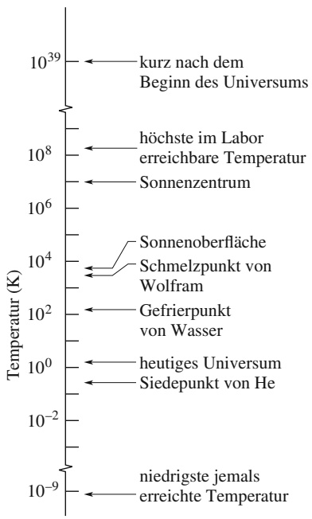

<details>
<summary>line</summary>

| Zone | Temperature Range (K) |
| --- | --- |
| kurz nach dem Beginn des Universums | 10^39 ~ 10^8 |
| höchste im Labor erreichbare Temperatur | 10^8 ~ 10^6 |
| Sonnenzentrum | 10^6 ~ 10^4 |
| Sonnenoberfläche | 10^4 ~ 10^3 |
| Schmelzpunkt von Wolfram | 10^3 ~ 10^2 |
| Gefrierpunkt von Wasser | 10^2 ~ 10^0 |
| heutiges Universum | 10^0 ~ 10^-2 |
| Siedepunkt von He | 10^-2 ~ 10^-4 |
| niedrigste jemals erreichte Temperatur | 10^-4 ~ 10^-9 |
</details>

Abb. 14.1

Einige Temperaturen auf der Kelvin-Skala. Die Temperatur T = 0 würde „10−∞“ entsprechen, sie kann auf dieser logarithmischen Skala nicht wiedergegeben werden.

Halliday Physik für natur- und ingenieurwiss. Studiengänge, 3. Auflage. D. Halliday, R. Resnick und J. Walker. © 2020 WILEY-VCH Verlag GmbH & Co. KGaA. Published 2020 by WILEY-VCH Verlag GmbH & Co. KGaA.

333

---

14 Temperatur, Wärme und der erste Hauptsatz der Thermodynamik

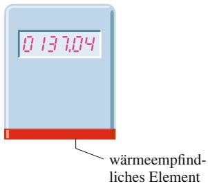

<details>
<summary>gauge</summary>

| Metric | Value |
| --- | --- |
| Current Value | 0.137,04 |
</details>

Abb. 14.2

Ein Thermoskop. Der angezeigte Zahlenwert nimmt zu, wenn das Gerät erwärmt wird, und er nimmt ab, wenn es abgekühlt wird. Bei dem wärmeempfindlichen Element könnte es sich z. B. um eine Drahtspule handeln, deren elektrischer Widerstand gemessen und angezeigt wird.

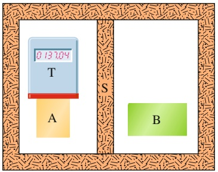

<details>
<summary>text_image</summary>

0.13704
T
A
S
B
</details>

(a)

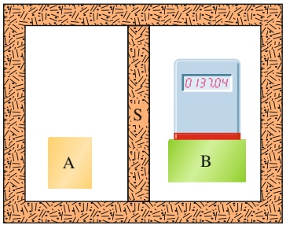

<details>
<summary>text_image</summary>

A
S
B
0.13704
</details>

(b)

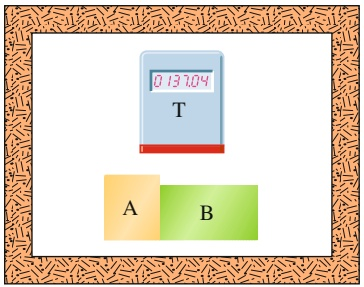

<details>
<summary>text_image</summary>

0.13704
T
A B
</details>

(c)

Abb. 14.3

(a) Ein Körper T (ein Thermoskop) und ein Körper A befinden sich im thermischen Gleichgewicht. (Bei Körper S soll es sich um eine wärmeundurchlässige Trennwand handeln.) (b) Körper T und Körper B befinden sich bei derselben Anzeige des Thermoskops im thermischen Gleichgewicht. (c) Wenn (a) und (b) wahr sind, dann besagt der nullte Hauptsatz der Thermodynamik, dass sich Körper A und Körper B ebenfalls im thermischen Gleichgewicht befinden.

senen Behälter. Jede dieser Eigenschaften kann zur Grundlage eines Instruments werden, mit dessen Hilfe wir den Wert der physikalischen Größe Temperatur erfassen können.

Abbildung 14.2 zeigt ein solches Instrument. Ein einfallsreicher Ingenieur könnte jede der oben angeführten Eigenschaften ausnutzen und ein entsprechendes Gerät entwerfen und bauen; welche Eigenschaft verwendet wird, lassen wir zunächst noch offen. Das hier abgebildete Instrument besitzt eine digitale Anzeige und hat die folgenden Eigenschaften: Wird es erwärmt (beispielsweise mit einem Bunsenbrenner), nehmen die angezeigten Zahlenwerte zu. Wird es anschließend abgekühlt (beispielsweise in einem Kühlschrank), nehmen die angezeigten Zahlenwerte wieder ab. Das Instrument ist noch nicht kalibriert und die Zahlen haben (bisher) noch keine physikalische Bedeutung. Ein solches Gerät bezeichnet man als Thermoskop. Es ist (noch) kein Thermometer.

Angenommen, wir bringen (wie in Abb. 14.3a) das Thermoskop (das wir Körper T nennen) in unmittelbaren Kontakt mit einem anderen Körper A. Das gesamte System befinde sich innerhalb eines dickwandigen wärmeisolierten Behälters. Die Ziffern auf der Anzeige des Thermoskops verändern sich zunächst, bis sie schließ- lich bei einer Zahl stehen bleiben (sagen wir „137,04“). Von nun an findet keine weitere Veränderung mehr statt. Wir nehmen an, dass jede messbare thermische Eigenschaft von Körper T und Körper A einen stabilen, sich nicht mehr verändernden Wert angenommen hat. In diesem Fall sagen wir, die beiden Körper befinden sich in einem thermodynamischen Gleichgewicht. Obwohl die Anzeigewerte von Körper T noch nicht kalibriert wurden, können wir davon ausgehen, dass die Körper T und A dieselbe (noch unbekannte) Temperatur besitzen.

Nun bringen wir Körper T in unmittelbaren Kontakt mit einem anderen Körper B (Abb. 14.3b) und stellen fest, dass sich die beiden Körper bei demselben Anzeigewert des Thermoskops im thermischen Gleichgewicht befinden. Dann müssen auch die Körper T und B dieselbe (unbekannte) Temperatur haben. Angenommen, wir bringen nun die beiden Körper A und B in Kontakt (Abb. 14.3c). Befinden sie sich sofort im thermischen Gleichgewicht? Experimentell finden wir: ja.

Diese in Abb. 14.3 beschriebene experimentelle Erfahrung wird durch den **nullten Hauptsatz der Thermodynamik** zusammengefasst:


Wenn sich zwei Körper A und B jeweils im thermischen Gleichgewicht mit einem dritten Körper T befinden, dann befinden sie sich auch untereinander im thermischen Gleichgewicht.

Weniger formal ausgedrückt besagt der nullte Hauptsatz: „Jeder Körper besitzt eine Eigenschaft, die wir **Temperatur** nennen. Befinden sich zwei Körper im thermischen Gleichgewicht, dann sind ihre Temperaturen gleich (und umgekehrt).“ In der Erkenntnis, dass die Anzeige unseres Thermoskops (des dritten Körpers T) einer physikalischen Eigenschaft entspricht, können wir es nun in ein Thermometer umwandeln, indem wir es kalibrieren.

In einem Labor verwenden wir den nullten Hauptsatz ständig. Wollen wir wis sen, ob die Flüssigkeiten in zwei Bechern dieselbe Temperatur haben, messen wir ihre beiden Temperaturen mit einem Thermometer. Wir brauchen die beiden Flüssigkeiten dazu nicht in unmittelbaren Kontakt zu bringen, um zu überprüfen, ob sie sich wirklich im thermodynamischen Gleichgewicht befinden.

Der nullte Hauptsatz war eher ein logischer Nachtrag, der um 1930 auftauchte, lange nachdem der erste und zweite Hauptsatz der Thermodynamik entdeckt (und nummeriert) worden waren. Da das Konzept der Temperatur für diese beiden Gesetze von fundamentaler Bedeutung ist, musste das Gesetz, das die Temperatur formal schlüssig als physikalisches Konzept einführt, die niedrigste Nummer erhalten – daher die Null.

334

---

14.1 Temperatur

14

## 14.1.3 Die Messung von Temperaturen

In diesem Abschnitt werden wir zunächst die Kelvin-Skala definieren und Temperaturen damit messen. Anschließend zeigen wir, wie man ein Thermoskop zu einem Thermometer kalibrieren kann.

## Der Tripelpunkt von Wasser

Zur Definition einer Temperaturskala wählen wir irgendein reproduzierbares thermisches Phänomen und ordnen seiner Umgebung ziemlich willkürlich einen bestimmten Temperaturwert in Kelvin zu. Wir definieren uns also einen standardisierten Fixpunkt und geben ihm eine standardisierte Temperatur. Wir könnten beispielsweise den Gefrierpunkt oder den Siedepunkt von Wasser wählen, aber aus verschiedenen technischen Gründen hat man sich stattdessen für den **Tripelpunkt von Wasser** entschieden.

Flüssiges Wasser, festes Eis und Wasserdampf (gasförmiges Wasser) können nur bei genau einem Druck und einer Temperatur gleichzeitig im thermischen Gleichgewicht existieren. Abbildung 14.4 zeigt eine Tripelpunktzelle, in der sich der Tripelpunkt von Wasser im Labor realisieren lässt. Die Temperatur am Tripelpunkt von Wasser beträgt

$$
T _ {3} = 2 7 3, 1 6 \mathrm{K} \quad (\text {Tripelpunkt von Wasser}), \tag {14.1}
$$

sie dient als Standardtemperatur zur Kalibrierung von Thermometern. Der Index $_ { p } 3 ^ { \alpha }$ bezieht sich auf die drei am Tripelpunkt koexistierenden Aggregatzustände. In der früheren Definition des Kelvin entsprach ein Kelvin dem 1/273,16ten Teil der Differenz zwischen dem absoluten Nullpunkt und der Tripelpunkttemperatur von Wasser. Seit 2019 ist das Kelvin über den exakt festgelegten Wert der Boltzmann-Konstanten definiert (siehe unten beziehungsweise Anhang A).

Man beachte, dass im Zusammenhang mit der Kelvin-Skala kein Gradzeichen verwendet wird: Man schreibt 300 K (nicht 300 °K), und es heißt „300 Kelvin“(nicht „300 Grad Kelvin“). Außerdem gelten die üblichen Vorsätze für SI-Einheiten: 0,0035 K ist daher dasselbe wie $^ { 3 , 5 }$ mK (man nutzt aber normalerweise nur die Vorsätze für „kleine“ Werte und sagt nicht $_ { p 3 }$ Kilokelvin“ oder $^ { , 0 , 4 }$ Megakelvin“). Die Nomenklatur unterscheidet zudem nicht zwischen absoluten Kelvin-Temperaturen und Temperaturdifferenzen. Die Sprechweise „die Siedetemperatur von Schwefel beträgt $^ - 7 1 7 . 8   \mathrm { K } ^ { \omega }$ ist ebenso richtig wie „die Temperatur dieses Wasserbads wurde um 8,5 K erhöht“.

## Das Gasthermometer mit konstantem Gasvolumen

Ein besonders einfaches Thermometer, das früher zur Kalibrierung aller anderen Thermometer diente, beruht auf dem Gasdruck in einem festen Volumen. Abbildung 14.5 zeigt ein solches **Gasthermometer mit konstantem Gasvolumen**. Es besteht aus einem gasgefüllten Kolben, der über ein Rohr mit einem Quecksilbermanometer verbunden ist. Durch Anheben bzw. Absenken des Reservoirs R kann der Quecksilberpegel auf der linken Seite immer auf den Nullwert der Skala gebracht werden, sodass das Gasvolumen konstant bleibt. (Unterschiede im Gasvolumen können die Temperaturmessungen beeinflussen.)

Die Temperatur eines Körpers im thermischen Kontakt mit dem Kolben (wie die Flüssigkeit in Abb. 14.5) wird als das Produkt

$$
T = C p \tag {14.2}
$$

definiert, wobei $p$ der Druck innerhalb des Gases und $C$ eine Konstante ist. Nach Gl. 10.10 ist der Druck $p$ gleich

$$
p = p _ {0} - \rho g h, \tag {14.3}
$$

Gasthermometerkolben

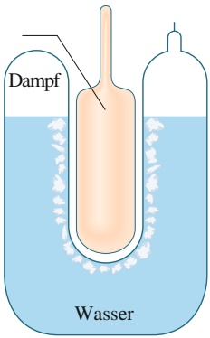

<details>
<summary>text_image</summary>

Dampf
Wasser
</details>

Abb. 14.4 Eine Tripelpunktzelle, in der festes Eis, flüssiges Wasser und Wasserdampf im thermischen Gleichgewicht koexistieren können. Nach internationaler Übereinkunft ist die Temperatur dieses Gemisches als 273,16 K definiert. Zwischen den Wänden der Zelle erkennt man den Messkolben eines Gasthermometers mit konstantem Gasvolumen.

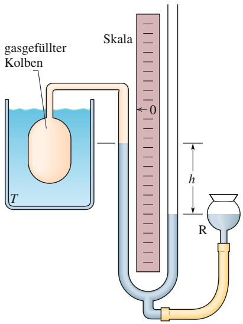

<details>
<summary>text_image</summary>

gasgefüllter
Kolben
T
Skala
0
h
R
</details>

Abb. 14.5 Ein Gasthermometer mit konstantem Gasvolumen. Der Kolben befindet sich in einer Flüssigkeit, deren Temperatur T bestimmt werden soll.

335

---

14 Temperatur, Wärme und der erste Hauptsatz der Thermodynamik

## Abb. 14.6

Die von einem Gasthermometer mit konstantem Gasvolumen gemessenen Temperaturen von kochendem Wasser. Für die Temperaturberechnungen nach Gl. 14.5 wurde der Druck $p _ { 3 }$ am Tripelpunkt von Wasser bestimmt. Die drei verschiedenen Gase in dem Thermometer ergeben bei verschiedenen Gasdrücken unterschiedliche Werte, doch mit abnehmenden Gasmengen (kleineren Werten von $p _ { 3 } )$ konvergieren alle drei Kurven gegen 373,125 K.

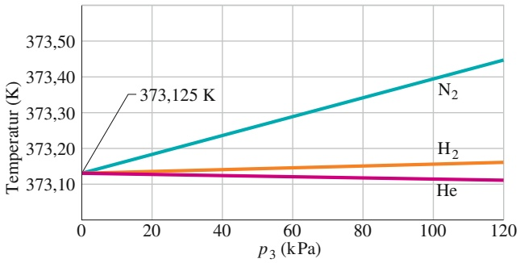

<details>
<summary>line</summary>

| p3 (kPa) | N2 (K) | H2 (K) | He (K) |
| --- | --- | --- | --- |
| 0 | 373,125 | 373,125 | 373,125 |
| 120 | ~373,45 | ~373,16 | ~373,11 |
</details>

wobei $p _ { 0 }$ der Atmosphärendruck, $\rho$ die Dichte des Quecksilbers im Manometer und h die gemessene Höhendifferenz zwischen den beiden Quecksilberniveaus in den Röhrenarmen sind.<sup>1</sup>) Bringen wir nun diesen Kolben in eine Tripelpunktzelle (Abb. 14.4), so ist die gemessene Temperatur

$$
T _ {3} = C p _ {3}, \tag {14.4}
$$

wobei $p _ { 3 }$ der in dieser Situation gemessene Druck ist. Aus den beiden Gln. 14.2 und 14.4 können wir die Konstante C eliminieren, und wir erhalten für die Temperatur

$$
T = T _ {3} \left(\frac {p}{p _ {3}}\right) = (2 7 3, 1 6 \mathrm{K}) \left(\frac {p}{p _ {3}}\right) \quad (\text {vorläufig}). \tag {14.5}
$$

Dieses Thermometer hat allerdings noch ein Problem. Möchten wir mit ihm beispielsweise den Siedepunkt von Wasser messen, stellen wir fest, dass verschiedene Gase in dem Kolben auch etwas verschiedene Ergebnisse liefern. Verwenden wir jedoch in dem (gleichen) Kolben immer geringere Gasmengen, so konvergieren die Werte zu einer einzigen Temperatur, unabhängig von der Art des Gases. Abbildung 14.6 zeigt diese Konvergenz für drei verschiedene Gase.

Die Vorschrift zur Temperaturmessung mit einem Gasthermometer lautet daher

$$
T = (2 7 3, 1 6 \mathrm{K}) \left(\lim _ {\text {Gasmenge} \rightarrow 0} \frac {p}{p _ {3}}\right). \tag {14.6}
$$

Nach dieser Vorschrift soll also eine unbekannte Temperatur wie folgt gemessen werden: Man fülle den Thermometerkolben mit einer beliebigen Menge irgendeines Gases (beispielsweise Stickstoff ) und messe $p _ { 3 }$ (mithilfe einer Tripelpunktzelle) sowie $p ,$ den Gasdruck bei der zu messenden Temperatur. Das Gasvolumen soll dabei immer gleich sein. Man berechne das Verhältnis $p / p _ { 3 } .$ Anschließend wiederhole man beide Messungen mit einer kleineren Gasmenge in dem Kolben und berechne wiederum dieses Verhältnis. Auf diese Weise fahre man fort und verwende dabei immer kleinere Gasmengen, bis man das Verhältnis $p / p _ { 3 }$ zu dem Wert extrapolieren kann, bei dem praktisch kein Gas mehr in dem Kolben wäre. Man berechne $T ,$ indem man diesen extrapolierten Wert in Gl. 14.6 einsetzt. (Diese Temperatur bezeichnet man als die Temperatur des idealen Gases.)

## 14.2 Die Celsius- und die Fahrenheit-Skala

## Lernziele

Nach dem Durcharbeiten dieses Abschnitts sollten Sie in der Lage sein, . . .

• Temperaturen zwischen zwei beliebigen (linearen) Temperaturskalen wie z. B. Celsius-, Fahrenheit- oder Kelvin-Skala umzurechnen,

1) Als Druckeinheiten verwenden wir die in Abschn. 10.1 eingeführten Einheiten. Die SI-Einheit für den Druck ist das Newton pro Quadratmeter, das auch den Namen Pascal (Pa) trägt. Das Pascal hängt mit anderen üblichen Druckeinheiten über folgende Relation zusammen: 1 atm = 1,01 ⋅ 10<sup>5</sup> Pa = 760 Torr .


336

---

14.2 Die Celsius- und die Fahrenheit-Skala

14

• zu verstehen, dass eine Temperaturänderung um 1 °C dasselbe ist wie eine Temperaturänderung um 1 K.

## Schlüsselideen

• Die Celsius-Skala der Temperatur ist definiert durch

$$
T _ {\mathrm{C}} = T - 2 7 3, 1 5 ^ {\circ},
$$

wenn $T$ die (absolute) Temperatur in Kelvin ist. Entsprechend ist die Fahrenheit-Skala definiert durch

$$
T _ {\mathrm{F}} = \frac {9}{5} T _ {\mathrm{C}} + 3 2 ^ {\circ}.
$$


## 14.2.1 Die Celsius- und die Fahrenheit-Skala

Bisher haben wir nur die Kelvin-Skala erwähnt, die vorwiegend in grundlegenden wissenschaftlichen Arbeiten verwendet wird. In fast allen Ländern der Welt wird für den umgangssprachlichen, wirtschaftlichen und teilweise auch wissenschaftlichen Gebrauch die Celsius-Skala benutzt. Celsius-Temperaturen werden in Grad gemessen, und der Celsius-Grad hat dieselbe Größe wie das Kelvin. Allerdings entspricht dem Nullpunkt der Celsius-Skala ein etwas gebräuchlicherer Wert als der absolute Nullpunkt. Bezeichnen wir mit $T _ { \mathrm { C } }$ die Celsius-Temperatur und mit T die Kelvin-Temperatur, so gilt

$$
T _ {\mathrm{C}} = T - 2 7 3, 1 5 ^ {\circ}. \tag {14.7}
$$

Werden Temperaturen auf der Celsius-Skala angegeben, so wird das Grad-Symbol verwendet. Wir schreiben daher $^ { 2 0 , 0 0 } ^ { \circ } C$ für 293,15 K.

In den Vereinigten Staaten verwendet man auch die Fahrenheit-Skala, die einen kleineren Grad verwendet als die Celsius-Skala und dazu auch noch einen anderen Skalennullpunkt. Beide Unterschiede kann man leicht an einem Thermometer mit beiden Skalen überprüfen. Die Beziehung zwischen der Celsius- und der Fahrenheit-Skala ist

$$
T _ {\mathrm{F}} = \frac {9}{5} T _ {\mathrm{C}} + 3 2 ^ {\circ}, \tag {14.8}
$$

wobei $T _ { \mathrm { F } }$ die Fahrenheit-Temperatur darstellt. Der Übergang zwischen diesen beiden Skalen lässt sich leicht mithilfe einiger sich entsprechender Punkte merken, beispielsweise dem Gefrier- und Siedepunkt von Wasser (siehe Tab. 14.1). In Abb. 14.7 werden die Kelvin-, Celsius- und Fahrenheit-Skalen nebeneinander gestellt.

Zur Unterscheidung sowohl von Messungen als auch der Grad-Werte auf diesen beiden Skalen verwenden wir die Buchstaben C und F. Die Gleichung

$$
0 ^ {\circ} \mathrm{C} = 3 2 ^ {\circ} \mathrm{F}
$$

TABELLE 14.1:

Einige sich entsprechende Temperaturen.

| Temperatur | °C | °F |
| --- | --- | --- |
| Siedepunkt von Wasser$^{a)}$ | 100 | 212 |
| Normale Körpertemperatur | 37,0 | 98,6 |
| Vergleichswert | 20 | 68 |
| Gefrierpunkt von Wasser$^{a)}$ | 0 | 32 |
| Nullpunkt der Fahrenheit-Skala | $\approx -18$ | 0 |
| Übereinstimmung beider Skalen | -40 | -40 |

a) Streng genommen liegt der Siedepunkt von Wasser auf der Celsius-Skala bei 99,975 °C und der Gefrierpunkt bei 0,00 °C. Zwischen diesen beiden Punkten liegen daher etwas weniger als 100 °C.

337

---

14 Temperatur, Wärme und der erste Hauptsatz der Thermodynamik

Abb. 14.7 Ein Vergleich von Kelvin-, Celsiusund Fahrenheit-Temperaturskala.

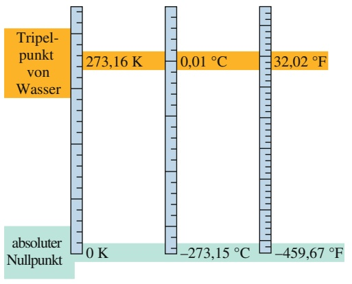

<details>
<summary>gauge</summary>

| Parameter | Wert 1 (K) | Wert 2 \(({}^{\circ}C)\) | Wert 3 \(({}^{\circ}F)\) |
| --- | --- | --- | --- |
| Tripelpunkt von Wasser | 273,16 | 0,01 | 32,02 |
| absoluter Nullpunkt | 0 | -273,15 | -459,67 |
</details>

bedeutet somit, dass $0 ^ { \circ }$ auf der Celsius-Skala derselben Temperatur entspricht wie $3 2 ^ { \circ }$ auf der Fahrenheit-Skala. Andererseits entspricht ein Temperaturunterschied von fünf Grad Celsius einem Temperaturunterschied von neun Grad Fahrenheit.

## KONTROLLFRAGE 1

Die Abbildung zeigt drei Temperaturskalen mit den eingetragenen Gefrier- und Siedepunkten von Wasser. (a) Ordnen Sie die Grade dieser Skalen nach ihrer Größe (größte Werte zuerst). (b) Ordnen Sie die folgenden Temperaturen (größte Werte zuerst): 50 °X, 50 °W und 50 °Y.

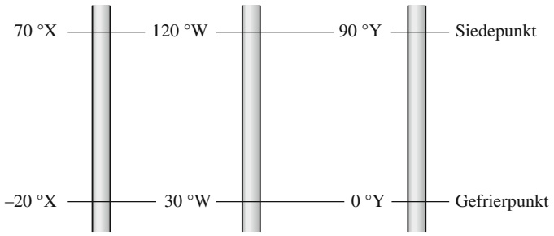

<details>
<summary>wireframe</summary>

| Temperature Range | Value |
| --- | --- |
| Top (Siedepunkt) | \(70 {}^{\circ}X\) |
| Upper Middle | \(120 {}^{\circ}W\) |
| Upper Right | \(90 {}^{\circ}Y\) |
| Bottom (Gefrierpunkt) | \(-20 {}^{\circ}X\) |
| Lower Middle | \(30 {}^{\circ}W\) |
| Bottom (Gefrierpunkt) | \(0 {}^{\circ}Y\) |
</details>

## LÖSUNGSSTRATEGIEN

**Strategie 1: Temperaturänderungen** Zwischen dem Gefrier- und Siedepunkt von Wasser liegen (näherungsweise) 100 Kelvin bzw. 100 Celsius-Grade. Ein Kelvin hat also dieselbe Größe wie ein Celsius-Grad. Aus dieser Beziehung wie auch aus Gl. 14.7 wissen wir damit, dass jede Temperaturänderung in Kelvin wie in Celsius durch dieselbe Zahl ausgedrückt wird. Eine Temperaturänderung von beispielsweise 10 K ist äquivalent zu einer Temperaturänderung von $1 0   ^ { \circ } \mathbf { C } ,$

Zwischen dem Gefrier- und Siedepunkt von Wasser liegen 180 Fahrenheit-Grade. Somit entsprechen 180 ${ } ^ { \circ } \mathbb { F } = 1 0 0   \mathrm { K } ,$ und ein Fahrenheit muss 100/180 oder 5/9 eines Kelvins oder eines Celsius-Grades sein. Aus dieser Beziehung wie auch aus Gl. 14.8 wissen wir daher, dass jede Temperaturänderung ausgedrückt in Fahrenheit gleich 9/5 derselben Temperaturänderung ausgedrückt in Kelvin oder Celsius entsprechen muss. So entspricht eine Temperaturänderung von 10 K in Fahrenheit einer Temperaturänderung von (9/5)(10 K) oder $1 8   ^ { \circ } \mathrm { F }$

Sie sollten auf keinen Fall eine Temperatur mit einer Temperaturänderung bzw. einer Temperaturdifferenz verwechseln. Eine Temperatur von 10 K ist sicherlich nicht dasselbe wie eine Temperatur von $1 0   ^ { \circ } \mathrm { C }$ oder $1 8   ^ { \circ } \mathrm { F }$ , allerdings ist eine Temperaturänderung von 10 K dasselbe wie eine Temperaturänderung von $1 0   ^ { \circ } \mathrm { C }$ oder $1 8   ^ { \circ } \mathrm { F }$ . Diese Unterscheidung ist sehr wichtig in Gleichungen, die eine Temperatur T und nicht eine Temperaturänderung bzw. eine Temperaturdifferenz wie $T _ { 2 } -$ $T _ { 1 }$ enthalten: Eine Temperatur $T$ sollte ganz allgemein immer in Kelvin angegeben werden und nicht in Celsius oder Fahrenheit. Kurz gesagt: Achten Sie auf das „reine $T ^ { \alpha } !$

338

---

14.3 Wärmeausdehnung

14

## 14.3 Wärmeausdehnung

## Lernziele

Nach dem Durcharbeiten dieses Abschnitts sollten Sie in der Lage sein, . . .

• für die eindimensionale Wärmeausdehnung den Zusammenhang zwischen der Temperaturänderung ΔT, der Längenänderung $\Delta L$ und dem Längenausdehnungskoeffizienten α anzugeben,
• für die zweidimensionale Wärmeausdehnung die Änderung der Fläche aus der eindimensionalen Wärmeausdehnung herzuleiten,
• für die dreidimensionale Wärmeausdehnung den Zusammenhang zwischen der Temperaturänderung ΔT, der Volumenänderung ΔV und dem Volumenausdehnungskoeffizienten $\beta$ anzugeben.


## Schlüsselideen

• Bei Änderungen der Temperatur verändern alle Objekte ihre Abmessungen. Die Änderung ΔL einer linearen Ausdehnung L aufgrund einer Temperaturänderung ΔT ist

$$
\Delta L = L \alpha \Delta T,
$$


wobei α der Längenausdehnungskoeffizient des betreffenden Materials ist.

• Die Änderung ΔV eines Volumens V aufgrund einer Temperaturänderung ΔT ist

$$
\Delta V = V \beta \Delta T,
$$

wobei $\beta$ der Volumenausdehnungskoeffizient des betreffenden Materials ist. Für Festkörper gilt $\beta = 3 \alpha$

## 14.3.1 Wärmeausdehnung

Einen festsitzenden Metalldeckel auf einem Glas können Sie lösen, indem Sie ihn unter einen heißen Wasserstrahl halten. Sowohl das Metall des Deckels als auch das Glas dehnen sich aus, wenn ihren Atomen durch das heiße Wasser Wärmeenergie zugeführt wird. (Mit der zugeführten Energie können sich die Atome den federartigen interatomaren Kräften, die jeden Festkörper zusammenhalten, entgegenwirken und sich so etwas weiter als gewöhnlich voneinander entfernen.) Da sich jedoch die Atome im Metall weiter voneinander entfernen als die Atome im Glas, dehnt sich der Deckel mehr als der Behälter und wird somit gelockert.

Eine solche **Wärmeausdehnung** (oder **thermische Expansion**) ist nicht immer erwünscht. Wenn sich Eisenbahnschienen im Sommer verbiegen, können Züge entgleisen. Damit Brückenbauwerke nicht bei unregelmäßiger Wärmeausdehnung einstürzen, werden sogenannte Dehnungsfugen eingebaut, welche solche Unterschiede ausgleichen. Die in der Zahnmedizin verwendeten Materialien für Füllungen müssen in ihren Wärmeausdehnungseigenschaften dem Zahnschmelz angepasst werden, anderenfalls kann der Genuss von heißem Kaffee oder kaltem Eis sehr schmerzlich werden. Andererseits werden im Flugzeugbau oft Nieten und ähnliche Verbindungsteile vor dem Einbau in Trockeneis gekühlt, sodass sie nach ihrer Ausdehnung noch fester sitzen (vgl. Abb. 14.8).

Thermometer oder Thermostate können auch auf der unterschiedlichen Ausdehnung zwischen den Komponenten eines Bimetallstreifens basieren (Abb. 14.9). Ebenso nutzen die bekannten Haushaltsthermometer, bei denen sich eine Flüssig keit in einem Glas befindet, die thermische Expansion von Flüssigkeiten, beispielsweise Quecksilber oder Alkohol, aus. Genauer gesagt beruhen sie darauf, dass sich die Flüssigkeiten deutlich stärker ausdehnen als die festen Behälter, in denen sie eingeschlossen sind.

339

---

14 Temperatur, Wärme und der erste Hauptsatz der Thermodynamik

## Abb. 14.8

Wenn eine Concorde mit Überschallgeschwindigkeit flog, bewirkte die Wärmeausdehnung aufgrund der Luftreibung, dass die Länge des Flugzeugs um etwa 12,5 cm zunahm. Die Konstruktion war jedoch – auch dank geschickt ausgenutzter thermischer Effekte – stabil genug, um dies auszuhalten. (Die $\mathbf { , } \mathbf { \mathrm { { N a s e } } } ^ { \alpha }$ der Concorde erwärmte sich dabei um knapp $1 3 0   ^ { \circ } \mathbf { C } _ { 1 }$ das Heck immerhin um rund $9 0   ^ { \circ } \mathbf { C } ,$ und die Innenseiten der Fenster fühlten sich spürbar wärmer an.) [Quelle: Hugh Thomas/BWP Media/Getty Images, Inc.].


## Abb. 14.9

(a) Ein Bimetallstreifen aus einem Messing- und einem Stahlstreifen, die bei einer Temperatur $T _ { 0 }$ zusammengeschweißt wurden. (b) Bei Temperaturen oberhalb dieser Referenztemperatur verbiegt sich der Streifen in der abgebildeten Form. Unterhalb dieser Temperatur verbiegt er sich in die andere Richtung. Auf diesem Prinzip beruhen viele Thermostate, bei denen durch einen Temperaturanstieg oder -abfall ein elektrischer Kontakt hergestellt oder unterbrochen wird.


<details>
<summary>natural_image</summary>

Exterior view of a modern ultra-speed train aircraft in flight against a clear sky (no visible text or markings)
</details>

## Längenausdehnung

Erhöht sich die Temperatur eines Metallstabs der Länge L um einen Betrag ΔT, so nimmt seine Länge um den Betrag

$$
\Delta L = L \alpha \Delta T \tag {14.9}
$$

zu. Die Konstante α bezeichnet man als **Längenausdehnungskoeffizienten**. Die Einheit von α ist „pro Grad“ bzw. „pro Kelvin“. Der Wert von α ist materialabhängig. Obwohl sich dieser Wert für ein gegebenes Material als Funktion der Temperatur noch etwas verändert, kann er für die meisten praktischen Anwendungen als konstant angesehen werden. In Tab. 14.2 sind einige Längenausdehnungskoeffizienten zusammengefasst. Beachten Sie, dass die hier verwendete Einheit $^ \circ \mathrm { C }$ auch durch die Einheit K ersetzt werden kann, da es immer um Temperaturdifferenzen geht.

Die Wärmeausdehnung eines Festkörpers entspricht einer dreidimensionalen fotografischen Vergrößerung. Abbildung 14.10b zeigt die (übertrieben dargestellte) Ausdehnung eines Metalllineals nach einer Temperaturerhöhung im Vergleich zu Abb. 14.10a. Gleichung 14.9 gilt für jede lineare Ausdehnung des Lineals, einschließlich seiner Kanten, seiner Dicke, den Diagonalen und den Durchmessern

TABELLE 14.2:

Einige Längenausdehnungskoeffizienten<sup>a)</sup>.

| Material | $\alpha(10^{-6}/^{\circ}\text{C})$ | Material | $\alpha(10^{-6}/^{\circ}\text{C})$ |
| --- | --- | --- | --- |
| Eis (bei 0°C) | 51 | Stahl | 11 |
| Blei | 29 | (normales) Glas | 9 |
| Aluminium | 23 | Borosilikatglas | 3,2 |
| Messing | 19 | Diamant | 1,2 |
| Kupfer | 17 | Invarb) | 0,7 |
| Beton | 12 | Quarzglas | 0,5 |

a) Abgesehen von Eis handelt es sich immer um Werte bei Zimmertemperatur.

b) Die Entwicklung dieser Legierung zielte auf einen niedrigen Ausdehnungskoeffizienten ab. Ihr Name ist eine Kurzform von „invariable“.

## Abb. 14.10

Dasselbe Metalllineal bei zwei verschiedenen Temperaturen. Die Markierungen, die Zahlen, die Dicke und auch der Durchmesser des Kreises bzw. der Öffnung dehnen sich alle um denselben Faktor aus. (Zur Verdeutlichung wurde der Ausdehnungsmaßstab weit übertrieben dargestellt.)


<details>
<summary>text_image</summary>

1 2 3 4 5 6 7
(a) Kreis kreis-
förmiges Loch
1 2 3 4 5 6 7
</details>

(b)

340

---

14.4 Die Absorption von Wärme

14

von aufgemalten und eingestanzten Kreisen. Passt die aus diesem Loch herausgeschnittene Kreisscheibe anfänglich genau in das Loch, dann gilt das auch, wenn diese Kreisscheibe um dieselbe Temperatur erwärmt wird wie das Lineal.

## Volumenausdehnung

Da sich alle Dimensionen eines Festkörpers mit der Temperatur ausdehnen, nimmt das Volumen dieses Körpers bei Erwärmung zu. Für Fluide ist die Volumenausdehnung sogar der einzig sinnvolle Ausdehnungsparameter. Erhöht sich die Temperatur eines Festkörpers oder eines Fluids vom Volumen $V$ um einen Betrag $\Delta T _ { \star }$ so nimmt auch das Volumen zu und zwar um

$$
\Delta V = V \beta \Delta T, \tag {14.10}
$$

wobei $\beta$ der sogenannte **Volumenausdehnungskoeffizient** des Festkörpers bzw. des Fluids ist. Die Koeffizienten für Volumen- und Längenausdehnung hängen bei einem Festkörper über die Beziehung

$$
\beta = 3 \alpha \tag {14.11}
$$

## zusammen.

Das vertrauteste aller Fluide, Wasser, verhält sich allerdings anderes als die meisten anderen Fluide. Oberhalb von ungefähr $4   ^ { \circ } \mathrm { C }$ dehnt sich Wasser bei einer Temperaturerhöhung wie erwartet aus. Zwischen 0 und $4   ^ { \circ } \mathrm { C }$ jedoch zieht Wasser sich mit zunehmender Temperatur zusammen. Bei ungefähr $4   ^ { \circ } \mathrm { C }$ durchläuft die Dichte von Wasser also ein Maximum. Bei allen anderen Temperaturen ist die Wasserdichte kleiner als dieser maximale Wert.

Dieses besondere Verhalten von Wasser ist auch der Grund, weshalb ein See von oben nach unten zufriert und nicht von unten nach oben. Wenn Wasser sich an der Oberfläche von beispielsweise $1 0   ^ { \circ } \mathrm { C }$ abkühlt, wird es dichter („schwerer“) als das Wasser in tieferen Schichten und sinkt zu Boden. Unterhalb von $4   ^ { \circ } \mathrm { C }$ wird das Wasser an der Oberfläche jedoch weniger dicht („leichter“) als das Wasser in tieferen Schichten und daher bleibt es an der Oberfläche, bis es gefriert. Die Wasseroberfläche friert also $\mathbf { Z } \mathbf { u } ,$ während das Wasser unterhalb noch flüssig bleibt. Würde ein See von unten nach oben zufrieren, würde das so entstandene Eis während der Sommermonate nicht vollständig auftauen, da die oberen Wasserschichten isolierend wirken. Nach einigen Jahren wären die Gewässer in vielen Klimazonen der Erde das ganze Jahr über fest zugefroren, und eine Unterwasserwelt, wie wir sie kennen, könnte es nicht geben.

## KONTROLLFRAGE 2

In der Abbildung sehen Sie vier Metallplatten mit Kantenlängen L, 2L oder 3L. Sie alle bestehen aus demselben Material und ihre Temperaturen sollen um denselben Betrag zunehmen. Ordnen Sie die Platten nach dem zu erwartenden Zuwachs in (a) ihrer vertikalen Höhe und (b) ihrer Fläche (größte Werte zuerst).


<details>
<summary>bar</summary>

| Category | Value |
| --- | --- |
| (1) | ~3.5 |
| (2) | ~6.0 |
| (3) | ~6.0 |
| (4) | ~2.0 |
</details>

## 14.4 Die Absorption von Wärme

## Lernziele

Nach dem Durcharbeiten dieses Abschnitts sollten Sie in der Lage sein, . . .

• zu verstehen, dass Wärmeenergie mit der zufälligen Bewegung der mikroskopischen Bestandteile eines Gegenstands zusammenhängt,
zu erkennen, dass eine Wärmemenge Q den Betrag einer in Form von Wärme (auf einen oder von einem Gegenstand) aufgrund einer Temperaturdifferenz zwischen diesem Gegenstand und seiner Umgebung übertragenen Energie beschreibt,


341

---

14 Temperatur, Wärme und der erste Hauptsatz der Thermodynamik

• Energien zwischen verschiedenen Einheiten umzurechnen,
• mechanische oder elektrische Energie in thermische Energie umzurechnen,
• den Zusammenhang zwischen der Temperaturänderung $\Delta T$ eines Gegenstands, der übertragenen Wärmemenge Q und der Wärmekapazität C des Gegenstands zu erklären,
• den Zusammenhang zwischen der Temperaturänderung ΔT eines Gegenstands, der übertragenen Wärmemenge Q, der spezifischen Wärme c und der Masse m des Gegenstands zu erklären,
• die drei Aggregatzustände der Materie zu kennen und ihre Eigenschaften zu verstehen,
• für einen Phasenübergang in einer Substanz den Zusammenhang zwischen der übertragenen Wärmemenge Q, der spezifischen Umwandlungswärme L der Substanz und ihrer Masse m zu erklären,
zu verstehen, dass der Prozess der Wärmeübertragung schrittweise berechnet werden muss, wenn eine Substanz dabei einen Phasenübergang vollzieht: (a) Berechnung der Temperaturänderung bis zur Temperatur des Phasenübergangs, (b) Berechnung des Phasenübergangs und (c) Berechnung der Temperaturänderung von der Temperatur des Phasenübergangs bis zur Endtemperatur nach Übertragung der gesamten Wärmemenge.


## Schlüsselideen

• Die Wärme Q ist eine Energie, die aufgrund einer Temperaturdifferenz zwischen einem System und seiner Umgebung ausgetauscht wird. Sie kann in Joule (J), Kalorien (cal), Kilokalorien (Cal oder kcal) oder auch Britisch Thermal Units (Btu) angegeben werden; dabei gilt

$$
1 \mathrm{cal} = 3, 9 6 8 \cdot 1 0 ^ {- 3} \mathrm{Btu} = 4, 1 8 6 8 \mathrm{J}.
$$

• Wenn ein Objekt die Wärmemenge Q aufnimmt (absorbiert), ändert sich seine Temperatur von $T _ { \mathrm { i } }$ auf $T _ { \mathrm { f } } ;$ dabei gilt

$$
Q = C (T _ {\mathrm{f}} - T _ {\mathrm{i}}),
$$

wobei C die Wärmekapazität des Objekts ist. Wenn das Objekt die Masse m hat, kann dieser Zusammenhang in der Form

$$
Q = c m (T _ {\mathrm{f}} - T _ {\mathrm{i}})
$$

geschrieben werden, wobei c eine Materialkonstante ist, die als spezifische Wärme des Materials bezeichnet wird, aus dem das Objekt besteht.

• Die molare Wärmekapazität einer Substanz ist ihre Wärmekapazität pro Mol, d. h. pro 6,023 ⋅ $1 0 ^ { 2 3 }$ Teilchen der Substanz.
Die von einer Substanz aufgenommene oder abgegebene Wärme kann dazu führen, dass die Substanz ihren Aggregatzustand ändert, also z. B. von einem Festkörper zu einer Flüssigkeit oder von einer Flüssigkeit zu einem Gas wird. Die Energie, die pro Masseneinheit der Substanz benötigt wird, um diese Zustands änderung (ohne dass sich dabei die Temperatur ändert) herbeizuführen, wird als Umwandlungsenergie L bezeichnet. Es gilt

$$
Q = L m.
$$

• Die Verdampfungswärme $L _ { \mathrm { V } }$ ist die pro Masseneinheit benötigte Energie, um eine Flüssigkeit zu verdampfen. Dieselbe Energie wird pro Masseneinheit frei, wenn dieselbe Substanz aus dem gasförmigen Zustand zu einer Flüssigkeit kondensiert.
• Die Schmelzwärme $L _ { \mathrm { S } }$ ist die pro Masseneinheit benötigte Energie, um einen Festkörper zu schmelzen. Dieselbe Energie wird pro Masseneinheit frei, wenn die Substanz aus dem flüssigen Zustand zu einem Festkörper erstarrt.

342

---

14.4 Die Absorption von Wärme

14

## 14.4.1 Temperatur und Wärme

Wenn Sie eine Getränkedose aus dem Kühlschrank nehmen und auf dem Küchentisch stehen lassen, nimmt die Temperatur in der Dose zu – zunächst schneller und später langsamer –, bis die Temperatur von Dose und Inhalt gleich der Zimmertemperatur ist (sie befinden sich dann im thermischen Gleichgewicht). Ebenso nimmt die Temperatur einer heißen Tasse Kaffee solange ab, bis sie Zimmertemperatur erreicht hat.

Verallgemeinernd betrachten wir die Dose bzw. die Kaffeetasse als ein System mit der Temperatur $T _ { S }$ und den für den Vorgang wesentlichen Teil der Küche als die Umgebung dieses Systems (mit der Temperatur $T _ { \mathrm { U } } )$ . Sind $T _ { \mathrm { S } }$ und $T _ { \mathrm { U } }$ verschieden, so wird sich nach unserer Beobachtung die Temperatur $T _ { S }$ solange ändern $( T _ { \mathrm { U } }$ ändert sich wegen der als sehr groß angenommenen Umgebung vergleichsweise wenig), bis die beiden Temperaturen gleich sind und der Zustand des thermischen Gleichgewichts eingetreten ist.

Eine solche Temperaturänderung beruht auf einer Übertragung von thermischer Energie zwischen Systems und Umgebung. (Thermische Energie bezieht sich auf eine innere Energie, die sich zusammensetzt aus den kinetischen und potenziellen Energien der Atome, Moleküle und anderer Mikrokörper, die sich innerhalb eines Gegenstands teilweise ungeordnet bewegen.) Die übertragene Energie bezeichnet man als **Wärme**, und sie wird mit Q bezeichnet. Die Wärme ist positiv, wenn thermische Energie aus der Umgebung zur inneren Energie des Systems hinzugeführt wird (in diesem Fall spricht man auch davon, dass Energie aufgenommen wurde). Wärme ist negativ, wenn thermische Energie vom System an die Umgebung abgegeben wird.

Dieser Energieübertrag ist in Abb. 14.11 dargestellt. In Abb. 14.11a, wo $T _ { \mathrm { S } } > T _ { \mathrm { U } }$ ist, wird Energie vom System an die Umgebung abgegeben, Q ist also negativ. In Abb. 14.11b ist $T _ { \mathrm { S } } = T _ { \mathrm { U } }$ und es findet kein Energieübertrag statt, Q ist null und es wird weder Energie abgegeben noch aufgenommen. In Abb. 14.11c ist $T _ { \mathrm { S } } < T _ { \mathrm { U } }$ Es wird Energie von der Umgebung auf das System übertragen, Q ist also positiv.

Dies führt uns auf folgende Definition der Wärme:


Wärme ist die zwischen einem System und seiner Umgebung aufgrund eines Temperaturunterschieds ausgetauschte thermische Energie.

Zwischen einem System und seiner Umgebung kann Energie auch in Form von Arbeit W übertragen werden, wenn nämlich auf das System eine Kraft wirkt, gegen die das System Arbeit verrichtet. Anders als Temperatur, Druck oder Volumen sind Wärme und Arbeit keine intrinsischen Eigenschaften eines Systems. Sie haben nur insoweit eine Bedeutung, als mit ihnen eine Übertragung von Energie in das System oder aus dem System heraus beschrieben wird. Aussagen der Form „Während der letzten drei Minuten wurden 15 J Wärme von dem System an seine Umgebung abgegeben“ oder „Innerhalb der letzten Minute wurde von der Umgebung an dem System 12 J Arbeit verrichtet“ sind also durchaus sinnvoll. Demgegenüber ist es sinnlos zu sagen: „Dieses System enthält 450 J Wärme“ oder „Dieses System enthält 385 J Arbeit“.

Als den Wissenschaftlern noch nicht klar war, dass es sich bei Wärme um eine Form der Energieübertragung handelt, wurde die Menge an Wärme über deren Fä- higkeit zur Temperaturerhöhung von Wasser gemessen. So war eine **Kalorie** (cal) definiert als die Wärmemenge, die zur Erhöhung der Temperatur von 1 g Wasser von $^ { 1 4 , 5   ^ { \circ } C }$ auf $^ { 1 5 , 5   ^ { \circ } \mathrm { C } }$ notwendig ist.

Da es sich bei Wärme (wie bei Arbeit) um einen Energieübertrag handelt, entschied man sich 1948, als SI-Einheit für die Wärme die Einheit für Energie zu über nehmen, also das **Joule**. Eine Kalorie wurde zunächst (exakt) als 4,1860 J definiert, ohne Bezug auf die Erwärmung von Wasser. (Die im Zusammenhang mit der Ernährung manchmal verwendete „große“ Kalorie (Cal) ist in Wirklichkeit eine Ki-


## Abb. 14.11

Wenn, wie in (a), die Temperatur eines Systems größer ist als die seiner Umgebung, wird Wärme Q von diesem System an die Umgebung abgegeben, bis ein thermisches Gleichgewicht (b) erreicht ist. (c) Ist die Temperatur eines Systems niedriger als die seiner Umgebung, wird von dem System Wärme aufgenommen, bis ein thermischer Gleichgewichtszustand erreicht ist.

343

---

14 Temperatur, Wärme und der erste Hauptsatz der Thermodynamik

lokalorie.) Als Beziehung zwischen den Wärmeeinheiten halten wir daher fest:

$$
1 \mathrm{cal} = 4, 1 8 6 0 \mathrm{J}. \tag {14.12}
$$

Später hat man sich dann daran gewöhnt, auch in der Wärmelehre direkt mit Joule zu arbeiten, sofern man sich nicht mit Diätratgebern beschäftigt . . .

## 14.4.2 Die Aufnahme von Wärme durch Festkörper und Flüssigkeiten

## Die Wärmekapazität

Die **Wärmekapazität** C eines Gegenstands ist die Proportionalitätskonstante zwischen der Wärme $Q ,$ die von dem Gegenstand aufgenommen oder abgegeben wird, und der Temperaturänderung ΔT dieses Gegenstands:

$$
Q = C \Delta T = C (T _ {\mathrm{f}} - T _ {\mathrm{i}}), \tag {14.13}
$$

wobei $T _ { \mathrm { i } }$ die anfängliche oder Initialtemperatur und $T _ { \mathrm { f } }$ die End- bzw. Finaltemperatur des Gegenstands bezeichnen. Die Wärmekapazität C hat die Einheit Energie pro Grad bzw. Energie pro Kelvin. Die Wärmekapazität C einer Marmorplatte in einem Brötchenwärmer kann beispielsweise 179 cal/°C betragen, was man auch als 179 cal/K oder als 749 J/K schreiben kann.

Die Bezeichnung „Kapazität“ ist in diesem Zusammenhang etwas irreführend, da eine Analogie zur Kapazität beispielsweise eines Wassereimers nahegelegt wird. Diese Analogie ist falsch! Man sollte sich in diesem Fall nicht vorstellen, dass ein Gegenstand die Wärme „enthalte“ oder in seiner Fähigkeit zur Wärmeabsorption eingeschränkt sei. Eine Wärmeübertragung kann im Prinzip beliebig fortgesetzt werden, solange der notwendige Temperaturunterschied aufrechterhalten wird und der Gegenstand bei diesem Prozess nicht schmilzt oder verdampft.

## Die spezifische Wärme

Die Wärmekapazitäten zweier Gegenstände aus demselben Material – z. B. Marmor – sind proportional zu ihren Massen. Daher ist es naheliegend, eine „Wärmekapazität pro Masse“ zu definieren: die **spezifische Wärmekapazität** oder kurz **spezifische Wärme** c. Sie bezieht sich nicht auf einen bestimmten Gegenstand, sondern auf das Material, aus dem dieser Gegenstand besteht. Gleichung 14.13 wird damit zu

$$
Q = c m \Delta T = c m (T _ {\mathrm{f}} - T _ {\mathrm{i}}). \tag {14.14}
$$

Obwohl die Wärmekapazität einer bestimmten Marmorplatte vielleicht 179 cal/°C (oder 749 J/K) beträgt, würden wir experimentell für die spezifische Wärme von Marmor selber (sei es in dieser Platte oder in irgendeinem anderen Marmorgegenstand) den Wert $0 , 2 1   \mathrm { c a l } / ( \mathrm { g } \cdot { } ^ { \circ } \mathrm { C } )$ oder 880 $\mathrm { J } / ( \mathrm { k g } \cdot \mathrm { K } )$ finden.

Aus der ursprünglichen Definition der Kalorie ergibt sich für die spezifische Wärme von Wasser

$$
c = 1 \mathrm{cal} / (\mathrm{g} \cdot {} ^ {\circ} \mathrm{C}) = 4 1 9 0 \mathrm{J} / (\mathrm{kg} \cdot \mathrm{K}). \tag {14.15}
$$

Tabelle 14.3 fasst die spezifischen Wärmen von verschiedenen Substanzen bei Zimmertemperatur zusammen. Man beachte, dass der Wert für Wasser vergleichs weise groß ist. Genau genommen hängt die spezifische Wärme in geringem Maß auch von der Temperatur ab, aber die Werte in Tab. 14.3 gelten in guter Näherung für einen großen Temperaturbereich um die Zimmertemperatur.

344

---

14.4 Die Absorption von Wärme

14

TABELLE 14.3: Die spezifische Wärme einiger Substanzen bei Zimmertemperatur.

<table><tr><td rowspan="2">Material</td><td colspan="2">Spezifische Wärme</td><td>Molare spezifische Wärme</td></tr><tr><td>cal $\mathrm{g} \cdot \mathrm{K}$ </td><td>J $\mathrm{kg} \cdot \mathrm{K}$ </td><td>J $\mathrm{mol} \cdot \mathrm{K}$ </td></tr><tr><td colspan="4">Elementare Festkörper</td></tr><tr><td>Blei</td><td>0,0305</td><td>128</td><td>26,5</td></tr><tr><td>Wolfram</td><td>0,0321</td><td>134</td><td>24,8</td></tr><tr><td>Silber</td><td>0,0564</td><td>236</td><td>25,5</td></tr><tr><td>Kupfer</td><td>0,0923</td><td>386</td><td>24,5</td></tr><tr><td>Aluminium</td><td>0,215</td><td>900</td><td>24,4</td></tr><tr><td colspan="4">Andere Festkörper</td></tr><tr><td>Messing</td><td>0,092</td><td>380</td><td></td></tr><tr><td>Granit</td><td>0,19</td><td>790</td><td></td></tr><tr><td>Glas</td><td>0,20</td><td>840</td><td></td></tr><tr><td>Eis ( $-10^{\circ}\mathrm{C}$ )</td><td>0,530</td><td>2220</td><td></td></tr><tr><td colspan="4">Flüssigkeiten</td></tr><tr><td>Quecksilber</td><td>0,033</td><td>140</td><td></td></tr><tr><td>Ethanol (Ethylalkohol)</td><td>0,58</td><td>2430</td><td></td></tr><tr><td>Meerwasser</td><td>0,93</td><td>3900</td><td></td></tr><tr><td>Wasser</td><td>1,00</td><td>4190</td><td></td></tr></table>

## KONTROLLFRAGE 3

Eine bestimme Wärmemenge Q erwärmt 1 g eines Materials A um $3   ^ { \circ } \mathrm { C }$ und 1 g eines anderen Materials B um 4 °C. Welches Material hat die größere spezifische Wärme?

## Die molare Wärmekapazität

In vielen Fällen ist es sinnvoll, die Menge einer Substanz in der Einheit Mol (mol) anzugeben, wobei

$$
1 \mathrm{mol} = 6, 0 2 \cdot 1 0 ^ {2 3} \text {Elementareinheiten}
$$

einer beliebigen Substanz ist. 1 mol Aluminium besteht daher aus $6 { , } 0 2 \cdot 1 0 ^ { 2 3 }$ Atomen (das Atom ist die Elementareinheit) und 1 mol Kohlenstoffdioxid entspricht $6 { , } 0 2 \cdot 1 0 ^ { 2 3 }$ Molekülen dieses Gases (da in diesem Fall das Molekül die Elementareinheit der Verbindung ist).

Werden Mengen in Mol angegeben, müssen sich auch die spezifischen Wärmen auf das Mol beziehen (und nicht auf die Masseneinheit); diese bezeichnet man dann als **molare Wärmekapazitäten**. Tabelle 14.3 gibt die Werte bei Zimmertemperatur für einige elementare Festkörper an (die jeweils nur aus einem Element bestehen).

## Ein wichtiger Punkt

Wenn wir die spezifische Wärme einer Substanz messen bzw. mit ihr arbeiten, müssen wir wissen, unter welchen Bedingungen die Energie in Form von Wärme übertragen wird. Bei Festkörpern und Flüssigkeiten nehmen wir gewöhnlich an, dass sich die Probe bei der Energieübertragung unter konstantem Druck (meist Atmosphärendruck) befindet. Man könnte sich aber auch vorstellen, dass die Probe während der Energieaufnahme bei einem konstanten Volumen gehalten wird. In diesem Fall müsste die Wärmeausdehnung der Probe durch einen äußeren Druck unterbunden werden. Experimentell lassen sich diese Bedingungen bei Festkörpern oder Flüssigkeiten nur sehr schwer verwirklichen, allerdings kann man den

345

---

14 Temperatur, Wärme und der erste Hauptsatz der Thermodynamik

Effekt berechnen, und es zeigt sich, dass sich die spezifische Wärme bei konstantem Druck und bei konstantem Volumen für fast alle Festkörper oder Flüssigkeiten um nicht mehr als einige wenige Prozent unterscheidet. Wie wir noch sehen werden, sind die Werte für die spezifische Wärme von Gasen bei konstantem Druck bzw. konstantem Volumen jedoch merklich verschieden.

## Umwandlungswärme

Wenn ein Festkörper oder eine Flüssigkeit Wärme aufnehmen, muss die Temperatur der Probe nicht notwendigerweise zunehmen. Es kann auch sein, dass sich die Phase bzw. der Aggregatzustand der Probe ändert. Gewöhnlich liegt Materie in einem der drei folgenden Zustände vor: Im festen Zustand sind die Moleküle einer Probe durch ihre gegenseitige Anziehung zu einer mehr oder weniger festen Struktur miteinander verbunden. Im flüssigen Zustand liegen die einzelnen Moleküle noch dicht an dicht, aber sie haben mehr Energie und können sich relativ frei umherbewegen. Sie verbinden sich dabei kurzzeitig zu größeren Klumpen, aber allgemein hat die Probe keine feste Struktur und kann fließen oder sich einem Behälter anpassen. Im gasförmigen Zustand bzw. als Dampf besitzen die einzelnen Moleküle noch mehr Energie, sie haben sich voneinander befreit und können in verhältnismäßig großen Abständen das Volumen eines geschlossenen Behälters ausfüllen.

Beim Schmelzen wandelt sich ein Festkörper von einem festen in einen flüssigen Zustand um. Dieser Prozess erfordert Energie, da die Moleküle des Festkörpers erst aus ihrer starren Struktur befreit werden müssen. Das Schmelzen eines Eiswürfels zu flüssigem Wasser ist ein vertrautes Beispiel. Bei dem umgekehrten Vorgang, dem Gefrieren einer Flüssigkeit zu einem Festkörper, muss der Flüssigkeit Energie entzogen werden, damit sich die Moleküle zu einer starren Struktur zusammenfinden können.

Das Verdampfen einer Flüssigkeit bedeutet, sie von ihrem flüssigen Zustand in einen gasförmigen Zustand, den Dampf, zu überführen. Wie das Schmelzen erfordert auch dieser Prozess Energie, da die Moleküle aus ihren Klumpen befreit werden müssen. Das Verkochen von flüssigem Wasser zu Wasserdampf ist wiederum ein bekanntes Beispiel. Die Kondensation von einem Gas zu einer Flüssigkeit ist der zur Verdampfung umgekehrte Vorgang. In diesem Fall muss dem Gas Energie entzogen werden, sodass die Moleküle sich wieder zu losen Klumpen zusammenfinden können und nicht mehr frei und unabhängig voneinander umherfliegen.

Die bei einem vollständigen Übergang einer Probe in eine neue Phase in Form von Wärme übertragene Energiemenge pro Masse bezeichnet man als **spezifische Umwandlungswärme** L. Wenn also eine Probe der Masse m sich vollständig von einer Phase in eine andere umwandelt, ist die übertragene Gesamtenergie (die sogenannte **latente Wärme**) gleich

$$
Q = L m, \tag {14.16}
$$

Umwandlungswärme ist also so etwas wie eine „spezifische latente Wärme“.

Handelt es sich bei dem Phasenübergang um den Übergang von flüssig zu gasförmig (nimmt die Probe also Energie auf ) oder vom gasförmigen zum flüssigen Zustand (die Probe gibt Energie ab), so nennt man die Umwandlungswärme auch **Verdampfungswärme** (bzw. genauer **spezifische Verdampfungswärme**) $L _ { \mathrm { V } } .$ Für Wasser bei seiner Koch- bzw. Kondensationstemperatur ist

$$
L _ {\mathrm{V}} = 5 3 9 \mathrm{cal/g} = 4 0, 7 \mathrm{kJ/mol} = 2 2 5 6 \mathrm{kJ/kg}. \tag {14.17}
$$

Handelt es sich bei dem Phasenübergang um einen Übergang vom festen zum flüssigen Zustand (muss die Probe also Energie aufnehmen) oder vom flüssigen zum festen Zustand (die Probe gibt Energie ab), so bezeichnet man die latente Wärme auch als **(spezifische) Schmelzwärme** $L _ { \mathrm { S } }$ . Die spezifische Schmelzwärme von

346

---

14.5 Der erste Hauptsatz der Thermodynamik

14

TABELLE 14.4:

Einige spezifische Umwandlungswärmen.

<table><tr><td rowspan="2">Material</td><td colspan="2">Schmelzen</td><td colspan="2">Verdampfen</td></tr><tr><td>Schmelzpunkt (K)</td><td>Schmelzwärme  $L_{S}$  (kJ/kg)</td><td>Siedepunkt (K)</td><td>Verdampfungswärme  $L_{V}$  (kJ/kg)</td></tr><tr><td>Wasserstoff</td><td>14,0</td><td>58,0</td><td>20,3</td><td>455</td></tr><tr><td>Sauerstoff</td><td>54,8</td><td>13,9</td><td>90,2</td><td>213</td></tr><tr><td>Quecksilber</td><td>234</td><td>11,4</td><td>630</td><td>296</td></tr><tr><td>Wasser</td><td>273</td><td>333</td><td>373</td><td>2256</td></tr><tr><td>Blei</td><td>601</td><td>23,2</td><td>2017</td><td>858</td></tr><tr><td>Silber</td><td>1235</td><td>105</td><td>2323</td><td>2336</td></tr><tr><td>Kupfer</td><td>1356</td><td>207</td><td>2868</td><td>4730</td></tr></table>

Wasser bei seinem normalen Gefrier- bzw. Schmelzpunkt beträgt

$$
L _ {\mathrm{S}} = 7 9, 5 \mathrm{cal/g} = 6, 0 1 \mathrm{kJ/mol} = 3 3 3 \mathrm{kJ/kg}. \tag {14.18}
$$

In Tab. 14.4 sind die spezifischen Umwandlungswärmen verschiedener Substanzen zusammengefasst.

## 14.5 Der erste Hauptsatz der Thermodynamik

## Lernziele

Nach dem Durcharbeiten dieses Abschnitts sollten Sie in der Lage sein, . . .

• die von einem eingeschlossenen Gas bei Expansion oder Kompression verrichtete Arbeit W durch Integration des Gasdrucks über das Volumen zu berechnen,
• das Vorzeichen der Arbeit W zu bestimmen, die mit einer Expansion oder Kompression verknüpft ist,
• die von einem Gas verrichtete Arbeit W durch grafische Integration zwischen Anfangs- und Endzustand im $p V \text-- \mathrm { D i }$ agramm des Prozesses zu bestimmen,
• das Vorzeichen der Arbeit W bei einer Expansion oder Kompression aus dem pV-Diagramm des Prozesses für die jeweilige Prozessrichtung zu bestimmen,
• den ersten Hauptsatz der Thermodynamik anzuwenden, um den Zusammenhang zwischen der Änderung $\Delta E _ { \mathrm { i n t } }$ der inneren Energie eines Gases, der auf das Gas übertragenen (oder von ihm entnommenen) Wärmemenge Q und der von dem Gas (oder an ihm) verrichteten Arbeit W anzugeben,
• das Vorzeichen von Q anzugeben, wenn Wärme auf ein Gas übertragen oder von ihm abgegeben wird,
• zu verstehen, dass die innere Energie $\Delta E _ { \mathrm { i n t } }$ eines Gases zunimmt, wenn Wärme auf das Gas übertragen wird, und abnimmt, wenn das Gas Arbeit an seiner Umgebung verrichtet,
• sich zu merken, dass bei einem adiabatischen Prozess keine Wärme zwischen System und Umgebung ausgetauscht wird,
• zu verstehen, dass bei einem bei konstantem Gasvolumen ablaufenden Prozess keine Arbeit von oder an dem Gas verrichtet wird,
• zu erkennen, dass sich die innere Energie $\Delta E _ { \mathrm { i n t } }$ eines Gases in einem Kreisprozess nicht verändert,
• zu verstehen, dass sich bei der freien Expansion eines Gases ins Vakuum dessen innere Energie $\Delta E _ { \mathrm { i n t } }$ nicht ändert und auch keine Arbeit verrichtet oder Wärme mit der Umgebung ausgetauscht wird.


347

---

14 Temperatur, Wärme und der erste Hauptsatz der Thermodynamik


## Schlüsselideen

• Ein Gas kann mit seiner Umgebung Energie in Form von Arbeit austauschen. Die von einem Gas bei der Expansion oder Kompression von einem anfäng lichen Volumen $V _ { \mathrm { i } }$ zu einem Endvolumen $V _ { \mathrm { f } }$ an seiner Umgebung verrichtete Arbeit ist

$$
W = \int \mathrm{d} W = \int_ {V _ {\mathrm{i}}} ^ {V _ {\mathrm{f}}} p \mathrm{d} V.
$$

Die Integration ist notwendig, da der Druck $p$ sich während der Volumenänderung ändern kann.

• Das Prinzip der Energieerhaltung für einen thermodynamischen Prozess wird durch den ersten Hauptsatz der Thermodynamik ausgedrückt, der als

$$
\Delta E _ {\mathrm{int}} = \Delta E _ {\mathrm{int,f}} - \Delta E _ {\mathrm{int,i}} = Q - W
$$

oder

$$
\mathrm{d} E _ {\text {int}} = \mathrm{d} Q - \mathrm{d} W
$$

geschrieben werden kann. $E _ { \mathrm { i n t } }$ Eint ist dabei die innere Energie des Systems, die nur vom Zustand des Systems (Temperatur, Druck und Volumen) abhängt. Q ist die Energie, die als Wärme zwischen dem System und seiner Umgebung ausgetauscht wird; Q wird positiv gezählt, wenn das System Wärme absorbiert (aufnimmt), und negativ, wenn das System Wärme abgibt. $W$ ist die vom System verrichtete Arbeit; sie ist positiv, wenn sich das System gegen eine von der Umgebung ausgeübte äußere Kraft ausdehnt, und negativ, wenn das System durch eine äußere Kraft komprimiert wird.

• Q und W hängen vom Weg ab; $\Delta E _ { \mathrm { i n t } }$ ist wegunabhängig.
• Der erste Hauptsatz der Thermodynamik wird in vielen unterschiedlichen Sonderfällen angewendet. Beispiele hierfür sind

adiabatische Prozesse:

Prozesse bei konstantem Volumen:

Kreisprozesse:

freie Expansion im Vakuum:


<details>
<summary>text_image</summary>

Wärmeisolierung
Blei-
gewichte
W
Q
Wärmereservoir
T
Schalter
</details>

Abb. 14.12

Ein Zylinder mit einem beweglichen Kolben ist mit einem Gas gefüllt. Durch Regelung der Temperatur $T$ an einem Wärmereservoir kann dem Gas die Wärme Q zugeführt oder entzogen werden. Das Gas leistet die Arbeit W, wenn es den Kolben anhebt oder absinken lässt.

## 14.5.1 Wärme und Arbeit: Eine ausführlichere Betrachtung

Im Folgenden wollen wir uns etwas genauer ansehen, wie Wärme und Arbeit zwischen einem System und seiner Umgebung übertragen werden können. Als System betrachten wir ein in einem Zylinder eingeschlossenes Gas. Das Volumen des $\mathrm { Z y } _ { 1 }$ linders sei über einen beweglichen Kolben veränderbar (vgl. Abb. 14.12). Die durch den Druck des eingeschlossenen Gases ausgeübte, nach oben gerichtete Kraft auf den Kolben wird durch das Gewicht der Bleikugeln oberhalb des Kolbens ausgeglichen. Die Zylinderwände bestehen aus einem isolierenden, wärmeundurchlässigen Material. Der Zylinderboden befinde sich auf einem Reservoir für thermische Energie, einem Wärmereservoir oder auch Wärmebad (beispielsweise einer heißen Platte), deren Temperatur $T$ sich über einen Schalter regulieren lässt.

Das System (das Gas) befinde sich zunächst in einem Initialzustand i mit dem Druck $p _ { \mathrm { i } } ,$ dem Volumen $V _ { \mathrm { i } }$ und der Temperatur $T _ { \mathrm { i } } .$ . Nun soll dieses System in einen zweiten, „finalen“ Zustand f gebracht werden, charakterisiert durch den Druck $p _ { \mathrm { f } } ,$ das Volumen $V _ { \mathrm { f } }$ und die Temperatur $T _ { \mathrm { f } } .$ . Einen solchen Vorgang, bei dem ein System von einem Anfangs- in einen Endzustand überführt wird, bezeichnet man als thermodynamischen Prozess. Im Verlauf eines solchen Prozesses kann dem System von einem Wärmereservoir Energie zugeführt werden (positive Wärme) oder

348

---

14.5 Der erste Hauptsatz der Thermodynamik

14

es kann thermische Energie an das Wärmereservoir abgegeben werden (negative Wärme). Außerdem kann das System Arbeit verrichten, indem es den mit einem Gewicht beladenen Kolben anhebt (positive Arbeit) oder ihn absinken lässt (negative Arbeit). Wir nehmen an, dass all diese Veränderungen langsam ablaufen. In diesem Fall befindet sich das System zu jedem Zeitpunkt (annähernd) im thermischen Gleichgewicht, genauer gesagt ist jeder Teil des Systems im thermischen Gleichgewicht mit jedem anderen Teil des Systems.

Angenommen, Sie entfernen nun eine differenzielle Zahl von Bleikugeln von dem Kolben in Abb. 14.12. Das Gas drückt dann den Kolben mit der Kraft $\vec { F }$ um die differenzielle Verschiebung d⃗s nach oben. Diese Verschiebung soll klein sein, daher können wir während dieses Vorgangs die Kraft $\vec { F }$ als konstant ansehen. In diesem Fall ist der Betrag von $\vec { F }$ gleich $p A$ , wobei $p$ der Gasdruck in dem Behälter und A die Fläche des Kolbens sind. Die von dem Gas bei dieser Verschiebung geleistete Arbeit dW ist

$$
\mathrm{d} W = \vec {F} \cdot \mathrm{d} \vec {s} = (p A) (\mathrm{d} s) = p (A \mathrm{d} s) = p \mathrm{d} V, \tag {14.19}
$$

wobei dV die differenzielle Volumenänderung des Gases aufgrund der Bewegung des Kolbens ist. Werden nacheinander so viele Bleikugeln entfernt, dass sich das Gas vom Volumen $V _ { \mathrm { i } }$ auf das Volumen $V _ { \mathrm { f } }$ ausdehnt, ist die gesamte vom Gas geleistete Arbeit

$$
W = \int \mathrm{d} W = \int_ {V _ {\mathrm{i}}} ^ {V _ {\mathrm{f}}} p \mathrm{d} V. \tag {14.20}
$$

Im Verlauf dieser Volumenänderung können sich auch der Druck und die Temperatur ändern. Wollten wir das Integral in Gl. 14.20 direkt auswerten, müssten wir also den Druck als Funktion des Volumens beim Übergang des Systems vom Zustand i in den Zustand f kennen.

Tatsächlich gibt es viele Möglichkeiten, das Gas vom Zustand i in den Zustand f zu überführen. Eine Möglichkeit ist in Abb. 14.13a wiedergegeben. Dabei ist der Gasdruck dargestellt als Funktion des Gasvolumens, man nennt so etwas ein pV-Diagramm. An der Kurve in Abb. 14.13a erkennt man, dass der Druck mit wachsendem Volumen abnimmt. Das Integral aus Gl. 14.20 (und damit die von dem Gas geleistete Arbeit) entspricht der schattierten Fläche unterhalb der Kurve zwischen den Punkten i und f. Durch welchen Prozess auch immer wir das Gas entlang dieser Kurve führen, die geleistete Arbeit ist positiv, da das Gas durch die Vergrößerung seines Volumens den Kolben nach oben angehoben hat.


## Abb. 14.13

(a) Die schattierte Fläche entspricht der vom System beim Übergang vom Initialzustand i zum finalen Zustand f geleisteten Arbeit W. Die Arbeit W ist positiv, da das Volumen des Systems zunimmt. (b) W ist immer noch positiv, diesmal allerdings größer.
(c) Auch in diesem Fall ist W positiv, allerdings kleiner. (d) Die Arbeit W kann sogar noch kleiner (Weg „icdf“) oder noch größer sein (Weg „ighf“).
(e) In diesem Fall verläuft der Prozess von Zustand f zu Zustand i, das Gas wird dabei durch eine äußere Kraft zusammengedrückt. Die vom System geleistete Arbeit W ist nun negativ.
(f ) Die von dem System im Verlauf eines vollständigen Kreisprozesses geleistete Gesamtarbeit $W _ { \mathrm { g e s } }$ entspricht der schattierten Fläche zwischen den beiden grünen Kurven.

349

---

14 Temperatur, Wärme und der erste Hauptsatz der Thermodynamik

Eine zweite Möglichkeit, von Zustand i zu Zustand f zu gelangen, zeigt Abb. 14.13b. Dieser Prozess besteht aus zwei Schritten: der erste Schritt geht von Zustand i nach Zustand a, der zweite von Zustand a nach Zustand f.

Der Schritt $\mathrm { { _ { \partial } } _ { \partial } \mathrm { { _ { \partial } i a } } ^ { \alpha } }$ dieses Prozesses verläuft bei konstantem Druck, d. h., die Zahl der Bleigewichte auf dem Kolben in Abb. 14.12 wird nicht verändert. Den Zuwachs an Volumen (von $V _ { \mathrm { i } }$ zu $V _ { \mathrm { f } } )$ erreicht man durch einen langsamen Anstieg der Gastemperatur (indem Sie den Schalter am Wärmereservoir drehen) auf einen höheren Wert $T _ { \mathrm { a } }$ . Eine Temperaturzunahme erhöht den Druck und damit die Kraft des Gases auf den Kolben und hebt ihn an. In diesem Schritt leistet das expandierende Gas positive Arbeit (zum Anheben des Kolbens), gleichzeitig nimmt das System Wärme aus dem Reservoir auf (da die Temperatur des Reservoirs langsam zugenommen hat). Diese Wärme ist positiv, da sie dem System zugeführt wurde.

Der Schritt $\mathrm { { _ { p } a f } ^ { \omega } }$ in Abb. 14.13b erfolgt bei konstantem Volumen, der Kolben muss also fixiert, d. h. an der Bewegung gehindert werden. Wird nun die Temperatur des Wärmebads (und damit die Gastemperatur) langsam zurückgedreht, sinkt auch der Druck von $p _ { \mathrm { a } }$ auf seinen Endwert $p _ { \mathrm { f } } .$ . Bei diesem Vorgang gibt das System Wärme an das Reservoir ab.

Die bei dem gesamten Prozess $\mathrm { { _ { p } i a f } ^ { \alpha } }$ von dem System verrichtete Arbeit $W$ ist positiv. Sie entspricht der schattierten Fläche unter der Kurve in Abb. 14.13b und entstammt ausschließlich dem Schritt $\mathbf { \nabla } _ { p } \mathbf { i a } ^ { \alpha } .$ Sowohl bei Schritt $\mathrm { { } _ { p } i a } ^ { \alpha }$ als auch bei Schritt $\mathrm { { _ { p } a f } ^ { \alpha } }$ wurde Wärmeenergie zwischen dem System und dem Reservoir ausgetauscht. Der Nettowärmeübertrag ist $Q .$

Abbildung 14.13c zeigt einen Prozess, bei dem die beiden obigen Schritte in umgekehrter Reihenfolge ausgeführt werden. Die geleistete Arbeit W ist nun kleiner als in Abb. 14.13b; das Gleiche gilt für die insgesamt übertragene Wärme. Abbildung 14.13d soll verdeutlichen, dass die von dem Gas geleistete Arbeit beliebig klein (entlang des Wegs „icdf “) oder auch beliebig groß sein kann (entlang des Wegs „ighf “).

Wir halten fest: Ein System kann über unendlich viele Prozesse von einem gegebenen Anfangszustand in einen gegebenen Endzustand überführt werden. Es kann dabei zu einem Wärmeaustausch kommen, muss aber nicht. Im Allgemeinen haben die Arbeit W und die übertragene Wärme Q bei verschiedenen Prozessen auch verschiedene Werte. Wärme und Arbeit sind daher wegabhängige Größen.

Abbildung 14.13e zeigt ein Beispiel, bei dem von einem System negative Arbeit verrichtet wird. Eine äußere Kraft drückt in diesem Fall das System zusammen und verringert sein Volumen. Der Absolutwert der geleisteten Arbeit ist immer noch gleich der schattierten Fläche unter der Kurve, doch da das Gas in diesem Fall sein Volumen verringert, ist die vom Gas geleistete Arbeit negativ.

Abbildung 14.13f zeigt einen thermodynamischen Kreisprozess, bei dem das System von einem Anfangszustand i über einen (diesmal nicht finalen!) Zwischenzustand f wieder nach i zurückgeführt wird. Die vom System bei diesem Prozess geleistete Gesamtarbeit ist gleich der Summe aus der positiven Arbeit während der Ausdehnungsphase und der negativen Arbeit während der Kompressionsphase. In Abb. 14.13f ist die Gesamtarbeit positiv, da die Fläche unter der Kurve bei der Expansion (von i nach f ) größer ist als die Fläche unter der Kurve bei der Kompression (von f nach i).

## KONTROLLFRAGE 4

Das pV-Diagramm zeigt sechs „gebogene“ Wege (verbunden durch vertikale We-$\mathtt { g e } )$ , die von einem Gas durchlaufen werden können. Welche zwei Wege sollten Teil eines geschlossenen Kreisprozesses sein, wenn die von dem Gas geleistete Gesamtarbeit einen maximal positiven Wert haben soll?


<details>
<summary>text_image</summary>

p
b
d
f
a
c
e
V
</details>

350

---

14.5 Der erste Hauptsatz der Thermodynamik

14

## 14.5.2 Der erste Hauptsatz der Thermodynamik

Wir haben gerade gesehen, dass sowohl die Arbeit W als auch die Wärme Q bei der Zustandsänderung eines Systems von der Art des Prozesses abhängen. Experimentell findet man jedoch etwas Überraschendes: Die Größe $Q - W$ ist bei allen Prozessen dieselbe. Sie hängt nur vom Anfangs- und Endzustand ab, nicht jedoch davon, wie das System von einem zum anderen gelangt ist. Alle anderen Kombinationen von Q und W – einschließlich Q selbst, W selbst, $Q + W$ oder $Q - 2 W \cdot$ sind wegabhängig. Nur die Größe $Q - W$ ist nicht wegabhängig.

Die Größe $Q -   W$ muss daher der Änderung einer intrinsischen Eigenschaft des Systems entsprechen. Diese Eigenschaft nennen wir die innere Energie $E _ { \mathrm { i n t } }$ (manchmal auch interne Energie) des Systems und schreiben

$$
\Delta E _ {\mathrm{int}} = E _ {\mathrm{int,f}} - E _ {\mathrm{int,i}} = Q - W \quad \text {(ersterHauptsatz)}.\tag {14.21}
$$

Gleichung 14.21 bezeichnet man als den **ersten Hauptsatz der Thermodynamik**. Ist die Änderung des thermodynamischen Systems nur infinitesimal, können wir den ersten Hauptsatz auch in der Form

$$
\mathrm{d} E _ {\text {int}} = \mathrm{d} Q - \mathrm{d} W \quad (\text {erster Hauptsatz}) \tag {14.22}
$$

schreiben<sup>2</sup>).


Die innere Energie $E _ { \mathrm { i n t } }$ eines Systems nimmt zu, wenn dem System Energie in Form von Wärme Q zugeführt wird, und sie nimmt ab, wenn dem System durch die geleistete Arbeit W Energie entzogen wurde.

In Kapitel 4 hatten wir uns mit dem Prinzip der Energieerhaltung für isolierte Systeme beschäftigt, d. h. für Systeme, denen keine Energie zugefügt oder entnommen wird. Der erste Hauptsatz der Thermodynamik ist eine Erweiterung dieses Prinzips auf Systeme, die nicht isoliert sind. In solchen Fällen kann dem System Energie entweder zugeführt oder entnommen werden, und zwar in Form von Arbeit W oder Wärme Q. Bei unserer Formulierung des ersten Hauptsatzes der Thermodynamik haben wir vorausgesetzt, dass das System als Ganzes keine Veränderungen hinsichtlich seiner kinetischen oder potenziellen Energie erfährt, d. h. $\Delta K = \Delta U = 0 .$

Generell kann sich bei nicht isolierten Systemen die Energie natürlich auf viele verschiedene Weisen ändern: Bei offenen Systemen kann sich die Teilchenzahl ändern (beispielsweise bei unterschiedlichem Druck relativ zur Umgebung) oder die Teilchenzahl bestimmter Komponenten (beispielsweise bei Systemen, deren Wände nur für bestimmte Teilchenarten durchlässig sind) oder die Magnetisierung (bei Ferromagneten in einem äußeren Magnetfeld) usw. Im Einzelfall ist daher immer zu überprüfen, welche Größen das betrachtete System mit seiner Umgebung austauschen kann. In diesem Buch werden wir uns auf den Austausch von Wärmeenergie und Arbeit beschränken.

Vor diesem Kapitel bezogen sich die Bezeichnung Arbeit und das Symbol W immer auf die Arbeit, die an einem System verrichtet wird. Mit Gl. 14.19 haben wir begonnen, die von einem System verrichtete Arbeit zu betrachten (beispielsweise das Gas in Abb. 14.12). Diese Vorzeichenkonvention wird auch in den folgenden beiden Kapiteln beibehalten.

Die an einem System verrichtete Arbeit ist immer das Negative der von einem System verrichteten Arbeit. Bezeichnen wir mit $W _ { \mathrm { a n } }$ die an einem System verrichtete Arbeit, so können wir Gl. 14.16 auch umschreiben: $\Delta E _ { \mathrm { i n t } } = Q + W _ { \mathrm { a n } }$ . Diese Gleichung besagt Folgendes: Die innere Energie eines Systems wird größer, wenn von dem System Wärme aufgenommen wird oder positive Arbeit an dem System

<small><span class="docvortex-page-footnote" data-block-type="page_footnote" style="color:#6b7280">2) Bei den Größen dQ und dW handelt es sich im Gegensatz zu dEi t nicht um wirkliche Differenziale, d. h., es gibt keine Funktionen Q( p,V) und W( p,V), die nur vom Zustand des Systems abhängen. Die Größen dQ und dW heißen unechte Differenziale und werden üblicherweise durch die Symbole δQ und δW dargestellt. Für unsere Zwecke bezeichnen sie einfach infinitesimal kleine Energiemengen.</span></small>

351

---

14 Temperatur, Wärme und der erste Hauptsatz der Thermodynamik


<details>
<summary>flowchart</summary>

```mermaid
graph LR
  1["1"] --> i["i"]
  2["2"] --> i
  3["3"] --> i
  4["4"] --> i
  1["1"] --> f["f"]
  2["2"] --> f["f"]
  3["3"] --> f["f"]
  4["4"] --> f["f"]
```
</details>

verrichtet wird. Umgekehrt wird die innere Energie eines Systems kleiner, wenn das System Wärme abgibt oder an dem System negative Arbeit verrichtet wird (also von dem System positive Arbeit geleistet wird).

## KONTROLLFRAGE 5

Die Abbildung zeigt vier Wege in einem pV-Diagramm, entlang derer ein Gas von einem Anfangszustand i zu einem Endzustand f gelangen kann. Ordnen Sie die Wege (a) nach der Änderung der inneren Energie $\Delta E _ { \mathrm { i n t } } ,$ (b) der von dem Gas geleisteten Arbeit W und (c) dem Betrag der als Wärme Q übertragenen Energiemenge (größte Werte jeweils zuerst).

## 14.5.3 Einige Beispiele für den ersten Hauptsatz der Thermodynamik


<details>
<summary>text_image</summary>

Blei-
gewichte
W
Wärmeisolierung
</details>

Abb. 14.14

Ein adiabatischer Prozess lässt sich realisieren, indem das Gewicht auf dem Kolben langsam reduziert wird (Entnahme von Bleikugeln). Durch Erhöhung des Gewichts (Zugabe von Bleikugeln) kann der Prozess in jedem Stadium umgekehrt werden.

Im Folgenden betrachten wir vier thermodynamische Prozesse, bei denen das untersuchte System jeweils bestimmten Einschränkungen unterliegt, und wenden den ersten Hauptsatz auf den jeweiligen Prozess an. Tabelle 14.5 fasst die Ergebnisse zusammen.

## 1. Adiabatische Prozesse

Ein adiabatischer Prozess erfolgt entweder so schnell oder findet in einem so gut isolierten System statt, dass keine Übertragung von Wärmeenergie zwischen dem System und seiner Umgebung stattfindet. Mit $Q = 0$ wird aus dem ersten Hauptsatz (Gl. 14.21)

$$
\Delta E _ {\text {int}} = - W \quad (\text {adiabatischer Prozess}). \tag {14.23}
$$

Diese Gleichung besagt, dass die innere Energie eines Systems um den Betrag der Arbeit abnimmt, wenn von dem System Arbeit geleistet wird (also W positiv ist). Wird umgekehrt an dem System Arbeit verrichtet (ist W also negativ), nimmt die innere Energie um genau diesen Betrag zu.

Abbildung 14.14 zeigt einen idealisierten adiabatischen Prozess. Wegen der Iso lierung kann das System keine Wärme mit der Umgebung austauschen. Die einzige Möglichkeit für das System, Energie mit seiner Umgebung auszutauschen, ist in Form von Arbeit. Entnehmen wir dem Kolben Bleikugeln und dehnt sich das Gas dabei aus, ist die von dem System (dem Gas) geleistete Arbeit positiv und die innere Energie des Gases nimmt ab. Fügen wir stattdessen weitere Bleikugeln hinzu und drücken das Gas dadurch zusammen, ist die von dem System geleistete Arbeit negativ und die innere Energie des Gases nimmt zu.

## 2. Prozess bei konstantem Volumen

Wird das Volumen eines Systems (beispielsweise eines Gases) konstant gehalten, kann das System keine Arbeit verrichten. Setzen wir im ersten Hauptsatz (Gl. 14.16) $W = 0 ,$ folgt

$$
\Delta E _ {\text {int}} = Q \quad (\text {Prozess bei konstantem Volumen}). \tag {14.24}
$$

Nimmt ein solches System also Wärme auf (Q positiv), so nimmt die innere Energie des Systems um gerade diesen Energiebetrag zu. Wird umgekehrt bei

TABELLE 14.5: Der erste Hauptsatz der Thermodynamik für vier verschiedene Fälle.

<table><tr><td colspan="3">Das Gesetz:  $\Delta E_{\text{int}} = Q - W$  (Gl. 14.21)</td></tr><tr><td>Prozess</td><td>Einschränkung</td><td>Folgerung</td></tr><tr><td>adiabatisch</td><td> $Q = 0$ </td><td> $\Delta E_{\text{int}} = -W$ </td></tr><tr><td>konstantes Volumen</td><td> $W = 0$ </td><td> $\Delta E_{\text{int}} = Q$ </td></tr><tr><td>Kreisprozess</td><td> $\Delta E_{\text{int}} = 0$ </td><td> $Q = W$ </td></tr><tr><td>freie Expansion</td><td> $Q = W = 0$ </td><td> $\Delta E_{\text{int}} = 0$ </td></tr></table>

352

---

14.6 Mechanismen der Wärmeübertragung

14

einem Prozess Wärme abgegeben (Q negativ), muss die innere Energie des Systems entsprechend abnehmen.

## 3. Kreisprozess

Es gibt Prozesse, bei denen nach einem Austausch von Wärme und Arbeit das System wieder in seinen ursprünglichen Zustand zurückkehrt. In einem solchen Fall kann sich keine intrinsische Eigenschaft des Systems – einschließlich seiner inneren Energie – ändern. Ist $\Delta E _ { \mathrm { i n t } } = 0$ , wird aus dem ersten Hauptsatz (Gl. 14.21)

$$
Q = W \quad (\text {Kreisprozess}). \tag {14.25}
$$

Die bei einem solchen Prozess geleistete Gesamtarbeit muss daher gleich der bei diesem Prozess übertragenen Wärmemenge sein. Der Vorrat des Systems an innerer Energie verändert sich nicht. Kreisprozesse bilden in einem pV-Diagramm einen geschlossenen Weg wie in Abb. 14.13f. Solche Prozesse werden wir in Kapitel 16 noch genauer untersuchen.

## 4. Freie Expansion

In diesem Fall handelt es sich um adiabatische Prozesse (kein Wärmeaustausch zwischen System und Umgebung), bei denen zusätzlich auch keine Arbeit von oder an dem System verrichtet wird. Es ist also $Q   =   W   =   0$ , und nach dem ersten Hauptsatz muss dann gelten

$$
\Delta E _ {\mathrm{int}} = 0 \qquad (\text {freie Expansion}). \tag {14.26}
$$

Abbildung 14.15 zeigt, wie sich eine solche Expansion realisieren lässt. Ein im thermischen Gleichgewicht befindliches Gas befindet sich zunächst in einer der beiden Hälften einer isolierten Doppelkammer; die andere Hälfte wurde evakuiert. Die Verbindung zwischen den beiden Hälften ist durch einen Absperrhahn verschlossen. Wird der Hahn geöffnet, kann sich das Gas frei in beiden Hälften der Kammer ausbreiten. Wegen der Isolation tauscht das Gas keine Wärme mit der Umgebung aus. Es leistet auch keine Arbeit, da es sich gegen das Vakuum ausbreitet und somit auf keinen Gegendruck trifft. Dieser Prozess der freien Expansion unterscheidet sich von allen bisher betrachteten Prozessen, weil er sich nicht in langsamer und kontrollierter Form durchführen lässt. Während der plötzlichen Ausdehnung befindet sich das Gas daher nicht im thermischen Gleichgewicht und sein Druck ist nicht überall derselbe. Aus diesem Grund können wir zwar den Anfangs- und Endzustand in ein pV-Diagramm eintragen, nicht aber den Weg während der Expansion.

## KONTROLLFRAGE 6

Das pV-Diagramm zeigt einen Kreisprozess. Sind darin (a) $\Delta E _ { \mathrm { i n t } }$ des Gases und (b) die als Wärme netto übertragene Energie Q positiv, negativ oder null?

## 14.6 Mechanismen der Wärmeübertragung

## Lernziele

Nach dem Durcharbeiten dieses Abschnitts sollten Sie in der Lage sein, . . .

• für die Wärmeleitung durch eine Platte den Zusammenhang zwischen dem Wärmestrom $P _ { \mathrm { L } }$ , der Fläche A der Platte, der Wärmeleitfähigkeit k, der Dicke L der Platte und der Temperaturdifferenz ΔT zwischen den beiden Seiten der Platte anzugeben,
• zu verstehen, dass in einer Verbundplatte aus zwei oder mehr Komponenten, die einen stationären Zustand erreicht hat, in dem sich die Temperaturen nicht mehr ändern, die Wärmeströme $P _ { \mathrm { L } }$ durch alle Platten aus Gründen der Energieerhaltung gleich sein müssen,
• für die Wärmeleitung durch eine Platte den Zusammenhang zwischen dem Wärmewiderstand $R ,$ der Dicke L und der Wärmeleitfähigkeit k anzugeben und anzuwenden,


<details>
<summary>text_image</summary>

Absperrhahn
Vakuum
Wärmeisolierung
</details>

Abb. 14.15

Der Anfangszustand bei einem Prozess mit freier Expansion. Nachdem der Absperrhahn geöffnet wurde, kann das Gas beide Hälften der Kammer ausfüllen und erreicht schließlich einen neuen Gleichgewichtszustand.


353

---

14 Temperatur, Wärme und der erste Hauptsatz der Thermodynamik

• zu verstehen, dass Wärmeenergie durch Konvektion übertragen werden kann, bei der ein wärmeres Fluid (ein Gas oder eine Flüssigkeit) in einem kühleren Fluid aufsteigt,
• im Fall der Emission von Wärmestrahlung durch ein Objekt den Zusammenhang zwischen dem Wärmestrom $P _ { \mathrm { S } } ,$ der Oberfläche A des Objekts, seinem Emissionsvermögen ε und seiner Oberflächentemperatur T (in Kelvin) anzugeben und anwenden,
• im Fall der Absorption von Wärmestrahlung durch ein Objekt den Zusammenhang zwischen dem Wärmestrom $P _ { \mathsf { a b s } } ,$ der Oberfläche A des Objekts, seinem Emissionsvermögen ε und der Umgebungstemperatur T (in Kelvin) anzugeben und anwenden,
• den Netto- oder Gesamtwärmestrom $P _ { \mathrm { g e s } }$ für ein Objekt zu berechnen, das Strahlung in seine Umgebung emittiert und gleichzeitig Strahlung aus dieser Umgebung absorbiert.


## Schlüsselideen

• Der Wärmestrom $P _ { \mathrm { L } }$ durch eine Platte, deren eine Fläche die höhere Temperatur $T _ { \mathrm { H } }$ und deren andere Fläche die niedrigere Temperatur $T _ { \mathrm { K } }$ hat, beträgt

$$
P _ {\mathrm{L}} = \frac {Q}{t} = k A \frac {T _ {\mathrm{H}} - T _ {\mathrm{K}}}{L}.
$$

Dabei sind A die Fläche jeder der beiden Seiten, L die Dicke der Platte (der Abstand zwischen den beiden Seiten) und k die Wärmeleitfähigkeit des Materials.

• Konvektion tritt auf, wenn Temperaturunterschiede einen Energietransport durch Strömungen in einem Fluid bewirken.
• Wärmestrahlung ist die Übertragung von thermischer Energie in Form von elektromagnetischer Strahlung. Der Wärmestrom $P _ { S } ,$ mit dem ein Objekt Energie als Wärmestrahlung emittiert, ist

$$
P _ {\mathrm{S}} = \sigma \varepsilon A \cdot T ^ {4},
$$

wobei $\sigma = 5 { , } 6 7 0 4   \cdot   1 0 ^ { - 8 }   \mathrm { W } / ( \mathrm { m } ^ { 2 } \cdot \mathrm { K } ^ { 4 } )$ die Stefan-Boltzmann-Konstante ist, ε das Emissionsvermögen der Oberfläche A des Objekts und T dessen Temperatur (in Kelvin). Der Wärmestrom $P _ { \mathrm { a b s } } ,$ mit dem ein Objekt Energie als Wärmestrahlung aus seiner Umgebung (die die gleichförmige Temperatur $T _ { \mathrm { U } }$ hat) absorbiert, beträgt

$$
P _ {\mathrm{abs}} = \sigma \varepsilon A \cdot T _ {\mathrm{U}} ^ {4}.
$$

## 14.6.1 Mechanismen der Wärmeübertragung

Bisher haben wir zwar mehrfach von der Wärmeübertragung zwischen einem System und seiner Umgebung gesprochen, wir haben jedoch noch nicht geklärt, wie diese Übertragung erfolgt. Es gibt grundsätzlich drei verschiedene Wärmeübertragungsmechanismen: Wärmeleitung, Konvektion und Wärmestrahlung.

## Wärmeleitung

Liegt das Ende eines metallischen Schürhakens für eine gewisse (bei Metallen gar nicht so lange) Zeit im Feuer, wird auch der Griff heiß. Entlang des Schürhakens wird Energie durch **Wärmeleitung** vom Feuer bis zum Griff übertragen. Die Schwingungsamplituden der Atome und Elektronen des Metalls werden an dem im Feuer befindlichen Ende des Schürhakens aufgrund der hohen Umgebungstemperatur ziemlich groß. Diese erhöhten Schwingungsamplituden und die damit verbundenen Energien übertragen sich durch Stöße zwischen benachbarten

354

---

14.6 Mechanismen der Wärmeübertragung

14

Atomen von Atom zu Atom und breiten sich so entlang des Schürhakens aus. Der Bereich erhöhter Temperatur erstreckt sich im Verlauf der Zeit von der Spitze des Schürhakens bis zum Griff.

Wir betrachten eine Platte der Fläche A und der Dicke L, deren Seitenflächen durch ein heißes und ein kaltes Wärmereservoir auf den Temperaturen $T _ { \mathrm { H } }$ und $T _ { \mathrm { K } }$ gehalten werden $( , \mathrm { h e i } \beta ^ { a }$ und „kalt“, vgl. Abb. 14.16). Q sei die von der Platte in der Zeit t von der heißen zur kalten Seite übertragene Wärmeenergie. Experimentell findet man, dass der Wärmestrom $P _ { \mathrm { L } }$ (also die pro Zeit übertragene Energiemenge) durch

$$
P _ {\mathrm{L}} = \frac {Q}{t} = \lambda A \frac {T _ {\mathrm{H}} - T _ {\mathrm{K}}}{L} \tag {14.27}
$$

gegeben ist. Die Konstante λ, die sogenannte Wärmeleitfähigkeit (auch thermische Leitfähigkeit), ist eine Eigenschaft des Materials, aus dem die Platte besteht. Leitet ein Material die Wärmeenergie vergleichsweise rasch, so bezeichnet man es als guten Wärmeleiter und es besitzt eine hohe Wärmeleitfähigkeit λ. In Tab. 14.6 sind die Wärmeleitfähigkeiten einiger Metalle, Gase und Baumaterialien zusammengestellt.

## Thermischer Widerstand und Wärmeleitfähigkeit (R-Wert)

Wenn Sie Ihr Haus wärmeisolieren oder Ihren To-go-Kaffee bei einem Ausflug warmhalten wollen, sind Sie mehr an schlechten Wärmeleitern interessiert als an guten. Aus diesem Grund wurde für die Baupraxis der Begriff des thermischen Widerstands R eingeführt. Der R-Wert einer Platte der Dicke L ist definiert als

$$
R = \frac {L}{\lambda}. \tag {14.28}
$$

Je kleiner die Wärmeleitfähigkeit eines Materials, umso größer ist der R-Wert einer Platte aus diesem Material. Ein großer R-Wert bedeutet daher einen schlechten Wärmeleiter und damit guten Wärmeisolator.

Man beachte, dass R eine Eigenschaft einer Platte mit einer bestimmten Dicke ist, nicht die Eigenschaft eines bestimmten Materials. Die übliche Einheit für R ist $\mathrm { { \tt m } ^ { 2 } \cdot { } ^ { \circ } C / W } .$ . (Oft versteht man unter dem thermischen Widerstand bzw. dem Wärmewiderstand allerdings auch das Verhältnis $R / A ,$ bei welcher der oben definierte R-Wert noch durch die Fläche der Platte dividiert wird. In diesem Fall ist die Einheit °C/W.)

## Wärmeleitung durch eine Verbundplatte

Abbildung 14.17 zeigt eine Verbundplatte aus zwei Materialien mit unterschiedlichen Dicken $L _ { 1 }$ und $L _ { 2 }$ und den Wärmeleitfähigkeiten $\lambda _ { 1 }$ und $\lambda _ { 2 }$ . Die Temperaturen auf den Außenflächen der Platte seien $T _ { \mathrm { H } }$ und $T _ { \mathrm { K } } .$ Die Plattenseiten haben jeweils die Fläche A. Wir wollen nun einen Ausdruck für den Wärmestrom durch die Verbundplatte herleiten und dabei von der Annahme ausgehen, dass es sich bei der Energieübertragung um einen Prozess im Fließgleichgewicht handelt, d. h., die Temperaturen innerhalb der Platte und die Energieübertragungsrate (der Wärmestrom) sind konstant.

In einem Zustand des Fließgleichgewichts muss der Wärmestrom durch die beiden Materialien gleich sein. Das ist gleichbedeutend mit der Aussage, dass die in einem bestimmten Zeitintervall übertragene Energie durch das eine Material gleich der in demselben Zeitintervall durch das andere Material übertragenen Energie sein muss. Wäre das nicht der Fall, würden sich die Temperaturen in der Platte verändern und es läge kein Fließgleichgewicht vor. Sei $T _ { \mathrm { X } }$ die Temperatur an der


<details>
<summary>flowchart</summary>

```mermaid
graph LR
  A["heißes Reservoir bei TH"] --> B["caltes Reservoir bei TK"]
  B --> C["Q"]
  C --> D["λ"]
  D --> E["L"]
```
</details>

## Abb. 14.16

Wärmeleitung: Wärmeenergie wird durch eine leitende Platte der Dicke L und der Wärmeleitfähigkeit λ von einem heißen Reservoir der Temperatur $T _ { \mathrm { H } }$ zu einem kühleren Reservoir mit der Temperatur $T _ { \mathrm { K } }$ übertragen.

## TABELLE 14.6:

Einige Wärmeleitfähigkeiten.

<table><tr><td>Material</td><td> $\lambda (W/(m \cdot K))$ </td></tr><tr><td colspan="2">Metalle</td></tr><tr><td>rostfreier Stahl</td><td>14</td></tr><tr><td>Blei</td><td>35</td></tr><tr><td>Aluminium</td><td>235</td></tr><tr><td>Kupfer</td><td>401</td></tr><tr><td>Silber</td><td>428</td></tr><tr><td colspan="2">Gase</td></tr><tr><td>Luft (trocken)</td><td>0,026</td></tr><tr><td>Helium</td><td>0,15</td></tr><tr><td>Wasserstoff</td><td>0,18</td></tr><tr><td colspan="2">Baumaterialien</td></tr><tr><td>Polyurethan-Hartschaum</td><td>0,024</td></tr><tr><td>Steinwolle</td><td>0,043</td></tr><tr><td>Glasfaser</td><td>0,048</td></tr><tr><td>Fichtenholz</td><td>0,13</td></tr><tr><td>Fensterglas</td><td>1,0</td></tr></table>


<details>
<summary>flowchart</summary>

```mermaid
graph LR
  A["heißes Reservoir bei TH"] --> B["λ2 & λ1"]
  B --> C["caltes Reservoir bei TK"]
  D["Q"] --> E["TX"]
```
</details>

## Abb. 14.17

Wärme wird mit einer konstanten Rate durch eine Verbundplatte aus zwei verschiedenen Materialien mit unterschiedlichen Dicken und verschiedenen Wärmeleitfähigkeiten übertragen. Die Fließgleichgewichtstemperatur an der Grenzfläche zwischen den beiden Materialien sei $T _ { \mathrm { X } }$

355

---

14 Temperatur, Wärme und der erste Hauptsatz der Thermodynamik

Grenzfläche zwischen den beiden Materialien. Mithilfe von Gl. 14.27 können wir

$$
P _ {\mathrm{L}} = \frac {\lambda_ {2} A (T _ {\mathrm{H}} - T _ {\mathrm{X}})}{L _ {2}} = \frac {\lambda_ {1} A (T _ {\mathrm{X}} - T _ {\mathrm{K}})}{L _ {1}} \tag {14.29}
$$

schreiben. Wir lösen diese Gleichung nach $T _ { \mathrm { X } }$ auf und erhalten nach einigen Umformungen

$$
T _ {\mathrm{X}} = \frac {\lambda_ {1} L _ {2} T _ {\mathrm{K}} + \lambda_ {2} L _ {1} T _ {\mathrm{H}}}{\lambda_ {1} L _ {2} + \lambda_ {2} L _ {1}}. \tag {14.30}
$$

Setzen wir diesen Ausdruck für $T _ { \mathrm { X } }$ in eine der beiden Gleichungen in Gl. 14.29 ein, folgt

$$
P _ {\mathrm{L}} = \frac {A (T _ {\mathrm{H}} - T _ {\mathrm{K}})}{L _ {1} / \lambda_ {1} + L _ {2} / \lambda_ {2}}. \tag {14.31}
$$

Wir können diese Beziehung auch für eine beliebige Anzahl n von Materialien in der Platte verallgemeinern:

$$
P _ {\mathrm{L}} = \frac {A (T _ {\mathrm{H}} - T _ {\mathrm{K}})}{\sum (L / \lambda)}. \tag {14.32}
$$

Das Summenzeichen im Nenner bedeutet, dass die Werte $L / \lambda$ aller Materialien addiert werden sollen.

## KONTROLLFRAGE 7

Die Abbildung zeigt die Oberflächen- und Grenzflächentemperaturen einer Verbundplatte aus vier Materialien gleicher Dicke. Der Wärmestrom durch die Platte sei gleichförmig. Ordnen Sie die Materialien in absteigender Reihenfolge nach ihren Wärmeleitfähigkeiten.


<details>
<summary>text_image</summary>

25 °C—
15 °C—
a
10 °C—
b
-5,0 °C—
c
-10 °C—
d
</details>

## Konvektion

Wenn Sie die Flamme einer Kerze oder eines Streichholzes beobachten, sehen Sie, wie dort Wärmeenergie durch **Konvektion** nach oben transportiert wird. Ein solcher Energietransport tritt auf, wenn ein Fluid (z. B. Wasser oder Luft) in Kontakt mit einem Gegenstand kommt, der heißer als das Fluid selbst ist. An der Kontaktstelle erwärmt sich das Fluid, es dehnt sich an dieser Stelle aus und seine Dichte nimmt ab. Da dieses expandierte Fluid nun leichter als das kühlere Fluid in seiner Umgebung ist, erfährt es einen Auftrieb (Abschn. 10.5) und beginnt nach oben zu steigen. Ein Teil des kälteren Fluids aus der Umgebung fließt nach unten und nimmt den Raum des aufgestiegenen wärmeren Fluids ein. So kommt eine Konvektionsströmung in Gang.

Konvektionsphänomene spielen bei vielen natürlichen Prozessen eine Rolle. Die atmosphärische Konvektion bestimmt sowohl das globale Klima wie auch die täglichen Wetteränderungen. Segelflieger und Vögel suchen gleichermaßen nach aufsteigender Thermik (Konvektionsströmen aus warmer Luft), die sie nach oben trägt. Derselbe Prozess steuert Energieumwälzungen von unvorstellbarem Ausmaß in den Ozeanen und im Erdmantel. Auch in der Sonne wird auf diese Weise Energie aus dem unvorstellbar heißen nuklearen Brennofen im Zentrum zur strahlenden Oberfläche transportiert.

356

---

14.6 Mechanismen der Wärmeübertragung

14

## Strahlung

Bei der dritten Methode, über die ein Gegenstand mit seiner Umgebung Wärmeenergie austauschen kann, dienen elektromagnetische Wellen (sichtbares Licht ist eine spezielle Art von elektromagnetischer Welle, vgl. Kapitel 29) als Vermittler. Die auf diese Weise übertragene Energie wird oft als **Wärmestrahlung** (oder **thermische Strahlung**) bezeichnet, um sie von elektromagnetischen Signalen (beispielsweise Fernsehübertragungen) und von radioaktiver Strahlung (von Atomkernen emittierte Energie und Teilchen) zu unterscheiden. Wenn Sie vor einem großen Feuer stehen, werden Sie durch die thermische Strahlung des Feuers erwärmt, auch wenn Sie sich wohlweislich von den Flammen fernhalten. Ihre thermische Energie nimmt dennoch zu, während die thermische Energie des Feuers abnimmt. Für diese Art der Wärmeübertragung ist kein Medium notwendig – die Strahlung kann sich auch durch das Vakuum ausbreiten, beispielsweise von der Sonne zur Erde (zum Glück für uns!).

Die Rate $P _ { \mathrm { S } } ,$ mit der ein Gegenstand Energie in Form von elektromagnetischer Strahlung emittiert, hängt von der Oberfläche A des Körpers und der Temperatur T dieser Fläche (in Kelvin) ab und ist durch

$$
P _ {S} = \sigma \varepsilon A T ^ {4} \tag {14.33}
$$

gegeben. $\sigma = 5 { , } 6 7 0 4 \cdot 1 0 ^ { - 8 }   \mathrm { W } / ( \mathrm { m } ^ { 2 } \cdot \mathrm { K } ^ { 4 } )$ ist die Stefan-Boltzmann-Konstante, benannt nach Josef Stefan (der Gl. 14.33 im Jahr 1879 experimentell entdeckte) und Ludwig Boltzmann (der sie kurze Zeit später theoretisch herleitete). Das Symbol ε steht für den Emissionsgrad der Oberfläche des Gegenstands und hat je nach Art der Oberfläche einen Wert zwischen 0 und 1. Eine Oberfläche mit maximalem Emissionsgrad 1,0 bezeichnet man als schwarzen Körper oder auch schwarzen Strahler. Eine solche Oberfläche entspricht jedoch einem idealen Grenzfall und tritt in der Natur nicht auf. Man beachte, dass in Gl. 14.33 die Temperatur in Kelvin angegeben werden muss, am absoluten Nullpunkt also keine Strahlung emittiert wird. Jeder Gegenstand mit einer Temperatur oberhalb von 0 K emittiert Wärmestrahlung (vgl. Abb. 14.18).

Ein Körper kann auch Wärmestrahlung aus seiner Umgebung absorbieren. Sei $T _ { \mathrm { U } }$ die als gleichförmig verteilt angenommene Umgebungstemperatur in Kelvin, dann ist die von einem Körper absorbierte Energierate gleich

$$
P _ {\mathrm{abs}} = \sigma \varepsilon A T _ {\mathrm{U}} ^ {4}. \tag {14.34}
$$

Der Emissionsgrad ε ist in dieser Gleichung derselbe wie in Gl. 14.33. Ein idealisierter schwarzer Körper mit ε = 1 absorbiert sämtliche auftreffende Strahlungsenergie, an seiner Oberfläche wird keine Strahlung reflektiert oder gestreut.

Da ein Gegenstand einerseits Strahlung an die Umgebung abgibt und andererseits gleichzeitig von der Umgebung Strahlung aufnimmt, ist die Netto- bzw. Gesamtrate $P _ { \mathrm { g e s } }$ des Energieaustauschs über Wärmestrahlung durch

$$
P _ {\mathrm{ges}} = P _ {\mathrm{abs}} - P _ {\mathrm{S}} = \sigma \varepsilon A \left(T _ {\mathrm{U}} ^ {4} - T ^ {4}\right) \tag {14.35}
$$

gegeben. $P _ { \mathrm { g e s } }$ ist positiv, wenn mehr Energie absorbiert als emittiert wird, und negativ, wenn mehr Energie durch Abstrahlung verloren geht.

Die Strahlung des schwarzen Körpers, speziell die Erklärung ihrer spektralen Form, stellte Ende des 19. Jahrhunderts ein lange Zeit ungelöstes Problem dar. Erst dem Physiker Max Planck (1858–1947) gelang es mit seinem 1901 publizierten Strahlungsgesetz, das Schwarzkörperspektrum korrekt zu modellieren. Die Plancksche Arbeit erwies sich später als einer der wesentlichen Schritte zur Einführung der Quantenmechanik, in der Energien nicht mehr notwendigerweise kontinuierlich variieren dürfen, wie in der klassischen Physik, sondern als ganzzahlige Vielfache einer Minimalenergie, d. h. eines Energiequantums auftreten. Auf das Plancksche Strahlungsgesetz kommen wir in Kapitel 34 zurück.


<details>
<summary>natural_image</summary>

Thermal image of a green cat with orange eyes, sitting indoors against a purple and blue background (no text or symbols)
</details>

Abb. 14.18

Das Falschfarben-Thermogramm zeigt die Strahlungsleistung (Abstrahlungsrate von Wärmeenergie) einer Katze. Die Werte sind farbkodiert: die stärkste Wärmestrahlung entspricht weiß, es folgen mit abnehmenden Raten rot, gelb, grün, blau, rosa und schwarz.

Man sieht: Katzenfell dämmt gut, das Gesicht ist warm, die Nase jedoch kühl (mit freundlicher Erlaubnis von Michael Vollmer, Univ. Brandenburg).

357

---

14 Temperatur, Wärme und der erste Hauptsatz der Thermodynamik

## 14.7 Zusammenfassung

**Temperatur, Thermometer** Die Temperatur ist eine SI-Basisgröße und entspricht unserem Sinn für heiß und kalt. Gemessen wird sie mit einem Thermometer, das aus einer Arbeitssubstanz mit einer messbaren Eigenschaft (beispielsweise Länge oder Druck) besteht, die sich auf regulä- re Weise verändert, wenn die Substanz heißer oder kälter wird.

**Der nullte Hauptsatz der Thermodynamik** Stehen ein Thermometer und ein anderer Gegenstand in engem Kontakt zueinander, erreichen sie schließlich ein thermisches Gleichgewicht. Die Anzeige des Thermometers entspricht dann der Temperatur des anderen Gegenstands. Dieses Verfahren stellt eine konsistente und sinnvolle Temperaturmessung dar, begründet durch den nullten Hauptsatz der Thermodynamik: Wenn zwei Körper A und B sich jeweils im thermischen Gleichgewicht mit einem dritten Körper C befinden (dem Thermometer), dann sind sie auch untereinander im thermischen Gleichgewicht.

**Die Kelvin-Skala** In SI-Einheiten wird die Temperatur auf der Kelvin-Skala gemessen, die über den exakt festgelegten Wert der Boltzmann-Konstanten definiert ist. Temperaturen lassen sich mithilfe eines Gasthermometers mit konstantem Volumen messen. Für eine Gasprobe bei konstantem Volumen ist der Druck proportional zur Temperatur. Wir erhalten die mit einem Gasthermometer gemessene Temperatur $T$ durch

$$
T = (2 7 3, 1 6 \mathrm{K}) \left(\lim _ {\text {Gasmenge} \rightarrow 0} \frac {p}{p _ {3}}\right). \tag {14.6}
$$

T wird hierbei in Kelvin gemessen, $p _ { 3 }$ ist der gemessene Druck bei 273,16 K (am Tripelpunkt) und $p$ der gemessene Druck bei der zu bestimmenden Temperatur.

**Celsius- und Fahrenheit-Skala** Die Celsius-Temperaturskala ist durch

$$
T _ {\mathrm{C}} = T - 2 7 3, 1 5 \tag {14.7}
$$

definiert, wobei T in Kelvin angegeben wird. Die Fahrenheit-Temperaturskala ist definiert durch

$$
T _ {\mathrm{F}} = \frac {9}{5} T _ {\mathrm{C}} + 3 2. \tag {14.8}
$$

**Wärmeausdehnung** Alle Körper verändern bei Temperaturänderungen auch ihre Abmessungen. Für eine Temperaturänderung um $\Delta T$ erhält man für jede lineare Dimension L eine Längenänderung ΔL von

$$
\Delta L = L \alpha \Delta T. \tag {14.9}
$$

α ist der **Längenausdehnungskoeffizient**. Die Volumenänderung $\Delta V$ des Volumens V eines Festkörpers oder einer Flüssigkeit ist

$$
\Delta V = V \beta \Delta T. \tag {14.10}
$$

Zwischen **Volumenausdehnungskoeffizient** $\beta$ und Längenausdehnungskoeffizient α eines Festkörpers besteht die Beziehung $\beta = 3 \alpha$

**Wärme** Die Wärme Q ist eine Energie, die ein System mit seiner Umgebung aufgrund einer Temperaturdifferenz austauscht. Sie kann in **Joule** (J), **Kalorien** (cal) oder **Kilokalorien** (kcal = Cal) gemessen werden, wobei gilt:

$$
1 \mathrm{cal} = 4, 1 8 6 0 \mathrm{J}. \tag {14.12}
$$

**Wärmekapazität und spezifische Wärme** Nimmt ein Körper die Wärmemenge Q auf, ist die dadurch bewirkte Temperaturänderung $T _ { \mathrm { f } } - T _ { \mathrm { i } }$ des Körpers proportional zu Q:

$$
Q = C (T _ {\mathrm{f}} - T _ {\mathrm{i}}). \tag {14.13}
$$

C ist die Wärmekapazität des Körpers. Für einen Körper der Masse m gilt

$$
Q = c m (T _ {\mathrm{f}} - T _ {\mathrm{i}}), \tag {14.14}
$$

mit c als der spezifischen Wärme des Materials. Die **molare spezifische Wärme** eines Materials ist seine Wärmekapazität pro Mol, d. h. pro $6 { , } 0 2 \cdot 1 0 ^ { 2 3 }$ elementaren Einheiten des Materials.

**Umwandlungswärme** Die von einem Material aufgenommene Wärme kann auch den Zustand bzw. die Phase des Materials ändern, beispielsweise von fest nach flüssig oder von flüssig zu gasförmig. Bei der Phasenänderung ändert sich die Temperatur nicht. Die zur Phasenänderung notwendige Energiemenge pro Masse ist die **Umwandlungswärme** L. Es gilt somit

$$
Q = L m. \tag {14.16}
$$

Die **Verdampfungswärme** $L _ { \mathrm { V } }$ ist die Energiemenge pro Masse, die beim Verdampfen einer Flüssigkeit aufgenommen wird bzw. bei der Kondensation eines Gases frei wird. Die **Schmelzwärme** $L _ { \mathrm { S } }$ ist die Energiemenge pro Masse, die einem Festkörper beim Schmelzen zugeführt werden muss bzw. die frei wird, wenn eine Flüssigkeit gefriert.

**Arbeit bei Volumenänderung** Ein Gas kann mit seiner Umgebung Energie in Form von Arbeit austauschen. Die von einem Gas bei seiner Expansion von einem Anfangsvolumen $V _ { \mathrm { i } }$ zu einem Endvolumen $V _ { \mathrm { f } }$ geleistete Arbeit ist durch

$$
W = \int \mathrm{d} W = \int_ {V _ {\mathrm{i}}} ^ {V _ {\mathrm{f}}} p \mathrm{d} V. \tag {14.20}
$$

gegeben. Die Integration ist notwendig, weil der Druck $p$ sich im Verlauf der Expansion ändern kann. Bei einer Kompression des Gases wird an dem System Arbeit geleistet.

358

---

14.8 Fragen

14

**Der erste Hauptsatz der Thermodynamik** Der erste Hauptsatz der Thermodynamik drückt das Prinzip der Energieerhaltung bei einem thermodynamischen Prozess aus. Er kann in der Form

$$
\Delta E _ {\mathrm{int}} = E _ {\mathrm{int,f}} - E _ {\mathrm{int,i}} = Q - W (\text {erster Hauptsatz}) \tag {14.21}
$$

oder infinitesimal in der Form

$$
\mathrm{d} E _ {\text {int}} = \mathrm{d} Q - \mathrm{d} W \quad \text {(erster Hauptsatz)} \tag {14.22}
$$

ausgedrückt werden. $E _ { \mathrm { i n t } }$ steht für die innere Energie des Materials, die nur von seinem Zustand (Temperatur, Druck, Volumen) abhängt. Q ist die zwischen dem System und seiner Umgebung ausgetauschte Wärmeenergie. Q ist positiv, wenn das System Wärme aufnimmt, und negativ, wenn es Wärme abgibt. W ist die von dem System geleistete Arbeit. W ist positiv, wenn sich das System gegen eine äußere Kraft aus der Umgebung ausdehnt, und negativ, wenn es von einer äußeren Kraft zusammengedrückt wird. Sowohl Q als auch W sind wegabhängig; $\Delta E _ { \mathrm { i n t } }$ ist wegunabhängig.

**Anwendungen des ersten Hauptsatzes** Der erste Hauptsatz der Thermodynamik lässt sich auf verschiedene Spezialfälle anwenden:

adiabatische Prozesse:

Prozesse bei

konstantem Volumen:

Kreisprozesse:

freie Expansion

ins Vakuum:

**Wärmeleitung, Konvektion, Wärmestrahlung** Durch eine Platte der Dicke $L ,$ deren beide Seiten die konstanten Temperaturen $T _ { \mathrm { H } }$ bzw. $T _ { \mathrm { K } }$ haben, fließt ein Wärmestrom. Dieser Wärmestrom, d. h. die durch die Platte geleitete Energierate, ist durch

$$
P _ {\mathrm{L}} = \frac {Q}{t} = \lambda A \frac {T _ {\mathrm{H}} - T _ {\mathrm{K}}}{L} \tag {14.27}
$$

gegeben. A ist die Seitenfläche und λ bezeichnet man als die Wärmeleitfähigkeit des Materials.

Konvektion tritt auf, wenn Wärmeenergie durch die Bewegung eines Fluids mittransportiert wird, beispielsweise wenn ein Temperaturunterschied innerhalb eines Fluids zu einer Strömung führt.

Wärmestrahlung überträgt Energie durch die Abstrahlung und Aufnahme von elektromagnetischen Wellen. Für die von einem Gegenstand in Form von Strahlung emittierte Energierate $P _ { S }$ gilt

$$
P _ {S} = \sigma \varepsilon A T ^ {4}. \tag {14.33}
$$

Hierbei sind $\sigma = ( 5 { , } 6 7 0 4 \cdot 1 0 ^ { - 8 }   \mathrm { W } / ( \mathrm { m } ^ { 2 } \cdot \mathrm { K } ^ { 4 } ) )$ die Stefan-Boltzmann-Konstante, ε der Emissionsgrad der Oberfläche des Gegenstands, A seine Oberfläche und T deren Temperatur in Kelvin. Die Rate $P _ { \mathrm { a b s } } ,$ mit der ein Gegenstand Energie in Form von Wärmestrahlung aus seiner Umgebung mit der gleichförmigen Temperatur $T _ { \mathrm { U } }$ absorbiert, ist

$$
P _ {\mathrm{abs}} = \sigma \varepsilon A T _ {\mathrm{U}} ^ {4}. \tag {14.34}
$$

## 14.8 Fragen

**1.** In Abb. 14.F1 erkennt man drei lineare Temperaturskalen, in denen jeweils die Gefrier- und Siedepunkte von Wasser eingetragen sind. Ordnen Sie die Gradänderungen von 25 °R, 25 °S und 25 °U nach den entsprechenden Temperaturänderungen (größte Werte zuerst).


<details>
<summary>wireframe</summary>

| Kategorie | Wert |
| --- | --- |
| \(20 {}^{\circ}R\) | N/A |
| \(120 {}^{\circ}S\) | N/A |
| \(300 {}^{\circ}U\) | N/A |
| \(225 {}^{\circ}U\) | N/A |
| \(-80 {}^{\circ}R\) | N/A |
| \(50 {}^{\circ}S\) | N/A |
| Siedepunkt | N/A |
| Gefrierpunkt | N/A |
</details>

Abb. 14.F1

**2.** In der Tabelle sind die ursprüngliche Länge $L ,$ die Temperaturänderung $\Delta T$ und die Längenänderung ΔL für vier Stäben eingetragen. Ordnen Sie die Stäbe in absteigender Reihenfolge nach ihren Längenausdehnungskoeffizienten.

| Stab | L (m) | ΔT (°C) | ΔL (m) |
| --- | --- | --- | --- |
| a | 2 | 10 | $4 \cdot 10^{-4}$ |
| b | 1 | 20 | $4 \cdot 10^{-4}$ |
| c | 2 | 10 | $8 \cdot 10^{-4}$ |
| d | 4 | 5 | $4 \cdot 10^{-4}$ |

359

---

14 Temperatur, Wärme und der erste Hauptsatz der Thermodynamik

**3.** In einem wärmeisolierten Behälter befindet sich Material A der Masse m in Kontakt mit Material B, dessen Masse ebenfalls m ist, das jedoch eine höhere Temperatur hat. Nachdem sich ein thermisches Gleichgewicht eingestellt hat, werden die Temperaturänderungen $\Delta T _ { \mathrm { A } }$ und $\Delta T _ { \mathrm { B } }$ registriert, anschließend wird das Experiment mit Material A in Kontakt mit anderen Materialien C und D (alle von derselben Masse m) wiederholt. Die Ergebnisse sind in der Tabelle zusammengefasst. Ordnen Sie die vier Materialien in absteigender Reihenfolge nach ihrer spezifischen Wärme.

<table><tr><td>Experiment</td><td colspan="2">Temperaturänderungen</td></tr><tr><td>1</td><td> $\Delta T_{\text{A}} = +50^{\circ}\text{C}$ </td><td> $\Delta T_{\text{B}} = -50^{\circ}\text{C}$ </td></tr><tr><td>2</td><td> $\Delta T_{\text{A}} = +10^{\circ}\text{C}$ </td><td> $\Delta T_{\text{C}} = -20^{\circ}\text{C}$ </td></tr><tr><td>3</td><td> $\Delta T_{\text{A}} = +2^{\circ}\text{C}$ </td><td> $\Delta T_{\text{D}} = -40^{\circ}\text{C}$ </td></tr></table>

**4.** Bei den Materialien A, B und C handele es sich um Festkörper bei ihren Schmelztemperaturen. Man braucht 200 J, um 4 kg von Material A zu schmelzen, 300 J für 5 kg von Material B und 300 J für 6 kg von Material C. Ordnen Sie die Materialien nach ihrer Schmelzwärme (größte Werte zuerst).
**5.** Abbildung 14.F5 zeigt zwei Kreisprozesse eines Gases im pV-Diagramm. Die drei Abschnitte von Kreisprozess 1 haben dieselben Längen und Formen wie die entsprechenden Abschnitte in Kreisprozess 2. Überprüfen Sie in beiden Fällen, ob der Kreisprozess im Uhrzeigersinn oder gegen den Uhrzeigersinn durchlaufen werden muss, wenn (a) die von dem Gas geleistete Gesamtarbeit W positiv sein soll und (b) die von dem Gas als Wärme Q abgegebene Energie positiv sein soll.


(1)


(2)

Abb. 14.F5

Fragen 5 und 6.

**6.** Für welchen der Kreisprozesse in Abb. 14.F5 ist (a) W größer und (b) Q größer, wenn der Prozess im Uhrzeigersinn durchlaufen wird?
**7.** Abbildung 14.F7 zeigt eine Verbundplatte aus drei verschiedenen Materialien A, B und C mit gleicher Dicke und Wärmeleitfähigkeiten $\lambda _ { \mathrm { b } } > \lambda _ { \mathrm { a } } > \lambda _ { \mathrm { c } } .$ Der Energiefluss durch die Platte sei von null verschieden, allerdings gleichförmig (es herrsche ein Fließgleichgewicht). Ordnen Sie die Materialien in absteigender Reihenfolge nach den Temperaturunterschieden ΔT zwischen ihren Seitenwänden.


<details>
<summary>text_image</summary>

a
b
c
</details>

Abb. 14.F7

**8.** Wenn ein Eiszapfen wächst, ist seine äußere Oberflä- che von einem dünnen Mantel aus flüssigem Wasser überzogen, das langsam an dem Zapfen herunterfließt und an der Spitze des Eiszapfens in regelmäßigen Abständen Tropfen bildet (Abb. 14.F8). Innerhalb des Eiszapfens bleibt eine dünne Röhre aus flüssigem Wasser, die sich nach oben erstreckt (allerdings nicht ganz bis zur Wurzel). Wenn das Wasser an der oberen Spitze der Röhre langsam gefriert, wird Energie frei. Wird diese Energie radial durch das Eis nach außen oder nach unten durch das Wasser bis zum hängenden Tropfen oder nach oben in Richtung der Wurzel geleitet? (Nehmen Sie eine Außentemperatur der Luft von unter 0 °C an.)


<details>
<summary>natural_image</summary>

Illustration of a funnel-shaped object with a light blue liquid, no text or symbols present
</details>

Abb. 14.F8

**9.** Die folgenden Festkörper (alle aus demselben Material) werden innerhalb einer Umgebungstemperatur von 350 K auf einer Temperatur von 300 K gehalten: ein Quader der Länge r, eine Kugel vom Radius r und eine Halbkugel vom Radius r. Ordnen Sie die Gegenstände nach der Rate, mit der sie Wärmestrahlung mit der Umgebung austauschen (größte Werte zuerst).
**10.** Drei Körper aus verschiedenen Materialien mit identischer Masse werden nacheinander in eine besondere Kühlkammer gestellt, in der sie mit einer konstanten Rate thermische Energie verlieren. Im Verlauf der Abkühlung beginnt jedes Material im flüssigen Zustand und endet im festen Zustand. Abbildung 14.F10 zeigt den Verlauf der Temperatur T als Funktion der Zeit t für die drei Materialien. (a) Ist die spezifische Wärme für den flüssigen Zustand von Material 1 größer oder kleiner als die für seinen festen Zustand? Ordnen Sie die Materialien in absteigender Reihenfolge (b) nach ihrem Gefrierpunkt, (c) ihrer spezifischen Wärme im flüssigen Zustand, (d) ihrer spezifischen Wärme im festen Zustand und (e) ihrer Schmelzwärme (in allen Fällen größte Werte zuerst).


<details>
<summary>line</summary>

| Time (t) | Series 1 (T) | Series 2 (T) | Series 3 (T) |
| --- | --- | --- | --- |
| Start | High | High | Medium |
| Mid-1 | Medium | Low | Low |
| Mid-2 | Medium | Low | Low |
| End | Low | Low | — |
</details>

Abb. 14.F10

**11.** Eine Probe A flüssigen Wassers und eine zweite Probe B aus Eis, beide mit gleicher Masse, befinden sich gemeinsam in einem wärmeisolierten Behälter und erreichen ein thermisches Gleichgewicht. In Abb. 14.F11a ist der Tem-

360

---

14.8 Fragen

14

peraturverlauf T der beiden Proben gegen die Zeit t aufgetragen. (a) Liegt die Gleichgewichtstemperatur oberhalb, unterhalb oder am Gefrierpunkt von Wasser? (b) Was geschieht mit der flüssigen Probe, bevor das Gleichgewicht erreicht wird: Gefriert sie teilweise, gefriert sie vollständig oder gefriert sie gar nicht? (c) Schmilzt das Eis teilweise, vollständig oder gar nicht?


(a)


(b)


(c)


<details>
<summary>natural_image</summary>

Simple geometric line diagram with labeled axes T and t, no text or symbols present
</details>

(d)


<details>
<summary>natural_image</summary>

Simple geometric line drawing with a triangle and a vertical axis labeled T, no text or symbols present.
</details>

(e)


<details>
<summary>line</summary>

| Time (t) | T |
| --- | --- |
| 0 | High |
| ~1 | Low |
| ~2 | Medium |
| ~4 | Medium |
| ~6 | Medium |
| ~8 | Medium |
| ~9 | Low |
</details>

(f)

Abb. 14.F11

Fragen 11 und 12.

**12.** In Abb. 14.F11b bis f sind weitere Temperaturverläufe T als Funktion der Zeit t angegeben, von denen einer oder mehrere sich nicht realisieren lassen. (a) Welche der Skizzen sind nicht realisierbar und weshalb? (b) Befindet sich bei den möglichen Skizzen die Gleichgewichtstemperatur oberhalb des Gefrierpunkts, unterhalb des Gefrierpunkts oder am Gefrierpunkt von Wasser? (c) Was geschieht, bis dort das Gleichgewicht erreicht wird: Gefriert die flüssige Probe vollständig, teilweise oder gar nicht? Schmilzt das Eis vollständig, teilweise oder gar nicht?
**13.** Eine Experimentatorin taucht ein heißes Objekt in einen wärmeisolierten Behälter mit Wasser und wartet dann ab, bis der Gegenstand und das Wasser sich im thermischen Gleichgewicht befinden. Anschließend wiederholt sie das Experiment zweimal mit jeweils einem anderen Objekt. Alle drei Objekte haben gleiche Masse und Anfangstemperatur, und auch Masse und Anfangstemperatur des Wassers sind in allen drei Experimenten gleich. Abbildung 14.F13 zeigt Graphen der Temperatur T der Objekte und des Wassers als Funktion der Zeit t für alle drei Experimente. Ordnen Sie die Diagramme in absteigender Reihenfolge nach der spezifischen Wärme der Objekte.


<details>
<summary>line</summary>

| t | T (Solid Line) | T (Dashed Line) |
| --- | --- | --- |
| 0 | High | Low |
| ~1 | Decreasing | Increasing |
| ~2 | Low | High |
| ~3 | Low | High |
| ~4 | Low | High |
| ~5 | Low | High |
| ~6 | Low | High |
| ~7 | Low | High |
| ~8 | Low | High |
| ~9 | Low | High |
| ~10 | Low | High |
</details>


<details>
<summary>line</summary>

| t | T (Solid Line) | T (Dashed Line) |
| --- | --- | --- |
| 0 | High | Low |
| ~1 | Medium-High | Medium-Low |
| ~2 | Medium | Medium |
| ~3 | Medium-Low | Medium-Low |
| ~4 | Low | Low |
| ~5 | Low | Low |
</details>


<details>
<summary>line</summary>

| t | T (Solid Line) | T (Dashed Line) |
| --- | --- | --- |
| 0 | High | Low |
| ~1 | Medium-High | Medium |
| ~2 | Medium-Low | Medium-High |
| ~3 | Low | High |
| ~4 | Low | High |
| ~5 | Low | High |
</details>

Abb. 14.F13

361

---


---

# 15 Die kinetische Gastheorie

## 15.1 Ein neuer Blick auf Gase

## Physikalische Motivation

Die klassische Thermodynamik – das Thema des letzten Kapitels – sagt nichts über Atome aus. Ihre Gesetze beziehen sich ausschließlich auf makroskopische Variablen wie Druck, Volumen und Temperatur. Wir wissen aber, dass ein Gas aus umherfliegenden Atomen oder Molekülen, d.h. Gruppen von miteinander verbundenen Atomen besteht. Der Druck eines Gases muss irgendetwas mit den Stößen dieser (sub-)mikroskopischen Teilchen gegen die Wände des Behälters zu tun haben. Die Fähigkeit eines Gases, einen Behälter vollständig auszufüllen, hat sicherlich etwas mit der freien Beweglichkeit seiner Atome oder Moleküle zu tun, und die Temperatur und die innere Energie eines Gases hängen irgendwie mit deren kinetischer Energie zusammen. Wir können daher neue Einsichten in das Verhalten von Gasen gewinnen, wenn wir sie unter diesem Blickwinkel betrachten. Diesen „mikroskopischen“ Zugang bezeichnet man als die **kinetische Gastheorie**; sie ist das Thema dieses Kapitels.

Es gibt unzählige praktische Anwendungen der kinetischen Gastheorie. Ingenieure in der Automobilbranche beschäftigen sich mit der Verbrennung von verdampftem Kraftstoff (einem Gas) in den Zylindern der Verbrennungsmotoren. In der Lebensmittelindustrie ist die Geschwindigkeit der Entstehung von Gärgasen ein wichtiges Thema, da sie Backwaren aufgehen lassen. Getränkehersteller wollen verstehen, wie Gase eine Blume auf ein Glas Bier zaubern oder einen Korken schwungvoll aus einer Sektflasche schießen lassen. Mediziner und Physiologen wollen berechnen, wie lange ein Taucher beim Aufstieg pausieren muss, um Stickstoffgas aus seinem Blutkreislauf zu entfernen und sich so vor der gefürchteten Taucherkrankheit zu schützen. Umweltforscher beschäftigen sich damit, wie der Wärmeaustausch zwischen Ozeanen und Atmosphäre das Klima beeinflusst.

Der erste Schritt in unserer Diskussion der kinetischen Theorie der Gase beschäftigt sich damit, die Gasmenge in einer Probe zu bestimmen – hier kommt die Avogadro-Konstante ins Spiel.


## 15.1.1 Die Avogadro-Konstante

Wenn wir Atome oder Moleküle zur Grundlage unserer Vorstellungen machen, ist es sinnvoll, die Menge einer Substanz in Mol anzugeben. In diesem Fall können wir sicher sein, dass wir immer Proben mit derselben Anzahl von Atomen oder Molekülen miteinander vergleichen. Das Mol ist eine der sieben SI-Basiseinheiten und als Kehrwert der exakt festgelegten Avogadro-Konstanten (siehe unten) definiert:


Ein Mol ist die Stoffmenge eines Systems, bei dem die Zahl der Einzelteilchen durch die fundamentale Avogadro-Konstante $N _ { \mathrm { A } } = 6 { , } 0 2 \cdot 1 0 ^ { 2 3 }$ gegeben ist.

Halliday Physik für natur- und ingenieurwiss. Studiengänge, 3. Auflage. D. Halliday, R. Resnick und J. Walker. © 2020 WILEY-VCH Verlag GmbH & Co. KGaA. Published 2020 by WILEY-VCH Verlag GmbH & Co. KGaA.

363

---

15 Die kinetische Gastheorie

Die Avogadro-Konstante gibt also die Zahl der Atome oder Moleküle in einem Mol an, sie beträgt, wie wir schon Kapitel 14 gesehen haben,

$$
N _ {\mathrm{A}} = 6, 0 2 \cdot 1 0 ^ {2 3} \mathrm{mol} ^ {- 1} \quad (\text {Avogadro - Konstante}). \tag {15.1}
$$

„mol“ ist das Einheitenzeichen für die SI-Basiseinheit „Mol“. Der Name der Konstanten $N _ { \mathrm { A } }$ geht auf den italienischen Wissenschaftler Amadeo Avogadro (1776–1856) zurück, von dem die Idee stammt, dass alle Gase dieselbe Anzahl von Atomen oder Molekülen enthalten, wenn sie unter denselben Temperatur- und Druckbedingungen dasselbe Volumen einnehmen. In der älteren deutschen Literatur findet man für $N _ { \mathrm { A } }$ manchmal auch noch die Bezeichnung **Loschmidt-Zahl**.

Die Stoffmenge n in einer Substanzprobe ist gleich dem Verhältnis aus der Anzahl der Moleküle N in der Probe zur Anzahl der Moleküle in 1 mol, also

$$
n = \frac {N}{N _ {\mathrm{A}}} . \tag {15.2}
$$

(Achtung: Die drei ähnlichen Symbole in dieser Gleichung können leicht zu Verwirrung führen, daher sollte man sich ihre jeweilige Bedeutung genau vor Augen halten, bevor man alle N’s durcheinander wirft.) Wir erhalten die Stoffmenge in einer Probe auch aus der Masse $M _ { \mathrm { P r o b e } }$ der Probe und entweder der Molmasse M (der Masse von 1 mol der Substanz) oder der Molekülmasse m (der Masse eines Moleküls dieser Substanz):

$$
n = \frac {M _ {\mathrm{Probe}}}{M} = \frac {M _ {\mathrm{Probe}}}{m N _ {\mathrm{A}}} . \tag {15.3}
$$

In dieser Gleichung haben wir ausgenutzt, dass die Masse M von 1 mol gleich dem Produkt aus der Masse m eines einzelnen Moleküls und der Anzahl der Moleküle in 1 mol ist:

$$
M = m N _ {\mathrm{A}}. \tag {15.4}
$$

## LÖSUNGSSTRATEGIEN

**Strategie 1: Die Einheit der Avogadro-Konstante** In Gl. 15.1 haben wir die Avogadro-Konstante in der Einheit $\mathrm { m o l ^ { - 1 } }$ ausgedrückt, also dem inversen Mol oder 1/mol. Stattdessen können wir auch explizit die elementare Einheit in einer gegebenen Situation angeben. Beispielsweise können wir schreiben: $N _ { \mathrm { A } } =$ $6 { , } 0 2 \cdot \widetilde { 1 0 ^ { 2 3 } }$ Atome∕mol, wenn es sich bei der elementaren Einheit um ein Atom handelt. Handelt es sich um ein Molekül, können wir schreiben: $N _ { \mathrm { A } } = 6 { , } 0 2 \cdot 1 0 ^ { 2 3 }$ Moleküle∕mol.

Für die kinetische Gastheorie ist es übrigens unerheblich, ob die kleinsten Teilchen Moleküle oder Atome sind, weswegen wir im Rest dieses Kapitel meistens der Einfachheit halber „Molekül“ schreiben, damit aber „Molekül oder Atom“ meinen werden.

## 15.2 Ideale Gase

## Lernziele

Nach dem Durcharbeiten dieses Abschnitts sollten Sie in der Lage sein, . . .

• zu erläutern, warum ein ideales Gas ideal genannt wird,
• eine der beiden Formen des idealen Gasgesetzes anzuwenden, entweder mit der Stoffmenge n oder der Molekülzahl N,
• den Zusammenhang zwischen der allgemeinen Gaskonstante R und der Boltzmann-Konstante k anzugeben,
• zu verstehen, dass die Temperatur im idealen Gasgesetz in Kelvin angegeben werden muss,


364

---

15.2 Ideale Gase

15

• pV-Diagramme für die Expansion oder Kompression eines Gases bei konstanter Temperatur zu skizzieren,
• zu verstehen, was eine Isotherme ist,
• die von einem Gas bei einer isothermen Expansion oder Kompression verrichtete Arbeit zu berechnen (einschließlich des Vorzeichens),
• zu verstehen, dass die Änderung $\Delta E$ der inneren Energie eines idealen Gases bei isothermen Prozessen null ist und folglich die dabei als Wärme übertragene Energie $Q$ gleich der verrichteten Arbeit $\bar { W }$ ist,
• einen Prozess bei konstantem Volumen im $p V \cdot$ Diagramm zu skizzieren und die dabei verrichtete Arbeit aus der Fläche unter der Kurve zu bestimmen,
• einen Prozess bei konstantem Druck im $p V$ -Diagramm zu skizzieren und die dabei verrichtete Arbeit aus der Fläche unter der Kurve zu bestimmen.

## Schlüsselideen

• Ein ideales Gas ist ein Gas, dessen Druck $p ,$ Volumen V und Temperatur $T$ die Beziehung

$$
p V = n R T
$$


erfüllen, mit der Stoffmenge n des Gases und der allgemeinen Gaskonstante $R = 8 , 3 1 4 \mathrm { J } / ( \mathrm { m o l } \cdot \mathrm { K } ) .$

• Das ideale Gasgesetz kann auch in der Form

$$
p V = N k T
$$

geschrieben werden, wobei

$$
k = \frac {R}{N _ {\mathrm{A}}} = 1, 3 8 \cdot 1 0 ^ {- 2 3} \mathrm{J/K}
$$

die Boltzmann-Konstante ist.

• Die von einem idealen Gas bei einer isothermen, d.h. bei konstanter Temperatur ablaufenden Volumenänderung von $V _ { \mathrm { i } }$ nach $V _ { \mathrm { f } }$ verrichtete Arbeit beträgt

$$
W = n R T \ln \frac {V _ {\mathrm{f}}}{V _ {\mathrm{i}}}.
$$

## 15.2.1 Ideale Gase

Unser Ziel in diesem Abschnitt ist, die makroskopischen Eigenschaften eines Gases – beispielsweise seinen Druck und seine Temperatur – durch das Verhalten der Moleküle dieses Gases zu erklären. Es ergibt sich jedoch sofort ein Problem: Von welchem Gas sprechen wir? Soll es sich um Wasserstoff oder Sauerstoff, Methan oder vielleicht gar um verdampftes Uranhexafluorid handeln? Sie alle verhalten sich unterschiedlich. Im Experiment hat sich jedoch herausgestellt, dass man für 1 mol irgendeines Gases, eingeschlossen in Behältern von gleichem Volumen und bei der gleichen Temperatur, nahezu – wenn auch nicht exakt – denselben Druck misst. Wiederholt man das Experiment bei niedrigeren Gasdichten, so werden die Unterschiede im gemessenen Gasdruck kleiner und scheinen im Grenzfall sehr kleiner Gasdichten ganz zu verschwinden. Weitere Experimente haben gezeigt, dass bei genügend kleinen Dichten alle Gase die Beziehung

$$
p V = n R T k \quad (\text {ideales Gasgesetz}) \tag {15.5}
$$

mit hoher Genauigkeit erfüllen, wobei $p$ den absoluten Druck (nicht Über- oder Unterdruck), n die Stoffmenge des vorhandenen Gases und $T$ die Temperatur in Kelvin bezeichnen. Das Symbol R steht für die sogenannte **allgemeine Gaskonstante**, die für alle Gase denselben Wert hat:

$$
R = 8, 3 1 \mathrm{J} / (\mathrm{mol} \cdot \mathrm{K}). \tag {15.6}
$$

365

---

15 Die kinetische Gastheorie

Gleichung 15.5 bezeichnet man als das **ideale Gasgesetz** oder genauer als **Zustandsgleichung idealer Gase**. Ist die Dichte klein genug, gilt dieses Gesetz für jedes reine Gas oder auch jedes Gemisch von verschiedenen Gasen. (Für ein Gemisch von Gasen ist n die gesamte Stoffmenge in dem Gemisch.)

Wir können Gl. 15.5 auch mit der **Boltzmann-Konstante** $k$ formulieren, die als

$$
k = \frac {R}{N _ {\mathrm{A}}} = \frac {8 , 3 1 \mathrm{J/(mol} \cdot \mathrm{K)}}{6 , 0 2 \cdot 1 0 ^ {2 3} \mathrm{mol} ^ {- 1}} = 1, 3 8 \cdot 1 0 ^ {- 2 3} \mathrm{J/K} \tag {15.7}
$$

definiert ist. Mit $R = k N _ { \mathrm { A } }$ und Gl. 15.2 $\left( n = N / N _ { \mathrm { A } } \right)$ folgt dann

$$
n R = N k. \tag {15.8}
$$

Setzen wir diese Relation in Gl. 15.5 ein, erhalten wir die zweite Form des idealen Gasgesetzes:

$$
p V = N k T \quad (\text {ideales Gasgesetz}). \tag {15.9}
$$

(Beachten Sie, dass in Gl. 15.5 die Stoffmenge n, in Gl. 15.9 dagegen die Molekülzahl N steht.)

An dieser Stelle liegt die Frage nahe: „Was ist eigentlich so ‚ideal‘ an einem idealen Gas?“ Die Antwort liegt in der einfachen Form des Gesetzes (Gl. 15.5 bzw. 15.9), das die makroskopischen Eigenschaften dieses Gases beschreibt. Wie wir noch sehen werden, lassen sich aus dieser Beziehung viele Eigenschaften eines idealen Gases sehr einfach ableiten. Obwohl es in der Natur so etwas wie ein wirklich ideales Gas nicht gibt, nähern sich alle Gase diesem idealen Zustand bei genügend kleinen Dichten und hohen Temperaturen – also unter Bedingungen, bei denen die Moleküle so weit voneinander entfernt sind, dass sie untereinander keine Wechselwirkungen mehr haben. Die Theorie idealer Gase erlaubt uns so einfache wie nützliche Einsichten in das Grenzverhalten wirklicher Gase.

## Die von einem idealen Gas bei konstanter Temperatur geleistete Arbeit

Angenommen, wir füllen ein ideales Gas in eine Anordnung aus einem Zylindergefäß und einem Kolben wie in Kapitel 14. Weiterhin nehmen wir an, dass sich das Gas von einem Anfangsvolumen $V _ { \mathrm { i } }$ auf ein Endvolumen $V _ { \mathrm { f } }$ ausdehnen kann, wobei wir die Temperatur des Gases konstant halten. Einen solchen Prozess bei konstanter Temperatur bezeichnet man als **isotherme Expansion** (der umgekehrte Prozess heißt **isotherme Kompression**).

Im pV-Diagramm nennt man eine Kurve, die Punkte derselben Temperatur miteinander verbindet, eine Isotherme. Es handelt sich also um eine Kurve, bei der für ein Gas bei konstanter Temperatur $T$ der Druck gegen das Volumen aufgetragen ist. Für n mol eines idealen Gases genügt diese Kurve der Gleichung

$$
p = n R T \frac {1}{V} = \text {const.} \cdot \frac {1}{V}. \tag {15.10}
$$

Abbildung 15.1 zeigt drei Isothermen, die jeweils einem anderen (konstanten) Wert von $T$ entsprechen. (Man beachte, dass die Temperatur von links unten nach rechts oben zunimmt.) Auf der mittleren Isotherme ist ein Pfad markiert, dem ein Gas im Verlauf einer isothermen Expansion bei 310 K von einem initialen Zustand i zum finalen Zustand f folgt.

Die von einem idealen Gas bei einem isothermen Prozess verrichtete Arbeit erhalten wir aus Gl. 14.20:

$$
W = \int_ {V _ {\mathrm{i}}} ^ {V _ {\mathrm{f}}} p \mathrm{d} V. \tag {15.11}
$$


<details>
<summary>contour</summary>

| Point | Temperature (K) |
| --- | --- |
| i | 320 |
| f | 310 |
</details>

Abb. 15.1

Drei Isothermen in einem pV-Diagramm. Der Pfad entlang der mittleren Isotherme entspricht einer isothermen Expansion eines Gases von einem Anfangszustand i zu einem Endzustand f. Der Weg von f nach i entlang derselben Isotherme entspräche dem umgekehrten Prozess, also einer isothermen Kompression.

366

---

15.2 Ideale Gase

15

Dies ist ein allgemeiner Ausdruck für die Arbeit eines Gases bei einer Volumenänderung. Für ein ideales Gas können wir $p$ mithilfe von Gl. 15.5 ersetzen:

$$
W = \int_ {V _ {\mathrm{i}}} ^ {V _ {\mathrm{f}}} \frac {n R T}{V} \mathrm{d} V. \tag {15.12}
$$

Da es sich um eine isotherme Expansion handelt, ist $T$ konstant; wir können es mit den anderen Konstanten vor das Integralzeichen ziehen und erhalten:

$$
W = n R T \int_ {V _ {\mathrm{i}}} ^ {V _ {\mathrm{f}}} \frac {\mathrm{d} V}{V} = n R T \left[ \ln V \right] _ {V _ {\mathrm{i}}} ^ {V _ {\mathrm{f}}}. \tag {15.13}
$$

Die Auswertung des Ausdrucks in den eckigen Klammern an den Grenzen ergibt, zusammen mit der Beziehung ln $a - \ln b = \ln ( a / b ) ,$ , das gesuchte Ergebnis:

$$
W = n R T \ln \frac {V _ {\mathrm{f}}}{V _ {\mathrm{i}}} \quad (\text {ideales Gas, isothermer Prozess}). \tag {15.14}
$$

(Das Symbol ln steht für den natürlichen Logarithmus, also den Logarithmus zur Basis e.)

Bei einer Expansion ist $V _ { \mathrm { f } }$ größer als $V _ { \mathrm { i } } ,$ das Verhältnis $V _ { \mathrm { f } } / V _ { \mathrm { i } }$ in Gl. 15.14 ist dann größer als eins. Der natürliche Logarithmus einer Zahl größer als eins ist positiv, also ist auch die von dem Gas bei einer isothermen Expansion geleistete Arbeit positiv, wie wir es erwarten würden. Bei einer Kompression ist $V _ { \mathrm { f } }$ kleiner als $V _ { \mathrm { i } } ,$ d. h., das Verhältnis der Volumina in Gl. 15.14 ist kleiner als eins. In diesem Fall wird der natürliche Logarithmus in obiger Gleichung – und somit auch die Arbeit $W -$ negativ, wiederum wie erwartet.

## Die bei konstantem Volumen bzw. konstantem Druck geleistete Arbeit

Gleichung 15.14 liefert uns die von einem idealen Gas geleistete Arbeit nicht für jeden thermodynamischen Prozess, sondern nur für einen Prozess bei konstanter Temperatur. Verändert sich die Temperatur im Verlauf eines Prozesses, kann die Größe T in Gl. 15.12 nicht mehr vor das Integral gezogen werden wie in Gl. 15.13 und wir erhalten für die geleistete Arbeit nicht mehr Gl. 15.14.

Wir können aber zu Gl. 15.11 zurückkehren und die von einem idealen Gas geleistete Arbeit W noch für zwei andere Prozesse bestimmen: einen Prozess bei festgehaltenem Volumen und einen Prozess bei konstantem Druck. Bleibt das Volumen eines Gases konstant, folgt aus Gl. 15.11

$$
W = 0 \quad (\text {Prozess bei konstantem Volumen}). \tag {15.15}
$$

Ist stattdessen zwar das Volumen variabel, der Druck p des Gases jedoch konstant, so folgt aus Gl. 15.11

$$
W = p (V _ {\mathrm{f}} - V _ {\mathrm{i}}) = p \Delta V \qquad (\text {Prozess bei konstantem Druck}). \tag {15.16}
$$

## KONTROLLFRAGE 1

Ein ideales Gas habe einen Anfangsdruck von 3 Druckeinheiten und ein Anfangsvolumen von 4 Volumeneinheiten. Die Tabelle gibt für fünf Prozesse den Druck und das Volumen des Endzustands (in denselben Einheiten) an. Welche Prozesse beginnen und enden auf derselben Isotherme?

|  | a | b | c | d | e |
| --- | --- | --- | --- | --- | --- |
| p | 12 | 6 | 5 | 4 | 1 |
| V | 1 | 2 | 7 | 3 | 12 |

367

---

15 Die kinetische Gastheorie

## 15.3 Druck, Temperatur und gemittelte Geschwindigkeiten


## Lernziele

Nach dem Durcharbeiten dieses Abschnitts sollten Sie in der Lage sein, . . .

• zu verstehen, dass der Druck auf die Wände eines Behälters, in dem sich ein Gas befindet, aus den Stößen der Gasmoleküle mit den Behälterwänden resultiert,
• den Zusammenhang zwischen dem Druck auf die Wand eines Behälters und dem Impuls der Gasmoleküle in dem Behälter sowie dem Zeitintervall zwischen ihren Stößen gegen die Behälterwand anzugeben,
• für die Moleküle eines idealen Gases den Zusammenhang zwischen der quadratisch gemittelten Geschwindigkeit $\nu _ { \mathrm { r m s } }$ und der mittleren Geschwindigkeit $\nu _ { \mathrm { g e m } }$ anzugeben,
• den Zusammenhang zwischen dem Druck p eines idealen Gases und der quadratisch gemittelten Geschwindigkeit $\nu _ { \mathrm { r m s } }$ seiner Moleküle anzugeben,
• den Zusammenhang zwischen der Temperatur T eines idealen Gases und der quadratisch gemittelten Geschwindigkeit $\nu _ { \mathrm { r m s } }$ sowie der Molmasse M seiner Moleküle anzugeben.


## Schlüsselideen

• Der von n mol eines idealen Gases ausgeübte Druck lässt sich als Funktion der Geschwindigkeit seiner Moleküle wie folgt schreiben:

$$
p = \frac {n M \nu_ {\mathrm{rms}} ^ {2}}{3 V}, \quad \text {wobei} \quad \nu_ {\mathrm{rms}} = \sqrt {(\nu^ {2}) _ {\mathrm{gem}}}
$$

die quadratisch gemittelte („root-mean-square-“) Geschwindigkeit der Molekü- le ist, M ihre Molmasse und V das Volumen des Gases.

• Die quadratisch gemittelte Geschwindigkeit hängt wie folgt von der Temperatur des Gases ab:

$$
\nu_ {\mathrm{rms}} = \sqrt {\frac {3 R T}{M}}.
$$

## 15.3.1 Druck, Temperatur und Mittelwerte von Geschwindigkeiten


<details>
<summary>text_image</summary>

Normale zur
gelben Wand
y
v
m
L
x
L
z
L
</details>

Abb. 15.2

Ein Würfel der Länge L enthalte n mol eines idealen Gases. Ein Molekül der Masse m und Geschwindigkeit v⃗ fliegt auf die gelbe Wand der Fläche $L ^ { 2 ^ { - } }$ zu. Eingezeichnet ist auch eine Senkrechte zu dieser Wand.

Es folgt unsere erste Berechnung im Rahmen der kinetischen Gastheorie. n mol eines idealen Gases befinden sich in einem Würfel vom Volumen V wie in Abb. 15.2. Welche Beziehung besteht zwischen dem von dem Gas auf die Würfelwände ausgeübten Druck $p$ und der Geschwindigkeit der Moleküle?

Die Gasmoleküle in dem Würfel bewegen sich mit unterschiedlichen Geschwin digkeiten in alle Richtungen, stoßen gegeneinander und prallen von den Würfelwänden ab wie die Bälle in einem Squash-Court. Für den Augenblick lassen wir die Stöße der Moleküle untereinander unberücksichtigt und betrachten nur die elastischen Stöße mit den Wänden.

In Abb. 15.2 erkennt man ein typisches Gasmolekül mit der Masse m und der Geschwindigkeit v⃗, das auf die gelbe Wand zufliegt. Da wir die Stöße der Moleküle mit den Wänden als elastisch ansehen, ist die einzige Geschwindigkeitskomponente, die sich bei einem Stoß des Moleküls gegen die Wand ändert, die x-Komponente, und diese Komponente dreht ihr Vorzeichen um. Die einzige Änderung im Impuls des Teilchens erfolgt also entlang der x-Achse und ist durch

$$
\Delta p _ {x} = (- m \nu_ {x}) - (m \nu_ {x}) = - 2 m \nu_ {x}
$$

gegeben. Der von dem Teilchen bei dem Stoß auf die Wand übertragene Impuls $\Delta p _ { x }$ ist daher $+ 2 m \nu _ { x } .$ . (Da in der Physik das Symbol $\scriptstyle { \boldsymbol { p } } ^ { \alpha }$ leider sowohl für den

368

---

15.3 Druck, Temperatur und gemittelte Geschwindigkeiten

15

Impuls als auch den Druck verwendet wird, muss man an dieser Stelle vorsichtig sein. Ohne Vektorpfeil oder Komponentenindex bezeichnet der Buchstabe $p$ in diesem Kapitel den Druck. In obiger Beziehung ist daher der Impuls gemeint.)

Das Molekül aus Abb. 15.2 trifft mehrfach auf die gelbe Wand. Die Zeit Δt zwischen zwei solchen Stößen ist gleich der von dem Molekül benötigten Zeit, um mit der Geschwindigkeit $\nu _ { x }$ zur gegenüberliegenden Wand und wieder zurück (ein Abstand von 2L) zu fliegen. Also ist $\Delta t$ gleich $2 L / \nu _ { x } .$ . (Dieses Ergebnis bleibt richtig, auch wenn die Moleküle auf ihrem Weg gegen die anderen Wände stoßen, da diese Wände parallel zur x-Richtung verlaufen und daher die Geschwindigkeitskomponente $\nu _ { x }$ nicht verändern.) Die mittlere Rate, mit der von diesem einen Molekül Impuls auf die schraffierte Wand übertragen wird, ist daher

$$
\frac {\Delta p _ {x}}{\Delta t} = \frac {2 m \nu_ {x}}{2 L / \nu_ {x}} = \frac {m \nu_ {x} ^ {2}}{L}.
$$

Nach dem zweiten Newtonschen Gesetz $( \vec { F } = \mathrm { d } \vec { p } / \mathrm { d } t )$ ist die Rate, mit der Impuls auf die Wand übertragen wird, gleich der Kraft auf diese Wand. Zur Berechnung der Gesamtkraft müssen wir die Beiträge aller Moleküle aufsummieren und dabei auch die Möglichkeit zulassen, dass diese unterschiedliche Geschwindigkeiten haben. Teilen wir dann die Gesamtkraft $F _ { x }$ noch durch die Wandfläche $( = \bar { L } ^ { 2 } )$ , erhalten wir den Druck $p$ auf die Wand. Mit dem obigen Ausdruck für $\Delta p _ { x } / \Delta t$ folgt für diesen Druck (von nun an steht $p$ für den Druck):

$$
\begin{array}{l} p = \frac {F _ {x}}{L ^ {2}} = \frac {m v _ {x 1} ^ {2} / L + m v _ {x 2} ^ {2} / L + \cdots + m v _ {x N} ^ {2} / L}{L ^ {2}} \\ = \left(\frac {m}{L ^ {3}}\right) \left(\nu_ {x 1} ^ {2} + \nu_ {x 2} ^ {2} + \dots + \nu_ {x N} ^ {2}\right), \tag {15.17} \\ \end{array}
$$

wobei N gleich der Anzahl der Moleküle in dem Würfel ist.

Wegen $N = n N _ { \mathrm { A } }$ gibt $\mathrm { e s   n } N _ { \mathrm { A } }$ Terme in der zweiten Klammer von Gl. 15.17. Wir können diesen Ausdruck durch $n N _ { \mathrm { A } } ( \nu _ { x } ^ { 2 } ) _ { \mathrm { g e m } }$ ersetzen, wobei $( \nu _ { x } ^ { 2 } ) _ { \mathrm { g e m } }$ den gemittelten Wert (den Mittelwert) der Quadrate der x-Komponenten aller Molekülgeschwindigkeiten bezeichnet. Damit wird aus Gl. 15.17

$$
p = \frac {n m N _ {\mathrm{A}}}{L ^ {3}} \left(\nu_ {x} ^ {2}\right) _ {\mathrm{gem}}.
$$

m $N _ { \mathrm { A } }$ ist aber die Molmasse M des Gases (also die Masse von 1 mol des Gases). Außerdem ist $L ^ { 3 }$ das Volumen des Würfels, d. h.

$$
p = \frac {n M \left(\nu_ {x} ^ {2}\right) _ {\mathrm{gem}}}{V}. \tag {15.18}
$$

Für jedes Molekül gilt $\nu ^ { 2 } = \nu _ { x } ^ { 2 } + \nu _ { y } ^ { 2 } + \nu _ { z } ^ { 2 }$ . Da es sehr viele Moleküle gibt und sie sich alle in zufällige Richtungen bewegen, sind die Mittelwerte der Quadrate ihrer Geschwindigkeitskomponenten gleich, sodass $\begin{array} { r } { \nu _ { x } ^ { 2 } = \frac { 1 } { 3 } \nu ^ { 2 } } \end{array}$ ist. Damit wird aus Gl. 15.18

$$
p = \frac {n M (\nu^ {2}) _ {\mathrm{gem}}}{3 V}. \tag {15.19}
$$

Die Wurzel aus $( \nu ^ { 2 } ) _ { \mathrm { g e m } }$ ist eine gemittelte Geschwindigkeit der Moleküle, genauer die Wurzel aus dem Mittelwert der Geschwindigkeitsquadrate, und wird als quadratisch gemittelte Geschwindigkeit $\nu _ { \mathrm { r m s } }$ bezeichnet (von englisch „root mean square“). Die Vorschrift ist einfach: Man quadriere jede Geschwindigkeit, berechne den Mittelwert (also den Durchschnitt) all dieser quadrierten Geschwindigkeiten, und nehme schließlich die Wurzel aus diesem Mittelwert. Wenn wir den Unterschied zwischen quadratisch gemittelten Geschwindigkeit $\nu _ { \mathrm { r m s } }$ und der mittleren Geschwindigkeit $\nu _ { \mathrm { g e m } }$ (dem Mittelwert aus den Geschwindigkeitsbeträgen) beto-

369

---

15 Die kinetische Gastheorie

nen wollen, bezeichnen wir $\nu _ { \mathrm { r m s } }$ auch als rms-Geschwindigkeit. Mit $( \nu ^ { 2 } ) _ { \mathrm { g e m } } ^ { 0 , 5 } = \nu _ { \mathrm { r m s } }$ können wir Gl. 15.19 in der Form

$$
p = \frac {n M v _ {\mathrm{rms}} ^ {2}}{3 V} \tag {15.20}
$$

schreiben. Diese Gleichung entspricht ganz dem Geist der kinetischen Gastheorie. Es wird hier eine Beziehung zwischen dem Druck eines Gases (einer rein makroskopischen Größe) und der Geschwindigkeit der Moleküle (einer rein mikroskopischen Größe) hergestellt.

Wir können über Gl. 15.20 auch umgekehrt $\nu _ { \mathrm { r m s } }$ berechnen. Nutzen wir außerdem noch die ideale Gasgleichung $( p V = n R T )$ aus, so erhalten wir

$$
\nu_ {\mathrm{rms}} = \sqrt {\frac {3 R T}{M}}. \tag {15.21}
$$

In Tab. 15.1 sind einige nach Gl. 15.21 berechnete rms-Geschwindigkeiten zusammengestellt. Die Geschwindigkeiten sind überraschend hoch. Für Wasserstoffmoleküle bei Zimmertemperatur (300 K) ist $\nu _ { \mathrm { r m s } } = 1 9 2 0   \mathrm { m / s }$ oder 6912 km/h – schneller als eine Gewehrkugel! Auf der Sonnenoberfläche mit einer Temperatur von rund 5800 K wäre die quadratisch gemittelte Geschwindigkeit der Wasserstoffmoleküle etwa 80-mal größer als bei Zimmertemperatur, allerdings überleben die Moleküle die Zusammenstöße untereinander bei solch hohen Geschwindigkeiten nicht. Außerdem muss man sich vor Augen halten, dass es sich bei $\nu _ { \mathrm { r m s } }$ nur um eine Art Durchschnittsgeschwindigkeit handelt; manche Moleküle bewegen sich wesentlich schneller, einige aber auch viel langsamer.

Die quadratisch gemittelte Geschwindigkeit der Moleküle in dem Gas hängt eng mit dessen Schallgeschwindigkeit zusammen. Bei einer Schallwelle wird die Druckänderung im Prinzip durch Stoßprozesse zwischen den Molekülen übertragen. Die Welle kann sich auf keinen Fall schneller bewegen als die quadratisch gemittelte Geschwindigkeit der Moleküle. Tatsächlich muss die Schallgeschwindigkeit etwas kleiner sein, da sich nicht alle Moleküle in genau dieselbe Richtung wie die Welle bewegen. Als Beispiel betrachten wir die quadratisch gemittelten Geschwindigkeiten von Wasserstoff- und Stickstoffmolekülen bei Zimmertemperatur, die 1920 m/s bzw. 517 m/s betragen. Die Schallgeschwindigkeit bei Zimmertemperatur liegt in diesen beiden Gasen bei 1350 m/s bzw. 350 m/s.

In diesem Zusammenhang tritt oft eine Frage auf: Wenn sich Moleküle so schnell bewegen, weshalb dauert es dann oft eine Minute oder länger, bis man ein Parfum riecht, nachdem in einer anderen Zimmerecke ein Flakon geöffnet wurde? Die Antwort lautet: Ein einzelnes Parfummolekül bewegt sich nur sehr langsam von der Parfumflasche weg, weil es ständig mit den anderen Molekülen in der Luft zusammenstößt, also vor allem hin- und herfliegt und nicht auf direktem Weg auf uns zufliegen kann. Mit diesem Problem werden wir uns in Abschn. 15.5 noch genauer beschäftigen.

TABELLE 15.1: Einige Molekülgeschwindigkeiten bei Zimmertemperatur $( T = 3 0 0   \mathrm { K } ) ^ { \mathrm { a ) } }$

| Gas | Molmasse ($10^{-3}$ kg/mol) | $\nu_{\text{rms}}$ (m/s) |
| --- | --- | --- |
| Wasserstoff ($H_2$) | 2,02 | 1920 |
| Helium (He) | 4,0 | 1370 |
| Wasserdampf ($H_2O$) | 18,0 | 645 |
| Stickstoff ($N_2$) | 28,0 | 517 |
| Sauerstoff ($O_2$) | 32,0 | 483 |
| Kohlenstoffdioxid ($CO_2$) | 44,0 | 412 |
| Schwefeldioxid ($SO_2$) | 64,1 | 342 |

a) Aus Gründen der Bequemlichkeit wird die Zimmertemperatur oft gleich 300 K gesetzt, obwohl dies mit $2 7   ^ { \circ } \mathbf { C }$ einem ziemlich warmen Zimmer entspricht.

370

---

15.4 Kinetische Translationsenergie

15

## 15.4 Kinetische Translationsenergie

## Lernziele

Nach dem Durcharbeiten dieses Abschnitts sollten Sie in der Lage sein, . . .

• den Zusammenhang zwischen der mittleren kinetischen Energie der Moleküle eines idealen Gases und ihrer quadratisch gemittelten Geschwindigkeit anzugeben,
• den Zusammenhang zwischen der mittleren kinetischen Energie der Moleküle in einem Gas und dessen Temperatur anzugeben und anzuwenden,
• zu verstehen, dass die Messung der Temperatur eines Gases letztlich eine Messung der kinetischen Energie seiner Moleküle ist.


## Schlüsselideen

• Die mittlere kinetische Translationsenergie eines Moleküls in einem idealen Gas ist

$$
K _ {\mathrm{gem}} = \frac {1}{2} m v _ {\mathrm{rms}} ^ {2}.
$$

• Der Zusammenhang zwischen der mittleren kinetischen Translationsenergie eines Moleküls in einem idealen Gas und dessen Temperatur lautet

$$
K _ {\mathrm{gem}} = \frac {3}{2} k T.
$$


## 15.4.1 Kinetische Translationsenergie

Wir betrachten wiederum ein einzelnes Molekül eines idealen Gases, das in dem Würfel aus Abb. 15.2 umherfliegt. Diesmal nehmen wir jedoch an, dass sich die Geschwindigkeit ändert, wenn es mit anderen Molekülen zusammenstößt. Seine kinetische Translationsenergie ist in einem gegebenen Augenblick $\textstyle { \frac { 1 } { 2 } } m \nu ^ { 2 }$ . Seine mittlere kinetische Translationsenergie über einen längeren Beobachtungszeitraum ist

$$
K _ {\mathrm{gem}} = \left(\frac {1}{2} m v ^ {2}\right) _ {\mathrm{gem}} = \frac {1}{2} m (v ^ {2}) _ {\mathrm{gem}} = \frac {1}{2} m v _ {\mathrm{rms}} ^ {2}, \tag {15.22}
$$

wobei wir die Annahme gemacht haben, dass die mittlere Geschwindigkeit des einen Moleküls über den Beobachtungszeitraum gleich der gemittelten Geschwindigkeit aller Moleküle zu einem gegebenen Zeitpunkt ist. (Diese Annahme bezeichnet man als die Ergodenhypothese; sie hängt von der Wechselwirkung zwischen den Bestandteilen des Systems ab. Die Überprüfung ihrer Gültigkeit für konkrete Wechselwirkungen ist Teil der Ergodentheorie. Für reale Systeme kann man davon ausgehen, dass diese Annahme gerechtfertigt ist.) Wir ersetzen $\nu _ { \mathrm { r m s } }$ noch nach Gl. 15.21:

$$
K _ {\mathrm{gem}} = \frac {1}{2} m \frac {3 R T}{M}.
$$

Das Verhältnis $M /$ m aus molarer Masse und Molekülmasse ist aber gleich der Avogadro-Konstante. Also gilt

$$
K _ {\mathrm{gem}} = \frac {3 R T}{2 N _ {\mathrm{A}}}.
$$

Mit Gl. 15.7 $( k = R / N _ { \mathrm { A } } )$ erhalten wir schließlich

$$
K _ {\mathrm{gem}} = \frac {3}{2} k T. \tag {15.23}
$$

371

---

15 Die kinetische Gastheorie

Aus dieser Gleichung lernen wir etwas Unerwartetes:


Bei einer gegebenen Temperatur T haben alle Moleküle in einem idealen Gas – unabhängig von ihrer Masse – im Mittel dieselbe kinetische Translationsenergie ${ \frac { 3 } { 2 } } k T .$ Wenn wir die Temperatur eines Gases messen, messen wir gleichzeitig die gemittelte kinetische Translationsenergie der Moleküle.

## KONTROLLFRAGE 2

Ein Gasgemisch bestehe aus drei Molekülarten 1, 2 und 3 mit den Molekülmassen $m _ { 1 } > m _ { 2 } > m _ { 3 }$ . Ordnen Sie die drei Arten in absteigender Reihenfolge nach (a) ihrer mittleren kinetischen Energie und (b) ihrer rms-Geschwindigkeit.

## 15.5 Die mittlere freie Weglänge


## Lernziele

Nach dem Durcharbeiten dieses Abschnitts sollten Sie in der Lage sein, . . .

• zu verstehen, was man unter der mittleren freien Weglänge versteht,
• den Zusammenhang zwischen mittlerer freier Weglänge, Moleküldurchmesser und Zahl der Moleküle pro Volumeneinheit (Anzahldichte) anzugeben.


## Schlüsselideen

• Die mittlere freie Weglänge λ eines Gasmoleküls ist der von ihm zwischen zwei Stößen im zeitlichen Mittel zurückgelegte Weg; sie ist durch

$$
\lambda = \frac {1}{\sqrt {2} \pi d ^ {2} N / V}
$$

gegeben, wobei N∕V die Zahl der Moleküle pro Volumeneinheit bezeichnet und d der Durchmesser der Moleküle ist.

## 15.5.1 Die mittlere freie Weglänge


<details>
<summary>natural_image</summary>

Diagram showing scattered blue circles with dashed black arrows indicating directional relationships or vectors (no text or symbols)
</details>

Abb. 15.3

Ein Molekül bewegt sich durch ein Gas und stößt dabei mit anderen Molekülen zusammen. Obwohl die anderen Moleküle als ruhend dargestellt werden, bewegen sie sich auf ähnliche Weise.

Wir betrachten weiterhin die Bewegung der Moleküle in einem idealen Gas. Abbildung 15.3 zeigt den Weg eines typischen Moleküls bei seinem Flug durch das Gas, wobei es sowohl seine Geschwindigkeit als auch seine Ausbreitungsrichtung bei elastischen Kollisionen mit anderen Molekülen abrupt ändert. Zwischen den einzelnen Stößen bewegt sich unser typisches Molekül auf einer geraden Linie mit konstanter Geschwindigkeit. Obwohl die Abbildung alle anderen Moleküle als ruhend wiedergibt, bewegen sich diese natürlich in ähnlicher Weise.

Ein nützlicher Parameter zur Beschreibung dieser Zufallsbewegung ist die **mittlere freie Weglänge** λ der Moleküle. Wie der Name schon sagt, bezeichnet λ die mittlere Weglänge, die von einem Molekül zwischen zwei Stößen zurückgelegt wird. Wir würden erwarten, dass sich λ umgekehrt wie N∕V verhält, der Anzahl der Moleküle pro Volumen (d. h. der Anzahldichte der Moleküle). Je größer N∕V ist, desto mehr Stöße sollte es geben und umso kleiner sollte die mittlere freie Weglänge sein. Außerdem können wir erwarten, dass λ umgekehrt proportional zur Größe der einzelnen Moleküle ist, beschrieben beispielsweise durch ihren Durchmesser d. (Handelte es sich bei den Molekülen tatsächlich um Punkte, wie wir bisher angenommen haben, würden sie niemals zusammenstoßen und die mittlere freie Weglänge wäre unendlich.) Je größer also die Moleküle sind, umso kleiner ist die mittlere freie Weglänge. Wir können sogar vermuten, dass sich λ wie das inverse Quadrat des Moleküldurchmessers verhält, denn die effektive Zielflä- che ist durch die Querschnittsfläche eines Moleküls – nicht seinen Durchmesser – gegeben.

372

---

15.5 Die mittlere freie Weglänge

15

Tatsächlich findet man für die mittlere freie Weglänge eines Moleküls in einem idealen Gas

$$
\lambda = \frac {1}{\sqrt {2} \pi d ^ {2} N / V} \quad (\text {mittlere freie Weglänge}). \tag {15.24}
$$

Um diese Gleichung plausibel zu machen, konzentrieren wir uns auf ein einzelnes Molekül und nehmen an – wie es Abb. 15.3 nahelegt –, dass sich dieses Molekül mit einer konstanten Geschwindigkeit v bewegt, während alle anderen Moleküle ruhen. Später werden wir diese Annahme lockern.

Außerdem nehmen wir an, dass es sich bei den Molekülen um Kugeln vom Durchmesser d handelt. Ein Zusammenstoß tritt dann auf, wenn sich die Mittelpunkte zweier Moleküle auf den Abstand d nähern, wie man in Abb. 15.4a erkennt. Man kann sich diese Situation allerdings vereinfacht auch so vorstellen, dass man dem einzelnen bewegten Molekül den Radius d zuspricht, und alle anderen Moleküle als Punkte ansieht wie in Abb. 15.4b. Dieses Bild ändert die Bedingung für einen Zusammenstoß nicht.

Wenn sich unser Molekül auf seinem Zickzackkurs durch das Gas bewegt, überstreicht es zwischen zwei Zusammenstößen einen kurzen Zylinder der Querschnittsfläche $\pi d ^ { 2 }$ . Beobachten wir das Molekül für eine Zeitdauer $\Delta t ,$ so bewegt es sich um die Weglänge vΔt weiter, wobei v seine angenommene Geschwindigkeit ist. Legen wir also all die in dem Zeitintervall Δt überstrichenen kurzen Zylinder hintereinander, erhalten wir einen langen Zylinder (Abb. 15.5) der Länge vΔt und mit dem Volumen $( \pi d ^ { 2 } ) ( \nu \Delta t )$ . Die Anzahl der Stöße im Zeitintervall Δt ist dann gleich der Anzahl der (Punkt-)Moleküle innerhalb dieses Zylinders.

Die Anzahl der Moleküle in dem Zylinder ist gleich der Dichte der Moleküle $N / V$ multipliziert mit dem Volumen des Zylinders, also $( N / V ) ( \pi d ^ { 2 } \nu \Delta t )$ . Dies ist gleichzeitig auch die Anzahl der Stöße in der Zeitspanne Δt. Die mittlere freie Weglänge ist nun gleich der Länge des Weges (Länge des Zylinders) dividiert durch die Anzahl der Stöße:

$$
\begin{array}{l} \lambda = \frac {\text {Länge des Weges im Zeitintervall} \Delta t}{\text {Anzahl der Zusammenstöße in} \Delta t} \\ \approx \frac {\nu \Delta t}{\pi d ^ {2} \nu \Delta t N / V} = \frac {1}{\pi d ^ {2} N / V}. \tag {15.25} \\ \end{array}
$$

Diese Gleichung ist noch nicht ganz richtig, da sie auf der Annahme beruht, dass sich alle Moleküle außer einem in Ruhe befinden. Tatsächlich bewegen sich jedoch alle Moleküle. Berücksichtigt man das entsprechend, erhält man Gl. 15.24, die sich von Gl. 15.25 nur in dem Faktor $1 / \sqrt { 2 }$ unterscheidet.

Wir können auch erahnen, in welchem Sinn Gl. 15.25 eine Näherung ist. Das v im Zähler und das v im Nenner sind – streng genommen – verschieden. Bei dem v im Zähler handelt es sich um $\nu _ { \mathrm { g e m } } ,$ der mittleren Geschwindigkeit der Moleküle relativ zum Behälter. Bei dem v im Nenner handelt es sich um $\nu _ { \mathrm { r e l } } ,$ der mittleren Geschwindigkeit unseres einzelnen Moleküls relativ zu den anderen Molekülen, die in Bewegung sind. Diese Relativgeschwindigkeit bestimmt die Anzahl der Zusammenstöße. Eine genaue Berechnung, die auch die tatsächliche Geschwindigkeitsverteilung aller Moleküle berücksichtigt, liefert $\nu _ { \mathrm { r e l } } = \sqrt { 2 } \nu _ { \mathrm { g e m } }$ und somit den Faktor $\sqrt { 2 } .$

Die mittlere freie Weglänge von Luftmolekülen auf Meereshöhe beträgt ungefähr 0,1 μm. In einer Höhe von 100 km ist die Luft bereits so verdünnt, dass die mittlere freie Weglänge auf 16 cm angestiegen ist. In 300 km Höhe beträgt die mittlere freie Weglänge schon rund 20 km. Möchte man die Physik und Chemie der oberen Atmosphäre im Labor untersuchen, steht man vor dem Problem, dass es keine ausreichend großen Behälter gibt, um die Bedingungen der oberen Atmosphäre zu realisieren. Andererseits sind Untersuchungen zur Konzentration von FCKW (Fluorchlorkohlenwasserstoffen), Kohlenstoffdioxid und Ozon in der oberen Atmosphäre von großem allgemeinem Interesse.


<details>
<summary>text_image</summary>

d
m m
d
(a)
m
m
2d
(b)
</details>

Abb. 15.4

(a) Ein Zusammenstoß tritt auf, wenn die Mittelpunkte der beiden Moleküle sich auf den Abstand d nähern, wobei d der Moleküldurchmesser ist. (b) Eine gleichwertige, allerdings einfachere Darstellung desselben Sachverhalts besteht in der Annahme, dass das bewegte Molekül einen Radius d hat und alle anderen Moleküle punktförmig sind. Die Bedingung für einen Zusammenstoß ändert sich dadurch nicht.


<details>
<summary>text_image</summary>

2d
v Δt
</details>

Abb. 15.5

In der Zeit Δt überstreicht das umherfliegende Molekül effektiv einen Zylinder der Länge vΔt mit einem Querschnittsradius d.

373

---

15 Die kinetische Gastheorie

## KONTROLLFRAGE 3

In einem Behälter befinde sich ein Mol eines Gases A mit dem Moleküldurchmes ser $2 d _ { 0 }$ und der mittleren Molekülgeschwindigkeit $\nu _ { 0 } .$ Ein zweiter Behälter derselben Form enthalte ein Mol eines Gases B mit Moleküldurchmesser $d _ { 0 }$ und der mittleren Molekülgeschwindigkeit $2 \nu _ { 0 }$ (die B-Moleküle sind kleiner, aber schneller). Welches der beiden Gase hat die größere mittlere Stoßrate in seinem Behälter?

## 15.6 Die Verteilungsfunktion der Molekülgeschwindigkeiten


## Lernziele

Nach dem Durcharbeiten dieses Abschnitts sollten Sie in der Lage sein, . . .

• zu erläutern, wie Sie mithilfe der Maxwellschen Geschwindigkeitsverteilung den Anteil der Moleküle in einem bestimmten Geschwindigkeitsbereich bestimmen können,
• die Maxwellsche Geschwindigkeitsverteilung als Wahrscheinlichkeitsverteilung gegen die Geschwindigkeit zu skizzieren und die relativen Lagen der mittleren Geschwindigkeit $\nu _ { \mathrm { g e m } } ,$ der wahrscheinlichsten Geschwindigkeit $\nu _ { P }$ und der quadratisch gemittelten Geschwindigkeit $\nu _ { \mathrm { r m s } }$ anzugeben,
• zu erläutern, wie man mithilfe der Maxwellschen Geschwindigkeitsverteilung die mittlere Geschwindigkeit, die quadratisch gemittelte Geschwindigkeit und die wahrscheinlichste Geschwindigkeit ermitteln kann,
• die mittlere Geschwindigkeit, die wahrscheinlichste Geschwindigkeit und die quadratisch gemittelte Geschwindigkeit für eine gegebene Temperatur und Molmasse zu berechnen.


## Schlüsselideen

• Die Maxwellsche Geschwindigkeitsverteilung $P ( \nu )$ ist eine Funktion, die über den Ausdruck $P ( \nu )$ dv die Wahrscheinlichkeit angibt, dass ein gegebenes Molekül eine Geschwindigkeit im infinitesimalen Intervall zwischen v und v + dv besitzt:

$$
P (\nu) = 4 \pi \left(\frac {M}{2 \pi R T}\right) ^ {3 / 2} \nu^ {2} \mathrm{e} ^ {- M \nu^ {2} / (2 R T)}.
$$

• Aus dieser Verteilung lassen sich drei typische Geschwindigkeiten ableiten, die als Maß für die Verteilung der Molekülgeschwindigkeiten in einem Gas dienen können:

$$
\begin{array}{l} \nu_ {\mathrm{gem}} = \sqrt {\frac {8 R T}{\pi M}} \quad \text {(mittlere Geschwindigkeit)}, \\ \nu_ {P} = \sqrt {\frac {2 R T}{\pi M}} \quad \text {(wahrscheinlichste Geschwindigkeit)}, \\ \nu_ {\mathrm{rms}} = \sqrt {\frac {3 R T}{M}} \quad \text {(quadratisch gemittelte Geschwindigkeit)}. \\ \end{array}
$$

## 15.6.1 Die Verteilung der Molekülgeschwindigkeiten

Die quadratisch gemittelte Geschwindigkeit $\nu _ { \mathrm { r m s } }$ gibt uns eine allgemeine Vorstellung von der Molekülgeschwindigkeit in einem Gas bei einer gegebenen Temperatur. Oftmals sind wir jedoch an weiteren Eigenschaften interessiert, beispielsweise: Welcher Anteil aller Moleküle hat eine Geschwindigkeit, die größer als $\nu _ { \mathrm { r m s } }$ ist? Oder kleiner als das Doppelte von $\nu _ { \mathrm { r m s } } { } ^ { 2 }$ Um solche Fragen beantworten zu kön-

374

---

15.6 Die Verteilungsfunktion der Molekülgeschwindigkeiten

15


## Abb. 15.6

(a) Die Maxwellsche Geschwindigkeitsverteilung für Sauerstoffmoleküle bei $T = 3 0 0   \mathrm { \bar { K } } .$ Die drei charakteristischen Geschwindigkeiten sind markiert. (b) Die Verteilungskurven für 300 K und 80 K. Die Moleküle bewegen sich bei tieferen Temperaturen deutlich langsamer. Da es sich um Wahrscheinlichkeitsverteilungen handelt, muss die Fläche unter jeder Kurve den Wert eins haben.

nen, müssen wir genauer wissen, wie sich die einzelnen Geschwindigkeitswerte auf die Moleküle verteilen. Abbildung 15.6a zeigt eine solche Verteilungsfunktion für Sauerstoffmoleküle bei Zimmertemperatur $( T = 3 0 0   \mathrm { K } )$ , in Abb. 15.6b wird diese Verteilung mit der Verteilung bei $T = 8 0$ K verglichen.

Im Jahr 1852 konnte der schottische Physiker James Clerk Maxwell (1831–1879) als Erster das Problem der Geschwindigkeitsverteilung von Gasmolekülen lösen. Sein Ergebnis, die **Maxwellsche Geschwindigkeitsverteilung**, lautet

$$
P (\nu) = 4 \pi \left(\frac {M}{2 \pi R T}\right) ^ {3 / 2} \nu^ {2} \mathrm{e} ^ {- M \nu^ {2} / (2 R T)}. \tag {15.26}
$$

In dieser Formel sind $\nu$ der Betrag der Molekülgeschwindigkeit, $T$ die Gastemperatur, M die Molmasse des Gases und R die allgemeine Gaskonstante. Der Graph zu dieser Funktion ist in Abb. 15.6b wiedergegeben. Die Größe $P ( \nu )$ in Gl. 15.26 und Abb. 15.6 ist eine Wahrscheinlichkeitsverteilung: Für jede Geschwindigkeit v ist das dimensionslose Produkt $P ( \nu )$ dv gleich dem relativen Anteil der Moleküle, deren Geschwindigkeiten innerhalb des Intervalls der Breite dv um die Geschwindigkeit v liegen.

In Abb. 15.6 erkennt man, dass dieser Anteil gleich der Fläche eines Streifens der Höhe $P ( \nu )$ und der Breite dv ist. Die Gesamtfläche unter der Verteilungskurve entspricht dem Anteil der Moleküle, deren Geschwindigkeiten zwischen null und unendlich liegen. Da alle Moleküle zu dieser Klasse gehören, ist der Wert dieser Gesamtfläche immer eins:

$$
\int_ {0} ^ {\infty} P (\nu) \mathrm{d} \nu = 1. \tag {15.27}
$$

375

---

15 Die kinetische Gastheorie

Der Anteil $\Delta P$ derjenigen Moleküle, deren Geschwindigkeiten in dem Intervall zwischen $\nu _ { 1 }$ und $\nu _ { 2 }$ liegen, beträgt daher

$$
\Delta P = \int_ {\nu_ {1}} ^ {\nu_ {2}} P (\nu) \mathrm{d} \nu . \tag {15.28}
$$

## Mittlere, quadratisch gemittelte und wahrscheinlichste Geschwindigkeit

Die **mittlere Geschwindigkeit** (oder auch **Durchschnittsgeschwindigkeit**) $\nu _ { \mathrm { g e m } }$ der Gasmoleküle erhalten wir im Prinzip aus folgender Vorschrift: Wir gewichten jeden Wert von v mit der Verteilungsfunktion, d. h., wir multiplizieren ihn mit dem Anteil $P ( \nu )$ dv der Moleküle, deren Geschwindigkeiten sich in dem infinitesimalen Intervall von v bis $\nu + \mathrm { d } \nu$ befinden. Anschließend summieren wir über all diese Werte von $\nu P ( \nu )   \mathrm { d } \nu .$ Das Ergebnis ist $\nu _ { \mathrm { g e m } } .$ In der Praxis erhalten wir dieses Ergebnis durch die Berechnung von

$$
\nu_ {\mathrm{gem}} = \int_ {0} ^ {\infty} \nu P (\nu) \mathrm{d} \nu . \tag {15.29}
$$

Mit $P ( \nu )$ aus Gl. 15.26 und mithilfe der Integralliste in Anhang D finden wir

$$
\nu_ {\mathrm{gem}} = \sqrt {\frac {8 R T}{\pi M}} \quad (\text {mittlere Geschwindigkeit}). \tag {15.30}
$$

Ganz ähnlich können wir auch den Mittelwert der Geschwindigkeitsquadrate, $( \nu ^ { 2 } ) _ { \mathrm { g e m } } ,$ berechnen:

$$
(\nu^ {2}) _ {\mathrm{gem}} = \int_ {0} ^ {\infty} \nu^ {2} P (\nu) \mathrm{d} \nu . \tag {15.31}
$$

Wir setzen wiederum $P ( \nu )$ aus Gl. 15.26 ein und verwenden noch einmal Anhang D:

$$
(\nu^ {2}) _ {\mathrm{gem}} = \frac {3 R T}{M}. \tag {15.32}
$$

Die Wurzel aus $( \nu ^ { 2 } ) _ { \mathrm { g e m } }$ ist die quadratisch gemittelte Geschwindigkeit $\nu _ { \mathrm { r m s } }$

$$
\nu_ {\mathrm{rms}} = \sqrt {\frac {3 R T}{M}} \quad (\text {rms - Geschwindigkeit}), \tag {15.33}
$$

in Übereinstimmung mit Gl. 15.21.

Schließlich versteht man unter der **wahrscheinlichsten Geschwindigkeit** $\nu _ { P }$ noch die Geschwindigkeit, bei der $P ( \nu )$ maximal wird (siehe Abb. 15.6a). Zur Berechnung von $\nu _ { P }$ setzen wir $\mathrm { d } P / \mathrm { d } \nu = 0$ (die Steigung der Kurve in Abb. 15.6a ist an ihrem Maximalwert null) und lösen nach v auf. Auf diese Weise finden wir

$$
\nu_ {P} = \sqrt {\frac {2 R T}{M}} \quad \text {(wahrscheinlichste Geschwindigkeit).} \tag {15.34}
$$

Ein Molekül hat die Geschwindigkeit $\nu _ { P }$ mit einer größeren Wahrscheinlichkeit als jede andere Geschwindigkeit, allerdings haben manche Moleküle Geschwindigkeiten, die ein Vielfaches oder nur ein kleiner Bruchteil von $\nu _ { P }$ sind. Wir sollten insbesondere für die sehr schnellen Moleküle dankbar sein, denn durch sie werden Regen und Sonnenschein erst möglich, und beides ist für uns lebenswichtig. Diesen Zusammenhang wollen wir kurz beschreiben:

376

---

15.7 Die molare Wärmekapazität idealer Gase

15

**Regen** Die Geschwindigkeitsverteilung der Wassermoleküle beispielsweise in einem Teich bei sommerlichen Temperaturen ist durch eine ähnliche Kurve gegeben wie in Abb. 15.6a. Die meisten Moleküle haben nicht annähernd genügend kinetische Energie, um der Wasseroberfläche zu entkommen. Für eine sehr kleine Anzahl von besonders schnellen Molekülen im oberen Geschwindigkeitsbereich der Kurve ist dies jedoch möglich. Diese Wassermoleküle können verdampfen und ermöglichen die Bildung von Wolken und schließlich den Regen.

Obwohl die schnellen Wassermoleküle die Wasseroberfläche verlassen und Energie mit sich nehmen, bleibt die Wassertemperatur durch einen Wärmeaustausch mit der Umgebung nahezu gleich. Weitere schnelle Moleküle werden bei besonders günstigen Stoßprozessen erzeugt und nehmen rasch den Platz der gerade verdampften Moleküle ein. Die Geschwindigkeitsverteilung bleibt also erhalten.

**Sonnenschein** Nun beziehen wir die Geschwindigkeitsverteilung aus Abb. 15.6a auf die Protonen im Zentrum der Sonne. Die Sonnenenergie entsteht bei nuklearen Fusionsprozessen, die mit der Verschmelzung zweier Protonen beginnen. Wegen ihrer elektrischen Ladungen stoßen sich Protonen allerdings ab, und Protonen mittlerer Geschwindigkeiten hätten nicht genügend kinetische Energie, diese Abstoßung zu überwinden. Sie kämen sich für eine Verschmelzung daher nicht nahe genug. Dies schaffen nur die sehr schnellen Protonen im obersten Bereich der Geschwindigkeitsverteilung, und aus diesem Grund kann die Sonne scheinen.

## 15.7 Die molare Wärmekapazität idealer Gase

## Lernziele

Nach dem Durcharbeiten dieses Abschnitts sollten Sie in der Lage sein, . . .

• zu verstehen, dass die innere Energie eines einatomigen idealen Gases die Summe der kinetischen Translationsenergien seiner Atome ist,
• den Zusammenhang zwischen der inneren Energie $E _ { \mathrm { i n t } }$ eines einatomigen idealen Gases, der Stoffmenge n und der Temperatur $T$ anzugeben,
• den Unterschied zwischen einatomigen, zweiatomigen und mehratomigen idealen Gasen zu kennen,
• die molaren Wärmekapazitäten einatomiger, zweiatomiger und mehratomiger idealer Gase für Prozesse bei konstantem Volumen oder konstantem Druck zu berechnen,
• die molare Wärmekapazität $C _ { p }$ bei konstantem Druck aus der molaren Wärmekapazität $C _ { V }$ bei konstantem Volumen durch Addition von R zu berechnen und physikalisch zu begründen, warum $C _ { p }$ größer ist,
zu verstehen, dass die bei einem Prozess bei konstantem Volumen in Form von Wärme auf ein ideales Gas übertragene Energie vollständig in innere Energie (zufällige Translationsbewegung der Teilchen) umgewandelt wird, während die Energie in einem Prozess bei konstantem Druck teilweise auch für die vom Gas verrichtete Arbeit fließt,
• zu verstehen, dass die Änderung der inneren Energie eines Gases für eine gegebene Temperaturänderung für alle Prozesse identisch ist und sich am einfachsten berechnen lässt, indem man konstantes Volumen annimmt,
• den Zusammenhang zwischen der übertragenen Wärme $Q ,$ der Stoffmenge $n ,$ der Temperaturänderung $\Delta T$ und der entsprechenden molaren Wärmekapazität für ein ideales Gas anzuwenden,
• in einem $p V \text-- \mathrm { D i }$ iagramm einen zwischen zwei Isothermen ablaufenden Prozess bei konstantem Volumen bzw. Druck zu skizzieren und die dabei jeweils verrichtete Arbeit anhand einer Fläche in dem Diagramm zu bestimmen,
• die von einem idealen Gas in einem Prozess bei konstantem Druck verrichtete Arbeit zu berechnen,
• zu verstehen, dass die in einem Prozess bei konstantem Volumen verrichtete Arbeit null ist.


377

---

15 Die kinetische Gastheorie


## Schlüsselideen

• Ein ideales Gas hat bei konstantem Volumen die molare Wärmekapazität

$$
C _ {V} = \frac {Q}{n \Delta T} = \frac {\Delta E _ {\mathrm{int}}}{n \Delta T}.
$$

Dabei sind Q die als Wärme auf das Gas übertragene Energie, n die Stoffmenge, ΔT die resultierende Temperaturänderung des Gases und $\Delta E _ { \mathrm { i n t } }$ die Änderung seiner inneren Energie.

• Für ein einatomiges ideales Gas ist

$$
C _ {V} = \frac {3}{2} R = 1 2, 5 \mathrm{J/(mol} \cdot \mathrm{K)}.
$$

• Bei konstantem Druck hat ein ideales Gas die molare Wärmekapazität

$$
C _ {p} = \frac {Q}{n \Delta T} = \frac {\Delta E _ {\mathrm{int}}}{n \Delta T}.
$$

(Alle Größen haben die zuvor beschriebene Bedeutung.) Der Zusammenhang zwischen $C _ { p }$ und $C _ { V }$ ist

$$
C _ {p} = C _ {V} + R.
$$

• Mit der Stoffmenge n eines idealen Gases gilt

$$
E _ {\mathrm{int}} = n C _ {V} T.
$$

• Wenn eine Stoffmenge n eines idealen Gases aufgrund eines beliebigen Prozesses die Temperaturänderung $\Delta T$ erfährt, ist die resultierende Änderung seiner inneren Energie

$$
\Delta E _ {\mathrm{int}} = n C _ {V} \Delta T.
$$

## 15.7.1 Die molare Wärmekapazität idealer Gase

In diesem Abschnitt wollen wir aus molekularen Betrachtungen einen Ausdruck für die innere Energie $E _ { \mathrm { i n t } }$ eines idealen Gases ableiten. Mit anderen Worten, wir wollen einen Ausdruck für die Energie herleiten, die mit den Zufallsbewegungen der Atome oder Moleküle des Gases zusammenhängt. Anschließend werden wir mithilfe dieses Ausdrucks die molaren Wärmekapazitäten eines idealen Gases bestimmen.

## Die innere Energie

Wir nehmen zunächst an, bei unserem idealen Gas handele es sich um ein einatomiges Gas (das nicht aus Molekülen, sondern aus einzelnen Atomen besteht), beispielsweise Helium, Neon oder Argon. Weiterhin nehmen wir an, dass die innere Energie $E _ { \mathrm { i n t } }$ unseres idealen Gases einfach gleich der Summe der kinetischen Translationsenergien seiner Atome ist. (Aus der Quantentheorie folgt, dass einzelne Atome keine kinetische Rotationsenergie besitzen können.)

Die mittlere kinetische Translationsenergie eines einzelnen Atoms hängt nur von der Gastemperatur ab und ist nach Gl. 15.23 durch $\begin{array} { r } { K _ { \mathrm { g e m } } = \frac { 3 } { 2 } k T } \end{array}$ gegeben. Eine Probe aus n mol eines solchen Gases enthält $n N _ { \mathrm { A } }$ Atome. Also ist die innere Energie $E _ { \mathrm { i n t } }$ dieser Probe

$$
E _ {\mathrm{int}} = (n N _ {\mathrm{A}}) K _ {\mathrm{gem}} = (n N _ {\mathrm{A}}) \left(\frac {3}{2} k T\right). \tag {15.35}
$$

Mithilfe von Gl. 1 $5 . 7 \: ( k = R / N _ { \mathrm { A } } )$ können wir auch schreiben:

$$
E _ {\mathrm{int}} = \frac {3}{2} n R T \quad (\text {einatomiges ideales Gas}). \tag {15.36}
$$

Somit gilt:

378

---

15.7 Die molare Wärmekapazität idealer Gase

15


Die innere Energie $E _ { \mathrm { i n t } }$ eines idealen Gases ist nur eine Funktion der Gastemperatur; sie hängt von keiner anderen Variable ab.

Mit dieser Gleichung für die innere Energie können wir nun einen Ausdruck für die molare Wärmekapazität eines idealen Gases herleiten. Genau genommen werden wir zwei Ausdrücke herleiten. Ein Ausdruck gilt für den Fall, bei dem das Volumen des Gases unverändert bleibt, während dem Gas Wärmeenergie zu- oder abgeführt wird. Der andere Ausdruck gilt für den Fall, dass der Druck des Gases bei der $\mathbf { Z } \mathbf { u } .$ oder Abfuhr von Wärmeenergie unverändert bleibt. Die Symbole für diese beiden molaren Wärmekapazitäten sind $C _ { V }$ und $C _ { p }$

## Die molare Wärmekapazität bei konstantem Volumen

Abbildung 15.7a zeigt n mol eines idealen Gases bei einem Druck p und einer Temperatur $T$ in einem Zylinder mit dem konstanten Volumen V. Dieser Anfangszustand i des Gases ist im $p V$ -Diagramm von Abb. 15.7b eingezeichnet. Angenommen, Sie führen dem Gas nun eine kleine Energiemenge in Form der Wärme Q zu, indem Sie die Temperatur des Wärmereservoirs langsam erhöhen. Die Gastemperatur erhöht sich ebenfalls um einen kleinen Betrag auf $T + \Delta T$ , und außerdem erhöht sich noch der Druck auf $p + \Delta p$ . Dies entspricht dem Endzustand f des Gases.

In einem solchen Experiment würden wir feststellen, dass die Wärme Q mit der Temperaturänderung $\Delta T$ über die Beziehung

$$
Q = n C _ {V} \Delta T \quad (\text {konstantes Volumen}) \tag {15.37}
$$

zusammenhängt. Die Konstante $C _ { V }$ bezeichnet man als **molare Wärmekapazität bei konstantem Volumen**. Wir setzen diesen Ausdruck für Q in die Gleichung für den ersten Hauptsatz der Thermodynamik in der Form von Gl. 14.21 $\left( \Delta E _ { \mathrm { i n t } } = \right.$ $Q - W )$ ein und erhalten

$$
\Delta E _ {\mathrm{int}} = n C _ {V} \Delta T - W. \tag {15.38}
$$

Da das Volumen festgehalten wird und sich das Gas nicht ausdehnen kann, leistet es auch keine Arbeit. Also ist $W = 0$ und Gl. 15.38 wird zu

$$
C _ {V} = \frac {\Delta E _ {\mathrm{int}}}{n \Delta T}. \tag {15.39}
$$

Nach Gl. 15.36 ist aber $\begin{array} { r } { \Delta E _ { \mathrm { i n t } } = \frac { 3 } { 2 } n R T , } \end{array}$ , also muss die $\ddot { \mathrm { A } }$ nderung der inneren Energie durch

$$
\Delta E _ {\mathrm{int}} = \frac {3}{2} n R \Delta T \tag {15.40}
$$

gegeben sein. Wir setzen dieses Ergebnis in Gl. 15.39 ein und erhalten schließlich

$$
C _ {V} = \frac {3}{2} R = 1 2, 5   \mathrm{J/(mol} \cdot \mathrm{K)} \qquad (\text {einatomiges Gas}). \tag {15.41}
$$

Wie aus Tab. 15.2 hervorgeht, stimmt diese Vorhersage aus der kinetischen Gas theorie (für ideale Gase) sehr gut mit experimentellen Ergebnissen für reale einatomige Gase überein. Die vorhergesagten und experimentellen Werte für $C _ { V }$ sind bei zweiatomigen und mehratomige Gasen größer als die Werte für einatomige Gase. Die Gründe dafür werden wir in Abschn. 15.8 behandeln.

Wir können Gl. 15.36 nun für die innere Energie eines beliebigen idealen Gases verallgemeinern, indem wir $C _ { V }$ für ${ \frac { 3 } { 2 } } R$ einsetzen:

$$
E _ {\mathrm{int}} = n C _ {V} T \quad (\text {beliebiges   ideales   Gas}). \tag {15.42}
$$


<details>
<summary>text_image</summary>

Stift
Stift
Wärmereservoir
Q
T
</details>

(a)


<details>
<summary>contour</summary>

| Point | Description |
| --- | --- |
| f | Intersection of T + \(\Delta T\) and Druck curves |
| i | Intersection of T and Druck curves |
| V | Vertical axis label for volume |
| p | Pressure point on the green curve |
| p + \(\Delta p\) | Pressure difference between T and T+ΔT curves |
</details>

(b)

## Abb. 15.7

(a) Die Temperatur eines idealen Gases wird bei festgehaltenem Volumen von T auf $T + \tilde { \Delta T }$ erhöht. Dem Gas wird Wärme zugeführt, allerdings leistet es keine Arbeit. (b) Derselbe Prozess im $p V \cdot$ Diagramm.

379

---

15 Die kinetische Gastheorie

TABELLE 15.2: Molare Wärmekapazitäten bei konstantem Volumen.

<table><tr><td>Molekül</td><td colspan="2">Beispiel</td><td> $C_V$  (J/(mol·K))</td></tr><tr><td rowspan="3">einatomig</td><td>ideal</td><td></td><td> $\frac{3}{2}R = 12,5$ </td></tr><tr><td rowspan="2">real</td><td>He</td><td>12,5</td></tr><tr><td>Ar</td><td>12,6</td></tr><tr><td rowspan="3">zweiatomig</td><td>ideal</td><td></td><td> $\frac{5}{2}R = 20,8$ </td></tr><tr><td rowspan="2">real</td><td> $N_2$ </td><td>20,7</td></tr><tr><td> $O_2$ </td><td>20,8</td></tr><tr><td rowspan="3">mehratomig</td><td>ideal</td><td></td><td>3R = 24,9</td></tr><tr><td rowspan="2">real</td><td> $NH_4$ </td><td>29,0</td></tr><tr><td> $CO_2$ </td><td>29,7</td></tr></table>


<details>
<summary>scatter</summary>

| State | Volumen | Druck |
| --- | --- | --- |
| i | ~0.45 | ~0.25 |
| 1 | ~0.48 | ~0.35 |
| 2 | ~0.55 | ~0.25 |
| 3 | ~0.35 | ~0.65 |
</details>

Abb. 15.8

Die drei Pfade entsprechen drei verschiedenen Prozessen, die ein ideales Gas von einem Anfangszustand i bei einer Temperatur T in einen Endzustand f bei der Temperatur $T + \Delta T$ überführen. Die Änderung $\Delta E _ { \mathrm { i n t } }$ der inneren Energie des Gases ist für alle drei Prozesse gleich, ebenso wie für jeden anderen Prozess mit derselben Temperaturänderung.

Diese Gleichung gilt nicht nur für ein ideales einatomiges Gas, sondern auch für zweiatomige und mehratomige ideale Gase, vorausgesetzt man verwendet den entsprechenden Wert für $C _ { V }$ . Wie bei Gl. 15.36 sehen wir wieder, dass die innere Energie eines Gases nur von dessen Temperatur, nicht aber von seinem Druck oder seiner Dichte abhängt.

Ändert sich die Temperatur eines idealen Gases in einem abgeschlossenen Behälter um $\Delta T ,$ so folgt aus Gl. 15.39 bzw. Gl. 15.42 für die Änderung der inneren Energie

$$
\Delta E _ {\mathrm{int}} = n C _ {V} \Delta T \quad (\text {ideales Gas, beliebiger Prozess}). \tag {15.43}
$$

Diese Gleichung besagt:


Eine Änderung der inneren Energie $E _ { \mathrm { i n t } }$ in einem abgeschlossenen Behälter hängt nur von der Änderung der Gastemperatur ab; sie hängt nicht von der Art des temperaturverändernden Prozesses ab.

Als Beispiele betrachten wir die drei Pfade zwischen den beiden Isothermen in dem $p V \mathrm { { \text-- } D }$ iagramm von Abb. 15.8. Pfad 1 entspricht einem Prozess bei konstantem Volumen. Pfad 2 entspricht einem Prozess bei konstantem Druck (den wir im folgenden Abschnitt untersuchen werden), und Pfad 3 entspricht einem Prozess, bei dem das System keine Wärme mit seiner Umgebung austauscht (solche Prozesse untersuchen wir in Abschn. 15.9). Obwohl die Werte der Wärme Q und der Arbeit W auf den drei Pfaden unterschiedlich sind, ebenso wie $p _ { \mathrm { f } }$ und $V _ { \mathrm { f } } ,$ sind die Werte für $\Delta E _ { \mathrm { i n t } }$ auf allen drei Pfaden gleich und durch Gl. 15.43 gegeben, denn bei allen drei Pfaden ist die Temperaturänderung $\Delta T$ dieselbe. Unabhängig von dem tatsächlichen Pfad zwischen $\overline { { T } }$ und $T + \Delta T$ können wir uns immer auf Pfad 1 beziehen und $\Delta E _ { \mathrm { i n t } }$ nach Gl. 15.43 berechnen.

## Die molare Wärmekapazität bei konstantem Druck

Wir nehmen nun an, dass die Temperatur des idealen Gases um denselben kleinen Betrag $\Delta T$ angehoben wird, das Gas allerdings bei der dazu notwendigen Wärmezufuhr (Q) unter konstantem Druck bleibt. Eine experimentelle Anordnung dafür ist in Abb. 15.9a skizziert, Abb. 15.9b zeigt das $p V .$ -Diagramm für diesen Prozess. In solchen Experimenten findet man zwischen der Wärme $Q$ und der Temperatur

380

---

15.7 Die molare Wärmekapazität idealer Gase

15

änderung ΔT eine Beziehung der Form

$$
Q = n C _ {p} \Delta T \quad (\text {konstanter Druck}). \tag {15.44}
$$

Die Konstante $C _ { p }$ bezeichnet man als **molare Wärmekapazität bei konstantem Druck**. $C _ { p }$ ist größer als die molare Wärmekapazität $C _ { V }$ bei konstantem Volumen, weil die zugeführte Energie in diesem Fall nicht nur für den Temperaturanstieg verwendet wird, sondern auch noch für die vom Gas beim Anheben des Kolbens in Abb. 15.9a geleistete Arbeit.

Wir wollen nun eine Beziehung zwischen den molaren Wärmekapazitäten $C _ { p }$ und $C _ { V }$ herleiten. Dazu beginnen wir mit dem ersten Hauptsatz der Thermodynamik (Gl. 14.21):

$$
\Delta E _ {\mathrm{int}} = Q - W. \tag {15.45}
$$

Die einzelnen Terme in Gl. 15.45 drücken wir nun durch die Temperaturerhöhung aus: $\Delta E _ { \mathrm { i n t } }$ ersetzen wir mit Gl. 15.43, Q, mit Gl. 15.44. Da der Druck konstant bleibt, folgt aus Gl. 15.16 für die Arbeit $W = p \Delta V$ . Nun nutzen wir die ideale Gasgleichung aus $( p V = n R T )$ und schreiben

$$
W = p \Delta V = n R \Delta T. \tag {15.46}
$$

Nachdem wir diese Ersetzungen vorgenommen haben, können wir durch $n \Delta T$ dividieren und erhalten

$$
C _ {V} = C _ {p} - R
$$

beziehungsweise

$$
C _ {p} = C _ {V} + R. \tag {15.47}
$$

Diese Vorhersage der kinetischen Gastheorie stimmt mit dem Experiment gut überein, und zwar nicht nur für einatomige Gase, sondern für beliebige Gase, sofern deren Dichte klein genug ist, damit sie wie ein ideales Gas behandelt werden dürfen.


## Abb. 15.9

(a) Die Temperatur eines idealen Gases steigt bei konstant gehaltenem Druck von T auf $T + \bar { \Delta } T .$ Es wird Wärme zugeführt, und das System leistet Arbeit, indem es den Kolben anhebt. (b) Derselbe Prozess in einem $p V .$ -Diagramm. Die Arbeit $p \Delta V$ entspricht der gelben Fläche.

381

---

15 Die kinetische Gastheorie

## KONTROLLFRAGE 4

Die Abbildung zeigt fünf Pfade, die jeweils für die Zustandsänderung eines Gases im $p V .$ -Diagramm stehen. Ordnen Sie die Gase nach der Änderung ihrer inneren Energie (größte Werte zuerst).


<details>
<summary>contour</summary>

| Point | Description |
| --- | --- |
| 1 | Start of cycle 1 |
| 2 | Intermediate point on curve 2 |
| 3 | Intermediate point on curve 3 |
| 4 | Central path from start to end |
| 5 | End of cycle 5 |
| T1 | Lower boundary line |
| T2 | Intermediate point on curve 2 |
| T3 | Upper boundary line |
</details>

## 15.8 Freiheitsgrade und molare Wärmekapazität


## Lernziele

Nach dem Durcharbeiten dieses Abschnitts sollten Sie in der Lage sein, . . .

• zu verstehen, dass zu jeder Art, in der ein Atom oder Molekül kinetische Energie haben kann (in Translation, Rotation oder Schwingung), ein entsprechender Freiheitsgrad gehört,
• zu verstehen, dass jeder Freiheitsgrad in einem Molekül eine Energie von $\frac { 1 } { 2 } k T$ speichern kann,
• zu verstehen, dass die innere Energie eines einatomigen Gases nur auf Translation beruhen kann,
• zu verstehen, dass die innere Energie eines zweiatomigen Gases bei sehr tiefen Temperaturen nur aus Anteilen von Translation besteht, bei höheren Temperaturen auch die Rotation der Moleküle beträgt und bei noch höheren Temperaturen auch die Molekülschwingungen,
• die molaren Wärmekapazitäten einatomiger und zweiatomiger idealer Gase für Prozesse bei konstantem Volumen oder konstantem Druck zu berechnen.


## Schlüsselideen

Die molare Wärmekapazität $C _ { V }$ bei konstantem Volumen lässt sich auf der Grundlage des Gleichverteilungssatzes berechnen, der besagt, dass jeder Freiheitsgrad von Translation und Rotation eines Moleküls (d. h. jede unabhängige $\mathrm { A r t }$ , wie es Energie speichern kann) im Mittel eine Energie von $\left[ { \frac { 1 } { 2 } } k T \right.$ pro Molekül $( \frac { 1 } { 2 } R T$ pro Mol) enthält.

Eine Schwingung in einer Raumrichtung besitzt zwei Freiheitsgrade, also trägt sie pro Molekül die Energie kT bei.

• Wenn wir die Zahl der Freiheitsgrade eines Moleküls mit $f$ bezeichnen, dann gilt $E _ { \mathrm { i n t } } = ( f / 2 ) n R T$ und daher

$$
C _ {V} = \left(\frac {f}{2}\right) R = f \cdot 4, 1 6   \text {J/(mol} \cdot \text {K)}.
$$

• Für einatomige Gase ist $f = 3$ (drei Freiheitsgrade der Translation), für zweiatomige Gase ist $f = 5$ (drei Freiheitsgrade der Translation und zwei Freiheitsgrade der Rotation).

382

---

15.8 Freiheitsgrade und molare Wärmekapazität

15

## 15.8.1 Freiheitsgrade und molare Wärmekapazität

Wie aus Tab. 15.2 deutlich wird, stimmt die Vorhersage $\begin{array} { r } { C _ { V } = \frac { 3 } { 2 } R T } \end{array}$ für einatomige Gase sehr gut mit dem Experiment überein, nicht aber für zwei- und mehratomige Gase. Wir wollen diesen Unterschied im Folgenden dadurch erklären, dass Moleküle mit mehr als einem Atom ihre innere kinetische Energie auch in anderen Formen speichern können als nur in zufälligen Translationsbewegungen.

Abbildung 15.10 zeigt vereinfachte Modelle für drei bekannte Gase: das einatomige Helium, den zweiatomigen Sauerstoff und das mehratomige Methan. Aus diesen Modellen würden wir annehmen, dass alle drei Molekülarten drei Translationsbewegungen (links/rechts, vorne/hinten oder oben/unten) und Rotationsbewegungen um eine oder mehrere Achsen ausführen können. Zusätzlich würden wir bei den zwei- und mehratomigen Molekülen noch die Möglichkeit von Schwingungsbewegungen vermuten, bei denen die Atome hin- und herschwingen und dabei ihre relativen Abstände periodisch verändern.

Im Zusammenhang mit den verschiedenen Möglichkeiten, wie Energie in einem Gas gespeichert werden kann, formulierte James Clerk Maxwell den **Gleichverteilungssatz der Energie**:


Jede Art von Molekül besitzt eine bestimmte Anzahl von thermodynamischen Freiheitsgraden. Dabei handelt es sich um unabhängige Möglichkeiten für das Molekül, Energie zu speichern. Jeder Freiheitsgrad trägt – im Mittel – einen Energieanteil von $\frac { 1 } { 2 } \bar { k } T$ pro Molekül (oder $\frac { 1 } { 2 } \bar { R T }$ pro Mol) zur gesamten inneren Energie bei.

Wir wollen dieses Theorem nun auf die Translations- und Rotationsbewegung der Moleküle in Abb. 15.10 anwenden. (Die Schwingungsbewegungen besprechen wir im nächsten Abschnitt.) Für die Translationsbewegung denken wir uns das Gas in einem xyz-Koordinatensystem. Im Allgemeinen besitzen die Moleküle in jeder der drei Achsen eine Geschwindigkeitskomponente. Jedes Gasmolekül hat daher drei Translationsfreiheitsgrade (drei unabhängige Möglichkeiten, eine Translationsbewegung auszuführen). Im Mittel trägt daher jedes Molekül eine Energie von $3 ( \textstyle { \frac { 1 } { 2 } } k T )$ zur gesamten inneren Energie eines Gases bei.

Für die Rotationsbewegung stellen wir uns den Ursprung des xyz-Koordinatensystems im Mittelpunkt der Moleküle in Abb. 15.10 vor. In einem Gas sollte jedes Molekül in der Lage sein, sich mit einer unabhängigen Winkelgeschwindigkeitskomponente um jede der drei Achsen zu drehen. Jedes Gas sollte also noch drei weitere Rotationsfreiheitsgrade besitzen und daher im Mittel eine Energie von $3 ( \textstyle { \frac { 1 } { 2 } } k T )$ pro Molekül beitragen. Experimentell findet man jedoch, dass dies nur für die mehratomigen Moleküle gilt. Eine Erklärung liefert erst die Quantentheorie, wonach sich ein einatomiges Gas überhaupt nicht drehen kann und daher auch keine Rotationsenergie trägt (ein einzelnes Atom kann nicht wie ein Kreisel rotieren). Ein zweiatomiges Gas kann sich zwar wie ein Kreisel um die beiden Achsen senkrecht zur Verbindungslinie zwischen den beiden Atomen drehen (die Achsen sind in Abb. 15.10b eingetragen), allerdings nicht um die Verbindungslinie selbst. Daher besitzt ein zweiatomiges Molekül auch nur zwei Rotationsfreiheitsgrade und trägt pro Molekül eine Rotationsenergie von nur $2 ( { \textstyle { \frac { 1 } { 2 } } } k T )$ bei.

Wir wollen nun unsere Überlegungen zu den molaren Wärmekapazitäten $( C _ { p }$ und $C _ { V }$ in Abschn. 15.7) auf ideale zwei- und mehratomige Gase ausdehnen. Dazu ist es notwendig, die Herleitungen nochmals im Detail zu überdenken. Zunächst ersetzen wir Gl. 15.36 $\textstyle ( E _ { \mathrm { i n t } } = { \frac { 3 } { 2 } } n R T )$ durch $\begin{array} { r } { E _ { \mathrm { i n t } } = \frac { f } { 2 } n R T } \end{array}$ , wobei f die Anzahl der thermodynamischen Freiheitsgrade (aufgelistet in Tab. 15.3) angibt. Dies führt uns zu der Vorhersage

$$
C _ {V} = \left(\frac {f}{2}\right) R = f \cdot 4, 1 6 \mathrm{J/(mol} \cdot \mathrm{K)}, \tag {15.48}
$$


## Abb. 15.10

Verschiedene in der kinetischen Gastheorie verwendete Molekülmodelle: (a) Helium, ein typisches einatomiges Molekül; (b) Sauerstoff, ein typisches zweiatomiges Molekül; und (c) Methan, ein typisches mehratomiges Molekül. Die Kugeln sollen die Atome darstellen und die Linien zwischen ihnen die chemischen Bindungen. Für das Sauerstoffmolekül sind zwei Drehachsen eingezeichnet, da eine Drehung um die Längsachse aus quantenmechanischen Gründen unterdrückt ist.

383

---

15 Die kinetische Gastheorie

TABELLE 15.3: Thermodynamische Freiheitsgrade für verschiedene Moleküle.

<table><tr><td rowspan="2">Molekül</td><td rowspan="2">Beispiel</td><td rowspan="2">Freiheitsgrade Translation</td><td rowspan="2">Rotation</td><td rowspan="2">Gesamt (f)</td><td colspan="2">Vorhergesagte molare Wärmekapazitäten</td></tr><tr><td> $C_V$ (Gl. 15.48)</td><td> $C_p = C_V + R$ </td></tr><tr><td>einatomig</td><td>He</td><td>3</td><td>0</td><td>3</td><td> $\frac{3}{2}R$ </td><td> $\frac{5}{2}R$ </td></tr><tr><td>zweiatomig</td><td> $O_2$ </td><td>3</td><td>2</td><td>5</td><td> $\frac{5}{2}R$ </td><td> $\frac{7}{2}R$ </td></tr><tr><td>mehratomig</td><td> $CH_4$ </td><td>3</td><td>3</td><td>6</td><td>3R</td><td>4R</td></tr></table>

was (wie es auch sein muss) mit Gl. 15.41 für einatomige Gase $( f = 3 )$ übereinstimmt. Wie man Tab. 15.2 entnehmen kann, stimmt diese Vorhersage auch mit den experimentellen Ergebnissen für zweiatomige Gase $( f = 5 )$ überein, sie ist aber für mehratomige Gase zu niedrig.

## 15.8.2 Die Quantenmechanik macht sich bemerkbar

Wir können die Übereinstimmung zwischen kinetischer Gastheorie und Experiment noch verbessern, indem wir die Schwingungen der Atome in einem Gas aus zwei- oder mehratomigen Molekülen berücksichtigen. Beispielsweise können die beiden Atome des $\mathrm { O } _ { 2 }$ -Moleküls in Abb. 15.10b gegeneinander schwingen, wobei die chemische Bindung zwischen ihnen wie eine Feder wirkt. Im Experiment findet man jedoch, dass solche Oszillationen erst bei vergleichsweise hohen Gastemperaturen auftreten – diese Form der Bewegung wird erst „eingeschaltet“, wenn die Gasmoleküle vergleichsweise hohe Energien haben. Auch die Rotationsbewegung muss „eingeschaltet“ werden, allerdings geschieht dies schon bei deutlich niedrigeren Temperaturen als im Fall der Schwingung.

Abbildung 15.11 verdeutlicht das Einschalten von Rotations- und Oszillationsbewegungen. In dieser Abbildung ist das Verhältnis $C _ { V } / R$ für das zweiatomige Gas Wasserstoff $( \mathrm { H } _ { 2 } )$ gegen die Temperatur aufgetragen, wobei die Temperaturskala logarithmisch ist, um mehrere Größenordnungen überdecken zu können. Unterhalb von rund 80 K finden wir $C _ { V } / R = 3 / 2$ . Dieses Ergebnis zeigt, dass nur die drei Translationsfreiheitsgrade des Wasserstoffs zur molaren Wärmekapazität beitragen.

Mit zunehmender Temperatur wächst auch der Wert für $C _ { V } / R$ langsam auf $^ { \prime } 5 / 2 ;$ es treten also zusätzlich die beiden Rotationsfreiheitsgrade auf. Aus der Quantentheorie wissen wir, dass das zweiatomige Wasserstoffmolekül nur um die beiden Achsen senkrecht zur Verbindungslinie rotieren kann und dass diese Bewegung eine gewisse Minimalenergie erfordert.

Bei sehr tiefen Temperaturen (unterhalb von 80 K) besitzen die Moleküle also nicht genügend Energie für eine Rotation. Steigt die Temperatur über 80 K, erlan-

Abb. 15.11

Der Graph von $C _ { V } / R$ als Funktion der Temperatur für das zweiatomige Wasserstoffmolekül. Da die Rotations- und Oszillationsbewegungen erst oberhalb bestimmter Energien einsetzen, ist bei sehr tiefen Temperaturen nur die Translationsbewegung möglich. Mit zunehmender Temperatur setzen auch die Rotationsbewegungen ein. Erst bei sehr viel höheren Temperaturen beginnen schließlich auch die Oszillationsbewegungen. Die Schwingung der beiden Atome entlang ihrer Verbindungslinie trägt zwei Freiheitsgrade bei. Beachten Sie die logarithmische Temperaturachse!


<details>
<summary>line</summary>

| Temperature (K) | Cv/R |
| --- | --- |
| 20 | 1.5 |
| 50 | 1.5 |
| 100 | ~1.7 |
| 200 | ~2.3 |
| 500 | 2.5 |
| 1000 | ~2.7 |
| 2000 | ~3.2 |
| 5000 | 3.5 |
| 10000 | 3.5 |
</details>

384

---

15.9 Die adiabatische Expansion eines idealen Gases

15

gen zunächst einige und schließlich immer mehr Moleküle ausreichend Energie für diese Form der Bewegung. Demzufolge steigt das Verhältnis $C _ { V } / R ,$ bis alle Moleküle rotieren und der Wert $C _ { V } / R = 5 / 2$ erreicht ist.

Eine Oszillationsbewegung der beiden Atome in Richtung ihrer Verbindungsachse bedeutet zwei Freiheitsgrade, sodass $C _ { V } / R = 7 / 2$ betragen sollte, wenn die entsprechende Minimalmenge an Energie erreicht wird. Dies ist für das Wasserstoffmolekül erst bei einer Temperatur von rund 1000 K der Fall, wie in Abb. 15.11 deutlich wird. Die Kurve in Abb. 15.11 endet bei 3200 K, weil bei dieser Temperatur die Atome in den Wasserstoffmolekülen so heftig oszillieren, dass sie ihre chemische Bindung überwinden können und das Molekül in zwei getrennte Atome dissoziiert.

## 15.9 Die adiabatische Expansion eines idealen Gases

## Lernziele

Nach dem Durcharbeiten dieses Abschnitts sollten Sie in der Lage sein, . . .

• eine adiabatische Expansion (oder Kompression) in einem pV-Diagramm zu skizzieren und zu verstehen, dass in diesem Prozess keine Wärme mit der Umgebung ausgetauscht wird,
• zu verstehen, dass ein Gas bei einer adiabatischen Expansion Arbeit an seiner Umgebung verrichtet, wobei seine innere Energie abnimmt, und dass bei einer adiabatischen Kompression umgekehrt die Umgebung Arbeit an dem Gas verrichtet und dabei dessen innere Energie erhöht,
• den Zusammenhang zwischen Anfangsdruck und -volumen sowie Enddruck und -volumen bei einer adiabatischen Volumenänderung anzugeben,
• den Zusammenhang zwischen Anfangstemperatur und -volumen sowie Endtemperatur und -volumen bei einer adiabatischen Volumenänderung anzugeben,
• die bei einem adiabatischen Prozess verrichtete Arbeit durch Integration des Drucks über das Volumen zu berechnen,
zu verstehen, dass die freie Expansion eines idealen Gases in ein Vakuum adiabatisch erfolgt, dass dabei aber keine Arbeit verrichtet wird und sich infolge des ersten Hauptsatzes der Thermodynamik demzufolge weder die innere Energie noch die Temperatur des Gases ändert.


## Schlüsselideen

• Bei einer langsamen adiabatischen Volumenänderung mit $Q = 0$ gilt für ideale Gase

$$
p V ^ {\gamma} = \text {const.}
$$

Dabei ist $\gamma = C _ { p } / C _ { V }$ das Verhältnis der molaren Wärmekapazitäten des Gases.
• Für eine freie Expansion ins Vakuum gilt $p V = \mathrm { c o n s t } .$


## 15.9.1 Die adiabatische Expansion idealer Gase

In Absch. 13.1 hatten wir gesehen, dass sich Schallwellen in Luft oder anderen Gasen als periodische Kompressionen und Expansionen ausbreiten. Diese Änderungen innerhalb des Trägermediums erfolgen so schnell, dass für eine Wärmeübertragung von einem Teil des Mediums zu einem anderen nicht genügend Zeit zur Verfügung steht. In Abschn. 14.5 hatten wir einen Prozess mit $Q = 0$ als adiabatischen Prozess bezeichnet. Die Bedingung $Q = 0$ können wir auf zwei Weisen realisieren: Entweder geschieht der Prozess sehr schnell (wie in Schallwellen) oder er findet (mit beliebiger Geschwindigkeit) in einem wärmeisolierten Behälter statt. Wir wollen nun untersuchen, was wir aus der kinetischen Gastheorie über adiabatische Prozesse lernen können.

385

---

15 Die kinetische Gastheorie


<details>
<summary>text_image</summary>

W
Wärme-
isolierung
</details>

(a)


<details>
<summary>contour</summary>

| Isothermen | Volumen | Druck |
| --- | --- | --- |
| 700 K | f | ~low |
| 500 K | f | ~medium |
| 300 K | f | ~high |
</details>

(b)

## Abb. 15.12

(a) Das Volumen eines idealen Gases dehnt sich aus, wenn das Gewicht auf dem Kolben kleiner wird. Dieser Prozess ist adiabatisch $\left( Q = 0 \right)$ . (b) Im pV-Diagramm erfolgt der Prozess entlang einer Adiabaten von i nach f.

Abbildung 15.12a zeigt den uns schon vertrauten wärmeisolierten Zylinder (hier zusätzlich mit einem wärmeisolierten Boden), in dem sich ein ideales Gas befindet. Verringern wir das Gewicht auf dem Kolben (indem wir beispielsweise Bleikugeln aus dem Behälter entfernen), kann sich das Gas adiabatisch ausdehnen. Mit zunehmendem Volumen nehmen sowohl der Druck als auch die Temperatur ab. Wir werden gleich beweisen, dass bei einem solchen adiabatischen Prozess die Bezie hung zwischen dem Volumen und dem Druck durch

$$
p V ^ {\gamma} = \text {const.} \quad \text {(adiabatischer Prozess)} \tag {15.49}
$$

gegeben ist, wobei $\gamma = C _ { p } / C _ { V }$ das Verhältnis der molaren Wärmekapazitäten des Gases ist. In einem $p V .$ -Diagramm wie in Abb. 15.12b erfolgt der Prozess entlang einer Adiabate genannten Linie, die durch die Gleichung $p = \mathrm { c o n s t . } / V ^ { \gamma }$ gegeben ist. Da sich das Gas von einem Anfangszustand i zu einem Endzustand f ausdehnt, schreibt sich Gl. 15.49 auch in der Form

$$
p _ {\mathrm{i}} V _ {\mathrm{i}} ^ {\gamma} = p _ {\mathrm{f}} V _ {\mathrm{f}} ^ {\gamma} \quad \text {(adiabatischer Prozess)}  . \tag {15.50}
$$

Wir können für einen adiabatischen Prozess auch eine Beziehung zwischen $T$ und V aufstellen. Dazu verwenden wir die ideale Gasgleichung $( p V = n R T )$ und eliminieren $p$ aus Gl. 15.49:

$$
\left(\frac {n R T}{V}\right) V ^ {\gamma} = \text {const.}
$$

Da es sich bei n und $R$ um Konstanten handelt, können wir diese Beziehung vereinfachen:

$$
T V ^ {\gamma - 1} = \text {const.} ^ {\prime} \quad \text {(adiabatischer Prozess)}, \tag {15.51}
$$

wobei sich die Konstante in dieser Gleichung von der Konstante in Gl. 15.49 unterscheidet. Wir betrachten den Prozess wieder als einen Übergang von einem Anfangszustand i in einen Endzustand f und schreiben Gl. 15.51 in der Form

$$
T _ {\mathrm{i}} V _ {\mathrm{i}} ^ {\gamma - 1} = T _ {\mathrm{f}} V _ {\mathrm{f}} ^ {\gamma - 1} \quad (\text {adiabatischer Prozess}). \tag {15.52}
$$

Wenn wir adiabatische Prozesse verstehen, können wir beispielsweise auch er klären, warum sich beim Öffnen einer kalten Sektflasche oder Getränkedose ein leichter Nebel über der Öffnung bildet. In einem verschlossenen, kohlensäurehaltigen Getränkebehälter (Flasche bzw. Dose) befindet sich oben eine Gasblase aus Kohlenstoffdioxid und Wasserdampf. Da der Druck dieses Gases größer ist als der Atmosphärendruck, dehnt sich das Gas beim Öffnen gegen die Atmosphäre aus.

386

---

15.9 Die adiabatische Expansion eines idealen Gases

15

Das Gas vergrößert also sein Volumen und leistet Arbeit gegen den Atmosphä- rendruck. Diese sehr rasche Expansion erfolgt adiabatisch, und die einzige Energiequelle für die Arbeit ist die innere Energie des Gases. Da die innere Energie abnimmt, muss auch die Temperatur des Gases abnehmen. Dadurch kann der Wasserdampf in dem Gas zu winzigen Tropfen kondensieren und den beobachteten Nebel bilden. (Man beachte, dass nach Gl. 15.52 die Temperatur bei einem adiabatischen Prozess abnehmen muss: Da $V _ { \mathrm { f } }$ größer als $V _ { \mathrm { i } }$ und $\gamma = C _ { p } / C _ { V }$ größer als eins ist, muss $T _ { \mathrm { f } }$ kleiner als $T _ { \mathrm { i } }$ sein.)

## Der Beweis von Gl. 15.49

Angenommen, wir entnehmen dem Behälter auf dem Kolben in Abb. 15.12a eine infinitesimale Menge an Bleikugeln und ermöglichen es so dem Gas, den Kolben etwas nach oben zu drücken, wobei sein Volumen um den infinitesimalen Betrag dV zunimmt. Da diese Volumenänderung infinitesimal ist, können wir den Druck p des Gases gegen den Kolben bei diesem Prozess als konstant annehmen. Unter dieser Annahme gilt für die vom Gas geleistete Arbeit: d $W = p   \mathrm { d } V$ . Nach Gl. 14.22 folgt damit für den ersten Hauptsatz der Thermodynamik

$$
\mathrm{d} E _ {\mathrm{int}} = Q - p \mathrm{d} V. \tag {15.53}
$$

Da sich das Gas in einem wärmeisolierten Behälter befindet und die Expansion somit adiabatisch ist, können wir Q gleich null setzen. Außerdem ersetzen wir d $. E _ { \mathrm { i n t } }$ nach Gl. 15.43 noch durch $n C _ { V }   \mathsf { d } T$ . Nach einigen Umformungen erhalten wir

$$
n \mathrm{d} T = - \left(\frac {p}{C _ {V}}\right) \mathrm{d} V. \tag {15.54}
$$

Nun gilt nach der idealen Gasgleichung $( p V = n R T )$

$$
p \mathrm{d} V + V \mathrm{d} p = n R \mathrm{d} T. \tag {15.55}
$$

In dieser Gleichung ersetzen wir jetzt noch R durch $C _ { p } - C _ { V } { : }$

$$
n \mathrm{d} T = \frac {p \mathrm{d} V + V \mathrm{d} p}{C _ {p} - C _ {V}}. \tag {15.56}
$$

Wir können nun Gl. 15.54 und Gl. 15.56 gleichsetzen und finden

$$
\frac {\mathrm{d} p}{p} + \left(\frac {C _ {p}}{C _ {V}}\right) \frac {\mathrm{d} V}{V} = 0.
$$

Das Verhältnis der molaren Wärmekapazitäten bezeichnen wir mit $\gamma .$ Die Integration dieser Gleichung (siehe Anhang D) führt auf

$$
\ln p + \gamma \ln V = \text { const.} ^ {\prime}
$$

Die linke Seite schreiben wir als $\ln ( p V ^ { \gamma } )$ . Nehmen wir noch auf beiden Seiten die Umkehrfunktion des Logarithmus, erhalten wir das gesuchte Ergebnis, wobei wir bemerken, dass die Konstante in der letzten Gleichung eine andere als die in Gl. 15.57 ist:

$$
p V ^ {\gamma} = \text {const.} \tag {15.57}
$$

## Freie Expansion

In Abschn. 14.5 hatten wir festgestellt, dass es sich bei der freien Expansion eines Gases um einen adiabatischen Prozess handelt, bei dem keine Arbeit an oder von dem Gas verrichtet wird, und bei dem sich auch die innere Energie des Ga-

387

---

15 Die kinetische Gastheorie

ses nicht ändert. Die freie Expansion unterscheidet sich daher wesentlich von dem adiabatischen Prozess, den wir in den Gln. 15.49–15.57 beschrieben haben und bei dem sowohl Arbeit geleistet wird als auch die innere Energie sich ändert. Diese Gleichungen gelten daher nicht für die freie Expansion, obwohl es sich bei dieser Expansion um einen adiabatischen Prozess handelt.

Außerdem befindet sich das Gas bei einer freien Expansion nur im Anfangs- und im Endzustand im thermodynamischen Gleichgewicht. Wir können daher auch nur diese beiden Punkte, nicht aber den Prozess selbst in einem $p V \text-- \mathrm { D i }$ iagramm darstellen. Da sich außerdem die innere Energie nicht ändert, $\Delta E _ { \mathrm { i n t } } = 0 ,$ , muss die Temperatur des Endzustands gleich der des Anfangszustands sein. Anfangs- und Endpunkt in einem pV-Diagramm liegen daher auf derselben Isotherme, und statt Gl. 15.52 haben wir nun

$$
T _ {\mathrm{i}} = T _ {\mathrm{f}} \quad (\text {freie Expansion}). \tag {15.58}
$$

Nehmen wir noch die Gültigkeit der idealen Gasgleichung an (also $p V = n R T )$ muss das Produkt $p V$ konstant bleiben, da sich die Temperatur nicht ändert. Statt Gl. 15.49 gilt daher bei einer freien Expansion

$$
p _ {\mathrm{i}} V _ {\mathrm{i}} = p _ {\mathrm{f}} V _ {\mathrm{f}} \quad (\text {freie Expansion}). \tag {15.59}
$$

## LÖSUNGSSTRATEGIEN

**Strategie 2: Eine grafische Zusammenfassung der vier Gasprozesse** In diesem Kapitel haben wir vier besondere Prozesse untersucht, die ein ideales Gas durchlaufen kann. Für jeden dieser Prozesse ist in Abb. 15.13 ein Beispiel angegeben, außerdem fasst Tab. 15.4 einige Eigenschaften der Prozesse zusammen. Dazu zählen unter anderem auch zwei Prozessbezeichnungen (isobar und isochor), die wir in diesem Kapitel zwar nicht verwendet haben, die aber in anderen Büchern auftauchen können.

## KONTROLLFRAGE 5

Ordnen Sie die Pfade 1, 2 und 3 in Abb. 15.13 nach der auf das Gas übertragenen Wärmemenge (größte Werte zuerst).


<details>
<summary>contour</summary>

| Point | Volumen | Druck |
| --- | --- | --- |
| i | ~150 | ~250 |
| f | ~150 | ~150 |
| 1 | ~250 | ~250 |
| 2 | ~350 | ~200 |
| 3 | ~350 | ~150 |
| f | ~450 | ~150 |
</details>

Abb. 15.13 Vier besondere Prozesse für ein ideales Gas im $p V \cdot$ Diagramm, vgl. Tab. 15.4.

TABELLE 15.4: Vier besondere Prozesse.

<table><tr><td>Pfad in Abb. 15.13</td><td>Konstante Größe</td><td>Prozesstyp</td><td colspan="2">Einige spezielle Ergebnisse $(\Delta E_{\text{int}} = Q - W \text{ und } \Delta E_{\text{int}} = nC_V \Delta T \text{ für alle Wege})$ </td></tr><tr><td>1</td><td> $p$ </td><td>isobar</td><td> $Q = nC_p \Delta T$ </td><td> $W = p \Delta V$ </td></tr><tr><td>2</td><td> $T$ </td><td>isotherm</td><td> $Q = W = nRT \ln(V_f/V_i)$ </td><td> $\Delta E_{\text{int}} = 0$ </td></tr><tr><td>3</td><td> $pV^\gamma, TV^{\gamma-1}$ </td><td>adiabatisch</td><td> $Q = 0$ </td><td> $W = -\Delta E_{\text{int}}$ </td></tr><tr><td>4</td><td> $V$ </td><td>isochor</td><td> $Q = \Delta E_{\text{int}} = nC_V \Delta T$ </td><td> $W = 0$ </td></tr></table>

388

---

15.10 Reale Gase

15

## 15.10 Reale Gase

## Lernziele

Nach dem Durcharbeiten dieses Abschnitts sollten Sie in der Lage sein, . . .

• ideale Gase als den Grenzfall realer Gase zu verstehen,
• die Zustandsgleichung realer Gase zu verwenden,
• das Konzept des Phasenübergangs zwischen verschiedenen Aggregatzuständen der Materie zu verstehen.


## Schlüsselideen

• Die Zustandsgleichung idealer Gase gilt näherungsweise nur für sehr stark verdünnte Systeme mit vernachlässigbarer Wechselwirkung zwischen den Molekülen.
Für reale Gase muss die Zustandsgleichung erweitert werden. Im Ansatz des Physikers J.D. van der Waals werden der Druck p durch $p   +   n ^ { 2 } a / V ^ { 2 }$ und das Volumen V durch $V - n b$ ersetzt, wobei a den Kohäsionsdruck darstellt, $n ^ { 2 } a / V ^ { 2 }$ die anziehende Dipolwechselwirkung zwischen den Molekülen beschreibt und b das Kovolumen ist.
• Unterhalb der kritischen Temperatur beschreibt die Van-der-Waals-Zustandsgleichung den Phasenübergang zwischen dem gasförmigen und dem flüssigen Aggregatzustand.


## 15.10.1 Reale Gase

In Abschn. 15.2 haben wir das Konzept des idealen Gases eingeführt. Wie wir dort ausführlich diskutiert haben, gibt es ein solches ideales Gas nicht wirklich, sondern es stellt einen Grenzfall dar, dem sich **reale Gase** bei genügend kleinen Dichten und hohen Temperaturen annähern. In diesem Parameterregime sind die Gasmoleküle im Mittel so weit voneinander entfernt, dass ihre Wechselwirkung untereinander vernachlässigt werden kann. Außerdem spielt es im Grenzfall sehr geringer Dichte auch keine Rolle, dass die Moleküle in Wirklichkeit keine punktförmigen Teilchen sind, sondern eine gewisse endliche Ausdehnung haben.

Die Frage ist nun, wie wir das ideale Gasgesetz in Gl. 15.5 zu erweitern haben, um sowohl die zwischenmolekulare Wechselwirkung als auch das endliche Molekülvolumen zu berücksichtigen. Streng genommen müssten wir hierfür Methoden aus der mikroskopischen Physik, d. h. der Quantenmechanik zu Hilfe nehmen, denn die detaillierten Wechselwirkungen zwischen Atomen und Molekülen können nur in diesem Rahmen berechnet werden. Da wir uns im Rahmen dieses Buches allerdings nicht mit dem hierfür notwendigen Theorieformalismus auseinandersetzen wollen und auch weil dieser mikroskopische Zugang leicht die allgemeinen Prinzipien in den Hintergrund drängen kann, wollen wir hier lieber einen phänomenologischen Ansatz wählen.

Im Jahr 1873 machte der holländische Physiker Johannes Diderik van der Waals (1837–1923) einen bahnbrechenden Vorschlag zur Erweiterung des idealen Gasgesetzes in der Form

$$
\left(p + \frac {n ^ {2} a}{V ^ {2}}\right) (V - n b) = n R T \quad \text {(Van - der - Waals - Gleichung).} \tag {15.60}
$$

In dieser **Van-der-Waals-Gleichung** bezeichnen a den Kohäsionsdruck und b das Kovolumen, deren Werte man für viele reale Gase in der einschlägigen Literatur finden kann. Im Vergleich mit der idealen Gasgleichung sehen wir in der Van-der-Waals-Gleichung zwei wesentliche Erweiterungen:

1. der Druck $p$ wird durch $\begin{array} { r } { p + \frac { n ^ { 2 } a } { V ^ { 2 } } } \end{array}$ und
2. das Volumen V wird durch $V ^ { ' } - n b$ ersetzt.

389

---

15 Die kinetische Gastheorie

## Abb. 15.14

Isothermen des realen Gases gemäß der Van-der-Waals-Gleichung (Gl. 15.61). Im $p V$ -Diagramm sind die Temperaturen in aufsteigender Reihenfolge gewählt, d. h. $T _ { 0 } < T _ { 1 } < T _ { 2 } < T _ { 3 } < T _ { 4 } .$ Oberhalb der kritischen Temperatur $T _ { \mathrm { k } } = T _ { 2 }$ (rote Isotherme) ähneln die Van-der-Waals-Isothermen zunehmend den einfachen Hyperbeln des idealen Gases.


<details>
<summary>line</summary>

| V | T0 | T1 | T2 = Tk | T3 | T4 |
| --- | --- | --- | --- | --- | --- |
| ~0.1 | ~0.1 | ~0.5 | ~0.8 | ~0.9 | ~1.0 |
| ~0.2 | ~0.3 | ~0.6 | ~0.7 | ~0.75 | ~0.8 |
| ~0.5 | ~0.4 | ~0.65 | ~0.65 | ~0.65 | ~0.65 |
| ~1.0 | ~0.45 | ~0.65 | ~0.6 | ~0.6 | ~0.6 |
</details>

Dies entspricht einem Modell, in dem die Gasmoleküle als harte Kugeln mit dem Volumen b modelliert werden. Man nennt $b$ auch das Kovolumen. In einem solchen Gas ist das freie Volumen um das von den n Molekülen eingenommene Volumen reduziert. Die Druckerhöhung um $\frac { n ^ { 2 } } { V ^ { 2 } } a$ beruht auf einer anziehenden Dipolwechselwirkung zwischen den Molekülen. Da es sich hierbei um eine paarweise Wechselwirkung handelt, ist die Druckkorrektur (der Binnendruck), proportional zum Quadrat der Anzahldichte $n / V$

Wie bereits erwähnt, sind der Kohäsionsdruck a und das Kovolumen b empirische Parameter, die man durch geeignete Experimente und deren Anpassung an die Van-der-Waals-Gleichung bestimmt. Man findet dabei oft, dass a und b keine echten Konstanten sind, sondern durchaus von den Versuchsbedingungen abhängen können.

Wir wollen nun einige Konsequenzen der Van-der-Waals-Gleichung diskutieren. Dazu schauen wir uns zuerst die Isothermen an. Aufgelöst nach $p$ lautet Gl. 15.60

$$
p = \frac {n R T}{V - n b} - \frac {n ^ {2}}{V ^ {2}} a. \tag {15.61}
$$

Beispiele der resultierenden Isothermen sind in Abb. 15.14 gezeigt. Anstelle des einfachen $p \propto 1 / V$ -Verhaltens im idealen Gas, in dem sich der Druck umgekehrt proportional zum Volumen verhält und die Isothermen Hyperbeln sind, sehen wir hier die Differenz zwischen dem hyperbelartigen Term proportional zu $1 / ( V   -   n b )$ und einem Term mit $1 / V ^ { 2 }$ -Verhalten.

Für hohe Temperaturen nähern sich die Van-der-Waals-Isothermen den einfachen Hyperbeln des idealen Gases an. Für niedrigere Temperaturen finden wir jedoch immer stärkere Abweichungen. Speziell erkennen wir, dass unterhalb der **kritischen Temperatur** $T _ { 2 } = T _ { \mathrm { k } }$ die Isothermen einen Bereich enthalten, in dem der Druck ansteigt, wenn wir das Volumen vergrößern. Eine solche Isotherme ist in Abb. 15.15 herausgezeichnet. Dieses Verhalten ist im thermodynamischen Gleichgewicht einer realen Substanz sicher nicht realisiert, d. h., es ist unphysikalisch! Darüber hinaus würde es laut Gl. 15.11

$$
W = \int_ {V _ {\mathrm{a}}} ^ {V _ {\mathrm{b}}} p \mathrm{d} V \tag {15.62}
$$

einer negativen Arbeit entsprechen. Demzufolge kann also die Van-der-Waals-Gleichung allein zumindest für $T < T _ { \mathrm { k } }$ und im Bereich $V _ { \mathrm { a } } < V < V _ { \mathrm { b } }$ das Verhalten eines realen Gases nicht korrekt beschreiben.

Um dieser scheinbaren Unzulänglichkeit der Van-der-Waals-Gleichung auf den Grund zu gehen, betrachten wir die Isotherme für $T < T _ { \mathrm { k } }$ in Abb. 15.15 etwas genauer. Wenn wir uns deren Verlauf für große Volumina V ansehen, finden wir einen relativ schwachen Druckanstieg bei Verkleinerung des Volumens. Dies entspricht dem physikalischen Verhalten eines leicht komprimierbaren Gases.

390

---

15.10 Reale Gase

15


<details>
<summary>area</summary>

| Volume | Pressure (p) |
| --- | --- |
| V1 | ~0.4 |
| Va | ~0.2 |
| Vb | ~0.5 |
| V2 | ~0.4 |
</details>

## Abb. 15.15

Eine Van-der-Waals-Isotherme bei $T < T _ { \mathrm { k } }$ . Gemäß dem Kurvenverlauf würde im Bereich $V _ { \mathrm { a } }   <   V   <   V _ { \mathrm { b } }$ der Druck ansteigen, obwohl das Volumen zunimmt. Dieses unphysikalische Verhalten wird durch die Maxwell-Konstruktion korrigiert, die im Bereich $V _ { 1 } < V < V _ { 2 }$ die Van-der-Waals-Isotherme durch p = const. ersetzt, wobei die Konstante so bestimmt wird, dass die gestrichelt eingezeichneten Flächen genau gleich groß sind.

Für sehr kleine Volumina $\left( V < V _ { 1 } \right.$ in Abb. 15.15) finden wir einen sehr viel stärkeren Druckanstieg selbst für geringe Volumenänderungen. Ein solches Verhalten kennen wir von Flüssigkeiten, die nur sehr schwer komprimierbar sind. Daraus schließen wir also, dass die Isotherme in Abb. 15.15 für kleine Werte von $V$ eine Flüssigkeit und für große Werte von V ein Gas charakterisiert. Damit muss der Zwischenbereich den **Phasenübergang** zwischen diesen beiden Aggregatzuständen beschreiben. In diesem Bereich hat man eine Phasenkoexistenz, d. $\mathrm { h } _ { \star } ,$ ein Teil des Systems liegt gasförmig und der Rest in flüssiger Form vor. In diesem Koexistenzbereich ändert sich der Druck gar nicht, wenn wir das Volumen verändern, sondern es findet bei Volumenerniedrigung lediglich eine Umwandlung von Gas in Flüssigkeit bzw. bei Volumenerhöhung eine Umwandlung von Flüssigkeit in Gas statt. Dieses Verhalten ist durch die waagerechte Linie in Abb. 15.15 angezeigt. Diese Linie entspricht der sogenannten Maxwell-Konstruktion, die dadurch gewonnen wird, dass bei der Phasenkoexistenz die sogenannten chemischen Potenziale μ der beiden Phasen gleich sein müssen, d. h.

$$
\mu_ {\text {Gas}} = \mu_ {\text {Flüssigkeit}}. \tag {15.63}
$$

Hierbei charakterisiert das chemische Potenzial die Möglichkeiten eines Stoffes, seine Zustandsform zu ändern bzw. mit anderen Stoffen zu reagieren. Diese Grö- ße wurde von **Josiah Willard Gibbs** (1839–1903) eingeführt. Technisch gesehen ist −μ gerade die Energieänderung, die in einem thermodynamischen Gleichgewichtssystem durch das Hinzufügen eines Teilchens hervorgerufen wird, $- \mu N$ ist dementsprechend die Energieänderung bei der Zufuhr von N Teilchen.

Mithilfe der Gleichgewichtsbedingung in Gl. 15.63 kann man zeigen, dass die beiden gestrichelten Flächen in Abb. 15.15 gleich groß sind. Die Maxwell-Konstruktion ersetzt also den Verlauf der Van-der-Waals-Isothermen zwischen $V _ { 1 }$ und $V _ { 2 }$ durch ein Geradenstück, vgl. Abb. 15.16.


<details>
<summary>area</summary>

| V | p (Curve 1) | p (Curve 2) | p (Curve 3) | p (Curve 4) |
| --- | --- | --- | --- | --- |
| Vk | ~pk | ~pk | ~pk | ~pk |
| >Vk | Decreasing trend | Decreasing trend | Decreasing trend | Decreasing trend |
</details>

## Abb. 15.16

Isothermen des realen Gases für eine Serie von Temperaturen $T \leq T _ { \mathrm { k } } .$ Der blau eingezeichnete Bereich ist das Gas-Flüssigkeit-Koexistenzgebiet. Oberhalb des kritischen Punkts $p _ { \mathrm { k } } ,$ $V _ { \mathrm { k } } ,   T _ { \mathrm { k } }$ ist keine Unterscheidung zwischen flüssiger und gasförmiger Phase möglich.

391

---

15 Die kinetische Gastheorie

Für Parameterkombinationen p, V, T innerhalb des blau hinterlegten Bereichs in Abb. 15.16 haben wir Phasenkoexistenz zwischen Gas und Flüssigkeit. Dieses **Phasenkoexistenzgebiet** schrumpft bei Temperaturerhöhung auf einen Punkt, den sogenannten kritischen Punkt mit den Werten $p _ { \mathrm { k } } ,   V _ { \mathrm { k } }$ und $T _ { \mathrm { k } } ,$ oberhalb dessen keine Unterscheidung zwischen flüssiger und gasförmiger Phase möglich ist.

## 15.11 Zusammenfassung

**Kinetische Gastheorie** In der kinetischen Gastheorie werden makroskopische Eigenschaften eines Gases (beispielsweise Druck und Temperatur) mit mikroskopischen Eigenschaften der Gasmoleküle bzw. -atome (beispielsweise Geschwindigkeit und kinetische Energie) in Beziehung gesetzt.

**Avogadro-Konstante** Ein Mol einer Substanz enthält $N _ { \mathrm { A } }$ (Avogadro-Konstante) elementare Einheiten (üblicherweise Atome oder Moleküle), wobei experimentell $N _ { \mathrm { A } }$ zu

$$
N _ {\mathrm{A}} = 6, 0 2 \cdot 1 0 ^ {2 3} \mathrm{mol} ^ {- 1} \quad (\text {Avogadro - Konstante}) \tag {15.1}
$$

bestimmt wurde. Die Molmasse M einer Substanz ist gleich der Masse eines Mols dieser Substanz. Sie hängt mit der Masse m der einzelnen Moleküle der Substanz über

$$
M = m N _ {\mathrm{A}} \tag {15.4}
$$

zusammen. Die Stoffmenge n einer aus N Molekülen bestehenden Probe der Masse $M _ { \mathrm { P r o b e } }$ ist gleich

$$
n = \frac {N}{N _ {\mathrm{A}}} = \frac {M _ {\mathrm{Probe}}}{M} = \frac {M _ {\mathrm{Probe}}}{m N _ {\mathrm{A}}}. \tag {15.2,15.3}
$$

**Ideales Gas** Ein ideales Gas ist ein Gas, für dessen Druck $p ,$ Volumen V und Temperatur T die Beziehung

$$
p V = n R T \quad \text {(ideales Gasgesetz)} \tag {15.5}
$$

erfüllt ist. Hierbei sind n die Stoffmenge des Gases und $R   =   8 { , } 3 1 \mathrm { J } /$ (mol ⋅ K) die **allgemeine Gaskonstante**. Das ideale Gasgesetz kann auch in der Form

$$
p V = N k T \tag {15.9}
$$

geschrieben werden. Die **Boltzmann-Konstante** k hat den Wert

$$
k = \frac {R}{N _ {\mathrm{A}}} = 1, 3 8 \cdot 1 0 ^ {- 2 3} \mathrm{J/K}. \tag {15.7}
$$

**Arbeit bei einer isothermen Volumenänderung** Die von einem idealen Gas bei einer **isothermen** Volumenänderung von $V _ { \mathrm { i } }$ auf $V _ { \mathrm { f } }$ (also bei konstanter Temperatur) geleistete Arbeit ist

$$
W = n R T \ln \frac {V _ {\mathrm{f}}}{V _ {\mathrm{i}}} \quad \text {(ideales Gas, isothermer Prozess).} \tag {15.14}
$$

**Druck, Temperatur und Molekülgeschwindigkeit** Der von n mol eines idealen Gases ausgeübte Druck ist

$$
p = \frac {n M v _ {\mathrm{rms}} ^ {2}}{3 V}, \tag {15.20}
$$

wobei $\nu _ { \mathrm { r m s } } \; = \; \sqrt { ( \nu ^ { 2 } ) _ { \mathrm { g e m } } }$ die quadratisch gemittelte Geschwindigkeit oder rms-Geschwindigkeit der Gasmoleküle ist. Zusammen mit Gl. 15.5 erhält man

$$
\nu_ {\mathrm{rms}} = \sqrt {\frac {3 R T}{M}}. \tag {15.21}
$$

**Temperatur und kinetische Energie** Die mittlere kinetische Energie $K _ { \mathrm { g e m } }$ pro Molekül eines idealen Gases ist

$$
K _ {\mathrm{gem}} = \frac {3}{2} k T. \tag {15.23}
$$

**Mittlere freie Weglänge** Die mittlere freie Weglänge λ eines Gasmoleküls zwischen zwei Stößen ist gleich

$$
\lambda = \frac {1}{\sqrt {2} \pi d ^ {2} N / V}, \tag {15.24}
$$

wobei $N / V$ die Anzahldichte der Moleküle und d der Moleküldurchmesser sind.

**Maxwellsche Geschwindigkeitsverteilung** Die Maxwellsche Geschwindigkeitsverteilung $P ( \nu )$ ist so definiert, sodass $P ( \nu )$ dv dem Anteil der Moleküle entspricht, deren Geschwindigkeiten in dem Intervall zwischen v und v + dv liegen:

$$
P (\nu) = 4 \pi \left(\frac {M}{2 \pi R T}\right) ^ {3 / 2} \nu^ {2} \mathrm{e} ^ {- M \nu^ {2} / (2 R T)}. \tag {15.26}
$$

Maße für die Geschwindigkeitsverteilung der Gasmoleküle sind

$$
\nu_ {\mathrm{gem}} = \sqrt {\frac {8 R T}{\pi M}} \quad (\text {mittlere Geschwindigkeit}), \tag {15.30}
$$

$$
\nu_ {P} = \sqrt {\frac {2 R T}{M}} \quad (\text {wahrscheinlichste Geschwindigkeit}) \tag {15.34}
$$

und die rms-Geschwindigkeit aus Gl. 15.21 (siehe oben).

392

---

15.12 Fragen

15

**Molare Wärmekapazitäten** Ein Gas mit der Stoffmenge n hat bei konstantem Volumen die molare Wärmekapazität

$$
C _ {V} = \frac {1}{n} \frac {Q}{\Delta T} = \frac {1}{n} \frac {\Delta E _ {\mathrm{int}}}{\Delta T}. \tag {15.37,15.39}
$$

Q ist die zu- bzw. abgeführte Wärmeenergie, $\Delta T$ ist die daraus resultierende Temperaturänderung des Gases und $\Delta E _ { \mathrm { i n t } }$ ist die damit zusammenhängende Änderung der inneren Energie des Gases. Für ein ideales einatomiges Gas gilt

$$
C _ {V} = \frac {3}{2} R = 1 2, 5   \mathrm{J/(mol} \cdot \mathrm{K)}  . \tag {15.41}
$$

Bei konstantem Druck hat ein Gas die molare Wärmekapazität

$$
C _ {p} = \frac {1}{n} \frac {Q}{\Delta T}, \tag {15.44}
$$

wobei $Q ,$ n und T dieselbe Bedeutung haben wie oben. Zwischen $C _ { p }$ und $C _ { V }$ besteht die Beziehung

$$
C _ {p} = C _ {V} + R. \tag {15.47}
$$

Mit der Stoffmenge n gilt für ein ideales Gas

$$
E _ {\mathrm{int}} = n C _ {V} T \quad (\text {ideales Gas}). \tag {15.42}
$$

Wenn n mol eines idealen Gases in einem abgeschlossenen Behälter bei einem beliebigen Prozess ihre Temperatur um ΔT ändern, so ändert sich auch die innere Energie des Gases um

$$
\Delta E _ {\text {int}} = n C _ {V} \Delta T \quad \text {(ideales Gas, beliebiger Prozess)}, \tag {15.43}
$$

wobei sich der Wert für $C _ { V }$ nach der Art des idealen Gases richtet.

**Thermodynamische Freiheitsgrade und** $c _ { v }$ Den Wert für $C _ { V }$ erhalten wir aus dem Gleichverteilungssatz der Energie: Jeder thermodynamische Freiheitsgrad eines Mole küls (d. h. jede unabhängige Form, in der ein Molekül Energie speichern kann) kann im Mittel $\frac { 1 } { 2 } k T$ pro Molekül bzw.

## 15.12 Fragen

**1.** Angenommen, die Temperatur eines idealen Gases erhöht sich bei festgehaltenem Volumen von $2 0   ^ { \circ } \mathrm { C }$ auf $4 0   ^ { \circ } \mathrm { C } ,$ Verdoppelt sich der Druck, oder nimmt er zu, aber um weniger als das Doppelte, oder nimmt er zu, aber um mehr als das Doppelte?
**2.** In Abb. 15.F2a sind für dasselbe Gas und für dieselben Volumenänderungen (von $V _ { \mathrm { i } }$ nach $V _ { \mathrm { f } } ) _ { i }$ aber bei verschiedenen Temperaturen drei isotherme Prozesse wiedergegeben. Ordnen Sie diese Prozesse (a) nach der vom Gas geleisteten $\frac { 1 } { 2 } R T$ pro Mol zur gesamten inneren Energie beitragen. Bezeichnen wir mit $f$ die Anzahl der thermodynamischen Freiheitsgrade, so ist $E _ { \mathrm { i n t } } = ( f / 2 ) n R T$ und somit

$$
C _ {V} = \left(\frac {f}{2}\right) R = f \cdot 4, 1 6 \mathrm{J/(mol} \cdot \mathrm{K)}. \tag {15.48}
$$

Bei nicht zu hohen Temperaturen ist für einatomige Gase $f = 3$ (drei Translationsfreiheitsgrade); für zweiatomige Gase gilt dann $f = 5$ (drei Translations- und zwei Rotationsfreiheitsgrade). Kommen bei höheren Temperaturen noch Schwingungsfreiheitsgrade, dann trägt jede Schwingungsform zwei Freiheitsgrade bei.

**Adiabatische Prozesse** Durchläuft ein Gas eine langsame adiabatische Volumenänderung (also $Q = 0 )$ , so hängen sein Druck und sein Volumen über die Beziehung

$$
p V ^ {\gamma} = \text {const.} \quad \text {(adiabatischer Prozess)} \tag {15.49}
$$

zusammen. Hierbei ist $\gamma = C _ { p } / C _ { V }$ das Verhältnis der molaren Wärmekapazitäten für das Gas. Bei einer freien Expansion gilt jedoch $p V = \mathrm { c o n s t }$

**Van-der-Waals-Gleichung** Für die Beschreibung eines realen Gases muss die Zustandsgleichung des idealen Gases um den Binnendruck und das Kovolumen erweitert werden. Die attraktive Dipolwechselwirkung zwischen den Molekülen und deren endliche Ausdehnung erfasste J.D. van der Waals in der Gleichung

$$
\left(p + \frac {n ^ {2} a}{V ^ {2}}\right) (V - n b) = n R T \quad (\text {Van - der - Waals - Gleichung}) \tag {15.60}
$$

durch Einführung der phänomenologischen Konstanten a (Kohäsionsdruck) und b (Kovolumen).

**Maxwell-Konstruktion** Unterhalb der kritischen Temperatur kommt es zur Phasenkoexistenz zwischen Gas und Flüssigkeit. In diesem Parameterbereich ändert sich der Druck nicht bei Volumenänderungen, sondern es findet eine Umwandlung zwischen Gas und Flüssigkeit statt. Die Maxwell-Konstruktion ersetzt innerhalb des Phasenkoexistenzgebiets die Van-der-Waals-Isothermen durch eine Gerade mit $p = \mathsf { c o n s t }$

Arbeit, (b) nach der Änderung seiner inneren Energie und (c) nach der dem Gas zugeführten Wärmeenergie (größte Werte zuerst).

In Abb. 15.F2b sind drei isotherme Prozesse entlang einer einzelnen Isotherme wiedergegeben, wobei in allen drei Fällen die Volumenänderungen $\Delta V$ gleich sind. Ordnen Sie die Prozesse (d) nach der vom Gas geleisteten Arbeit, (e) nach der Änderung seiner inneren Energie und (f ) nach der dem Gas zugeführten Wärmeenergie (größte Werte zuerst).

393

---

15 Die kinetische Gastheorie


<details>
<summary>contour</summary>

| Curve | Point | p | V |
| --- | --- | --- | --- |
| 1 | 1 | High | \(V_i\) |
| 1 | 2 | Medium-High | \(V_f\) |
| 1 | 3 | Medium | \(V_i\) |
| 2 | 2 | Medium | \(V_i\) |
| 2 | 3 | Low-Medium | \(V_f\) |
| 3 | 3 | Low | \(V_i\) |
| 3 | 4 | Very Low | \(V_f\) |
</details>

(a)


<details>
<summary>line</summary>

| Segment | Pressure (p) |
| --- | --- |
| 1 | High |
| 2 | Medium |
| 3 | Low |
</details>

(b)

Abb. 15.F2

**3.** Für vier verschiedene Situationen seien jeweils das Volumen eines Gases und die Anzahl der Gasmoleküle gegeben: (a) $2 V _ { 0 }$ und $N _ { 0 1 }$ , (b) $3 V _ { 0 }$ und $3 N _ { 0 } ,$ (c) $8 V _ { 0 }$ und $4 N _ { 0 }$ und (d) $3 V _ { 0 }$ und $9 N _ { 0 ^ { \cdot } }$ . Ordnen Sie diese Systeme nach der mittleren freien Weglänge der Moleküle (größte Werte zuerst).
**4.** Wie viel Wärmeenergie wird in Beispielaufgabe 15.2 im Übungsbuch bei der Expansion übertragen?
**5.** Abbildung 15.F5 zeigt den Anfangszustand eines idealen Gases und eine Isotherme durch diesen Zustand. Welche der gezeigten Pfade entsprechen einer Temperaturabnahme des Gases?


<details>
<summary>scatter</summary>

| State | Pressure (p) | Potential (V) |
| --- | --- | --- |
| 1 | High | Low |
| 2 | High | Low |
| 3 | High | Low |
| 4 | Low | Medium |
| 5 | Low | Medium |
| 6 | Low | Medium |
| 7 | Low | High |
| 8 | High | Low |
| 9 | High | Low |
</details>

**6.** Für vier Situationen werden in der untenstehenden Tabelle die Wärme Q und entweder die vom Gas geleistete Arbeit W oder die am Gas verrichtete Arbeit $W _ { \mathrm { a n } }$ (alle in Joule) angegeben. Ordnen Sie die vier Situationen nach der Temperaturänderung des Gases (größter positiver Wert zuerst, größter negativer Wert zuletzt).

|  | a | b | c | d |
| --- | --- | --- | --- | --- |
| Q | -50 | +35 | -15 | +20 |
| W | -50 | +35 |  |  |
| $W_{\text{an}}$ |  |  | -40 | +40 |

**7.** Eine Temperaturzunahme von $\Delta T _ { 1 }$ erfordere für eine bestimmte Gasmenge 30 J, wenn es bei konstantem Volumen erhitzt wird, und 50 J, wenn es bei konstantem Druck erhitzt wird. Wie viel Arbeit leistet das Gas im zweiten Fall?

**8.** Ein ideales zweiatomiges Gas, dessen Moleküle rotieren, aber nicht schwingen können, verliere Wärmeenergie. Ist der damit verbundene Verlust an innerer Energie des Gases größer, wenn die Wärmeabgabe bei konstantem Volumen oder wenn sie bei konstantem Druck erfolgt?
9. Eine bestimmte Energiemenge wird in Form von Wärme einem Mol eines einatomigen Gases (a) bei konstantem Druck und (b) bei konstantem Volumen übertragen. Dieselbe Energiemenge wird auch einem Mol eines zweiatomigen Gases in Form von Wärme bei (c) konstantem Druck und (d) konstantem Volumen übertragen. In Abb. 15.F9 erkennt man vier Wege in einem $p V .$ -Diagramm von einem Anfangspunkt zu vier Endpunkten. Welcher dieser Wege gehört zu welchem Prozess? (e) Können die Moleküle des zweiatomigen Gases rotieren?


<details>
<summary>scatter</summary>

| State | p | V |
| --- | --- | --- |
| 1 | High | Low |
| 2 | Medium-High | Low-Medium |
| 3 | Medium-Low | Medium |
| 4 | Low | Medium-High |
</details>

**10.** Bei welchen der folgenden Prozesse nimmt die Temperatur eines idealen Gases ab, bei welchen nimmt sie zu, und bei welchen bleibt sie unverändert: (a) einer isothermen Expansion, (b) einer Expansion bei konstantem Druck, (c) einer adiabatischen Expansion und (d) einem Druckanstieg bei konstantem Volumen?
**11.** (a) Ordnen Sie die vier Pfade in Abb. 15.13 nach der vom Gas geleisteten Arbeit (größte Werte zuerst). (b) Ordnen Sie die Pfade 1, 2 und 3 nach der Änderung der inneren Energie des Gases (größter positiver Wert zuerst, größter negativer Wert zuletzt).
**12.** In dem pV-Diagramm der Abb. 15.F12 leistet das Gas 5 J Arbeit entlang der Isotherme $\mathrm { { , a b } ^ { \alpha } }$ und 4 J entlang der Adiabaten $\mathbf { , } \mathbf { b } \mathbf { c } ^ { \alpha } \mathbf { . }$ Um wie viel ändert sich die innere Energie des Gases, wenn es den direkten Weg von a nach c durchläuft?


<details>
<summary>line</summary>

| Point | X | Y |
| --- | --- | --- |
| a | ~10 | ~85 |
| b | ~45 | ~60 |
| c | ~50 | ~10 |
</details>

**13.** Der Punkt in Abb. 15.F13a stellt den Anfangszustand eines Gases dar und die vertikale Linie durch den Punkt teilt das $p V$ -Diagramm in die Bereiche 1 und 2. Geben Sie für die folgenden Prozesse an, ob die von dem Gas verrichtete Arbeit W positiv, negativ oder null ist: (a) Das System bewegt sich auf der senkrechten Linie nach oben. (b) Es be-

394

---

15.12 Fragen

15

wegt sich auf der senkrechten Linie nach unten. (c) Es bewegt sich zu einem Punkt irgendwo in Bereich 1. (d) Es bewegt sich zu einem Punkt irgendwo in Bereich 2.


(a)


(b)


(c)

Abb. 15.F13

**14.** Der Punkt in Abb. 15.F13b stellt den Anfangszustand eines Gases dar und die Isotherme durch den Punkt teilt das $p V { \mathrm { - D i } }$ agramm in die Bereiche 1 und 2. Geben Sie für die folgenden Prozesse an, ob die Änderung $\Delta E _ { \mathrm { i n t } }$ der inneren Energie des Gases positiv, negativ oder null ist: (a) Das System bewegt sich auf der Isotherme nach oben. (b) Es bewegt sich auf der Isotherme nach unten. (c) Es bewegt sich zu einem Punkt irgendwo in Bereich 1. (d) Es bewegt sich zu einem Punkt irgendwo in Bereich 2.

**15.** Der Punkt in Abb. 15.F13c stellt den Anfangszustand eines Gases dar und die Adiabate durch den Punkt teilt das pV-Diagramm in die Bereiche 1 und 2. Geben Sie für die folgenden Prozesse an, ob die dabei übertragene Wärme Q positiv, negativ oder null ist: (a) Das System bewegt sich auf der Adiabate nach oben. (b) Es bewegt sich auf der Adiabate nach unten. (c) Es bewegt sich zu einem Punkt irgendwo in Bereich 1. (d) Es bewegt sich zu einem Punkt irgendwo in Bereich 2.

395

---


---

# 16 Entropie und der zweite Hauptsatz der Thermodynamik

## 16.1 Entropie

## Physikalische Motivation

Die Zeit hat eine Richtung – die Richtung, in der wir altern. Wir kennen viele Pro zesse, die nur in einer bestimmten Richtung ablaufen und niemals umgekehrt: Ein Ei fällt zu Boden und zerbricht, eine Pizza wird knusprig gebacken, ein Auto fährt gegen einen Laternenpfahl und bekommt eine Beule, Meereswellen erodieren eine Klippe, bis sie einstürzt – all diese Prozesse sind irreversibel, d. h., sie können nicht durch kleine Veränderungen in ihrer Umgebung umgekehrt werden.

Ein Ziel der Physik ist es, zu verstehen, warum die Zeit eine Richtung hat und warum derartige Prozesse unumkehrbar sind. Obwohl diese Fragestellungen wenig Relevanz für unseren Alltag zu haben scheinen, sind sie doch in Wirklichkeit von zentraler Bedeutung für jede Art von Maschine, etwa einen Verbrennungsmotor, weil sie bestimmen, wie effizient so eine Maschine arbeiten kann.

Um zu verstehen, warum solche Prozesse nicht rückgängig gemacht werden können, müssen wir uns mit einer eigenartigen Größe beschäftigen, die unter dem Namen Entropie bekannt ist.


## 16.1.1 Irreversible Prozesse und Entropie

Die einseitige Gerichtetheit von thermodynamischen Prozessen ist uns so vertraut, dass wir sie als selbstverständlich ansehen. Entwickelten sich diese Prozesse spontan (von selbst) in die „falsche“ Richtung, würden wir vermutlich an unserem Verstand zweifeln. Trotzdem: Keines dieser „falschen“ Ereignisse würde das Gesetz von der Energieerhaltung verletzen. Dieses Gesetz wäre etwa bei einem heißen Becher Kakao erfüllt, selbst wenn der Wärmeaustausch zwischen Ihren Händen und dem Becher in die falsche Richtung ablaufen und ihre Finger abkühlen sollte. Das Gesetz wäre ebenfalls erfüllt, wenn ein ruhender Gegenstand einen Teil seiner thermischen Energie in kinetische Energie umsetzen würde und sich plötzlich zu bewegen anfinge. Und es wäre auch erfüllt, wenn sich frei im Zimmer umherfliegende Heliumatome plötzlich wieder zu der Form ihres kurz zuvor geplatzten Ballons zusammenfinden würden.

In einem abgeschlossenen System lässt sich aus Energieänderungen keine Richtung für den Ablauf irreversibler Prozesse ablesen. Diese Richtung ist durch eine andere Eigenschaft bestimmt, mit der wir uns in diesem Kapitel beschäftigen wollen – die Änderung der Entropie ΔS eines Systems. Wir werden die Entropieänderung in einem System im folgenden Abschnitt definieren, aber an dieser Stelle wollen wir die wesentliche Eigenschaft, das Entropiepostulat, zumindest formulieren:


Findet in einem abgeschlossenen System ein irreversibler Prozess statt, so nimmt die Entropie S dieses Systems immer zu; sie nimmt niemals ab.

Halliday Physik für natur- und ingenieurwiss. Studiengänge, 3. Auflage. D. Halliday, R. Resnick und J. Walker. © 2020 WILEY-VCH Verlag GmbH & Co. KGaA. Published 2020 by WILEY-VCH Verlag GmbH & Co. KGaA.

397

---

16 Entropie und der zweite Hauptsatz der Thermodynamik


<details>
<summary>text_image</summary>

System
Absperrhahn geschlossen
Isolierung
Vakuum
</details>

(a) Anfangszustand i


<details>
<summary>flowchart</summary>

```mermaid
graph TD
  A["irreversible Prozess"] --> B["Absperrhahn geöffnet"]
```
</details>

(b) Endzustand f

## Abb. 16.1

Die freie Expansion eines idealen Gases. (a) Das Gas wird durch einen Absperrhahn in der linken Hälfte eines isolierten Behälters gehalten. (b) Nachdem der Hahn geöffnet wurde, verteilt sich das Gas auf den gesamten Behälter. Dieser Prozess ist irreversibel, er läuft also nie in umgekehrter Richtung ab – die Gasmoleküle finden sich nie von selbst wieder in der linken Hälfte des Behälters zusammen.


<details>
<summary>scatter</summary>

| Point | Volumen | Druck |
| --- | --- | --- |
| i | ~1.5 | ~2.8 |
| f | ~3.0 | ~1.5 |
</details>

## Abb. 16.2

In einem $p V \mathrm { { \text-- } D }$ iagramm sind der Anfangszustand i und der Endzustand f der freien Expansion aus Abb. 16.1 eingetragen. Die Zwischenzustände des Gases können hier nicht wiedergegeben werden, da sie keinen Gleichgewichtszuständen entsprechen.

Die Entropie unterscheidet sich von der Energie in der Hinsicht, dass sie keinem Erhaltungssatz genügt. Die Energie eines abgeschlossenen Systems ist immer erhalten, die Entropie eines abgeschlossenen Systems nimmt jedoch bei irreversiblen Prozessen immer zu. Wegen dieser Eigenschaft bezeichnet man die Entropieänderung auch manchmal als „den Zeitpfeil“. Zum Beispiel verbinden wir mit einem gerade zerplatzenden Ei die Vorwärtsrichtung der Zeit (erst heil, dann kaputt) und eine Zunahme der Entropie. Die umgekehrte Zeitrichtung, wie man sie in einer rückwärtslaufenden Videoaufzeichnung sehen kann, entspräche einem zerbrochenen Ei, das sich wieder zu einem ganzen Ei zusammenfindet. Dieser umgekehrte Prozess würde eine Entropieabnahme bedeuten und kann daher nie stattfinden.

Es gibt zwei äquivalente Möglichkeiten, die Entropieänderung eines Systems zu definieren: (1) durch die Temperatur des Systems und die von dem System aufge nommene oder abgegebene Wärmeenergie, und (2) durch ein Abzählen aller Möglichkeiten, in der sich die Atome oder Moleküle eines Systems anordnen können. Im folgenden Abschnitt wählen wir den ersten Weg, in Abschn. 16.4 den zweiten.

## 16.1.2 Entropieänderungen

Wir betrachten nochmals einen Prozess, den wir bereits in den Abschn. 14.5 und 15.9 untersucht haben: die freie Expansion eines idealen Gases. Abbildung 16.1a zeigt das Gas zunächst in einem anfänglichen Gleichgewichtszustand i, wo es durch einen Absperrhahn in der linken Hälfte eines Behälters eingesperrt ist. Öffnen wir den Hahn, strömt das Gas heraus und erreicht schließlich den neuen Gleichgewichtszustand f in Abb. 16.1b, wo es sich gleichmäßig im gesamten Behälter verteilt hat. Es handelt sich hierbei um einen irreversiblen Prozess, denn es werden nie sämtliche Moleküle ohne äußere Einwirkung von selbst wieder in die linke Hälfte des Behälters zurückkehren.

Im pV-Diagramm von Abb. 16.2 erkennt man die Punkte für den Druck und die Temperatur des Gases im Anfangszustand i und im Endzustand f. Druck und Volumen sind Zustandsgrößen, also Eigenschaften, die nur vom aktuellen Zustand des Gases abhängen und nicht davon, wie das Gas in diesen Zustand gelangt ist. Weitere Zustandsgrößen sind die Temperatur und die Energie. Es gibt aber noch eine weitere Zustandsgröße: die Entropie des Gases. Wir definieren die **Entropieänderung** $\Delta S = S _ { \mathrm { f } } - S _ { \mathrm { i } }$ eines Systems bei einem Prozess, der von einem Anfangszustand i zu einem Endzustand f verläuft, als

$$
\Delta S = S _ {\mathrm{f}} - S _ {\mathrm{i}} = \int_ {\mathrm{i}} ^ {\mathrm{f}} \frac {\mathrm{d} Q}{T} \quad \text {(Definition der Entropieänderung).} \tag {16.1}
$$

Q ist die vom System bei dem Prozess aufgenommene oder abgegebene Wärmeenergie und T ist die Temperatur des Systems in Kelvin. Die Entropieänderung hängt also nicht nur von der ausgetauschten Wärmeenergie ab, sondern auch von der Temperatur, bei der dieser Austausch stattfindet. T ist immer positiv, daher ist das Vorzeichen von ΔS dasselbe wie das Vorzeichen von Q. Weiterhin erkennen wir aus Gl. 16.1, dass die SI-Einheit für die Entropie bzw. die Entropieänderung Joule pro Kelvin ist.

Es gibt jedoch ein Problem, wenn wir Gl. 16.1 auf die freie Expansion aus Abb. 16.1 anwenden wollen. Während das Gas durch das Verbindungsstück in die zweite Hälfte des Behälters strömt, verändern sich der Druck, die Temperatur und das Volumen des Gases auf unbekannte Art und Weise. Mit anderen Worten, es gibt für die Zwischenzustände keine Folge von wohldefinierten Gleichgewichtswerten. Wir können daher in Abb. 16.1 für die freie Expansion auch keinen „Druck-Volumen-Pfad“ angeben. Und was noch wichtiger ist: Wir können auch keine Beziehung zwischen Q und T aufstellen, mit deren Hilfe wir Gl. 16.1 integrieren könnten.

398

---

16.1 Entropie

16

Wenn jedoch, wie oben gefordert, die Entropie eine Zustandsgröße darstellt, dann hängt die Differenz zwischen der Entropie der Zustände i und f nur von diesen beiden Zuständen ab und nicht von dem Pfad, den das System von dem einen zum anderen Zustand genommen hat. Wir können also die irreversible freie Expansion aus Abb. 16.1 durch einen reversiblen Prozess, der die Zustände i und f verbindet, ersetzen. Für einen solchen reversiblen Prozess gibt es einen Pfad im $p V \cdot$ Diagramm und wir können auch eine Beziehung zwischen $Q$ und $T$ aufstellen, die wir gemäß Gl. 16.1 integrieren können, um die Entropieänderung zu berechnen.

In Abschn. 15.9 hatten wir gesehen, dass sich die Temperatur eines idealen Gases bei einer freien Expansion nicht ändert: $T _ { \mathrm { i } } = T _ { \mathrm { f } } = T$ . Die Punkte i und f in Abb. 16.2 müssen sich also auf derselben Isothermen befinden. Eine sinnvolle Ersetzung für die freie Expansion wäre daher eine reversible isotherme Expansion vom Zustand i zum Zustand f, die tatsächlich entlang dieser Isothermen verläuft. Und da T im Verlauf einer reversiblen isothermen Expansion konstant bleibt, vereinfacht sich das Integral in Gl. 16.1 erheblich.

Abbildung 16.3 zeigt, wie sich eine solche isotherme Expansion als reversibler Prozess realisieren lässt. Das Gas befindet sich in einem geschlossenen wärmeisolierten Zylinder auf einem Wärmereservoir bei der Temperatur T. Das Gewicht auf dem beweglichen Kolben wird gerade so gewählt, dass Druck und Volumen des Gases dem Anfangszustand i aus Abb. 16.1a entsprechen. Nun entfernen wir nach und nach Bleikugeln, bis Druck und Volumen des Gases die Werte des Endzustands f in Abb. 16.1b haben. Die Temperatur des Gases ändert dabei nicht, da es in ständigem Kontakt mit dem Wärmereservoir steht.

Die reversible Expansion aus Abb. 16.3 unterscheidet sich in physikalischer Hinsicht wesentlich von der irreversiblen Expansion aus Abb. 16.1. Beide Prozesse haben jedoch denselben Anfangs- und denselben Endzustand und damit muss auch die Entropieänderung dieselbe sein. Da wir das Gewicht sehr langsam herabgesetzt haben, handelt es sich bei allen Zwischenzuständen des Gases um Gleichgewichtszustände, die wir in ein $p V \text-- \mathrm { D i }$ agramm eintragen können (Abb. 16.4).

Bei einer isothermen Expansion können wir die konstante Temperatur $T$ in Gl. 16.1 vor das Integral ziehen und erhalten

$$
\Delta S = S _ {\mathrm{f}} - S _ {\mathrm{i}} = \frac {1}{T} \int_ {\mathrm{i}} ^ {\mathrm{f}} \mathrm{d} Q.
$$

$\int \mathrm { d } Q = Q$ stellt die bei dem Prozess in Form von Wärme ausgetauschte Gesamtenergie dar, damit ist

$$
\Delta S = S _ {\mathrm{f}} - S _ {\mathrm{i}} = \frac {Q}{T} \quad \text {(Entropieänderung, isotherme Ausdehnung). (16.2)}
$$

Damit die Gastemperatur $T$ während der isothermen Expansion aus Abb. 16.3 konstant bleiben konnte, musste von dem Reservoir an das System die Wärmeenergie $Q$ übertragen werden. Q ist also positiv und die Entropie des Gases nimmt bei diesem isothermen Prozess ebenso wie bei der freien Expansion aus Abb. 16.1 zu.

Fassen wir zusammen:


Zur Bestimmung der Entropieänderung bei einem irreversiblen Prozess in einem abgeschlossenen System kann man diesen Prozess durch irgendeinen reversiblen Prozess mit demselben Anfangs- und Endzustand ersetzen und die Entropieänderung bei diesem reversiblen Prozess nach Gl. 16.1 berechnen.

Ist die Temperaturänderung $\Delta T$ eines Systems klein im Vergleich zur absoluten Temperatur (in Kelvin) vor und nach dem Prozess, so kann die Entropieänderung


<details>
<summary>text_image</summary>

Isolierung
Blei-
kugeln
Wärmereservoir
Q
T
Schalter
</details>

(a) Anfangszustand i


<details>
<summary>text_image</summary>

Blei-
kugeln
T
</details>

(b) Endzustand f

## Abb. 16.3

Die isotherme Expansion eines idealen Gases als reversibler Prozess. Das Gas hat denselben Anfangszustand i und denselben Endzustand f wie der irreversible Prozess aus den Abb. 16.1 und 16.2.


<details>
<summary>line</summary>

| Point | Volumen | Druck |
| --- | --- | --- |
| i | ~0.35 | ~0.75 |
| f | ~0.65 | ~0.45 |
</details>

## Abb. 16.4

Das $p V \cdot$ -Diagramm zu der reversiblen isothermen Expansion aus Abb. 16.3. Die Zwischenzustände sind nun Gleichgewichtszustände.

399

---

16 Entropie und der zweite Hauptsatz der Thermodynamik

auch durch

$$
\Delta S = S _ {\mathrm{f}} - S _ {\mathrm{i}} \approx \frac {Q}{T _ {\mathrm{gem}}} \tag {16.3}
$$

approximiert werden, wobei $T _ { \mathrm { g e m } }$ die mittlere Systemtemperatur (in Kelvin) bei dem Prozess ist.

## KONTROLLFRAGE 1

In einem Ofen werde Wasser erhitzt. Ordnen Sie die Entropieänderungen für das Wasser während der Temperaturzunahme (a) von $2 0   ^ { \circ } \mathrm { C }$ auf $3 0   ^ { \circ } \mathbf { C } ,$ (b) von $3 0   ^ { \circ } \mathrm { C }$ auf $3 5   ^ { \circ } \mathrm { C }$ und (c) von $8 0   ^ { \circ } \mathrm { C }$ auf $8 5   ^ { \circ } \mathrm { C }$ in absteigender Reihenfolge.

## Die Entropie als Zustandsfunktion

Wir haben bisher angenommen, dass es sich bei der Entropie, ähnlich wie bei Druck, Energie und Temperatur, um eine Zustandsgröße eines Systems handelt, die nicht davon abhängt, wie dieser Zustand erreicht wurde. Ob Entropie tatsächlich eine Zustandsfunktion ist (so bezeichnet man die Zustandsgrößen eines Systems gewöhnlich) kann nur das Experiment entscheiden. Wir können diese Aussage jedoch für den speziellen, aber wichtigen Fall beweisen, bei dem ein ideales Gas einen reversiblen Prozess durchläuft.

Ein reversibler Prozess sollte langsam und in kleinen Schritten ablaufen, sodass sich das Gas nach jedem dieser Schritte im thermischen Gleichgewicht befindet. Für jeden Schritt sei die übertragene Wärmeenergie dQ, die von dem Gas geleistete Arbeit d $W$ und die Änderung der inneren Energie $\Delta E _ { \mathrm { i n t } }$ . Diese drei Größen hängen nach der differenziellen Form des ersten Hauptsatzes der Thermodynamik (Gl. 14.22) in folgender Weise zusammen:

$$
\mathrm{d} E _ {\mathrm{int}} = \mathrm{d} Q - \mathrm{d} W.
$$

Da die einzelnen Schritte reversibel sind und das Gas sich im Gleichgewichtszustand befindet, können wir dW mit Gl. 14.19 durch $p$ dV und $\mathrm { d } E _ { \mathrm { i n t } }$ mit Gl. 15.43 durch $n C _ { V }$ d $| T |$ ersetzen. Wir lösen die Gleichung noch nach dQ auf:

$$
\mathrm{d} Q = p \mathrm{d} V + n C _ {V} \mathrm{d} T.
$$

Mithilfe des idealen Gasgesetzes können wir p in dieser Gleichung durch nRT∕V ersetzen. Wir dividieren noch die gesamte Gleichung durch T und erhalten

$$
\frac {\mathrm{d} Q}{T} = n R \frac {\mathrm{d} V}{V} + n C _ {V} \frac {\mathrm{d} T}{T}.
$$

Nun integrieren wir jeden Term in dieser Gleichung von einem beliebigen Anfangszustand i bis zu einem beliebigen Endzustand f:

$$
\int_ {\mathrm{i}} ^ {\mathrm{f}} \frac {\mathrm{d} Q}{T} = \int_ {\mathrm{i}} ^ {\mathrm{f}} n R \frac {\mathrm{d} V}{V} + \int_ {\mathrm{i}} ^ {\mathrm{f}} n C _ {V} \frac {\mathrm{d} T}{T}.
$$

Die Größe auf der linken Seite ist die Entropieänderung $\Delta S = S _ { \mathrm { f } } - S _ { \mathrm { i } }$ aus Gl. 16.1. Führen wir noch die Integrale auf der rechten Seite durch, so finden wir schließlich

$$
\Delta S = S _ {\mathrm{f}} - S _ {\mathrm{i}} = n R \ln \frac {V _ {\mathrm{f}}}{V _ {\mathrm{i}}} + n C _ {V} \ln \frac {T _ {\mathrm{f}}}{T _ {\mathrm{i}}} . \tag {16.4}
$$

Bei dieser Integration mussten wir keinen besonderen Prozess vorgeben, daher gilt das Ergebnis für alle reversiblen Prozesse, die das Gas vom Zustand i in den Zustand f überführen. Die Entropieänderung zwischen Anfangs- und Endzustand eines idealen Gases hängt daher ebenfalls nur von den Eigenschaften des Anfangszustands $( V _ { \mathrm { i } }$ und $T _ { \mathrm { i } } )$ und des Endzustands $( V _ { \mathrm { f } }$ und $T _ { \mathrm { f } } )$ ab, nicht aber von dem Weg zwischen diesen beiden Zuständen.

400

---

16.1 Entropie

16

## KONTROLLFRAGE 2

In dem pV-Diagramm habe ein ideales Gas bei dem Anfangszustand i die Tem peratur $T _ { 1 }$ . Bei den Endzuständen a und b, die entlang der eingezeichneten Pfade erreicht werden können, habe es die höhere Temperatur $T _ { 2 }$ . Ist die Entropieände rung entlang des Weges zum Zustand a größer, kleiner oder gleich der Entropieänderung entlang des Weges zum Zustand b?


<details>
<summary>wireframe</summary>

| State | Druck | Volumen |
| --- | --- | --- |
| a | High | Low |
| i | Medium | Low |
| b | Medium | High |
</details>

## 16.1.3 Der zweite Hauptsatz der Thermodynamik

Ein kleines Rätsel: In Beispielaufgabe 16.2 im Übungsbuch haben wir gesehen, dass die Entropieänderung für das Gas (das wir als unser System ansehen) bei dem reversiblen Prozess von Abb. 16.3a nach Abb. 16.3b positiv ist. Da es sich jedoch um einen reversiblen Prozess handelt, können wir ihn ebenso gut von Abb. 16.3b nach Abb. 16.3a zurücklaufen lassen, indem wir den Kolben in Abb. 16.3b langsam mit Bleikugeln beschweren, bis das ursprüngliche Gasvolumen wieder erreicht ist. In diesem umgekehrten Prozess muss dem Gas Wärmeenergie entzogen werden, da andernfalls seine Temperatur zunähme. Also ist Q negativ und somit muss nach Gl. 16.2 die Entropie des Gases abnehmen.

Widerspricht diese Entropieabnahme des Gases nicht dem Entropiepostulat aus Abschn. 16.1, wonach die Entropie immer zunimmt? Nein, denn dieses Postulat gilt nur für irreversible Prozesse in abgeschlossenen Systemen. Der hier vorliegende Prozess erfüllt keine der beiden Bedingungen: Der Prozess ist nicht irreversibel und das System – das Gas für sich genommen – ist nicht abgeschlossen, da es Wärmeenergie an das Reservoir abgegeben hat.

Betrachten wir jedoch das Reservoir zusammen mit dem Gas als unser System, dann haben wir ein abgeschlossenes System vor uns. Wie groß ist nun die Entropieänderung in diesem erweiterten System Gas + Reservoir für den Prozess von (b) nach (a) in Abb. 16.3? Bei diesem reversiblen Prozess wird Wärmeenergie von dem Gas auf das Reservoir übertragen – d. h. von einem Teil des erweiterten Systems auf den anderen. Sei |Q| der Absolutbetrag dieser Wärme. Mit Gl. 16.2 können wir nun die Entropieänderungen für das Gas (das |Q| verliert) und das Reservoir (das |Q| hinzugewinnt) getrennt berechnen. Wir erhalten

$$
\Delta S _ {\mathrm{Gas}} = - \frac {| Q |}{T}
$$

und

$$
\Delta S _ {\mathrm{Res}} = + \frac {| Q |}{T}.
$$

Die Entropieänderung des abgeschlossenen Systems ist die Summe dieser beiden Größen, also null.

Mit diesem Ergebnis können wir unser Entropiepostulat aus Abschn. 16.1 präzisieren und sowohl reversible als auch irreversible Prozesse einschließen:


Die Entropie in einem abgeschlossenen System nimmt für irreversible Prozesse immer zu und bleibt für reversible Prozesse konstant. Sie nimmt niemals ab.

Auch wenn die Entropie in einem Teil eines abgeschlossenen Systems abnehmen kann, so gibt es doch immer einen gleich großen oder sogar größeren Entropiezuwachs in einem anderen Teil dieses Systems, sodass die Entropie des Gesamtsystems niemals abnimmt. Diese Tatsache ist eine der vielen Formulierungen des **zweiten Hauptsatzes der Thermodynamik**. Ausgedrückt in einer Formel besagt dieser Satz kurz und knapp

$$
\Delta S \geq 0 \quad (\text {zweiter Hauptsatz der Thermodynamik}). \tag {16.5}
$$

401

---

16 Entropie und der zweite Hauptsatz der Thermodynamik

Das „Größer als“-Zeichen bezieht sich auf irreversible Prozesse und das Gleichheitszeichen auf reversible Prozesse. Gleichung 16.5 gilt nur für abgeschlossene Systeme.

Reale Prozesse sind praktisch immer bis zu einem gewissen Grad irreversibel, sei es aufgrund von Reibung, Turbulenzen oder anderen Faktoren. Bei realen Prozessen in realen abgeschlossenen Systemen nimmt die Entropie immer zu. Prozesse, bei denen die Entropie eines Systems exakt konstant bleibt, sind immer eine Idealisierung.

## 16.2 Entropie in Aktion: Thermodynamische Maschinen


## Lernziele

Nach dem Durcharbeiten dieses Abschnitts sollten Sie in der Lage sein, . . .

zu verstehen, dass eine Wärmekraftmaschine eine Vorrichtung ist, die Energie in Form von Wärme aus ihrer Umgebung extrahiert und in nutzbare Arbeit umwandelt, und dass in einer idealen Wärmekraftmaschine alle Prozesse reversibel sind und ohne Energieverlust ablaufen,
ein pV-Diagramm für den Kreisprozess einer Carnot-Maschine zu skizzieren und darin die Richtung des Kreisprozesses, die Art der jeweils ablaufenden Teilprozesse, die während jedes Teilprozesses verrichtete Arbeit (einschließlich ihres Vorzeichens), die im Verlauf des Kreisprozesses insgesamt verrichtete Arbeit und die während jedes Teilprozesses übertragene Wärme (einschließlich ihres Vorzeichens) anzugeben,
• einen Carnot-Kreisprozess in einem Temperatur-Entropie-Diagramm zu skizzieren und darin die übertragenen Wärmemengen anzugeben,
• die Gesamt-Entropieänderung im Verlauf eines Carnotschen Kreisprozesses zu berechnen,
• den Wirkungsgrad $\varepsilon _ { \mathrm { C } }$ einer Carnot-Maschine aus den übertragenen Wärmemengen und den Temperaturen der Reservoirs zu berechnen,
• zu verstehen, dass es keine perfekten Maschinen gibt, welche die aus einem Reservoir bei einer hohen Temperatur entnommene Wärmeenergie Q vollständig in die von der Maschine verrichtete Arbeit W umwandeln,
ein pV-Diagramm für den Kreisprozess einer Stirling-Maschine zu skizzieren und darin die Richtung des Kreisprozesses, die Art der jeweils ablaufenden Teilprozesse, die während jedes Teilprozesses verrichtete Arbeit (einschließlich ihres Vorzeichens), die im Verlauf des Kreisprozesses insgesamt verrichtete Arbeit und die während jedes Teilprozesses übertragene Wärme (einschließlich ihres Vorzeichens) anzugeben.


## Schlüsselideen

• Eine thermodynamische Maschine ist eine Vorrichtung, die einen Kreisprozess durchläuft und dabei die Wärmeenergie $| Q _ { \mathrm { H } } |$ aus einem Reservoir mit hoher | |Temperatur entnimmt und damit eine Arbeit |W| verrichtet.Der Wirkungsgrad einer solchen Maschine ist

$$
\eta = \frac{\text{genutzte Energie}}{\text{entnommene Energie}} = \frac{|W|}{|Q_{\text{H}}|}.
$$

| |In einer idealen Maschine verlaufen alle Prozesse reversibel und es gibt keine Energieverluste, etwa durch Reibung oder Turbulenz.

• Eine Carnot-Maschine ist eine ideale Maschine, die den in Abb. 16.7 gezeigten Kreisprozess nutzt. Ihr Wirkungsgrad ist

$$
\eta = 1 - \frac {| Q _ {\mathrm{N}} |}{| Q _ {\mathrm{H}} |} = 1 - \frac {T _ {\mathrm{N}}}{T _ {\mathrm{H}}},
$$

wobei $T _ { \mathrm { H } }$ und $T _ { \mathrm { N } }$ |die Temperaturen des heißen bzw. kalten Reservoirs sind. Wirkungsgrade von realen Maschinen sind immer kleiner als der einer Carnot-

402

---

16.2 Entropie in Aktion: Thermodynamische Maschinen

16

Maschine. Auch die Wirkungsgrade anderer idealer Maschinen sind stets kleiner als der einer Carnot-Maschine.

Eine perfekte Maschine ist eine imaginäre Maschine, die die als Wärme aus dem Hochtemperaturspeicher entnommene Energie vollständig in Arbeit umwandelt. Eine solche Maschine würde gegen den zweiten Hauptsatz der Thermodynamik verstoßen, der nämlich auch so formuliert werden kann: Es ist keine Abfolge von Prozessen möglich, deren einziges Ergebnis die Entnahme von Wärmeenergie aus einem thermischen Reservoir und die vollständige Umwandlung dieser Energie in Arbeit ist.

## 16.2.1 Thermodynamische Maschinen

Eine **Wärmekraftmaschine**, oder kurz **Maschine**, ist ein Gerät, das aus seiner Umgebung Wärmeenergie aufnimmt und damit Arbeit leistet. Jede Maschine basiert auf einer Arbeitssubstanz. Bei einer Dampfmaschine handelt es sich dabei um Wasser, sowohl in Form von Dampf als auch als Flüssigkeit. In einem Automotor ist die Arbeitssubstanz ein Gemisch aus Benzin und Luft. Soll eine Maschine über einen längeren Zeitraum Arbeit leisten, muss sie auf einem Kreisprozess beruhen, d. h., die Arbeitssubstanz muss eine geschlossene Folge von thermodynamischen Prozessen durchlaufen und dabei immer wieder zu denselben Zuständen zurückkehren. Was kann uns die Thermodynamik über die Arbeitsweise von solchen Maschinen sagen?

## Eine Carnot-Maschine

Wie wir gesehen haben, konnten wir aus der Untersuchung idealer Gase, die dem einfachen Gesetz $p V = n R T$ genügen, viel über wirkliche Gase lernen. Auch wenn es in Wirklichkeit keine idealen Gase gibt, war das ein sinnvoller Zugang, denn jedes reale Gas kommt in seinem Verhalten einem idealen Gas so nah wie man möchte, wenn nur die Dichte klein genug ist. Aus einem ganz ähnlichen Grund wollen wir etwas über wirkliche Maschinen lernen, indem wir das Verhalten von **idealen Maschinen** untersuchen.


Bei einer idealen Maschine sind alle Prozesse reversibel, und es geht keine Energie durch Reibung, Turbulenzen oder Ähnliches verloren.

Wir konzentrieren uns zunächst auf eine besondere ideale Maschine, die sogenannte **Carnot-Maschine**, benannt nach dem französischen Wissenschaftler und Ingenieur N.L. Sadi Carnot, der im Jahr 1824 als Erster das Konzept dieser Maschine entwickelte. Es zeigt sich, dass diese Maschine (aus prinzipiellen Gründen) nicht zu übertreffen ist, wenn es darum geht, Wärmeenergie in nützliche Arbeit umzuwandeln. Erstaunlicherweise konnte Carnot die Arbeitsweise dieser Maschine schon beschreiben, bevor der erste Hauptsatz der Thermodynamik und das Prinzip der Entropie überhaupt entdeckt worden waren.

Abbildung 16.5 zeigt schematisch die Arbeitsweise einer Carnot-Maschine. Bei jedem Maschinenzyklus absorbiert die Arbeitssubstanz die Wärmeenergie $| Q _ { \mathrm { H } } |$ von einem Wärmereservoir bei einer konstanten hohen Temperatur $T _ { \mathrm { H } }$ | |und gibt die Wärmeenergie $| Q _ { \mathrm { N } } |$ an ein zweites Wärmereservoir mit der konstanten nied-|rigeren Temperatur $T _ { \mathrm { N } }$ |ab.

Abbildung 16.6 zeigt das pV-Diagramm eines Carnotschen Kreisprozesses der Arbeitssubstanz. Wie die Pfeile andeuten, verläuft der Kreisprozess im Uhrzeigersinn. Als Arbeitssubstanz stellen wir uns ein ideales Gas vor, das in einem wärmeisolierten Zylinder mit einem beweglichen, durch veränderbare Gewichte beschwerten Kolben eingeschlossen ist. Je nach Bedarf kann der Zylinder auf eines der beiden Wärmereservoirs, wie in Abb. 16.3, oder auch auf eine wärmeisolier-


<details>
<summary>flowchart</summary>

```mermaid
graph TD
  TH["TH"] -->|↓| QH["Q_H"]
  QH --> T["T"]
  T --> W["W"]
  W --> QN["Q_N"]
  QN -->|↓| TN["TN"]
```
</details>

Abb. 16.5

Das Prinzip einer Carnot-Maschine. Die beiden schwarzen Pfeile sollen andeuten, dass die Arbeitssubstanz in einem Kreisprozess arbeitet, vergleichbar dem Kreisprozess in einem $p V$ -Diagramm. Die Energie $| Q _ { \mathrm { H } } |$ wird | |als Wärme von einem Wärmereservoir bei der hohen Temperatur $T _ { \mathrm { H } }$ auf die Arbeitssubstanz übertragen. Die Energie $| Q _ { \mathrm { N } } |$ wird als Wärme von der | |Arbeitssubstanz auf ein Wärmereservoir bei der niedrigeren Temperatur $T _ { \mathrm { N } }$ übertragen. Die Maschine (bzw. die Arbeitssubstanz) verrichtet an irgendetwas in der Umgebung die Arbeit W.

403

---

16 Entropie und der zweite Hauptsatz der Thermodynamik


<details>
<summary>area</summary>

| Point | Volumen | Druck |
| --- | --- | --- |
| a | ~0.2 | High |
| b | ~0.5 | Medium |
| c | ~0.9 | Low |
| d | ~0.4 | Low |
</details>

Abb. 16.6

Ein pV-Diagramm des Carnotschen Kreisprozesses, den die Arbeitssubstanz der Maschine aus Abb. 16.5 durchläuft. Der Kreisprozess besteht aus zwei isothermen $( , \mathrm { a b } ^ { \alpha }$ und $\scriptstyle { \mathrm { , c d } } ^ { \mathrm { { \acute { e } } } } )$ und zwei adiabatischen Teilprozessen $( , b c ^ { \alpha }$ und $\mathbf { , } \mathrm { d } \mathbf { a } ^ { \alpha } )$ . Die von dem Kreisprozess eingeschlossene gelbe Fläche ist gleich der Arbeit $W ,$ die von der Carnot-Maschine bei jedem Zyklus geleistet wird.


<details>
<summary>other</summary>

| State | Entropy (S) | Temperature (T) |
| --- | --- | --- |
| a | Low | High |
| b | High | High |
| c | High | Low |
| d | Low | Low |
| Q_H | Medium | High |
| Q_N | High | Low |
</details>

Abb. 16.7

Der Carnotsche Kreisprozess aus Abb. 16.7 im TS-Diagramm. Während der Teilprozesse $\mathrm { { , a b } ^ { \alpha } }$ und $\scriptstyle { \boldsymbol { \mathscr { v } } } ^ { c d ^ { \alpha } }$ bleibt die Temperatur konstant. Während der Teilprozesse $\mathbf { , } \mathbf { b } \mathbf { c } ^ { \alpha }$ und $\mathbf { , } \mathrm { d } \mathbf { a } ^ { \alpha }$ bleibt die Entropie konstant.

te Platte gestellt werden. Wir bringen den Zylinder zunächst in Kontakt mit dem Wärmereservoir bei der hohen Temperatur $T _ { \mathrm { H } }$ . Wie man in Abb. 16.6 erkennt, expandiert die Arbeitssubstanz isotherm vom Volumen $V _ { \mathrm { a } }$ zum größeren Volumen $V _ { \mathrm { b } } ,$ dabei wird ihr von dem Reservoir die Wärme $| Q _ { \mathrm { H } } |$ zugeführt. Ganz ähnlich er | |fährt die Arbeitssubstanz, wenn sie mit dem Wärmereservoir bei der niedrigeren Temperatur $T _ { \mathrm { N } }$ in Kontakt steht, eine isotherme Kompression von dem Volumen $V _ { \mathrm { c } }$ zum kleineren Volumen $V _ { \mathrm { d } } .$ Dabei gibt sie die Wärme $| Q _ { \mathrm { N } } |$ an das Reservoir ab.

| |Bei der Maschine in Abb. 16.5 nehmen wir an, dass ein Wärmeaustausch zwischen Arbeitssubstanz und Reservoir nur während der isothermen Prozesse $\mathrm { { , a b } ^ { \alpha } }$ und $\scriptstyle { \mathfrak { p } } ^ { \mathrm { c d } ^ { \mathrm { c } } }$ in Abb. 16.6 stattfindet. Daher muss es sich in dieser Abbildung bei den Prozessen $\mathbf { \nabla } _ { \mathbf { \nabla } ^ { \prime } } \mathbf { b } \mathbf { c } ^ { \prime \prime }$ und $\mathrm { { _ { \it { p } } } d a ^ { \it { a } } } _ { \it { \it { 1 } } }$ welche die beiden Isothermen bei den Temperaturen $T _ { \mathrm { H } }$ und $T _ { \mathrm { N } }$ verbinden, um (reversible) adiabatische Prozesse handeln. Bei diesen Prozessen wird also keine Wärmeenergie ausgetauscht. Um das trotz der Volumenänderung der Arbeitssubstanz zu gewährleisten, stellen wir den Zylinder bei den Prozessen $\mathbf { , } \mathbf { b } \mathbf { c } ^ { \alpha }$ und $\mathrm { { _ { \mathrm { { \it { p } } } } d a } ^ { \mathrm { { \it { a } } } } }$ auf eine wärmeisolierte Platte.

Bei den beiden Prozessen $\mathrm { { , a b } ^ { \alpha } }$ und $\mathbf { , } \mathbf { b } \mathbf { c } ^ { \alpha }$ in Abb. 16.6 dehnt sich die Arbeitssubstanz aus und leistet daher positive Arbeit, indem sie den beschwerten Kolben anhebt. Dieser Arbeit entspricht in Abb. 16.6 die Fläche unter der Kurve $\mathrm { { \tt { , } } a b c { \tt { ^ { \alpha } } } }$ Im Verlauf der beiden anschließenden Prozesse $\scriptstyle { \mathfrak { p } } ^ { \mathrm { c d } ^ { \mathrm { c } } }$ und $\mathrm { , d a } ^ { \alpha }$ wird die Arbeitssub stanz komprimiert, d. h., die Umgebung (der nach unten drückende Kolben) verrichtet an der Arbeitssubstanz Arbeit. Diese Arbeit entspricht der Fläche unter der Kurve $\mathrm { { , } c d a ^ { \alpha } } .$ Die Gesamtarbeit bei einem Durchlauf des Kreisprozesses, in Abb. 16.5 und 16.6 als W gekennzeichnet, ist die Differenz dieser zwei Flächen. Sie ist positiv und entspricht der von dem Kreisprozess „abcda“ eingeschlossenen Fläche in Abb. 16.6. Diese Arbeit W wird an irgendeinem äußeren Gegenstand verrichtet, beispielsweise einem Gewicht, das angehoben wird.

Gleichung 16.1 $( \Delta S = \int \mathrm { d } Q / T )$ besagt, dass ein Wärmefluss bzw. Wärmeaustausch auch eine Entropieänderung zur Folge hat. Zur Verdeutlichung der Entropieänderung bei einem Carnotschen Kreisprozess zeichnen wir den Carnot-Zyklus in ein Temperatur-Entropie-Diagramm (TS-Diagramm) wie in Abb. 16.7. Die markierten Punkte a, b, c und d in Abb. 16.7 entsprechen den markierten Punkten in dem $p V \text-- \mathrm { D i }$ agramm aus Abb. 16.6. Die beiden horizontalen Linien in Abb. 16.7 repräsentieren die beiden isothermen Prozesse des Zyklus (die Temperatur ist dort konstant). Der Prozess $\mathrm { { , a b } ^ { \alpha } }$ entspricht der isothermen Expansion der Arbeitssubstanz. Da diese während der Expansion bei konstanter Temperatur $T _ { \mathrm { H } }$ die $\mathbf { W \ddot { a } r }$ memenge $| Q _ { \mathrm { H } } |$ (reversibel) absorbiert, muss die Entropie zunehmen. Umgekehrt | |gibt die Arbeitssubstanz während der isothermen Kompression $\scriptstyle { \mathfrak { p } } ^ { \mathrm { c d } ^ { \mathrm { c } } }$ bei konstanter Temperatur $T _ { \mathrm { N } }$ die Wärmeenergie $| Q _ { \mathrm { N } } |$ (reversibel) ab, daher muss bei diesem | |Prozess die Entropie der Arbeitssubstanz abnehmen.

Die beiden vertikalen Linien in Abb. 16.7 entsprechen den beiden adiabatischen Prozessen des Carnot-Zyklus. Da während dieser beiden Prozesse keine Wärmeenergie übertragen wird, bleibt die Entropie der Arbeitssubstanz in diesen Teilabschnitten konstant.

Arbeit: Zur Berechnung der von der Carnot-Maschine während eines Zyklus geleisteten Gesamtarbeit wenden wir den ersten Hauptsatz der Thermodynamik (Gl. 14.21, $\Delta E _ { \mathrm { i n t } } = Q - \bar { W } )$ auf die Arbeitssubstanz an. Diese Substanz muss die Zustände des Kreisprozesses immer wieder durchlaufen. Wenn X also für irgendeine Zustandsgröße der Arbeitssubstanz steht, beispielsweise Druck, Temperatur, Volumen, innere Energie oder Entropie, dann muss für jeden Kreisprozess $\Delta X = 0$ gelten. Also muss für einen vollständigen Kreisprozess der Arbeitssubstanz auch $\Delta E _ { \mathrm { i n t } } = 0$ sein. Da es sich bei $Q$ in Gl. 14.21 um die gesamte ausgetauschte Wärmemenge handelt und bei $W$ um die gesamte geleistete Arbeit, können wir den ersten Hauptsatz der Thermodynamik für den Carnot-Prozess auch in der Form

$$
W = | Q _ {\mathrm{H}} | - | Q _ {\mathrm{N}} | \tag {16.6}
$$

schreiben.

404

---

16.2 Entropie in Aktion: Thermodynamische Maschinen

16

Entropieänderung: Bei einer Carnot-Maschine gibt es zwei (und nur zwei) reversible Wärmeübertragungen und daher auch nur zwei Änderungen in der Entropie der Arbeitssubstanz – eine bei der Temperatur $T _ { \mathrm { H } }$ und eine bei $T _ { \mathrm { N } } .$ Die gesamte Entropieänderung im Verlauf eines Zyklus ist daher

$$
\Delta S = \Delta S _ {\mathrm{H}} + \Delta S _ {\mathrm{N}} = \frac {| Q _ {\mathrm{H}} |}{T _ {\mathrm{H}}} - \frac {| Q _ {\mathrm{N}} |}{T _ {\mathrm{N}}} . \tag {16.7}
$$

$\Delta S _ { \mathrm { H } }$ ist positiv, weil bei diesem Schritt der Arbeitssubstanz die Wärme $| Q _ { \mathrm { H } } |$ zugeführt wird, und $\Delta S _ { \mathrm { N } }$ | |ist negativ, weil der Arbeitssubstanz die Wärmeenergie $| Q _ { \mathrm { N } } |$ | |entzogen wird. Da die Entropie eine Zustandsfunktion ist, muss für einen kompletten Zyklus $\Delta S = 0$ gelten. Nach Gl. 16.7 bedeutet das

$$
\frac {| Q _ {\mathrm{H}} |}{T _ {\mathrm{H}}} = \frac {| Q _ {\mathrm{N}} |}{T _ {\mathrm{N}}}  . \tag {16.8}
$$

Für die Temperaturen gilt $T _ { \mathrm { H } } > T _ { \mathrm { N } } ,$ also folgt für die Wärmemengen $Q _ { \mathrm { H } } > Q _ { \mathrm { N } }$ Dem Reservoir bei der höheren Temperatur wird also mehr Wärmeenergie entzogen, als dem Reservoir bei der niedrigeren Temperatur zugeführt wird.

Aus den Gln. 16.6 und 16.8 werden wir jetzt den Wirkungsgrad der Carnot-Maschine herleiten.

## Der Wirkungsgrad der Carnot-Maschine

Das Ziel einer Wärmekraftmaschine besteht darin, so viel Wärmeenergie $Q _ { \mathrm { H } }$ wie möglich in Arbeit umzusetzen. Die Effektivität messen wir durch den **thermischen Wirkungsgrad** $\eta ,$ definiert als die von der Maschine pro Kreisprozess geleistete Arbeit („die Energie, die wir erhalten“) dividiert durch die bei jedem Kreisprozess verbrauchte Wärme („die Energie, die wir dafür bezahlen“):

$$
\eta = \frac {\text {genutzte Energie}}{\text {entnommene Energie}} = \frac {| W |}{| Q _ {\mathrm{H}} |} \quad \text {(Wirkungsgrad einer Maschine). (16.9)}
$$

Für eine Carnot-Maschine können wir W mit Gl. 16.6 ersetzen:

$$
\eta_ {C} = \frac {| Q _ {\mathrm{H}} | - | Q _ {\mathrm{N}} |}{| Q _ {\mathrm{H}} |} = 1 - \frac {| Q _ {\mathrm{N}} |}{| Q _ {\mathrm{H}} |}. \tag {16.10}
$$

Mit Gl. 16.8 erhalten wir schließlich für den Wirkungsgrad der Carnot-Maschine

$$
\eta_ {\mathrm{C}} = 1 - \frac {T _ {\mathrm{N}}}{T _ {\mathrm{H}}} \quad (\text {Wirkungsgrad der Carnot - Maschine}), \tag {16.11}
$$

wobei die Temperaturen $T _ { \mathrm { N } }$ und $T _ { \mathrm { H } }$ in Kelvin angegeben werden müssen. Da $T _ { \mathrm { N } } < T _ { \mathrm { H } } ,$ ist der thermische Wirkungsgrad der Carnot-Maschine notwendigerweise kleiner als eins, d. h. kleiner als 100 %. Das wird auch aus Abb. 16.5 deutlich: Nur ein Teil der aus dem heißeren Reservoir stammenden Wärmeenergie kann Arbeit leisten, der Rest wird an das kältere Reservoir wieder abgegeben. In Abschn. 16.3 werden wir beweisen, dass der thermische Wirkungsgrad für keine tatsächlich existierende Maschine größer sein kann als der Wirkungsgrad der Carnot-Maschine (Gl. 16.11).

Bei der Entwicklung neuer Maschinen versucht man, den Wirkungsgrad immer weiter zu verbessern, indem man die bei jedem Zyklus „weggeworfene“ Energie $| Q _ { \mathrm { N } } |$ vermindert. Der Traum wäre die perfekte Maschine, wie sie in Abb. 16.8 dar-| |gestellt ist: Dort wäre $| Q _ { \mathrm { N } } |$ zu null reduziert und $| Q _ { \mathrm { H } } |$ würde vollständig in $\mathrm { A } \mathbf { r } -$ | | | |beit umgesetzt. Eine solche Maschine könnte beispielsweise bei einem Kreuzschiff dem Meereswasser Wärmeenergie entziehen und zum Antrieb der Schiffsschrauben umsetzen, ohne jegliche Treibstoffkosten! Ein Auto könnte mit einer solchen


<details>
<summary>flowchart</summary>

```mermaid
graph LR
  A["T_H"] --> B["Q_H"]
  B --> C["W (= Q_H)"]
  C --> D["Q_N = 0"]
```
</details>

Abb. 16.8

So würde eine perfekte Maschine arbeiten, d. h. eine Maschine, bei der Wärme $Q _ { \mathrm { H } }$ aus einem Wärmereservoir zu 100 % in Arbeit W umgesetzt wird.

405

---

16 Entropie und der zweite Hauptsatz der Thermodynamik

Maschine die notwendige Wärmeenergie der Umgebungsluft entnehmen und zum Antrieb verwenden, ebenfalls ohne Treibstoffkosten. Doch die perfekte Maschine bleibt ein unerreichbarer Traum: Nach Gl. 16.11 können wir einen Wirkungsgrad von 100 % (d. h. $\eta = 1 )$ nur für $T _ { \mathrm { N } } = 0$ oder $T _ { \mathrm { H } } \rightarrow$ ∞ erreichen; beide Bedingungen sind unmöglich zu realisieren. Stattdessen haben jahrzehntelange Erfahrungen aus dem Bereich des Maschinenbaus zu der folgenden alternativen Version des zweiten Hauptsatzes geführt:


Es gibt keine Folge von Prozessen, bei denen insgesamt nur Wärmeenergie aus einem Wärmereservoir entnommen und vollständig in Arbeit umgewandelt wird.

## Kurz: Es gibt keine perfekte Maschine.

Fassen wir zusammen: Der durch Gl. 16.11 gegebene thermische Wirkungsgrad gilt nur für (ideale) Carnot-Maschinen. In Wirklichkeit bestehen die Kreisprozesse der Maschinen aus irreversiblen Teilprozessen und haben daher niedrigere Wirkungsgrade. Würde Ihr Auto von einer Carnot-Maschine angetrieben, hätte es nach Gl. 16.11 einen Wirkungsgrad von 55 %. Sein tatsächlicher Wirkungsgrad liegt eher bei 25 %. Auch ein großes Kraftwerk ist als Ganzes genommen eine Maschine. Die Wärme wird einem Brennraum oder Reaktor entnommen, Arbeit wird mithilfe von Turbinen geleistet und die verbleibende Wärmeenergie heizt die Atmosphäre oder einen benachbarten Fluss auf. Würde ein solches Kraftwerk als Carnot-Maschine arbeiten, hätte es einen Wirkungsgrad von ungefähr 40 %, sein tatsächlicher Wirkungsgrad liegt höchstens bei 30 %. Gleichgültig um welche Art von Maschinen es sich handelt, es führt einfach kein Weg an Gl. 16.11 vorbei!

## Die Stirling-Maschine


<details>
<summary>area</summary>

| Point | Volume | Druck |
| --- | --- | --- |
| a | Va | High |
| b | Vb | Medium |
| c | Vb | Low |
| d | Va | Medium |
</details>

Abb. 16.9

Ein pV-Diagramm für die Arbeitssubstanz einer idealen Stirling-Maschine, der Einfachheit halber als ideales Gas angenommen.

Gleichung 16.11 gilt nicht für beliebige Maschinen, sondern nur für solche, deren Arbeitsprinzip sich wie in Abb. 16.6 darstellen lässt, also für Carnot-Maschinen. Abbildung 16.9 gibt den Arbeitszyklus einer idealen **Stirling-Maschine** wieder. Ein Vergleich mit dem Carnot-Prozess in Abb. 16.6 zeigt, dass beide Maschinen einen isothermen Wärmeaustausch bei den Temperaturen $T _ { \mathrm { H } }$ und $T _ { \mathrm { N } }$ haben. Diese beiden Isothermen werden jedoch bei der Stirling-Maschine nicht durch adiabatische Prozesse verbunden (wie bei der Carnot-Maschine), sondern durch isochore Prozesse, also solche, bei denen das Volumen konstant bleibt (Abb. 16.9). Damit die Temperatur eines Gases bei konstantem Volumen reversibel von $T _ { \mathrm { N } }$ nach $T _ { \mathrm { H } }$ zunehmen kann (Prozess $\mathrm { , d a } ^ { \alpha }$ in Abb. 16.9), bedarf es einer Wärmezufuhr zur $\mathbf { A r } -$ beitssubstanz aus einem Wärmereservoir, dessen Temperatur langsam zwischen diesen beiden Grenzwerten verändert werden kann. Ein Wärmeaustausch in um gekehrter Richtung ist für den Prozess $\mathbf { , } \mathbf { b } \mathbf { c } ^ { \alpha }$ notwendig. Reversible Übertragungen von Wärmeenergie (und damit verbundene Entropieänderungen) findet man daher bei allen vier Teilprozessen einer Stirling-Maschine (nicht nur bei zwei Prozessen wie bei der Carnot-Maschine). Aus diesem Grund gilt die Herleitung von Gl. 16.11 auch nicht für eine ideale Stirling-Maschine. Außerdem ist für dieselben zwei Temperaturen $T _ { \mathrm { H } }$ und $T _ { \mathrm { N } }$ der Wirkungsgrad einer idealen Stirling-Maschine kleiner als der einer Carnot-Maschine. Real existierende Stirling-Maschinen haben sogar noch deutlich kleinere Wirkungsgrade.

Die Stirling-Maschine wurde im Jahr 1816 von Robert Stirling entwickelt. Dieser lange Zeit vernachlässigte Maschinentyp wird heute als Möglichkeit zur direkten Nutzung von Solarenergie oder in Raumfahrzeugen diskutiert.

## KONTROLLFRAGE 3

Drei Carnot-Maschinen arbeiten zwischen Reservoirtemperaturen von (a) 400 K und 500 K, (b) 600 K und 800 K und (c) 400 K und 600 K. Ordnen Sie die Maschinen in absteigender Reihenfolge nach ihrem thermischen Wirkungsgrad.

406

---

16.3 Kältemaschinen und reale Maschinen

16

## LÖSUNGSSTRATEGIEN

**Strategie 1: Die Sprache der Thermodynamik** In wissenschaftlichen und technischen Büchern zur Thermodynamik findet man oft eine reichhaltige, aber leider manchmal auch irreführende Sprache. Sie können dort lesen, dass Wärme zugeführt, absorbiert, addiert, subtrahiert, entzogen, abgezogen, abgegeben, aufgenommen, gewonnen, verloren, übertragen, abgestoßen, zur Verfügung gestellt oder entwendet wird, oder dass Wärme von einem Körper zu einem anderen fließt (wie eine Flüssigkeit). Manchmal findet man auch Äußerungen der Art, dass ein Körper Wärme habe (als ob ein Körper Wärme besitzen könne), oder dass die Wärme eines Körpers zu- oder abnimmt. Sie sollten sich immer vor Augen halten, was Wärme wirklich bedeutet:


Wärme ist Energie, die von einem Körper auf einen anderen Körper aufgrund eines Temperaturunterschieds zwischen den beiden Körpern übertragen wird.

Wenn wir einen der Körper als das untersuchte System ansehen, bezeichnet man jede solche Energieübertragung in das System hinein als positive Wärme +Q und jede solche Energieübertragung aus dem System heraus als negative Wärme −Q.

Auch mit dem Begriff Arbeit muss man vorsichtig sein. Sie werden vielleicht lesen, dass Arbeit erzeugt oder umgesetzt wurde oder aus Wärme entstanden sei. Unter dem Begriff Arbeit versteht man das Folgende:


Arbeit ist Energie, die von einem Körper auf einen anderen Körper mittels einer Kraft zwischen diesen beiden Körpern übertragen wird.

Betrachten wir wieder einen der Körper als das untersuchte System, dann ist jeder solche Energieübertrag aus dem System heraus entweder positive Arbeit +W, die von dem System geleistet wurde, oder negative Arbeit −W, die an dem System geleistet wurde. Jeder Energieübertrag dieser Art in ein System hinein ist von dem System geleistete negative Arbeit oder an dem System geleistete positive Arbeit. (In diesem Fall ist die verwendete Präposition von größter Wichtigkeit.) Das ist offensichtlich verwirrend, und wenn Sie den Begriff Arbeit lesen, sollten sie sorgfältig überlegen, was gemeint ist.

## 16.3 Kältemaschinen und reale Maschinen

## Lernziele

Nach dem Durcharbeiten dieses Abschnitts sollten Sie in der Lage sein, . . .

• zu verstehen, dass eine Kältemaschine eine Vorrichtung ist, die Arbeit aufwendet, um Energie von einem Tieftemperaturreservoir auf ein Hochtemperaturreservoir zu übertragen,
• zu erkennen, dass in einer idealen Kältemaschine alle Prozesse reversibel ablaufen und keine Energieverluste auftreten,
ein pV-Diagramm für den Kreisprozess einer Carnot-Kältemaschine zu skizzieren und darin die Richtung des Kreisprozesses, die Art der jeweils ablaufenden Teilprozesse, die während jedes Teilprozesses verrichtete Arbeit (einschließlich ihres Vorzeichens), die im Verlauf des Kreisprozesses insgesamt verrichtete Arbeit und die während jedes Teilprozesses übertragene Wärme (inklusive Vorzeichen) anzugeben,
• den Zusammenhang zwischen der Leistungszahl ε, den mit den Reservoirs ausgetauschten Wärmemengen und den jeweiligen Temperaturen anzuwenden,
• zu erkennen, dass es keine ideale Kältemaschine gibt, die die gesamte aus dem Niedertemperaturspeicher entnommene Energie in den Hochtemperaturspeicher übertragen kann,
• zu verstehen, dass der Wirkungsgrad einer realen Kältemaschine geringer ist als der Wirkungsgrad der idealen Carnot-Maschine.


407

---

16 Entropie und der zweite Hauptsatz der Thermodynamik


## Schlüsselideen

• Eine Kältemaschine ist eine Vorrichtung, die einen Kreisprozess nutzt, um mithilfe der an dort verrichteten Arbeit W eine Energie $| Q _ { \mathrm { N } } |$ als Wärme aus einem | |Niedertemperaturspeicher zu entnehmen, diesen also noch kälter zu machen. Die Leistungszahl ε einer Kältemaschine ist

$$
\varepsilon = \frac {\text {übertragene Wärme}}{\text {aufgewendete Arbeit}} = \frac {| Q _ {\mathrm{N}} |}{| W |}.
$$

• Eine Carnot-Kältemaschine ist eine Carnotsche Wärmekraftmaschine, die umgekehrt arbeitet. Ihre Leistungszahl ist

$$
\varepsilon = \frac {| Q _ {\mathrm{N}} |}{| Q _ {\mathrm{H}} | - | Q _ {\mathrm{N}} |} = \frac {T _ {\mathrm{N}}}{T _ {\mathrm{H}} - T _ {\mathrm{N}}}.
$$

• Eine perfekte Kältemaschine ist eine imaginäre Kältemaschine, die Energie in Form von Wärme aus einem Niedertemperaturspeicher entnimmt und sie vollständig an das Hochtemperaturreservoir abgibt, ohne dafür Arbeit aufzuwenden.
Eine perfekte Kältemaschine würde gegen den zweiten Hauptsatz der Thermodynamik verstoßen, der wie folgt formuliert werden kann: Es ist keine Abfolge von Prozessen möglich, deren einziges Ergebnis die Übertragung von Wärmeenergie von einem Reservoir bei einer gegebenen Temperatur zu einem Reservoir bei einer höheren Temperatur ist, ohne dass dafür Arbeit aufgewendet wird.

## 16.3.1 Kältemaschinen


<details>
<summary>flowchart</summary>

```mermaid
graph TD
  A["T_H"] --> B["Q_H"]
  B --> C["W"]
  C --> D["Q_N"]
  D --> E["T_N"]
```
</details>

Abb. 16.10

Das Schema einer Kältemaschine. Die beiden schwarzen Pfeile in der Mitte sollen wieder andeuten, dass die Arbeitssubstanz wie in einem $p V$ -Diagramm einen Kreisprozess durchläuft, diesmal jedoch in der anderen Richtung. Energie $Q _ { \mathrm { N } }$ wird aus dem kühlen Wärmereservoir in Form von Wärme an die Arbeitssubstanz übertragen. Energie $Q _ { \mathrm { H } }$ wird von der Arbeitssubstanz in Form von Wärme an das warme Reservoir übertragen. Damit dies möglich ist, muss irgendetwas in der Umgebung an der Kältemaschine (der Arbeitssubstanz) die Arbeit W leisten.

Eine **Kältemaschine** ist ein Gerät, das mithilfe von Arbeit Wärmeenergie aus einem Wärmereservoir bei tiefer Temperatur in ein Wärmereservoir bei höherer Temperatur überträgt, also das kältere Reservoir noch kälter macht. Sie durchläuft dabei unablässig eine feste Folge thermodynamischer (Teil-)Prozesse. Bei einem gewöhnlichen Kühlschrank beispielsweise leistet ein elektrischer Kompressor Arbeit, um Energie aus dem kalten Innenraum (ein Wärmereservoir bei tiefer Temperatur) in das auf Zimmertemperatur temperierte Zimmer (ein Wärmereservoir bei höherer Temperatur) zu übertragen.

Auch eine Klimaanlage oder eine Wärmepumpe sind Kältemaschinen. Die Unterschiede liegen lediglich in der Art der kalten und warmen Wärmereservoirs. Bei einer Klimaanlage ist das kalte Wärmereservoir ein zu kühlendes Zimmer und das warme Wärmereservoir die noch wärmere Außenluft. Eine Wärmepumpe ist eine Art Klimaanlage, die umgekehrt zum Aufheizen eines Zimmers eingesetzt wird: Das Zimmer ist das lauwarme Wärmereservoir und Wärme wird von der kalten Außenluft ins Zimmer übertragen.

Wir betrachten wieder eine ideale Kältemaschine:


Bei einer idealen Kältemaschine sind alle Prozesse reversibel und es treten keine Energieverluste aufgrund von Reibung, Turbulenzen oder Ähnlichem auf.

Abbildung 16.10 zeigt das Grundprinzip einer idealen Kältemaschine. Im Wesentlichen wird dabei einfach der Carnotsche Kreisprozess aus Abb. 16.5 in umgekehrter Richtung durchlaufen. Mit anderen Worten: alle Energieübertragungen, sei es in Form von Wärme oder Arbeit, sind im Vergleich zur Carnot-Maschine umgekehrt. Eine solche ideale Kältemaschine könnte man als **Carnot-Kältemaschine** bezeichnen.

Der Konstrukteur einer Kältemaschine möchte gerne dem kühlen Wärmereservoir so viel Wärme $| Q _ { \mathrm { N } } |$ wie möglich entziehen („was wir wollen“) und dabei so wenig Arbeit $| W |$ | |wie möglich leisten („was wir bezahlen“). Ein Maß für die Effek-

408

---

16.3 Kältemaschinen und reale Maschinen

16

tivität einer Kältemaschine ist die Leistungszahl $\varepsilon ,$ definiert als

$$
\varepsilon = \frac {\text {übertragene Wärme}}{\text {aufgewendete Arbeit}} = \frac {| Q _ {\mathrm{N}} |}{| W |} (\text {Leistungszahl einer Kältemaschine}). \tag {16.12}
$$

Für eine Carnot-Kältemaschine gilt nach dem ersten Hauptsatz $| W | = | Q _ { \mathrm { H } } | -$ $| Q _ { \mathrm { N } } | ,$ , wobei $| Q _ { \mathrm { H } } |$ | |  | |der Betrag der an das warme Reservoir abgegebenen Wärme-| | | |energie ist. Gleichung 16.12 wird damit zu

$$
\varepsilon_ {\mathrm{C}} = \frac {| Q _ {\mathrm{N}} |}{| Q _ {\mathrm{H}} | - | Q _ {\mathrm{N}} |}. \tag {16.13}
$$

Da es sich bei einer Carnot-Kältemaschine um eine umgekehrt operierende Carnot-Maschine handelt, können wir Gl. 16.8 mit Gl. 16.13 verknüpfen und erhalten nach einigen Umformungen

$$
\varepsilon_ {\mathrm{C}} = \frac {T _ {\mathrm{N}}}{T _ {\mathrm{H}} - T _ {\mathrm{N}}} \quad (\text {Leistungszahl einer Carnot - Kältemaschine}). \tag {16.14}
$$

Für typische Raumklimaanlagen ist $\varepsilon   \approx   2 { , } 5 { ; }$ für gewöhnliche Kühlschränke gilt $\varepsilon \approx 5 .$ Seltsamerweise ist der Wert von ε umso höher, je kleiner der Temperaturunterschied zwischen den beiden Reservoirs ist. Daher sind Wärmepumpen auch bei gemäßigten Temperaturen effektiver als bei sehr stark schwankenden Außentemperaturen.

Es wäre natürlich schön eine Kältemaschine zu haben, in die keine Arbeit hineingesteckt werden muss – die also erst gar nicht an die Steckdose muss. Abbildung 16.11 zeigt das Prinzip eines solchen „Erfindertraums“: eine perfekte Kältemaschine, die ohne jede Arbeit eine Wärmemenge Q aus einem kalten Reservoir in ein warmes Reservoir überführt. Da eine solche Maschine auf Kreisprozessen beruht, kann sich die Entropie der Arbeitssubstanz bei einem solchen Zyklus nicht ändern. Die Entropien der beiden Reservoirs ändern sich jedoch: Die Entropieänderung für das kalte Reservoir beträgt $- | Q | / T _ { \mathrm { N } }$ und die für das warme Reservoir $+ | Q | / T _ { \mathrm { H } }$ | |. Die resultierende Entropieänderung für das Gesamtsystem ist daher

$$
\Delta S = - \frac {| Q |}{T _ {\mathrm{N}}} + \frac {| Q |}{T _ {\mathrm{H}}}.
$$

Da $T _ { \mathrm { H } } > T _ { \mathrm { N } } ,$ ist die rechte Seite dieser Gleichung negativ. Die Entropieänderung pro Zyklus ist für das abgeschlossene System Kältemaschine + zwei Reservoirs negativ. Doch weil eine solche Entropieabnahme dem zweiten Hauptsatz der Thermodynamik widerspricht (Gl. 16.5), kann es eine perfekte Kältemaschine nicht ge ben.

Dieses Ergebnis führt uns auf eine weitere (äquivalente) Formulierung des zweiten Hauptsatzes der Thermodynamik:


Es gibt keine Folge von Prozessen, deren einziges Ergebnis die Übertragung von Wärmeenergie aus einem Reservoir mit einer gegebenen Temperatur in ein Reservoir mit einer höheren Temperatur ist.

Kurz: Es gibt keine perfekte Kältemaschine.

## KONTROLLFRAGE 4

Sie möchten die Leistungszahl einer idealen Kältemaschine verändern. Dies errei chen Sie, indem Sie (a) die kalte Kammer auf eine etwas höhere Temperatur einstellen, (b) die kalte Kammer auf eine etwas niedrigere Temperatur einstellen, (c) das Gerät in einen etwas wärmeren Raum bringen oder (d) das Gerät in einen etwas kühleren Raum bringen. Die Beträge der Temperaturänderungen seien in allen vier Fällen gleich. Ordnen Sie die vier Fälle in absteigender Reihenfolge nach der neuen Leistungszahl.


<details>
<summary>flowchart</summary>

```mermaid
graph TD
  TH["TH"] -->|Q| InnerLoop["Inner Loop"]
  InnerLoop -->|Q| TN["TN"]
```
</details>

Abb. 16.11

Das Schema einer perfekten Kältemaschine, die ohne Arbeitsaufwand Energie aus einem kalten Wärmereservoir in ein warmes Reservoir überführen würde.

409

---

16 Entropie und der zweite Hauptsatz der Thermodynamik

## 16.3.2 Der Wirkungsgrad von realen Maschinen

$\eta _ { \mathrm { C } }$ sei der Wirkungsgrad einer Carnot-Maschine, die zwischen zwei gegebenen Temperaturen arbeitet. Wir wollen in diesem Abschnitt beweisen, dass keine reale Maschine, die zwischen denselben beiden Temperaturen arbeitet, einen größeren Wirkungsgrad haben kann als $\eta _ { \mathrm { C } } .$ Eine solche Maschine würde dem zweiten Hauptsatz der Thermodynamik widersprechen.

Wir stellen uns vor, ein Erfinder hätte eine Maschine $\mathrm { _ { \partial } } _ { \partial } \mathrm { X } ^ { \alpha }$ konstruiert, von der er behauptet, ihr Wirkungsgrad $\eta _ { \mathrm { X } }$ sei größer als $\eta _ { \mathrm { C } } ;$

$$
\eta_ {\mathrm{X}} > \eta_ {\mathrm{C}} \quad (\text {Behauptung}). \tag {16.15}
$$

Wir kombinieren diese Maschine X mit einer Carnot-Kältemaschine (vgl. Abb. 16.12a), sodass die für die Kältemaschine bei einem Kreisprozess erforderliche Ar beit gerade von der Maschine X während eines Kreisprozesses geliefert wird. Unser System bestehe nun aus der Kombination Maschine X + Kältemaschine aus Abb. 16.12a. Diese Kombination erfordert keine weitere (äußere) Arbeit.

Wäre Gl. 16.15 richtig, ergäbe sich aus der Definition des Wirkungsgrads (Gl. 16.9)

$$
\frac {| W |}{| Q _ {\mathrm{H}} ^ {\prime} |} > \frac {| W |}{| Q _ {\mathrm{H}} |},
$$

wobei der Strich sich auf die Maschine X bezieht und die rechte Seite dieser Ungleichung dem Wirkungsgrad einer Carnot-Kältemaschine (aufgefasst als Maschine) entspricht. Nach dieser Ungleichung muss

$$
\left| Q _ {\mathrm{H}} \right| > \left| Q _ {\mathrm{H}} ^ {\prime} \right| \tag {16.16}
$$

gelten. Die von der Maschine X geleistete Arbeit soll gleich der an der Carnot-Kältemaschine geleisteten Arbeit sein. Daher folgt aus dem ersten Hauptsatz der Thermodynamik (Gl. 16.6)

$$
| Q _ {\mathrm{H}} | - | Q _ {\mathrm{N}} | = | Q _ {\mathrm{H}} ^ {\prime} | - | Q _ {\mathrm{N}} ^ {\prime} |,
$$

was wir auch in der Form

$$
| Q _ {\mathrm{H}} | - | Q _ {\mathrm{H}} ^ {\prime} | = | Q _ {\mathrm{N}} | - | Q _ {\mathrm{N}} ^ {\prime} | = Q \tag {16.17}
$$

schreiben können. Nach Gl. 16.16 ist die Größe Q in dieser Gleichung positiv.

Ein Vergleich von Gl. 16.17 mit Abb. 16.12 zeigt, dass die kombinierte Wirkung von Maschine X und der Carnot-Kältemaschine darin besteht, ohne äußere Arbeit eine Wärmeenergie Q von einem kalten Reservoir in ein warmes Reservoir zu übertragen. Diese Kombination entspräche daher der perfekten Kältemaschine aus Abb. 16.11, deren Existenz im Widerspruch zum zweiten Hauptsatz der Thermodynamik steht.

Abb. 16.12

(a) Eine Maschine X treibt eine Carnot-Kältemaschine an. (b) Wenn, wie behauptet, die Maschine X einen grö- ßeren Wirkungsgrad als eine Carnot-Maschine hätte, wäre die in (a) gezeigte Kombination äquivalent zu einer perfekten Kältemaschine. Das widerspricht jedoch dem zweiten Hauptsatz der Thermodynamik, woraus folgt, dass die Maschine X nicht effektiver sein kann als eine Carnot-Maschine.


<details>
<summary>flowchart</summary>

```mermaid
graph LR
  subgraph a["(a)"]
  A["T_H"] --> B["Q'_H"]
  B --> C["Maschine X"]
  C --> D["W"]
  D --> E["Q_H"]
  E --> F["Q_N"]
  F --> G["Q'_N"]
  G --> H["T_N"]
  end

  subgraph b["(b)"]
  I["Carnot-Kältemaschine"] --> J["Q"]
  J --> K["perfekte Kältemaschine"]
  K --> L["Q"]
  L --> M["Q_N"]
  end
```
</details>

410

---

16.4 Eine statistische Interpretation der Entropie

16

Irgendeine unserer Annahmen muss falsch sein, und der Fehler kann nur in Gl. 16.15 liegen. Wir können also folgern: Keine wirkliche Maschine kann einen Wirkungsgrad haben, der größer als der Wirkungsgrad einer Carnot-Maschine ist, wenn beide Maschinen zwischen denselben beiden Temperaturen arbeiten. Bestenfalls kann diese Maschine den Wirkungsgrad einer Carnot-Maschine haben, und in diesem Fall ist Maschine X die Carnot-Maschine.

## 16.4 Eine statistische Interpretation der Entropie

## Lernziele

Nach dem Durcharbeiten dieses Abschnitts sollten Sie in der Lage sein, . . .

• zu erläutern, was man unter den Konfigurationen eines Systems versteht,
• die Multiplizität einer gegebenen Konfiguration zu berechnen,
• zu verstehen, dass alle Mikrozustände gleich wahrscheinlich sind, aber Konfigurationen mit einer größeren Zahl von Mikrozuständen wahrscheinlicher sind als andere,
• die Boltzmannsche Entropiegleichung anzuwenden, um die Entropie einer bestimmten Multiplizität zu berechnen.


## Schlüsselideen

Die Entropie eines Systems kann anhand der möglichen Verteilungen seiner Moleküle definiert werden. Für identische Moleküle wird jede mögliche Verteilung der Moleküle als Mikrozustand des Systems bezeichnet. Alle äquivalenten Mikrozustände werden zu einer Konfiguration des Systems zusammengefasst. Die Anzahl der Mikrozustände in einer Konfiguration wird als Multiplizität W der Konfiguration bezeichnet.
• Für ein System aus N Molekülen, die sich über die beiden Hälften eines Kastens verteilen, ist die Multiplizität

$$
W = \frac {N !}{n _ {1} ! n _ {2} !},
$$


wobei $n _ { 1 }$ die Zahl der Moleküle in der einen Hälfte und $n _ { 2 }$ die Zahl der Moleküle in der anderen Hälfte ist. Eine grundlegende Annahme der statistischen Mechanik ist, dass alle Mikrozustände gleich wahrscheinlich sind. Daher kommen Konfigurationen mit großer Multiplizität am häufigsten vor. Wenn N sehr groß ist (z. B. $N = 1 0 ^ { 2 2 }$ Moleküle oder mehr), liegt das System fast immer in der Konfiguration mit $n _ { 1 } = n _ { 2 }$ vor.

• Die Multiplizität W einer Konfiguration eines Systems und die Entropie S des Systems in dieser Konfiguration sind durch die Boltzmannsche Entropiegleichung verknüpft:

$$
S = k \ln W,
$$

wobei $k = 1 { , } 3 8 \cdot 1 0 ^ { - 2 3 }$ J/K die Boltzmann-Konstante ist.

• Wenn N sehr groß ist (was häufig der Fall ist), können wir die Stirling-Näherung zur Berechnung von ln N! verwenden:

$$
\ln N! \approx N \ln N - N.
$$

## 16.4.1 Eine statistische Interpretation der Entropie

In Kapitel 15 haben wir gesehen, dass sich die makroskopischen Eigenschaften eines Gases durch seine mikroskopischen bzw. molekularen Eigenschaften erklären lassen. So hatten wir beispielsweise den Druck eines Gases auf die Behälterwände

411

---

16 Entropie und der zweite Hauptsatz der Thermodynamik


<details>
<summary>text_image</summary>

(a)
Isolierung
(b)
</details>

Abb. 16.13

Sechs Gasmoleküle in einem isolierten Kasten. Für jedes Molekül sind die Wahrscheinlichkeiten, sich in der linken bzw. rechten Hälfte des Kastens aufzuhalten, gleich. Die Anordnung (a) entspricht der Konfiguration III in Tab. 16.1, die Anordnung (b) der Konfiguration IV.

mit dem Impulsübertrag bei Stößen der Gasmoleküle gegen die Wand in Verbin dung bringen können. Diese Art von Erklärungen sind typisch für ein wichtiges Teilgebiet der Physik: die **statistische Mechanik**.

Im Folgenden richten wir unsere Aufmerksamkeit auf ein spezielles Problem, nämlich die Verteilung von Gasmolekülen zwischen den beiden Hälften eines isolierten Behälters. Dieses Problem lässt sich noch mit vergleichsweise einfachen Mitteln untersuchen, und wir können mithilfe der statistischen Mechanik die Entropieänderung bei der freien Expansion eines idealen Gases berechnen. In Beispielaufgabe 16.6 im Übungsbuch werden Sie sehen, dass die statistische Mechanik dieselbe Entropieänderung vorhersagt, wie wir sie schon in Beispielaufgabe 16.2 im Übungsbuch aus der Thermodynamik abgeleitet hatten.

Abbildung 16.13 zeigt einen Kasten mit sechs identischen, ununterscheidbaren Gasmolekülen. In jedem Augenblick befindet sich ein gegebenes Molekül entweder in der linken oder in der rechten Hälfte des Kastens. Da beide Hälften dasselbe Volumen haben, befindet sich jedes Molekül mit derselben Wahrscheinlichkeit in jeder der Hälften.

Tabelle 16.1 gibt vier der insgesamt sieben möglichen Konfigurationen der sechs Moleküle wieder, wobei jede Konfiguration mit römischen Zahlen nummeriert ist. Konfiguration I entspricht beispielsweise dem Fall, bei dem sich alle sechs Moleküle in der linken Kastenhälfte befinden $( n _ { 1 } = 6 )$ und keines der Moleküle in der rechten Kastenhälfte $( n _ { 2 } = 0 )$ . Die drei nicht wiedergegebenen Konfigurationen sind V mit einer (2, 4)-Aufteilung, VI mit einer (1, 5)-Aufteilung und VII mit einer (0, 6)-Aufteilung. Offensichtlich gibt es für eine gegebene Konfiguration viele verschiedene Möglichkeiten. Diese verschiedenen Anordnungen der Moleküle bezeichnen wir als Mikrozustände. Wir wollen nun die Anzahl der Mikrozustände zu jeder der sechs Konfiguration berechnen.

Angenommen, wir haben N Moleküle, von denen sich $n _ { 1 }$ Moleküle in der linken Kastenhälfte und $n _ { 2 }$ Moleküle in der rechten Kastenhälfte befinden $( n _ { 1 }   +   n _ { 2 } = N )$ Wir stellen uns vor, dass wir die Moleküle $\pmb { \mathscr { v } } \mathtt { O } \mathtt { h }$ Hand“, eines nach dem anderen, auf die Kastenhälften verteilen: die ersten $n _ { 1 }$ Moleküle in die linke Kastenhälfte und die restlichen $n _ { 2 }$ Moleküle in die rechte Kastenhälfte. Für $N = 6$ haben wir sechs verschiedene Möglichkeiten, das erste Molekül aus den sechs vorhandenen Molekülen auszuwählen. Für das zweite Molekül verbleiben uns noch fünf Möglichkeiten, eines der verbliebenen fünf Moleküle auszuwählen, und so weiter. Die Gesamtzahl der Möglichkeiten, mit denen wir eine Reihenfolge für alle sechs Moleküle auswählen können, ist das Produkt dieser einzelnen unabhängigen Möglichkeiten oder $6 { \cdot } 5 { \cdot } 4 { \cdot } 3 { \cdot } 2 { \cdot } 1 = 7 2 0$ . Die mathematische Schreibweise dafür ist $6 ! = 7 2 0 ,$ wobei 6! als „sechs Fakultät“ gesprochen wird. Ihr Taschenrechner hat vermutlich eine Taste für Fakultäten. Für später ist noch die Definition 0! = 1 wichtig. (Überprüfen Sie es auf Ihrem Taschenrechner.)

Für die Aufteilung der Moleküle in die beiden Kastenhälften sind diese 720 Mög lichkeiten jedoch nicht alle verschieden. Falls beispielsweise $n _ { 1 } = 4$ und $n _ { 2 } = 2$ (also Konfiguration III in Tab. 16.1), spielt die Reihenfolge, mit der Sie die ersten vier Moleküle in die linke Hälfte und die verbleibenden zwei Moleküle in die rechte Hälfte legen, keine Rolle. Im Nachhinein gibt es auch keine Möglichkeit mehr,

TABELLE 16.1:

Sechs Moleküle in einem Kasten.

<table><tr><td colspan="3">Konfiguration</td><td rowspan="2">Anzahl (Multiplizität) der Mikrozustände W</td><td rowspan="2">Berechnung von W mit Gl. 16.18</td><td rowspan="2">Entropie ( $10^{-23}$  J/K) nach Gl. 16.19</td></tr><tr><td>Nummer</td><td> $n_1$ </td><td> $n_2$ </td></tr><tr><td>I</td><td>6</td><td>0</td><td>1</td><td> $6!/(6! \cdot 0!) = 1$ </td><td>0</td></tr><tr><td>II</td><td>5</td><td>1</td><td>6</td><td> $6!/(5! \cdot 1!) = 6$ </td><td>2,47</td></tr><tr><td>III</td><td>4</td><td>2</td><td>15</td><td> $6!/(4! \cdot 2!) = 15$ </td><td>3,74</td></tr><tr><td>IV</td><td>3</td><td>3</td><td>20</td><td> $6!/(3! \cdot 3!) = 20$ </td><td>4,13</td></tr><tr><td colspan="6">Gesamtzahl der Mikrozustände einschließlich V–VII: 64</td></tr></table>

412

---

16.4 Eine statistische Interpretation der Entropie

16

diese Reihenfolge an der Konfiguration abzulesen. Die Anzahl der Möglichkeiten, mit der Sie die vier Moleküle für die linke Hälfte anordnen können, ist 4! bzw. 24. Entsprechend ist die Anzahl der Möglichkeiten, mit der Sie die zwei Moleküle in der anderen Hälfte anordnen können, einfach 2! oder 2. Die Anzahl der verschiedenen Anordnungen, die zu der (4, 2)-Aufspaltung von Konfiguration III geführt haben, erhalten wir, indem wir 720 sowohl durch 24 als auch durch 2 dividieren. Diese Größe, die gleich der Anzahl der Mikrozustände zu der gegebenen Konfiguration ist, bezeichnet man auch als Multiplizität W dieser Konfiguration. Für Konfiguration III haben wir somit

$$
W _ {\mathrm{III}} = \frac {6 !}{4 ! 2 !} = \frac {7 2 0}{2 4 \cdot 2} = 1 5.
$$

In Tab. 16.1 können wir ablesen, dass die Gesamtzahl aller Mikrozustände, d. h., die Gesamtzahl aller Möglichkeiten, sechs Moleküle auf zwei Hälften zu verteilen, 64 beträgt. Diese 64 Mikrozustände sind auf insgesamt sieben Konfigurationen verteilt.

Haben wir N Moleküle gegeben und betrachten wir die Anzahl aller Mikrozustände zu der Konfiguration $( n _ { 1 } , n _ { 2 } )$ , so gilt

$$
W = \frac {N !}{n _ {1} ! n _ {2} !} \quad (\text {Multiplizität einer Konfiguration}). \tag {16.18}
$$

Überprüfen Sie, dass Gl. 16.18 die Multiplizitäten aller in Tab. 16.1 aufgeführten Konfigurationen liefert.

Die statistische Mechanik basiert nun auf der folgenden Grundannahme:


Alle Mikrozustände sind gleich wahrscheinlich.

Was bedeutet das? Angenommen, wir machten sehr viele Momentaufnahmen der sechs Moleküle, wie sie in dem Kasten von Abb. 16.13 umherfliegen, und wir würden schließlich zählen, wie oft jeder Mikrozustand aufgetreten ist (wie viele Momentaufnahmen es von jedem Mikrozustand gibt), dann sollten wir feststellen, dass jeder der 64 Mikrozustände gleich häufig vertreten ist. Mit anderen Worten, das System wird im Mittel dieselbe Zeit in jedem der 64 Mikrozustände verbringen.

Da die Mikrozustände alle gleich wahrscheinlich sind, es aber zu jeder der verschiedenen Konfigurationen (man spricht in diesem Fall auch von Makrozuständen) eine unterschiedliche Anzahl von Mikrozuständen gibt, sind die Konfigurationen nicht gleich wahrscheinlich. In Tab. 16.1 ist die Konfiguration IV mit 20 Mikrozuständen die wahrscheinlichste Konfiguration. Sie hat die Wahrscheinlichkeit $2 0 / 6 4 = 0 { , } 3 1 3$ (daher übrigens auch das „ $, W ^ { \alpha }$ als Symbol für die Multi-plizität der Mikrozustände). Das System befindet sich also in 31,3 % der Zeit in Konfiguration IV. Die Konfigurationen I und VII, bei denen sich alle Moleküle in einer Kastenhälfte befinden, sind am unwahrscheinlichsten. Jede von ihnen hat nur die Wahrscheinlichkeit $1 / 6 4 = 0 { , } 0 1 6$ oder 1,6 %. Es wird kaum überraschen, dass die wahrscheinlichste Konfiguration gerade diejenige ist, bei der sich die Moleküle gleichermaßen auf die beiden Kastenhälften verteilen. Genau dieses Verhalten würden wir im thermischen Gleichgewicht auch erwarten. Andererseits mag es jedoch überraschen, dass es überhaupt eine (wenn auch sehr kleine) Wahrscheinlichkeit dafür gibt, alle sechs Moleküle in einer der beiden Kastenhälften anzutreffen und die andere Kastenhälfte vollkommen leer vorzufinden. In Beispielaufgabe 16.5 im Übungsbuch werden wir sehen, dass dieser Zustand nur deshalb tatsächlich auftreten kann, weil sechs Moleküle eine sehr kleine Anzahl sind.

Für große Werte von N gibt es auch eine außerordentlich große Anzahl von Mi krozuständen, doch fast alle Mikrozustände entsprechen den Konfigurationen, bei denen die Moleküle nahezu gleichmäßig zwischen den beiden Kastenhälften verteilt sind, wie in Abb. 16.14 angedeutet wird. Obwohl die gemessene Temperatur und der gemessene Druck des Gases konstant bleiben, „besucht“ das Gas in


<details>
<summary>line</summary>

| Prozentsatz der Moleküle (%) | Anzahl der Mikrozustände (W) |
| --- | --- |
| ~48 | ~10 |
| 50 | ~95 |
| ~52 | ~10 |
</details>

Abb. 16.14

Die Anzahl der Mikrozustände zu verschiedenen Konfigurationen für eine sehr große Anzahl von Molekülen. Die Konfigurationen sind durch den prozentualen Anteil der Moleküle in der linken Kastenhälfte gekennzeichnet. Fast alle Mikrozustände entsprechen einer nahezu gleichen Aufteilung der Moleküle in die beiden Kastenhälften. Diese Mikrozustände bilden in dem Diagramm die scharfe Spitze in der Mitte. Für $N \approx 1 0 ^ { 2 2 }$ (ein 60stel Mol) wäre diese Spitze viel zu schmal, um in dieser Darstellung überhaupt gezeichnet werden zu können.

413

---

16 Entropie und der zweite Hauptsatz der Thermodynamik

einer rastlosen Jagd sämtliche Mikrozustände mit derselben Wahrscheinlichkeit. Doch weil nur so relativ wenige Mikrozustände außerhalb der sehr engen Spitze in Abb. 16.14 liegen, können wir ebenso gut annehmen, dass sich die Gasmoleküle immer gleichmäßig auf die beiden Hälften verteilen. Wie wir noch sehen werden, hat gerade diese Konfiguration die größte Entropie von allen.

## Wahrscheinlichkeit und Entropie

Im Jahr 1877 fand der österreichische Physiker Ludwig Boltzmann (nach dem auch die Boltzmann-Konstante k benannt ist) eine Beziehung zwischen der Entropie S einer Konfiguration von Mikrozuständen und deren Multiplizität W. Diese Beziehung lautet

$$
S = k \ln W \quad (\text {Boltzmannsche Entropiegleichung}). \tag {16.19}
$$

Diese berühmte Formel ist sogar auf Boltzmanns Grabstein zu lesen.

Dass S und W über eine Logarithmus-Funktion miteinander zusammenhängen, erscheint naheliegend: Die Gesamtentropie von zwei Systemen ist gleich der Summe der Einzelentropien. Andererseits ist die Wahrscheinlichkeit für das Auftreten zweier unabhängiger Ereignisse (z. B. zweier Mikrozustände in zwei verschiedenen Systemen) gleich dem Produkt der beiden Einzelwahrscheinlichkeiten. Da ln(ab) = ln a + ln b, scheint der Logarithmus die natürliche Funktion, diese beiden Größen miteinander in Beziehung zu setzen.

In Tab. 16.1 findet man auch die Entropien der Konfigurationen des Sechsmo lekülsystems aus Abb. 16.13, berechnet nach Gl. 16.19. Konfiguration IV hat die größte Multiplizität und damit auch die größte Entropie (der Logarithmus ist eine monotone Funktion).

Wenn Sie W mithilfe von Gl. 16.18 berechnen möchten und dabei die Fakultät von Zahlen eingeben, die größer als einige Hundert sind, zeigt Ihnen Ihr Taschenrechner möglicherweise eine Fehlermeldung, weil die auftretenden Zahlen zu groß sind. Glücklicherweise gibt es eine recht gute Näherung für ln N! (also genau das, was für Gl. 16.19 benötigt wird), die man als **Stirling-Näherung** bezeichnet. Diese Formel besagt

$$
\ln N! \approx N (\ln N) - N \quad \text {(Stirling - Näherung)} . \tag {16.20}
$$

Diese Näherung ist nach dem britischen Mathematiker James Stirling benannt, der nichts mit dem Pastor und Ingenieur Robert Stirling zu tun hat, dem wir die Stirling-Maschine und den Stirling-Motor verdanken.

## KONTROLLFRAGE 5

Ein Behälter enthalte 1 mol eines Gases. Betrachten Sie zwei Konfigurationen: (a) In jeder Hälfte des Behälters befindet sich genau die Hälfte der Moleküle, und (b) jedes Drittel des Behälters enthält jeweils ein Drittel aller Moleküle. Zu welcher dieser Konfigurationen gibt es mehr Mikrozustände?

## 16.5 Zusammenfassung

**Gerichtete Prozesse** Ein **irreversibler** Prozess lässt sich nicht durch kleine Änderungen in der Umgebung rückgängig machen. Die Richtung, in die ein irreversibler Prozess abläuft, ist durch die Entropieänderung ΔS des Systems gegeben. Die Entropie S ist eine Zustandsgröße (oder Zustandsfunktion), d. h., sie hängt nur von dem Zustand des Systems ab und nicht davon, wie das System in diesen Zustand gelangt ist. Das Entropiepostulat besagt (im Wesentlichen): Wenn in einem abgeschlossenen System ein irreversibler Prozess stattfindet, nimmt die Entropie des Systems immer zu.

**Berechnung von Entropieänderungen** Die Entropieänderung ΔS eines irreversiblen Prozesses von einem Anfangszustand i zu einem Endzustand f ist gleich der Entropieänderung ΔS eines beliebigen reversiblen Prozesses zwi-

414

---

16.5 Zusammenfassung

16

schen denselben beiden Zuständen. Die letztere (nicht die erstere) können wir nach der Formel

$$
\Delta S = S _ {\mathrm{f}} - S _ {\mathrm{i}} = \int_ {\mathrm{i}} ^ {\mathrm{f}} \frac {\mathrm{d} Q}{T} \tag {16.1}
$$

berechnen. Q ist hier die als Wärme zwischen dem System und seiner Umgebung übertragene Energie und $T$ ist die Temperatur des Systems bei diesem Prozess (in Kelvin).

Für einen reversiblen isothermen Prozess wird aus Gl. 16.1

$$
\Delta S = S _ {\mathrm{f}} - S _ {\mathrm{i}} = \frac {Q}{T}. \tag {16.2}
$$

Ist die Temperaturänderung ΔT eines Systems klein im Vergleich zur absoluten Temperatur (in Kelvin) vor und nach dem Prozess, kann man die Entropieänderung auch durch

$$
\Delta S = S _ {\mathrm{f}} - S _ {\mathrm{i}} \approx \frac {Q}{T _ {\mathrm{gem}}} . \tag {16.3}
$$

annähern, wobei $T _ { \mathrm { g e m } }$ die mittlere Temperatur des Systems bei diesem Prozess ist.

Wenn ein ideales Gas reversibel von einem Anfangszustand mit der Temperatur $T _ { \mathrm { i } }$ und dem Volumen $V _ { \mathrm { i } }$ in einen Endzustand mit der Temperatur $T _ { \mathrm { f } }$ und dem Volumen $V _ { \mathrm { f } }$ übergeht, ist die Entropieänderung des Gases durch folgende Beziehung gegeben:

$$
\Delta S = S _ {\mathrm{f}} - S _ {\mathrm{i}} = n R \ln \frac {V _ {\mathrm{f}}}{V _ {\mathrm{i}}} + n C _ {V} \ln \frac {T _ {\mathrm{f}}}{T _ {\mathrm{i}}} . \tag {16.4}
$$

**Der zweite Hauptsatz der Thermodynamik** Dieses Gesetz ist eine Erweiterung des Entropiepostulats und besagt: Für ein abgeschlossenes System nimmt die Entropie bei $i r -$ reversiblen Prozessen zu und bleibt für reversible Prozesse konstant, als Gleichung:

$$
\Delta S \geq 0. \tag {16.5}
$$

**Thermodynamische Maschinen** Eine Maschine ist eine Vorrichtung, die in einem Kreisprozess einem warmen Wärmereservoir die Energie $| Q _ { \mathrm { H } } |$ als Wärme entzieht und dabei die Arbeit $| W |$ | |leistet. Der Wirkungsgrad η einer Ma-| |schine ist definiert als:

$$
\eta = \frac {\text {erhaltene Energie}}{\text {bezahlte Energie}} = \frac {| W |}{| Q _ {\mathrm{H}} |}  . \tag {16.9}
$$

Bei einer **idealen Maschine** sind alle Prozesse reversibel und es gibt keine Energieverluste aufgrund von Reibung, Turbulenzen oder Ähnlichem. Eine **Carnot-Maschine** ist eine ideale Maschine, die dem Kreisprozess aus Abb. 16.6 folgt. Ihr Wirkungsgrad ist

$$
\eta_ {\mathrm{C}} = 1 - \frac {| Q _ {\mathrm{N}} |}{| Q _ {\mathrm{H}} |} = 1 - \frac {T _ {\mathrm{N}}}{T _ {\mathrm{H}}}, \tag {16.10,16.11}
$$

wobei $T _ { \mathrm { H } }$ und $T _ { \mathrm { N } }$ die Temperaturen des wärmeren bzw. kälteren Wärmereservoirs sind. Der Wirkungsgrad realer

Maschinen ist immer kleiner als der einer Carnot-Maschine (Gl. 16.11). Das Gleiche gilt für ideale Maschinen, die keine Carnot-Maschinen sind.

Eine perfekte Maschine ist eine imaginäre Maschine, bei der die aus dem Wärmereservoir entzogene Wärmeenergie vollständig in Arbeit umgesetzt wird. Eine solche Maschine würde dem zweiten Hauptsatz der Thermodynamik widersprechen, der sich daher auch folgendermaßen formulieren lässt: Es gibt keine Folge von Prozessen, deren einziges Ergebnis darin besteht, Wärmeenergie aus einem Wärmereservoir zu entziehen und diese vollständig in Arbeit umzusetzen.

**Kältemaschinen** Eine Kältemaschine ist ein Gerät, an dem im Rahmen eines Kreisprozesses Arbeit geleistet wird und das einem kalten Wärmereservoir die Wärmeenergie $| Q _ { \mathrm { N } } |$ entzieht. Die Leistungszahl ε einer Kältemaschine ist | |definiert als

$$
\varepsilon = \frac {\text {was wir wollen}}{\text {was wir bezahlen}} = \frac {| Q _ {\mathrm{N}} |}{| W |}  . \tag {16.12}
$$

| |Eine **Carnot-Kältemaschine** ist eine Carnot-Maschine, bei welcher der Kreisprozess in umgekehrter Richtung durchlaufen wird. Für eine Carnot-Kältemaschine wird aus Gl. 16.12

$$
\varepsilon_ {\mathrm{C}} = \frac {| Q _ {\mathrm{N}} |}{| Q _ {\mathrm{H}} | - | Q _ {\mathrm{N}} |} = \frac {T _ {\mathrm{N}}}{T _ {\mathrm{H}} - T _ {\mathrm{N}}} \tag {16.13,16.14}
$$

Eine perfekte Kältemaschine ist eine imaginäre Kältemaschine, bei der ohne jegliche Arbeit die einem kalten Wärmereservoir entzogene Wärmeenergie einem warmen Wärmereservoir zugeführt wird. Eine solche Kältemaschine würde dem zweiten Hauptsatz der Thermodynamik widersprechen, der sich auch folgendermaßen formulieren lässt: Es gibt keine Folge von Prozessen, deren einziges Ergebnis darin liegt, einem kühleren Reservoir Wärmeenergie zu entziehen und diese einem wärmeren Reservoir zuzuführen.

**Statistische Interpretation der Entropie** Die Entropie eines Systems lässt sich auch über die möglichen Verteilungen der Moleküle definieren. Für gleichartige Moleküle entspricht jede mögliche Verteilung einem **Mikrozustand** des Systems. Alle makroskopisch gleichwertigen Mikrozustände werden zu einer **Konfiguration** (bzw. einem **Makrozustand**) zusammengefasst. Die Anzahl der Mikrozustände zu einer gegebenen Konfiguration bezeichnet man als die **Multiplizität** W dieser Konfiguration.

Für ein System aus N Molekülen, die sich auf die beiden Hälften eines Kastens verteilen können, ist die Multiplizität durch

$$
W = \frac {N !}{n _ {1} ! n _ {2} !} \tag {16.18}
$$

gegeben, wobei $n _ { 1 }$ die Anzahl der Moleküle in der einen Kastenhälfte und $n _ { 2 }$ die Anzahl der Moleküle in der anderen Kastenhälfte sind. Nach einer Grundannahme der statistischen Mechanik sind alle Mikrozustände gleich wahrscheinlich. Konfigurationen mit einer großen Anzahl von

415

---

16 Entropie und der zweite Hauptsatz der Thermodynamik

Mikrozuständen treten daher häufiger auf. Ist N sehr groß (beispielsweise $N \; = \; 1 0 ^ { 2 2 }$ Moleküle oder mehr), liegen praktisch immer solche Konfigurationen vor, bei denen $n _ { 1 } \approx n _ { 2 }$

Die Multiplizität W einer Systemkonfiguration und die Entropie des Systems in dieser Konfiguration sind über die Boltzmannsche Entropiegleichung miteinander verknüpft:

$$
S = k \ln W, \tag {16.19}
$$

## 16.6 Fragen

**1.** Ein Gas in einem wärmeisolierten Behälter werde adiabatisch auf die Hälfte seines Volumens komprimiert. Nimmt die Entropie des Gases zu, ab oder bleibt sie bei diesem Prozess unverändert?
**2.** Bei vier Experimenten werden jeweils zwei Blöcke A und B, die anfänglich verschiedene Temperaturen haben, in einem wärmeisolierten Behälter zusammengebracht (wie in Beispielaufgabe 16.1 im Übungsbuch), sodass sich ihre Temperaturen angleichen. Die Entropieänderungen der Blöcke hatten in den vier Experimenten die in der Tabelle angegebenen Werte (in J/K), allerdings nicht unbedingt in der angegebenen Reihenfolge. Bestimmen Sie, welche Werte für A zu welchen Werten für B gehören.

<table><tr><td>Block</td><td colspan="4">Werte</td></tr><tr><td>A</td><td>8</td><td>5</td><td>3</td><td>9</td></tr><tr><td>B</td><td>-3</td><td>-8</td><td>-5</td><td>-2</td></tr></table>

**3.** Der Punkt i in Abb. 16.F3 stellt die initiale Konfi-

guration eines idealen Gases bei der Temperatur T dar. Ordnen Sie unter Berücksichtigung der Vorzeichen die Entropieänderungen des Gases bei reversiblen Prozessen, die von i zu den Punkten a, b, c bzw. d führen, in absteigender Reihenfolge.

**4.** Ein ideales Gas im Kontakt mit einem einstellbaren Wärmereservoir durchlaufe von einem Anfangszustand i die vier reversiblen Pfade in Abb. 16.F4. Ordnen Sie die Pfade in absteigender Reihenfolge nach der Entropieänderung (a) des Gases, (b) des Reservoirs und (c) des Systems aus Gas und Reservoir.


<details>
<summary>contour</summary>

| State | Description |
| --- | --- |
| a | Initial state at point (a, d) |
| b | Intermediate state at point (b, c) |
| c | Final state at point (c, d) |
| d | New state at point (d) |
| i | Process direction indicated by arrows labeled T and T+ΔT |
</details>

Abb. 16.F3


<details>
<summary>flowchart</summary>

```mermaid
graph LR
  i["i"] -->|"1"| V["V"]
  v["1"] -->|"1"| V
  v["1"] -->|"2"| 3["3"]
  v["1"] -->|"3"| 4["4"]
  v["f"] -->|"f"| n3["3"]
  v["f"] -->|"f"| n4["4"]
```
</details>

**5.** Ein Gas expandiert frei von einem Volumen V auf ein Volumen 2V. Anschließend expandiert es frei vom Voluwobei $k = 1 { , } 3 8 \cdot 1 0 ^ { - 2 3 }   \mathrm { J / K }$ die Boltzmann-Konstante ist.

Ist N sehr groß (was meist der Fall ist), können wir ln N! mithilfe der Stirling-Näherung annähern:

$$
\ln N! \approx N (\ln N) - N. \tag {16.20}
$$

men 2V auf das Volumen 3V. Ist die resultierende Entropieänderung für diese beiden Expansionen größer, kleiner oder gleich der Entropieänderung, die das Gas bei einer nicht unterbrochenen freien Expansion vom Volumen V auf das Volumen 3V hätte?

**6.** Drei Carnot-Maschinen arbeiten zwischen den Temperaturen (a) 400 K und 500 K, (b) 500 K und 600 K und (c) 400 K und 600 K. Beide Maschinen entnehmen dem wärmeren Reservoir pro Kreisprozess dieselbe Wärmemenge. Ordnen Sie die pro Kreisprozess von den Maschinen geleistete Arbeit in absteigender Reihenfolge.
**7.** Wird die Entropie der folgenden Maschinen pro Kreisprozess größer, kleiner oder bleibt sie gleich: (a) Carnot-Maschine, (b) eine reale Maschine und (c) eine perfekte Maschine (die sich natürlich nicht bauen lässt)?
**8.** Angenommen, Sie lassen die Tür Ihres Kühlschranks für einige Stunden offen. Nimmt die Temperatur in Ihrer Kü- che zu oder ab, oder bleibt sie gleich? Nehmen Sie an, Ihre Küche sei abgeschlossen und gut isoliert.
**9.** Wird die Entropie der folgenden Kältemaschinen pro Kreisprozess größer, kleiner oder bleibt sie gleich: (a) Carnot-Kältemaschine, (b) eine reale Kältemaschine und (c) eine perfekte Kältemaschine (die sich natürlich nicht bauen lässt)?
**10.** Ein Kasten enthalte 100 Atome in einer Konfiguration, bei der sich 50 Atome in jeder der beiden Hälften befinden. Angenommen, Sie könnten die verschiedenen Mikrozustände zu dieser Konfiguration mit einem Supercomputer zählen (pro Sekunde 100 Milliarden Zustände). Schätzen Sie ohne explizite Berechnung ab, wie viel Rechenzeit Sie dafür benötigten: einen Tag, ein Jahr oder viel mehr als ein Jahr.
**11.** Abbildung 16.F11 zeigt eine Momentaufnahme zum Zeitpunkt $t   =   0$ von zwei Molekülen a und b in einem Kasten (ähnlich wie in Abb. 16.13). Die Moleküle habendieselbe Masse und dieselbe Geschwindigkeit v, die Stö- ße der Moleküle mit der Wand seien elastisch. Mit welcher Wahrscheinlichkeit werden Momentaufnahmen zu den Zeitpunkten (a) $t = 0 { , } 1 0 L / \nu$ und (b) t = 10L∕v Atom a in der linken Kastenhälfte und Atom b in der rechten Kastenhälfte zeigen? (c) Mit welcher Wahrscheinlichkeit wird

416

---

16.6 Fragen

16

zu irgendeinem späteren Zeitpunkt nur die Hälfte der kinetischen Energie der Moleküle in der rechten Kastenhälfte sein?


<details>
<summary>text_image</summary>

a
b
L → L → 2L →
</details>

Abb. 16.F11

**12.** In vier Versuchen expandieren jeweils 2,5 mol Was serstoff isotherm und reversibel ausgehend von demselben Volumen, aber bei unterschiedlichen Temperaturen; die entsprechenden pV-Diagramme sind in Abb. 16.F12 gezeigt. Ordnen Sie die Experimente in absteigender Reihenfolge nach der dabei auftretenden Entropieänderung.


<details>
<summary>line</summary>

| Curve | Point 1 | Point 2 | Point 3 |
| --- | --- | --- | --- |
| a | High | Medium | Low |
| b | Medium | Medium-Low | Low |
| c | Low | Low | Very Low |
| d | Lowest | Lowest | Lowest |
</details>

**13.** Ein Erfinder behauptet, vier Motoren erfunden zu haben, die jeweils zwischen Reservoirs mit konstanten Temperaturen von $T _ { \mathrm { H } } = 4 0 0   \mathrm { K }$ und $T _ { \mathrm { N } } = 3 0 0$ K arbeiten sollen. Die Daten der Motoren sind (pro Arbeitszyklus): Motor A $- Q _ { \mathrm { H } } = 2 0 0   \mathrm { J } , Q _ { \mathrm { N } } = 1 7 5   \mathrm { J } , W = 4 0   \mathrm { J } ;$ Motor $\mathrm { B }   { - }   Q _ { \mathrm { H } } = 5 0 0   \mathrm { J }$ $Q_{ N } = 200  J ,   W = 400  J ;  Motor     C - Q_{ H } = 600  J ,   Q_{ N } = 200  J$ $W = 4 0 0   \mathrm { J }$ ; Motor $\mathrm { D - } Q _ { \mathrm { H } } = 1 0 0   \mathrm { J }$ $Q _ { \mathrm { N } } = 9 0   \mathrm { J } ,$ W = 10 J. Geben Sie an, ob und wenn ja welchen der beiden Hauptsätze der Thermodynamik die Motoren verletzen.

417

---


---

# 17 Elektrische Ladung

## 17.1 Elektromagnetismus

## Physikalische Motivation

Wir alle sind von zahllosen Geräten umgeben, deren Funktion auf elektromagnetischen Effekten beruht. Unter Elektromagnetismus versteht man die Kombination von elektrischen und magnetischen Erscheinungen. Er ist die Grundlage von Computern, Fernsehen, jeglicher moderner Telekommunikation, der Beleuchtung in unseren Wohnungen und lässt sogar Frischhaltefolien quasi von allein an Behältern haften. Elektromagnetismus bewirkt auch viele Erscheinungen in der Natur: Nicht nur, dass er alle Atome und Moleküle zusammenhält, er erzeugt auch Blitze, Nordlichter und Regenbögen.

Die Erforschung des Elektromagnetismus reicht bis in die Antike zurück. Bereits den frühen griechischen Philosophen war bekannt, dass ein Stück Bernstein, auf Griechisch „élektron“, kleine Strohhalme anzieht, wenn man an ihm reibt. Wie wir heute wissen, ist die Ursache dieser Anziehung eine elektrostatische Kraft. Die alten Griechen berichten ebenfalls, dass bestimmte, unter anderem in der Nähe der kleinasiatischen Stadt „Magnesía“ vorkommende Steine Eisen anziehen konnten. Wie wir heute wissen, beruht diese Anziehung auf der magnetischen Kraft (siehe Kapitel 24).

Ausgehend von diesen einfachen Beobachtungen entwickelte sich die Erforschung von Elektrizität und Magnetismus über viele Jahrhunderte unabhängig voneinander – bis zum Jahr 1820, als Hans Christian Oersted (1777–1851) einen Zusammenhang zwischen den beiden Erscheinungen entdeckte: Ein elektrischer Strom in einer Drahtspule lenkt eine magnetische Kompassnadel ab. Oersted machte diese Entdeckung übrigens, als er einen Demonstrationsversuch für seine Physikvorlesung vorbereitete.

Von nun an arbeiteten Wissenschaftler in vielen Ländern an der Entwicklung dieses neuen Zweigs der Physik, der sich eine vereinheitlichte Beschreibung elektrischer und magnetischer Erscheinungen unter dem Begriff des Elektromagnetismus zum Ziel setzte. Einer der begabtesten war Michael Faraday (1791–1867), ein begnadeter Experimentator mit außergewöhnlicher physikalischer Intuition und der Fähigkeit zur Veranschaulichung, was sich am deutlichsten in der Tatsache zeigt, dass all seine Protokollbücherüber seine Arbeit im Labor nicht eine einzige mathematische Gleichung enthalten. Mitte des 19. Jahrhunderts schließlich fasste James Clerk Maxwell Faradays physikalische Ideen in mathematischer Form zusammen, führte zudem zahlreiche neue, eigene Konzepte ein und stellte damit den Elektromagnetismus auf eine solide theoretische Grundlage.

Unsere Diskussion des Elektromagnetismus wird sich über die nächsten 13 Kapitel erstrecken. Wir beginnen mit den elektrischen Erscheinungen und wenden uns als Erstes der Frage zu, was elektrische Ladung eigentlich ist und wie sie sich bemerkbar macht.


Halliday Physik für natur- und ingenieurwiss. Studiengänge, 3. Auflage. D. Halliday, R. Resnick und J. Walker. © 2020 WILEY-VCH Verlag GmbH & Co. KGaA. Published 2020 by WILEY-VCH Verlag GmbH & Co. KGaA.

419

---

17 Elektrische Ladung


<details>
<summary>natural_image</summary>

Close-up of a stainless steel faucet with a measuring tool applying liquid to the sink (no text or symbols visible)
</details>

Abb. 17.1

Statische Elektrizität ist die Ursache dafür, dass das elektrisch geladene Lineal den Wasserstrahl anzieht [Quelle: Bibliographisches Institut GmbH/Lernhelfer].


<details>
<summary>text_image</summary>

F
Glasstab
Glasstab
-F
</details>

(a)


<details>
<summary>text_image</summary>

Glasstab
Plastik-
stab
</details>

(b)

Abb. 17.2

(a) Zwei gleichnamig geladene Stä- be stoßen einander ab. (b) Zwei entgegengesetzt geladene Stäbe ziehen einander an. Pluszeichen im Bild zeigen eine positive Gesamtladung an, Minuszeichen eine negative.

## 17.1.1 Elektrische Ladung

Läuft man bei trockener Witterung über einen Teppich, so kann man manchmal einen Funkenüberschlag spüren oder sogar sehen, wenn man einen Finger in die Nähe eines Türgriffs aus Metall bringt. Auch die Werbung für antistatische Produkte macht uns darauf aufmerksam, dass das elektrostatische Haften von Kleidungsstücken am Körper unerwünscht sein soll. Auch bei anderen Gelegenheiten sorgen elektrostatisch aufgeladene Gegenstände für mitunter überraschende Effekte (Abb. 17.1). Phänomene dieser Art lassen ahnen, welche Mengen elektrischer Ladung in den uns umgebenden, alltäglichen Gegenständen – und natürlich auch in unserem eigenen Körper – vorhanden sind. Die elektrische Ladung gehört zu den intrinsischen, mit den elementaren Bausteinen aller Gegenstände verbundenen Eigenschaften, sie begleitet also diese elementaren Teilchen, wo auch immer sie auftreten und in welchem Umfeld sie sich auch befinden mögen – und damit auch uns!

Das Vorhandensein riesiger Ladungsmengen in alltäglichen Gegenständen ist nicht so ohne Weiteres zu erkennen, da in einem Körper normalerweise gleiche Mengen zweier unterschiedlicher Ladungsarten vorhanden sind: positive und negative Ladung. Enthält ein Körper gleich viel an positiver und negativer Ladung, so bezeichnet man diesen Körper als elektrisch neutral und seine effektive Ladung ist null. Sind die beiden Ladungsarten dagegen nicht im Gleichgewicht, so trägt der Körper eine effektive Ladung. Sprechen wir also von einem geladenen Körper, so meinen wir damit, dass ein Ungleichgewicht der beiden Ladungsarten in diesem Körper besteht und deshalb eine effektive Ladung nach außen hin in Erscheinung tritt. Machen Sie sich klar, dass der Betrag dieses Ladungsungleichgewichts stets sehr klein ist im Vergleich zur Gesamtmenge positiver und negativer Ladung in einem Körper.

Geladene Körper wechselwirken miteinander, indem sie Kräfte aufeinander ausüben. Um diesen Effekt zu demonstrieren, laden wir zunächst einen Glasstab, indem wir eines der beiden Enden des Stabs mit einem Seidentuch reiben. An den Berührungspunkten zwischen Glas und Seide werden dabei winzige Mengen elektrischer Ladung vom einen Material auf das andere übertragen, wodurch die Ladungsneutralität beider geringfügig gestört wird. (Durch die reibende Bewegung vergrößern wir effektiv die Menge der Kontaktpunkte zwischen den beiden Stoffen und damit auch die Menge der übertragenen Ladung.)

Nun hängen wir den geladenen Glasstab an einem nichtleitenden Faden auf und isolieren ihn somit elektrisch von seiner Umgebung, sodass sich seine Ladung nicht mehr ändern kann. Bringen wir nun einen zweiten, auf gleiche Weise aufgeladenen Glasstab in die Nähe des ersten Stabs (Abb. 17.2a), so stoßen sich die beiden Stäbe ab. Jeder der beiden Stäbe erfährt somit eine Kraft, die vom jeweils anderen Stab weg gerichtet ist. Reiben wir dagegen einen Plastikstab mit einem Stück Fell und bringen wir ihn in die Nähe des frei hängenden Glasstabs (Abb. 17.2b), so ziehen sich die beiden Stäbe an. In diesem Fall erfährt also jeder der beiden Stäbe eine Kraft, die zum jeweils anderen Stab zeigt.

Man kann die Beobachtungen dieser beiden Versuche mithilfe der Begriffe positiver und negativer Ladung beschreiben: Reiben wir einen Glasstab mit einem Seidentuch, so verliert der Glasstab einen kleinen Teil seiner negativen Ladung, sodass dann ein kleiner Teil seiner positiven Ladungen nicht mehr kompensiert wird (angedeutet durch die Pluszeichen in Abb. 17.2a). Reiben wir dagegen den Plastikstab mit einem Fellstück, so erhält der Stab vom Material des Fells eine kleine Menge negativer Überschussladung, die von den positiven Ladungen des Stabs nicht kompensiert wird (angedeutet durch die Minuszeichen in Abb. 17.2b). Unsere beiden Versuche bringen uns zu der folgenden wichtigen Aussage:


Ladungen mit gleichen Vorzeichen (gleichnamige Ladungen) stoßen einander ab, Ladungen mit unterschiedlichen Vorzeichen (ungleichnamige Ladungen) ziehen einander an.

420

---

17.1 Elektromagnetismus

17

Am Ende dieses Abschnitts werden wir dies quantitativ formulieren und in die mathematische Form des Coulomb-Gesetzes der Elektrostatik (oder des Gesetzes der elektrostatischen Kraft zwischen Ladungen) bringen. Man spricht von Elektrostatik, um zu betonen, dass die Ladungen relativ zueinander ruhen oder sich nur sehr langsam bewegen.

Die Bezeichnungen positiv und negativ für die beiden Arten elektrischer Ladung sind rein willkürlich gewählt und gehen auf Benjamin Franklin (1706–1790) zurück. Ebenso gut hätte er die beiden Bezeichnungen vertauschen oder auch ein beliebiges anderes Paar von gegensätzlichen (dualen) Begriffen verwenden können, um die beiden Ladungsarten voneinander zu unterscheiden. Franklin war nicht nur Politiker, sondern auch ein Wissenschaftler von internationalem Ruf. Man sagt, dass es ihm die diplomatischen Erfolge, die er in der Zeit des amerikanischen Unabhängigkeitskriegs in Frankreich erzielte, leichter machten oder vielleicht sogar erst ermöglichten, dass man ihn als Wissenschaftler so außerordentlich schätzte.

Das Phänomen der Anziehung und Abstoßung geladener Körper findet weite technische und industrielle Anwendung, beispielsweise beim elektrostatischen Farbsprühen, bei der Pulverbeschichtung, dem Aufsammeln von Flugasche in Kaminen oder dem berührungsfreien Druck in Tintenstrahldruckern und Fotokopierern. Ein Fotokopierer erzeugt ein Bild mithilfe von winzigen Trägerpartikeln, an denen noch kleinere Tonerteilchen aus einem schwarzen pulverförmigen Farbstoff aufgrund elektrostatischer Anziehung haften. Ebenfalls durch elektrostatische Anziehung werden die negativ geladenen Tonerteilchen von den Trägerpartikeln auf eine rotierende Trommel hin abgezogen, auf welcher das Kopiergerät zuvor ein positiv geladenes Abbild der zu kopierenden Druckvorlage erzeugt hat. Ein geladenes Blatt Papier zieht schließlich die Tonerteilchen, welche nun ebenfalls auf der Trommel ein Abbild der Druckvorlage gebildet haben, von der Trommel ab, und durch Erhitzen wird der Tonerfarbstoff schließlich auf der Papierunterlage fixiert.

## 17.1.2 Leiter und Isolatoren

In einigen Stoffen, beispielsweise den Metallen, im Regenwasser oder auch im menschlichen Körper, kann sich ein Teil der enthaltenen negativen Ladung mehr oder weniger frei bewegen. Solche Stoffe bezeichnet man als **Leiter**. In anderen Stoffen, wie beispielsweise in Glas, chemisch reinem Wasser oder Plastik, ist eine solche Bewegung negativer Ladungen nicht möglich. Man bezeichnet solche Stoffe daher als **Nichtleiter** oder **Isolatoren**.

Versucht man, einen Kupferstab, den man in der Hand hält, durch Reiben mit einem Wolltuch elektrisch zu laden, so gelingt dies nicht, da sowohl das Kupfer als auch der menschliche Körper Leiter sind. Zwar erzeugt man durch das Reiben ein Ladungsungleichgewicht zwischen Stab und Tuch, doch gleicht sich die Überschussladung auf dem Stab augenblicklich über die leitende Verbindung durch Stab, Hand und Körper bis in den Erdboden aus – der Stab bleibt elektrisch neutral.

Wenn man einen Gegenstand erdet, also eine leitende Verbindung zur Erdoberfläche herstellt, kann sich eine auf dem Gegenstand vorhandene negative oder positive Überschussladung ausgleichen und man sagt, der Gegenstand werde entladen. Hält man den Kupferstab nicht unmittelbar in der Hand und verwendet stattdessen einen isolierenden Haltegriff, so besteht die leitende Verbindung zur Erde nicht mehr und es ist dann sehr wohl möglich, den Stab durch Reiben mit dem Wolltuch zu laden.

Die elektrischen Eigenschaften von Leitern und Isolatoren haben ihre Ursache in der Struktur und den elektrischen Eigenschaften der Atome. Atome sind aufgebaut aus positiv geladenen Protonen, negativ geladenen Elektronen und elektrisch neutralen Neutronen. Die Protonen und Neutronen bilden dicht gepackt den zentralen Kern eines Atoms.

421

---

17 Elektrische Ladung


<details>
<summary>text_image</summary>

neutraler
Kupferstab
geladener
Plastikstab
</details>

Abb. 17.3

Ein neutraler Kupferstab ist an einem nichtleitenden Faden aufgehängt und dadurch elektrisch von seiner Umgebung isoliert. Ein geladener Plastikstab zieht ein Ende des Kupferstabs an. Diese Anziehung ergibt sich dadurch, dass die Leitungselektronen

im Kupferstab von den negativen Ladungen auf dem Plastikstab abgestoßen und zum abgewandten Ende des Kupferstabs hin verschoben werden. Die negativen Ladungen auf dem Kunststoffstab ziehen nun die am na-

he gelegenen Ende des Kupferstabs verbliebenen positiven Ladungen an, sodass sich der Kupferstab an seinem Faden zum Kunststoffstab hindreht.


<details>
<summary>natural_image</summary>

Illustration of a person performing a physical maneuver with multiple objects on a platform (no text or symbols visible)
</details>

Die Ladungen eines einzelnen Elektrons und eines einzelnen Protons haben ex akt gleiche Beträge, aber entgegengesetzte Vorzeichen. Ein nach außen hin neutrales Atom enthält deshalb gleich viele Protonen wie Elektronen. Die negativ gelade nen Elektronen bleiben in der Nähe des Kerns, da sie von den positiv geladenen Protonen im Kern angezogen werden.

Bauen die Atome eines Leiters wie beispielsweise Kupfer einen Festkörper auf, so bleiben einige der äußeren und damit am schwächsten gebundenen Elektronen eines jeden Atoms nicht mehr an das Atom gebunden, sondern können sich frei innerhalb des Festkörpers bewegen, wobei sie positiv geladene Atome (positive Ionen) zurücklassen. Diese frei beweglichen Elektronen eines Festkörpers nennen wir die Leitungselektronen. In Nichtleitern dagegen gibt es keine oder nur sehr wenige frei bewegliche Elektronen.

Das in Abb. 17.3 skizzierte Experiment demonstriert die Beweglichkeit der Ladung in einem Leiter: Ein negativ geladener Plastikstab in der Nähe eines Endes eines isoliert aufgehängten, neutralen Kupferstabs stößt dort Leitungselektronen ab, die sich am anderen Ende des Stabs sammeln. Am näher gelegenen Ende hinterlassen sie daher unkompensierte positive Ladungen. Diese positiven Ladungen werden nun von der negativen Ladung des Plastikstabs angezogen. Der Kupferstab als Ganzes bleibt dabei elektrisch neutral. Man sagt, er trage eine induzierte Ladung: Durch den Einfluss einer nahe benachbarten Ladung wurden die positiven und negativen Ladungen des neutralen Stabs voneinander getrennt.

Bringt man entsprechend einen positiv geladenen Glasstab in die Nähe eines Endes des Kupferstabs, so werden die Leitungselektronen im Kupfer angezogen. Dadurch lädt sich das nahe Ende negativ auf, das entferntere Ende wird durch die zurückbleibenden positiven Ladungen positiv – wieder wurde eine Ladung im Kupferstab induziert. Obwohl der Kupferstab dabei neutral bleibt, wird sein negativ geladenes Ende nun vom Glasstab angezogen. (Abb. 17.4 zeigt noch ein Beispiel für das Phänomen der induzierten Ladung.)

Beachten Sie, dass sich nur die negativ geladenen Leitungselektronen im Festkörper bewegen können; die positiven Ionen sind dagegen ortsfest. Ein fester Körper kann deshalb nur durch das Entfernen von negativer Ladung positiv geladen werden.

Die sogenannten **Halbleiter**, beispielsweise die Elemente Silicium und Germanium, stehen in ihren elektrischen Eigenschaften zwischen den Leitern und den Isolatoren. Die mikroelektronische Revolution, die unser Leben und unsere Gesellschaft in so vielfältiger Weise verändert hat und noch immer verändert, wurde ermöglicht durch den Einsatz von elektronischen Bauteilen aus halbleitenden Materialien.

Schließlich kennt man die sogenannten Supraleiter, die der Bewegung elektrischer Ladung keinerlei Widerstand entgegensetzen. Man spricht von einem elektrischen Strom, wenn sich Ladung in einem Körper bewegt. Gewöhnliche Materialien, selbst gute Leiter, setzen der Bewegung von Ladungen immer einen Widerstand entgegen. In einem Supraleiter dagegen ist dieser Widerstand nicht einfach nur sehr klein – er ist exakt gleich null. Setzt man einen elektrischen Strom in einem Supraleiter in Gang, so bleibt diese Ladungsbewegung für unbegrenzte Zeit bestehen. Keine Batterie oder irgendeine äußere Energiequelle ist zur Erhaltung des Stroms erforderlich. (Halb- und Supraleiter werden in Kapitel 22 näher untersucht.)

## Abb. 17.4

Dies ist kein Stunt, sondern ein ernsthaftes Experiment, mit welchem man im Jahr 1774 zeigen konnte, dass der menschliche Körper ein elektrischer Leiter ist. Der hier wiedergegebene Stich zeigt eine Person, die frei an nichtleitenden Seilen schwebt und durch Berührung mit einem geladenen Stab elektrisch geladen wird – wobei der Stab in Wirklichkeit wohl eher die Haut der Versuchsperson berührte, und nicht, wie dargestellt, ihre Hose. Brachte die Versuchsperson nun ihr Gesicht, die linke Hand sowie auch den elektrisch leitenden Stab und die leitende Kugel in ihrer rechten Hand in die Nähe der auf den Unterlagen am Boden liegenden Papierstückchen, so wurde in diesen Ladung induziert und aufgrund der resultierenden elektrostatischen Anziehung flogen die Papierstückchen frei durch die Luft auf die Versuchsperson zu [Quelle: Johann Gabriel Doppelmayr: Neuentdeckte Phaenomena von Bewunderungswürdigen Würckungen der Natur . . . , Endter und Engelbrecht, Nürnberg 1744].

422

---

17.1 Elektromagnetismus

17

## KONTROLLFRAGE 1

Die Abbildung zeigt fünf Plattenpaare. A, B und D sind elektrisch geladene Plas tikplatten, C eine elektrisch neutrale Kupferplatte. In drei Fällen sind die elektrostatischen Kräfte zwischen den Platten eingezeichnet. Ziehen sich die Platten der übrigen beiden Paare an, oder stoßen sie sich ab?


<details>
<summary>flowchart</summary>

```mermaid
graph TD
  A["A"] -->|"↓"| B["B"]
  B -->|"↑"| A
  C["C"] -->|"↓"| A
  A -->|"↑"| C
  C -->|"C"| D["D"]
  D -->|"↑"| D
  D -->|"A"| A
  D -->|"D"| D
```
</details>

## 17.1.3 Das Coulomb-Gesetz

Zwei kleine, geladene Teilchen (Punktladungen) sollen sich im Abstand r voneinander befinden und die Ladungen $q _ { 1 }$ und $q _ { 2 }$ **t**ragen. Die elektrostatische Kraft zwischen ihnen (Anziehung oder Abstoßung) hat den Betrag

$$
F = k \frac {| q _ {1} | | q _ {2} |}{r ^ {2}}, \tag {17.1}
$$

wobei k eine Konstante ist. Jede der beiden Punktladungen übt eine Kraft von diesem Betrag auf die jeweils andere aus, Es liegt also ein Kräftepaar aus Kraft und Gegenkraft nach dem dritten Newtonschen Gesetz vor. Stoßen sich die Ladungen ab, so zeigt die Kraft auf jedes Teilchen vom jeweils anderen Teilchen weg (Abb. 17.5a und b). Ziehen sich die Ladungen dagegen an, so ist die Kraft auf jedes der Teilchen zu dem jeweils anderen Teilchen hin ausgerichtet (Abb. 17.5c).

Man bezeichnet Gl. 17.1 zu Ehren von Charles Augustin de Coulomb (1736–1806), der es im Jahr 1785 aus seinen Experimenten abgeleitet hat, als **Coulomb-Gesetz**. Es ist bemerkenswert, dass Gl. 17.1 dieselbe mathematische Form hat wie das Newtonsche Gravitationsgesetz (Gl. 9.1) für die Gravitationskraft zwischen zwei Teilchen mit den Massen $m _ { 1 }$ und $m _ { 2 } ,$ die sich im Abstand r voneinander befinden:

$$
F = G \frac {m _ {1} m _ {2}}{r ^ {2}}. \tag {17.2}
$$

In diesem Fall bezeichnet G die **Gravitationskonstante**.

Man kann die Konstante k in Gl. 17.1 in Analogie zur Gravitationskonstante G in Gl. 17.2 als elektrostatische Konstante bezeichnen. Beide Gleichungen beschreiben eine Kraft zwischen zwei miteinander wechselwirkenden Teilchen, die proportional ist zum reziproken quadratischen Abstand zwischen beiden und jeweils proportional zum Produkt der Werte einer intrinsischen Eigenschaft der Teilchen, im einen Fall ihrer Masse, im anderen Fall ihrer Ladung. Die beiden Abstandsgesetze unterscheiden sich dadurch, dass Gravitationskräfte in jedem Fall anziehend sind, da es keine negativen Massen gibt. Elektrostatische Kräfte können dagegen, abhängig von den Vorzeichen der Ladungen, entweder anziehend oder abstoßend sein. (Dies ist auch der Grund dafür, dass Gl. 17.1 Betragszeichen enthält, Gl. 17.2 dagegen nicht.)

Das Coulomb-Gesetz hat jeder experimentellen Prüfung standgehalten; niemals konnte man auch nur die geringsten Abweichungen von seiner exakten Form nachweisen. Es gilt im makroskopischen Bereich ebenso wie innerhalb von Atomen, wo es die Kraft zwischen dem positiv geladenen Kern und jedem einzelnen der negativ geladenen Elektronen korrekt beschreibt, und dies obwohl die klassische Newtonsche Mechanik in diesem mikroskopischen Bereich ihre Gültigkeit verliert und durch die Quantenmechanik ersetzt wird. Dieses einfache Gesetz beschreibt ebenso exakt die Kräfte, welche die Atome zu Molekülen binden, wie auch die Kräfte, die Atome oder Moleküle in Flüssigkeiten oder Festkörpern zusammenhalten.


## Abb. 17.5

Zwei geladene Teilchen im Abstand r stoßen sich ab, falls ihre Ladungen (a) beide positiv oder (b) beide negativ sind. Sie ziehen sich dagegen an (c), wenn ihre Ladungen entgegengesetzte Vorzeichen haben. In jedem der drei Fälle hat die Kraft auf eines der Teilchen den gleichen Betrag wie die Kraft auf das jeweils andere Teilchen, hat aber die entgegengesetzte Richtung.

423

---

17 Elektrische Ladung

Aus praktischen Gründen im Zusammenhang mit der Messgenauigkeit leitete man lange Zeit die SI-Einheit der Ladung von der SI-Einheit des elektrischen Stroms ab, dem Ampere. Auch nachdem 2019 die Definition des Ampere auf den exakt festgelegten Wert der Elementarladung und damit auf einer Ladungsgröße zurückgeführt wurde (vgl. Anhang A), blieb das Ampere die Basisgröße, so dass ganz offiziell das **Coulomb** (C) definiert ist als die in einer Sekunde von einem Strom von einem Ampere transportierte Ladungsmenge – was einer exakt vorgegebenen Zahl an Elementarladungen entspricht, und zwar $1 / 1 { , } 6 0 2   1 7 6   6 3 4   \cdot \tilde { 1 0 ^ { - 1 9 } }$ $\bar { ( } \approx 6 ,   2 4 1   5 1 0 \cdot 1 0 ^ { 1 8 } )$

Unabhängig von dieser etwas verwirrenden Regelung können wir auf jeden Fall

$$
\mathrm{d} q = i \mathrm{d} t \tag {17.3}
$$

schreiben, wobei dq die Ladungsmenge bezeichnet, die ein Strom i im Zeitintervall dt transportiert.

Aus historischen Gründen – und auch deshalb, weil viele andere Formeln durch diese spezielle Wahl wesentlich vereinfacht werden – schreibt man die elektrostatische Konstante k in Gl. 17.1 gewöhnlich als $1 / ( 4 \pi \varepsilon _ { 0 } )$ . Damit erhält das Coulomb Gesetz die Gestalt

$$
F = \frac {1}{4 \pi \varepsilon_ {0}} \frac {| q _ {1} | | q _ {2} |}{r ^ {2}}. \tag {17.4}
$$

Die Konstante in den Gln. 17.1 und 17.4 hat den Wert

$$
k = \frac {1}{4 \pi \varepsilon_ {0}} = 8, 9 9 \cdot 1 0 ^ {9} \mathrm{N} \cdot \mathrm{m} ^ {2} / C ^ {2}. \tag {17.5}
$$

Die Größe $\varepsilon _ { 0 } ,$ die sogenannte **elektrische Feldkonstante** (früher auch als Permit tivität des Vakuums oder Dielektrizitätskonstante des Vakuums bezeichnet), erscheint in manchen Zusammenhängen auch ohne den Vorfaktor 4π und hat den Wert

$$
\varepsilon_ {0} = 8, 8 5 \cdot 1 0 ^ {- 1 2} \mathrm{C} ^ {2} / (\mathrm{N} \cdot \mathrm{m} ^ {2}). \tag {17.6}
$$

Eine weitere Parallele zwischen Gravitationskraft und elektrostatischer Kraft be steht darin, dass für beide das Superpositionsprinzip gilt: Betrachtet man n geladene Teilchen, so wechselwirken sie unabhängig voneinander paarweise miteinander, sodass die resultierende Kraft auf ein herausgegriffenes Teilchen, das wir mit dem Index 1 bezeichnen wollen, gegeben ist durch die Vektorsumme

$$
\vec {F} _ {1, \mathrm{res}} = \vec {F} _ {1 2} + \vec {F} _ {1 3} + \vec {F} _ {1 4} + \vec {F} _ {1 5} + \dots + \vec {F} _ {1 n}. \tag {17.7}
$$

Darin bezeichnet beispielsweise $\vec { F } _ { 1 4 }$ die Kraft auf das Teilchen 1 aufgrund des Vorhandenseins von Teilchen 4. Ein formal identischer Zusammenhang gilt für die Gravitationskraft.

Schließlich haben auch die beiden Kugelschalentheoreme, die wir bei unserer Untersuchung der Gravitation so nützlich fanden, ihre Entsprechungen in der Elektrostatik:


Eine homogen über eine Kugelschale verteilte Ladung wirkt auf ein geladenes Teilchen außerhalb der Schale genau so, als sei die gesamte Ladung der Schale in deren Zentrum vereinigt.


Die resultierende elektrostatische Kraft auf ein geladenes Teilchen, das sich im Inneren einer homogen geladenen Kugelschale befindet, ist null.

Anmerkung: Beim ersten Theorem nehmen wir an, dass die Ladungsmenge auf der Schale sehr viel größer ist als die Ladung des Teilchens. Nur unter dieser Annahme kann man eine Umverteilung der Ladung auf der Schale unter dem Einfluss der Ladung des Teilchens vernachlässigen.

424

---

17.1 Elektromagnetismus

17

## Leitende Kugelschalen

Bringt man eine Überschussladung auf eine leitende Kugelschale, so verteilt sich diese Ladung gleichmäßig über die äußere Oberfläche der Schale. Überschüssige Elektronen auf einer Kugelschale aus Metall beispielsweise stoßen einander ab und versuchen, sich voneinander zu entfernen. Dadurch verteilen sie sich über die gesamte zur Verfügung stehende Fläche, bis ihre Verteilung homogen ist. Eine homogene Verteilung maximiert die Abstände zwischen allen Paaren von Elektronen. Nun besagt das erste Kugelschalentheorem, dass die geladene Kugelschale auf eine äußere Probeladung genauso wirkt, als sei die gesamte Überschussladung der Schale in deren Zentrum konzentriert.

Entfernt man umgekehrt negative Ladung von einer metallenen Kugelschale, so verteilt sich auch die zurückbleibende, unkompensierte positive Ladung homogen über die Schale. Werden beispielsweise n Elektronen entnommen, so sind die verbleibenden n Plätze von Atomen, denen jeweils ein Elektron fehlt, in kürzester Zeit ebenfalls homogen über die Schalenoberfläche verteilt. Nach dem ersten Kugelschalentheorem wirkt auch diese geladene Kugelschale auf eine äußere Probeladung genauso, als sei die gesamte Überschussladung der Schale in deren Zentrum konzentriert.

## KONTROLLFRAGE 2

Zwei Protonen (Symbol p) und ein Elektron (Symbol e) seien entsprechend der Skizze linear auf einer Achse angeordnet. Welche Richtung hat (a) die elektrostatische Kraft auf das mittlere Proton aufgrund der Wechselwirkung mit dem Elektron, (b) die elektrostatische Kraft auf das mittlere Proton aufgrund der Wechselwirkung mit dem anderen Proton sowie (c) die resultierende elektrostatische Kraft auf das mittlere Proton?


<details>
<summary>text_image</summary>

e
p
p
</details>

## KONTROLLFRAGE 3

Die Abbildung zeigt drei verschiedene Anordnungen von drei Teilchen, einem Elektron e und zwei Protonen p. (a) Ordnen Sie die linke, mittlere und rechte Anordnung nach dem Betrag der resultierenden elektrostatischen Kraft auf das Elektron. (b) Ist in der rechten Skizze der Winkel zwischen der resultierenden Kraft auf das Elektron und der mit d bezeichneten Linie kleiner oder größer als 45°?


<details>
<summary>text_image</summary>

D
d
e p p
p e p
d
e D p
p
</details>

## LÖSUNGSSTRATEGIEN

**Strategie 1: Symbole zur Bezeichnung von Ladungen** Wir geben hier eine allgemeine Regel zur Wahl des Symbols für eine Ladung an. Wird das Symbol q, sei es mit oder ohne Index, ohne Angabe eines Vorzeichens verwendet, so kann die damit bezeichnete Ladung entweder positiv oder negativ sein. Manchmal wird das Vorzeichen der Ladung auch explizit angegeben: +q oder −q. Betrachtet man Anordnungen aus mehreren geladenen Objekten, so können deren jeweilige Ladungen auch als Vielfache einer gewählten Ladungseinheit angegeben sein. So bezeichnet beispielsweise +2q eine positive Ladung, deren Betrag das Doppelte einer zweckmäßig gewählten Ladungseinheit q ist, −3q eine negative Ladung vom dreifachen Betrag der Bezugsladungsmenge q.

425

---

17 Elektrische Ladung

**Strategie 2: Erstellen eines elektrostatischen Kräftediagramms** Ist eine bestimmte Anordnung geladener Teilchen gegeben, wie es beispielsweise in Abb. Ü17.1a im Übungsbuch der Fall ist, und besteht die Aufgabe darin, die resultierende elektrostatische Kraft auf eines der Teilchen zu bestimmen, so ist es in der Regel zweckmäßig, ein Kräftediagramm zu zeichnen, welches nur das zu betrachtende Teilchen und die auf dieses Teilchen wirkenden Kräfte berücksichtigt, wie beispielsweise in Abb. Ü17.1b. Sollten Sie es dagegen vorziehen, sämtliche wirkende Kräfte in einer Darstellung sämtlicher beteiligten Teilchen zu überlagern, so sollten entweder die Spitzen oder vorzugsweise die Ausgangspunkte aller Kraftvektoren auf dem zu betrachtenden Teilchen liegen. Zeichnen Sie die Vektoren dagegen an beliebigen Stellen im Diagramm, so leisten Sie Ihrer Verwirrung Vorschub – einer Verwirrung, die sich mit Sicherheit einstellen wird, sollten Sie die Kraftvektoren an diejenigen Teilchen heften, welche die Ursache sind für die auf das zu betrachtende Teilchen wirkenden Kräfte.

## 17.2 Die elektrische Ladung ist quantisiert


## Lernziele

Nach dem Durcharbeiten dieses Abschnitts sollten Sie in der Lage sein, . . .

• den Begriff der Elementarladung zu erläutern,
• zu verstehen, dass Ladungen auf einem Teilchen oder einem Gegenstand immer Vielfache der Elementarladung sein müssen.


## Schlüsselideen

• Die elektrische Ladung ist quantisiert, d. h. auf bestimmte Werte beschränkt.
• Die Ladung eines Teilchens kann in der Form ne geschrieben werden, wobei n eine positive oder negative ganze Zahl ist und e die Elementarladung, die dem Betrag nach die Ladung des Elektrons und des Protons ist $( e \approx 1 { , } 6 0 2 \cdot 1 0 ^ { - 1 9 }   \mathrm { C } )$

## 17.2.1 Ladung ist quantisiert

Zu Benjamin Franklins Tagen stellte man sich die elektrische Ladung als eine kontinuierliche Flüssigkeit vor. Diese Vorstellung erschien in vielen physikalischen Situationen vertretbar und nützlich, noch heute sagt man, dass ein elektrischer „Strom fließt“. Wie wir heute wissen, sind auch Flüssigkeiten, beispielsweise Wasser oder Luft, keine Kontinua, sondern bestehen aus einer sehr großen Anzahl von Atomen oder Molekülen – die Materie ist quantisiert. Wie weitere Experimente zeigten, ist auch die „elektrische Flüssigkeit“ keineswegs ein Kontinuum: Jede Ladung ist ein ganzzahliges Vielfaches einer minimalen Ladungseinheit. Man kann deshalb jede beliebige Ladung, positiv oder negativ, in der Form

$$
q = n e, \quad \text {mit} \quad n = \pm 1, \pm 2, \pm 3, \dots \tag {17.8}
$$

schreiben, wobei die Größe $e ,$ die **Elementarladung**, den konstanten Wert

$$
e = 1, 6 0 2 \cdot 1 0 ^ {- 1 9} \mathrm{C} \tag {17.9}
$$

TABELLE 17.1: Ladungen dreier Elementarteilchen.

| Teilchen | Symbol | Ladung |
| --- | --- | --- |
| Elektron | e oder e$^{-}$ | $-e$ |
| Proton | p | $+e$ |
| Neutron | n | 0 |

hat. Diese Elementarladung ist eine der wichtigsten Naturkonstanten. Sowohl das Elektron als auch das Proton tragen eine Ladung vom Betrag der Elementarladung e (Tab. 17.1). (Wohl haben die sogenannten Quarks als Bausteine der Protonen und Neutronen Ladungen von $\pm e / 3$ oder $\pm 2 e / 3 ,$ jedoch ist es bisher nicht gelungen, sie isoliert zu beobachten. Deshalb, und auch aus historischen Gründen, wählen wir nicht die kleinste Ladungseinheit der Quarks als Elementarladung.)

Man begegnet oft Formulierungen wie „die Ladung auf einer Kugel“, die „übertragene Ladungsmenge“ oder „die von einem Elektron getragene Ladung“, Formulierungen, die wir auch im vorliegenden Kapitel bereits verwendet haben und die

426

---

17.3 Die elektrische Ladung ist eine Erhaltungsgröße

17

uns eine Vorstellung von der elektrischen Ladung als Stoff nahelegen. Seien Sie sich dabei aber stets bewusst, dass eigentlich die Teilchen der Stoff sind, die Ladung dagegen genau wie ihre Masse eine der intrinsischen Eigenschaften dieser Teilchen ist.

Beobachtet man, dass eine physikalische Größe, beispielsweise die Ladung, nur bestimmte diskrete Werte annehmen kann – also nicht jeden beliebigen Wert –, so bezeichnet man diese Größe als **quantisiert**. Im Fall der elektrischen Ladung beobachtet man experimentell beispielsweise Teilchen mit Ladungen von 0e, +10e oder −6e, niemals jedoch eine Ladung von z. B. 3,57e.

Das Quantum der elektrischen Ladung ist sehr klein. Durch eine Glühlampe von 100 W beispielsweise fließen pro Sekunde etwa $1 0 ^ { 1 9 }$ Elementarladungen. In solch makroskopischen Situationen zeigt sich die „Körnigkeit“ der elektrischen Ladung natürlich nicht, die Lampe flackert also nicht etwa mit jedem hindurchfließenden Elektron. Ebenso wenig können Sie die einzelnen Moleküle des Wassers spüren, das durch Ihre Hand rinnt.

Dagegen ist die Körnigkeit der elektrischen Ladung die Ursache für ein geheimnisvolles blaues Leuchten, das man beobachten kann, wenn man ein Pfefferminzbonbon im Dunkeln zerdrückt: Wenn die Zuckerkristalle des Bonbons in Teile zerbrechen, so findet eine Ladungstrennung dadurch statt, dass eines von jeweils zwei Bruchstücken überschüssige Elektronen erhält, die auf dem anderen Bruchstück entsprechend fehlen, sodass dort ein Überschuss positiver Ionen besteht. Praktisch momentan gleichen sich diese Ladungsdifferenzen dadurch aus, dass Elektronen und Ionen über den noch schmalen Spalt des Bruchs springen. Dabei stoßen die Teilchen mit den Stickstoffmolekülen der in den Spalt bereits eingedrungenen Luft zusammen.

Durch diese Stöße werden die Stickstoffmoleküle angeregt und senden neben unsichtbarem ultraviolettem auch sichtbares blaues Licht aus, welches jedoch zu schwach ist, um wahrgenommen zu werden. Nun absorbiert aber das Pfefferminzöl des Bonbons das ultraviolette Licht und emittiert seinerseits genügend blaues Licht, um den kauenden Mund sichtbar zu beleuchten. Benetzt man das Bonbon jedoch vor dem Zerkauen bereits mit Speichel, so misslingt der Effekt: Der leitfähige Speichel neutralisiert die beiden Kristallbruchstücke, noch bevor der Ladungsausgleich durch die Luft stattfinden kann.

## KONTROLLFRAGE 4

Eine Kugel A trage die Ladung −50e, eine Kugel B die Ladung +20e. Die Kugeln sollen aus leitendem Material bestehen und in ihrer Größe identisch sein. Welche Ladung verbleibt auf Kugel A, wenn sich die Kugeln berühren?

## 17.3 Die elektrische Ladung ist eine Erhaltungsgröße

## Lernziele

Nach dem Durcharbeiten dieses Abschnitts sollten Sie in der Lage sein, . . .

• zu verstehen, dass sich die Gesamtladung eines Systems in keinem isolierten physikalischen Prozess ändern kann (die Gesamtladung bleibt immer erhalten),
• zu erläutern, was ein Annihilationsprozess und was eine Paarbildung von Teilchen ist,
• die Massenzahl und die Ordnungszahl von Atomen auf die Zahl der Protonen, Neutronen und Elektronen in den Atomen zurückzuführen.


## Schlüsselideen

• Die Gesamtladung eines isolierten Systems bleibt immer erhalten.
• Wenn zwei geladene Teilchen an einer Annihilation beteiligt sind oder als Folge einer Paarbildung entstehen, haben sie entgegengesetzte Ladungen.


427

---

17 Elektrische Ladung

## 17.3.1 Ladung ist eine Erhaltungsgröße

Reibt man einen Glasstab mit einem Seidentuch, so erscheint eine positive Ladung auf dem Glasstab. Man kann experimentell nachweisen, dass dabei eine betragsgleiche negative Ladung auf dem Seidentuch entsteht. Daraus lässt sich folgern, dass durch das Reiben keineswegs Ladung erzeugt, sondern bereits vorhandene Ladung vom einen Körper auf den anderen transportiert wird, was dann die elektrische Neutralität von beiden Körpern aufhebt. Diese Annahme der **Ladungserhaltung** wurde zuerst von Benjamin Franklin vorgeschlagen und hat bisher allen kritischen Untersuchungen standgehalten. Sie gilt im Bereich der makroskopischen Körper ebenso wie im mikroskopischen Bereich der Atome, Kerne und Elementarteilchen. Man konnte bisher keinerlei Ausnahmen von dieser Regel beobachten. Wir können daher die elektrische Ladung unserer Liste physikalischer Erhaltungsgrößen wie Energie, linearer Impuls und Drehimpuls hinzufügen.

Der radioaktive Zerfall, bei dem sich ein Atomkern spontan in einen anderen umwandelt, bietet zahlreiche Möglichkeiten, die Ladungserhaltung auf subatomarem Niveau zu beobachten. So zerfällt beispielsweise Uran-238 (auch 238<sub>U</sub> geschrieben), welches in natürlich vorkommendem Uranerz enthalten ist, durch Abspaltung eines Alpha-Teilchens (eines Heliumkerns, $^ 4 \mathrm { H e ) }$ in einen Kern des Elements Thorium, $^ { 2 \bar { 3 } 4 } \mathrm { T h }$

$$
^ {2 3 8} \mathrm{U} \rightarrow {} ^ {2 3 4} \mathrm{Th} + ^ {4} \mathrm{He} \quad (\text {radioaktiver Zerfall}). \tag {17.10}
$$


<details>
<summary>natural_image</summary>

Abstract white line drawing on a solid blue background, resembling a V-shaped curve or abstract pattern (no text or symbols)
</details>

Abb. 17.6

Die von einem durch Paarbildung entstandenen Elektron-Positron-Paar in einer Blasenkammer erzeugten Spuren bestehen aus Reihen kleiner Bläschen. Das Teilchenpaar wurde durch ein Gamma-Quant erzeugt, welches von unten in die Blasenkammer eindrang. Dies ist ein Photon und daher elektrisch neutral, es hinterlässt daher im Unterschied zu den geladenen Teilchen des Paars keine verräterische Bläschenspur in der Blasenkammer (von John Wood 1954 zuerst beobachtet; [Quelle: Lawrence Berkeley National Laboratory]).

Die Kernladungszahl des Mutterkerns 238<sub>U</sub> dieses Zerfallsprozesses ist 92, was bedeutet, dass der Kern 92 Protonen enthält und damit eine positive Ladung von 92e trägt. Das beim Zerfall ausgesandte Alpha-Teilchen hat die Kernladungszahl $Z = 2$ , der Tochterkern 234<sub>Th</sub> die Kernladungszahl $Z = 9 0$ . Daher ist die vor dem Zerfallsprozess vorhandene Ladung, 92e, gleich der Gesamtladung der Zerfalls produkte, $9 0 e + 2 e ;$ Die Ladung bleibt erhalten.

Ein weiteres Beispiel für die Ladungserhaltung ist der Prozess der Paarvernichtung oder Annihilation eines Elektrons $e ^ { - }$ mit der Ladung −e und seines Antiteilchens, des Positrons $e ^ { + }$ mit der Ladung +e, bei dem sich die beiden Teilchen in zwei Gamma-Quanten (hochenergetische Lichtquanten) umwandeln:

$$
\mathrm{e} ^ {-} + \mathrm{e} ^ {+} \rightarrow \gamma + \gamma \quad (\text {Annihilation}). \tag {17.11}
$$

Wenden wir den Satz von der Erhaltung der Ladung an, so müssen wir die Ladun gen der beiden Teilchen addieren, natürlich unter Berücksichtigung der Vorzeichen. In diesem Sinne ist die Gesamtladung bei dem Prozess in Gl. 17.11 stets null, sowohl vor als auch nach dem Ereignis: Die Ladung bleibt erhalten.

Bei der Paarbildung, dem zur Annihilation inversen Prozess, ist die Ladung ebenfalls erhalten. Bei diesem Vorgang wandelt sich ein Gamma-Quant in ein Elektron-Positron-Paar um:

$$
\gamma \rightarrow \mathrm{e} ^ {-} + \mathrm{e} ^ {+} \quad (\text {Paarbildung}). \tag {17.12}
$$

Abbildung 17.6 zeigt die Spur einer Paarbildung in einer Blasenkammer: Ein Gamma-Quant tritt von unten in die Kammer ein und wandelt sich in ein Elektron und ein Positron um. Da diese neu entstandenen Teilchen geladen sind, hinterlassen sie entlang ihrer Bahnen Reihen winziger Bläschen. Das Gamma-Quant hingegen ist elektrisch neutral und hinterlässt keine Spur. Die Teilchenbahnen sind gekrümmt, da sich die Blasenkammer in einem Magnetfeld befindet. Man erkennt unmittelbar und exakt, an welchem Punkt die Paarbildung stattgefunden hat: an der Spitze des von den Bläschenspuren gebildeten $\mathbf { , } \mathbf { V } ^ { \alpha } \mathbf { , }$ , wo die Bahnen des Elektrons und des Positrons beginnen.

428

---

17.4 Zusammenfassung

17

## 17.4 Zusammenfassung

**Elektrische Ladung** Die Stärke der elektrischen Wechselwirkung eines Körpers oder Teilchens mit der Umgebung ist durch den Betrag seiner elektrischen Ladung be stimmt, die entweder positiv oder negativ sein kann. Ladungen mit gleichen Vorzeichen stoßen sich ab, Ladungen mit unterschiedlichen Vorzeichen ziehen sich an. Ein Körper mit gleich viel positiver und negativer Ladung ist elektrisch neutral. Bei einem Ungleichgewicht der beiden Ladungsarten ist der Körper geladen.

Bei elektrischen **Leitern** ist ein wesentlicher Anteil der enthaltenen Ladungen – beispielsweise die Leitungselek tronen in Metallen – frei beweglich. In **Nichtleitern** oder **Isolatoren** dagegen gibt es keine oder nur vernachlässigbar wenige frei bewegliche Ladungen. Bewegen sich freie Ladungen durch einen Körper, so spricht man von einem elektrischen Strom.

**Coulomb und Ampere** Die SI-Einheit der elektrischen Ladung ist das Coulomb (C). Man definiert es über das Am pere (A), die SI-Einheit des elektrischen Stroms, als die Ladungsmenge, die während einer Sekunde von einem Strom von einem Ampere transportiert wird.

**Coulomb-Gesetz** Das Coulomb-Gesetz beschreibt die **elektrostatische Kraft** zwischen zwei elektrischen Punktladungen $q _ { 1 }$ und $q _ { 2 } ,$ die sich in einem Abstand r relativ zueinander in Ruhe (oder fast in Ruhe) befinden:

$$
F = \frac {1}{4 \pi \varepsilon_ {0}} \frac {| q _ {1} | | q _ {2} |}{r ^ {2}}. \tag {17.4}
$$

$\varepsilon _ { 0 }   =   8 , 8 5   \cdot   1 0 ^ { - 1 2 }   C ^ { 2 } / (  { \mathrm { N } } \cdot  { \mathrm { m } } ^ { 2 } )$ ist die elektrische Feldkonstante und $1 / ( 4 \pi \varepsilon _ { 0 } ) = k = 8 { , } 9 9 \cdot 1 0 ^ { 9 }   \mathrm { N } \cdot \mathrm { m } ^ { 2 } / \mathrm { C } ^ { 2 }$ wird als die elektrostatische Konstante bezeichnet.

## 17.5 Fragen

**1.** Gilt das Coulomb-Gesetz für beliebige geladene Körper?
**2.** Wir betrachten ein Teilchen der Ladung $q ,$ das sich außerhalb jeweils eines der folgenden vier kugelförmigen Metallkörper befinde, die jeweils homogen mit der Ladung Q geladen seien: (1) eine große, massive Kugel, (2) eine große Kugelschale, (3) eine kleine, massive Kugel, (4) eine kleine Kugelschale. Die Entfernung zwischen dem Teilchen und den Mittelpunkten der kugelförmigen Körper sei in allen vier Fällen dieselbe und die Ladung q des Teilchens sei hin reichend klein, um die Homogenität der Ladungsverteilung auf den Körpern nicht zu stören. Ordnen Sie die vier Fälle nach der Stärke der elektrostatischen Kraft auf das Teilchen.
**3.** Abbildung 17.F3 zeigt vier Anordnungen von jeweils zwei geladenen Teilchen, die ortsfest auf einer Achse sitzen. In welchem der Fälle gibt es einen Punkt auf der Achse links von beiden Teilchen, in dem sich ein Elektron im Gleichgewicht befinden würde?

Die anziehende oder abstoßende elektrostatische Kraft zwischen Punktladungen, die sich relativ zueinander in Ruhe befinden, wirkt entlang der Verbindungslinie der beiden Ladungen. Sind mehr als zwei Ladungen vorhanden, so gilt Gl. 17.4 für jedes Paar von Ladungen. Man erhält die auf eine beliebig herausgegriffene Ladung wirkende resultierende Kraft nach dem Superpositionsprinzip als Vektorsumme aller Kräfte, die von den übrigen Ladungen auf die Probeladung ausgeübt werden.

Die beiden Kugelschalentheoreme der Elektrostatik lauten:


Eine homogen über eine Kugelschale verteilte Ladung wirkt auf eine Probeladung außerhalb der Kugelschale $\mathbf { S O } ,$ als sei die Gesamtladung der Kugelschale in deren Mittelpunkt vereinigt.


Befindet sich eine Probeladung innerhalb einer homogen geladenen Kugelschale, so ist die effektiv auf sie wirkende elektrostatische Kraft null.

**Die Elementarladung** Die elektrische Ladung ist quantisiert, d. h., man kann jede beliebige Ladung in der Form ne darstellen. Dabei ist n eine positive oder negative ganze Zahl und e bezeichnet eine Naturkonstante, die Elementarladung, vom Betrag $^ { 1 , 6 0 2 \cdot 1 0 ^ { - 1 9 } \mathrm { C } }$ (gerundet). Die elektrische Ladung ist eine Erhaltungsgröße: Die Summe aller vorhandenen Ladungen eines abgeschlossenen Systems kann sich nicht ändern.


Abb. 17.F3

**4.** Abbildung 17.F4 zeigt zwei geladene Teilchen, die sich entlang einer gemeinsamen Achse frei bewegen können. Es gibt einen Punkt, an den man ein drittes geladenes Teilchen setzen könnte, sodass alle drei Teilchen im Gleichgewicht wären. (a) Liegt dieser Punkt rechts von den beiden Teilchen, links von ihnen oder dazwischen? (b) Müsste das dritte Teilchen positiv oder negativ geladen sein? (c) Wäre das Gleichgewicht stabil oder instabil?


Abb. 17.F4

429

---

17 Elektrische Ladung

**5.** Abbildung 17.F5 zeigt ein zentrales Teilchen mit der Ladung $- q ,$ das auf zwei Kreisen mit den Radien r und $R ( R > r )$ von anderen geladenen Teilchen umgeben ist. Bestimmen Sie Betrag und Richtung der resultierenden elektrostatischen Kraft auf das zentrale Teilchen.


<details>
<summary>text_image</summary>

+4q
-2q
+2q
-2q
+q
-7q
-7q
+q
-2q
+4q
</details>

Abb. 17.F5

**6.** Abbildung 17.F6 zeigt vier Anordnungen geladener Teilchen. Ordnen Sie die vier Fälle entsprechend der Stärke der resultierenden elektrostatischen Kraft auf das Teilchen mit der Ladung +Q.


Abb. 17.F6

**7.** Abbildung 17.F7 zeigt vier Anordnungen von ortsfesten Teilchen mit den Ladungen +q oder −q. In jedem Fall sind die Teilchen auf der x-Achse gleich weit von der y-Achse entfernt. Betrachten wir zunächst das mittlere Teilchen in der Anordnung 1. Jedes der beiden übrigen Teilchen übt eine elektrostatische Kraft auf das zu betrachtende Teilchen aus. (a) Sind die Beträge F dieser beiden Kräfte einander gleich oder sind sie verschieden? (b) Ist der Betrag der resultierenden Kraft auf das mittlere Teilchen gleich 2F, grö- ßer oder kleiner? (c) Verstärken sich die x-Komponenten der beiden Kräfte oder kompensieren sie sich? (d) Verstärken sich die y-Komponenten der beiden Kräfte oder kompensieren sie sich? (e) Hat die resultierende Kraft auf das mittlere Teilchen die Richtung der sich kompensierenden Komponenten oder die Richtung der sich verstärkenden Komponenten? (f ) Welche Richtung hat die resultierende Kraft?

Betrachten wir nun die übrigen Anordnungen: Bestimmen Sie die Richtung der resultierenden Kraft auf das mittlere

Teilchen in (g) Anordnung 2, (h) Anordnung 3, (i) Anordnung 4. Untersuchen Sie in jedem der Fälle die Symmetrie der jeweiligen Ladungsverteilung und bestimmen sie die sich kompensierenden und die sich verstärkenden Kraftkomponenten.


Abb. 17.F7

**8.** Eine positiv geladene Kugel wird in die Nähe eines elektrisch neutralen, isolierten Leiters gebracht. Nun wird der Leiter geerdet, während die geladene Kugel in der Nähe bleibt. Verbleibt der Leiter elektrisch neutral oder wird er positiv bzw. negativ geladen, wenn man (a) die geladene Kugel entfernt, bevor die Erdverbindung des Leiters unterbrochen wird, oder (b) die Erdverbindung zuerst unterbricht und danach die geladene Kugel entfernt?

**9.** (a) Ein positiv geladener Glasstab zieht einen Körper an, der an einem Faden isoliert aufgehängt ist. Bedeutet dies zwingend, dass der Körper am Faden negativ geladen ist, oder gibt es andere Möglichkeiten? (b) Ein positiv geladener Glasstab stößt einen anderen ebenfalls isoliert aufgehängten Körper ab. Bedeutet dies zwingend, dass der Körper am Faden positiv geladen ist, oder gibt es andere Möglichkeiten?

**10.** In der Anordnung von Abb. 17.3 werden einige der Leitungselektronen des Kupferstabs durch elektrostatische Abstoßung vom in die Nähe gehaltenen, negativ geladenen Plastikstab weg zum entfernten Ende des Kupferstabs hin verschoben. Warum kommt dieser Strom negativer Ladungen sehr rasch wieder zum Stillstand, obwohl eine sehr viel größere Zahl von Elektronen die Freiheit hätte, sich zum entfernten Ende des Kupferstabs hin zu bewegen?

**11.** Eine Person steht auf einer elektrisch isolierten Plattform und berührt einen geladenen, elektrisch isolierten, leitenden Gegenstand. Wird der Gegenstand dadurch vollständig entladen?

430

---

17.5 Fragen

17

**12.** Abbildung 17.F12 zeigt vier Situationen, in denen fünf geladene Teilchen in gleichmäßigen Abständen entlang einer Achse liegen. Die Ladungen sind angegeben, mit Ausnahme des zentralen Teilchens, das in allen vier Fällen dieselbe Ladung trägt. Ordnen Sie die Situationen in absteigender Reihenfolge nach der Größe der elektrostatischen Gesamtkraft auf das zentrale Teilchen.


<details>
<summary>line</summary>

| Segment | Point 1 | Point 2 | Point 3 | Point 4 |
| --- | --- | --- | --- | --- |
| (1) | -e | -e | +e | -e |
| (2) | +e | +e | +e | -e |
| (3) | -e | -e | +e | +e |
| (4) | -e | +e | +e | -e |
</details>

**13.** Abbildung 17.F13 zeigt drei Paare identischer Kugeln, die in Kontakt gebracht und anschließend wieder getrennt werden sollen. Die anfänglichen Ladungen sind angegeben. Ordnen Sie die Paare in absteigender Reihenfolge (a) nach dem Betrag der während der Berührung übertragenen Ladung und (b) nach der auf der positiv geladenen Kugel verbleibenden Ladung.


<details>
<summary>text_image</summary>

+6e
-4e
(1)
0
+2e
(2)
-12e
+14e
(3)
</details>

Abb. 17.F13

**14.** Abbildung 17.F14 zeigt drei Situationen mit einem geladenen Teilchen und einer gleichmäßig geladenen Kugelschale. Die Ladungen und die Radien der Schalen sind angegeben. Ordnen Sie die Situationen in absteigender Reihenfolge nach dem Betrag der Kraft auf das Teilchen aufgrund der Anwesenheit der Schale.


<details>
<summary>text_image</summary>

+6q
2R
+5Q
(a)
+2q
-q
R
-4Q
(b)
R/2
+8Q
(c)
</details>

Abb. 17.F14

**15.** In Abb. 17.F15 ist ein zentrales Teilchen mit der Ladung $- 2 q$ von einer quadratischen Anordnung geladener Teilchen umgeben, die in Abständen von entweder d oder $d / 2$ entlang des Umfangs des Quadrats angeordnet sind. Bestimmen Sie Betrag und Richtung der elektrostatischen Gesamtkraft auf das mittlere Teilchen aufgrund der anderen Teilchen. (Sie können sich die Arbeit erheblich vereinfachen, wenn Sie die Symmetrie des Systems beachten!)


<details>
<summary>wireframe</summary>

| Position | Value |
| --- | --- |
| Top-Left | +2q |
| Top-Right | -7q |
| Top-Right | +4q |
| Top-Right | -3q |
| Bottom-Left | -5q |
| Bottom-Left | +3q |
| Bottom-Left | -3q |
| Bottom-Left | +4q |
| Bottom-Right | -2q |
| Bottom-Right | -5q |
| Bottom-Right | +2q |
| Bottom-Right | -7q |
</details>

**16.** Abbildung 17.F16 zeigt drei identische leitfähige Bläschen A, B und C, die in einem leitfähigen Behälterschwimmen, der durch einen Draht geerdet ist. Die Bläschen haben anfangs die gleiche Ladung. Bläschen A stößt gegen die Decke des Behälters und anschließend gegen Bläschen B. Dann stößt B gegen $C ,$ das danach auf den Boden des Behälters sinkt. Als Bläschen C den Boden erreicht, fließt eine Ladung von −3e durch den Draht von der Erde zu dem Behälter. (a) Welche Ladungen trugen die Bläschen zu Beginn? Welche Ladung fließt durch den Draht, wenn (b) Blase A und (c) Blase B den Boden des Behälters erreichen? (d) Welche Gesamtladung fließt im Lauf des ganzen Prozesses durch den Draht?


<details>
<summary>flowchart</summary>

```mermaid
graph TD
  A["State A"] --> D1["Geerdeter Leitfähiger Behälter"]
  B["State B"] --> D2["Geerdeter Leitfähiger Behälter"]
  C["State C"] --> D3["Geerdeter Leitfähiger Behälter"]
  D1 -.-> A
  D2 -.-> B
  D3 -.-> C
  E["Ground Source"] --> F["-3e"]
```
</details>

Abb. 17.F16

431

---

17 Elektrische Ladung

**17.** Abbildung 17.F17 zeigt vier Situationen, in denen ein zentrales Proton entlang eines Halbkreises von Protonen und/oder Elektronen umgeben ist. Alle Winkel θ sind identisch, ebenso alle Winkel 𝜑. (a) In welche Richtung zeigt jeweils die Gesamtkraft auf das zentrale Proton aufgrund der anderen Teilchen? (b) Ordnen Sie die vier Situationen in absteigender Reihenfolge nach dem Betrag der Gesamtkraft auf das zentrale Proton.


Abb. 17.F17

432

---

# 18 Elektrische Felder

## 18.1 Das elektrische Feld

## Physikalische Motivation

Aus dem vorhergehenden Kapitel wissen wir, dass zwischen zwei benachbarten elektrisch geladenen Teilchen eine elektrostatische Kraft wirkt. Wir kennen auch die Richtung dieser Kraft und können ihren Betrag berechnen, sofern wir die beteiligten Ladungen und ihren Abstand voneinander kennen. Eine Frage bleibt dabei jedoch offen: Woher „weiß“ die eine Ladung von der Anwesenheit der anderen? Wie können sie eine Kraft aufeinander ausüben, obwohl sie sich nicht berühren?

Die Physik sammelt Beobachtungen über unsere Welt, beispielsweise Betrag und Richtung einer Kraft auf ein geladenes Teilchen. Es ist dann ihre Aufgabe, Erklä- rungen für das zu liefern, was sie beobachtet. In dem folgenden Kapitel werden wir uns eine physikalische Antwort auf die offene Frage nach der Kraftwirkung ohne direkten Kontakt erarbeiten.

Das Konzept, das uns diese Antwort liefern kann, ist das des elektrischen Felds. Ein geladenes Teilchen erzeugt in seiner Umgebung – insbesondere auch im Vakuum, wo keinerlei andere Teilchen vorhanden sind – ein elektrisches Feld. Wenn wir nun ein weiteres geladenes Teilchen in die Umgebung des ersten bringen, dann spürt dieses das elektrische Feld des ersten und „erfährt“ auf diese Weise von dessen Existenz. Das erste Teilchen übt die Kraft auf das zweite folglich nicht durch direkten physischen Kontakt aus (wie Sie es tun würden, wenn Sie eine Tasse auf dem Tisch verschieben wollten). Die Kraft wird vielmehr über das von dem ersten Teilchen erzeugte elektrische Feld vermittelt (etwa so, als ob Sie die Tasse nicht direkt verschieben, sondern an dem Tischtuch ziehen, auf dem die Tasse steht).

Unsere Ziele in diesem Kapitel sind (1) das elektrische Feld zu definieren, (2) zu erläutern, wie man es für verschiedene Anordnungen von geladenen Teilchen und Gegenständen berechnen kann und (3) zu beschreiben, welche Wirkungen ein elektrisches Feld auf geladene Teilchen haben kann.


## 18.1.1 Das elektrische Feld

In der Physik und in den Ingenieurwissenschaften werden zahlreiche unterschiedliche Felder verwendet. Beispielsweise hat die Temperatur der Luft an jedem Punkt eines Raums einen bestimmten Wert. Man kann diesen Wert an einem bestimmten Punkt oder an vielen Punkten messen, indem man ein Thermometer an die jeweiligen Punkte bringt. Eine auf diese Weise gemessene räumliche Verteilung von Temperaturwerten bezeichnen wir als Temperaturfeld. In ganz entsprechender Weise kann man von einem Druckfeld in der Erdatmosphäre sprechen, einer räumlichen Verteilung von Luftdruckwerten in der Atmosphäre, wobei jedem Raumpunkt ein eindeutiger Druckwert zugeordnet wird. Die beiden genannten Felder sind Beispiele für skalare Felder, da sowohl Druck als auch Temperatur skalare Größen sind.

Halliday Physik für natur- und ingenieurwiss. Studiengänge, 3. Auflage. D. Halliday, R. Resnick und J. Walker. © 2020 WILEY-VCH Verlag GmbH & Co. KGaA. Published 2020 by WILEY-VCH Verlag GmbH & Co. KGaA.

433

---

18 Elektrische Felder


Abb. 18.1

(a) Eine positive Probeladung $q _ { 0 }$ wird an den Punkt P in der Nähe eines geladenen Körpers gebracht, wo eine elektrostatische Kraft $\vec { \bar { F } }$ auf die Probeladung wirkt. (b) Das von dem geladenen Körper im Punkt P erzeugte elektrische Feld E⃗.

Das elektrische Feld dagegen ist ein Vektorfeld: Jedem Punkt des Raums um einen geladenen Körper ist ein bestimmter Vektor zugeordnet. Man kann das elektrische Feld an einem bestimmten Punkt in der Umgebung eines geladenen Körpers, beispielsweise im Punkt P in Abb. 18.1a, in der folgenden Weise definieren: Wir bringen zunächst eine positive Punktladung $q _ { 0 } ,$ die wir als Probeladung bezeichnen, an den Punkt P. Nun messen wir die elektrostatische Kraft $\vec { F }$ auf diese Probeladung. Schließlich definieren wir das elektrische Feld, welches durch den geladenen Körper im Punkt P erzeugt wird, als

$$
\vec {E} = \frac {\vec {F}}{q _ {0}}. \tag {18.1}
$$

Damit ist der Betrag des elektrischen Felds $\vec { E }$ im Punkt P gegeben durch $E = F / q _ { 0 }$ Die Richtung von $\vec { E }$ ist die Richtung der elektrostatischen Kraft $\vec { F }$ auf eine positive Probeladung. Wir stellen das elektrische Feld im Punkt P mit einem Pfeil dar, dessen Ausgangspunkt am Punkt $\mathrm { p }$ „angeheftet“ ist und dessen Spitze in Feldrichtung zeigt (Abb. 18.1b). Ein Feld ist in einem Raumbereich definiert, wenn es in jedem Punkt des Raumbereichs definiert ist.

Die SI-Einheit des elektrischen Felds ist Newton pro Coulomb (N/C). Tabelle 18.1 fasst typische Werte von elektrischen Feldern in verschiedenen physikalischen Situationen zusammen.

TABELLE 18.1:

Elektrische Feldstärken.

| Ort des Felds | Betrag (N/C) |
| --- | --- |
| an der Oberfläche eines Urankerns | $3 \cdot 10^{21}$ |
| innerhalb eines Wasserstoffatoms bei einem Radius von $5,29 \cdot 10^{-11}$ m | $5 \cdot 10^{11}$ |
| elektrischer Durchbruch in Luft | $3 \cdot 10^{6}$ |
| auf der Trommel eines Fotokopierers | $10^{5}$ |
| in der Nähe eines statisch aufgeladenen Kamms | $10^{3}$ |
| in der unteren Atmosphäre | $10^{2}$ |
| in der Anschlussleitung eines Haushaltsgeräts | $10^{-2}$ |

Obwohl wir zur Definition des elektrischen Felds eine positive Probeladung angenommen haben, existiert das Feld natürlich auch unabhängig von dieser Probeladung. Das Feld im Punkt P (Abb. 18.1b) beispielsweise war bereits vorhanden, bevor die Probeladung an diesen Punkt gebracht wurde und ist es auch weiterhin, sobald die Probeladung an ihrem Platz sitzt (Abb. 18.1a). (Wir nehmen bei unserer Definition natürlich an, dass das Vorhandensein der Probeladung die Ladungsverteilung auf dem geladenen Körper und damit das elektrische Feld, das wir eigentlich definieren wollen, nicht verändert.)

In den folgenden Abschnitten werden wir uns damit befassen, die elektrischen Felder zu berechnen, die von verschiedenen Ladungsverteilungen erzeugt werden, sowie die Kräfte auf Ladungen zu bestimmen, die sich in elektrischen Feldern befinden. Zunächst jedoch gehen wir auf eine zweckmäßige Art der Veranschaulichung elektrischer Felder ein.

## 18.1.2 Elektrische Feldlinien

Michael Faraday, der im 19. Jahrhundert den Begriff des elektrischen Felds ent wickelt hat, stellte sich den Raum um einen geladenen Körper als angefüllt mit Kraftlinien vor. Obwohl man heute weiß, dass diesen **elektrischen Feldlinien** keine physikalische Realität zukommt, so sind sie doch sehr hilfreich, wenn man sich den räumlichen Verlauf von elektrischen Feldern veranschaulichen will.

434

---

18.1 Das elektrische Feld

18

Zwischen den elektrischen Feldlinien und den Vektoren des elektrischen Felds besteht der folgende Zusammenhang: (1) In jedem Punkt des Raums ist die Richtung des Felds $\vec { \cal { E } }$ in diesem Punkt gegeben durch die Richtung der Tangente an die durch diesen Punkt verlaufende Feldlinie. Verläuft die Feldlinie durch einen Punkt geradlinig, so ist die Feldrichtung mit der Richtung der Feldlinie identisch. (2) Man zeichnet die Feldlinien in der Weise, dass die Feldliniendichte, also die Anzahl von Feldlinien, die durch eine senkrecht zu den Linien gewählte Einheitsfläche hindurchtreten, proportional ist zum Betrag von E⃗. Diese zweite Konvention bedeutet anschaulich, dass die elektrische Feldstärke E in Bereichen mit höherer Feldliniendichte größer ist, in Bereichen mit geringerer Feldliniendichte entsprechend kleiner.

In Abb. 18.2a ist eine homogen negativ geladene Kugel zu sehen. Bringen wir eine positive Punktladung an einen Raumpunkt in der Umgebung der Kugel, so wirkt eine zum Mittelpunkt der Kugel gerichtete elektrostatische Kraft auf die Probeladung. Dies bedeutet, dass die elektrischen Feldvektoren in allen Punkten in der Umgebung der Kugel stets radial zur Kugel ausgerichtet sind. Diese räumliche Verteilung der Feldvektoren wird sehr gut durch die in Abb. 18.2b eingezeichneten Feldlinien veranschaulicht, die in jedem Punkt parallel zu den Vektoren der Kraft und des elektrischen Felds stehen. Darüber hinaus erkennt man am Auseinanderlaufen der Feldlinien, dass die elektrische Feldstärke mit zunehmendem Abstand von der Kugel immer geringer wird.

Wäre die Kugel von Abb. 18.2 homogen positiv geladen, so wären die Vektoren des elektrischen Felds und die Feldlinien in allen Punkten in der Umgebung der Kugel radial von der Kugel weg gerichtet. Wir können somit die folgende Regel formulieren:


Elektrische Feldlinien beginnen bei einer positiven Ladung und zeigen zu einer negativen Ladung hin, wo sie enden.

Abbildung 18.3a zeigt einen Teil einer unendlich ausgedehnten, nichtleitenden Platte, die auf der Vorderseite eine homogene Verteilung positiver Ladung trägt. Bringt man eine positive Probeladung an einen beliebigen Raumpunkt vor der Platte, so ist die resultierende elektrostatische Kraft auf die Probeladung senkrecht von der Platte weg gerichtet, da sich alle Kraftkomponenten parallel zur Platte aus Symmetriegründen gegenseitig auslöschen. Damit steht auch der Vektor des elektrischen Felds in jedem Raumpunkt beiderseits der Platte senkrecht auf der Platte gerichtet (Abb. 18.3b und c). Da die Ladung homogen über die Platte verteilt ist, haben alle Feldvektoren den gleichen Betrag. Ein solches elektrisches Feld, das in jedem Raumpunkt gleichen Betrag und gleiche Richtung hat, nennen wir homogen.

Natürlich ist keine real existierende geladene Platte – beispielsweise eine Plastikplane – unendlich ausgedehnt. Betrachtet man jedoch einen Raumbereich in der Nähe der Mitte einer real existierenden Platte (und nicht etwa in der Nähe ihrer Kanten), so kann man in guter Näherung von einem Feldlinienverlauf ausgehen, wie er in Abb. 18.3b und c dargestellt ist.


<details>
<summary>text_image</summary>

positive
Probeladung
F
(a)
</details>


<details>
<summary>text_image</summary>

Diagram illustrating electric field lines and particle interaction with labeled vectors E and X
</details>

(b)


<details>
<summary>natural_image</summary>

Pure diagram of parallel light rays passing through a central vertical line, no text or symbols present
</details>

(c)


(a)


<details>
<summary>text_image</summary>

elektrische
Feldlinien
E
(b)
</details>

## Abb. 18.2

(a) Die auf eine positive Probeladung in der Nähe einer homogenen, kugelförmigen Verteilung negativer Ladung wirkende elektrostatische Kraft
(b) Der elektrischen Feldvektor am Ort der Probeladung und die elektrischen Feldlinien im Raum um die Ladungsverteilung. Die Feldlinien enden an der negativen Ladung – ihr Ursprung ist bei entfernten, hier nicht dargestellten positiven Ladungen zu denken.

## Abb. 18.3

(a) Die elektrostatische Kraft $\vec { F }$ auf eine positive Probeladung in der Nä- he einer sehr großen, nichtleitenden Platte, die auf ihrer Vorderseite eine gleichförmig verteilte positive Ladung trägt. (b) Der elektrische Feldvektor $\vec { E }$ am Ort der Probeladung und die elektrischen Feldlinien im Raum nahe der Platte. Die Feldlinien sind von der positiv geladenen Platte weg gerichtet. (c) Seitenansicht von (b).

435

---

18 Elektrische Felder


## Abb. 18.4

Feldlinien um zwei gleich große, positive Punktladungen. Die beiden Ladungen stoßen einander ab. (Die Feldlinien enden bei weit entfernten, negativen Ladungen.) Sie können sich das eigentlich dreidimensionale Feldlinienbild vorstellen, indem Sie sich das hier gezeigte ebene Muster um eine Achse gedreht denken, die in der Papierebene liegt und durch die beiden Ladungen verläuft. Man bezeichnet deshalb dieses dreidimensionale Feldlinienmuster sowie auch das elektrische Feld, welches von ihm beschrieben wird, als rotationssymmetrisch um diese Achse. In einem Punkt einer Feldlinie ist der Vektor des elektrischen Felds in diesem Punkt gezeichnet. Beachten Sie dabei, dass dieser Vektor zur Feldlinie in diesem Punkt tangential ist.

## Abb. 18.5

Darstellung der Feldlinien um zwei nah benachbarte Ladungen, eine positive und eine gleich große negative Ladung. Die Ladungen ziehen einander an. Das Feldlinienbild im Raum um die beiden Ladungen ist rotationssymmetrisch um eine Achse, die in der Papierebene liegt und durch die beiden Ladungen verläuft. In einem Punkt einer Feldlinie ist der Vektor des elektrischen Felds in diesem Punkt gezeichnet; er ist tangential zur Feldlinie durch den Punkt.

Abbildung 18.4 zeigt den Feldlinienverlauf in der Umgebung zweier benachbarter positiver Punktladungen, Abb. 18.5 das Feldlinienbild für zwei Ladungen mit gleichem Betrag, aber unterschiedlichen Vorzeichen. Diese Ladungsanordnung bezeichnet man als einen **elektrischen Dipol**. Obwohl wir nur selten quantitativen Gebrauch von Feldlinienbildern machen, so sind sie doch außerordentlich nützlich, um sich die Feldverhältnisse zu veranschaulichen. Man kann förmlich „sehen“, wie die Ladungen in Abb. 18.4 sich abstoßen oder wie sie sich in Abb. 18.5 anziehen.

## 18.2 Das elektrische Feld einer Punktladung


## Lernziele

Nach dem Durcharbeiten dieses Abschnitts sollten Sie in der Lage sein, . . .

• den Vektor $\vec { E }$ des elektrischen Felds an einem Punkt in der Umgebung eines positiv oder negativ geladenen Teilchens zu skizzieren,
• für einen beliebigen Punkt im elektrischen Feld eines geladenen Teilchens den Zusammenhang zwischen der Feldstärke $E ,$ dem Betrag |q| der Ladung und dem Abstand r zwischen gewähltem Punkt und Ladung anzugeben,
• zu verstehen, dass die hier angegebene Gleichung für die elektrische Feldstärke nur für Punktladungen gilt, nicht für ausgedehnte geladene Objekte,
• falls an einem Punkt mehrere elektrische Felder vorhanden sind, die einzelnen Feldvektoren zu skizzieren und das Gesamtfeld durch Vektoraddition (nicht skalare Addition) der einzelnen Felder zu berechnen.


## Schlüsselideen

• Die Feldstärke des elektrischen Felds $\vec { E } ,$ das von einem Teilchen mit der Ladung q erzeugt wird, beträgt in einer Entfernung r von dem Teilchen

$$
E = \frac {1}{4 \pi \varepsilon_ {0}} \frac {| q |}{r ^ {2}}.
$$

• Die Vektoren des elektrischen Felds eines positiv geladenen Teilchens zeigen alle von dem Teilchen weg. Die Vektoren des elektrischen Felds eines negativ geladenen Teilchens zeigen alle auf das Teilchen zu.
Wenn an einem Punkt mehrere elektrische Felder existieren, die von unterschiedlichen geladenen Teilchen erzeugt werden, ergibt sich das Gesamtfeld als Vektorsumme der einzelnen elektrischen Felder: Für elektrische Felder gilt das Superpositionsprinzip.

436

---

18.2 Das elektrische Feld einer Punktladung

18

## 18.2.1 Das elektrische Feld einer Punktladung

Um das elektrische Feld in einem beliebigen Punkt mit dem Abstand r von einer Punktladung $q$ (oder einem geladenen Teilchen) zu bestimmen, denken wir uns eine positive Probeladung $q _ { 0 }$ an diesen Punkt gebracht. Mit dem Coulomb-Gesetz (Gl. 17.4) berechnen wir den Betrag F der elektrostatischen Kraft auf $q _ { 0 }$ zu

$$
F = \frac {1}{4 \pi \varepsilon_ {0}} \frac {| q | | q _ {0} |}{r ^ {2}}. \tag {18.2}
$$

Hat $q$ positives Vorzeichen, so zeigt der Kraftvektor $\vec { F }$ von der Ladung weg, anderenfalls zeigt er direkt zur Ladung hin. Den Betrag des elektrischen Feldvektors erhalten wir aus Gl. 18.1:

$$
E = \frac {F}{q _ {0}} = \frac {1}{4 \pi \varepsilon_ {0}} \frac {| q |}{r ^ {2}}. \tag {18.3}
$$

Feldrichtung und Kraftrichtung sind identisch. Da wir bei unserer Überlegung keine weiteren Annahmen über den Ort der Probeladung $q _ { 0 }$ gemacht haben, ist der Betrag des elektrischen Felds in einem beliebigen Punkt in der Umgebung der Punktladung $q$ durch Gl. 18.3 gegeben. Abbildung 18.6 zeigt das elektrische Feld um eine positive Punktladung in Vektordarstellung (ohne Feldlinien).

Auf einfache Weise erhält man das resultierende elektrische Feld mehrerer Punktladungen: Bringen wir eine positive Probeladung $q _ { 0 }$ in die Nähe von n Punktladungen $q _ { 1 } , q _ { 2 } , \ldots , q _ { n } ,$ so ergibt sich die resultierende Kraft auf die Probeladung nach Gl. 17.7 zu

$$
\vec {F} _ {0} = \vec {F} _ {0 1} + \vec {F} _ {0 2} + \dots + \vec {F} _ {0 n}.
$$

Daraus folgt nach Gl. 18.1 für das resultierende elektrische Feld am Ort der Probeladung

$$
\vec {E} = \frac {\vec {F} _ {0}}{q _ {0}} = \frac {\vec {F} _ {0 1}}{q _ {0}} + \frac {\vec {F} _ {0 2}}{q _ {0}} + \dots + \frac {\vec {F} _ {0 n}}{q _ {0}} = \vec {E} _ {1} + \vec {E} _ {2} + \dots + \vec {E} _ {n}. \tag {18.4}
$$

$\vec { E } _ { \mathrm { i } }$ bezeichnet das elektrische Feld, das die Punktladung i erzeugen würde, wäre sie allein vorhanden. Gleichung 18.4 zeigt uns, dass das Superpositionsprinzip für elektrische Felder genauso gilt wie für elektrostatische Kräfte.

## KONTROLLFRAGE 1

Die Abbildung zeigt ein Proton p und ein Elektron e auf einer x-Achse. Welche Richtung hat das vom Elektron erzeugte Feld (a) im Punkt S, (b) im Punkt R? Welche Richtung hat das resultierende elektrische Feld (c) im Punkt R, (d) im Punkt S?

## KONTROLLFRAGE 2

Die Abbildung zeigt vier Anordnungen von Punktladungen, die vom Ursprung des Koordinatensystems jeweils gleich weit entfernt seien. Ordnen Sie die vier Fälle nach dem Betrag des resultierenden elektrischen Felds im Ursprung.


<details>
<summary>flowchart</summary>

```mermaid
graph TD
  Center(("+")) --> Node1["Node 1"]
  Node1 --> Node2["Node 2"]
  Node2 --> Node3["Node 3"]
  Node3 --> Node4["Node 4"]
  Node4 --> Node5["Node 5"]
  Node5 --> Node6["Node 6"]
  Node6 --> Node7["Node 7"]
  Node7 --> Node8["Node 8"]
  Node8 --> Node9["Node 9"]
  Node9 --> Node10["Node 10"]
  Node10 --> Node11["Node 11"]
  Node11 --> Node12["Node 12"]
  Node12 --> Node13["Node 13"]
  Node13 --> Node14["Node 14"]
  Node14 --> Node15["Node 15"]
  Node15 --> Node16["Node 16"]
  Node16 --> Node17["Node 17"]
  Node17 --> Node18["Node 18"]
```
</details>

Abb. 18.6

Vektoren des elektrischen Felds an verschiedenen Punkten um eine positive Punktladung.


<details>
<summary>scatter</summary>

| Point | X | Y |
| --- | --- | --- |
| 1 | 2q | 0 |
| 2 | -3q | 0 |
| 3 | -5q | -5q |
</details>

(a)


<details>
<summary>scatter</summary>

| X | Y |
| --- | --- |
| -2q | -5q |
| 3q | 0 |
</details>

(b)


<details>
<summary>text_image</summary>

y
4q
-q
x
5q
</details>

(c)


<details>
<summary>text_image</summary>

y
-q
x
q
-4q
4q
</details>

(d)

437

---

18 Elektrische Felder

## 18.3Das elektrischeFeldeines Dipols


## Lernziele

Nach dem Durcharbeiten dieses Abschnitts sollten Sie in der Lage sein, . . .

• einen elektrischen Dipol zu zeichnen, seine Ladungen (Beträge und Vorzeichen) anzugeben und Dipolachse und Richtung des elektrischen Dipolmoments zu markieren,
• die Richtung des elektrischen Felds an einem beliebigen Punkt auf der Dipolachse (auch zwischen den Ladungen) anzugeben,
• zu beschreiben, wie die Gleichung für das elektrische Feld eines elektrischen Dipols aus den Gleichungen für das elektrische Feld der beiden Einzelladungen hervorgeht,
die elektrischen Felder eines einzelnen geladenen Teilchens und eines elektrischen Dipols daraufhin zu vergleichen, wie schnell sie mit der Entfernung abnehmen (d. h. anzugeben, welches Feld schneller abnimmt),
• die Beziehung zwischen dem Betrag $p$ des Dipolmoments, dem Abstand d seiner Ladungen und dem Betrag q der Ladungen anzugeben,
• für einen weit entfernten Punkt auf einer Dipolachse die Beziehung zwischen der elektrischen Feldstärke E, dem Abstand z vom Zentrum des Dipols und dem Betragp des Dipolmoments zu kennen.


## Schlüsselideen

• Ein elektrischer Dipol besteht aus zwei Ladungen mit gleichem Betrag $q ,$ aber entgegengesetzten Vorzeichen in einem kleinen Abstand d voneinander.
• Das elektrische Dipolmoment $\vec { p }$ hat den Betrag qd und zeigt von der negativen zur positiven Ladung.
• Der Betrag des elektrischen Felds, das ein elektrischer Dipol an einem entfernten Punkt auf der Dipolachse (die durch beide Teilchen verläuft) erzeugt, berechnet sich aus dem Betragp des Dipolmoments zu

$$
E = \frac {1}{2 \pi \varepsilon_ {0}} \frac {p}{z ^ {3}},
$$

wobei z die Entfernung des betreffenden Punkts vom Zentrum des Dipols ist.

• Aufgrund der $1 / z ^ { 3 }$ -Abhängigkeit von der Entfernung nimmt die Feldstärke eines elektrischen Dipols schneller ab als die Feldstärke der einzelnen Ladungen, die den Dipol bilden (diese nehmen wie $1 / r ^ { 2 }$ ab).

## 18.3.1Das elektrischeFeldeines elektrischen Dipols

Abbildung 18.7a zeigt zwei geladene Teilchen, deren Ladungen den gleichen Betrag, aber entgegengesetzte Vorzeichen haben. Die Teilchen seien in einem Abstand d voneinander fixiert. Wie wir schon bei Abb. 18.5 angemerkt haben, nennt man diese Ladungskonfiguration einen elektrischen Dipol. Wir wollen das elektrische Feld dieses Dipols in einem Punkt P berechnen, der auf der Verbindungslinie der beiden Ladungen, der Dipolachse, liegt und einen Abstandz vom Mittelpunkt des Dipols hat.

Aus Symmetriegründen muss das resultierende elektrische Feld $\vec { E }$ im Punkt P ebenso wie die Felder $\vec { E } _ { ( + ) }$ und $\vec { E } _ { ( - ) } ,$ die von den beiden Dipolladungen im Punkt P erzeugt werden, auf der Dipolachse liegen, die wir deshalb als z-Achse wählen. Wenden wir das auch für elektrische Felder geltende Superpositionsprinzip an, so erhalten wir den BetragE des elektrischen Felds im Punkt P zu

$$
\begin{array}{l} E = E _ {(+)} - E _ {(-)} = \frac {1}{4 \pi \varepsilon_ {0}} \frac {q}{r _ {(+)} ^ {2}} - \frac {1}{4 \pi \varepsilon_ {0}} \frac {q}{r _ {(-)} ^ {2}} \\ = \frac {q}{4 \pi \varepsilon_ {0} \left(z - \frac {1}{2} d\right) ^ {2}} - \frac {q}{4 \pi \varepsilon_ {0} \left(z + \frac {1}{2} d\right) ^ {2}}. \tag {18.5} \\ \end{array}
$$

438

---

18.3 Das elektrische Feld eines Dipols

18

Diesen Ausdruck können wir auch auf die Form

$$
E = \frac {q}{4 \pi \varepsilon_ {0} z ^ {2}} \left[ \left(1 - \frac {d}{2 z}\right) ^ {- 2} - \left(1 + \frac {d}{2 z}\right) ^ {- 2} \right] \tag {18.6}
$$

bringen. Normalerweise ist man an der elektrischen Wirkung eines Dipols nur in Entfernungen interessiert, die groß sind im Vergleich zu den Abmessungen des Dipols, also für $z \gg d .$ Bei solch großen Entfernungen kann man in Gl. 18. $5   d / 2 z \ll 1$ annehmen und die beiden in den eckigen Klammern stehenden Ausdrücke mithilfe der binomischen Reihe (Anhang D) entwickeln. Man erhält so

$$
\left[ \left(1 - \frac {d}{2 z}\right) ^ {- 2} - \left(1 + \frac {d}{2 z}\right) ^ {- 2} \right] \approx \left[ \left(1 + \frac {2 d}{2 z (1 !)} + \dots\right) - \left(1 - \frac {2 d}{2 z (1 !)} + \dots\right) \right]
$$

und

$$
E = \frac {q}{4 \pi \varepsilon_ {0} z ^ {2}} \left[ \left(1 + \frac {d}{z} + \dots\right) - \left(1 - \frac {d}{z} + \dots\right) \right]. \tag {18.7}
$$

Die weggelassenen Terme der Reihenentwicklungen von Gl. 18.7 enthalten höhere Potenzen von $d / z .$ Da nach unserer Annahme $d / z \ll 1$ gilt, nehmen die Beiträge dieser Terme zur Summe der Reihe rasch ab und wir können sie bei einer Berechnung des elektrischen Felds in großen Entfernungen vom Dipol vernachlässigen. In dieser Näherung erhält Gl. 18.7 die Form

$$
E = \frac {q}{4 \pi \varepsilon_ {0} z ^ {2}} \frac {2 d}{z} = \frac {1}{2 \pi \varepsilon_ {0}} \frac {q d}{z ^ {3}}. \tag {18.8}
$$

Das Produkt $q d ,$ welches die beiden wesentlichen Eigenschaften eines elektrischen Dipols, nämlich den Betrag der beteiligten Ladungen sowie deren Abstand enthält, ist der Betrag $p$ einer vektoriellen Größe $\vec { p } ,$ dem **elektrischen Dipolmoment** des Dipols. Die Einheit des Dipolmoments ist Coulomb mal Meter (C m). Damit wird Gl. 18.8 zu

$$
E = \frac {1}{2 \pi \varepsilon} \frac {p}{z ^ {3}}. \tag {18.9}
$$

Man wählt die Richtung von $\vec { p }$ als die Richtung vom negativen Ende des Dipols zum positiven Ende, wie in Abb. 18.7b dargestellt. Der Dipolmomentvektor $\vec { p }$ gibt die Orientierung des Dipols im Raum an.

Gleichung 18.9 liefert nur das Produkt $p ,$ nicht jedoch die beiden Faktoren q und $d$ separat. Dies bedeutet, dass man aus einer Messung des Dipolfelds an einem weit vom Dipol entfernten Ort nur das Produkt von $q$ und $d$ erhält, nicht jedoch die beiden Faktoren separat. So bliebe das Dipolfeld an weit entfernten Orten unverändert, würde man beispielsweise $q$ verdoppeln und gleichzeitig d halbieren. Man erkennt daraus, dass das Dipolmoment die wesentliche physikalische Eigenschaft eines Dipols ist.

Obwohl Gl. 18.9 streng genommen nur für Punkte anwendbar ist, die auf der Dipolachse liegen und außerdem weit vom Dipol entfernt sind, so zeigt doch eine genauere Untersuchung, dass die Proportionalität zu $1 / r ^ { 3 }$ für alle Punkte des Raums um einen Dipol gilt, sofern sie nur hinreichend weit vom Dipol entfernt sind (r bezeichnet die Entfernung zwischen einem Punkt im Raum und dem Mittelpunkt des Dipols.).

Vergleicht man Abb. 18.7 und das Feldlinienbild von Abb. 18.5, so erkennt man, dass das Dipolfeld $\vec { E }$ in Punkten, die weit vom Dipol entfernt auf der Dipolachse liegen, immer die Orientierung des Dipolmomentvektors $\vec { p }$ hat. Diese Aussage gilt unabhängig davon, ob der Punkt P in Abb. 18.7a oberhalb oder unterhalb des Dipols liegt.

Wie man aus Gl. 18.9 erkennt, nimmt das Dipolfeld um einen Faktor 8 ab, wenn man sich doppelt so weit vom Dipol entfernt, das Feld einer einzelnen Punktla-


<details>
<summary>text_image</summary>

z
→ E(+)
P
→ E(-)
r(+)
r(-)
r
+q
d
Dipol-
mittelpunkt
-q
(a)
(b)
</details>

Abb. 18.7

(a) Ein elektrischer Dipol. Die Feldvektoren $\vec { E } _ { ( + ) }$ und $\vec { E } _ { ( - ) }$ im Punkt P auf der Dipolachse beschreiben die von den beiden Ladungen $+ q$ und −q des Dipols hervorgerufenen elektrischen Felder. Der Abstand zwischen dem Punkt P und der Ladung +q des Dipols sei $r _ { ( + ) } ,$ der Abstand zwischen P und der Ladung $- q$ sei $r _ { ( - }$ ). (b) Das Dipolmoment $\vec { p }$ des Dipols ist ein Vektor, der von der negativen zur positiven Ladung zeigt.

439

---

18 Elektrische Felder

dung (Gl. 18.3) dagegen nur um einen Faktor 4. Das Feld eines Dipols nimmt also mit der Entfernung rascher ab als das Feld einer Einzelladung. Eine physikalische Begründung für dieses Verhalten kann man darin sehen, dass ein Dipol aus großer Entfernung betrachtet wie ein Paar von betragsgleichen, entgegengesetzten Ladungen erscheint, die sich fast in demselben Raumpunkt befinden, sodass sich ihre Felder in weit entfernten Punkten fast – aber eben nicht vollständig – auslöschen.

## 18.4 Elektrisches Feld einer linearen Ladungsverteilung


## Lernziele

Nach dem Durcharbeiten dieses Abschnitts sollten Sie in der Lage sein, . . .

• für homogene Ladungsverteilungen die lineare Ladungsdichte λ einer linearen Ladungsverteilung, die Flächenladungsdichte σ einer Ladung auf einer Oberflä- che und die Volumenladungsdichte ρ einer über ein Volumen verteilten Ladung zu berechnen,
das elektrische Feld an einem Punkt in der Nähe einer homogenen linearen Ladungsverteilung zu berechnen, indem Sie die Verteilung in infinitesimale bzw. differenzielle Ladungselemente dq aufspalten und dann die differenziellen elektrischen Feldvektoren an dem betreffenden Punkt aufzuintegrieren,
• zu erläutern, wie man die Berechnung des elektrischen Felds an einem Punkt in der Nähe einer homogenen linearen Ladungsverteilung durch Symmetrieüberlegungen vereinfachen kann.


## Schlüsselideen

• Die Gleichung für das von einem geladenen Teilchen erzeugte elektrische Feld gilt nicht für geladene ausgedehnte Objekte mit kontinuierlichen Ladungsverteilungen.
Um das elektrische Feld eines geladenen ausgedehnten Objekts an einem bestimmten Punkt zu bestimmen, betrachten wir zunächst das elektrische Feld aufgrund eines infinitesimalen bzw. differenziellen Ladungselements dq in dem Objekt, wobei das Element klein genug sein soll, dass wir die Gleichung für geladene Teilchen anwenden können. Anschließend integrieren wir die differenziellen Feldvektoren dE⃗ aller derartigen Ladungselemente.
• Da die einzelnen Feldelemente dE⃗ unterschiedliche Beträge besitzen und in verschiedene Richtungen zeigen, untersuchen wir zuerst, ob die Symmetrie des Systems dazu führt, dass sich gewisse Komponenten der Felder gegenseitig auslö- schen, was die Integration erheblich vereinfachen kann.

## 18.4.1 Das elektrische Feld einer linearen Ladungsverteilung

Wir haben bisher elektrische Felder betrachtet, wie sie von einer einzelnen oder höchstens von einigen wenigen Punktladungen erzeugt werden. Im Folgenden untersuchen wir dagegen elektrische Felder von Ladungsverteilungen, die wir uns als Mengen sehr vieler, eng benachbarter Punktladungen vorstellen, die entlang einer Linie, über eine Oberfläche oder in einem Raumvolumen verteilt sind. Wir betrachten solche makroskopischen Ladungsverteilungen dann als **kontinuierlich**, also nicht mehr aus diskreten Ladungen zusammengesetzt. Mathematisch behandelt man die elektrischen Felder von solchen kontinuierlichen Ladungsverteilungen mit den Mitteln der Infinitesimalrechnung. Im vorliegenden Abschnitt berechnen wir das elektrische Feld einer kontinuierlichen, linearen Ladungsverteilung, im folgenden Abschnitt das Feld einer geladenen Oberfläche. Schließlich werden wir im folgenden Kapitel das elektrische Feld innerhalb einer homogen geladenen Kugel betrachten.

440

---

18.4 Elektrisches Feld einer linearen Ladungsverteilung

18

Wenn wir kontinuierliche Ladungsverteilungen betrachten, behandeln wir die Ladung auf einem Körper sinnvollerweise als eine Ladungsdichte und nicht als eine Gesamtladung. So beschreiben wir beispielsweise eine lineare Ladungsverteilung durch Angabe einer linearen Ladungsdichte $\lambda ,$ deren Dimension Ladung pro Einheitslänge ist mit der SI-Einheit Coulomb pro Meter. Tabelle 18.2 fasst die übrigen Ladungsdichten zusammen, die wir verwenden werden.

Abbildung 18.8 zeigt einen dünnen Ring mit Radius $R ,$ der eine homogen verteilte positive lineare Ladungsdichte λ trägt. Der Ring soll beispielsweise aus Plastik oder einem anderen Isolator bestehen, sodass man die Ladungen auf dem Ring als ortsfest annehmen kann. Welches elektrische Feld $\vec { E }$ erzeugt diese ringförmige Ladungsverteilung an einem Punkt P, der in einer Entfernung z von der Ebene des Rings auf dessen Symmetrieachse liegt?

Mit Gl. 18.3 können wir diese Aufgabe offensichtlich nicht lösen. Dennoch lässt sich die Situation auf den Fall in Gl. 18.3 beschriebenen Fall einer Punktladung reduzieren, wenn wir uns den Ring in infinitesimale bzw. differenzielle Ladungselemente unterteilt denken, die alle so klein sind, dass wir sie als Punktladungen behandeln können. Nun summieren (eigentlich: integrieren) wir vektoriell alle Feldbeiträge, die von den differenziellen Ladungselementen im Punkt P erzeugt werden, und erhalten so das resultierende, von der ringförmigen Ladungsverteilung im Punkt P erzeugte Feld.

Jedes differenzielle Ladungselement habe die differenzielle Bogenlänge ds. Mit der linearen Ladungsdichte λ, der Ladung pro Einheitslänge auf dem Ring, kann man die differenzielle Ladung eines Ladungselements in der Form

$$
\mathrm{d} q = \lambda \mathrm{d} s \tag {18.10}
$$

schreiben. Diese differenzielle Ladung erzeugt in der Entfernung r im Punkt P ein differenzielles elektrisches Feld dE⃗. Behandelt man das Ladungselement als Punktladung, so folgt mit den Gln. 18.10 und 18.3 für den Betrag von dE⃗

$$
\mathrm{d} E = \frac {1}{4 \pi \varepsilon_ {0}} \frac {\mathrm{d} q}{r ^ {2}} = \frac {1}{4 \pi \varepsilon_ {0}} \frac {\lambda \mathrm{d} s}{r ^ {2}}. \tag {18.11}
$$

Aus Abb. 18.8 liest man $r ^ { 2 } = z ^ { 2 } + R ^ { 2 }$ ab, woraus mit Gl. 18.11

$$
\mathrm{d} E = \frac {1}{4 \pi \varepsilon_ {0}} \frac {\lambda \mathrm{d} s}{(z ^ {2} + R ^ {2})} \tag {18.12}
$$

folgt. Abbildung 18.8 zeigt, dass $\mathrm { d } \vec { E }$ einen Winkel θ mit der Symmetrieachse des Rings, unserer z-Achse, einschließt. Wir zerlegen den Vektor daher in Komponenten parallel und senkrecht zu dieser Achse.

Jedes Ladungselement des Rings erzeugt im Punkt P einen differenziellen Feldbeitrag d $\vec { \lfloor E \rfloor } ,$ dessen Betrag durch Gl. 18.12 gegeben ist. Die Komponenten aller Vektoren dE⃗ parallel zur Symmetrieachse sind einander in Betrag und Richtung gleich. Die Komponenten senkrecht zur Achse haben alle den gleichen Betrag, zeigen aber in unterschiedliche Richtungen. Jedoch existiert für jede beliebig herausgegriffene senkrechte Komponente eine andere, die exakt entgegengesetzt ist, sodass ihre Vektorsumme null wird. Da dies für jedes beliebige Paar senkrechter Komponenten gilt, löschen sich die Feldbeiträge senkrecht zur Symmetrieachse des Rings aus.

Wir brauchen deshalb nur die Komponenten der Feldbeiträge dE⃗ zu berücksichtigen, die parallel zur Symmetrieachse gerichtet sind, sodass sich der Betrag des resultierenden Felds in P einfach als Summe ihrer Beträge ergibt.

Die Parallelkomponente von $\mathrm { d } \vec { E }$ in Abb. 18.8 hat den Betrag dE cos θ. Damit lesen wir aus der Skizze ab:

$$
\cos \theta = \frac {z}{r} = \frac {z}{\sqrt {z ^ {2} + R ^ {2}}} . \tag {18.13}
$$

Aus den Gln. 18.13 und 18.12 erhalten wir nun für die Parallelkomponente von dE⃗

$$
\mathrm{d} E \cos \theta = \frac {z \lambda}{4 \pi \varepsilon_ {0} (z ^ {2} + R ^ {2}) ^ {3 / 2}} \mathrm{d} s. \tag {18.14}
$$

TABELLE 18.2:

Ladungsdichten.

| Name | Symbol | SI-Einheit |
| --- | --- | --- |
| Ladung | $q$ | C |
| lineare | $\lambda$ | C/m |
| Ladungsdichte |  |  |
| Flächenladungs- dichte | $\sigma$ | $C/m^{2}$ |
| Raumladungs- dichte | $\rho$ | $C/m^{2}$ |


<details>
<summary>text_image</summary>

dE cos θ
θ
P
r
z
R
ds
dE
</details>

Abb. 18.8

Eine ringförmige und homogene Verteilung positiver Ladung. Ein differenzielles Längenelement ds des Rings (hier stark vergrößert gezeichnet) trägt die differenzielle Ladung dq. Dieses Ladungselement erzeugt im Punkt P ein elektrisches Feld $\mathrm { d } { \vec { E } } .$ Die Komponente dieses Felds in Richtung der Symmetrieachse des Rings beträgt dE cos θ.

441

---

18 Elektrische Felder

Um nun die von allen Ladungselementen erzeugten Parallelkomponenten dE cos θ zusammenzufassen, integrieren wir Gl. 18.14 über den Umfang des Rings, also von $s = 0$ bis $s = 2 \pi R$ . Da s im Ausdruck von Gl. 18.14 die einzige Variable ist, kann man alle übrigen Größen vor das Integral ziehen:

$$
E = \int \mathrm{d} E \cos \theta = \frac {z \lambda}{4 \pi \varepsilon_ {0} (z ^ {2} + R ^ {2}) ^ {3 / 2}} \int_ {0} ^ {2 \pi R} \mathrm{d} s = \frac {z \lambda (2 \pi R)}{4 \pi \varepsilon_ {0} (z ^ {2} + R ^ {2}) ^ {3 / 2}}. \tag {18.15}
$$

Da λ die Ladung pro Einheitslänge auf dem Ring angibt, ist der Faktor λ(2πR) in Gl. 18.15 identisch mit der Gesamtladung q des Rings. Damit bekommen wir

$$
E = \frac {q z}{4 \pi \varepsilon_ {0} (z ^ {2} + R ^ {2}) ^ {3 / 2}}. \tag {18.16}
$$

Auch bei negativer – statt, wie angenommen, positiver – Ladung des Rings ist der Betrag des elektrischen Felds im Punkt P durch Gl. 18.16 gegeben. Der Feldvektor zeigt nun jedoch zum Ring hin.

Überprüfen wir die Anwendbarkeit von Gl. 18.16 für einen Punkt auf der Ringachse, der so weit vom Ring entfernt ist, dass $z \gg R$ gilt. In diesem Fall kann man den Ausdruck $z ^ { 2 } + R ^ { 2 }$ in Gl. 18.16 durch $z ^ { 2 }$ annähern, und Gl. 18.16 wird zu

$$
E = \frac {1}{4 \pi \varepsilon_ {0}} \frac {q}{z ^ {2}}. \tag {18.17}
$$

Dies ist ein plausibles Ergebnis, da der Ring aus sehr großer Entfernung als Punkt ladung erscheint. Ersetzen wir z in Gl. 18.17 durch $r ,$ so erhalten wir Gl. 18.3, den Ausdruck für den Betrag des elektrischen Felds einer Punktladung.

Als Nächstes überprüfen wir Gl. 18.16 für den Mittelpunkt des Rings, also für $z = 0$ . Aus Gl. 18.16 folgt, dass das Feld in diesem Punkt verschwindet, d. h. $E = 0$ Auch dieses Ergebnis ist plausibel, denn bringen wir eine Probeladung in die Mitte des Rings, so ist die resultierende elektrostatische Kraft auf die Ladung null: Die von jedem einzelnen Ladungselement auf dem Ring verursachte Kraft auf die Probeladung wird kompensiert durch die Kraft des im Ring direkt gegenüberliegenden Ladungselements. Ist aber die resultierende Kraft auf die Probeladung null, so gilt dies nach Gl. 18.1 auch für das elektrische Feld.

## LÖSUNGSSTRATEGIEN

**Strategie 1: Felder linearer Ladungsverteilungen** Hier sind einige nützliche Regeln für die Bestimmung des von einer linearen Ladungsverteilung, die gekrümmt oder geradlinig sein kann, in einem Punkt P erzeugten elektrischen Felds E⃗. Die Vorgehensweise besteht in allen Fällen darin, ein differenzielles Ladungselement dq herauszugreifen, den von ihm erzeugten Feldbeitrag dE⃗ zu bestimmen und schließlich diesen Beitrag über die gesamte Länge der Ladungsverteilung zu integrieren.

• Schritt 1: Bei einer ringförmigen Ladungsverteilung wählen Sie als Länge ds eines differenziellen Ladungselements die Bogenlänge des Kreisbogens. Ist die Ladungsverteilung dagegen geradlinig, so legen Sie eine x-Achse fest, die mit der Ladungsverteilung zusammenfällt, und wählen dx als Länge eines Ladungsele ments. Fertigen Sie eine Zeichnung an und heben Sie darin das gewählte Längenelement hervor.
• Schritt 2: Setzen Sie die Ladung dq eines Ladungselements über eine lineare Ladungsdichte λ in Beziehung zur Länge des Elements: $\mathsf { d } q = \lambda$ ds oder d $. q = \lambda$ dx. Behandeln Sie $\mathrm { d } q$ und λ als positive Größen, auch dann, wenn die betrachtete Ladung negativ ist. (Das Vorzeichen der Ladung behandeln wir im nächsten Schritt.)
• Schritt 3: Berechnen Sie mithilfe von Gl. 18.3 den vom Ladungselement dq im fraglichen Punkt P erzeugten differenziellen Feldbeitrag $\mathrm { d } { \vec { E } } ,$ wobei Sie q in

442

---

18.4 Elektrisches Feld einer linearen Ladungsverteilung

18

Gl. 18.3 entweder durch λ ds oder λ dx ersetzen. Zeichnen Sie in Ihrer Skizze im Punkt P den Vektor d $1 \vec { E }$ ein; er ist senkrecht vom Ladungselement dq weg gerichtet, falls die Ladung positiv ist, anderenfalls zeigt er direkt auf das Ladungselement hin.

• Schritt 4: Nutzen Sie eventuell vorhandene Symmetrien zur Vereinfachung des Problems! Liegt beispielsweise der Punkt P auf einer Symmetrieachse der Ladungsverteilung, so zerlegen Sie den vom Ladungselement $\mathrm { d } q$ erzeugten Feldbeitrag $\mathrm { d } \vec { E }$ in Komponenten parallel und senkrecht zu dieser Symmetrieachse. Betrachten Sie dann ein zweites Ladungselement $\mathrm { d } \boldsymbol { q } ^ { \prime } ,$ das bezüglich der Symmetrieachse der Ladungsverteilung symmetrisch zu dq liegt. Zeichnen Sie dann auch den Feldbeitrag $\mathrm { d } \vec { E } ^ { \prime }$ , der von diesem zweiten Ladungselement erzeugt wird, im Punkt P ein und zerlegen Sie ihn in Komponenten. Aus Symmetriegründen finden sich dann zwei Komponenten der beiden Feldbeiträge, die einander kompensieren und deshalb nicht mehr weiter berücksichtigt werden müssen. Wir nennen sie verschwindende Komponenten. Summieren Sie dann die verbleibenden, nichtverschwindenden Komponenten für alle Ladungselemente durch Integration.
• Schritt 5: Für die folgenden vier charakteristischen Typen homogener linearer Ladungsverteilungen sieht Schritt 4 z. B. so aus:

Ring Der Punkt P liegt auf der Symmetrieachse des Rings, wie in Abb. 18.8 dargestellt. Ersetzen Sie $r ^ { 2 }$ im Ausdruck für dE durch $\bar { z ^ { 2 }   +   R ^ { 2 } }$ wie in Gl. 18.12. Drücken Sie die nicht verschwindende Komponente von dE⃗ durch θ aus. Dadurch erscheint cos $\theta$ in der Gleichung. θ ist jedoch für alle Ladungselemente gleich und deshalb keine Variable. Ersetzen Sie dann cos θ nach Gl. 18.13. Integrieren Sie abschließend über s, wobei Sie die Integrationsgrenzen so wählen, dass der gesamte Ring erfasst wird.
Kreisbogen Der Punkt P liegt im Krümmungsmittelpunkt des Bogens, wie in Abb. Ü18.3 im Übungsbuch dargestellt. Drücken Sie die nicht verschwindende Komponente von dE⃗ durch θ aus. Dadurch erscheint entweder sin θ oder cos θ in der Gleichung. Reduzieren Sie die Anzahl der Variablen (noch sind s und θ Variablen), indem Sie ds durch rθ ausdrücken. Integrieren Sie abschlie ßend über θ wie in Beispielaufgabe 18.3 im Übungsbuch vom einen Ende des Kreisbogens zum anderen.
Gerade Linie Der Punkt P liegt, wie in Abb. 18.9a dargestellt, auf einer Verlängerung der Ladungsverteilung. Ersetzen Sie r im Ausdruck für dE durch x. Integrieren Sie über x vom einen Ende der Ladungslinie bis zum anderen.
Gerade Linie Der Punkt P liegt, wie in Abb. 18.9b dargestellt, außerhalb der Ladungsachse in einer Entfernung y. Ersetzten Sie r im Ausdruck für dE durch einen Ausdruck in x und y. Liegt der Punkt P auf der Mittelsenkrechten der Ladungslinie, so leiten Sie einen Ausdruck zur Berechnung der nichtverschwindenden Komponente von dE her. Dadurch tritt entweder sin θ oder cos θ auf. Eliminieren Sie eine der beiden verbleibenden Variablen x und $\theta ,$ nämlich x, indem Sie die jeweilige trigonometrische Funktion durch ihre Definition, d. h. einen Ausdruck in x und $y ,$ ersetzen. Integrieren Sie abschließend über x, vom einen Ende der Ladungslinie zum anderen. Liegt der Punkt P, wie in Abb. 18.9c dargestellt, nicht symmetrisch zur Ladungslinie, so integrieren Sie separat erst die Komponente d $| E _ { x }$ über $x ,$ und dann $\mathrm { d } E _ { y }$ über $y .$ Sind die beiden Komponenten $E _ { x }$ und $E _ { y }$ bekannt, so berechnen Sie daraus in bekannter Weise Betrag und Richtung des Vektors $\vec { E } .$

• Schritt 6: In allen Fällen ist das Ergebnis der Integration je nach Wahl der Reihenfolge der Integrationsgrenzen einmal positiv, einmal negativ. Falls ein negatives Ergebnis auftreten sollte, so vernachlässigen Sie das Vorzeichen. Soll das Ergebnis in Abhängigkeit von der Gesamtladung Q der Ladungsverteilung ausgedrückt werden, so ersetzen Sie λ durch $Q / L$ , wobei L die Länge der Verteilung bezeichnet. Bei einer ringförmigen Ladungsverteilung ist L der Umfang des Rings.


## Abb. 18.9

(a) Der Punkt P liegt auf der Achse einer linearen Ladungsverteilung.
(b) Hier liegt der Punkt P auf der vertikalen Symmetrieachse einer linearen Ladungsverteilung im Abstand y von der Verteilung. (c) Wie (b), nur mit dem Unterschied, dass P nicht auf der vertikalen Symmetrieachse liegt.

443

---

18 Elektrische Felder

## KONTROLLFRAGE 3

Die Abbildung zeigt drei nichtleitende Stäbe. Einer von ihnen ist zu einem halben Kreisring gebogen, die beiden anderen sind gerade. Jeder der Stäbe trägt auf seiner oberen Hälfte eine homogen verteilte Ladung vom Betrag Q, auf der unteren Hälfte eine Ladung mit gleichen Betrag und gleichem oder ungleichem Vorzeichen. Welches ist in jedem der drei Fälle die Richtung des resultierenden elektrischen Felds im Punkt P?


(a)


<details>
<summary>text_image</summary>

+Q
+Q
P
x
y
</details>

(b)


<details>
<summary>text_image</summary>

+Q
-Q
P
x
y
</details>

(c)

## 18.5 Das elektrische Feld einer geladenen Scheibe


## Lernziele

Nach dem Durcharbeiten dieses Abschnitts sollten Sie in der Lage sein, . . .

• eine homogen geladene Scheibe zu skizzieren und die Richtung des elektrischen Felds auf der Symmetrieachse für positive und negative Ladungen anzugeben,
mithilfe der Gleichung für das elektrische Feld auf der Mittelachse eines homogen geladenen Rings eine Gleichung für das elektrische Feld auf der Mittelachse einer homogen geladenen Scheibe herzuleiten,
• für Punkte auf der Mittelachse einer homogen geladenen Scheibe die Beziehung zwischen der Oberflächenladungsdichte σ, dem Scheibenradius R und dem Abstand z zwischen Punkt und Scheibe anzugeben.


## Schlüsselideen

• Auf der Mittelachse durch eine homogen geladene Scheibe beträgt die elektrische Feldstärke

$$
E = \frac {\sigma}{2 \varepsilon_ {0}} \left(1 - \frac {z}{\sqrt {z ^ {2} + R ^ {2}}}\right).
$$

Dabei sind z der Abstand des betrachteten Punkts vom Scheibenmittelpunkt, R der Radius und σ die Flächenladungsdichte der Scheibe.

## 18.5.1 Das elektrische Feld einer geladenen Scheibe

Abbildung 18.10 zeigt eine kreisförmige Plastikscheibe vom Radius R, die auf ihrer Oberseite eine positive Ladung mit der homogenen Dichte σ trägt (siehe Tab. 18.2). Welches elektrische Feld erzeugt die Ladung der Scheibe in einem Punkt P, der in einer Entfernung z auf der Mittelachse der Scheibe liegt?

Unser Lösungsansatz ist es, uns die Scheibe in eine sehr große Anzahl konzentrischer, geladener Ringe zerlegt zu denken und das resultierende elektrische Feld im Punkt P durch Summation (Integration) der Feldbeiträge sämtlicher Ringe zu berechnen. Abbildung 18.10 zeigt einen dieser Ringe mit Radius r und differenzieller Breite dr. Die Ladung pro Einheitsfläche ist durch die Ladungsdichte σ gegeben, sodass die Ladung des Rings

$$
\mathrm{d} q = \sigma \mathrm{d} A = \sigma (2 \pi r \mathrm{d} r) \tag {18.18}
$$

beträgt. Dabei bezeichnet dA ein differenzielles Flächenelement des Rings.

444

---

18.5 Das elektrische Feld einer geladenen Scheibe

18

Die Aufgabe, das elektrische Feld eines Ladungsrings zu berechnen, haben wir bereits gelöst: Ersetzen wir $q$ in Gl. 18.16 durch dq von Gl. 18.18 sowie R durch $r ,$ so erhalten wir einen Ausdruck für den differenziellen Feldbeitrag $\mathrm { d } E ,$ den die Ladung des Rings im Punkt P erzeugt:

$$
\mathrm{d} E = \frac {z \sigma 2 \pi r \mathrm{d} r}{4 \pi \varepsilon_ {0} (z ^ {2} + r ^ {2}) ^ {3 / 2}}
$$

oder

$$
\mathrm{d} E = \frac {\sigma z}{4 \varepsilon_ {0}} \frac {2 r \mathrm{d} r}{(z ^ {2} + r ^ {2}) ^ {3 / 2}}. \tag {18.19}
$$

Wir erhalten nun E durch Integration von Gl. 18.19 über die gesamte Oberfläche der Scheibe, also durch Integration bezüglich der Variable r in den Grenzen $r = 0$ und $r = R$ . Beachten Sie, dass dabei z eine Konstante ist. Wir erhalten auf diese Weise

$$
E = \int \mathrm{d} E = \frac {\sigma z}{4 \varepsilon_ {0}} \int_ {0} ^ {R} (z ^ {2} + r ^ {2}) ^ {- 3 / 2} 2 r \mathrm{d} r. \tag {18.20}
$$

Zur Berechnung dieses Integrals bringen wir es auf die Form $\int X ^ { m }   \mathrm { d } X ,$ indem wir $\begin{array} { r } { X = ( z ^ { 2 } + r ^ { 2 } ) ,   \stackrel { \circ } { m } = - \frac { 3 } { 2 } } \end{array}$ und folglich $\mathsf { d } X = 2 r$ dr substituieren. Damit nimmt das Integral die Form

$$
\int X ^ {m} \mathrm{d} X = \frac {X ^ {m + 1}}{m + 1}
$$

an, und Gl. 18.20 wird zu

$$
E = \frac {\sigma z}{4 \varepsilon_ {0}} \left[ \frac {(z ^ {2} + r ^ {2}) ^ {- 1 / 2}}{- \frac {1}{2}} \right] _ {0} ^ {R}. \tag {18.21}
$$

Berechnen wir Gl. 18.21 in den Integrationsgrenzen, so erhalten wir nach einigen Umstellungen

$$
E = \frac {\sigma}{2 \varepsilon_ {0}} \left(1 - \frac {z}{\sqrt {z ^ {2} + R ^ {2}}}\right) \tag {18.22}
$$

für den Betrag des elektrischen Felds, das eine kreisförmige geladene Scheibe in einem Punkt ihrer Symmetrieachse erzeugt. (Bei der Ausführung der Integration haben wir $z \geq 0$ angenommen.)

Im Grenzfall $R \to \infty$ bei endlichem Wert von z geht der zweite Term in den Klammern in Gl. 18.22 gegen null und die Gleichung reduziert sich auf

$$
E = \frac {\sigma}{2 \varepsilon_ {0}}. \tag {18.23}
$$

Dieser Ausdruck beschreibt das elektrische Feld einer unendlich ausgedehnten, homogen verteilten Ladung, die auf einer Seite einer nichtleitenden Platte, bei spielsweise einer Plastikplatte, sitzt. Abbildung 18.3 zeigt den Verlauf der elektrischen Feldlinien für eine solche Anordnung.

Man erhält Gl. 18.23 auch, wenn man z in Gl. 18.22 gegen null gehen lässt, wäh rend R endlich bleibt. Physikalisch kann man dies dahingehend interpretieren, dass sich das Feld einer nur endlich ausgedehnten Scheibe in oberflächennahen Punkten dem Feld einer unendlich ausgedehnten Scheibe annähert.


<details>
<summary>text_image</summary>

dE
P
z
dr
r
R
</details>

Abb. 18.10

Eine positive Ladung sei homogen über eine Scheibe mit dem Radius R verteilt. Ein herausgegriffener Ring habe einen Radius r sowie eine differenzielle Breite dr in radialer Richtung. Die Ladung auf diesem Ring erzeugt in einem Punkt P auf der Scheibenachse den differenziellen elektrischen Feldbeitrag dE⃗.

445

---

18 Elektrische Felder

## 18.6 Punktladung im elektrischen Feld


## Lernziele

Nach dem Durcharbeiten dieses Abschnitts sollten Sie in der Lage sein, . . .

für ein geladenes Teilchen in einem externen (von anderen Ladungen erzeugten) elektrischen Feld die Beziehung zwischen dem elektrischen Feld E⃗ am Ort des Teilchens, der Teilchenladung und der auf das Teilchen wirkenden elektrostatischen Kraft $\vec { F }$ eine Aussage über die relativen Richtungen von Kraft und Feld zu treffen,
• den Millikan-Versuch zur Bestimmung der Elementarladung zu erläutern,
• das Funktionsprinzip von Tintenstrahldruckern zu erklären.


## Schlüsselideen

• In einem externen elektrischen Feld wirkt auf ein Teilchen mit der Ladung q die elektrostatische Kraft

$$
\vec {F} = q \vec {E}.
$$

• Für positive Ladungen $+ q$ zeigt der Kraftvektor in dieselbe Richtung wie der Feldvektor. Für negative Ladungen −q zeigt der Kraftvektor entgegen der Richtung des Feldvektors (das Minuszeichen in der Gleichung bewirkt die Umkehrung der Richtung im zum Feldvektor).

## 18.6.1 Punktladung im elektrischen Feld

In den vorangegangenen Abschnitten haben wir die erste unserer Fragestellungen bearbeitet: Welches elektrische Feld erzeugt eine vorgegebene Ladungsverteilung im umgebenden Raum? Im Folgenden werden wir uns nun mit der zweiten Fragestellung beschäftigen: Wie verhält sich ein geladenes Teilchen im elektrischen Feld anderer, stationärer oder nur sehr langsam bewegter Ladungen?

Wie wir wissen, wirkt auf das Teilchen eine elektrostatische Kraft, gegeben durch

$$
\vec {F} = q \vec {E}, \tag {18.24}
$$

wobei $q$ die (vorzeichenbehaftete) Ladung des Teilchens bezeichnet. $\vec { E }$ ist ein elektrisches Feld, das andere Ladungen am Ort des betrachteten Teilchens erzeugen. Verwechseln Sie dieses Feld nicht mit dem vom Teilchen selbst erzeugten Feld! Zur Unterscheidung der beiden Felder bezeichnet man das Feld, welches nach Gl. 18.24 auf das Teilchen wirkt, auch als externes Feld. Ein geladenes Teilchen oder ein geladener Körper bleibt durch das von ihm selbst erzeugte Feld unbeeinflusst. In Worten besagt Gl. 18.24 Folgendes:


Die elektrostatische Kraft $\vec { F }$ auf ein geladenes Teilchen, das sich in einem äußeren elektrischen Feld $\vec { E }$ befindet, hat die Richtung des Felds, falls die Ladung des Teilchens positiv ist. Ist die Ladung des Teilchens dagegen negativ, so zeigen Feld und Kraft in entgegengesetzte Richtungen.


<details>
<summary>text_image</summary>

y
E
x
e
</details>

## KONTROLLFRAGE 4

(a) Welche Richtung hat die elektrostatische Kraft auf das in der Abbildung dargestellte Elektron im eingezeichneten elektrischen Feld? (b) In welche Richtung beschleunigt das Elektron, wenn es sich vor seinem Eintritt in das elektrische Feld parallel zu y-Achse bewegte? (c) Wenn sich das Elektron stattdessen anfänglich parallel zur x-Achse nach rechts bewegt hat, wird dann seine Geschwindigkeit beim Eintritt in das elektrische Feld zunehmen, abnehmen oder konstant bleiben?

446

---

18.6 Punktladung im elektrischen Feld

18

## Die Messung der Elementarladung

Gleichung 18.24 war die Grundlage einer Messung der Elementarladung e durch den amerikanischen Physiker Robert A. Millikan in den Jahren 1910–1913. In Abb. 18.11 ist die von ihm verwendete Versuchsanordnung schematisch dargestellt. Beim Einsprühen winziger Öltröpfchen in die Kammer A werden einige von ihnen positiv oder negativ aufgeladen. Wir betrachten ein Tröpfchen, das abwärts durch die kleine Öffnung in der Mitte von Platte $\mathrm { P } _ { 1 }$ in die Kammer C driftet, und nehmen an, das Tröpfchen trage eine negative Ladung $q .$

Solange der Schalter S geöffnet ist, hat die Batterie keinen Einfluss auf die Potenzialverhältnisse in der Kammer C. Schließt man den Schalter, sodass nun auch der positive Pol der Batterie mit der Kammer C verbunden ist, so erzeugt die Batterie einen Überschuss positiver Ladung auf der leitenden Platte $\mathrm { P } _ { 1 }$ sowie einen Überschuss negativer Ladung auf der leitenden Platte $\mathrm { P } _ { 2 } .$ In der Kammer $C ,$ zwischen den geladenen Platten, besteht nun ein nach unten gerichtetes elektrisches Feld ${ \vec { E } } .$ Nach Gl. 18.24 übt dieses Feld auf ein geladenes Teilchen eine Kraft aus, die seine Bewegung beeinflusst. Insbesondere wirkt auf ein negativ geladenes Öltröpfchen eine nach oben gerichtete Kraft und das Tröpfchen driftet in Richtung dieser Kraft.

Millikan beobachtete mithilfe eines Mikroskops jeweils ein einzelnes, geladenes Tröpfchen, maß seine Driftgeschwindigkeit sowohl mit als auch ohne äußeres elektrisches Feld und bestimmte so den Einfluss der Ladung des Tröpfchens auf dessen Bewegung. Dabei beobachtete er, dass die Ladungsmenge auf den Tröpfchen in jedem Fall durch eine Beziehung der Form

$$
q = n e \quad \text {fur} \quad n = 0, \pm 1, \pm 2, \pm 3, \dots , \tag {18.25}
$$

gegeben war, wobei sich der Faktor e als eine fundamentale Naturkonstante erwies, die Elementarladung mit dem Betrag $1 { , } 6 0 2 \cdot 1 0 ^ { - 1 9 }   ($ C. Dieses als Millikan-Versuch berühmt gewordene Experiment war der erste überzeugende Beweis dafür, dass die elektrische Ladung quantisiert ist, und Millikan erhielt zusammen mit anderen Physikern für seine Arbeit den Nobelpreis für Physik des Jahrs 1922. Moderne Methoden zur Messung der Elementarladung bedienen sich einer Vielzahl miteinander verflochtener experimenteller Techniken und liefern wesentlich genauere, aber qualitativ gleiche Ergebnisse.

## Tintenstrahldrucker

Der wachsende Bedarf an schnellen Druckern mit hoher Druckqualität hat in den 1980er und 1990er Jahren die Suche nach einer Alternative zu damals üblichen Drucktechniken motiviert, die durch Anschlag einer mit Tinte benetzten Druckmatrize auf das zu bedruckende Papier arbeiteten. Eine dieser Alternativen ist der Aufbau einzelner Buchstaben durch gezieltes Aufsprühen winziger Tintentropfen auf das Papier.

Abbildung 18.12 zeigt die Bewegung eines negativ geladenen Tintentröpfchens zwischen zwei elektrisch leitenden Ablenkplatten, zwischen denen ein nach unten gerichtetes, homogenes elektrisches Feld E⃗ besteht. Nach Gl. 18.24 wird das Tröpfchen nach oben abgelenkt und trifft schließlich auf den Papierbogen, wobei die Stärke der Ablenkung und damit der Ort des Auftreffens auf dem Papier durch die Feldstärke $\vec { E }$ und die Ladung $q$ des Tröpfchens bestimmt wird.

Bei der technischen Realisierung dieses Prinzips hält man das Feld $\vec { E }$ konstant und steuert die Stärke der Ablenkung durch gezielte Ladung des Tröpfchens in einer Ladeeinheit, die das Tröpfchen durchläuft, bevor es die Ablenkplatten erreicht. Diese Ladeeinheit wird durch ein elektronisches Signal angesteuert, welches die Information über das zu druckende Muster enthält.


<details>
<summary>text_image</summary>

Öl-
nebel
A
P1
Öl-
tröpfchen
C
P2
elektrisch
isolierende
Kammer-
wand
Mikroskop
S
+
-
B
</details>

Abb. 18.11

Millikans Versuchsanordnung zur Messung der Elementarladung e. Driftet ein geladenes Öltröpfchen aus der Kammer A durch die kleine Öffnung in der Platte $\mathrm { P _ { 1 } }$ in den Bereich $C ,$ so kann man die Bewegung des Tröpfchens durch ein elektrisches Feld beeinflussen, welches durch Betätigen des Schalters S ein- oder ausgeschaltet wird. Mithilfe des Mikroskops kann man das Tröpfchen beobachten und seine Bewegung unter dem Einfluss des elektrischen Felds messen.


<details>
<summary>flowchart</summary>

```mermaid
graph LR
  G["G"] --> C["C"]
  C --> E["Eingangs-signal"]
  E --> F["Ablenk-platten"]
  F --> P["Papier"]
```
</details>

Abb. 18.12

So funktioniert ein Tintenstrahldrucker: Tintentröpfchen werden im Zerstäuber G erzeugt und im Bereich C mit Ladung belegt. Ein Spannungssignal des Rechners steuert die Ladungsbelegung der Tröpfchen und legt damit fest, wie stark diese jeweils in einem elektrischen Feld abgelenkt werden und an welchem Punkt des Papiers sie deshalb schließlich auftreffen.

447

---

18 Elektrische Felder


Abb. 18.13

Langzeitbelichtung eines kleinen Drahts, der an einen Hochspannungstransformator angeschlossen ist [Quelle: Chris Collura, www.skychaser.com].

## Elektrischer Durchbruch und Funken

Wenn die elektrische Feldstärke in der Luft einen gewissen kritischen Wert $E _ { \mathrm { k } }$ überschreitet, kommt es zu einem sogenannten elektrischen Durchbruch, bei dem das Feld Elektronen aus den Luftmolekülen herausschlägt. Dadurch wird die Luft leitfähig und die freigesetzten Elektronen werden sofort vom Feld beschleunigt. Auf ihrem Weg kollidieren sie mit Luftmolekülen und regen diese zum Leuchten an. Wir nehmen diese leuchtende Wegstrecken als Funken wahr. Abbildung 18.13 zeigt Funken, die sich über dem nicht isolierten Ende eines stark geladenen elektrischen Kabels bilden.

## 18.7 Ein Dipol in einem elektrischen Feld


## Lernziele

Nach dem Durcharbeiten dieses Abschnitts sollten Sie in der Lage sein, . . .

in einer Skizze eines elektrischen Dipols in einem äußeren elektrischen Feld die Richtung des Felds, die Richtung des Dipolmoments, die Richtung der elektrostatischen Kräfte auf die beiden Enden des Dipols sowie die Richtung anzugeben, in die diese Kräfte den Dipol drehen wollen, und den Betrag der Gesamtkraft auf den Dipol anzugeben,
das Drehmoment auf einen elektrischen Dipol in einem externen elektrischen Feld aus dem Kreuzprodukt des Dipolmomentvektors und des elektrischen Feldvektors in Betrag-Winkel- und Einheitsvektoren-Schreibweise zu berechnen,
• für einen elektrischen Dipol in einem externen elektrischen Feld die Beziehung zwischen der potenziellen Energie des Dipols im Feld und der von einem Drehmoment bei der Drehung des Dipols verrichteten Arbeit anzugeben,
• die potenzielle Energie eines elektrischen Dipols in einem externen elektrischen Feld aus dem Skalarprodukt des Dipolmomentvektors und des elektrischen Feldvektors in Betrag-Winkel- und Einheitsvektoren-Schreibweise zu berechnen,
• für einen elektrischen Dipol in einem externen elektrischen Feld die Winkel anzugeben, bei denen seine potenzielle Energie minimal bzw. maximal wird,
• für einen elektrischen Dipol in einem externen elektrischen Feld die Winkel anzugeben, bei denen das auf ihn wirkende Drehmoment minimal bzw. maximal wird.


## Schlüsselideen

• Das Drehmoment auf einen elektrischen Dipol mit dem Dipolmoment $\vec { p }$ in einem externen elektrischen Feld $\vec { E }$ ist durch das Kreuzprodukt aus Dipolmoment- und Feldvektor gegeben:

$$
\vec {\tau} = \vec {p} \times \vec {E}.
$$

• Mit der Orientierung eines Dipolmoments in einem äußeren elektrischen Feld ist eine potenzielle Energie U verknüpft, die durch das Skalarprodukt aus Dipolmoment- und Feldvektor gegeben ist:

$$
U = - \vec {p} \cdot \vec {E}.
$$

• Wenn sich die Orientierung eines Dipols in einem äußeren elektrischen Feld ändert, verrichtet das elektrische Feld die Arbeit

$$
W = - \Delta U.
$$

Wenn diese $\ddot { \mathrm { A r } }$ nderung der Orientierung von einer äußeren Vorrichtung bewirkt wird, verrichtet diese Vorrichtung die Arbeit $W _ { \mathrm { a } } = - W$

448

---

18.7 Ein Dipol in einem elektrischen Feld

18

## 18.7.1 Ein Dipol im elektrischen Feld

Wir haben das Dipolmoment $\vec { p }$ eines elektrischen Dipols definiert als einen Vek tor, der vom negativen zum positiven Ende des Dipols zeigt. Wie wir im Folgenden sehen werden, wird das Verhalten eines Dipols in einem homogenen äußeren elektrischen Feld $\vec { E }$ vollständig durch die beiden Vektoren $\vec { E }$ und $\vec { p }$ beschrieben, was bedeutet, dass man keinerlei Einzelheiten über die innere Struktur des Dipols benötigt.

Das Wassermolekül $\left(  H _{2} O  \right)$ bildet einen elektrischen Dipol. Die schwarzen Punkte in Abb. 18.14 deuten den Sauerstoffkern (mit acht Protonen) sowie die beiden Wasserstoffkerne (mit jeweils einem Proton) an. Die Aufenthaltsbereiche der Elektronen sind farbig schattiert.

Die drei Atomkerne im Wassermolekül liegen, bedingt durch die Bindungsgeometrie der beteiligten Atome, nicht auf einer Linie, sondern bilden einen Winkel von etwa 105°. Das Molekül hat deshalb eine „Sauerstoffseite“ und eine „Wasserstoffseite“. Die insgesamt zehn Elektronen des Moleküls zeigen die Tendenz, sich näher beim Sauerstoffkern als bei den beiden Wasserstoffkernen aufzuhalten, wodurch die Sauerstoffseite des Moleküls geringfügig stärker negativ geladen ist als die Wasserstoffseite. Folglich existiert ein elektrisches Dipolmoment $\vec { p } ,$ das parallel zur Symmetrieachse des Moleküls zur Wasserstoffseite gerichtet ist (Abb. 18.14). Ein Wassermolekül verhält sich in einem äußeren elektrischen Feld gerade so, wie man es von dem idealisierten elektrischen Dipol aus Abb. 18.7 erwarten würde.

Um dieses Verhalten kennenzulernen, betrachten wir nun einen solchen idealisierten Dipol in einem homogenen, äußeren elektrischen Feld $\vec { E }$ (Abb. 18.15a). Dabei nehmen wir an, dass der Dipol aus zwei Punktladungen vom Betrag q mit entgegengesetzten Vorzeichen besteht, die im Abstand d voneinander fixiert sind. Der Winkel zwischen dem Dipolmoment $\vec { p }$ und dem Feld $\vec { E }$ sei $\theta .$

Auf jedes der beiden Enden des Dipols wirken elektrostatische Kräfte. Da wir das elektrische Feld als homogen angenommen haben, sind diese Kräfte einander entgegengesetzt gerichtet (Abb. 18.15a) und haben den gleichen Betrag $F = q E .$ Einzig aufgrund der Homogenität des $F e l d s$ ist die resultierende elektrostatische Kraft auf den Dipol null, sodass sich der Massenschwerpunkt des Dipols nicht bewegt. Andererseits erzeugen die Kräfte auf die beiden Enden des Dipols ein resultierendes Drehmoment $\vec { \tau }$ bezüglich einer Achse durch seinen Schwerpunkt. Der Schwerpunkt liegt auf der Verbindungslinie der beiden Ladungen des Dipols in einer Entfernung x vom einen Ende und damit im Abstand $d   -   x$ vom anderen Ende. Mit von Gl. $6 . 2 8   ( \tau = r F$ sin 𝜑) ist der Betrag des resultierenden Drehmoments

$$
\tau = F x \sin \theta + F (d - x) \sin \theta = F d \sin \theta . \tag {18.26}
$$

Wir können den Betrag des Drehmoments $\vec { \tau }$ auch ausdrücken durch die Beträ- ge $E$ des elektrischen Felds und $p = q d$ des Dipolmoments. Dazu ersetzen wir $F$ in Gl. 18.26 durch $q E$ sowie d durch $p / q$ und erhalten

$$
\tau = p E \sin \theta . \tag {18.27}
$$

In Vektorform lautet diese Gleichung

$$
\vec {\tau} = \vec {p} \times \vec {E}. \tag {18.28}
$$

Die Vektoren $\vec { p }$ und $\vec { E }$ sind in Abb. 18.15b markiert. Das auf den Dipol wirkende Drehmoment versucht, den Vektor $\vec { p } \mathrm { ~ - ~ }$ und damit den ganzen Dipol – in Richtung des Felds $\vec { E }$ auszurichten, also den Winkel $\theta$ zu verringern. In der Situation von Abb. 18.15 ist dies eine Drehung im Uhrzeigersinn. Wie wir in Kapitel 6 besprochen haben, kann man ein Drehmoment, das eine Drehung im Uhrzeigersinn verursacht, darstellen, indem man seinem Betrag ein Minuszeichen hinzufügt. In dieser Schreibweise gilt dann für das in Abb. 18.15 wirkende Drehmoment

$$
\tau = - p E \sin \theta . \tag {18.29}
$$


<details>
<summary>text_image</summary>

positive Seite
Wasserstoff
P
105°
Sauerstoff
Wasserstoff
negative Seite
</details>

Abb. 18.14

Schematische Darstellung eines Wassermoleküls: Die kleinen schwarzen Punkte repräsentieren die Atomkerne, während die farbigen Flächen die Aufenthaltsbereiche der Elektronen andeuten sollen. Das elektrische Dipolmoment $\vec { p }$ des Moleküls ist von der (negativ geladenen) Seite des Sauerstoffatoms zur (positiv geladenen) Seite der beiden Wasserstoffatome gerichtet.


<details>
<summary>text_image</summary>

d
+q
F
p
θ
S
-q
E
(a)
</details>


Abb. 18.15

(a) Ein elektrischer Dipol in einem homogenen elektrischen Feld ${ \vec { E } } .$ Der Dipol besteht aus zwei gleich großen, entgegengesetzten Punktladungen, die im Abstand d relativ zueinander fixiert sind. (b) Ein elektrisches Feld E⃗ übt ein Drehmoment τ auf den Dipol aus. Dieses Drehmoment τ ist ein Vektor, der senkrecht zur Papierebene steht und in sie hinein zeigt. (Einen senkrecht in die Papierebene hinein gerichteten Vektor symbolisiert man durch das Zeichen $\otimes - \mathrm { S i e }$ können sich darunter die Federn am Pfeilschaft des von ihnen fortfliegenden Vektorpfeils vorstellen.)

449

---

18 Elektrische Felder

## Potenzielle Energie eines elektrischen Dipols im elektrischen Feld

Mit der Orientierung eines elektrischen Dipols relativ zu einem elektrischen Feld ist eine potenzielle Energie verbunden. Ein Dipol in einem äußeren Feld hat die geringste potenzielle Energie, wenn er sich in seiner Gleichgewichtsorientierung befindet, sein Dipolmoment $\vec { p }$ also parallel zum elektrischen Feld ausgerichtet ist (da in diesem Fall $\vec { \tau } = \vec { p } \times \vec { E } = 0$ gilt). In allen davon abweichenden Orientierungen ist die potenzielle Energie größer. Ein Dipol verhält sich deshalb ähnlich wie ein Pendel: Ein Pendel hat die geringste potenzielle Gravitationsenergie in seiner Gleichgewichtslage, also bei der Auslenkung null. Um ein Pendel oder einen Dipol aus der Gleichgewichtslage zu entfernen, muss Arbeit von außen aufgewendet werden.

In jeder physikalischen Situation, in der eine potenzielle Energie auftritt, ist man in der Wahl derjenigen Systemkonfiguration mit der potenziellen Energie null, also in der Wahl des Nullpunkts der potenziellen Energie, vollkommen frei, da nur den Differenzen potenzieller Energien eine physikalische Bedeutung zukommt. Wie sich herausstellt, nimmt der Ausdruck für die potenzielle Energie eines elektrischen Dipols in einem äußeren elektrischen Feld seine einfachste Form an, wenn man der Orientierung des Dipols senkrecht zur Feldrichtung, also dem Winkel 90° in Abb. 18.15a, die potenzielle Energie null zuordnet. Mithilfe von Gl. 4.1 $( \Delta U = - W )$ kann man nun die potenzielle Energie $U$ des Dipols bei einer beliebigen anderen Orientierung relativ zur Feldrichtung ermitteln, indem man die Arbeit berechnet, die das Feld am Dipol verrichtet, wenn er aus seiner senkrechten Position (90°) in die Position $\theta$ gedreht wird. Unter Verwendung von Gl. 6.39 $\left( W = \int \tau   \mathrm { d } \theta \right)$ und Gl. 18.29 erhält man so die potenzielle Energie U des Dipols bei einem Winkel θ relativ zur Feldrichtung:

$$
U = - W = - \int_ {9 0 ^ {\circ}} ^ {0} \tau \mathrm{d} \theta = \int_ {9 0 ^ {\circ}} ^ {0} p E \sin \theta \mathrm{d} \theta . \tag {18.30}
$$

Ausführen der Integration ergibt

$$
U = - p E \cos \theta \tag {18.31}
$$

und in Vektorform erhalten wir dann

$$
U = - \vec {p} \cdot \vec {E}. \tag {18.32}
$$

Die Gln. 18.31 und 18.32 bedeuten, dass die potenzielle Energie eines Dipols im elektrischen Feld ihren geringsten Wert $U = - p E$ annimmt, wenn die beiden Vektoren $\vec { p }$ und $\vec { E }$ den Winkel $\theta = 0$ einschließen, also dieselbe Richtung haben (parallel sind). Die potenzielle Energie des Dipols ist dagegen am größten $( U = p E )$ bei einem Winkel $\theta = 1 8 0 ^ { \circ }$ , wenn also $\vec { p }$ und $\vec { \cal { E } }$ einander entgegengesetzt (antiparallel) gerichtet sind.

Wird ein Dipol aus einer initialen Orientierung $\theta _ { \mathrm { i } }$ in eine finale Orientierung $\theta _ { \mathrm { f } }$ gedreht, so verrichtet das elektrische Feld an ihm die Arbeit

$$
W = - \Delta U = - (U _ {\mathrm{f}} - U _ {\mathrm{i}}), \tag {18.33}
$$

wobei $U _ { \mathrm { i } }$ und $U _ { \mathrm { f } }$ nach Gl. 18.32 berechnet werden. Wird die Drehung des Dipols durch ein äußeres Drehmoment bewirkt, so ist die vom äußeren Drehmoment am Dipol verrichtete Arbeit $W _ { \mathrm { a } }$ das Negative der vom Feld am Dipol verrichteten Arbeit

$$
W _ {\mathrm{a}} = - W = (U _ {\mathrm{f}} - U _ {\mathrm{i}}). \tag {18.34}
$$

450

---

18.8 Zusammenfassung

18

## KONTROLLFRAGE 5

Die Abbildung zeigt vier verschiedene Orientierungen eines Dipols in einem äußeren elektrischen Feld. Ordnen Sie die vier Fälle nach (a) dem Betrag des auf den Dipol wirkenden Drehmoments sowie (b) dem Betrag der potenziellen Energie des Dipols.


<details>
<summary>chemical</summary>

Diagram of a charged particle interaction with labeled angles θ and energy levels E
</details>

## 18.8 Zusammenfassung

**Elektrisches Feld** Ein Ansatz zur Erklärung der elektrostatischen Kraft zwischen zwei Ladungen ist die Annahme, dass jede Ladung ein elektrostatisches Feld im sie umgebenden Raum aufbaut. In diesem Bild wird die auf eine Ladung wirkende elektrostatische Kraft verursacht durch das am Ort der Ladung wirkende elektrische Feld der jeweils anderen Ladung.

**Definition des elektrischen Felds** Das elektrische Feld $\vec { E }$ in einem Raumpunkt ist definiert durch die elektrostatische Kraft ${ \vec { F } } ,$ die auf eine positive Probeladung $q _ { 0 }$ in diesem Punkt wirken würde:

$$
\vec {E} = \frac {\vec {F}}{q _ {0}}. \tag {18.1}
$$

**Elektrische Feldlinien** Elektrische Feldlinien sind ein Mittel zur Veranschaulichung der räumlichen Verteilung von Richtung und Betrag eines elektrischen Felds. Der Vektor des elektrischen Felds ist in jedem Punkt tangential zur Feldlinie durch diesen Punkt. Die Dichte der Feldlinien in einem Raumbereich ist proportional zum Betrag des elektrischen Felds in diesem Bereich. Feldlinien beginnen bei positiven Ladungen und enden bei negativen Ladungen.

**Feld einer Punktladung** Das elektrische Feld $\vec { E }$ einer Punktladung $q$ in einem Raumpunkt mit dem Abstand $r$ von der Ladung ist gegeben durch

$$
E = \frac {1}{4 \pi \varepsilon_ {0}} \frac {| q |}{r ^ {2}}. \tag {18.3}
$$

Dieses Feld ist radial von der Ladung weg gerichtet, wenn die Ladung positives Vorzeichen hat, anderenfalls zeigt es direkt auf die Punktladung.

**Feld eines elektrischen Dipols** Ein elektrischer Dipol besteht aus zwei Ladungen vom gleichen Betrag $q ,$ aber mit entgegengesetztem Vorzeichen, die in einem kleinen Abstand $d$ voneinander fixiert sind. Das **Dipolmoment** $\vec { p }$ eines Dipols hat den Betrag qd, liegt als Vektor auf der Verbindungslinie der beiden Ladungen und zeigt von der negativen zur positiven Ladung. Der Betrag des von einem elektrischen Dipol in einem weit entfernten Punkt auf der

Dipolachse (der Verbindungslinie der beiden Ladungen) erzeugten elektrischen Felds ist gegeben durch

$$
E = \frac {1}{2 \pi \varepsilon_ {0}} \frac {p}{z ^ {3}}. \tag {18.9}
$$

Darin bezeichnet $z$ die Entfernung zwischen dem fragli chen Punkt und dem Mittelpunkt des Dipols.

**Elektrisches Feld einer kontinuierlichen Ladungsverteilung** Beim allgemeinen Verfahren zur Berechnung des elektrischen Felds einer kontinuierlichen Ladungsverteilung denkt man sich die Gesamtladung der Verteilung in differenzielle Ladungselemente zerlegt, behandelt diese als Punktladungen und integriert dann die differenziellen Feldbeiträge der einzelnen Ladungselemente.

**Kraft auf eine Punktladung im elektrischen Feld** Bringt man eine Punktladung $q$ in ein von anderen Ladungen erzeugtes elektrisches Feld $\vec { E } ,$ so wirkt auf die Ladung die elektrostatische Kraft

$$
\vec {F} = q \vec {E}. \tag {18.24}
$$

Diese Kraft hat dieselbe Richtung wie $\vec { E } ,$ wenn die Ladung positiv ist, anderenfalls ist sie antiparallel zur Feldrichtung.

**Dipol im elektrischen Feld** Auf einen elektrischen Dipol mit dem Dipolmoment $\vec { p }$ wirkt in einem elektrischen Feld $\vec { E }$ ein Drehmoment $\vec { \tau } ,$ das gegeben ist durch

$$
\vec {\tau} = \vec {p} \times \vec {E}. \tag {18.28}
$$

Mit der Orientierung des Dipols relativ zur Feldrichtung ist eine potenzielle Energie U verbunden mit

$$
U = - \vec {p} \cdot \vec {E}. \tag {18.32}
$$

Diese potenzielle Energie ist definitionsgemäß null, wenn Dipolmoment $\vec { p }$ und Feld $\vec { E }$ senkrecht aufeinander stehen; sie wird minimal $\left( U = - p E \right)$ , wenn die beiden Vektoren parallel, und maximal $( U = p E )$ , wenn sie einander entgegengesetzt gerichtet sind.

451

---

18 Elektrische Felder

## 18.9 Fragen

**1.** Abbildung 18.F1 zeigt drei elektrische Feldlinien. Welche Richtung hat die elektrostatische Kraft auf eine positive Probeladung (a) im Punkt A, (b) im Punkt B? (c) In welchem Punkt (A oder B) wird die Beschleunigung der Probeladung größer sein, wenn diese losgelassen wird?


<details>
<summary>text_image</summary>

y
A
x
B
</details>

Abb. 18.F1

**2.** Abbildung 18.F2a zeigt zwei geladene Teilchen. (a) In welchem Bereich auf der Verbindungsachse der Teilchen gibt es einen – nicht im Unendlichen liegenden – Punkt, in dem das resultierende elektrische Feld der beiden Ladungen null ist: links von den beiden Teilchen, rechts davon oder zwischen ihnen? (b) Gibt es einen – nicht im Unendlichen liegenden – Punkt außerhalb der Verbindungsachse, in dem das resultierende Feld verschwindet?


Abb. 18.F2

Fragen 2 und 3.

**3.** Abbildung 18.F2b zeigt ein Elektron und zwei Protonen, die in gleichen Abständen auf einer Achse liegen. In welchem Bereich der Achse gibt es einen – nicht im Unendlichen liegenden – Punkt, an welchem das resultierende elektrische Feld null ist: links von allen Teilchen, rechts davon, zwischen den beiden Protonen oder zwischen dem Elektron und dem benachbarten Proton?
**4.** Abbildung 18.F4 zeigt zwei quadratische Anordnungen geladener Teilchen. Die beiden Quadrate, deren Mittelpunkte im Punkt P zusammenfallen, sind gegeneinander gedreht. Die Abstände der Teilchen entlang der Kanten betragen jeweils entweder d oder $d / 2 .$ Ermitteln Sie Betrag und Richtung des effektiven resultierenden Felds im Punkt P.


<details>
<summary>text_image</summary>

+6q
-2q
+3q
-3q
+2q
P
-q
-q
-q
+2q
-3q
+3q
-2q
+6q
</details>

Abb. 18.F4

**5.** In Abb. 18.F5 sind zwei Teilchen mit der Ladung −q symmetrisch zur y-Achse angeordnet. Jedes der beiden Teilchen erzeugt im Punkt P auf der y-Achse ein elektrisches Feld. (a) Sind die Beträge dieser beiden Felder im Punkt P einander gleich? (b) Zeigen die Felder auf die sie jeweils erzeugende Ladung hin oder von ihr weg? (c) Ist der Betrag des resultierenden elektrischen Felds im Punkt P gleich der Summe der Beträge E der beiden Teilfelder, also gleich 2E? (d) Löschen sich die x-Komponenten der beiden Teilfelder aus oder verstärken sie sich? (e) Löschen sich die y-Komponenten der beiden Teilfelder aus oder verstärken sie sich? (f ) Hat das resultierende Feld im Punkt P die Richtung der sich auslöschenden oder der sich verstärkenden Komponenten? (g) Welche Richtung hat das resultierende Feld?


<details>
<summary>text_image</summary>

y
P
-q
-q
x
d
d
</details>

Abb. 18.F5

**6.** Drei mit gleichem Krümmungsradius kreisförmig gebogene, nichtleitende Stäbe sind homogen geladen. Stab A hat die Ladung +2Q und spannt einen Winkel von 30° auf, Stab B trägt eine Ladung +6Q und spannt einen Winkel von $9 0 ^ { \circ }$ auf, Stab C schließlich trägt die Ladung +4Q und spannt einen Winkel von 60° auf. Ordnen Sie die Stäbe nach dem Wert ihrer linearen Ladungsdichte.
**7.** Der in Abb. 18.F7a abgebildete, kreisförmig gebogene Plastikstab trägt eine homogen verteilte Ladung +Q und erzeugt in seinem Krümmungsmittelpunkt (dem Ursprung des Koordinatensystems) ein elektrisches Feld vom Betrag E. Wie in den Abb. 18.F7b, c und d dargestellt, fügt man nacheinander weitere zu einem Viertelkreis gebogene


<details>
<summary>text_image</summary>

y
x
</details>

(a)


<details>
<summary>text_image</summary>

y
x
</details>

(b)


<details>
<summary>text_image</summary>

y
x
</details>

(c)


<details>
<summary>natural_image</summary>

Simple geometric diagram showing a circle centered at the origin with x and y axes (no labels or text)
</details>

(d)

Abb. 18.F7

452

---

18.9 Fragen

18

und ebenfalls jeweils mit der Ladung +Q geladene Stäbe hinzu, bis ein vollständiger Kreis entstanden ist. Betrachten Sie zusätzlich noch eine weitere Anordnung (e), die sich von (d) nur dadurch unterscheidet, dass der Stab im vierten Quadranten die negative Ladung −Q trägt. Ordnen Sie diese fünf Fälle nach dem Betrag des im Ursprung jeweils erzeugten elektrischen Felds.

**8.** Wie in Abb. 18.F8 dargestellt bewegt sich ein Elektron e durch eine kleine Öffnung in der Platte A hindurch auf die Platte B zu. Ein homogenes elektrisches Feld im Raum zwischen den beiden Platten bremst das Elektron, ohne es abzulenken. (a) Welche Richtung hat das Feld? (b) Vier weitere Teilchen bewegen sich ebenfalls, wie in der Abbildung dargestellt, durch kleine Öffnungen der Platten in den Plattenzwischenraum hinein. Drei von ihnen tragen die Ladun-$\mathrm { g e n }   +   q _ { 1 } , + q _ { 2 }$ und $- q _ { 3 } ,$ Das vierte Teilchen, mit n bezeichnet, ist ein Neutron und verhält sich elektrisch neutral. Wie ändert sich die Teilchengeschwindigkeit in jedem dieser vier Fälle beim Eintritt in das elektrische Feld?


<details>
<summary>text_image</summary>

e
+q₁
n
A
B
+q₂
-q₃
</details>

Abb. 18.F8

**9.** Abbildung 18.F9 zeigt die Flugbahn eines negativ geladenen Teilchens 1 durch einen rechteckigen Bereich, in dem ein homogenes elektrisches Feld herrscht. Das Teilchen wird in der Papierebene nach oben abgelenkt. (a) Ist das Feld nach oben, unten, links oder rechts gerichtet? (b) Drei weitere geladene Teilchen nähern sich wie dargestellt dem Feldbereich. Welche von ihnen werden nach oben, welche nach unten abgelenkt?


<details>
<summary>flowchart</summary>

```mermaid
graph LR
  A["3"] --> B["Output 1"]
  C["4"] --> B
  D["2"] --> E["Output 2"]
  B --> F["Transition Path"]
  E --> F
  F --> G["Final Output"]
```
</details>

Abb. 18.F9

**10.** (a) Betrachten Sie noch einmal die Situation von Kontrollfrage 5: Ist die vom Feld am Dipol verrichtete Arbeit positiv, negativ oder null, wenn der Dipol von der Orientierung 1 in die Orientierung 2 gedreht wird? (b) Ist die vom Feld am Dipol verrichtete Arbeit größer, kleiner oder die gleiche wie in Frage (a), wenn man den Dipol aus der Orientierung 1 in die Orientierung 4 dreht?
**11.** Vier verschiedene Orientierungen eines elektrischen Dipols in einem elektrischen Feld haben die potenziellen Energien $(1) $- 5 U _ { 0 } ,$ (2) $- 7 U _ { 0 } ,$ (3) $3 U _ { 0 }$$ und (4) $5 U _ { 0 } ,$ wobei $U _ { 0 }$ positiv sei. Ordnen Sie die vier Fälle nach (a) der Grö- ße des Winkels zwischen dem Dipolmoment $\vec { p }$ und dem elektrischen Feld E⃗, (b) dem Betrag des auf den Dipol wirkenden Drehmoments.

**12.** Läuft man an einem trockenen Tag über bestimmte Arten von Teppichen und greift dann nach einem metallenen Türgriff oder – um mehr Spaß zu haben – nach jemandes Nacken, so springt oft ein Funke über. Wie entsteht dieser Funke? (Man kann die Intensität – die Helligkeit und das Geräusch – der Entladung vergrößern, wenn man statt der Hand einen Finger oder einen scharfkantigen Metallgegenstand, beispielsweise einen Schlüssel, verwendet. Ahnen Sie, warum?)
**13.** Abbildung 18.F13 zeigt drei Anordnungen elektrischer Feldlinien. Ein Proton wird jeweils bei Punkt A aus der Ruhe losgelassen und bis Punkt B durch das elektrische Feld beschleunigt. Die Punkte A und B haben in allen drei Anordnungen denselben Abstand voneinander. Ordnen Sie die Anordnungen in absteigender Reihenfolge nach dem Impuls des Protons am Punkt B.


(a)


(b)


(c)

Abb. 18.F13

**14.** Abbildung 18.F14 zeigt vier Situationen, in denen vier geladene Teilchen in gleichen Abständen links und rechts von einem zentralen Punkt liegen; ihre Ladungen sind angegeben. Ordnen Sie die Situationen in absteigender Reihenfolge nach dem Betrag des resultierenden elektrischen Felds am zentralen Punkt.


Abb. 18.F14

**15.** Abbildung 18.F15 zeigt zwei identische kreisförmige, nichtleitende Ringe, deren Mittelpunkte auf einer Linie senkrecht zur Ringebene liegen. Die Ringe tragen eine homogen über den gesamten Umfang verteilte Ladung und erzeugen daher jeweils ein elektrisches Feld an allen Punkten auf der Linie. Gegeben sind drei Situationen, in denen die Ladungen auf den Ringen A und B (1) $q _ { 0 }$ und $q _ { 0 } , ( 2 )   -   q _ { 0 }$ und $- q _ { 0 }$ und $( 3 ) - q _ { 0 }$ und $q _ { 0 }$ betragen. Ordnen Sie die Situationen in absteigender Reihenfolge nach der resultierenden elektrischen Feldstärke an dem Punkt (a) $\mathrm { P } _ { 1 }$ auf halber Strecke zwischen den Ringen, (b) $\mathrm { P } _ { 2 }$ im Zentrum von Ring B und (c) $\mathrm { P } _ { 3 }$ rechts von Ring B.

453

---

18 Elektrische Felder


<details>
<summary>text_image</summary>

P₁
Ring A
P₂
Ring B
P₃
</details>

Abb. 18.F15

**16.** Abbildung 18.F16 zeigt zwei Scheiben und einen flachen Ring mit jeweils gleicher Ladung Q. Ordnen Sie die Objekte in absteigender Reihenfolge nach der elektrischen Feldstärke an den Punkten P (die immer in derselben vertikalen Höhe liegen).


(a)


<details>
<summary>text_image</summary>

P
2R
</details>

(b)


<details>
<summary>text_image</summary>

P
R
2R
</details>

(c)

Abb. 18.F16

**17.** Wenn drei elektrische Dipole nebeneinander liegen, spürt jeder von ihnen die elektrischen Felder der beiden anderen; als Folge besitzt das System aus drei Dipolen eine bestimmte potenzielle Energie. Abbildung 18.F17 zeigt zwei mögliche derartige Anordnungen. Die Dipole haben alle denselben Betrag des elektrischen Dipolmoments und die Abstände zwischen benachbarten Dipolen sind gleich. Welcher Anordnung besitzt die größere potenzielle Energie?


(a)


(b)

Abb. 18.F17

**18.** Abbildung 18.F18 zeigt drei Stäbe mit derselben Ladung Q, die gleichförmig über ihre gesamte Länge verteilt ist. Die Stäbe a (Länge L) und b (Länge $L / 2 )$ sind gerade und die Punkte P liegen jeweils auf der Höhe ihrer Mittelpunkte. Stab c (Länge $L / 2 )$ ist zu einem geschlossenen Kreis um Punkt P gebogen. Ordnen Sie die Stäbe in absteigender Reihenfolge nach der elektrischen Feldstärke an den Punkten P.


<details>
<summary>text_image</summary>

P
L
P
L/2
L/2
P
</details>

(a)

(b)

(c)

Abb. 18.F18

**19.** Abbildung 18.F19 zeigt fünf Protonen, die in einem homogenen elektrischen Feld mit den gezeigten Anfangsgeschwindigkeiten (Betrag und Richtung) gestartet werden. Ordnen Sie die Protonen in absteigender Reihenfolge nach dem Betrag ihrer Beschleunigungen aufgrund des Felds.


<details>
<summary>flowchart</summary>

```mermaid
graph LR
  A["E"] --> B["3 m/s"]
  B --> C["a 10 m/s"]
  C --> D["b"]
  D --> E["c 16 m/s"]
  E --> F["5 m/s"]
  F --> G["d"]
  G --> H["7 m/s"]
  H --> I["e"]
```
</details>

454

---

# 19 Der Gaußsche Satz

## 19.1 Das Coulombsche Gesetz in neuem Licht

## Physikalische Motivation

Im vorigen Kapitel haben wir das elektrische Feld an Punkten untersucht, die sich in der Nähe von ausgedehnten geladenen Objekten wie z. B. Stäben befanden. Das Vorgehen war dabei recht mühselig: Wir haben die Ladungsverteilung in infinitesimal kleine Ladungselemente dq aufgeteilt, das Feld dE⃗ für ein einzelnes Ladungselement bestimmt und den Vektor in Komponenten zerlegt. Anschließend haben wir untersucht, ob sich die Feldkomponenten der einzelnen Elemente gegenseitig auslöschen oder aufaddieren. Schließlich haben wir die Beiträge aller Elemente aufsummiert bzw. integriert, wobei wir noch mehrfach die Notation anpassen mussten.

Die Physik ist aber immer auf der Suche nach möglichst einfachen Methoden, um solch eine mühselige Rechnerei vermeiden zu können. Ein besonders mächtiges Werkzeug dafür ist das Ausnutzen von Symmetrien. In diesem Kapitel lernen wir eine sehr schöne Beziehung zwischen der Ladung und dem elektrischen Feld kennen, die es uns erlaubt, in bestimmten symmetrischen Situationen das elektrische Feld eines ausgedehnten geladenen Objekts mit ein paar Zeilen Integralrechnung zu erhalten. Diese Beziehung ist der **Gaußsche Satz**, der von dem deutschen Mathematiker und Physiker Carl Friedrich Gauß formuliert wurde.


## 19.1.1 Das Coulombsche Gesetz in neuem Licht

Möchte man den Schwerpunkt einer Kartoffel bestimmen, so kann man dies entweder experimentell machen oder auf dem Weg über eine mühselige Rechnung, bei der man ein Dreifachintegral numerisch lösen muss. Sollte die Kartoffel jedoch zufällig ein Ellipsoid mit homogener Masseverteilung sein, so könnte man aus Symmetriegründen die Lage des Schwerpunkts ohne Rechnung sofort angeben – ein Beispiel für die Nützlichkeit von Symmetrieüberlegungen. Symmetrien durchziehen alle Bereiche der Physik. Man versucht immer, den Gesetzen der Physik eine Form zu geben, welche die zugrunde liegenden Symmetrien berücksichtigt.

Das Coulombsche Gesetz ist das Grundgesetz der Elektrostatik. In der uns bisher bekannten Form erleichtert es jedoch keineswegs die Arbeit in physikalischen Situationen, die sich durch besondere Symmetrien auszeichnen. Im vorliegenden Kapitel stellen wir eine andere Formulierung des Coulombschen Gesetzes vor, die von dem deutschen Mathematiker und Physiker Carl Friedrich Gauß (1777–1855) hergeleitet wurde. Mit dem **Gaußschen Satz** kann man die Vereinfachungen nutzen, die sich aus der Symmetrie bestimmter physikalischer Situationen ergeben. Im Rahmen der Elektrostatik ist der Gaußsche Satz dem Coulombschen Gesetz vollständig äquivalent. Man kann deshalb die Entscheidung darüber, welches der beiden Gesetze man in einer bestimmten physikalischen Situation anwendet, allein davon abhängig machen, welches Gesetz der jeweiligen Aufgabenstellung angemessener erscheint.

Halliday Physik für natur- und ingenieurwiss. Studiengänge, 3. Auflage. D. Halliday, R. Resnick und J. Walker. © 2020 WILEY-VCH Verlag GmbH & Co. KGaA. Published 2020 by WILEY-VCH Verlag GmbH & Co. KGaA.

455

---

19 Der Gaußsche Satz


<details>
<summary>text_image</summary>

kugelförmige
Gaußsche
Fläche
?
</details>

Abb. 19.1

Eine kugelsymmetrische Gauß- sche Fläche. Haben alle Vektoren des elektrischen Felds außerhalb der Fläche den gleichen Betrag und sind sie in allen Punkten der Flä- che radial nach außen gerichtet, so kann man daraus schließen, dass innerhalb der Fläche eine kugelsymmetrische Verteilung positiver Ladung eingeschlossen sein muss.

Der wesentliche gedankliche Schritt bei der Formulierung des Gaußschen Satzes ist die Konstruktion einer hypothetischen geschlossenen Fläche, der **Gaußschen Fläche**. Diese Fläche kann frei gewählt werden und von beliebiger Gestalt sein. Es ist jedoch am nützlichsten, eine Gaußsche Fläche mit der Symmetrie des zu untersuchenden physikalischen Problems zu wählen. Man wird deshalb in vielen Fällen als Gaußsche Fläche eine Kugel, einen Zylinder oder eine andere symmetrische Form wählen. In jedem Fall muss die Fläche aber geschlossen sein, sodass man klar unterscheiden kann, ob ein Punkt innerhalb, außerhalb oder auf der Fläche liegt.


Sei eine Gaußsche Fläche gewählt, die eine Ladungsverteilung einschließt. Der Gaußsche Satz liefert dann einen Zusammenhang zwischen dem elektrischen Feld an allen Punkten auf einer (geschlossenen) Gaußsche Fläche und der von der Fläche umschlossenen Gesamtladung.

Abbildung 19.1 zeigt eine einfache physikalische Situation, bei der man die Gauß- sche Fläche als eine Kugel wählt. Nehmen wir an, man wüsste, dass in jedem Punkt der Fläche ein elektrisches Feld existiert und dass die Feldvektoren in allen Punkten den gleichen Betrag haben und radial nach außen gerichtet sind. Ohne etwas vom Gaußschen Satz zu wissen, könnte man vermuten, dass die Gaußsche Fläche eine resultierende positive Gesamtladung einschließt. Mit Kenntnis des Gaußschen Satzes kann man auch berechnen, wie viel positive Ladung von der Fläche eingeschlossen wird. Um diese Rechnung durchführen zu können, benötigt man ein Maß dafür, „wie viel“ elektrisches Feld durch die Fläche dringt. Die Frage nach diesem „Wieviel“ führt auf den Begriff des Flusses des elektrischen Felds durch eine Fläche.

## 19.1.2 Der Fluss

Stellen Sie sich nach Abb. 19.2a vor, ein breiter Luftstrom mit der homogenen Geschwindigkeitsverteilung v⃗ treffe auf eine kleine quadratische Drahtschleife mit der Fläche A. Φ bezeichne die Durchströmungsrate (mit der Dimension Volumen pro Zeit) der Luft durch die Schleife. Der Betrag dieser Größe hängt davon ab, unter welchem Winkel die Luftströmung v⃗ auf die Ebene der Schleife trifft. Ist v⃗ senkrecht zur Fläche der Schleife, dann ist die Durchströmungsrate einfach gleich vA.

Liegt v⃗ dagegen parallel zur Ebene der Fläche, so tritt keine Luft durch die Schleife und Φ ist null. Für dazwischenliegende Winkel θ ist der Wert von Φ durch die Komponente von $\vec { \nu }$ senkrecht zur Ebene der Schleife bestimmt (Abb. 19.2b). Da diese Komponente gleich v cos θ ist, kann man für die Durchströmungsrate der Schleife schreiben

$$
\varPhi = (\nu \cos \theta) A. \tag {19.1}
$$

Diese Durchströmungsrate einer Fläche ist ein Beispiel für einen **Fluss** – in diesem Fall einen Volumenfluss. Bevor wir dieses Konzept in der Elektrostatik anwenden, müssen wir noch Gl. 19.1 in Vektorschreibweise formulieren.

Abb. 19.2

(a) Ein homogener Luftstrom trete mit der Geschwindigkeit ⃗v senkrecht durch eine ebene Fläche mit dem Flä- cheninhalt A. (b) Hier ist v cos θ die Komponente der Strömungsgeschwindigkeit ⃗v senkrecht zur Fläche A, wobei θ den Winkel zwischen ⃗v und einer Flächennormalen bezeichnet. (c) Der Oberflächenvektor $\vec { A }$ steht senkrecht auf der Fläche A und schließt mit v⃗ den Winkel θ ein. (d) Die Fläche A im Geschwindigkeitsfeld der Strömung.


456

---

19.1 Das Coulombsche Gesetz in neuem Licht

19

Wir definieren dazu einen Flächenvektor $\vec { A }$ als Vektor, der senkrecht auf einer Fläche steht und dessen Betrag gleich dem Inhalt A dieser Fläche ist (in unserem Beispiel also gleich dem Flächeninhalt der Schleife, Abb. 19.2c). Nun können wir Gl. 19.1 als Skalarprodukt des Geschwindigkeitsvektors v⃗ des Luftstroms und des Flächenvektors $\vec { A }$ der Schleife schreiben:

$$
\varPhi = \nu A \cos \theta = \vec {\nu} \cdot \vec {A}. \tag {19.2}
$$

θ bezeichnet hier den Winkel zwischen $\vec { \nu }$ und $\vec { A } .$

Man kann Gl. 19.2 auch in einem allgemeineren und abstrakteren Sinn betrachten. Dazu macht man sich zunächst klar, dass man jedem Punkt des Luftstroms durch die Schleife $A$ einen Geschwindigkeitsvektor zuordnen kann (Abb. 19.2d). Die Gesamtheit aller dieser Vektoren beschreibt ein Geschwindigkeitsfeld, sodass wir Gl. 19.2 als den Fluss des Geschwindigkeitsfelds durch die Schleife auffassen können. In diesem Sinn bedeutet der Begriff Fluss nicht mehr nur konkret die Strömung eines Kontinuums durch eine Fläche, sondern allgemeiner das Skalarprodukt einer Fläche mit einem diese Fläche durchdringenden Feld.

## 19.1.3 Der Fluss eines elektrischen Felds

Zur Definition des Flusses eines elektrischen Felds betrachten wir in Abb. 19.3 eine beliebig gewählte, asymmetrische Gaußsche Fläche in einem inhomogenen elektrischen Feld. Wir denken uns diese Fläche in kleine quadratische Teilflächen mit jeweils dem Flächeninhalt $\Delta A$ zerlegt, wobei jede der Teilflächen klein genug sei, um ihre Krümmung vernachlässigen zu können. Jede dieser Teilflächen werde dargestellt durch einen Flächenvektor $\Delta \vec { A }$ , dessen Betrag gleich dem Flächeninhalt der Fläche $\Delta A$ ist. Jeder dieser Vektoren steht senkrecht auf der Gaußschen Fläche und zeigt vom Inneren der Fläche weg nach außen.

Die quadratischen Teilflächen sollen klein genug sein, um die Stärke des elektrischen Felds $\vec { E }$ als konstant über die Fläche annehmen zu können. Die Vektoren $\Delta \vec { A }$ und $\vec { E }$ schließen dann für jede der Teilflächen einen bestimmten Winkel θ ein. Abbildung 19.3 zeigt eine vergrößerte Darstellung dreier herausgegriffener Teilflä- chen (1, 2 und 3) der Gaußschen Fläche sowie die jeweiligen Winkel $\theta .$

Eine vorläufige Definition des Flusses des elektrischen Felds durch die Gaußsche Fläche aus Abb. 19.3 ist

$$
\varPhi = \sum \vec {E} \cdot \Delta \vec {A}. \tag {19.3}
$$

Der Handlungsanweisung folgend, die durch diese Gleichung ausgedrückt wird, müssen wir für jede einzelne Teilfläche der Gaußschen Fläche das Skalarprodukt der beiden Vektoren $\vec { E }$ und $\Delta \vec { A }$ am Ort der jeweils betrachteten Fläche berechnen und die Ergebnisse über sämtliche Teilflächen algebraisch (also unter Berücksichtigung des Vorzeichens) aufsummieren. Je nach dem Wert des Skalarprodukts für eine bestimmte Teilfläche, der positiv, negativ oder null sein kann, ist der Fluss durch diese Teilfläche positiv, negativ oder null. Flächen vom Typ 1, mit nach innen gerichtetem Feldvektor $\dot { \vec { E } } _ { i }$ , liefern einen negativen Beitrag zu der Summe in Gl. 19.3. Flächen vom Typ 2, mit einem in der Fläche liegenden Vektor $\vec { E } ,$ liefern keinen Beitrag. Flächen vom Typ 3 schließlich, mit nach außen gerichtetem Feldvektor, liefern einen positiven Beitrag zur Summe.

Eine exakte Definition des Flusses eines elektrischen Felds durch eine geschlos sene Fläche erhält man dadurch, dass man sich die Teilflächen in Abb. 19.3 kleiner und kleiner denkt und sie im Grenzfall als infinitesimale bzw. differenzielle Flä- chenelemente dA behandelt. Die Flächenvektoren gehen in diesem Fall ebenfalls gegen ihren differenziellen Grenzwert $\mathrm { d } \vec { A }$ . Die Summe in Gl. 19.3 wird dann zum Integral, und wir erhalten die folgende Definition des elektrischen Flusses:

$$
\varPhi = \oint \vec {E} \cdot \mathrm{d} \vec {A}. \tag {19.4}
$$


<details>
<summary>text_image</summary>

Gaußsche
Fläche
1
2
3
1
Φ < 0
2
3
Φ > 0
ΔA
θ
E
ΔA
θ
E
ΔA
Φ = 0
</details>

Abb. 19.3

Eine Gaußsche Fläche von beliebiger Gestalt in einem elektrischen Feld. Man denke sich die gesamte Gaußsche Fläche unterteilt in kleine, quadratische Flächenelemente, jedes mit dem Flächeninhalt $\Delta A .$ Für drei repräsentativ herausgegriffene Flächenelemente 1, 2 und 3 sind die Vektoren $\vec { E }$ des elektrischen Felds sowie die Oberflä- chenvektoren $\Delta \vec { A }$ eingezeichnet.

457

---

19 Der Gaußsche Satz

Der Kreis im Integralzeichen soll darauf hinweisen, dass die Integration über die gesamte geschlossene Fläche auszuführen ist. Der Fluss des elektrischen Felds ist ein Skalar; seine SI-Einheit ist $\mathrm { N } \cdot \mathrm { m } ^ { 2 } / \mathrm { C } .$

Wir können Gl. 19.4 auch wie folgt interpretieren: Erinnern wir uns zunächst daran, dass die Dichte der elektrischen Feldlinien ein Maß für die Stärke des elektrischen Felds $\vec { E }$ ist. Genauer gesagt ist der Betrag E des Felds proportional zur Anzahl der elektrischen Feldlinien pro Einheitsfläche. Damit ist das Skalarprodukt E⃗ ⋅ dA⃗ in Gl. 19.4 proportional zur Anzahl der elektrischen Feldlinien, die durch die Fläche dA⃗ verlaufen. Da die Integration in Gl. 19.4 über eine Gaußsche Fläche ausgeführt wird, kommt man zu folgendem Schluss:


Der elektrische Fluss Φ durch eine Gaußsche Fläche ist proportional zur Anzahl der elektrischen Feldlinien durch diese Fläche.


<details>
<summary>text_image</summary>

y
A
x
E
z
</details>

## KONTROLLFRAGE 1

Die Abbildung zeigt eine würfelförmige Gaußsche Fläche in einem homogenen elektrischen Feld ${ \vec { E } } .$ Das Feld hat die Richtung der positiven z-Achse und der Inhalt einer Würfelfläche sei A. Wie groß ist der Fluss des elektrischen Felds durch (a) die vordere Fläche des Würfels (die in der xy-Ebene liegt), (b) die hintere Fläche, (c) die obere Fläche und (d) durch die gesamte Würfeloberfläche (also die vollständige, geschlossene Gaußsche Fläche)?

## 19.2 Der Gaußsche Satz


## Lernziele

Nach dem Durcharbeiten dieses Abschnitts sollten Sie in der Lage sein, . . .

• das Gaußsche Gesetz anzuwenden, um den Nettofluss Φ durch eine geschlossene Fläche mit der von ihr umschlossenen Ladung $q _ { \mathrm { i n n e n } }$ in Beziehung zu setzen,
• Bei einer Gaußschen Fläche das richtige Vorzeichen der eingeschlossenen Ladung aus der Richtung des elektrischen Flusses (in die Fläche hinein oder aus ihr heraus) abzuleiten,
• zu verstehen, warum die Ladung außerhalb einer Gaußschen Fläche nicht zum Netto-Fluss durch die geschlossene Fläche beiträgt,
• den Betrag des elektrischen Felds eines geladenen Teilchens mithilfe des Gauß schen Gesetzes zu ermitteln,
• im Fall einer Punktladung bzw. einer homogen geladenen Kugel eine konzentrische Kugeloberfläche als Gaußsche Fläche zu wählen.


## Schlüsselideen

• Der Gaußsche Satz verbindet den Nettofluss Φ durch eine geschlossene Fläche mit der innerhalb der Fläche befindlichen Nettoladung $q _ { \mathrm { i n n e n } }$

$$
\varepsilon_ {0} \varPhi = q _ {\text {innen}} \quad \text {(Gaußscher Satz)}.
$$

• Der Gaußsche Satz lässt sich auch mithilfe des Integrals über das Skalarprodukt des durch die Gaußsche Fläche tretenden elektrischen Felds und des zugehörigen Flächenvektors schreiben:

$$
\varepsilon_ {0} \oint_ {\substack {\text {Gaußsche} \\ \text {Fläche}}} \vec {E} \cdot \mathrm{d} \vec {A} = q _ {\text {innen}} \quad (\text {Gaußscher Satz}).
$$

## 19.2.1 Der Gaußsche Satz

Der Gaußsche Satz gibt einen Zusammenhang zwischen dem Gesamtfluss Φ eines elektrischen Felds durch die Oberfläche O(V) eines Volumens V und der Gesamt-

458

---

19.2 Der Gaußsche Satz

19

ladung in diesem Volumen an. Die Gesamtladung $q _ { \mathrm { i n n e n } }$ ist die gesamte Ladung, die von der Oberfläche O(V) eingeschlossen wird. Die Oberfläche $O ( V )$ ist eine geschlossene Fläche, die im Zusammenhang mit dem Gaußschen Satz auch oft als Gaußsche Fläche bezeichnet wird. Mathematisch ausgedrückt lautet der Gaußsche Satz

$$
\varepsilon_ {0} \varPhi = q _ {\text {innen}}. \tag {19.5}
$$

Setzt man in diesen Zusammenhang Gl. 19.4 ein, die Definition des Flusses, so erhält man

$$
\varepsilon_ {0} \oint \vec {E} \cdot \mathrm{d} \vec {A} = q _ {\text {innen}}. \tag {19.6}
$$

Die Gln. 19.5 und 19.6 gelten nur dann, wenn sich die Ladung im Vakuum oder – was für die meisten praktischen Belange gleichwertig ist – in Luft befindet. In Abschn. 21.6 werden wir diese Formulierung des Gaußschen Satzes so modifizieren, dass er auch für elektrische Felder in Materie gilt.

Die Gesamtladung $q _ { \mathrm { i n n e n } }$ in den Gln. 19.5 und 19.6 ist die algebraische Summe aller eingeschlossenen positiven und negativen Ladungen und kann deshalb positiv, negativ oder null sein. Man berücksichtigt auch das Vorzeichen der eingeschlossenen Ladung, da man aus dem Vorzeichen alleine schon eine Aussage über den resultierenden Fluss durch die Gaußsche Fläche treffen kann: Ist $q _ { \mathrm { i n n e n } }$ positiv, so ist der resultierende Fluss nach außen gerichtet, ist $q _ { \mathrm { i n n e n } }$ dagegen negativ, so ist der resultierende Fluss ins Innere der Gaußschen Fläche gerichtet.

Ladungen außerhalb einer geschlossenen Gaußschen Fläche tragen nicht zu dem Term $q _ { \mathrm { i n n e n } }$ im Gaußschen Satz bei, unabhängig davon, wie groß sie sind oder wie nahe sie an der Gaußschen Fläche liegen. Die genaue Lage oder Verteilung der Ladung innerhalb der Gaußschen Fläche ist ebenfalls ohne Belang für die Aussage des Gaußschen Satzes. Für die rechte Seite von Gl. 19.6 sind allein Betrag und Vorzeichen der eingeschlossenen Gesamtladung von Bedeutung. Dagegen bezeichnet E⃗ auf der linken Seite von Gl. 19.6 das von allen Ladungen erzeugte elektrische Feld, also das Feld der Ladungen innerhalb und außerhalb der Gaußschen Fläche. Diese Aussagen mögen widersprüchlich erscheinen – man erinnere sich jedoch an das Ergebnis aus Beispielaufgabe 19.1 im Übungsbuch: Das elektrische Feld einer Ladung, die sich außerhalb einer Gaußschen Fläche befindet, liefert keinen Beitrag zum resultierenden Fluss durch diese Fläche, da genauso viele Feldlinien dieses Felds durch die geschlossene Fläche ein- wie an anderen Stellen austreten.

Wir wollen diese Überlegungen auf die Ladungsanordnung in Abb. 19.4 anwenden: Die Abbildung zeigt zwei Punktladungen mit gleichem Betrag, aber entgegengesetztem Vorzeichen sowie die Feldlinien des von dieser Ladungsanordnung erzeugten elektrischen Felds im umgebenden Raum. Die Querschnitte von vier Gaußschen Flächen sind farbig schattiert eingezeichnet. Betrachten wir diese vier Flächen im Einzelnen:

1. Fläche $S _ { 1 }$ Das elektrische Feld ist in allen Punkten dieser Fläche nach außen gerichtet. Somit ist der resultierende Fluss des elektrischen Felds durch diese Fläche positiv, und dasselbe gilt nach dem Gaußschen Satz auch für die von $S _ { 1 }$ eingeschlossene Gesamtladung. (Φ in Gl. 19.5 ist positiv, deshalb muss auch $q _ { \mathrm { i n n e n } }$ positiv sein.)
2. Fläche $S _ { 2 }$ In allen Punkten dieser Fläche ist das elektrische Feld nach innen gerichtet. Der Fluss des elektrischen Felds durch diese Fläche ist deshalb negativ und – nach dem Gaußschen Satz – ebenso die eingeschlossene Ladung.
3. Fläche $S _ { 3 }$ Diese Fläche umschließt keine Ladung: $q _ { \mathrm { i n n e n } } = 0 .$ . Der Gaußsche Satz (Gl. 19.5) erfordert deshalb, dass der resultierende Fluss des elektrischen Felds durch diese Fläche null ist. Anschaulich ist dies nachvollziehbar, da sämtliche Feldlinien die Fläche $S _ { 3 }$ vollständig durchdringen: Sie treten oben ein und verlassen die Fläche unten wieder.


<details>
<summary>text_image</summary>

S₁
S₄
S₃
S₂
</details>

Abb. 19.4

Zwei gleich große Punktladungen mit entgegengesetzten Vorzeichen zusammen mit den Feldlinien des resultierenden elektrischen Felds beider Ladungen. Die farbigen Flächen seien die Querschnitte von vier ausgewählten Gaußschen Flächen: Die Fläche $S _ { 1 }$ umschließt die positive Ladung, $S _ { 2 }$ die negative. Die Fläche $S _ { 3 }$ schließt keine Ladung ein, die Fläche $S _ { 4 }$ dagegen beide Ladungen, also eine Gesamtladung null.

459

---

19 Der Gaußsche Satz

4. Fläche $S _ { 4 }$ Diese Fläche umschließt ebenfalls eine resultierende Ladung null, da die innerhalb der Fläche vorhandene positiven und negativen Ladungen denselben Betrag besitzen. Nach dem Gaußschen Satz muss der resultierende Fluss des elektrischen Felds durch die Fläche deshalb null sein. Auch dies ist anschaulich $\mathrm { k l a r } ,$ da ebenso viele Feldlinien in die Fläche $S _ { 4 }$ hineinführen wie aus ihr heraus.

Was würde sich an der beschriebenen Situation ändern, wenn man eine große Ladung Q in die unmittelbare Nähe der Fläche $S _ { 4 }$ brächte? Zwar würde sich das Muster der Feldlinien sehr deutlich ändern, doch der resultierende Fluss des elektrischen Felds durch jede der vier Gaußschen Flächen bliebe davon unbeeinflusst. Auch diese Aussage ist intuitiv nachzuvollziehen, da die Feldlinien der neu hinzugefügten Ladung Q alle vier Gaußschen Flächen vollständig durchsetzen und damit in keinem der vier Fälle einen Beitrag zum resultierenden Fluss liefern würden. Der Wert von Q ginge in keiner Weise in den Gaußschen Satz ein, da Q außerhalb aller vier Flächen läge.

## KONTROLLFRAGE 2

Die Abbildung zeigt drei würfelförmige Gaußsche Flächen, die von einem elektrischen Feld durchsetzt werden. Die Pfeile und Zahlen geben jeweils die Richtungen der Feldlinien und die Beträge des elektrischen Flusses (in Einheiten von $\mathrm { N } \cdot \mathrm { m } ^ { 2 } / \mathrm { C } )$ durch die Würfelflächen an. (Die heller gezeichneten Pfeile gelten für verdeckte Flächen.) In welchen Fällen schließt der Würfel (a) eine positive Gesamtladung, (b) eine negative Gesamtladung, (c) die Gesamtladung null ein?


<details>
<summary>text_image</summary>

5
3
7
2
4
7
</details>

(1)


<details>
<summary>text_image</summary>

10
3
3
5
4
6
</details>

(2)


<details>
<summary>text_image</summary>

2
6
8
7
5
5
</details>

(3)

## 19.2.2 Gaußscher Satz und Coulombsches Gesetz

Wenn der Gaußsche Satz und das Coulombsche Gesetz tatsächlich äquivalent sind, so sollten wir eines aus dem anderen ableiten können. Wir wollen hier das Coulombsche Gesetz aus dem Gaußschen Satz sowie einigen Symmetrieannahmen herleiten.

Abbildung 19.5 zeigt eine positive Punktladung $q ,$ die konzentrisch von einer kugelförmigen Gaußschen Fläche mit dem Radius r umschlossen wird. Wir denken uns diese Fläche in differenzielle Flächenelemente mit dem Flächeninhalt dA zerlegt. Nach Definition ist der Flächenvektor d $\vec { \cal M }$ in jedem Punkt senkrecht zur Fläche und nach außen gerichtet. Aufgrund der Kugelsymmetrie ist offensichtlich auch das elektrische Feld $\vec { E }$ der Ladung in jedem Punkt der Fläche senkrecht zu ihr und, da es sich um eine positive Ladung handelt, nach außen gerichtet. Somit ist der Winkel θ zwischen $\vec { E }$ und $\mathrm { d } \vec { A }$ überall null und man kann den Gaußschen Satz (Gl. 19.6) auf die Form

$$
\varepsilon_ {0} \oint \vec {E} \cdot \mathrm{d} \vec {A} = \varepsilon_ {0} \oint E \mathrm{d} A = q _ {\text {innen}} \tag {19.7}
$$

bringen. Dabei ist $q _ { \mathrm { i n n e n } } = q .$ Das elektrische Feld ändert sich nur mit dem Abstand von der Ladung und hat deshalb in jedem Punkt der Kugelfläche denselben Betrag.

Abb. 19.5 Eine kugelsymmetrische Gauß- sche Fläche um eine Punktladung q als Mittelpunkt.


<details>
<summary>text_image</summary>

Gaußsche
Fläche
r
q
E
</details>

460

---

19.2 Der Gaußsche Satz

19

Das Integral in Gl. 19.7 wird nun über diese Kugelfläche berechnet, sodass man E bei der Integration als eine Konstante betrachten und vor das Integral ziehen kann. Auf diese Weise erhält man

$$
\varepsilon_ {0} E \oint \mathrm{d} A = q. \tag {19.8}
$$

Das verbleibende Integral ist nun einfach die Summe aller differenziellen Flächenelemente dA auf der Kugel und somit gleich 4πr<sup>2</sup>. Aus Gl. 19.8 folgt damit

$$
\varepsilon_ {0} E (4 \pi r ^ {2}) = q
$$

oder

$$
E = \frac {1}{4 \pi \varepsilon_ {0}} \frac {q}{r ^ {2}}. \tag {19.9}
$$

Dieser Ausdruck ist identisch mit Gl. 18.3, dem Coulombschen Gesetz für das elektrische Feld einer Punktladung. Damit haben wir gezeigt, dass das Coulombsche Gesetz aus dem Gaußschen Satz folgt.

## KONTROLLFRAGE 3

Der Gesamtfluss durch eine kugelförmige Gaußsche Fläche mit dem Radius $r ,$ die ein isoliertes geladenes Teilchen umschließt, sei $\Phi _ { \mathrm { i } }$ . Nehmen Sie an, die Gaußsche Fläche werde (a) vergrößert, (b) in eine würfelförmige Gaußsche Fläche mit der Kantenlänge r oder (c) der Kantenlänge 2r umgewandelt. Ist der Gesamtfluss durch die neue Gaußsche Fläche jeweils größer, kleiner oder gleich $\Phi _ { \mathrm { i } } { } ^ { , } { } ^ { ? }$

## LÖSUNGSSTRATEGIEN

**Strategie 1: Wahl der Gaußschen Fläche** Die Herleitung von Gl. 19.9 aus dem Gaußschen Satz ist eine Aufwärmübung für die Berechnung elektrischer Felder anderer Ladungsverteilungen, sodass es nützlich erscheint, sich die einzelnen Schritte noch einmal genauer anzusehen. Wir gingen von einer positiven Punktladung q aus. Wie wir wissen, verlaufen die Feldlinien des elektrischen Felds der Punktladung in einem kugelsymmetrischen Muster radial nach außen.

Um den Betrag E des elektrischen Felds in einer Entfernung r von der Ladung mithilfe des Gaußschen Satzes (Gl. 19.6) zu bestimmen, mussten wir gedanklich eine geschlossene Gaußsche Fläche um q legen, durch einen Punkt, der einen Abstand r von der Ladung hat. Danach hatten wir durch Integration die Werte E⃗ ⋅ dA⃗ über die gesamte Gaußsche Fläche zu summieren. Um diese Integration so einfach wie möglich zu machen, wählten wir eine kugelförmige Gaußsche Fläche mit der gleichen Symmetrie wie das elektrische Feld. Durch diese Wahl ergaben sich drei Vereinfachungen: (1) Das Skalarprodukt $\vec { E } \cdot \mathrm { d } \vec { A }$ wurde vereinfacht, da der Winkel zwischen $\vec { E }$ und dA⃗ in allen Punkten der Gaußschen Fläche null ist, sodass in jedem Fall ${ \vec { E } } \cdot \mathbf { d } { \vec { A } } = E \mathbf { d } A$ gilt. (2) Der Betrag E des elektrischen Felds war in allen Punkten der kugelförmigen Gaußschen Fläche gleich, sodass E bezüglich der Integration eine Konstante war und vor das Integral gezogen werden konnte. (3) Durch diese Vereinfachungen wurde die Integration sehr leicht durchführbar: Sie reduzierte sich auf die Summation aller differenziellen Flächenelemente der Kugel mit dem bekannten Ergebnis 4πr<sup>2</sup>.

Machen Sie sich noch einmal klar, dass der Gaußsche Satz nicht von der Gestalt der Gaußschen Fläche abhängt, die man um die Ladung $q _ { \mathrm { i n n e n } }$ legt. Hätten wir jedoch z. B. eine würfelförmige Gaußsche Fläche gewählt, so wären die Vereinfachungen weggefallen und die Integration von $\vec { E } \cdot \mathrm { d } \vec { A }$ über die Würfeloberfläche wäre sehr schwierig geworden. Wir lernen daraus, dass man die Gaußsche Flä- che so wählen sollte, dass die Integration im Gaußschen Satz möglichst einfach wird.

461

---

19 Der Gaußsche Satz

## 19.3 Eigenschaften eines geladenen, isolierten Leiters


## Lernziele

Nach dem Durcharbeiten dieses Abschnitts sollten Sie in der Lage sein, . . .

• die Beziehung zwischen der Flächenladungsdichte σ und der Fläche anzuwenden, über welche die Ladung homogen verteilt ist,
• zu verstehen, dass wenn zusätzliche Ladungen (positive oder negative) auf einen isolierten Leiter aufgebracht werden, diese Ladungen sich auf dessen Oberfläche verteilen und nicht in seinem Inneren,
• den Wert des elektrischen Felds innerhalb eines isolierten Leiters anzugeben,
• für einen Leiter mit Hohlraum, in dem sich ein geladenes Objekt befindet, die Ladung auf der inneren Wand des Hohlraums sowie der äußeren Oberfläche zu bestimmen,
• zu erklären, wie man mit dem Gaußschen Satz die Stärke E des elektrischen Felds in der Nähe einer isolierten leitenden Oberfläche mit einer homogenen Flächenladungsdichte σ berechnen kann,
auf einer homogen geladenen leitenden Oberfläche die Beziehung zwischen der Ladungsdichte σ und der elektrischen Feldstärke E an Punkten in der Nähe des Leiters anzuwenden und die Richtung des Feldvektors anzugeben.


## Schlüsselideen

• Eine zusätzliche Ladung verteilt sich in einem isolierten Leiter ausschließlich auf dessen Oberfläche.
• Das elektrische Feld im Inneren eines geladenen, isolierten Leiters ist null und das äußere Feld steht (in der Nähe des Leiters) senkrecht auf dessen Oberfläche; der Betrag der Feldstärke hängt von der Flächenladungsdichte σ ab:


<details>
<summary>text_image</summary>

Kupfer-
oberfläche
Gaußsche
Fläche
</details>

(a)

$$
E = \frac {\sigma}{\varepsilon_ {0}}.
$$

## 19.3.1 Geladene isolierte Leiter

Mithilfe des Gaußschen Satzes lässt sich eine wichtige Aussage über isolierte Leiter beweisen:


<details>
<summary>text_image</summary>

Gaußene Fläche
Kupfer-
oberfläche
</details>

(b)


Bringt man eine Überschussladung auf einen isolierten, leitenden Körper, so verteilt sich die Ladung gleichmäßig über die gesamte Oberfläche des Leiters. Kein Anteil der Ladung befindet sich im Inneren des Körpers.

Diese Aussage erscheint plausibel, wenn man bedenkt, dass gleichnamige Ladun gen einander abstoßen: Die überschüssigen Ladungen haben sich so weit wie möglich voneinander entfernt und sich deshalb gleichmäßig über die Oberfläche des Körpers verteilt. Wir wollen diese Vermutung mithilfe des Gaußschen Satzes beweisen.

Abbildung 19.6a zeigt einen Querschnitt durch einen massiven Kupferblock, der von der Umgebung isoliert an einem nichtleitenden Faden hängt und eine Überschussladung q trägt. Wir legen eine Gaußsche Fläche in das Innere des Kupferkörpers, dicht unterhalb seiner Oberfläche.

Das elektrische Feld im Inneren des Körpers muss null sein. Wäre dies nicht der Fall, so würde ein von null verschiedenes elektrisches Feld Kräfte auf die in einem Leiter immer vorhandenen freien Elektronen (die Leitungselektronen) ausüben, sodass ein permanenter elektrischer Strom innerhalb des Körpers flösse – was bedeuten würde, dass sich Ladung innerhalb des Körpers hin- und herbewegten. Offensichtlich beobachtet man keine permanenten Ladungsverschiebungen dieser Art in einem isolierten Leiter, woraus man schließen muss, dass das elektrische Feld tatsächlich null ist.

(a) Ein massives Stück Kupfer hänge elektrisch isoliert an einem Faden und trage eine Ladung q. Eine Gauß- sche Fläche liege vollständig innerhalb des Kupferstücks, unmittelbar an der Innenseite der Kupferoberflä- che. (b) Innerhalb des Kupferstücks befinde sich nun ein Hohlraum. Eine Gaußsche Fläche liege innerhalb des Metalls in unmittelbarer Nä- he der Oberfläche des Hohlraums.

462

---

19.3 Eigenschaften eines geladenen, isolierten Leiters

19

(Wohl tritt ein elektrisches Feld im Inneren eines leitenden Körpers kurzzeitig auf, sobald der Körper geladen wird. Die Überschussladung verteilt sich jedoch sehr rasch so, dass das resultierende elektrische Feld im Inneren des Körpers – also die Vektorsumme der elektrischen Felder sämtlicher Ladungen innerhalb und auf der Oberfläche des Körpers – verschwindet. Ist dieser Zustand erreicht, endet die Ladungsbewegung, da die resultierende Kraft auf jede Ladung des Körpers null ist. Man bezeichnet diesen Zustand als elektrostatisches Gleichgewicht.)

Hat das Feld E⃗ überall innerhalb des Kupferblocks den Wert null, so gilt dies auch für alle Punkte der gewählten Gaußschen Fläche, die, obwohl nahe der Oberfläche, immer noch vollständig innerhalb des Körpers liegt – was bedeutet, dass der Fluss des elektrischen Felds durch die Gaußsche Fläche null ist. Daraus folgt nach dem Gaußschen Satz, dass die Gesamtladung innerhalb der Gaußschen Fläche ebenfalls null sein muss. Da jedoch definitiv eine Überschussladung auf dem Körper vorhanden ist, die nicht innerhalb der Gaußschen Fläche liegen kann, so muss diese Ladung außerhalb der Fläche liegen – was bedeutet, dass sie sich tatsächlich auf der physischen Oberfläche des Körpers befindet.

## 19.3.2 Ein isolierter Leiter mit einem Hohlraum

Abbildung 19.6b zeigt einen isoliert aufgehängten leitenden Körper, der nun jedoch einen vollständig im Inneren liegenden Hohlraum aufweist. Denkt man sich den Körper mit Hohlraum in Abb. 19.6b aus dem Körper ohne Hohlraum in Abb. 19.6a durch Entfernen von elektrisch neutralem Material aus dem Inneren des Körpers hergestellt, so erscheint die Annahme plausibel, dass sich dadurch weder die Ladungsverteilung auf der Oberfläche des Körpers noch das von dieser Ladungsverteilung erzeugte elektrische Feld ändert. Mithilfe des Gaußschen Satzes können wir diese qualitative Argumentation formal beweisen.

Dazu denken wir uns eine Gaußsche Fläche um den Hohlraum gelegt, die unmittelbar an der Grenzfläche zum Hohlraum anliegt, sich jedoch noch vollständig innerhalb des Körpers befindet. Da das elektrische Feld innerhalb des leitenden Körpers null ist, kann es keinen Fluss durch diese Gaußsche Fläche geben. Nach dem Gaußschen Satz ist deshalb auch keine Ladung innerhalb der Gauß- schen Fläche vorhanden, sodass sich insbesondere auch auf der Grenzfläche zwischen Körper und Hohlraum keine Ladung befinden kann. Folglich muss die gesamte Überschussladung des Körpers auch weiterhin, wie im Fall von Abb. 19.6a, auf der äußeren Oberfläche des Körpers sitzen.

## 19.3.3 Der Grenzfall eines nicht existierenden Körpers

Stellen wir uns vor, man könnte die auf der Oberfläche des Körpers vorhandenen Ladungen in ihren Positionen festhalten, beispielsweise durch Einbetten in eine sehr dünne Plastikfolie, und dann den Körper darunter entfernen. Äquivalent dazu könnte man sich vorstellen, der Hohlraum innerhalb des Körpers werde so weit vergrößert, bis er den gesamten Körper einnehmen würde und nur die Oberflä- chenladungen übrig blieben. Das elektrische Feld der Anordnung wäre davon vollständig unbeeinflusst: Es hätte innerhalb der dünnen Schale aus Ladung weiterhin den Wert null und bliebe in allen äußeren Punkten unverändert. Wir erkennen an diesem konstruierten Beispiel, dass allein die Ladungsverteilung das elektrische Feld bestimmt, ganz unabhängig von dem Körper, der die Ladungen trägt. Der leitende Körper bietet den Ladungen lediglich die Möglichkeit, sich zu verteilen und stabil in ihren Endpositionen zu sitzen.

463

---

19 Der Gaußsche Satz


<details>
<summary>text_image</summary>

(a)
</details>


<details>
<summary>text_image</summary>

E = 0
A
E
(b)
</details>

Abb. 19.7

Perspektivische Ansicht (a) sowie Seitenansicht (b) eines kleinen Bereichs eines ausgedehnten, elektrisch gegen seine Umgebung isolierten Leiters, der eine positive Überschussladung auf seiner Oberfläche trage. Eine zylindrische geschlossene Gaußsche Fläche liege teilweise innerhalb des Leiters und senkrecht zu dessen Oberfläche und umschließe einen kleinen Teil der Oberflächenladung. Elektrische Feldlinien treten durch die außerhalb des Leiters liegende Endfläche des $\mathrm { Z y } -$ linders hindurch, nicht jedoch durch die innen liegende Endfläche. Die außerhalb liegende Endfläche habe den Flächeninhalt A und werde durch den Oberflächenvektor $\vec { A }$ repräsentiert.

## 19.3.4 Das äußere elektrische Feld

Wie wir gesehen haben, sammelt sich die Überschussladung auf einem von der Umgebung isolierten, leitenden Körper vollständig auf dessen äußerer Oberfläche. Die sich innerhalb kurzer Zeit einstellende, zeitlich stabile Ladungsverteilung auf der Oberfläche des Körpers ist jedoch außer im Fall einer Kugel nicht homogen. Anders formuliert ist die Flächenladungsdichte $\sigma$ (Ladung pro Einheitsfläche) bei jedem nicht kugelförmigen Leiter über die Oberfläche veränderlich. Dadurch ist im Allgemeinen die Berechnung des von der Oberflächenladung erzeugten elektrischen Felds eine schwierige Aufgabe.

Mithilfe des Gaußschen Satzes kann man jedoch das elektrische Feld in unmittelbarer Nähe der Oberfläche eines leitenden Körpers auf einfache Weise bestimmen. Dazu greifen wir einen Teil der Oberfläche heraus, der hinreichend klein ist, um seine Krümmung vernachlässigen zu können, d. h., ihn als eben zu betrachten. Wir denken uns nun eine kleine, zylindrische Gaußsche Fläche, die, wie in Abb. 19.7 dargestellt, das herausgegriffene Oberflächenelement schneidet: Die eine der beiden Endflächen des Zylinders liegt vollständig innerhalb des Leiters, die andere vollständig außerhalb, und der Zylinder ist senkrecht zur Leiteroberfläche orientiert.

Das elektrische Feld $\vec { E }$ in der Oberfläche des Leiters und unmittelbar außerhalb von ihr muss ebenfalls senkrecht zur Oberfläche sein; denn wäre es nicht senkrecht, so hätte es eine Komponente parallel zur Oberfläche des Leiters, sodass Kräfte auf die Oberflächenladungen wirken und sie verschieben würden. Eine solche Verschiebung von Ladung wäre jedoch nicht mit unserer Voraussetzung zu vereinbaren, dass elektrostatisches Gleichgewicht besteht. Somit ist $\vec { E }$ senkrecht zur Oberfläche des Leiters.

Nun summieren wir die Beiträge zum Fluss des elektrischen Felds durch die Gaußsche Fläche. Der Fluss durch die innere Endfläche des Zylinders ist null, da das Feld im Inneren des Leiters verschwindet. Der Fluss durch die Zylinderfläche ist ebenfalls null, da innerhalb des Leiters das elektrische Feld verschwindet, außerhalb dagegen parallel zum zylindrischen Teil der Gaußschen Fläche ist. Der einzige von null verschiedene Beitrag zum Gesamtfluss ist daher der Fluss durch die äußere Endfläche des $\mathrm { Z y }$ linders, durch die das Feld senkrecht hindurchtritt. Nehmen wir an, dass der Inhalt A der Endfläche hinreichend klein sei, sodass man den Betrag E des Felds als konstant über die Fläche betrachten kann, so beträgt der Fluss durch diese Endfläche EA. Dies ist auch der Gesamtfluss $\varPhi$ durch die Gaußsche Fläche.

Die von der Gaußschen Fläche eingeschlossene Ladung $q _ { \mathrm { i n n e n } }$ liegt auf der Oberfläche des Leiters innerhalb einer Fläche A. Wenn σ die Ladung pro Flächeneinheit bezeichnet, so ist $q _ { \mathrm { i n n e n } }$ gleich σA. Setzen wir nun σA für $q _ { \mathrm { i n n e n } }$ sowie EA für $\varPhi$ in den Gaußschen Satz (Gl. 19.5) ein, so erhalten wir

$$
\varepsilon_ {0} E A = \sigma A
$$

oder

$$
E = \frac {\sigma}{\varepsilon_ {0}}. \tag {19.10}
$$

Der Betrag des elektrischen Felds in einem Punkt unmittelbar außerhalb eines leitenden Körpers ist proportional zur Flächenladungsdichte an dieser Stelle der Oberfläche des Körpers. Ist die Ladung des Leiters positiv, so ist das elektrische Feld von ihm weg gerichtet und umgekehrt.

Die Feldlinien in Abb. 19.7 enden auf negativen Ladungen, die irgendwo in der Umgebung vorhanden sind. Nähern wir diese Ladungen dem Leiter, so verändert sich die Ladungsdichte auf der Leiteroberfläche und folglich ändert sich auch der Betrag des von der Oberflächenladung erzeugten elektrischen Felds. Der Zusammenhang zwischen σ und E ist jedoch unabhängig davon durch Gl. 19.10 gegeben.

464

---

19.4 Eine Anwendung des Gaußschen Satzes: Zylindersymmetrie

19

## KONTROLLFRAGE 4

Eine Kugel mit der Ladung −50e befindet sich im Zentrum einer metallenen Kugelschale, die selbst eine Ladung −100e trägt. Wie groß ist die Ladung (a) auf der inneren Oberfläche, (b) auf der äußeren Oberfläche der Kugelschale?

## 19.4 Eine Anwendung des Gaußschen Satzes: Zylindersymmetrie

## Lernziele

Nach dem Durcharbeiten dieses Abschnitts sollten Sie in der Lage sein, . . .

zu erklären, wie man mit dem Gaußschen Gesetz den Betrag des elektrischen Felds außerhalb eines geladenen Drahts oder einer geladenen zylindrischen Oberfläche (etwa eines Plastikstabs) berechnen kann, sofern sie eine homogene lineare Ladungsdichte λ haben,
• die Beziehung zwischen der linearen Ladungsdichte λ auf einer Zylinderoberfläche und der elektrischen Feldstärke E in einem radialen Abstand r von der Zylinderachse anzuwenden,
zu erklären, wie sich das Gaußsche Gesetz nutzen lässt, um das elektrische Feld innerhalb einer zylindrischen nichtleitenden Oberfläche (etwa in einem Plastikstab) zu bestimmen, wenn dort eine homogene Raumladungsdichte ρ herrscht.


## Schlüsselideen

• Das elektrische Feld an einem Punkt in der Nähe einer unendlich langen geradlinigen Ladungsverteilung (oder eines geladenen Zylinderstabs) mit homogener linear Ladungsdichte λ steht senkrecht auf der Gerade bzw. der Zylinderachse und hat die Stärke

$$
E = \frac {\lambda}{2 \pi \varepsilon_ {0} r} \quad \text {(lineare Ladungsverteilung)},
$$

wobei r der senkrechte Abstand zwischen der Zylinderachse und dem betrachteten Punkt ist.


## 19.4.1 Eine Anwendung des Gaußschen Satzes: Zylindersymmetrie

Abbildung 19.8 zeigt einen Abschnitt eines unendlich langen, zylindrischen Plastikstabs, der mit einer homogenen, positiven linearen Ladungsdichte λ geladen ist. Wir wollen einen Ausdruck für den Betrag des elektrischen Felds E⃗ an einem Punkt im Abstand r von der Zylinderachse herleiten.

Die auszuwählende Gaußsche Fläche sollte die Symmetrie des Problems widerspiegeln, also zylindersymmetrisch sein. Wir wählen deshalb als Gaußsche Fläche einen mit dem Stab koaxialen Kreiszylinder mit dem Radius r und der Länge h. Da die Gaußsche Fläche geschlossen sein muss, nehmen wir die beiden Endflächen hinzu.

Stellen Sie sich nun vor, jemand dreht in ihrer Abwesenheit den Plastikstab um seine Längsachse oder kehrt ihn um. Wenn Sie danach wieder auf den Stab blicken, können Sie keinerlei Veränderung feststellen. Aus dieser Symmetrie schließen wir, dass die einzige physikalisch bedeutsame Richtung in der vorliegenden Situation die axiale ist. Dies bedeutet insbesondere, dass der Betrag E des von der Ladung auf dem Stab erzeugten elektrischen Felds in jedem Punkt des zylindrischen Teils der Gaußschen Fläche gleich groß sein muss. Bei einem positiv geladenen Stab ist dieses Feld in jedem Punkt radial nach außen gerichtet.

Der Umfang der Gaußschen Fläche ist 2πr, ihre Höhe ist h und der Flächenin halt A des Zylindermantels ist folglich 2πrh. Daher ist der Fluss des elektrischen


<details>
<summary>text_image</summary>

2πr
Gaußsche
Fläche
h
λ
r
E
</details>

Abb. 19.8

Eine Gaußsche Fläche in Form eines geschlossenen Zylinders umschließt einen Abschnitt eines sehr langen, homogen geladenen Kunststoffstabs mit ebenfalls zylindrischem Querschnitt.

465

---

19 Der Gaußsche Satz

Felds durch die Mantelfläche

$$
\Phi = E A \cos \theta = E (2 \pi r h) \cos 0 = E (2 \pi r h).
$$

Der Fluss durch die beiden Endflächen des Zylinders verschwindet, da das radial nach außen gerichtete Feld in jedem Punkt der Endflächen parallel zu diesen ist.

Die von der Gaußschen Fläche eingeschlossene Ladung beträgt λh, sodass der Gaußsche Satz

$$
\varepsilon_ {0} \varPhi = q _ {\mathrm{innen}}
$$

oder

$$
\varepsilon_ {0} E (2 \pi r h) = \lambda h
$$

lautet; daraus ergibt sich

$$
E = \frac {\lambda}{2 \pi \varepsilon_ {0} r} \quad (\text {lineare Ladungsverteilung}). \tag {19.11}
$$

Dies ist der Ausdruck für das elektrische Feld einer unendlich langen, geraden linearen Ladungsverteilung an einem Punkt in einem radialen Abstand r von der Ladungsverteilung. Das Feld ist radial nach außen gerichtet, falls der Stab positiv geladen ist, anderenfalls radial nach innen. Gleichung 19.11 beschreibt näherungsweise auch das Feld einer endlich langen linearen Ladungsverteilung an Punkten, die im Vergleich zur Gesamtlänge der Ladungsverteilung nicht zu nahe an den Endpunkten liegen.

## 19.5 Eine Anwendung des Gaußschen Satzes: Ebene Symmetrie


## Lernziele

Nach dem Durcharbeiten dieses Abschnitts sollten Sie in der Lage sein, . . .

• mit dem Gaußschen Gesetz das elektrische Feld in der Nähe einer großen, flachen nichtleitenden Fläche mit einer homogenen Flächenladungsdichte σ herzuleiten,
• bei Punkten in der Nähe einer großen, flachen nichtleitenden Fläche mit ho mogener Flächenladungsdichte σ die Beziehung zwischen Ladungsdichte und elektrischer Feldstärke anzuwenden und auch die Feldrichtung zu bestimmen,
• bei Punkten in der Nähe von zwei großen, flachen leitenden Flächen mit jeweils homogener Flächenladungsdichte σ die Beziehung zwischen Ladungsdichte und elektrischer Feldstärke anzuwenden und auch hier die Feldrichtung zu bestimmen.


## Schlüsselideen

• Das elektrische Feld einer unendlich ausgedehnten nichtleitenden Fläche mit homogener Flächenladungsdichte σ steht senkrecht auf der die Fläche beschreibenden Ebene und hat den Betrag

$$
E = \frac {\sigma}{2 \varepsilon_ {0}} \quad \text {(nichtleitende Flächenladungsverteilung)}.
$$

• Das elektrische Feld unmittelbar außerhalb der Oberfläche eines isolierten, geladenen Leiters mit der Flächenladungsdichte σ steht senkrecht auf der Oberfläche und hat den Betrag

$$
E = \frac {\sigma}{\varepsilon_ {0}} \quad \text {(Feld außerhalb eines geladenen Leiters)}.
$$

Innerhalb des Leiters ist das elektrische Feld null.

466

---

19.5 Eine Anwendung des Gaußschen Satzes: Ebene Symmetrie

19

## 19.5.1 Eine Anwendung des Gaußschen Satzes: Ebene Symmetrie

## Nichtleitende Folie

Abbildung 19.9 zeigt einen Ausschnitt aus einer dünnen, unendlich ausgedehnten nichtleitenden Folie mit einer homogenen positiven Flächenladungsdichte σ. Als konkretes Beispiel für eine solche Situation kann man sich ein großes Stück dünner Plastikfolie vorstellen, die auf einer Seite homogen geladen ist. Wir wollen das elektrische Feld $\vec { E }$ in einem Punkt im Abstand r vor der Folie berechnen.

Eine der Situation angemessene Gaußsche Fläche ist ein geschlossener Zylinder mit Endflächen des Flächeninhalts A, der die Folie senkrecht durchdringt wie in Abb. 19.9 dargestellt. Aus Symmetriegründen muss $\vec { E }$ senkrecht zur Folie und damit auch zu den Endflächen des Zylinders sein. Da die Ladung auf der Folie positives Vorzeichen hat, ist das elektrische Feld von der Folie ausgehend nach außen gerichtet und durchsetzt die beiden Endflächen des Gaußschen Zylinders in beiden Fällen in Richtung von der Folie weg. Die Feldlinien schneiden den Zylindermantel nicht, sodass der Feldfluss durch diesen Teil der Gaußschen Fläche null ist. Das Skalarprodukt $\vec { E } \cdot \mathsf { d } \vec { A }$ wird dann einfach zu E dA und der Gaußsche Satz lautet

$$
\varepsilon_ {0} \oint \vec {E} \cdot \mathrm{d} \vec {A} = q _ {\text {innen}}
$$

oder

$$
\varepsilon_ {0} (E A + E A) = \sigma A.
$$

Dabei ist σA die von der Gaußschen Fläche eingeschlossene Ladung. Hieraus folgt

$$
E = \frac {\sigma}{2 \varepsilon_ {0}} \quad (\text {ebene Ladungsverteilung}). \tag {19.12}
$$

Da wir eine unendlich ausgedehnte, ebene Ladungsverteilung mit einer homogenen Flächenladungsdichte betrachtet haben, gilt dieses Ergebnis für einen beliebigen Punkt in einer endlichen Entfernung vor der Fläche. Gleichung 19.12 ist identisch mit Gl. 18.23, welche wir durch Integration von Feldbeiträgen der einzelnen Ladungselemente erhalten hatten. (Sehen Sie sich diese zeitraubende und schwierige Integration noch einmal an und beachten Sie, um wie viel einfacher wir hier dasselbe Ergebnis durch Anwendung des Gaußschen Satzes erhalten konnten. Dies ist ein Grund dafür, weshalb wir hier dem Gaußschen Satz ein ganzes Kapitel gewidmet haben: Zur Berechnung des elektrischen Felds von Ladungsanordnungen mit bestimmten Symmetrien ist es wesentlich einfacher, diesen grundlegenden Zusammenhang anzuwenden, als die Feldbeiträge einzelner Ladungselemente zu integrieren.)

## Zwei leitende Platten

Abbildung 19.10a zeigt einen Schnitt durch eine dünne, unendlich ausgedehnte leitende Platte mit einer positiven Überschussladung. Aus Abschn. 19.3 wissen wir, dass diese Ladung auf der Oberfläche der Platte liegen muss. Da die Platte dünn und sehr groß ist, können wir annehmen, dass sich der bei weitem überwiegende Teil der Ladung auf den beiden großen Flächen der Platte befindet.

Soweit kein äußeres elektrisches Feld auf die Ladung der Platte wirkt, verteilt sie sich gleichmäßig über die beiden Oberflächen und bildet eine homogene Flächenladungsdichte $\sigma _ { 1 }$ . Aus Gl. 19.10 wissen wir, dass eine solche Ladungsverteilung in unmittelbarer Nähe der Oberfläche ein elektrisches Feld vom Betrag $E = \sigma _ { \mathrm { 1 } } / \varepsilon _ { 0 }$ erzeugt. Da es sich um eine positive Ladung handelt, ist das elektrische Feld von der Platte weg gerichtet.


## Abb. 19.9

(a) Perspektivische Ansicht und
(b) Seitenansicht eines kleinen Be-
reichs einer sehr großen, dünnen
Kunststofffolie, die auf ihrer einen
Seite eine Ladung mit der Flächenla-
dungsdichte σ trägt. Eine geschlossene
zylindrische Gaußsche Fläche durch
dringt die Folie und steht senkrecht
auf ihr.

467

---

19 Der Gaußsche Satz


<details>
<summary>text_image</summary>

σ₁
σ₁
→ E →
→ E →
→ + + + + + + + + + + + + + + + + + + + + + + + + + + + + + + + + + + + + + + + + + + + + + + + + + + + + + + + + + + + + + + + + + + + + + + + + + + + + + + + + + + + + + + + + + + + + + + + + + + + +
←
←
←
←
←
←
←
←
←
←
←
←
←
←
←
←
←
←
←
←
←
←
←
←
←
←
←
←
←
←
←
←
←
←
←
←
←
←
←
←
←
←
←
←
←
←
←
←
←
←
←
</details>

(a)


<details>
<summary>text_image</summary>

σ₁
σ₁
→ E →
→ E →
</details>

(b)


<details>
<summary>text_image</summary>

E=0
+
+
+
+
+
+
+
-
2σ₁
→
→
→
→
→
E=0
</details>

(c)

Abb. 19.10

(a) Eine dünne, sehr große leitende Platte mit positiver Überschussladung. (b) Eine identische Platte mit negativer Überschussladung. (c) Die beiden Platten liegen in geringem Abstand parallel zueinander.

Abbildung 19.10b zeigt eine identische Platte, nun mit einer negativen Überschussladung vom gleichen Betrag und mit der gleichen Flächenladungsdichte $\sigma _ { 1 }$ Das Feld zeigt in diesem Fall zur Platte hin.

Wie in Abb. 19.10c dargestellt, werden die beiden Platten einander in geringer Entfernung parallel gegenübergestellt. Bringt man die Platten zusammen, so ziehen sich die ungleichnamigen Ladungen an. Da die Platten leitend sind, sammelt sich die gesamte Ladung jeder Platte auf der innen liegenden Oberfläche der Anordnung. Damit befindet sich nun jeweils die doppelte Ladung auf der Innenflä- che jeder Platte und die Flächenladungsdichte verdoppelt sich folglich von $\sigma _ { 1 }$ auf $\sigma = 2 \sigma _ { 1 }$ . Das elektrische Feld hat daher nach Gl. 19.10 in jedem Punkt zwischen den Platten den Betrag

$$
E = \frac {2 \sigma_ {1}}{\varepsilon_ {0}} = \frac {\sigma}{\varepsilon_ {0}}. \tag {19.13}
$$

Dieses Feld ist von der positiv geladenen Platte zur negativ geladenen hin gerichtet. Da auf den äußeren Oberflächen der Platten keine Ladung zurückbleibt, ist das Feld im Raum links und rechts von den Platten null.

Beim Zusammenbringen der beiden geladenen Platten wird Ladung bewegt, sodass sich die Ladungsverteilung des in Abb. 19.10c dargestellten Systems aus zwei Platten nicht als einfache Summe der Ladungsverteilungen auf den einzelnen Platten nach Abb. 19.10a und b ergibt.

Vielleicht fragen Sie sich, warum wir hier die elektrischen Felder scheinbar unrealistischer Ladungsverteilungen diskutieren, wie beispielsweise einer unendlich langen, linearen Ladungsverteilung, einer unendlich ausgedehnten Flächenladung oder schließlich eines Paars unendlich ausgedehnter geladener Platten. Ein Grund dafür ist sicherlich die Einfachheit, mit der diese Situationen mithilfe des Gauß- schen Satzes analysiert werden können. Noch wichtiger ist jedoch, dass die Ergebnisse aus der Analyse dieser einfach zu behandelnden Aufgaben mit unendlich ausgedehnten Ladungsanordnungen gute Näherungen für die Lösung vieler realer Aufgabenstellungen liefern. So gilt beispielsweise Gl. 19.12 in guter Näherung auch für das Feld einer nur endlich ausgedehnten, nichtleitenden Folie, solange man nur Punkte betrachtet, die hinreichend nahe an der Folie liegen und weit genug von ihren Rändern entfernt sind. Gleichung 19.13 gilt in guter Näherung auch für ein Paar endlich ausgedehnter leitender Platten, solange wir Punkte betrachten, die nicht zu nahe an ihren Rändern liegen.

Das Problem mit den Rändern einer geladenen Folie oder Platte – dem wir hier aus dem Weg gehen – besteht darin, dass in den Randbereichen die ebene Symmetrie nicht mehr gegeben ist, die wir in allen bisherigen Fällen ausnutzen konnten, um Ausdrücke zur Beschreibung des elektrischen Felds herzuleiten. Die Feldlinien sind in diesen Bereichen gekrümmt – man spricht von Kanteneffekten, Randeffekten oder Spitzeneffekten – und es kann sehr schwierig sein, den Feldverlauf algebraisch zu beschreiben.

468

---

19.6 Eine Anwendung des Gaußschen Satzes: Kugelsymmetrie

19

## 19.6 Eine Anwendung des Gaußschen Satzes: Kugelsymmetrie

## Lernziele

Nach dem Durcharbeiten dieses Abschnitts sollten Sie in der Lage sein, . . .

• zu verstehen, dass eine homogen geladene Kugelschale ein geladenes Teilchen außerhalb der Schale genauso anzieht oder abstößt, als wäre die gesamte Ladung im Mittelpunkt der Schale konzentriert,
• zu verstehen, dass auf ein geladenes Teilchen innerhalb einer homogen gelade nen Schale keine elektrostatischen Kräfte von der Schale wirken,
an einem Punkt außerhalb einer Kugelschale mit homogener Ladung die Beziehung zwischen dem elektrischen Feld $E ,$ der Ladung q der Schale und dem Abstand r vom Kugelmittelpunkt anzuwenden,
• den Betrag der elektrischen Feldstärke an Punkten innerhalb einer homogen geladenen Kugelschale zu kennen,
• Betrag und Richtung des elektrischen Felds innerhalb und außerhalb einer homogenen sphärischen Ladungsverteilung (einer homogen geladenen Kugel) zu bestimmen.

## Schlüsselideen

• Außerhalb einer Kugelschale mit homogener Ladung q ist das von ihr erzeugte elektrische Feld radial gerichtet (ob nach innen oder außen, hängt vom Vorzeichen der Ladung ab) und hat den Betrag

$$
E = \frac {1}{4 \pi \varepsilon_ {0}} \frac {q}{r ^ {2}} \quad \text {(außerhalb einer Kugelschale)},
$$

wobei r den Abstand des Messpunkts vom Kugelmittelpunkt bezeichnet. Das Feld ist identisch mit dem einer Punktladung q im Kugelmittelpunkt.

• In ihrem Inneren ist die Schale feldfrei (E = 0).
• Innerhalb einer homogen geladenen Kugel ist das Feld radial gerichtet und hat den Betrag

$$
E = \frac {1}{4 \pi \varepsilon_ {0}} \frac {q}{R ^ {2}} r \quad \text {(innerhalb geladener Kugel)},
$$

wobei $q$ die Gesamtladung, R den Radius der Kugel und r den radialen Abstand zwischen Kugelmittelpunkt und Messpunkt bezeichnen.

Wir wollen hier den Gaußschen Satz zum Beweis der beiden Kugelschalentheoreme verwenden, die wir in Abschn. 17.1 ohne Beweis angenommen haben:


Eine homogen geladene Kugelschale wirkt auf ein geladenes Teilchen, das sich außerhalb von ihr befindet, als sei die Gesamtladung der Schale in ihrem Zentrum vereinigt.


Die elektrostatische Kraft einer homogen geladenen Kugelschale auf ein geladenes Teilchen in ihrem Inneren ist null.

## 19.6.1 Eine Anwendung des Gaußschen Satzes: Kugelsymmetrie

Abbildung 19.11 zeigt eine geladene Kugelschale mit der Gesamtladung q und dem Radius R sowie zwei konzentrische kugelförmige Gaußsche Flächen $S _ { 1 }$ und $S _ { 2 } .$ Wir gehen wie in Abschn. 19.2 vor und wenden den Gaußschen Satz auf die Fläche $S _ { 2 }$


<details>
<summary>text_image</summary>

S₂
R
q
r
S₁
</details>

Abb. 19.11

Querschnitt durch eine dünne, homogen mit einer Gesamtladung q belegte Kugelschale. Die farbigen Linien deuten zwei Gaußsche Flächen $S _ { 1 }$ und $S _ { 2 }$ im Querschnitt an: Fläche $S _ { 2 }$ schließt die geladene Kugelschale ein, $S _ { 1 }$ lediglich das leere Innere der Schale.

469

---

19 Der Gaußsche Satz


Abb. 19.12

Die Punkte sollen eine kugelsymmetrische Ladungsverteilung mit einem Radius R andeuten, deren Volumenladungsdichte $\rho$ ausschließlich eine Funktion des Abstands vom Zentrum der Verteilung ist. Der durch diese Verteilung dargestellte geladene Körper soll ein Nichtleiter sein, sodass man die Ladungen als ortsfest ansehen kann. In (a) ist eine konzentrische, kugelsymmetrische Gaußsche Fläche mit einem Radius $r > R$ eingezeichnet, in (b) gilt dagegen $r < R .$

mit $r > R$ an; wir erhalten auf diese Weise

$$
E = \frac {1}{4 \pi \varepsilon_ {0}} \frac {q}{r ^ {2}}. \tag {19.14}
$$

Dieses Feld ist identisch mit dem Feld einer Punktladung $q$ im Zentrum der Kugel schale. Dies bedeutet insbesondere, dass auch die Kraftwirkung der Kugelschale auf ein geladenes Teilchen außerhalb von ihr mit der Kraftwirkung der Punktladung identisch ist. Damit ist das erste Kugelschalentheorem bewiesen.

Die Anwendung des Gaußschen Satzes auf die Fläche $S _ { 1 }$ mit $r < R$ < R ergibt unmittelbar:

$$
E = 0, \tag {19.15}
$$

da diese Gaußsche Fläche keine Ladung einschließt. Befände sich also ein geladenes Teilchen innerhalb der Kugelschale, so wäre die resultierende elektrostatische Kraft auf ein solches Teilchen null. Damit ist auch das zweite Kugelschalentheorem bewiesen.

Man kann sich jede kugelsymmetrische Ladungsverteilung, wie beispielsweise die in Abb. 19.12 skizzierte Verteilung, aus ineinander geschachtelten, konzentrischen geladenen Kugelschalen aufgebaut denken. Um die beiden Kugelschalentheoreme anwenden zu können, muss die Volumen- oder Raumladungsdichte $\rho$ auf einer herausgegriffenen Schale konstant sein, sie kann jedoch von Schale zu Schale variieren. Betrachtet man also die Ladungsverteilung als Ganze, darf die Raumladungsdichte nur eine Funktion des Abstands r vom Mittelpunkt der Kugelschale sein, wenn man die Kugelschalentheoreme anwenden möchte. Unter diesen Voraussetzungen können wir nun die Wirkung der Ladungsverteilung Schale für Schale betrachten.

In Abb. 19.12a liegt die gesamte Ladung innerhalb einer Gaußschen Fläche mit einem Radius $r > R .$ Das von der Ladungsverteilung auf der Gaußschen Fläche erzeugte elektrische Feld ist identisch mit dem Feld, das eine im Zentrum befindliche Punktladung vom Betrag der Gesamtladung der Ladungsverteilung erzeugen würde, und es gilt Gl. 19.14.

Abbildung 19.12b zeigt eine Gaußsche Fläche mit $r < R$ . Um das elektrische Feld auf dieser Fläche zu bestimmen, denken wir uns zwei unterschiedliche Gruppen geladener Kugelschalen, eine Gruppe innerhalb und eine außerhalb der Gaußschen Fläche. Gleichung 19.15 besagt, dass die außerhalb der Gaußschen Fläche liegende Ladung kein elektrisches Feld auf der Fläche erzeugt. Andererseits schließt man aus Gl. 19.14, dass das von der Ladung innerhalb der Gaußschen Fläche erzeugte elektrische Feld identisch ist mit dem Feld, das dieselbe Ladung erzeugen würde, wäre sie im Mittelpunkt der Fläche konzentriert. Bezeichnen wir diese eingeschlossene Ladung mit $q ^ { \prime } .$ , so erhalten wir Gl. 19.14 in der Form

$$
E = \frac {1}{4 \pi \varepsilon_ {0}} \frac {q ^ {\prime}}{r ^ {2}}. \tag {19.16}
$$

Ist die innerhalb des Radius R eingeschlossene Gesamtladung q homogen verteilt, so ist die innerhalb des Radius r eingeschlossene Ladung $q ^ { \prime }$ (Abb. 19.12b) proportional zu q:

$$
\frac {\text {Ladung innerhalb} r}{\text {Volumen innerhalb} r} = \frac {\text {Gesamtladung}}{\text {Gesamtvolumen}}
$$

oder

$$
\frac {q ^ {\prime}}{\frac {4}{3} \pi r ^ {3}} = \frac {q}{\frac {4}{3} \pi R ^ {3}}. \tag {19.17}
$$

Daraus folgt

$$
q ^ {\prime} = q \frac {r ^ {3}}{R ^ {3}}. \tag {19.18}
$$

470

---

19.7 Zusammenfassung

19

Setzen wir diesen Ausdruck in Gl. 19.16 ein, so erhalten wir

$$
E = \left(\frac {q}{4 \pi \varepsilon_ {0} R ^ {3}}\right) r. \tag {19.19}
$$

## KONTROLLFRAGE 5

Die Abbildung zeigt zwei großflächige, parallele nichtleitende Folien mit identischen, positiven, homogenen Flächenladungsdichten sowie eine Kugel mit einer homogenen positiven Raumladungsdichte. Ordnen Sie die vier eingezeichneten Punkte nach dem Betrag des dort herrschenden resultierenden elektrischen Felds.


<details>
<summary>text_image</summary>

1
2 3 + 4
+← d→← d→← d→← d→← d→
</details>

## 19.7 Zusammenfassung

**Gaußscher Satz** Der Gaußsche Satz und das Coulombsche Gesetz sind äquivalente Formulierungen zur Beschreibung des Zusammenhangs zwischen einer Ladungsverteilung und dem von ihr erzeugten elektrischen Feld in statischen Situationen, obwohl sie formal verschieden zu sein scheinen. Der Gaußsche Satz lautet:

$$
\varepsilon_ {0} \varPhi = q _ {\mathrm{innen}}. \tag {19.5}
$$

Dabei bezeichnet $q _ { \mathrm { i n n e n } }$ die Gesamtladung innerhalb einer gedachten geschlossenen Fläche, der Gaußschen Flä- che, und Φ ist der Gesamtfluss des elektrischen Felds durch diese Fläche:

$$
\varPhi = \oint \vec {E} \cdot \vec {A}. \tag {19.4}
$$

Man kann das Coulombsche Gesetz unmittelbar aus dem Gaußschen Satz herleiten.

**Anwendungen des Gaußschen Satzes** Mithilfe des Gaußschen Satzes und gegebenenfalls zusätzlichen Symmetrieargumenten lassen sich einige wichtige Aussagen der Elektrostatik herleiten:

1. Eine Überschussladung auf einem leitenden Körper befindet sich ausschließlich auf dessen äußerer Oberfläche.
2. Das elektrische Feld außerhalb eines leitenden Körpers ist hinreichend nahe an seiner Oberfläche senkrecht zu ihr und hat den Betrag

$$
E = \frac {\sigma}{\varepsilon_ {0}}. \tag {19.10}
$$

Innerhalb eines leitenden Körpers gilt $E = 0 .$

3. Das elektrische Feld einer unendlich langen linearen Ladungsverteilung mit einer homogenen, linearen Ladungsdichte λ ist in jedem Punkt senkrecht zur Linie

und hat den Betrag

$$
E = \frac {\lambda}{2 \pi \varepsilon_ {0} r}. \tag {19.11}
$$

r bezeichnet den senkrecht zur Linie gemessenen Abstand des betrachteten Punkts von der Linie.

4. Das elektrische Feld einer unendlich ausgedehnten, nichtleitenden, ebenen Folie mit einer homogenen Flä- chenladungsdichte σ ist senkrecht zur Ebene der Folie und hat den Betrag

$$
E = \frac {\sigma}{2 \varepsilon_ {0}}. \tag {19.12}
$$

5. Das elektrische Feld außerhalb einer geladenen Kugelschale mit dem Radius R und der Gesamtladung q ist in einem beliebigen Punkt, der im Abstand r vom Mittelpunkt der Schale liegt, radial gerichtet und hat den Betrag

$$
E = \frac {1}{4 \pi \varepsilon_ {0}} \frac {q}{r ^ {2}}. \tag {19.14}
$$

(Vom umgebenden Raum her betrachtet wirkt die Ladung der Kugelschale so, als sei sie im Mittelpunkt der Schale konzentriert.) Das Feld innerhalb einer homogen geladenen Kugelschale ist exakt gleich null:

$$
E = 0. \tag {19.15}
$$

6. Das elektrische Feld innerhalb einer homogenen kugelsymmetrischen Ladungsverteilung ist radial gerichtet und hat den Betrag

$$
E = \left(\frac {q}{4 \pi \varepsilon_ {0} R ^ {3}}\right) r. \tag {19.19}
$$

471

---

19 Der Gaußsche Satz

## 19.8 Fragen

**1.** Der Flächenvektor einer Fläche sei $\vec { A } = ( 2 \vec { e } _ { x } + 3 \vec { e } _ { y } ) \mathrm { m } ^ { 2 }$ Wie groß ist der Fluss der elektrischen Felder (a) ${ \vec { E } } =$ $4 \vec { e } _ { x }   \mathrm { N } / \mathrm { C }$ und (b) $\vec { E } = 4 \vec { e } _ { z }$ N/C durch die Fläche?
**2.** Welche Bedeutung hat ∫ dA im Fall (a) eines Quadrats mit der Kantenlänge a, (b) eines Kreises mit dem Radius r und (c) der Mantelfläche eines Kreiszylinders mit dem Radius r und der Höhe h?
**3.** Wie in Abb. 19.F3 dargestellt, umschließe eine Gauß- sche Fläche zwei von insgesamt vier positiv geladenen Teilchen. (a) Welche der Teilchen tragen zum elektrischen Feld im Punkt P der Gaußschen Fläche bei? (b) Welcher resultierende elektrische Fluss durch die Gaußsche Fläche ist grö- ßer (falls es einen größeren gibt): der von den Ladungen q<sub>1</sub> und $q _ { 2 }$ oder der von allen vier Teilchen erzeugte Fluss?


<details>
<summary>text_image</summary>

+ q₃
+ q₁
+ q₂
+ q₄
P
Gaußsche
Fläche
</details>

Abb. 19.F3

**4.** Abbildung 19.F4 zeigt einen Querschnitt durch eine Anordnung aus einer Metallkugel im Zentrum, zweikonzentrischen metallenen Kugelschalen sowie drei konzentrischen kugelförmigen Gaußschen Flächen mit den Radien R, 2R und 3R. Die homogen verteilten Ladungen der drei Körper seien Q auf der Kugel, 3Q auf der kleineren sowie 5Q auf der größeren Kugelschale. Ordnen Sie die drei Gaußschen Flächen nach dem Betrag des auf ihnen jeweils herrschenden elektrischen Felds.


<details>
<summary>text_image</summary>

Kugelschale
Gaußsche Fläche
R
2R
3R
</details>

Abb. 19.F4

**5.** Abbildung 19.F5 zeigt drei Gaußsche Flächen, die jeweils zur Hälfte innerhalb einer ausgedehnten, dicken Metallplatte mit einer homogenen elektrischen Flächenladungsdichte liegen.

Die Fläche $S _ { 1 }$ hat die größte Höhe und die kleinsten quadratischen Endflächen, $S _ { 3 }$ hat die geringste Höhe und die größten quadratischen Endflächen; die Werte für die Flä- che $S _ { 2 }$ liegen jeweils zwischen den beiden Extremwerten. Ordnen Sie die drei Gaußschen Flächen nach (a) dem Betrag der eingeschlossenen Ladung, (b) dem Betrag des elektrischen Felds auf ihren oberen Endflächen, (c) dem resultierenden elektrischen Fluss durch die oberen Endflächen sowie (d) dem elektrischen Fluss durch ihre unteren Endflächen.


Abb. 19.F5

**6.** Abbildung 19.F6 zeigt Querschnitte durch drei homogen geladene Zylinder mit unterschiedlichen Radien und jeweils der Ladung Q. Drei konzentrische zylindrische Gaußsche Flächen sind eingezeichnet, welche die geladenen Zylinder umschließen und alle den gleichen Radius haben. Ordnen Sie die drei Fälle nach dem Betrag des elektrischen Felds auf den Gaußschen Flächen.


<details>
<summary>text_image</summary>

Zylinder
Gaußsche Fläche
</details>

(a)


(b)


(c)

Abb. 19.F6

**7.** Drei unendlich ausgedehnte, ebene nichtleitende Folien mit den homogenen Flächenladungsdichten σ, 2σ und 3σ werden wie in Abb. Ü19.6a im Übungsbuch parallel zueinander angeordnet. In welcher Reihenfolge müssen sie stehen, damit das elektrische Feld E⃗ in einem der Zwischenräume den Betrag $E = 0$ und im anderen den Betrag $E =$ $2 \sigma / \varepsilon _ { 0 }$ hat?
**8.** Ein kleiner geladener Ball liegt im Inneren einer Kugelschale aus Metall mit dem Radius R. Betrachten Sie die folgenden drei Situationen, wobei die Gesamtladungen von Ball und Kugelschale, in dieser Reihenfolge, gegeben seien durch $(1) $+ 4 q ,$ $0 ;$ (2) $- 6 q ,$ $+ 1 0 q ;$ (3) $+ 1 6 q , - 1 2 q$$ . Ordnen Sie die drei Fälle nach der Ladung (mit Vorzeichen) (a) auf der inneren Oberfläche der Kugelschale, (b) auf der äußeren Oberfläche der Kugelschale.
**9.** Ordnen Sie die drei Fälle aus Frage 8 nach dem Betrag des elektrischen Felds (a) in der Mitte der Schalenwand, also zwischen innerer und äußerer Oberfläche, (b) in einem Punkt im Abstand 2R vom Mittelpunkt der Kugelschale.
**10.** Abbildung 19.F10 zeigt vier massive Kugeln, deren jede mit einer homogen über das gesamte Volumen verteilten Ladung Q geladen ist. (a) Ordnen Sie die Kugeln nach ihrer Raumladungsdichte. Der eingezeichnete Punkt P habe in jedem der vier Fälle den gleichen Abstand vom Mittelpunkt der Kugel. (b) Ordnen Sie die vier Kugeln nach dem Betrag des elektrischen Felds im Punkt P.

472

---

19.8 Fragen

19


(a)


(b)


(c)


(d)

Abb. 19.F10

**11.** Abbildung 19.F11 zeigt den Querschnitt von zwei Gaußschen Kugeln und zwei Gaußschen Würfeln, in deren gemeinsamen Mittelpunkt sich ein positiv geladenes Teilchen befindet. (a) Ordnen Sie den elektrischen Nettofluss durch die vier Gaußschen Flächen, den größten Wert zuerst. (b) Ordnen Sie die Beträge der elektrische Felder auf den Flächen, den größten Wert zuerst, und geben Sie an, ob die Feldstärken homogen oder variabel auf den jeweiligen Flächen sind.


<details>
<summary>text_image</summary>

+q
a
b
c
d
</details>

Abb. 19.F11

**12.** In Abb. 19.F12 wird ein Elektron zwischen zwei unendlich ausgedehnten nichtleitenden Platten freigesetzt. Die Flächen sind horizontal und haben homogene Flächenladungsdichten $\sigma _ { ( + ) }$ und $\sigma _ { ( - ) } .$ Das Elektron wird den drei in der Tabelle angegebenen Situationen (d. h. Flächenladungsdichten und Plattenabständen) ausgesetzt. Ordnen Sie die Situationen nach dem jeweiligen Betrag der Elektronenbeschleunigung, den größten zuerst.


<details>
<summary>text_image</summary>

σ(+)
+ + + + + + +
e
- - - - - - -
σ(-)
</details>

Abb. 19.F12

| Situation | $\sigma_{(+)}$ | $\sigma_{(-)}$ | Plattenabstand |
| --- | --- | --- | --- |
| 1 | +4σ | -4σ | d |
| 2 | +7σ | -σ | 4d |
| 3 | +3σ | -5σ | 9d |

**13.** Abbildung 19.F13 zeigt einen Abschnitt von drei langen geladenen Zylindern mit jeweils der gleichen Achse. Der mittlere $\mathrm { Z y }$ linder A trägt eine homogene Ladung $q _ { \mathrm { A } } =$ $+ 3 q _ { 0 }$ . Welche homogenen Ladungen $q _ { \mathrm { B } }$ und $q _ { \mathrm { C } }$ sollten sich auf Zylinder B bzw. C befinden, damit das resultierende elektrische Feld (wenn möglich!) bei (a) Punkt 1, (b) Punkt 2 und (c) Punkt 3 null wird?


<details>
<summary>text_image</summary>

A B C
1
2
3
</details>

Abb. 19.F13

**14.** Abbildung 19.F14 zeigt vier Gaußsche Flächen, die in der Mitte identische Zylindermäntel sind, aber jeweils unterschiedliche „Endkappen“ tragen. Die Flächen befinden sich in einem homogenen elektrischen Feld parallel zur $\mathrm { Z y }$ linderachse des jeweiligen Mittelabschnitts. Die Endkappen haben die folgende Gestalt: $S _ { 1 } !$ : konvexe Halbkugeln; $S _ { 2 } ;$ konkave Halbkugeln; $S _ { 3 } ;$ Kegel; $S _ { 4 } ;$ flache Scheiben. Ordnen Sie die vier Flächen in absteigender Reihenfolge nach (a) dem elektrischen Nettofluss durch die Flächen und (b) dem elektrischen Fluss durch die obere Endkappe.


<details>
<summary>text_image</summary>

E
S₁
S₂
S₃
S₄
</details>

Abb. 19.F14

**15.** Abbildung 19.F15 zeigt vier Situationen, in denen vier sehr lange homogen geladene Stäbe senkrecht auf der Papierebene stehen (wir sehen also nur die Querschnitte als kleine gelbe Kreise). Die Zahl unter jedem Querschnitt gibt die jeweilige lineare Ladungsdichte in Mikrocoulomb pro Meter an. Die Stäbe stehen entweder im Abstand d oder 2d und die kleinen schwarzen Kreise geben jeweils die Mitte zwischen den inneren Stäben an. Ordnen Sie die vier Situationen in absteigender Reihenfolge nach dem Betrag des resultierenden elektrischen Felds an diesem zentralen Punkt.


<details>
<summary>text_image</summary>

(a)
+3 +2 -2 -3
(b)
+2 -4 -4 +2
(c)
+8 -2 +2 +8
(d)
-6 +5 +5 -6
</details>

Abb. 19.F15

473

---


---

# 20 Das elektrische Potenzial

## 20.1 Das elektrische Potenzial

## Physikalische Motivation

Ein Ziel der Physik ist es, die grundlegenden Kräfte in unserer Welt ausfindig zu machen, etwa die in Kapitel 17 eingeführte elektrische Kraft. Dazu gehört auch die Frage, ob eine solche Kraft konservativ ist, d. h., ob es eine zugehörige potenzielle Energie gibt. Dies ist deshalb so interessant, weil man dann den Satz von der Erhaltung der Energie auf abgeschlossene Systeme anwenden kann, in denen diese Kraft wirkt („konservieren“ bedeutet „erhalten“). Dieses extrem nützliche Prinzip erlaubt es uns, die Ergebnisse von physikalischen Messungen zu berechnen, die auf der Grundlage der Kräfte allein äußerst schwierig auszurechnen wären. Physiker und Ingenieure haben tatsächlich in ihren Experimenten gesehen, dass die elektrische Kraft konservativ ist und mit einem elektrischen Potenzial zusammenhängt. In diesem Kapitel wollen wir diese Form der potenziellen Energie zunächst definieren und sie dann auch gleich benutzen.

Als Vorgeschmack kommen wir noch einmal auf eine Situation aus Kapitel 18 zurück: In Abb. 20.1 befindet sich Teilchen 1 mit der positiven Ladung $q _ { 1 }$ am Punkt P in der Nähe von Teilchen 2 mit der positiven Ladung $q _ { 2 } .$ In Kapitel 18 haben wir erklärt, wie Teilchen 2 sein Gegenüber ohne jegliche Berührung zur Seite schubsen kann. Um die (vektorielle) Kraftwirkung zu beschreiben, haben wir eine Vektorgröße definiert, das elektrische Feld, das von Teilchen 2 am Punkt P hervorgerufen wird. Dieses Feld existiert völlig unabhängig davon, ob sich bei P überhaupt ein anderes Teilchen befindet oder nicht. Wenn wir uns entschließen, Teilchen 1 dort auszusetzen, dann hängt die Kraftwirkung auf Teilchen 1 sowohl von dessen Ladung als auch von dem dort vorliegenden Feld ab.

Dies führt uns auf ein weiteres Problem: Wenn wir Teilchen 1 nicht mit Gewalt am Punkt P festhalten, wird es sich von dort fortbewegen und damit kinetische Energie aufnehmen. Energie kann aber nicht wundersam aus dem Nichts entstehen – wo kommt sie also her? Sie stammt aus der elektrischen potenziellen Energie U, die zu der konservativen elektrischen Kraft zwischen Teilchen 1 und Teilchen 2 in Abb. 20.1 gehört. Um diese skalare Größe zu beschreiben, definieren wir ein **elektrisches Potenzial** V (ebenfalls ein Skalar), das am Punkt P von Teilchen 2 hervorgerufen wird. Wie das elektrische Feld existiert auch das Potenzial unabhängig davon, ob sich am Punkt P irgendetwas befindet oder nicht. Wenn wir Teilchen 1 an diese Stelle bringen, hängt die potenzielle Energie des Systems dieser zwei Teilchen sowohl von der Ladung von Teilchen 1 als auch vom Wert des Potenzials an dieser Stelle ab.

In diesem Kapitel wollen wir (1) das elektrische Potenzial definieren, (2) diskutie ren, wie man es für verschiedene Anordnungen von Teilchen und Objekten berechnen kann, und (3) untersuchen, wie das elektrische Potenzial mit der elektrischen potenziellen Energie zusammenhängt.


P


q<sub>1</sub>


q<sub>2</sub>

## Abb. 20.1

Die Ladung q<sub>1</sub> befindet sich am Punkt P im elektrischen Feld der Ladung q<sub>2</sub>.

Halliday Physik für natur- und ingenieurwiss. Studiengänge, 3. Auflage. D. Halliday, R. Resnick und J. Walker. © 2020 WILEY-VCH Verlag GmbH & Co. KGaA. Published 2020 by WILEY-VCH Verlag GmbH & Co. KGaA.

475

---

20 Das elektrische Potenzial


<details>
<summary>text_image</summary>

P
Probeladung q₀
am Punkt P
geladenes
Objekt
</details>

(a)

Der Stab erzeugt ein elektrisches Potenzial, welches die potenzielle Energie festlegt.


<details>
<summary>text_image</summary>

elektrisches Potenzial
V am Punkt P
(b)
</details>

Abb. 20.2

(a) Eine Probeladung wurde aus dem Unendlichen zum Punkt P im elektrischen Feld des Stabs gebracht. (b) Wir

definieren ein elektrisches Potenzial V am Punkt P über die potenzielle Energie der Konfiguration in (a).

## 20.1.1 Elektrisches Potenzial und elektrische potenzielle Energie

Wir möchten jetzt das elektrische Potenzial (oder kurz Potenzial) über die elektrische potenzielle Energie definieren, also ist unsere erste Aufgabe herauszufinden, wie wir diese potenzielle Energie messen können. In Kapitel 4 haben wir die gravitative potenzielle Energie U eines Objekts gemessen, indem wir (1) einer Referenzkonfiguration (z. B. „N. N.“ = Meereshöhe) den Wert $U = 0$ zugewiesen haben und dann (2) die Arbeit W berechnet haben, welche die Gravitationskraft leistet (oder gegen sie geleistet wird), wenn das Objekt über oder unter dieses Niveau bewegt wird. Wir haben dann die (gravitative) potenzielle Energie definiert als

$$
U = - W \quad (\text {potenzielle Energie}). \tag {20.1}
$$

Genauso wollen wir es jetzt auch mit unserer neuen konservativen Kraft machen, der elektrischen Kraft. In Abb. 20.2a möchten wir die potenzielle Energie U finden, welche eine positive Probeladung $q _ { 0 }$ am Punkt P im elektrischen Feld eines geladenen Stabs hat. Als Erstes brauchen wir eine Referenzkonfiguration, für die wir $U = 0$ setzen. Oft ist eine sinnvolle Wahl, hierfür die Situation zu nehmen, bei der die Probeladung unendlich weit vom Stab entfernt ist und nicht mit ihm interagiert. Als Nächstes bringen wir die Probeladung aus dem Unendlichen zum Punkt P, wodurch die Konfiguration in Abb. 20.2a entsteht. Während wir dies tun, berechnen wir die bei dieser Bewegung von der elektrischen Kraft an der Probeladung geleistete Arbeit. Die potenzielle Energie der Endkonfiguration ist durch Gl. 20.1 gegeben, wobei W jetzt die von der elektrischen Kraft geleistete Arbeit ist. Mit dieser Notation betonen wir, dass die Probeladung aus dem Unendlichen kommt. Die Arbeit und damit auch die potenzielle Energie kann sowohl positiv als auch negativ sein, je nach dem Vorzeichen der Ladung auf dem Stab.

Nun definieren wir das elektrische Potenzial V am Punkt P über die geleistete Arbeit und die daraus resultierende potenzielle Energie:

$$
V = \frac {- W _ {\infty}}{q _ {0}} = \frac {U}{q _ {0}} \quad \text {(elektrisches Potenzial).} \tag {20.2}
$$

Dies bedeutet, dass das elektrische Potenzial die elektrische potenzielle Energie pro Ladungseinheit ist, wenn eine positive Probeladung aus dem Unendlichen an den betrachteten Punkt gebracht wird. Dabei erzeugt der Stab dieses Potenzial V am Punkt P völlig unabhängig davon, ob die Probeladung (oder was auch immer) tatsächlich dort ist oder nicht (Abb. 20.2b). Aus Gl. 20.2 sehen wir, dass V eine skalare Größe ist (weder potenzielle Energie noch Ladung besitzen eine Richtung) und sowohl positive als auch negative Werte annehmen kann (weil potenzielle Energie und Ladung Vorzeichen haben). Natürlich kann das Potenzial auch 0 sein.

Indem wir diese Prozedur an beliebigen Punkten wiederholen, finden wir, dass ein elektrisches Potenzial an jedem Punkt im elektrischen Feld des Stabs definiert werden kann. Tatsächlich erzeugt jedes geladene Objekt ein elektrisches Potenzial V an allen Punkten, an denen sein elektrisches Feld wirkt. Wenn wir etwa ein Teilchen mit der Ladung q an einem Punkt platzieren, von dem wir wissen, welches Potenzial V dort herrscht, können wir sofort die (elektrische) potenzielle Energie dieses Systems angeben:

$$
= (\text {Ladung des Teilches}) \left(\frac {\text {elektrische potenzielle Energie}}{\text {Einheitsladung}}\right)
$$

oder

$$
U = q V, \tag {20.3}
$$

wobei q positiv oder negativ sein kann.

476

---

20.1 Das elektrische Potenzial

20

## LÖSUNGSSTRATEGIEN

**Strategie 1: Elektrische potenzielle Energie** Das elektrische Potenzial V und die elektrische potenzielle Energie U sind verschiedene Größen und dürfen nicht miteinander verwechselt werden:

Das elektrische Potenzial ist eine Eigenschaft des elektrischen Felds, unabhängig davon, ob eine Probeladung in das Feld gebracht wurde oder nicht.

Die elektrische potenzielle Energie ist die Energie eines geladenen Objekts, das sich in einem externen elektrischen Feld befindet – oder genauer: die Energie des Systems aus Objekt und äußerem elektrischen Feld. Die elektrische potenzielle Energie wird in der Einheit Joule gemessen.

Eine elektrische potenzielle Energie ist einem System geladener Teilchen als Ganzem zugeordnet. Dennoch werden wir Aussagen begegnen (bereits in Beispielaufgabe 20.1 im Übungsbuch), die einem einzelnen Teilchen innerhalb eines Systems eine elektrische potenzielle Energie zuschreiben. So kann man beispielsweise lesen: „Ein Elektron in einem elektrischen Feld hat eine potenzielle Energie von $1 0 ^ { - 7 }$ Aussagen dieser Art sind oft akzeptabel und nicht irreführend, wenn man sich dabei immer der Tatsache bewusst bleibt, dass die elektrostatische Energie eine Eigenschaft des ganzen Systems ist – in diesem Beispiel des Systems aus dem Elektron und den geladenen Teilchen, die das elektrische Feld erzeugen. Machen Sie sich außerdem klar, dass es nur dann sinnvoll ist, einem Teilchen oder einem System einen bestimmten Wert der potenziellen Energie zuzuordnen (in unserem Beispiel $1 0 ^ { - 7 } ]$ J), wenn der Referenzwert der potenziellen Energie bekannt ist.

Die SI-Einheit für das Potenzial folgt direkt aus Gl. 20.2 als Joule pro Coulomb. Hierfür wird oft ein eigener Name verwendet, nämlich Volt (Einheitensymbol V). Es ist also

$$
1 \text {Volt} = 1 \text {Joule pro Coulomb}.
$$

Mit ein bisschen Umformung können wir nun die Einheit des elektrischen Felds, Newton pro Coulomb, in eine gebräuchlichere Form überführen:

$$
\begin{array}{l} 1 \mathrm{N} / \mathrm{C} = \left(1 \frac {\mathrm{N}}{\mathrm{C}}\right) \left(1 \frac {\mathrm{V}}{\mathrm{J} / \mathrm{C}}\right) \left(1 \frac {\mathrm{J}}{\mathrm{N} \cdot \mathrm{m}}\right) \\ = 1 \mathrm{V/m}. \\ \end{array}
$$

Der Umrechnungsfaktor in der mittleren Klammer kommt aus der obigen Defi nition der Einheit Volt, der in der rechten aus der Definition des Joule. Ab jetzt werden wir elektrische Feldstärken in der Regel in Volt pro Meter und nicht mehr in Newton pro Coulomb angeben.

## Bewegung durch ein elektrisches Feld

**Änderung des elektrischen Potenzials** Wenn wir uns durch das elektrische Feld eines geladenen Objekts von einem initialen Startpunkt i zu einem finalen Zielpunkt f bewegen, ändert sich das elektrische Potenzial um

$$
\Delta V = V _ {\mathrm{f}} - V _ {\mathrm{i}}.
$$

Schieben wir ein Teilchen mit Ladung q von i nach f, dann ändert sich die potenzielle Energie des Systems nach Gl. 20.3 um

$$
\Delta U = q \Delta V = q (V _ {\mathrm{f}} - V _ {\mathrm{i}}). \tag {20.4}
$$

Die $\ddot { \mathrm { A } }$ nderung kann positiv oder negativ sein, je nach den Vorzeichen von q und $\Delta V ,$ . Sie kann natürlich auch null sein, wenn sich das Potenzial zwischen i und f gar nicht ändert (wenn beide Punkte denselben Wert des Potenzials besitzen). Weil

477

---

20 Das elektrische Potenzial

die elektrische Kraft konservativ ist, ist die Änderung ΔU der potenziellen Energie zwischen i und f für alle Wege zwischen diesen Punkten gleich groß (sie ist also wegunabhängig).

**Ein Feld, das Arbeit leistet** Wir können die Änderung ΔU der potenziellen Energie mit der Arbeit W in Beziehung setzen, die von der elektrischen Kraft geleistet wird, wenn das Teilchen sich von i nach f bewegt, indem wir die für alle konservativen Kräfte gültige Beziehung Gl. 8.1 anwenden:

$$
W = - \Delta U \quad (\text {Arbeit, konservative Kraft}). \tag {20.5}
$$

Als Nächstes beziehen wir diese Arbeit mithilfe von Gl. 20.4 auf die Potenzialänderung:

$$
W = - \Delta U = - q \Delta V = q (V _ {\mathrm{f}} - V _ {\mathrm{i}}). \tag {20.6}
$$

Bis jetzt haben wir Arbeit immer mit einer Kraft verknüpft, hier können wir aber ebenso gut sagen, dass die Arbeit W von dem elektrischen Feld an dem Teilchen verrichtet wird (natürlich deshalb, weil das Feld eine Kraft bewirkt). Diese Arbeit kann positiv, negativ oder null sein. Weil ΔU zwischen zwei beliebigen Punkten wegunabhängig ist, gilt dies ebenso für die von dem Feld geleistete Arbeit W. (Wenn Sie die Arbeit für einen speziellen, sehr komplizierten Weg berechnen sollen, suchen Sie sich einfach einen bequemeren – Sie bekommen immer dasselbe Resultat.)

**Energieerhaltung** Wenn sich ein geladenes Teilchen durch ein elektrisches Feld bewegt und es dabei nur die elektrische Kraftwirkung des Felds spürt, bleibt die mechanische Energie erhalten. Nehmen wir an, wir könnten die elektrische potenzielle Energie allein dem Teilchen zuschreiben. Dann lässt sich die Erhaltung der mechanischen Energie des Teilchens auf dem Weg von i nach f folgendermaßen formulieren:

$$
U _ {\mathrm{i}} + K _ {\mathrm{i}} = U _ {\mathrm{f}} + K _ {\mathrm{f}} \tag {20.7}
$$

oder

$$
\Delta K = - \Delta U. \tag {20.8}
$$

Durch Einsetzen von Gl. 20.4 bekommen wir eine sehr nützliche Gleichung für die kinetische Energie eines Teilchens, das sich durch eine Potenzialdifferenz bewegt:

$$
\Delta K = - q \Delta V = - q (V _ {\mathrm{f}} - V _ {\mathrm{i}}). \tag {20.9}
$$

**Arbeit durch eine äußere Kraft** Wenn außer der elektrischen noch eine weitere Kraft auf das Teilchen einwirkt, nennen wir diese zusätzliche Kraft eine äußere oder externe Kraft. Solch eine äußere Kraft kann Arbeit an dem Teilchen verrichten, aber sie ist nicht notwendigerweise konservativ, weshalb wir ihr im Allgemeinen keine potenzielle Energie (und kein Potenzial) zuschreiben können. Wir berücksichtigen diese externe Arbeit $W _ { \mathrm { e x t } } ,$ indem wir Gl. 20.7 wie folgt modifizieren:

$$
(\text {initiale Energie}) + (\text {Arbeit der externen Kraft}) = (\text {finale Energie})
$$

oder

$$
U _ {\mathrm{i}} + K _ {\mathrm{i}} + W _ {\mathrm{ext}} = U _ {\mathrm{f}} + K _ {\mathrm{f}}. \tag {20.10}
$$

Umstellen und Einsetzen von Gl. 20.4 ergibt

$$
\Delta K = - \Delta U + W _ {\mathrm{ext}} = - q \Delta V + W _ {\mathrm{ext}}. \tag {20.11}
$$

Auch die „externe“ Arbeit kann positiv, negativ oder null sein. Also kann die Energie des Systems zunehmen, abnehmen oder gleich bleiben.

478

---

20.2 Äquipotenzialflächen

20

In dem speziellen Fall, dass das Teilchen vor und nach seiner Bewegung ruht, sind die kinetischen Energien in den Gln. 20.10 und 20.11 null und es gilt

$$
W _ {\mathrm{ext}} = q \Delta V \quad (\text {fur} K _ {\mathrm{i}} = K _ {\mathrm{f}})  . \tag {20.12}
$$

In diesem Sonderfall bewirkt die äußere Arbeit $W _ { \mathrm { e x t } }$ eine Bewegung des Teilchens durch die Potenzialdifferenz $\Delta V ,$ ohne dessen kinetische Energie zu verändern.

Vergleichen wir die Gln. 20.6 und 20.12, so sehen wir, dass in diesem Spezialfall die Arbeit der äußeren Kraft das Negative der von dem elektrischen Feld verrichteten Arbeit ist:

$$
W _ {\mathrm{ext}} = - W \quad (\text {fur} K _ {\mathrm{i}} = K _ {\mathrm{f}}). \tag {20.13}
$$

**Elektronenvolt** In der Atom- und Teilchenphysik hätte die Angabe von typischen Energien in SI-Einheiten (also Joule) recht unhandliche Zehnerpotenzen zur Folge. Eine praktischere (aber nicht SI-konforme) Energieeinheit ist in diesen Fällen das Elektronenvolt $( \mathrm { e V } ) ,$ , das als die Arbeit definiert ist, die erforderlich ist, um eine einzelne Elementarladung e (etwa ein Elektron oder Proton) durch eine Potenzialdifferenz $\Delta V$ von genau einem Volt zu bewegen. Aus Gl. 20.6 sehen wir, wie groß diese Arbeit ist:

$$
1 \mathrm{eV} = e \cdot (1 \mathrm{V}) = (1, 6 0 2 \cdot 1 0 ^ {- 1 9} \mathrm{C}) (1 \mathrm{J/C}) = 1, 6 0 2 \cdot 1 0 ^ {- 1 9} \mathrm{J}. \tag {20.14}
$$

## LÖSUNGSSTRATEGIEN

**Strategie 2: Elektrisches Potenzial und Arbeit** Ordnet man innerhalb eines Systems einem einzelnen Teilchen eine potenzielle Energie zu, so verwendet man dabei oft die Formulierung, dass das elektrische Feld Arbeit an dem Teilchen verrichtet. Man meint damit, dass die Kraft, die in dem von den übrigen Teilchen des Systems erzeugten Feld auf das herausgegriffene Teilchen wirkt, Arbeit an dem Teilchen verrichtet.

## KONTROLLFRAGE 1

Ein Proton bewege sich wie in der Abbildung dargestellt in einem homogenen elektrischen Feld von einem Punkt i zu einem Punkt f. (a) Ist die von dem Feld an dem Proton verrichtete Arbeit positiv oder negativ? (b) Nimmt die elektrische potenzielle Energie des Protons während der Bewegung zu oder ab?

## KONTROLLFRAGE 2

Entsprechend der Abbildung in Kontrollfrage 1 werde ein Proton in einem homogenen elektrischen Feld vom Punkt i zum Punkt f verschoben. (a) Ist die von der elektrostatischen Kraft an dem Proton verrichtete Arbeit dabei positiv oder negativ? (b) Bewegt sich das Proton zu einem Punkt höheren oder niedrigeren elektrischen Potenzials?


## 20.2 Äquipotenzialflächen

## Lernziele

Nach dem Durcharbeiten dieses Abschnitts sollten Sie in der Lage sein, . . .

• eine Äquipotenzialfläche zu identifizieren und ihre Lage relativ zur Richtung des elektrischen Felds zu beschreiben,
• die Potenzialdifferenz ΔV zwischen zwei Punkten zu berechnen, indem Sie über das Skalarprodukt aus elektrischem Feldvektor $\vec { E }$ und Wegelement d⃗s entlang eines Wegs zwischen den Punkten integrieren,
• die Beziehung zwischen der elektrischen Feldstärke eines homogenen elektri schen Felds und dem Abstand der Äquipotenziallinien bzw. -flächen zu kennen,
• aus einem gegebenen Feldlinienbild die Potenzialdifferenz zwischen zwei Punkten durch grafische Integration zu bestimmen,
• zu erklären, warum es sinnvoll ist, ein Nullpotenzial festzulegen.


479

---

20 Das elektrische Potenzial


## Schlüsselideen

Alle Punkte auf einer Äquipotenzialfläche haben dasselbe elektrische Potenzial. Die Arbeit, die erforderlich ist, um eine Probeladung von einer solchen Fläche zu einer anderen zu bewegen, ist unabhängig sowohl von der jeweiligen Startbzw. Zielposition auf den Flächen als auch von dem gewählten Weg vom Startzum Zielpunkt. Das elektrische Feld steht immer senkrecht auf den Äquipotenzialflächen.
• Die elektrische Potenzialdifferenz zwischen zwei Punkten i und f kann durch Integration über jeden beliebigen Weg von i nach f berechnet werden:

$$
V _ {\mathrm{f}} - V _ {\mathrm{i}} = \int_ {\mathrm{i}} ^ {\mathrm{f}} \vec {E} \cdot \mathrm{d} \vec {s}.
$$

Wenn das Integral für einen gegebenen Weg schwierig zu berechnen ist, können wir einfach einen anderen, geschickteren Weg wählen.

• Mit $V _ { \mathrm { i } } = 0$ bekommen wir für das Potenzial am Punkt f einfach

$$
V _ {\mathrm{f}} = \int_ {\mathrm{i}} ^ {\mathrm{f}} \vec {E} \cdot \mathrm{d} \vec {s}.
$$

• In einem homogenen Feld der Stärke E beträgt die Potenzialdifferenz zwischen einer Äquipotenzialfläche mit höherem Potenzial und einer Äquipotenzialflä- che mit niedrigerem Potenzial im Abstand Δx

$$
\Delta V = - E \Delta x.
$$

## 20.2.1 Äquipotenzialflächen

Eine Gesamtheit von Raumpunkten mit dem gleichen elektrischen Potenzial bildet eine Äquipotenzialfläche. Diese Fläche kann eine rein virtuelle Fläche sein, aber auch mit einer realen, physikalischen Oberfläche zusammenfallen. Ein elektrisches Feld verrichtet an einem geladenen Teilchen, das sich zwischen zwei Punkten i und f auf einer Äquipotenzialfläche bewegt, keine Arbeit W. Dies folgt aus Gl. 20.6, die besagt, dass W für den Fall $V _ { \mathrm { f } } =   V _ { \mathrm { i } }$ gleich null ist. Da die vom Feld verrichtete Arbeit und damit auch die potenzielle Energie und das Potenzial nicht vom Weg abhängen, gilt für jeden beliebigen Weg, der die Punkte i und f miteinander verbindet, $W = 0$ – und dies unabhängig davon, ob der ausgewählte Weg vollständig auf einer Äquipotenzialfläche liegt.

Abbildung 20.3 zeigt eine Schar von Äquipotenzialflächen des elektrischen Felds einer bestimmten Ladungsverteilung. Die Arbeit, die das elektrische Feld an einem Teilchen verrichtet, das einen der Wege I oder II vollständig durchläuft, ist null. Dies folgt daraus, dass Anfangs- und Endpunkt beider Wege jeweils auf derselben Äquipotenzialfläche liegen. Dagegen ist die Arbeit des Felds an einem geladenen Teilchen, das einen der beiden Wege III oder IV durchläuft, von null verschieden, hat aber in beiden Fällen den gleichen Wert, da sowohl die Anfangswerte als auch die Endwerte des Potenzials bei beiden Wegen einander gleich sind. Anschaulich bedeutet dies, dass die Wege III und IV dieselben Äquipotenzialflächen miteinander verbinden.

Aus Symmetriegründen sind die Äquipotenzialflächen der elektrischen Felder einer Punktladung oder im Allgemeinen jeder kugelsymmetrischen Ladungsverteilung Scharen konzentrischer Kugeln. Die Äquipotenzialflächen eines homogenen elektrischen Felds bilden eine Schar von Ebenen senkrecht zu den Feldlinien. Tatsächlich sind die Äquipotenzialflächen eines elektrischen Felds in jedem Punkt


<details>
<summary>text_image</summary>

I
III
IV
V₁
V₂
II
V₃
V₄
</details>

Abb. 20.3

Teile von vier Äquipotenzialflä- chen zu den elektrischen Potenzialen $V _ { 1 }   =   1 0 0   \mathrm { V } ,   V _ { 2 }   =   8 0   \mathrm { V } ,$ $V _ { 3 } = 6 0   \mathrm { V }$ und $V _ { 4 } = 4 0   \mathrm { V } .$ . Vier mögliche Bahnkurven einer Probeladung sind eingezeichnet (grün), ebenso zwei elektrische Feldlinien (violett).

480

---

20.2 Äquipotenzialflächen

20


<details>
<summary>line</summary>

| Category | Value |
| --- | --- |
| Row 1 | N/A |
| Row 2 | N/A |
| Row 3 | N/A |
| Row 4 | N/A |
| Row 5 | N/A |
| Row 6 | N/A |
| Row 7 | N/A |
| Row 8 | N/A |
| Row 9 | N/A |
| Row 10 | N/A |
| Row 11 | N/A |
| Row 12 | N/A |
| Row 13 | N/A |
| Row 14 | N/A |
| Row 15 | N/A |
| Row 16 | N/A |
| Row 17 | N/A |
| Row 18 | N/A |
| Row 19 | N/A |
| Row 20 | N/A |
| Row 21 | N/A |
| Row 22 | N/A |
| Row 23 | N/A |
| Row 24 | N/A |
| Row 25 | N/A |
| Row 26 | N/A |
| Row 27 | N/A |
| Row 28 | N/A |
| Row 29 | N/A |
| Row 30 | N/A |
| Row 31 | N/A |
| Row 32 | N/A |
| Row 33 | N/A |
| Row 34 | N/A |
| Row 35 | N/A |
| Row 36 | N/A |
| Row 37 | N/A |
| Row 38 | N/A |
| Row 39 | N/A |
| Row 40 | N/A |
| Row 41 | N/A |
| Row 42 | N/A |
| Row 43 | N/A |
| Row 44 | N/A |
| Row 45 | N/A |
| Row 46 | N/A |
| Row 47 | N/A |
| Row 48 | N/A |
| Row 49 | N/A |
| Row 50 | N/A |

The chart displays multiple parallel lines representing different levels or conditions. The labels 'Äquipotenzialfläche' and 'Feldlinien' indicate specific regions within the data series.
</details>

(a)


<details>
<summary>natural_image</summary>

Diagram showing radial arrows converging toward a central point, with concentric dashed circles and a solid red cross at the center (no text or symbols)
</details>

(b)


<details>
<summary>text_image</summary>

Diagram illustrating electric field lines around a positive and negative point charge, with dashed lines indicating field direction.
</details>

(c)

senkrecht zu den Feldlinien und damit auch senkrecht zum Feldvektor $\vec { E } ,$ der stets tangential an den Feldlinien liegt. Wäre der Feldvektor $\vec { E }$ zu einer beliebigen Äquipotenzialfläche nicht senkrecht, so hätte er eine Komponente tangential zu dieser Fläche, und diese Komponente würde an einem geladenen Teilchen, das sich auf der Fläche bewegt, Arbeit verrichten. Nach Gl. 20.6 ist dies aber nicht möglich, falls es sich tatsächlich um eine Äquipotenzialfläche handelt. Die einzig mögliche Schlussfolgerung ist, dass $\vec { E }$ in jedem Punkt senkrecht auf der Äquipotenzialflä- che stehen muss. Abbildung 20.4 zeigt die elektrischen Feldlinien zusammen mit Querschnitten durch die Äquipotenzialflächen für (a) ein homogenes elektrisches Feld sowie die Felder (b) einer Punktladung und (c) eines elektrischen Dipols.

## Abb. 20.4

Elektrische Feldlinien (violett) und Querschnitte von Äquipotenzialflä- chen (gelb) (a) in einem homogenen Feld, (b) im Feld einer Punktladung und (c) im Feld eines elektrischen Dipols.

## 20.2.2 Die Berechnung des Potenzials aus dem Feld

Man kann die Potenzialdifferenz zwischen zwei beliebigen Punkten i und f in einem elektrischen Feld berechnen, wenn man den elektrischen Feldvektor E⃗ in jedem Punkt eines beliebigen Wegs zwischen den beiden Punkten kennt. Wir bestimmen dazu die Arbeit, die das elektrische Feld an einer positiven Probeladung verrichtet, wenn sie sich vom Startpunkt i zum Zielpunkt f bewegt, und verwenden dann Gl. 20.6.

Betrachten wir ein beliebiges elektrisches Feld, dargestellt durch die Feldlinien in Abb. 20.5, sowie eine positive Probeladung $q _ { 0 } ,$ die sich auf dem eingezeichne ten Weg vom Punkt i zum Punkt f bewegt. In jedem Punkt des Wegs wirkt eine elektrostatische Kraft $q _ { 0 } \vec { E }$ auf die Ladung, während sie sich um eine differenzielle Verschiebung d⃗s bewegt. Aus Kapitel 3 wissen wir, dass die von einer Kraft $\vec { F }$ an einem Teilchen bei einer differenziellen Verschiebung d⃗s verrichtete, differenzielle Arbeit dW durch das Skalarprodukt aus $\vec { F }$ und d⃗s gegeben ist:

$$
\mathrm{d} W = \vec {F} \cdot \mathrm{d} \vec {s}. \tag {20.15}
$$

In der Situation aus Abb. 20.5 ist $\vec { F } = q _ { 0 } \cdot \vec { E }$ und aus Gl. 20.15 folgt somit

$$
\mathrm{d} W = q _ {0} \vec {E} \cdot \mathrm{d} \vec {s}. \tag {20.16}
$$

Um die gesamte Arbeit $W$ zu berechnen, die das Feld an dem Teilchen verrichtet, während es sich vom Punkt i zum Punkt f bewegt, addieren wir durch Integration alle differenziellen Arbeitsbeiträge, die das Feld am Teilchen beim Durchqueren aller differenziellen Wegelemente d⃗s entlang des Gesamtwegs verrichtet:

$$
W = q _ {0} \int_ {\mathrm{i}} ^ {\mathrm{f}} \vec {E} \cdot \mathrm{d} \vec {s}. \tag {20.17}
$$


<details>
<summary>text_image</summary>

Weg
Feldlinie
i
q₀
d⃗
+
q₀E
f
</details>

Abb. 20.5

Eine Probeladung $q _ { 0 }$ bewegt sich in einem inhomogenen elektrischen Feld auf der eingezeichneten Bahnkurve vom Punkt i zum Punkt f. Während einer differenziellen Verschiebung d⃗s wirkt eine elektrostatische Kraft $\vec { q } _ { 0 } \vec { E }$ auf die Probeladung. Diese Kraft zeigt in Richtung der Feldlinie am Ort der Probeladung.

481

---

20 Das elektrische Potenzial

Setzen wir diese Gesamtarbeit W in Gl. 20.6 ein, so erhalten wir

$$
V _ {\mathrm{f}} - V _ {\mathrm{i}} = - \int_ {\mathrm{i}} ^ {\mathrm{f}} \vec {E} \cdot \mathrm{d} \vec {s}. \tag {20.18}
$$

Mit anderen Worten: Die Potenzialdifferenz $V _ { \mathrm { f } } \mathrm { ~ - ~ } V _ { \mathrm { i } }$ zwischen zwei beliebigen Punkten i und f in einem elektrischen Feld ist gleich dem Negativen des Linienintegrals des Skalarprodukts $\vec { E }$ ⋅ d⃗s zwischen i und f. (Als Linien- oder Wegintegral bezeichnet man ein Integral entlang eines bestimmten Wegs.) Da die elektrostatische Kraft konservativ ist, führt die Integration entlang aller möglichen Wege – seien die entsprechenden Integrale einfach oder schwierig zu berechnen! – zu demselben Ergebnis.

Ist das elektrische Feld in einem gewissen Raumbereich bekannt, so kann man aus Gl. 20.18 die Potenzialdifferenz zwischen zwei beliebigen Punkten innerhalb des Felds berechnen. Wählen wir null als unseren Wert $V _ { \mathrm { i } }$ des Potenzials im Anfangspunkt, so wird Gl. 20.18 zu

$$
V = - \int_ {\mathrm{i}} ^ {\mathrm{f}} \vec {E} \cdot \mathrm{d} \vec {s}, \tag {20.19}
$$

wobei wir den Index f von $V _ { \mathrm { f } }$ weggelassen haben. Gleichung 20.19 gibt den Wert des Potenzials V in einem beliebigen Punkt f im elektrischen Feld relativ zu dem Potenzial null im Punkt i an. Legen wir den Punkt i ins Unendliche, dann liefert uns Gl. 20.19 das Potenzial $V$ an einem beliebigen Punkt f relativ zum Potenzial null im Unendlichen.

Im Sonderfall eines homogenen Felds mit der Feldstärke E beträgt die Potenzialdifferenz zwischen zwei benachbarten (parallelen) Äquipotenzialflächen in einem Abstand $\Delta x$ voneinander

$$
\Delta V = - E \Delta x. \tag {20.20}
$$


<details>
<summary>wireframe</summary>

| Path | Start Voltage (V) | End Voltage (V) |
| --- | --- | --- |
| 1 | ~82 | ~72 |
| 2 | ~72 | ~68 |
| 3 | ~82 | ~62 |
| 4 | ~62 | ~50 |
| 5 | ~72 | ~62 |
</details>

## KONTROLLFRAGE 3

Die Abbildung zeigt eine Schar paralleler Äquipotenzialflächen im Querschnitt sowie fünf verschiedene Wege, entlang derer ein Elektron von Fläche zu Fläche be wegt werde. $( \mathrm { a } )$ Welche Richtung hat das zu der Flächenschar gehörige elektrische Feld? (b) Ist die entlang der Wege verrichtete Arbeit jeweils positiv, negativ oder null? (c) Ordnen Sie die Wege nach dem Betrag der verrichteten Arbeit.

## 20.3 Das Potenzial von Punktladungen


## Lernziele

Nach dem Durcharbeiten dieses Abschnitts sollten Sie in der Lage sein, . . .

• an einem gegebenen Punkt im elektrischen Feld eines geladenen Teilchens die Beziehung zwischen dem elektrischen Potenzial $V ,$ der Ladung q des Teilchens und dem Abstand r zu dem Teilchen anzuwenden,
• aus dem Vorzeichen der Ladung eines Teilchens auf das Vorzeichen des von ihm erzeugten Potenzials zu schließen,
• das elektrische Potenzial außerhalb einer kugelsymmetrischen Ladungsverteilung so zu berechnen, als ob die gesamte Ladung in einem Punkt im Mittelpunkt der Kugel konzentriert wäre,
• das Gesamtpotenzial an einem gegebenen Punkt im Feld mehrerer geladener Teilchen ohne Vektoraddition zu berechnen,
• die Äquipotenziallinien um ein geladenes Teilchen zu zeichnen.

482

---

20.3 Das Potenzial von Punktladungen

20

## Schlüsselideen

• Das elektrische Potenzial im Abstand r von einer freien Punktladung ist

$$
V = \frac {1}{4 \pi \varepsilon_ {0}} \frac {q}{r},
$$

wobei V und $q$ dasselbe Vorzeichen tragen.

• Eine Verteilung von n geladenen Teilchen erzeugt zusammen das Potenzial

$$
V = \sum_ {i = 1} ^ {n} V _ {i} = \frac {1}{4 \pi \varepsilon_ {0}} \sum_ {i = 1} ^ {n} \frac {q _ {i}}{r _ {i}}.
$$

Das Potenzial ergibt sich also als normale (skalare) Summe und nicht durch (richtungsabhängige) Vektoraddition.

## 20.3.1 Das Potenzial einer Punktladung

Wir wenden nun Gl. 20.18 zur Herleitung eines Ausdrucks für das elektrische Potenzial im Raum um ein geladenes Teilchen an, wobei wir das Potenzial immer auf einen Wert von null im Unendlichen beziehen. Betrachten wir dazu einen Punkt P im Abstand R von einem ortsfesten Teilchen mit der positiven Ladung q (Abb. 20.6). Um Gl. 20.18 anwenden zu können, denken wir uns eine positive Probeladung $q _ { 0 }$ vom Punkt P ins Unendliche bewegt. Da die Wahl des Wegs, auf dem wir die Ladung bewegen, in einem konservativen Feld keine Rolle spielt, suchen wir uns den einfachsten Weg aus: eine gerade Linie, die von dem Teilchen mit der Ladung $q _ { 0 }$ durch den Punkt P radial ins Unendliche führt.

Zur Berechnung des Integrals auf der rechten Seite von Gl. 20.18 benötigen wir das Skalarprodukt

$$
\vec {E} \cdot \mathrm{d} \vec {s} = E \cos \theta \mathrm{d} s. \tag {20.21}
$$

Das elektrische Feld zeigt nach Abb. 20.6 von der ortsfesten Ladung $q$ ausgehend radial nach außen. Die differenzielle Verschiebung d⃗s der Probeladung ist deshalb auf dem gesamten Weg parallel zu ${ \vec { E } } .$ Deshalb ist der Winkel θ in Gl. 20.21 null und es gilt cos $\theta = 1$ . Da der Weg vollständig in radialer Richtung liegt, ändern wir die Bezeichnung des differenziellen Wegelements ds in dr. Mit den Integrationsgrenzen R und ∞ lautet Gl. 20.18 nun

$$
V _ {\mathrm{f}} - V _ {\mathrm{i}} = - \int_ {R} ^ {\infty} E \mathrm{d} r. \tag {20.22}
$$

Nun setzen wir $V _ { \mathrm { f } } = 0$ (im Unendlichen) und $V _ { \mathrm { i } } = V$ (im Abstand R). Nach Gl. 22.3 gilt für den Betrag des elektrischen Felds am Ort der Probeladung

$$
E = \frac {1}{4 \pi \varepsilon_ {0}} \frac {q}{r ^ {2}}. \tag {20.23}
$$

Damit wird Gl. 20.22 zu

$$
\begin{array}{l} 0 - V = - \frac {q}{4 \pi \varepsilon_ {0}} \int_ {R} ^ {\infty} \frac {1}{r ^ {2}} \mathrm{d} r = \frac {q}{4 \pi \varepsilon_ {0}} \left[ \frac {1}{r} \right] _ {R} ^ {\infty} \\ = - \frac {1}{4 \pi \varepsilon_ {0}} \frac {q}{R}. \tag {20.24} \\ \end{array}
$$

Diese Gleichung lösen wir nach V auf und ersetzen R durch $r ;$ damit erhalten wir

$$
V = \frac {1}{4 \pi \varepsilon_ {0}} \frac {q}{r} \tag {20.25}
$$


<details>
<summary>text_image</summary>

E
dS
q0
P
r
R
q
</details>

Abb. 20.6 Die positive Punktladung q erzeugt im Punkt $\mathrm { P }$ ein elektrisches Feld $\vec { E }$ bzw. ein Potenzial V. Wir bestimmen das Potenzial, indem wir eine Probeladung $q _ { 0 }$ vom Punkt P ins Unendliche verschieben. Im Bild hat $q _ { 0 }$ einen Abstand r von der Punktladung; sie erfährt dort eine differenzielle Verschiebung d⃗s.

483

---

20 Das elektrische Potenzial


<details>
<summary>text_image</summary>

V(r)
x
y
</details>

Abb. 20.7

Ein Computerplot des elektrischen Potenzials V(r) einer positiven Punktladung im Ursprung der xy-Ebene. Dabei ist in vertikaler Richtung über jedem Punkt der Ebene der Wert des Potenzials an diesem Punkt aufgetragen. (Das Gitternetz hilft dabei, die räumliche Struktur des Potenzialverlaufs zu erfassen.) Der nach Gl. 20.25 im Ursprung bei r = 0 zu erwartende unendliche Wert des Potenzials ist natürlich nicht darstellbar.

für das elektrische Potenzial V an allen Punkten in einem radialen Abstand r von einem ortsfesten Teilchen der Ladung q.

Obwohl wir Gl. 20.25 für das Feld eines positiv geladenen Teilchens hergeleitet haben, gilt diese Gleichung natürlich auch für das Feld einer negativen Ladung, wobei q dann eine negative Größe ist. Beachten Sie, dass V immer dasselbe Vorzeichen hat wie q:


Eine positive Ladung erzeugt ein positives elektrisches Potenzial, eine negative Ladung erzeugt ein negatives elektrisches Potenzial.

Abbildung 20.7 zeigt eine mit dem Computer erzeugte Darstellung des durch Gl. 20.25 dargestellten Potenzialverlaufs. Das Potenzial V ist auf der vertikalen Achse aufgetragen; es nimmt mit $r \to 0$ zu. Nach Gl. 20.25 wird der Wert des Potenzials im Punkt $r = 0$ unendlich. Die Darstellung der Abb. 20.7 zeigt in diesem Punkt einen endlichen Wert, die sogenannte Singularität wurde „geglättet“.

Gleichung 20.25 gibt auch den Verlauf des elektrischen Potenzials außerhalb oder auf der äußeren Oberfläche einer beliebigen kugelsymmetrischen Ladungsverteilung an. Man zeigt dies durch Anwendung eines der Kugelschalentheoreme aus Abschn. 17.1 bzw. 19.6: Nach diesen Sätzen kann man die kugelförmige Ladungsverteilung durch eine äquivalente Punktladung im Mittelpunkt der Verteilung ersetzen, deren Betrag gleich der Gesamtladung der Verteilung ist. Nun kann man Gl. 20.25 wie oben herleiten, sofern man innerhalb der Ladungsverteilung liegende Punkte ausschließt.

## LÖSUNGSSTRATEGIEN

**Strategie 3: Bestimmen von Potenzialdifferenzen** Um die Potenzialdifferenz ΔV zwischen zwei beliebigen Punkten im Feld einer isolierten Punktladung zu bestimmen, kann man Gl. 20.25 in jedem der beiden Punkte berechnen und die Ergebnisse voneinander subtrahieren. Der Wert der Potenzialdifferenz ist von der Wahl des Referenzpotenzials unabhängig, da sich dieser Referenzwert bei der Subtraktion heraushebt.

## 20.3.2 Das Potenzial einer Gruppe von Punktladungen

Mithilfe des Superpositionsprinzips können wir das von mehreren Punktladungen an einem bestimmten Punkt erzeugte resultierende elektrische Potenzial bestimmen. Dazu berechnen wir das von jeder Ladung im betrachteten Punkt erzeugte Potenzial separat, wobei die Ladung jeweils mit ihrem Vorzeichen in Gl. 20.25 eingeht. Danach addieren wir alle Potenzialbeiträge. Das resultierende Potenzial einer Gruppe von n Ladungen ergibt sich auf diese Weise zu

$$
V = \sum_ {i = 1} ^ {n} V = \frac {1}{4 \pi \varepsilon_ {0}} \sum_ {i = 1} ^ {n} \frac {q _ {i}}{r _ {i}}. \tag {20.26}
$$

Darin bezeichnen $q _ { i }$ den Betrag der i-ten Ladung und $r _ { i }$ die radiale Entfernung des Punkts von dieser Ladung. Die Summe in Gl. 20.26 ist eine algebraische Summe, keine Vektorsumme von der Art, wie man sie verwendet, wenn man das resultierende elektrische Feld einer Anzahl von Punktladungen berechnet. Dadurch sind Potenzialberechnungen im Allgemeinen wesentlich einfacher als Feldberechnungen: Die Summe einer Reihe skalarer Größen zu bilden, bedeutet einen wesentlich geringeren Aufwand, als mehrere vektorielle Größen unter Berücksichtigung ihrer Richtungen zu addieren.

484

---

20.4 Das Potenzial eines elektrischen Dipols

20

## KONTROLLFRAGE 4

Die Abbildung zeigt drei Anordnungen jeweils zweier Protonen. Ordnen Sie die drei Fälle nach dem Wert des resultierenden elektrischen Potenzials im Punkt P.


(a)


(b)


(c)

## 20.4 Das Potenzial eines elektrischen Dipols

## Lernziele

Nach dem Durcharbeiten dieses Abschnitts sollten Sie in der Lage sein, . . .

• das Potenzial V eines elektrischen Dipols in Abhängigkeit vom Betrag p seines Dipolmoments zu berechnen, d. h. des Produkts aus dem Abstand d der Ladungen und ihrem Betrag q,
• für einen elektrischen Dipol die Bereiche anzugeben, in denen das Potenzial positiv, negativ oder null ist,
• die jeweilige Abnahme des Potenzials mit dem Abstand von einer Punktladung und von einem Dipol miteinander zu vergleichen.


## Schlüsselideen

• Im Abstand $r \gg d$ von einem elektrischen Dipol mit Dipolmoment $p = q d$ beträgt dessen elektrisches Potenzial

$$
V = \frac {1}{4 \pi \varepsilon_ {0}} \frac {p \cos \theta}{r}.
$$


Der Winkel θ liegt dabei zwischen dem Dipolvektor $\vec { p }$ und der Verbindungslinie von Dipolmittelpunkt und Messpunkt.

## 20.4.1 Das Potenzial eines elektrischen Dipols

Wir wollen nun Gl. 20.26 anwenden, um das von einem elektrischen Dipol in einem beliebigen Punkt P erzeugte Potenzial zu berechnen (Abb. 20.8a). Die positive Punktladung des Dipols befindet sich im Abstand $r _ { ( + ) }$ vom Punkt P und erzeugt dort einen Potenzialbeitrag $V _ { ( + ) } ,$ die negative Punktladung, im Abstand $r _ { ( - ) }$ vom Punkt P, erzeugt entsprechend einen Beitrag $V _ { ( - ) }$ . Das resultierende Potenzial im


<details>
<summary>text_image</summary>

z
P
r(+)
r
r(-)
+q
θ
d O
r(-)-r(+)
-q
(a)
</details>

(b)


<details>
<summary>text_image</summary>

z
r(+)
+q
r(-)
d
θ
r(-) - r(+)
-q
</details>

## Abb. 20.8

(a) Der Punkt P liege in einer Entfernung r vom Mittelpunkt O eines Dipols. Die Strecke OP schließt einen Winkel θ mit der Dipolachse ein.
(b) Liegt der Punkt P weit von dem Dipol entfernt, so sind die Strecken $r _ { ( + ) }$ und $r _ { ( - ) }$ annähernd parallel zur Strecke $r ,$ und die gestrichelt gezeichnete schwarze Strecke steht annähernd senkrecht auf $r _ { ( - ) } .$

485

---

20 Das elektrische Potenzial

Punkt P ist dann nach Gl. 20.26

$$
\begin{array}{l} V = \sum_ {i = 1} ^ {2} V _ {i} = V _ {(+)} + V _ {(-)} = \frac {1}{4 \pi \varepsilon_ {0}} \left(\frac {q}{r _ {(+)}} + \frac {- q}{r _ {(-)}}\right) \\ = \frac {q}{4 \pi \varepsilon_ {0}} \frac {r _ {(-)} - r _ {(+)}}{r _ {(-)} r _ {(+)}}. \tag {20.27} \\ \end{array}
$$

Natürlich vorkommende Dipole – wie beispielsweise zahlreiche Moleküle – sind sehr klein. Deshalb betrachtet man normalerweise nur Punkte, die relativ weit vom jeweiligen Dipol entfernt sind, sodass die Bedingung r ≫ d erfüllt ist (d bezeichnet den Abstand der Ladungen im Dipol). Unter diesen Voraussetzungen kann man nach Abb. 20.8b folgende Näherungen machen:

$$
r _ {(-)} - r _ {(+)} \approx d \cos \theta \quad \text {und} \quad r _ {(-)} r _ {(+)} \approx r ^ {2}.
$$

Setzen wir diese Ausdrücke in Gl. 20.27 ein, so erhalten wir folgende Näherung für das Potenzial $V ;$

$$
V = \frac {q}{4 \pi \varepsilon_ {0}} \frac {d \cos \theta}{r ^ {2}}.
$$

Der Winkel θ wird dabei, wie in Abb. 20.8a dargestellt, relativ zur Dipolachse gemessen. Ersetzt man in diesem Ausdruck qd durch den Betrag des in Abschn. 18.3 definierten Dipolmoments $\vec { p } ,$ so erhält man schließlich


<details>
<summary>flowchart</summary>

```mermaid
graph LR
  A["Vector: E"] --> B["Vector: p"]
  B --> C["Final State: +"]
```
</details>

$$
V = \frac {1}{4 \pi \varepsilon_ {0}} \frac {p \cos \theta}{r ^ {2}}. \tag {20.28}
$$

Der Vektor $\vec { p }$ ist parallel zur Dipolachse gerichtet und zeigt von der negativen zur positiven Ladung des Dipols. (Der Winkel θ wird somit relativ zur Richtung von $\vec { p }$ gemessen.) Mithilfe dieses Vektors können wir die Orientierung eines Dipols angeben.

## KONTROLLFRAGE 5

Betrachten Sie drei Punkte in identischen, großen Abständen r vom Zentrum des Dipols aus Abb. 20.8: Punkt A liege auf der Dipolachse oberhalb der positiven Ladung, Punkt B auf der Dipolachse unterhalb der negativen Ladung, Punkt C schließlich auf der Mittelsenkrechten zur Verbindungslinie der Ladungen. Ordnen Sie die drei Punkte in absteigender Reihenfolge nach dem dort vorliegenden elektrischen Potenzial.

## Abb. 20.9

(a) Schematische Darstellung eines Atoms, bestehend aus einem positiv geladenen Kern (grün) und den negativ geladenen Elektronen (gelbe Schattierung). Die Ladungsschwerpunkte von positiver und negativer Ladung stimmen überein. (b) Befindet sich das Atom in einem äußeren elektrischen Feld $\vec { E } ,$ so wird der Aufenthaltsbereich der Elektronen gegenüber dem Kern verschoben, sodass die Ladungsschwerpunkte von positiver und negativer Ladung nun nicht mehr übereinstimmen: Das Atom hat ein induziertes Dipolmoment ${ \vec { p } } .$ Die Verformung des Atoms im elektrischen Feld ist hier stark übertrieben dargestellt.

## Das induzierte Dipolmoment

Zahlreiche Moleküle, wie beispielsweise das polare Wassermolekül, haben ein permanentes Dipolmoment. Bei anderen, unpolaren Molekülen – ebenso wie bei jedem isolierten Atom – fallen die Schwerpunkte der positiven und der negativen Ladung zusammen (Abb. 20.9a), sodass kein Dipolmoment vorhanden ist. Bringt man jedoch ein Atom oder ein unpolares Molekül in ein äußeres elektrisches Feld, so werden die Elektronenorbitale unter der Wirkung des Felds verzerrt und die Schwerpunkte von positiver und negativer Ladung voneinander getrennt (Abb. 20.9b). Die Elektronen sind negativ geladen und werden entgegen der Feldrichtung verschoben. Dadurch entsteht ein Dipolmoment $\vec { p }$ in Feldrichtung. Dieses Dipolmoment bezeichnet man als induziertes Dipolmoment und sagt, das Atom oder Molekül werde im Feld polarisiert (es bildet eine positive und eine negative Seite aus). Ist das äußere Feld nicht mehr vorhanden, so verschwinden auch induziertes Dipolmoment und Polarisierung.

486

---

20.5 Das Potenzial einer kontinuierlichen Ladungsverteilung

20

## 20.5 Das Potenzial einer kontinuierlichen Ladungsverteilung

## Lernziele

Nach dem Durcharbeiten dieses Abschnitts sollten Sie in der Lage sein, . . .

• das Potenzial einer homogenen Ladungsverteilung in ein oder zwei Dimensionen (entlang einer Linie bzw. auf einer Fläche) dadurch zu berechnen, dass sie die Verteilung in kleine Ladungselemente aufteilen und deren Potenziale aufsummieren bzw. -integrieren.

## Schlüsselideen

Wenn eine Ladung kontinuierlich über ein ausgedehntes Objekt verteilt ist, bestimmt man das davon erzeugte Potenzial, indem man (1) die Ladung in viele kleine Ladungselemente $\mathrm { d } q$ aufteilt, die sich als Punktladungen behandeln lassen, und (2) deren Potenziale aufsummiert bzw. über das gesamte Objekt integriert:

$$
V = \frac {1}{4 \pi \varepsilon_ {0}} \int \frac {\mathrm{d} q}{r}.
$$

• Um das Integral auszuführen, wird dq durch das Produkt aus einer linearen Ladungsdichte λ und einem Längenelement dx bzw. einer Flächenladungsdichte σ und einem Flächenelement dA (z. B. dx dy) ersetzt.
• Wenn die Ladungsverteilung symmetrisch ist, lässt sich die zweidimensionale Integration manchmal auf eine eindimensionale reduzieren.


## 20.5.1 Das Potenzial einer kontinuierlichen Ladungsverteilung

Zur Bestimmung des von einer kontinuierlichen Ladungsverteilung – beispielsweise eines homogen geladenen, dünnen Stabs oder einer geladenen Scheibe – in einem Punkt P erzeugten Potenzials ist die Summation aus Gl. 20.26 nicht angemessen. Vielmehr muss man hier ein differenzielles Ladungselement dq herausgreifen, dessen Potenzialbeitrag dV im Punkt P bestimmen und schließlich über die gesamte Ladungsverteilung integrieren.

Der Nullpunkt des Potenzials soll wieder im Unendlichen liegen. Behandeln wir das differenzielle Ladungselement dq als Punktladung, so können wir mit Gl. 20.25 für den von dq im Punkt P erzeugten Potenzialbeitrag dV schreiben

$$
\mathrm{d} V = \frac {1}{4 \pi \varepsilon_ {0}} \frac {\mathrm{d} q}{r}. \tag {20.29}
$$

r bezeichnet den Abstand zwischen P und dq. Das resultierende Potenzial V im Punkt P ergibt sich dann durch Summation der Beiträge aller Ladungselemente mittels Integration:

$$
V = \int \mathrm{d} V = \frac {1}{4 \pi \varepsilon_ {0}} \int \frac {\mathrm{d} q}{r}. \tag {20.30}
$$

Beachten $\mathrm { S i e } ,$ dass sich die Integration über die gesamte Ladungsverteilung erstreckt. Da das elektrische Potenzial ein Skalar ist, müssen in Gl. 20.30 keine Vektorkomponenten berücksichtigt werden.

Wir betrachten nun zwei spezielle kontinuierliche Ladungsverteilungen genauer: die lineare Ladungsverteilung und die ebene geladene Scheibe.

487

---

20 Das elektrische Potenzial


<details>
<summary>text_image</summary>

P
d
L
x
</details>

(a)


<details>
<summary>text_image</summary>

P
d
r
x
dx
x
</details>

(b)

Abb. 20.10

(a) Ein dünner, homogen geladener Stab erzeugt im Punkt P ein elektrisches Potenzial V. (b) Ein differenzielles Ladungselement erzeugt im Punkt P einen differenziellen Potenzialbeitrag dV.

## Das Potenzial einer linearen Ladungsverteilung

Abbildung 20.10a zeigt einen dünnen, nichtleitenden Stab der Länge $L ,$ der mit einer homogenen, linearen Dichte λ positiv geladen ist. Wir wollen das elektrische Potenzial V berechnen, das von der Ladung des Stabs in einem Punkt P in einem senkrecht gemessenen Abstand d vom linken Ende des Stabs hervorgerufen wird.

Dazu betrachten wir ein differenzielles Längenelement dx des Stabs (Abb. 20.10b). Das Längenelement trägt – wie jedes andere herausgegriffene Element des Stabs – eine differenzielle Ladung

$$
\mathrm{d} q = \lambda \mathrm{d} x. \tag {20.31}
$$

Dieses Ladungselement erzeugt am Punkt P im Abstand $r = ( x ^ { 2 } + d ^ { 2 } ) ^ { 1 / 2 }$ einen Potenzialbeitrag dV. Wenn wir das Ladungselement als Punktladung behandeln, können wir mithilfe von Gl. 20.29 für dV schreiben

$$
\mathrm{d} V = \frac {1}{4 \pi \varepsilon_ {0}} \frac {\mathrm{d} q}{r} = \frac {1}{4 \pi \varepsilon_ {0}} \frac {\lambda \mathrm{d} x}{(x ^ {2} + d ^ {2}) ^ {1 / 2}}. \tag {20.32}
$$

Da die Ladung des Stabs positiv ist und wir das Potenzial im Unendlichen zu $V =$ 0 gewählt haben, wissen wir aus Abschn. 20.3, dass der Potenzialbeitrag dV in Gl. 20.32 positiv sein muss.

Das von der Ladung des Stabs im Punkt P erzeugte Gesamtpotenzial V berechnen wir nun durch Integration von Gl. 20.32 entlang der Stablänge in den Grenzen $x = 0$ und $x = L$ . Hierzu benötigen wir das Integral Nr. 17 aus Anhang D. Wir erhalten:

$$
\begin{array}{l} V = \int \mathrm{d} V \\ = \int_ {0} ^ {L} \frac {1}{4 \pi \varepsilon_ {0}} \frac {\lambda}{(x ^ {2} + d ^ {2}) ^ {1 / 2}} \mathrm{d} x \\ = \frac {\lambda}{4 \pi \varepsilon_ {0}} \int_ {0} ^ {L} \frac {\mathrm{d} x}{(x ^ {2} + d ^ {2}) ^ {1 / 2}} \\ = \frac {\lambda}{4 \pi \varepsilon_ {0}} [ \ln (x + (x ^ {2} + d ^ {2}) ^ {1 / 2}) ] _ {0} ^ {L} \\ = \frac {\lambda}{4 \pi \varepsilon_ {0}} [ \ln (L + (L ^ {2} + d ^ {2}) ^ {1 / 2}) - \ln d ]. \\ \end{array}
$$

Mithilfe des allgemeingültigen Zusammenhangs ln $A - \ln B = \ln ( A / B )$ kann man das Ergebnis weiter vereinfachen:

$$
V = \frac {\lambda}{4 \pi \varepsilon_ {0}} \ln \left[ \frac {L + (L ^ {2} + d ^ {2}) ^ {1 / 2}}{d} \right]. \tag {20.33}
$$

Das Gesamtpotenzial V sollte als Summe positiver Beiträge dV ebenfalls positiv sein. Liefert Gl. 20.33 tatsächlich einen positiven Wert für V? Da das Argument des Logarithmus größer als eins ist, ergibt sich als Wert des Logarithmus eine positive Zahl, sodass auch V in der Tat positiv ist.

## Das Potenzial einer geladenen Scheibe

In Abschn. 18.5 haben wir den Betrag des elektrischen Felds auf der Achse einer kreisförmigen Plastikscheibe mit dem Radius R berechnet, die auf einer Seite mit einer homogenen Flächendichte σ geladen war. Hier wollen wir nun einen Ausdruck V(z) für das elektrische Potenzial in einem beliebigen Punkt auf der z-Achse herleiten.

488

---

20.5 Das Potenzial einer kontinuierlichen Ladungsverteilung

20

Wir betrachten als differenzielles Flächenelement einen ebenen Kreisring mit dem Radius $R ^ { \prime }$ und einer radialen Breite $\mathrm { d } R ^ { \prime }$ (Abb. 20.11). Dieses Element trägt eine differenzielle Ladung

$$
\mathrm{d} q = \sigma (2 \pi R ^ {\prime}) (\mathrm{d} R ^ {\prime}).
$$

Dabei ist $( 2 \pi R ^ { \prime } ) ( \mathbf { d } R ^ { \prime } )$ der Flächeninhalt der Oberseite des Rings. Alle Teile dieses Ladungselements haben denselben Abstand r von einem herausgegriffenen Punkt P auf der Achse der Scheibe. Mithilfe von Abb. 20.11 und Gl. 20.29 können wir den Beitrag dieses Rings zum elektrischen Potenzial im Punkt P schreiben als

$$
\mathrm{d} V = \frac {1}{4 \pi \varepsilon_ {0}} \frac {\mathrm{d} q}{r} = \frac {1}{4 \pi \varepsilon_ {0}} \frac {\sigma (2 \pi R ^ {\prime}) (\mathrm{d} R ^ {\prime})}{\sqrt {z ^ {2} + R ^ {\prime 2}}} . \tag {20.34}
$$

Das resultierende Potenzial in P erhalten wir nun durch Summation der Beiträge aller differenziellen Ringe, also durch Integration über den Radius der Scheibe in den Grenzen $R ^ { \prime } = 0$ und $R ^ { \prime } = R ;$

$$
V = \int \mathrm{d} V = \frac {\sigma}{2 \varepsilon_ {0}} \int_ {0} ^ {R} \frac {R ^ {\prime} \mathrm{d} R ^ {\prime}}{\sqrt {z ^ {2} + R ^ {\prime 2}}} = \frac {\sigma}{2 \varepsilon_ {0}} \left(\sqrt {z ^ {2} + R ^ {2}} - z\right). \tag {20.35}
$$

Beachten Sie, dass im zweiten Integral von Gl. 20.35 $R ^ { \prime }$ die Integrationsvariable ist und nicht etwa z: Der Abstand z des Punkts P von der Kreisscheibe bleibt bei der Integration über die Fläche der Scheibe konstant. Beachten Sie weiterhin, dass wir bei der Berechnung des Integrals $z \geq 0$ angenommen haben.

## LÖSUNGSSTRATEGIEN

**Strategie 4: Schwierigkeiten bei Potenzialberechnungen** Bei der Berechnung des Potenzials, das von einer linearen oder auch einer anderen kontinuierlichen Ladungsverteilung in einem Punkt P erzeugt wird, kann es bei der Behandlung der Ladungsvorzeichen leicht zu Fehlern kommen. Wir geben hier eine allgemeine Anleitung, wie solche Fehler zu vermeiden sind.

Nehmen wir an, die betrachtete Ladung sei negativ. Sollen nun die Symbole dq und λ implizit negative Größen darstellen, oder sollte man die Vorzeichen explizit schreiben, also − dq und −λ? Sie sind frei, das eine oder das andere zu tun – so lange Sie sich an Ihre selbst gewählte Konvention bei der Schreibweise erinnern, um schließlich das Vorzeichen des berechneten Werts von V korrekt interpretieren zu können.

Hat die gesamte zu betrachtende Ladungsverteilung dasselbe Vorzeichen, so kann man auch von unterschiedlichen Vorzeichen ganz absehen und die Größen dq und λ als Beträge behandeln. Als Ergebnis der Berechnung wird man in diesem Fall den Betrag von V im Punkt P erhalten, dem man dann ein Vorzeichen entsprechend dem Vorzeichen der Ladungsverteilung beifügt. (Legt man den Nullpunkt des Potenzials ins Unendliche, so erzeugt eine positive Ladung immer ein positives Potenzial, eine negative Ladung immer ein negatives Potenzial.)

Vertauschen Sie bei der Berechnung des Potenzials versehentlich die Integrationsgrenzen, so erhalten Sie einen negativen Wert von V. Der Betrag von V ist jedoch korrekt; vernachlässigen Sie das negative Vorzeichen. Bestimmen Sie anschließend das physikalisch sinnvolle Vorzeichen des berechneten Potenzialwerts entsprechend dem Vorzeichen der betrachteten Ladungsverteilung. Beispielsweise hätten wir ein negatives Ergebnis für V in Gl. 20.33 erhalten, wenn wir die Grenzen des Integrals in einer der darüberstehenden Gleichungen vertauscht hätten. In diesem Fall hätten wir das negative Vorzeichen weggelassen und geschlossen, dass das Potenzial positiv sein muss, weil die das Potenzial erzeugende Ladung ebenfalls positiv ist.


<details>
<summary>text_image</summary>

P
r
z
R'
dR'
R
</details>

Abb. 20.11

Eine Kunststoffscheibe vom Radius R ist auf ihrer Oberseite homogen mit der Flächenladungsdichte σ geladen. Wie groß ist das elektrische Potenzial in einem Punkt P auf der Symmetrieachse der Scheibe?

489

---

20 Das elektrische Potenzial

## 20.6 Die Berechnung des elektrischen Felds aus dem elektrischen Potenzial


## Lernziele

Nach dem Durcharbeiten dieses Abschnitts sollten Sie in der Lage sein, . . .

• aus den entlang einer Gerade gegebenen Werten des elektrischen Potenzials das elektrische Feld entlang dieser Gerade zu ermitteln,
• aus dem Graphen des elektrischen Potenzials entlang einer Gerade das elektrische Feld entlang dieser Gerade zu bestimmen,
• in einem homogenen elektrischen Feld die Feldstärke in Beziehung zu Abstand und Potenzialdifferenz von benachbarten Äquipotenziallinien zu setzen,
• die Richtung des elektrischen Felds aus der Richtung abzuleiten, in welcher das Potenzial ab- bzw. zunimmt.


## Schlüsselideen

• Die Komponente des elektrischen Felds $\vec { E }$ in einer beliebigen Richtung ist das Negative der Rate, mit der das Potenzial in dieser Richtung zu- bzw. abnimmt:

$$
E _ {s} = - \frac {\partial V}{\partial s}.
$$

• Die Komponenten von $\vec { E }$ in $x - , y -$ und z-Richtung findet man entsprechend aus

$$
E _ {x} = - \frac {\partial V}{\partial x}, \quad E _ {y} = - \frac {\partial V}{\partial y}, \quad E _ {z} = - \frac {\partial V}{\partial z}.
$$

• Wenn $\vec { E }$ homogen ist, gilt einfach

$$
E = \frac {\Delta V}{\Delta s},
$$

wobei s senkrecht auf den (dann parallelen) Äquipotenzialflächen steht.

• Das elektrische Feld parallel zu einer Äquipotenzialfläche ist immer null.


<details>
<summary>text_image</summary>

q0
P
E
θ
d's
s
zwei
Äquipotenzial-
flächen
</details>

Abb. 20.12

Ein Probeladung $q _ { 0 }$ bewege sich um eine differenzielle Strecke d⃗s von einer Äquipotenzialfläche auf eine andere. (Der Abstand zwischen den beiden Flächen ist der Deutlichkeit halber stark vergrößert gezeichnet.) Der Verschiebungsvektor d⃗s schließt mit der Richtung des elektrischen Felds $\vec { E }$ einen Winkel θ ein.

## 20.6.1 Die Berechnung des elektrischen Felds aus dem elektrischen Potenzial

In Abschn. 20.2 sahen wir, auf welche Weise man das Potenzial in einem Punkt f ermitteln kann, wenn man das elektrische Feld in jedem Punkt eines Wegs von einem Bezugspunkt i zum Punkt f kennt. Im vorliegenden Abschnitt wollen wir den Weg umgekehrt gehen, das elektrische Feld also aus dem bekannten elektrischen Potenzial bestimmen. Nach Abb. 20.4 ist diese Aufgabe grafisch einfach zu lösen: Kennen wir das Potenzial V in jedem Raumpunkt in der Umgebung einer Ladungsverteilung, so können wir eine Schar von Äquipotenzialflächen zeichnen. Die elektrischen Feldlinien verlaufen nun in jedem Punkt einer jeden Äquipotenzialfläche senkrecht zu dieser und verdeutlichen in ihrer Gesamtheit den räumlichen Verlauf des Felds E⃗. Wir suchen nun das mathematische Äquivalent zu diesem grafischen Verfahren.

Abbildung 20.12 zeigt einen Querschnitt durch eine Schar nahe benachbarter Äquipotenzialflächen; die Potenzialdifferenz zwischen je zwei benachbart liegenden Flächen sei dV. Wie die Abbildung nahelegt, ist das Feld $\vec { E }$ in jedem Punkt P senkrecht zur Äquipotenzialfläche durch diesen Punkt.

Nehmen wir nun an, eine positive Probeladung $q _ { 0 }$ werde um eine differenzielle Strecke d⃗s von einer Fläche auf die unmittelbar benachbarte Fläche verschoben. Nach Gl. 20.7 ist die bei dieser Verschiebung vom Feld an der Ladung verrichtete Arbeit $- q _ { 0 }   \mathsf { d } V .$ Mit Gl. 20.16 sowie unter Beachtung von Abb. 20.12 können

490

---

20.6 Die Berechnung des elektrischen Felds aus dem elektrischen Potenzial

20

wir die von dem Feld verrichtete Arbeit auch durch das Skalarprodukt $( q _ { 0 } \vec { E } )$ ⋅ d⃗s bzw. $q_{0}E(\cos\theta)$ ds ausdrücken. Setzen wir diese beiden Ausdrücke für die Arbeit einander gleich, so erhalten wir

$$
- q _ {0} \mathrm{d} V = q _ {0} E (\cos \theta) \mathrm{d} s \tag {20.36}
$$

oder

$$
E \cos \theta = - \frac {\mathrm{d} V}{\mathrm{d} s}. \tag {20.37}
$$

E cos $\theta$ ist die Komponente des Feldvektors $\vec { E }$ in Richtung von $\mathrm { d } \vec { s } ,$ sodass man Gl. 20.37 auch in der Form

$$
E _ {s} = - \frac {\partial V}{\partial s} \tag {20.38}
$$

schreiben kann. Dabei haben wir E mit einem Index versehen und den Differenzialkoeffizienten als partielle Ableitung geschrieben, um dadurch hervorzuheben, dass Gl. 20.38 lediglich die Änderungen von V entlang einer bestimmten Achse – hier der s-Achse – erfasst und auch nur die Komponente von $\vec { E }$ entlang dieser Achse liefert. Gleichung 20.38 stellt im Wesentlichen die Umkehrung der Aussage von Gl. 20.18 dar und besagt in Worten:


Die Komponente des elektrischen Felds $\vec { E }$ in eine beliebige Raumrichtung ist gleich der negativen Änderungsrate des elektrischen Potenzials mit dem Ort in dieser Raumrichtung.

Nehmen wir als s-Achse jeweils eine der Koordinatenachsen x, y und $z ,$ so ergeben sich die kartesischen Komponenten des elektrischen Felds $\vec { E }$ zu

$$
E _ {x} = - \frac {\partial V}{\partial x}; \quad E _ {y} = - \frac {\partial V}{\partial y}; \quad E _ {z} = - \frac {\partial V}{\partial z}. \tag {20.39}
$$

Kennen wir demnach das Potenzial V in allen Punkten im Raum um eine Ladungsverteilung, kennen wir also die Funktion $V ( x , y , z )$ in diesem Raumbereich, so sind die kartesischen Komponenten des Felds $\vec { E } -$ und damit das Feld selbst – durch die partiellen Ableitungen des Potenzials nach den Koordinaten gegeben.

Für den einfachsten Fall eines homogenen elektrischen Felds $\vec { E }$ wird Gl. 20.38 zu

$$
E = - \frac {\Delta V}{\Delta s}, \tag {20.40}
$$

wobei die Achse s senkrecht zur Schar der $\ddot { \mathrm { A } }$ quipotenzialflächen ist. Die Feldkomponenten in allen zu den Äquipotenzialflächen parallelen Richtungen sind null.

## KONTROLLFRAGE 6

Die Abbildung zeigt drei Paare planparalleler Platten mit dem gleichen Abstand voneinander, die auf den jeweils angegebenen elektrischen Potenzialen liegen. Das elektrische Feld zwischen den Platten ist jeweils homogen und senkrecht zu den Platten. (a) Ordnen Sie die drei Plattenpaare nach dem Betrag des elektrischen Felds. (b) In welchen Fällen ist das elektrische Feld nach rechts gerichtet? (c) Ein Elektron werde in die Mitte zwischen den Platten des Paares (3) gebracht und dort losgelassen. Wird das Elektron an diesem Punkt bleiben, sich mit konstanter Geschwindigkeit nach rechts oder nach links bewegen oder nach rechts oder links beschleunigen?


(1)


(2)


(3)

491

---

20 Das elektrische Potenzial

## 20.7 Die elektrische potenzielle Energie eines Systems von Punktladungen


## Lernziele

Nach dem Durcharbeiten dieses Abschnitts sollten Sie in der Lage sein, . . .

• zu verstehen, warum die gesamte potenzielle Energie eines Systems von geladenen Teilchen gleich der Arbeit ist, die verrichtet wird, wenn die Teilchen aus dem Unendlichen in die betrachtete Anordnung gebracht werden,
• die potenzielle Energie eines Systems von zwei elektrisch geladenen Teilchen zu berechnen,
• zu verstehen, dass die elektrische potenzielle Energie eines Systems von mehr als zwei Ladungen gleich der Summe der potenziellen Energien aller Paare von jeweils zwei Ladungen ist,
• das Prinzip der Energieerhaltung auf ein System elektrisch geladener Teilchen anzuwenden,
• die Fluchtgeschwindigkeit einer Ladung aus einer gegebenen Anordnung von Ladungen zu berechnen, d. h. die kleinste Anfangsgeschwindigkeit, mit der es erst unendlich weit vom restlichen System entfernt zum Stillstand kommt.


## Schlüsselideen

• Die elektrische potenzielle Energie eines Systems aus geladenen Teilchen ist gleich der Arbeit, die benötigt wird, um alle Teilchen aus unendlich großer Entfernung von allen übrigen Teilchen und aus der Ruhe in die betrachtete Anordnung zusammenzubringen. Für zwei Teilchen im Abstand r gilt

$$
U = W = \frac {1}{4 \pi \varepsilon_ {0}} \frac {q _ {1} q _ {2}}{r}.
$$

## 20.7.1 Die elektrische potenzielle Energie eines Systems von Punktladungen

In Abschn. 20.1 haben wir die elektrische potenzielle Energie eines geladenen Teilchens besprochen, an dem eine elektrostatische Kraft Arbeit verrichtet. Wir gingen dabei davon aus, dass die Ladungen, welche die elektrostatische Kraft auf das betrachtete Teilchen ausübten, ortsfest seien, sodass weder die Kraft auf das Teilchen noch das die Kraft vermittelnde elektrische Feld durch die Gegenwart der Probeladung beeinflusst werden konnten. Im vorliegenden Abschnitt nehmen wir einen allgemeineren Standpunkt ein und betrachten die elektrische potenzielle Energie eines Systems von Ladungen in dem elektrischen Feld, das die Ladungen selbst er zeugen.

Als einfaches Beispiel denken wir uns zwei gleichnamig geladene Körper zusammengebracht. Die Arbeit, die man dabei gegen die abstoßende elektrostatische Kraft verrichten muss, wird als elektrische potenzielle Energie des Zweikörper-Systems gespeichert – vorausgesetzt, man bringt die Körper quasistatisch zusammen, also so langsam, dass keine Energie in kinetische Energie umgewandelt wird. Lässt man die beiden Körper danach los, wird die gespeicherte Energie wieder zugänglich und tritt beispielsweise als kinetische Energie der voneinander wegfliegenden Körper in Erscheinung.

Definieren wir nun die elektrische potenzielle Energie eines Systems von Punktladungen, die durch nicht näher spezifizierte Kräfte relativ zueinander in fixen Positionen gehalten werden, wie folgt:


Die elektrische potenzielle Energie eines Systems ortsfester Punktladungen ist gleich der Arbeit, die von außerhalb des Systems aufgebracht werden

492

---

20.8 Das Potenzial eines geladenen, isolierten leitenden Körpers

20

muss, um die Ladungen aus dem Unendlichen in ihre endlich ausgedehnte Konfiguration zusammenzuführen.

Wir nehmen dabei an, dass die Ladungen sowohl an ihren anfänglichen, unendlich weit voneinander entfernten Orten als auch in ihrer Endkonfiguration unbeweglich sind.

Abbildung 20.13 zeigt zwei Punktladungen $q _ { 1 }$ und $q _ { 2 }$ im Abstand r voneinander. Um die elektrische potenzielle Energie dieses Zweikörper-Systems entsprechend unserer Definition zu bestimmen, stellen wir uns vor, wir setzten das System aus den beiden unendlich weit voneinander entfernten, in Ruhe befindlichen Ladungen zusammen. Bringen wir zunächst die Ladung $q _ { 1 }$ aus dem Unendlichen an ihren Ort, so müssen wir dazu keine Arbeit verrichten, da keine elektrostatische Kraft auf die Ladung $q _ { 1 }$ wirkt. Wenn wir aber nun die zweite Ladung $q _ { 2 }$ aus dem Unendlichen kommend auf ihre Endposition bringen, so müssen wir dazu Arbeit verrichten, da auf die Ladung $q _ { 2 }$ während ihrer Annäherung im Feld der Ladung $q _ { 1 }$ eine elektrostatische Kraft wirkt.

Mit Gl. 20.4 können wir diese Arbeit berechnen, wobei wir die allgemeine Variable $q$ durch $q _ { 2 }$ ersetzen und das Minuszeichen weglassen, um die von außen aufzuwendende Arbeit zu erhalten, nicht die Arbeit des Felds an der Ladung. Diese Arbeit ist dann gleich $q _ { 2 } V ,$ wobei V das Potenzial bezeichnet, das die Ladung $q _ { 1 }$ am jeweiligen Ort der Ladung $q _ { 2 }$ erzeugt. Nach Gl. 20.25 ist dieses Potenzial

$$
V = \frac {1}{4 \pi \varepsilon_ {0}} \frac {q _ {1}}{r}.
$$

Nach unserer Definition erhalten wir schließlich für die elektrostatische potenzielle Energie U des Systems zweier Punktladungen gemäß Abb. 20.13

$$
U = W = q _ {2} V = \frac {1}{4 \pi \varepsilon_ {0}} \frac {q _ {1} q _ {2}}{r}. \tag {20.41}
$$

Haben die beiden Ladungen dasselbe Vorzeichen, so ist die Arbeit, die man gegen ihre elektrostatische Abstoßung verrichten muss, positiv. Wie man aus Gl. 20.41 abliest, ist auch die potenzielle Energie des Systems in diesem Fall positiv. Haben die beiden Ladungen dagegen entgegengesetzte Vorzeichen, so ist eine negative Arbeit gegen die zwischen den Ladungen wirkende, elektrostatische Anziehungskraft zu verrichten, um sie während ihrer quasistatischen Annäherung stets in einer stabilen Entfernung voneinander zu halten. Die elektrische potenzielle Energie des Systems ist dann ebenfalls negativ. Beispielaufgabe 20.6 im Übungsbuch verallgemeinert diese Vorgehensweise auf Systeme aus mehr als zwei Ladungen.

## 20.8 Das Potenzial eines geladenen, isolierten leitenden Körpers

## Lernziele

Nach dem Durcharbeiten dieses Abschnitts sollten Sie in der Lage sein, . . .

zu verstehen, warum eine auf die Oberfläche eines isolierten Leiters (oder mehrerer miteinander verbundener isolierter Leiter) gebrachte zusätzliche Ladung sich gleichmäßig über die Leiteroberfläche verteilt, bis alle Punkte des Leiters dasselbe Potenzial haben,
• Potenzial und elektrisches Feld innerhalb und außerhalb einer isolierten leitfä- higen Kugelschale in Abhängigkeit vom Abstand r vom Mittelpunkt der Kugelschale zu skizzieren,
zu verstehen, dass das elektrische Feld im Inneren einer isolierten leitfähigen Ku gelschale verschwindet und dort überall dasselbe elektrische Potenzial herrscht, während Feld und Potenzial außerhalb der Kugelschale dieselben Werte haben,


## Abb. 20.13

Zwei positive Ladungen im festen Abstand r.


493

---

20 Das elektrische Potenzial

wie wenn die gesamte Ladung der Kugelschale in ihrem Mittelpunkt konzentriert wäre,

zu verstehen, weshalb für eine isolierte zylindrische leitfähige Schale das Feld im Inneren verschwindet (also überall dasselbe Potenzial herrscht) und warum in ihrem Außenbereich Feld und Potenzial so aussehen wie bei einer homogen geladenen Linie entlang der Längsachse des Zylinders.


## Schlüsselideen

• Eine Überschussladung, die man auf einen elektrischen Leiter aufbringt, wird sich im Gleichgewicht vollständig homogen über die äußere Oberfläche des Leiters ausbreiten.
• Der gesamte Leiter, einschließlich aller Punkte in seinem Inneren, ist auf demselben Potenzial.
• Bringt man einen isolierten Leiter in ein äußeres elektrisches Feld, dann verteilen sich die Leitungselektronen so, dass das von ihnen erzeugte Feld gerade das äußere Feld aufhebt, das sich sonst an dieser Stelle befinden würde.
• Das elektrische Feld steht immer senkrecht auf der Oberfläche eines Leiters.

## 20.8.1 Das Potenzial eines geladenen, isolierten leitenden Körpers

Wir haben in Abschn. 19.3 gesehen, dass für alle Punkte innerhalb eines isolier ten Leiters $\vec { E } = 0$ gilt. Mithilfe des Gaußschen Satzes konnten wir dann zeigen, dass sich eine Überschussladung auf einem isolierten Leiter vollständig auf des sen Oberfläche befindet. (Dies trifft auch dann zu, wenn der leitende Körper einen Hohlraum in seinem Inneren enthält.) Wir wollen hier mithilfe der ersten Aussage eine Erweiterung der zweiten Aussage beweisen:


<details>
<summary>line</summary>

| r (m) | V (kV) |
| --- | --- |
| 0 | ~9 |
| 1 | ~9 |
| 2 | ~4.5 |
| 3 | ~3 |
| 4 | ~2.5 |
</details>

(a)


Eine Überschussladung auf einem isolierten Leiter verteilt sich so über dessen Oberfläche, dass sämtliche Punkte des Leiters – seien sie auf der Oberfläche des Körpers oder auch in seinem Inneren gelegen – auf das gleiche elektrische Potenzial gebracht werden. Diese Aussage gilt auch dann, wenn der Körper einen Hohlraum enthält, und sogar dann, wenn sich in diesem Hohlraum eine nicht kompensierte Ladung befindet.


<details>
<summary>line</summary>

| r (m) | E (kV/m) |
| --- | --- |
| 0 | 0 |
| 1 | ~8.7 |
| 2 | ~2.5 |
| 3 | ~1.2 |
| 4 | ~0.6 |
</details>

(b)

Der Beweis dieses Satzes folgt unmittelbar aus Gl. 20.18, also

$$
V _ {\mathrm{f}} - V _ {\mathrm{i}} = - \int_ {\mathrm{i}} ^ {\mathrm{f}} \vec {E} \cdot \mathrm{d} \vec {s}.
$$

Da für alle Punkte innerhalb eines Leiters $\vec { E } = 0$ gilt, folgt für alle möglichen Paare von Punkten i und f innerhalb des Leiters unmittelbar $V _ { \mathrm { f } } = V _ { \mathrm { i } } .$

Abbildung 20.14a zeigt die Abhängigkeit des elektrischen Potenzials von der Entfernung zum Mittelpunkt einer isolierten, leitenden Kugelschale mit dem Radius 1,0 m und der Ladung $1 { , } 0   \mu \mathrm { C } .$ In Punkten außerhalb der Kugelschale können wir V(r) mittels Gl. 20.25 berechnen, da die Ladung q nach dem Kugelschalentheorem von äußeren Punkten aus betrachtet so erscheint, als wäre sie im Mittelpunkt der Kugelschale konzentriert. Diese Gleichung gilt bis direkt an die Oberfläche der Kugelschale. Stellen wir uns nun vor, wir bewegten eine Probeladung langsam durch die Schale hindurch – beispielsweise durch ein vernachlässigbar kleines Loch – zum Zentrum der Schale. Auf diesem Weg der Probeladung wird keine äußere $\mathrm { A r } -$ beit verrichtet, da die elektrostatische Kraft auf die Ladung null ist, sobald sie sich innerhalb der Kugelschale befindet. Deshalb hat das elektrische Potenzial in allen Punkten innerhalb der Kugelschale den gleichen Wert wie auf deren Oberfläche, wie man es auch dem Verlauf der Kurve in Abb. 20.14a entnimmt.

Abb. 20.14 (a) Verlauf des elektrischen Potenzials $V ( r )$ innerhalb und außerhalb einer geladenen Kugelschale mit dem Radius 1,0 m. (b) Verlauf der elektrischen Feldstärke $E ( r )$ für dieselbe Kugelschale.

494

---

20.9 Zusammenfassung

20


<details>
<summary>natural_image</summary>

Red taxi parked at night with illuminated streetlights and a building in the background (no visible text or symbols)
</details>

## Abb. 20.15

Der Funke einer elektrischen Entladung springt in einer Hochspannungshalle auf die Karosserie eines Autos über. Die Person im Wageninneren bleibt dabei unversehrt [Quelle: Sunzi safari/CC-SA-3.0].

Abbildung 20.14b zeigt den Verlauf der elektrischen Feldstärke als Funktion des Abstands vom Mittelpunkt derselben Kugelschale. Beachten Sie, dass in jedem Punkt innerhalb der Kugelschale $E = 0$ gilt. Die Kurve in Abb. 20.14b ergibt sich nach Gl. 20.38 als Ableitung der Kurve in Abb. 20.14a nach der Variable r. (Denken Sie daran, dass die Ableitung einer konstanten Größe null ist!) Umgekehrt erhält man die Kurve in Abb. 20.14a nach Gl. 20.19 aus der Kurve in Abb. 20.14b durch Integration über die Variable r.

Auf nicht kugelsymmetrischen, leitenden Körpern verteilt sich eine Überschussladung nicht gleichmäßig über die Oberfläche. An scharfen Ecken und Kanten kann die Flächenladungsdichte – und damit auch das zu ihr proportionale elektrische Feld – sehr hohe Werte erreichen. Die Feldstärke in der Nähe solcher Punkte kann so hoch sein, dass die umgebende Luft ionisiert wird und eine Koronaentladung entsteht. Golfer, Bergsteiger und Segler kennen dieses Phänomen, das sich an spitz verlaufenden Büschen, Felsnasen oder Mastspitzen zeigt, wenn ein Gewitter im Anzug ist. Solche Koronaentladungen sind – ebenso wie Haare, die zu Berge stehen – oft Vorboten eines Blitzeinschlags. Unter solchen Bedingungen ist es ratsam, sich wenn möglich in eine elektrisch leitende Umhüllung zurückzuziehen, wo das elektrische Feld – wie wir gelernt haben – garantiert null ist. Ein Auto – es sei denn, es hätte eine Plastikkarosserie oder es handelte sich um ein Cabrio – ist zu diesem Zweck geradezu ideal (Abb. 20.15).

Bringt man einen isolierten, leitenden Körper in ein äußeres elektrisches Feld (Abb. 20.16), so nehmen alle Punkte des Körpers das gleiche elektrische Potenzial an, unabhängig davon, ob der Körper eine Überschussladung trägt oder nicht. Die freien Elektronen des Leiters verteilen sich so auf seiner Oberfläche, dass ihr elektrisches Feld das äußere elektrische Feld an jedem Punkt im Inneren des Körpers kompensiert. Die Verteilung der Elektronen bewirkt ebenfalls, dass das elektrische Feld an jedem Punkt der Oberfläche senkrecht zu dieser ist. Könnte man den Körper aus Abb. 20.16 entfernen und dabei die Oberflächenladungen unverändert an ihren Plätzen belassen, so bliebe das elektrische Feld sowohl innerhalb wie auch außerhalb der entstandenen Ladungshülle davon vollständig unbeeinflusst.


<details>
<summary>text_image</summary>

E = 0
</details>

## Abb. 20.16

Ein ungeladener, elektrisch leitender Körper hängt frei in einem äußeren elektrischen Feld. Die frei beweglichen Elektronen im Leiter ordnen sich in der dargestellten Weise an der Oberfläche des Körpers an und bringen dadurch das effektive elektrische Feld im Inneren des Körpers zum Verschwinden. Die Feldlinien des äußeren Felds enden in jedem Punkt senkrecht auf der Oberfläche des Körpers.

## 20.9 Zusammenfassung

**Elektrisches Potenzial** Das elektrische Potenzial V an einem Punkt P im elektrischen Feld eines geladenen Objekts ist

$$
V = - \frac {W _ {\infty}}{q _ {0}} = \frac {U}{q _ {0}}. \tag {20.2}
$$

$W _ { \infty }$ ist die Arbeit, welche die elektrische Kraft an einem positiv geladenen Testteilchen verrichten müsste, um es aus dem Unendlichen an den Punkt P zu bringen, und U die potenzielle Energie des Systems Testteilchen–Objekt.

Die SI-Einheit des Potenzials ist das Volt: 1 Volt = 1 Joule pro Coulomb.

**Elektrische potenzielle Energie** Wenn ein Teilchen der Ladung q an einen Punkt gebracht wird, an dem das elektrische Potenzial eines geladenen Objekts den Wert V hat,

495

---

20 Das elektrische Potenzial

dann beträgt die elektrische potenzielle Energie des Systems Teilchen–Objekt

$$
U = q V. \tag {20.3}
$$

Wenn sich das Teilchen durch eine Potenzialdifferenz $\Delta V$ bewegt, ändert sich die elektrische potenzielle Energie um

$$
\Delta U = q \Delta V = q (V _ {\mathrm{f}} - V _ {\mathrm{i}}). \tag {20.4}
$$

Darin bezeichnet W die Arbeit, welche die elektrostatische Kraft im elektrischen Feld an der Ladung längs ihres Wegs von i nach f verrichtet.

**Mechanische Energie** Wenn sich ein Teilchen der Ladung q ohne Einwirkung einer äußeren Kraft durch eine Potenzialdifferenz ΔV bewegt, ist die Änderung seiner kinetischen Energie aufgrund der Erhaltung der mechanischen Energie

$$
\Delta K = - q \Delta V. \tag {20.9}
$$

Wenn bei diesem Prozess eine äußere Kraft auf das Teilchen wirkt und an ihm die Arbeit $W _ { \mathrm { e x t } }$ verrichtet, ist die Änderung seiner kinetischen Energie

$$
\Delta K = - q \Delta V + W _ {\mathrm{ext}}. \tag {20.11}
$$

In dem Sonderfall $\Delta K = 0$ bewirkt die äußere Kraft nur die Bewegung des Teilchens durch die Potenzialdifferenz:

$$
W _ {\mathrm{ext}} = q \Delta V \quad (\text {fur} K _ {\mathrm{i}} = K _ {\mathrm{f}}). \tag {20.12}
$$

**Äquipotenzialflächen** Alle Punkte einer Äquipotenzialfläche haben das gleiche elektrische Potenzial. Die Arbeit, die das elektrische Feld an einer Probeladung verrichtet, wenn sie von einer Äquipotenzialfläche auf eine andere gebracht wird, hängt weder von der Wahl der Ausgangs- und Endpunkte auf den beiden Flächen ab noch von dem Weg, der Anfangs- und Endpunkt miteinander verbindet. Ein elektrisches Feld steht in jedem Punkt senkrecht auf seinen Äquipotenzialflächen.

Berechnung des Potenzials V aus dem Feld $\vec { E }$ Die elektrische Potenzialdifferenz zwischen zwei Punkten i und f ist gegeben durch

$$
V _ {\mathrm{f}} - V _ {\mathrm{i}} = - \int_ {\mathrm{i}} ^ {\mathrm{f}} \vec {E} \cdot \mathrm{d} \vec {s}, \tag {20.18}
$$

wobei die Integration entlang eines beliebigen Wegs ausgeführt wird, der die beiden Punkte miteinander verbindet. Wählen wir $V _ { \mathrm { i } } = 0 ,$ so ergibt sich das Potenzial in dem Punkt f zu

$$
V = - \int_ {\mathrm{i}} ^ {\mathrm{f}} \vec {E} \cdot \mathrm{d} \vec {s}. \tag {20.19}
$$

Im Sonderfall eines homogenen Felds mit der Feldstärke E beträgt die Potenzialdifferenz zwischen zwei benachbarten (parallelen) Äquipotenzialflächen in einem Abstand Δx voneinander

$$
\Delta V = - E \Delta x. \tag {20.20}
$$

**Potenzial einer oder mehrerer Punktladungen** Das von einer einzelnen Punktladung im Abstand r von der Ladung erzeugte elektrische Potenzial ist gegeben durch

$$
V = \frac {1}{4 \pi \varepsilon_ {0}} \frac {q}{r}. \tag {20.25}
$$

V hat das gleiche Vorzeichen wie $q .$ Das von einer Anordnung mehrerer Punktladungen erzeugte elektrische Potenzial ist

$$
V = \sum_ {i = 1} ^ {n} V _ {i} = \frac {1}{4 \pi \varepsilon_ {0}} \sum_ {i = 1} ^ {n} \frac {q _ {i}}{r _ {i}}. \tag {20.26}
$$

**Potenzial eines elektrischen Dipols** Das elektrische Potenzial im Abstand r von einem elektrischen Dipol mit dem Dipolmoment $p   =   q d$ ist für Abstände $r \gg d$ gegeben durch

$$
V = \frac {1}{4 \pi \varepsilon_ {0}} \frac {p \cos \theta}{r ^ {2}}. \tag {20.28}
$$

Der Winkel θ wird in Abb. 20.8 definiert.

**Potenzial einer kontinuierlichen Ladungsverteilung** Für eine kontinuierliche Ladungsverteilung wird die Summe in Gl. 20.26 zu dem Integral

$$
V = \frac {1}{4 \pi \varepsilon_ {0}} \int \frac {\mathrm{d} q}{r} \tag {20.30}
$$

über die gesamte Ladungsverteilung.

Berechnung des Felds $\vec { E }$ aus dem Potenzial V Die Feldkomponente $E _ { s }$ in eine beliebige Richtung s ist gleich dem Negativen der Änderungsrate des elektrischen Potenzials mit der Entfernung in diese Richtung:

$$
E _ {s} = - \frac {\partial V}{\partial s}. \tag {20.38}
$$

Die kartesischen Komponenten von $\vec { E }$ sind demnach gegeben durch

$$
E _ {x} = - \frac {\partial V}{\partial x}, \quad E _ {y} = - \frac {\partial V}{\partial y}, \quad E _ {z} = - \frac {\partial V}{\partial z}. \tag {20.39}
$$

Für ein homogenes Feld vereinfacht sich Gl. 20.38 zu

$$
E = - \frac {\Delta V}{\Delta s}, \tag {20.40}
$$

wenn die Richtung s senkrecht zu den Äquipotenzialflä- chen ist. Die Komponente des elektrischen Felds in jede Richtung parallel zu einer Äquipotenzialfläche ist null.

496

---

20.10 Fragen

20

**Elektrische potenzielle Energie eines Systems von Punktladungen** Die elektrische potenzielle Energie eines Systems von Punktladungen ist gleich der Arbeit, die erforderlich ist, um sämtliche Teilladungen aus dem Unendlichen quasistatisch zu der gegebenen Ladungskonfiguration zusammenzuführen. Insbesondere ist die potenzielle Energie eines Systems aus zwei Punktladungen im Abstand r voneinander

$$
U = W = \frac {1}{4 \pi \varepsilon_ {0}} \frac {q _ {1} q _ {2}}{r}. \tag {20.41}
$$

## 20.10 Fragen

**1.** Abbildung 20.F1 zeigt drei Wege, auf welchen man die positiv geladene Kugel A näher an die ebenfalls positiv geladene, ortsfeste Kugel B heranbringen kann. (a) Bewegt sich die Kugel A dabei auf ein höheres oder niedrigeres elektrisches Potenzial? Ist die Arbeit (b) der (äußeren) Kraft, mit der man die Kugel hält, oder (c) der elektrostatischen Kraft im Feld der Kugel B auf den Wegen jeweils positiv, negativ oder null? (d) Ordnen Sie die drei Fälle nach der Größe der von außen verrichteten Arbeit.


<details>
<summary>flowchart</summary>

```mermaid
graph LR
  A["A"] -->|2| B["B"]
  B -->|1| A
  A -->|3| B
```
</details>

Abb. 20.F1

**2.** Abbildung 20.F2 zeigt vier Paare geladener Teilchen. Der Referenzwert des Potenzials sei $V = 0$ im Unendlichen. Für welche der Paare gibt es (neben dem Unendlichen) einen weiteren Punkt mit dem elektrischen Potenzial null, der auf der Verbindungsachse der Teilchen (a) zwischen ihnen oder (b) rechts von beiden liegt? (c) Ist das effektive elektrische Feld der beiden Teilchen in diesen Punkten – sollten sie denn existieren – null? (d) Gibt es darüber hinaus auch Punkte mit $V = 0 ,$ die nicht auf den Verbindungsachsen der Teilchen liegen (und natürlich auch nicht im Unendlichen)?


<details>
<summary>text_image</summary>

-2q
+6q
(1)
+12q
+
(q)
(3)
</details>


<details>
<summary>text_image</summary>

+3q
-4q
(2)
-6q
-2q
(4)
</details>

Abb. 20.F2

Fragen 2 und 8.

**3.** Abbildung 20.F3 zeigt eine quadratische Anordnung geladener Teilchen. Der Abstand benachbarter Teilchen sei d. Wie groß ist das von den Ladungen der Teilchen im zentralen Punkt P erzeugte elektrische Potenzial, wenn man

**Potenzial eines geladenen leitenden Körpers** Bringt man eine Überschussladung auf einen leitenden Körper, so verteilt sich die Ladung im Gleichgewicht ausschließlich über die äußere Oberfläche des Körpers. Die Ladungsverteilung ist dabei so beschaffen, dass sich der gesamte Körper, einschließlich der Punkte im Inneren, auf dem gleichen elektrischen Potenzial befindet.

als Referenzwert des Potenzials $V = 0$ im Unendlichen annimmt?


<details>
<summary>text_image</summary>

-4q
-2q
+q
d
+5q
P
-5q
-q
-2q
+4q
</details>

Abb. 20.F3

**4.** Abbildung 20.F4 zeigt vier verschiedene Anordnungen geladener Teilchen, wobei der Abstand aller Teilchen vom Koordinatenursprung gleich sei. Ordnen Sie die Ladungskonfigurationen nach dem jeweils im Ursprung erzeugten resultierenden elektrischen Potenzial (mit Vorzeichen). Der Referenzwert des Potenzials im Unendlichen sei $V = 0$


(a)


(b)


(c)


(d)

Abb. 20.F4

**5.** (a) Welches Potenzial erzeugt die Ladung Q an Punkt P im Abstand R in Abb. 20.F5a? Es sei $V = 0$ im Unendlichen. (b) Wie in Abb. 20.F5b dargestellt, soll die gleiche Ladung Q gleichmäßig über einen Kreisbogen mit dem Radius R und einem Öffnungswinkel von $4 0 ^ { \circ }$ verteilt sein. Wie groß ist das Potenzial im Krümmungsmittelpunkt P des Kreisbogens? (c) Nun sei die gleiche Ladung $Q ,$ wie in Abb. 20.F5c dargestellt, gleichmäßig über einen Kreis mit dem Radius R verteilt. Wie groß ist nun das Potenzial im Mittelpunkt P des Kreises? (d) Ordnen Sie die drei Fälle nach dem Betrag des im Punkt P jeweils erzeugten elektrischen Felds.

497

---

20 Das elektrische Potenzial


Abb. 20.F5

**6.** In Abb. 20.F6 sind drei Scharen von Querschnitten durch Äquipotenzialflächen dargestellt, die jeweils den gleichen Raumbereich überdecken. (a) Ordnen Sie die drei Fälle nach dem Betrag des elektrischen Felds in diesem Raumbereich. (b) In welchem Fall ist das elektrische Feld in der Papierebene nach unten gerichtet?


<details>
<summary>text_image</summary>

---- 20 V   ---- -140 V   ---- -10 V
---- 40
---- 60   ---- -120   ---- -30
---- 80
---- 100   ---- -100   ---- -50
</details>

(1)

(2)

(3)

## Abb. 20.F6

**7.** In Abb. 20.F7 ist der Verlauf eines elektrischen Potenzials V mit einer Ortskoordinate x dargestellt. (a) Ordnen sie die fünf eingezeichneten Bereiche der Koordinate x nach der jeweiligen Größe der x-Komponente des elektrischen Felds. Welche Richtung hat das elektrische Feld parallel zur x-Achse (b) im Bereich 2, (c) im Bereich 4?


<details>
<summary>line</summary>

| X | V |
| --- | --- |
| 1 | Constant |
| 2 | Increasing |
| 3 | Constant |
| 4 | Decreasing |
| 5 | Constant |
</details>

Abb. 20.F7

**8.** Abbildung 20.F2 zeigt vier Paare geladener Teilchen mit jeweils gleichen Abständen. (a) Ordnen Sie die vier Fälle nach ihrer elektrischen potenziellen Energie (mit Vorzeichen). (b) Wird die potenzielle Energie der Paare jeweils größer oder kleiner, wenn man den Abstand zwischen den Teilchen vergrößert?
**9.** Abbildung 20.F9 zeigt eine Anordnung dreier geladener Teilchen. Sind die folgenden Größen positiv, negativ oder null, wenn man die Probeladung +q vom Punkt A zum Punkt D bewegt: (a) die Änderung der elektrischen potenziellen Energie des Dreiteilchen-Systems, (b) die von der resultierenden elektrostatischen Kraft auf die Probeladung verrichtete Arbeit, (c) die von der äußeren Kraft auf die Probeladung verrichtete Arbeit? (d) Wie lauten die Antworten auf die Fragen (a) bis (c), wenn die Probeladung vom Punkt B zum Punkt C bewegt wird?


<details>
<summary>text_image</summary>

+q
A +Q B C +Q D
</details>

Abb. 20.F9

Fragen 9 und 10.

**10.** Betrachten Sie dieselbe Anordnung wie in Frage 9. Ist die von der äußeren Kraft an der Probeladung verrichtete Arbeit positiv, negativ oder null, falls die Probeladung (a) von A nach B, (b) von A nach C, (c) von B nach D verschoben wird? (d) Ordnen Sie die Verschiebungen (a) bis (c) nach dem Betrag der von der äußeren Kraft an der Probeladung verrichteten Arbeit.
**11.** Abbildung 20.F11 zeigt einen dünnen, homogen geladenen Stab, neben dem in einem Abstand d von dem Stab drei Punkte markiert sind. Ordnen Sie die Punkte in absteigender Reihenfolge nach dem Betrag des dort von dem Stab erzeugten elektrischen Potenzials.


<details>
<summary>text_image</summary>

y
a
b
d
c
x
L/2
L/2
d
</details>

Abb. 20.F11

**12.** In Abb. 20.F12 wird ein Teilchen (rot) am Punkt A aus der Ruhe losgelassen, woraufhin es durch ein elektrisches Feld in Richtung von Punkt B beschleunigt wird. Die Potenzialdifferenz zwischen den Punkten A und B beträgt 100 V. Welcher der beiden Punkte hat das höhere Potenzial, wenn das Teilchen (a) ein Elektron, (b) ein Proton und (c) ein Alpha-Teilchen (ein Heliumkern mit je zwei Proto nen und Neutronen) ist? (d) Ordnen Sie die drei Möglich keiten (a) bis (c) in absteigender Reihenfolge nach der kinetischen Energie der Teilchen an Punkt B.


<details>
<summary>text_image</summary>

A
B
100 V
</details>

Abb. 20.F12

498

---

# 21 Kapazität

## 21.1 Kondensatoren und ihre Anwendungen

## Physikalische Motivation

Ein großes Ziel der Physik ist es, die physikalischen Grundlagen für nützliche, von Ingenieuren ersonnene Geräte zu liefern. Der Fokus dieses Kapitels ist ein äußerst weit verbreitetesBeispiel – der Kondensator, mit dem sich elektrische Energie speichern lässt. Beispielsweile ist im Kondensator Ihres Kamerablitzes Energie gespeichert, die bei Bedarf blitzschnell in Licht verwandelt werden kann. Im Gegensatz dazu können die Batterien der Kamera ihre (elektrochemisch) gespeicherte Energie nur relativ langsam abgeben, weshalb sie nicht direkt in der Lage wären, einen Lichtblitz zu erzeugen.

Die Physik des Kondensators lässt sich auf andere Schaltungen und Situationen verallgemeinern, in denen elektrische Felder eine Rolle spielen. So wird die Erdatmosphäre von Meteorologen als riesiger sphärischer Kondensator beschrieben, dessen Entladungen in Gewittern wir als Blitze wahrnehmen. Beim Skifahren akkumuliert sich elektrische Ladung auf den Skiern, die daher ebenfalls als Kondensatoren beschrieben werden können; ihre Entladungen lassen sich nachts und auf trockenem Schnee tatsächlich in Form von kleinen Funken beobachten.

Der erste Schritt in unserer Diskussion des Kondensators besteht darin, seine „elektrische Zuladung“ bzw. sein Speichervermögen zu bestimmen, das in diesem Fall **Kapazität** genannt wird.

Energie lässt sich bekanntlich in Form potenzieller Energie speichern, beispielsweise durch Spannen eines Bogens, Zusammendrücken einer Feder, Kompression eines Gases – oder Anheben dieses Buchs. Auch in einem elektrischen Feld kann potenzielle Energie gespeichert werden: Ein **Kondensator** ist ein elektrisches Bauteil, das genau diese Funktion erfüllt.

Im Zeitalter der Elektronik und Mikroelektronik finden Kondensatoren heute zahlreiche Anwendungen, die weit über das einfache Speichern von potenzieller Energie hinausgehen. Kondensatoren sind z. B. unverzichtbare Bauelemente in den Stromkreisen von Radio- und Fernsehempfängern, die das Abstimmen der Gerä- te auf bestimmte Sendefrequenzen gestatten. Als weiteres Beispiel seien die Permanentspeicher von Computern genannt, die aus mikroskopisch kleinen Kondensatoren aufgebaut sind. Solche winzigen Bauelemente sind weniger wegen der in ihnen gespeicherten elektrischen Energie von Bedeutung als vielmehr durch die digitale Information, die sie dadurch repräsentieren, dass ihr elektrisches Feld vorhanden sein kann oder auch nicht.

## 21.1.1 Kapazität

Abbildung 21.1 zeigt einige Beispiele von Kondensatoren, die in sehr vielen Größen und Bauformen erhältlich sind. Die Grundelemente eines jeden Kondensators sind in Abb. 21.2 dargestellt: zwei voneinander isolierte Leiter beliebiger Form. Diese


<details>
<summary>natural_image</summary>

Collection of various electronic components including capacitors, resistors, and connectors (no text or symbols visible)
</details>

Abb. 21.1

Verschiedene Kondensatoren

[Quelle: yurazaga/Shutterstock].

Halliday Physik für natur- und ingenieurwiss. Studiengänge, 3. Auflage. D. Halliday, R. Resnick und J. Walker. © 2020 WILEY-VCH Verlag GmbH & Co. KGaA. Published 2020 by WILEY-VCH Verlag GmbH & Co. KGaA.

499

---

21 Kapazität


<details>
<summary>flowchart</summary>

```mermaid
graph LR
  +q["+q"] -->|Arrow| -q["-q"]
  -q["-q"] -->|Arrow| q["+q"]
  q2["-q"] -->|Arrow| q2
```
</details>

Abb. 21.2

Zwei elektrische Leiter, die voneinander und von ihrer Umgebung isoliert sind, bilden einen Kondensator. Wird eine solche Anordnung geladen, so tragen die beiden Leiter gleich große, entgegengesetzte Ladungen. Bei den technischen Ausführungen von Kondensatoren haben die beiden Leiter meist die Gestalt von Platten oder Folien, weshalb wir die beiden Leiter meist als Kondensatorplatten bezeichnen.


<details>
<summary>text_image</summary>

Fläche A
V
d
Unterseite
der oberen
Platte mit der
Ladung +q
Oberseite
der unteren
Platte mit der
Ladung -q
(a)
</details>

elektrische Feldlinien


<details>
<summary>text_image</summary>

-A
+q
-q
(b)
</details>

Abb. 21.3

(a) Ein Plattenkondensator besteht aus zwei leitenden Platten der Flä- che A im Abstand d. Die Platten tragen gleich große, entgegengesetzte Ladungen q auf den beiden einander zugewandten Seiten. (b) Am parallelen Verlauf der Feldlinien im Raum zwischen den Platten erkennt man, dass das elektrische Feld dort homogen ist. Dagegen wird das Feld zum Plattenrand hin inhomogen, wodurch die Feldlinien dort mehr und mehr nach außen gebogen erscheinen.

beiden Leiter nennen wir die Platten des Kondensators, unabhängig davon, welche Gestalt sie im Einzelfall haben.

Abbildung 21.3a zeigt einen Plattenkondensator, der aus zwei ebenen, parallelen, leitenden Platten der Fläche A besteht, die sich im Abstand d gegenüberstehen. Das Symbol ⊣⊢ für einen Kondensator bezieht sich auf diese spezielle Bauform des Plattenkondensators; wir werden es jedoch für Kondensatoren jeglicher Geometrie und Struktur verwenden. Wir nehmen zunächst an, dass der Raum zwischen den Kondensatorplatten leer, also nicht mit einem isolierenden Stoff wie beispielsweise Glas oder Kunststoff gefüllt ist. In Abschn. 21.5 werden wir diese Einschränkung aufheben.

Wird ein Kondensator geladen, so erhalten seine beiden Platten betragsgleiche, entgegengesetzte Ladungen +q und $- q .$ Wir werden jedoch immer $q ,$ den Betrag der beiden Ladungen auf den Platten, als die Ladung eines Kondensators bezeichnen. (Beachten Sie, dass $q$ nicht die Gesamtladung des Kondensators bezeichnet: Seine Gesamtladung ist null.)

Als Leiter sind die Platten des Kondensators Äquipotenzialflächen: Alle Punkte einer Platte liegen auf dem gleichen elektrischen Potenzial. Zwischen den beiden Platten besteht dagegen eine Potenzialdifferenz. Aus historischen Gründen bezeichnen wir den Betrag dieser Potenzialdifferenz nicht wie in den vorangegangenen Abschnitten mit ΔV, sondern mit V.

Die Ladung q eines Kondensators und die Potenzialdifferenz V zwischen seinen Platten sind zueinander proportional:

$$
q = C V. \tag {21.1}
$$

Man bezeichnet die Proportionalitätskonstante C als die **Kapazität** des Kondensators. Ihr Wert ist ausschließlich durch die Geometrie des Plattensystems bestimmt und hängt nicht von der Ladung oder der Potenzialdifferenz des Kondensators ab. Die Kapazität ist ein Maß dafür, wie viel Ladung auf den Kondensator gebracht werden muss, um eine bestimmte Potenzialdifferenz zwischen seinen Platten zu erzeugen: Je größer die Kapazität des Kondensators, desto mehr Ladung ist erforderlich, um eine bestimmte Potenzialdifferenz zu erzeugen.

Nach Gl. 21.1 ist die SI-Einheit der Kapazität Coulomb pro Volt. Diese Kombination von Einheiten tritt so häufig auf, dass man ihr den Namen Farad (F, nach Michael Faraday) gegeben hat:

$$
1 \text { Farad } = 1 \mathrm{F} = 1 \text { Coulomb   pro   Volt } = 1 \mathrm{C/V}. \tag {21.2}
$$

Wie Sie im Laufe des Kapitels erkennen werden, ist das Farad eine sehr große Einheit. In der Praxis sind Bruchteile wie Mikrofarad $( 1   \mu \mathrm { F } = 1 0 ^ { - 6 }   \mathrm { F } )$ und sogar Picofarad $( 1   \mathrm { p F } = 1 0 ^ { - 1 2 }   \mathrm { I }$ F) gebräuchlicher.

## Laden eines Kondensators

Man kann einen Kondensator laden, indem man ihn in einem Stromkreis mit einer Batterie verbindet. Ein Stromkreis ist ein (geschlossener) Weg, in dem Strom fließen kann. Eine Batterie ist ein System, das zwischen seinen Klemmen oder Polen (Punkten, an welchen Ladung die Batterie verlassen kann oder in sie aufgenommen wird) eine bestimmte Potenzialdifferenz aufrechterhalten kann. Diese Potenzialdifferenz entsteht bei den meisten der heute gebräuchlichen Batterien durch eine elektrochemische Reaktion im Inneren der Batterie, wobei die in der Batterie vorhandene Ladung durch elektrische Kräfte bewegt wird.

Abbildung 21.4a zeigt eine Batterie $B ,$ einen Schalter S sowie einen ungeladenen Kondensator C, die mit Verbindungsdrähten zu einem Stromkreis verbunden sind. Das Prinzipschaltbild in Abb. 21.4b stellt denselben Stromkreis dar, wobei die Ele mente des Kreises – Batterie, Schalter und Kondensator – nun durch die entsprechenden Symbole dargestellt werden. Die Batterie erhält eine Potenzialdifferenz V

500

---

21.1 Kondensatoren und ihre Anwendungen

21

zwischen ihren Klemmen aufrecht. Man bezeichnet die Klemme mit dem höheren Potenzial als positive Klemme (Symbol +), die Klemme mit dem niedrigeren Potenzial als negative Klemme (Symbol −).

Der in Abb. 21.4a und b gezeigte Stromkreis ist offen, da der Schalter S geöffnet ist, die angeschlossenen Drähte also elektrisch nicht miteinander verbunden sind. Wird der Schalter geschlossen, sind die angeschlossenen Drähte also elektrisch miteinander verbunden, so ist der Stromkreis geschlossen und Ladung kann durch den Schalter, die Drähte und die übrigen Elemente des Kreises fließen. Wie wir aus Kap. 17 wissen, ist der Ladungstransport in einem Leiter ein Strom von Elektronen. Schließt man den Stromkreis in Abb. 21.4, so setzt das von der Batterie entlang der Drähte erzeugte elektrische Feld die freien Elektronen in Bewegung. Das Feld treibt die Elektronen von der Kondensatorplatte h zum positiven Pol der Batterie. Dadurch verliert die Platte h Ladung und wird positiv geladen. Die Batterie schiebt dabei ebenso viel Ladung von ihrem negativen Pol auf die Kondensatorplatte l; die Anzahl der Elektronen auf dieser Platte wird somit größer und die Platte um den gleichen Betrag negativ geladen, wie die Platte h durch Verlust von Elektronen positiv geladen wird.

Zu Beginn des Ladevorgangs, wenn die Platten noch ungeladen sind, ist die Potenzialdifferenz zwischen ihnen null. Während dann Ladung auf die Platten fließt, erhöht sich die Potenzialdifferenz zwischen ihnen, bis sie schließlich gleich der Potenzialdifferenz zwischen den Polen der Batterie ist. Nun liegen die Platte h und der positive Pol der Batterie auf demselben Potenzial und das elektrische Feld im Verbindungsdraht zwischen ihnen ist null. Entsprechend gleichen sich die Potenziale der Platte l und des negativen Pols der Batterie einander an, bis das elektrische Feld im Verbindungsdraht zwischen beiden null ist. Im nunmehr erreichten Zustand ist das elektrische Feld in sämtlichen Verbindungsdrähten null und es findet keine Ladungsverschiebung mehr statt: Der Kondensator ist nun vollständig geladen, wobei die Potenzialdifferenz V zwischen den Platten und die Ladung q des Kondensators durch Gl. 21.1 miteinander verknüpft sind.

Wir wollen hier und im Folgenden immer annehmen, dass weder während des Ladevorgangs noch danach ein Ladungsaustausch über den Raum zwischen den Platten hinweg stattfindet. Weiterhin gehen wir immer davon aus, dass ein Kondensator seine Ladung unendlich lange speichert, es sei denn, man bringt ihn in einen Stromkreis, durch welchen er entladen werden kann.

## KONTROLLFRAGE 1

Nimmt die Kapazität C eines Kondensators zu, ab oder bleibt sie unverändert, wenn man (a) die Ladung q des Kondensators verdoppelt, (b) die Potenzialdifferenz zwischen seinen Platten verdreifacht?

## LÖSUNGSSTRATEGIEN

**Strategie 1: Das Symbol V und die Potenzialdifferenz** In vorangegangenen Kapiteln bezeichneten wir mit V ein elektrisches Potenzial in einem Raumpunkt oder auf einer Äquipotenzialfläche. Im Zusammenhang mit elektronischen Bauelementen jedoch verwendet man den Buchstaben V oft für Potenzialdifferenzen zwischen zwei Punkten oder zwei Äquipotenzialflächen: Gleichung 21.1 ist ein Beispiel für diese zweite Art des Gebrauchs von V. In Abschn. 21.2 werden wir sogar eine Mischung der beiden Bedeutungen des Symbols kennen lernen. Spätestens von diesem Abschnitt an sollten Sie sich stets über die jeweilige Bedeutung der mit V bezeichneten Größe Klarheit verschaffen.

Weiterhin in diesem Buch, und ebenso in der übrigen Literatur, wird Ihnen eine Vielzahl von Formulierungen begegnen, die den Begriff der Potenzialdifferenz auf unterschiedliche Arten verwenden: Eine Potenzialdifferenz – ein Potenzial, eine Spannung – kann an einem Gerät oder Bauteil angelegt werden, oder über das Gerät oder Bauteil bestehen. Ein Kondensator kann auf eine bestimmte Potenzialdifferenz aufgeladen werden, wie es beispielsweise die Aussage „Ein Kondensator wird auf eine Spannung von 12 V geladen“ ausdrücken soll. Eine Batterie kann durch die


<details>
<summary>text_image</summary>

h
l
C
S
B
</details>

(a)


<details>
<summary>text_image</summary>

Batteriepol
+
-
B
V
h
C
l
S
Batteriepol
</details>

(b)

## Abb. 21.4

(a) Batterie B, Schalter S und Platten h und l eines Kondensators C in einem Stromkreis. (b) Schaltbild des Stromkreises, bei dem die einzelnen Elemente des Kreises durch ihre elektrotechnischen Symbole dargestellt wurden.

501

---

21 Kapazität

über sie anliegende Potenzialdifferenz charakterisiert werden, wie es in der Formulierung „. . . eine 12-V-Batterie . . . “ zum Ausdruck kommen soll. Machen Sie sich stets klar, was physikalisch mit solchen Redeweisen gemeint ist: Zwischen zwei Punkten innerhalb eines Stromkreises, zwischen den Anschlüssen eines Geräts, eines Bauteils oder einer Batterie, besteht eine Potenzialdifferenz.

## 21.2 Die Berechnung der Kapazität


## Lernziele

Nach dem Durcharbeiten dieses Abschnitts sollten Sie in der Lage sein, . . .

• die Kapazität eines Plattenkondensators mithilfe des Gaußschen Gesetzes auszurechnen,
• die Kapazitäten von Plattenkondensatoren, Zylinderkondensatoren und Kugelkondensatoren sowie von isolierten Kugeln zu bestimmen.


## Schlüsselideen

Ganz allgemein ermitteln wir die Kapazität eines gegebenen Kondensators, indem wir (1) eine Ladung q auf den Kondensatorbelägen annehmen, (2) das davon verursachte elektrische Feld bestimmen, (3) die Potenzialdifferenz zwischen den beiden Seiten des Kondensators berechnen und (4) die Kapazität über $q = C V$ ausrechnen. Einige häufig auftretende Fälle sind im Folgenden angegeben.
• Ein Plattenkondensator mit parallelen ebenen Platten der Fläche A im Abstand d hat die Kapazität

$$
C = \frac {\varepsilon_ {0} A}{d}.
$$

• Ein Zylinderkondensator (zwei lange koaxiale Zylinder) der Länge L mit den Radien a und b hat die Kapazität

$$
C = 2 \pi \varepsilon_ {0} \frac {L}{\ln (b / a)}.
$$

• Ein Kugelkondensator aus zwei konzentrischen Kugelschalen mit den Radien a und b hat die Kapazität

$$
C = 4 \pi \varepsilon_ {0} \frac {a b}{b - a}.
$$

• Eine isolierte Kugel mit Radius R hat die Kapazität

$$
C = 4 \pi \varepsilon_ {0} R.
$$

## 21.2.1 Kapazität typischer Kondensatoren

In diesem Abschnitt ist es unser Ziel, die Kapazität eines Kondensators zu berechnen, wenn wir seine Gestalt kennen. Da wir Kondensatoren unterschiedlicher Bauformen betrachten werden, wollen wir dabei immer nach dem folgenden allgemeinen Schema vorgehen: (1) Eine bestimmte Ladung q befinde sich auf den Platten des Kondensators. (2) Mithilfe des Gaußschen Satzes berechnen wir das von dieser Ladung zwischen den Platten erzeugte elektrische Feld E⃗. (3) Aus E⃗ bestimmen wir anhand von Gl. 20.18 die Potenzialdifferenz zwischen den Platten. (4) Die Kapazität C ergibt sich nun nach Gl. 21.1 aus V.

Die Berechnungen des Felds und des Potenzials lassen sich, wie wir im Folgenden sehen werden, unter bestimmten Annahmen vereinfachen.

502

---

21.2 Die Berechnung der Kapazität

21

## Die Berechnung des elektrischen Felds

Der Gaußsche Satz verknüpft die Ladung auf jeder der Platten eines Kondensators mit dem elektrischen Feld $\vec { \overline { { E } } }$ im Raum zwischen den Platten:

$$
\varepsilon_ {0} \oint \vec {E} \cdot \mathrm{d} \vec {A} = q. \tag {21.3}
$$

Dabei bezeichnet $q$ die von einer Gaußschen Fläche eingeschlossene Ladung und $\oint { \vec { E } } \cdot \mathbf { d } { \vec { A } }$ ist der resultierende elektrische Fluss durch diese Fläche. In allen Fällen, die wir hier und im Folgenden betrachten, wird die Gaußsche Fläche so gewählt sein, dass der Betrag des elektrischen Felds über die Fläche homogen ist und das Feld senkrecht durch die Fläche tritt, die Vektoren $\vec { E }$ und $\mathrm { d } \vec { A }$ also parallel sind. Gleichung 21.3 vereinfacht sich unter diesen Voraussetzungen zu

$$
q = \varepsilon_ {0} E A \quad (\text {Sonderfall von Gl. 21.3}). \tag {21.4}
$$

Hier bezeichnet A den Inhalt desjenigen Teils der Gaußschen Fläche, der von dem Fluss durchsetzt wird. Der Einfachheit halber wählen wir die Gaußsche Fläche stets $\mathbf { s o } ,$ dass sie die Ladung der positiven Platte vollständig einschließt (siehe das Beispiel in Abb. 21.5).

## Berechnung der Potenzialdifferenz

In der Notation von Kapitel 20 (siehe Gl. 20.18) hängt die Potenzialdifferenz zwischen den Kondensatorplatten mit dem elektrischen Feld im Raum zwischen ihnen über die Beziehung

$$
V _ {\mathrm{f}} - V _ {\mathrm{i}} = - \int_ {\mathrm{i}} ^ {\mathrm{f}} \vec {E} \cdot \mathrm{d} \vec {s} \tag {21.5}
$$

zusammen, wobei das Integral entlang eines beliebigen Wegs zu berechnen ist, der auf der Oberfläche der einen Platte beginnt und auf der Oberfläche der anderen Platte endet. Wir werden diesen Weg immer entlang einer elektrischen Feldlinie wählen, die auf der negativen Platte beginnt und auf der positiven Platte endet. Auf einem solchen Weg sind die Vektoren $\tilde { \bar { E } }$ und d⃗s einander entgegengesetzt gerichtet, sodass das Skalarprodukt $\vec { E } \cdot \mathrm { d } \vec { s }$ den Wert −E ds hat. Die rechte Seite von Gl. 21.5 ist deshalb positiv. Wenn wir die Differenz $V _ { \mathrm { f } } - V _ { \mathrm { i } }$ mit $V$ bezeichnen, können wir Gl. 21.5 in die Form

$$
V = \int_ {-} ^ {+} E \mathrm{d} s \qquad (\text {Sonderfall von Gl. 21.5}) \tag {21.6}
$$

bringen, wobei die symbolischen Integrationsgrenzen ${ { } _ { p } + { } ^ { a } }$ und ${ { \bf \Phi } _ { p } } ^ { - } { } ^ { ^ { \alpha } }$ andeuten sollen, dass der Integrationsweg auf der negativen Platte des Kondensators beginnt und auf der positiven Platte endet.

Wir werden nun die Gln. 21.4 und 21.6 auf einige Spezialfälle anwenden.

## Plattenkondensator

Wie in Abb. 21.5 angedeutet nehmen wir an, dass die Platten des Kondensators hin reichend groß und nahe benachbart sind, sodass wir Kanteneffekte an den Plattenrändern vernachlässigen und ein homogenes Feld $\vec { E }$ im gesamten Plattenzwischenraum voraussetzen können.


<details>
<summary>text_image</summary>

+q
d A
-q
Gaußsche Fläche
Integrationsweg
</details>

## Abb. 21.5

Ein geladener Plattenkondensator. Eine Gaußsche Fläche umschließe die Ladung der positiven Platte. Wir integrieren Gl. 21.6 entlang einer direkten Verbindungslinie von der positiven zur negativen Platte.

503

---

21 Kapazität

Die Gaußsche Fläche sei nach Abb. 21.5 so gewählt, dass sie die Ladung q der positiven Platte gerade vollständig umschließt. Mithilfe von Gl. 21.4 kann man nun schreiben

$$
q = \varepsilon_ {0} E A, \tag {21.7}
$$

wobei A den Flächeninhalt der Platte bezeichnet. Gleichung 21.6 ergibt dann

$$
V = \int_ {-} ^ {+} E \mathrm{d} s = E \int_ {0} ^ {d} \mathrm{d} s = E d. \tag {21.8}
$$

Der Feldbetrag $E$ in Gl. 21.8 ist nach Voraussetzung eine Konstante, sodass man ihn vor das Integral ziehen kann. Das verbleibende Integral ist dann einfach gleich dem Plattenabstand $d .$

Setzen wir nun $q$ aus Gl. 21.7 sowie V aus Gl. 21.8 in die Beziehung $q = C V$ (Gl. 21.1) ein, so erhalten wir

$$
C = \frac {\varepsilon_ {0} A}{d} \quad (\text {Plattenkondensator}). \tag {21.9}
$$

Die Kapazität des Plattenkondensators hängt somit ausschließlich von geometrischen Faktoren ab: dem Plattenabstand d und der Plattenfläche A. Beachten Sie, dass die Kapazität des Kondensators mit zunehmender Plattenfläche sowie mit abnehmendem Plattenabstand zunimmt.

Nebenbei möchten wir hier anmerken, dass man in Gl. 21.9 einen Grund dafür erkennen kann, dass man die elektrostatische Konstante im Coulombschen Gesetz in der Form $1 / ( 4 \pi \varepsilon _ { 0 } )$ schreibt: Würde man eine andere Form für die elektrostatische Konstante wählen, so hätte Gl. 21.9 – die in der Praxis von wesentlich grö- ßerer Bedeutung ist als das Coulombsche Gesetz – eine weniger einfache Form. Gleichung 21.9 gestattet es uns weiterhin, die elektrische Feldkonstante $\varepsilon _ { 0 }$ in einer Einheit auszudrücken, die sich bei der Behandlung von Kondensatoren als wesentlich praktischer erweist:

$$
\varepsilon_ {0} = 8, 8 5 \cdot 1 0 ^ {- 1 2} \mathrm{F/m} = 8, 8 5 \mathrm{pF/m}. \tag {21.10}
$$

Bisher hatten wir diese Konstante in der Form

$$
\varepsilon_ {0} = 8, 8 5 \cdot 1 0 ^ {- 1 2} \mathrm{C} ^ {2} / (\mathrm{N} \cdot \mathrm{m} ^ {2}) \tag {21.11}
$$

geschrieben.

## Zylinderkondensator

Abbildung 21.6 zeigt den Querschnitt eines Zylinderkondensators der Länge L, der aus zwei koaxialen Zylindern mit den Radien a und b besteht. Wenn wir L ≫ b annehmen, können wir Randeffekte vernachlässigen, die das elektrische Feld an den Enden der Zylinder verzerren. Jede Platte (bzw. in diesem Fall jeder Zylinder) des Zylinderkondensators trägt eine Ladung vom Betrag q.

Als Gaußsche Fläche wählen wir einen Zylinder der Länge L mit dem Radius $r ,$ der mit Endflächen abgeschlossen ist und wie in Abb. 21.6 dargestellt im Zylinder kondensator liegt. Nach Gl. 21.4 folgt dann

$$
q = \varepsilon_ {0} E A = \varepsilon_ {0} E (2 \pi r L),
$$

wobei 2πrL der Flächeninhalt des gekrümmten Teils der Gaußschen Fläche ist. Durch die beiden Endflächen der zylindrischen Gaußschen Fläche tritt kein Fluss. Löst man nach E auf, so erhält man

$$
E = \frac {q}{2 \pi \varepsilon_ {0} L r}. \tag {21.12}
$$


<details>
<summary>text_image</summary>

Gesamt-
ladung +q
Gesamt-
ladung -q
a
b
r
Integrations-
weg
Gaußsche
Fläche
</details>

Abb. 21.6

Querschnitt durch einen langen, zylindrischen Kondensator. Eine $\mathbf { Z } \mathbf { y } -$ lindrische Gaußsche Fläche mit Radius r (welche die positive „Platte des Kondensators umschließt) sowie ein radialer Integrationsweg sind eingezeichnet; entlang dieses Integrationswegs berechnen wir Gl. 21.6. Die Skizze ist ebenso auf einen Kugelkondensator anwendbar, wobei der Querschnitt durch den Mittelpunkt der Kugel verläuft.

504

---

21.2 Die Berechnung der Kapazität

21

Setzt man diesen Ausdruck in Gl. 21.6 ein, so ergibt sich für die Potenzialdifferenz:

$$
V = \int_ {-} ^ {+} E \mathrm{d} s = - \frac {q}{2 \pi \varepsilon_ {0} L} \int_ {b} ^ {a} \frac {\mathrm{d} r}{r} = \frac {q}{2 \pi \varepsilon_ {0} L} \ln \left(\frac {b}{a}\right), \tag {21.13}
$$

wobei wir von der Tatsache Gebrauch gemacht haben, dass bei der Integration von außen nach innen auf einem radial orientierten Integrationsweg ds = − dr gilt. Mithilfe der Beziehung $C = q / V$ erhält man schließlich

$$
C = 2 \pi \varepsilon_ {0} \frac {L}{\ln (b / a)} \quad (\text {Zylinderkondensator}). \tag {21.14}
$$

Die Kapazität eines Zylinderkondensators hängt demnach ebenso wie die Kapazi tät des Plattenkondensators nur von geometrischen Faktoren der Plattenkonfiguration ab – in diesem Falle von der Zylinderlänge L sowie den Radien a und b der inneren und äußeren „Platten“.

## Kugelkondensator

Man kann Abb. 21.6 auch als Querschnitt durch den Mittelpunkt eines Kondensators auffassen, der aus zwei konzentrischen Kugelschalen mit den Radien a und b besteht. Als Gaußsche Fläche wählen wir in diesem Fall eine Kugel mit dem Radius $r ,$ die konzentrisch zu den beiden Kugelschalen liegt. Gleichung 21.4 liefert dann

$$
q = \varepsilon_ {0} E A = \varepsilon_ {0} E (4 \pi r ^ {2}),
$$

wobei $4 \pi r ^ { 2 }$ der Inhalt der Gaußschen Fläche ist. Löst man diese Gleichung nach E auf, so erhält man mit

$$
E = \frac {1}{4 \pi \varepsilon_ {0}} \frac {q}{r ^ {2}} \tag {21.15}
$$

einen Ausdruck, der formal mit dem Ausdruck für das elektrische Feld einer homogenen, kugelförmigen Ladungsverteilung identisch ist (vgl. Gl. 19.14).

Setzt man Gl. 21.15 in Gl. 21.6 ein, so folgt

$$
\begin{array}{l} V = \int_ {-} ^ {+} E \mathrm{d} s = - \frac {q}{4 \pi \varepsilon_ {0}} \int_ {b} ^ {a} \frac {\mathrm{d} r}{r ^ {2}} \\ = \frac {q}{4 \pi \varepsilon_ {0}} \left(\frac {1}{a} - \frac {1}{b}\right) = \frac {q}{4 \pi \varepsilon_ {0}} \frac {b - a}{a b}, \tag {21.16} \\ \end{array}
$$

wobei wir wiederum ds durch − dr ersetzt haben. Setzt man schließlich die Gl. 21.16 in Gl. 21.1 ein und löst nach C auf, so ergibt sich die Kapazität des Kugelkondensators zu

$$
C = 4 \pi \varepsilon_ {0} \frac {a b}{b - a} \quad (\text {Kugelkondensator}). \tag {21.17}
$$

## Kapazität einer isolierten Kugel

Man kann auch einer einzelnen, leitenden Kugel mit dem Radius R eine Kapazi tät zuordnen, wenn man annimmt, dass die fehlende „zweite Platte“ des imaginä- ren Kondensators eine leitende Kugelschale mit dem Radius unendlich ist. Die von der Oberfläche eines positiv geladenen, isolierten, leitenden Körpers ausgehenden Feldlinien müssen irgendwo enden: Beispielsweise könne die Wände des Raums, in

505

---

21 Kapazität

welchem sich der Körper befindet, die Rolle einer Kugelschale mit effektiv unendlichem Radius übernehmen.

Um die Kapazität eines isolierten, leitenden Körpers zu berechnen, schreiben wir zunächst Gl. 21.17 in der Form

$$
C = 4 \pi \varepsilon_ {0} \frac {a}{1 - a / b}.
$$

Ersetzt man nun a durch R und führt einen Grenzübergang b → ∞ durch, so erhält man

$$
C = 4 \pi \varepsilon_ {0} R \quad (\text {isolierte Kugel}). \tag {21.18}
$$

Beachten Sie, dass dieser Ausdruck ebenso wie die Gln. 21.9, 21.14 und 21.17, die wir für die Kapazitäten verschiedener einfacher Kondensatoranordnungen hergeleitet haben, das Produkt aus der elektrischen Feldkonstante $\varepsilon _ { 0 }$ und einer Größe mit der Dimension einer Länge enthält.

## KONTROLLFRAGE 2

Verschiedene Kondensatoren werden von derselben Batterie geladen. Nimmt die von dem Kondensator gespeicherte Ladung ab, zu oder bleibt sie gleich, wenn man (a) den Plattenabstand eines Plattenkondensators vergrößert, (b) den Radius des inneren Zylinders eines Zylinderkondensators vergrößert oder (c) den Radius der äußeren Kugelschale eines Kugelkondensators vergrößert?

## 21.3 Parallel- und Reihenschaltung von Kondensatoren

## Lernziele

Nach dem Durcharbeiten dieses Abschnitts sollten Sie in der Lage sein, . . .

• einen Stromkreis mit einer Batterie und drei Kondensatoren zu zeichnen, die (a) parallel und (b) in Reihe geschaltet sind,
• zu verstehen, warum parallel geschaltete Kondensatoren gleiche Potenzialdifferenzen haben und auch der Kondensator im Ersatzschaltbild dieselbe Potenzialdifferenz besitzt,
• den zu mehreren parallel geschalteten Kondensatoren äquivalenten Kondensator im Ersatzschaltbild zu ermitteln,
• zu erkennen, dass die auf mehreren parallelen Kondensatoren gespeicherte Gesamtladung die Summe der Einzelladungen ist,
• zu verstehen, warum in Reihe geschaltete Kondensatoren gleiche Ladungen tragen und auch der Kondensator im Ersatzschaltbild dieselbe Ladungsmenge speichert,
• den zu mehreren in Reihe geschalteten Kondensatoren äquivalenten Kondensator im Ersatzschaltbild zu ermitteln,
• zu erkennen, dass die über mehrere in Reihe geschaltete Kondensatoren abfallende Potenzialdifferenz die Summe der Potenzialdifferenzen an den einzelnen Kondensatoren ist,
einen komplizierten Stromkreis mit Batterie und mehreren parallelen und in Reihe geschalteten Kondensatoren zu vereinfachen, indem Sie schrittweise Kondensatoren zu Ersatzschaltbildern zusammenfassen, bis Sie den äquivalenten Kondensator der Gesamtschaltung haben – und dann die Schritte umzukehren, um Ladung und Potenzial an den Einzelkondensatoren zu erhalten,
• in einem Stromkreis mit einer Batterie, einem offenen Schalter und einem oder mehreren ungeladenen Kondensatoren vorauszusagen, was passiert, wenn der Schalter geschlossen wird,
• Ladung und Potenzialdifferenz an zwei Kondensatoren zu bestimmen, wenn sie zunächst isoliert sind und nur einer von ihnen geladen ist und dann durch Schließen eines Schalters ein Ladungsausgleich erfolgt.


506

---

21.3 Parallel- und Reihenschaltung von Kondensatoren

21

## Schlüsselideen

• Die äquivalente „Ersatz“-Kapazität $C _ { \mathrm { E r s } }$ einer Kombination von n parallel bzw. in Reihe geschalteten Kondensatoren berechnet sich zu

$$
C _ {\mathrm{Ers}} = \sum_ {j = 1} ^ {n} C _ {j} \qquad (\text {parallel})
$$

bzw.

$$
\frac {1}{C _ {\mathrm{Ers}}} = \sum_ {j = 1} ^ {n} \frac {1}{C _ {j}} \quad (\text {Reihe}).
$$

Ersatzkapazitäten erlauben es, die Kapazitäten auch von komplizierteren Schaltungen zu berechnen.

## 21.3.1 Parallel- und Reihenschaltung von Kondensatoren

Werden mehrere Kondensatoren in einem Stromkreis zusammengeschaltet, so kann man eine solche Kombination oft formal durch einen Ersatzkondensator oder äquivalenten Kondensator ersetzen, eine einzelne Kapazität also, deren elektrische Eigenschaften im Stromkreis identisch sind mit den Eigenschaften der Kombination. Eine solche formale Ersetzung vereinfacht den Stromkreis und erleichtert die Berechnung unbekannter Größen des Kreises. Wir diskutieren hier die zwei grundlegenden Schaltungsarten von Kondensatoren, die eine solche Ersetzung gestatten: Parallelschaltung und Reihenschaltung.

## Parallelschaltung von Kondensatoren

Abbildung 21.7a zeigt einen elektrischen Stromkreis mit drei parallel geschalteten Kondensatoren, die mit einer Batterie B verbunden sind. Parallelschaltung bedeutet, dass die Hälfte aller Kondensatorplatten leitend miteinander und mit einem Pol der Batterie verbunden ist, während die andere Hälfte der Platten ebenfalls miteinander, aber mit dem anderen Pol der Batterie verbunden ist. Die Potenzialdifferenz V der Batterie besteht somit zwischen den beiden Gruppen von Kondensatorplatten; alle Platten einer Gruppe liegen auf dem gleichen Potenzial. Insbesondere ist die Potenzialdifferenz über jeden der parallel geschalteten Kondensatoren gleich V. (In der Schaltung von Abb. 21.7a wird diese Potenzialdifferenz von der Batterie aufrechterhalten.) Allgemein gilt:


Legt man eine Potenzialdifferenz V an eine Gruppe parallel geschalteter Kondensatoren an, so liegt diese Potenzialdifferenz an jedem einzelnen Kondensator der Gruppe an. Die gesamte von der Kondensatorgruppe gespeicherte Ladung $q$ ist die Summe aller in den einzelnen Kondensatoren gespeicherten Ladungen.

Die Beschreibung einer Gruppe parallel geschalteter Kondensatoren lässt sich nun durch den folgenden Satz formal vereinfachen:


Eine Gruppe parallel geschalteter Kondensatoren kann durch einen einzigen, äquivalenten Kondensator ersetzt werden, dessen Ladung gleich der Gesamtladung $q$ der Gruppe ist und an dem die gleiche Potenzialdifferenz V anliegt.

Abbildung 21.7b zeigt das Schaltbild dieses äquivalenten Kondensators mit der Ersatzkapazität $C _ { \mathrm { E r s } } ,$ der die Kombination der drei Kondensatoren mit den Kapazitäten $C _ { 1 } , C _ { 2 }$ und $C _ { 3 }$ aus Abb. 21.7a ersetzt.


<details>
<summary>chemical</summary>

Simple electrochemical cell diagram with battery electrodes and charge distribution labels
</details>

(a)


(b)

## Abb. 21.7

(a) Drei Kondensatoren sind in Parallelschaltung mit einer Batterie B verbunden. Die Batterie erhält eine Potenzialdifferenz V über ihre Anschlussklemmen und damit auch über jeden der drei Kondensatoren aufrecht. (b) Die drei Kondensatoren werden durch einen äquivalenten Kondensator ersetzt, dessen Kapazität $C _ { \mathrm { E r s } }$ der Kapazität der Anordnung aus drei Kondensatoren gleich ist.

507

---

21 Kapazität

Zur Herleitung eines Ausdrucks für die Kapazität $C _ { \mathrm { E r s } }$ des äquivalenten Kondensators in Abb. 21.7b berechnen wir zunächst mithilfe von Gl. 21.1 die Ladung auf jedem Kondensator der Gruppe:

$$
q _ {1} = C _ {1} V, \quad q _ {2} = C _ {2} V \quad \text {und} \quad q _ {3} = C _ {3} V.
$$

Die Gesamtladung q der Gruppe von Kondensatoren in Abb. 21.7a ist dann

$$
q = q _ {1} + q _ {2} + q _ {3} = (C _ {1} + C _ {2} + C _ {3}) V.
$$

Daraus erhält man für die Ersatzkapazität eines gedachten Kondensators mit derselben Gesamtladung q und derselben Potenzialdifferenz $V ,$ die auch an allen Kondensatoren der Gruppe anliegt,

$$
C _ {\mathrm{Ers}} = \frac {q}{V} = C _ {1} + C _ {2} + C _ {3}.
$$

Dieses Ergebnis lässt sich leicht auf eine beliebige Anzahl n von parallel geschalteten Kondensatoren verallgemeinern:

$$
C _ {\mathrm{Ers}} = \sum_ {j = 1} ^ {n} C _ {j} \quad (n \text {parallele Kondensatoren}). \tag {21.19}
$$

Die Ersatzkapazität einer Gruppe parallel geschalteter Kondensatoren ergibt sich somit einfach als Summe der Kapazitäten aller beteiligten Kondensatoren.

## Reihenschaltung von Kondensatoren


<details>
<summary>chemical</summary>

Diagram of a battery electrode structure showing charge and voltage labels for three different configurations
</details>

(a)


(b)

Abbildung 21.8a zeigt drei Kondensatoren, die in Reihe mit einer Batterie B verbunden sind. Reihenschaltung bedeutet, dass mehrere Kondensatoren hintereinandergeschaltet sind, sodass jeweils eine Platte eines Kondensators der Gruppe mit einer Platte eines anderen Kondensators der Gruppe leitend verbunden ist. Die $\mathrm { P o } \cdot$ tenzialdifferenz V liegt zwischen den beiden Enden der gesamten Kondensatorreihe an. (In der Schaltung von Abb. 21.8a wird diese Potenzialdifferenz von der Batterie B aufrechterhalten.) Die Potenzialdifferenzen, die nun an den einzelnen Kondensatoren der Reihe anliegen, erzeugen jeweils gleiche Ladungen $q$ auf den einzelnen Kondensatoren; es gilt daher:


Liegt eine Potenzialdifferenz V an einer Gruppe in Reihe geschalteter Kondensatoren an, so tragen alle Kondensatoren der Gruppe dieselbe Ladung q. Die Summe aller Potenzialdifferenzen über die Kondensatoren der Reihenschaltung ist gleich der an den beiden Enden der Gruppe anliegenden Potenzialdifferenz.

Abb. 21.8 (a) Drei Kondensatoren $C _ { 1 } , C _ { 2 }$ und $C _ { 3 }$ sind mit einer Batterie B in Reihe geschaltet. Die Batterie erhält eine Potenzialdifferenz $V$ zwischen der oberen Platte des Kondensators $C _ { 1 }$ und der unteren Platte des Kondensators $C _ { 3 }$ aufrecht. (b) Die drei Kondensatoren sind durch einen äquivalenten Kondensator ersetzt, dessen Kapazität $C _ { \mathrm { E r s } }$ gleich der Kapazität der in Reihe geschalteten Kondensatoren ist.

Wir können uns die Aussage, dass jeder Kondensator der Reihenschaltung dieselbe Ladung trägt, physikalisch veranschaulichen, wenn wir uns den Ladevorgang der Reihenschaltung in eine Abfolge einzelner Schritte zerlegt denken, bei welcher die Ladung eines Kondensators der Gruppe die Ladung des nächsten Kondensators der Reihe verursacht. Beginnen wir mit Kondensator $C _ { 3 }$ und arbeiten uns zu $C _ { 1 }$ vor. Wird die Batterie mit der Kondensatorreihe verbunden, so erzeugt sie eine Ladung $- q$ auf der unteren Platte des Kondensators $C _ { 3 }$ . Diese Ladung stößt frei bewegliche negative Ladungen (Elektronen) $\mathrm { a b } ,$ die sich auf der oberen Platte des Kondensators befinden, und gibt dieser Platte eine positive Ladung $+ q .$ Die abgestoßenen negativen Ladungen bewegen sich zur unteren Platte von Kondensator $C _ { 2 }$ und geben ihr die Ladung −q. Nun schiebt diese negative Ladung negative Ladungen von der oberen Platte des Kondensators $C _ { 2 }$ (die dadurch auf eine Ladung $+ q$ gebracht wird) auf die untere Platte des Kondensators $C _ { 1 } ,$ die sich dadurch auf $- q$ auflädt. Endlich verschiebt die Ladung auf der unteren Platte von $C _ { 1 }$ negative

508

---

21.3 Parallel- und Reihenschaltung von Kondensatoren

21

Ladung von der oberen Platte des Kondensators zur Batterie, wodurch sich diese obere Platte positiv mit der Ladung +q auflädt.

Zwei wesentliche Aussagen über Reihenschaltungen von Kondensatoren sind:

1. Wenn Ladung von einem Kondensator einer Reihenschaltung zu einem anderen verschoben wird, so kann sie sich hierbei nur auf einem einzigen Pfad bewegen – beispielsweise auf der leitenden Verbindung zwischen Kondensator 3 und Kondensator 2 in Abb. 21.8a. Wenn weitere mögliche Wege existieren, handelt es sich nicht um eine Reihenschaltung; in Beispielaufgabe 21.2 im Übungsbuch werden wir ein Beispiel hierfür kennenlernen.
2. Die Batterie wirkt direkt nur auf die beiden Platten, mit denen sie leitend verbunden ist – in Abb. 21.8a sind dies die untere Platte von Kondensator 3 sowie die obere Platte von Kondensator 1. Die Ladungen auf allen übrigen Platten entstehen nur durch Verschieben von Ladungsträgern, die sich bereits auf diesen beiden Platten befinden. So ist beispielsweise der rot gestrichelt eingerahmte Abschnitt der Reihenschaltung in Abb. 21.8 vom restlichen Teil des Stromkreises vollständig elektrisch isoliert. Die Gesamtladung dieses Abschnitts kann durch die Batterie nicht verändert, sondern nur umverteilt werden.

Die Beschreibung einer Anzahl von in Reihe geschalteten Kondensatoren lässt sich nun durch den folgenden Satz formal vereinfachen:


Mehrere in Reihe geschaltete Kondensatoren können formal durch einen einzigen, äquivalenten (oder Ersatz-)Kondensator ersetzt werden, der die gleiche Ladung wie die einzelnen Kondensatoren der Reihe trägt und an welchem die gleiche Gesamtpotenzialdifferenz V anliegt wie zwischen den beiden Enden der Reihe.

Abbildung 21.8b zeigt diesen Kondensator mit der Ersatzkapazität $C _ { \mathrm { E r s } } ,$ der die drei Kapazitäten $C _ { 1 } , C _ { 2 }$ und $C _ { 3 }$ der Reihenschaltung von Abb. 21.8a ersetzt.

Zur Herleitung eines Ausdrucks für $C _ { \mathrm { E r s } }$ in Abb. 21.8b nehmen wir zunächst Gl. 21.1 zu Hilfe, um die an jedem Kondensator der Reihe anliegenden Potenzialdifferenzen zu berechnen:

$$
V _ {1} = \frac {q}{C _ {1}}, \quad V _ {2} = \frac {q}{C _ {2}} \quad \text {und} \quad V _ {3} = \frac {q}{C _ {3}}.
$$

Die von der Batterie erzeugte Potenzialdifferenz V ist gleich der Summe dieser drei Potenzialdifferenzen:

$$
V = V _ {1} + V _ {2} + V _ {3} = q \left(\frac {1}{C _ {1}} + \frac {1}{C _ {2}} + \frac {1}{C _ {3}}\right)  .
$$

Daraus erhält man die Ersatzkapazität zu:

$$
C _ {\mathrm{Ers}} = \frac {q}{V} = \frac {1}{1 / C _ {1} + 1 / C _ {2} + 1 / C _ {3}}
$$

oder

$$
\frac {1}{C _ {\mathrm{Ers}}} = \frac {1}{C _ {1}} + \frac {1}{C _ {2}} + \frac {1}{C _ {3}}.
$$

Man verallgemeinert dieses Ergebnis leicht auf eine beliebige Anzahl n von in Reihe geschalteten Kondensatoren:

$$
\frac {1}{C _ {\mathrm{Ers}}} = \sum_ {j = 1} ^ {n} \frac {1}{C _ {j}} \quad (n \text {Kondensatoren in Reihe}). \tag {21.20}
$$

Aus Gl. 21.20 kann man die interessante Folgerung ableiten, dass die Ersatzkapazität einer Reihenschaltung von Kondensatoren immer kleiner ist als die kleinste Einzelkapazität der Reihe.

509

---

21 Kapazität

## KONTROLLFRAGE 3

Eine Batterie erzeuge die Potenzialdifferenz V und speichere die Ladung $q$ in einer Kombination zweier identischer Kondensatoren. Wie groß sind die an den einzelnen Kondensatoren anliegenden Potenzialdifferenzen sowie die auf jedem Kondensator gespeicherten Ladungen, falls die Kondensatoren (a) parallel, (b) in Reihe geschaltet sind?

## KONTROLLFRAGE 4

Ersetzen Sie in Beispielaufgabe 21.3 im Übungsbuch den Kondensator $C _ { 2 }$ durch eine Reihenschaltung von Kondensatoren $C _ { 3 }$ und $C _ { 4 ^ { \circ } } ( \mathtt { a } )$ Welche Beziehung besteht zwischen der anfänglichen Ladung $q _ { 0 } ,$ der Ladung $q _ { 1 }$ auf $C _ { 1 }$ und der Ladung $q _ { 3 4 }$ auf dem äquivalenten Kondensator $C _ { 3 4 } ,$ nachdem der Schalter geschlossen wurde und sich ein Gleichgewicht eingestellt hat? (b) Es sei $C _ { 3 } > C _ { 4 } .$ Ist die Ladung $q _ { 3 }$ auf $C _ { 3 }$ größer, kleiner oder gleich der Ladung $q _ { 4 }$ auf $C _ { 4 } ?$

## LÖSUNGSSTRATEGIEN

**Strategie 2: Stromkreise mit vielen Kondensatoren** Wir wollen die Vorgehensweise zur Lösung von Beispielaufgabe 21.2 im Übungsbuch noch einmal betrachten, wo wir eine Anordnung mehrerer Kondensatoren mit einer Batterie verbunden hatten. Um die Kapazität eines einzelnen Ersatzkondensators für die gesamte Anordnung zu ermitteln, vereinfachen wir die gegebene Schaltung stufenweise, indem wir Kondensatoren, die wir als parallel oder in Reihe geschaltet identifizieren können, jeweils mittels Gl. 21.19 oder 21.20 durch ihre Ersatzkapazitäten ersetzen. Schließlich berechnen wir die Ladung auf dem Ersatzkondensator der gesamten Schaltung mithilfe von Gl. 21.1 unter Verwendung der von der Batterie erzeugten Potenzialdifferenz V.

Damit können wir die auf der gegebenen Anordnung von Kondensatoren gespeicherte Gesamtladung berechnen. Um jedoch die Spannung über einen einzelnen Kondensator der Anordnung sowie die auf ihm gespeicherte Ladung zu ermitteln, müssen wir unser Vereinfachungsverfahrenin umgekehrter Richtung durchlaufen. Dabei gelten folgende Regeln: Wenn Kondensatoren parallel geschaltet sind, liegt an ihnen dieselbe Potenzialdifferenz an wie an ihrem äquivalenten Kondensator und wir können Gl. 21.1 verwenden, um die Ladung auf jedem der Kondensatoren zu berechnen. Sind die Kondensatoren dagegen in Reihe geschaltet, so tragen sie dieselbe Ladung wie ihr äquivalenter Kondensator und wir berechnen mittels Gl. 21.1 die Potenzialdifferenz an jedem der Kondensatoren.

**Strategie 3: Batterien und Kondensatoren** Eine Batterie erhält eine bestimmte Potenzialdifferenz zwischen ihren Polen aufrecht. Verbindet man beispielsweise den Kondensator 1 in Beispielaufgabe 21.3 im Übungsbuch mit der Batterie, so fließt so lange Ladung zwischen der Batterie und dem Kondensator, bis die Potenzialdifferenz über den Kondensator gleich der Batteriespannung ist.

Ein Kondensator unterscheidet sich von einer Batterie insofern, als er zwar Ladung speichern kann, in seinem Inneren jedoch nicht wie im Fall einer Batterie elektrochemische Reaktionen wirken, die geladene Teilchen (Elektronen) aus vorhandenen Atomen oder Molekülen freisetzen können. Trennt man, wie in Beispielaufgabe 21.3 im Übungsbuch beschrieben, den geladenen Kondensator 1 von der Batterie und verbindet ihn mit dem ungeladenen Kondensator $2 ,$ so bleibt die Potenzialdifferenz über $C _ { 1 }$ nicht erhalten. Eine Größe, die beim Ladungsaustausch zwischen den beiden Kondensatoren erhalten bleibt, ist die Ladung $q _ { 0 }$ des Systems aus beiden Kondensatoren: Für die Ladung gilt ein Erhaltungssatz, nicht aber für das elektrische Potenzial.

510

---

21.4 In einem elektrischen Feld gespeicherte Energie

21

## 21.4 In einem elektrischen Feld gespeicherte Energie

## Lernziele

Nach dem Durcharbeiten dieses Abschnitts sollten Sie in der Lage sein, . . .

• zu erklären, wie die Arbeit beim Laden eines Kondensators dessen potenzielle Energie ergibt,
• die Beziehung zwischen potenzieller Energie U, Kapazität C und Potenzialdifferenz V eines Kondensators anzuwenden,
• bei einem Kondensator die Beziehung zwischen potenzieller Energie, innerem Volumen und innerer Energiedichte anzuwenden,
• die Beziehung zwischen potenzieller Energiedichte u im Feld und Feldstärke E bei beliebigen elektrischen Feldern anzuwenden,
• die Gefahren von Funken in Schwebstaub zu erklären (und zu meiden!).


## Schlüsselideen

• Die elektrische potenzielle Energie U eines geladenen Kondensators,

$$
U = \frac {q ^ {2}}{2 C} = \frac {1}{2} C V,
$$


ist die Arbeit, die verrichtet werden muss, um die Ladung auf den Belägen des Kondensators zu platzieren. Diese Energie kann auch mit dem elektrischen Feld $\vec { E }$ im Kondensator in Beziehung gesetzt werden.

• Jedes elektrische Feld, in einem Kondensator oder wo auch immer, speichert eine gewisse Menge an elektrischer Energie. Im Vakuum beträgt diese sogenannte Feldenergie

$$
u = \frac {1}{2} \varepsilon_ {0} E ^ {2}.
$$

## 21.4.1 In einem elektrischen Feld gespeicherte Energie

Um einen ungeladenen Kondensator aufzuladen, muss eine äußere Spannungsquelle Arbeit verrichten. Stellen Sie sich vor, man könnte Elektronen von einer Platte eines ungeladenen Kondensators eines nach dem anderen entfernen und auf die andere Platte bringen. Das elektrische Feld, das sich dabei im Raum zwischen den Platten aufbaut, ist so gerichtet, dass es einem weiteren Ladungstransfer entgegenwirkt. Indem sich Ladung auf den Kondensatorplatten ansammelt, wird es zunehmend schwerer, weitere Elektronen von der einen zur anderen Platte zu übertragen. Die Batterie bringt die dazu notwendige Arbeit aus ihrem Vorrat an chemischer Energie auf.

Diese zum Laden des Kondensators erforderliche Arbeit speichert der Kondensator in Form **elektrischer potenzieller Energie** U im elektrischen Feld zwischen den Kondensatorplatten. Man kann die gespeicherte Energie aus dem Kondensator wieder entnehmen, indem man ihn in einen Stromkreis einbindet und entlädt – ebenso, wie man die in einem gespannten Bogen als mechanische potenzielle Energie gespeicherte mechanische Arbeit durch Loslassen der Bogensaite als kinetische Energie auf einen Pfeil überträgt.

Nehmen wir an, zu einem gewissen Zeitpunkt sei bereits eine Ladungsmenge $q ^ { \prime }$ von einer Platte des Kondensators zur anderen gebracht worden. Die Potenzialdifferenz $V ^ { \prime }$ zwischen den Platten beträgt zu diesem Zeitpunkt folglich $q ^ { \prime } / C .$ Wird nun ein weiterer, differenzieller Ladungsbetrag $\mathrm { d } \boldsymbol { q } ^ { \prime }$ auf die andere Platte übertragen, so ist dazu nach Gl. 20.6 eine Arbeit vom Betrag

$$
\mathrm{d} W = V ^ {\prime} \mathrm{d} q ^ {\prime} = \frac {q ^ {\prime}}{C} \mathrm{d} q ^ {\prime}
$$

511

---

21 Kapazität

erforderlich. Um die Kondensatorladung schließlich auf einen Endwert q zu bringen, ist die Arbeit

$$
W = \int \mathrm{d} W = \frac {1}{C} \int_ {0} ^ {q} q ^ {\prime} \mathrm{d} q ^ {\prime} = \frac {q ^ {2}}{2 C}
$$

aufzubringen. Diese Arbeit ist als elektrische potenzielle Energie U im Kondensator gespeichert:

$$
U = \frac {q ^ {2}}{2 C} \quad (\text {potenzielle Energie}). \tag {21.21}
$$

Mit Gl. 21.1 können wir dafür auch schreiben

$$
U = \frac {1}{2} C V ^ {2} \quad (\text {potenzielle Energie}). \tag {21.22}
$$

Die beiden Beziehungen Gl. 21.21 und Gl. 21.22 gelten unabhängig von der speziellen Geometrie und Bauform eines Kondensators.

Um ein wenig Einsicht in den physikalischen Hintergrund der Speicherung elektrischer Energie zu gewinnen, betrachten wir zwei Plattenkondensatoren, die sich nur dadurch unterscheiden, dass der Plattenabstand von Kondensator 1 doppelt so groß sei wie der Plattenabstand von Kondensator 2. Kondensator 1 schließt folglich auch das doppelte Volumen zwischen seinen Platten ein und hat nach Gl. 21.9 die Hälfte der Kapazität von Kondensator 2. Aus Gl. 21.4 schließen wir, dass das elektrische Feld zwischen den Platten beider Kondensatoren identisch ist, sofern beide die gleiche Ladung q tragen. Gleichung 21.21 schließlich besagt, dass Kondensator 1 unter diesen Bedingungen im Vergleich zu Kondensator 2 das Doppelte an elektrischer potenzieller Energie enthält. Von zwei bis auf den Plattenabstand identischen Kondensatoren mit gleicher Ladung und damit identischem elektrischen Feld zwischen den Platten enthält also der Kondensator mit dem Doppelten zwischen den Platten eingeschlossenen Volumen auch das Doppelte an elektrischer potenzieller Energie. Argumentationen wie diese deuten darauf hin, dass eine von uns bereits früher gemachte Annahme richtig ist:


Die elektrische potenzielle Energie eines geladenen Kondensators ist im elektrischen Feld zwischen seinen Platten gespeichert.

## Medizinische Geräte zur Elektroschocktherapie

Auf der Eigenschaft eines Kondensators, elektrische Energie speichern zu können, beruhen beispielsweise auch Geräte zur Elektroschocktherapie (Defibrillation), die Notärzte zur Behandlung von Patienten mit Kammerflimmern oder Herzstillstand einsetzen. Bei diesen tragbaren Geräten lädt eine Batterie einen Kondensator auf eine hohe Spannung auf, sodass nach weniger als einer Minute eine große Menge an elektrischer Energie im Kondensator gespeichert zur Verfügung steht. Die Batterie selbst stellt dabei nur eine mäßig große Spannung zur Verfügung; eine elektronische Schaltung erzeugt aus dieser niedrigen Potenzialdifferenz kurzzeitig und periodisch eine hohe, mit welcher der Kondensator auf eine hohe Potenzialdifferenz geladen wird. Die bei diesem Vorgang von der Batterie zu erbringende Leistung ist ebenfalls nur mäßig groß.

Bei der Behandlung werden zwei flexible Elektroden auf die Brust des Patienten gepresst, sodass auf ein Schaltsignal hin ein Teil der im Kondensator gespeicherten elektrischen Energie durch die Brust des Patienten von Elektrode zu Elektrode flie ßen kann. Ein typischer Wert für die Kapazität des Kondensators in einem Gerät zur Elektroschocktherapie ist beispielsweise $7 0   \mu \mathrm { F }$ . Wird dieser Kondensator auf eine Potenzialdifferenz von 5000 V aufgeladen, so ist in ihm nach Gl. 21.22 eine

512

---

21.5 Kondensator mit Dielektrikum

21

elektrische Energie

$$
U = \frac {1}{2} C V ^ {2} = \frac {1}{2} (7 0 \cdot 1 0 ^ {- 6} \mathrm{F}) (5 0 0 0 \mathrm{V}) ^ {2} = 8 7 5 \mathrm{J}
$$

gespeichert. Während eines Entladungspulses von typischerweise 2,0 ms Dauer wird eine Energie von 200 J in der Brust des Patienten deponiert. Die elektrische Leistung eines solchen Pulses beträgt demzufolge

$$
P = \frac {U}{t} = \frac {2 0 0 \mathrm{J}}{2 , 0 \cdot 1 0 ^ {- 3} \mathrm{s}} = 1 0 0 \mathrm{kW},
$$

eine Leistung, welche die maximale Leistung der Batterie bei weitem übersteigt. Bei der Blitzlicht- und der Stroboskop-Fotografie kommt die gleiche Technik zur Anwendung: Ein Kondensator wird in einem vergleichsweise langen Zeitraum mittels einer Batterie geladen und danach in einem relativ kurzen Puls über eine Blitzlampe entladen, wobei man kurzzeitig eine hohe elektrische Leistung erreicht.

## Energiedichte

In allen Punkten des Raums zwischen den Platten eines Plattenkondensators hat das elektrische Feld – von Randeffekten abgesehen – die gleiche Richtung und den gleichen Betrag. Daher sollte auch die **elektrische Energiedichte** $u - \mathsf { d } .$ h. die elektrische potenzielle Energie pro Einheitsvolumen – innerhalb des Plattenzwischenraums homogen sein. Man berechnet die Energiedichte u als Quotienten aus der gesamten potenziellen Energie des Kondensators und dem Volumen Ad des Plattenzwischenraums. Gleichung 21.22 liefert

$$
u = \frac {U}{A d} = \frac {C V ^ {2}}{2 A d}.
$$

Mithilfe von Gl. 21.9 folgt hieraus

$$
u = \frac {1}{2} \varepsilon_ {0} \left(\frac {V}{d}\right) ^ {2}.
$$

Nach Gl. 20.40 ist $V / d$ gleich dem Betrag E des elektrischen Felds im Plattenzwischenraum, sodass man für die Energiedichte u schließlich schreiben kann:

$$
u = \frac {1}{2} \varepsilon_ {0} E ^ {2} \quad (\text {Energiedichte}). \tag {21.23}
$$

Obwohl wir dieses Ergebnis für den speziellen Fall des Plattenkondensators her geleitet haben, gilt es auch ganz allgemein für die Energiedichte eines beliebigen elektrischen Felds. Besteht in einem Raumbereich ein elektrisches Feld $\vec { E } ,$ so kann man diesem Raumbereich eine elektrische potenzielle Energie zuordnen, deren Betrag pro Einheitsvolumen durch den Ausdruck in Gl. 21.23 gegeben ist.

## 21.5 Kondensator mit Dielektrikum

## Lernziele

Nach dem Durcharbeiten dieses Abschnitts sollten Sie in der Lage sein, . . .

• zu verstehen, dass die Kapazität eines Kondensators zunimmt, wenn der Raum zwischen den Kondensatorplatten mit einem dielektrischen Material gefüllt wird,
• die Kapazität eines Kondensators mit und ohne Dielektrikum zu berechnen,
• zu sehen, dass in einem Dielektrikum mit Dielektrizitätszahl κ in allen elektrostatischen Gleichungen die elektrische Feldkonstante $\varepsilon _ { 0 }$ durch das Produkt $\kappa \varepsilon _ { 0 }$ ersetzt wird,


513

---

21 Kapazität

• einige bekannte Dielektrika aufzuzählen,
• den Unterschied zwischen dem Verhalten (a) eines mit einer Batterie verbunde nen geladenen Kondensators und (b) eines geladenen Kondensators ohne Batterie beim Einbringen eines Dielektrikums zu verstehen,
• polare von unpolaren Dielektrika zu unterscheiden,
• zu erklären, was auf atomarer Ebene mit dem elektrischen Feld passiert, wenn ein Dielektrikum in einen Kondensator gebracht wird.


## Schlüsselideen

Wenn der Raum zwischen den Platten eines Kondensators vollständig mit einem dielektrischen Material ausgefüllt wird, multipliziert sich dessen Kapazität im Vakuum (oder, in sehr guter Näherung, in Luft) mit der Dielektrizitätszahl $K ,$ einer dimensionslosen Zahl größer als 1.
Wenn ein Raumgebiet vollständig von einem Dielektrikum mit Dielektrizitäts zahl κ ausgefüllt wird, muss man in allen elektrostatischen Gleichungen für dieses Raumgebiet die elektrische Feldkonstante $\varepsilon _ { 0 }$ durch das Produkt $\kappa \varepsilon _ { 0 }$ ersetzen.
• Wird ein dielektrisches Material in ein äußeres elektrisches Feld gebracht, bildet es ein inneres elektrisches Feld aus, das dem äußeren Feld entgegenwirkt und damit die elektrische Feldstärke im Material reduziert.
• Platziert man ein dielektrisches Material in einem Kondensator mit gegebener Ladungsmenge, dann schwächt sich dadurch das elektrische Feld zwischen den Platten ab.

## 21.5.1 Kondensator mit Dielektrikum


<details>
<summary>natural_image</summary>

Collection of vintage scientific instruments on a wooden surface, including domes and lenses, displayed in a glass case with a blurred background (no visible text or symbols)
</details>

Abb. 21.9

Historische Kugelkondensatoren von Michael Faraday (ca. 1837, [Quelle: The Royal Institution, London, UK/Bridgeman Images]).

Wie ändert sich die Kapazität eines Kondensators, wenn man den Raum zwischen den Platten mit einem Dielektrikum füllt, einem elektrisch isolierenden Material wie beispielsweise Öl oder Kunststoff? Michael Faraday – auf den das physikalische Konzept der Kapazität zurückgeht und nach dem deshalb auch die SI-Einheit der Kapazität, das Farad, benannt wurde – beschäftigte sich im Jahr 1837 zum ersten Mal mit dieser Frage. Mit den ihm zur Verfügung stehenden, sehr einfachen experimentellen Mitteln, die im Wesentlichen aus Geräten der in Abb. 21.9 gezeigten Bauart bestanden, konnte er zeigen, dass die Kapazität eines Kondensators beim Einbringen eines Dielektrikums in den Plattenzwischenraum um einen numerischen Faktor κ vergrößert wird, den er als **Dielektrizitätszahl** des Dielektrikums bezeichnete. Heute ist diese Materialkonstante auch unter den Bezeichnungen relative Permittivität oder relative Dielektrizitätskonstante bekannt. In Tab. 21.1 sind einige Dielektrika mit ihren jeweiligen Dielektrizitätszahlen zusammengefasst. Die Dielektrizitätszahl des Vakuums ist per definitionem gleich 1. Da Luft zum größten Teil aus leerem Raum besteht, ist ihre gemessene Dielektrizitätszahl nur wenig größer als 1 (vgl. Tab. 21.1).

Ein weiterer, oft unerwünschter Effekt des Vorhandenseins eines Dielektrikums in einem Kondensator ist die Einschränkung der möglichen Potenzialdifferenz zwischen den Platten auf einen gewissen Maximalwert $V _ { \mathrm { m a x } } ,$ die sogenannte Durchschlagsspannung. Wird diese Potenzialdifferenz zwischen den Kondensatorplatten wesentlich überschritten, so erfolgt elektrischer Durchschlag und es bildet sich ein elektrisch leitender Kanal zwischen den Platten aus. Jedes dielektrische Material hat eine charakteristische Durchschlagsfestigkeit. Dieser Zahlenwert gibt die maximale elektrische Feldstärke an, die das Material ohne Durchschlag übersteht. Einige Werte dieser Größe wurden ebenfalls in Tab. 21.1 aufgenommen.

Wie wir bereits in Abschn. 21.2 gesehen haben, lässt sich die Kapazität eines beliebigen Kondensators in der Form

$$
C = \varepsilon_ {0} L \tag {21.24}
$$

514

---

21.5 Kondensator mit Dielektrikum

21

TABELLE 21.1:

Einige Eigenschaften von Dielektrika, gemessen bei Zimmertemperatur (außer für Wasser). Für Vakuum ist $\kappa = 1$

| Material | Dielektrizitätszahl κ | Durchschlagsfestigkeit (kV/mm) |
| --- | --- | --- |
| Luft (1 atm) | 1,000 54 | 3 |
| Polystyrol | 2,6 | 24 |
| Papier | 3,5 | 16 |
| Transformatoröl | 4,5 |  |
| Borosilicatglas | 4,7 | 14 |
| Rubinglimmer | 5,4 |  |
| Porzellan | 6,5 |  |
| Silicium | 12 |  |
| Germanium | 16 |  |
| Ethanol | 25 |  |
| Wasser (20 °C) | 80,4 |  |
| Wasser (25 °C) | 78,5 |  |
| Titandioxid-Keramik | 130 |  |
| Strontiumtitanat | 310 | 8 |

darstellen, wobei L die Dimension einer Länge hat. Beispielsweise ist bei einem Plattenkondensator $L = A / d .$ Faraday erkannte, dass Gl. 21.24 die Form

$$
C = \kappa \varepsilon_ {0} L = \kappa C _ {\text {Luft}} \tag {21.25}
$$

annimmt, sofern das Dielektrikum mit der Dielektrizitätszahl κ den Plattenzwischenraum vollständig ausfüllt. $C _ { \mathrm { L u f t } }$ ist die Kapazität des Kondensators, wenn sich nur Luft im Plattenzwischenraum befindet.

Abbildung 21.10 zeigt ein Experiment von der Art, wie Faraday es durchführte. Die Batterie in Abb. 21.10a hält die Potenzialdifferenz V zwischen den Platten des Kondensators konstant. Füllt man den Raum zwischen den Platten mit einem Dielektrikum, so nimmt die Ladung auf dem Kondensator um einen Faktor κ zu; diese zusätzliche Ladung wird von der Batterie zur Verfügung gestellt. In Abb. 21.10b wurde der Kondensator geladen und danach die Batterie entfernt. Bringt man nun das Dielektrikum in den Plattenzwischenraum, so muss dabei die Ladung des Kondensators unverändert bleiben, da keine Batterie vorhanden ist, die zusätzliche Ladung liefern könnte. Deshalb nimmt die Potenzialdifferenz V zwischen den Platten des Kondensators um einen Faktor κ ab. Beide Beobachtungen sind – über die Beziehung $q = C V -$ konsistent mit einer Zunahme der Kapazität des Kondensators beim Einbringen des Dielektrikums.

Ein Vergleich der Gln. 21.24 und 21.25 legt es nahe, die Wirkung eines Dielektrikums allgemeiner zu beschreiben:


Die elektrostatischen Gleichungen in einem Raumbereich, der vollständig mit einem Dielektrikum der Dielektrizitätszahl κ gefüllt ist, sind dahingehend zu modifizieren, dass die elektrische Feldkonstante $\varepsilon _ { 0 }$ durch das Produkt $\kappa \varepsilon _ { 0 }$ ersetzt wird.

Eine Punktladung, die sich in einem Dielektrikum befindet, erzeugt demnach ein elektrisches Feld, dessen Betrag nach dem Coulombschen Gesetz gegeben ist durch:

$$
E = \frac {1}{4 \pi \kappa \varepsilon_ {0}} \frac {q}{r ^ {2}}. \tag {21.26}
$$

Der Ausdruck für das elektrische Feld unmittelbar über der äußeren Oberfläche eines isolierten, leitenden Körpers, der sich in einem Dielektrikum befindet, ist


## Abb. 21.10

(a) Wird die Spannung zwischen den Platten eines Kondensators konstant gehalten, wie es hier im Modell durch die Batterie B geschieht, so bewirkt das Einbringen eines Dielektrikums zwischen die Platten eine Vergrößerung der Ladungsmenge auf den Platten. Bleibt wie in Anordnung (b) die Ladung auf den Kondensatorplatten konstant, so bewirkt das Einbringen eines Dielektrikums eine Verringerung der Potenzialdifferenz zwischen den Platten. Das Messgerät in (b) ist ein sogenanntes Galvanometer, ein Gerät, das Potenzialdifferenzen misst, in diesem Fall die Potenzialdifferenz zwischen den Kondensatorplatten. Ein Kondensator kann sich durch das Galvanometer hindurch nicht entladen.

515

---

21 Kapazität

durch die entsprechend modifizierte Gl. 19.10 gegeben:

$$
E = \frac {\sigma}{\kappa \varepsilon_ {0}}. \tag {21.27}
$$

Beide Gleichungen zeigen, dass durch die Wirkung eines Dielektrikums das elektrische Feld einer gegebenen Ladungsverteilung abgeschwächt wird.

## KONTROLLFRAGE 5

Nehmen Sie an, die Batterie bliebe im obigen Beispiel mit dem Kondensator verbunden. Würden dann die folgenden Größen beim Einbringen des Dielektrikums abnehmen, zunehmen oder konstant bleiben: (a) die Potenzialdifferenz zwischen den Kondensatorplatten, (b) die Kapazität des Kondensators, (c) die Ladung des Kondensators, (d) die elektrische potenzielle Energie der Anordnung, (e) das elektrische Feld zwischen den Platten? (Hinweis: Beachten Sie, dass die Ladung im Fall (e) nicht konstant ist.)

## 21.5.2 Dielektrika – auf atomarem Niveau betrachtet


<details>
<summary>text_image</summary>

Diagram showing multiple elliptical objects with directional arrows and a labeled point 'p' indicating a vector or force.
</details>

(a)


<details>
<summary>flowchart</summary>

```mermaid
graph TD
  A["Start Node"] --> B["Intermediate Path 1"]
  B --> C["Intermediate Path 2"]
  C --> D["Intermediate Path 3"]
  D --> E["Intermediate Path 4"]
  E --> F["Intermediate Path 5"]
  F --> G["Intermediate Path 6"]
  G --> H["Intermediate Path 7"]
  H --> I["Intermediate Path 8"]
  I --> J["Intermediate Path 9"]
  J --> K["Intermediate Path 10"]
  K --> L["Intermediate Path 11"]
  L --> M["Intermediate Path 12"]
  M --> N["Intermediate Path 13"]
  N --> O["Intermediate Path 14"]
  O --> P["Intermediate Path 15"]
  P --> Q["Intermediate Path 16"]
  Q --> R["Intermediate Path 17"]
  R --> S["Intermediate Path 18"]
  S --> T["Intermediate Path 19"]
  T --> U["Intermediate Path 20"]
```
</details>

(b)

## Abb. 21.11

(a) Ohne äußeres elektrisches Feld sind diese Moleküle, die ein permanentes elektrisches Dipolmoment besitzen, ungeordnet orientiert. (b) Wird ein äußeres elektrisches Feld angelegt, so richten sich die Dipole zum Teil in Feldrichtung aus; die thermische Bewegung der Teilchen verhindert jedoch eine perfekte Ausrichtung.

Was geschieht auf atomarem oder molekularem Niveau in einem Dielektrikum, wenn es in ein elektrisches Feld gebracht wird? Zwei unterschiedliche Verhaltensweisen sind möglich, abhängig von den spezifischen Eigenschaften der jeweiligen Atome oder Moleküle des Dielektrikums:

1. **Polare Dielektrika:** Die Moleküle einiger Dielektrika wie beispielsweise Wasser besitzen ein permanentes elektrisches Dipolmoment. In solchen Stoffen, die man als polare Dielektrika bezeichnet, haben die molekularen Dipole wie in Abb. 21.11 dargestellt die Tendenz, sich in Richtung des äußeren elektrischen Felds auszurichten. Diese Ausrichtung ist niemals perfekt, da sich die Molekü- le in dauernder Wärmebewegung befinden, sie wird jedoch vollständiger, wenn man die Feldstärke vergrößert oder die Temperatur – und damit die mittlere Energie der molekularen Wärmebewegung – verringert. Die (teilweise) ausgerichteten Dipole erzeugen ein elektrisches Feld, das dem äußeren Feld entgegengesetzt gerichtet und dessen Stärke geringer ist.
2. **Unpolare Dielektrika:** Ganz unabhängig davon, ob sie selbst permanente Dipolmomente besitzen, werden Dipolmomente in Molekülen induziert, wenn sie sich in einem äußeren elektrischen Feld befinden. Wie wir in Abschn. 20.4 (Abb. 20.10) gesehen hatten, geschieht dies deshalb, weil die Moleküle in einem äußeren Feld „verzerrt“, die Schwerpunkte der positiven und negativen Ladung in ihnen also geringfügig voneinander getrennt werden.

Abbildung 21.12a zeigt ein unpolares Dielektrikum ohne äußeres elektrisches Feld. In Abb. 21.12b befindet sich das Dielektrikum im Feld $\vec { \bar { E } } _ { 0 }$ eines Plattenkondensators. Durch die Wirkung des Felds werden die Schwerpunkte der Verteilungen negativer und positiver Ladung im Dielektrikum geringfügig voneinander getrennt, sodass wie dargestellt eine resultierende positive Ladung auf einer der Oberflächen des Objekts entsteht (zu der die positiven Enden der molekularen Dipole zeigen) sowie ganz entsprechend eine negative Ladung auf der anderen Oberfläche. Das Objekt als Ganzes bleibt dabei elektrisch neutral und in seinem Inneren existiert in keinem Volumenbereich eine Überschussladung.

Abbildung 21.12c zeigt, dass die auf den Oberflächen des Dielektrikums induzierten Oberflächenladungen ein elektrisches Feld ${ \vec { E } } ^ { \prime }$ erzeugen, das dem äußeren Feld $\vec { E } _ { 0 }$ entgegengesetzt ist. Das resultierende elektrische Feld $\vec { E }$ im Inneren des Dielektrikums – die Vektorsumme der Felder $\vec { \bar { E } } _ { 0 }$ und $\vec { E } ^ { \prime } -$ hat dieselbe Richtung wie ${ \vec { E } } _ { 0 } ,$ sein Betrag ist jedoch geringer.

Das von den induzierten Oberflächenladungen nach Abb. 21.12c erzeugte elektrische Feld ${ \vec { E } } ^ { \prime }$ wirkt ebenso wie das Feld der permanenten molekularen Dipolmo mente nach Abb. 21.11 dem äußeren elektrischen Feld $\vec { \bar { E } } _ { 0 }$ entgegen. Daher schwä- chen sowohl polare als auch unpolare Dielektrika ein äußeres elektrisches Feld, in

516

---

21.6 Dielektrika und Gaußscher Satz

21

(a)


<details>
<summary>text_image</summary>

E₀ = 0
</details>

(b)


<details>
<summary>text_image</summary>

E₀
</details>

(c)


<details>
<summary>text_image</summary>

Diagram showing electric field vectors E, E', and E0 along a positive and negative axis, with arrows indicating direction of flow.
</details>

## Abb. 21.12

(a) Ein unpolares dielektrisches Material. Die farbigen Kreise symbolisieren die elektrisch neutralen Atome des Stoffs. (b) Das Dielektrikum wird zwischen geladene Kondensatorplatten gebracht, wo es sich in einem elektrischen Feld befindet. Das Feld bewirkt eine geringfügige Verzerrung der Atome, wobei die Ladungsschwerpunkte der positiven und negativen Ladung in den Atomen voneinander getrennt werden. (c) Durch diese Ladungstrennung bilden sich Oberflächenladungen auf den Endflächen des Dielektrikums, die ihrerseits ein elektrisches Feld E⃗′ erzeugen, welches dem äußeren Feld $\vec { \bar { E } } _ { 0 }$ entgegengesetzt ist. Das resultierende Feld E⃗ im Inneren des Dielektrikums (also die Vektorsumme von $\vec { E } _ { 0 }$ und $\vec { E } ^ { \prime } )$ ist dem äußeren Feld $\vec { \bar { E } } _ { 0 }$ gleichgerichtet, hat jedoch einen geringeren Betrag.

dem sie sich befinden (beispielsweise das Feld eines Kondensators, dessen Plattenzwischenraum sie ausfüllen) in ihrem Inneren ab.

Wir verstehen nun, weshalb die dielektrische Porzellanplatte aus Beispielaufgabe 21.5 im Übungsbuch in den Kondensator hineingezogen wird: Wenn sie in das elektrische Feld zwischen den Platten eindringt, werden Ladungen auf ihren Oberflächen induziert, die den Ladungen der Kondensatorplatten entgegengesetzt sind, sodass Dielektrikum und Kondensatorplatten einander anziehen.

## 21.6 Dielektrika und Gaußscher Satz

## Lernziele

Nach dem Durcharbeiten dieses Abschnitts sollten Sie in der Lage sein, . . .


• in einem Kondensator mit Dielektrikum zwischen freien und induzierten Ladungen zu unterscheiden,
in einem Kondensator, der teilweise oder ganz von einem Dielektrikum ausge füllt wird, die freie Ladung, die induzierte Ladung, das elektrische Feld zwischen den Platten (wenn es eine Lücke gibt, gibt es mehr als einen Feldwert!) und das elektrische Potenzial zwischen den Platten zu bestimmen.


## Schlüsselideen

• Das Einfügen eines Dielektrikums in einen Kondensator induziert Ladungen an der Oberfläche des Dielektrikums und schwächt dadurch das elektrische Feld zwischen den Platten ab.
• Die induzierte Ladung ist kleiner als die freien Ladungen an den Platten.
• In Anwesenheit eines Dielektrikums muss man das Gaußsche Gesetz zu

$$
\varepsilon_ {0} \oint \kappa \vec {E} \cdot \mathrm{d} \vec {A} = q
$$

verallgemeinern. Dabei ist $q$ die freie Ladung. Der Einfluss aller induzierten Oberflächenladungen steckt in der Dielektrizitätszahl κ.

## 21.6.1 Dielektrika und Gaußscher Satz

Bei unserer Behandlung des Gaußschen Satzes in Kap. 19 sind wir immer davon ausgegangen, dass sich die elektrischen Ladungen im Vakuum befinden. In diesem Abschnitt werden wir sehen, auf welche Weise der Gaußsche Satz zu modifizieren

517

---

21 Kapazität


Abb. 21.13

Ein Plattenkondensator (a) mit und (b) ohne Dielektrikum im Plattenzwischenraum. Die Ladung q auf den Platten soll in beiden Fällen die gleiche sein.

und zu verallgemeinern ist, wenn dielektrische Stoffe wie die in Tab. 21.1 aufgelisteten vorhanden sind. Die Plattenfläche des in Abb. 21.13 einmal mit und einmal ohne Dielektrikum dargestellten Plattenkondensators sei A. In beiden Fällen sei die Ladung $q$ der Platten gleich. Das elektrische Feld zwischen den Platten induziert nach Abschn. 21.5 Ladungen auf den Oberflächen des Dielektrikums.

In der Situation von Abb. 21.13a ermittelt man das Feld $\vec { E } _ { 0 }$ zwischen den Platten nach der Methode aus Abb. 21.5: Man umschließt beispielsweise die Ladung +q der oberen Platte mit einer Gaußschen Fläche und wendet den Gaußschen Satz an. Auf diese Weise erhält man für den Feldbetrag $E _ { 0 }$

$$
\varepsilon_ {0} \oint \vec {E} \cdot \mathrm{d} \vec {A} = \varepsilon_ {0} E _ {0} A = q \tag {21.28}
$$

oder

$$
E _ {0} = \frac {q}{\varepsilon_ {0} A}. \tag {21.29}
$$

Auch in der Situation von Abb. 21.13b, im Fall eines Kondensators mit Dielektrikum, können wir zur Berechnung des elektrischen Felds zwischen den Platten – und damit innerhalb des Dielektrikums – dieselbe Gaußsche Fläche verwenden; sie umschließt nun jedoch Ladungen unterschiedlichen Typs: Zur Ladung +q der oberen Kondensatorplatte tritt nun die induzierte Ladung $- q ^ { \prime }$ auf der oberen Flä- che des Dielektrikums hinzu. Die Ladung der Kondensatorplatte ist freie Ladung in dem Sinne, dass sie sich bewegen kann, wenn man das elektrische Potenzial der Platte ändert. Im Gegensatz dazu ist die Ladung auf der Oberfläche des Dielektrikums nicht frei, da sie sich nicht von der Oberfläche weg bewegen kann.

Die resultierende, von der Gaußschen Fläche in Abb. 21.13b eingeschlossene Ladung ergibt sich als Summe $q - q ^ { \prime }$ der beiden Ladungsarten, sodass nach dem Gaußschen Satz folgt

$$
\varepsilon_ {0} \oint \vec {E} \cdot \mathrm{d} \vec {A} = \varepsilon_ {0} E A = q - q ^ {\prime} \tag {21.30}
$$

oder

$$
E = \frac {q - q ^ {\prime}}{\varepsilon_ {0} A}. \tag {21.31}
$$

Wie wir im vorigen Abschnitt sahen, besteht die Wirkung eines Dielektrikums dar in, ein äußeres Feld $E _ { 0 }$ um einen Faktor κ zu schwächen, weshalb man schreiben kann:

$$
E = \frac {E _ {0}}{\kappa} = \frac {q}{\kappa \varepsilon_ {0} A}. \tag {21.32}
$$

Der Vergleich von Gln. 21.31 und 21.32 ergibt

$$
q - q ^ {\prime} = \frac {q}{\kappa}. \tag {21.33}
$$

Diese Gleichung bringt korrekterweise zum Ausdruck, dass der Betrag $q ^ { \prime }$ der induzierten Oberflächenladung geringer ist als der Betrag der freien Ladung q auf einer Kondensatorplatte; $q ^ { \prime }$ wird null, falls kein Dielektrikum vorhanden ist $( \kappa = 1$ in Gl. 21.33).

Setzt man $q - q ^ { \prime }$ aus Gl. 21.33 in Gl. 21.30 ein, so erhält man den Gaußschen Satz in der Form

$$
\varepsilon_ {0} \oint \kappa \vec {E} \cdot \mathrm{d} \vec {A} = q \quad (\text {Gaußscher Satz mit Dielektrikum}). \tag {21.34}
$$

Dieser wesentliche Zusammenhang, den wir hier für den speziellen Fall des Plattenkondensators hergeleitet haben, besitzt allgemeine Gültigkeit und ist die allge meinste Form des Gaußschen Satzes. Beachten Sie die folgenden Punkte:

518

---

21.7 Zusammenfassung

21

1. Unter dem Integral zur Berechnung des elektrischen Flusses erscheint anstelle von $\vec { E }$ nun das Produkt $\kappa { \vec { E } } .$ Bisweilen bezeichnet man den Vektor $\varepsilon _ { 0 } \kappa \vec { E }$ als dielektrische Verschiebung ${ \vec { D } } .$ Mit dieser Festlegung erhält man Gl. 21.34 in der Form ∮ ${ \vec { D } } \cdot \mathrm { d } { \vec { A } } = q .$
2. Als von der Gaußschen Fläche eingeschlossene Ladung q nimmt man nun ausschließlich die freie Ladung. Die induzierte Oberflächenladung des Dielektri kums geht daher in die rechte Seite von Gl. 21.34 nicht ein, da ihr Vorhanden sein bereits durch Einführen der Dielektrizitätszahl κ auf der linken Seite der Gleichung berücksichtigt wurde.
3. Gleichung 21.34 unterscheidet sich von unserer ursprünglichen Formulierung des Gaußschen Satzes (Gl. 19.6) nur dadurch, dass die elektrische Feldkonstante $\varepsilon _ { 0 }$ in Gl. 19.6 jetzt durch das Produkt $\kappa \varepsilon _ { 0 }$ ersetzt wurde. Wir schreiben die Konstante κ auch weiterhin unter das Integral von Gl. 21.34, um später auch Fälle behandeln zu können, bei denen κ über die Gaußsche Fläche nicht konstant ist.

## KONTROLLFRAGE 6

Wie verändern sich die folgenden Größen, wenn man in der Situation der vorangegangenen Beispielaufgabe die Dicke b des Dielektrikums vergrößert: (a) Das elektrische Feld $E _ { 1 }$ , (b) die Potenzialdifferenz V zwischen den Kondensatorplatten, (c) die Kapazität des Kondensators?

## 21.7 Zusammenfassung

**Kondensator, Kapazität** Ein Kondensator besteht aus zwei voneinander isolierten, leitenden Platten (den Kondensatorplatten), die betragsgleiche, entgegengesetzte Ladungen +q und −q tragen. Die Kapazität C des Kondensators ist definiert durch

$$
q = C V, \tag {21.1}
$$

wobei V die Potenzialdifferenz zwischen den Platten bezeichnet. Die SI-Einheit der Kapazität ist das Farad (1 Farad = 1 F = 1 Coulomb∕Volt).

**Bestimmung der Kapazität** Ein allgemeines Verfahren zur Bestimmung der Kapazität einer gegebenen Kondensatoranordnung ist das folgende: (1) Man nehme an, die Anordnung werde auf eine Ladung q geladen. (2) Man berechne das von dieser Ladung zwischen den Platten erzeugte elektrische Feld E⃗. (3) Man ermittle die Potenzialdifferenz V zwischen den Platten und berechne schließlich (4) die Kapazität C der Anordnung mithilfe von Gl. 21.1.

Ein Plattenkondensator, bestehend aus zwei planparallelen Platten der Fläche A im Abstand $d ,$ hat die Kapazität

$$
C = \frac {\varepsilon_ {0} A}{d}. \tag {21.9}
$$

Ein Zylinderkondensator der Länge L, bestehend aus zwei koaxialen Hohlzylindern mit den Radien a und $b ,$ hat die Kapazität

$$
C = 2 \pi \varepsilon_ {0} \frac {L}{\ln (b / a)}. \tag {21.14}
$$

Ein Kugelkondensator, bestehend aus zwei konzentrischen Kugelschalen mit den Radien a und $b ,$ hat die Kapazität

$$
C = 4 \pi \varepsilon_ {0} \frac {a b}{b - a}. \tag {21.17}
$$

Setzt man $\alpha = R$ in Gl. 21.17 ein und betrachtet den Grenzfall $b \to \infty ,$ so erhält man die Kapazität einer einzelnen, isolierten Kugel mit dem Radius R:

$$
C = 4 \pi \varepsilon_ {0} R. \tag {21.18}
$$

**Parallel- und Reihenschaltung von Kondensatoren** Die Ersatzkapazitäten $C _ { \mathrm { E r s } }$ von Parallel- und Reihenschaltungen einzelner Kondensatoren sind

$$
C _ {\mathrm{Ers}} = \sum_ {j = 1} ^ {n} C _ {j} \quad (n \text {Kondensatoren parallel}) \tag {21.19}
$$

und

$$
\frac {1}{C _ {\mathrm{Ers}}} = \sum_ {j = 1} ^ {n} \frac {1}{C _ {j}} \quad (n \text {Kondensatoren in Reihe}). \tag {21.20}
$$

Mithilfe des Konzepts der Ersatzkapazitäten lässt sich die effektive Kapazität komplexer Netze aus einzelnen Kondensatoren einfach ermitteln.

**Potenzielle Energie und Energiedichte** Die elektrische potenzielle Energie

$$
U = \frac {q ^ {2}}{2 C} = \frac {1}{2} C V ^ {2}, \tag {21.21,21.22}
$$

eines geladenen Kondensators ist gleich der Arbeit, die erforderlich ist, um den Kondensator zu laden. Man kann diese potenzielle Energie dem elektrischen Feld E⃗ des Kondensators zuordnen. Allgemein ist in einem elektrischen Feld Energie gespeichert. Im Vakuum ist die Energiedichte $u ,$ also die elektrische potenzielle Energie pro Einheitsvolumen in einem elektrischen Feld der Stärke E, gegeben durch:

$$
u = \frac {1}{2} \varepsilon_ {0} E ^ {2}. \tag {21.23}
$$

519

---

21 Kapazität

**Kapazität eines Kondensators mit Dielektrikum** Wird der Plattenzwischenraum eines Kondensators vollständig von einem Dielektrikum ausgefüllt, so erhöht sich seine Kapazität um einen Faktor $K ,$ die Dielektrizitätszahl oder relative Permittivität, die für das dielektrische Material charakteristisch ist. In den elektrostatischen Gleichungen für einen vollständig von einem Dielektrikum ausgefüllten Raumbereich ist die elektrische Feldkonstante $\varepsilon _ { 0 }$ durch das Produkt $\kappa \varepsilon _ { 0 }$ zu ersetzen.

Man kann den Einfluss eines Dielektrikums verstehen, wenn man die Wirkung des elektrischen Felds auf permanente oder induzierte elektrische Dipole im Dielektrikum betrachtet. Durch die Polarisierung des Materials bilden sich induzierte Ladungen auf den Oberflächen des Dielektrikums aus, deren elektrisches Feld dem äußeren Feld entgegengesetzt gerichtet ist, sodass das Feld im Inneren des Dielektrikums bei unveränderter freier Ladung auf den Kondensatorplatten abgeschwächt wird.

**Gaußscher Satz mit Dielektrikum** In einem Raumbereich, der von einem Dielektrikum ausgefüllt wird, gilt der Gaußsche Satz in der Form

$$
\varepsilon_ {0} \oint \kappa \vec {E} \cdot \mathrm{d} \vec {A} = q. \tag {21.34}
$$

In $q$ gehen dabei ausschließlich freie Ladungen ein; induzierte Oberflächenladungen werden durch die Dielektrizitätszahl κ unter dem Integral berücksichtigt.

## 21.8 Fragen

**1.** In Abb. 21.F1 ist für drei verschiedene Plattenkondensatoren, deren Plattenflächen A und Plattenabstände d in der nachfolgenden Tabelle zusammengefasst sind, die Ladung gegen die Potenzialdifferenz aufgetragen. Welche Kurve gehört zu welchem Kondensator?


<details>
<summary>line</summary>

| Series | Trend |
| --- | --- |
| a | Linear increase |
| b | Linear increase |
| c | Linear increase |
</details>

|  | Fläche | Abstand |
| --- | --- | --- |
| 1 | A | d |
| 2 | 2A | d |
| 3 | A | 2d |

Abb. 21.F1

**2.** Der in Abb. 21.F2 gezeigte Stromkreis enthält eine Batterie mit der Potenzialdifferenz $V ,$ ein Strommessgerät $\mathrm { A } ,$ einen noch offenen Schalter sowie drei identische, ungeladene Kondensatoren mit der Kapazität C. Der Schalter werde nun geschlossen und die Einstellung des Gleichgewichts abgewartet. Wie groß sind dann (a) die Potenzialdifferenz an jedem der Kondensatoren und (b) die Ladung auf der linken Platte jedes Kondensators? (c) Wie groß ist die Gesamtladung, die während des Ladevorgangs durch das Strommessgerät fließt?


<details>
<summary>text_image</summary>

A
C
C
C
+
V
-
</details>

Abb. 21.F2

**3.** Sind die Kondensatoren in den Stromkreisen der Abb. 21.F3 parallel, in Reihe oder auch in keiner der beiden Arten geschaltet?


Abb. 21.F3

**4.** (a) Sind die Kondensatoren $C _ { 1 }$ und $C _ { 3 }$ in Abb. 21.F4 in Reihe geschaltet? (b) Sind die Kondensatoren $C _ { 1 }$ und $C _ { 2 }$ in derselben Abbildung parallel geschaltet? (c) Ordnen Sie die Stromkreise in Abb. 21.F4 in absteigender Reihenfolge nach der Ersatzkapazität der Kondensatorschaltung.


Abb. 21.F4

**5.** Wie groß ist die Ersatzkapazität dreier identischer Kondensatoren mit der Kapazität $C ,$ die mit einer Batterie (a) in Reihe, (b) parallel geschaltet sind? (c) In welcher der beiden Schaltungsarten befindet sich mehr Ladung auf dem Ersatzkondensator?
**6.** Die Kondensatoren $C _ { 1 }$ und $C _ { 2 } \left( C _ { 1 } > C _ { 2 } \right)$ sollen mit einer Batterie verbunden werden, zunächst einzeln, dann in Reihe, dann parallel. Ordnen Sie die vier Schaltungsarten in absteigender Reihenfolge nach dem Betrag der gespeicherten Ladung.
**7.** Ein Kondensator mit der Kapazität $C _ { 1 }$ werde mit einer Batterie verbunden und dann ein zweiter Kondensator mit der Kapazität $C _ { 2 }$ in Parallelschaltung hinzugefügt. Sind (a) die Potenzialdifferenz an $C _ { 1 } , ( \mathsf { b } )$ die Ladung $q _ { 1 }$ auf $C _ { 1 }$ nun größer oder kleiner als zu Beginn oder ändern sich diese Größen beim Zuschalten des zweiten Kondensators nicht? (c) Ist die Ersatzkapazität $C _ { 1 2 }$ der beiden Kondensatoren kleiner als, größer als oder gleich $C_{1}  \text{? } ( d )$ Ist die auf den beiden Kondensatoren gespeicherte Gesamtladung

520

---

21.8 Fragen

21

größer als, kleiner als oder gleich der Ladung, die zu Beginn auf $C _ { 1 }$ allein gespeichert war?

**8.** Der zweite Kondensator aus Frage 7 werde dem ersten Kondensator in Reihenschaltung hinzugefügt. Betrachten Sie die Teilfragen (a) bis (d) unter diesen Bedingungen erneut.
**9.** Abbildung 21.F9 zeigt drei Stromkreise bestehend aus jeweils zwei Kondensatoren mit den angegebenen Anfangsladungen. In welchem Fall wird die Ladung auf dem linken Kondensator beim Schließen des Schalters (a) zunehmen, (b) abnehmen, (c) gleich bleiben?


(1)


(2)


(3)

Abb. 21.F9

**10.** Zwei isolierte Metallkugeln A und B mit den Radien R und 2R tragen dieselbe Ladung q. (a) Ist die Kapazität der Kugel A größer, kleiner oder gleich der Kapazität von Kugel B? (b) Ist die Energiedichte des elektrischen Felds unmittelbar über der Oberfläche der Kugel A größer, kleiner oder gleich der Energiedichte über der Kugel B? (c) Ist die Energiedichte in einer Entfernung 3R vom Mittelpunkt der Kugel A größer, kleiner oder gleich der Energiedichte in derselben Entfernung vom Mittelpunkt der Kugel B? (d) Ist die gesamte, im elektrischen Feld der Kugel A enthaltene elektrische potenzielle Energie größer, kleiner oder gleich der Energie im Feld der Kugel B?

**11.** Man bringt in den Plattenzwischenraum eines der beiden identischen Kondensatoren im Stromkreis von Abb. 21.F11 ein Dielektrikum der Dielektrizitätszahl κ. Nehmen dabei die folgenden Größen desselben Kondensators zu, nehmen sie ab oder bleiben sie unverändert: (a) seine Kapazität, (b) seine Ladung, (c) seine Potenzialdifferenz, (d) seine potenzielle Energie? (e) Wie verhalten sich dieselben Größen des anderen Kondensators?


Abb. 21.F11

**12.** Was ist $C _ { \mathrm { E r s } }$ für drei Kondensatoren jeweils mit der Kapazität $C ,$ wenn sie miteinander (a) in Reihe und (b) parallel geschaltet mit einer Batterie verbunden sind? (c) Bei welcher Anordnung trägt der Ersatzkondensator mehr Ladung?
**13.** Ein Plattenkondensator wird mit einer Batterie verbunden, die eine elektrische Potenzialdifferenz V haben möge. Was geschieht mit den folgenden Größen, wenn man den Plattenabstand verringert – nehmen sie ab, nehmen sie zu oder bleiben sie gleich groß? (a) Kapazität des Kondensators, (b) Potenzialdifferenz über den Kondensator, (c) auf dem Kondensator gespeicherte Ladung, (d) im Kondensator gespeicherte Energie, (e) Größe des elektrischen Felds zwischen den Platten, (f ) Energiedichte des elektrischen Felds?

521

---


---

# 22 Elektrischer Strom und Widerstand

## 22.1 Ladung in Bewegung: Elektrischer Strom

## Physikalische Motivation

In den letzten fünf Kapiteln haben wir die Elektrostatik behandelt – die Physik ruhender Ladungen. In diesem und dem nächsten Kapitel diskutieren wir die Physik von elektrischen Strömen, d. h. bewegten Ladungen. Beispiele für elektrischen Strom umgeben uns allerorten und betreffen eine Vielzahl von Berufen. Meteorologen beschäftigen sich mit Blitzen und dem weniger dramatischen langsamen Fluss von Ladung durch die Atmosphäre. Biologen, Physiologen und Medizintechniker arbeiten mit den Strömen in Nerven und Muskeln – insbesondere versuchen sie, solche Leitungsbahnen nach Verletzungen des Rückenmarks wiederherzustellen. Elektrotechniker ersinnen elektrische Schaltungen, etwa in der Stromversorgung, beim Schutz vor Blitzen und anderen Spannungsspitzen, in der Informationstechnik oder der elektronischen Musik. Raumfahrtspezialisten überwachen den Fluss geladener Partikel von der Sonne, welche unseren satellitengestützten Kommunikationssystemen ebenso wie der irdischen Stromversorgung gefährlich werden können. Aber auch abgesehen von solchen wissenschaftlichen Anwendungen hängt fast jeder Aspekt unseres Alltagslebens von Strömen und elektrisch übertragenen Informationen ab – vom Aktienhandel über Online-Banking und Videokonferenzen bis hin zu den sozialen Netzwerken. In diesem Kapitel werden wir die physikalischen Grundlagen des elektrischen Stroms diskutieren, insbesondere die Frage, warum er in manchen Materialien auftritt und in anderen nicht. Wir beginnen mit der Bedeutung des Begriffs „elektrischer Strom“.


## 22.1.1 Elektrischer Strom

Jeder elektrische Strom ist bewegte Ladung. Umgekehrt jedoch bedeutet nicht jede Ladungsbewegung automatisch auch einen elektrischen Strom: Von einem elektrischen Strom durch eine gegebene Fläche kann man nur dann sprechen, wenn effektiv ein **Ladungstransport** durch diese Fläche hindurch stattfindet. Zwei Beispiele sollen dies verdeutlichen:

1. Die freien Elektronen (die Leitungselektronen) in einem Stück isolierten Kup ferdrahts bewegen sich ungeordnet mit Geschwindigkeiten in der Größenordnung von $1 0 ^ { 6 }$ m/s. Denkt man sich eine Querschnittsebene durch diesen Draht gelegt, so treten pro Sekunde in beiden Richtungen Milliarden von Leitungselektronen durch die Fläche hindurch – diese zufälligen Bewegungen bedeuten jedoch effektiv keinen Ladungstransport, es fließt kein Strom im Draht.
2. Der Fluss von Wasser durch einen Gartenschlauch ist gleichbedeutend mit einer gerichteten Strömung positiver Ladung – der Protonen in den Wassermolekü- len – mit einer Rate von einigen Millionen Coulomb pro Sekunde. Effektiv wird dabei jedoch keine Ladung transportiert, da es eine exakt parallele Verschiebung

Halliday Physik für natur- und ingenieurwiss. Studiengänge, 3. Auflage. D. Halliday, R. Resnick und J. Walker. © 2020 WILEY-VCH Verlag GmbH & Co. KGaA. Published 2020 by WILEY-VCH Verlag GmbH & Co. KGaA.

523

---

22 Elektrischer Strom und Widerstand


<details>
<summary>natural_image</summary>

Simple orange rounded rectangle outline on white background (no text or symbols)
</details>

(a)


<details>
<summary>text_image</summary>

i
Batterie
i
+
-
i
</details>

(b)

## Abb. 22.1

(a) Eine Leiterschleife aus Kupfer im elektrostatischen Gleichgewicht: Alle Punkte der Schleife liegen auf dem gleichen Potenzial und das elektrische Feld ist in allen Punkten innerhalb des Kupfers gleich null. (b) Legt man eine Batterie in den Kreis, so ruft diese eine

Potenzialdifferenz zwischen den mit den Polklemmen der Batterie verbundenen Enden der Leiterschleife hervor.

Innerhalb der Leiterschleife besteht nun ein elektrisches Feld zwischen

den beiden Anschlüssen, und die freien Ladungen im Kupfer bewegen sich unter dem Einfluss dieses Felds:

Es fließt ein elektrischer Strom i.


<details>
<summary>text_image</summary>

i
a
b
c
a'
b'
i
c'
</details>

Abb. 22.2

In einem Leiter fließt ein elektrischer Strom i. Durch jede der eingezeichneten Ebenen tritt der gleiche Strom hindurch.

negativer Ladung mit exakt derselben zeitlichen Rate gibt – die Strömung der Elektronen in den Wassermolekülen.

In diesem Kapitel werden wir uns – im Rahmen der klassischen Physik – im Wesentlichen auf die Untersuchung zeitlich unveränderlicher Ströme der Leitungselektronen in Metallen beschränken, beispielsweise in Kupferdrähten.

Die in Abb. 22.1a dargestellte Leiterschleife soll daran erinnern, dass sich alle Bereiche eines isolierten, leitenden Körpers auf demselben elektrischen Potenzial befinden – unabhängig davon, ob eine Überschussladung auf dem Körper vorhanden ist oder nicht. Im Inneren oder auf der Oberfläche eines solchen Körpers kann kein elektrisches Feld existieren. Obwohl frei bewegliche Leitungselektronen vorhanden sind, fließt kein elektrischer Strom, da keine Kraft auf die Ladungsträger wirkt.

Schaltet man, wie in Abb. 22.1b dargestellt, eine Batterie in den Kreis, so wird das Potenzialgleichgewicht gestört: Innerhalb des Materials der Schleife wirkt nun ein elektrisches Feld und übt Kräfte auf die Leitungselektronen aus, die sich bewegen und einen elektrischen Strom bilden. Nach sehr kurzer Zeit erreicht der Elektronenfluss einen stabilen Wert, ein konstanter Strom fließt.

Abbildung 22.2 zeigt einen Abschnitt eines Leiters, durch den ein elektrischer Strom fließt. Tritt eine Ladungsmenge dq während der Zeit dt durch eine gedachte Querschnittsebene aa′, so definiert man den Strom i durch diese Ebene als:

$$
i = \frac {\mathrm{d} q}{\mathrm{d} t} \quad (\text {Definition des Stroms}). \tag {22.1}
$$

Im Zeitraum zwischen 0 und t tritt durch die Querschnittsebene eine Ladungsmenge $q$ hindurch, die man durch Integration zu

$$
q = \int \mathrm{d} q = \int_ {0} ^ {t} i \mathrm{d} t \tag {22.2}
$$

berechnet, wobei der Strom i zeitlich veränderlich (also eine Funktion der Zeit t) sein kann.

Im stationären Zustand ist der Wert dieses Stroms für alle Querschnittsflächen des Leiters, wie etwa aa′, $\mathrm { b b ^ { \prime } }$ oder $c c ^ { \prime }$ , gleich – unabhängig von deren Lage oder Orientierung. Diese Aussage ist einfach eine unmittelbare Folge der Ladungserhaltung. Unter den zeitlich stabilen Bedingungen, die wir hier immer voraussetzen wollen, muss beispielsweise für jedes Elektron, das sich durch die Ebene $\mathrm { c c } ^ { \prime }$ hindurchbewegt, ein Elektron die Ebene $\mathbf { a a ^ { \prime } }$ durchqueren. Ganz entsprechend muss im Bild des Gartenschlauchs für jeden Tropfen, der den Schlauch durch die Düse verlässt, ein Tropfen aus dem Wasserhahn in den Schlauch eintreten: Die Gesamtmenge des Wassers im Schlauch bleibt erhalten.

Die SI-Einheit des elektrischen Stroms ist Coulomb pro Sekunde, wofür man meist den Namen Ampere (A) verwendet:

$$
1 \text {Ampere} = 1 \mathrm{A} = 1 \text {Coulomb pro Sekunde} = 1 \mathrm{C/s}.
$$

Das Ampere ist eine der Grundeinheiten des SI-Systems: Die Ladungsmenge Coulomb ist als abgeleitete Einheit durch das Ampere definiert (vgl. Kapitel 17 und Anhang A) und ergibt sich dann als Vielfaches der Elementarladung e (und zwar das $1 / \overset { \circ } { 1 } , 6 0 2   1 7 6   6 3 4 \cdot 1 0 ^ { - 1 9 }$ -Fache, das sind ungefähr $6 { , } 2 4 1   5 1 0 \cdot 1 0 ^ { 1 8 }$ Elementarladungen).

Der durch Gl. 22.1 definierte elektrische Strom ist eine skalare Größe, da sowohl Ladung als auch Zeit Skalare sind. Dennoch stellen wir wie in Abb. 22.1b einen Strom oft durch einen Pfeil dar, um dadurch anzuzeigen, dass sich Ladung gerichtet bewegt. Diese Pfeile stellen keine Vektoren dar; insbesondere können sie nicht vektoriell addiert werden. Abbildung 22.3a zeigt ein Beispiel für einen Strom $i _ { 0 } ,$ der sich an einer Verzweigung des Leiters in die beiden Teilströme $i _ { 1 }$ und $i _ { 2 }$ aufspaltet.

524

---

22.2 Die Stromdichte

22

Da die elektrische Ladung erhalten ist, muss der Gesamtstrom $i _ { 0 }$ die Summe der beiden Teilströme sein:

$$
i _ {0} = i _ {1} + i _ {2}. \tag {22.3}
$$

Wie Abb. 22.3b verdeutlicht, wird die Gültigkeit von Gl. 22.3 durch Verbiegen der Drähte in keiner Weise beeinträchtigt: Strompfeile an Leitern zeigen lediglich die Orientierung der Strömung im Leiter an, nicht die Richtung des Stroms im Raum.

## Die Stromrichtung

In Abb. 22.1b hatten wir die Strompfeile in der Transportrichtung von positiv geladenen Teilchen in dem elektrischen Feld entlang der Leiterschleife eingezeichnet. Solche positiven Ladungsträger, wie man sie im Allgemeinen nennt, bewegen sich vom positiven Pol der Batterie weg und auf den negativen Pol zu. Tatsächlich sind die Ladungsträger in der Leiterschleife von Abb. 22.1b jedoch Elektronen und damit negativ geladen. Im elektrischen Feld bewegen sie sich daher entgegen der von den Strompfeilen festgelegten Richtung vom negativen zum positiven Batteriepol hin. Aus historischen Gründen gilt dennoch die folgende Festlegung der sogenannten konventionellen Stromrichtung:


Strompfeile zeigen immer in die Richtung, in die sich positive Ladungsträger bewegen würden, und dies auch dann, wenn die Ladungsträger in Wirklichkeit negativ geladen sind und sich in die entgegengesetzte Richtung bewegen.

In den meisten Fällen kann man sich an diese Konvention halten, da die angenommene Bewegung positiver Ladungsträger in eine bestimmte Richtung effektiv gleichbedeutend ist mit der tatsächlichen Bewegung negativer Ladungsträger in die entgegengesetzte Richtung. Sollte dies einmal nicht der Fall sein, so werden wir die Konvention natürlich fallen lassen und die tatsächliche Bewegung der Ladungsträger betrachten.

## KONTROLLFRAGE 1

Die Abbildung zeigt einen Ausschnitt aus einem verzweigten Stromkreis. Bestimmen Sie Betrag und Richtung des Stroms i in dem Draht unten rechts.


<details>
<summary>text_image</summary>

1 A
2 A →
3 A ↑
4 A ↑
2 A →
2 A ←
i
</details>

## 22.2 Die Stromdichte

## Lernziele

Nach dem Durcharbeiten dieses Abschnitts sollten Sie in der Lage sein, . . .

• das Konzept der Stromdichte und den Stromdichtevektor zu verstehen,
• im Fall eines Stroms durch ein Flächenelement eines Leiterquerschnitts (etwa eines Drahts) mit dem Flächenelementvektor dA⃗ umzugehen,
• den Strom durch einen Leiterquerschnitt durch Integration des Skalarprodukts aus Stromdichtevektor $\vec { J }$ und Flächenelementvektor dA⃗ zu berechnen,
• für einen homogen über den Leiterquerschnitt verteilten Strom die Beziehung zwischen Strom i, Stromdichte J und Querschnittsfläche A anzuwenden,
• Stromlinien zu identifizieren,


## Abb. 22.3

An der Verzweigung eines Leiters gilt die Relation $i _ { 0 } = i _ { 1 } + i _ { 2 }$ für die Teilströme unabhängig von der relativen räumlichen Orientierung der einzelnen Drähte: Der elektrische Strom ist ein Skalar, kein Vektor.


525

---

22 Elektrischer Strom und Widerstand

• die Bewegung von Leitungselektronen mithilfe ihrer Driftgeschwindigkeit zu erklären,
• die Driftgeschwindigkeit der Leitungselektronen von ihrer rein zufallsgetriebenen Bewegung zu unterscheiden, und zwar in Betrag und Richtung,
• mit der Ladungsträgerdichte n umzugehen,
• die Beziehung zwischen Stromdichte $J ,$ Ladungsträgerdichte n und Ladungsträger-Driftgeschwindigkeit $\nu _ { \mathrm { D } }$ anzuwenden.


## Schlüsselideen

• Die skalare Stromstärke i hängt mit dem Stromdichtevektor $i \vec { J }$ gemäß

$$
i = \int \vec {J} \cdot \mathrm{d} \vec {A}
$$

zusammen, wobei der Vektor $\mathrm { d } \vec { A }$ senkrecht auf dem Flächenelement dA steht und das Integral über eine beliebige Querschnittsfläche des Leiters berechnet wird. Die Stromdichte hat dieselbe Richtung wie die Geschwindigkeit der bewegten Ladungen, wenn diese positiv sind, und die entgegengesetzte Richtung, wenn sie negativ sind.

• Wenn in einem Leiter ein elektrisches Feld $\vec { E }$ besteht, werden die (positiv angenommenen) Ladungsträger in Richtung von $\vec { E }$ beschleunigt, erhalten also eine Driftgeschwindigkeit $\nu _ { \mathrm { D } }$
• Die Driftgeschwindigkeit hängt mit der Stromdichte über

$$
\vec {J} = (n e) \vec {\nu} _ {\mathrm{D}}
$$

zusammen, wobei ne die Ladungsdichte (Ladungsträgerdichte mal Elementarladung) darstellt.

## 22.2.1 Die Stromdichte

In vielen Fällen ist der Strom i durch einen Leiter von Interesse, in manchen Situationen betrachten wir den Strom jedoch auch von einem lokalen Standpunkt aus und untersuchen den Fluss von Ladung durch eine Querschnittsebene des Leiters an einem bestimmten Punkt. Zur Beschreibung dieses Flusses definiert man die Stromdichte ${ \vec { J } } .$ Diese vektorielle Größe ist parallel zur Geschwindigkeit der bewegten Ladungen, wenn diese positiv sind, beziehungsweise antiparallel, falls es sich um negative Ladungen handelt. Für ein beliebig herausgegriffenes, differenzielles Element einer Querschnittsfläche des Leiters ist der Betrag J gleich dem Strom pro Einheitsfläche durch dieses Flächenelement. Unter Verwendung der Stromdichte kann man den Strom durch ein Flächenelement $\mathrm { d } \vec { A }$ als Skalarprodukt $\vec { J }   \cdot   \mathrm { d } \vec { A }$ schreiben, wobei $\mathsf { d } \vec { A }$ den zu dem Flächenelement senkrechten Oberflächenvektor bezeichnet. Den Gesamtstrom i durch die Querschnittsfläche erhält man dann durch Integration:

$$
i = \int \vec {J} \cdot \mathrm{d} \vec {A}. \tag {22.4}
$$

Wenn die Stromverteilung über die Querschnittsfläche homogen und $\mathrm { d } \vec { A }$ parallel zum Strom ist, so ist auch die Stromdichte $\vec { J }$ homogen und parallel zu $\vec { \mathrm { d } A }$ . In diesem Fall vereinfacht sich Gl. 22.4 zu

$$
i = \int J \mathrm{d} A = J \int \mathrm{d} A = J A
$$

oder

$$
J = \frac {i}{A}, \tag {22.5}
$$

526

---

22.2 Die Stromdichte

22

wobei A die gesamte Querschnittsfläche bezeichnet. Aus einer der Gln. 22.4 oder 22.5 leitet man die SI-Einheit der Stromdichte als Ampere pro Quadratmeter $( \mathrm { A } / \mathrm { m } ^ { 2 } )$ ab.

In Kapitel 18 hatten wir gesehen, dass man den räumlichen Verlauf eines elektrischen Felds mithilfe von Feldlinien darstellen kann. Abbildung 22.4 zeigt, wie man die räumliche Verteilung einer Stromdichte auf ganz entsprechende Weise veranschaulichen kann, wobei man in diesem Fall von Stromlinien spricht. Der Strom ist in Abb. 22.4 von links nach rechts gerichtet und tritt aus einem Leiterabschnitt mit größerem Querschnitt (links) in einen Bereich mit geringerem Querschnitt (rechts) über. Da die Ladung eine Erhaltungsgröße ist, kann sich die Menge der transportierten Ladung und deshalb der Betrag des Stroms bei einem solchen Übergang nicht ändern; wohl ändert sich aber die Stromdichte: sie ist im Abschnitt mit geringerem Querschnitt größer. Die Abstände der Stromlinien verdeutlichen diese Zunahme der Stromdichte: enger liegende Stromlinien bedeuten eine größere Stromdichte.

## Die Driftgeschwindigkeit

Wirkt in einem elektrischen Leiter kein äußeres elektrisches Feld, so bewegen sich seine Leitungselektronen mit zufällig im Raum orientierten Geschwindigkeiten, sodass effektiv kein Ladungstransport in eine bestimmte Raumrichtung stattfindet. Auch wenn durch die Wirkung eines äußeren elektrischen Felds ein Strom in dem Leiter in Gang gesetzt wird, bewegen sich die Elektronen weiterhin ungeordnet. Dieser ungeordneten Bewegung ist nun jedoch eine Driftgeschwindigkeit $\nu _ { \mathrm { D } }$ überlagert, die dem äußeren Feld entgegengesetzt ist. Der Betrag dieser Driftgeschwindigkeit ist sehr klein im Vergleich zur Geschwindigkeit der ungeordneten (thermischen) Bewegung der Elektronen. So liegen typische Werte der Driftge schwindigkeit von Elektronen in den Anschlussleitungen von Haushaltsgeräten im Bereich $\widetilde { 1 0 ^ { - 5 } }$ bis $1 0 ^ { - 4 }$ m/s, während die Elektronen bei ihrer ungeordneten, thermischen Bewegung Geschwindigkeiten der Größenordnung $1 0 ^ { 6 }   \mathrm { { m / s } }$ erreichen.

Abbildung 22.5 zeigt, auf welche Weise wir die Driftgeschwindigkeit $\nu _ { \mathrm { D } }$ der in einem Leiter strömenden Leitungselektronen mit dem Betrag der Stromdichte in diesem Leiter verknüpfen können. Der Einfachheit halber ist in Abb. 22.5 die äquivalente Driftbewegung hypothetischer positiver Ladungsträger in Richtung des äußeren elektrischen Felds $\vec { E }$ dargestellt. Wir nehmen an, dass sich die Ladungsträger alle mit der gleichen Driftgeschwindigkeit $\nu _ { \mathrm { D } }$ bewegen und dass die Verteilung der Stromdichte J über die gesamte Querschnittsfläche A des Leiters homogen ist. Die Zahl der Ladungsträger in einem Abschnitt des Leiters mit der Länge L ist nAL, wenn n die Anzahl von Ladungsträgern pro Volumeneinheit bezeichnet. Damit ist die Gesamtladung der in einem Abschnitt der Länge L enthaltenen Ladungsträger

$$
q = (n A L) e,
$$

wobei wir für jeden Ladungsträger die Ladung e annehmen. Da sich die Ladungs träger kollektiv mit der Driftgeschwindigkeit $\nu _ { \mathrm { D } }$ bewegen, wird in einem gegebenen Zeitintervall

$$
t = \frac {L}{\nu_ {\mathrm{D}}}
$$

gerade diese Ladung durch jeden Querschnitt des Leiters transportiert. Nach Gl. 22.1 ist der elektrische Strom i (oder die elektrische Stromstärke) gleich der Transportrate von Ladung durch eine Fläche, also in diesem Fall

$$
i = \frac {q}{t} = \frac {n A L e}{L / \nu_ {\mathrm{D}}} = n A e \nu_ {\mathrm{D}}. \tag {22.6}
$$


<details>
<summary>natural_image</summary>

Diagram of parallel wavy lines inside a channel with an arrow labeled 'i' indicating direction (no text or symbols beyond label)
</details>

Abb. 22.4

Stromlinien verdeutlichen die Stromdichte des Ladungsflusses durch einen Leiter, dessen Querschnitt an einer Stelle kleiner wird.


<details>
<summary>text_image</summary>

i
L
→
vD
→
E
→
J
</details>

Abb. 22.5

Positive Ladungsträger driften mit einer Geschwindigkeit $\nu _ { \mathrm { D } }$ in Richtung eines äußeren elektrischen Felds E⃗. Per Konvention wählt man die Vektoren ⃗J der Stromdichte sowie die Stromrichtung parallel zur Driftgeschwindigkeit.

527

---

22 Elektrischer Strom und Widerstand

Löst man diese Gleichung nach $\nu _ { \mathrm { D } }$ auf und verwendet die Beziehung $J = i / A$ (Gl. 22.5), so erhält man

$$
\nu_ {\mathrm{D}} = \frac {i}{n A e} = \frac {J}{n e}
$$

oder in Vektorform

$$
\vec {J} = (n e) \vec {\nu} _ {\mathrm{D}}. \tag {22.7}
$$

Das Produkt ne mit der SI-Einheit Coulomb pro Kubikmeter $( \mathrm { C } / \mathrm { m } ^ { 3 } )$ ist die Ladungsträgerdichte. Für positive Ladungsträger ist ne positiv und aus Gl. 22.7 folgt, dass $\vec { J }$ und $\vec { \nu } _ { \mathrm { D } }$ die gleiche Richtung haben. Für negative Ladungsträger folgt entsprechend, dass $\vec { J }$ und $\vec { \nu } _ { \mathrm { D } }$ einander entgegengesetzt gerichtet (antiparallel) sind.

## KONTROLLFRAGE 2

Die Abbildung zeigt Leitungselektronen, die sich von rechts nach links durch einen Draht bewegen. Welche Richtung haben (a) der Strom i, (b) die Stromdichte ⃗J und (c) das elektrische Feld $\vec { E }$ innerhalb des Drahts?


## 22.3 Widerstand und spezifischer Widerstand


## Lernziele

Nach dem Durcharbeiten dieses Abschnitts sollten Sie in der Lage sein, . . .

• die Beziehung zwischen der Potenzialdifferenz V über ein Objekt, dem Wider stand R des Objekts und dem durch das Objekt fließenden Strom i anzuwenden,
• einen Widerstand als solchen zu erkennen,
• die Beziehung zwischen der elektrischen Feldstärke E an einem Punkt in einem gegebenen Material, dessen spezifischem Widerstand $\rho$ und der zugehörigen Stromdichte J an diesem Punkt zu beherrschen,
• im Fall eines homogenen elektrischen Felds in einem Draht die Beziehung zwischen elektrischer Feldstärke $E ,$ Potenzialdifferenz V zwischen den Drahtenden und Länge L des Drahts anzuwenden,
• den Zusammenhang zwischen spezifischem Widerstand $\rho$ und elektrischer Leitfähigkeit σ zu kennen,
• die Beziehung zwischen dem Widerstand R eines Objekts, seinem spezifischem Widerstand $\rho ,$ seiner Länge L und seiner Querschnittsfläche A anzuwenden,
• die Gleichung anzuwenden, die (näherungsweise) das Temperaturverhalten des spezifischen Widerstands $\rho$ eines Leiters angibt,
• den Verlauf des spezifischen Widerstands ρ als Funktion der Temperatur für ein Metall zu skizzieren.


## Schlüsselideen

• Der Widerstand R eines Leiters ist das Verhältnis

$$
R = \frac {V}{i},
$$

wobei V die Potenzialdifferenz über den Leiter und i die Stromstärke angibt.

• Der spezifische Widerstand $\rho$ und die elektrische Leitfähigkeit σ eines Materials sind Kehrwerte voneinander; es gilt

$$
\rho = \frac {1}{\sigma} = \frac {E}{J},
$$

wenn E die elektrische Feldstärke und J die Stromdichte bezeichnen.

• Das elektrische Feld und die Stromdichte hängen vektoriell über den spezifischen Widerstand zusammen:

$$
\vec {E} = \rho \vec {J}.
$$

528

---

22.3 Widerstand und spezifischer Widerstand

22

• Der Widerstand R eines leitenden Drahts der Länge L mit homogenem Querschnitt A ist
• Der spezifische Widerstand $\rho$ ändert sich bei den meisten Materialien mit der Temperatur. In vielen Fällen, insbesondere bei Metallen, gilt näherungsweise

$$
R = \rho \frac {L}{A}.
$$

$$
\rho - \rho_ {0} = \rho_ {0} \alpha (T - T _ {0}).
$$

Dabei sind $T _ { 0 }$ eine Referenztemperatur, $\rho _ { 0 }$ der spezifische Widerstand bei $T _ { 0 }$ und α der Temperaturkoeffizient des spezifischen Widerstands in diesem Material.

## 22.3.1 Widerstand und spezifischer Widerstand

Legen wir zwischen den Enden zweier von ihrer Gestalt her identischer Stäbe aus Kupfer und Glas dieselbe Potenzialdifferenz an, so fließen in beiden sehr unterschiedliche Ströme. Man beschreibt diese unterschiedliche Verhaltensweise der verschiedenen Körper durch ihren **elektrischen Widerstand**. Den Widerstand zwischen zwei beliebigen Punkten eines Leiters bestimmt man, indem man eine Potenzialdifferenz V zwischen den Punkten anlegt und den resultierenden elektrischen Strom i misst. Der Widerstand R ist dann definiert als

$$
R = \frac {V}{i} \quad (\text {Definition von} R)  . \tag {22.8}
$$

Die SI-Einheit des Widerstands bestimmt man aus Gl. 22.8 zu Volt pro Ampere (V/A). Diese Kombination von Grundeinheiten tritt so häufig auf, dass man ihr einen eigenen Namen gegeben hat: **Ohm** (Symbol Ω). Es gilt

$$
= 1 \mathrm{V/A}. \tag {22.9}
$$

Ein elektronisches Bauelement, dessen Funktion in einem Schaltkreis gerade darin besteht, einen wohldefinierten elektrischen Widerstand zur Verfügung zu stellen, bezeichnet man ebenfalls als Widerstand (Abb. 22.6). In einem Schaltbild stellt man einen Widerstand durch das Symbol dar. Schreibt man Gl. 22.8 in der Form

$$
i = \frac {V}{R},
$$

so erkennt man, dass die Bezeichnung „Widerstand“ den physikalischen Sachverhalt treffend beschreibt: Für eine gegebene Potenzialdifferenz V ist der Strom i durch einen Leiter umso kleiner, je größer sein Widerstand R ist.

Der Widerstand eines gegebenen, elektrisch leitenden Gegenstands hängt davon ab, auf welche Weise man die Potenzialdifferenz anlegt. Abbildung 22.7 zeigt als Beispiel zwei identische, elektrisch leitende Stäbe (gelb), die auf zwei geometrisch unterschiedliche Arten mit derselben Potenzialdifferenz verbunden sind. Wie durch den Verlauf der in beiden Fällen eingezeichneten Stromlinien – und damit der Stromdichte – deutlich wird, sind die Ströme durch die Stäbe – und damit auch ihre gemessenen Widerstände – verschieden. Wir wollen im Allgemeinen davon ausgehen, dass eine gegebene Potenzialdifferenz in der Art von Abb. 22.7b an einen Leiter angelegt wird.

Wie wir es bereits des Öfteren in anderem Zusammenhang getan haben, möchten wir auch hier zu einer allgemeineren Sichtweise gelangen und den Widerstand nicht als Eigenschaft eines bestimmten Objekts, sondern als Materialeigenschaft auffassen. Dazu betrachten wir nicht mehr die Potenzialdifferenz V über einen be stimmten Widerstand, sondern das elektrische Feld $\vec { E }$ an einem bestimmten Punkt


<details>
<summary>natural_image</summary>

Close-up of several resistors with colored markings, arranged diagonally on wires (no text or symbols visible)
</details>

Abb. 22.6

Widerstände als elektronische Bauelemente. Der jeweilige Widerstandswert ist in einer Abfolge farbiger Ringe codiert [Quelle: Vladimir A. Veljanovski/Shutterstock].


(a)


(b)

## Abb. 22.7

Verschiedene Arten, eine Potenzialdifferenz an einen Leiter anzulegen. Die grau gezeichneten Anschlüsse sollen einen vernachlässigbar geringen Widerstand besitzen. Erfolgt der Anschluss wie in (a) dargestellt, so ist der gemessene Widerstand größer als bei der Anschlussart (b).

529

---

22 Elektrischer Strom und Widerstand

innerhalb des Materials, aus dem der Widerstand besteht. Entsprechend ersetzen wir den Strom i im Widerstand durch die Stromdichte ⃗J an diesem Punkt. Die dem Widerstand R eines bestimmten Körpers entsprechende, verallgemeinerte Größe bezeichnen wir als den **spezifischen Widerstand** $\rho$ des Stoffs:

$$
\rho = \frac {E}{J} \quad (\text {Definition von} \rho). \tag {22.10}
$$

(Vergleichen Sie diesen Ausdruck mit Gl. 22.8.)

Kombinieren wir die SI-Einheiten des elektrischen Felds E und der Stromdichte J entsprechend Gl. 22.10, so erhalten wir als Einheit des spezifischen Widerstands Ohm mal Meter (Ω ⋅ m):

$$
\frac {\mathrm{Einheit} (E)}{\mathrm{Einheit} (J)} = \frac {\mathrm{V/m}}{\mathrm {A/ m^2}} = \frac {\mathrm{V}}{\mathrm{A}} \mathrm{m} = \Omega \cdot \mathrm{m}.
$$

Tabelle 22.1 fasst die spezifischen Widerstände einiger Substanzen zusammen. Gleichung 22.10 lautet in Vektorform:

$$
\vec {E} = \rho \vec {J}. \tag {22.11}
$$

Die Gln. 22.10 und 22.11 gelten in dieser Form nur für isotrope Materialien, deren elektrische Eigenschaften in alle Raumrichtungen identisch sind.

Man spricht auch oft von der **Leitfähigkeit** eines Stoffs. Diese Größe ist einfach der Kehrwert des spezifischen Widerstands:

$$
\sigma = \frac {1}{\rho} \quad (\text {Definition von} \sigma). \tag {22.12}
$$

Die SI-Einheit der Leitfähigkeit ist entsprechend der Kehrwert von Ohm mal Meter, also $( \Omega   \cdot   \mathbf { m } ) ^ { - 1 }$ . Mit der Definition der Leitfähigkeit (Gl. 22.12) erhält man Gl. 22.11 in der äquivalenten Form

$$
\vec {J} = \sigma \vec {E}. \tag {22.13}
$$

TABELLE 22.1: Spezifischer Widerstand einiger Stoffe bei Zimmertemperatur $( 2 0   ^ { \circ } \mathrm { C } )$

<table><tr><td>Stoff</td><td>Spezifischer Widerstand  $\rho$  ( $\Omega \cdot m$ )</td><td>Temperaturkoeffizient  $\alpha$  des spezifischen Widerstands ( $K^{-1}$ )</td></tr><tr><td colspan="3">Typische Metalle</td></tr><tr><td>Silber</td><td> $1,62 \cdot 10^{-8}$ </td><td> $4,1 \cdot 10^{-3}$ </td></tr><tr><td>Kupfer</td><td> $1,69 \cdot 10^{-8}$ </td><td> $4,3 \cdot 10^{-3}$ </td></tr><tr><td>Aluminium</td><td> $2,75 \cdot 10^{-8}$ </td><td> $4,4 \cdot 10^{-3}$ </td></tr><tr><td>Wolfram</td><td> $5,25 \cdot 10^{-8}$ </td><td> $4,5 \cdot 10^{-3}$ </td></tr><tr><td>Eisen</td><td> $9,68 \cdot 10^{-8}$ </td><td> $6,5 \cdot 10^{-3}$ </td></tr><tr><td>Platin</td><td> $10,6 \cdot 10^{-8}$ </td><td> $3,9 \cdot 10^{-3}$ </td></tr><tr><td>Manganina)</td><td> $4,82 \cdot 10^{-8}$ </td><td> $0,002 \cdot 10^{-3}$ </td></tr><tr><td colspan="3">Typische Halbleiter</td></tr><tr><td>Silicium, rein</td><td> $2,5 \cdot 10^{3}$ </td><td> $-70 \cdot 10^{-3}$ </td></tr><tr><td>Silicium, n-leitendb)</td><td> $8,7 \cdot 10^{-4}$ </td><td></td></tr><tr><td>Silicium, p-leitendc)</td><td> $2,8 \cdot 10^{-3}$ </td><td></td></tr><tr><td colspan="3">Typische Isolatoren</td></tr><tr><td>Glas</td><td> $10^{10} - 10^{14}$ </td><td></td></tr><tr><td>Quarzkristall</td><td> $\approx 10^{16}$ </td><td></td></tr></table>

a) Eine Legierung mit einem besonders kleinen Wert von α.

b) Reines Silicium, mit Phosphor bis zu einer Ladungsträgerdichte von $1 0 ^ { 2 3 }   \mathrm { m } ^ { - 3 }$ dotiert.

c) Reines Silicium, mit Aluminium bis zu einer Ladungsträgerdichte von $1 0 ^ { 2 3 }   \mathrm { m } ^ { - 3 }$ dotiert.

530

---

22.3 Widerstand und spezifischer Widerstand

22

## Die Berechnung des Widerstands aus dem spezifischen Widerstand

Wir haben im letzten Abschnitt eine wesentliche Unterscheidung getroffen:


Der Widerstand ist eine Eigenschaft eines bestimmten Objekts; der spezifische Widerstand ist eine Materialeigenschaft.

Ist der spezifische Widerstand eines Materials bekannt, so kann man den Wider stand eines Stücks Draht aus diesem Material berechnen. Es seien A der Querschnitt des Drahts, L seine Länge und V die Potenzialdifferenz zwischen seinen beiden Enden (Abb. 22.8). Wenn die Stromverteilung innerhalb des Leiters homogen ist, so sind die Stromdichte und das elektrische Feld an allen Punkten in dem Leiter konstant und nach Gl. 20.40 und Gl. 22.5 gilt

$$
E = V / L \quad \text {und} \quad J = i / A. \tag {22.14}
$$

Durch Kombination von Gln. 22.10 und 22.14 erhalten wir

$$
\rho = \frac {E}{J} = \frac {V / L}{i / A}. \tag {22.15}
$$

Der Quotient $V / i$ ist der Widerstand R, sodass man Gl. 22.15 auf die Form

$$
R = \rho \frac {L}{A} \tag {22.16}
$$

bringen kann. Diese Gleichung gilt nur für homogene, isotrope Leiter mit konstantem Querschnitt $A ,$ wenn die Potenzialdifferenz so wie in Abb. 22.7b dargestellt angelegt wird.

Die makroskopischen Größen V, i und R sind immer dann von Interesse, wenn man konkrete Messungen an leitenden Objekten durchführt. Es sind diese makroskopischen Größen, deren Werte man von Messgeräten abliest. Beschäftigt man sich dagegen mit den grundlegenden elektrischen Eigenschaften der Stoffe, so verwendet man zweckmäßig die mikroskopischen Größen E, J und $\rho .$

## KONTROLLFRAGE 3

Die Abbildung zeigt drei zylinderförmige Leiter aus Kupfer mit ihren jeweiligen Längen und den Flächeninhalten der Stirnseiten. Zwischen den Stirnseiten werde jeweils die gleiche Potenzialdifferenz V angelegt. Ordnen Sie die drei Leiter in absteigender Reihenfolge nach dem durch sie fließenden Strom.


(a)


(b)


(c)

## Die Temperaturabhängigkeit des spezifischen Widerstands

Wie die meisten physikalischen Eigenschaften ändert sich auch der spezifische Widerstand mit der Temperatur. Als Beispiel zeigt Abb. 22.9 die Abhängigkeit des spezifischen Widerstands von Kupfer mit der Temperatur über einen weiten Temperaturbereich. Die Temperaturabhängigkeit des spezifischen Widerstands von Kupfer ist – wie bei Metallen im Allgemeinen – über einen recht großen Temperaturbereich ziemlich linear. Einen solchen nahezu linearen Verlauf kann man durch eine empirische Beziehung wiedergeben, die die Temperaturabhängigkeit für viele Anwendungen ausreichend genau beschreibt:

$$
\rho - \rho_ {0} = \rho_ {0} \alpha (T - T _ {0}). \tag {22.17}
$$


<details>
<summary>text_image</summary>

L
i
A
V
i
</details>

Abb. 22.8

Eine Potenzialdifferenz V wird zwischen den Enden eines Drahts mit Querschnitt A und Länge L angelegt und bewirkt einen Strom i in dem Draht.


<details>
<summary>line</summary>

| Temperatur (K) | Spezifischer Widerstand \((10^{-8}\) \(\Omega\) \(\cdot\) m) |
| --- | --- |
| 0 | 0 |
| ~280 | ~1.4 |
| ~1350 | ~9.4 |
</details>

Abb. 22.9

Spezifischer Widerstand von Kupfer als Funktion der Temperatur. Zur Orientierung ist derjenige Punkt der Kurve eingezeichnet, welcher der Zimmertemperatur $\left( T _ { 0 } = 2 9 3   \mathrm { K } \right)$ entspricht. Der spezifische Widerstand von Kupfer beträgt bei dieser Temperatur $\rho _ { 0 } ^ { \mathrm { ~ \scriptsize ~ } } = 1 , 6 9 \cdot \bar { 1 } 0 ^ { - 8 }   \Omega$ ⋅ m.

531

---

22 Elektrischer Strom und Widerstand

Hier ist $T _ { 0 }$ eine frei wählbare Referenztemperatur und $\rho _ { 0 }$ bezeichnet den spezi fischen Widerstand bei dieser Temperatur. Normalerweise setzt man $T _ { 0 } = 2 9 3   \mathrm { K }$ (Zimmertemperatur); bei dieser Temperatur ist für Kupfer $\rho _ { 0 } = 1 { , } 6 9 \cdot 1 0 ^ { - 8 }   \Omega \cdot \mathrm { m }$

Da die Temperatur in Gl. 22.17 lediglich als Differenz eingeht, ist die verwendete Temperatureinheit ohne Bedeutung für das Ergebnis, sofern die Einteilung der beiden Temperaturskalen wie bei $^ \circ \mathrm { C }$ und K gleich ist. Die Konstante α in Gl. 22.17 ist der Temperaturkoeffizient des spezifischen Widerstands. Man wählt seinen Wert empirisch so, dass das mit Gl. 22.17 im betrachteten Temperaturbereich berechnete Verhalten der spezifischen Wärme gut mit dem beobachteten Verlauf übereinstimmt. In Tab. 22.1 sind einige Werte von α für Metalle angegeben.

## Die Hindenburg-Katastrophe

Als der Zeppelin Hindenburg am 6. Mai 1937 in Lakehurst (New Jersey) zur Landung bereit war, wurden die Leinen zu der am Boden wartenden Crew hinuntergelassen. Im Regensturm wurden die Leinen nass und damit zu guten elektrischen Leitern. In diesem Zustand wirkten sie als gute Erdverbindung für das Metallgerippe des Zeppelins, mit dem sie verbunden waren, und brachten das Metallgerippe auf Erdpotenzial. Dadurch wäre normalerweise auch das nasse Gewebe der äußeren Zeppelinhülle geerdet worden, wenn die Hindenburg nicht der erste Zeppelin gewesen wäre, dessen Hüllmaterial mit einer Schutzfarbe mit einem hohen elektrischen Widerstand behandelt wurde. Die Hülle blieb deshalb auf dem elektrischen Potenzial der Atmosphäre in der Flughöhe des Zeppelins von ungefähr 43 m. Aufgrund des starken Regens unterschied sich dieses Potenzial stark vom Potenzial der Erde.

Wahrscheinlich verletzten die Halteleinen dann eine der Wasserstoffzellen des Zeppelins, sodass im Raum zwischen den Zellen und der äußeren Hülle Wasserstoffgas freigesetzt wurde; eine solche Beschädigung einer Wasserstoffzelle wäre auch eine Erklärung für die von Augenzeugen beobachtete Wellung der äußeren Hülle. So entstand eine kritische Situation: Die Hülle, von außen mit leitfähigem Regenwasser durchnässt, lag auf einem elektrischen Potenzial, das sich stark vom Potenzial des Metallgerippes unterschied. Offensichtlich floss nun die auf der äußeren Hülle vorhandene Ladung über die nasse Oberfläche der Hülle auf das Metallgerippe ab, und der Funke entzündete das ausgetretene Wasserstoffgas. Der Brand griff rasch auf die übrigen Wasserstoffzellen des Zeppelins über und brachte das Luftschiff in kurzer Zeit zum Absturz. Hätte man zum Schutz der Zeppelinhülle einen Anstrich mit einem kleineren elektrischen Widerstand verwendet, wie es bei früheren und späteren Luftschiffen auch der Fall war, hätte sich die Katastrophe der Hindenburg wahrscheinlich nicht ereignet.

## 22.4 Das Ohmsche Gesetz


## Lernziele

Nach dem Durcharbeiten dieses Abschnitts sollten Sie in der Lage sein, . . .

• zwischen Objekten zu unterscheiden, die das Ohmsche Gesetz befolgen („Ohmschen Widerständen“), und solchen, die dies nicht tun,
• zwischen Materialien zu unterscheiden, die das Ohmsche Gesetz befolgen, und solchen, die dies nicht tun,
• die generelle Bewegung der Leitungselektronen zu beschreiben, wenn ein Strom durch einen Leiter fließt,
• für die Leitungselektronen in einem Leiter die Beziehung zwischen der mittleren freien Flugzeit (Stoßzeit) $\tau ,$ ihrer effektiven Geschwindigkeit und ihrer thermischen Zufallsbewegung zu erklären,
• die Beziehung zwischen dem spezifischen Widerstand $\rho ,$ der Anzahldichte n der Leitungselektronen und der mittleren freien Flugzeit (Stoßzeit) τ der Elektronen anzuwenden.

532

---

22.4 Das Ohmsche Gesetz

22

## Schlüsselideen

• Ein gegebenes Schaltelement (Leiter, Widerstand, . . . ) gehorcht dem Ohmschen Gesetz, wenn sein Widerstand $R = V / i$ nicht von der anliegenden Potenzialdifferenz V abhängt.
• Ein gegebenes Material gehorcht dem Ohmschen Gesetz, wenn sein spezifischer Widerstand $\rho \left( = E / J \right)$ nicht von der elektrischen Feldstärke abhängt.
• Die Annahme, dass sich die Leitungselektronen in einem Metall als freie Teilchen wie die Moleküle eines Gases bewegen, führt zu folgendem Ausdruck für den spezifischen Widerstand eines Metalls:

$$
\rho = \frac {m}{e ^ {2} n \pi}.
$$

Dabei sind m die Elektronenmasse, n die Anzahldichte der freien Elektronen und τ die mittlere freie Flugzeit (Stoßzeit) zwischen Kollisionen der freien Elektronen mit den Atomen des Metalls.

• Metalle gehorchen dem Ohmschen Gesetz, weil die mittlere freie Flugzeit τ der Leitungselektronen annähernd unabhängig von der elektrischen Feldstärke in einem metallischen Leiter ist.

## 22.4.1 Das Ohmsche Gesetz

Wie wir in Abschn. 22.3 sahen, ist ein Widerstand ein elektrischer Leiter, der dem Stromfluss durch ihn einen definierten Widerstand entgegensetzt. Der gemessene Widerstand eines Leiters ist unabhängig von Betrag und Richtung (Polarität) der angelegten Potenzialdifferenz. Der Widerstand anderer elektronischer Bauelemente kann jedoch durchaus von der angelegten Potenzialdifferenz abhängen.

Mit welcher Art von Leiter man es im konkreten Fall zu tun hat, kann man aus der Strom-Spannungs-Kennlinie eines leitfähigen Objekts ablesen. Abbildung 22.10a zeigt eine Anordnung zur Messung dieser Kennlinie: Über das unbekannte Bauelement wird eine Potenzialdifferenz V angelegt und der durch das Bauelement fließende Strom i in Abhängigkeit von Betrag und Polarität der Potenzialdifferenz V gemessen. Dabei legt man die Polarität von V willkürlich als positiv fest, wenn sich die linke Klemme des Bauteils auf einem höheren elektrischen Potenzial befindet als die rechte Klemme. Dem in diesem Fall von links nach rechts durch das Bauelement fließenden Strom wird dabei ebenfalls willkürlich ein positives Vorzeichen zugeordnet. Umgekehrt bezeichnet man die Polarität von V als negativ, wenn die rechte Anschlussklemme des Bauteils auf dem höheren Potenzial liegt. Der resultierende Strom erhält entsprechend ein negatives Vorzeichen.

Abbildung 22.10b zeigt als Beispiel für eine solche Kennlinie die Abhängigkeit des Stroms i durch ein elektronisches Bauelement von der angelegten Potenzialdifferenz V. Diese Kennlinie ist eine durch den Ursprung verlaufende Gerade, deren Steigung, also das Verhältnis $i / V ,$ für alle V konstant ist. Dies bedeutet aber, dass der Widerstand $R = V / i$ des Bauteils nicht von Betrag und Polarität der angelegten Potenzialdifferenz V abhängt.

Ein anderes Beispiel einer Strom-Spannungs-Kennlinie ist in Abb. 22.10c dargestellt. Die Kennlinie zeigt, dass durch dieses Bauelement nur dann ein Strom fließt, wenn die Polarität der Potenzialdifferenz positiv und ihr Betrag größer als ungefähr 1,5 V ist. Sobald ein Strom fließt, ist der Zusammenhang zwischen Strom und Potenzialdifferenz nichtlinear, was bedeutet, dass der Verlauf der Kennlinie vom Betrag der angelegten Potenzialdifferenz V abhängt.

Man unterscheidet zwischen diesen beiden charakteristischen Arten des Verhaltens von Leitern, indem man sagt, ein Leiter mit einer Kennlinie nach Abb. 22.10b befolge das **Ohmsche Gesetz**, ein Leiter mit einer Kennlinie wie in Abb. 22.10c jedoch nicht:


Ein Leiter gehorcht dem **Ohmschen Gesetz**, wenn ein durch ihn fließender Strom immer direkt proportional zur angelegten Potenzialdifferenz ist.


(a)


<details>
<summary>line</summary>

| Potenzialdifferenz (V) | Strom (mA) |
| --- | --- |
| -3 | -3 |
| 0 | 0 |
| +3 | +3 |
</details>

(b)


<details>
<summary>line</summary>

| Potenzialdifferenz (V) | Strom (mA) |
| --- | --- |
| -5 | 0 |
| -4 | 0 |
| -3 | 0 |
| -2 | 0 |
| -1 | 0 |
| 0 | 0 |
| +1 | ~0.1 |
| +2 | ~0.6 |
| +3 | ~2.2 |
| +4 | >5 |
</details>

(c)

## Abb. 22.10

(a) Eine Spannung V wird zwischen den Enden eines elektronischen Bauelements angelegt und bewirkt einen Strom i. (b) Die beobachtete Abhängigkeit des Stroms i von der Potenzialdifferenz V für einen Ohmschen Widerstand von 1000 Ω. (c) Strom-Spannungs-Verlauf für eine Halbleiterdiode (einen pn-Übergang).

533

---

22 Elektrischer Strom und Widerstand

Man spricht aus historischen Gründen von einem „Gesetz“, obwohl die Proportio nalität von Strom und Potenzialdifferenz durchaus ein spezielles Verhalten eines Leiters oder Bauteils und nicht allgemeingültig ist. Das Bauelement mit der Kennlinie von Abb. 22.10b ist ein Widerstand von 1000 Ω und verhält sich entsprechend dem Ohmschen Gesetz, das Bauelement von Abb. 22.10c – eine sogenannte pn-Diode – dagegen nicht.


Ein elektronisches Bauelement befolgt das Ohmsche Gesetz, wenn sein Widerstand nicht von Betrag und Polarität der angelegten Potenzialdifferenz abhängt.

Die moderne Mikroelektronik, die den Charakter unserer gegenwärtigen, technologisch orientierten Zivilisation ganz wesentlich geprägt hat und weiterhin prägt, beruht fast vollständig auf der Verwendung von Bauelementen, die dem Ohmschen Gesetz nicht gehorchen. Ihr Taschenrechner und Ihr Handy stecken beispielsweise voller solcher nichtlinearer Bauelemente.

Oft wird behauptet, die Beziehung $V = i R$ sei eine Folgerung aus dem Ohmschen Gesetz oder überhaupt eine Formulierung des Ohmschen Gesetzes. Das trifft jedoch nicht zu. Vielmehr handelt es sich bei diesem Zusammenhang einfach um die Definition des Widerstands R, die für alle elektrisch leitenden Objekte zutrifft, unabhängig davon, ob sie dem Ohmschen Gesetz genügen: Wenn wir die an einem Bauelement, beispielsweise einer pn-Diode, anliegende Potenzialdifferenz V sowie den durch diese Potenzialdifferenz erzeugten Strom i durch das betreffende Bauelement messen, so ist dadurch mit $R = V / i$ ein Widerstand bei diesem bestimmten Wert von V definiert. Die Aussage des Ohmschen Gesetzes ist demgegenüber, dass der Zusammenhang zwischen dem Strom i und der Potenzialdifferenz V linear ist, d. h., der Widerstand R nicht von V abhängt!

Man kann das Ohmsche Gesetz allgemeiner formulieren, wenn man leitende Stoffe betrachtet und nicht spezielle elektronische Bauelemente; das Ohmsche Gesetz lautet dann $\vec { E } = \rho \vec { J }$ (Gl. 22.11), in Analogie zu $V = i R$


Ein leitfähiges Material verhält sich gemäß dem Ohmschen Gesetz, falls sein spezifischer Widerstand nicht von Betrag und Richtung des angelegten elektrischen Felds abhängt.

Alle homogenen Stoffe, seien sie Leiter wie Kupfer oder auch Halbleiter wie reines oder mit bestimmten Verunreinigungen dotiertes Silicium, befolgen das Ohmsche Gesetz, zumindest innerhalb eines gewissen Bereichs der elektrischen Feldstärke. Wird das elektrische Feld hinreichend stark, so beobachtet man in jedem Fall Abweichungen vom Ohmschen Gesetz.

## KONTROLLFRAGE 4

Die Tabelle gibt den Strom i (in Ampere) durch die elektronischen Bauelemente 1 und 2 für einige Werte der angelegten Potenzialdifferenz V (in Volt) an. Welches der Bauelemente befolgt das Ohmsche Gesetz nicht?

## 22.4.2 Das Ohmsche Gesetz – mikroskopisch betrachtet

Um zu verstehen, warum bestimmte Stoffe das Ohmsche Gesetz befolgen, müssen wir den Prozess der Leitung des elektrischen Stroms auf atomarem Niveau untersuchen. Wir wollen uns hier nur mit der Leitung in Metallen wie beispielsweise Kupfer befassen. Dabei legen wir das Modell freier Elektronen zugrunde, wonach sich die Leitungselektronen eines Metalls wie die Moleküle eines Gases in einem geschlossenen Behälter frei innerhalb des Metallvolumens bewegen können. Außerdem setzen wir voraus, dass keine Stöße der Elektronen untereinander vorkommen, sondern nur Stöße zwischen Elektronen und den Atomen des Metalls.

<table><tr><td colspan="2">Bauelement 1</td><td colspan="2">Bauelement 2</td></tr><tr><td>V</td><td>i</td><td>V</td><td>i</td></tr><tr><td>2,00</td><td>4,50</td><td>2,00</td><td>1,50</td></tr><tr><td>3,00</td><td>6,75</td><td>3,00</td><td>2,20</td></tr><tr><td>4,00</td><td>9,00</td><td>4,00</td><td>2,80</td></tr></table>

534

---

22.4 Das Ohmsche Gesetz

22

Nach der klassischen Physik sollte man eine Maxwellsche Geschwindigkeitsverteilung für die Elektronen erwarten, analog zu der Geschwindigkeitsverteilung der Moleküle eines Gases. Bei einer solchen Verteilung (siehe Abschn. 15.6) sollte die mittlere Elektronengeschwindigkeit proportional zur Quadratwurzel der absoluten Temperatur sein. Die Bewegung der Elektronen in einem Festkörper unterliegt jedoch nicht den Regeln der klassischen Physik, sondern wird durch die Quantenphysik beschrieben. Wie sich bei näherer Untersuchung zeigt, ist es eine gute Annäherung an die Realität der $_ { p } \mathrm { Q }$ uantenwelt“ in einem Festkörper, wenn man annimmt, dass sich die Leitungselektronen in einem Metall alle mit einer (im Wesentlichen) temperaturunabhängigen effektiven Geschwindigkeit $\nu _ { \mathrm { e f f } }$ bewegen. Diese Geschwindigkeit hat für Kupfer den Wert $\nu _ { \mathrm { e f f } } \approx 1 { , } 6 \cdot 1 0 ^ { 6 }   \mathrm { m / s } .$

Wenn man ein äußeres elektrisches Feld an ein Metallstück anlegt, wird die ungeordnete Bewegung der Elektronen gestört und sie driften langsam mit einer mittleren Geschwindigkeit $\nu _ { \mathrm { D } }$ in die dem Feld entgegengesetzte Richtung. Wie wir in Beispielaufgabe 22.3 im Übungsbuch sehen, beträgt diese Driftgeschwindigkeit in typischen Metallen etwa $5 \cdot \bar { 1 0 ^ { - 7 } }$ m/s und ist damit um viele Größenordnungen kleiner als die effektive Geschwindigkeit $\nu _ { \mathrm { e f f } } = 1 { , } 6 \cdot 1 0 ^ { 6 }$ m/s. Abbildung 22.11 soll eine Vorstellung von diesen beiden Bewegungsarten der Elektronen vermitteln. Die grau gestrichelten Linien zeigen eine mögliche Bahnkurve des Elektrons im Zuge seiner ungeordneten Bewegung ohne äußeres elektrisches Feld: Das Elektron bewegt sich von $\mathrm { A }$ nach $\mathrm { B } ,$ wobei es auf seinem Wege sechsmal mit Metallatomen zusammenstößt. Die grün gestrichelten Linien zeigen eine mögliche Bahnkurve des Elektrons bei einer analogen Bewegung unter der Wirkung eines äußeren elektrischen Felds ${ \vec { E } } .$ Ausgehend von demselben Ausgangspunkt driftet das Elektron im Laufe seiner Bewegung nach rechts und kommt schließlich im Punkt $\mathrm { B ^ { \prime } }$ an, nicht im Punkt B wie zuvor. Abbildung 22.11 wurde unter der Annahme $\nu _ { \mathrm { D } } \approx 0 { , } 0 2 \nu _ { \mathrm { e f f } }$ gezeichnet. Da in Wirklichkeit aber eher $\nu _ { \mathrm { D } } \approx 1 0 ^ { - 1 3 } \nu _ { \mathrm { e f f } }$ gilt, ist die Driftbewegung in der Abbildung extrem übertrieben dargestellt.

Die Bewegung der Leitungselektronen in einem äußeren elektrischen Feld $\vec { E }$ ergibt sich demnach als Überlagerung der ungeordneten, thermischen Bewegung der Elektronen und einer Driftbewegung unter der Wirkung des äußeren elektrischen Felds. Betrachten wir die Gesamtheit der Elektronen, so mitteln sich ihre ungeordneten Bewegungen zu einer Nettogeschwindigkeit von null; sie tragen daher nicht zur Driftbewegung bei. Die Driftbewegung der Elektronen geht demzufolge ausschließlich auf die Wirkung des elektrischen Felds zurück.

Ein Elektron der Masse m erfährt in einem elektrischen Feld vom Betrag E eine Beschleunigung, die durch das zweite Newtonsche Gesetz gegeben ist:

$$
a = \frac {F}{m} = \frac {e E}{m}. \tag {22.18}
$$

Bei einem typischen Stoß eines Leitungselektrons mit einem Metallatom verliert das Elektron sozusagen vollständig die „Erinnerung“ an seine Driftgeschwindigkeit vor dem Stoß. Nach jedem Stoß bewegt sich ein Elektron daher wieder in eine zufällige Richtung. Während der mittleren Zeit τ zwischen zwei Stößen wird ein Elektron vom Feld im Mittel auf eine Driftgeschwindigkeit $\nu _ { \mathrm { D } } = \alpha \tau$ beschleunigt. Dies gilt für alle Elektronen, wir können daher mit Gl. 22.18 schreiben

$$
\nu_ {\mathrm{D}} = a \tau = \frac {e E \tau}{m}. \tag {22.19}
$$

Kombinieren wir diesen Ausdruck mit Gl. 22.7 $( \vec { J } = n e \vec { \nu } _ { \mathrm { D } } )$ in Betragsform, so erhalten wir

$$
\nu_ {\mathrm{D}} = \frac {J}{n e} = \frac {e E \tau}{m}
$$

oder

$$
E = \left(\frac {m}{e ^ {2} n \tau}\right) J.
$$


<details>
<summary>text_image</summary>

A
B
B'
E
</details>

Abb. 22.11

Die grauen Linien zeigen die Flugbahn eines Elektrons, das auf seinem Weg von A nach B sechs Stöße erfährt. Grün gezeichnet ist eine mögliche Flugbahn desselben Elektrons unter dem Einfluss eines äußeren elektrischen Felds ${ \vec { E } } .$ Beachten Sie in diesem Fall die kontinuierliche Driftbewegung des Elektrons in Richtung von $\stackrel { - } { - \vec { E } } .$ (Noch genauer wäre es gewesen, wenn man die grünen Linien leicht gekrümmt gezeichnet hätte, um die Parabelbahnen darzustellen, die das Elektron zwischen den Stößen unter dem Einfluss des äußeren elektrischen Felds durchläuft.)

535

---

22 Elektrischer Strom und Widerstand

Wenn wir diesen Ausdruck mit Gl. 22.11 $( \vec { E } = \rho \vec { J } )$ – ebenfalls in Betragsform – vergleichen, so erhalten wir schließlich

$$
\rho = \frac {m}{e ^ {2} n \tau}. \tag {22.20}
$$

Man kann Gl. 22.20 so interpretieren, dass Metalle das Ohmsche Gesetz befolgen, sofern ihr spezifischer Widerstand konstant ist und nicht vom Betrag des äußeren elektrischen Felds $\vec { E }$ abhängt. Da $n ,$ m und e konstant sind, reduziert sich dieser Nachweis darauf zu zeigen, dass die mittlere Zeit τ zwischen zwei Stößen (die mittlere Stoßzeit) konstant ist und nicht von der Feldstärke des äußeren elektrischen Felds abhängt. In der Tat kann man τ in guter Näherung als konstant annehmen, da die Driftgeschwindigkeit im äußeren elektrischen Feld so viel kleiner ist als die effektive Geschwindigkeit $\nu _ { \mathrm { e f f } }$ der Elektronen, dass die Elektronengeschwindigkeit insgesamt – und damit auch τ – durch das Feld kaum beeinflusst wird.

## 22.5 Elektrische Leistung in Stromkreisen


## Lernziele

Nach dem Durcharbeiten dieses Abschnitts sollten Sie in der Lage sein, . . .

• zu erklären, wie die Leitungselektronen in einem Stromkreis aufgrund des Widerstands der Schaltelemente Energie verlieren,
• zu verstehen, dass Leistung die Rate ist, mit der Energie aus einer Form in eine andere überführt wird,
• für einen Widerstand die Beziehung zwischen Leistung $P ,$ Stromstärke i, Spannung V und Widerstand R anzuwenden,
• bei einer Batterie die Beziehung zwischen Leistung $P ,$ Stromstärke i und Potenzialdifferenz V zu verwenden,
• die Energieerhaltung auf einen Stromkreis mit einer Batterie und einem Widerstand anzuwenden, um die Energieumwandlungen im Stromkreis zu erklären,
• die Unterschiede zwischen Leitern, Halbleitern und Supraleitern zu kennen.


## Schlüsselideen

• Die Leistung bzw. Energieumwandlungsrate $P$ in einem elektrischen Schaltelement, an dem eine Potenzialdifferenz $V$ anliegt und durch das ein Strom i fließt, ist gegeben durch

$$
P = i V.
$$

• Für Widerstände kann man die Leistung auch in der Form

$$
P = i ^ {2} R = \frac {V ^ {2}}{R}
$$

schreiben.

• In einem Widerstand wird elektrische potenzielle Energie durch Stöße zwischen Ladungsträgern und Atomen in innere thermische Energie umgewandelt.
• Halbleiter sind Materialien, die nur wenige Leitungselektronen enthalten, aber durch Dotierung mit Fremdatomen, die Ladungsträger beisteuern, oder durch thermische Anregung elektrisch leitend werden können.
• Supraleiter sind Materialien, die unterhalb einer Schwellentemperatur jeglichen elektrischen Widerstand verlieren. Bei den meisten Materialien liegt diese Temperatur sehr tief, es gibt jedoch auch Stoffe, die bereits fast bei Zimmertemperatur supraleitend werden.

536

---

22.5 Elektrische Leistung in Stromkreisen

22

## 22.5.1 Elektrische Leistung in Stromkreisen

Im Stromkreis von Abb. 22.12 ist eine Batterie B mit Drähten, deren Widerstand vernachlässigbar gering sei, mit einem nicht näher bekannten leitenden Bauelement verbunden. Dieses Bauelement kann beispielsweise ein Widerstand sein, ein Akku, ein Elektromotor oder auch ein anderes elektrisches Gerät. Die Batterie erhält eine Potenzialdifferenz V zwischen ihren beiden Anschlüssen aufrecht und damit auch – über die Verbindungsdrähte – zwischen den Anschlussklemmen des Bauteils, wobei das elektrische Potenzial an Klemme a des Bauteils größer ist als an Klemme b.

Zwischen den Anschlussklemmen der Batterie besteht somit eine leitende Verbindung, die Batterie hält die Potenzialdifferenzen innerhalb des Kreises aufrecht, sodass ein konstanter, von Klemme a zu Klemme b des Bauteils gerichteter Strom fließt. Die im infinitesimalen Zeitintervall dt zwischen den Anschlussklemmen des Bauteils transportierte Ladung dq ist i dt. Diese Ladungsmenge durchläuft einen Potenzialabfall vom Betrag $V ,$ sodass ihre elektrische potenzielle Energie um einen Betrag

$$
\mathrm{d} U = V \mathrm{d} q = i V \mathrm{d} t
$$

abnimmt. Nach dem Energieerhaltungssatz muss diese elektrische potenzielle Energie in eine andere Energieform umgewandelt werden. Man kann die Leistung, mit der diese Umwandlung vor sich geht, als Umwandlungsrate d $. U / \mathrm { d } t$ schreiben; für sie gilt

$$
P = i V \quad (\text {Umwandlungsrate}). \tag {22.21}
$$

Diese Leistung P ist auch gleich der zeitlichen Rate, mit welcher Energie von der Batterie in das Bauelement übertragen wird. Handelt es sich bei dem Bauelement beispielsweise um einen Elektromotor, der eine mechanische Arbeit verrichtet, so wird die Energie der Batterie – zumindest teilweise – in mechanische Arbeit umgewandelt, handelt es sich um einen Akku, in chemische Energie des Akkus. Ist das Bauelement ein Widerstand, so wird die Energie der Batterie in Wärme umgewandelt und erhöht die Temperatur des Widerstands.

Nach Gl. 22.21 ist die Einheit der elektrischen Leistung P das Produkt Volt mal Ampere $( \mathrm { V } \cdot \mathrm { A } )$ . Diese Einheit können wir umschreiben zu

$$
1 \mathrm{V} \cdot \mathrm{A} = 1 \frac {\mathrm{J}}{\mathrm{C}} \cdot 1 \frac {\mathrm{C}}{\mathrm{s}} = 1 \frac {\mathrm{J}}{\mathrm{s}} = 1 \mathrm{W}.
$$

Die Bewegung eines Elektrons, das sich mit einer konstanten Driftgeschwindigkeit durch einen Widerstand bewegt, ähnelt der Bewegung eines Steins, der in Wasser unter dem Einfluss der Schwerkraft schließlich mit einer konstanten Geschwindigkeit fällt. Die mittlere kinetische Energie des Elektrons bleibt bei dieser Bewegung konstant und sein Verlust an elektrischer potenzieller Energie erscheint wieder als Wärmeenergie des Widerstands. Mikroskopisch betrachtet wird diese Energieübertragung durch Stöße zwischen den Elektronen und den Molekülen oder Atomen des Widerstandsmaterials vermittelt, wodurch die Temperatur des Kristallgitters des Widerstandsmaterials zunimmt. Die mechanische Energie, die auf diese Weise in Wärmeenergie umgewandelt oder dissipiert wird, ist als nutzbare Arbeit verloren, da die Umwandlung irreversibel ist, also nicht mehr rückgängig gemacht werden kann.

Zur Beschreibung der Energiedissipation in einem Widerstand R oder einem anderen elektronischen Bauelement mit Ohmschem Widerstand kann man die Gln. $2 2 . 8 \: ( R = V / i )$ und 22.21 kombinieren und erhält so

$$
P = i ^ {2} R \quad (\text {Dissipation in einem Widerstand}) \tag {22.22}
$$

oder

$$
P = \frac {V ^ {2}}{R} \quad (\text {Dissipation in einem Widerstand}). \tag {22.23}
$$


<details>
<summary>text_image</summary>

i
B +
-
i
i
a
?
b
i
i
</details>

Abb. 22.12

Eine Batterie B setzt einen elektrischen Strom i in einem Stromkreis in Gang, der ein unbekanntes, leitendes Bauelement enthält.


<details>
<summary>natural_image</summary>

Exterior view of a vintage electrical switch with metal frame and copper wire (no text or symbols visible)
</details>

Abb. 22.13

Das Bild zeigt einen Toaster von 1909, der über eine Glühbirnenfassung mit dem Stromnetz verbunden werden konnte. Damals war in manchen Gegenden der Strom für die Beleuchtung billiger als für andere Geräte [Quelle: Eric Norcross/CC-3.0].

537

---

22 Elektrischer Strom und Widerstand

Hinweis: Beachten Sie den Unterschied zwischen diesen beiden Beziehungen und Gl. 22.21: $P = i V$ beschreibt alle Arten der Umwandlung elektrischer Energie, während die Beziehungen $P = i ^ { 2 } R$ und $P = V ^ { 2 } / R$ ausschließlich für die Umwandlung elektrischer potenzieller Energie in Wärmeenergie in einem Bauelement mit einem Ohmschen Widerstand R gelten.

## KONTROLLFRAGE 5

Eine Potenzialdifferenz V wird an ein Bauelement mit dem Ohmschen Wider stand R angelegt und erzeugt einen Strom i. Ordnen Sie die folgenden Änderungen der Bestimmungsgrößen i, V und R in absteigender Reihenfolge nach der Änderung der Rate, mit der elektrische Energie am Widerstand R in Wärmeenergie umgesetzt wird: (a) V wird verdoppelt, R bleibt unverändert, (b) i wird verdoppelt, R bleibt unverändert, (c) R wird verdoppelt, V bleibt unverändert, (d) R wird verdoppelt, i bleibt unverändert.

## 22.5.2 Halbleiter

Die Entwicklung von Halbleiterbauelementen bildete die Grundlage der mikroelektronischen Revolution, die unsere Gesellschaft ab Mitte des 20. Jahrhunderts ins Informationszeitalter katapultiert hat. In Tab. 22.2 sind die Eigenschaften von Silicium – einem typischen Halbleiter – und Kupfer – einem typischen metallischen Leiter – einander gegenübergestellt. Man erkennt, dass das Silicium wesentlich weniger Ladungsträger enthält als das Metall und einen sehr viel höheren Widerstand sowie einen großen und vor allem negativen Temperaturkoeffizienten des spezifischen Widerstands aufweist: Während der spezifische Widerstand von Kupfer mit zunehmender Temperatur ansteigt, nimmt der von reinem Silicium ab.

Der spezifische Widerstand von reinem Silicium ist so hoch, dass man es praktisch als Isolator betrachten kann, was die Möglichkeiten eines direkten Einsatzes in elektronischen Schaltkreisen stark einschränkt. Man kann den spezifischen Widerstand von reinem Silicium jedoch durch kontrollierten Einbau kleiner Mengen bestimmter „Verunreinigungsatome“ in das Kristallgitter des Elements gezielt beeinflussen und sehr stark verringern. Diesen Prozess des kontrollierten Einbringens von Verunreinigungen bezeichnet man als Dotieren. Tabelle 22.1 zeigt einige typische Werte des spezifischen Widerstands von Silicium vor und nach dem Dotieren mit zwei verschiedenen Elementen an.

Eine einfache Erklärung für die großen Unterschiede im spezifischen Widerstand (und damit in der Leitfähigkeit) von Halbleitern, Isolatoren und Metallen kann man sich folgendermaßen zurechtlegen (ein detailliertes Verständnis der Zusammenhänge ist nur mithilfe der Quantenmechanik möglich): In einem metallischen Leiter wie Kupfer sind die meisten Elektronen ortsfest in den Atomen gebunden. Um diese Elektronen aus ihren Bindungen zu befreien und beweglich zu machen, sodass sie einen elektrischen Strom bilden könnten, wäre viel Energie nötig. Einige der Elektronen jedoch sind nur schwach an die Atome des Kristallgitters gebunden und können mit einem sehr geringen Energieaufwand freigesetzt und damit beweglich gemacht werden. Hierzu reicht die Wärmeenergie oder auch ein äußeres

TABELLE 22.2: Einige elektrische Eigenschaften von Kupfer und Silicium.<sup>a</sup>)

| Eigenschaft | Kupfer | Silicium |
| --- | --- | --- |
| Materialklasse | Metall | Halbleiter |
| Ladungsträgerkonzentration ($m^{-3}$) | $9 \cdot 10^{28}$ | $1 \cdot 10^{16}$ |
| spezifischer Widerstand ($\Omega \cdot m$) | $2 \cdot 10^{-8}$ | $3 \cdot 10^{3}$ |
| Temperaturkoeffizient des spezifischen Widerstands ($K^{-1}$) | $+4 \cdot 10^{-3}$ | $-70 \cdot 10^{-3}$ |

a) Zum Vergleich auf eine signifikante Stelle gerundet.

538

---

22.5 Elektrische Leistung in Stromkreisen

22

elektrisches Feld, das man entlang eines Stücks Metall anlegt. Ein elektrisches Feld befreit nicht nur die Elektronen aus ihren schwachen Bindungen, sondern setzt sie auch als elektrischen Strom in Bewegung; es verursacht auf diese Weise einen elektrischen Strom in einem Leiter.

Um Elektronen der Atome eines Isolators aus ihren Bindungen zu befreien, sodass sie sich in einem äußeren elektrischen Feld als Strom in Bewegung setzen könnten, ist eine wesentlich größere Energie erforderlich; hierzu reichen weder die Wärmeenergie aus noch normalerweise erreichbare elektrische Feldstärken. Daher stehen unter normalen Bedingungen in einem Isolator keine freien Elektronen zur Verfügung, die sich unter dem Einfluss eines äußeren elektrischen Felds als elektrischer Strom durch das Kristallgitter bewegen könnten.

Ein Halbleiter verhält sich ähnlich einem Isolator, aber mit der wesentlichen Ausnahme, dass man mit einem relativ geringen Energieaufwand einige wenige Elektronen aus ihren Bindungen befreien kann. Darüber hinaus kann man, wie gesagt, durch Einbau von Fremdatomen (Dotieren) Elektronen oder auch positive Ladungsträger im Material zur Verfügung stellen, die nur sehr schwach gebunden und daher leicht in Bewegung zu setzen sind. Durch gezieltes Dotieren eines Halbleiters ist es möglich, die Dichte von Ladungsträgern, die an einem elektrischen Strom teilnehmen können, in weiten Grenzen zu kontrollieren und damit auch die elektrischen Eigenschaften des Halbleitermaterials zu beeinflussen. Die meisten der gebräuchlichen Halbleiterbauelemente wie Transistoren und Dioden stellt man durch selektives Dotieren bestimmter Bereiche von Silicium-Einkristallen mit verschiedenen Fremdatomen her.

Betrachten wir erneut Gl. 22.20 für den spezifischen Widerstand eines Leiters:

$$
\rho = \frac {m}{e ^ {2} n \tau}, \tag {22.24}
$$

wobei n die Ladungsträgerkonzentration (Anzahl von Ladungsträgern pro Einheitsvolumen) und τ die mittlere Stoßzeit (die mittlere Zeit zwischen zwei aufeinanderfolgenden Stößen) der Ladungsträger bezeichnen. Obwohl wir die Gültigkeit dieser Beziehung nur für Leiter gezeigt haben, gilt sie gleichermaßen für Halbleiter. Wir wollen nun untersuchen, wie sich die Größen n und τ mit steigender Temperatur ändern.

In einem Leiter ist n groß und nur schwach temperaturabhängig. Der beobachtete Anstieg des spezifischen Widerstands von Metallen mit der Temperatur (Abb. 22.9) geht auf eine zunehmende Stoßrate von Ladungsträgern mit Gitteratomen zurück und geht in Gl. 22.24 durch eine Verringerung von τ ein, der mittleren Zeit zwischen zwei aufeinanderfolgenden Stößen.

Bei einem Halbleiter ist n dagegen klein, wird jedoch mit zunehmender Temperatur sehr rasch größer, da durch die höhere Wärmeenergie mehr Ladungsträger freigesetzt werden. Dadurch nimmt der spezifische Widerstand eines Halbleiters mit zunehmender Temperatur ab, was in dem negativen Temperaturkoeffizienten des spezifischen Widerstands von Silicium (siehe Tab. 22.2) zum Ausdruck kommt. Wie in den Metallen nimmt auch in Halbleitern die Stoßrate der Ladungsträger mit der Temperatur zu, doch wird dieser Effekt vom rapiden Anstieg der Ladungsträ- gerkonzentration verdeckt. Mehr Details und weitere wichtige physikalische Eigenschaften von Halbleitern diskutieren wir in Kapitel 37.

## 22.5.3 Supraleiter

Im Jahr 1911 beobachtete der holländische Physiker Heike Kamerlingh Onnes, dass der spezifische Widerstand von Quecksilber bei Temperaturen unterhalb der sogenannten **kritischen Temperatur** $T _ { \mathrm { c } }   =   4 { , } 2 6   \mathrm { K }$ unmessbar klein wurde (Abb. 22.14). Dieses Phänomen, die sogenannte **Supraleitung**, ist nicht nur in der Grundlagenphysik von großem Interesse, sondern birgt auch ein enormes technisches Potenzial: In einem Material, das sich in diesem supraleitenden Zustand


<details>
<summary>line</summary>

| Temperatur (K) | Widerstand \((\Omega)\) |
| --- | --- |
| 0 | ~0.01 |
| 2 | ~0.01 |
| 4 | ~0.01 |
| 4.3 | ~0.13 |
| 6 | ~0.14 |
| 7.5 | ~0.15 |
</details>

Abb. 22.14 Der Widerstand von Quecksilber fällt bei einer Temperatur von etwa 4 K abrupt auf null.

539

---

22 Elektrischer Strom und Widerstand

befindet, kann ein Strom ohne thermische Energieverluste fließen und damit Ladung verlustlos transportiert werden. Man hat in supraleitenden Ringen Ströme in Gang gesetzt, die noch nach Jahren ohne jegliche messbare Abschwächung flossen (sogenannte Dauerströme). Wohl ist ein gewisser Energieaufwand erforderlich, um die Elektronen als Dauerstrom in Bewegung zu setzen; dann jedoch fließt dieser Strom ohne jegliche Energiezufuhr weiter.

In den Jahren vor 1986 wurde die technische Anwendung der Supraleitung unter anderem auch durch die hohen Kosten behindert, die mit der Erzeugung der erforderlichen extrem tiefen Temperaturen verbunden sind. Im Jahr 1986 jedoch entdeckte man, dass bestimmte keramische Stoffe bereits bei wesentlich höheren, leichter und billiger zu erzeugenden Temperaturen supraleitend wurden. Die Untersuchung dieser sogenannten Hochtemperatur-Supraleiter trug und trägt auch weiterhin zum besseren Verständnis des Phänomens der Supraleitung bei und es besteht eine gewisse Hoffnung, dass man in nicht zu ferner Zukunft supraleitende Bauelemente entwickeln wird, die bei Zimmertemperatur arbeiten.

Das Phänomen der Supraleitung unterscheidet sich grundlegend von der „normalen“ elektrischen Leitung: Die besten Normalleiter wie Silber und Kupfer werden auch bei den tiefsten erreichbaren Temperaturen nicht supraleitend. Dahingegen sind die neuen, keramischen Hochtemperatur-Supraleiter bei höheren Temperaturen, bei welchen sie sich noch nicht im supraleitenden Zustand befinden, gute Isolatoren.

Der tatsächliche Wert der kritischen Temperatur hängt nicht nur von dem supraleitenden Material ab, sondern auch von anderen physikalischen Parametern. Zum Beispiel kann die Supraleitung durch ein hinreichend starkes Magnetfeld zerstört werden. Es gibt für jede Temperatur $T   <   T _ { \mathrm { c } }$ ein **kritisches Magnetfeld** $B _ { \mathrm { c } } ( T ) ,$ oberhalb dessen sich das Material im normalleitenden Zustand befindet. Oft gilt der Zusammenhang

$$
B _ {\mathrm{c}} (T) = B _ {0} \left[ 1 - \left(\frac {T}{T _ {\mathrm{c}}}\right) ^ {2} \right], \tag {22.25}
$$

wobei $B _ { 0 }$ und $T _ { \mathrm { c } }$ materialspezifische Konstanten sind.

Basierend auf dem Verhalten für $B > B _ { \mathrm { c } }$ kann man verschiedene Typen von $\mathbf { \mathit { S } } \mathbf { u } -$ praleitern unterscheiden. Bei Typ-I-Supraleitern bricht hier der supraleitende $\mathbf { Z u } \cdot$ stand vollständig zusammen. Bei den Typ-II-Supraleitern gibt es dagegen zwei kritische Magnetfeldstärken $B _ { \mathrm { c , 1 } } ( T )$ und $B _ { \mathrm { c } , 2 } ( T )$ . Wenn das äußere Magnetfeld für $T < T _ { \mathrm { c } }$ den Wert $B _ { \mathrm { c } , 1 }$ erreicht, treten normalleitende Flusslinien in dem Material auf. Erst bei $B _ { c , 2 }$ wird das Gesamtsystem normalleitend. Da oft $B _ { \mathrm { c } , 2 } \gg B _ { \mathrm { c } , 1 }$ ist, sind Typ-II-Supraleiter auch industriell sehr interessant. In den Typ-II-Supraleitern spielen Versetzungen, d. h. Gitterfehler eine wichtige Rolle. Durch das Verankern der Flusslinien an diesen Gitterfehlern wird das für den Übergang in den normalleitenden Zustand notwendige kritische Feld erhöht.

Eine wichtige experimentelle Beobachtung gelang dem Physiker Walther Meiß- ner und seinem Doktoranden Robert Ochsenfeld im Jahr 1933. Der nach ihnen benannte **Meißner-Ochsenfeld-Effekt** bezieht sich auf die Eigenschaft von Supraleitern, ein angelegtes Magnetfeld für $T < T _ { \mathrm { c } }$ und $B < B _ { \mathrm { c } }$ komplett aus ihrem Inneren zu verdrängen. Der Supraleiter ist in diesem Zustand ein idealer Diamagnet (vgl. Abschn. 28.6).

Seit seiner Entdeckung hat das Phänomen der Supraleitung auch das Interesse vieler theoretisch arbeitender Physiker gefunden; dennoch gibt es bis heute keine allumfassende Theorie. Eine wichtige Erklärung für das Phänomen in vielen, aber nicht allen Supraleitern gaben Bardeen, Cooper und Schrieffer mit der nach ihnen benannten BCS-Theorie, die von der Vorstellung ausgeht, dass die einen Suprastrom bildenden Elektronen eines Stoffs sich in koordinierten Paaren, den **Cooper-Paaren**, durch das Kristallgitter bewegen. Man stellt sich vor, dass eines der Elektronen eines Paars die elektronische Struktur des supraleitenden Materials stört und in seiner unmittelbaren Umgebung kurzzeitig eine erhöhte Konzentrati-

540

---

22.6 Zusammenfassung

22

on positiver Ladung erzeugt. Das andere Elektron eines solchen Paars wird dann von dieser erhöhten positiven Ladungskonzentration angezogen und es bildet sich ein gebundener Zustand der beiden Elektronen.

Die effektive, durch die Beteiligung des Kristallgitters vermittelte attraktive Wechselwirkung zwischen den Elektronen kann in der BCS-Theorie zur Ausbildung eines elektronischen Grundzustands führen, der durch eine Energielücke von den angeregten Zuständen getrennt ist. Die Größe dieser Energielücke ist abhängig von den speziellen Materialeigenschaften. Da hier die Wechselwirkung mit dem Kristallgitter eine wichtige Rolle spielt, ist es leicht einzusehen, dass die Masse der Gitterionen als Parameter in die Theorie eingeht.

Das Auftreten der Energielücke, das die mikroskopische Ursache für die Stabilität des supraleitenden Zustands liefert, erklärt z. B. auch das endliche kritische Magnetfeld $B _ { \mathrm { c } } ( T ) ,$ , das notwendig ist, um diesen Zustand zu zerstören. Die Abhängigkeit der Lücke von der Ionenmasse erklärt zudem den sogenannten **Isotopeneffekt**. Hierbei handelt es sich um die experimentelle Beobachtung, dass sich die kritische Temperatur ändert, sobald man verschiedene Proben des gleichen Materials analysiert, in denen unterschiedliche Isotope des gleichen chemischen Elements auftreten.

Darüber hinaus liefert die BCS-Theorie auch den mikroskopischen Hintergrund zur Erklärung des Meißner-Ochsenfeld-Effekts, da sie eine endliche Eindringtiefe $\lambda _ { \mathrm { c } }$ für Magnetfelder vorhersagt. Im Rahmen eines stärker phänomenologischen Zugangs hatten die Brüder Fritz und Heinz London bereits im Jahr 1935 gefunden, dass ein äußeres Magnetfeld in einem Supraleiter einen Oberflächenstrom induziert, der ins Innere mit $\lambda _ { \mathrm { c } }$ exponentiell abfällt. Daher ist das Innere des Materials feldfrei und der gesamte Supraleiter wirkt wie ein effektiver Elektromagnet, der andere Magneten abstoßen kann. Ein Beispiel dafür sieht man in Abb. 22.15, in der ein Supraleiter frei über einem Permanentmagneten schwebt.

Aufgrund des überwältigenden Erfolgs der BCS-Theorie erhielten Bardeen, Cooper und Schrieffer den Physik-Nobelpreis des Jahres 1972. In der Tat bot diese Theorie eine zufriedenstellende Erklärung der bis dahin bekannten Supraleitung bei sehr niedrigen Temperaturen. Zur Deutung der 1986 entdeckten Supraleitung bei höheren Temperaturen scheinen jedoch andere theoretische Ansätze erforderlich zu sein.


<details>
<summary>natural_image</summary>

Close-up of a metallic object with a curved, textured surface mounted on a metal stand (no visible text or symbols)
</details>

Abb. 22.15

Ein stickstoffgekühlter Supraleiter schwebt über einem Permanentmagneten [Quelle: TU Dresden, Henry Mühlpfordt/CC-SA-3.0].

## 22.6 Zusammenfassung

**Elektrischer Strom** Ein elektrischer Strom in einem Leiter ist definiert durch

$$
i = \frac {\mathrm{d} q}{\mathrm{d} t}. \tag {22.1}
$$

Dabei bezeichnet dq die Menge positiver Ladung, die sich im Zeitintervall dt durch eine gedachte Querschnittsfläche des Leiters bewegt. Nach Konvention legt man als Stromrichtung diejenige Richtung fest, in die sich positive Ladungsträger bewegen würden. Die SI-Einheit des elektrischen Stroms ist das **Ampere** (A): 1 A = 1 C/s.

Stromdichte $\mathrm { Z u }$ der skalaren Größe des Stroms i definiert man den Vektor $\vec { J }$ der Stromdichte gemäß

$$
i = \int \vec {J} \cdot \mathrm{d} \vec {A}. \tag {22.4}
$$

Dabei ist d $\vec { A }$ ein Vektor, der senkrecht auf dem Flächenelement mit dem Inhalt dA steht, und das Integral wird über eine beliebige Querschnittsfläche des Leiters berechnet, in welchem der Strom fließt. $\vec { J }$ hat die gleiche Richtung wie die Geschwindigkeit der Ladungsträger, wenn diese positiv sind, und entsprechend die entgegengesetzte Richtung, wenn sie negativ sind.

**Driftgeschwindigkeit der Ladungsträger** Legt man ein äußeres elektrisches Feld $\vec { E }$ an einen Leiter an, so erhalten die Ladungsträger (hier als positiv angenommen) eine Driftgeschwindigkeit $\nu _ { \mathrm { D } }$ in Richtung von ${ \vec { E } } .$ Diese Geschwindigkeit hängt mit der Stromdichte ⃗J über die Beziehung

$$
\vec {J} = (n e) \vec {\nu} _ {\mathrm{D}} \tag {22.7}
$$

zusammen, wobei das Produkt $n e$ die Bedeutung der Ladungsträgerkonzentration hat.

**Widerstand eines Leiters** Der Widerstand R eines Leiters ist definiert durch

$$
R = \frac {V}{i}, \tag {22.8}
$$

541

---

22 Elektrischer Strom und Widerstand

wobei V die Potenzialdifferenz über den Leiter und i den durch ihn fließenden Strom bezeichnen. Die SI-Einheit des Widerstands ist das **Ohm** $( \Omega ) { : } 1   \Omega   =   1   \mathrm { V / A }$ . In ähnlicher Weise definiert man den spezifischen Widerstand $\rho$ sowie die Leitfähigkeit σ eines Stoffs:

$$
\rho = \frac {1}{\sigma} = \frac {E}{J}, \tag {22.10-22.12}
$$

worin E den Betrag des äußeren elektrischen Felds bezeichnet. Die SI-Einheit des spezifischen Widerstands ist Ohm mal Meter (Ω ⋅ m). In Vektorform lautet Gl. 22.10

$$
\vec {E} = \rho \vec {J}. \tag {22.11}
$$

Der Widerstand R eines leitenden Drahts mit konstantem Querschnitt und der Länge L ist

$$
R = \rho \frac {L}{A}, \tag {22.16}
$$

wobei A die Querschnittsfläche ist.

**Temperaturabhängigkeit des spezifischen Widerstands ρ** Der spezifische Widerstand der meisten Stoffe ändert sich mit der Temperatur. Für zahlreiche Materialien, einschließ- lich der Metalle, kann man die Abhängigkeit des spezifischen Widerstands ρ von der Temperatur T näherungsweise durch eine Beziehung der Form

$$
\rho - \rho_ {0} = \rho_ {0} \alpha (T - T _ {0}) \tag {22.17}
$$

beschreiben. Darin bezeichnen $T _ { 0 }$ eine frei wählbare Referenztemperatur, $\rho _ { 0 }$ den spezifischen Widerstand bei dieser Temperatur und α den sogenannten Temperaturkoeffizienten des spezifischen Widerstands des betrachteten Stoffs.

**Ohmsches Gesetz** Man sagt, ein gegebenes elektronisches Bauteil (beispielsweise ein Leiter, ein Widerstand oder ein elektrisches Gerät) verhalte sich entsprechend dem Ohmschen Gesetz, wenn sein Widerstand, definiert durch Gl. 22.8 als $V / i ,$ unabhängig von der angelegten Potenzialdifferenz V ist. Allgemeiner gesprochen folgt ein gegebener Stoff dem Ohmschen Gesetz, falls sein spezifischer Widerstand, definiert durch Gl. 22.10, unabhängig ist von Betrag und Richtung des äußeren elektrischen Felds ${ \vec { E } } .$

**Spezifischer Widerstand eines Metalls** Unter der Annahme, dass sich die Leitungselektronen eines Metalls frei

## 22.7 Fragen

**1.** Abbildung 22.F1 zeigt Darstellungen des zeitlichen Verlaufs des Stroms i durch einen bestimmten Querschnitt eines Drahts während vierer verschiedener Zeiträume. Ordnen Sie die Fälle in absteigender Reihenfolge nach der Nettoladung, die dabei jeweils durch den Leiterquerschnitt transportiert wird.

im Kristallgitter bewegen können (wie die Moleküle eines Gases in einem Behälter), kann man den folgenden Ausdruck für den spezifischen Widerstand eines Metalls herleiten:

$$
\rho = \frac {m}{e ^ {2} n \tau}. \tag {22.20}
$$

n ist die Anzahl freier Elektronen pro Volumeneinheit (die Ladungsträgerdichte) und die Stoßzeit τ bezeichnet die mittlere Zeit zwischen zwei aufeinanderfolgenden Stößen eines Leitungselektrons mit einem Metallatom. Eine Erklä- rung dafür, warum Metalle das Ohmsche Gesetz befolgen, liefert die Tatsache, dass die Stoßzeit τ in Metallen im Wesentlichen nicht von der Feldstärke E eines von außen angelegten elektrischen Felds abhängt.

**Elektrische Leistung** Die elektrische Leistung oder Energieübertragungsrate P in einem elektrischen Bauteil, über dem eine Potenzialdifferenz V aufrechterhalten wird, ist gegeben durch

$$
P = i V. \tag {22.21}
$$

**Energiedissipation in einem Ohmschen Widerstand** Ist das elektrische Bauteil ein Ohmscher Widerstand, so kann man Gl. 22.21 in der Form

$$
P = i ^ {2} R = \frac {V ^ {2}}{R}, \tag {22.22,22.23}
$$

schreiben. In einem Ohmschen Widerstand wird elektrische potenzielle Energie der Ladungsträger durch Stöße zwischen den bewegten Ladungsträgern und den Atomen des Widerstandsmaterials in Wärmeenergie umgesetzt.

**Halbleiter** Halbleiter sind Stoffe, die nur wenige freie Ladungsträger enthalten, deren Ladungsträgerdichte jedoch durch Erhöhen der Temperatur oder durch gezieltes $\mathrm { v e r } -$ unreinigen“ (Dotieren) mit bestimmten Fremdatomen sehr stark erhöht werden kann, sodass sie effektiv zu Leitern werden.

**Supraleiter** Supraleiter sind Stoffe, deren elektrischer Widerstand bei hinreichend tiefen Temperaturen null wird. Man erforscht seit 1986 keramische Materialien, die sogenannten Hochtemperatur-Supraleiter, bei denen die Supraleitung schon bei relativ hohen Temperaturen einsetzt.


<details>
<summary>line</summary>

| Segment | Description |
| --- | --- |
| a | First segment of the graph |
| b | Second segment of the graph |
| c | Third segment of the graph |
| d | Fourth segment of the graph |
</details>

Abb. 22.F1

542

---

22.7 Fragen

22

**2.** In Abb. 22.F2 sind vier verschiedene Situationen dargestellt, bei denen sich positive und negative Ladungen in einem gewissen Raumbereich horizontal bewegen. In jedem Fall ist die zeitliche Rate des Ladungstransports angegeben. Ordnen Sie die Situationen in absteigender Reihenfolge nach dem effektiven Strom, den die Ladungsbewegungen im jeweiligen Raumbereich darstellen.


<details>
<summary>flowchart</summary>

```mermaid
graph LR
  A["Negative Charge"] -->|7 C/s| B["Positive Charge"]
  B -->|3 C/s| C["Negative Charge"]
  C -->|4 C/s| D["Positive Charge"]
  D -->|2 C/s| E["Negative Charge"]
  E -->|5 C/s| F["Negative Charge"]
  F -->|6 C/s| G["Positive Charge"]
  G -->|1 C/s| H["Negative Charge"]
```
</details>

Abb. 22.F2

**3.** Abbildung 22.F3 zeigt die rechteckigen Querschnitte dreier verschiedener Drähte gleicher Länge, die aus dem gleichen Material hergestellt sind. Ebenfalls angegeben sind die jeweiligen Kantenlängen in mm. Ordnen Sie die Drähte in absteigender Reihenfolge nach ihrem Widerstand zwischen den Drahtenden.


Abb. 22.F3

**4.** Nehmen Sie an, sie dehnen einen Draht mit zylindrischem Querschnitt; der Querschnitt soll auch nach dem Dehnen zylindrisch bleiben. Nimmt der Widerstand des Drahts zwischen seinen beiden Enden dabei zu, ab, oder bleibt er unverändert?
**5.** Abbildung 22.F5 zeigt die quadratischen Querschnitte dreier Leiter derselben (großen) Länge, gefertigt aus demselben Material, mit den jeweiligen Seitenlängen. Leiter B passe spielfrei in Leiter A, Leiter C entsprechend spielfrei in Leiter B. Ordnen Sie die folgenden Leiter in absteigender Reihenfolge nach ihrem Widerstand zwischen ihren beiden Enden: (a) die einzelnen Drähte A, B und C, (b) die Kombinationen $\mathrm { A } + \mathrm { B } , \mathrm { B } + \mathrm { C }$ sowie $\mathrm { A } + \mathrm { B } + \mathrm { C } ,$


<details>
<summary>text_image</summary>

A
√3 l
B
√2 l
C
l
</details>

Abb. 22.F5

**6.** Abbildung 22.F6 zeigt einen massiven, leitenden Körper in Form eines Quaders mit den Kantenlängen L, 2L und 3L. Eine Potenzialdifferenz V wird entsprechend Abb. 22.7b an jeweils zwei gegenüberliegenden Seiten angelegt: links/ rechts, oben/unten, vorne/hinten. Ordnen Sie diese drei Fälle in absteigender Reihenfolge nach (a) dem Betrag des elektrischen Felds innerhalb des Leiters, (b) der Stromdichte innerhalb des Leiters, (c) dem Strom durch den Leiter, (d) der Driftgeschwindigkeit der Elektronen im Leiter.


<details>
<summary>text_image</summary>

2L
3L
L
</details>

Abb. 22.F6

**7.** Die folgende Tabelle zeigt die Längen und Durchmesser dreier Kupferstäbe sowie die jeweilige Potenzialdifferenz zwischen ihren Enden. Ordnen Sie die drei Stäbe in absteigender Reihenfolge nach (a) dem Betrag des elektrischen Felds in ihrem Inneren, (b) der Stromdichte und (c) der Driftgeschwindigkeit der Elektronen in ihnen.

| Stab | Länge | Durchmesser | Potenzialdifferenz |
| --- | --- | --- | --- |
| 1 | L | 3d | V |
| 2 | 2L | d | 2V |
| 3 | 3L | 2d | 2V |

**8.** Die folgende Tabelle zeigt die Leitfähigkeiten sowie die Konzentrationen der Leitungselektronen für vier Substanzen A, B, C und D. Ordnen Sie die Materialien in absteigender Reihenfolge nach der mittleren Stoßzeit der Leitungselektronen.

|  | A | B | C | D |
| --- | --- | --- | --- | --- |
| Leitfähigkeit | $\sigma$ | $2\sigma$ | $2\sigma$ | $\sigma$ |
| Leitungselektronen/$m^{3}$ | $n$ | $2n$ | $n$ | $2n$ |

**9.** Drei Drähte vom gleichen Durchmesser werden nacheinander mit zwei Polklemmen verbunden, zwischen denen eine konstante Potenzialdifferenz besteht. Die spezifi schen Widerstände sowie die Längen der Drähte seien wie folgt gegeben: ρ und L (Draht A), 1,2ρ und 1,2L (Draht B), 0,9ρ und L (Draht C). Ordnen Sie die drei Drähte in absteigender Reihenfolge nach dem Grad der Dissipation elektrischer Energie.
**10.** Abbildung 22.F10 zeigt den Temperaturverlauf des spezifischen Widerstands für vier verschiedene Materialien. (a) Welche der Materialien sind Leiter, welche Halbleiter? Bei welchen Materialien bewirkt eine Erhöhung der Temperatur (b) eine Zunahme der Anzahl von Leitungselektronen pro Einheitsvolumen, (c) eine Zunahme der Stoßrate der Leitungselektronen?


<details>
<summary>line</summary>

| Line | Trend Description |
| --- | --- |
| 1 | Horizontal line with slight upward slope |
| 2 | Downward sloping line |
| 3 | Downward sloping line |
| 4 | Upward sloping line |
</details>

**11.** In Abb. 22.F11 sehen Sie einen stromdurchflossenen Draht mit drei verschiedenen Querschnitten. Ordnen Sie die drei Abschnitte in absteigender Reihenfolge nach (a) der

543

---

22 Elektrischer Strom und Widerstand

Stromstärke, (b) dem Betrag der Stromdichte und (c) dem Betrag der elektrischen Feldstärke.


<details>
<summary>text_image</summary>

2R₀
R₀
1,5R₀
</details>

A

B

C

Abb. 22.F11

**12.** Abbildung 22.F12 stellt das elektrische Potenzial $V ( x )$ in Abhängigkeit von der Position x auf einem stromdurchflossenen Kupferdraht dar. Der Draht besteht aus drei Abschnitten mit unterschiedlichen Radien. Ordnen Sie die drei Abschnitte in absteigender Reihenfolge nach dem Betrag (a) des elektrischen Felds und (b) der Stromdichte.


<details>
<summary>line</summary>

| Category | Value |
| --- | --- |
| Start | V |
| B | ~0.6 |
| C | ~0.15 |
| End | 0 |
</details>

Abb. 22.F12

**13.** Abbildung 22.F13 zeigt die Driftgeschwindigkeit $\nu _ { \mathrm { D } }$ von Leitungselektronen in einem Kupferdraht in Abhängigkeit von der Position x auf dem Draht. Der Draht besteht aus drei Abschnitten mit unterschiedlichen Radien. Ordnen Sie die drei Abschnitte in absteigender Reihenfolge nach (a) dem Radius, (b) der Anzahl der Leitungselektronen pro Kubikmeter, (c) dem Betrag der elektrischen Feldstärke und (d) der elektrischen Leitfähigkeit.


<details>
<summary>line</summary>

| X | vD |
| --- | --- |
| A | High |
| B | Medium |
| C | Low |
</details>

Abb. 22.F13

**14.** In Abb. 22.F14 sehen Sie für drei Drähte mit dem Radius R die Stromdichte J(r) als Funktion der Entfernung r vom Mittelpunkt des kreisförmigen Drahtquerschnitts. Die Drähte bestehen alle aus demselben Material. Ordnen Sie die Drähte in absteigender Reihenfolge nach dem Betrag des elektrischen Felds (a) im Mittelpunkt, (b) beim halben Radius und (c) an der Oberfläche.


<details>
<summary>text_image</summary>

a
J
b
c
r
R
</details>

Abb. 22.F14

544

---

## 23 Stromkreise

## 23.1 Unverzweigte Stromkreise

## Physikalische Motivation

Wir alle sind buchstäblich umgeben von elektrischen Stromkreisen. Möglicherweise sind Sie stolz auf ihre vielen elektrischen Geräte und haben vielleicht sogar eine Wunschliste mit Geräten, die Sie gerne auch noch besitzen würden. Jedes einzelne dieser Geräte beruht ebenso wie die gesamte Stromversorgung von Haushal ten und Industrie auf den Errungenschaften der modernen Elektrotechnik. Deren wirtschaftliche Bedeutung lässt sich zwar nicht leicht in Zahlen bemessen, doch wir können davon ausgehen, dass sie Jahr für Jahr zunimmt, da die Zahl der elektrisch erledigten und gesteuerten Arbeiten nach wie vor rapide ansteigt. Heutige Radiosender werden nicht mehr mit einem Drehknopf, sondern elektronisch eingestellt. Nachrichten werden als E-Mail und nicht mehr per Post gesendet. Wissenschaftliche Zeitschriften werden am Computer und nicht mehr im Lesesaal einer Bibliothek gelesen, und anschließend werden die Artikel elektronisch archiviert und nicht mehr fotokopiert und in überquellenden Büroschränken verstaut. Vielleicht lesen Sie sogar selbst gerade dieses Buch auf einem E-Book-Reader.

Die wissenschaftliche Grundlage aller Elektrotechnik ist die Physik. In diesem Kapitel behandeln wir die Physik von elektrischen Stromkreisen, die aus Kombinationen von Widerständen und Batterien bestehen (sowie, in Abschn. 23.4, Kondensatoren). Wir beschränken unsere Diskussion hier zunächst auf Stromkreise, in welchen die Ladung immer in dieselbe Richtung fließt, also Gleichstromkreise (engl. „direct current“ bzw. „DC“). Wir beginnen mit der Frage: Wie bringt man Ladungen zum Fließen?


## 23.1.1 Ladungen „pumpen“

Wenn man Ladungsträger dazu bringen möchte, dass sie durch einen Widerstand fließen, muss man zwischen den beiden Enden des Widerstands eine Potenzialdifferenz herstellen. Man könnte dazu beispielsweise die Anschlüsse des Widerstands mit den Platten eines geladenen Kondensators verbinden. Der Stromfluss käme in diesem Fall jedoch mehr oder weniger rasch zum Erliegen, da der Strom durch den Widerstand den Kondensator entladen, also seine beiden Platten auf das gleiche Potenzial bringen würde. Sobald dies der Fall wäre, bestände über den Widerstand kein elektrisches Feld mehr und der Ladungstransport wäre beendet.

Um einen konstanten Strom von Ladungen aufrechtzuerhalten, ist eine Ladungspumpe erforderlich, eine Vorrichtung, die eine gewisse Potenzialdifferenz zwischen einem Paar von Anschlussklemmen erzeugt und konstant hält, indem sie Arbeit an den Ladungsträgern verrichtet. Eine derartige Vorrichtung bezeichnen wir als **Spannungsquelle**: Sie stellt durch Verrichten von Arbeit an den Ladungsträgern eine **Spannung** zur Verfügung.

Halliday Physik für natur- und ingenieurwiss. Studiengänge, 3. Auflage. D. Halliday, R. Resnick und J. Walker. © 2020 WILEY-VCH Verlag GmbH & Co. KGaA. Published 2020 by WILEY-VCH Verlag GmbH & Co. KGaA.

545

---

23 Stromkreise

In Kapitel 22 hatten wir die durch ein elektrisches Feld induzierte Bewegung von Ladungsträgern in einem Stromkreis betrachtet: Die Ladungsträger wurden dort durch Kräfte bewegt, die in diesem Feld auf sie wirkten. Im vorliegenden Kapitel dagegen untersuchen wir die Bewegung der Ladungsträger unter einem anderen Aspekt: Wir betrachten die Energie, die erforderlich ist, um einen Strom aufrechtzuerhalten. Eine Spannungsquelle stellt die notwendige Energie als Arbeit zur Verfügung, die sie an den Ladungsträgern verrichtet.

Zu den häufigsten Spannungsquellen zählen sicher **Batterien**, mit deren Hilfe zahlreiche elektrische Geräte – von der Armbanduhr bis hin zu U-Booten – betrieben werden. Die Spannungsquelle, die unser tägliches Leben am stärksten beeinflusst, ist jedoch der **Generator:** Die von Generatoren erzeugten Potenzialdifferenzen werden über weit verzweigte Netze in unsere Häuser und an unsere Arbeitsplätze gebracht. **Solarzellen** als Spannungsquellen sind uns als „Sonnensegel“ der Satelliten bekannt und finden auch immer mehr Anwendungen in Haushalten. Etwas weniger vertraut sind uns **Brennstoffzellen**, die beispielsweise die Stromversorgung der Spaceshuttles gewährleisten, oder **Thermosäulen**, die an Bord einiger Raumschiffe oder in entlegenen Forschungsstationen in der Antarktis als Spannungsquellen Verwendung finden. Auch lebende Systeme, vom Zitteraal über den Menschen bis hin zu Pflanzen, können Potenzialdifferenzen erzeugen und als Spannungsquellen wirken.

Obwohl sich die Wirkungsmechanismen der als Beispiele angeführten Spannungsquellen wesentlich voneinander unterscheiden, so ist doch ihre Funktion grundsätzlich die gleiche: Sie verrichten Arbeit an Ladungsträgern und erhalten dadurch eine bestimmte Potenzialdifferenz zwischen ihren Anschlüssen aufrecht.


<details>
<summary>text_image</summary>

i
a
a'
R
i
E
+
</details>

Abb. 23.1

Ein unverzweigter elektrischer Schaltkreis, in welchem ein Bauelement mit der Spannung  Arbeit an den Ladungsträgern verrichtet und dadurch den konstanten Strom i durch einen Widerstand R aufrechterhält.

## 23.1.2 Arbeit, Energie und Spannung

Abbildung 23.1 zeigt eine Spannungsquelle, beispielsweise eine Batterie, als Teil eines einfachen Stromkreises, der außer der Spannungsquelle nur einen einzelnen Widerstand R enthält ( ist das Symbol für einen Widerstand). Eine Spannungsquelle hält den einen ihrer beiden Anschlüsse – den positiven Anschluss (mit + bezeichnet) – auf einem höheren elektrischen Potenzial als den anderen – den negativen Anschluss (mit − bezeichnet). Man kann eine Spannungsquelle in einem Schaltbild durch einen Pfeil symbolisieren, der vom negativen zum positiven Anschluss zeigt (Abb. 23.1). Ein kleiner Kreis am Pfeilende identifiziert den Pfeil als Symbol für eine Spannungsquelle und unterscheidet ihn so von Pfeilen, welche die Stromrichtung andeuten sollen.

Sind die beiden Anschlüsse einer Spannungsquelle nicht über einen geschlossenen Stromkreis miteinander verbunden, so fließt keine Ladung. Werden die beiden Anschlüsse (Pole) der Spannungsquelle jedoch wie in Abb. 23.1 dargestellt über einen Stromkreis miteinander verbunden, so setzt der jeweilige innere Mechanismus der Quelle einen Strom positiver Ladungsträger in Gang, der in Richtung des Spannungspfeils der Quelle vom negativen zum positiven Pol hin gerichtet ist. Damit fließt im Stromkreis ein Strom in Richtung des Spannungspfeils (im Uhrzeigersinn in Abb. 23.1).

Innerhalb der Spannungsquelle bewegen sich positive Ladungsträger aus einem Bereich mit niedrigem elektrischen Potenzial und damit geringer elektrischer potenzieller Energie (am negativen Pol) heraus in einen Bereich mit höherem elektrischem Potenzial und damit auch höherer elektrischer potenzieller Energie (am positiven Pol). Die Ladungsträger wandern dort somit entgegengesetzt zu der Richtung, in die sie sich unter der Wirkung des elektrischen Felds zwischen den Polen der Spannungsquelle – welches vom positiven zum negativen Pol zeigt – bewegen würden.

Es muss deshalb eine Energiequelle in der Spannungsquelle vorhanden sein, die Arbeit an den Ladungsträgern verrichtet, sodass diese sich in der beschriebenen Art bewegen können. Diese interne Energiequelle kann chemischer Natur sein wie

546

---

23.1 Unverzweigte Stromkreise

23

in einer gewöhnlichen Batterie oder einer Brennstoffzelle; sie kann aber wie im Fall eines Generators auch mechanisch sein. Auch Temperaturdifferenzen zwischen verschiedenen Wärmereservoirs können die Ursache für das Vorhandensein nutzbarer Energie sein (wie in Thermosäulen), oder die Energie kann direkt von der Sonne geliefert werden, wie es bei den Solarzellen der Fall ist.

Analysieren wir nun den Stromkreis von Abb. 23.1 unter dem Aspekt des Transfers von Arbeit und Energie. In jedem differenziellen Zeitintervall dt bewegt sich eine differenzielle Ladung dq durch einen beliebigen Querschnitt des Stromkreises, beispielsweise durch die Ebene aa′. Exakt diese Ladungsmenge muss auf der Seite mit niedrigem Potenzial in die Spannungsquelle eintreten und sie auf der Seite mit hohem Potenzial wieder verlassen. Dabei muss die Spannungsquelle an der Ladungsmenge dq eine Arbeit dW verrichten, um sie zu dieser Bewegung gegen die im elektrischen Feld zwischen den Polen auf sie wirkenden Kräfte zu „zwingen“. Wir definieren nun die von der Spannungsquelle zur Verfügung gestellte Spannung durch diese Arbeit dW:

$$
\mathcal {E} = \frac {\mathrm{d} W}{\mathrm{d} q} \quad (\text {Definition von} \mathcal {E}). \tag {23.1}
$$

In Worten ist die Spannung einer Spannungsquelle gleich der Arbeit, die von der Quelle an einer Ladungseinheit zu verrichten ist, um sie von dem Pol mit niedrigem Potenzial zu dem Pol mit hohem Potenzial zu transportieren. Die SI-Einheit der Spannung ist Joule pro Coulomb. In Kapitel 20 nannten wir diese Einheit Volt.

Eine **ideale Spannungsquelle** setzt der Bewegung der Ladung von Pol zu Pol innerhalb der Spannungsquelle keinen Widerstand entgegen. Bei einer idealen Spannungsquelle ist die Potenzialdifferenz zwischen ihren Polen gleich der Spannung der Quelle; so liegt bei einer idealen Batterie mit einer Spannung von 12,0 V immer auch eine Potenzialdifferenz von 12,0 V zwischen ihren Polen an.

Eine **reale Spannungsquelle** – beispielsweise jede käufliche Batterie – setzt der Bewegung der Ladungsträger in ihrem Inneren einen Widerstand entgegen, den Innenwiderstand. Wenn die Anschlüsse einer realen Spannungsquelle offen sind, sie also nicht in einen Stromkreis eingebunden und von einem Strom durchflossen wird, so ist die Potenzialdifferenz zwischen den Anschlüssen gleich ihrer Nennoder Leerlaufspannung. Fließt dagegen ein Strom durch einen angeschlossenen Stromkreis, so unterscheidet sich die Potenzialdifferenz zwischen den Anschlüssen einer realen Spannungsquelle von ihrer Nennspannung. Wir werden das Verhalten realer Batterien in Abschn. 23.4 untersuchen.

Wird eine Spannungsquelle in einen Stromkreis eingebunden und von einem Strom durchflossen, so überträgt sie Energie auf die durchfließenden Ladungsträ- ger. Die Ladungsträger können diese Energie ihrerseits an weitere im Stromkreis vorhandene Bauelemente oder elektrische Geräte weitergeben, beispielsweise an eine Glühlampe, die sie zum Leuchten bringen. Abbildung 23.2a zeigt einen Stromkreis mit zwei idealen, wiederaufladbaren Batterien (Akkumulatoren oder kurz Akkus) A und B, einem Widerstand R sowie einem Elektromotor M, der einen Körper der Masse m hebt, indem er die Energie der Ladungsträger in mechanische Arbeit umsetzt. Beachten Sie dabei, dass die Batterien gegeneinander geschaltet sind und die Ladungsträger im Stromkreis daher in einander entgegengesetzte Richtungen antreiben. Die Richtung des resultierenden Stroms innerhalb des Kreises wird durch die Batterie mit der höheren Spannung bestimmt, in diesem Falle die Batterie B. Die in dieser Batterie gespeicherte chemische Energie nimmt daher ab und wird auf die hindurchfließenden Ladungsträger übertragen. Die chemische Energie der Batterie A dagegen nimmt zu, da der durch sie hindurchfließende Strom vom positiven zum negativen Pol hin gerichtet ist: Batterie B lädt Batterie A. Batterie B liefert außerdem auch dem Elektromotor M Energie, die dieser in mechanische Arbeit umsetzt, und schließlich wird im Widerstand R elektrische Energie in Wärme umgewandelt (dissipiert). Abbildung 23.2b stellt diese drei Arten der Energieumwandlung schematisch dar: Durch jeden der Prozesse verliert die Batterie B chemische Energie.


<details>
<summary>text_image</summary>

E_A
A
i
M
R
i
B
i
E_B
m
</details>

(a)


<details>
<summary>flowchart</summary>

```mermaid
graph LR
  A["chemische Energie, die Batterie B verliert"] --> B["Arbeit, die der Motor an der Masse m verrichtet"]
  A --> C["Wärme, die der Widerstand R erzeugt"]
  A --> D["chemische Energie, die in der Batterie A gespeichert wird"]
```
</details>

(b)

## Abb. 23.2

(a) Im dargestellten Stromkreis gilt $\mathcal { E } _ { \mathrm { B } } > \mathcal { E } _ { \mathrm { A } }$ , sodass die Batterie B die Richtung des Stroms bestimmt.
(b) Verschiedene Arten der Energieumwandlung im Stromkreis (a) unter der Annahme, dass im Motor keine thermische Dissipation von elektrischer Energie stattfindet.

547

---

23 Stromkreise


<details>
<summary>text_image</summary>

i
+ B R
- a
i
höheres Potenzial
i
niedrigeres Potenzial
</details>

Abb. 23.3

Ein unverzweigter Stromkreis, bei dem ein Widerstand R an eine ideale Batterie B mit der Spannung  angeschlossen ist. Der von der Batterie aufrechterhaltene Strom ist überall im Stromkreis gleich groß.

## 23.1.3 Berechnung des Stroms in einem unverzweigten. Stromkreis

Wir betrachten hier zwei äquivalente Arten, den Strom in einem einfachen, unverzweigten Stromkreis wie in Abb. 23.3 zu berechnen. Eine der beiden Methoden nutzt die Tatsache der Energieerhaltung, die andere arbeitet mit dem Konzept des elektrischen Potenzials. Der Stromkreis enthält eine ideale Batterie B mit der Spannung $\mathcal { E } ,$ einen Widerstand R sowie die beiden Verbindungskabel. (Wir setzen im Allgemeinen voraus, dass der Widerstand von Verbindungskabeln vernachlässigbar gering ist. Ihre Funktion besteht ausschließlich darin, die Elemente eines Stromkreises leitend miteinander zu verbinden.)

## Energiebetrachtung

Nach Gl. 22.22 $( P = i ^ { 2 } R )$ wird in dem Widerstand aus Abb. 23.3 in jedem Zeitintervall dt eine Energiemenge $i ^ { 2 } R$ dt in Wärme umgesetzt. (Da wir einen vernachlässigbar geringen Widerstand der Zuleitungen voraussetzen, erzeugen diese keine Wärme.) Während desselben Zeitintervalls bewegt sich eine Ladung dq = i dt durch die Batterie B und die Batterie verrichtet dabei nach Gl. 23.1 die Arbeit

$$
\mathrm{d} W = \mathcal {E} \mathrm{d} q = \mathcal {E} i \mathrm{d} t
$$

an der Ladung. Aus der Energieerhaltung folgt, dass diese von der (idealen) Batterie verrichtete Arbeit gleich der im Widerstand erzeugten Wärmemenge sein muss:

$$
\mathcal {E} i \mathrm{d} t = i ^ {2} R \mathrm{d} t.
$$

Daraus folgt

$$
\mathcal {E} = i R.
$$

Die Spannung  gibt die Energie pro Einheitsladung an, die die Batterie auf die durch sie hindurchbewegten Ladungsträger überträgt. Das Produkt iR gibt die Energie pro Einheitsladung an, die von den bewegten Ladungsträgern im Widerstand in Wärmeenergie umgewandelt wird. Die obige Gleichung besagt somit, dass die Energie, die in der Batterie auf die Ladungsträger übertragen wird, gleich der Energie ist, die ihnen im Widerstand wieder abgenommen und in Wärme umgesetzt wird. Lösen wir die Gleichung nach i auf, so erhalten wir

$$
i = \frac {\mathcal {E}}{R}. \tag {23.2}
$$

## Potenzialbetrachtung

Wir wählen einen beliebigen Punkt in dem Stromkreis aus Abb. 23.3 und stellen uns vor, wir würden den Kreis in einer beliebigen Richtung vollständig durchlaufen und dabei die algebraische Summe aller Potenzialdifferenzen bilden, die wir auf unserem Weg antreffen. Nachdem wir wieder an unserem Ausgangspunkt angelangt wären, müsste logischerweise auch das Potenzial wieder seinen ursprünglichen Wert haben. Bevor wir diesen Weg tatsächlich nachvollziehen, formulieren wir diesen Gedanken in einem Satz, der – wie wir in Abschn. 23.2 zeigen werden – nicht nur für unverzweigte Stromkreise wie den in Abb. 23.3 dargestellten gilt, sondern ganz allgemein für jeden geschlossenen Weg in einem beliebigen Stromkreis.


**Maschenregel:** Die algebraische Summe aller Potenzialänderungen beim vollständigen Durchlaufen eines beliebigen, geschlossenen Wegs (d. h. einer geschlossenen Schleife oder einer Masche) in einem Stromkreis ist null.

548

---

23.1 Unverzweigte Stromkreise

23

Zu Ehren des deutschen Physikers Gustav Robert Kirchhoff bezeichnet man diesen Satz oft als Kirchhoffsche Maschenregel Diese Regel entspricht der Aussage, dass jeder Punkt auf einem Berg nur eine einzige Höhe über dem Meeresniveau haben kann: Beginnt man eine Wanderung an einer beliebigen Stelle auf dem Berg und kehrt schließlich zu diesem Punkt zurück, nachdem man einen beliebigen Weg auf dem Berg durchschritten hat, so muss die algebraische Summe aller Höhenänderungen, die man auf diesem Weg überwunden hat, null sein.

Durchlaufen wir also den Stromkreis von Abb. 23.3, beginnend im Punkt a mit dem Potenzial $V _ { \mathrm { a } } ,$ im Uhrzeigersinn vollständig, bis wir wieder den Punkt a erreichen, und beachten wir dabei die Potenzialänderungen, die uns auf diesem Weg „begegnen“. Unser Ausgangspunkt a ist der Batteriepol mit dem niedrigeren Potenzial. Da es sich nach Voraussetzung um eine ideale Batterie handelt, ist die Potenzialdifferenz zwischen den Batteriepolen gleich der Batteriespannung V. Wir stellen uns vor, dass wir die Batterie zu der Seite mit höherem Potenzial durchqueren; die Potenzialänderung ist hierbei +.

Auf dem Weg entlang der Verbindungsleitung zum Widerstand ändert sich das Potenzial nicht, da die Verbindungsleitung nach Voraussetzung einen vernachlässigbar kleinen Widerstand hat: Der obere Anschluss des Widerstands liegt deshalb ebenfalls auf dem gleichen Potenzial wie der Batteriepol mit dem höheren Potenzial. Auf dem Weg durch den Widerstand ändert sich nun das Potenzial entsprechend Gl. 22.8, wie man leicht erkennt, wenn man sie in der Form V = iR schreibt. Das Potenzial muss dabei abnehmen, da wir uns von der Seite mit höherem Potenzial zur Seite mit niedrigerem Potenzial bewegen. Somit ist die Potenzialänderung beim Durchlaufen des Widerstands gleich −iR.

Schließlich kehren wir entlang der unteren Verbindungsleitung zum Punkt a zurück, wobei sich das Potenzial wieder nicht ändert, da der Widerstand der Leitung vernachlässigbar gering ist. Im Punkt a beträgt das Potenzial nun wieder $V _ { \mathrm { a } } ,$ Da wir einen geschlossenen Weg durchlaufen haben, muss das Potenzial am Ende des Wegs gleich dem Anfangspotenzial plus der Summe der entlang des Wegs aufge tretenen Potenzialänderungen sein; mathematisch heißt das

$$
V _ {\mathrm{a}} + \mathcal {E} - i R = V _ {\mathrm{a}}.
$$

Der Anfangswert $V _ { \mathrm { a } }$ hebt sich in dieser Gleichung heraus, es folgt daher

$$
\mathcal {E} - i R = 0.
$$

Löst man diese Gleichung nach i auf, so erhält man dasselbe Ergebnis $i = \mathcal { E } / R ,$ , das auch die Energiebetrachtung weiter oben ergeben hatte (Gl. 23.2).

Wenden wir die Maschenregel auf einen Durchlauf im Gegenuhrzeigersinn an, so erhalten wir ganz entsprechend

$$
- \mathcal {E} + i R = 0,
$$

was uns erneut zu dem Ergebnis $i = \mathcal { E } / R$ führt. Für das Ergebnis der Anwendung der Maschenregel ist es somit ohne Bedeutung, in welcher Richtung man einen Stromkreis durchläuft.

Zur Vorbereitung von Anwendungen der Maschenregel auf Stromkreise, die komplexer sind als der aus Abb. 23.3, formulieren wir noch zwei allgemeine Regeln, die sich zum Ermitteln von Potenzialdifferenzen beim Durchlaufen von Stromkreisen als nützlich erweisen.


**Widerstandsregel:** Durchläuft man einen Widerstand in Stromrichtung, so ändert sich das Potenzial um $- i R ;$ durchläuft man ihn entgegen der Stromrichtung, so ist die Änderung gleich +iR.


**Spannungsregel:** Bewegt man sich in Richtung des Spannungspfeils durch eine ideale Spannungsquelle, so ist die Potenzialänderung gleich +, in Gegenrichtung ist sie gleich −.

549

---

23 Stromkreise


<details>
<summary>text_image</summary>

i
a
B
b
R
c
</details>

## KONTROLLFRAGE 1

Die Abbildung zeigt einen unverzweigten Stromkreis, in dem ein Strom i fließt. Der Kreis besteht aus einer Batterie B, einem Widerstand R sowie Verbindungsleitungen mit vernachlässigbarem Widerstand. (a) Ist der Spannungspfeil an der Batterie nach links oder nach rechts weisend zu zeichnen? Ordnen sie die drei Punkte ${ \tt a } ,$ b und c in absteigender Reihenfolge nach (b) dem Betrag des dort fließenden Stroms, (c) dem Betrag des elektrischen Potenzials, (d) der elektrischen potenziellen Energie der Ladungsträger.

## 23.1.4 Weitere unverzweigte Stromkreise

In diesem Abschnitt erweitern wir den einfachen Stromkreis aus Abb. 23.3 in zweierlei Hinsicht.

## Innenwiderstand

Abbildung 23.4a zeigt eine reale Batterie mit dem Innenwiderstand $r ,$ die mit einem externen Widerstand R verbunden ist. Der Innenwiderstand einer Batterie ist der Widerstand der in der Batterie verwendeten leitenden Materialien und somit untrennbar mit ihr verbunden. Im Ersatzschaltbild in Abb. 23.4a ist die Batterie dagegen so dargestellt, als könnte man den Innenwiderstand von der Batterie trennen und die reale Batterie als Reihenschaltung aus einer idealen Batterie mit der Spannung $\varepsilon$ und einem separaten Widerstand r betrachten. Die Reihenfolge dieser beiden „Teile“ der realen Batterie spielt dabei keine Rolle.

Wenden wir die Maschenregel im Uhrzeigersinn an, beginnend im Punkt a, so summieren sich die Potenzialänderungen auf einem vollständigen Durchlauf zu

$$
\mathcal {E} - i r - i R = 0. \tag {23.3}
$$

Auflösen nach dem Strom ergibt

$$
i = \frac {\mathcal {E}}{R + r}. \tag {23.4}
$$

Diese Beziehung reduziert sich für $r = 0$ auf Gl. 23.2, falls es sich also um eine ideale Batterie handelt.

In Abb. 23.4b sind die beim Durchlaufen dieses Stromkreises auftretenden Po tenzialänderungen grafisch dargestellt. (Man erkennt den Zusammenhang dieser


<details>
<summary>text_image</summary>

b
+
r
E
-
a
reale Batterie
i
i
R
i
i
</details>

(a)


(b)

## Abb. 23.4

(a) Ein unverzweigter Stromkreis aus einem Widerstand R und einer realen Batterie mit dem Innenwiderstand r und der Spannung . (b) Der Stromkreis (a) ist hier linear dargestellt und mit dem grün gezeichneten Potenzialverlauf unterlegt. Dabei werde der Kreis vom Punkt a ausgehend im Uhrzeigersinn durchlaufen. Der Wert des Potenzials $V _ { \mathrm { a } }$ im Punkt a wurde willkürlich gleich null gesetzt, sodass die von $V _ { \mathrm { a } }$ abweichenden Potenzialwerte relativ zu diesem Nullpunkt aufgetragen sind.

550

---

23.1 Unverzweigte Stromkreise

23

Grafik mit dem geschlossenen Stromkreis in Abb. 23.4a leicht, wenn man sich die Darstellung des Potenzialverlaufs so aufgerollt denkt, dass die beiden Punkte a am linken und rechten Ende der Darstellung überlappen.) Beachten Sie, dass ein vollständiger Durchlauf des Stromkreises dem Umwandern eines „Potenzialbergs entspricht, wobei man schließlich wieder am Ausgangspunkt und auf der gleichen Höhe anlangt.

Wenn wir in diesem Buch eine Batterie nicht explizit als real kennzeichnen oder ihren Innenwiderstand explizit angeben, gehen wir implizit immer davon aus, dass Batterien ideal sind – obwohl natürlich alle existierenden Batterien real sind und einen Innenwiderstand besitzen.

## Reihenschaltungen von Widerständen

Abbildung 23.5a zeigt drei Widerstände, die mit einer idealen Batterie der Spannung  in Reihe geschaltet sind. „In Reihe“ bedeutet dabei, dass die beiden Anschlüsse jedes der Widerstände nur mit jeweils einem der beiden Nachbarwiderstände verbunden sind und die Potenzialdifferenz  zwischen den beiden freien Anschlüssen der Widerstandsreihe anliegt. In Abb. 23.5a sind die Widerstände zwischen den Punkten a und b in Reihe geschaltet und die Potenzialdifferenz der Batterie liegt zwischen diesen beiden Punkten an. Die Potenzialdifferenzen, die nun über jedem Widerstand der Reihenschaltung anliegen, erzeugen jeweils gleiche Ströme i durch die Widerstände. Im Allgemeinen gilt:


Legt man eine Potenzialdifferenz V an eine Reihenschaltung von Widerständen, so fließt durch jeden Widerstand der gleiche Strom i. Die Potenzialdifferenzen über die einzelnen Widerstände summieren sich zu der über die gesamte Widerstandsreihe anliegenden Potenzialdifferenz V.

Beachten Sie dabei, dass es für die Ladung, die durch eine Reihenschaltung von Widerständen fließt, nur einen einzigen möglichen Weg gibt. Wenn weitere Wege existieren, sodass durch verschiedene Widerstände auch verschiedene Ströme fließen können, so handelt es sich nicht um eine Reihenschaltung.


Man kann eine Reihenschaltung von Widerständen durch einen äquivalenten Ersatzwiderstand $R _ { \mathrm { E r s } }$ ersetzen, durch den ein Strom derselben Stärke i fließt und an dem dieselbe Potenzialdifferenz V anliegt wie an der Reihenschaltung als ganzer.

In Abb. 23.5b wurden die drei Widerstände aus Abb. 23.5a durch ihren äquivalenten Ersatzwiderstand $R _ { \mathrm { E r s } }$ ersetzt.

Um einen Ausdruck für $R _ { \mathrm { E r s } }$ in Abb. 23.5b herzuleiten, wenden wir die Maschenregel auf beide Stromkreise an. Wählen wir im Stromkreis von Abb. 23.5a den Batteriepol a als Ausgangspunkt und durchlaufen den Kreis vollständig im Uhrzeigersinn, so ergeben sich auf diesem Weg die folgenden Potenzialänderungen:

$$
\mathcal {E} - i R _ {1} - i R _ {2} - i R _ {3} = 0
$$

oder

$$
i = \frac {\mathcal {E}}{R _ {1} + R _ {2} + R _ {3}}. \tag {23.5}
$$

Für den Kreis von Abb. 23.5b mit dem äquivalenten Ersatzwiderstand $R _ { \mathrm { E r s } }$ erhalten wir ganz entsprechend

$$
\mathcal {E} - i R _ {\mathrm{Ers}} = 0
$$

oder

$$
i = \frac {\mathcal {E}}{R _ {\mathrm{Ers}}}. \tag {23.6}
$$


<details>
<summary>text_image</summary>

E₁
+
-
b
R₁
i
R₂
i
a
R₃
i
</details>

(a)


<details>
<summary>text_image</summary>

b
+
E
-
R
Ers
i
a
</details>

(b)

## Abb. 23.5

(a) Drei Widerstände sind zwischen den Punkten a und b in Reihe geschaltet. (b) Ein Ersatzschaltbild der Reihenschaltung aus (a), in dem der äquivalente Ersatzwiderstand $R _ { \mathrm { E r s } }$ die drei Einzelwiderstände ersetzt.

551

---

23 Stromkreise

Ein Vergleich der Gln. 23.5 und 23.6 liefert

$$
R _ {\mathrm{Ers}} = R _ {1} + R _ {2} + R _ {3}.
$$

Die Erweiterung auf eine Reihenschaltung von n Widerständen liegt auf der Hand:

$$
R _ {\mathrm{Ers}} = \sum_ {j = 1} ^ {n} R _ {j} \quad (n \text {Widerstände in Reihe}). \tag {23.7}
$$

Beachten Sie, dass der äquivalente Ersatzwiderstand einer Reihenschaltung von Widerständen immer größer ist als jeder einzelne der beteiligten Widerstände.

## KONTROLLFRAGE 2

In Abb. 23.5a gelte $R _ { 1 } > R _ { 2 } > R _ { 3 }$ . Ordnen Sie die drei Widerstände in absteigender Reihenfolge nach (a) dem durch sie fließenden Strom und (b) den an ihnen anliegenden Potenzialdifferenzen.

## 23.1.5 Potenzialdifferenzen

Oft ist es notwendig, die Potenzialdifferenz zwischen zwei herausgegriffenen Punkten eines Stromkreises zu bestimmen. Wie groß ist beispielsweise im Stromkreis von Abb. 23.4a die Potenzialdifferenz zwischen den Punkten b und a? Zur Bestimmung dieser Potenzialdifferenz beginnen wir im Punkt b und durchlaufen den Kreis im Uhrzeigersinn bis zum Punkt a, wobei wir den Widerstand R passieren. Wenn $V _ { \mathrm { a } }$ und $V _ { \mathrm { b } }$ die Werte des Potenzials in den Punkten a bzw. b bezeichnen, so gilt

$$
V _ {\mathrm{b}} - i R = V _ {\mathrm{a}},
$$

da nach der Widerstandsregel das Potenzial abnimmt, wenn man den Widerstand in Stromrichtung durchläuft. Diese Gleichung kann man umschreiben zu

$$
V _ {\mathrm{b}} - V _ {\mathrm{a}} = + i R, \tag {23.8}
$$

woraus man schließt, dass das Potenzial im Punkt b höher ist als im Punkt a. Kombiniert man Gln. 23.8 und 23.4, so erhält man

$$
V _ {\mathrm{b}} - V _ {\mathrm{a}} = \mathcal {E} \frac {R}{R + r}, \tag {23.9}
$$

wobei r wieder den Innenwiderstand der Spannungsquelle bezeichnet.


Zur Bestimmung der Potenzialdifferenz zwischen zwei beliebigen Punkten eines Stromkreises beginnt man bei einem der Punkte, durchläuft den Kreis in beliebiger Richtung bis zu dem anderen Punkt und addiert dabei die Potenzialänderungen, die sich auf dem Weg ergeben.

Wir wollen noch einmal die Potenzialdifferenz $V _ { \mathrm { b } } - V _ { \mathrm { a } }$ bestimmen, wobei wir wie der im Punkt b beginnen, nun aber den Stromkreis im Gegenuhrzeigersinn durch die Batterie hindurch bis zu Punkt a durchlaufen. Auf diesem Weg erhalten wir

$$
V _ {\mathrm{b}} + i r - \mathcal {E} = V _ {\mathrm{a}}
$$

oder

$$
V _ {\mathrm{b}} - V _ {\mathrm{a}} = \mathcal {E} - i r. \tag {23.10}
$$

Vergleicht man diesen Ausdruck mit Gl. 23.4, so gelangt man wieder zu Gl. 23.9.

Die Größe $V _ { \mathrm { b } } -   V _ { \mathrm { a } }$ ist im Stromkreis von Abb. 23.4 die von der Batterie zwischen ihren beiden Polen aufgebaute Potenzialdifferenz. Wie wir bereits oben feststellten, ist diese Potenzialdifferenz nur dann gleich der Batteriespannung V, wenn

552

---

23.1 Unverzweigte Stromkreise

23

die Batterie entweder keinen Innenwiderstand besitzt $( r = 0$ in Gl. 23.9) oder der Stromkreis offen ist $( i = 0$ in Gl. 23.10).

Im Kreis von Abb. 23.4 seien $\mathcal { E } = 1 2   \mathrm { V } , R = 1 0   \Omega$ und $r = 2 { , } 0   \Omega$ . Dann folgt nach Gl. 23.9 für die Potenzialdifferenz zwischen den Batteriepolen

$$
V _ {\mathrm{b}} - V _ {\mathrm{a}} = (1 2 \mathrm{V}) \frac {1 0 \Omega}{1 0 \Omega + 2 , 0 \Omega} = 1 0 \mathrm{V}.
$$

Indem Sie (gegen ihren Innenwiderstand) Ladung durch sich selbst $\mathrm { { \tt { , } } p u m p t } ,$ verrichtet die Batterie eine Arbeit pro Einheitsladung von $\mathcal { E } = 1 2   \mathrm { J } / \mathrm { C }$ oder 12 V. Aufgrund ihres Innenwiderstands erzeugt sie dabei jedoch lediglich eine Potenzialdifferenz von 10 J/C oder 10 V zwischen ihren beiden Polen.

## Leistung, Potenzial und Spannung

Wenn eine Batterie oder eine andere Spannungsquelle Arbeit an den Ladungsträ- gern verrichtet und dadurch einen Strom i aufrechterhält, überträgt sie Energie von ihrer inneren Energiequelle – im Fall einer Batterie chemische Energie – auf die Ladungsträger. In einer realen Spannungsquelle, die einen von null verschiedenen Innenwiderstand r hat, wird jedoch wie in Abschn. 22.5 erläutert immer auch ein Teil der gespeicherten Energie dissipiert, also in Wärmeenergie umgewandelt. Wir wollen im Folgenden untersuchen, in welchem Verhältnis diese beiden Arten des Energietransfers zueinander stehen.

Die Rate $P ,$ mit der die Spannungsquelle Energie auf die Ladungsträger überträgt, ist nach Gl. 22.21

$$
P = i V, \tag {23.11}
$$

wobei V die Potenzialdifferenz zwischen den Polen der Spannungsquelle bezeichnet. Nach Gl. 23.10 können wir diese Potenzialdifferenz durch $V = \mathcal { E } - i r$ ersetzen und erhalten

$$
P = i (\mathcal {E} - i r) = i \mathcal {E} - i ^ {2} r. \tag {23.12}
$$

Der Term $i ^ { 2 } r$ in Gl. 23.12 ist die Übertragungsrate $P _ { \mathrm { D } }$ von elektrischer Energie in Wärme innerhalb der Spannungsquelle:

$$
P _ {\mathrm{D}} = i ^ {2} r \quad \text {(innere Dissipationsrate)}  . \tag {23.13}
$$

Der Term $i \mathcal { E }$ in Gl. 23.12 beschreibt die Rate $P _ { \mathrm { B } } ,$ mit der die Spannungsquelle Energie sowohl in Energie der Ladungsträger als auch in Wärmeenergie umsetzt:

$$
P _ {\mathrm{B}} = i \mathcal {E} \quad (\text {Leistung einer Spannungsquelle}). \tag {23.14}
$$

Wird eine Batterie oder ein Akku wieder aufgeladen, indem man einen Stromfluss entgegen der Richtung des spontanen Entladungsstroms erzwingt, so wird die Energie der Ladungsträger sowohl in innere (chemische) Energie der Batterie, als auch – durch Dissipation am inneren Widerstand r – in Wärmeenergie umgewandelt. Gleichung 23.14 beschreibt die Rate der Umwandlung in innere (chemische) Energie, Gl. 23.13 dagegen die Rate der Energiedissipation in Wärmeenergie. Gleichung 23.11 beschreibt schließlich die Rate, mit der die Ladungsträger Energie herantransportieren.

## KONTROLLFRAGE 3

Eine Batterie liefert eine Spannung von 12 V und hat einen Innenwiderstand von 2 Ω. Ist die Potenzialdifferenz zwischen ihren Polen größer, kleiner oder gleich 12 V, wenn der Strom durch die Batterie (a) vom negativen zum positiven Pol, (b) vom positiven zum negativen Pol fließt bzw. (c) null ist?

553

---

23 Stromkreise

## LÖSUNGSSTRATEGIEN

**Strategie 1: Vermuten der Stromrichtung** Bei der Untersuchung der Eigenschaften von Stromkreisen ist es nicht erforderlich, die Stromrichtung bereits zu Beginn der Überlegungen zu kennen. Sie können stattdessen die Stromrichtung einfach vermuten – was natürlich ein wenig physikalische Courage voraussetzt. Zur Erläuterung dieser Aussage nehmen wir einmal an, der Strom im Kreis von Abb. Ü23.1 im Übungsbuch fließe entgegen dem Uhrzeigersinn, also entgegen der Richtung der gezeichneten Strompfeile. Wendet man die Maschenregel im Gegenuhrzeigersinn an, beginnend im Punkt a, so erhält man

$$
- \mathcal {E} _ {1} - i r _ {1} - i R - i r _ {2} + \mathcal {E} _ {2} = 0
$$

oder

$$
i = - \frac {\mathcal {E} _ {1} - \mathcal {E} _ {2}}{R + r _ {1} + r _ {2}}.
$$

Setzt man die Zahlenwerte aus Beispielaufgabe 23.1 im Übungsbuch ein, so ergibt sich ein Strom $i = - 2 4 0   \mathrm { m A }$ . Das Minuszeichen weist darauf hin, dass die tatsächliche Stromrichtung der zunächst angenommenen entgegengesetzt ist.

## 23.2 Verzweigte Stromkreise


## Lernziele

Nach dem Durcharbeiten dieses Abschnitts sollten Sie in der Lage sein, . . .

• die Verzweigungsregel (Knotenregel) anzuwenden,
einen Schaltkreis mit einer Batterie und drei parallel geschalteten Widerstände zu zeichnen und diesen von einem Kreis mit einer Batterie und drei in Reihe geschalteten Widerständen zu unterscheiden,
• zu verstehen, dass an parallel geschalteten Widerständen dieselbe Potenzialdifferenz anliegt (die auch dieselbe ist, die an dem zugehörigen äquivalenten Ersatzwiderstand anliegt),
• den äquivalenten Ersatzwiderstand mehrerer parallel geschalteter Widerstände zu bestimmen,
• zu verstehen, dass der Gesamtstrom durch parallel geschaltete Widerstände gleich der Summe der Einzelströme ist,
einen Stromkreis mit Batterie und mehreren parallel und in Reihe geschalteten Widerständen zu vereinfachen, indem Sie schrittweise äquivalente Ersatzwiderstände einführen, bis Sie den Strom durch die Batterie bestimmen können, und dann das Vorgehen umkehren, bis Sie die Ströme und Potenzialdifferenzen an den Einzelwiderständen erhalten,
in einem Stromkreis, der sich nicht mit äquivalenten Ersatzwiderständen vereinfachen lässt, die einzelnen Maschen des Kreises zu identifizieren, die Richtungen der Ströme in den Zweigen zu wählen und dann daraus ein Gleichungssystem für die Ströme aufzustellen, das Sie nach den unbekannten Stromstärken auflösen,
• in einem Stromkreis mit mehreren in Reihe geschalteten realen Batterien diese durch eine einzige ideale Batterie und einen einzigen (Ersatz-)Widerstand zu ersetzen,
• in einem Stromkreis mit mehreren parallel geschalteten realen Batterien diese durch eine einzige ideale Batterie und einen einzigen (Ersatz-)Widerstand zu ersetzen.


## Schlüsselideen

• An parallel geschalteten Widerständen liegt dieselbe Potenzialdifferenz an. Der äquivalente Ersatzwiderstand für n parallele Widerstände ergibt sich aus

$$
\frac {1}{R _ {\mathrm{Ers}}} = \sum_ {j = 1} ^ {n} \frac {1}{R _ {j}}.
$$

554

---

23.2 Verzweigte Stromkreise

23

## 23.2.1 Verzweigte Stromkreise

Abbildung 23.6 zeigt einen verzweigten Stromkreis mit mehr als einer Schleife. Der Einfachheit halber nehmen wir auch hier die Batterien wieder als ideal an. Es gibt zwei Verzweigungspunkte oder Knoten in diesem Stromkreis, und drei Zweige verbinden diese beiden Punkte. Diese Zweige sind der linke (bad), der rechte (bcd) und der mittlere Zweig (bd). Welche Ströme fließen in diesen Zweigen?

Wir wollen diese drei Ströme unterscheiden, indem wir für jeden Zweig dem Stromsymbol i einen eigenen Index beifügen: So hat der Strom $i _ { 1 }$ in jedem Punkt des Zweigs ‚bad‘ den gleichen Wert; für $i _ { 2 }$ und $i _ { 3 }$ gilt entsprechendes in den Zweigen ‚bcd‘ bzw. ‚bd‘. Die jeweiligen Stromrichtungen werden zunächst willkürlich angenommen.

Betrachten wir den Verzweigungspunkt d: Mit den Strömen $i _ { 1 }$ und $i _ { 3 }$ kommt Ladung an diesem Punkt an und verlässt ihn wieder im Strom $i _ { 2 } .$ Da die Ladung erhalten bleibt, muss der gesamte im Punkt d eingehende Strom gleich dem gesamten ausgehenden Strom sein:

$$
i _ {1} + i _ {3} = i _ {2}. \tag {23.15}
$$

Man überzeugt sich leicht davon, dass die Anwendung dieser Bedingung auf den Verzweigungspunkt b zu demselben Ergebnis führt. Als Verallgemeinerung von Gl. 23.15 kann man eine allgemeingültige Regel formulieren:


**Verzweigungsregel:** In einem Verzweigungspunkt oder Knoten eines Stromkreises ist die Summe aller eingehenden Ströme gleich der Summe aller ausgehenden Ströme.

Dieser Satz heißt auch Kirchhoffsche Knotenregel. Er ist nichts anderes als eine Formulierung des Satzes von der Ladungserhaltung für ein System, in dem Ladung fließt: An einem Verzweigungspunkt sammelt sich keine Ladung an und es verschwindet auch keine Ladung. Damit haben wir die wesentlichen Werkzeuge zur Analyse verzweigter Stromkreise in der Hand: die Maschenregel als Konsequenz der Energieerhaltung sowie die Verzweigungsregel als Konsequenz der Ladungserhaltung.

Gleichung 23.15 ist eine Gleichung mit drei Unbekannten. Um sie zu lösen und damit den Stromkreis vollständig zu analysieren, d. h. alle drei Ströme zu kennen, benötigen wir zwei weitere Gleichungen mit denselben Unbekannten. Wir erhalten diese, indem wir zweimal die Maschenregel anwenden. In dem Stromkreis aus Abb. 23.6 stehen dafür drei Schleifen zur Wahl: die linke Schleife badb, die rechte Schleife bcdb sowie die große Schleife badcb. Welche zwei Schleifen wir wählen, ist ohne Bedeutung; wir wählen im Folgenden die linke und die rechte.

Wenn wir die linke Schleife beginnend im Punkt b im Gegenuhrzeigersinn durchlaufen, so ergibt die Maschenregel

$$
\mathcal {E} _ {1} - i _ {1} R _ {1} + i _ {3} R _ {3} = 0. \tag {23.16}
$$

Durchlaufen wir die rechte Schleife beginnend im Punkt b im Uhrzeigersinn, so folgt entsprechend

$$
- i _ {3} R _ {3} - i _ {2} R _ {2} - \mathcal {E} _ {2} = 0. \tag {23.17}
$$

Wir haben nun drei Gleichungen (Gln. 23.15–23.17) mit denselben drei Unbekannten; dieses Gleichungssystem können wir mit den üblichen Verfahren lösen.

Wenden wir die Maschenregel auf die große Schleife an, so erhalten wir bei einem Durchlauf im Gegenuhrzeigersinn, beginnend im Punkt b,

$$
\mathcal {E} _ {1} - i _ {1} R _ {1} - i _ {2} R _ {2} - \mathcal {E} _ {2} = 0.
$$

Auf den ersten Blick scheint dieser Ausdruck neue Informationen zu enthalten, er ist jedoch einfach nur die Summe der Gln. 23.16 und 23.17. (Er würde natürlich dennoch zum korrekten Ergebnis führen, wenn man ihn mit Gl. 23.15 sowie einer der Gln. 23.16 und 23.17 kombinieren würde.)


<details>
<summary>text_image</summary>

a
E₁
+
-
b
E₂
+
-
c
i₁
R₁
R₃
i₃
R₂
i₂
d
</details>

Abb. 23.6

Ein verzweigter Stromkreis, bestehend aus drei Zweigen: dem linken (bad) dem rechten (bcd) und dem mittleren (bd). Man kann sich den Stromkreis auch aus drei Schleifen zusammengesetzt denken – der linken Schleife badb, der rechten Schleife bcdb sowie der großen Schleife badcb.

555

---

23 Stromkreise


<details>
<summary>text_image</summary>

i
a
i2 + i3
R1
i1 R2
i2 R3
i3
E
+
-
b
i
i2 + i3
</details>

(a)


<details>
<summary>text_image</summary>

i
a
R_Ers
i
b
</details>

(b)

## Abb. 23.7

(a) Drei Widerstände sind zwischen den Punkten a und b parallel geschaltet. (b) Ein äquivalenter Stromkreis, bei dem die drei Widerstände aus
(a) durch einen einzigen, äquivalenten Ersatzwiderstand $R _ { \mathrm { E r s } }$ ersetzt sind.

## Parallelschaltung von Widerständen

Abbildung 23.7a zeigt drei Widerstände, die in Parallelschaltung mit einer idealen Batterie der Spannung  verbunden sind. Parallelschaltung von Widerständen bedeutet, dass die Anschlüsse auf der einen Seite aller Widerstände leitend miteinander verbunden sind und die Anschlüsse auf der anderen Seite der Widerstände ebenfalls leitend verbunden sind. Die Potenzialdifferenz V liegt zwischen diesen beiden Gruppen zusammengeschalteter Anschlüsse an. An allen Widerständen einer Parallelschaltung liegt somit dieselbe Potenzialdifferenz an. In unserem Beispiel (Abb. 23.7) besteht über allen drei Widerständen die gleiche Potenzialdifferenz und verursacht jeweils einen Strom durch den Widerstand. Im Allgemeinen gilt:


Legt man eine Potenzialdifferenz V an eine Parallelschaltung von mehreren Widerständen an, so liegt an jedem der Widerstände dieselbe Potenzialdifferenz an.

In dem Stromkreis aus Abb. 23.7a wird diese äußere Potenzialdifferenz V von der Batterie aufrechterhalten. In Abb. 23.7b sind die drei parallel geschalteten Widerstände durch ihren äquivalenten Ersatzwiderstand $R _ { \mathrm { E r s } }$ ersetzt.


Eine Parallelschaltung von Widerständen kann man durch einen äquivalenten Ersatzwiderstand $R _ { \mathrm { E r s } }$ ersetzen, an dem die gleiche Potenzialdifferenz V anliegt und durch den ein Strom fließt, der gleich dem Gesamtstrom durch alle parallel geschalteten Widerstände ist.

Zur Herleitung eines Ausdrucks für $R _ { \mathrm { E r s } }$ für den Stromkreis in Abb. 23.7b schreiben wir zunächst für die Ströme durch jeden der drei Widerstände

$$
i _ {1} = \frac {V}{R _ {1}}, \quad i _ {2} = \frac {V}{R _ {2}} \quad \text {und} \quad i _ {3} = \frac {V}{R _ {3}}.
$$

Dabei bezeichnet V die Potenzialdifferenz zwischen a und b. Wenden wir die Ver zweigungsregel im Punkt a des Stromkreises aus Abb. 23.7a an und setzen dann die Ausdrücke für die drei Ströme ein, so erhalten wir:

$$
i = i _ {1} + i _ {2} + i _ {3} = V \left(\frac {1}{R _ {1}} + \frac {1}{R _ {2}} + \frac {1}{R _ {3}}\right). \tag {23.18}
$$

Nun ersetzen wir die Parallelschaltung durch ihren äquivalenten Ersatzwiderstand $R _ { \mathrm { E r s } }$ (Abb. 23.7b) und erhalten

$$
i = \frac {V}{R _ {\mathrm{Ers}}} . \tag {23.19}
$$

Ein Vergleich der beiden letzten Gleichungen ergibt schließlich

$$
\frac {1}{R _ {\mathrm{Ers}}} = \frac {1}{R _ {1}} + \frac {1}{R _ {2}} + \frac {1}{R _ {3}}. \tag {23.20}
$$

Die Verallgemeinerung auf n parallel geschaltete Widerstände lautet

$$
\frac {1}{R _ {\mathrm{Ers}}} = \sum_ {j = 1} ^ {n} \frac {1}{R _ {j}} \quad (n \text {parallelle Widerstände}). \tag {23.21}
$$

Insbesondere ist der äquivalente Ersatzwiderstand zweier parallel geschalteter Widerstände gleich dem Quotienten aus dem Produkt der beiden Widerstandswerte und ihrer Summe:

$$
R _ {\mathrm{Ers}} = \frac {R _ {1} R _ {2}}{R _ {1} + R _ {2}}. \tag {23.22}
$$

556

---

23.2 Verzweigte Stromkreise

23

TABELLE 23.1:

Reihen- und Parallelschaltung von Widerständen und Kondensatoren.

| Reihenschaltung | Parallelschaltung |
| --- | --- |
| Widerstände$R_{\text{Ers}} = \sum_{j=1}^{n} R_j$ (Gl. 23.7) | $\frac{1}{R_{\text{Ers}}} = \sum_{j=1}^{n} \frac{1}{R_j}$ (Gl. 23.21) |
| gleicher Strom durch alle Widerstände | gleiche Potenzialdifferenz an allen Widerständen |
| Kondensatoren$\frac{1}{C_{\text{Ers}}} = \sum_{j=1}^{n} \frac{1}{C_j}$ (Gl. 21.20) | $C_{\text{Ers}} = \sum_{j=1}^{n} C_j$ (Gl. 21.19) |
| gleiche Ladung auf allen Kondensatoren | gleiche Potenzialdifferenz an allen Kondensatoren |

Wenn man bei der Berechnung des äquivalenten Ersatzwiderstands versehentlich die Summe der Widerstandswerte durch ihre Produkte dividiert, kann man den Fehler sofort daran erkennen, dass das Ergebnis die falsche Dimension besitzt.

Beachten Sie, dass der Ersatzwiderstand einer Parallelschaltung von Widerständen stets kleiner ist als jeder einzelne Widerstandswert. Tabelle 23.1 fasst die Be ziehungen zur Berechnung der äquivalenten Größen bei der Parallel- und Reihenschaltung von Widerständen und Kondensatoren zusammen.

## KONTROLLFRAGE 4

Eine Batterie, die eine Potenzialdifferenz V zwischen ihren Anschlüssen erzeugt, wird mit einer Kombination zweier identischer Widerstände verbunden. Durch die Kombination fließt ein Strom i. Wie groß sind die Potenzialdifferenzen über die Widerstände sowie die durch sie fließenden Ströme, wenn die Widerstände (a) in Reihe und (b) parallel geschaltet sind?

## LÖSUNGSSTRATEGIEN

**Strategie 2: Systematische Analyse von Stromkreisen mit Batterien und Widerständen** Wir geben hier zwei Techniken an, um Ströme oder Potenzialdifferenzen in verzweigten Stromkreisen zu ermitteln.

1. Sind Gruppen von Widerständen in Reihe oder parallel geschaltet, so vereinfachen Sie den Stromkreis, indem Sie die Gruppen durch ihre äquivalenten Ersatzwiderstände ersetzen. Gelingt es dadurch, den Stromkreis auf einen äquivalenten unverzweigten Kreis zu reduzieren, so kann man wie in Beispielaufgabe 23.2a im Übungsbuch den Strom durch die Batterie bestimmen. Nun kann man sich gegebenenfalls „zurückarbeiten“, indem man wie in Beispielaufgabe 23.2b im Übungsbuch die Ersetzungen der Widerstandskombinationen sukzessive rückgängig macht und jeweils die Ströme durch jeden einzelnen Widerstand sowie die jeweils an den Widerständen anliegenden Potenzialdifferenzen bestimmt.
2. Gelingt es nicht, den verzweigten Stromkreis auf einen unverzweigten zu reduzieren, so stellen Sie durch Anwendung der Verzweigungsregel und der Maschenregel ein System von gekoppelten Gleichungen auf, wie wir es in Beispielaufgabe 23.4 im Übungsbuch gezeigt haben. Sie benötigen nicht mehr voneinander unabhängige Gleichungen, als unbekannte Größen in den Gleichungen vorkommen. Sind Sie an Strom und Potenzialdifferenz für einen ganz bestimmten Widerstand interessiert, so stellen Sie sicher, dass diese beiden Größen in Ihren Gleichungen vorkommen, indem Sie mindestens eine Schleife so wählen, dass sie diesen Widerstand enthält.

## Strategie 3: Willkürliche Festlegungen bei der Analyse komplexer Stromkreise

In Beispielaufgabe 23.4 im Übungsbuch haben wir einige Parameter zu Beginn der Analyse willkürlich festgelegt: (1) Wir haben willkürliche Richtungen der im Kreis

557

---

23 Stromkreise

von Abb. Ü23.3 im Übungsbuch fließenden Ströme angenommen. (2) Wir haben willkürlich festgelegt, anhand welcher der drei möglichen Zweige des Stromkreises wir das Gleichungssystem aufstellen. (3) Wir haben die Durchlaufrichtung jedes dieser Zweige willkürlich gewählt. (4) Wir haben die Anfangs- und Endpunkte der Durchläufe willkürlich gewählt.

Solche Beliebigkeiten pflegen den Anfänger zu verwirren; wenn man jedoch Übung in der Analyse komplexer Stromkreise gewinnt, so gewöhnt man sich daran, willkürliche Festlegungen zu Beginn der Analyse, die ohne Bedeutung für das Ergebnis sind, als natürlich und notwendig zu akzeptieren. Befolgen Sie dabei nur stets die folgenden beiden Regeln: (1) Stellen Sie sicher, dass jeder gewählte Zweig vollständig durchlaufen wird. (2) Haben Sie sich einmal für die Richtung eines bestimmten Stroms entschieden, so halten sie so lange an dieser Festlegung fest, bis die numerischen Werte aller Ströme vorliegen. War ihre anfängliche Festlegung falsch, so erkennen Sie dies am Minuszeichen des Ergebnisses. Lassen Sie in diesem Fall einfach das Minuszeichen weg und korrigieren Sie die Richtung des Strompfeils im Schaltbild des Stromkreises. Führen Sie diese Korrektur aber niemals durch, bevor die Berechnungen sämtlicher gesuchter Größen des Stromkreises abgeschlossen sind! (Beispielaufgabe 23.4 im Übungsbuch)

## 23.3 Amperemeter und Voltmeter


## Lernziele

Nach dem Durcharbeiten dieses Abschnitts sollten Sie in der Lage sein, . . .

• die Funktionsweise und Verwendung von Amperemetern und Voltmetern zu erklären, einschließlich ihrer Innenwiderstände, die verhindern, dass die gemessenen Größen von der Messung beeinflusst werden.


## Schlüsselideen

• Es gibt drei Messinstrumente, die im Zusammenhang mit Stromkreisen Ver wendung finden. Ein Amperemeter misst die elektrische Stromstärke. Ein Voltmeter misst Spannungen (Potenzialdifferenzen). Ein Multimeter kann sowohl Stromstärken und Spannungen als auch Widerstände (und oft noch weitere Größen) messen.

## 23.3.1 Amperemeter und Voltmeter


<details>
<summary>text_image</summary>

i
R2
c
R1
V
a
A
b
d
i
</details>

Abb. 23.8

Anschlussarten eines Amperemeters (A) und eines Voltmeters (V) in einem einfachen Stromkreis.

Ein Instrument zur Messung von Strömen bezeichnet man als Amperemeter. Um den in einer Leitung fließenden Strom zu messen, ist es normalerweise erforder lich, die Leitung zu unterbrechen und das Amperemeter in die Leitung einzuschleifen, sodass der zu messende Strom durch das Messgerät fließt. (Im Stromkreis von Abb. 23.8 ist das Amperemeter A zur Messung des Stroms i in den Stromkreis geschaltet.)

Dabei ist es entscheidend, dass der Innenwiderstand $R _ { \mathrm { A } }$ des Amperemeters im Vergleich zu den anderen Widerständen im Stromkreis sehr klein ist. Ist dies nicht der Fall, so wird der zu messende Strom durch das Vorhandensein des Instruments in nicht vernachlässigbarer Weise beeinflusst – der gemessene Strom entspricht also nicht mehr dem Strom, der in dem Stromkreis fließt, wenn das Amperemeter nicht vorhanden ist.

Ein Messgerät zur Bestimmung von Potenzialdifferenzen heißt Voltmeter. Um die Potenzialdifferenz zwischen zwei beliebigen Punkten eines Stromkreises zu messen, schaltet man das Instrument zwischen diese beiden Punkte, ohne dazu den Stromkreis unterbrechen zu müssen. (Im Stromkreis von Abb. 23.8 misst das Voltmeter V die über den Widerstand $R _ { 1 }$ abfallende Potenzialdifferenz.)

558

---

23.4 RC-Kreise

23

Dabei ist es entscheidend, dass der Innenwiderstand $R _ { \mathrm { V } }$ des Voltmeters viel grö ßer ist als der Widerstand des Teils des Stromkreises, zwischen dessen Anschlüssen die Potenzialdifferenz gemessen werden soll. Ist diese Bedingung nicht erfüllt, so wirkt das Messgerät selbst als nicht vernachlässigbares Element des Stromkreises und verändert die zu messende Potenzialdifferenz.

Oft verwendet man Messgeräte, die sogenannten Multimeter, die intern so verschaltet sind, dass man sie durch einfaches Umschalten sowohl als Amperemeter wie auch als Voltmeter – und meist sogar als Ohmmeter – verwenden kann. Ein Ohmmeter misst den Widerstand eines mit seinen beiden Anschlüssen verbundenen leitenden Bauteils.

## 23.4 RC-Kreise

## Lernziele

Nach dem Durcharbeiten dieses Abschnitts sollten Sie in der Lage sein, . . .

• schematische Diagramme von Lade- und Entladevorgängen in RC-Kreisen zu zeichnen,
• die Differenzialgleichung für einen sich aufladenden RC-Kreis aufzustellen,
• die Differenzialgleichung für einen sich entladenden RC-Kreis aufzustellen,
• die Ladung eines Kondensators in einem sich auf- oder entladenden RC-Kreis als Funktion der Zeit anzugeben,
• aus der Funktion q(t) für den zeitlichen Verlauf der Ladung eines Kondensators in einem sich auf- oder entladenden RC-Kreis dessen Potenzialdifferenz als Funktion der Zeit zu ermitteln,
• Strom und Potenzialdifferenz in einem sich auf- oder entladenden RC-Kreis als Funktionen der Zeit anzugeben,
• die kapazitive Zeitkonstante τ zu bestimmen,
• die Ladung auf und die Potenzialdifferenz an einem Kondensator in einem sich auf- oder entladenden RC-Kreis zu Beginn des Prozesses sowie nach einer langen Zeit zu bestimmen.


## Schlüsselideen

• Wenn eine Spannung  an einen Widerstand R und eine mit diesem in Reihe geschaltete Kapazität C angelegt wird, nimmt die Ladung am Kondensator gemäß

$$
q = C \mathcal {E} (1 - \mathrm{e} ^ {- t / (R C)}) \quad \text {(Aufladen des Kondensators)}
$$


zu, wobei $C \mathcal { E } = q _ { 0 }$ der Gleichgewichtswert (Langzeitlimes) der Ladung ist und $R C = \tau$ die kapazitive Zeitkonstante des Stromkreises.

• Während des Aufladens gilt für die Stromstärke

$$
i = \frac {\mathrm{d} q}{\mathrm{d} t} = \left(\frac {\mathcal {E}}{R}\right) \mathrm{e} ^ {- t / (R C)} \quad \text {(Aufladen des Kondensators)}.
$$

• Wenn sich ein Kondensator über einen Widerstand R entlädt, gilt für die Ladung auf dem Kondensator

$$
q = q _ {0} \mathrm{e} ^ {- t / (R C)} \quad \text {(Entladen des Kondensators)}.
$$

• Während des Entladens gilt für die Stromstärke

$$
i = \frac {\mathrm{d} q}{\mathrm{d} t} = - \left(\frac {q _ {0}}{R C}\right) \mathrm{e} ^ {- t / (R C)} \quad \text {(Entladen des Kondensators)}.
$$

559

---

23 Stromkreise

## 23.4.1 RC-Kreise

In den vorangegangenen Abschnitten haben wir uns ausschließlich mit Stromkreisen befasst, in denen zeitlich konstante Ströme flossen. Wir beginnen nun mit der Betrachtung zeitabhängiger Ströme in Stromkreisen.

## Aufladen eines Kondensators


<details>
<summary>text_image</summary>

a
S
b
R
C
</details>

Abb. 23.9

Wird der Schalter S in Stellung a geschlossen, so lädt die Batterie den Kondensator über den Widerstand R. Legt man den Schalter anschließend in Stellung b um, so entlädt sich der Kondensator C über den Widerstand.

Der Kondensator mit der Kapazität C in dem Stromkreis in Abb. 23.9 sei anfänglich ungeladen. Um ihn zu laden, legt man den Schalter S auf Stellung a. Dadurch schließt man einen sogenannten RC-Reihenkreis, der aus dem Kondensator, der als ideal angenommenen Batterie mit der Spannung $\varepsilon$ sowie dem Widerstand R besteht.

Aus Abschn. 21.1 wissen wir, dass Ladung als elektrischer Strom zwischen den Batteriepolen und den beiden Kondensatorplatten zu fließen beginnt, sobald der Kreis geschlossen ist. Dieser Strom erhöht die Ladung auf den Kondensatorplatten und damit die über den Kondensator bestehende Potenzialdifferenz $V _ { C } = q / C .$ Sobald diese Potenzialdifferenz sich der Potenzialdifferenz zwischen den Polen der Batterie (die im Fall einer idealen Batterie gleich der Batteriespannung  ist) angeglichen hat, wird der Strom null. Nach Gl. 21.1 $( q = C V )$ ist die Ladung auf dem vollständig geladenen, mit der Batterie im Gleichgewicht befindlichen Kondensator gleich C.

Wir wollen nun den Ladevorgang näher betrachten. Genauer gesagt wollen wir untersuchen, wie die Ladung $q ( t )$ auf den Kondensatorplatten, die Potenzialdifferenz $V _ { C } ( t )$ über den Kondensator sowie der Strom $i ( t )$ im Ladestromkreis während des Ladevorgangs von der Zeit anhängen. Dazu wenden wir zunächst die Maschenregel auf unseren Stromkreis an, indem wir ihn, beginnend am negativen Pol der Batterie, im Uhrzeigersinn durchlaufen. Wir erhalten damit

$$
\mathcal {E} - i R - \frac {q}{C} = 0. \tag {23.23}
$$

Der letzte Term auf der rechten Seite dieser Gleichung beschreibt die Potenzialdifferenz über den Kondensator. Dieser Term hat ein negatives Vorzeichen, da die mit dem positiven Batteriepol verbundene obere Kondensatorplatte auf einem höheren elektrischen Potenzial liegt als die untere Platte. Dies bedeutet, dass man einen Abfall des elektrischen Potenzials wahrnimmt, wenn man den Kondensator von oben nach unten durchläuft.

Gleichung 23.23 ist nicht direkt lösbar, da sie noch zwei Unbekannte enthält: i und $q .$ Diese beiden Größen sind jedoch nicht unabhängig voneinander, sondern gekoppelt über die Beziehung

$$
i = \frac {\mathrm{d} q}{\mathrm{d} t}. \tag {23.24}
$$

Setzt man diesen Ausdruck für i in Gl. 23.23 ein, so erhält man nach Umstellen

$$
R \frac {\mathrm{d} q}{\mathrm{d} t} + \frac {q}{C} = \mathcal {E} \quad \text {(Ladungsgleichung)}. \tag {23.25}
$$

Diese Differenzialgleichung beschreibt die Zeitabhängigkeit der Ladung q des Kondensators im Stromkreis von Abb. 23.9. Um diese Gleichung zu lösen, müssen wir eine Funktion $q ( t )$ suchen, welche die Differenzialgleichung und gleichzeitig die Bedingung erfüllt, dass der Kondensator zu Beginn ungeladen ist: Zum Zeitpunkt $t = 0$ muss $q ( t ) = 0$ gelten, also $q ( 0 ) = 0$

Wir werden weiter unten zeigen, dass die Funktion

$$
q = C \mathcal {E} (1 - \mathrm{e} ^ {- t / (R C)}) \quad \text {(Laden eines Kondensators)} \tag {23.26}
$$

die Differenzialgleichung Gl. 23.25 löst. (e bezeichnet hier die Basis der Exponentialfunktion, die Eulersche Konstante $\mathsf { e }   =   2 { , } 7 1 8 \ldots ,$ nicht die Elementarladung.)

560

---

23.4 RC-Kreise

23

Beachten Sie, dass Gl. 23.26 auch die oben formulierte Anfangsbedingung erfüllt, da der Term $\mathrm { e } ^ { - t / ( R C ) }$ für $t = 0$ gleich eins wird, sodass die Funktion den Wert $q = 0$ hat. Beachten Sie weiterhin, dass der Term $\mathrm { e } ^ { - t / ( R C ) }$ für große Werte von $t \left( t \to \infty \right)$ gegen null geht, sodass die Funktion den richtigen Wert für die Ladung des vollständig geladenen Kondensators (im Gleichgewicht) liefert: $q = C \mathcal { E }$ . Abbildung 23.10a zeigt eine Darstellung der Funktion $q ( t )$ für den Ladevorgang.

Der Ladestrom $i ( t )$ (t) des Kondensators ergibt sich als Ableitung der Funktion $q ( t )$ nach der Zeit t:

$$
i = \frac {\mathrm{d} q}{\mathrm{d} t} = \left(\frac {\mathcal {E}}{R}\right) \mathrm{e} ^ {- t / (R C)} \quad \text {(Laden eines Kondensators)}. \tag {23.27}
$$

Abbildung 23.10b zeigt eine Darstellung des Ladestroms $i ( t )$ als Funktion der Zeit während des Ladevorgangs. Beachten Sie, dass der Ladestrom vom Anfangswert $\mathcal { E } / R$ auf null gesunken ist, sobald der Kondensator vollständig geladen ist.


Ein ungeladener Kondensator verhält sich für den ladenden Stromkreis zu Beginn des Ladevorgangs wie eine leitende Verbindung (wie ein Kurzschluss). Längere Zeit später, nachdem er vollständig geladen ist, wirkt er als Unterbrechung des Kreises.

Kombiniert man Gl. 21.1 $( q = C V )$ und Gl. 23.26, so erhält man für die Potenzialdifferenz $V _ { C } ( t )$ am Kondensator während des Ladevorgangs

$$
V _ {C} = \frac {q}{C} = \mathcal {E} (1 - \mathrm{e} ^ {- t / (R C)}) \quad \text {(Laden eines Kondensators)}. \tag {23.28}
$$

Man schließt daraus: Es gilt $V _ { C } = 0$ für den vollständig entladenen Kondensator bei $t = 0$ und $V _ { C } = \mathcal { E }$ für den vollständig geladenen Kondensator bei $t \to \infty$

## Die Zeitkonstante

Das Produkt $R C$ in den Gln. 23.26–23.28 hat die Dimension einer Zeit – sowohl deshalb, weil das Argument einer Exponentialfunktion dimensionslos sein muss, als auch deshalb, weil $( 1 { , } 0   \Omega ) \cdot ( 1 { , } 0   \mathtt { F } ) = 1 { , } 0   \colon$ s ist. Man nennt diese Größe die ka**pazitive Zeitkonstante** des Stromkreises und bezeichnet sie mit τ:

$$
\tau = R C \quad (\text {Zeitkonstante}). \tag {23.29}
$$

Aus Gl. 23.26 ersehen wir, dass die Ladung des anfänglich ungeladenen Kondensators im Stromkreis von Abb. 23.9 zur Zeit $t = \tau = R C$ von null auf den Wert

$$
q = C \mathcal {E} (1 - \mathrm{e} ^ {- 1}) = 0, 6 3 C \mathcal {E} \tag {23.30}
$$

zugenommen hat: Während der ersten Zeitkonstante τ nimmt die Ladung des Kondensators von null auf 63 % ihres Endwerts $C \mathcal { E } \mathrm {  ~ z u . ~ }$ In Abb. 23.10 markieren die kleinen Dreiecke an der Zeitachse jeweils den Ablauf einer Zeitkonstante während des Ladevorgangs. Man gibt die Ladedauern von RC-Kreisen oft in Vielfachen der Zeitkonstante τ an: je größer τ ist, desto größer wird auch die Ladedauer.

## Entladen eines Kondensators

Nehmen wir nun an, der Kondensator in dem Stromkreis aus Abb. 23.9 sei vollständig auf ein Potenzial $V _ { 0 }$ geladen, das gleich der Batteriespannung  ist. Zu einem neuen Zeitpunkt $t = 0$ wird nun der Schalter S aus der Stellung a in die Stellung b umgelegt, sodass sich der Kondensator über den Widerstand R entladen kann. Wie ändern sich nun die Ladung $q ( t )$ des Kondensators sowie der Entladestrom $i ( t )$ durch den Widerstand R als Funktion der Zeit?


<details>
<summary>line</summary>

| Zeit (ms) | \(q (\mu C)\) |
| --- | --- |
| 0 | 0 |
| ~2 | ~6.5 |
| ~4 | ~8.5 |
| ~6 | ~9.2 |
| ~8 | ~9.5 |
| 10 | ~9.7 |
</details>

(a)


<details>
<summary>line</summary>

| Zeit (ms) | i (mA) |
| --- | --- |
| 0 | 5 |
| 2 | ~2.1 |
| 4 | ~0.8 |
| 6 | ~0.3 |
| 8 | ~0.1 |
| 10 | ~0.1 |
</details>

(b)

## Abb. 23.10

(a) Grafische Darstellung der Funktion aus Gl. 23.26. Der Kurvenverlauf zeigt den Aufbau von Ladung auf dem Kondensator aus Abb. 23.9 beim Laden.
(b) Grafische Darstellung der Funktion aus Gl. 23.27. Man erkennt die zeitliche Abnahme des Ladestroms beim Laden des Kondensators im Stromkreis aus Abb. 23.9. Zugrunde liegen Werte von $R = 2 0 0 0   \Omega ,   C = 1$ μF und $\mathcal { E } = 1 0   \mathrm { V }$ für Widerstand, Kapazität und Spannung. Die kleinen Dreiecke kennzeichnen aufeinanderfolgende Zeitintervalle von der Länge der Zeitkonstante τ.

561

---

23 Stromkreise

Die Differenzialgleichung, deren Lösung die gesuchte Funktion $q ( t )$ ist, ähnelt formal Gl. 23.25, nur dass sich im Entladekreis keine Batterie befindet, sodass $\mathcal { E } = 0$ ist. Somit gilt

$$
R \frac {\mathrm{d} q}{\mathrm{d} t} + \frac {q}{C} = 0 \quad (\text {Entladungsgleichung}). \tag {23.31}
$$

Die Lösung dieser Differenzialgleichung ist

$$
q = q _ {0} \mathrm{e} ^ {- t / (R C)} \quad \text {(Entladen eines Kondensators)}, \tag {23.32}
$$

wobei $q _ { 0 } = C V _ { 0 }$ die anfängliche Ladung des Kondensators bezeichnet. Durch Einsetzen lässt sich einfach verifizieren, dass Gl. 23.32 tatsächlich Gl. 23.31 löst.

Gleichung 23.32 besagt, dass die Ladung q des Kondensators exponentiell mit der Zeit abnimmt, und dies mit einer zeitlichen Rate, die durch die kapazitive Zeitkonstante $\tau = R C$ charakterisiert wird. Nach Ablauf der Zeit $t = \tau$ (also nach Ablauf der ersten Zeitkonstante) hat die Ladung des Kondensators auf einen Bruchteil $q _ { 0 } \mathrm { e } ^ { - 1 }$ oder ungefähr 37 % ihres anfänglichen Werts abgenommen. Beachten Sie, dass ein größerer Wert der Zeitkonstante τ eine längere Entladezeit bedeutet.

Leitet man Gl. 23.32 nach der Zeit t ab, so erhält man für den Entladestrom i(t)

$$
i = \frac {\mathrm{d} q}{\mathrm{d} t} = - \left(\frac {q _ {0}}{R C}\right) \mathrm{e} ^ {- t / (R C)} \quad \text {(Entladen eines Kondensators)}. \tag {23.33}
$$

Der Entladestrom eines Kondensators nimmt demzufolge ebenfalls exponentiell mit der Zeit ab, wobei die Rate wiederum durch die kapazitive Zeitkonstante τ bestimmt wird. Der anfängliche Entladestrom $i _ { 0 }$ ist durch $q _ { 0 } / ( R C )$ gegeben. Beachten Sie, dass man den Strom $i _ { 0 }$ einfach durch Anwendung der Maschenregel auf den Entladestromkreis zur $\mathrm { Z e i t } \; t = 0$ ermitteln kann. In diesem Moment liegt die anfängliche Potenzialdifferenz $V _ { 0 }$ über dem Widerstand $R$ an, sodass ein Strom der Stärke $i _ { 0 } = V _ { 0 } / R = ( q _ { 0 } / C ) / R = q _ { 0 } / ( R C )$ fließt. Das Minuszeichen in Gl. 23.33 kann vernachlässigt werden; es zeigt lediglich an, dass die Ladung $q$ des Kondensators abnimmt.

## Herleitung von Gleichung 23.26

Um Gl. 23.25 zu lösen, schreiben wir sie zunächst in der Form

$$
\frac {\mathrm{d} q}{\mathrm{d} t} + \frac {q}{R C} = \frac {\mathcal {E}}{R}. \tag {23.34}
$$

Die allgemeine Lösung dieser Differenzialgleichung hat die Gestalt

$$
q = q _ {\mathrm{p}} + K \mathrm{e} ^ {- a t}, \tag {23.35}
$$

wobei $q _ { \mathrm { p } }$ eine spezielle Lösung der Differenzialgleichung und K eine durch Anwendung der Anfangsbedingungen zu bestimmende Konstante bezeichnet. $a =$ $1 / ( R C )$ ist der Koeffizient von $q$ in Gl. 23.34. Zur Bestimmung von $q _ { \mathrm { p } }$ setzen wir in Gl. 23.34 d $\mathsf { l } q / \mathsf { d } t = 0$ (entsprechend der Endbedingung, dass der Ladestrom null ist) und $q = q _ { \mathrm { p } } ,$ lösen nach $q _ { \mathrm { p } }$ auf und erhalten

$$
q _ {\mathrm{p}} = C \mathcal {E}. \tag {23.36}
$$

Um $K$ zu berechnen, setzen wir zunächst Gl. 23.36 in Gl. 23.35 ein:

$$
q = C \mathcal {E} + K \mathrm{e} ^ {- a t}.
$$

Mit den Anfangsbedingungen $q = 0$ und $t = 0$ erhält man

$$
0 = C \mathcal {E} + K
$$

562

---

23.5 Zusammenfassung

23

oder $K = - C { \mathcal { E } } .$ . Setzt man schließlich die Werte von $q _ { \mathrm { p } } ,$ a und K in Gl. 23.35 ein, so ergibt sich

$$
q = C \mathcal {E} - C \mathcal {E} \mathrm{e} ^ {- t / (R C)}
$$

und damit Gl. 23.26.

## KONTROLLFRAGE 5

Die Tabelle gibt fünf Kombinationen von Werten für die Elemente des Stromkreises aus Abb. 23.9 an. Ordnen Sie die Kombinationen in absteigender Reihenfolge nach (a) der Stärke des Anfangsstroms (zu dem Zeitpunkt, an dem der Schalter in Stellung a gebracht wird), (b) der Zeit, die verstreicht, bis der Anfangsstrom auf die Hälfte seines Werts gefallen ist.

| Größe | 1 | 2 | 3 | 4 |
| --- | --- | --- | --- | --- |
| $\mathcal{E}(\text{V})$ | 12 | 12 | 10 | 10 |
| $R(\Omega)$ | 2 | 3 | 10 | 5 |
| $C(\mu\text{F})$ | 3 | 2 | 0,5 | 2 |

## 23.5 Zusammenfassung

**Spannung** Eine **Spannungsquelle** verrichtet Arbeit an den Ladungsträgern und erhält so eine Potenzialdifferenz zwischen ihren beiden Polen aufrecht. Wenn dW die Arbeit bezeichnet, welche die Spannungsquelle an der positiven Ladung dq verrichten muss, um sie von ihrem negativen zu ihrem positiven Pol zu transportieren, dann ist die Spannung (Arbeit pro Einheitsladung) der Spannungsquelle gegeben als

$$
\mathcal {E} = \frac {\mathrm{d} W}{\mathrm{d} q}. \tag {23.1}
$$

Das Volt ist die SI-Einheit sowohl der Spannung als auch der Potenzialdifferenz. Der Innenwiderstand einer **idealen Spannungsquelle** ist null; die Potenzialdifferenz zwischen ihren beiden Polen ist gleich ihrer Spannung. Eine **reale Spannungsquelle** hat einen von null verschiedenen Innenwiderstand. Die Potenzialdifferenz zwischen ihren Polen ist nur dann gleich ihrer Spannung, wenn die Spannungsquelle offen ist, also kein Strom durch sie fließt.

**Analyse von Stromkreisen** Die Potenzialänderung über einen Widerstand R, den man in Stromrichtung durchläuft, ist −iR; entgegen der Stromrichtung ist sie +iR. Die Potenzialänderung über eine ideale Spannungsquelle, die man in Richtung des Spannungspfeils durchläuft, ist +, in der Gegenrichtung ist sie −. Eine Folgerung aus der Energieerhaltung ist die **Maschenregel:** Die algebraische Summe aller Potenzialänderungen bei einem vollständigen Durchlauf durch eine beliebige Schleife eines (verzweigten) Stromkreises ist null.

Aus der Ladungserhaltung folgt die **Verzweigungsregel** (Knotenregel): An jedem Verzweigungspunkt in einem komplexen Stromkreis ist die Summe aller eingehenden Ströme gleich der Summe aller ausgehenden Ströme.

**Unverzweigte Stromkreise** Der Strom in einem unverzweigten Stromkreis, der einen einzelnen Widerstand R und eine Spannungsquelle mit der Spannung  und dem Innenwiderstand r enthält, beträgt

$$
i = \frac {\mathcal {E}}{R + r}. \tag {23.4}
$$

Für eine ideale Spannungsquelle mit dem Innenwiderstand $r = 0$ reduziert sich dieser Ausdruck auf $i = \mathcal { E } / R .$

**Leistung** Erhält eine reale Batterie mit der Spannung  und dem Innenwiderstand r einen Strom i durch sich aufrecht, indem sie Arbeit an den Ladungsträgern verrichtet, so ist die Rate, mit der sie Energie auf die Ladungsträger überträgt,

$$
P = i V. \tag {23.11}
$$

Dabei bezeichnet V die Potenzialdifferenz zwischen den beiden Polen der Batterie. Die Rate der Erzeugung von Wärme innerhalb der Batterie ist

$$
P _ {\mathrm{D}} = i ^ {2} r. \tag {23.13}
$$

Die Rate, mit der sich dabei die als chemische Energie gespeicherte innere Energie der Batterie ändert, ist

$$
P _ {\mathrm{B}} = i \mathcal {E}. \tag {23.14}
$$

**Reihenschaltung von Widerständen** Durch mehrere in Reihe geschaltete Widerstände fließt jeweils derselbe Strom. Der äquivalente Ersatzwiderstand $R _ { \mathrm { E r s } }$ einer Reihenschaltung von Widerständen ist

$$
R _ {\mathrm{Ers}} = \sum_ {j = 1} ^ {n} R _ {j}. \tag {23.7}
$$

**Parallelschaltung von Widerständen** Sind mehrere Widerstände parallel geschaltet, so liegt an jedem Widerstand dieselbe Potenzialdifferenz an. Der äquivalente Ersatzwiderstand einer Parallelschaltung von Widerständen ergibt sich aus

$$
\frac {1}{R _ {\mathrm{Ers}}} = \sum_ {j = 1} ^ {n} \frac {1}{R _ {j}}. \tag {23.21}
$$

**RC-Kreise** Legt man eine Spannung  an die Reihenschaltung eines Kondensators C und eines Widerstands R an (Schalterstellung a in Abb. 23.9), so erhöht sich die Ladung des Kondensators gemäß

$$
q = C \mathcal {E} (1 - \mathrm{e} ^ {- t / (R C)}). \tag {23.26}
$$

563

---

23 Stromkreise

Dabei ist $C \mathcal { E }   =   q _ { 0 }$ die nach hinreichend langer Zeit erreichte Ladung des Kondensators im Gleichgewicht, und $R C = \tau$ ist die **kapazitive Zeitkonstante** des Stromkreises. Der Strom i während des Ladevorgangs ergibt sich aus der Beziehung

$$
i = \frac {\mathrm{d} q}{\mathrm{d} t} = \left(\frac {\mathcal {E}}{R}\right) \mathrm{e} ^ {- t / (R C)}. \tag {23.27}
$$

## 23.6 Fragen

**1.** In Abb. 23.F1 fließt ein Strom i durch eine Batterie. Die folgende Tabelle enthält vier Sätze von Werten für den Strom i, die Batteriespannung , ihren Innenwiderstand r sowie die Polung der Batterie. Ordnen Sie die vier Fälle in absteigender Reihenfolge nach der Rate, mit welcher Energie zwischen Batterie und Ladungsträgern übertragen wird. Beachten Sie dabei, dass die Energieübertragung in beide Richtungen stattfinden kann.


Abb. 23.F1

|  | $\mathcal{E}$ | $r$ | $i$ | Polung |
| --- | --- | --- | --- | --- |
| (1) | $15\mathcal{E}_{1}$ | 0 | $i_{1}$ | +links |
| (2) | $10\mathcal{E}_{1}$ | 0 | $2i_{1}$ | +links |
| (3) | $10\mathcal{E}_{1}$ | 0 | $2i_{1}$ | -links |
| (4) | $10\mathcal{E}_{1}$ | $r_{1}$ | $2i_{1}$ | -links |

**2.** Sind die Widerstände in den Stromkreisen von Abb. 23.F2 jeweils parallel geschaltet, in Reihe oder keines von beiden?


(a)


(b)


(c)

Abb. 23.F2

**3.** (a) Sind die Widerstände $R _ { 1 }$ und $R _ { 3 }$ im Stromkreis von Abb. 23.F3a in Reihe geschaltet? (b) Sind die Widerstände $R _ { 1 }$ und $R _ { 2 }$ parallel geschaltet? (c) Ordnen Sie die vier Stromkreise aus Abb. 23.F3 in absteigender Reihenfolge nach den äquivalenten Ersatzwiderständen der Widerstandsschaltungen.


<details>
<summary>text_image</summary>

+
-
R₁
R₂
R₃
</details>

(a)


<details>
<summary>chemical</summary>

Simple RC circuit diagram with three resistors R1, R2, and R3 in series and parallel configuration
</details>

(b)

Abb. 23.F3

Fragen 3 und 4.

Wenn sich ein Kondensator über einen Widerstand R entlädt, so nimmt seine Ladung gemäß

$$
q = q _ {0} \mathrm{e} ^ {- t / (R C)} \tag {23.32}
$$

mit der Zeit ab. Der Entladestrom ist dabei

$$
i = \frac {\mathrm{d} q}{\mathrm{d} t} = - \left(\frac {q _ {0}}{R C}\right) \mathrm{e} ^ {- t / (R C)}. \tag {23.33}
$$


## Abb. 23.F3

Fragen 3 und 4 (Fortsetzung).

**4.** In dem Stromkreis von Abb. 23.F3a sei $R _ { 1 } > R _ { 2 } . \; ( \mathsf { a } )$ Ist die Potenzialdifferenz über $R _ { 1 }$ größer, kleiner oder gleich der Potenzialdifferenz über $R _ { 2 ^ { \ddag } }$ (b) Ist der Strom durch den Widerstand $R _ { 2 }$ größer, kleiner oder gleich dem Strom durch $R _ { 1 } ?$
**5.** Zwei Widerstände $R _ { 1 }$ und $R _ { 2 }$ mit $R _ { 1 } > R _ { 2 }$ werden mit einer Batterie verbunden, zunächst jeweils einzeln, dann in Reihe, dann parallel. Orden Sie diese vier Schaltungen in absteigender Reihenfolge nach dem Betrag des Stroms durch die Batterie.
**6.** Widerstands-Monsternetz. Die Widerstände des in Abb. 23.F6 dargestellten Netzes aus Widerständen und Batterien haben alle denselben Wert von 4,0 Ω, sämtliche als ideal angenommenen Batterien liefern dieselbe Spannung von $^ { 4 , 0 }$ V. Wie groß ist der Strom durch den Widerstand R? (Hinweis: Sobald Sie die geeignete Schleife in diesem Netz gefunden haben, können Sie die Frage in ein paar Sekunden aus dem Kopf beantworten . . . ).


<details>
<summary>natural_image</summary>

Pure electrical circuit lines without any symbols
</details>

Abb. 23.F6

564

---

23.6 Fragen

23

**7.** Zunächst sei ein einzelner Widerstand $R _ { 1 }$ mit einer Batterie verbunden, dann werde ein zweiter Widerstand $R _ { 2 }$ parallel dazu geschaltet. Sind (a) die Potenzialdifferenz über den Widerstand $R _ { 1 }$ und (b) der Strom $i _ { 1 }$ durch $R _ { 1 }$ nun größer, kleiner oder genauso groß wie vorher? (c) Ist der zu den beiden Widerständen $R _ { 1 }$ und $R _ { 2 }$ äquivalente Ersatzwiderstand $R _ { 1 2 }$ kleiner, größer oder gleich $R _ { 1 } ?$ (d) Ist der Gesamtstrom durch beide Widerstände größer als, kleiner als oder gleich dem anfänglichen Strom durch $R _ { 1 } ?$
**8.** Kondensator-Monsternetz. Im Netz von Abb. 23.F8 beträgt die Kapazität aller Kondensatoren $6 { , } 0   \mu \mathrm { F }$ und die Spannung sämtlicher Batterien 10 V. Wie groß ist die Kapazität des Kondensators C? (Hinweis: Sobald Sie die geeignete Schleife in diesem Netz gefunden haben, können Sie die Frage in ein paar Sekunden aus dem Kopf beantworten . . . )


<details>
<summary>natural_image</summary>

Pure electrical circuit lines without any symbols
</details>

Abb. 23.F8

**9.** Zunächst sei ein einzelner Widerstand $R _ { 1 }$ mit einer Batterie verbunden, dann werde ein zweiter Widerstand $R _ { 2 }$ in Reihe dazu geschaltet. Sind (a) die Potenzialdifferenz über $R _ { 1 }$ und (b) der Strom $i _ { 1 }$ durch $R _ { 1 }$ nun größer, kleiner oder genauso groß wie anfänglich? (c) Ist der zu den beiden Widerständen $R _ { 1 }$ und $R _ { 2 }$ äquivalente Ersatzwiderstand $R _ { 1 2 }$ kleiner, größer oder gleich $R _ { 1 } ?$
**10.** Abbildung 23.F10 zeigt drei unvollständige Stromkreise, die über einen Schalter nacheinander mit derselben Batterie verbunden werden sollen. Sämtliche Widerstände seien ebenso wie sämtliche Kondensatoren untereinander identisch. Ordnen Sie die drei Fälle in absteigender Reihenfolge nach (a) der (nach einer hinreichend langen Zeit erreichten) Gleichgewichtsladung des Kondensators, (b) der Zeit, nach welcher der Kondensator 50 % seiner Endladung erreicht hat.


<details>
<summary>natural_image</summary>

Pure electrical circuit lines without any symbols
</details>

(2)


<details>
<summary>natural_image</summary>

Pure electrical circuit lines without any symbols
</details>

(3)


Abb. 23.F10

**11.** Drei Kondensatoren werden nacheinander über denselben Widerstand entladen; Abb. 23.F11 zeigt die jeweiligen zeitlichen Verläufe der Potenzialdifferenz $V ( t )$ über die

Kondensatoren. Ordnen Sie die drei Fälle in absteigender Reihenfolge nach der Kapazität der Kondensatoren.


<details>
<summary>line</summary>

| Curve | Trend |
| --- | --- |
| a | Rapidly decaying curve starting from high value |
| b | Moderate decay curve starting from a baseline |
| c | Slowly decaying curve starting from a baseline |
</details>

**12.** Abbildung 23.F12 zeigt einen Stromkreis mit einer Batterie und zwei Widerständen. Die Strecke entlang der $x -$ Achse ist in fünf gleich lange Abschnitte a bis e eingeteilt. (a) Nehmen Sie $R _ { 1 } = R _ { 2 }$ an und ordnen Sie die Abschnitte in absteigender Reihenfolge nach dem Betrag des mittleren elektrischen Felds in ihnen. (b) Nehmen Sie jetzt $R _ { 1 } > R _ { 2 }$ an und ordnen Sie die Abschnitte erneut. (c) In welche Richtung zeigt das elektrische Feld auf der x-Achse?


<details>
<summary>text_image</summary>

+
-
R₁ R₂
a b c d e
x
Abb. 23.F12
</details>

**13.** Was ist der äquivalente Ersatzwiderstand von drei gleich großen, mit einer idealen Batterie verbundenen Widerständen $R ,$ wenn sie (a) in Reihe und (b) parallel geschaltet sind? (c) Ist die Potenzialdifferenz über die Reihenschaltung größer als, kleiner als oder gleich derjenigen bei Parallelschaltung?
**14.** Zwei Widerstände werden an eine Batterie angeschlossen. (a) In welcher Schaltung (parallel oder in Reihe) sind die Potenzialdifferenzen über jeden Widerstand und den äquivalenten Ersatzwiderstand gleich? (b) In welcher Schaltung sind die Ströme durch jeden Widerstand und durch den äquivalenten Ersatzwiderstand gleich?
**15.** Nachdem der Schalter in Abb. 23.9 in Stellung a geschlossen worden ist, fließt ein Strom i durch den Widerstand R. Abbildung 23.F15 zeigt die zeitliche Entwicklung des Stroms i(t) für die folgenden fünf Wertepaare von R und C: (1) $R _ { 0 }$ und $C _ { 0 } ,   ( 2 )     2 R _ { 0 }$ und $C _ { 0 } ,   ( 3 )     R _ { 0 }$ und $2 C _ { 0 } ,$ (4) $2 R _ { 0 }$ und $2 C _ { 0 }$ . Welches Wertepaar gehört zu welcher Kurve?


<details>
<summary>line</summary>

| Curve | Description |
| --- | --- |
| a | Lower curve with slowest decay |
| b | Moderate curve with moderate decay |
| c | High initial value that decays rapidly |
| d | Highest initial value that decays more slowly |
</details>

565

---


---

# 24 Magnetfelder

## 24.1 Magnetfelder und die Definition von $\vec { B }$

## Physikalische Motivation

Wie wir bereits diskutiert haben, ist es eine wichtige Aufgabe der Physik, die Wir kung eines elektrischen Felds auf ein geladenes Objekt zu untersuchen. Eng damit zusammen hängt die Untersuchung der Frage, wie ein magnetisches Feld eine magnetische Kraft auf eine (bewegte) Ladung hervorruft – oder auf ein magnetisches Objekt, etwa einen Permanentmagneten. Sie haben vielleicht schon eine Ahnung, was da vor sich geht, wenn Sie Kühlschrankmagnete sammeln oder versehentlich Ihre Geldkarte mit einem kräftigen Magneten gelöscht haben.

Die Anwendungen von magnetischen Felder und Kräften sind zahllos und entwickeln sich von Jahr zu Jahr stürmisch weiter. Nur ein paar Beispiele: Jahrzehntelang verwendete die Musikindustrie magnetische Klangaufzeichnung auf Tonbändern oder Musikcassetten. Obwohl dies mittlerweile von der optischen Datenspeicherung auf CDs, DVDs oder Blu-Rays abgelöst wurde, finden Sie auch in CD-Spielern und den Leseköpfen von Computerfestplatten Magnete. Magnete steuern ebenso die schwingenden Membranen in Kopfhörern, Telefonen und den verschiedensten anderen Formen von Lautersprechern. In einem modernen Auto finden sich Dutzende von Magneten, etwa in den Zündkerzen, den automatischen Fensterhebern oder in der Steuerung des Scheibenwischers. Und dass der Elektromotor Ihres repräsentativen neuen E-Mobils ohne (Elektro-)Magnete nicht sehr weit käme, versteht sich fast von selbst. Auch die meisten Alarmanlagen, Türklingeln oder automatischen Türöffner brauchen Magnete. Kurz und gut – Sie sind von Magneten umzingelt!

Die Wissenschaft der magnetischen Felder ist die Physik; ihre Anwendung ist Ingenieurskunst. Beiden liegt die zentrale Frage zugrunde: „Wie entsteht ein magnetisches Feld?“

## 24.1.1 Wie entsteht ein magnetisches Feld?

Da ein elektrisches Feld von einer elektrischen Ladung erzeugt wird, liegt der Verdacht nahe, dass ein Magnetfeld von einer Art „magnetischer Ladung“ hervorgerufen werden müsste. Obwohl solche individuellen magnetischen Ladungen (sogenannte magnetische Monopole) von manchen Theorien vorhergesagt werden, konnte ihre Existenz bisher aber noch nie nachgewiesen werden. Wie entstehen magnetische Felder dann? Es gibt dafür zwei Möglichkeiten.

Eine Methode besteht darin, mithilfe von bewegten elektrisch geladenen Teilchen, etwa den Leitungselektronen in einem stromführenden Draht, einen Elektro magneten zu bilden. Der Strom erzeugt ein Magnetfeld, mit dem man beispielsweise eine Computerfestplatte beschreiben bzw. auslesen oder auch, auf etwas größerem Maßstab, Altmetall sortieren kann (Abb. 24.1). Solche von Strömen hervorgerufene magnetische Felder werden wir in Kap. 29 behandeln.


<details>
<summary>natural_image</summary>

Large industrial turbine with thick black blades pouring into a pile of dark material inside a warehouse (no visible text or symbols)
</details>

Abb. 24.1 Ein Elektromagnet hebt und transportiert Metallschrott [Quelle: Digital Vision/Getty Images, Inc.].

Halliday Physik für natur- und ingenieurwiss. Studiengänge, 3. Auflage. D. Halliday, R. Resnick und J. Walker. © 2020 WILEY-VCH Verlag GmbH & Co. KGaA. Published 2020 by WILEY-VCH Verlag GmbH & Co. KGaA.

567

---

24 Magnetfelder

Der andere Weg, ein magnetisches Feld zu erzeugen, nutzt Elementarteilchen wie etwa Elektronen, da diese Teilchen ein intrinsisches („eingebautes“) magnetisches Feld besitzen. Das heißt, das magnetische Feld ist genau wie Masse und elektrische Ladung (oder deren Abwesenheit) eine charakteristische Eigenschaft solcher Teilchen. Wie wir in Kap. 28 sehen werden, können sich die magnetischen Felder der Elektronen in bestimmten Materialien addieren und so ein messbares Magnetfeld in der Umgebung des Materials erzeugen. Dies ist die Grundlage des Magnetismus von Permanentmagneten, etwa an Ihrer Kühlschranktür. In anderen Materialien heben sich die Magnetfelder der Elektronen gegenseitig auf, sodass außerhalb des Materials kein magnetisches Feld wahrgenommen werden kann. Dies ist der Grund, warum z. B. Ihr Körper kein permanentes Magnetfeld besitzt, was gut ist, da Sie sonst Ihre Zeit an der Kühlschranktür neben den ganzen lustigen magnetischen Objekten verbringen müssten.

Unsere erste Aufgabe ist es in diesem Kapitel, das magnetische Feld zu definieren. Dies tun wir auf Grundlage der experimentellen Erfahrungstatsache, dass ein geladenes Teilchen, das sich durch ein Magnetfeld bewegt, eine magnetische Kraftwirkung erfährt.

## 24.1.2 Die Definition von $\vec { B }$

Wir definierten das elektrische Feld $\vec { E }$ in einem Raumpunkt über die Kraft $\vec { F } _ { E }$ auf eine Probeladungq als

$$
\vec {E} = \frac {\vec {F} _ {E}}{q}. \tag {24.1}
$$

Gäbe es magnetische Monopole, so könnten wir das Magnetfeld $\vec { B }$ ganz entsprechend definieren. Da es jedoch bisher keinerlei Anhaltspunkte für die Existenz dieser Monopole gibt, definiert man das Magnetfeld $\vec { B }$ über die Kraft $\vec { F } _ { B } ,$ die auf ein geladenes Probeteilchen wirkt, wenn es sich in einem Magnetfeld bewegt.

Zur experimentellen Umsetzung dieser Definition könnte man ein geladenes Probeteilchen unter verschiedenen Richtungen und mit verschiedenen Geschwindigkeiten durch den Raumpunkt schießen, in welchem man das Feld B⃗ bestimmen möchte, und jeweils die Kraft $\vec { F } _ { B }$ messen, die auf das Teilchen im fraglichen Punkt wirkt. Nach vielen Versuchen dieser Art würde man schließlich feststellen, dass die Kraft $\vec { F } _ { B }$ auf das Teilchen immer dann null ist, wenn sein Geschwindigkeitsvektor $\vec { \nu }$ in einer bestimmten, durch den Punkt verlaufenden Achse im Raum liegt. Für alle übrigen Richtungen von $\vec { \nu }$ ist der Betrag der Kraft $\vec { F } _ { B }$ proportional zuv sin𝜑, wobei 𝜑 den Winkel zwischen dem Geschwindigkeitsvektor $\vec { \vec { \nu } }$ und der Achse bezeichnet, entlang derer die Kraft null ist. Die Richtung von $\vec { F } _ { B }$ ist in jedem Fall senkrecht zu ⃗v. Diese Beobachtungen in ihrer Gesamtheit legen nahe, dass der Zusammenhang zwischen $\vec { \nu }$ und $\vec { F } _ { B }$ die mathematische Form eines Vektorprodukts (Kreuzprodukts) hat.

Nach unseren Beobachtungen können wir daher das Magnetfeld $\vec { B }$ als eine Vektorgröße beschreiben, die parallel zu der Achse gerichtet ist, auf der keine Kraft auf ein geladenes Probeteilchen wirkt. Als Nächstes messen wir den Betrag der Kraft $\vec { F } _ { B }$ für verschiedene Geschwindigkeitsvektoren $\vec { \nu } ,$ die senkrecht zur Feldachse liegen, und definieren den Betrag B des Felds $\vec { B }$ über den Betrag $F _ { B }$ der Kraft $\vec { F } _ { B }$ als

$$
B = \frac {F _ {B}}{| q | \nu},
$$

wobei $q$ die Ladung des Probeteilchens bezeichnet.

Alle beschriebenen Beobachtungen kann man in der folgenden Vektorgleichung zusammenfassen:

$$
\vec {F} _ {B} = q \vec {\nu} \times \vec {B}. \tag {24.2}
$$

568

---

24.1 Magnetfelder und die Definition von B⃗

24

Diese Gleichung besagt, dass die Kraft $\vec { F } _ { B }$ auf ein Teilchen der Ladung $q ,$ das sich mit der Geschwindigkeit v⃗ in einem Magnetfeld $\vec { B }$ bewegt, durch das Produkt aus der Ladung q des Teilchens und dem Vektorprodukt seiner Geschwindigkeit ⃗v mit dem Feldvektor $\vec { B }$ (gemessen in demselben Bezugssystem) gegeben ist. Schreibt man den Betrag des Vektorprodukts nach den Regeln der Vektorrechnung (vgl. Anhang D), so erhält man für den Betrag von $\vec { \bar { F } } _ { B }$

$$
F _ {B} = | q | \nu B \sin \varphi , \tag {24.3}
$$

wobei 𝜑 den Winkel zwischen den Richtungen der Vektoren v⃗ und $\vec { B }$ bezeichnet.

## Die magnetische Kraft auf ein Teilchen

Nach Gl. 24.3 ist der Betrag der Kraft $\vec { F } _ { B } ,$ die auf ein Teilchen mit der Ladung q und der Geschwindigkeit v⃗ in einem Magnetfeld wirkt, proportional zur dieser Ladung q sowie zur Geschwindigkeit v des Teilchens. Diese Kraft ist folglich null, wenn entweder die Ladung des Teilchens null ist oder das Teilchen sich in Ruhe befindet. Aus Gl. 24.3 liest man außerdem ab, dass die Kraft $F _ { B }$ auch dann null sein muss, wenn die Vektoren v⃗ und $\vec { B }$ entweder parallel $( \varphi = 0 ^ { \circ } )$ oder antiparallel $\left( \varphi = 1 8 0 ^ { \circ } \right)$ zueinander gerichtet sind. Dagegen wird die Kraft maximal, wenn die beiden Vektoren senkrecht aufeinander stehen.

Gleichung 24.2 fasst alle diese Eigenschaften zusammen und gibt darüber hinaus auch die Richtung des Vektors $\vec { F } _ { B }$ an: Aus der Vektorrechnung (vgl. Anhang D) wissen wir, dass das in Gl. 24.2 auftretende Vektorprodukt $\vec { \nu } \times \vec { B }$ selbst ein Vektor ist, der zu beiden Faktoren v⃗ und $\vec { B }$ des Produkts senkrecht steht. Die Rechte-Hand-Regel für Vektorprodukte (Abb. 24.2a) besagt, dass der Daumen der rechten Hand in die Richtung von $\vec { \nu } \times \vec { B }$ zeigt, wenn die Finger dieser Hand den Vektor v⃗ zum Vektor B⃗ hin drehen. Ist die Ladung q positiv, so hat die Kraft $\vec { F } _ { B }$ nach Gl. 24.2 das gleiche Vorzeichen wie das Vektorprodukt $\vec { \nu } \times \vec { B }$ und deshalb auch die gleiche Richtung. Für positive q zeigt die Kraft $\stackrel { \rightarrow } { \overleftrightarrow { F } } _ { B }$ daher in Richtung des Daumens (Abb. 24.2b). Ist $q$ dagegen negativ, so haben die Kraft $\vec { F } _ { B }$ und das Vektorprodukt $\vec { \nu } \times \vec { B }$ unterschiedliche Vorzeichen und sind folglich einander entgegengesetzt gerichtet: Die Richtung von $\vec { \bar { F } } _ { B }$ ist der Richtung des Daumens in Abb. 24.2c entgegengesetzt. Unabhängig vom Vorzeichen der Probeladung gilt:


Die Kraft $\vec { \bar { F } } _ { B }$ auf ein geladenes Teilchen, das sich mit der Geschwindigkeit ⃗v durch ein Magnetfeld B⃗ bewegt, steht immer sowohl auf v⃗ als auch auf $\vec { B }$ senkrecht.

Insbesondere schließt man aus diesem Satz, dass $\vec { F } _ { B }$ keine Komponente parallel zu ⃗v haben kann. Dies bedeutet aber, dass die Kraft $\vec { F } _ { B }$ den Betrag v der Geschwindig keit des Teilchens und damit auch dessen kinetische Energie niemals ändern kann. Diese Kraft kann ausschließlich die Richtung des Vektors v⃗ ändern, also die Bewegungsrichtung des Teilchens – nur in diesem Sinn kann die Kraft $\dot { \vec { F } } _ { B }$ das Teilchen beschleunigen.


<details>
<summary>text_image</summary>

v × B
φ
B
v
</details>

(a)


<details>
<summary>text_image</summary>

F_B
B
φ
v
</details>

(b)


<details>
<summary>text_image</summary>

q
φ
B
v
F_B
</details>

(c)

## Abb. 24.2

(a) Die Rechte-Hand-Regel: Dreht man den Vektor ⃗v durch den kleineren Winkel 𝜑 zwischen beiden zum Vektor B⃗ hin (also in Richtung der Finger), so zeigt der Daumen in Richtung des Vektorprodukts $\vec { \nu } \times \vec { B } .$ (b) Ist q positiv, so zeigt die Kraft $\vec { F } _ { B } = q \vec { \nu } \times \vec { B }$ in Richtung von v⃗ × B⃗ . (c) Ist q negativ, so sind $\vec { \bar { F } } _ { B }$ und $\vec { \nu } \times \vec { B }$ antiparallel.

569

---

24 Magnetfelder


<details>
<summary>natural_image</summary>

Abstract diagram with two spiral shapes and curved lines against a black background (no text or symbols)
</details>

Abb. 24.3

Eine Blasenkammer kann Teilchenspuren unmittelbar sichtbar machen. Steht ein Magnetfeld senkrecht auf der Bildebene, sind die Bahnen von geladenen Teilchen gekrümmt [Quelle: LBNL/Science Source].

Eine anschauliche Vorstellung der praktischen Konsequenzen von Gl. 24.2 vermittelt Abb. 24.3: Man sieht hier die „Spuren“ hochenergetischer Elektronen und Positronen, die diese Teilchen beim Durchfliegen einer sogenannten Blasenkammer am Lawrence Berkeley Laboratory hinterlassen haben. Die Blasenkammer ist mit flüssigem Wasserstoff gefüllt und befindet sich in einem starken, homogenen Magnetfeld. Ein von oben einfallendes Gamma-Quant, das selbst ungeladen ist und deshalb keine Spur hinterlässt, wandelt sich in ein Elektron und ein Positron um, die an ihren entgegengesetzt gekrümmten Spiralbahnen zu erkennen sind. Außerdem wird dabei ein weiteres Elektron (schwach gekrümmte Bahn) aus einem Wasserstoffatom herausgeschlagen. Die Spuren im oberen Bildteil stammen aus einem anderen Prozess.

Für die SI-Einheit des Magnetfelds $\vec { B }$ erhält man aus den Gln. 24.2 und 24.3 Newton pro Coulomb und Meter pro Sekunde; sie wird als **Tesla** (T) bezeichnet:

$$
1 \text {Tesla} = 1 \mathrm{T} = 1 \frac {\text {Newton}}{(\text {Coulomb}) (\text {Meter / Sekunde})}.
$$

Wir erinnern uns, dass ein Coulomb pro Sekunde gerade ein Ampere ist, daher ist

$$
1 \mathrm{T} = 1 \frac {\text {Newton}}{(\text {Coulomb / Sekunde}) (\text {Meter})} = 1 \frac {\mathrm{N}}{\mathrm{A} \cdot \mathrm{m}}. \tag {24.4}
$$

Eine andere (Nicht-SI-)Einheit für $\vec { B }$ ist das noch immer gelegentlich, vor allem von Theoretikern verwendete Gauß (G):

$$
1 \text {Tesla} = 1 0 ^ {4} \text {Gauß}. \tag {24.5}
$$

Tabelle 24.1 zeigt typische Größenordnungen einer Reihe von natürlichen und technischen Magnetfeldern. Das Magnetfeld der Erde beträgt an ihrer Oberfläche ungefähr $1 0 ^ { - 4 }   \mathrm { T }   \mathrm { \widetilde { ( = 1 0 0   \mu T } }$ oder 1 G).

TABELLE 24.1:

Typische Größenordnungen einiger Magnetfelder.

| Ort | Feldstärke (T) |
| --- | --- |
| an der Oberfläche eines Neutronensterns | $10^{8}$ |
| in der Nähe eines großen Elektromagneten | 1,5 |
| in der Nähe eines kleinen Stabmagneten | $10^{-2}$ |
| an der Erdoberfläche | $10^{-4}$ |
| im interstellaren Raum | $10^{-10}$ |
| kleinster Wert in einem magnetisch abgeschirmten Raum | $10^{-14}$ |

## KONTROLLFRAGE 1

Die Abbildung zeigt drei Situationen, in denen sich ein geladenes Teilchen mit der Geschwindigkeit v⃗ durch ein homogenes Magnetfeld $\vec { B }$ bewegt. Welche Richtung hat jeweils die auf das Teilchen wirkende Kraft $\vec { F } _ { B } { } _ { \bullet } ^ { 2 }$


<details>
<summary>text_image</summary>

y
→
v
x
z
B
</details>

(a)


<details>
<summary>text_image</summary>

y
B
x
z
v
</details>

(b)


<details>
<summary>text_image</summary>

y
B
-
x
z
v
</details>

(c)

570

---

24.1 Magnetfelder und die Definition von B⃗

24

## Magnetische Feldlinien

Genau wie bei den elektrischen Feldern können wir auch den räumlichen Verlauf von Magnetfeldern anschaulich durch Feldlinien darstellen. Die Regeln dafür sind ganz entsprechend: (1) Die Richtung des Felds B⃗ ist in jedem Raumpunkt durch die Richtung der Tangente an die Feldlinie gegeben, die durch diesen Punkt verläuft. (2) Der lokale Abstand der Feldlinien ist proportional zum Betrag des Felds B⃗ in diesem Raumbereich: Das Feld ist umso stärker, je dichter die Feldlinien liegen.

Abbildung 24.4 zeigt ein Beispiel, wie man das Magnetfeld in der Umgebung eines Stabmagneten (eines Permanentmagneten in Form eines länglichen Quaders) durch magnetische Feldlinien darstellen kann. Beachten Sie, dass alle Feldlinien durch den Körper des Magneten hindurchtreten und immer geschlossen sind – auch jene Linien, die in der Zeichnung nicht vollständig dargestellt werden können. Die magnetischen Kraftwirkungen eines Stabmagneten im umgebenden Raum sind in der Nähe seiner beiden Enden am stärksten; entsprechend liegen die Feldlinien in diesen Bereichen am dichtesten.

Die geschlossenen magnetischen Feldlinien treten an einem Ende des Stabmagneten ein und verlassen ihn am anderen Ende wieder. Das Ende des Magneten, an dem die Feldlinien austreten, bezeichnet man als seinen Nordpol; das entgegengesetzte Ende, an dem die Feldlinien wieder in den Körper des Magneten eintreten, ist der Südpol. Die Magnete, die man gewöhnlich verwendet, um Notizzettel an Kühlschranktüren zu befestigen, sind sehr flache Stabmagnete. Abbildung 24.5 zeigt zwei andere weit verbreitete Formen von Magneten: einen Hufeisenmagneten sowie einen Magneten, dessen Körper in Form des Buchstaben C gebogen ist, sodass seine beiden Polschuhe einander gegenüberliegen. (Das Feld zwischen diesen eng beisammen liegenden Polschuhen ist annähernd homogen.) Unabhängig von der jeweiligen Form der Magnete machen wir die folgende Beobachtung, wenn wir zwei von ihnen einander nähern:


Ungleichnamige magnetische Pole ziehen einander an, gleichnamige stoßen einander ab.

Die Erde besitzt ein Magnetfeld, das im zähflüssigen Eisenkern des Planeten durch einen noch immer nicht völlig verstandenen Mechanismus entsteht. Auf der Oberfläche der Erde kann man dieses Feld mit einem Kompass nachweisen, der im Wesentlichen nichts anderes als ein kleiner, leichter Stabmagnet ist, der auf einer Spitze leicht beweglich gelagert ist. Diese Kompassnadel richtet sich aus, da ihr Nordpol vom magnetischen Südpol der Erde, der in der arktischen Region Kanadas liegt, angezogen wird. Es wäre folgerichtig, diesen Pol der Erde als ihren Südpol zu bezeichnen. Da man aber aus historischen Gründen diese Richtung auf der Erdoberfläche als Norden bezeichnet, liegt somit der magnetische Südpol der Erde in der Nähe ihres geografischen Nordpols.


<details>
<summary>text_image</summary>

N
S
</details>

(a)


<details>
<summary>text_image</summary>

N
S
</details>

(b)


<details>
<summary>text_image</summary>

N
S
</details>

Abb. 24.4

Die magnetischen Feldlinien eines Stabmagneten.

(a) Ein Hufeisenmagnet.

(b) Ein offener Ringmagnet.

(In beiden Fällen sind nur einige der Feldlinien eingezeichnet.)

Abb. 24.5

571

---

24 Magnetfelder

## 24.2 Gekreuzte Felder: Die Entdeckung des Elektrons


## Lernziele

Nach dem Durcharbeiten dieses Abschnitts sollten Sie in der Lage sein, . . .

• J.J. Thomsons Experiment mit gekreuzten Feldern zu beschreiben,
• die resultierende Kraft auf ein geladenes Teilchen, das sich gleichzeitig durch ein magnetisches und ein elektrisches Feld bewegt, sowohl in Einheitsvektorenals auch in Betrag-Winkel-Notation anzugeben,
• in Situationen, in denen die magnetische und die elektrische Kraft auf ein Teil chen in entgegengesetzte Richtungen zeigen, heraufzufinden, für welche Geschwindigkeiten die Kräfte einander aufheben bzw. die magnetische oder elektrische Kraft über die jeweils andere dominiert.


## Schlüsselideen

• Wenn sich ein geladenes Teilchen durch ein Gebiet bewegt, wo sowohl ein elektrisches als auch ein magnetisches Feld besteht, spürt es Kräfte aufgrund von beiden Feldern.
• Wenn die beiden Felder senkrecht aufeinander stehen, spricht man von gekreuzten Feldern.
• Wenn die Kräfte in entgegengesetzte Richtungen zeigen, existiert eine Geschwindigkeit, für die das Teilchen nicht abgelenkt wird.

## 24.2.1 Gekreuzte Felder: Die Entdeckung des Elektrons

Sowohl ein elektrisches Feld $\vec { E }$ als auch ein Magnetfeld $\vec { B }$ können eine Kraft auf ein geladenes Teilchen ausüben. Überlagert man beide Feldarten senkrecht zueinander, so spricht man von gekreuzten Feldern. In diesem Abschnitt untersuchen wir das Verhalten geladener Teilchen, insbesondere von Elektronen, die sich in einem Raumbereich mit gekreuzten Feldern bewegen. Als Beispiel betrachten wir die experimentelle Anordnung, mit der J.J. Thomson im Jahr 1897 in Cambridge das Elektron entdeckte.

Abbildung 24.6 zeigt eine moderne, auf das Wesentliche reduzierte Version von Thomsons Anordnung: eine Kathodenstrahlröhre ähnlich der Bildröhre eines alten Fernsehgeräts. Geladene Teilchen (die wir heute als Elektronen kennen) werden aus einem glühenden Draht am linken Ende der evakuierten Glasröhre emittiert und durch eine von außen angelegte Potenzialdifferenz V beschleunigt. Durch eine kleine Öffnung im Schirm C tritt ein schmaler Elektronenstrahl in den rechten Teil der Röhre. Er durchquert dort einen Raumbereich mit gekreuzten Feldern E⃗ und $\vec { B }$ und trifft schließlich auf den Leuchtschirm ${ \sf S } ,$ wo er einen kleinen Lichtfleck erzeugt. (Das Bild auf den Bildschirmen alter Fernseher oder Computermonitore war aus vielen solchen Lichtflecken aufgebaut.) Im Bereich der gekreuzten Felder wirken Kräfte auf die Elektronen, die den Elektronenstrahl aus dem Zentrum des Schirms heraus ablenken. Durch Verändern von Richtung und Stärke dieser Felder kann man daher den Auftreffpunkt des Elektronenstrahls auf dem Schirm in weiten Grenzen verschieben. Wir erinnern uns, dass die Kraft auf ein negativ geladenes Teilchen in einem elektrischen Feld dem Feld entgegen gerichtet ist. Wenn die beiden Felder wie in Abb. 24.6 dargestellt angeordnet sind, werden die Elektronen von dem elektrischen Feld E⃗ in der Papierebene nach oben abgelenkt, von dem Magnetfeld B⃗ dagegen in der Papierebene nach unten: Die Ablenkkräfte des elektrischen und des Magnetfelds wirken einander entgegen. Thomson ging bei seinen Experimenten wie folgt vor:

1. Er wählte $E = 0$ und $B = 0$ und markierte die Position des Lichtflecks, den der nicht abgelenkte Elektronenstrahl auf dem Leuchtschirm S erzeugte.
2. Als Nächstes stellte er einen von null verschiedenen Wert des elektrischen Felds $\vec { E }$ ein und maß die sich ergebende Ablenkung des Lichtflecks.

572

---

24.2 Gekreuzte Felder: Die Entdeckung des Elektrons

24


<details>
<summary>flowchart</summary>

```mermaid
graph LR
  A["Electrical Source"] --> B["Glühdraht"]
  B --> C["Wehnelt-Blende C"]
  C --> D["V"]
  D --> E["Zur Vakuumpumpe"]
  E --> F["Glas-röhre"]
  F --> G["Leucht-schirm S"]
  G --> H["Licht-punkt"]
```
</details>

3. Bei konstantem $\vec { E }$ regelte er nun die Stärke des Magnetfelds $\vec { B } \: { \mathrm { s o } } ,$ dass der Lichtfleck zu seiner ursprünglichen Position zurückkehrte. (Da die elektrischen und magnetischen Kräfte einander entgegengesetzt sind, kann man die resultierende Kraft zum Verschwinden bringen.)

Bereits in Beispielaufgabe 18.4 im Übungsbuch hatten wir die Ablenkung eines geladenen Teilchens untersucht, das sich im elektrischen Feld $\vec { E }$ zwischen zwei geladenen Platten bewegt (in unserem Beispiel Schritt 2). Für die Ablenkung $y$ des Teilchens nach vollständigem Durchlaufen des Plattenzwischenraums der Länge L hatten wir dort erhalten

$$
y = \frac {q E L ^ {2}}{2 m v ^ {2}}, \tag {24.6}
$$

wobei $\nu$ die Geschwindigkeit des Teilchens, m seine Masse und $q$ seine Ladung bezeichnen. Wir können diesen Zusammenhang nun auf die Ablenkung des Elektronenstrahls in der Kathodenstrahlröhre aus Abb. 24.6 anwenden; aus der gemessenen Ablenkung des Lichtflecks auf dem Leuchtschirm kann man über einfache geometrische Überlegungen auf die Ablenkung y der Elektronen beim Verlassen des Plattenzwischenraums schließen. (Da die Richtung der Ablenkung vom Vorzeichen der Ladung des Teilchens abhängt, konnte Thomson zeigen, dass die Teilchen, die den Lichtfleck auf dem Schirm erzeugen, negativ geladen sein müssen.)

Regelt man die jeweiligen Feldstärken in Abb. 24.6 so, dass die beiden Ablenkkräfte einander kompensieren (Schritt 3), so erhält man durch Gleichsetzen der Gln. 24.1 und 24.3 für die elektrische und die magnetische Kraft

$$
| q | E = | q | \nu B \sin (9 0 ^ {\circ}) = | q | \nu B
$$

oder

$$
\nu = \frac {E}{B}. \tag {24.7}
$$

Die Anordnung der gekreuzten Felder gestattet somit die Messung der Geschwindigkeit v eines geladenen Teilchens, das sich durch diese Felder bewegt. Setzt man Gl. 24.7 für v in Gl. 24.6 ein und ordnet um, so erhält man

$$
\frac {m}{q} = \frac {B ^ {2} L ^ {2}}{2 y E}. \tag {24.8}
$$

Alle Größen auf der rechten Seite dieser Gleichung können gemessen werden. Die Anordnung der gekreuzten Felder gestattet somit die Messung des Verhältnisses $m / q$ für Teilchen, die sich durch diese Feldanordnung bewegen. Gleichung 24.8 gilt jedoch nur, wenn die Vektoren so gerichtet sind, dass die elektrische und die magnetische Kraft einander entgegenwirken – in den Aufgaben am Ende des Kapitels werden Sie auch andere Situationen antreffen!

## Abb. 24.6

Eine moderne Version der von J.J. Thomson zur Messung des Verhältnisses von Ladung und Masse des Elektrons entworfenen Versuchsanordnung. Eine mit den Ablenkplatten zu verbindende Batterie erzeugt ein elektrisches Feld E⃗ zwischen den Platten (blaue Pfeile), ein Magnetfeld B⃗ (grüne Kreuze) wird durch stromdurchflossene Spulen erzeugt, die der Übersichtlichkeit wegen hier nicht gezeigt sind. In der dargestellten Anordnung zeigt das Magnetfeld senkrecht in die Papierebene hinein, was durch das Gitter von Kreuzen symbolisiert wird, die man sich als die gefiederten Enden von wegfliegenden (Vektor-)- Pfeilen vorstellen kann.

573

---

24 Magnetfelder


<details>
<summary>text_image</summary>

B
E ⊙
① ← v
② → v
③ → v
④ → v
</details>

Thomson vermutete, dass die Teilchen, die er entdeckt hatte, in jeder Art von Materie vorkämen. Er vermutete weiterhin, dass sie um einen Faktor von mehr als 1000 leichter seien als das leichteste bekannte Atom, das Wasserstoffatom – ein Massenverhältnis, das später zu 1836,15 gemessen wurde. Thomsons Messung des Verhältnisses $m / q$ führte zusammen mit der Treffsicherheit seiner beiden Vermutungen dazu, dass er heute als „Entdecker des Elektrons“ gilt.

## KONTROLLFRAGE 2

Die Abbildung zeigt vier Richtungen des Geschwindigkeitsvektors $\vec { \nu }$ eines positiv geladenen Teilchens, das sich durch ein homogenes elektrisches Feld $\vec { E }$ bewegt, das aus der Papierebene herauszeigt und in der Skizze durch den eingekreisten Punkt angedeutet wird und dem ein homogenes Magnetfeld $\vec { B }$ überlagert ist. (a) Ordnen Sie die Richtungen 1, 2 und 3 in absteigender Reihenfolge nach dem Betrag der resultierenden Kraft auf das Teilchen. (b) Für welche der vier Richtungen könnte die resultierende Kraft null werden?

## 24.3 Gekreuzte Felder: Der Hall-Effekt


## Lernziele

Nach dem Durcharbeiten dieses Abschnitts sollten Sie in der Lage sein, . . .

• den Hall-Effekt in einem stromdurchflossenen Metallstreifen zu beschreiben und zu erklären, wie das elektrische Feld entsteht und was seinen Betrag begrenzt,
• die Vektoren des magnetischen und des elektrischen Felds, die Geschwindigkeitsvektoren der Leitungselektronen sowie die Vektoren der auf diese wirkenden magnetischen und elektrischen Kräfte in eine Versuchsskizze des Hall-Effekts einzuzeichnen,
• die Beziehung zwischen der Hall-Spannung $V ,$ der elektrischen Feldstärke E und der Streifenbreite d anzuwenden,
• die Beziehung zwischen der Ladungsträger-Anzahldichte $n ,$ der magnetischen Feldstärke B, der Stromstärke i und der Hall-Spannung $V$ anzuwenden,
die Ergebnisse des Hall-Versuchs auf ein leitendes Objekt zu übertragen, das sich durch ein homogenes Magnetfeld bewegt, und dabei die „Streifenbreite“, über welche die Hall-Spannung abfällt, zu identifizieren sowie diese Spannung zu berechnen.


## Schlüsselideen

• Wenn ein homogenes Magnetfeld $\vec { B }$ auf einen von einem Strom i durchflossenen leitfähigen Streifen wirkt und das Feld senkrecht auf der Stromrichtung steht, wird eine Hall-Spannung (Potenzialdifferenz) V über die Streifenbreite induziert.
• Die elektrische Kraft $\vec { F } _ { E }$ auf die Ladungsträger steht dann im Kräftegleichgewicht mit der auf sie wirkenden magnetischen Kraft $\vec { F } _ { B }$
• Die Anzahldichte n der Ladungsträger ist

$$
n = \frac {B i}{V l e},
$$

wobei l die Dicke des Streifens (parallel zu $\vec { B } )$ ist.

• Bewegt sich ein Leiter mit dem Geschwindigkeitsbetrag v durch ein homogenes Magnetfeld ${ \vec { B } } ,$ ist die Hall-Spannung

$$
V = \nu B d,
$$

wenn d die Breite senkrecht sowohl zu $\vec { \nu }$ als auch zu $\vec { B }$ ist.

574

---

24.3 Gekreuzte Felder: Der Hall-Effekt

24

## 24.3.1 Gekreuzte Felder: Der Hall-Effekt

Wie wir gesehen haben, wird ein Strahl von Elektronen, die sich im Vakuum ausbreiten, durch ein Magnetfeld abgelenkt. Gilt Entsprechendes auch für die Leitungselektronen, die in einem Leiter driften, durch den ein elektrischer Strom fließt? Im Jahr 1879 demonstrierte Edwin H. Hall, damals ein 24 Jahre alter Student an der Johns Hopkins University in Baltimore, dass auch Elektronenströme in elektrischen Leitern durch Magnetfelder abgelenkt werden können. Dieses nach seinem Entdecker als Hall-Effekt benannte Phänomen gestattet es zu entscheiden, ob die Ladungsträger in einem Leiter positiv oder negativ geladen sind. Darüber hinaus kann man mithilfe dieses Effekts die Ladungsträgerkonzentration in einem Leiter messen, also die Anzahl von Ladungsträgern pro Volumeneinheit.

Abbildung 24.7a zeigt ein Kupferband der Breite $d ,$ in dem ein Strom i fließt, dessen konventionelle Stromrichtung von oben nach unten durch den Strompfeil angedeutet ist. Die Ladungsträger im Kupfer sind Elektronen, und sie driften, wie wir bereits wissen, mit der Driftgeschwindigkeit $\nu _ { \mathrm { D } }$ entgegen der konventionellen Stromrichtung von unten nach oben. Abbildung 24.7a zeigt das Kupferband, unmittelbar nachdem ein externes Magnetfeld $\vec { B }$ eingeschaltet wurde, das senkrecht in die Papierebene hineinzeigt. Nach Gl. 24.2 wirkt auf jedes einzelne der driftenden Elektronen eine Kraft $\vec { F } _ { B } ,$ die es zum rechten Rand des Kupferstreifens hin ablenkt.

Mit der Zeit sammeln sich daher Elektronen am rechten Rand des Streifens und hinterlassen am linken Rand unkompensierte, ortsfeste positive Ladungen. Durch diese Ladungstrennung baut sich ein elektrisches Feld $\vec { E }$ innerhalb des Kupferstreifens auf, das wie in Abb. 24.7b dargestellt von links nach rechts gerichtet ist. Die in diesem Feld auf jedes Elektron wirkende elektrische Kraft $\vec { F } _ { E }$ zieht die Elektronen nach links.

Im Gleichgewicht, das sich rasch einstellt, kompensiert die elektrische Kraft auf ein Elektron die auf das Teilchen wirkende magnetische Kraft. Die von den Feldern $\vec { E }$ und $\vec { B }$ verursachten Kräfte sind nun, wie in Abb. 24.7b verdeutlicht, miteinander im Gleichgewicht. Die Elektronen driften mit der Geschwindigkeit $\vec { \nu } _ { \mathrm { D } }$ von unten nach oben durch den Kupferstreifen. An der rechten Kante des Streifens sammeln sich im Folgenden keine weiteren Ladungsträger mehr an und das elektrische Feld $\vec { E }$ bleibt konstant.

Mit dem elektrischen Feld über den Streifen der Breite d ist eine Potenzialdifferenz (oft Hall-Spannung genannt) verbunden. Nach Gl. 20.40 ist der Betrag dieser Potenzialdifferenz

$$
V = E d. \tag {24.9}
$$

Verbinden wir ein Voltmeter mit den beiden Kanten des Kupferbands, so können wir diese Potenzialdifferenz messen. Darüber hinaus kann man mithilfe des Volt meters feststellen, welche der beiden Kanten auf dem höheren Potenzial liegt. In der Anordnung von Abb. 24.7a würden wir beobachten, dass die linke Kante des Bands auf dem höheren Potenzial liegt, im Einklang mit unserer Annahme, dass die Ladungsträger (die Leitungselektronen des Kupfers) negativ geladen sind.

Nehmen wir probeweise an, die Ladungsträger, die den Strom i ausmachen, seien positiv geladen (Abb. 24.7c). Überzeugen Sie sich davon, dass positive Ladungsträ- ger, wenn sie sich im Kupferband von oben nach unten bewegen, durch die magnetische Kraft $\vec { F } _ { B }$ nach rechts getrieben werden, sodass folglich die rechte Kante des Bands auf dem höheren Potenzial liegen würde. Da das Ergebnis einer Messung mit dem Voltmeter dem widerspricht, müssen die Ladungsträger im Kupferband negativ geladen sein.

Betrachten wir nun die Situation quantitativ. Wenn die elektrischen und magnetischen Kräfte einander ausgleichen (Abb. 24.7b), erhalten wir durch Gleichsetzen der Gln. 24.1 und 24.3

$$
e E = e \nu_ {\mathrm{D}} B. \tag {24.10}
$$


Abb. 24.7

Ein Kupferstreifen, in dem ein elektrischer Strom i fließt, befindet sich in einem Magnetfeld B⃗ . (a) Die Situation unmittelbar nach dem Einschalten des Magnetfelds. Die gekrümmte Flugbahn eines Elektrons im Magnetfeld ist angedeutet. (b) Der sich rasch einstellende Gleichgewichtszustand: Negative Ladungsträger häufen sich an der rechten Seite des Kupferstreifens an, sodass unkompensierte positive Ladungen an der linken Seite zurückbleiben. Das elektrische Potenzial der linken Seite ist nun höher als das Potenzial der rechten Seite. (c) Wären die Ladungsträger bei gleicher Stromrichtung positiv geladen, so würden sich diese positiven Ladungsträger an der rechten Seite anhäufen, und die Potenzialverhältnisse wären umgekehrt.

575

---

24 Magnetfelder

Nach Gl. 22.7 ist die Driftgeschwindigkeit der Ladungsträger

$$
\nu_ {\mathrm{D}} = \frac {J}{n e} = \frac {i}{n e A}, \tag {24.11}
$$

worin $J   =   i / A$ die Stromdichte im Kupferband, A die Querschnittsfläche des Bands sowie n die Anzahldichte der Ladungsträger (ihre Anzahl pro Volumeneinheit) bezeichnen.

Nun ersetzen wir $E$ in Gl. 24.10 durch Gl. 24.9 sowie $\nu _ { \mathrm { D } }$ durch Gl. 24.11 und erhalten so

$$
n = \frac {B i}{V l e}, \tag {24.12}
$$

wobei $l = A / d$ die Dicke des Bands bezeichnet. Diese Gleichung drückt n durch messbare Größen aus.

Mithilfe des Hall-Effekts kann man die Driftgeschwindigkeit $\nu _ { \mathrm { D } }$ der Ladungsträger messen, die, wie wir uns erinnern, von der Größenordnung Zentimeter pro Stunde ist. Bei diesem geschickten Experiment bewegt man das Kupferband mechanisch durch das Magnetfeld in eine Richtung, die der Driftrichtung der Ladungsträger entgegengesetzt ist. Man justiert dabei die Geschwindigkeit des Bands $\mathbf { s o } ,$ dass die Potenzialdifferenz des Hall-Effekts null wird. Ist diese Bedingung erfüllt, so muss die Geschwindigkeit der Ladungsträger relativ zum Laborsystem null sein und die Geschwindigkeit des Kupferbands muss gleich der Driftgeschwindigkeit der negativen Ladungsträger (ihr aber entgegengesetzt) sein.

## KONTROLLFRAGE 3

Die Abbildung zeigt einen quaderförmigen Körper aus Metall, der sich mit einer Geschwindigkeit ⃗v durch ein homogenes Magnetfeld $\vec { B }$ bewegt. Seine Abmessungen sind die in der Skizze angegebenen Vielfachen einer Länge d. Der Körper habe sechs mögliche Bewegungsrichtungen: parallel zu den Koordinatenachsen $x ,   y$ und z jeweils in die positive oder negative Richtung. (a) Ordnen Sie die sechs Bewegungsmöglichkeiten in absteigender Reihenfolge nach der Potenzialdifferenz, die sich dabei zwischen jeweils zwei einander gegenüberliegenden Flächen des Körpers einstellt. (b) Bei welcher der Bewegungsarten liegt die Frontfläche auf dem niedrigeren Potenzial?


<details>
<summary>text_image</summary>

y
2d
z
3d
x
d
B
</details>

## 24.4 Geladene Teilchen auf einer Kreisbahn


## Lernziele

Nach dem Durcharbeiten dieses Abschnitts sollten Sie in der Lage sein $1 , \ldots .$

• anzugeben, unter welchen Bedingungen sich ein geladenes Teilchen durch ein homogenes Magnetfeld geradlinig, auf einer Kreisbahn oder auf einer Schraubenbahn bewegt,
den Radius r der Kreisbahn eines (gleichförmig rotierenden) geladenen Teilchen in einem Magnetfeld zu berechnen, indem Sie mithilfe des zweiten Newtonschen Gesetzes einen Ausdruck für r als Funktion der Feldstärke $B ,$ der Teilchenmasse m sowie der Beträge q und v von Ladung und Geschwindigkeit her leiten,
Geschwindigkeit, Zentripetalkraft, Zentripetalbeschleunigung, Bahnradius, Periode, Frequenz und Winkelgeschwindigkeit der Bewegung eines geladenen Teilchens auf einer Kreisbahn in einem homogenen magnetischen Feld zu berechnen, Beziehungen zwischen diesen Größen anzugeben und zu erkennen, welche dieser Größen von der Geschwindigkeit abhängen und welche nicht,
• die Vektoren von Magnetfeld und Geschwindigkeit, deren Vektor- bzw. Kreuzprodukt und den magnetischen Kraftvektor für positiv und negativ geladene Teilchen auf einer Kreisbahn im homogenen Magnetfeld zu skizzieren,

576

---

24.4 Geladene Teilchen auf einer Kreisbahn

24

den Weg eines geladenen Teilchens auf einer helikalen Bahn (Schraubenlinie) durch ein magnetisches Feld zu skizzieren, einschließlich des Magnetfeldvek tors, der Steigung (Ganghöhe) der Bahn, des Krümmungsradius und der zum Magnetfeld parallelen und senkrechten Komponente der Teilchengeschwindig keit,
• für eine helikale Bewegung durch ein magnetisches Feld die Beziehung zwischen dem Krümmungsradius der Bahn und einer der Geschwindigkeitskomponenten anzuwenden,
• für eine helikale Bewegung durch ein magnetisches Feld die Steigung (Ganghö- he) p der Bahn zu identifizieren und mit einer der Geschwindigkeitskomponenten zu verknüpfen.

## Schlüsselideen

Ein geladenes Teilchen mit der Masse m und dem Ladungsbetrag |q|, das sich mit der Geschwindigkeit v⃗ senkrecht zu einem homogenen Magnetfeld bewegt, folgt einer Kreisbahn.
• Wendet man das zweite Newtonsche Gesetz auf diese Kreisbewegung an, erhält man

$$
| q | \nu B = \frac {m v ^ {2}}{r}
$$

bzw. für den Radius der Kreisbahn

$$
r = \frac {m v}{| q | B}.
$$

• Die Rotationsfrequenz $f ,$ die Winkelgeschwindigkeit ω und die Periode T der Kreisbewegung ergeben sich aus

$$
f = \frac {\omega}{2 \pi} = \frac {1}{T} = \frac {| q | B}{2 \pi m}.
$$

• Wenn die Geschwindigkeit des Teilchens eine Komponente parallel zum Magnetfeld besitzt, bewegt sich das Teilchen auf einer helikalen Bahn (einer Schraubenlinie) mit einer Achse parallel zu ${ \vec { B } } .$


## 24.4.1 Geladene Teilchen auf einer Kreisbahn

Bewegt sich ein Teilchen mit konstanter Geschwindigkeit auf einer Kreisbahn, so wissen wir, dass dabei der Betrag der resultierenden Kraft auf das Teilchen konstant ist, der Kraftvektor immer zum Mittelpunkt der Kreisbahn zeigt und in je dem Bahnpunkt senkrecht zum Vektor der Bahngeschwindigkeit des Teilchens ist. Beispiele für diese Bewegungsart sind ein an einer Schnur befestigter Stein, den man auf einer glatten, horizontalen Fläche kreisen lässt, aber auch ein Satellit, der sich auf einer kreisförmigen Bahn um die Erde bewegt. Im ersten Beispiel übt die gespannte Schnur die nötige Zentripetalkraft auf den Stein aus, im zweiten Beispiel ist es die Gravitationsanziehung zwischen Erde und Satellit, die den Flugkörper auf seiner Bahn hält.

Aber auch ein Magnetfeld kann für die Zentripetalkraft sorgen, die ein Objekt auf einer Kreisbahn hält. Wenn beispielsweise Elektronen aus einer Quelle in einen Raumbereich eintreten, in dem ein homogenes, senkrecht zu ihrem Geschwindigkeitsvektor liegendes Magnetfeld B⃗ besteht, lenkt die magnetische Kraft $\vec { F } _ { B } =$ $q \vec { \nu } \times \vec { B }$ die Elektronen aus ihrer geradlinigen Bewegung ab, und da die Vektoren v⃗ und B⃗ dabei immer senkrecht zueinander bleiben, durchlaufen die Elektronen eine kreisförmige Bahn, auf der $\vec { F } _ { B }$ immer radial zum Kreismittelpunkt zeigt.

Wir wollen die Parameter dieser kreisförmigen Bewegung der Elektronen im Magnetfeld bestimmen – oder allgemeiner der Bahnkurve eines beliebigen Teilchens

577

---

24 Magnetfelder

mit der Ladung $q$ und der Masse $m ,$ das sich mit einer Geschwindigkeit $\vec { \nu }$ senkrecht zu einem homogenen Magnetfeld $\vec { B }$ bewegt. Nach Gl. 24.3 hat die Kraft, die bei dieser Bewegung auf das Teilchen wirkt, den Betrag $| q | \nu B .$ Wendet man das zweite Newtonsche Gesetz $( \vec { F } = m \vec { \alpha } )$ | |auf eine gleichförmige Kreisbewegung unter dem Einfluss einer Zentripetalkraft vom Betrag

$$
F = m \frac {\nu^ {2}}{r} \tag {24.13}
$$

an (siehe Gl. 2.17), so folgt

$$
| q | \nu B = \frac {m v ^ {2}}{r}. \tag {24.14}
$$

Diesen Ausdruck lösen wir nach r auf und erhalten so für den Radius der Kreisbahn

$$
r = \frac {m v}{| q | B} \qquad (\text {Radius}). \tag {24.15}
$$

Die Periodendauer $T$ dieser periodischen Bewegung (die Dauer eines vollständigen Umlaufs) ergibt sich als Quotient aus Umfang und Bahngeschwindigkeit:

$$
T = \frac {2 \pi r}{\nu} = \frac {2 \pi}{\nu} \frac {m \nu}{| q | B} = \frac {2 \pi m}{| q | B} \quad \text {(Periodendauer)}. \tag {24.16}
$$

Die Frequenz der Kreisbewegung (Anzahl von Umläufen pro Zeiteinheit) ist der Kehrwert der Periodendauer $T ,$

$$
f = \frac {1}{T} = \frac {| q | B}{2 \pi m} \qquad (\text {Frequenz}), \tag {24.17}
$$

und für die Kreisfrequenz ω der Bewegung folgt

$$
\omega = 2 \pi f = \frac {| q | B}{m} \quad (\text {Kreisfrequenz}). \tag {24.18}
$$

Die Größen $T ,$ $f$ und ω hängen nicht von der Geschwindigkeit des Teilchens ab, sofern diese viel kleiner als die Lichtgeschwindigkeit ist. Schnelle Teilchen bewegen sich auf großen Kreisen, langsame Teilchen auf kleinen Kreisen, aber alle Teilchen mit dem gleichen Verhältnis $q / m$ von Ladung zu Masse benötigen dieselbe Zeit $T$ (die Periodendauer) für einen vollständigen Umlauf. Gleichung 24.2 zeigt, dass positiv geladene Teilchen ihre Kreisbahn im Gegenuhrzeigersinn durchlaufen, negativ geladene Teilchen dagegen im Uhrzeigersinn, wenn man in die Richtung von B⃗ blickt.

## Schraubenbahnen

Hat die Geschwindigkeit des Teilchens eine Komponente parallel zu dem als homogen angenommenen Magnetfeld, so bewegt es sich auf einer Schraubenbahn (Helix) um die Richtung des Feldvektors. Abbildung 24.8a zeigt die Zerlegung des Geschwindigkeitsvektors eines Teilchens in zwei Komponenten parallel bzw. senkrecht zum Feld $\vec { B } ;$

$$
\nu_ {| |} = \nu \cos \varphi \quad \text {und} \quad \nu_ {\perp} = \nu \sin \varphi . \tag {24.19}
$$

Die parallele Komponente bestimmt die Steigung (Ganghöhe) $p$ der Helix, also den Abstand zwischen zwei aufeinander folgenden Umdrehungen (Abb. 24.8b); die senkrechte Komponente bestimmt den Radius der Helix und ist die Größe, die als v in Gl. 24.15 eingeht.

Abbildung 24.8c zeigt die Schraubenbahn eines geladenen Teilchens in einem inhomogenen Magnetfeld. Die dichter liegenden Feldlinien links und rechts in der

578

---

24.4 Geladene Teilchen auf einer Kreisbahn

24


<details>
<summary>text_image</summary>

v
φ
v⊥
φ
q
v∥
B
(a)
</details>


<details>
<summary>text_image</summary>

p
B
v
v⊥
φ
r
q
(b)
</details>


<details>
<summary>text_image</summary>

Teilchen
F_B
B
F
B
Schraubenbahn
(c)
</details>

## Abb. 24.8

(a) Ein geladenes Teilchen bewegt sich in einem homogenen Magnetfeld B⃗ mit einer Geschwindigkeit v⃗, die einen Winkel 𝜑 mit der Feldrichtung einschließt. (b) Das Teilchen fliegt auf einer Schraubenbahn mit einem Radius r und einer Steigung bzw. Ganghöhe p. (c) Ein geladenes Teilchen auf einer Schraubenbahn in einem inhomogenen Magnetfeld. In diesem Falle kann das Teilchen in der Feldkonfiguration eingeschlossen werden, wobei es zwischen den Bereichen hoher Feldstärke an den beiden Enden seiner Schraubenbahn hin- und herfliegt. Beachten Sie, dass die Vektoren der vom Magnetfeld ausgeübten Kraft auf das Teilchen zu den Seiten hin Komponenten entwickeln, die in Richtung auf das Zentrum zeigen.

Skizze deuten an, dass die magnetische Feldstärke in diesen Bereichen größer ist als im Zentrum. Bei hinreichend großer Feldstärke in diesen Bereichen wird das geladene Teilchen jeweils ins Zentrum zurückreflektiert. Man sagt, es sei in einer magnetischen Flasche eingefangen.

Auf diese Weise werden Elektronen und Protonen des Sonnenwinds im Erdma gnetfeld festgehalten und bilden die sogenannten Van-Allen-Strahlungsgürtel, die sich in großer Höhe über der Atmosphäre um die geomagnetischen Pole der Erde ziehen. Diese hochenergetischen Teilchen bewegen sich innerhalb von wenigen Sekunden in ihrer „magnetischen Flasche“ hin und her.

Wenn eine starke Protuberanz der Sonne von Zeit zu Zeit zusätzliche hochenergetische Elektronen und Protonen in die Strahlungsgürtel „schiebt“, baut sich in den Gebieten, wo die Teilchen im Normalfall reflektiert werden, ein elektrisches Feld auf. Dieses Feld kann die Reflexion der Teilchen verhindern und sie in die tiefere Atmosphäre treiben, wo sie mit Atomen und Molekülen der Gashülle zusammenstoßen und sie zur Emission von Licht anregen. So entsteht das Polarlicht (die Aurora), ein „Vorhang“ aus leuchtenden Molekülen in einer Höhe von etwa 100 km über der Erdoberfläche. Angeregte Sauerstoffatome emittieren grünes, Stickstoffmoleküle rötliches Licht. Oft ist die Leuchterscheinung jedoch so schwach, dass das menschliche Auge nur weiß wahrnimmt.

Die Aurora spannt sich in einem Bogen über die Erde und kann in einem be stimmten Bereich hoher nördlicher und südlicher Breiten, dem sogenannten Auroragürtel, von der Erde aus beobachtet werden. Abbildung 24.9 stellt die Entste hung der Aurora schematisch dar. Das leuchtende Band der Aurora kann sehr lang werden (viele tausend Kilometer), ist jedoch in Nord-Süd-Richtung nur weniger als einen Kilometer dick, da die Bewegung der Elektronen an die über den geomagnetischen Polen konvergierenden magnetischen Feldlinien gebunden ist (Abb. 24.9).

## KONTROLLFRAGE 4

Die Abbildung zeigt die Kreisbahnen zweier Teilchen, die sich mit der gleichen Geschwindigkeit in einem homogenen Magnetfeld B⃗ bewegen, das senkrecht in die Papierebene hinein gerichtet ist. Eines der Teilchen ist ein Proton, das andere ein Elektron (mit einer wesentlich geringeren Masse). (a) Welches der beiden Teilchen durchläuft die Kreisbahn mit dem kleineren Durchmesser? (b) Bewegt sich dieses Teilchen im oder gegen den Uhrzeigersinn?

B


579

---

24 Magnetfelder

## Abb. 24  .9

Der Polarlichtgürtel, der den in der kanadischen Arktis gelegenen magnetischen Südpol (vgl. Abschn. 24.1) der Erde umgibt. Die Feldlinien des Magnetfelds der Erde laufen in diesem Punkt zusammen. Elektronen, die sich auf die Erde zu bewegen, werden eingefangen und fliegen auf Schraubenbahnen um die Feldlinien des Erdfelds. Treten sie bei großen geografischen Höhen in die Erdatmosphäre ein, so erzeugen sie durch Stöße mit den Gasteilchen der Atmosphäre das gezeigte Polarlichtoval.


<details>
<summary>flowchart</summary>

This diagram illustrates the electromagnetic field distribution and signal flow between a magnetischer Südpol and a Nordlicht-oval, showing electron beam paths and magnetic field lines.
</details>

## 24.5 Zyklotron und Synchrotron


## Lernziele

Nach dem Durcharbeiten dieses Abschnitts sollten Sie in der Lage sein, . . .

• zu beschreiben, wie ein Zyklotron funktioniert, und den Weg eines Teilchens durch das Zyklotron zu skizzieren und dabei die Stellen hervorzuheben, an denen seine kinetische Energie zunimmt,
• die Resonanzbedingung zu verstehen,
• die Beziehung zwischen Teilchenmasse und -ladung, Magnetfeld und Umlauffrequenz in einem Zyklotron anzuwenden,
• zwischen einem Zyklotron und einem Synchrotron zu unterscheiden.


## Schlüsselideen

• In einem Zyklotron werden geladene Teilchen durch elektrische Kräfte beschleunigt, während sie in einem magnetischen Feld kreisen.
• Ein Synchrotron ist ein Zyklotron, in dem Geschwindigkeiten nahe der Lichtgeschwindigkeit erreicht und daher relativistische Effekte wichtig werden.

## 24.5.1 Zyklotron und Synchrotron

Welche Struktur hat Materie in ihrem Innersten? Diese Frage treibt Physiker seit jeher um. Anhaltspunkte für eine Antwort kann man gewinnen, indem man einen Strahl energiereicher, geladener Teilchen (beispielsweise Protonen) auf einen Festkörper treffen lässt. Oder noch besser und übersichtlicher – man sorgt für einen Frontalzusammenstoß zweier hochenergetischer Protonen. Aus einer Analyse der „Trümmer“ solcher Stöße lassen sich Hinweise auf die Eigenschaften der subatomaren Struktur der Materie ableiten. Die Nobelpreise für Physik der Jahre 1976 und 1984 wurden für derartige Arbeiten vergeben.

Wie verleiht man einem Proton die für ein derartiges Experiment erforderliche hohe Energie? Der einfachste experimentelle Ansatz besteht darin, das geladene Teilchen durch eine Potenzialdifferenz V „fallen zu lassen“ und dadurch seine kinetische Energie um einen Betrag eV zu erhöhen. Wenn man mit dieser Methode extrem hohe Energien erreichen möchte, wird es experimentell jedoch immer schwieriger, die notwendigen großen Potenzialdifferenzen zu erzeugen und zu beherrschen.

580

---

24.5 Zyklotron und Synchrotron

24

Bei einer wirkungsvolleren experimentellen Methode lässt man das Proton in einem Magnetfeld kreisen und versetzt ihm bei jedem Umlauf einen mäßigen elektrischen $\scriptstyle { \mathrm { , } } { \mathrm { S t o } } { \mathrm { \textbar { S } } } ^ { a }$ “. Läuft ein Proton beispielsweise in einem Magnetfeld auf einer Kreisbahn um und erhält bei jedem Umlauf eine zusätzliche Energie von 100 keV, so hat es nach 100 Umläufen eine Energie von $( 1 0 0 ) ( 1 0 0   \mathrm { k e V } ) = 1 0   \mathrm { M e V }$ erreicht. Zwei sehr effektive und nützliche Methoden zur Beschleunigung geladener Teilchen beruhen auf diesem Prinzip.

## Das Zyklotron

Abbildung 24.10 zeigt den Bereich eines Zyklotrons, in dem die zu beschleunigenden, geladenen Teilchen (beispielsweise Protonen) kreisen, in der Draufsicht. Die beiden D-förmigen, entlang ihrer geraden Seite offenen Hohlkörper sind aus Kupferblech gefertigt. Diese D-Elektroden (im Englischen Dees genannt) sind Teil eines elektrischen Schwingkreises, der die elektrische Potenzialdifferenz zwischen ihnen periodisch umkehrt. Damit ändert auch das elektrische Feld im Be reich zwischen den beiden Elektroden periodisch seine Richtung. Die Anordnung der D-Elektroden befindet sich in einem starken Magnetfeld (typischerweise $B = 1 { , } 5   \mathrm { T ) }$ , das von einem großen Elektromagneten erzeugt wird und in unserer Zeichnung senkrecht aus der Papierebene herauszeigt.

Nachdem ein Proton die Protonenquelle S im Zentrum der Anordnung in Abb. 24.10 verlassen hat, bewegt es sich zunächst auf die in diesem Moment negativ geladene der beiden Elektroden zu. Es wird in Richtung der Hohlelektrode beschleunigt und fliegt in den Hohlraum hinein. Im Inneren der Elektrode ist es durch die metallenen Wände von elektrischen Feldern abgeschirmt; hier ist das elektrische Feld null. Das Magnetfeld schirmen die Bleche aus nichtmagnetischem Kupfer jedoch nicht ab, sodass es auch im Inneren der Elektrode wirkt und das Proton auf eine Kreisbahn zwingt, deren Radius als Funktion der Geschwindigkeit des Teilchens durch Gl. 24.15 $( r = m \nu / ( q B ) )$ gegeben ist.

Nehmen wir nun an, die Richtung des elektrischen Felds zwischen den beiden Elektroden kehre sich genau in dem Moment um, in dem das Proton das Innere der zuerst betrachteten Elektrode verlässt und in den Zwischenraum zwischen den Elektroden fliegt. Nun „sieht“ das Teilchen erneut eine negativ geladene Elektrode vor sich und beschleunigt auf diese hin. Dieser Prozess setzt sich fort, bis das Proton, dessen Bahnradius mit seiner Energie stetig zunimmt, die Elektrodenanordnung wie in Abb. 24.10 angedeutet seitlich verlässt und durch eine Ablenkplatte zu einer Anwendung gelenkt wird.

Für das Funktionieren dieses Beschleunigungskonzepts ist es entscheidend, dass die Umlauffrequenz f des Teilchens im Magnetfeld – die wohlgemerkt nicht von dessen Geschwindigkeit abhängt – gleich der festen Frequenz $f _ { \mathrm { O s z } }$ des elektrischen Schwingkreises sein muss:

$$
f = f _ {\mathrm{Osz}} \quad (\text {Bedingung für Zyklotronresonanz}). \tag {24.20}
$$

Diese Resonanzbedingung besagt, dass die Energie zur Beschleunigung des im Magnetfeld umlaufenden Teilchens mit einer Frequenz $f _ { \mathrm { O s z } }$ zugeführt werden muss, die gleich der „natürlichen“ Umlauffrequenz des geladenen Teilchens im Magnetfeld ist.

Kombiniert man die Gln. 24.17 und 24.20, so kann man die Resonanzbedingung in der Form

$$
q B = 2 \pi m f _ {\mathrm{Osz}} \tag {24.21}
$$

schreiben. Die Ladung $q$ sowie die Masse m eines Protons sind intrinsische Ei genschaften des Teilchens und liegen fest, der Schwingkreis soll bei einer festen Frequenz $f _ { \mathrm { O s z } }$ arbeiten. Somit kann die Abstimmung des Zyklotrons auf maximale Energieübertragung auf das zu beschleunigende Proton nur durch Verändern


<details>
<summary>text_image</summary>

D
S
D
Protonenstrahl
Ablenkplatte
Frequenzgenerator
</details>

Abb. 24.10

Schematischer Aufbau eines Zyklotrons bestehend aus einer Teilchenquelle S und den beiden D-Elektroden (D) – flachen, hohlen, dünnwandigen und offenen Halbzylindern aus Metall. Die D-Elektroden befinden sich in einem homogenen, senkrecht aus der Papierebene herauszeigenden Magnetfeld. Protonen aus der Quelle S bewegen sich innerhalb der hohlen D-Elektroden auf Spiralbahnen nach außen, wobei sie bei jedem Überqueren des Zwischenraums zwischen den D-Elektroden Energie hinzugewinnen.

581

---

24 Magnetfelder

der Magnetfeldstärke B geschehen. Stimmt man das Zyklotron auf diese Weise ab, bis Gl. 24.21 erfüllt ist, so kann man mit dieser Anordnung quasi kontinuierlich Protonen beschleunigen und einen Strahl hochenergetischer Protonen erzeugen.

## Das Protonensynchrotron

Bei Protonenenergien ab etwa 50 MeV beginnt das oben betrachtete, einfache $\mathrm { Z y } .$ klotron zu versagen, da eines seiner entscheidenden Funktionsprinzipien, die Unabhängigkeit der Umlauffrequenz eines geladenen Teilchens in einem Magnetfeld von seiner Geschwindigkeit, nur dann gewährleistet ist, wenn diese Geschwindigkeit wesentlich kleiner ist als die Lichtgeschwindigkeit. Bei Geschwindigkeiten oberhalb von etwa 10 % der Lichtgeschwindigkeit muss man das Prinzip des $\mathrm { Z y } .$ klotrons unter relativistischen Gesichtspunkten neu überdenken. Aus der Relativitätstheorie folgt, dass die Umlauffrequenz eines Teilchens sinkt, wenn seine Geschwindigkeit sich der Lichtgeschwindigkeit nähert. Deshalb geraten das kreisende Proton und der Schwingkreis, der die Beschleunigungsenergie liefert, bei höheren Protonengeschwindigkeiten aus dem Takt, die Energieübertragung auf das Proton wird geringer und die Energie des Teilchens nimmt nicht mehr weiter zu.

Dazu kommt noch ein weiteres Problem: In einem Magnetfeld von 1,5T hätte die Kreisbahn eines Protons mit einer Energie von 500 GeV einen Radius von 1,1 km. Einen entsprechenden Elektromagneten für ein konventionelles $\mathrm { Z y }$ klotron zu bauen, wäre ein unrealistisches Unterfangen – die Fläche seiner Polschuhe müsste etwa $4 \cdot 1 0 ^ { 6 }   \mathrm { m } ^ { 2 }$ betragen.

Die Lösung für beide Probleme ist das Synchrotron: Hier sind das Magnetfeld und die Frequenz $f _ { \mathrm { O s z } }$ des Schwingkreises nicht mehr konstant wie bei einem konventionellen Zyklotron, sondern werden während des Beschleunigungsprozesses kontinuierlich verändert. Man erreicht dadurch, dass (1) die Umlauffrequenz der Protonen jederzeit synchron mit der Frequenz des beschleunigenden Felds bleibt und (2) die Teilchen auf einer Kreisbahn und nicht auf einer Spiralbahn umlaufen. Auf diese Weise kann man die Abmessungen des Magneten klein halten. Dennoch muss der Radius der Kreisbahn groß sein, wenn man sehr hohe Energien erreichen will: Das Protonensynchrotron am Fermi National Accelerator Laboratory (Fermilab) in Illinois hat beispielsweise einen Umfang von 6,3 km und kann Protonen mit Energien bis zu $1 \; \mathrm { T e V }   ( = 1 0 ^ { 1 2 }   \mathrm { e V } )$ erzeugen.

## 24.6 Die magnetische Kraft auf einen stromdurchflossenen Draht


## Lernziele

Nach dem Durcharbeiten dieses Abschnitts sollten Sie in der Lage sei $\mathbf { 1 } , \ldots .$

• Strom, Magnetfeld und Richtung der magnetischen Kraftwirkung auf einen stromdurchflossenen Draht zu skizzieren, wenn Stromrichtung und Magnetfeld senkrecht aufeinander stehen,
• die Beziehung zwischen magnetischer Kraft $F _ { B } ,$ Stromstärke $i ,$ Drahtlänge L und Winkel 𝜑 zwischen Längenvektor $\vec { L }$ und Feldvektor $\vec { B }$ für einen stromdurchflossenen Draht in einem Magnetfeld anzuwenden,
• die Richtung der magnetischen Kraft auf einen Strom in einem Magnetfeld mithilfe der Rechte-Hand-Regel für Vektor- bzw. Kreuzprodukte zu bestimmen,
• die magnetische Kraft $\vec { F } _ { B }$ auf einen Strom in einem Magnetfeld aus dem Vektorprodukt des Längenvektors und des Feldvektors in Einheitsvektoren- und Betrag-Winkel-Notation zu berechnen,
• zu beschreiben, wie man die Kraft auf einen stromdurchflossenen Leiter in einem Magnetfeld berechnen kann, wenn der Draht nicht gerade und/oder das Feld nicht homogen ist.

582

---

24.6 Die magnetische Kraft auf einen stromdurchflossenen Draht

24

## Schlüsselideen

• Auf einen geraden Draht, durch den ein Strom i fließt, wirkt in einem homogenen magnetischen Feld eine seitwärts gerichtete Kraft

$$
\vec {F} _ {B} = i \vec {L} \times \vec {B}.
$$

• Die Kraft auf ein (infinitesimales) Stromelement $i   \mathrm { d } \vec { L }$ in einem magnetischen Feld ist

$$
\mathrm{d} \vec {F} _ {B} = i \mathrm{d} \vec {L} \times \vec {B}.
$$

• Die Richtung des Längenvektors $\vec { L }$ bzw. $\mathrm { d } \vec { L }$ ist die des Stroms i.

## Die magnetische Kraft auf einen stromdurchflossenen Draht

Wir hatten bereits bei der Besprechung des Hall-Effekts gesehen, dass ein Magnetfeld eine seitlich gerichtete Kraft auf die Leitungselektronen in einem stromdurchflossenen Draht ausübt. Da die Leitungselektronen in das Metall eingebunden sind und den Draht nicht seitlich verlassen können, muss diese Kraft auch auf den Draht selbst wirken.

Abbildung 24.11a zeigt einen vertikal zwischen den Polschuhen eines Magneten eingespannten Draht, durch den kein Strom fließt. Das Magnetfeld zeigt, wie in der Zeichnung durch die Punkte angedeutet, senkrecht aus der Papierebene heraus. Abbildung 24.11b zeigt die Situation, wenn in dem Draht ein nach oben gerichte ter Strom fließt: Der Draht wird nach rechts ausgelenkt. In Abb. 24.11c fließt der Strom von oben nach unten; der Draht wird entsprechend nach links ausgelenkt.

Abbildung 24.12 zeigt das Innere des Drahts aus Abb. 24.11: Wir sehen eines der Leitungselektronen, das mit der Geschwindigkeit $\nu _ { \mathrm { D } }$ nach unten driftet. Nach Gl. 24.3 (mit $\varphi = 9 0 ^ { \circ } )$ wirkt eine Kraft $\vec { F } _ { B }$ mit dem Betrag $e \nu _ { \mathrm { D } } B$ auf das Elektron. Aus Gl. 24.2 folgt, dass diese Kraft nach rechts gerichtet sein muss. Daher ist zu erwarteten, dass der Draht als Ganzes wie in Abb. 24.11b dargestellt eine nach rechts gerichtete Kraft erfährt.

Wenn wir in Abb. 24.12 entweder die Feldrichtung oder die Stromrichtung umkehren, kehrt sich auch die Kraft auf den Draht um und zeigt dann nach links. Beachten Sie insbesondere, dass es für den makroskopischen Effekt keine Rolle spielt, ob man negative Ladungsträger annimmt, die nach unten driften (wie es tatsächlich der Fall ist), oder positive Ladungsträger, die sich in die entgegengesetzte Richtung (also nach oben) bewegen: Die Richtung der auf den Draht wirkenden Kraft ist in beiden Fällen gleich. Wir können demnach ohne Weiteres von einem Strom positiver Ladung ausgehen.

Nun wollen wir in Abb. 24.12 einen Drahtabschnitt mit der Länge L betrachten. Alle Leitungselektronen in diesem Abschnitt durchqueren in der Zeit $t = L / \nu _ { \mathrm { D } }$ die Ebene $\mathbf { x x } ^ { \prime }$ . Während dieses Zeitraums bewegt sich demnach eine Ladung

$$
q = i t = i \frac {L}{\nu_ {\mathrm{D}}}
$$

durch diese Ebene. Setzt man diesen Ausdruck für $q$ in Gl. 24.3 ein, so erhält man

$$
F _ {B} = q \nu_ {\mathrm{D}} B \sin \varphi = \frac {i L}{\nu_ {\mathrm{D}}} \nu_ {\mathrm{D}} B \sin 9 0 ^ {\circ}
$$

oder

$$
F _ {B} = i L B. \tag {24.22}
$$

Diese Gleichung beschreibt die magnetische Kraft auf einen geraden Drahtabschnitt der Länge $L ,$ der sich in einem senkrecht zum Draht orientierten Magnetfeld $\vec { B }$ befindet und in dem ein Strom i fließt.


<details>
<summary>text_image</summary>

B
i = 0
</details>

(a)


<details>
<summary>text_image</summary>

i
B
i
</details>

(b)


<details>
<summary>text_image</summary>

i
B
i
</details>

(c)

## Abb. 24.11

Ein flexibler Draht ist locker zwischen den Polschuhen eines Magneten eingespannt. (a) Fließt kein Strom in dem Draht, so hängt er gerade. (b) Wird er von einem nach oben gerichteten Strom durchflossen, so biegt er sich nach rechts durch. (c) Kehrt man die Stromrichtung um, so erfolgt die Auslenkung in die entgegengesetzte Richtung. (Die elektrischen Anschlüsse an den Enden des Drahts sind nicht dargestellt.).


<details>
<summary>text_image</summary>

L
i
x
B
F_B
v_D
x'
</details>

Abb. 24.12

Stark vergrößerte Ansicht eines Abschnitts des Drahts aus Abb. 24.11b. Der Strom ist nach oben gerichtet, was bedeutet, dass die Elektronen im Draht nach unten driften. Das senkrecht aus der Papierebene heraus orientierte Magnetfeld lenkt die Elektronen nach rechts ab und biegt damit auch den Draht nach rechts.

583

---

24 Magnetfelder


<details>
<summary>text_image</summary>

F_B
B
φ
i
L
</details>

Abb. 24.13

Ein gerader Draht, in dem ein Strom i fließt, liegt im Winkel 𝜑 zu einem homogenen Magnetfeld ${ \vec { B } } .$ Ein Abschnitt der Länge L (dem man den Längenvektor $\vec { L }$ in Stromrichtung zuordnen kann) befinde sich im Magnetfeld. Dann wirkt eine Kraft $\vec { F } _ { B } = \vec { i L } \times \vec { B }$ auf den Drahtabschnitt.


<details>
<summary>text_image</summary>

y
i
z
F_B
x
</details>


Liegt das Magnetfeld, wie in Abb. 24.13 dargestellt, nicht senkrecht zu dem Draht, so ist der Vektor der magnetischen Kraft auf den Drahtabschnitt in Verallgemeinerung von Gl. 24.22

$$
\vec {F} _ {B} = i \vec {L} \times \vec {B} \quad (\text {Kraft auf einen Strom}). \tag {24.23}
$$

L⃗ bezeichnet darin einen Längenvektor mit dem Betrag L parallel zu dem betrachteten Drahtabschnitt, dessen Orientierung durch die konventionelle Stromrichtung gegeben ist. Der Betrag $F _ { B }$ der Kraft ist

$$
F _ {B} = i L B \sin \varphi , \tag {24.24}
$$

wobei $\varphi$ der Winkel zwischen den Vektoren $\vec { L }$ und $\vec { B }$ ist. Die Richtung von $\vec { \bar { F } } _ { B }$ ergibt sich aus der Richtung des Vektorprodukts $\vec { L }   \times   \vec { B } _ { i }$ , da wir den Strom i als eine positive Größe annehmen. Aus Gl. 24.23 folgt, dass die Kraft $\vec { F } _ { B }$ immer senkrecht auf der von den beiden Vektoren $\vec { L }$ und $\vec { B }$ aufgespannten Ebene steht (Abb. 24.13).

Gleichung 24.23 ist insofern äquivalent zu Gl. 24.2, als man beide als Definitions gleichungen für das Magnetfeld $\vec { B }$ auffassen kann. In der Praxis definiert man $\vec { B }$ jedoch ausschließlich über Gl. 24.23, da es wesentlich einfacher ist, die Kraftwir kung auf einen stromdurchflossenen Draht zu messen als auf eine einzelne bewegte Ladung.

Ist der Draht nicht gerade oder das Magnetfeld nicht homogen, so können wir uns den Draht in gerade Segmente der differenziellen Länge dL aufgeteilt denken und Gl. 24.23 auf jedes einzelne dieser Segmente anwenden. Die resultierende Kraft auf den Draht ergibt sich dann als Vektorsumme der Kräfte auf die einzelnen Segmente. In diesem Sinn schreibt man

$$
\mathrm{d} \vec {F} _ {B} = i \mathrm{d} \vec {L} \times \vec {B} \tag {24.25}
$$

und berechnet die resultierende Kraft auf eine beliebige räumliche Verteilung von Strömen durch Integration von Gl. 24.25 über die gegebene Stromverteilung.

Wenn Sie Gl. 24.25 anwenden, so denken Sie immer daran, dass ein isoliertes stromdurchflossenes Leitersegment der differenziellen Länge dL eine Idealisierung ist – es muss immer eine Zuleitung und eine Ableitung des Stroms geben.

## KONTROLLFRAGE 5

Die Abbildung zeigt einen von einem Strom i durchflossenen Draht, der sich in einem homogenen Magnetfeld $\vec { B }$ befindet, sowie die auf den Draht wirkende magnetische Kraft $\vec { F } _ { B }$ . Der Draht ist relativ zur Feldrichtung so orientiert, dass der Betrag der Kraft maximal ist. In welche Richtung zeigt das Feld?

## 24.7 Das Drehmoment auf eine stromdurchflossene Drahtschleife

## Lernziele

Nach dem Durcharbeiten dieses Abschnitts sollten Sie in der Lage sein, . . .

eine rechteckige stromdurchflossene Leiterschleife in einem Magnetfeld einschließlich der magnetischen Kräfte auf die vier Seiten, der Stromrichtung, des Normalenvektors $\widetilde { \vec { n } }$ und der Richtung, in die ein von den Kräften erzeugtes Drehmoment die Schleife zu drehen versucht, zu skizzieren,
für eine stromdurchflossene Spule in einem Magnetfeld die Beziehung zwischen dem Betrag τ des Drehmoments, ihrer Windungszahl N und Querschnittsflä- che $A ,$ der Stromstärke $i ,$ der magnetischen Feldstärke B und dem Winkel θ zwischen dem Normalenvektor n⃗ und dem Feldvektor $\vec { B }$ anzuwenden.

584

---

24.7 Das Drehmoment auf eine stromdurchflossene Drahtschleife

24

## Schlüsselideen

• Auf die Abschnitte einer stromdurchflossenen Spule in einem homogenen äußeren Magnetfeld wirkt eine Vielzahl von magnetischen Kräften; die resultierende Kraft ist jedoch null.
• Das resultierende Drehmoment auf die Spule hat den Betrag

$$
\tau = N i A B \sin \theta ,
$$

wobei N die Windungszahl der Spule ist, A die Querschnittsfläche der Windungen, i die Stromstärke, B die Feldstärke und θ der Winkel zwischen dem Magnetfeld und dem Normalenvektor n⃗ der Spule.

## 24.7.1 Das Drehmoment auf eine stromdurchflossene Drahtschleife

Ein großer Teil der Arbeit auf unserem Planeten wird von Elektromotoren verrichtet. Die Kräfte, die in Elektromotoren wirken, sind genau die magnetischen Kräfte, die wir im vorangegangenen Abschnitt untersucht haben, also die Kräfte auf einen stromdurchflossenen Draht in einem Magnetfeld B⃗.

Abbildung 24.14 zeigt einen einfachen Elektromotor aus einer einzelnen stromdurchflossenen Drahtschleife im Feld B⃗ eines Permanentmagneten. Die beiden betragsgleichen, einander entgegengesetzten magnetischen Kräfte $\vec { F }$ und $- \vec { F }$ erzeugen ein Drehmoment, das die Schleife um die eingezeichnete Achse rotieren lässt. Obwohl wir in der Skizze von Abb. 24.14 viele wesentliche konstruktive Details weggelassen haben, wird dennoch deutlich, wie die Kraftwirkung eines Magnetfelds auf eine stromdurchflossene Leiterschleife eine Drehbewegung bewirken kann. Diesen Mechanismus wollen wir nun genauer betrachten.

Abbildung 24.15a zeigt eine rechteckige Leiterschleife mit den Seitenlängen a und $b ,$ die von einem Strom i durchflossen wird und sich in einem homogenen Magnetfeld B⃗ befindet. Wir haben die Schleife so in das Feld gelegt, dass ihre mit 1 und 3 bezeichneten langen Seiten unabhängig von der Orientierung der Schleife um ihre Drehachse immer senkrecht zum Feld (das senkrecht in die Papierebene hineinzeigt) verlaufen, während ihre kurzen Seiten 2 und 4 ihre Lage relativ zur Feldrichtung bei der Rotation der Schleife verändern. Die Drähte, die notwendig sind, um den Strom in die Drahtschleife und wieder zurück zu leiten, sind der Einfachheit halber nicht eingezeichnet.

Um die Orientierung der Drahtschleife im Feld beschreiben zu können, de finieren wir einen Normalenvektor $\vec { n }$ senkrecht zur Ebene der Schleife. Abbil dung 24.15b zeigt, wie die Orientierung des Normalenvektors über die Rechte Hand-Regel mit der Stromrichtung in der Schleife zusammenhängt: Die Finger der rechten Hand krümmen sich an einem beliebigen Punkt der Schleife in Stromrich


<details>
<summary>text_image</summary>

N
S
i
B
-F
F
</details>

Abb. 24.14

Das Funktionsprinzip eines Elektromotors. Eine rechteckige, um eine Achse drehbar gelagerte stromdurchflossene Leiterschleife befindet sich in einem Magnetfeld. Die magnetischen Kräfte auf den Strom in der Drahtschleife bewirken ein Drehmoment auf die Schleife. Ein sogenannter Kommutator (nicht eingezeichnet) kehrt die Feldrichtung nach jeder halben Umdrehung der Schleife um, sodass das Drehmoment immer in dieselbe Richtung wirkt.

Eine rechteckige Leiterschleife mit den Kantenlängen a und b befindet sich in einem homogenen Magnetfeld B⃗ und wird von einem Strom i durchflossen. Das Drehmoment τ⃗ versucht, den Normalenvektor n⃗ der Leiterschleife in Feldrichtung auszurichten. (a) Projektion der Leiterschleife in Feldrichtung. (b) Perspektivische Ansicht der Leiterschleife. Bestimmung der Orientierung des zur Fläche der Schleife senkrechten Vektors n⃗ mithilfe der Rechte-Hand-Regel. (c) Seitenansicht der Schleife mit Blick auf Seite 2. Die Schleife dreht sich in dem durch die Pfeile angedeuteten Drehsinn.

Abb. 24.15


585

---

24 Magnetfelder

tung; der ausgestreckte Daumen gibt dann die Orientierung des Normalenvektors $\vec { n }$ an.

Abbildung 24.15c zeigt die Drahtschleife von der Seite gesehen in einer durch den Winkel θ festgelegten Orientierung zur Richtung des Magnetfelds ${ \vec { B } } .$ Wir wollen die resultierende Kraft sowie das resultierende Drehmoment auf die Schleife in dieser Lage bestimmen.

Die resultierende Kraft auf die Schleife ergibt sich als Vektorsumme der Kräfte, die auf die vier Seiten der Schleife wirken. Im Fall von Seite 2 zeigt der Vektor L⃗ aus Gl. 24.23 in Stromrichtung und hat den Betrag b. Der Winkel zwischen $\vec { L }$ und B⃗ beträgt $9 0 ^ { \circ }   -   \theta$ (Abb. 24.15c). Damit ist der Betrag $F _ { 2 }$ der magnetischen Kraft auf diese Seite

$$
F _ {2} = i b B \sin (9 0 ^ {\circ} - \theta) = i b B \cos \theta . \tag {24.26}
$$

Ganz entsprechend kann man zeigen, dass die Kraft $\vec { F } _ { 4 }$ auf Seite 4 den gleichen Betrag wie ${ \vec { F } } _ { 2 }$ hat, ihr aber entgegengesetzt ist: Die beiden Kräfte kompensieren sich, ihre Resultierende ist null, und da ihre gemeinsame Wirkungslinie durch die Mittelachse der Schleife verläuft, ist auch ihr resultierendes Drehmoment null.

Für die Seiten 1 und 3 ist die Situation eine andere. Für sie steht L⃗ senkrecht auf ${ \vec { B } } ,$ sodass die Kräfte $\vec { F } _ { 1 }$ und $\vec { F } _ { 3 }$ denselben Betrag iaB haben. Da die beiden Kräfte aber entgegengesetzt gerichtet sind, bewegen sie die Drahtschleife nicht als Ganzes nach oben oder unten. Wie Abb. 24.15c zeigt, haben sie jedoch keine gemeinsame Wirkungslinie und erzeugen deshalb ein resultierendes Drehmoment. Dieses Drehmoment „versucht“ die Drahtschleife so auszurichten, dass ihr Normalenvektor n⃗ in die Richtung des Magnetfelds $\vec { B }$ zeigt. Der Hebelarm dieses Drehmoments für eine Drehung um die Mittelachse der Schleife hat die Länge $( b / 2 )$ sin $\theta ,$ sodass für den Betrag $\tau ^ { \prime }$ des von den Kräften ${ \vec { F } } _ { 1 }$ und $\vec { F } _ { 3 }$ bewirkten Drehmoments gilt (Abb. 24.15c)

$$
\tau^ {\prime} = \left(i a B \frac {b}{2} \sin \theta\right) + \left(i a B \frac {b}{2} \sin \theta\right) = i a b B \sin \theta . \tag {24.27}
$$

Nun denken wir uns die einzelne Drahtschleife durch eine Spule mit N Windungen ersetzt. Die Spule soll so eng gewickelt sein, dass wir in guter Näherung davon ausgehen können, dass alle ihrer Windungen dieselben Abmessungen haben und in derselben Ebene liegen. Die Windungen bilden unter diesen Voraussetzungen eine ebene Spule und auf jede einzelne ihrer Windungen wirkt ein Drehmoment $\tau ^ { \prime }$ gemäß Gl. 24.27. Das resultierende Drehmoment auf die Spule ist demzufolge

$$
\tau = N \tau^ {\prime} = N i a b B \sin \theta = (N i A) B \sin \theta , \tag {24.28}
$$

wobei $A = a b$ die von den Windungen umschlossene Fläche bezeichnet. Wir haben die Größen $N ,$ i und A in Klammern zusammengefasst, da sie allesamt Eigenschaften der Spule beschreiben: die Anzahl N ihrer Windungen, den durch sie fließenden Strom i sowie ihre Fläche A. Gleichung 24.28 gilt für jede ebene Spule, unabhängig von der Gestalt ihrer Fläche, sofern sie sich nur in einem homogenen Magnetfeld befindet. Für eine gewöhnliche runde Spule mit dem Radius r gilt beispielsweise

$$
\tau = (N i \pi r ^ {2}) B \sin \theta . \tag {24.29}
$$

Anstatt die Bewegung der Spule im Detail zu untersuchen, kann man sich einfacher auf das Verhalten des zur Fläche der Spule senkrechten Normalenvektors n⃗ konzentrieren. Aus Gl. 24.28 erkennt man, dass sich eine stromdurchflossene, ebene Spule in einem Magnetfeld so ausrichtet, dass dieser Normalenvektor dieselbe Richtung hat wie das Feld ${ \vec { B } } .$

In einem Elektromotor wird der durch die Spule fließende Strom umgekehrt, sobald sich die Richtung des Normalenvektors der Feldrichtung annähert, sodass auch weiterhin ein Drehmoment auf die Spule wirkt. Diese Stromumkehr erreicht

586

---

24.8 Das magnetische Dipolmoment

24

man automatisch durch einen sogenannten Kommutator, eine Anordnung von stationären Schleifkontakten, über welche die rotierende Spule alternierend mit der äußeren Stromversorgung verbunden wird.

## 24.8 Das magnetische Dipolmoment

## Lernziele

Nach dem Durcharbeiten dieses Abschnitts sollten Sie in der Lage sein, . . .

• zu verstehen, dass eine stromdurchflossene Spule ein magnetischer Dipol ist, dessen Dipolmoment $i \vec { \mu }$ die Richtung des Normalenvektors n⃗ hat (entsprechend der Rechte-Hand-Regel),
• für eine stromdurchflossene Spule die Beziehung zwischen dem Betrag μ ihres magnetischen Dipolmoments, ihrer Windungszahl N, ihrer Querschnittsfläche A und der Stromstärke i anzuwenden,
• in die Skizze einer stromdurchflossenen Spule die Stromrichtung einzutragen und dann mithilfe der Rechte-Hand-Regel die Richtung des magnetischen Dipolmomentvektors μ⃗ zu ermitteln,
• für einen magnetischen Dipol in einem äußeren Magnetfeld die Beziehung zwischen dem Betrag τ des Drehmoments, dem Betrag μ des Dipolmoments, der Feldstärke B des Magnetfelds und dem Winkel θ zwischen Dipolmoment- und magnetischem Feldvektor anzuwenden,
• die Vorzeichenkonvention für Drehmomente und Drehrichtung sicher zu beherrschen,
• das Drehmoment auf einen magnetischen Dipol auszurechnen, indem Sie das Vektor- bzw. Kreuzprodukt von Dipolmomentvektor μ⃗ und äußerem Feldvektor B⃗ in Einheitsvektoren- oder Betrag-Winkel-Notation berechnen,
• die Orientierung eines magnetischen Dipols in einem äußeren Magnetfeld anzugeben, bei welcher der Betrag des Drehmoments maximal (oder minimal) wird,
• für einen magnetischen Dipol in einem äußeren Magnetfeld die Beziehung zwischen der magnetischen „Orientierungs-“Energie U, dem Betrag μ des Dipol moments, der Feldstärke B des äußeren Magnetfelds und dem Winkel θ zwischen Dipolmoment- und äußerem Feldvektor anzuwenden,
• die magnetische Orientierungsenergie zu berechnen, indem Sie das Skalarprodukt von Dipolmomentvektor $\vec { \mu }$ und äußerem magnetischem Feldvektor B⃗ bilden, und zwar in Einheitsvektoren- und Betrag-Winkel-Notation,
• die Orientierung eines magnetischen Dipols in einem äußeren Magnetfeld zu finden, die zu einer minimalen bzw. maximalen Orientierungsenergie führt,
• die Orientierungsenergie U eines magnetischen Dipols in einem magnetischen Feld mit der Arbeit $W _ { \mathrm { a } }$ zu verknüpfen, die von einem äußeren Drehmoment bei der Rotation des Dipols im Magnetfeld verrichtet wird.


## Schlüsselideen

• Eine Spule (Querschnittsfläche A, Windungszahl N, Stromstärke i) erfährt in einem homogenen Magnetfeld ein Drehmoment

$$
\vec {\tau} = \vec {\mu} \times \vec {B}.
$$

Hier ist $\vec { \mu }$ das magnetische Dipolmoment der Spule, dessen Betrag μ = NiA ist und dessen Richtung durch die Rechte-Hand-Regel gegeben ist.

• Die Orientierungsenergie eines magnetischen Dipols in einem Magnetfeld ist

$$
U (\theta) = - \vec {\mu} \cdot \vec {B}.
$$

• Wenn ein äußeres Drehmoment einen magnetischen Dipol von einer anfänglichen Orientierung $\theta _ { \mathrm { i } }$ in eine andere Orientierung $\theta _ { \mathrm { f } }$ dreht und der Dipol sowohl


587

---

24 Magnetfelder

zu Beginn als auch am Ende ruht, verrichtet das Drehmoment an dem Dipol die Arbeit

$$
W _ {\mathrm{a}} = \Delta U = U _ {\mathrm{f}} - U _ {\mathrm{i}}.
$$

## 24.8.1 Das magnetische Dipolmoment

Man kann eine stromdurchflossene Spule, wie wir sie im vorangegangenen Abschnitt betrachtet haben, durch einen Vektor μ⃗ beschreiben, das **magnetische Dipolmoment**. Die Richtung von $\vec { \mu }$ ist gleich der Richtung des Normalenvektors n⃗ zur Spulenfläche, wie wir ihn in Abb. 24.15c festgelegt haben. Für den Betrag $\mu$ des magnetischen Dipolmoments oder kurz magnetischen Moments gilt

$$
\mu = N i A \quad (\text {magnetisches Moment}), \tag {24.30}
$$

worin N die Windungszahl der Spule, i den Strom durch die Spule sowie A die von jeder Windung der Spule umschlossene Fläche bezeichnen. Aus Gl. 24.30 liest man für die Einheit des magnetischen Moments μ⃗ Ampere mal Quadratmeter ab. Unter Verwendung des Vektors $\vec { \mu }$ können wir Gl. 24.28 für das Drehmoment auf eine Spule in einem Magnetfeld in der Form

$$
\tau = \mu B \sin \theta \tag {24.31}
$$

schreiben, wobei θ der von den Vektoren $\vec { \mu }$ und $\vec { B }$ eingeschlossene Winkel ist. Diesem Zusammenhang zwischen den Beträgen entspricht in Vektorschreibweise die allgemeinere Beziehung

$$
\vec {\tau} = \vec {\mu} \times \vec {B}. \tag {24.32}
$$

Diese Beziehung hat die gleiche Form wie Gl. 18.28 für das auf einen elektrischen Dipol im elektrischen Feld wirkende Drehmoment:

$$
\vec {\tau} = \vec {p} \times \vec {E}.
$$

In beiden Fällen ergibt sich das von dem Feld bewirkte Drehmoment als Vektorprodukt aus dem jeweiligen Dipolmoment und dem Feldvektor.

Ein magnetischer Dipol hat in einem äußeren Magnetfeld eine **magnetische potenzielle Energie**, die von der Orientierung des Dipols relativ zum Feld abhängt. Für die entsprechende Energie eines elektrischen Dipols in einem elektrischen Feld galt (Gl. 18.32)

$$
U (\theta) = - \vec {p} \cdot \vec {E}.
$$

Analog dazu kann man die magnetische potenzielle Energie in der Form

$$
U (\theta) = - \vec {\mu} \cdot \vec {B} \tag {24.33}
$$

schreiben. Ein magnetischer Dipol in einem Magnetfeld hat die kleinste potenzielle Energie $( = - \mu B \sin 0 = - \mu B )$ , wenn sein Dipolmoment $\vec { \mu }$ parallel zur Feldrichtung liegt (Abb. 24.16); die Energie ist am größten $( = - \mu B \cos 1 8 0 ^ { \circ } = + \mu B )$ , wenn $1 \vec { \mu }$ dem Feld entgegen gerichtet ist.

Wenn sich ein magnetischer Dipol aus einer anfänglichen Orientierung $\theta _ { \mathrm { i } }$ relativ zur Feldrichtung in eine finale Orientierung $\theta _ { \mathrm { f } }$ dreht, verrichtet das Feld an ihm eine Arbeit

$$
W = - \Delta U = - (U _ {\mathrm{f}} - U _ {\mathrm{i}}), \tag {24.34}
$$

wobei die beiden Energien $U _ { \mathrm { f } }$ und $U _ { \mathrm { i } }$ durch Gl. 24.33 gegeben sind. Wirkt während der Drehung zusätzlich ein äußeres Drehmoment auf den magnetischen Dipol, so


<details>
<summary>text_image</summary>

höchste
Energie
i
μ
B
niedrigste
Energie
i
μ
</details>

Abb. 24.16

Die Orientierungen größter und kleinster potenzieller Energie eines magnetischen Dipols (beispielsweise einer Spule, in der ein Strom fließt) in einem äußeren Magnetfeld ${ \vec { B } } .$ Durch die Orientierung des Stroms i ist auch die Orientierung des magnetischen Dipolmoments μ⃗ durch die Rechte-Hand-Regel festgelegt, deren Anwendung in Abb. 24.15b bei der Bestimmung des Vektors n⃗ demonstriert wurde.

588

---

24.9 Zusammenfassung

24

verrichtet dieses äußere Moment eine Arbeit $W _ { \mathrm { a } } ,$ . Unter der Voraussetzung, dass sich der Dipol sowohl vor als auch nach der Drehung relativ zum Feld in Ruhe befindet, ist diese Arbeit gleich dem Negativen der Arbeit, die das Feld an dem Dipol verrichtet:

$$
W _ {\mathrm{a}} = - W = U _ {\mathrm{f}} - U _ {\mathrm{i}}. \tag {24.35}
$$

Bisher haben wir als Beispiele für magnetische Dipole nur stromdurchflossene Drahtspulen betrachtet. Auch ein einfacher Stabmagnet ist jedoch ein magnetischer Dipol, ebenso wie eine rotierende, geladene Kugel. Auch die Erde selbst ist (näherungsweise) ein magnetischer Dipol. Schließlich besitzen auch die meisten subatomaren Teilchen, darunter Elektron, Proton und Neutron, magnetische Dipolmomente. Wie wir in Kap. 28 sehen werden, kann man alle diese magnetischen Momente als Kreisströme auffassen. Eine Vorstellung von der Größenordnung einiger magnetischer Momente vermittelt Tab. 24.2.

## KONTROLLFRAGE 6

Die Abbildung zeigt einen magnetischen Dipol $\vec { \mu }$ in vier verschiedenen Orientierungen θ relativ zu einem Magnetfeld B⃗. Ordnen Sie die vier Fälle in absteigender Reihenfolge nach (a) dem Betrag des auf den Dipol wirkenden Drehmoments, (b) der potenziellen Energie des Dipols im Feld.

TABELLE 24.2:

Einige Werte magnetischer Dipolmomente.

| Objekt | Dipolmoment (J/T) |
| --- | --- |
| kleiner Stab-magnet | 5 |
| Erde | $8,0 \cdot 10^{22}$ |
| Proton | $1,4 \cdot 10^{-26}$ |
| Elektron | $9,3 \cdot 10^{-24}$ |


<details>
<summary>text_image</summary>

①
θ
θ
④
μ
θ
θ
②
B
③
μ
</details>

## 24.9 Zusammenfassung

**Magnetfeld** $\vec { B }$ Man definiert ein Magnetfeld $\vec { B }$ durch die Kraft $\vec { F } _ { B } ,$ die das Feld auf ein Teilchen mit der Ladung $q$ ausübt, das sich mit einer Geschwindigkeit v⃗ relativ zum Feld bewegt:

$$
\vec {F} _ {B} = q \vec {\nu} \times \vec {B}. \tag {24.2}
$$

Die SI-Einheit des Magnetfelds ist das **Tesla** (T), es ist 1 $\mathrm { T } =$ $1   \mathrm { N } / ( \mathrm { A } \cdot \mathrm { m } ) = 1 0 ^ { 4 }$ Gauß.

**Hall-Effekt** Bringt man einen stromdurchflossenen Leiter, beispielsweise ein Band der Dicke $l ,$ durch das ein Strom i fließt, in ein homogenes Magnetfeld ${ \vec { B } } ,$ so sammelt sich ein gewisser Anteil der Ladungsträger (mit der Ladung e) an der seitlichen Kante des Bands und erzeugt dadurch eine Potenzialdifferenz $V$ quer zu dem Band. Aus den sich einstellenden Polaritäten der Überschussladung an den Kanten des Streifens kann man auf das Vorzeichen der Ladungsträger schließen. Die Ladungsträgerdichte in dem Leiter ist

$$
n = \frac {B i}{V l e}. \tag {24.12}
$$

**Kreisbewegung eines geladenen Teilchens im Magnetfeld** Ein geladenes Teilchen mit der Masse m und einer Ladung vom Betrag $q ,$ das sich mit der Geschwindigkeit $\vec { \nu }$ senkrecht zu einem homogenen Magnetfeld $\vec { B }$ bewegt, durchläuft eine kreisförmige Bahn. Nach dem zweiten Newtonschen Gesetz gilt für diese Kreisbewegung das Kräftegleichgewicht

$$
| q | \nu B = \frac {m v ^ {2}}{r}, \tag {24.14}
$$

woraus man den Radius r der Kreisbewegung zu

$$
r = \frac {m v}{| q | B} \tag {24.15}
$$

bestimmt. Für die Frequenz $f$ der periodischen Kreisbewegung, ihre Kreisfrequenz ω sowie die Periodendauer $T$ gilt

$$
f = \frac {\omega}{2 \pi} = \frac {1}{T} = \frac {| q | B}{2 \pi m}. \tag {24.16,24.17,24.18}
$$

**Zyklotron und Synchrotron** Ein Zyklotron ist ein Teilchenbeschleuniger, der das zu beschleunigende geladene Teilchen mithilfe eines Magnetfelds auf einer Kreisbahn hält, deren Radius mit zunehmender Energie des Teilchens größer wird. Das Teilchen durchläuft bei seiner Kreisbewegung wiederholt die gleiche, mäßig hohe Potenzialdifferenz und wird dadurch auf hohe kinetische Energien beschleunigt. Die mit einem Zyklotron erreichbare maximale Teilchenenergie ist begrenzt, da die Rotationsfrequenz des Teilchens bei Geschwindigkeiten, die sich der Lichtgeschwindigkeit annähern, von der konstanten Frequenz des elektrischen Schwingkreises, der die Beschleunigungsspannung liefert, abzuweichen beginnt. Das Synchrotron vermeidet dieses Problem: Sowohl die Stärke B des Magnetfelds als auch die Oszillationsfrequenz $f _ { \mathrm { O s z } }$ werden zyklisch entsprechend der zunehmenden Energie einer Gruppe von Teilchen verändert, sodass die Teilchen nicht nur in Resonanz mit der Beschleunigungsspannung bleiben, sondern dabei auch auf einem Kreis mit konstantem Radius umlaufen.

## Magnetische Kraft auf einen stromdurchflossenen Draht

Auf einen geraden, von einem Strom i durchflossenen Draht wirkt in einem homogenen Magnetfeld $\vec { B }$ eine seitliche Kraft

$$
\vec {F} _ {B} = i \vec {L} \times \vec {B}. \tag {24.23}
$$

589

---

24 Magnetfelder

Die differenzielle Kraft auf ein Stromelement $i   \mathrm { d } \vec { L }$ in einem homogenen Magnetfeld ist

$$
\mathrm{d} \vec {F} _ {B} = i \mathrm{d} \vec {L} \times \vec {B}. \tag {24.25}
$$

Die Richtung des Längenvektors $\vec { L }$ oder dL⃗ stimmt mit der Stromrichtung überein.

**Drehmoment auf eine stromdurchflossene Spule** Auf eine von einem Strom i durchflossene Drahtspule mit N Windungen und der Querschnittsfläche A wirkt in einem homogenen Magnetfeld $\vec { B }$ ein Drehmoment

$$
\vec {\tau} = \vec {\mu} \times \vec {B}. \tag {24.32}
$$

Der Vektor $\vec { \mu } ,$ das **magnetische Dipolmoment** der Spule, hat den Betrag $\mu = N i A$ ; seine Orientierung ergibt sich durch die Rechte-Hand-Regel aus der Richtung des Stroms durch die Spule.

**Orientierungsenergie eines magnetischen Dipols** Die **magnetische potenzielle Energie** eines magnetischen Dipols in einem Magnetfeld ist

$$
U (\theta) = - \vec {\mu} \cdot \vec {B}. \tag {24.33}
$$

Dreht sich ein magnetischer Dipol von einer anfänglichen Orientierung $\theta _ { \mathrm { i } }$ relativ zum Magnetfeld in eine Orientierung $\theta _ { \mathrm { f } } ,$ so verrichtet das Feld dabei eine Arbeit

$$
W = - \Delta U = - (U _ {\mathrm{f}} - U _ {\mathrm{i}}) \tag {24.34}
$$

an ihm.

## 24.10 Fragen

**1.** Abbildung 24.F1 zeigt drei Situationen, in denen sich ein positiv geladenes Teilchen mit der Geschwindigkeit ⃗v durch ein homogenes Magnetfeld $\vec { B }$ bewegt und dabei eine Kraft $\vec { F } _ { B }$ erfährt. Geben Sie an, ob die gezeichneten Orientierungen der Vektoren physikalisch sinnvoll sind.


Abb. 24.F1

**2.** Betrachten Sie die folgenden vier Situationen, in denen sich ein Proton zu einem bestimmten Zeitpunkt mit der jeweils angegebenen Geschwindigkeit v⃗ durch das angegebene homogene Magnetfeld $\vec { B }$ bewegt:

Ordnen Sie die vier Situationen ohne schriftliche Rechnung in absteigender Reihenfolge nach dem Betrag der auf das Proton wirkenden magnetischen Kraft.

**3.** In Abschn. 24.2 haben wir die Bewegung eines geladenen Teilchens durch gekreuzte Felder betrachtet, wobei die Kräfte $\vec { F } _ { E }$ und $\vec { F } _ { B }$ einander entgegen gerichtet waren. Wir haben dort gesehen, dass sich das Teilchen auf einer geraden Linie bewegt, die resultierende Kraft also verschwindet, wenn seine Geschwindigkeit durch Gl. 24.7 $( \nu = E / B )$ gegeben ist. Welche der beiden Kräfte dominiert die Bewegung des Teilchens, wenn für seine Geschwindigkeit stattdessen (a) $\nu < E / B$ oder (b) v > E∕B gilt?

**4.** Abbildung 24.F4 zeigt die momentanen Geschwindigkeitsvektoren von 10 geladenen Teilchen, die sich in gekreuzten, homogenen Feldern $\vec { E }$ und $\vec { B }$ bewegen; die Geschwindigkeitsvektoren sind nicht maßstäblich gezeichnet. Die Tabelle gibt die Ladungen der Teilchen an und beschreibt ihre Geschwindigkeiten als jeweils größer oder kleiner im Vergleich zu $E / B$ (siehe Frage 3). Welche der Teilchen werden sich aus der Papierebene heraus auf Sie zu bewegen?


<details>
<summary>flowchart</summary>

```mermaid
graph LR
  A["3"] --> B["7"]
  B --> C["4"]
  C --> D["5"]
  D --> E["1"]
  E --> F["8"]
  F --> G["2"]
  G --> H["6"]
  H --> I["10"]
  I --> J["9"]
  J --> K["4"]
  K --> L["B"]
  L --> M["⊗E"]
```
</details>

Abb. 24.F4

| Teilchen | Ladung | Geschwindigkeit |
| --- | --- | --- |
| 1 | + | kleiner |
| 2 | + | größer |
| 3 | + | kleiner |
| 4 | + | größer |
| 5 | - | kleiner |
| 6 | - | größer |
| 7 | + | kleiner |
| 8 | + | größer |
| 9 | - | kleiner |
| 10 | - | größer |

**5.** Abbildung 24.F5 zeigt die Flugbahn eines geladenen Teilchens, das von rechts kommend mit einer Geschwindigkeit $\nu _ { 0 }$ in den Bereich eines homogenen Magnetfelds B⃗ eintritt, innerhalb der Zeit $T _ { 0 }$ einen Halbkreis durchläuft, und den Feldbereich danach wieder verlässt. (a) Ist die Ladung des Teilchens positiv oder negativ? (b) Ist die Geschwindigkeit des Teilchens nach Verlassen des Felds grö ßer als, kleiner als oder gleich $\nu _ { 0 } \hat { \tau }$ (c) Nehmen Sie an, die

590

---

24.10 Fragen

24

Anfangsgeschwindigkeit des Teilchens werde auf die Hälfte reduziert. Wäre nun seine Aufenthaltsdauer im Magnetfeld größer als, kleiner als oder gleich $T _ { 0 } ?$ (d) Wäre seine Bahn in diesem Fall noch immer ein vollständiger Halbkreis, mehr oder weniger als ein Halbkreis?


<details>
<summary>text_image</summary>

B⃗
</details>

Abb. 24.F5

**6.** Abbildung 24.F6 zeigt die Bahnkurve eines Teilchens, das nacheinander sechs Raumbereiche durchläuft, in denen jeweils ein homogenes Magnetfeld herrscht. In den Feldbereichen bewegt sich das Teilchen jeweils entweder auf einem Halb- oder einem Viertelkreis. Nachdem es den letzten Bereich f verlassen hat, durchquert das Teilchen den Raum zwischen zwei geladenen, planparallelen Platten und wird dabei zur Platte mit dem höheren elektrischen Potenzial hin abgelenkt. Welche Richtungen haben die Magnetfelder in den Bereichen a bis f?


<details>
<summary>flowchart</summary>

```mermaid
graph LR
  A["a"] --> B["b"]
  C["c"] --> D["d"]
  E["e"] --> F["f"]
  B --> C
  D --> F
  F --> G["Arrow"]
```
</details>

Abb. 24.F6

**7.** Abbildung 24.F7 zeigt die Bahnkurve eines Elektrons, das sich nacheinander durch zwei Raumbereiche mit den homogenen Magnetfeldern $B _ { 1 }$ und $B _ { 2 }$ bewegt. In jedem der beiden Feldbereiche durchläuft das Elektron einen Halbkreis. (a) Welches der beiden Magnetfelder ist stärker? (b) Wie sind die Felder gerichtet? (c) Ist die Aufenthaltsdauer des Elektrons im Bereich des Felds ${ \vec { B } } _ { 1 }$ größer oder kleiner als seine Aufenthaltsdauer im Feld ${ \vec { B } } _ { 2 } ,$ oder sind beide gleich?


<details>
<summary>flowchart</summary>

```mermaid
graph LR
  A["B1"] --> B["B1"]
  B --> C["B2"]
  C --> A
```
</details>

Abb. 24.F7

**8.** Abbildung 24.F8 zeigt elf verschiedene Bahnkurven von Teilchen im Bereich eines homogenen Magnetfelds. Eine der Bahnen ist geradlinig, die übrigen sind Halbkreise. Die Tabelle gibt die Massen, Ladungen und Geschwindigkeiten von 11 Teilchen an, die jeweils eine der Bahnkurven in der jeweils angegebenen Richtung durchlaufen. Ordnen Sie jedem der Teilchen seine Bahnkurve zu.


<details>
<summary>text_image</summary>

b
c
e
k
h
f
i
j
d
a
g
</details>

Abb. 24.F8

| Teilchen | Masse | Ladung | Geschwindigkeit |
| --- | --- | --- | --- |
| 1 | 2m | q | ν |
| 2 | m | 2q | ν |
| 3 | m/2 | q | 2ν |
| 4 | 3m | 3q | 3ν |
| 5 | 2m | q | 2ν |
| 6 | m | -q | 2ν |
| 7 | m | -4q | ν |
| 8 | m | -q | ν |
| 9 | 2m | -2q | 8ν |
| 10 | m | -2q | 8ν |
| 11 | 3m | 0 | 3ν |

**9.** Abbildung 24.F9 zeigt acht Drähte, die von gleichen Strömen durchflossen werden und sich in demselben, senkrecht in die Papierebene hineinzeigenden Magnetfeld befinden. Jeder der Drähte hat zwei gerade Abschnitte, die jeweils die Länge L haben und entweder parallel oder senkrecht zu den eingezeichneten Koordinatenachsen verlaufen, sowie einen gekrümmten Abschnitt mit dem Krümmungsradius R. Die Stromrichtungen sind durch Pfeile angegeben. (a) Geben Sie für jeden Fall die Richtung der resultierenden magnetischen Kraft auf den Draht an (messen Sie den Winkel dabei im Gegenuhrzeigersinn von der positiven x-Richtung aus). (b) Ordnen Sie die Drähte 1–4 in absteigender Reihenfolge nach dem Betrag der auf sie wirkenden resultierenden magnetischen Kraft. (c) Ordnen Sie in gleicher Weise die Drähte 5–8.


<details>
<summary>flowchart</summary>

```mermaid
graph LR
  1["1"] -->|"↑"| 2["2"]
  n2["2"] -->|"←"| 3["3"]
  n3["3"] -->|"↓"| 4["4"]
  n4["4"] -->|"→"| 5["5"]
  n5["5"] -->|"↓"| 6["6"]
  n6["6"] -->|"↑"| 7["7"]
  n7["7"] -->|"↑"| 8["8"]
  n3 -->|"⊗B"| n1["1"]
  n4 -->|"x"| n5
  n5 -->|"x"| n8["8"]
```
</details>

Abb. 24.F9

591

---

24 Magnetfelder

**10.** (a) Betrachten Sie erneut die Situation in Kontrollfrage 6. Ist die vom Magnetfeld am Dipol verrichtete Arbeit positiv, negativ oder null, wenn sich das Dipolmoment $\vec { \mu }$ aus Position 1 in Position 2 dreht? Ordnen Sie die Drehungen des Dipols aus Position 1 in (1) Position 2, (2) Position 3, (3) Position 4 in absteigender Reihenfolge nach dem Betrag der von dem Magnetfeld am Dipol verrichteten Arbeit.
**11.** Abbildung 24.F11 zeigt einen Draht, durch den ein Strom nach rechts durch ein homogenes magnetisches Feld fließt. Sie zeigt außerdem vier Möglichkeiten für die Magnetfeldrichtung. (a) Ordnen Sie die vier Möglichkeiten in absteigender Reihenfolge nach dem Betrag der elektrischen Potenzialdifferenz, die über die Breite des Drahts abfallen würde. (b) Bei welcher der vier Möglichkeiten liegt die Oberseite des Drahts auf einem höheren Potenzial als die Unterseite?


<details>
<summary>flowchart</summary>

```mermaid
graph LR
  i["i"] -->|"Draht"| 1["1"]
  i -->|"Möglichkeiten für B"| 2["2"]
  i -->|"Möglichkeiten für B"| 3["3"]
  i -->|"Möglichkeiten für B"| 4["4"]
```
</details>

Abb. 24.F11

**12.** Abbildung 24.F12 zeigt einen metallischen, rechteckigen Festkörper, der sich mit einem Geschwindigkeitsbetrag v durch ein homogenes magnetisches Feld B⃗ bewegt. Die Abmessungen des Quaders sind Vielfache von d wie angegeben. Sie haben sechs Möglichkeiten für die Richtung der Geschwindigkeit: parallel zu x, y oder z jeweils in positive oder negative Richtung. (a) Ordnen Sie die sechs Möglichkeiten in absteigender Reihenfolge nach der Potenzialdifferenz, die über den Körper abfällt. (b) Bei welcher der Möglichkeiten liegt die Vorderseite auf einem niedrigeren Potenzial?


<details>
<summary>text_image</summary>

y
2d
B
x
3d
z
d
</details>

Abb. 24.F12

**13.** Abbildung 24.F13 zeigt den Weg eines Elektrons in einem homogenen Magnetfeld. Der Weg setzt sich aus zwei geraden Abschnitten, die jeweils zwischen einem Paar von homogen geladenen Platten verlaufen, und zwei Halbkreisen zusammen. Welche Platte liegt (a) im oberen Plattenpaar und (b) im unteren Paar auf dem höheren elektrischen Potenzial? (c) Welche Richtung hat das magnetische Feld?


<details>
<summary>flowchart</summary>

```mermaid
graph LR
  A["Top Bar"] --> B["Middle Bar"]
  B --> C["Bottom Bar"]
  C --> D["End Bar"]
```
</details>

Abb. 24.F13

**14.** Abbildung 24.F14 zeigt drei Momentaufnahmen von Situationen, in denen ein positiv geladenes Teilchen durch ein homogenes Magnetfeld B⃗ fliegt. Die Teilchengeschwindigkeit hat in den drei Situationen jeweils eine andere Richtung, aber immer den gleichen Betrag. Ordnen Sie die drei Bilder in absteigender Reihenfolge nach (a) der Periode, (b) der Frequenz und (c) der Steigung der Teilchenbewegung.


Abb. 24.F14

592

---

# 25 Magnetfelder aufgrund von Strömen

## 25.1 Das Magnetfeld um einen Strom

## Physikalische Motivation

Es ist eine grundlegende Erfahrungstatsache der Physik, dass ein sich bewegendes geladenes Teilchen ein magnetisches Feld um sich erzeugt. Daher ruft ein elektrischer Strom ein Magnetfeld um diesen Strom hervor. Diese Verbindung von Elektrizität und Magnetismus zum „Elektromagnetismus“ war eine große Überraschung, als sie in der ersten Hälfte des 19. Jahrhunderts entdeckt wurde. Heute ist sie dagegen nicht nur Alltagswissen jedes Physikers, sondern hat auch eine immense Bedeutung für Industrie, Technik und unser tägliches Leben, denn buchstäblich überall begegnet man elektromagnetischen Geräten. So finden sich Elektromagnete in den Motoren von Spielzeugeisenbahnen und Elektroautos, in Hubmagneten und Schweißgeräten.

Unser erster Schritt in diesem Kapitel wird sein, das magnetische Feld zu ermitteln, das von einem kleinen Stück eines stromdurchflossenen Drahts hervorgerufen wird. Darauf aufbauend können wir das Feld des ganzen Drahts bestimmen – in einer Vielzahl unterschiedlicher Arrangements von Leiterabschnitten.

## 25.1.1 Das Magnetfeld um einen Strom

Wie wir in Kapitel 24 gesehen hatten, sind bewegte Ladungen – Ströme – eine der möglichen Ursachen für Magnetfelder. In diesem Kapitel wollen wir die Magnetfelder berechnen, die von einer gegebenen Verteilung von Strömen hervorgerufen werden. Dazu werden wir im Prinzip dasselbe Verfahren verwenden wie in Kapitel 18, wo wir das elektrische Feld einer gegebenen Ladungsverteilung berechnet hatten.

Dieses Verfahren wollen wir uns kurz in Erinnerung rufen. Zuerst teilen wir die Ladungsverteilung in Gedanken in differenzielle Ladungselemente dq auf, wie es für eine beliebige Ladungsverteilung in Abb. 25.1a gezeigt ist. Dann berechnen wir das Feld $\mathrm { d } { \vec { E } } ,$ das von einem solchen Ladungselement an einem Punkt P erzeugt wird. Das elektrische Feld vieler Ladungselemente können wir daraus durch Su perposition konstruieren, d. h., wir berechnen das Gesamtfeld E⃗ am Punkt P durch Summation bzw. Integration der Feldbeiträge dE⃗ über alle Ladungselemente.

Die Feldstärke dE am Punkt P lässt sich als

$$
\mathrm{d} E = \frac {1}{4 \pi \varepsilon_ {0}} \frac {\mathrm{d} q}{r ^ {2}} \tag {25.1}
$$

schreiben, wenn $r$ der Abstand zwischen dem Ladungselement $\mathrm { d } q$ und dem Punkt P ist. Für ein positiv geladenes Ladungselement dq zeigt der Feldbeitrag $\mathrm { d } \vec { E }$ in Richtung von $\vec { r } ,$ wenn $\vec { r }$ von dem Ladungselement dq zum Punkt P zeigt. Mithilfe von $\vec { r }$ können wir Gl. 25.1 auch als vektorielle Gleichung schreiben:

$$
\mathrm{d} \vec {E} = \frac {1}{4 \pi \varepsilon_ {0}} \frac {\mathrm{d} q}{r ^ {3}} \vec {r}. \tag {25.2}
$$


<details>
<summary>flowchart</summary>

```mermaid
graph LR
  A["dq"] --> B["P"]
  B --> C["dE"]
```
</details>

(a)


<details>
<summary>text_image</summary>

i ds
θ
ds
r
P
dB (in die Papier-
ebene)
i
Strom-
verteilung
</details>

(b)

## Abb. 25.1

(a) Ein Ladungselement dq erzeugt am Punkt P ein differenzielles elektrisches Feld dE⃗. (b) Ein Strom-Längen-Element i d⃗s erzeugt ein differenzielles Magnetfeld dB⃗ am Punkt P. Das grüne × am Punkt P zeigt an, dass das Magnetfeld dB⃗ hier in die Papierebene hinein zeigt.

Halliday Physik für natur- und ingenieurwiss. Studiengänge, 3. Auflage. D. Halliday, R. Resnick und J. Walker. © 2020 WILEY-VCH Verlag GmbH & Co. KGaA. Published 2020 by WILEY-VCH Verlag GmbH & Co. KGaA.

593

---

25 Magnetfelder aufgrund von Strömen

Diese Schreibweise macht deutlich, dass die Richtung des Vektors $\mathrm { d } \vec { E }$ für ein positives Ladungselement gleich der Richtung des Vektors ⃗r ist. Trotz des Exponenten $_ { p } 3 ^ { \alpha }$ im Nenner von Gl. 25.2 ist die Abhängigkeit des Felds von der Ladung ein $1 / r ^ { 2 } .$ -Gesetz; im Nenner erscheint nur deshalb die dritte Potenz, weil wir einen weiteren Faktor mit Betrag r (den Vektor ⃗r) im Zähler hinzugefügt haben.

Dasselbe Verfahren wollen wir nun auf die Berechnung des Magnetfelds eines Stroms anwenden. Abbildung 25.1b zeigt einen beliebig geformten Leiter, der einen Strom i führt. Wir suchen das Feld $\overrightarrow { B }$ an einem Punkt P in der Nähe des Leiters. Dazu unterteilen wir zunächst den Leiter in differenzielle Längenelemente ds und definieren für jedes Längenelement einen Vektor d⃗s mit dem Betrag ds, der in die Richtung des Stroms i in diesem Längenelement zeigt. Dann definieren wir ein differenzielles Strom-Längen-Element i d⃗s und berechnen das Magnetfeld am Punkt P, das von einem solchen Strom-Längen-Element hervorgerufen wird. Experimente zeigen, dass Magnetfelder genau wie elektrische Felder durch Superposition aufgebaut werden können. Also können wir das Gesamtfeld am Punkt P durch Summation bzw. Integration der Beiträge dB⃗ aller differenziellen Strom-Längen-Elemente erhalten. Diese Summation ist jedoch etwas schwieriger als im Fall des elektrischen Felds: Während das Ladungselement dq, das einen differenziellen Beitrag zum elektrischen Feld liefert, ein Skalar ist, ist das Strom-Längen-Element i d⃗s ein Produkt aus einem Skalar und einem Vektor (insgesamt also eine Vektorgröße).

Die Feldstärke dB des Magnetfelds am Punkt P aufgrund eines Strom-Längen-Elements i d⃗s ist

$$
\mathrm{d} B = \frac {\mu_ {0}}{4 \pi} \frac {i \mathrm{d} s \sin \theta}{r ^ {2}}, \tag {25.3}
$$

wobei $\theta$ der Winkel zwischen den Richtungen von d⃗s und ⃗r ist. Das Symbol $\mu _ { 0 }$ bezeichnet eine Naturkonstante, die magnetische Feldkonstante (auch Vakuumpermeabilität genannt), deren Wert per definitionem genau gleich

$$
\mu_ {0} = 4 \pi \cdot 1 0 ^ {- 7} \mathrm{T} \cdot \mathrm{m/A} \approx 1, 2 6 \cdot 1 0 ^ {- 6} \mathrm{T} \cdot \mathrm{m/A} \tag {25.4}
$$

ist. Die Richtung von $\mathrm { d } \vec { B }$ (in Abb. 25.1b in die Papierebene hinein) ergibt sich aus dem Vektorprodukt d⃗s $\left[ \right. \times \vec { r } .$ Damit lautet Gl. 25.3 in Vektorschreibweise

$$
\mathrm{d} \vec {B} = \frac {\mu_ {0}}{4 \pi} \frac {i \mathrm{d} \vec {s} \times \vec {r}}{r ^ {3}} \quad \text {(Biot - Savartsches Gesetz)}. \tag {25.5}
$$


<details>
<summary>text_image</summary>

Draht mit einem
in die Papierebene
hinein gerichteten
Strom
</details>

Abb. 25.2

Die magnetischen Feldlinien, die von einem elektrischen Strom in einem langen geraden Leiter erzeugt werden, sind konzentrische Kreise um den Leiter. Das × in der Mitte zeigt an, dass der Strom in diesem Fall in die Papierebene hineinzeigt.

Diese Gleichung (bzw. ihre skalare Variante Gl. 25.3) ist unter dem Namen **Biot-Savartsches Gesetz** bekannt. Dieses zunächst experimentell abgeleitete Gesetz beschreibt eine $1 / r ^ { 2 } .$ -Abhängigkeit des Magnetfelds vom Abstand (im Nenner taucht nur deshalb der Exponent 3 auf, weil der Faktor ⃗r auch noch einmal im Zähler steht). Mithilfe dieses Gesetzes werden wir das Magnetfeld verschiedener Stromverteilungen an beliebigen Punkten im Raum berechnen.

## Das Magnetfeld eines Stroms in einem langen geraden Leiter

In einem der nächsten Abschnitte werden wir mithilfe des Biot-Savartschen Gesetzes zeigen, dass die magnetische Feldstärke in einem Abstand R von einem unendlich langen geraden Leiter, in dem ein Strom i fließt, durch

$$
B = \frac {\mu_ {0} i}{2 \pi R} \tag {25.6}
$$

gegeben ist.

Die Feldstärke B in Gl. 25.6 hängt nur von dem Strom i und dem Abstand R zu dem Leiter ab. In unserer Herleitung werden wir zeigen, dass die Feldlinien von B konzentrische Kreise um den Leiter sind, wie in Abb. 25.2 schematisch dargestellt

594

---

25.1 Das Magnetfeld um einen Strom

25


<details>
<summary>natural_image</summary>

Close-up of a wooden rod stirring a large, swirling liquid (no text or symbols visible)
</details>

Abb. 25.3

Die Eisenfeilspäne auf der blauen Fläche ordnen sich in konzentrischen Kreisen an, wenn ein Strom durch den Draht in der Mitte fließt. Sie folgen damit den magnetischen Feldlinien, die der Strom erzeugt [Quelle: Richard Megna/Fundamental Photographs].

und in Abb. 25.3 an einem realen Beispiel durch Eisenfeilspäne sichtbar gemacht ist. Der zunehmende Abstand zwischen den Feldlinien in Abb. 25.2 mit wachsendem Abstand von dem Leiter zeigt die 1∕R-Abhängigkeit des Felds, die von Gl. 25.6 vorhergesagt wird. Auch die Längen der beiden eingezeichneten Vektoren B⃗ zeigen diese Abnahme der Feldstärke.

Um die Richtung des Magnetfelds zu bestimmen, das von einem Strom-Längen-Element erzeugt wird, greifen wir auf eine einfache Rechte-Hand-Regel zurück:


**Rechte-Hand-Regel** für das Magnetfeld eines Leiters: Wir greifen das Strom-Längen-Element mit unserer rechten Hand, sodass der Daumen in Stromrichtung zeigt. Unsere Finger zeigen dann automatisch in die Richtung des von diesem Strom erzeugten Magnetfelds.

Die Anwendung dieser Rechte-Hand-Regel auf die Situation aus Abb. 25.2 (Strom in einem langen geraden Draht) ist in Abb. 25.4 zu sehen. Um die Richtung des von dem Strom erzeugten Magnetfelds B⃗ zu bestimmen, legen wir in Gedanken unsere rechte Hand so um den Leiter, dass der Daumen in Stromrichtung zeigt; die gekrümmten Finger zeigen dann die Richtung des Felds an. In der Ansicht aus Abb. 25.2 liegt das Feld $\vec { B }$ an jedem Punkt tangential an den magnetischen Feldlinien an; in der Ansicht aus Abb. 25.4 steht es senkrecht auf der radialen Verbindungslinie zwischen dem betrachteten Punkt und dem Strom.

## Der Beweis von Gleichung 25.6

Zur Illustration der Aufgabe, die wir uns nun vorgenommen haben, betrachten wir Abb. 25.5, die weitgehend Abb. 25.1b entspricht, nur dass der Leiter jetzt gerade und unendlich lang ist: Wir suchen das Feld $\vec { B }$ an einem Punkt P im Abstand R von dem Leiter. Die differenzielle Feldstärke dB, die durch das differenzielle Strom-Längen-Element i ds am Punkt P erzeugt wird, ist gleich

$$
\mathrm{d} B = \frac {\mu_ {0}}{4 \pi} \frac {i \mathrm{d} s \sin \theta}{r ^ {2}}.
$$

Die Richtung von d $\vec { B }$ in Abb. 25.5 ist die des Vektors d⃗s $\times \vec { r } ,$ d. h. senkrecht in die Papierebene hinein.

An jedem Punkt P haben die Beiträge aller Strom-Längen-Elemente des Leiters dieselbe Richtung. Zur Berechnung der Feldstärke, die von allen Strom-Längen-Elementen in der oberen Hälfte des Leiters am Punkt P hervorgerufen wird, müssen wir daher nur Gl. 25.3 von null bis unendlich integrieren.

Nun betrachten wir ein Strom-Längen-Element in der unteren Hälfte des Leiters in Abb. 25.5, das ebenso weit unterhalb von P liegen soll wie d⃗s oberhalb von P.


<details>
<summary>text_image</summary>

B
i
</details>

(a)


<details>
<summary>text_image</summary>

B
i
</details>

(b)

## Abb. 25.4

Die Rechte-Hand-Regel zur Bestimmung der Richtung des Magnetfelds eines Stroms. (a) Die Situation aus Abb. 25.2 von der Seite gesehen. Das Magnetfeld an einem Punkt links von dem stromführenden Leiter steht senkrecht auf der gestrichelten radialen Linie und zeigt in die Papierebene hinein, in Richtung der Fingerspitzen (durch das × angedeutet). (b) Wenn sich die Stromrichtung umkehrt, ist $\vec { B }$ an demselben Punkt immer noch senkrecht zu der gestrichelten Linie, zeigt nun aber aus der Papierebene heraus (durch den • angedeutet).


<details>
<summary>text_image</summary>

d⃗
s
i
θ
r
R
P
d⃗B
</details>

## Abb. 25.5

Die Berechnung des Magnetfelds eines Stroms i in einem langen geraden Leiter. Das von dem Strom-Längen-Element i d⃗s am Punkt P hervorgerufene Feld dB⃗ zeigt in die Papierebene hinein.

595

---

25 Magnetfelder aufgrund von Strömen

Nach Gl. 25.5 besitzt das Magnetfeld dieses Strom-Längen-Elements am Punkt P denselben Betrag und dieselbe Richtung wie das von i d⃗s hervorgerufene. Mit der gleichen Argumentation können wir zeigen, dass die gesamte untere Hälfte des Leiters genau dasselbe Magnetfeld an P erzeugt wie die obere Hälfte. Um das gesamte Magnetfeld zu bekommen, müssen wir daher nur das Resultat unserer Integration mit dem Faktor zwei multiplizieren:

$$
B = 2 \int_ {0} ^ {\infty} \mathrm{d} B = \frac {\mu_ {0} i}{2 \pi} \int_ {0} ^ {\infty} \frac {\sin \theta \mathrm{d} s}{r ^ {2}}. \tag {25.7}
$$

Die Variablen $\theta ,$ s und r in dieser Gleichung sind nicht unabhängig; sie sind durch

$$
r = \sqrt {s ^ {2} + R ^ {2}}
$$

und

$$
\sin \theta = \sin (\pi - \theta) = \frac {R}{\sqrt {s ^ {2} + R ^ {2}}}
$$

miteinander verknüpft. Mit diesen Substitutionen und Integral 19 aus Anhang D bekommen wir aus Gl. 25.7

$$
B = \frac {\mu_ {0} i}{2 \pi} \int_ {0} ^ {\infty} \frac {R \mathrm{d} s}{(s ^ {2} + R ^ {2}) ^ {3 / 2}} = \frac {\mu_ {0} i}{2 \pi R} \left[ \frac {s}{(s ^ {2} + R ^ {2}) ^ {1 / 2}} \right] _ {0} ^ {\infty} = \frac {\mu_ {0} i}{2 \pi R}. \tag {25.8}
$$

Damit haben wir genau die Gleichung erhalten, die wir beweisen wollten. Das Magnetfeld, das nur von der unteren bzw. nur von der oberen Hälfte des unendlich langen Leiters in Abb. 25.5 erzeugt wird, entspricht genau der Hälfte dieses Werts, also:

$$
B _ {\mathrm{o/u}} = \frac {\mu_ {0} i}{4 \pi R}. \tag {25.9}
$$

## Das Magnetfeld eines Stroms in einem Kreisbogen


(a)


(b)


(c)

Abb. 25.6

(a) Ein Leiter in Form eines Kreisbogens um ein Zentrum Z führt einen Strom i. (b) Der Winkel zwischen d⃗s und ⃗r ist an allen Punkten auf dem Kreisbogen 90°. (c) Die Bestimmung der Feldrichtung im Zentrum Z aufgrund des Stroms im Kreisbogen: Das Feld zeigt aus der Papierebene heraus in Richtung der Fingerspitzen, wie durch den grü- nen Punkt am Punkt Z angedeutet.

Um das Magnetfeld eines Stroms in einem gebogenen Leiter zu berechnen, verwenden wir wieder Gl. 25.3 für den Beitrag eines einzelnen Strom-Längen-Elements und integrieren dann, um das Gesamtfeld aus den Beiträgen aller Strom-Längen-Elemente zu ermitteln. Je nach der genauen Form des Leiters kann diese Integration recht schwierig werden; einfach wird sie dann, wenn der Leiter die Form eines Kreisbogens hat und wir uns nur für das Feld in seinem Krümmungsmittelpunkt interessieren.

Abbildung 25.6a zeigt einen derartigen Leiter mit dem Winkel $\varphi$ um das Zen trum Z und einem Radius $R ,$ in dem ein Strom i fließt. Am Punkt Z erzeugt jedes Strom-Längen-Element i d⃗s des Leiters eine Feldstärke dB gemäß Gl. 25.3. Wie Abb. 25.6b zeigt, ist der Winkel θ zwischen den Vektoren d⃗s und ⃗r immer 90°, egal wo sich das Längenelement d⃗s auf dem Kreisbogen befindet; außerdem ist stets $r = R$ . Wir setzen in Gl. 25.3 $r = R$ und $\theta = 9 0 ^ { \circ }$ ein und erhalten so

$$
\mathrm{d} B = \frac {\mu_ {0}}{4 \pi} \frac {i \mathrm{d} s \sin 9 0 ^ {\circ}}{R ^ {2}} = \frac {\mu_ {0}}{4 \pi} \frac {i \mathrm{d} s}{R ^ {2}}. \tag {25.10}
$$

Dies ist die magnetische Feldstärke am Punkt Z aufgrund eines einzelnen Strom-Längen-Elements des Kreisbogens.

Die Anwendung der Rechte-Hand-Regel an einem beliebigen Punkt des Kreis bogens (wie in Abb. 25.6c) zeigt, dass alle differenziellen Felder am Punkt Z in dieselbe Richtung zeigen – in diesem Fall senkrecht aus der Papierebene heraus. Also

596

---

25.1 Das Magnetfeld um einen Strom

25

ist das Gesamtfeld bei $Z$ einfach die Summe bzw. das Integral der Beiträge $\mathrm { d } \vec { B }$ aller Strom-Längen-Elemente. Um die Integrationsvariable zu wechseln, verwenden wir die Identität $\mathrm { d } s = R   \mathrm { d } \varphi$ und erhalten aus Gl. 25.10

$$
B = \int \mathrm{d} B = \int_ {0} ^ {\varphi} \frac {\mu_ {0}}{4 \pi} \frac {i R \mathrm{d} \varphi}{R ^ {2}} = \frac {\mu_ {0} i}{4 \pi R} \int_ {0} ^ {\varphi} \mathrm{d} \varphi .
$$

Die Integration ergibt

$$
B = \frac {\mu_ {0} i \varphi}{4 \pi R} \quad (\text {im Zentrum eines Kreisbogens}). \tag {25.11}
$$

Diese Gleichung gilt nur für das Feld im Krümmungszentrum eines stromführenden Kreisbogens. Beim Einsetzen von Werten in die Gleichung müssen wir darauf achten, 𝜑 im Bogenmaß und nicht in Winkelgrad anzugeben. Zum Beispiel setzen wir für einen Vollkreis $\varphi = 2 \pi$ in Gl. 25.11 ein und erhalten für das Feld in der Mitte eines kreisförmigen Stroms:

$$
B = \frac {\mu_ {0} i 2 \pi}{4 \pi R} = \frac {\mu_ {0} i}{2 R} \quad (\text {im Zentrum eines Vollkreises}). \tag {25.12}
$$

## KONTROLLFRAGE 1

Die Abbildung zeigt drei Stromkreise aus konzentrischen Kreisbögen (Halb- oder Viertelkreise mit den Radien $r ,$ 2r oder 3r) und radialen Abschnitten. In den drei Stromkreisen fließt der gleiche Strom. Ordnen Sie sie in absteigender Reihenfolge nach dem Betrag des Magnetfelds im Zentrum der Kreisbögen.


(a)


(b)


(c)

## LÖSUNGSSTRATEGIEN

**Strategie 1: Rechte-Hand-Regeln** Um Klarheit über die bisher verwendeten Rechte-Hand-Regeln zu bekommen, wollen wir sie kurz gegenüberstellen.

**Rechte-Hand-Regel für Vektorprodukte** Diese Regel hilft dabei, die Richtung eines Vektorprodukts zu bestimmen (vgl. Abb. 6.5c, Abb. 24.2 und Anhang D). Dazu umfassen wir die beiden Vektoren so, dass wir den ersten Vektor mit den Fingern auf den zweiten schieben können (über den kleineren der beiden von den Vektoren eingeschlossenen Winkel). Der ausgestreckte Daumen zeigt dabei in die Richtung des Vektorprodukts der beiden Vektoren. Diese Regel hatten wir in Kapitel 7 verwendet, um die Richtung von Drehmoment- und Drehimpulsvektoren zu bestimmen. In Kapitel 24 haben wir damit die Richtung der Kraft auf einen stromdurchflossenen Leiter in einem Magnetfeld ermittelt.

**Rechte-Hand-Regel für elektrische Leiter** Im Zusammenhang mit Magnetismus sind wir oft in der Situation, ein „gekrümmtes“ und ein „gerades“ Element miteinander in Beziehung zu setzen. Das können wir mit den gekrümmten Fingern und dem geraden (ausgestreckten) Daumen der rechten Hand tun. Ein Beispiel hatten wir bereits in Abschn. 24.7 kennengelernt, als wir den Strom in einer Leiterschleife (gekrümmtes Element) mit dem Normalenvektor n⃗ (gerades Element) der Schleife in Beziehung gesetzt hatten: Wir hatten dazu die Finger unserer rechten Hand in die Richtung des Stroms in der Schleife gekrümmt, der ausgestreckte Daumen zeigte dann die Richtung von $\vec { n }$ an. Dies war gleichzeitig die Richtung des magnetischen Dipolmoments $\vec { \mu }$ der Schleife.

Nun haben wir eine weitere Anwendung dieser zweiten Rechte-Hand-Regel ken nengelernt: Um die Richtung der magnetischen Feldlinien um ein Strom-Längen-Element zu bestimmen, zeigen wir mit dem ausgestreckten Daumen unserer rechten Hand in Richtung des Stroms. Die gekrümmten Finger weisen dann in Richtung der Feldlinien um das stromführende Längenelement.

597

---

25 Magnetfelder aufgrund von Strömen

## 25.2 Die Kraft zwischen parallelen Strömen


## Lernziele

Nach dem Durcharbeiten dieses Abschnitts sollten Sie in der Lage sein, . . .

• im Fall von zwei parallelen bzw. antiparallelen Strömen das Magnetfeld zu berechnen, das der erste Strom am Ort des zweiten erzeugt und die zugehörige magnetische Kraft auf diesen zweiten Strom anzugeben,
• zu verstehen, warum zwei parallele Ströme einander anziehen und zwei anti-parallele Ströme einander abstoßen,
• die Funktionsweise einer elektromagnetischen Kanone zu beschreiben.


## Schlüsselideen

• Parallele stromführende Drähte ziehen einander an, wenn die Ströme in die gleiche Richtung fließen, andernfalls stoßen sie sich ab. Der Betrag der Kraft auf ein Drahtstück der Länge L ist

$$
F _ {\mathrm{ba}} = i _ {\mathrm{b}} L B _ {\mathrm{a}} \sin 9 0 ^ {\circ} = \frac {\mu_ {0} L i _ {\mathrm{a}} i _ {\mathrm{b}}}{2 \pi d};
$$

dabei bezeichnen d den Abstand der Drähte und $i _ { \mathrm { a } }$ und $i _ { \mathrm { b } }$ die Stromstärken in den Drähten.


<details>
<summary>text_image</summary>

a
d
Fba
b
L
L
i_a
i_b
Ba
(erzeugt durch i_a)
</details>

Abb. 25.7

Zwei parallele Drähte, die Strö- me in derselben Richtung führen, ziehen einander an. $\vec { B } _ { \mathrm { a } }$ ist das Feld am Ort von Leiter b aufgrund des Stroms in Leiter a. $\vec { \bar { F } } _ { \mathrm { b a } }$ ist die Kraft, die auf Leiter b wirkt, weil durch ihn im Magnetfeld $\vec { B } _ { \mathrm { a } }$ ein Strom fließt.

## 25.2.1 Die Kraft zwischen parallelen Strömen

Zwei lange, parallele, stromdurchflossene Drähte üben eine Kraft aufeinander aus. Abbildung 25.7 zeigt zwei solche Drähte in einem Abstand d voneinander, die die Ströme $i _ { \mathrm { a } }$ und $i _ { \mathrm { b } }$ führen. Wir wollen nun die Kräfte berechnen, die die beiden Drähte aufgrund der Ströme aufeinander ausüben.

Zuerst berechnen wir die Kraft auf Leiter b in Abb. 25.7 aufgrund des Stroms in Leiter a. Der Strom erzeugt ein Magnetfeld d $\begin{array} { r } { \mathrm { 1 } \vec { B } _ { \mathrm { a } } , } \end{array}$ das für die beobachtete Kraft verantwortlich ist. Um die Kraft zu berechnen, brauchen wir die Feldstärke und die Richtung von $\vec { B } _ { \mathrm { a } }$ am Ort des Leiters b. Für die Feldstärke gilt nach Gl. 25.6

$$
B _ {\mathrm{a}} = \frac {\mu_ {0} i _ {\mathrm{a}}}{2 \pi d}. \tag {25.13}
$$

Die Rechte-Hand-Regel sagt uns, dass $\vec { B } _ { \mathrm { a } }$ am Ort von Leiter b nach unten zeigt, wie in Abb. 25.7 dargestellt.

Nachdem wir nun das Feld des Stroms a kennen, können wir die Kraft ausrech nen, die dieses Feld auf Leiter b ausübt. Aus Gl. 24.23 wissen wir, dass die Kraft $\vec { F } _ { \mathrm { b a } }$ auf einen Abschnitt der Länge L eines Leiters b aufgrund eines Felds $\vec { B } _ { \mathrm { a } }$ durch

$$
\vec {F} _ {\mathrm{ba}} = i _ {\mathrm{b}} \vec {L} \times \vec {B} _ {\mathrm{a}} \tag {25.14}
$$

gegeben ist, wobei $\vec { L }$ der Längenvektor des Leiters b ist. In Abb. 25.7 stehen $\vec { L }$ und ${ \vec { B } } _ { \mathrm { a } }$ senkrecht aufeinander, sodass aus Gl. 25.13 folgt

$$
F _ {\mathrm{ba}} = i _ {\mathrm{b}} L B _ {\mathrm{a}} \sin 9 0 ^ {\circ} = \frac {\mu_ {0} L i _ {\mathrm{a}} i _ {\mathrm{b}}}{2 \pi d}. \tag {25.15}
$$

$\vec { F } _ { \mathrm { b a } }$ zeigt in die Richtung des Vektorprodukts $\vec { L } \times \vec { B } _ { \mathrm { a } }$ . Die Rechte-Hand-Regel für Vektorprodukte ergibt, dass $\vec { F } _ { \mathrm { b a } }$ in Abb. 25.7 senkrecht von Leiter b zu Leiter a zeigt.

Allgemein können wir die Kraft auf einen stromführenden Leiter mit folgender Methode finden:


Um die Kraft auf einen stromdurchflossenen Leiter aufgrund eines zweiten stromdurchflossenen Leiters zu finden, berechnen wir zuerst das Feld des zweiten am Ort des ersten Leiters. Danach berechnen wir die Kraft, die dieses Feld auf den Leiter ausübt.

598

---

25.3 Das Ampèresche Gesetz

25

Mit dieser Methode können wir nun auch die Kraft auf Leiter a aufgrund des Stroms in Leiter b berechnen. Wir finden dabei, dass die Kraft senkrecht von Leiter a zu Leiter b zeigt. Mit anderen Worten: Die beiden Drähte ziehen einander an, wenn sie von parallelen Strömen durchflossen werden. Wenn die Ströme in den Drähten in entgegengesetzte Richtungen fließen würden, würden wir feststellen, dass die beiden Drähte einander abstoßen. Es gilt also:


Parallele Ströme ziehen einander an; antiparallele Ströme stoßen einander ab.

Die Kraft zwischen zwei Strömen in parallelen Leitern war übrigens bis 2019 die Grundlage für die Definition der SI-Einheit der Stromstärke, des Ampere. Der 1946 verabschiedeten Definition zufolge war ein Ampere die Stromstärke, die in zwei parallelen, unendlich langen Drähten von vernachlässigbarer Dicke, die in einem Abstand von einem Meter im Vakuum gespannt sind, eine Kraft von $2 \cdot 1 0 ^ { - 7 }$ N/m hervorruft. Heute sind die Einheiten Ampere und Coulomb über den exakt festgelegten Wert der Elementarladung sowie die Einheit Sekunde definiert (siehe Anhang A).

## Die elektromagnetische Kanone

Eine elektromagnetische Kanone (auch im Deutschen oft als Rail Gun oder manchmal auch als Schienenkanone bezeichnet) ist eine Vorrichtung, in der eine magnetische Kraft ein Projektil in sehr kurzer Zeit auf sehr hohe Geschwindigkeit beschleunigt. Das Funktionsprinzip ist in Abb. 25.8a dargestellt. Durch eine der parallelen leitenden Schienen fließt ein sehr großer Strom über eine Schmelzsicherung (z. B. ein dünnes Kupferstück) zu der anderen Schiene und zur Stromquelle zurück. Das abzufeuernde Projektil liegt hinter der Sicherung und kann zwischen den Schienen gleiten. Durch den starken Strom schmilzt und verdampft die Sicherung sofort, wobei ein leitfähiges Gas an der Stelle entsteht, wo sich zuvor die Sicherung befand.

Die Rechte-Hand-Regel aus Abb. 25.4 zeigt, dass der Strom in den Schienen aus Abb. 25.8a ein Magnetfeld erzeugt, das zwischen den Schienen nach unten zeigt. Dieses Feld B⃗ übt eine Kraft $\vec { F }$ auf das stromdurchflossene Gas aus (Abb. 25.8b). Mithilfe von Gl. 25.14 und der Rechte-Hand-Regel für Vektorprodukte erkennen wir, dass diese Kraft $\vec { F }$ entlang der Schienen nach außen (vorne) zeigt. Das Gas wird von dieser Kraft nach außen getrieben und schiebt dabei das Projektil vor sich her. So werden Beschleunigungen von bis zu $5 \cdot 1 0 ^ { 6 } g$ erreicht, sodass das Projektil innerhalb einer Millisekunde auf eine Geschwindigkeit von ca. 10 km/s beschleunigt werden kann.

## KONTROLLFRAGE 2

Die Abbildung zeigt drei lange, gerade, parallele und äquidistante Drähte, in denen identische Ströme entweder in die Papierebene hinein oder aus ihr herausfließen. Ordnen Sie die Drähte in absteigender Reihenfolge nach dem Betrag der Kraft auf sie aufgrund der Ströme in den anderen beiden Drähten.

## 25.3 Das Ampèresche Gesetz

## Lernziele

Nach dem Durcharbeiten dieses Abschnitts sollten Sie in der Lage sein, . . .

• das Ampèresche Gesetz auf einen geschlossenen Weg (eine „Schleife“) anzuwenden, der um einen Strom verläuft,
• mit dem Ampèreschen Gesetz und der Rechte-Hand-Regel das Vorzeichen des umlaufenen Stroms zu bestimmen,


<details>
<summary>text_image</summary>

Geschoss
leitfähige Sicherung
i
i
leitfähige Schienen
</details>

(a)


<details>
<summary>text_image</summary>

F
leitfähiges
Gas
i
×
B
i
</details>

(b)

## Abb. 25.8

(a) In einer elektromagnetischen Kanone wird ein Strom i erzeugt. Der Strom bewirkt das Schmelzen der leitenden Sicherung. (b) Der Strom erzeugt ein Magnetfeld B⃗ zwischen den Schienen, das eine Kraft F⃗ auf das stromdurchflossene Gas ausübt. Das Gas beschleunigt das Projektil entlang der Schienen.


599

---

25 Magnetfelder aufgrund von Strömen

• für den Fall mehrerer Ströme innerhalb der Ampèreschen Schleife den relevanten Nettostrom anzugeben,
das Ampèresche Gesetz auf einen langen, geraden, stromdurchflossenen Draht anzuwenden, um den Betrag des Magnetfelds innerhalb und außerhalb des Drahts zu bestimmen, und zu verstehen, dass es dabei nur auf den Strom innerhalb der Ampèreschen Schleife ankommt.


## Schlüsselideen

• Das Ampèresche Gesetz lautet

$$
\oint \vec {B} \cdot \mathrm{d} \vec {s} = \mu_ {0} i _ {\mathrm{um}} \quad (\text {Amperèsches Gesetz}).
$$

Das Kurvenintegral in dieser Gleichung wird dabei über einen geschlossenen Weg berechnet, eine sogenannte Ampèresche Schleife. Der Strom i auf der rechten Seite der Gleichung ist der von der Schleife umschlossene Nettostrom.

## 25.3.1 Das Ampèresche Gesetz

Wir können das resultierende elektrische Feld einer beliebigen Ladungsverteilung mithilfe des $1 / R ^ { 2 } .$ -Gesetzes für das differenzielle elektrische Feld dE⃗ aus Gl. 25.2 berechnen. Wenn die Ladungsverteilung kompliziert ist, müssen wir dazu allerdings unter Umständen Computer und numerische Verfahren einsetzen. Wir wissen aber auch, dass wir die Lösung dieser Aufgabe mithilfe des Gaußschen Satzes wesentlich vereinfachen können, wenn die Situation planare, Zylinder- oder Kugelsymmetrie besitzt.

Analog können wir auch das resultierende Magnetfeld einer beliebigen Stromverteilung mithilfe des $1 / R ^ { 2 }$ -Gesetzes für das differenzielle magnetische Feld dB⃗ aus Gl. 25.5 berechnen, aber auch hier müssen wir unter Umständen Computer einsetzen, wenn die Stromverteilung kompliziert ist. Wenn die gegebene Situation Symmetrie besitzt, können wir aber unter Umständen das **Ampèresche Gesetz** anwenden, um das Magnetfeld mit wesentlich weniger Aufwand zu erhalten. Dieses Gesetz, das aus dem Biot-Savartschen Gesetz abgeleitet werden kann, wird üblicherweise André-Marie Ampère (1775–1836) zugeschrieben, nach dem die SI-Einheit des Stroms benannt ist; der schottische Physiker James Clerk Maxwell erweiterte es später und nahm es in seine Grundgleichungen des Elektromagnetismus auf (Kapitel 28).

Das Ampèresche Gesetz lautet

$$
\oint \vec {B} \cdot \mathrm{d} \vec {s} = \mu_ {0} i _ {\mathrm{um}}. \tag {25.16}
$$


<details>
<summary>flowchart</summary>

```mermaid
graph LR
  A["Ampèresche Schleife"] --> B["i1"]
  C["i3"] --> D["i2"]
  E["B"] --> F["Integrationsrichtung"]
  D --> F
  F --> G["dS"]
  G --> H["θ"]
```
</details>

Abb. 25.9

Das Ampèresche Gesetz auf eine willkürliche Schleife angewendet, die zwei von drei stromdurchflossenen Leitern umschließt. Der Strom $i _ { 2 }$ zeigt in die Papierebene hinein; $i _ { 1 }$ und $i _ { 3 }$ zeigen aus der Papierebene heraus.

Der Kreis an dem Integralzeichen bedeutet, dass das Skalarprodukt $\vec { B } \cdot \mathsf { d } \vec { s }$ entlang einer geschlossenen Schleife zu berechnen ist. Der Strom $i _ { \mathrm { u m } }$ ist der von dieser Schleife umschlossene Strom.

Um die Bedeutung des Skalarprodukts $\vec { B }$ ⋅ d⃗s und des Integrals über diese Grö- ße zu verstehen, wenden wir das Ampèresche Gesetz zunächst auf die Situation in Abb. 25.9 an. Die Abbildung zeigt drei lange Drähte im Querschnitt, die Ströme $i _ { 1 }$ $i _ { 2 }$ und $i _ { 3 }$ fließen entweder in die Papierebene hinein oder aus ihr heraus. Ein willkürlicher Integrationsweg umschließt zwei der Leiter, aber nicht den dritten. Die Richtung der Integration entlang dieser Schleife ist ebenfalls willkürlich gewählt; wie die Pfeile zeigen, soll sie im Gegenuhrzeigersinn ausgeführt werden.

Um das Ampèresche Gesetz anzuwenden, unterteilen wir die Schleife gedanklich in differenzielle Längenelemente d⃗s, die an jeder Stelle tangential an der Schleife liegen und in Integrationsrichtung zeigen. An der Stelle des in der Abbildung gezeigten Längenelements d⃗s soll das resultierende Magnetfeld aufgrund der drei Ströme $\vec { B }$ betragen. Da die Leiter senkrecht auf der Papierebene stehen, müssen die Felder aller drei Ströme an allen Punkten in Abb. 25.9 in der Papierebene lie-

600

---

25.3 Das Ampèresche Gesetz

25

gen; folglich gilt das auch für das resultierende Feld ${ \vec { B } } .$ Wir wissen jedoch nichts über die Richtung von $\vec { B }$ in der Ebene; in der Abbildung ist $\vec { B }$ in einem willkürlichen Winkel θ zu d⃗s eingezeichnet.

Das Skalarprodukt $\vec { B }$ ⋅ d⃗s auf der linken Seite von Gl. 25.16 ist dann gleich B cos $\theta$ ds. Damit lautet das Ampèresche Gesetz

$$
\oint \vec {B} \cdot \mathrm{d} \vec {s} = \oint B \cos \theta \mathrm{d} s = \mu_ {0} i _ {\mathrm{um}}. \tag {25.17}
$$

Wir können das Skalarprodukt $\vec { B } \cdot \mathrm { d } \vec { s }$ nun als Produkt aus einem Längenelement ds der Schleife und der Feldkomponente B cos θ interpretieren, die an der Stelle ds tangential an der Schleife anliegt. Die Integration können wir dann als Summation all dieser Produkte entlang der Schleife auffassen.

Zur Durchführung der Integration brauchen wir die Richtung von $\vec { B }$ nicht zu kennen. Stattdessen nehmen wir willkürlich an, dass $\vec { B }$ (wie in Abb. 25.9) grundsätzlich in Integrationsrichtung zeigt. Mithilfe der folgenden Rechte-Hand-Regel weisen wir dann den einzelnen Strömen, die zu dem umschlossenen Strom $i _ { \mathrm { u m } }$ beitragen, ein Plus- oder Minuszeichen zu:


Wir umschließen den Integrationsweg mit unserer rechten Hand, sodass die Finger in Integrationsrichtung zeigen. Einem Strom, der in die Richtung unseres ausgestreckten Daumens zeigt, weisen wir ein Pluszeichen zu, einem entgegengesetzten Strom ein Minuszeichen.

Dann lösen wir Gl. 25.17 und berechnen die Feldstärke B. Wenn B positiv ist, ist unsere willkürlich zugewiesene Richtung von $\vec { B }$ korrekt. Wenn B negativ ist, ignorieren wir das Minuszeichen und zeichnen $\vec { B }$ in die entgegengesetzte Richtung.

Abbildung 25.10 zeigt die Anwendung der Rechte-Hand-Regel auf die Situation aus Abb. 25.9. Mit der eingezeichneten Integration im Gegenuhrzeigersinn erhalten wir für den umschlossenen Strom

$$
i _ {\mathrm{um}} = i _ {1} - i _ {2}.
$$

(Strom 3 wird nicht von der Schleife umschlossen.) Damit erhalten wir Gl. 25.17 in der Form

$$
\oint B \cos \theta \mathrm{d} s = \mu_ {0} (i _ {1} - i _ {2}). \tag {25.18}
$$

Wir können uns fragen, weshalb der Strom $i _ { 3 }$ auf der rechten Seite von Gl. 25.18 nicht benötigt wird, obwohl er doch zu der Feldstärke B auf der linken Seite beiträgt. Die Antwort ist, dass sich die Beiträge von $i _ { 3 }$ zu B⃗ bei der Integration herausheben, da die Integration in Gl. 25.18 um die komplette geschlossene Schleife erfolgt. Im Gegensatz dazu heben sich die Beiträge der Ströme innerhalb der Schleife nicht heraus.

Wir können die Feldstärke B nicht aus Gl. 25.18 berechnen, da wir für die Situation aus Abb. 25.9 nicht genügend Informationen haben, um das Integral vereinfachen und berechnen zu können. Wir kennen aber das Ergebnis der Integration – es ist gleich $\mu _ { 0 } ( i _ { 1 } - i _ { 2 } )$ , wird also durch den resultierenden Strom durch die Schleife bestimmt.

Als Nächstes wenden wir das Ampèresche Gesetz auf zwei Situationen an, in denen wir durch Ausnutzen der Symmetrie das Integral in Gl. 25.18 vereinfachen und lösen können, sodass sich das Magnetfeld berechnen lässt.

## Das Magnetfeld um einen langen stromführenden Leiter

Abbildung 25.11 zeigt einen langen geraden Leiter, durch den ein Strom i aus der Papierebene herausfließt. Gleichung 25.6 sagt uns, dass die Feldstärke des von i erzeugten Magnetfelds an allen Punkten mit gleichem Abstand r von dem Leiter


<details>
<summary>flowchart</summary>

```mermaid
graph LR
  Input["Input Current"] --> Integrator(("Integrationsrichtung"))
  Integrator --> Output["Output Current"]
  Integrator --> Output2["-i2"]
  Output2 --> Integrator
```
</details>

Abb. 25.10

Die Rechte-Hand-Regel für das Ampèresche Gesetz zur Bestimmung der Vorzeichen der von der Schleife umschlossenen Ströme. Die Situation entspricht Abb. 25.9.

601

---

25 Magnetfelder aufgrund von Strömen


<details>
<summary>flowchart</summary>

```mermaid
graph LR
  A["Draht-oberfläche"] --> C["Impeller"]
  C --> D["Ampèresche Schleife"]
  D --> E["B"]
  E --> F["(θ = 0)"]
  F --> G["d's"]
```
</details>

Abb. 25.11

Das Ampèresche Gesetz hilft uns, das Magnetfeld $\vec { B }$ um einen stromdurchflossenen Leiter zu bestimmen. Die Schleife ist kreisförmig und liegt konzentrisch zu dem Leiter und außerhalb von ihm.

denselben Wert hat; das Magnetfeld $\vec { B }$ ist also zylindersymmetrisch um den Leiter. Wir legen wie in Abb. 25.11 gezeigt eine kreisförmige Schleife konzentrisch um den Leiter, um das Integral im Ampèreschen Gesetz durch Ausnutzen der Zylindersymmetrie zu vereinfachen. Das Magnetfeld $\vec { B }$ besitzt dann an allen Punkten entlang der Schleife denselben Betrag B. Wir integrieren im Gegenuhrzeigersinn, sodass d⃗s in die in Abb. 25.11 dargestellte Richtung zeigt.

Die Größe B cos $\theta$ in Gl. 25.17 können wir vereinfachen, da $\vec { B }$ ebenso wie d⃗s an allen Punkten entlang der Schleife tangential an dieser anliegt. $\vec { B }$ und d⃗s sind also immer entweder parallel oder antiparallel, wobei wir willkürlich eine parallele Ausrichtung annehmen können. Damit ist der Winkel $\theta$ zwischen $\vec { B }$ und d⃗s überall null und es gilt cos $\theta = \cos 0 ^ { \circ } = 1$ . Somit wird aus dem Integral in Gl. 25.17

$$
\oint \vec {B} \cdot \mathrm{d} \vec {s} = \oint B \cos \theta   \mathrm{d} s = B \oint \mathrm{d} s = 2 \pi r B.
$$

Das Integral $\int$ ds beschreibt einfach die Summation aller Längenelemente ds entlang der gesamten kreisförmigen Schleife; es ergibt daher gerade den Umfang 2πr der Schleife.

Die Rechte-Hand-Regel liefert uns ein positives Vorzeichen für den Strom in Abb. 25.11. Damit ist die rechte Seite im Ampèreschen Gesetz gleich $+ \mu _ { 0 } i$ und wir erhalten

$$
2 \pi r B = \mu_ {0} i
$$

oder

$$
B = \frac {\mu_ {0} i}{2 \pi r}. \tag {25.19}
$$

Bis auf eine kleine Änderung in der Bezeichnung der Variablen ist das genau Gl. $2 5 . 6 ,$ die wir zuvor – mit erheblich größerem Aufwand – aus dem Biot-Savartschen Gesetz hergeleitet hatten. Da wir eine positive Feldstärke B erhalten haben, wissen wir außerdem, dass unsere Annahme aus Abb. 25.11 für die Richtung von $\vec { B }$ korrekt war.

## Das Magnetfeld im Inneren eines langen stromführenden Leiters


<details>
<summary>text_image</summary>

B
Draht-
ober-
fläche
ds
r
i
R
Ampèresche
Schleife
</details>

Abb. 25.12

Die Anwendung des Ampèreschen Gesetzes zur Bestimmung des Magnetfelds im Inneren eines runden Leiters aufgrund eines Stroms i. Der Strom ist homogen über den Querschnitt des Leiters verteilt und zeigt aus der Papierebene heraus. Die kreisförmige Integrationsschleife verläuft im Inneren des Leiters.

Abbildung 25.12 zeigt den Querschnitt eines langen geraden Leiters mit dem Radius R, in dem ein Strom i aus der Papierebene herausfließt. Da der Strom homogen über die Querschnittsfläche verteilt ist, muss das von ihm erzeugte Magnetfeld B⃗ zylindersymmetrisch sein. Um das Magnetfeld in dem Leiter zu berechnen, verwenden wir deshalb wieder eine konzentrisch angeordnete kreisförmige Schleife, nur dieses Mal mit einem Radius $r < R$ (Abb. 25.12). Die Symmetrie führt uns wieder zu der Schlussfolgerung, dass $\vec { B }$ tangential an der Schleife anliegt, sodass wir aus der linken Seite des Ampèreschen Gesetzes auch hier

$$
\oint \vec {B} \cdot \mathrm{d} \vec {s} = B \oint \mathrm{d} s = 2 \pi r B \tag {25.20}
$$

erhalten.

Um die rechte Seite des Ampèreschen Gesetzes auszuwerten, müssen wir beachten, dass der von der Schleife umschlossene Strom $i _ { \mathrm { u m } }$ nun proportional zur Fläche der Schleife ist:

$$
i _ {\mathrm{um}} = i \frac {\pi r ^ {2}}{\pi R ^ {2}}. \tag {25.21}
$$

Die Rechte-Hand-Regel sagt uns, dass $i _ { \mathrm { u m } }$ ein positives Vorzeichen erhält. Damit bekommen wir aus dem Ampèreschen Gesetz

$$
2 \pi r B = \mu_ {0} i \frac {\pi r ^ {2}}{\pi R ^ {2}}
$$

602

---

25.4 Zylinder- und Ringspulen

25

oder

$$
B = \left(\frac {\mu_ {0} i}{2 \pi R ^ {2}}\right) r. \tag {25.22}
$$

Innerhalb des Leiters ist die Feldstärke also proportional zu $r ;$ sie ist im Zentrum null und wird an der Oberfläche des Leiters (für $r = R )$ maximal. Die Gln. 25.19 und 25.22 ergeben für $r = R$ dasselbe Resultat; die Ausdrücke für die Feldstärke im Leiter und außerhalb des Leiters stimmen an seiner Oberfläche also überein.

## KONTROLLFRAGE 3

Die Abbildung zeigt drei gleiche Ströme i (zwei von ihnen parallel, der dritte anti-parallel) und vier Schleifen. Ordnen Sie die Schleifen in absteigender Reihenfolge nach dem Wert des Integrals ∮ ${ \vec { B } } \cdot \mathsf { d } { \vec { s } } .$

## 25.4 Zylinder- und Ringspulen

## Lernziele

Nach dem Durcharbeiten dieses Abschnitts sollten Sie in der Lage sein, . . .

• ein Solenoid (eine Zylinderspule) und ein Toroid (eine Ringspule) sowie die jeweiligen magnetischen Feldlinien zu beschreiben,
• zu erklären, wie man mit dem Ampèreschen Gesetz das Magnetfeld im Inneren einer Zylinderspule berechnet,
• die Beziehung zwischen dem Magnetfeld B im Inneren einer Zylinderspule, der Stromstärke i und ihrer Windungszahl n (pro Längeneinheit) anzuwenden,
• zu erklären, wie man mit dem Ampèreschen Gesetz das Magnetfeld im Inneren einer Ringspule berechnet,
• die Beziehung zwischen dem Magnetfeld B im Inneren einer Ringspule, der Stromstärke $i ,$ ihrem Radius r und ihrer (absoluten) Windungszahl N anzuwenden.

## Schlüsselideen

• Im Inneren einer langen, von einem Strom i durchflossenen Zylinderspule beträgt das Magnetfeld B (an Punkten, die nicht zu nahe an den Enden der Spule liegen)

$$
B = \mu_ {0} i n \quad \text {(ideale Zylinderspule)},
$$

wobei n die Anzahl der Windungen pro Längeneinheit angibt.

• Im Inneren einer von einem Strom i durchflossenen Ringspule beträgt das Magnetfeld

$$
B = \frac {\mu_ {0} i N}{2 \pi} \frac {1}{r} \quad (\text {Ringspule}),
$$

wobei r den Abstand zwischen dem Messpunkt und dem Mittelpunkt der Spule bezeichnet.

## 25.4.1 Zylinder- und Ringspulen

## Das Magnetfeld einer Zylinderspule

Wir wenden uns nun einer anderen Situation zu, in der das Ampèresche Gesetz nützlich ist. Es handelt sich dabei um das Magnetfeld im Inneren einer langen, spiralförmig gewickelten Spule. Eine solche Spule nennen wir **Zylinderspule** oder **Solenoid** (Abb. 25.13). Wir nehmen im Folgenden an, dass die Länge der Zylinder spule viel größer ist als ihr Durchmesser.


<details>
<summary>text_image</summary>

i
a
b
c
i
d
</details>


<details>
<summary>natural_image</summary>

Purple helical coil diagram with current direction arrows (no text or symbols)
</details>

Abb. 25.13

Eine Zylinderspule, in der ein Strom i fließt.

603

---

25 Magnetfelder aufgrund von Strömen

## Abb. 25.14

Ein Längsschnitt durch eine „gestreck-$\mathbf { t e } ^ { a }$ Zylinderspule. Gezeigt sind die rückwärtigen Teile von fünf Windungen zusammen mit dem Magnetfeld, das der durch sie fließende Strom erzeugt. Um jede Windung verlaufen in ihrer unmittelbaren Nähe kreisförmige magnetische Feldlinien. In der Nähe der Zylinderachse addieren sich die Beiträge vieler Windungen zu einem Gesamtfeld, das entlang der Zylinderachse zeigt. Die dicht zusammenliegenden Feldlinien in diesem Gebiet zeigen, dass das Feld hier sehr stark ist. Außerhalb der Spule sind die Abstände zwischen den Feldlinien groß; hier ist das Feld schwach.


<details>
<summary>text_image</summary>

•P₂
•P₁
</details>

## Abb. 25.15

Magnetfeldlinien einer realen $\mathrm { Z y } -$ linderspule mit endlicher Länge. An Punkten wie $\mathrm { P } _ { 1 }$ im Inneren der Spule ist das Feld stark und annähernd homogen; an Punkten wie $\mathrm { P } _ { 2 }$ außerhalb der Spule ist das Feld schwach.


<details>
<summary>text_image</summary>

d
h
c
i
B
a
b
</details>

## Abb. 25.16

Die Anwendung des Ampèreschen Gesetzes auf einen Abschnitt einer idealen Zylinderspule, in der ein Strom i fließt. Der Integrationsweg ist das Rechteck abcda.


<details>
<summary>flowchart</summary>

This diagram illustrates a magnetic field or current flow pattern, showing multiple parallel loops with alternating positive and negative values, indicating periodic or quasi-periodic interactions.
</details>

Abbildung 25.14 zeigt einen Ausschnitt aus einer „gestreckten“ Zylinderspule. Das Gesamtfeld der Zylinderspule ist die vektorielle Summe der Felder, die durch die einzelnen Windungen der Spule verursacht werden. Für Punkte in der unmittelbaren Umgebung einer Windung verhält sich der Leiter fast wie ein gerader Leiter, sodass die Feldlinien von B dort nahezu konzentrische Kreise sind. Aus Abb. 25.14 können wir schon erahnen, dass die Felder einander zwischen den Windungen aufheben. Außerdem sehen wir, dass das Feld im Inneren der Zylinderspule und hinreichend weit von den Windungen entfernt näherungsweise parallel zur Zylinderachse ist. Im Grenzfall einer idealen Zylinderspule, die unendlich lang ist und aus dicht gepackten Windungen eines Leiters mit quadratischem Querschnitt besteht, ist das Feld im Inneren der Spule homogen und parallel zur Zylinderachse.

An Punkten oberhalb der Zylinderspule wie z. B. P in Abb. 25.14 trifft das nach links gerichtete Feld, das von den oberen Abschnitten der Windungen verursacht wird (durch ⊙ markiert), auf das nach rechts gerichtete Feld, das von den unteren Abschnitten der Windungen erzeugt wird (durch ⊗ markiert). Die beiden Beiträge gleichen einander in einer idealen Zylinderspule exakt, in einer realen immerhin noch annähernd aus. Die Näherung, dass das Feld außerhalb der Spule null ist, ist für eine reale Zylinderspule immer dann sehr gut erfüllt, wenn ihre Länge viel grö- ßer ist als ihr Durchmesser und wir keine Punkte in der Nähe der Spulenenden be trachten. Die Richtung des Magnetfelds entlang der Zylinderachse wird durch eine Rechte-Hand-Regel beschrieben: Wir fassen die $\mathrm { Z y }$ linderspule mit unserer rechten Hand, sodass unsere Finger der Richtung des Stroms in den Windungen folgen. Dann zeigt unser ausgestreckter Daumen in die Richtung des Magnetfelds in der Spule.

Abbildung 25.15 zeigt die Feldlinien des Magnetfelds $\vec { B }$ in einer realen Zylinder spule. Die Abstände der Linien im Inneren der Spule zeigen, dass das Feld dort sehr stark und näherungsweise homogen ist. Das äußere Feld ist sehr schwach.

Nun wenden wir das Ampèresche Gesetz

$$
\oint \vec {B} \cdot \mathrm{d} \vec {s} = \mu_ {0} i _ {\mathrm{um}} \tag {25.23}
$$

auf die ideale Zylinderspule aus Abb. 25.16 an. Wir benutzen die rechteckige Schleife abcda und verwenden die Tatsache, dass das Feld im Inneren der Spule homogen ist und außerhalb der Spule verschwindet. Wir schreiben das Integral ∮ B⃗ ⋅ d⃗s dazu als Summe von vier Integralen für die einzelnen Teilwege:

$$
\oint \vec {B} \cdot \mathrm{d} \vec {s} = \int_ {\mathrm{a}} ^ {\mathrm{b}} \vec {B} \cdot \mathrm{d} \vec {s} + \int_ {\mathrm{b}} ^ {\mathrm{c}} \vec {B} \cdot \mathrm{d} \vec {s} + \int_ {\mathrm{c}} ^ {\mathrm{d}} \vec {B} \cdot \mathrm{d} \vec {s} + \int_ {\mathrm{d}} ^ {\mathrm{a}} \vec {B} \cdot \mathrm{d} \vec {s}. \tag {25.24}
$$

Das erste Integral auf der rechten Seite von Gl. 25.24 ist gleich $B h ,$ wobei $B$ die Feldstärke des homogenen Felds $\vec { B }$ im Inneren der Spule und h die (willkürliche) Länge des Segments ab ist. Das zweite und das vierte Integral sind null, da das Feld $\vec { B }$ für jedes Längenelement d⃗s dieser Abschnitte entweder senkrecht auf dem Längenelement steht oder null ist, das Skalarprodukt ${ \vec { B } }   .$ d⃗s also überall null ist. Das

604

---

25.4 Zylinder- und Ringspulen

25

dritte Integral wird über einen Abschnitt berechnet, der vollständig außerhalb der Spule liegt (wo B⃗ überall null ist); es ist deshalb ebenfalls null. Somit ist das Integral $\oint \vec { B }$ ⋅ d⃗s entlang des geschlossenen rechteckigen Wegs in Abb. 25.16 gleich Bh.

Der von der Schleife in Abb. 25.16 umschlossene Gesamtstrom $i _ { \mathrm { u m } }$ im Sinn des Ampèreschen Gesetzes ist nicht gleich dem Strom i durch die Windungen der Spule, da die Windungen mehrmals durch die Fläche der Schleife hindurchtreten. Wenn n die Zahl der Windungen der Zylinderspule pro Längeneinheit bezeichnet, umschließt die Schleife nh Windungen der Spule und demzufolge ist

$$
i _ {\mathrm{um}} = i n h.
$$

Das Ampèresche Gesetz liefert uns dann

$$
B h = \mu_ {0} i n h
$$

oder

$$
B = \mu_ {0} i n \quad (\text {ideale Zylinderspule}). \tag {25.25}
$$

Obwohl wir Gl. 25.25 für eine unendlich lange ideale Zylinderspule hergeleitet haben, gilt sie in guter Näherung auch für reale Zylinderspulen, solange wir sie nur auf Punkte im Inneren der Spule anwenden, die weit genug von deren Enden entfernt sind. Gleichung 25.25 steht im Einklang mit dem experimentellen Befund, dass die Feldstärke im Inneren einer Zylinderspule nicht von Durchmesser oder Länge der Spule abhängt und dass B über den Querschnitt der Spule homogen ist. Somit ist eine Zylinderspule eine geeignete Vorrichtung, um ein definiertes homogenes Magnetfeld für Experimente zu erzeugen, genau wie ein Plattenkondensator ein geeignetes Mittel ist, um ein definiertes homogenes elektrisches Feld zu erzeugen.

## Das Magnetfeld einer Ringspule

Abbildung 25.17a zeigt eine **Ringspule** (ein Toroid), die wir uns als Zylinderspule denken können, deren Enden zu einem schwimmringähnlichen Gebilde namens Torus zusammengebogen sind. Welches Magnetfeld entsteht in ihrem Inneren, d. h. im Inneren des Schwimmrings? Auch das können wir unter Ausnutzung der Symmetrie des Systems mithilfe des Ampèreschen Gesetzes herausfinden.

Aus der Symmetrie des Systems erkennen wir, dass die magnetischen Feldlinien konzentrische Kreise innerhalb des Torus bilden; ihre Richtung ist in Abb. 25.17b gezeigt. Wir wählen einen konzentrischen Kreis mit Radius r als Schleife, entlang derer wir im Uhrzeigersinn integrieren. Das Ampèresche Gesetz (Gl. 25.16) ergibt in diesem Fall

$$
B \cdot 2 \pi r = \mu_ {0} i N,
$$

wobei i der Strom in der Ringspule ist (der für die von der Schleife umschlossenen Windungen positiv gezählt wird) und N die Gesamtzahl der Windungen bezeichnet. Damit ist für die Ringspule

$$
B = \frac {\mu_ {0} i N}{2 \pi} \frac {1}{r}. \tag {25.26}
$$

Im Gegensatz zur Zylinderspule ist das Magnetfeld über den Querschnitt einer Ringspule nicht homogen. Mithilfe des Ampèreschen Gesetzes können wir leicht zeigen, dass außerhalb einer idealen Ringspule B = 0 ist (als ob die Ringspule aus einer idealen Zylinderspule zurechtgebogen worden sei).

Die Richtung des Magnetfelds innerhalb der Ringspule folgt erneut aus der Rechte-Hand-Regel: Wir greifen die Spule mit unserer rechten Hand, sodass die Fingerspitzen der Richtung des Stroms in den Windungen der Spule folgen; der ausgestreckte Daumen zeigt dann wieder in Richtung des Magnetfelds im Inneren der Spule.


<details>
<summary>text_image</summary>

(a)
Ampèresche
Schleife
i
r
B
(b)
</details>

Abb. 25.17

(a) Eine Ringspule, in der ein Strom i fließt. (b) Ein horizontaler Schnitt durch die Ringspule. Das Magnetfeld im Inneren (in der schwimmringförmigen Röhre) können wir mithilfe des Ampèreschen Gesetzes bestimmen.

605

---

25 Magnetfelder aufgrund von Strömen

## 25.5 Eine stromführende Spule als magnetischer Dipol


## Lernziele

Nach dem Durcharbeiten dieses Abschnitts sollten Sie in der Lage sein, . . .

• die magnetischen Feldlinien einer flachen stromdurchflossenen Spule zu skizzieren,
• für eine stromdurchflossene Spule die Beziehung zwischen dem Betrag $\mu$ ihres Dipolmoments, dem Strom $i ,$ der Windungszahl N und der Querschnittsflä- che A anzuwenden,
• an einem Punkt auf der Spulenlängsachse die Beziehung zwischen dem Betrag B des Magnetfelds, dem magnetischen Moment $\mu$ und dem Abstand z vom Mittelpunkt der Spule anzuwenden.


## Schlüsselideen

• Das Magnetfeld einer stromdurchflossenen Spule (die sich als magnetischer Di pol auffassen lässt) an einem Punkt P auf der Längsachse der Spule im Abstand z von ihrem Mittelpunkt ist parallel zu dieser Achse und gleich

$$
\vec {B} (z) = \frac {\mu_ {0}}{2 \pi} \frac {\vec {\mu}}{z ^ {3}},
$$

wobei $\vec { \mu }$ das magnetische Dipolmoment der Spule ist. Diese Gleichung gilt nur, solange z viel größer als die Abmessungen der Spule ist.

## 25.5.1 Eine stromführende Spule als magnetischer Dipol

Bisher haben wir die Magnetfelder des Stroms in einem langen geraden Leiter, einer Zylinderspule und einer Ringspule betrachtet. Jetzt wenden wir uns dem Feld einer einfachen stromdurchflossenen Spule zu. Wir hatten in Abschn. 24.8 gesehen, dass eine solche Spule sich wie ein magnetischer Dipol verhält, d. h., auf sie wirkt ein Drehmoment $\vec { \tau } ,$ wenn wir sie in ein äußeres Magnetfeld $\vec { B }$ bringen:

$$
\vec {\tau} = \vec {\mu} \times \vec {B}. \tag {25.27}
$$

Dabei ist $\vec { \mu }$ das magnetische Dipolmoment der Spule, das durch NiA gegeben ist, wenn N die Zahl der Windungen der Spule, i der Strom in jeder Windung und A die von jeder Windung umschlossene Fläche sind.

Wir erinnern uns, dass die Richtung von $\vec { \mu }$ durch die Rechte-Hand-Regel gegeben ist: Wir fassen die Spule so mit unserer rechten Hand, dass die Finger sich entlang der Richtung des Stroms in den Windungen krümmen. Der ausgestreckte rechte Daumen zeigt dann in die Richtung des magnetischen Dipolmoments $\vec { \mu } .$

## Das Magnetfeld einer Spule

Nun wenden wir uns einem anderen Aspekt des magnetischen Dipols „Spule“ zu. Wir fragen uns, welches Magnetfeld dieser Dipol an einem Punkt im Raum erzeugt. Diese Fragestellung enthält nicht genügend $\mathrm { S y }$ mmetrie, um das Ampèresche Gesetz sinnvoll einsetzen zu können, also müssen wir es mit dem Biot-Savartschen Gesetz versuchen. Der Einfachheit halber betrachten wir zunächst nur eine Spule mit einer einzigen kreisförmigen Windung und beschränken uns auf Punkte entlang ihrer zentralen Achse, die wir als z-Achse wählen. Wir werden zeigen, dass für die Feldstärke des Magnetfelds an diesen Punkten

$$
B (z) = \frac {\mu_ {0} i R ^ {2}}{2 (R ^ {2} + z ^ {2}) ^ {3 / 2}} \tag {25.28}
$$

gilt, wobei $R$ der Radius der Windung ist und $z$ der Abstand des betrachteten Punkts vom Mittelpunkt der Spule. Das Feld $\vec { B }$ zeigt in dieselbe Richtung wie der magnetische Dipol $\vec { \mu }$ der Spule.

606

---

25.5 Eine stromführende Spule als magnetischer Dipol

25

Für axiale Punkte in großer Entfernung von der Spule gilt in Gl. $2 5 . 2 8   z \gg R .$ Mit dieser Näherung vereinfacht sich die Gleichung zu

$$
B (z) \approx \frac {\mu_ {0} i R ^ {2}}{2 z ^ {3}}.
$$

Wenn wir nun $A = \pi R ^ { 2 }$ einsetzen und unser Ergebnis auf Spulen mit N Windungen verallgemeinern, ergibt sich

$$
B (z) = \frac {\mu_ {0}}{2 \pi} \frac {N i A}{z ^ {3}}.
$$

Da außerdem $\vec { B }$ und $\vec { \mu }$ in dieselbe Richtung zeigen, können wir die Gleichung auch in Vektorschreibweise schreiben und die Identität $\mu = N i A$ substituieren; das ergibt schließlich

$$
\vec {B} (z) = \frac {\mu_ {0}}{2 \pi} \frac {\vec {\mu}}{z ^ {3}}. \tag {25.29}
$$

Damit kennen wir zwei Folgen der Tatsache, dass eine stromdurchflossene Spule sich wie ein magnetischer Dipol verhält: (1) Auf sie wirkt ein Drehmoment $\vec { \tau } ,$ wenn sie in ein äußeres Magnetfeld $\vec { B }$ gebracht wird. (2) Sie erzeugt ihr eigenes Magnetfeld, das für Punkte auf der zentralen Achse der Spule durch Gl. 25.29 gegeben ist.

Abbildung 25.18 zeigt das Magnetfeld einer Stromschleife. Die eine Seite der Schleife wirkt als Nordpol (sie zeigt in die Richtung von $\vec { \mu } ) ,$ , die andere als Südpol (durch den schattiert eingezeichneten Magneten in Abb. 25.18 angedeutet).

## KONTROLLFRAGE 4

Die Abbildung zeigt vier Anordnungen von kreisförmigen Schleifen mit Radius r bzw. $2 r ,$ die auf vertikalen Achsen zentriert sind und identische Ströme in den gezeigten Richtungen führen. Ordnen Sie die Anordnungen in absteigender Reihenfolge nach der magnetischen Feldstärke an dem Punkt in der Mitte zwischen den Schleifen auf der zentralen Achse.


(a)


<details>
<summary>natural_image</summary>

Pure diagram of two elliptical loops with directional arrows and a central dot, no text or symbols present
</details>

(b)


<details>
<summary>natural_image</summary>

Two identical elliptical loops with directional arrows, centered vertically (no text or symbols)
</details>

(c)


(d)

## Der Beweis von Gl. 25.28

Abbildung 25.19 zeigt die rückwärtige Hälfte einer kreisförmigen Schleife mit Radius R, in der ein Strom i fließt. Wir betrachten einen Punkt P auf der zentralen Achse der Schleife in einem Abstand z von ihrem Mittelpunkt. Wir wenden das Biot-Savartsche Gesetz auf ein differenzielles Längenelement ds auf der linken Seite der Schleife an. Der Längenvektor d⃗s zeigt senkrecht aus der Papierebene heraus; der Winkel θ zwischen d⃗s und ⃗r in Abb. 25.19 ist 90°. Die von diesen beiden Vektoren aufgespannte Ebene steht senkrecht auf der Papierebene. Aus dem Biot-Savartschen Gesetz (und mithilfe der Rechte-Hand-Regel) folgt, dass das von dem Strom in diesem Längenelement erzeugte differenzielle Feld dB⃗ am Punkt P senkrecht auf dieser Ebene und au $\mathrm { ~ f ~ } \vec { r }$ steht und wie in Abb. 25.19 gezeigt in der Ebene der Zeichnung liegt.

Nun wollen wir $\mathrm { d } \vec { B }$ in zwei Komponenten zerlegen: $\mathrm { d } B _ { \parallel }$ parallel zur Achse der Schleife und $\mathrm { d } B _ { \perp }$ senkrecht zu dieser Achse. Aus Symmetriegründen muss die


<details>
<summary>text_image</summary>

N
↑
μ
S
i
i
B
</details>

Abb. 25.18

Eine stromdurchflossene Schleife erzeugt ein Magnetfeld ähnlich dem eines Stabmagneten; es besitzt wie dieses einen Nord- und einen Südpol. Das magnetische Dipolmoment $\vec { \mu }$ der Schleife wird durch eine Rechte-Hand-Regel bestimmt; es zeigt vom Süd- zum Nordpol und damit in dieselbe Richtung wie das Magnetfeld der Schleife.


<details>
<summary>text_image</summary>

d B
α
P
d B⊥
d B∥
r
z
d s
α
R
</details>

Abb. 25.19

Eine Stromschleife mit Radius R. Die Schleifenebene steht senkrecht auf der Papierebene; nur die rückwärtige Hälfte der Schleife ist gezeigt. Wir benutzen das Biot-Savartsche Gesetz, um das Magnetfeld am Punkt P auf der zentralen Achse der Schleife zu bestimmen.

607

---

25 Magnetfelder aufgrund von Strömen

Vektorsumme aller senkrechten Komponenten aufgrund aller Längenelemente ds der Schleife null sein. Damit bleiben nur die Komponenten parallel zur Achse der Schleife übrig:

$$
B = \int \mathrm{d} B _ {| |}.
$$

Das Biot-Savartsche Gesetz (Gl. 25.3) zeigt, dass das Magnetfeld des Längenelements d⃗s in Abb. 25.19 im Abstand r gleich

$$
\mathrm{d} B = \frac {\mu_ {0}}{4 \pi} \frac {i \mathrm{d} s \sin 9 0 ^ {\circ}}{r ^ {2}}
$$

ist. Außerdem gilt

$$
\mathrm{d} B _ {| |} = \mathrm{d} B \cos \alpha .
$$

Durch Kombination dieser beiden Beziehungen erhalten wir

$$
\mathrm{d} B _ {| |} = \frac {\mu_ {0} i \cos \alpha \mathrm{d} s}{4 \pi r ^ {2}}. \tag {25.30}
$$

Abbildung 25.19 zeigt, dass r und α nicht unabhängig, sondern miteinander ver knüpft sind. Wenn wir beide durch die Variable z ausdrücken, den Abstand zwischen der Mitte der Schleife und dem Punkt P, dann gelten die Beziehungen

$$
r = \sqrt {R ^ {2} + z ^ {2}} \tag {25.31}
$$

und

$$
\cos \alpha = \frac {R}{r} = \frac {R}{\sqrt {R ^ {2} + z ^ {2}}} . \tag {25.32}
$$

Nun setzen wir die Gln. 25.31 und 25.32 in Gl. 25.30 ein und erhalten so

$$
\mathrm{d} B _ {| |} = \frac {\mu_ {0} i R}{4 \pi (R ^ {2} + z ^ {2}) ^ {3 / 2}} \mathrm{d} s.
$$

Bei der Integration über die geschlossene Schleife haben i, R und z an allen Punkten denselben Wert, daher ist

$$
\begin{array}{l} B = \int \mathrm{d} B _ {| |} \\ = \frac {\mu_ {0} i R}{4 \pi (R ^ {2} + z ^ {2}) ^ {3 / 2}} \int \mathrm{d} s \\ \end{array}
$$

oder – da ∫ ds einfach den Umfang 2πR der Schleife ergibt –

$$
B (z) = \frac {\mu_ {0} i R ^ {2}}{2 (R ^ {2} + z ^ {2}) ^ {3 / 2}}.
$$

Damit haben wir Gl. 25.28 wie geplant erhalten und somit bewiesen.

608

---

25.7 Fragen

25

## 25.6 Zusammenfassung

**Das Biot-Savartsche Gesetz** Das Magnetfeld eines stromdurchflossenen Leiters kann mithilfe des Biot-Savartschen Gesetzes bestimmt werden. Es besagt, dass der Feldbeitrag dB⃗ eines Strom-Längen-Elements i d⃗s an einem Punkt P im Abstand r von dem Strom-Längen-Element durch

$$
\mathrm{d} \vec {B} = \frac {\mu_ {0}}{4 \pi} \frac {i \mathrm{d} \vec {s} \times \vec {r}}{r ^ {3}} \tag {25.5}
$$

gegeben ist. Dabei ist ⃗r ein Vektor, der von dem Strom-Längen-Element zu P zeigt. Die Konstante $\mu _ { 0 } ,$ die magnetische Feldkonstante (oder Vakuumpermeabilität), hat den Wert 4π ⋅ $1 0 ^ { - 7 }   \mathrm { T } \cdot \mathrm { m } / \mathrm { A } \approx 1 { , } 2 6 \cdot 1 0 ^ { \frac { 1 } { - 6 } }   \mathrm { T } \cdot \mathrm { m } / \mathrm { A } { . }$

**Das Magnetfeld eines langen geraden Leiters** Für einen langen geraden Leiter, durch den ein Strom i fließt, liefert das Biot-Savartsche Gesetz für das Magnetfeld in einer Entfernung R

$$
B = \frac {\mu_ {0} i}{2 \pi R}. \tag {25.6}
$$

**Das Magnetfeld eines Kreisbogens** Die Feldstärke im Zentrum eines kreisförmigen Bogens mit Radius R und Zentrumswinkel $\varphi ,$ durch den ein Strom i fließt, ist

$$
B = \frac {\mu_ {0} i \varphi}{4 \pi R}. \tag {25.11}
$$

**Die Kräfte zwischen stromdurchflossenen Leitern** Parallele Leiter, in denen Ströme in dieselbe Richtung fließen, ziehen einander an, wohingegen parallele Leiter, in denen Ströme in entgegengesetzte Richtungen fließen, einander abstoßen. Der Betrag der Kraft auf eine Länge L eines der Leiter ist

$$
F _ {\mathrm{ba}} = i _ {\mathrm{b}} L B _ {\mathrm{a}} \sin 9 0 ^ {\circ} = \frac {\mu_ {0} L i _ {\mathrm{a}} i _ {\mathrm{b}}}{2 \pi d}, \tag {25.15}
$$

wobei d der Abstand der Leiter und $i _ { \mathrm { a } }$ und $i _ { \mathrm { b } }$ die Ströme in diesen sind.

## 25.7 Fragen

**1.** Abbildung 25.F1 zeigt vier Anordnungen, in denen lange parallele Drähte an den Ecken identischer Quadrate identische Ströme entweder in die Papierebene hineinoder aus ihr herausführen. Ordnen Sie die Anordnungen in absteigender Reihenfolge nach der Feldstärke des Magnetfelds in ihrem Mittelpunkt.


(a)


(b)


(c)


(d)

Abb. 25.F1

**Das Ampèresche Gesetz** Das Ampèresche Gesetz besagt

$$
\oint \vec {B} \cdot \mathrm{d} \vec {s} = \mu_ {0} i _ {\mathrm{um}}. \tag {25.16}
$$

Das Linienintegral in dieser Gleichung wird entlang einer geschlossenen Schleife berechnet. Der Strom $i _ { \mathrm { u m } }$ ist der Gesamtstrom, der von der Schleife umschlossen wird. Für manche Stromverteilungen ist Gl. 25.16 einfacher auszuwerten als Gl. 25.5, wenn das Magnetfeld berechnet werden soll.

**Die Felder von Zylinder- und Ringspulen** Im Inneren einer langen Zylinderspule, durch die ein Strom i fließt, herrscht an Punkten nicht zu nahe an den Enden der Spule eine Feldstärke

$$
B = \mu_ {0} i n, \tag {25.25}
$$

wobei n die Zahl der Windungen der $\mathrm { Z y l }$ inderspule pro Längeneinheit ist. Im Inneren einer Ringspule herrscht die Feldstärke

$$
B = \frac {\mu_ {0} i N}{2 \pi} \frac {1}{r}, \tag {25.26}
$$

wobei r der Abstand vom Zentrum der Ringspule bis zu dem betrachteten Punkt ist.

**Das Feld eines magnetischen Dipols** Eine stromdurchflossene Spule wirkt als magnetischer Dipol. An einem Punkt P in einem Abstand z entlang der zentralen Achse der Spule ist das Feld der Spule parallel zur Achse und besitzt die Feldstärke

$$
\vec {B} (z) = \frac {\mu_ {0}}{2 \pi} \frac {\vec {\mu}}{z ^ {3}}, \tag {25.29}
$$

wobei $1 \vec { \mu }$ das magnetische Dipolmoment der Spule ist. Diese Gleichung gilt nur, solange z viel größer ist als die Abmessungen der Spule.

**2.** Abbildung 25.F2 zeigt die Querschnitte zweier langer gerader Leiter; in dem linken fließt ein Strom $i _ { 1 }$ aus der Papierebene heraus. Das resultierende Magnetfeld aufgrund der beiden Ströme an Punkt P ist null. (a) Zeigt der Strom $i _ { 2 }$ im rechten Leiter aus der Papierebene heraus oder in sie hinein? (b) Ist $i _ { 2 }$ größer oder kleiner als $i _ { 1 }$ oder gleich groß?


Abb. 25.F2

**3.** Abbildung 25.F3 zeigt drei Stromkreise, die jeweils aus zwei konzentrischen Kreisen mit Radius r und $R > r$ sowie zwei geraden radialen Verbindungsstücken bestehen. In allen Kreisen fließt derselbe Strom, und der Winkel zwi-

609

---

25 Magnetfelder aufgrund von Strömen

schen den beiden radialen Abschnitten ist immer gleich groß. Ordnen Sie die Kreise in absteigender Reihenfolge nach der magnetischen Feldstärke im Zentrum.


(a)


(b)


(c)

## Abb. 25.F3

**4.** Abbildung 25.F4 zeigt vier Anordnungen, in denen in äquidistanten, langen parallelen Leitern gleiche Ströme entweder in die Papierebene hinein- oder aus ihr herausfließen. Ordnen Sie die Anordnungen in absteigender Reihenfolge nach der Kraft auf den zentralen Leiter aufgrund der Ströme in den anderen Drähten.


<details>
<summary>text_image</summary>

(a)
(b)
(c)
(d)
</details>

Abb. 25.F4

**5.** Abbildung 25.F5 zeigt drei Anordnungen von jeweils drei langen parallelen Leitern, die gleiche Ströme entweder in die Papierebene hinein- oder aus ihr herausführen. (a) Ordnen Sie die Anordnungen in absteigender Reihenfolge nach der Kraft auf den Leiter, in dem der Strom aus der Papierebene herausfließt, aufgrund der Ströme in den anderen Drähten. (b) Ist der Winkel zwischen der resultierenden Kraft auf diesen Leiter und der gestrichelten Linie in Anordnung 3 größer oder kleiner als oder gleich 45°?


(1)


(2)


(3)

## Abb. 25.F5

**6.** Abbildung 25.F6 zeigt ein homogenes Magnetfeld $\vec { B }$ und vier gleich lange gerade Strecken. Ordnen Sie diese Strecken in absteigender Reihenfolge nach dem Wert des Integrals ∫ B⃗ ⋅ d⃗s entlang dieser Strecken.


<details>
<summary>line</summary>

| Line | Description |
| --- | --- |
| a | Horizontal line segment |
| b | Overlapping diagonal line segment |
| c | Vertical line segment |
| d | Overlapping diagonal line segment |
</details>

**7.** Abbildung 25.F7a zeigt vier konzentrische geschlossene Schleifen um einen Leiter, in dem ein Strom aus der Papierebene herausfließt. Der Strom ist homogen über den Querschnitt des Leiters verteilt. Ordnen Sie die Schleifen in absteigender Reihenfolge nach dem Wert des Integrals ∫ $\vec { B }$ ⋅ d⃗s entlang ihres Umfangs.


<details>
<summary>text_image</summary>

a
b
c
d
</details>

(a)


<details>
<summary>text_image</summary>

a
b
c
d
</details>

(b)

## Abb. 25.F7

Fragen 7 und 8.

**8.** Abbildung 25.F7b zeigt vier konzentrische kreisförmige Schleifen (a–d, orange) sowie vier lange kreisförmige Leiter (im Querschnitt, blau), die ebenfalls konzentrisch zu den Schleifen liegen. Drei dieser Leiter sind Hohlzylinder; der zentrale ist ein Vollzylinder. In den Leitern fließen die Strö- me (mit zunehmendem Radius): 4 A aus der Papierebene heraus; 9 A in die Papierebene hinein; 5 A aus der Papierebene heraus; 3 A in die Papierebene hinein. Ordnen Sie die Schleifen in absteigender Reihenfolge nach dem Wert des Integrals ∮ $\vec { B }$ ⋅ d⃗s entlang ihres Umfangs.
**9.** Abbildung 25.F9 zeigt vier identische Ströme i und fünf Schleifen, die sie umschließen. Ordnen Sie die Schleifen in absteigender Reihenfolge nach dem Wert des Integrals ∮ B⃗ ⋅d⃗s, wenn die Integration in der gezeigten Richtung vorgenommen wird.


<details>
<summary>text_image</summary>

(a)
(b)
(c)
(d)
(e)
</details>

Abb. 25.F9

**10.** Die Tabelle zeigt für sechs ideale Zylinderspulen die Zahl n ihrer Windungen pro Längeneinheit und den Strom i in ihnen. Das Ziel ist, mehrere von ihnen konzentrisch so anzuordnen, dass das Feld auf der zentralen Achse verschwindet. Ist dies mit (a) zwei, (b) drei, (c) vier und (d) fünf Spulen möglich? Falls ja, geben Sie die benutzten Spulen und die Richtung der Ströme in ihnen an.

610

---

25.7 Fragen

25

| Zylinderspule | 1 | 2 | 3 | 4 | 5 | 6 |
| --- | --- | --- | --- | --- | --- | --- |
| n | 5 | 4 | 3 | 2 | 10 | 8 |
| i | 5 | 3 | 7 | 6 | 2 | 3 |

**11.** Abbildung 25.F11 zeigt eine Momentaufnahme der Geschwindigkeitsvektoren von vier Elektronen in der Nä- he eines Drahts, durch den ein Strom i fließt. Die vier Geschwindigkeiten haben den gleichen Betrag; Geschwindigkeit ${ \vec { \nu } } _ { 2 }$ zeigt in die Papierebene hinein. Die Elektronen 1 und 2 haben den gleichen Abstand vom Draht, ebenso die Elektronen 3 und 4. Ordnen Sie die Elektronen in absteigender Reihenfolge nach dem Betrag der magnetischen Kraft, die aufgrund des Stroms i auf sie einwirkt.


<details>
<summary>text_image</summary>

i
v₁
× v₂
v₃
v₄
</details>

Abb. 25.F11

**12.** Abbildung 25.F12 zeigt die Beträge B des Magnetfelds innerhalb und außerhalb von vier Drähten (a, b, c und d) als Funktion des radialen Abstands r von dem jeweiligen Draht. Durch jeden Strom fließt ein homogen über den Drahtquerschnitt verteilter Strom; Abschnitte, in denen zwei Kurven übereinstimmen, sind mit doppelten Bezeichnungen versehen (z. B. „a, b“). Ordnen Sie die Drähte in absteigender Reihenfolge nach (a) ihrem Radius, (b) dem Betrag des Magnetfelds auf ihrer Oberfläche und (c) der Stromstärke. (d) Ist die Stromdichte in Draht a größer als, kleiner als oder genauso groß wie in Draht c?


<details>
<summary>line</summary>

| Series | Trend Description |
| --- | --- |
| a | Steep increase followed by a gradual decline |
| b | Sharp initial rise followed by a moderate decline |
| c | Moderate increase followed by a steady decrease |
| d | Gradual decline after an initial peak |
</details>

Abb. 25.F12

611

---


---

# 26 Induktion und Induktivität

## 26.1 Das Faradaysche Gesetz und die Lenzsche Regel

## Physikalische Motivation

In Kapitel 25 hatten wir uns mit der Tatsache beschäftigt, dass ein elektrischer Strom ein magnetisches Feld erzeugt. Das war für die Physiker des frühen 19. Jahrhunderts, die dieses Phänomen entdeckten, eine große Überraschung. Vielleicht noch überraschender war jedoch die Entdeckung des umgekehrten Effekts: Ein magnetisches Feld kann ein elektrisches Feld hervorrufen oder „induzieren“, welches dann einen Strom antreibt. Diese zweite Verbindung zwischen magnetischem und elektrischem Feld wird heute das Faradaysche Induktionsgesetz genannt.

Die Beobachtungen von Michael Faraday und anderen Wissenschaftlern, die zu diesem Gesetz geführt haben, waren zunächst reine Grundlagenforschung. Heute sind seine Anwendungen jedoch buchstäblich allgegenwärtig. Nur ein Beispiel: Die Funktion der E-Gitarre, die die Rockmusik revolutioniert und modernere Stile wie Punk oder Metal überhaupt erst möglich gemacht hat, beruht auf elektromagnetischer Induktion. Sie ist auch die Grundlage von elektromagnetischen Generatoren und Motoren. Induktionsöfen findet man heute nicht nur in den Gießereien der Metallindustrie, sondern auch in immer mehr Küchenzeilen in ganz normalen Haushalten.

Bevor wir uns jedoch den Anwendungen zuwenden, müssen wir zuerst einige Grundlagen legen.


## 26.1.1 Zwei symmetrische Situationen

In Abschn. 24.7 hatten wir gesehen, dass wenn wir eine geschlossene Leiterschleife in ein Magnetfeld bringen und einen Strom durch sie hindurchfließen lassen, magnetische Kräfte ein Drehmoment auf die Schleife ausüben und versuchen, sie zu drehen:

$$
\text {Stromschleife} + \text {Magnetfeld} \Rightarrow \text {Drehmoment}. \tag {26.1}
$$

Was wird wohl passieren, wenn wir keinen Strom durch die Schleife leiten, sondern sie von Hand drehen? Wird dann vielleicht in Umkehrung von Gl. 26.1 ein Strom in der Schleife fließen? Gilt also entsprechend

$$
\text {Drehmoment} + \text {Magnetfeld} \Rightarrow \text {Strom}? \tag {26.2}
$$

Die Antwort ist ja – es entsteht ein Strom. Die Situationen in Gl. 26.1 und Gl. 26.2 sind symmetrisch. Das physikalische Gesetz hinter Gl. 26.2 heißt Faradaysches Induktionsgesetz. Während Gl. 26.1 die Grundlage des Elektromotors ist, stellt Gl. 26.2 bzw. das Faradaysche Gesetz die Grundlage des elektrischen Generators dar. Dieses Kapitel ist dem Faradayschen Induktionsgesetz und dem Prozess der Induktion gewidmet.

Halliday Physik für natur- und ingenieurwiss. Studiengänge, 3. Auflage. D. Halliday, R. Resnick und J. Walker. © 2020 WILEY-VCH Verlag GmbH & Co. KGaA. Published 2020 by WILEY-VCH Verlag GmbH & Co. KGaA.

613

---

26 Induktion und Induktivität

## 26.1.2 Zwei Experimente

Um unsere eingehende Diskussion des Faradayschen Induktionsgesetzes vorzubereiten, betrachten wir zunächst zwei einfache Experimente.

## Leiterschleife und Stabmagnet


<details>
<summary>text_image</summary>

Diagram illustrating magnetic field lines around a conductor with labeled N and S poles, showing current direction and coil path
</details>

Abb. 26.1

Ein Amperemeter registriert in der Leiterschleife einen Strom, wenn der Magnet relativ zu der Schleife bewegt wird.

Abbildung 26.1 zeigt eine Leiterschleife, die mit einem empfindlichen Amperemeter verbunden ist. Da keine Batterie oder sonstige Spannungsquelle vorhanden ist, fließt in der Schleife kein Strom. Während wir jedoch einen Stabmagneten in die Nähe der Schleife bringen, messen wir plötzlich einen Strom, der wieder aufhört, sobald der Magnet ruht, sich also relativ zu der Schleife nicht mehr bewegt. Wenn wir den Magneten wieder entfernen, messen wir wieder einen Strom, dieses Mal aber in umgekehrter Richtung. Würden wir das Experiment wiederholen und verfeinern, könnten wir Folgendes herausfinden:

1. Ein Strom tritt immer dann auf, wenn der Magnet sich relativ zu der Leiterschleife bewegt; er hört auf, wenn die Relativbewegung endet.
2. Eine schnellere Bewegung erzeugt einen größeren Strom.
3. Wenn eine Bewegung des magnetischen Nordpols auf die Schleife zu einen Strom im Uhrzeigersinn bewirkt, dann bewirkt eine Bewegung des magnetischen Nordpols von der Schleife weg einen Strom im Gegenuhrzeigersinn. Bewegungen des magnetischen Südpols relativ zu der Schleife erzeugen entsprechend Ströme in entgegengesetzten Richtungen.

Den Strom in der Schleife nennen wir einen **induzierten Strom**. Die Arbeit, die wir pro Ladungseinheit verrichten müssen, um diesen Strom zu erzeugen, nennen wir **induzierte Spannung**, und den Prozess der Stromerzeugung auf diesem Weg nennen wir **Induktion**.

## Zwei Leiterschleifen


<details>
<summary>text_image</summary>

Electrical circuit diagram with ammeter, switch, and power source labeled S
</details>

Abb. 26.2

Das Amperemeter registriert in dem Moment einen Strom in der linken Schleife, in dem der Schalter S geschlossen (um den Strom in der rechten Schleife einzuschalten) oder geöffnet (um den Strom in der rechten Schleife auszuschalten) wird. Dabei bewegt sich keine der beiden Schleifen.

Für dieses Experiment benutzen wir die Anordnung aus Abb. 26.2, in der die beiden Schleifen dicht beieinander stehen, einander aber nicht berühren. Wenn wir den Schalter S schließen, um den Strom in der rechten Schleife einzuschalten, zeigt das Amperemeter plötzlich für einen kurzen Moment einen Strom – einen induzierten Strom – in der linken Schleife an, der aber schon nach kurzer Zeit wieder abebbt. Wenn wir den Schalter danach wieder öffnen (den Strom in der rechten Schleife also abschalten), fließt wieder für einen kurzen Moment ein Strom in der linken Schleife, nun aber in entgegengesetzter Richtung. Zusammengefasst bedeutet das: Wir beobachten immer dann einen induzierten Strom (und folglich eine induzierte Spannung) in der linken Schleife, wenn sich der Strom in der rechten Schleife ändert (wie beim Ein- oder Ausschalten), aber nicht, wenn er konstant bleibt (selbst wenn er groß ist).

Die induzierte Spannung und der induzierte Strom in diesen Experimenten hängen offensichtlich damit zusammen, dass sich etwas verändert – aber was? Faraday fand die Antwort.

## 26.1.3 Das Faradaysche Induktionsgesetz

Faraday erkannte, dass eine Spannung und ein Strom in einer Leiterschleife induziert werden, wenn sich die „Menge“ des Magnetfelds ändert, die durch die Schleife hindurchtritt (wie in unseren beiden Experimenten). Er erkannte weiter, dass diese „Menge“ des Magnetfelds mit den Feldlinien zusammenhängen musste, die durch die Schleife traten. In seiner modernen Formulierung lautet das **Faradaysche Induktionsgesetz**:

614

---

26.1 Das Faradaysche Gesetz und die Lenzsche Regel

26


In der Leiterschleife auf der linken Seite von Abb. 26.1 bzw. 26.2 wird eine Spannung induziert, wenn sich die Zahl der magnetischen Feldlinien ändert, die durch die Schleife hindurchtreten.

Es kommt dabei nicht auf die absolute $\mathrm { ,   Z a h i ^ { a } }$ der Feldlinien an, die durch die Schleife hindurchtreten; die induzierte Spannung und der induzierte Strom hängen nur von der Geschwindigkeit ab, mit der sich diese $\mathrm { ,   Z a h i ^ { a } }$ ändert.

In unserem ersten Experiment (Abb. 26.1) entspringen die Feldlinien am Nordpol des Magneten und laufen auseinander. Wenn wir den Magneten näher an die Schleife bringen, treten damit immer mehr Feldlinien durch die Schleife hindurch. Diese Zunahme bringt die Elektronen in der Schleife offensichtlich dazu, sich zu bewegen (der induzierte Strom) und die dafür notwendige Energie pro Ladung aufzubringen (die induzierte Spannung). Wenn der Magnet sich nicht mehr bewegt, ändert sich die Zahl der durch die Schleife hindurchtretenden Feldlinien nicht mehr und der induzierte Strom und die induzierte Spannung verschwinden.

Solange der Schalter geöffnet ist, gibt es in unserem zweiten Experiment (Abb. 26.2) gar keine Feldlinien (es fließt kein Strom in der rechten Schleife). Wenn wir den Strom einschalten, baut der ansteigende Strom ein Magnetfeld um diese Schleife auf. Dabei ändert sich die Zahl der Feldlinien, die durch die benachbarte linke Schleife hindurchtreten. Wie im ersten Experiment bewirkt diese Zunahme der Feldlinien einen induzierten Strom und eine induzierte Spannung in der linken Schleife. Sobald der Strom in der rechten Schleife einen stationären Zustand und seinen Maximalwert erreicht, ändert sich die Zahl der Feldlinien durch die linke Schleife nicht mehr und der induzierte Strom und die induzierte Spannung verschwinden wieder.

Das Faradaysche Gesetz erklärt nicht, warum in diesen Experimenten ein Strom und eine Spannung induziert werden.

## Eine quantitative Behandlung

Um mit dem Faradayschen Gesetz arbeiten zu können, brauchen wir einen Weg, die durch eine Leiterschleife hindurchtretende „Menge“ des Magnetfelds zu quantifizieren und zu berechnen. In Kapitel 19 mussten wir in einer ähnlichen Situation die „Menge“ eines elektrischen Felds berechnen, die durch eine Oberfläche hindurchtritt, und hatten zu diesem Zweck einen elektrischen Fluss $\varPhi _ { E } = \int \vec { E } \cdot \mathbf { d } \vec { A }$ definiert. Jetzt definieren wir den magnetischen Fluss: Dazu denken wir uns eine Schleife, die eine Fläche A umschließt und die wir in ein Magnetfeld $\vec { B }$ bringen. Dann ist der magnetische Fluss durch die Schleife gleich

$$
\varPhi_ {B} = \int \vec {B} \cdot \mathrm{d} \vec {A}. \tag {26.3}
$$

Wie in Kapitel 19 bezeichnet $\mathrm { d } \vec { A }$ einen Vektor mit dem Betrag $\mathbf { d } A ,$ der senkrecht auf dem differenziellen Flächenelement dA steht. Als Spezialfall von Gl. 26.3 betrachten wir den Fall, dass die Schleife in einer Ebene liegt und das Magnetfeld senkrecht auf dieser Ebene steht. Dann können wir das Skalarprodukt aus Gl. 26.3 als $B   \mathrm { d } A$ cos $0 ^ { \circ } = B   \mathsf { d } A$ schreiben. Das verbleibende Integral ∫ dA ergibt einfach die Fläche der Schleife. Aus Gl. 26.3 wird somit

$$
\Phi_ {B} = B A. \tag {26.4}
$$

Aus den Gln. 26.3 und 26.4 sehen wir, dass die SI-Einheit des magnetischen Flusses Tesla mal Quadratmeter ist. Sie hat die eigene Bezeichnung Weber (abgekürzt Wb):

$$
1 \mathrm{Weber} = 1 \mathrm{Wb} = 1 \mathrm{T} \cdot \mathrm{m} ^ {2}. \tag {26.5}
$$

Mithilfe des magnetischen Flusses können wir das Faradaysche Gesetz nun in einer quantitativen und gleichzeitig praktischeren Weise formulieren:

615

---

26 Induktion und Induktivität


Die in einer Leiterschleife induzierte Spannung  ist gleich der zeitlichen Änderung des magnetischen Flusses durch die Schleife.

Wie wir im nächsten Abschnitt sehen werden, wirkt die induzierte Spannung der auslösenden Flussänderung stets entgegen; die mathematische Formulierung des Faradayschen Induktionsgesetzes lautet daher

$$
\mathcal {E} = - \frac {\mathrm{d} \varPhi_ {B}}{\mathrm{d} t}, \tag {26.6}
$$

wobei das Minuszeichen diese entgegengesetzte Richtung anzeigt. Wenn wir nur am Betrag der induzierten Spannung interessiert sind, werden wir dieses Minuszeichen oft auch ignorieren.

Wenn wir den magnetischen Fluss durch eine Spule aus N Windungen verändern, wird in jeder einzelnen Windung eine Spannung gemäß dem Faradayschen Gesetz induziert; die gesamte in der Spule induzierte Spannung ergibt sich als Summe dieser Einzelbeiträge. Wenn die Spule eng gewickelt (dicht gepackt) ist, sodass durch alle Windungen derselbe magnetische Fluss hindurchtritt, gilt für die induzierte Gesamtspannung

$$
\mathcal {E} = - N \frac {\mathrm{d} \varPhi_ {B}}{\mathrm{d} t}. \tag {26.7}
$$

Wir können den magnetischen Fluss durch eine Spule grundsätzlich auf verschiedene Arten ändern:

1. Indem wir die Feldstärke des Magnetfelds innerhalb der Spule ändern;
2. Indem wir die Fläche der Spule oder den Anteil ihrer Fläche, der von dem Magnetfeld durchdrungen wird, ändern (z. B. können wir die Spule vergrößern oder sie in das Feld hineinschieben bzw. aus ihm herausziehen);
3. Indem wir den Winkel zwischen der Richtung des Magnetfelds $\vec { B }$ und der Fläche der Spule ändern (z. B. indem wir die Spule drehen, sodass das Feld, das zuerst senkrecht auf ihr stand, nun parallel zur Ebene der Spule anliegt).

## KONTROLLFRAGE 1

Die Skizze zeigt die Feldstärke B(t) eines homogenen Magnetfelds, das überall senkrecht auf einer Leiterschleife steht. Ordnen Sie die fünf gekennzeichneten Zeitintervalle in absteigender Reihenfolge nach der Größe der jeweils in der Schleife induzierten Spannung.


<details>
<summary>line</summary>

| Time (t) | B |
| --- | --- |
| a | 0 |
| b | 0 |
| c | Peak |
| d | Peak |
| e | 0 |
</details>

## 26.1.4 Die Lenzsche Regel

Schon bald nachdem Faraday sein Induktionsgesetz aufgestellt hatte, entwickelte Heinrich Friedrich Lenz eine Regel – heute als **Lenzsche Regel** bekannt –, um die Richtung des induzierten Stroms in einer Schleife vorherzusagen:


Ein induzierter Strom ist so gerichtet, dass das von ihm erzeugte Magnetfeld der Änderung des magnetischen Flusses entgegenwirkt, die den Strom hervorruft.

Die Richtung der induzierten Spannung ist dieselbe wie die des induzierten Stroms. Um ein Gefühl für die Lenzsche Regel zu entwickeln, wollen wir sie auf

616

---

26.1 Das Faradaysche Gesetz und die Lenzsche Regel

26


<details>
<summary>text_image</summary>

S
i
μ
N
N
S
</details>

zwei unterschiedliche, aber äquivalente Weisen auf die in Abb. 26.3 dargestellte Situation anwenden.

In der Abbildung wird der Nordpol eines Magneten auf eine Leiterschleife zu bewegt. Wir können die Situation auf zwei Weisen analysieren:

1. Hemmung der Bewegung des Pols. Die Annäherung des magnetischen Nordpols in Abb. 26.3 vergrößert den magnetischen Fluss durch die Schleife und induziert damit einen Strom in ihr. Aus Abb. 25.18 wissen wir, dass die Schleife dann wie ein magnetischer Dipol mit einem Nord- und einem Südpol wirkt, wobei das magnetische Dipolmoment vom Süd- zum Nordpol zeigt. Um dem Anstieg des magnetischen Flusses aufgrund des sich nähernden magnetischen Nordpols entgegenzuwirken, muss der Nordpol des Dipolmoments der Schleife (und damit $\vec { \mu }$ selbst) dem Magneten entgegen zeigen und ihn abstoßen. Die Rechte-Hand-Regel für $\vec { \mu }$ aus Abb. 25.18 zeigt uns, dass der induzierte Strom in der Schleife demzufolge im Gegenuhrzeigersinn fließen muss.

Wenn wir anschließend den Magneten wieder entfernen, wird wieder ein Strom in der Schleife induziert. Dieses Mal wird die Schleife aber ihren Südpol in Richtung des Magneten richten, um ihn anzuziehen und so seine Entfernung zu erschweren. Der induzierte Strom fließt nun also im Uhrzeigersinn.

2. Hemmung der Änderung des magnetischen Flusses. Solange der Magnet in Abb. 26.3 weit von der Schleife entfernt ist, tritt kein magnetischer Fluss durch sie hindurch. Wenn der Nordpol des Magneten sich dann mit seinem nach links zeigenden Magnetfeld der Schleife nähert, nimmt der Fluss durch die Schleife zu. Um dieser Zunahme entgegenzuwirken, muss der induzierte Strom i ein eigenes, nach rechts gerichtetes Magnetfeld erzeugen, wie in Abb. 26.4a gezeigt. Der nach rechts gerichtete Fluss des Felds $\vec { B } _ { i }$ wirkt dann dem nach links gerichteten, ansteigenden Fluss des Felds $\vec { B }$ entgegen. Die Rechte-Hand-Regel aus Abb. 25.18 zeigt uns, dass der induzierte Strom in Abb. 26.4a hierzu im Gegenuhrzeigersinn fließen muss.

Der Fluss von $\vec { B } _ { i }$ wirkt immer der Änderung des Flusses von $\vec { B }$ entgegen, das bedeutet aber keineswegs, dass ${ \vec { B } } _ { i }$ immer auch $\vec { B }$ entgegengerichtet ist. Wenn wir nämlich als Nächstes den Magneten von der Schleife entfernen, dann ist der Fluss von $\vec { B }$ immer noch nach links gerichtet, aber er nimmt nun ab. Jetzt muss der Fluss von $\vec { B } _ { i }$ in der Schleife ebenfalls nach links zeigen, um der Abnahme von $\varPhi _ { B }$ entgegenzuwirken, wie Abb. 26.4b zeigt. ${ \vec { B } } _ { i }$ und $\vec { B }$ zeigen jetzt in dieselbe Richtung.

Die Abb. 26.4c und d zeigen die Situationen, in denen sich der Südpol des Magneten auf die Schleife zu bzw. von ihr weg bewegt.

## Abb. 26.3

Die Lenzsche Regel in Aktion. Wenn der Magnet auf die Schleife zu bewegt wird, induziert er in der Schleife einen Strom. Der induzierte Strom erzeugt sein eigenes Magnetfeld, dessen Dipolmoment so orientiert ist, dass es der Bewegung des Magneten entgegenwirkt. Der induzierte Strom muss folglich wie gezeigt im Gegenuhrzeigersinn fließen.

## Abb. 26.4

Der in einer Schleife induzierte Strom ist so gerichtet, dass das Magnetfeld ${ \vec { B } } _ { i } ^ { - }$ des Stroms der Änderung des Magnetfelds entgegenwirkt, die den Strom induziert. Einem zunehmenden Feld B⃗ ist das Feld ${ \vec { B } } _ { i }$ stets entgegen gerichtet (a, c), während es im Fall eines abnehmenden Felds $\vec { B }$ in dieselbe Richtung wie dieses zeigt (b, d). Die Rechte-Hand-Regel gibt uns die Richtung des induzierten Stroms, wenn wir die Richtung des von ihm induzierten Felds kennen.


617

---

26 Induktion und Induktivität


<details>
<summary>natural_image</summary>

White electric guitar with F490F6 model and visible fretboard, placed against a blue textured background (no text or symbols)
</details>

Abb. 26.5

Eine Fender Stratocaster besitzt drei Gruppen von jeweils sechs elektrischen Abnehmern (im Körper der Gitarre). Mit einem Umschalter (unten) kann der Musiker auswählen, welche Gruppe von Abnehmern die Signale an den Verstärker und dann zu den Lautsprechern schickt [Quelle: Zlajo007/CC-AS-3.0].


<details>
<summary>text_image</summary>

Gitarrensaite aus Metall
N
S
N
Magnetkern
Spule
zum
Verstärker
S
</details>

Abb. 26.6

Eine Seitenansicht eines elektrischen Abnehmers in einer E-Gitarre. Wenn die Saite (die als Magnet wirkt) in Schwingungen versetzt wird, bewirkt sie eine periodische Variation des magnetischen Flusses, die einen Strom in der Spule induziert.

## Die E-Gitarre

Abbildung 26.5 zeigt eine Fender Stratocaster, die legendäre E-Gitarre, die Jimi Hendrix und viele andere Musiker verwendeten. Für den Klang einer akustischen Gitarre ist die akustische Resonanz verantwortlich, die von den schwingenden Saiten im hohlen Körper des Instruments aufgebaut wird. Eine elektrische Gitarre besitzt keinen Resonanzkörper, es gibt folglich auch keine (akustische) Resonanz. Hier werden die Schwingungen der Metallsaiten von elektromagnetischen Abnehmern aufgenommen und an den Verstärker weitergegeben.

Das Konstruktionsprinzip eines solchen Abnehmers ist in Abb. 26.6 gezeigt. Die Leitung zum Verstärker ist im Abnehmer zu einer Spule um einen kleinen Magneten gewickelt. Das Feld dieses Magneten erzeugt in dem direkt darüberliegenden Abschnitt der Saite ebenfalls einen schwachen Magneten mit einem Nordund einem Südpol, der sein eigenes schwaches Magnetfeld besitzt. Wenn die Saite schwingt, verändert ihre Bewegung relativ zu dem (unbeweglichen) Abnehmer den magnetischen Fluss durch die Spule und induziert einen Strom in ihr. Wenn die Saite vor- und zurückschwingt, ändert der induzierte Strom seine Richtung mit der gleichen Frequenz wie die schwingende Saite und leitet so diese Frequenz an den Verstärker und die Lautsprecher weiter.

An einer Stratocaster gibt es drei Gruppen solcher Abnehmer in der Nähe des unteren Endes der Gitarre (im Gitarren-„Körper“). Die Gruppe ganz am unteren Ende nimmt die hohen Schwingungsfrequenzen am besten auf; die Gruppe weiter in der Mitte reagiert besser auf die tiefen Frequenzen. Über einen Umschalter kann der Musiker jederzeit entscheiden, welche Gruppe(n) von Abnehmern zum Einsatz kommt bzw. kommen.

Um eine noch weitergehende Kontrolle über seine Musik zu bekommen, wickelte Hendrix oft sogar die Spulen in den Abnehmern neu und änderte die Zahl der Windungen. Dadurch veränderte er die in den Spulen induzierten Spannungen und damit deren relative Empfindlichkeit für die Schwingungen der Saiten. Aber auch ohne derartige Eingriffe bietet die elektrische Gitarre ganz offensichtlich weitaus vielfältigere Möglichkeiten als eine akustische Gitarre, den erzeugten Klang zu beeinflussen.

## KONTROLLFRAGE 2

Die Abbildung zeigt drei identische kreisförmige Leiterschleifen in Magnetfeldern, deren Feldstärke mit identischen Geschwindigkeiten entweder zu- (Bezeichnung $\mathbf { , } \mathbf { , } \mathbf { Z } \mathbf { u } ^ { \alpha } \mathbf { ) }$ oder abnimmt (Bezeichnung „ab“). Punkte bzw. Kreuze zeigen entgegengesetzte Richtungen des Magnetfelds an (aus der Papierebene heraus bzw. in sie hinein). Die gestrichelte Linie teilt die Schleifen jeweils in zwei gleich große Hälften. Ordnen Sie die drei Schleifen in absteigender Reihenfolge nach dem in ihnen induzierten Strom.


618

---

26.2 Induktion und Energietransfer

26

## 26.2 Induktion und Energietransfer

## Lernziele

Nach dem Durcharbeiten dieses Abschnitts sollten Sie in der Lage sein, . . .

• die Energiedissipationsrate (Umwandlung von elektrischer in thermische Energie) für eine Leiterschleife zu berechnen, die in ein magnetisches Feld hineingeschoben oder aus ihm herausgezogen wird,
• die Beziehung zwischen induzierter Stromstärke und Energiedissipationsrate anzuwenden,
• Wirbelströme zu beschreiben.

## Schlüsselideen

• Wenn ein veränderlicher magnetischer Fluss einen Strom induziert, wird Energie auf diesen Strom übertragen. Diese Energie kann anschließend in andere Formen umgewandelt werden, z. B. in Wärme.


## 26.2.1 Induktion und Energietransfer

Unabhängig davon, ob wir den Magneten in Abb. 26.1 auf die Schleife zu oder von ihr weg bewegen, stets tritt nach der Lenzschen Regel eine magnetische Kraft auf, die der Bewegung entgegenwirkt, sodass wir für die Bewegung des Magneten Arbeit verrichten müssen. Gleichzeitig wird in der Schleife Wärmeenergie produziert, da das Material der Schleife dem induzierten Strom einen elektrischen Widerstand entgegensetzt. Die Energie, die wir beim Bewegen des Magneten an dem geschlossenen Gesamtsystem Schleife und Magnet verrichten, endet so schließ- lich als Wärmeenergie. (Für den Moment vernachlässigen wir die Energie, die in Form elektromagnetischer Wellen von der Schleife abgestrahlt wird.) Je schneller wir den Magneten bewegen, desto schneller verrichten wir Arbeit, und desto schneller wird die Arbeit in Wärmeenergie in der Schleife umgewandelt; d. h., die Leistung der Umwandlung steigt.

Ganz gleich, auf welche Weise ein Strom in einer Schleife induziert wird, wegen des elektrischen Widerstands der Schleife wird bei der Induktion immer Energie in Wärmeenergie umgewandelt (es sei denn, die Schleife wäre supraleitend). Beispielsweise wird durch das Schließen des Schalters S in Abb. 26.2 kurzzeitig ein Strom in der Schleife auf der linken Seite induziert und dabei Energie aus der Batterie in Wärmeenergie umgewandelt.

Abbildung 26.7 zeigt eine andere Situation. Eine rechteckige Schleife der Breite L befindet sich zum Teil in einem homogenen äußeren Magnetfeld, das senkrecht in die Ebene der Schleife hineinzeigt. (Das Feld kann z.B. durch einen großen Elektromagneten erzeugt werden.) Die gestrichelten Linien in Abb. 26.7 zeigen die ange nommenen Grenzen des Magnetfelds; das graduelle Abfallen des Felds an diesen Grenzen wollen wir vernachlässigen. Wir wollen nun die Schleife mit einer konstanten Geschwindigkeit v nach rechts aus dem Magnetfeld herausziehen.

Die Situation in Abb. 26.7 unterscheidet sich nicht entscheidend von der in Abb. 26.1. In beiden Fällen bewegen sich eine geschlossene Leiterschleife und ein Magnetfeld relativ zueinander, und in beiden Fällen ändert sich der Fluss des magnetischen Felds durch die Schleife. Zwar ändert sich der magnetische Fluss in Abb. 26.1, weil das Magnetfeld B⃗ sich ändert, während sich in Abb. 26.7 die Fläche der Schleife ändert, die von dem Magnetfeld durchdrungen wird; dieser Unterschied ist aber nicht bedeutsam. Der für uns wichtige Unterschied ist, dass die Anordnung aus Abb. 26.7 unsere Berechnungen einfacher macht. Wir wollen jetzt die mechanische Leistung berechnen, die wir erbringen, während wir die Schleife mit konstanter Geschwindigkeit aus dem Magnetfeld ziehen.

Wir werden sehen, dass wir eine konstante Kraft $\vec { F }$ ausüben müssen, um die Schleife mit konstanter Geschwindigkeit v aus dem Magnetfeld zu ziehen, da ei-


<details>
<summary>text_image</summary>

x
F₂
B
i
L
F₁
F₃
b
v
</details>

Abb. 26.7

Eine geschlossene Leiterschleife wird mit konstanter Geschwindigkeit v aus einem Magnetfeld gezogen. Solange die Schleife sich bewegt, wird in ihr ein Strom i im Uhrzeigersinn induziert, sodass auf die noch im Magnetfeld befindlichen Schleifenabschnitte die Kräfte $\vec { F } _ { 1 } , \vec { F } _ { 2 }$ und $\vec { F } _ { 3 }$ wirken.

619

---

26 Induktion und Induktivität

ne magnetische Kraft mit gleichem Betrag in entgegengesetzter Richtung auf die Schleife wirkt und unsere Arbeit behindert. Gleichung 3.46 liefert uns dann für die Leistung, die wir erbringen müssen,

$$
P = F \nu . \tag {26.8}
$$

Hierbei ist $F$ die Kraft, mit der wir an der Schleife ziehen (müssen). Wir wollen nun nach einem Ausdruck suchen, der $P$ auf die Feldstärke B des Magnetfelds und die Eigenschaften der Schleife zurückführt (d. h. auf ihre Breite L und ihren elektrischen Widerstand R).

Während wir die Schleife in Abb. 26.7 nach rechts bewegen, reduziert sich die Fläche der Schleife, die sich innerhalb des Magnetfelds befindet. Damit verringert sich auch der magnetische Fluss durch sie und nach der Lenzschen Regel wird ein Strom in der Schleife induziert. Dieser Strom verursacht die Kraft, gegen die wir Arbeit verrichten müssen.

Um den Strom zu erhalten, wenden wir zunächst das Faradaysche Gesetz an. Wenn wir die Länge der Schleife, die sich noch im Bereich des Magnetfelds befindet, mit x bezeichnen, dann ist Lx die zugehörige Fläche. Aus Gl. 26.4 erhalten wir für den magnetischen Fluss durch diesen Teil der Schleife

$$
\Phi_ {B} = B A = B L x. \tag {26.9}
$$

Wenn x abnimmt, nimmt folglich auch der magnetische Fluss ab. Das Faradaysche Gesetz besagt, dass dabei eine Spannung in der Schleife induziert wird. Wir ignorieren das Minuszeichen in Gl. 26.6, setzen Gl. 26.9 dort ein und erhalten für den Betrag der Spannung

$$
\mathcal {E} = \frac {\mathrm{d} \varPhi_ {B}}{\mathrm{d} t} = \frac {\mathrm{d}}{\mathrm{d} t} B L x = B L \frac {\mathrm{d} x}{\mathrm{d} t} = B L \nu , \tag {26.10}
$$


<details>
<summary>text_image</summary>

i
E
R
i
</details>

Abb. 26.8

Ein Ersatzschaltbild für die Schleife aus Abb. 26.7 während ihrer Bewegung.

wobei wir für dx∕dt die Geschwindigkeit v eingesetzt haben, mit der wir die Schleife aus dem Feld ziehen.

Abbildung 26.8 zeigt ein Ersatzschaltbild für die Schleife: Die induzierte Spannung $\varepsilon$ ist auf der linken Seite angegeben; auf der rechten Seite repräsentiert R den gesamten Leitungswiderstand der Schleife. Die Richtung des induzierten Stroms i erhalten wir mit einer Rechte-Hand-Regel wie in Abb. 26.4; die induzierte Spannung $\varepsilon$ muss in dieselbe Richtung zeigen.

Um den Betrag des induzierten Stroms zu bestimmen, können wir nicht einfach die Kirchhoffsche Maschenregel verwenden, da wir – wie wir in Abschn. 26.3 noch sehen werden – für einen induzierten Strom keine Potenzialdifferenz definieren können. Wir können aber wie in Beispielaufgabe 26.2 im Übungsbuch die Gleichung $i = \mathcal { E } / R$ verwenden. Damit wird aus Gl. 26.10

$$
i = \frac {B L \nu}{R}. \tag {26.11}
$$

Da dieser Strom durch drei Abschnitte im Bereich des Magnetfelds fließt, wirkt auf jeden dieser Abschnitte eine Kraft seitwärts (Index s). Aus Gl. 24.23 wissen wir, dass eine solche Kraft allgemein durch

$$
\vec {F} _ {\mathrm{s}} = i \vec {L} \times \vec {B} \tag {26.12}
$$

gegeben ist. In Abb. 26.7 sind diese Kräfte als $\vec { F } _ { 1 } , \vec { F } _ { 2 }$ und $\vec { F } _ { 3 }$ bezeichnet. Aus Symmetriegründen müssen die Kräfte $\vec { F } _ { 2 }$ und $\vec { F } _ { 3 }$ aber gleich groß sein und sich daher aufheben. Es bleibt daher nur ${ \vec { F } } _ { 1 }$ übrig, und diese Kraft ist es, gegen die wir die Schleife aus dem Feld ziehen müssen; es gilt also $\vec { F } = \vec { F } _ { 1 }$

Aus Gl. 26.12 erhalten wir den Betrag von ${ \vec { F } } _ { 1 } ,$ und da der Winkel zwischen $\vec { B }$ und dem Längenvektor $\vec { L }$ für das linke Schleifensegment $9 0 ^ { \circ }$ beträgt, gilt

$$
F = F _ {1} = i L B \sin 9 0 ^ {\circ} = i L B. \tag {26.13}
$$

620

---

26.2 Induktion und Energietransfer

26

Nun setzen wir Gl. 26.11 für i in diese Gleichung ein und bekommen so

$$
F = \frac {B ^ {2} L ^ {2} \nu}{R}. \tag {26.14}
$$

Da B, L und R Konstanten sind, ist die Geschwindigkeit v der Schleife genau dann konstant, wenn auch die Kraft F konstant ist, mit der wir an der Schleife ziehen.

Jetzt setzen wir Gl. 26.14 in Gl. 26.8 ein, um die mechanische Leistung zu erhalten, während wir die Schleife aus dem Feld ziehen:

$$
P = F \nu = \frac {B ^ {2} L ^ {2} \nu^ {2}}{R}. \tag {26.15}
$$

Zum Schluss unserer Analyse berechnen wir noch, wie schnell die Wärmeenergie sich in der Schleife aufbaut, wenn sie mit konstanter Geschwindigkeit aus dem Feld gezogen wird. Nach Gl. 22.22 gilt für die Leistung

$$
P = i ^ {2} R. \tag {26.16}
$$

Hier setzen wir unseren Strom aus Gl. 26.11 ein und erhalten das Ergebnis

$$
P = \left(\frac {B L \nu}{R}\right) ^ {2} R = \frac {B ^ {2} L ^ {2} \nu^ {2}}{R}, \tag {26.17}
$$

also genau das Resultat, das wir auch für unsere mechanische Leistung erhalten haben (Gl. 26.15). Die mechanische Arbeit, die wir leisten, wird somit direkt in thermische Energie in der Schleife umgewandelt.

## Wirbelströme

Nun ersetzen wir die Leiterschleife aus Abb. 26.7 durch eine leitfähige Platte. Wenn wir diese Platte wie zuvor die Schleife aus dem Magnetfeld bewegen (Abb. 26.9a), induziert die Relativbewegung zwischen Feld und Leiter wieder einen Strom in Letzterem. Wir beobachten also wieder eine Kraft, gegen die wir die Platte aus dem Feld ziehen müssen, und müssen wieder aufgrund des induzierten Stroms Arbeit leisten. In der Platte folgen die Leitungselektronen, die den induzierten Strom bilden, jedoch nicht wie in der Leiterschleife einem vorgegebenen Pfad, sondern wirbeln wie in einem Wasserstrudel im Kreis. Einen solchen Strom nennen wir Wirbelstrom; wir können ihn wie in Abb. 26.9a so darstellen, als ob er einem festgelegten Weg folgen würde.

Wie bei der Leiterschleife aus Abb. 26.7 bewirkt der in der Platte induzierte Strom die Dissipation der mechanischen Energie als Wärmeenergie in der Platte. Die Dissipation wird bei der Anordnung in Abb. 26.9b noch deutlicher: Hier kann die Platte frei um ihre Aufhängung schwingen und bewegt sich dabei durch den Bereich eines Magnetfelds. Jedes Mal, wenn die Platte in das Feld ein- oder aus ihm austritt, werden in ihr Wirbelströme induziert und ein Teil ihrer mechanischen Energie wird in Wärmeenergie verwandelt. Nach einigen Schwingungen ist ihre gesamte mechanische Energie in Wärmeenergie umgewandelt und die Platte hängt unbewegt an ihrer Aufhängung.

## KONTROLLFRAGE 3

Die Abbildung zeigt vier Stromschleifen mit Seitenlängen von L bzw. 2L. Sie wer den alle mit identischer konstanter Geschwindigkeit durch den Bereich eines ho mogenen Magnetfelds (das aus der Papierebene herauszeigt) bewegt. Ordnen Sie die vier Schleifen in absteigender Reihenfolge nach dem Maximalwert der in ihnen beim Durchgang durch das Feld induzierten Spannung.


<details>
<summary>text_image</summary>

Wirbel-
strom-
schleife
B
</details>

(a)


<details>
<summary>text_image</summary>

Aufhängung
B
</details>

(b)

## Abb. 26.9

(a) Wenn wir eine Leiterplatte aus einem Magnetfeld herausziehen, werden in der Platte Wirbelströme induziert. (b) Eine Leiterplatte kann wie ein Pendel um eine Aufhängung in den Wirkungsbereich eines Magnetfelds schwingen. Bei jedem Ein- und Austritt in das bzw. aus dem Feld werden Wirbelströme in der Platte induziert.


<details>
<summary>text_image</summary>

a b
c d
B
</details>

621

---

26 Induktion und Induktivität

## 26.3 Induzierte elektrische Felder


## Lernziele

Nach dem Durcharbeiten dieses Abschnitts sollten Sie in der Lage sein, . . .

• zu verstehen, dass ein veränderliches Magnetfeld immer ein elektrisches Feld induziert, egal ob es eine Leiterschleife gibt oder nicht,
mithilfe des Faradayschen Gesetzes den Zusammenhang zwischen dem auf einem geschlossenen Pfad (egal ob sich auf ihm ein Leiter befindet oder nicht) induzierten elektrischen Feld $\vec { E }$ und der zeitlichen Änderung $\mathsf { d } \varPhi / \mathsf { d } t$ des von dem Pfad umschlossenen magnetischen Flusses anzugeben,
• zu verstehen, dass man einem induzierten elektrischen Feld kein elektrisches Potenzial zuordnen kann.


## Schlüsselideen

• Ein veränderlicher magnetischer Fluss induziert auch dann eine Spannung, wenn die ihn umgebende Schleife keine reale Leiterschleife ist, sondern nur eine gedachte Linie. Das sich ändernde magnetische Feld induziert an jedem Punkt einer solchen imaginären Schleife ein elektrisches Feld $\vec { E }$ mit einer zugehörigen induzierten Spannung

$$
\mathcal {E} = \oint \vec {E} \cdot \mathrm{d} \vec {s}.
$$

• Mithilfe des induzierten elektrischen Felds erhalten wir das Faradaysche Gesetz in seiner allgemeinsten Form:

$$
\oint \vec {E} \cdot \mathrm{d} \vec {s} = - \frac {\mathrm{d} \varPhi_ {B}}{\mathrm{d} t} \quad \text {(Faradaysches Gesetz)}.
$$

Abb. 26.10

(a) Wenn das magnetische Feld mit konstanter Geschwindigkeit zunimmt, wird ein konstanter Strom in dem Kupferring induziert. (b) Das induzierte elektrische Feld (hier an vier Punkten gezeigt) existiert auch dann noch, wenn der Kupferring entfernt wird. (c) Eine vollständige Darstellung des induzierten elektrischen Felds durch Feldlinien. (d) Vier ähnliche geschlossene Wege, die gleiche Flächen umschließen. In den Wegen 1 und 2, die vollständig im Bereich des veränderlichen Magnetfelds liegen, wird dieselbe Spannung induziert. In Weg 3 wird eine geringere Spannung induziert, da er nur teilweise im Bereich des veränderlichen Magnetfelds liegt. Im Weg 4 wird gar keine Spannung induziert, da er komplett außerhalb des Bereichs des Magnetfelds liegt.

Ein zeitlich veränderliches Magnetfeld induziert ein elektrisches Feld ${ \vec { E } } .$

## 26.3.1 Induzierte elektrische Felder

Wir bringen nun wie in Abb. 26.10a gezeigt einen Kupferring mit dem Radius r in ein homogenes äußeres Magnetfeld. Das Feld erfüllt – unter Vernachlässigung des graduellen Abklingens am Rand – ein zylindrisches Volumen mit dem Radius R. Nun erhöhen wir die Feldstärke dieses Felds mit konstanter Geschwindigkeit, indem wir beispielsweise den Strom in dem Elektromagneten, der das Feld erzeugt, in geeigneter Weise erhöhen. Der magnetische Fluss durch den Ring nimmt dann stetig zu und daher muss nach dem Faradayschen Gesetz eine Spannung und in deren Folge ein Strom in dem Ring induziert werden. Aus der Lenzschen Regel können wir ableiten, dass der induzierte Strom in Abb. 26.10a im Gegenuhrzeigersinn fließt.

Wenn in dem Kupferring ein Strom fließt, muss um ihn herum ein elektrisches Feld existieren, das die Leitungselektronen in Bewegung versetzt. Dieses Feld muss


622

---

26.3 Induzierte elektrische Felder

26

durch den sich ändernden magnetischen Fluss hervorgerufen worden sein. Dieses sogenannte **induzierte elektrische Feld** $\vec { E }$ ist ebenso real wie ein elektrisches Feld aufgrund von statischen Ladungen; wie jedes andere elektrische Feld übt es auf eine Ladung $q _ { 0 }$ eine Kraft $q _ { 0 } \vec { E }$ aus.

Durch diese Argumentation gelangen wir zu einer sehr nützlichen und hilfreichen Neuformulierung des Faradayschen Induktionsgesetzes:


Ein zeitlich veränderliches Magnetfeld erzeugt ein elektrisches Feld.

Das Verblüffende an dieser Aussage ist, dass das elektrische Feld auch dann induziert wird, wenn es gar keinen Kupferring gibt, in dem Leitungselektronen fließen können!

Um diese Gedanken zu präzisieren, betrachten wir Abb. 26.10b, die genau Abb. 26.10a entspricht, nur dass der Kupferring durch eine hypothetische kreisförmige Bahn mit Radius $r$ ersetzt wurde. Wie zuvor nehmen wir an, dass das Magnetfeld $\vec { B }$ mit einer konstanten Geschwindigkeit d $1 B / \mathrm { d }$ t zunimmt. Das an verschiedenen Punkten entlang der Kreisbahn induzierte elektrische Feld muss aus Symmetriegründen<sup>1</sup>) wie in Abb. 26.10b gezeigt tangential an dem Kreis anliegen. Damit ist die Kreisbahn selbst eine Feldlinie des elektrischen Felds. Die gezeichnete Bahn mit dem Radius r ist durch nichts vor anderen möglichen Bahnen ausgezeichnet, folglich müssen die von dem veränderlichen Magnetfeld induzierten elektrischen Feldlinien wie in Abb. 26.10c dargestellt konzentrische Kreise sein.

Solange das Magnetfeld zunimmt, existiert das durch die konzentrischen elektri schen Feldlinien in Abb. 26.10c dargestellte elektrische Feld. Wenn das Magnetfeld konstant bleibt, gibt es kein induziertes elektrisches Feld und folglich auch keine elektrischen Feldlinien mehr. Wenn das Magnetfeld anschließend wieder abnimmt, entsprechen die elektrischen Feldlinien immer noch den konzentrischen Kreisen aus Abb. 26.10c, nur zeigen sie nun in die entgegengesetzte Richtung.

All diese Fakten stecken in der simplen Aussage „Ein zeitlich veränderliches Magnetfeld erzeugt ein elektrisches Feld“.

## Eine Neuformulierung des Faradayschen Gesetzes

Wir betrachten ein Teilchen mit Ladung $q _ { 0 } ,$ das sich auf der Kreisbahn aus Abb. 26.10b bewegt. Das induzierte elektrische Feld verrichtet an ihm pro Umlauf die Arbeit $W = \mathcal { E } q _ { 0 } ,$ wenn  die induzierte Spannung ist (die Arbeit pro Ladungs einheit für einen Umlauf der Testladung). Wir können die verrichtete Arbeit auch als

$$
W = \int \vec {F} \cdot \mathrm{d} \vec {s} = (q _ {0} E) (2 \pi r) \tag {26.18}
$$

schreiben, wobei $q _ { 0 } E$ der Betrag der auf das Teilchen wirkenden Kraft ist und 2πr die Wegstrecke, entlang derer die Kraft wirkt. Die beiden Ausdrücke für W setzen wir gleich und eliminieren $q _ { 0 } ;$ so erhalten wir

$$
\mathcal {E} = 2 \pi r E. \tag {26.19}
$$

Wir können Gl. 26.18 auch allgemeiner formulieren, sodass sie uns die Arbeit angibt, die wir an einem Teilchen mit der Ladung $q _ { 0 }$ verrichten müssen, um es entlang eines beliebigen geschlossenen Wegs zu bewegen:

$$
W = \oint \vec {F} \cdot \mathrm{d} \vec {s} = q _ {0} \oint \vec {E} \cdot \mathrm{d} \vec {s}. \tag {26.20}
$$

1) Symmetrieargumente würden auch radiale anstelle von tangentialen Feldlinien von E⃗ entlang der Kreisbahn erlauben; radiale Feldlinien würden aber das Vorhandensein freier Ladungen implizieren, die symmetrisch um die Symmetrieachse verteilt sein müssten und auf denen die Feldlinien beginnen oder enden könnten; in dem hier diskutierten Fall existieren aber keine solchen Ladungen.

623

---

26 Induktion und Induktivität

(Der Kreis an dem Integralzeichen zeigt an, dass wir entlang eines geschlossenen Wegs integrieren.) Wir setzen $W = \mathcal { E } q _ { 0 }$ ein und finden so

$$
\mathcal {E} = \oint \vec {E} \cdot \mathrm{d} \vec {s}. \tag {26.21}
$$

Diese Gleichung reduziert sich auf Gl. 26.19, wenn wir sie für den speziellen Fall von Abb. 26.10b auswerten.

Mithilfe von Gl. 26.21 können wir den Begriff der induzierten Spannung verallgemeinern. Bisher hatten wir unter einer induzierten Spannung die Arbeit pro Ladungseinheit verstanden, die nötig ist, um einen Strom aufgrund eines veränderlichen magnetischen Flusses fließen zu lassen oder um ein geladenes Teilchen in einem veränderlichen magnetischen Fluss entlang eines geschlossenen Pfads zu bewegen. Nach Abb. 26.10b und Gl. 26.21 kann eine induzierte Spannung aber auch unabhängig von einem Strom oder geladenen Teilchen existieren: Eine induzierte Spannung ist demnach die Summe bzw. das Integral der Größe $\vec { E } \cdot \mathrm { d } \vec { s }$ über einen geschlossenen $\operatorname { w e g } ; \vec { E }$ ist dabei das elektrische Feld, das von einem veränderlichen magnetischen Fluss induziert wird und d⃗s ist ein differenzielles Längenelement entlang des geschlossenen Wegs.

Wenn wir Gl. 26.21 mit dem Faradayschen Gesetz aus Gl. 26.6 $( \mathcal { E } = -   \mathrm { d } \varPhi _ { B } / \mathrm { d } t )$ kombinieren, gelangen wir zu einer neuen Formulierung für das Faradaysche Gesetz:

$$
\oint \vec {E} \cdot \mathrm{d} \vec {s} = - \frac {\mathrm{d} \varPhi_ {B}}{\mathrm{d} t} \quad (\text {Faradaysches Gesetz}). \tag {26.22}
$$

Diese Gleichung besagt einfach, dass ein veränderliches magnetisches Feld ein elektrisches Feld induziert. Das veränderliche magnetische Feld erscheint auf der rechten Seite, das induzierte elektrische Feld auf der linken Seite der Gleichung.

Das Faradaysche Gesetz in der Form von Gl. 26.22 kann auf jeden beliebigen geschlossenen Weg in einem veränderlichen magnetischen Fluss angewendet werden. In Abb. 26.10d sind vier solcher Wege gezeigt, die alle dieselbe Form besitzen und dieselbe Fläche umschließen, aber an unterschiedlichen Stellen in dem veränderlichen Magnetfeld liegen. Für die Wege 1 und 2 sind die induzierten Spannungen $\mathcal { E } ( = \oint \vec { E } \cdot \vec { \mathbf { d } s } )$ gleich groß, weil beide Wege komplett innerhalb des Magnetfelds liegen und daher die jeweiligen Beträge von d $\varPhi _ { B } / \mathrm { d } t$ gleich groß sind. Dies gilt, obwohl die elektrischen Feldvektoren entlang der Wege unterschiedlich sind, wie die elektrischen Feldlinien in der Abbildung zeigen. Für Weg 3 ist die induzierte Spannung geringer, weil der eingeschlossene Fluss $\varPhi _ { B }$ (und damit auch $\mathrm { d } \varPhi _ { B } / \mathrm { d } t )$ kleiner ist, und für Weg 4 wird gar keine Spannung induziert, obwohl das elektrische Feld nicht an allen Punkten des Wegs verschwindet.

## Eine neue Sicht auf das elektrische Potenzial

Induzierte elektrische Felder werden nicht durch statische elektrische Ladungen verursacht, sondern durch veränderliche Magnetfelder. Obwohl elektrische Felder unabhängig von ihrem Ursprung die gleichen Kräfte auf elektrische Ladungen ausüben, gibt es doch einen bedeutsamen Unterschied zwischen ihnen. Das offensichtlichste Zeichen für diesen Unterschied ist die Form der elektrischen Feldlinien, die bei induzierten elektrischen Feldern wie in Abb. 26.10c geschlossene Schleifen bilden. Feldlinien aufgrund statischer Ladungen beginnen dagegen stets auf positiven und enden auf negativen Ladungen.

Wir können den Unterschied zwischen elektrischen Feldern aufgrund statischer Ladungen und induzierter elektrischer Felder auch formaler fassen:


Das elektrische Potenzial hat nur für elektrische Felder eine Bedeutung, die von statischen Ladungen hervorgerufen werden; für elektrische Felder, die auf Induktion zurückzuführen sind, ist es bedeutungslos.

624

---

26.4 Induktivität

26

Diese Aussage können wir verstehen, wenn wir ein geladenes Teilchen betrachten, das einen vollen Umlauf entlang der Kreisbahn aus Abb. 26.10b zurücklegt. Es startet an einem beliebigen Punkt und hat nach seiner Rückkehr an denselben Punkt eine Spannung von z. B. 5 V durchlaufen; d. $\mathrm { h } ,$ an ihm wurde eine Arbeit von 5 J/C verrichtet. Es sollte sich nun an einem Punkt mit einem um 5 V höheren Potenzial befinden. Das ist aber unmöglich, weil es sich wieder an seinem Ausgangspunkt befindet, der nicht zwei verschiedene elektrische Potenziale besitzen kann. Wir müssen daraus schließen, dass das elektrische Potenzial für induzierte elektrische Felder keine Bedeutung besitzt.

Dieses Resultat können wir auch auf formalem Weg erhalten. Dazu erinnern wir uns an Gl. 20.18, mit der wir die Potenzialdifferenz zwischen zwei Punkten i und f in einem elektrischen Feld $\vec { E }$ wie folgt definiert hatten:

$$
V _ {\mathrm{f}} - V _ {\mathrm{i}} = \int_ {\mathrm{i}} ^ {\mathrm{f}} \vec {E} \cdot \mathrm{d} \vec {s}. \tag {26.23}
$$

In Kapitel 20 waren wir dem Faradayschen Induktionsgesetz noch nicht begegnet; alle elektrischen Felder, die wir für die Herleitung von Gl. 20.18 verwendet hatten, gingen daher auf statische Ladungen zurück. Wenn nun in Gl. 26.23 i und f denselben Punkt bezeichnen, dann erfolgt die Integration entlang eines geschlossenen Wegs. $V _ { \mathrm { i } }$ und $V _ { \mathrm { f } }$ sind dann identisch, und aus Gl. 26.23 wird:

$$
\oint \vec {E} \cdot \mathrm{d} \vec {s} = 0. \tag {26.24}
$$

Sobald in dem Bereich des Integrals jedoch ein zeitlich veränderlicher magnetischer Fluss existiert, ist das Integral nicht null, sondern gleich $- \mathsf { d } \varPhi _ { B } / \mathsf { d } t$ (siehe Gl. 26.22). Damit gelangen wir zu einem Widerspruch, wenn wir versuchen, einem induzierten elektrischen Feld ein elektrisches Potenzial zuzuordnen. Wir müssen daraus schließen, dass ein elektrisches Potenzial in einem induzierten elektrischen Feld keine Bedeutung haben kann.

## KONTROLLFRAGE 4

Die Abbildung zeigt fünf mit Buchstaben bezeichnete gleich große Gebiete, in de nen ein homogenes Magnetfeld entweder in die Papierebene hinein oder aus der Papierebene heraus (wie in Gebiet a) zeigt. In allen fünf Gebieten nimmt das Feld mit der gleichen Geschwindigkeit zu. Außerdem sind vier nummerierte geschlossene Wege gezeigt, entlang derer das Integral ∮ $\vec { E }$ ⋅d⃗s die unten angegebenen Werte (in willkürlichen Einheiten) annimmt. In welchen der Gebiete b bis e zeigt das Feld in die Papierebene hinein, in welchen zeigt es aus der Papierebene heraus?

| Weg | 1 | 2 | 3 | 4 |
| --- | --- | --- | --- | --- |
| $\oint \vec{E} \cdot \mathrm{d}\vec{s}$ | 1 | 2 | 3 | 0 |

## 26.4 Induktivität

## Lernziele

Nach dem Durcharbeiten dieses Abschnitts sollten Sie in der Lage sein, . . .

• eine Induktivität als solche zu erkennen,
• für eine Induktivität (das Bauelement!) die Beziehung zwischen ihrer Induktivität (der physikalischen Größe!) $L ,$ dem Gesamtfluss NΦ und der Stromstärke i anzuwenden,
• für eine Spule die Beziehung zwischen der Induktivität pro Längeneinheit $L / l ,$ ihrer Querschnittsfläche $A$ und ihrer Windungszahl pro Längeneinheit n anzuwenden.


<details>
<summary>text_image</summary>

1
3
b
a
c
d
2
e
4
</details>


625

---

26 Induktion und Induktivität


## Schlüsselideen

Eine Induktivität ist einerseits ein Bauteil, mit dessen Hilfe sich in einem vorgegebenen Gebiet ein definiertes magnetisches Feld erzeugen lässt. Wenn ein Strom i durch die N Windungen einer solchen Induktivität fließt, tritt ein magnetischer Fluss $\Phi _ { B }$ durch diese Windungen. Eine Induktivität L ist andererseits die physikalische Größe, die dieses Bauteil charakterisiert; für sie gilt

$$
L = \frac {N \Phi_ {B}}{i} \quad \text {(Definition der Induktivität)}.
$$

• Die SI-Einheit der Induktivität ist das Henry (H); es gilt $1   \mathrm { H } = 1   \mathrm { T } \cdot \mathrm { m } ^ { 2 } / \mathrm { A }$
• Die Induktivität pro Längeneinheit einer langen Spule mit der Querschnittsflä- che A und n Windungen pro Längeneinheit beträgt in der Nähe ihrer Mittelachse

$$
\frac {L}{l} = \mu_ {0} n ^ {2} A \qquad (\text {Spule}).
$$

## 26.4.1 Induktivität

In Kapitel 21 hatten wir festgestellt, dass wir einen Kondensator verwenden können, um ein elektrisches Feld zu erzeugen; als Prototyp eines Kondensators hatten wir anschließend den Plattenkondensator betrachtet. Entsprechend können wir eine **Induktivität** (Symbol ) verwenden, um ein definiertes Magnetfeld zu erzeugen. Als Prototyp einer Induktivität verwenden wir eine lange Zylinderspule (ein Solenoid) bzw. genauer gesagt einen kleinen Ausschnitt aus der Mitte einer solchen Zylinderspule.

Wenn in den Windungen einer Zylinderspule ein Strom i fließt, entsteht in ihrem Inneren ein magnetischer Fluss $\varPhi _ { B } ,$ Die **Induktivität**<sup>2</sup>) einer solchen Zylinderspule ist dann

$$
L = \frac {N \Phi_ {B}}{i} \quad (\text {Definition der Induktivität}), \tag {26.25}
$$

wobei N die Zahl ihrer Windungen angibt. Man spricht davon, dass die Windun gen der Zylinderspule von diesem gemeinsamen magnetischen Fluss verkettet wer den und bezeichnet die Größe N $[ \varPhi _ { B }$ als magnetischen Verkettungsfluss oder Induk tionsfluss. Die Induktivität L ist somit ein Maß für den Verkettungsfluss, den die Zylinderspule pro Stromeinheit erzeugt. Es handelt sich bei diesem Verkettungsfluss jedoch nicht um eine neue physikalische Größe, sondern nur um den gewöhn lichen magnetischen Fluss für den Spezialfall der Querschnittsfläche einer Spule.

Da die SI-Einheit des magnetischen Flusses Tesla mal Quadratmeter ist, ist die Einheit der Induktivität folglich Tesla mal Quadratmeter pro Ampere $( \mathrm { T } \cdot \mathrm { m } ^ { 2 } / \mathrm { A } )$ Wir bezeichnen diese Einheit auch als Henry (H), nach Joseph Henry, dem Mitentdecker des Induktionsgesetzes und Zeitgenossen Faradays:

$$
1 \text {Henry} = 1 \mathrm{H} = 1 \mathrm{T} \cdot \mathrm{m} ^ {2} / \mathrm{A}. \tag {26.26}
$$

Für den gesamten Rest des Kapitels gehen wir immer davon aus, dass sich keine magnetischen Substanzen wie Eisen in der Nähe einer Induktivität befinden, da sie das von der Induktivität erzeugte Magnetfeld verzerren würden.

## Die Induktivität einer Zylinderspule

Wir betrachten eine lange Zylinderspule mit der Querschnittsfläche A. Wie groß ist ihre Induktivität pro Längeneinheit in der Nähe der Mitte?

2) Im Deutschen wird sowohl das Bauelement, z. B. eine Spule, als auch die charakteristische Größe L als Induktivität bezeichnet – ähnlich wie ein Kondensator häufig als eine „Kapazität“ genannt wird. Verwechslungen dürften jedoch aufgrund des Kontextes weitgehend ausgeschlossen sein.

626

---

26.5 Selbstinduktion

26

Um die Definitionsgleichung der Induktivität (Gl. 26.25) verwenden zu können, müssen wir den Verkettungsfluss $N \varPhi _ { B }$ berechnen, der von einem Strom i in den Windungen der Zylinderspule erzeugt wird. Wir betrachten einen Abschnitt der Länge l in der Nähe der Mitte der Zylinderspule. In diesem Abschnitt gilt

$$
N \varPhi_ {B} = (n l) (B A),
$$

wenn n die Zahl der Windungen pro Längeneinheit und B die Feldstärke des Magnetfelds im Inneren der Zylinderspule sind.

Die Feldstärke B ist nach Gl. 25.25

$$
B = \mu_ {0} i n.
$$

Damit erhalten wir aus Gl. 26.25

$$
\begin{array}{l} L = \frac {N \varPhi_ {B}}{i} = \frac {(n l) (B A)}{i} = \frac {(n l) (\mu_ {0} i n) A}{i} \\ = \mu_ {0} n ^ {2} l A. \tag {26.27} \\ \end{array}
$$

Somit hat die Induktivität pro Längeneinheit in der Mitte einer langen Zylinderspule den Betrag

$$
\frac {L}{l} = \mu_ {0} n ^ {2} A \quad (\text {Zylinderspule}). \tag {26.28}
$$

Die Induktivität hängt – ebenso wie die Kapazität – nur von der Geometrie der Anordnung ab. Die quadratische Abhängigkeit von der Zahl der Windungen pro Längeneinheit kommt nicht unerwartet. Wenn wir n z. B. verdreifachen, verdreifachen wir nicht nur die Gesamtzahl N der Windungen, sondern wir verdreifachen auch den magnetischen Fluss $\left( \varPhi _ { B } = B A = \mu _ { 0 } i n A \right)$ durch jede Windung, wir vergrößern die Induktivität somit gleich um einen Faktor neun.

Gleichung 26.27 gilt in sehr guter Näherung, sofern die Länge der Zylinderspule sehr viel größer als ihr Radius ist $( L \gg r )$ . Sie vernachlässigt jedoch die Divergenz des Magnetfelds an den Enden der Zylinderspule, ähnlich wie die Gleichung für den Plattenkondensator $\left( C = \varepsilon _ { 0 } A / d \right)$ das graduelle Abklingen des elektrischen Felds in der Nähe der Ränder der Kondensatorplatten vernachlässigt.

Wenn wir uns erinnern, dass n die Zahl der Windungen pro Längeneinheit angibt, sehen wir aus Gl. 26.27, dass wir die Induktivität als Produkt aus der magneti schen Feldkonstante $\mu _ { 0 }$ und einer Größe mit der Dimension einer Länge schreiben können. Das bedeutet wiederum, dass wir $\mu _ { 0 }$ in der Einheit Henry pro Meter angeben können:

$$
\begin{array}{l} \mu_ {0} = 4 \pi \cdot 1 0 ^ {- 7} \mathrm{T} \cdot \mathrm{m/A} \\ = 4 \pi \cdot 1 0 ^ {- 7} \mathrm{H/m}. \tag {26.29} \\ \end{array}
$$

## 26.5 Selbstinduktion

## Lernziele

Nach dem Durcharbeiten dieses Abschnitts sollten Sie in der Lage sein, . . .

• zu verstehen, dass in einer Spule eine induzierte Spannung auftritt, wenn sich der Strom durch die Spule ändert,
• die Beziehung zwischen induzierter Spannung, Induktivität L der Spule und zeitlicher Änderung di∕dt des Stroms anzuwenden,
• die Richtung der aufgrund einer Stromänderung in einer Spule induzierten Spannung mithilfe der Lenzschen Regel zu bestimmen und damit zu zeigen, dass die Spannung immer der Änderung des Stroms entgegenwirkt, also den ursprünglichen Strom aufrechtzuerhalten versucht.


<details>
<summary>text_image</summary>

Agy 2g#t (100)
3/4th on the production of 'B'h#y, you agree with
the D or to my mind (off course), one and two parties,
had it my 6 miles in front of the house. The D is an
way of the mine, one and 2 feet of the ship, one and 2
to move from the move 3 feet of the ship, each about 29
(1⁄2) by and they make me a move by the ship or a
opposite to the D, head with a long, and one
and it's just the other well all the ship of the D,
on the ship, who he's open by one
whole one 5 miles in two parties.
to the ship, but not 6 feet on
long the vessel, like with the founor
with the ship still B.
(Bay) - litty of up-jo plots under again
The ship and a ship are now and I am
the afternoon of
a day now (1⁄2) for one and two
when (1⁄2) for one and two are a separate
of the ship. The ship is now at the top of the
founor, and all the ship, I am good, and some
and you have a good, and some
from the ship. Butty goes a together
of the ship.
And all the ship, a ship, and one are
and you have a good, and some
and you have a good, and some
to be before
the ship. Butty is the ship then he's my own, and I am
but which the ship remains by both and the batters
will be done.
</details>

## Abb. 26.11

Seite aus dem Laboratoriums-Tagebuch Faradays vom 29. August 1831, auf welcher die Entdeckung der elektromagnetischen Induktion beschrieben ist [Quelle: Deutsches Museum München].


627

---

26 Induktion und Induktivität


## Schlüsselideen

• Wenn sich der Strom i in einer Spule zeitlich ändert, wird in ihr eine Spannung induziert. Diese durch Selbstinduktion hervorgerufene Spannung beträgt

$$
\mathcal {E} _ {L} = - L \frac {\mathrm{d} i}{\mathrm{d} t}.
$$

• Die Richtung von $\mathcal { E } _ { L }$ ergibt sich aus der Lenzschen Regel: Die selbstinduzierte Spannung wirkt der Stromänderung entgegen, durch die sie verursacht wird.


<details>
<summary>text_image</summary>

R
i
L
i
E
</details>

Abb. 26.12

Wenn wir den Strom in einer Spule ändern, indem wir z. B. einen variablen Widerstand verändern, dann tritt durch Selbstinduktion in der Spule eine Spannung auf, solange der Strom sich ändert.

## 26.5.1 Selbstinduktion

Wenn zwei Spulen – die wir jetzt auch als Induktivitäten bezeichnen können – nahe beieinander liegen, dann erzeugt ein Strom in der einen Spule einen magnetischen Fluss $\varPhi _ { B }$ durch die zweite Spule. Wenn wir diesen magnetischen Fluss verändern, indem wir beispielsweise den Strom durch die erste Spule ändern, dann wird nach dem Faradayschen Gesetz eine Spannung in der zweiten Spule induziert. Natürlich wird dabei auch in der ersten Spule eine Spannung induziert.


In jeder Spule, in der sich der Strom ändert, entsteht eine induzierte Spannung $\mathcal { E } _ { L }$

Dieser Prozess (siehe Abb. 26.12) wird als **Selbstinduktion** bezeichnet und die induzierte Spannung nennen wir die **Selbstinduktionsspannung**. Sie befolgt wie alle anderen induzierten Spannungen das Faradaysche Gesetz.

Nach Gl. 26.25 gilt für beliebige Induktivitäten


<details>
<summary>text_image</summary>

i (zunehmend)
εL
εL
</details>

(a)

$$
N \Phi_ {B} = L i. \tag {26.30}
$$

Das Faradaysche Gesetz besagt wiederum

$$
\mathcal {E} _ {L} = - \frac {\mathrm{d} (N \varPhi_ {B})}{\mathrm{d} t}. \tag {26.31}
$$

Wir kombinieren diese beiden Gleichungen und erhalten so

$$
\mathcal {E} _ {L} = - L \frac {\mathrm{d} i}{\mathrm{d} t}. \tag {26.32}
$$


<details>
<summary>text_image</summary>

i (abnehmend)
εL
εL
</details>

(b)

Abb. 26.13

(a) Der Strom i nimmt zu und die Selbstinduktionsspannung $\mathcal { E } _ { L }$ in der Spule ist nach oben gerichtet, um dieser Zunahme entgegenzuwirken. Der Pfeil, der $\mathcal { E } _ { L }$ darstellt, kann dabei entweder entlang einer Windung der Spule oder entlang der ganzen Spule eingezeichnet werden. (b) Hier nimmt der Strom ab und die Selbstinduktionsspannung ist nach unten gerichtet, um der Abnahme des Stroms entgegenzuwirken.

In jeder Induktivität (z. B. einer einfachen Spule oder auch einer Zylinder- oder Ringspule) entsteht also immer dann eine Spannung durch Selbstinduktion, wenn der Strom zeitlich variiert. Die Stromstärke selbst hat keinen Einfluss auf die Selbstinduktionsspannung, nur die Geschwindigkeit ihrer Änderung zählt.

Die Richtung der Selbstinduktionsspannung erhalten wir wieder mithilfe der Lenzschen Regel. Das Minuszeichen in Gl. 26.32 zeigt, dass die Selbstinduktionsspannung $\mathcal { E } _ { L }$ so gerichtet ist, dass sie der verursachenden Änderung des Stroms i entgegenwirkt. Wenn wir nur am Betrag der Selbstinduktionsspannung interessiert sind, können wir das Minuszeichen in Gl. 26.32 ignorieren.

Wir nehmen nun an, dass wir einen Strom i, der mit einer Geschwindigkeit di∕dt zunimmt, durch eine Spule schicken (Abb. 26.13). In der Sprache der Lenzschen Regel heißt das, dass di∕dt die Änderung ist, der die Selbstinduktion entgegenwirken muss. Dazu muss eine Selbstinduktionsspannung auftreten, die dem ansteigenden Strom i wie in Abb. 26.13a entgegenzeigt. Wenn wir die Anordnung so ändern, dass der Strom durch die Spule mit der Zeit abnimmt (Abb. 26.13b), dann zeigt die Selbstinduktionsspannung entsprechend in die Richtung des Stroms, da sie auf diese Weise seiner Abnahme entgegenwirkt.

In Abschn. 26.3 hatten wir gesehen, dass wir für ein induziertes elektrisches Feld (und damit auch für die zugehörige Spannung) kein elektrisches Potenzial definieren können. Das bedeutet, dass wir auch für die Selbstinduktionsspannung im

628

---

26.6 RL-Kreise

26

Inneren der Induktivität aus Abb. 26.12, wo sich das magnetische Feld ändert, kein elektrisches Potenzial definieren können. Trotzdem können wir für Punkte in dem Stromkreis außerhalb der Induktivität Potenziale angeben – dort ist das elektrische Feld durch Ladungsverteilungen und ihre elektrischen Potenziale gegeben.

Außerdem können wir eine Potenzialdifferenz $V _ { L }$ der Selbstinduktion über eine Induktivität angeben (zwischen ihren Endpunkten, von denen wir annehmen, dass sie außerhalb des Bereichs des veränderlichen magnetischen Flusses liegen). Für eine ideale Induktivität (für die der elektrische Widerstand ihrer Leitungen vernachlässigbar ist) ist die Potenzialdifferenz $V _ { L }$ dem Betrag nach gleich der Selbstinduktionsspannung.

Wenn die Leitungen in der Induktivität einen Widerstand r besitzen, können wir die Induktivität gedanklich in eine ideale Induktivität mit einer Selbstinduktionsspannung $\mathcal { E } _ { L }$ und einen Widerstand r außerhalb des Bereichs des veränderlichen magnetischen Flusses auftrennen. Genau wie bei einer realen Batterie mit der Spannung  und dem Innenwiderstand r unterscheidet sich dann die Potenzialdifferenz zwischen den Anschlüssen einer realen Induktivität von der Spannung zwischen ihnen. Wenn nichts anderes angegeben ist, setzen wir im Folgenden stets ideale Induktivitäten voraus.

## KONTROLLFRAGE 5

Die Abbildung zeigt eine in einer Spule induzierte Spannung $\mathcal { E } _ { L }$ . Welche Beschreibung des Stroms durch die Spule trifft zu: (a) konstant und nach rechts; (b) konstant und nach links; (c) zunehmend und nach rechts; (d) abnehmend und nach rechts; (e) zunehmend und nach links; (f ) abnehmend und nach links?


## 26.6 RL-Kreise

## Lernziele

Nach dem Durcharbeiten dieses Abschnitts sollten Sie in der Lage sein, . . .


• einen RL-Stromkreis zu skizzieren, in dem der Strom zunimmt,
• eine Differenzialgleichung für einen solchen RL-Kreis aufzustellen,
• die Funktion i(t) für einen RL-Stromkreis mit zunehmendem Strom anzugeben,
• für einen RL-Stromkreis mit zunehmendem Strom die Gleichungen für die Potenzialdifferenz $V _ { R }$ am Widerstand, die zeitliche Änderung $\mathrm { d } i / \mathrm { d } t$ der Stromstärke und die Spannung $V _ { L }$ an der Induktivität als Funktionen der Zeit anzugeben,
• die induktive Zeitkonstante $\tau _ { L }$ zu berechnen,
• einen RL-Stromkreis zu skizzieren, in welchem der Strom abnimmt,
• eine Differenzialgleichung für einen solchen RL-Kreis aufzustellen,
• die Funktion i(t) für einen RL-Stromkreis mit abnehmendem Strom anzugeben,
• für einen RL-Stromkreis mit abnehmendem Strom die Gleichungen für die Potenzialdifferenz $V _ { R }$ am Widerstand, die Änderung di∕dt der Stromstärke und die Spannung $V _ { L }$ an der Induktivität als Funktionen der Zeit anzugeben,
• Strom und Spannung an der Induktivität in einem RL-Kreis für den Moment, in dem der Strom sich zu ändern beginnt (Anfangszustand) sowie für einen Zeitpunkt im Gleichgewicht (Endzustand) anzugeben.


## Schlüsselideen

• Wird eine konstante Spannung an einen einfachen Stromkreis mit einem Widerstand R und einer Induktivität L angelegt, nähert sich der Strom gemäß

$$
i = \frac {\mathcal {E}}{R} \left(1 - \mathrm{e} ^ {- t / \tau_ {L}}\right) \quad \text {(zunehmender Strom)}
$$

seinem Gleichgewichtswert $\mathcal { E } / R .$ Dabei bestimmt die Größe $\tau _ { L } = L / R$ den Anstieg des Stroms, sie wird induktive Zeitkonstante des Stromkreises genannt.

629

---

26 Induktion und Induktivität

• Wird die Spannungsquelle entfernt, fällt der Strom von seinem Anfangswert $i _ { 0 }$ exponentiell auf null gemäß

$$
i = i _ {0} \mathrm{e} ^ {- t / \tau_ {L}} \qquad (\text {abnehmender Strom}).
$$

## 26.6.1 RL-Kreise

In Abschn. 23.4 hatten wir gesehen, dass die Ladung in einem Kondensator der $\mathrm { K a } .$ pazität C nicht plötzlich auf ihren Endwert C springt, wenn wir an einen Stromkreis mit dem Widerstand R die Spannung $\varepsilon$ anlegen, sondern dass sie sich diesem Wert gemäß

$$
q = C \mathcal {E} \left(1 - \mathrm{e} ^ {- t / \tau_ {C}}\right) \tag {26.33}
$$

exponentiell nähert. Die Geschwindigkeit, mit der sich die Ladung aufbaut, wird dabei durch die kapazitive Zeitkonstante $\tau _ { C }$ bestimmt, die wir in Gl. 23.29 als

$$
\tau_ {C} = R C \tag {26.34}
$$

definiert hatten.

Wenn wir die Spannung von einem solchen Stromkreis plötzlich abklemmen, geht die Ladung auf den Kondensatorplatten ebenfalls nicht plötzlich auf null zurück, sondern klingt exponentiell ab:

$$
q = q _ {0} \mathrm{e} ^ {- t / \tau_ {C}}. \tag {26.35}
$$


<details>
<summary>text_image</summary>

a S
b R L
</details>

Abb. 26.14

Ein RL-Kreis. Wenn der Schalter zu Punkt a umgelegt wird, steigt der Strom an und strebt seinem Grenzwert $\mathcal { E } / R$ zu.

Die kapazitive Zeitkonstante $\tau _ { C }$ gilt sowohl für den Aufbau als auch für den Abbau der Ladung.

Eine analoge Verzögerung des Anstiegs bzw. Abklingens des Stroms gilt auch für Stromkreise aus einem Widerstand R und einer Induktivität $L ,$ an die wir eine Spannung $\varepsilon$ anlegen. Wenn wir beispielsweise den Schalter in Abb. 26.14 zu Punkt a umlegen, dann beginnt sich ein Strom in dem Widerstand aufzubauen. Ohne die Induktivität würde er sehr schnell auf den Wert $\mathcal { E } / R$ ansteigen. Die Induktivität erzeugt jedoch durch Selbstinduktion eine Spannung $\mathcal { E } _ { L }$ in dem Stromkreis, die dem Anstieg des Stroms gemäß der Lenzschen Regel entgegenwirkt, d. h., sie ist der Batteriespannung $\varepsilon$ entgegen gerichtet. Der Strom folgt daher der Differenz zweier Spannungen – der konstanten Batteriespannung $\varepsilon$ und der variablen Selbstinduktionsspannung $\mathcal { E } _ { L } = - L   \mathrm { d } i / \mathrm { d } t .$ Solange $\mathcal { E } _ { L }$ vorhanden ist, wird der tatsächliche Strom unter dem Wert $\mathcal { E } / R$ liegen.

Nach einiger Zeit nimmt die Geschwindigkeit des Stromanstiegs ab und die Selbstinduktionsspannung $\mathcal { E } _ { L }$ , die proportional zu $\mathrm { d } i / \mathrm { d } t$ ist, wird kleiner. Die Stromstärke in dem Schaltkreis nähert sich deshalb asymptotisch ihrem Grenzwert $\mathcal { E } / R .$

Wir können dieses Verhalten wie folgt verallgemeinern:


<details>
<summary>text_image</summary>

x
i
R
y
L
E_L
Z
+
</details>

Abb. 26.15

Der Schaltkreis aus Abb. 26.14 mit dem Schalter in Stellung a (geschlossen).


Eine Induktivität wirkt einer Änderung des sie durchfließenden Stroms zunächst entgegen. Im stationären Zustand (wenn keine Änderungen mehr eintreten) verhält sie sich wie eine gewöhnliche leitende Verbindung.

Nun wollen wir die Situation quantitativ analysieren. Wenn wir den Schalter in Abb. 26.14 zu Punkt a umlegen, erhalten wir den Stromkreis aus Abb. 26.15. Wir wenden die Kirchhoffsche Maschenregel an, wobei wir bei Punkt x beginnen und uns im Uhrzeigersinn um den Stromkreis mit dem Strom i vorarbeiten:

1. Widerstand. Da wir uns in Stromrichtung durch den Widerstand bewegen, nimmt das elektrische Potenzial um iR ab. Zwischen Punkt x und Punkt y ändert sich das Potenzial somit um −iR.

630

---

26.6 RL-Kreise

26

2. Induktivität. Da der Strom i sich ändert, entsteht in der Induktivität eine Selbstinduktionsspannung $\mathcal { E } _ { L } ,$ deren Betrag nach Gl. 26.32 gleich $L   \mathsf { d } i / \mathsf { d } t$ ist. Sie zeigt in Abb. 26.15 nach oben, da der Strom i nach unten durch die Induktivität fließt und zunimmt. Wenn wir uns von Punkt y nach Punkt z bewegen, entgegen der Richtung von $\mathcal { E } _ { L } ,$ ändert sich das Potenzial somit um $- L   \mathrm { d } i / \mathrm { d } t .$
3. Batterie. Wenn wir uns von Punkt z nach Punkt x bewegen, ändert sich das Potenzial aufgrund der Batteriespannung um +.

Die Maschenregel liefert demzufolge

$$
- i R - L \frac {\mathrm{d} i}{\mathrm{d} t} + \mathcal {E} = 0
$$

oder

$$
L \frac {\mathrm{d} i}{\mathrm{d} t} + R i = \mathcal {E}. \tag {26.36}
$$

Gleichung 26.36 ist eine Differenzialgleichung, in der sowohl die Variable i als auch ihre Zeitableitung $\mathrm { d } i / \mathrm { d } t$ auftreten. Um sie zu lösen, müssen wir eine Funktion i(t) suchen, die Gl. 26.36 und gleichzeitig die Anfangsbedingung $i ( 0 ) = 0$ erfüllt.

Sowohl Gl. 26.36 als auch die Anfangsbedingung entsprechen genau Gl. 23.25 für das RC-Glied, wenn wir $q$ durch i, R durch L und $1 / C$ durch R ersetzen. Die Lö- sung von Gl. 26.36 muss daher auch genau die Form der Gl. 23.26 mit eben diesen Ersetzungen haben; sie lautet demzufolge

$$
i = \frac {\mathcal {E}}{R} (1 - \mathrm{e} ^ {- R t / L}) \tag {26.37}
$$

oder

$$
i = \frac {\mathcal {E}}{R} \left(1 - \mathrm{e} ^ {- t / \tau_ {L}}\right) \tag {26.38}
$$

mit der induktiven Zeitkonstante

$$
\tau_ {L} = \frac {L}{R}. \tag {26.39}
$$

Wir wollen nun das Verhalten von Gl. 26.38 für zwei Zeitpunkte untersuchen, einmal für den Moment $t = 0 ,$ , in dem wir den Schalter schließen, und für einen Zeitpunkt lange danach $( t \to \infty )$ . Wenn wir $t = 0$ in Gl. 26.38 einsetzen, wird aus der Exponentialfunktion $\mathbf { e } ^ { - 0 } = 1$ . Wie zu erwarten ist der Strom nach Gl. 26.38 zu Beginn also null. Wenn wir nun t gegen unendlich gehen lassen, wird aus der Exponentialfunktion $\mathrm { e } ^ { - \infty } = 0 ;$ der Strom strebt also seinem Gleichgewichtswert $\mathcal { E } / R$ entgegen.

Zusätzlich können wir auch die Potenzialdifferenzen in dem Stromkreis analy sieren. Abbildung 26.16 zeigt, wie sich die Potenzialdifferenzen $V _ { R } ( = i R )$ über dem Widerstand und $V _ { L } \left( = L   \mathrm { d } i / \mathrm { d } t \right)$ über der Induktivität für bestimmte Werte von $\mathcal { E } ,$ L und R mit der Zeit verändern. Vergleichen Sie diese Abbildung sorgfältig mit der entsprechenden Abbildung für ein RC-Glied (Abb. 23.8).

Um zu zeigen, dass die Größe $\tau _ { L } \left( = L / R \right)$ die Dimension einer Zeit hat, rechnen wir Henry pro Ohm wie folgt um:

$$
1 \frac {\mathrm{H}}{\Omega} = 1 \frac {\mathrm{H}}{\Omega} \left(\frac {1 \mathrm{V} \cdot \mathrm{s}}{1 \mathrm{H} \cdot \mathrm{A}}\right) \left(\frac {1 \Omega \cdot \mathrm{A}}{1 \mathrm{V}}\right) = 1 \mathrm{s}.
$$

Der erste Klammerausdruck auf der rechten Seite ist dabei ein Umrechnungsfaktor aus Gl. 26.32, der zweite Klammerausdruck entstammt der Beziehung $V = i R$

Die physikalische Bedeutung der Zeitkonstante $\tau _ { L }$ folgt aus Gl. 26.38. Wenn wir hier $t = \tau _ { L }$ einsetzen, erhalten wir

$$
i = \frac {\mathcal {E}}{R} (1 - \mathrm{e} ^ {- 1}) = 0, 6 3 \frac {\mathcal {E}}{R}. \tag {26.40}
$$


<details>
<summary>line</summary>

| t (ms) | V_R (V) |
| --- | --- |
| 0 | 0 |
| ~2 | ~6.5 |
| ~4 | ~8.5 |
| ~6 | ~9.5 |
| ~8 | ~9.8 |
| ~10 | 10 |
</details>

(a)


<details>
<summary>line</summary>

| t (ms) | VL (V) |
| --- | --- |
| 0 | 10 |
| 2 | ~4 |
| 4 | ~1.5 |
| 6 | ~0.8 |
| 8 | ~0.4 |
</details>

(b)

## Abb. 26.16

Die zeitliche Änderung (a) der Potenzialdifferenz $V _ { R }$ über dem Widerstand und (b) der Potenzialdifferenz $V _ { L }$ über der Induktivität in dem Stromkreis aus Abb. 26.15. Die kleinen Dreiecke entsprechen aufeinanderfolgenden Intervallen der Länge $\tau _ { L } = L / R$ . Die Abbildung ist für $R = 2 0 0 0   \Omega$ $L = 4 \mathrm { , } 0$ H und $\mathcal { E } \overset { \rightharpoonup } { = } 1 0   \mathrm { V }$ gezeichnet.

631

---

26 Induktion und Induktivität

Die Zeitkonstante $\tau _ { L }$ gibt also die Zeit an, in der der Strom in einem RL-Glied 63 % seines Endwerts $\mathcal { E } / R$ erreicht. Da die Potenzialdifferenz $V _ { R }$ über dem Widerstand proportional zum Strom i ist, sieht die Auftragung des ansteigenden Stroms gegen die Zeit genauso aus wie die von $V _ { R }$ in Abb. 26.16a.

Wenn der Schalter S in Abb. 26.14 lange genug auf Position a stand, damit sich der stationäre Zustand einstellen konnte, und er dann auf b umgelegt wird, wird die Batterie aus dem Stromkreis entfernt. (Genau genommen muss die Verbindung zu b einen Augenblick vor der Trennung des Kontakts zu a hergestellt werden. Ein Schalter, der so arbeitet, wird Wechselschalter ohne Unterbrechung oder Folge wechsler genannt, engl. Make-before-break-Schalter.)

Nachdem die Batterie aus dem Stromkreis entfernt wurde, nimmt der Strom ab. Er kann jedoch nicht plötzlich auf null zurückgehen, sondern muss wieder allmählich abklingen. Wir erhalten die Differenzialgleichung für das Abklingen, indem wir in Gl. 26.36 $\mathcal { E } = 0$ einsetzen:

$$
L \frac {\mathrm{d} i}{\mathrm{d} t} + i R = 0. \tag {26.41}
$$

Die Lösung dieser Differenzialgleichung, die auch die Anfangsbedingung $i ( 0 ) =$ $i _ { 0 }   =   \mathcal { E } / R$ erfüllt, erhalten wir durch Analogiebetrachtung aus den Gln. 23.31 und 23.32:

$$
i = \frac {\mathcal {E}}{R} \mathrm{e} ^ {- t / \tau_ {L}} = i _ {0} \mathrm{e} ^ {- t / \tau_ {L}}. \tag {26.42}
$$

Wir erkennen daraus, dass sowohl der Anstieg (Gl. 26.38) als auch das Abklingen (Gl. 26.42) des Stroms in einem RL-Glied durch dieselbe Zeitkonstante $\tau _ { L }$ beschrieben werden.

In Gl. 26.42 ist $i _ { 0 }$ der Strom zur Zeit $t = 0 .$ . In unserem Fall betrug dieser Strom zufällig gerade $\mathcal { E } / R _ { 1 }$ , wir können aber auch jeden anderen Anfangswert einsetzen.

## KONTROLLFRAGE 6

Die Abbildung zeigt drei Schaltkreise mit identischen Widerständen, Induktivitä ten und Batterien. Ordnen Sie die Schaltkreise in absteigender Reihenfolge nach dem Strom durch die Batterie (a) direkt nach dem Schließen des Schalters und (b) lange Zeit nach dem Schließen des Schalters.


(1)


<details>
<summary>natural_image</summary>

Pure electrical circuit diagram with battery, switch, and coil (no text or symbols)
</details>

(2)


<details>
<summary>natural_image</summary>

Pure electrical circuit diagram with battery, switch, and coil (no text or symbols)
</details>

(3)

## 26.7 Energiespeicherung im Magnetfeld


## Lernziele

Nach dem Durcharbeiten dieses Abschnitts sollten Sie in der Lage sei $\mathbf { 1 } , \ldots$

• die Herleitung der Gleichung für die magnetische Feldenergie einer Induktivität in einem RL-Stromkreis mit konstanter Spannung zu beschreiben,
• die Beziehung zwischen der magnetischen Feldenergie $U ,$ der Induktivität L und der Stromstärke i einer Spule in einem RL-Kreis anzuwenden.


## Schlüsselideen

• Wenn ein Strom i durch eine Induktivität L fließt, speichert das magnetische Feld der Induktivität die Energie

$$
U _ {B} = \frac {1}{2} L i ^ {2} \qquad (\text {magnetische Energie}).
$$

632

---

26.7 Energiespeicherung im Magnetfeld

26

## 26.7.1 Energiespeicherung im Magnetfeld

Wenn wir zwei Teilchen mit entgegengesetzten Ladungen auseinanderziehen, sagen wir, dass die resultierende potenzielle Energie des Systems in dem elektrischen Feld der Teilchen gespeichert ist. Wir können sie aus dem Feld zurückerhalten, indem wir erlauben, dass sich Teilchen wieder aufeinander zu bewegen. Ganz entsprechend können wir auch in einem Magnetfeld Energie speichern.

Um einen Ausdruck für diese gespeicherte Energie zu finden, greifen wir nochmals auf Abb. 26.15 zurück, in der eine Spannungsquelle der Spannung  mit einem Widerstand R und einer Induktivität L verbunden ist. Der Bequemlichkeit halber wiederholen wir auch Gl. 26.36 noch einmal:

$$
\mathcal {E} = L \frac {\mathrm{d} i}{\mathrm{d} t} + i R. \tag {26.43}
$$

Diese Differenzialgleichung beschreibt den Anstieg des Stroms in dem Schaltkreis. Wir erinnern uns, dass Gl. 26.43 direkt aus der Kirchhoffschen Maschenregel folgt, die wiederum ein Ausdruck der Energieerhaltung in Stromkreisen ist. Nun multi-plizieren wir beide Seiten der Gleichung mit i und erhalten so

$$
\mathcal {E} i = L i \frac {\mathrm{d} i}{\mathrm{d} t} + i ^ {2} R, \tag {26.44}
$$

wofür wir die folgende energetische Interpretation geben können:

1. Wenn in Abb. 26.15 in der Zeit dt eine Ladung dq durch die Batterie mit der Spannung  hindurchtritt, verrichtet die Batterie an ihr die Arbeit ${ \mathcal { E } }   \mathrm { d } q .$ Die Leistung der Batterie in diesem Zeitintervall ist dann $\mathcal { E }   \mathrm { d } q / \mathrm { d } t$ oder i. Die linke Seite der Gl. 26.44 gibt folglich die Leistung an, die die Batterie an den Stromkreis abgibt.
2. Der zweite Term auf der rechten Seite von Gl. 26.44 ist dann die Leistung, mit der Energie in dem Widerstand R in Wärmeenergie umgewandelt wird.
3. Die Energie, die von der Batterie abgegeben, aber nicht in Wärmeenergie umgewandelt wird, muss aus Gründen der Energieerhaltung in dem Magnetfeld der Induktivität gespeichert werden. Da Gl. 26.44 die Energieerhaltung in einem RL-Glied formuliert, muss der erste Term auf der rechten Seite die Leistung $\mathsf { d } U _ { B } / \mathsf { d } t$ beschreiben, mit der Energie im Magnetfeld gespeichert wird.

Folglich ist

$$
\frac {\mathrm{d} U _ {B}}{\mathrm{d} t} = L i \frac {\mathrm{d} i}{\mathrm{d} t} \tag {26.45}
$$

oder

$$
\mathrm{d} U _ {B} = L i \mathrm{d} i.
$$

Durch Integration erhalten wir daraus

$$
\int_ {0} ^ {U _ {B}} \mathrm{d} U _ {B} = \int_ {0} ^ {i} L i \mathrm{d} i
$$

oder

$$
U _ {B} = \frac {1}{2} L i ^ {2}. \tag {26.46}
$$

Gleichung 26.46 gibt die Gesamtenergie an, die in einer Induktivität L gespeichert ist, die von einem Strom i durchflossen wird. Die Gleichung ähnelt sehr der analogen Beziehung für die in einem Kondensator mit der Kapazität C und der Ladung q gespeicherten Energie:

$$
U _ {E} = \frac {q ^ {2}}{2 C}. \tag {26.47}
$$

Der Variable $i ^ { 2 }$ entspricht hier $q ^ { 2 }$ und die Konstante L ist durch $1 / C$ ersetzt.

633

---

26 Induktion und Induktivität

## 26.8 Die Energiedichte eines Magnetfelds


## Lernziele

Nach dem Durcharbeiten dieses Abschnitts sollten Sie in der Lage sein, . . .

• zu verstehen, dass mit jedem Magnetfeld eine zugehörige Energie verknüpft ist,
• die Beziehung zwischen der Energiedichte $u _ { B }$ eines Magnetfelds und seiner Feldstärke B anzuwenden.


## Schlüsselideen

Wenn B der Betrag des Magnetfelds an einem beliebigen Punkt (in einer Induk tivität oder wo auch immer) ist, beträgt die Dichte der in diesem Feld gespeicherten magnetischen Energie an diesem Punkt

$$
u _ {B} = \frac {B ^ {2}}{2 \mu_ {0}} \quad (\text {magnetische Energiedichte}).
$$

## 26.8.1 Die Energiedichte eines Magnetfelds

Wir betrachten einen Abschnitt der Länge l aus der Mitte einer langen Zylinder spule mit dem Querschnitt A, durch die ein Strom i fließt; das Volumen dieses Abschnitts ist Al. Die in ihm gespeicherte Energie $U _ { B }$ muss vollständig innerhalb des Volumens Al untergebracht sein, da das magnetische Feld außerhalb einer Zylinderspule in guter Näherung null ist. Weil das Magnetfeld im Inneren der Zylinder spule annähernd homogen ist, muss auch die Energie homogen über das Volumen verteilt sein. Folglich ist die pro Volumeneinheit gespeicherte Feldenergie

$$
u _ {B} = \frac {U _ {B}}{A l}
$$

oder mit $U _ { B } = L i ^ { 2 } / 2$

$$
u _ {B} = \frac {L i ^ {2}}{2 A l} = \frac {L}{l} \frac {i ^ {2}}{2 A}.
$$

L bezeichnet dabei die Induktivität eines Abschnitts der Länge l der Zylinderspule. Wenn wir $L / l$ aus Gl. 26.28 einsetzen, erhalten wir

$$
u _ {B} = \frac {1}{2} \mu_ {0} n ^ {2} i ^ {2}, \tag {26.48}
$$

wobei n die Zahl der Windungen der Zylinderspule pro Längeneinheit ist. Mithilfe von Gl. 25.25 $( B = \mu _ { 0 } i n )$ erhalten wir für die Energiedichte des Magnetfelds

$$
u _ {B} = \frac {B ^ {2}}{2 \mu_ {0}} \quad (\text {magnetische Energiedichte}). \tag {26.49}
$$

Die Gleichung gibt die Dichte der gespeicherten Energie an einem Punkt mit der Feldstärke B an. Obwohl wir sie für den Spezialfall einer Zylinderspule hergeleitet haben, gilt sie für alle Magnetfelder, egal wodurch sie hervorgerufen werden. Die Gleichung ähnelt Gl. 21.23,

$$
u _ {E} = \frac {1}{2} \varepsilon_ {0} E ^ {2}, \tag {26.50}
$$

die die Energiedichte eines elektrischen Felds angibt. Sowohl $u _ { B }$ als auch $u _ { E }$ sind proportional zum Quadrat der Feldstärke des jeweiligen Felds.

634

---

26.9 Gegeninduktion

26

## KONTROLLFRAGE 7

Die Tabelle gibt die Zahl der Windungen pro Längeneinheit, den Strom und die Querschnittsfläche für drei Zylinderspulen an. Ordnen Sie die Zylinderspulen in absteigender Reihenfolge nach der Energiedichte des magnetischen Felds in ihrem Inneren.

| Zylinderspule | Windungen pro Längeneinheit | Strom | Querschnitt |
| --- | --- | --- | --- |
| a | $2n_{1}$ | $i_{1}$ | $2A_{1}$ |
| b | $n_{1}$ | $2i_{1}$ | $A_{1}$ |
| c | $n_{1}$ | $i_{1}$ | $6A_{1}$ |

## 26.9 Gegeninduktion

## Lernziele

Nach dem Durcharbeiten dieses Abschnitts sollten Sie in der Lage sein, . . .

• die Gegeninduktion zwischen zwei Spulen zu beschreiben und die zugehörige Anordnung zu skizzieren,
• die Gegeninduktivität einer Spule in Bezug auf eine zweite Spule (oder einen anderen veränderlichen Strom) zu berechnen,
• die von einer Spule in einer anderen Spule induzierte Spannung als Funktion der Gegeninduktivität und der zeitlichen Änderung des Stroms in der ersten Spule zu berechnen.


## Schlüsselideen

• Wenn zwei Spulen 1 und 2 einander nahe sind, kann ein veränderlicher Strom in einer der Spulen eine Spannung in der anderen induzieren. Diese sogenannte Gegeninduktion wird durch die Gleichungen

$$
\mathcal {E} _ {2} = - M \frac {\mathrm{d} i _ {1}}{\mathrm{d} t} \quad \text {und} \quad \mathcal {E} _ {1} = - M \frac {\mathrm{d} i _ {2}}{\mathrm{d} t}
$$


beschrieben. Dabei ist M die (in Henry gemessene) Gegeninduktivität.

## 26.9.1 Gegeninduktion

In dem folgenden Abschnitt wollen wir noch einmal auf den Fall zweier wechselwirkender Spulen zurückkommen, den wir bereits in Abschn. 22.1 kurz gestreift hatten. Wir wollen uns nun an eine formalere und quantitative Beschreibung dieser Situation wagen. Wir hatten bereits gesehen, dass wenn die beiden Spulen einander nahe genug sind (wie in Abb. 22.2), ein Strom in der einen Spule einen magnetischen Fluss durch die andere Spule zur Folge hat. Wenn sich der Strom i zeitlich ändert, ändert sich auch der magnetische Fluss durch die zweite Spule und in ihr wird nach dem Faradayschen Gesetz eine Spannung  induziert; diesen Prozess hatten wir als Induktion bezeichnet. Noch besser hätten wir gleich von **Gegeninduktion** gesprochen, um die gegenseitige Wechselwirkung der beiden Spulen zu verdeutlichen und um das Phänomen von der Selbstinduktion abzugrenzen, an der nur eine Spule beteiligt ist.

Nun wollen wir die Gegeninduktion quantitativer betrachten. Abbildung 26.17a zeigt zwei benachbarte runde, dicht gepackte Spulen, die konzentrisch zueinander ausgerichtet sind. In Spule 1 fließt ein konstanter Strom $i _ { 1 } ,$ , der von der Batterie in Stromkreis 1 erzeugt wird. Dieser Strom erzeugt ein Magnetfeld $\vec { B } _ { 1 } ,$ dessen Feldlinien in der Abbildung eingezeichnet sind. Spule 2 ist mit einem empfindlichen Messgerät verbunden, aber nicht mit einer Batterie. Ein magnetischer Fluss $\Phi _ { 2 1 }$ (der Fluss durch Spule 2 aufgrund des Stroms in Spule 1) durchströmt die $N _ { 2 }$ Windungen von Spule 2.

635

---

26 Induktion und Induktivität

Abb. 26.17

Das Prinzip der Gegeninduktion. (a) Wenn der Strom in Spule 1 sich ändert, wird eine Spannung in Spule 2 induziert. (b) Wenn der Strom in Spule 2 sich ändert, wird eine Spannung in Spule 1 induziert.


<details>
<summary>text_image</summary>

B₁
N₁
i₁
Spule 1
N₂ Φ₂₁
Spule 2
</details>

(a)


<details>
<summary>text_image</summary>

N₁ Φ₁₂
B₂
N₂
i₂
Spule 1 Spule 2
B₂
</details>

(b)

Wir definieren die Gegeninduktivität $M _ { 2 1 }$ von Spule 2 bezüglich Spule 1 als

$$
M _ {2 1} = \frac {N _ {2} \varPhi_ {2 1}}{i _ {1}}. \tag {26.51}
$$

Diese Beziehung hat die gleiche Form wie die Definition der Selbstinduktivität aus Gl. 26.25 $\left( L = N \varPhi / i \right)$ . Wir schreiben sie nun in der Form

$$
M _ {2 1} i _ {1} = N _ {2} \varPhi_ {2 1}.
$$

Wenn wir durch irgendwelche Maßnahmen dafür sorgen, dass der Strom $i _ { 1 }$ zeitlich variiert, erhalten wir

$$
M _ {2 1} \frac {\mathrm{d} i _ {1}}{\mathrm{d} t} = N _ {2} \frac {\mathrm{d} \varPhi_ {2 1}}{\mathrm{d} t}.
$$

Die rechte Seite dieser Gleichung beschreibt nach dem Faradayschen Gesetz genau die Spannung $\mathcal { E } _ { 2 } ,$ die aufgrund des sich ändernden Stroms durch Spule 1 in Spule 2 induziert wird. Wir führen noch ein Minuszeichen ein, um die Richtung zu symbolisieren und bekommen so

$$
\mathcal {E} _ {2} = - M _ {2 1} \frac {\mathrm{d} i _ {1}}{\mathrm{d} t}. \tag {26.52}
$$

Wieder entspricht die Gleichung genau Gl. 26.32 für die Selbstinduktion $( \mathcal { E } _ { L } =$ $- L   \mathrm { d } i / \mathrm { d } t )$

Jetzt vertauschen wir wie in Abb. 26.17b die Rollen von Spule 1 und Spule 2, d. h., wir erzeugen mithilfe einer Batterie einen Strom $i _ { 2 }$ in Spule 2, der einen magnetischen Fluss $\Phi _ { 1 2 }$ durch Spule 1 bewirkt. Wenn wir wieder den Strom zeitlich variieren lassen, so gilt analog zur obigen Situation

$$
\mathcal {E} _ {1} = - M _ {1 2} \frac {\mathrm{d} i _ {2}}{\mathrm{d} t}. \tag {26.53}
$$

Allgemein ist also die in der einen Spule induzierte Spannung proportional zur zeitlichen Änderung des Stroms in der anderen. Die Proportionalitätskonstanten $M _ { 1 2 }$ und $M _ { 2 1 }$ scheinen zunächst verschieden zu sein; wir stellen nun aber ohne Beweis fest, dass sie in Wirklichkeit identisch sind, sodass wir keine Indizes benötigen (diese Tatsache ist alles andere als offensichtlich). Es gilt also

$$
M _ {1 2} = M _ {2 1} = M \tag {26.54}
$$

636

---

26.10 Zusammenfassung

26

und wir können daher die Gln. 26.52 und 26.53 als

$$
\mathcal {E} _ {2} = - M \frac {\mathrm{d} i _ {1}}{\mathrm{d} t} \tag {26.55}
$$

bzw.

$$
\mathcal {E} _ {1} = - M \frac {\mathrm{d} i _ {2}}{\mathrm{d} t} \tag {26.56}
$$

schreiben. Die Induktion erfolgt tatsächlich gegenseitig. Die SI-Einheit für M ist das Henry (genau wie für L).

## 26.10 Zusammenfassung

**Magnetischer Fluss** Der magnetische Fluss $\Phi _ { B }$ durch eine Fläche A in einem Magnetfeld B⃗ ist

$$
\varPhi_ {B} = \int \vec {B} \cdot \mathrm{d} \vec {A}, \tag {26.3}
$$

wobei über die Fläche integriert wird. Die SI-Einheit des magnetischen Flusses ist das Weber mit 1 $\mathrm { W b } = 1   \mathrm { T } \cdot \mathrm { m } ^ { 2 }$ Wenn $\vec { B }$ senkrecht auf der Fläche A steht und in ihrem Bereich homogen ist, dann vereinfacht sich Gl. 26.3 zu:

$$
\Phi_ {B} = B A. \tag {26.4}
$$

**Faradaysches Induktionsgesetz** Wenn sich der magnetische Fluss durch eine von einer geschlossenen Leiterschleife umschlossene Fläche zeitlich ändert, werden eine Spannung und ein Strom in der Leiterschleife erzeugt; diesen Prozess nennen wir Induktion. Die induzierte Spannung beträgt

$$
\mathcal {E} = - \frac {\mathrm{d} \varPhi_ {B}}{\mathrm{d} t}. \tag {26.6}
$$

Wenn wir die Leiterschleife durch eine dicht gepackte Spule mit N Windungen ersetzen, ist die induzierte Spannung

$$
\mathcal {E} = - N \frac {\mathrm{d} \varPhi_ {B}}{\mathrm{d} t}. \tag {26.7}
$$

**Lenzsche Regel** Ein induzierter Strom ist so gerichtet, dass sein Magnetfeld die Änderung des äußeren Magnetfelds zu kompensieren versucht, die ihn induziert. Die induzierte Spannung hat dieselbe Richtung wie der induzierte Strom.

**Spannung und induziertes elektrisches Feld** Ein veränderlicher magnetischer Fluss induziert eine Spannung, auch wenn die Schleife, die den sich ändernden Fluss umschließt, keine reale Leiterschleife ist, sondern nur eine gedachte Linie. Das veränderliche Magnetfeld induziert ein elektrisches Feld $\vec { E }$ an jedem Punkt einer solchen Schleife; die induzierte Spannung in der Schleife hängt gemäß

$$
\mathcal {E} = \oint \vec {E} \cdot \mathrm{d} \vec {s} \tag {26.21}
$$

mit diesem induzierten elektrischen Feld zusammen, wobei die Integration entlang der (gedachten oder realen) Schleife erfolgt. Mithilfe dieser Gleichung erhalten wir die allgemeinste Formulierung des Faradayschen Gesetzes:

$$
\oint \vec {E} \cdot \mathrm{d} \vec {s} = - \frac {\mathrm{d} \varPhi_ {B}}{\mathrm{d} t}. \tag {26.22}
$$

In Worten bedeutet das: Ein veränderliches Magnetfeld induziert ein elektrisches Feld.

**Induktivität** Als Induktivität bezeichnen wir einerseits eine Spule oder ein anderes Bauelement, mit dem wir in einem bestimmten Bereich ein definiertes Magnetfeld erzeugen können. Als Induktivität eines solchen Bauelements bezeichnen wir aber auch die physikalische Größe

$$
L = \frac {N \Phi_ {B}}{i}, \tag {26.25}
$$

wobei N die Windungszahl ist, $\Phi _ { B }$ der erzeugte magnetische Fluss und i der Strom. Die SI-Einheit der Induktivität ist das Henry:

$$
1 \mathrm{Henry} = 1 \mathrm{H} = 1 \mathrm{T} \cdot \mathrm{m} ^ {2} / \mathrm{A}. \tag {26.26}
$$

Die Induktivität pro Längeneinheit eines Abschnitts der Länge l aus der Mitte einer langen Zylinderspule mit n Windungen pro Längeneinheit ist

$$
\frac {L}{l} = \mu_ {0} n ^ {2} A. \tag {26.28}
$$

**Selbstinduktion** Wenn sich der Strom i in einer Spule ändert, wird in dieser eine Spannung

$$
\mathcal {E} _ {L} = - L \frac {\mathrm{d} i}{\mathrm{d} t} \tag {26.32}
$$

induziert. Die Richtung von $\mathcal { E } _ { L }$ ergibt sich aus der Lenzschen Regel: Die Spannung durch Selbstinduktion wirkt der Änderung entgegen, durch die sie induziert wird.

**RL-Glieder** Wenn an einen einfachen Stromkreis aus einem Widerstand R und einer Induktivität L eine konstante

637

---

26 Induktion und Induktivität

Spannung  angelegt wird, nähert sich der Strom exponentiell seinem Gleichgewichtswert $\mathcal { E } / R ;$

$$
i = \frac {\mathcal {E}}{R} \left(1 - \mathrm{e} ^ {- t / \tau_ {L}}\right). \tag {26.38}
$$

Hierbei ist $\tau _ { L } = L / R$ die **induktive Zeitkonstante**, die den Anstieg und das Abklingen des Stroms bestimmt – wenn die Spannungsquelle entfernt wird, klingt der Strom exponentiell von seinem Wert $i _ { 0 }$ auf null ab:

$$
i = i _ {0} \mathrm{e} ^ {- t / \tau_ {L}}. \tag {26.42}
$$

**Energie des Magnetfelds** Wenn eine Induktivität L von einem Strom i durchflossen wird, dann wird in dem erzeugten Magnetfeld die Energie

$$
U _ {B} = \frac {1}{2} L i ^ {2} \tag {26.46}
$$

## 26.11 Fragen

**1.** Abbildung 26.F1 zeigt einen langen, geraden Draht, der einen Strom führt und durch drei rechteckige Leiterschleifen mit den Kantenlängen L, 1,5L und 2L verläuft (ohne diese zu berühren). Die Schleifen sind so weit voneinander entfernt, dass sie sich nicht gegenseitig beeinflussen. Die Schleifen 1 und 3 liegen symmetrisch bezüglich des Drahts. Ordnen Sie die drei Schleifen in absteigender Reihenfolge nach dem in ihnen induzierten Strom, wenn der Strom i (a) konstant ist oder (b) zunimmt.


<details>
<summary>text_image</summary>

1
2
3
i
</details>

Abb. 26.F1

**2.** Der runde Draht in Abb. 26.F2 befindet sich in einem homogenen Magnetfeld. Wenn er sich aufgrund von Erwärmung ausdehnt, wird um ihn ein Strom im Uhrzeigersinn induziert. Zeigt das Magnetfeld in die Papierebene oder aus ihr heraus?


Abb. 26.F2

**3.** Abbildung 26.F3 zeigt zwei Stromkreise, in denen ein leitfähiger Stab mit derselben Geschwindigkeit v über eine U-förmige Drahtschleife durch ein homogenes Magnetfeld gezogen wird. Die parallelen Drahtabschnitte haben in Kreis 1 einen Abstand 2L voneinander, in Kreis 2 nur den Abstand L. In Kreis 1 wird ein Strom gegen den Uhrzeigersinn induziert. (a) Zeigt das Magnetfeld in die Papierebene hinein oder aus ihr heraus? (b) Fließt der induzierte gespeichert. Wenn die magnetische Feldstärke an einem beliebigen Punkt im Raum B beträgt, ist die Energiedichte des Magnetfelds an diesem Punkt

$$
u _ {B} = \frac {B ^ {2}}{2 \mu_ {0}}. \tag {26.49}
$$

**Gegeninduktion** Wenn zwei Spulen (mit 1 und 2 bezeichnet) benachbart sind, kann ein veränderlicher Strom in der einen eine Spannung in der anderen induzieren. Diese wechselseitige Induktion wird durch zwei symmetrische Gleichungen

$$
\mathcal {E} _ {2} = - M \frac {\mathrm{d} i _ {1}}{\mathrm{d} t} \quad \text {und} \quad \mathcal {E} _ {1} = - M \frac {\mathrm{d} i _ {2}}{\mathrm{d} t}, \quad (2 6. 5 5, 2 6. 5 6)
$$

beschrieben, wobei M (mit der Einheit Henry) die Gegeninduktivität der Anordnung ist.

Strom in Kreis 2 im Uhrzeiger- oder im Gegenuhrzeigersinn? (c) In welchem der beiden Kreise wird die größere Spannung induziert?


(1)


(2)

Abb. 26.F3

**4.** Abbildung 26.F4 zeigt zwei Spulen, die um nichtleitende Stäbe gewickelt sind. Spule X ist mit einer Batterie und einem variablen Widerstand verbunden. In welcher Richtung fließt der induzierte Strom durch das mit Spule Y verbundene Amperemeter, wenn (a) Spule Y auf Spule X zubewegt wird oder (b) der Strom durch Spule X verringert wird, ohne die Position der Spulen zueinander zu verändern?


Abb. 26.F4

**5.** Abbildung 26.F5a zeigt einen kreisförmigen Bereich, in dem ein stärker werdendes homogenes Magnetfeld aus der Papierebene herauszeigt, sowie einen kreisförmigen Integrationsweg, über den das Integral $\oint \vec { E }$ ⋅ d⃗s zu berechnen ist. Die Tabelle gibt die anfängliche Feldstärke des Magnetfelds, die Zunahme des Magnetfelds und das Zeitintervall für diese Zunahme für drei Fälle an. Ordnen Sie die drei Fälle in absteigender Reihenfolge nach der Feldstärke des induzierten elektrischen Felds entlang des Integrationswegs.

638

---

26.11 Fragen

26


Abb. 26.F5

Fragen 5 und 6.

| Fall | anf. Feldstärke | Zunahme | Zeitintervall |
| --- | --- | --- | --- |
| a | $B_{1}$ | $\Delta B_{1}$ | $\Delta t_{1}$ |
| b | $2B_{1}$ | $\Delta B_{1}/2$ | $\Delta t_{1}$ |
| c | $B_{1}/4$ | $\Delta B_{1}$ | $\Delta t_{1}/2$ |

**6.** Abbildung 26.F5b zeigt einen kreisförmigen Bereich, in dem ein abnehmendes homogenes Magnetfeld aus der Papierebene herauszeigt, sowie vier konzentrische kreisförmige Integrationswege. Ordnen Sie die Wege in absteigender Reihenfolge nach dem Wert des Integrals $\oint { \vec { E } } \cdot \mathbf { d } { \vec { s } } .$
**7.** Abbildung 26.F7 zeigt die zeitliche Veränderung der Potenzialdifferenz $V _ { R }$ über einem Widerstand in den drei RL-Schaltkreisen wie in Abb. 26.15. Die Schaltkreise enthalten denselben Widerstand R und dieselbe Spannung $\mathcal { E } ,$ unterscheiden sich aber in der Induktivität L. Ordnen Sie die Schaltkreise in absteigender Reihenfolge nach der jeweiligen Induktivität L.


<details>
<summary>line</summary>

| t | VR (a) | VR (b) | VR (c) |
| --- | --- | --- | --- |
| 0 | 0 | 0 | 0 |
| ~1 | ~0.85 | ~0.65 | ~0.45 |
| ~2 | ~0.95 | ~0.85 | ~0.65 |
| ~3 | ~0.98 | ~0.92 | ~0.75 |
| ~4 | ~0.99 | ~0.96 | ~0.82 |
| ~5 | ~1.00 | ~0.98 | ~0.88 |
</details>

**8.** Abbildung 26.F8 zeigt drei Schaltkreise mit identischen Batterien, Widerständen und Induktivitäten. Ordnen Sie die Schaltkreise in absteigender Reihenfolge nach der Zeit, die der Strom benötigt, um nach dem Schließen des Schalters 50 % seines Gleichgewichtswerts zu erreichen.


Abb. 26.F8

**9.** Abbildung 26.F9 zeigt einen Schaltkreis mit zwei identischen Widerständen und einer idealen Induktivität. Ist der Strom durch den mittleren Widerstand zu den folgenden Zeiten größer als, gleich groß wie, oder kleiner als derjenige durch den anderen Widerstand: (a) unmittelbar nach dem Schließen von ${ \sf S } ,$ (b) lange nach dem Schließen von ${ \sf S } ,$ (c) unmittelbar nachdem S lange Zeit später wieder geöffnet wurde, (d) lange nachdem $\mathsf { S }$ wieder geöffnet wurde?


<details>
<summary>text_image</summary>

+
-
S
Abb. 26.F9
</details>

**10.** Der Schalter in dem Stromkreis aus Abb. 26.14 war sehr lange in Richtung von Punkt a geschlossen und wird dann zu Punkt b umgelegt. Abbildung 26.F10 zeigt den Verlauf des Stroms durch die Induktivität für vier Wertepaare des Widerstands R und der Induktivität L: (1) $R _ { 0 }$ und $L _ { 0 } ,$ (2) $2 R _ { 0 }$ und $L _ { 0 } ,$ (3) $R _ { 0 }$ und $2 L _ { 0 } ,$ (4) $2 R _ { 0 }$ und $2 L _ { 0 ^ { \circ } }$ Welches Wertepaar gehört zu welcher Kurve?


<details>
<summary>line</summary>

| Curve | Trend |
| --- | --- |
| a (Purple) | Decaying curve |
| b (Orange) | Decaying curve |
| c (Green) | Decaying curve |
| d (Blue) | Decaying curve |
</details>

**11.** Die Leiterschleife in Abb. 26.F11a wird der Reihe nach sechs homogenen magnetischen Feldern ausgesetzt, die alle parallel zur z-Achse gerichtet sind, die ihrerseits aus der Papierebene herauszeigen soll. Abbildung 26.F11b zeigt den zeitlichen Verlauf der jeweiligen z-Komponente $B _ { z } ( t )$ der Felder. (Die Graphen 1 und 3 verlaufen parallel zueinander, ebenso 4 und 6. Die Graphen 2 und 5 sind horizontal.) Ordnen Sie die sechs Graphen nach der jeweils in der Schleife induzierten Spannung – die im Uhrzeigersinn größte Spannung zuerst, die gegen den Uhrzeigersinn größte Spannung zuletzt.


Abb. 26.F11

**12.** In Abb. 26.F12 wurde eine Drahtschleife so gebogen, dass sie aus drei Segmenten besteht: Segment bc (ein Viertelkreis), ac (ein rechter Winkel) und ab (eine gerade Strecke). Gegeben seien die drei folgenden durch die Schleife hindurchtretenden Magnetfelder:

(1) $\vec { B } _ { 1 } = 3 \vec { e } _ { x } + 7 \vec { e } _ { y } - 5 t \vec { e } _ { z }$
(2) $\vec { B } _ { 2 } = 5 t \vec { e } _ { x } - 4 \vec { e } _ { y } - 1 5 \vec { e } _ { z }$
(3) $\vec { B } _ { 3 } = 2 \vec { e } _ { x } - 5 t \vec { e } _ { y } - 1 2 \vec { e } _ { z }$

639

---

26 Induktion und Induktivität

(B in Millitesla, t in Sekunden). Ordnen Sie die Magnetfelder ohne schriftliche Rechnung in absteigender Reihenfolge (a) nach der pro Ladungseinheit durch Induktion verrichteten Arbeit und (b) nach der induzierten Stromstärke. (c) In welche Richtung zeigt jeweils der induzierte Strom in der Abbildung?


<details>
<summary>text_image</summary>

y
c
b
x
a
z
</details>

Abb. 26.F12

**13.** Abbildung 26.F13 zeigt drei Situationen, in denen eine Drahtschleife teilweise in einem magnetischen Feld liegt. Der Betrag des Felds nimmt wie angegeben entweder ab oder zu. Die Schleife enthält in allen Fällen eine Batterie. In welcher oder welchen der Situationen zeigen die induzierte Spannung und die Batteriespannung in dieselbe Richtung?


(a)


(b)


(c)

Abb. 26.F13

**14.** Abbildung 26.F14 zeigt vier Situationen, in denen eine rechteckige Leiterschleife mit der gleichen Geschwindigkeit aus demselben (in die Papierebene hinein gerichteten) Magnetfeld herausgezogen wird. Die Schleifen haben Kantenlängen von entweder L oder 2L. Ordnen Sie die vier Fälle in absteigender Reihenfolge (a) nach dem Betrag der zum Herausziehen erforderlichen Kraft und (b) nach der Energiedissipationsrate (elektrische in thermische Energie).


(1 )


(2)


(3)


(4)

Abb. 26.F14

640

---

# 27 Elektromagnetische Schwingkreise und Wechselstrom

## 27.1 LC-Schwingungen

## Physikalische Motivation

In diesem Kapitel werden wir das zeitliche Verhalten der elektrischen Ladung q in einem Stromkreis aus einer Spule mit der Induktivität L, einem Kondensator mit der Kapazität C und einem Ohmschen Widerstand R untersuchen. (Da wir neben dem Ohmschen Widerstand noch induktive und kapazitive Widerstände einführen werden, bezeichnen wir den Ohmschen Widerstand häufig auch als Wirkwiderstand, weil an diesem Widerstand die „wirkende“ Leistung verbraucht wird.) Im Grunde genommen untersuchen wir, wie die Energie in diesem System zwischen dem Magnetfeld der Spule und dem elektrischen Feld des Kondensators hin- und herfließt, während sie im Wirkwiderstand nach und nach in Wärmeenergie umgewandelt wird.

Schwingungen hatten wir schon in einem anderen Zusammenhang untersucht. In Kapitel 11 hatten wir die Auslenkung x eines mechanischen Oszillators aus einer Masse m, einer Feder mit einer Federkonstante k und einem viskosen bzw. reibenden Element wie Öl untersucht. In diesem Fall hatten wir beobachtet, wie die Energie zwischen der kinetischen Energie der Masse und der potenziellen Energie der Feder hin- und herfloss und durch die Reibung langsam in Wärmeenergie umgesetzt wurde.

Die Analogie zwischen diesen beiden idealisierten Systemen gilt exakt und die zugrunde liegenden Differenzialgleichungen sind identisch. Wir werden also keine neue Mathematik erlernen müssen, sondern können einfach die Symbole ändern und uns ansonsten ganz auf die Physik dieser Systeme konzentrieren.


## 27.1.1 LC-Schwingungen: Eine qualitative Betrachtung

Von den drei Elementen in einem Stromkreis – dem Wirkwiderstand R, der Kapazität C und der Induktivität L – haben wir bisher die in Reihe geschalteten Kombinationen RC (Abschn. 23.4) und RL (Abschn. 26.6) behandelt. Für beide Strom kreise gilt, dass die Ladung, der Strom und die Spannung nach Exponentialgesetzen zu- bzw. abnehmen. Die Zeitskalen für diese Zu- bzw. Abnahme waren durch die kapazitive bzw. induktive Zeitkonstante τ gegeben.

Nun betrachten wir die dritte mögliche Kombination zweier Elemente in einem Stromkreis: den LC-Kreis. Wir werden sehen, dass die Ladung, der Strom und die Spannung in diesem Fall nicht exponentiell von der Zeit abhängen, sondern sinusförmig (mit einer Periode T und einer Kreis- bzw. Winkelfrequenz ω). Die Schwingungen des elektrischen Felds im Kondensator und des magnetischen Felds in der Spule bezeichnet man als **elektromagnetische Schwingungen**; den Stromkreis nennt man oszillierend oder schwingend.

Die Teilbilder (a) bis (h) in Abb. 27.1 zeigen aufeinanderfolgende Zustände der Schwingungen in einem einfachen LC-Kreis. Nach Gl. 21.21 ist die Energie des

Halliday Physik für natur- und ingenieurwiss. Studiengänge, 3. Auflage. D. Halliday, R. Resnick und J. Walker. © 2020 WILEY-VCH Verlag GmbH & Co. KGaA. Published 2020 by WILEY-VCH Verlag GmbH & Co. KGaA.

641

---

27 Elektromagnetische Schwingkreise und Wechselstrom


<details>
<summary>flowchart</summary>

This diagram illustrates a multi-stage system process involving inductors, coils, and voltage sources (UB, UE) with current flow indicators (i, max i), showing how different input conditions affect the output.
</details>

Abb. 27.1

Acht Zustände im Verlauf einer Schwingung in einem widerstandsfreien LC-Kreis. Die Balkendiagramme zu jeder Abbildung deuten die zum jeweiligen Zeitpunkt in den Feldern gespeicherte elektrische und magnetische Energie an. Die magnetischen Feldlinien der Spule und die elektrischen Feldlinien des Kondensators sind ebenfalls dargestellt. (a) Auf dem Kondensator befindet sich die maximale Ladung, es fließt kein Strom. (b) Der Kondensator wird entladen, der Strom nimmt zu. (c) Der Kondensator ist vollkommen entladen, der Strom ist maximal. (d) Der Kondensator wird wieder geladen, allerdings im Vergleich zu (a) mit entgegengesetzter Polarisation, der Strom nimmt ab. (e) Auf dem Kondensator befindet sich wieder eine maximale Ladung, jedoch mit umgekehrter Polarisation im Vergleich zu (a), es fließt kein Strom. (f ) Der Kondensator wird wieder entladen, der Strom nimmt relativ zu (b) in umgekehrter Richtung zu. (g) Der Kondensator ist vollkommen entladen, der Strom ist maximal. (h) Der Kondensator wird geladen, der Strom nimmt ab.

elektrischen Felds in einem Kondensator zu einem beliebigen Zeitpunkt gleich

$$
U _ {E} = \frac {q ^ {2}}{2 C}, \tag {27.1}
$$

wobei $q$ die Ladung auf dem Kondensator zu diesem Zeitpunkt ist. Nach Gl. 26.46 ist außerdem die Energie des Magnetfelds in einer Spule zu einem beliebigen Zeitpunkt gleich

$$
U _ {B} = \frac {L i ^ {2}}{2}, \tag {27.2}
$$

wobei i der Strom durch die Spule zu diesem Zeitpunkt ist.

Wir werden im Folgenden die Konvention verwenden, die Momentanwerte der elektrischen Größen in einem sinusförmig schwingenden Stromkreis mit kleinen Buchstaben zu bezeichnen (beispielsweise $q )$ und für die zugehörigen Amplituden (in der Elektrotechnik spricht man auch von Scheitelwerten) dieser Größen Groß- buchstaben, beispielsweise $Q ,$ zu verwenden.

Abbildung 27.1a zeigt einen Moment, in dem die Ladung $q$ auf dem Kondensator ihren Maximalwert Q besitzt und der Strom i durch die Spule null ist. Aus den Balkendiagrammen für die Energie wird deutlich, dass in diesem Augenblick die Energie $U _ { B }$ des Magnetfelds null und die Energie $U _ { E }$ des elektrischen Felds maximal ist.

Nun beginnt der Kondensator sich über die Spule zu entladen, wobei sich die positiven Ladungsträger wie in Abb. 27.1b angedeutet gegen den Uhrzeigersinn bewegen. Es entsteht ein in der Spule nach unten gerichteter Strom $i = \mathsf { d } q / \mathsf { d } t$ Mit abnehmender Ladung im Kondensator wird auch die Energie des elektrischen Felds im Kondensator kleiner. Diese Energie wird auf das Magnetfeld übertragen, das sich aufgrund des Stroms i um die Spule herum aufbaut. Beim Abbau des elektrischen Felds und Aufbau des Magnetfelds fließt somit Energie vom elektrischen Feld in das magnetische Feld.

642

---

27.1 LC-Schwingungen

27

Schließlich hat der Kondensator seine gesamte Ladung und damit auch sein elek trisches Feld sowie die in diesem Feld gespeicherte Energie verloren (Abb. 27.1c). Diese Energie wurde vollständig dem Magnetfeld der Spule zugeführt. Zu diesem Zeitpunkt besitzt das Magnetfeld seine maximale Stärke, und auch der Strom durch die Spule hat seinen Scheitelwert I erreicht.

Auf dem Kondensator befindet sich nun zwar keine Ladung mehr, aber der Strom fließt trotzdem weiter, da die Spule einen plötzlichen Abfall auf null verhindert. Der Strom transportiert also weiterhin positive Ladung von der oberen zur unteren Kondensatorplatte (Abb. 27.1d). Auf diese Weise fließt die Energie von der Spule wieder zum Kondensator zurück, in dem sich erneut ein elektrisches Feld aufbaut. Der Strom nimmt dabei langsam ab. Wenn die Energie schließlich wieder vollständig im elektrischen Feld des Kondensators steckt (Abb. 27.1e), kommt der Strom (für einen kurzen Augenblick) zum Stillstand. Dieser Zustand in Abb. 27.1e gleicht der Ausgangssituation aus Abb. 27.1a, allerdings ist der Kondensator jetzt entgegengesetzt gepolt.

Nun beginnt sich der Kondensator wieder zu entladen, diesmal über einen Strom im Uhrzeigersinn (Abb. 27.1f ). Wie vorher erreicht der Strom seinen Scheitelwert (Abb. 27.1g) und nimmt anschließend wieder ab (Abb. 27.1h), bis sich im Stromkreis wieder die Ausgangssituation (Abb. 27.1a) einstellt. Dieser Prozess wiederholt sich mit einer Frequenz f bzw. mit einer Kreisfrequenz $\omega = 2 \pi f .$ In einem idealen LC-Kreis ohne jeglichen Wirkwiderstand gibt es außer der Energieübertragung zwischen dem elektrischen Feld des Kondensators und dem Magnetfeld der Spule keine anderen Energieflüsse. Wegen der Energieerhaltung kommt diese Schwingung nie zum Stillstand. Im Anfangszustand muss die Energie natürlich nicht ausschließlich im elektrischen Feld gespeichert sein; jeder andere Zustand während der Schwingung könnte ebenfalls Anfangszustand sein.

Wir können die Zeitabhängigkeit der Ladung q im Kondensator bestimmen, indem wir mit einem Voltmeter die zeitabhängige Spannung $\nu _ { C }$ am Kondensator messen. Nach Gl. 21.1 ist

$$
\nu_ {C} = \left(\frac {1}{C}\right) q,
$$

woraus wir $q$ berechnen können. Zur Bestimmung des Stroms können wir einen kleinen Wirkwiderstand R in Reihe zum Kondensator schalten und die zeitabhängige Spannung

$$
\nu_ {R} (t) = i (t) R
$$

an diesem Widerstand messen. R sollte dabei so klein sein, dass sein Einfluss auf den Schwingkreis vernachlässigbar ist. Die Zeitabhängigkeiten von $\nu _ { C }$ und $\nu _ { R }$ (und damit die Zeitabhängigkeiten von q und i) sind in Abb. 27.2 gezeigt; alle vier variieren sinusförmig.

In Wirklichkeit dauern die Schwingungen in einem LC-Kreis nie unendlich lange an, da es immer einen Wirkwiderstand gibt, der dem Magnetfeld und dem elektri schen Feld Energie entzieht und sie in thermische Energie umwandelt (die Kompo nenten des Schaltkreises werden wärmer). Abbildung 27.3 zeigt, wie die einmal in Gang gesetzten Schwingungen langsam abklingen. Man vergleiche dieses Bild mit Abb. Ü11.3 im Übungsbuch, die das Abklingen einer mechanischen Schwingung aufgrund von Reibungseffekten im System Masse–Feder zeigt.

## KONTROLLFRAGE 1

Ein geladener Kondensator und eine Spule werden zum Zeitpunkt $t = 0$ in Reihe geschaltet. Wann (ausgedrückt durch die Schwingungsperiode T) erreichen die folgenden Größen ihren Maximalwert: (a) die Kondensatorladung, (b) die Spannung am Kondensator (ursprüngliches Vorzeichen), (c) die Energie des elektri schen Felds und (d) der Strom?


<details>
<summary>line</summary>

| Time (t) | vC (=q/C) | vR (=iR) |
| --- | --- | --- |
| a | High | Low |
| c | 0 | ~-1.5 |
| e | Negative | 0 |
| g | 0 | Positive |
| a | High | 0 |
| c | 0 | ~-1.5 |
| e | Negative | 0 |
| g | 0 | Positive |
</details>

Abb. 27.2

(a) Die Spannung am Kondensator des Schaltkreises aus Abb. 27.1 als Funktion der Zeit; sie ist proportional zur Kondensatorladung. (b) Die Spannung am Wirkwiderstand ist proportional zum Strom. Die Buchstaben beziehen sich auf die entsprechenden Zustände in Abb. 27.1.

643

---

27 Elektromagnetische Schwingkreise und Wechselstrom


<details>
<summary>line</summary>

| Zeit (s) | \(\delta = 0,4 (\)mA) | \(\delta = 0,6 (\)mA) | \(\delta = 0,8 (\)mA) | \(\delta = 1,0 (\)mA) | \(\delta = 1,5 (\)mA) | \(\delta = 2,0 (\)mA) | \(\delta = 3,0 (\)mA) |
| --- | --- | --- | --- | --- | --- | --- | --- |
| 0 | 0 | 0 | 0 | 0 | 0 | 0 | 0 |
| ~1.5 | ~600 | ~500 | ~420 | ~370 | ~280 | ~220 | ~160 |
| ~4.5 | ~-150 | ~-50 | ~-20 | ~50 | ~80 | ~90 | ~80 |
| ~8.5 | ~40 | ~10 | ~5 | ~10 | ~30 | ~40 | ~40 |
| 16 | ~10 | ~5 | ~2 | ~2 | ~15 | ~20 | ~20 |
</details>

Abb. 27.3 Abklingende Schwingungen in einem Reihen-LC-Kreis für verschiedene Werte des Dämpfungsfaktors $\delta ,$ der Ausdruck der in dem LC-Kreis vorhandenen Wirkwiderstände R ist [Quelle: SpinningSpark/CC-SA-3.0].

## 27.1.2 Die Analogie zwischen elektrischen und mechanischen Oszillatoren

Wir wollen die Parallelen zwischen dem LC-Schwingkreis aus Abb. 27.1 und einem oszillierenden Masse-Feder-System noch etwas genauer untersuchen. In dem System Masse–Feder treten zwei Energieformen auf: die potenzielle Energie der zusammengedrückten bzw. gedehnten Feder und die kinetische Energie der Masse. In der linken Hälfte von Tab. 27.1 sind beide zusammen mit den zugehörigen Gleichungen aufgeführt.

In der rechten Hälfte der Tabelle sind die beiden Energiearten gezeigt, die in einem LC-Schwingkreis auftreten. Die Ähnlichkeiten zwischen den mechanischen Energien des Systems Masse–Feder und den elektromagnetischen Energien des LC-Schwingkreises sind offensichtlich. Die Gleichungen für v und i im unteren Teil der Tabelle präzisieren die Analogie: Die Ladung q entspricht im Schwingkreis der Auslenkung x des Systems Masse–Feder, wohingegen der Strom i der Geschwindigkeit v entspricht (in beiden Fällen ist die zweite Größe die zeitliche Ableitung der ersten). Weiter entspricht nach dieser Analogie die inverse Kapazität $1 / C$ der Federkonstante k und die Induktivität L der Masse m:

$$
q \widehat {=} x, \quad 1 / C \widehat {=} k, \quad i \widehat {=} v, \quad L \widehat {=} m.
$$

Oder nochmals anders ausgedrückt: Der Kondensator in einem LC-Schwingkreis entspricht der Feder in einem Masse-Feder-System, die Induktivität der Masse.

In Abschn. 11.1 hatten wir festgestellt, dass die Kreisfrequenz der Schwingung eines (reibungsfreien) Masse-Feder-Systems gleich

$$
\omega = \sqrt {\frac {k}{m}} \quad \text {(Masse - Feder - System)} \tag {27.3}
$$

TABELLE 27.1: Vergleich der Energieformen in zwei Arten von schwingenden Systemen.

<table><tr><td colspan="2">System Masse-Feder</td><td colspan="2">LC-Schwingkreis</td></tr><tr><td>Element</td><td>Energie</td><td>Element</td><td>Energie</td></tr><tr><td>Feder</td><td>potenziell,  $\frac{1}{2}kx^{2}$ </td><td>Kondensator</td><td>elektrisch,  $\frac{1}{2}(1/C)q^{2}$ </td></tr><tr><td>Gewicht</td><td>kinetisch,  $\frac{1}{2}mv^{2}$ </td><td>Induktivität</td><td>magnetisch,  $\frac{1}{2}Li^{2}$ </td></tr><tr><td colspan="2"> $\nu = dx/dt$ </td><td colspan="2"> $i = dq/dt$ </td></tr></table>

644

---

27.1 LC-Schwingungen

27

ist. Nach obiger Analogie sollten wir die Kreisfrequenz der Schwingung eines (widerstandsfreien) LC-Kreises erhalten, wenn wir k durch $1 / C$ und m durch L ersetzen, also

$$
\omega = \frac {1}{\sqrt {L C}} \quad (L C \text {-Kreis}). \tag {27.4}
$$

Im nächsten Abschnitt werden wir diese Beziehung herleiten.

## 27.1.3 LC-Schwingungen: Eine quantitative Diskussion

Wir wollen nun Gl. 27.4 für die Kreisfrequenz eines LC-Schwingkreises beweisen. Gleichzeitig werden wir die Parallelen zwischen einem LC-Schwingkreis und einem Masse-Feder-System noch eingehender untersuchen. Wir beginnen mit einigen Betrachtungen zum mechanischen System Masse-Feder.

## Das System Masse–Feder

In Kapitel 11 hatten wir das System Masse–Feder analysiert und dabei den Energiefluss zwischen potenzieller und kinetischer Energie untersucht. Die grundlegende Differenzialgleichung für solche Schwingungen hatten wir damals noch nicht hergeleitet; das wollen wir nun nachholen.

Die Gesamtenergie U eines aus einer Masse und einer elastischen Feder bestehenden Systems ist zu jedem Zeitpunkt gleich der Summe der kinetischen Energie $U _ { \mathrm { k i n } }$ der Masse und der potenziellen Energie $U _ { \mathrm { p o t } }$ der gespannten oder gedehnten Feder:

$$
U = U _ {\mathrm{kin}} + U _ {\mathrm{pot}} = \frac {1}{2} m v ^ {2} + \frac {1}{2} k x ^ {2}. \tag {27.5}
$$

Ohne Reibung (was wir zunächst annehmen) bleibt die Gesamtenergie U erhalten, obwohl sich v und x laufend ändern. Formal ausgedrückt bedeutet das, dass $\mathrm { d } U / \mathrm { d } t = 0$ sein muss. Das führt uns auf die Beziehung

$$
\frac {\mathrm{d} U}{\mathrm{d} t} = \frac {\mathrm{d}}{\mathrm{d} t} \left(\frac {1}{2} m v ^ {2} + \frac {1}{2} k x ^ {2}\right) = m v \frac {\mathrm{d} v}{\mathrm{d} t} + k x \frac {\mathrm{d} x}{\mathrm{d} t} = 0. \tag {27.6}
$$

Mit $\nu = \mathrm { d } x / \mathrm { d } t$ und $\mathrm { d } \nu / \mathrm { d } t = \mathrm { d } ^ { 2 } x / \mathrm { d } t ^ { 2 }$ wird daraus

$$
m \frac {\mathrm{d} ^ {2} x}{\mathrm{d} t ^ {2}} + k x = 0 \quad \text {(mechanische Schwingung)}. \tag {27.7}
$$

Diese Gleichung ist die fundamentale Differenzialgleichung der reibungsfreien Schwingung eines aus einer Masse und einer Feder bestehenden Systems.

Die allgemeine Lösung zu Gl. 27.7 – also die Funktion x(t), welche die Schwingungen des Systems Masse–Feder beschreibt – lautet (vgl. Gl. 11.3)

$$
x (t) = X \cos (\omega t + \varphi) \quad \text {(Auslenkung)}. \tag {27.8}
$$

Hierbei sind X die Amplitude der mechanischen Schwingungen (die wir in Kapitel 11 mit $x _ { \mathrm { m } }$ bezeichnet hatten), ω die Kreisfrequenz der Schwingung und 𝜑 die Phasenkonstante.

## Der LC-Schwingkreis

Nun untersuchen wir die Schwingungen eines widerstandsfreien LC-Kreises in Analogie zu dem System Masse–Feder. Die Gesamtenergie U lässt sich zu jedem Zeitpunkt als Summe der Energie $U _ { B }$ des Magnetfelds an der Spule und der Energie $U _ { E }$ des elektrischen Felds im Kondensator schreiben, also

$$
U = U _ {B} + U _ {E} = \frac {L i ^ {2}}{2} + \frac {q ^ {2}}{2 C}. \tag {27.9}
$$

645

---

27 Elektromagnetische Schwingkreise und Wechselstrom

Der Wirkwiderstand in diesem Schaltkreis soll verschwinden, daher erfolgt keine Umwandlung von Energie in Wärmeenergie und U bleibt zeitlich konstant. Das bedeutet auch in diesem Fall $\mathrm { d } U / \mathrm { d } t = 0$ bzw.

$$
\frac {\mathrm{d} U}{\mathrm{d} t} = \frac {\mathrm{d}}{\mathrm{d} t} \left(\frac {L i ^ {2}}{2} + \frac {q ^ {2}}{2 C}\right) = L i \frac {\mathrm{d} i}{\mathrm{d} t} + \frac {q}{C} \frac {\mathrm{d} q}{\mathrm{d} t} = 0. \tag {27.10}
$$

Mit $i = \mathrm { d } q / \mathrm { d }$ t und $\mathrm { d } i / \mathrm { d } t = \mathrm { d } ^ { 2 } q / \mathrm { d } t ^ { 2 }$ erhalten wir weiter

$$
L \frac {\mathrm{d} ^ {2} q}{\mathrm{d} t ^ {2}} + \frac {1}{C} q = 0 \quad (L C \text {-Schwingkreis}). \tag {27.11}
$$

Diese Differenzialgleichung beschreibt die Schwingungen eines wirkwiderstandsfreien LC-Kreises: Mathematisch gesehen sind die beiden Differenzialgleichungen in Gl. 27.11 und Gl. 27.7 identisch.

## Ladungs- und Stromschwingungen

Da die Differenzialgleichungen mathematisch dieselbe Form haben, müssen auch ihre Lösungen mathematisch gleich sein. Die Ladung q entspricht der Auslenkung x, daher folgt für die allgemeine Lösung von Gl. 27.11 in Analogie zu Gl. 27.8

$$
q (t) = Q \cos (\omega t + \varphi) \quad \text {(Ladung)}, \tag {27.12}
$$

wobei $Q$ die Amplitude der Ladungsschwingungen ist, $\omega$ die Kreisfrequenz der elektromagnetischen Schwingungen und 𝜑 eine Phasenkonstante.

Die erste Ableitung von Gl. 27.12 nach der Zeit liefert uns eine Gleichung für den Strom in dem LC-Kreis:

$$
i = \frac {\mathrm{d} q}{\mathrm{d} t} = - \omega Q \sin (\omega t + \varphi) \qquad (\text {Strom}). \tag {27.13}
$$

Die Amplitude I dieser sinusförmigen Stromschwingung ist

$$
I = \omega Q; \tag {27.14}
$$

damit wird aus Gl. 27.13

$$
i (t) = - I \sin (\omega t + \varphi). \tag {27.15}
$$

## Kreisfrequenzen

Dass es sich bei Gl. 27.12 tatsächlich um eine Lösung von Gl. 27.11 handelt, können wir leicht überprüfen, indem wir diese Gleichung und ihre zweite Ableitung nach der Zeit in Gl. 27.11 einsetzen. Die erste Ableitung von Gl. 27.12 nach der Zeit ist Gl. 27.13. Die zweite Ableitung lautet

$$
\frac {\mathrm{d} ^ {2} q}{\mathrm{d} t ^ {2}} = - \omega^ {2} Q \cos (\omega t + \varphi).
$$

Damit wird aus Gl. 27.11

$$
- L \omega^ {2} Q \cos (\omega t + \varphi) + \frac {1}{C} Q \cos (\omega t + \varphi) = 0.
$$

Wir dividieren diese Gleichung durch $Q \cos ( \omega t + \varphi )$ und erhalten so für die Kreisfrequenz

$$
\omega = \frac {1}{\sqrt {L C}}.
$$

Gleichung 27.12 löst also tatsächlich Gl. 27.11, sofern die Kreisfrequenz ω den konstanten Wert $1 / \sqrt { L C }$ besitzt. Dieser Ausdruck stimmt mit Gl. 27.4 überein, auf die wir durch eine Analogie geführt wurden.

646

---

27.2 Gedämpfte Schwingungen in einem RLC-Kreis

27

Die Phasenkonstante $\varphi$ in Gl. 27.12 erhalten wir aus dem Zustand des Schwingkreises zu einem bestimmten Zeitpunkt, beispielsweise für $t = 0$ . Für $\varphi = 0$ und $t = 0$ ergibt sich aus Gl. $2 7 . 1 2   q = Q$ und aus Gl. $2 7 . 1 3 \; i = 0$ . Diese Anfangsbedingungen entsprechen der Situation aus Abb. 27.1a.

## Schwingungen der elektrischen und magnetischen Energie

Aus den Gln. 27.1 und 27.12 folgt für die elektrische Energie in einem LC-Kreis

$$
U _ {E} = \frac {q ^ {2}}{2 C} = \frac {Q ^ {2}}{2 C} \cos^ {2} (\omega t + \varphi). \tag {27.16}
$$

Entsprechend liefern die Gln. 27.2 und 27.13 für die Zeitabhängigkeit der magnetischen Energie

$$
U _ {B} = \frac {1}{2} L i ^ {2} = \frac {1}{2} L \omega^ {2} Q ^ {2} \sin^ {2} (\omega t + \varphi).
$$

Mit ω aus Gl. 27.4 folgt dann

$$
U _ {B} = \frac {Q ^ {2}}{2 C} \sin^ {2} (\omega t + \varphi). \tag {27.17}
$$

Abbildung 27.4 zeigt den zeitlichen Verlauf von $U _ { E } ( t )$ und $U _ { B } ( t )$ für den Fall $\varphi = 0$ . Wir können daraus drei wichtige Punkte erkennen:

1. Die Maximalwerte von $U _ { E }$ und $U _ { B }$ sind beide gleich $Q ^ { 2 } / ( 2 C )$
2. Die Summe von $U _ { E }$ und $U _ { B }$ ist zu jedem Zeitpunkt gleich $Q ^ { 2 } / ( 2 C ) ,$ , also konstant.
3. Wenn $U _ { E }$ maximal ist, ist $U _ { B }$ null und umgekehrt.

## KONTROLLFRAGE 2

Die maximale Spannung an einem Kondensator in einem LC-Kreis sei 17 V und die maximale Energie auf dem Kondensator betrage 160 μJ. Zu einem bestimmten Zeitpunkt habe dieser Kondensator die Spannung 5 V und die Energie 10 μJ. Wie groß sind zu diesem Zeitpunkt (a) die Spannung an der Spule und (b) die Energie des magnetischen Felds?

## 27.2 Gedämpfte Schwingungen in einem RLC-Kreis

## Lernziele

Nach dem Durcharbeiten dieses Abschnitts sollten Sie in der Lage sein, . . .

• einen gedämpften RLC-Kreis zu skizzieren und zu erklären, warum seine Schwingungen gedämpft sind,
• aus den Ausdrücken für die Feldenergien und deren zeitlichen Ableitungen die Differenzialgleichung für die Ladung q auf dem Kondensator in einem gedämpften RLC-Kreis herzuleiten,
• die Beziehung für die Ladung $q ( t )$ als Funktion der Zeit für einen gedämpften RLC-Kreis anzuwenden,
• zu verstehen, dass und warum die Ladungsamplitude und die Amplitude der elektrischen Feldenergie in einem gedämpften RLC-Kreis exponentiell mit der Zeit abnehmen,
• den Zusammenhang zwischen der Kreisfrequenz $\omega ^ { \prime }$ eines gegebenen gedämpf ten RLC-Schwingkreises und der Kreisfrequenz ω des entsprechenden ungedämpften Systems anzugeben,
• den Ausdruck für die elektrische Feldenergie $U _ { E }$ eines gedämpften RLC-Kreises als Funktion der Zeit anzuwenden.


<details>
<summary>line</summary>

| Zeit | UE(t) | UB(t) |
| --- | --- | --- |
| 0 | \(Q^{2}/2C\) | 0 |
| T/2 | 0 | \(Q^{2}/2C\) |
| T | \(Q^{2}/2C\) | 0 |
</details>

Abb. 27.4

Die magnetische und elektrische Energie des Schaltkreises aus Abb. 27.1 als Funktion der Zeit. Ihre Summe ist konstant. T ist die Periode der Schwingung.


647

---

27 Elektromagnetische Schwingkreise und Wechselstrom


## Schlüsselideen

• Die Schwingungen in einem LC-Stromkreis werden gedämpft, wenn zusätzlich auch ein dissipatives Element R (d. h. ein Ohmscher bzw. Wirkwiderstand) im Stromkreis vorhanden ist. Die Differenzialgleichung für q hat in diesem Fall die Form

$$
L \frac {\mathrm{d} ^ {2} q}{\mathrm{d} t ^ {2}} + R \frac {\mathrm{d} q}{\mathrm{d} t} + \frac {1}{C} q = 0 \quad (R L C \text {-Stromkreis}).
$$

• Die Lösung dieser Differenzialgleichung ist

$$
q = Q \mathrm{e} ^ {- R t / (2 L)} \cos (\omega^ {\prime} t + \varphi)
$$

mit

$$
\omega^ {\prime} = \sqrt {\omega^ {2} - (R / (2 L)) ^ {2}}.
$$

Wir betrachten im Folgenden nur Situationen, in denen R klein ist und daher nur eine schwache Dämpfung vorliegt; in diesem Fall ist $\omega ^ { \prime } \approx \omega .$


Abb. 27.5

Ein Reihen-RLC-Kreis. Die Ladungen strömen durch den Widerstand hin und her. Dabei wird elektromagnetische Energie in Wärmeenergie umgewandelt und die Schwingungsamplituden des Systems nehmen ab.

## 27.2.1 Gedämpfte Schwingungen in einem RLC-Kreis

Einen Stromkreis mit einem Wirkwiderstand, einer Spule und einem Kondensator bezeichnet man als RLC-Kreis. Wir betrachten im Folgenden nur Reihen-RLC Kreise wie den in Abb. 27.5. Da wir nun einen Wirkwiderstand R berücksichtigen, bleibt die gesamte elektromagnetische Energie U des Stromkreises (die Summe aus elektrischer und magnetischer Energie) nicht mehr erhalten, sondern nimmt mit der Zeit ab, da im Widerstand kontinuierlich Energie in Wärmeenergie umgewandelt wird. Wegen dieses Energieverlusts nehmen die Scheitelwerte der Ladungs-, Strom- und Spannungsschwingungen kontinuierlich ab; wir sprechen in diesem Fall von gedämpften Schwingungen. Wie wir sehen werden, handelt es sich hierbei um gedämpfte Schwingungen in demselben Sinn wie bei dem gedämpften Masse-Feder-System aus Abschn. 11.5.

Zur Untersuchung der Schwingungen in diesem Stromkreis stellen wir zunächst eine Gleichung für die gesamte elektromagnetische Energie U auf, die für jeden Zeitpunkt gilt. Da im Widerstand keine elektromagnetische Energie gespeichert wird, können wir zunächst von Gl. 27.9 ausgehen:

$$
U = U _ {B} + U _ {E} = \frac {L i ^ {2}}{2} + \frac {q ^ {2}}{2 C}. \tag {27.18}
$$

Diese elektromagnetische Energie nimmt mit der Zeit ab und wird in Wärmeenergie umgewandelt. Die Umwandlungsrate ist dabei nach Gl. 22.22

$$
\frac {\mathrm{d} U}{\mathrm{d} t} = - i ^ {2} R, \tag {27.19}
$$

wobei das Minuszeichen die Abnahme von U andeutet. Wir leiten Gl. 27.18 nach der Zeit ab und setzen das Ergebnis in Gl. 27.19 ein. So erhalten wir

$$
\frac {\mathrm{d} U}{\mathrm{d} t} = L i \frac {\mathrm{d} i}{\mathrm{d} t} + \frac {q}{C} \frac {\mathrm{d} q}{\mathrm{d} t} = - i ^ {2} R.
$$

Nun ersetzen wir wieder i durch $\mathrm { d } q / \mathrm { d } t$ und $\mathrm { d } i / \mathrm { d } t$ durch $\mathrm { d } ^ { 2 } q / \mathrm { d } t ^ { 2 }$ und bekommen

$$
L \frac {\mathrm{d} ^ {2} q}{\mathrm{d} t ^ {2}} + R \frac {\mathrm{d} q}{\mathrm{d} t} + \frac {1}{C} q = 0 \quad (R L C \text {-Kreis}). \tag {27.20}
$$

648

---

27.3 Erzwungene Schwingungen

27

Dies ist die Differenzialgleichung für die gedämpften Schwingungen in einem RLC-Kreis, das elektromagnetische Analogon zu Gl. 11.30, der Schwingungsgleichung für das gedämpfte Masse-Feder-System. Nun teilen wir alle Terme in Gl. 27.20 durch $L ,$ das ergibt

$$
\frac {\mathrm{d} ^ {2} q}{\mathrm{d} t ^ {2}} + \frac {R}{L} \frac {\mathrm{d} q}{\mathrm{d} t} + \frac {1}{C L} q = 0
$$

bzw.

$$
\frac {\mathrm{d} ^ {2} q}{\mathrm{d} t ^ {2}} + 2 \delta \frac {\mathrm{d} q}{\mathrm{d} t} + \omega^ {2} q = 0,
$$

wobei wir die Kreisfrequenz $\omega = 1 / \sqrt { L C }$ und die Dämpfung $\delta = R / ( 2 L )$ eingesetzt haben. Die Zahlenwerte von δ und ω definieren die drei Fälle für das zeitliche Verhalten von $q ( t )$ . Für $\omega > \delta$ finden wir den so genannten Schwingungsfall, für $\omega = \delta$ den aperiodischen Grenzfall und für $\omega < \delta$ den Kriechfall.

An dieser Stelle wollen wir uns auf den Fall kleiner Dämpfung konzentrieren. Für diesen lautet die allgemeine Lösung von Gl. 27.20

$$
q (t) = Q \mathrm{e} ^ {- R t / (2 L)} \cos (\omega^ {\prime} t + \varphi) \tag {27.21}
$$

mit

$$
\omega^ {\prime} = \sqrt {\omega^ {2} - (R / 2 L) ^ {2}}. \tag {27.22}
$$

Gleichung 27.21 beschreibt die Ladungsschwingung auf dem Kondensator in einem RLC-Kreis. Sie ist das elektromagnetische Analogon zu Gl. 11.31, der Gleichung für die Auslenkung eines gedämpften Systems aus Masse und Feder.

Gleichung 27.21 entspricht einer sinusförmigen Schwingung (der Kosinusfunktion) mit einer exponentiell abnehmenden Amplitude $Q \mathrm { e } ^ { - \stackrel { \leftrightarrow } { R t } / ( 2 \stackrel { \leftrightarrow } { L } ) }$ (dieser Faktor wird mit der Kosinusfunktion multipliziert). Die Kreisfrequenz $\omega ^ { \prime }$ des gedämpften Oszillators ist immer kleiner als die Kreisfrequenz ω der ungedämpften Schwingung. Da wir uns jedoch auf den Grenzfall schwacher Dämpfung konzentrieren, nehmen wir an, dass R hinreichend klein ist, sodass wir $\omega ^ { \prime }$ durch ω ersetzen dürfen.

Anstatt die gesamte elektromagnetische Energie U des Stromkreises als Funktion der Zeit herzuleiten, betrachten wir die Energie des elektrischen Felds im Kondensator, die durch Gl. 27.1 $( U _ { E } = q ^ { 2 } / 2 C )$ gegeben ist. Wir setzen Gl. 27.21 in Gl. 27.1 ein; das ergibt

$$
\begin{array}{l} U _ {E} = \frac {q ^ {2}}{2 C} = \frac {[ Q \mathrm{e} ^ {- R t / (2 L)} \cos (\omega^ {\prime} t + \varphi) ] ^ {2}}{2 C} \\ = \frac {Q ^ {2}}{2 C} \mathrm{e} ^ {- R t / L} \cos^ {2} (\omega^ {\prime} t + \varphi). \tag {27.23} \\ \end{array}
$$

Die Energie des elektrischen Felds oszilliert somit wie das Quadrat einer Kosinus funktion und die Amplitude dieser Schwingung fällt exponentiell mit der Zeit ab.

## 27.3 Erzwungene Schwingungen

## Lernziele

Nach dem Durcharbeiten dieses Abschnitts sollten Sie in der Lage sein, . . .

• den Unterschied zwischen Wechselstrom und Gleichstrom zu verstehen,
• die elektrische Spannung an einem Wechselstromgenerator als Funktion der Zeit zu schreiben und dabei Spannungsamplitude und antreibende Kreisfrequenz zu benennen,


649

---

27 Elektromagnetische Schwingkreise und Wechselstrom

• die Stromstärke an einem Wechselstromgenerator als Funktion der Zeit zu schreiben und dabei die Stromamplitude und die Phasenverschiebung zur Spannung zu identifizieren,
• einen von einem Generator gespeisten (Reihen-)RLC-Kreis zu skizzieren,
• zwischen der antreibenden Kreisfrequenz $\omega _ { \mathrm { a } }$ und der natürlichen Kreisfrequenz ω zu unterscheiden,
• die Resonanzbedingungen in einem angetriebenen (Reihen-)RLC-Kreis anzugeben und zu erklären, was im Resonanzfall mit der Stromamplitude geschieht,
• für jede der drei Grundschaltungen (reiner Lastwiderstand, reine Lastkapazität und reine Lastinduktivität) den Stromkreis sowie die Graphen und Zeigerdiagramme für Spannung und Strom zu skizzieren,
• für jede der drei Grundschaltungen die Gleichungen für Spannung und Strom anzugeben,
• in Zeigerdiagrammen der drei Grundschaltungen die Winkelgeschwindigkeit, die Amplitude, die Projektion auf die vertikale Achse und den Drehwinkel anzugeben,
• für jede der Grundschaltungen die Phasenkonstante im Zeigerdiagramm zu identifizieren und mit der relativen Orientierung von Strom- und Spannungszeiger in Beziehung zu setzen,
• die Beziehung zwischen Spannungsamplitude V und Stromamplitude I für die drei Grundschaltungen anzuwenden,
• den kapazitiven Widerstand $X _ { C }$ und den induktiven Widerstand $X _ { L }$ im RLC-Kreis zu berechnen.


## Schlüsselideen

• Man kann einen Reihen-RLC-Kreis in erzwungene Schwingungen bzw. Oszillationen versetzen. Mit der antreibenden Kreisfrequenz $\omega _ { \mathrm { a } }$ gilt dann für die externe Spannung

$$
\mathcal {E} = \mathcal {E} _ {\mathrm{m}} \sin \omega_ {\mathrm{a}} t.
$$

• Der im Stromkreis erzwungene Strom ist

$$
i = I \sin (\omega_ {\mathrm{a}} t - \varphi),
$$

wobei $\varphi$ die Phasenkonstante ist.

• Die Wechselspannung am Widerstand hat die Amplitude $V _ { R } = I R ;$ der Strom ist in Phase mit der Spannung.
• Für einen Kondensator ist $V _ { C } = I X _ { C }$ mit dem kapazitiven Widerstand $X _ { C } = 1 /$ $( \omega _ { \mathrm { a } } C ) ;$ der Strom eilt hier der Spannung um $9 0 ^ { \circ }$ voraus $\left( \varphi = - 9 0 ^ { \circ } = - \pi / 2 \right.$ rad).
• Für eine Induktivität ist $V _ { L } = I X _ { L }$ mit dem induktiven Widerstand $X _ { L } = \omega _ { \mathrm { a } } L ;$ der Strom eilt hier der Spannung um 90° nach $\left( \varphi = + 9 0 ^ { \circ } = + \pi / 2   \mathrm { r a d } \right)$

## 27.3.1 Wechselstrom

Die Schwingungen in einem RLC-Kreis können durch eine äußere Spannungsquelle aufrechterhalten werden, die dem Stromkreis ausreichend Energie zuführt, um den Verlust an elektromagnetischer Energie im Wirkwiderstand auszugleichen. Die Stromkreise (darunter zahllose RLC-Kreise) in Privathaushalten, Büroräumen, Fabriken usw. erhalten diese Energie von den örtlichen Elektrizitätswerken. In den meisten Ländern wird diese Energie durch oszillierende Spannungen und Strö- me zur Verfügung gestellt – man spricht in diesem Fall von **Wechselstrom** (im Gegensatz zu dem nichtoszillierenden Strom einer Batterie, der als **Gleichstrom** bezeichnet wird) bzw. **Wechselspannung**. Diese Spannungs- und Stromschwingungen haben einen sinusförmigen Zeitverlauf und wechseln in fast allen europäischen Ländern rund hundertmal in der Sekunde ihr Vorzeichen. Sie haben somit eine Frequenz von $f = 5 0   \mathrm { H z }$ (in Nordamerika meist 60 Hz.)

Das mag zunächst erstaunen. Wie wir gesehen haben, liegt die Driftgeschwindigkeit der Leitungselektronen in einem typischen Leiter bei rund $4 \cdot 1 0 ^ { - 5 }   \mathrm { m / s }$ . Wenn

650

---

27.3 Erzwungene Schwingungen

27

nun die Richtung des Stroms alle 0,01 s wechselt, bewegen sich solche Elektronen in einer halben Periode nur um $4 \cdot 1 0 ^ { - 7 }$ m vorwärts, das entspricht rund 10 Atomdurchmessern; anschließend kehren die Elektronen ihre Richtung schon wieder um. Wie kann ein Elektron unter diesen Umständen irgendwo hinkommen?

Diese Frage mag im ersten Moment verblüffen, ist aber eigentlich ohne Belang. Ein Leitungselektron muss nämlich nirgendwo „hinkommen“. Wenn wir von einer Stromstärke von einem Ampere in einem Draht sprechen, dann bedeutet dies nur, dass durch jede Ebene senkrecht zu diesem Draht Ladung mit einer Rate von einem Coulomb pro Sekunde fließt. Dabei spielt die Geschwindigkeit der Ladungsträger zunächst keine Rolle. Ein Ampere kann einer großen Ladungsmenge entsprechen, die sich sehr langsam bewegt, oder auch sehr wenigen, aber schnellen Ladungsträgern. Das Signal zur Richtungsumkehr der Elektronen, das die Wechselspannung aus den Stromgeneratoren des Elektrizitätswerks gibt, breitet sich nahezu mit Lichtgeschwindigkeit durch die Leitung aus. Das bedeutet, dass alle Elektronen dieses Umkehrsignal fast zu demselben Zeitpunkt erhalten, ganz egal, wo sie sich befinden. Außerdem sollte man noch anmerken, dass die Stromrichtung für viele elektrische Geräte wie z. B. Glühbirnen oder Elektrotoaster ohnehin keine Bedeutung hat. Für sie ist allein entscheidend, dass die Elektronen bei ihren Stößen mit den Atomen innerhalb des Geräts ausreichend Energie abgeben.

Wechselstrom hat für viele Anwendungen einen entscheidenden Vorteil: Wenn der Strom seine Richtung umdreht, ändert auch das Magnetfeld um den Draht seine Richtung. Damit können wir das Faradaysche Induktionsgesetz ausnutzen und beispielsweise den Betrag der Wechselspannung nach Belieben hoch- oder herabsetzen. Dazu benötigen wir nur einen sogenannten Transformator, den wir in diesem Kapitel noch kennenlernen werden. Außerdem eignet sich Wechselstrom für Maschinen mit rotierenden Teilen wie z. B. Generatoren und Motoren besser als Gleichstrom.

Abbildung 27.6 illustriert das Prinzip eines Wechselstromgenerators. Die leitende Drahtschleife wird (unter Kraftaufwand) in einem äußeren Magnetfeld B⃗ ge dreht, wodurch in ihr nach dem Faradayschen Induktionsgesetz eine sinusförmig oszillierende Spannung

$$
\mathcal {E} = \mathcal {E} _ {\mathrm{m}} \sin \omega_ {\mathrm{a}} t \tag {27.24}
$$

induziert wird. Die Kreisfrequenz $\omega _ { \mathrm { a } }$ der erzeugten Spannung ist gleich der Winkelgeschwindigkeit, mit der die Schleife in dem Magnetfeld rotiert. Die Phase dieser Spannung ist $\omega _ { \mathrm { a } } t$ und ihre Amplitude ist $\mathcal { E } _ { \mathrm { m } }$ (wobei der Index $\mathrm { { _ { \mathrm { { \it { p } } } } m } ^ { \it { \it { \it { \it { a } } } } } }$ für „maximal steht). Ist die rotierende Schleife Teil eines geschlossenen Stromkreises, so indu ziert die erzeugte Spannung in diesem Stromkreis einen sinusförmigen Strom mit derselben Kreisfrequenz $\omega _ { \mathrm { a } } ,$ die man auch als die **antreibende Kreisfrequenz** des Generators bezeichnet. Für den Strom gilt

$$
i = I \sin (\omega_ {\mathrm{a}} t - \varphi), \tag {27.25}
$$

wobei I die Amplitude (der Scheitelwert) des erzeugten Stroms ist. (Die Phase des Stroms wird üblicherweise mit einem Minuszeichen in der Form $\omega _ { \mathrm { a } } t - \varphi$ anstelle von $\omega _ { \mathrm { a } } t + \varphi$ geschrieben.) Gleichung 27.25 enthält eine Phasenkonstante $\varphi ,$ die berücksichtigt, dass der Strom i nicht unbedingt in Phase mit der erzeugten Spannung $\varepsilon$ sein muss. (Wir werden später sehen, dass der Wert der Phasenkonstante von den Eigenschaften des Stromkreises abhängt, mit dem der Generator verbunden ist.) Wir können den Strom i auch durch die **antreibende Frequenz** $f _ { \mathrm { a } }$ der Spannung ausdrücken, indem wir in Gl. 27.25 $\omega _ { \mathrm { a } }$ durch 2π $f _ { \mathrm { a } }$ ersetzen.

## 27.3.2 Erzwungene Schwingungen

Wie wir gesehen haben, schwingen die Ladung, die Spannung und der Strom in einem ungedämpften LC-Kreis ebenso wie in einem gedämpften RLC-Kreis (so lange der Wirkwiderstand R hinreichend klein ist) mit der Kreisfrequenz $\omega = 1 / \sqrt { L C } ,$


<details>
<summary>text_image</summary>

B
i
i
Schleifringe
i
Metall-
bürsten
i
</details>

Abb. 27.6 Das Funktionsprinzip eines Wechselstromgenerators. Eine leitende Stromschleife dreht sich in einem äußeren Magnetfeld, sodass eine Spannung nach dem Faradayschen Gesetz in ihr induziert wird. In der Praxis wird die in einer Spule mit vielen Windungen erzeugte Wechselspannung von Schleifringen an der rotierenden Spule abgegriffen. Jeder dieser Ringe ist mit einem Ende der Spule verbunden. Gegen diesen Schleifring drückt eine leitende Bürste, die den Strom in den Generatorstromkreis überträgt.

651

---

27 Elektromagnetische Schwingkreise und Wechselstrom

sofern die Schwingung einmal in Gang gesetzt wurde. Solche Schwingungen bezeichnet man alsfrei oder ungezwungen und die Kreisfrequenz ω als die **natürliche Kreisfrequenz** des Stromkreises.

Wird an den RLC-Kreis eine äußere Wechselspannungsquelle (Gl. 27.24) angeschlossen, bezeichnet man die Schwingungen von Ladung, Spannung und Strom als angetrieben oder erzwungen. Die Kreisfrequenz solcher erzwungener Schwingungen entspricht immer der treibenden Kreisfrequenz $\omega _ { \mathrm { a ^ { \circ } } }$


<details>
<summary>text_image</summary>

i
R
C
L
i
E
</details>

Abb. 27.7

Ein einzelner Stromkreis mit einem Wirkwiderstand, einem Kondensator und einer Spule. Ein Generator, durch eine Sinuswelle in einem

Kreis gekennzeichnet, liefert eine Wechselspannung, die einen Wechselstrom erzeugt. Die angegebenen

Richtungen der äußeren Spannung und des Stroms wechseln periodisch.


(a)


<details>
<summary>line</summary>

| Time (t) | vR | iR |
| --- | --- | --- |
| 0 | 0 | 0 |
| T/2 | 0 | 0 |
| T | 0 | 0 |
</details>

(b)


<details>
<summary>line</summary>

| Variable | Description |
| --- | --- |
| Frequency \((\omega a)\) | Frequency of the Zeiger with respect to the Freqenz \(\omega a\) |
| Current (IR) | Current measured by the Zeiger |
| Voltage (VR) | Voltage measured by the Zeiger |
| Resistance (iR) | Resistance measured by the Zeiger |
| Time (t) | Time of the Zeiger measurement |
</details>

(c)


Unabhängig von der natürlichen Kreisfrequenz ω eines Stromkreises erfolgt die erzwungene Schwingung der Ladung, des Stroms und der Spannung in diesem Kreis immer mit der antreibenden Kreisfrequenz $\omega _ { \mathrm { a } }$

Wie wir in Abschn. 27.4 sehen werden, hängen die Amplituden dieser Schwingungen jedoch empfindlich davon ab, wie nahe $\omega _ { \mathrm { a } }$ bei ω liegt. Sind beide Frequenzen gleich – diese Bedingung bezeichnet man als **Resonanz** – ist die Amplitude I des Stroms maximal.

## 27.3.3 Drei einfache Stromkreise

In einem späteren Abschnitt dieses Kapitels werden wir, wie in Abb. 27.7 dargestellt, eine äußere Wechselspannung an einen Reihen-RLC-Kreis anschließen. Wir werden dann die Amplitude I und die Phasenkonstante $\varphi$ der sinusförmigen Stromschwingung durch die Amplitude $\mathcal { E } _ { \mathrm { m } }$ und die Kreisfrequenz $\omega _ { \mathrm { a } }$ der äußeren Spannung ausdrücken. Zunächst betrachten wir jedoch drei einfachere Schaltkreise, von denen jeder eine äußere Wechselspannungsquelle und eines der Stromkreiselemente R, C oder L enthält. Wir beginnen mit einem Wirkwiderstand (man spricht auch von einem reinen Lastwiderstand, der an den Wechselspannungsgenerator angeschlossen ist).

## Ein Lastwiderstand

Abbildung 27.8a zeigt einen Stromkreis mit einem Wirkwiderstand R und einem Wechselstromgenerator, der eine Wechselspannung gemäß Gl. 27.24 liefert. Nach der Maschenregel gilt

$$
\mathcal {E} - \nu_ {R} = 0,
$$

woraus mit Gl. 27.24 folgt

$$
\nu_ {R} = \mathcal {E} _ {\mathrm{m}} \sin \omega_ {\mathrm{a}} t.
$$

Da die Amplitude der Spannung am Wirkwiderstand gleich der Amplitude $\mathcal { E } _ { \mathrm { m } }$ der Wechselspannungsquelle ist, können wir für sie

$$
\nu_ {R} = V _ {R} \sin \omega_ {\mathrm{a}} t \tag {27.26}
$$

schreiben. Nach der Definition des Wirkwiderstands $( R \; = \; V / i )$ gilt für den Strom $i _ { R }$ durch den Widerstand

$$
i _ {R} = \frac {\nu_ {R}}{R} = \frac {V _ {R}}{R} \sin \omega_ {\mathrm{a}} t, \tag {27.27}
$$

## Abb. 27.8

(a) Ein Wirkwiderstand ist an einen Wechselstromgenerator angeschlossen. (b) Der Strom $i _ { R }$ und die Spannung $\nu _ { R }$ am Wirkwiderstand als Funktionen der Zeit t. Beide sind in Phase; ihre Periode ist T. Ein solches Diagramm bezeichnet man auch als Liniendiagramm. (c) Eine Darstellung des Sachverhalts aus (b) in einem Zeigerdiagramm.

652

---

27.3 Erzwungene Schwingungen

27

oder unter Verwendung von Gl. 27.25

$$
i _ {R} = I _ {R} \sin (\omega_ {\mathrm{a}} t - \varphi), \tag {27.28}
$$

wobei $I _ { R }$ die Amplitude des Stroms $i _ { R }$ durch den Wirkwiderstand ist. Ein Vergleich von Gl. 27.27 mit Gl. 27.28 zeigt, dass die Phasenkonstante $\varphi$ im Fall eines reinen Lastwiderstands verschwindet, es gilt also $\varphi = 0 ^ { \circ }$ . Zwischen den Scheitelwerten von Strom und Spannung gilt die Beziehung

$$
V _ {R} = I _ {R} R \quad (\text {Wirkwiderstand}). \tag {27.29}
$$

Auch wenn wir diese Relation für den Schaltkreis in Abb. 27.8a hergeleitet haben, gilt sie für jeden Wirkwiderstand in jedem Schaltkreis.

Ein Vergleich der Gln. 27.26 und 27.27 zeigt, dass die zeitabhängigen Größen $\nu _ { R } ( t )$ und $i _ { R } ( t )$ beide Funktionen von sin $\omega _ { \mathrm { a } } t$ mit $\varphi = 0 ^ { \circ }$ sind. Sie sind also in Phase, d. h., sie erreichen ihre Scheitelwerte gleichzeitig. Diese Tatsache bringt Abb. 27.8b (ein sogenanntes Liniendiagramm) zum Ausdruck, die den Verlauf von $\nu _ { R } ( t )$ und $i _ { R } ( t )$ grafisch darstellt. Man beachte, dass $\nu _ { R }$ und $i _ { R }$ nicht mit der Zeit abnehmen, da der Generator dem Stromkreis die Energie zuführt, die im Wirkwiderstand R in Wärme umgesetzt wird.

In einem Zeigerdiagramm können wir die zeitabhängigen Größen $\nu _ { R }$ und $i _ { R }$ geometrisch durch zweidimensionale Vektoren (Zeiger) darstellen. In Abschn. 12.6 hatten wir solche Zeiger zur Darstellung von Wellen eingeführt. Die Zeiger für die Spannung an dem Wirkwiderstand aus Abb. 27.8a und den Strom durch denselben sind in Abb. 27.8c für einen willkürlichen Zeitpunkt t gezeigt. Die Zeiger haben die folgenden Eigenschaften:

1. Winkelgeschwindigkeit: Beide Zeiger drehen sich mit einer Winkelgeschwindigkeit gleich der Kreisfrequenz $\omega _ { \mathrm { a } }$ von $\nu _ { R }$ und $i _ { R }$ im Gegenuhrzeigersinn um den Ursprung.
2. Länge: Die Länge der Zeiger entspricht der Amplitude der zugrunde liegenden veränderlichen Größe, also $V _ { R }$ für die Spannung und $I _ { R }$ für den Strom.
3. Projektion: Die Projektion der Zeiger auf die vertikale Achse gibt den Wert der veränderlichen Größe zum Zeitpunkt t an, entspricht also $\nu _ { R } ( t )$ für die Spannung und $i _ { R } ( t )$ für den Strom.
4. Drehwinkel: Der Drehwinkel der Zeiger ist gleich der Phase der veränderlichen Größe zum Zeitpunkt t. In Abb. 27.8c sind Spannung und Strom in Phase, daher haben ihre Zeiger immer dieselbe Phase $\omega _ { \mathrm { a } } t$ und denselben Drehwinkel. Sie rotieren also gemeinsam.

Versuchen Sie, sich diese Drehung in Gedanken vorzustellen: Wenn die beiden Zeiger sich um den Winkel $\omega _ { \mathrm { a } } t = 9 0 ^ { \circ }$ gedreht haben (sie zeigen in diesem Augenblick beide senkrecht nach oben), entsprechen ihre Projektionen gerade den Amplituden $\nu _ { R } = V _ { R }$ und $i _ { R } = I _ { R }$ . Dasselbe Ergebnis erhalten wir natürlich auch aus den Gln. 27.26 und 27.28.

## KONTROLLFRAGE 3

Angenommen, wir erhöhen die Frequenz der antreibenden Wechselspannung in einem Stromkreis mit einem reinen Lastwiderstand. Wie verhalten sich (a) die Amplitude $V _ { R }$ bzw. (b) die Amplitude $I _ { R } ;$ nehmen sie zu, bleiben sie gleich oder nehmen sie ab?

## Eine Lastkapazität

Abbildung 27.9a zeigt einen Stromkreis mit einem Kondensator und einem Generator für die Wechselspannung nach Gl. 27.24. Mithilfe der Maschenregel und der gleichen Argumentation, die uns zu Gl. 27.26 führte, erhalten wir für die Spannung am Kondensator

$$
\nu_ {C} (t) = V _ {C} \sin \omega_ {\mathrm{a}} t, \tag {27.30}
$$

653

---

27 Elektromagnetische Schwingkreise und Wechselstrom


(a)


<details>
<summary>line</summary>

| Time (t) | vC (Green Line) | ic (Orange Line) |
| --- | --- | --- |
| 0 | ~1.5 | ~-1.5 |
| T/2 | ~-1.5 | ~1.5 |
| T | ~1.5 | ~-1.5 |
</details>

(b)


<details>
<summary>text_image</summary>

Drehung der Zeiger
mit der Fre-
quenz ωₐ
I_C --- i_C
v_C --- V_C
ωₐt
</details>

(c)

Abb. 27.9

(a) An einen Wechselstromgenerator wird ein Kondensator angeschlossen. (b) In einem Liniendiagramm eilt der Strom in dem Kondensator der Spannung um 90° $( = \pi / 2$ rad) voraus. (c) Ein Zeigerdiagramm illustriert dieselbe Tatsache.

wobei $V _ { C }$ die Amplitude der Wechselspannung am Kondensator ist. Aus der Definition der Kapazität folgt

$$
q _ {C} (t) = C \nu_ {C} (t) = C V _ {C} \sin \omega_ {\mathrm{a}} t. \tag {27.31}
$$

Wir sind jedoch weniger an der Ladung als am Strom interessiert. Daher leiten wir Gl. 27.31 einmal nach der Zeit ab; das ergibt

$$
i _ {C} (t) = \frac {\mathrm{d} q _ {C} (t)}{\mathrm{d} t} = \omega_ {\mathrm{a}} C V _ {C} \cos \omega_ {\mathrm{a}} t. \tag {27.32}
$$

An dieser Gleichung nehmen wir zwei $\ddot { \mathrm { A } }$ nderungen vor: Erstens führen wir aus Symmetriegründen die Größe $X _ { C }$ ein, die man als **kapazitiven Widerstand** eines Kondensators bezeichnet und die wie folgt definiert ist:

$$
X _ {C} = \frac {1}{\omega_ {\mathrm{a}} C} \quad (\text {kapazitiver   Widerstand}). \tag {27.33}
$$

Der Wert des kapazitiven Widerstands eines Kondensators hängt nicht nur von dessen Kapazität ab, sondern auch von der antreibenden Kreisfrequenz $\omega _ { \mathbf { a } ^ { * } }$ Aus der Definition der kapazitiven Zeitkonstante $\left( \tau = R C \right)$ wissen wir, dass die SI-Einheit für C auch als Sekunde pro Ohm geschrieben werden kann. Damit erkennen wir aus Gl. 27.33, dass die SI-Einheit von $X _ { C }$ das Ohm ist, ebenso wie für den (Ohmschen) Wirkwiderstand R.

Zweitens ersetzen wir die Kosinusfunktion in Gl. 27.32 durch eine phasenverschobene Sinusfunktion, wir schreiben also

$$
\cos \omega_ {\mathrm{a}} t = \sin (\omega_ {\mathrm{a}} t + 9 0 ^ {\circ}).
$$

Diese Identität lässt sich leicht grafisch überprüfen, indem man die Sinusfunktion um 90° in die negative Richtung verschiebt.

Mit diesen beiden Veränderungen wird Gl. 27.32 zu

$$
i _ {C} (t) = \left(\frac {V _ {C}}{X _ {C}}\right) \sin (\omega_ {\mathrm{a}} t + 9 0 ^ {\circ}). \tag {27.34}
$$

Nach Gl. 27.25 können wir den Strom $i _ { C } ( t )$ im Kondensator auch in der Form

$$
i _ {C} = I _ {C} \sin (\omega_ {\mathrm{a}} t - \varphi) \tag {27.35}
$$

schreiben, wobei $I _ { C }$ die Amplitude von $i _ { C }$ ist. Für eine reine Lastkapazität ist die Phasenkonstante $\varphi$ des Stroms folglich −90°. Außerdem hängen die Spannungsund die Stromamplitude gemäß

$$
V _ {C} = I _ {C} X _ {C} \quad (\text {Kondensator}) \tag {27.36}
$$

miteinander zusammen. Obwohl wir diese Beziehung für den Stromkreis in Abb. 27.9a hergeleitet haben, gilt sie für jeden Kondensator in einem Wechselstromkreis.

Aus den Gln. 27.30 und 27.34 sowie Abb. 27.9b erkennen wir, dass $\nu _ { C }$ und $i _ { C }$ um $9 0 ^ { \circ }$ bzw. eine Viertelperiode außer Phase sind, wobei der Strom $i _ { C }$ der Spannung $\nu _ { C }$ vorauseilt: Das Liniendiagramm (Abb. 27.9b) für den Strom $i _ { C } ( t )$ und die Spannung $\nu _ { C } ( t )$ des Stromkreises aus Abb. 27.9a zeigt, dass $i _ { C }$ sein Maximum eine Viertelperiode vor $\nu _ { C }$ erreicht.

Diese Beziehung zwischen $i _ { C }$ und $\nu _ { C }$ bringt auch das Zeigerdiagramm in Abb. 27.9c zum Ausdruck. Die Zeiger der beiden Größen rotieren gegen den Uhrzeigersinn. Der Zeiger für $I _ { C }$ eilt dem Zeiger $V _ { C }$ um $9 0 ^ { \circ }$ voran; der Winkel zwischen den Zeigern bleibt konstant. Überzeugen Sie sich, dass die Zeigerdarstellung in Abb. 27.9c mit der Aussage der Gln. 27.30 und 27.34 übereinstimmt.

654

---

27.3 Erzwungene Schwingungen

27

## KONTROLLFRAGE 4

Die Abbildung zeigt in (a) eine Sinuskurve $S ( t ) = \sin ( \omega _ { \mathrm { a } } t )$ sowie drei weitere sinusförmige Kurven A(t), B(t) und $C ( t ) ,$ die alle die Form sin( $( \omega _ { \mathrm { a } } t - \varphi )$ haben. (a) Ord nen Sie die drei anderen Kurven in absteigender Reihenfolge nach dem Wert von $\varphi .$ (b) Welche der Kurven in (a) entspricht welchem Zeiger in (b)? (c) Welche Kurve eilt den anderen Kurven voran?


<details>
<summary>text_image</summary>

A
B S C
t
</details>

(a)


<details>
<summary>text_image</summary>

1
2
3
4
</details>

(b)

## KONTROLLFRAGE 5

Angenommen, wir erhöhen die Frequenz der Wechselstromquelle in einem Schaltkreis, der neben der Spannungsquelle nur einen Kondensator enthält. Wie verhalten sich (a) die Amplitude $V _ { C }$ und (b) die Amplitude $I _ { C ^ { \vdots } }$ nehmen sie zu, bleiben sie gleich oder nehmen sie ab?

## Eine reine Lastinduktivität

Abbildung 27.10a zeigt einen Schaltkreis mit einer Spule und einem Generator für die Wechselspannung aus Gl. 27.24. Mithilfe der Maschenregel erhalten wir (ähn lich wie bei den anderen einfachen Stromkreisen) für die Spannung an der Spule

$$
\nu_ {L} (t) = V _ {L} \sin \omega_ {\mathrm{a}} t, \tag {27.37}
$$

wobei $V _ { L }$ die Amplitude von $\nu _ { L }$ ist. Nach Gl. 26.32 gilt für die Spannung an einer Spule mit der Induktivität $L ,$ in der sich der Strom mit der Rate $\mathrm { d } i _ { L } / \mathrm { d } t$ verändert,

$$
\nu_ {L} (t) = L \frac {\mathrm{d} i _ {L}}{\mathrm{d} t}. \tag {27.38}
$$

Zusammen mit Gl. 27.37 folgt daraus

$$
\frac {\mathrm{d} i _ {L}}{\mathrm{d} t} = \frac {V _ {L}}{L} \sin \omega_ {\mathrm{a}} t. \tag {27.39}
$$

Unser Interesse gilt allerdings mehr dem Strom als seiner zeitlichen Ableitung. Den Strom erhalten wir, indem wir Gl. 27.39 integrieren:

$$
i _ {L} = \int \mathrm{d} i _ {L} = \frac {V _ {L}}{L} \int \sin \omega_ {\mathrm{a}} t \mathrm{d} t = - \left(\frac {V _ {L}}{\omega_ {\mathrm{a}} L}\right) \cos \omega_ {\mathrm{a}} t. \tag {27.40}
$$

Ähnlich wie schon bei der Kapazität ändern wir diese Gleichung in zweifacher Hinsicht: Zunächst führen wir die Größe $X _ { L }$ ein, die man als den induktiven Wider**stand** einer Induktivität bezeichnet und die wie folgt definiert ist:

$$
X _ {L} = \omega_ {\mathrm{a}} L \quad (\text {induktiver Widerstand}). \tag {27.41}
$$

$X _ { L }$ hängt außer von der Induktivität L auch von der Frequenz $\omega _ { \mathrm { a } }$ der Spannungsquelle ab. Aus der Einheit der induktiven Zeitkonstante $\tau _ { L }$ können wir ablesen, dass die SI-Einheit von $X _ { L }$ das Ohm ist, ebenso wie für $X _ { C }$ und R.

Außerdem ersetzen wir in Gl. 27.40 den Term − cos $\omega _ { \mathrm { a } } t$ durch eine phasenverschobene Sinusfunktion:

$$
- \cos \omega_ {\mathrm{a}} t = \sin (\omega_ {\mathrm{a}} t - 9 0 ^ {\circ}).
$$


<details>
<summary>text_image</summary>

E
L
iL
vL
</details>

(a)


<details>
<summary>line</summary>

| Time (t) | vL | iL |
| --- | --- | --- |
| 0 | 0 | ~-1.5 |
| T/2 | 0 | 0 |
| T | 0 | ~-1.5 |
</details>

(b)


<details>
<summary>line</summary>

| Variable | Symbol |
| --- | --- |
| vL | Yellow arrow pointing down |
| V_L | Orange arrow pointing up |
| iL | Green arrow pointing down |
| I_L | Green arrow pointing up |
| \(\omega a t\) | Angle measurement indicator |
</details>

(c)

## Abb. 27.10

(a) Eine Spule ist mit einem Wechselstromgenerator verbunden. (b) In einem Liniendiagramm eilt der Strom in der Spule der Spannung um 90° $( = \pi / 2$ rad) nach. (c) Das zugehörige Zeigerdiagramm.

655

---

27 Elektromagnetische Schwingkreise und Wechselstrom

Auch diese Identität kann man sich grafisch veranschaulichen, indem man die Sinusfunktion entlang der Abszisse um $9 0 ^ { \circ }$ in die positive Richtung verschiebt.

Mit diesen beiden Veränderungen wird Gl. 27.40 zu

$$
i _ {L} (t) = \left(\frac {V _ {L}}{X _ {L}}\right) \sin (\omega_ {\mathrm{a}} t - 9 0 ^ {\circ}). \tag {27.42}
$$

Nach Gl. 27.25 gilt für den Strom in der Spule allgemein

$$
i _ {L} (t) = I _ {L} \sin (\omega_ {\mathrm{a}} t - \varphi). \tag {27.43}
$$

$I _ { L }$ ist die Amplitude des Stroms $i _ { L }$ . Durch Vergleich dieser beiden Gleichungen erkennen wir, dass die Phasenkonstante 𝜑 des Stroms für eine reine Lastinduktivität gleich $+ 9 0 ^ { \circ }$ ist. Außerdem besteht zwischen der Spannungsamplitude und der Stromamplitude die Beziehung

$$
V _ {L} = I _ {L} X _ {L} \quad (\text {Spule}). \tag {27.44}
$$

Diese Gleichung haben wir zwar für den Schaltkreis aus Abb. 27.10a hergeleitet, sie gilt jedoch für beliebige Spulen in Wechselstromkreisen.

Einem Vergleich von Gl. 27.37 mit Gl. 27.42 bzw. Abb. 27.10b entnehmen wir auch, dass die Größen $i _ { L }$ und $\nu _ { L }$ um $9 0 ^ { \circ }$ außer Phase sind, und zwar eilt $\nu _ { L }$ diesmal $i _ { L }$ voran. Trägt man den Strom $i _ { L }$ und die Spannung $\nu _ { L }$ in dem Stromkreis aus Abb. 27.10a in einem Liniendiagramm auf, erkennt man, dass $i _ { L }$ seinen Scheitelwert immer eine Viertelperiode nach $\nu _ { L }$ erreicht.

Diese Aussage stützt auch das Zeigerdiagramm in Abb. 27.10c. Der Zeiger $I _ { L }$ eilt dem Zeiger $V _ { L }$ um $9 0 ^ { \circ }$ nach, während sich beide gegen den Uhrzeigersinn um den Ursprung drehen. Überzeugen Sie sich, dass Abb. 27.10c tatsächlich eine grafische Darstellung der Gln. 27.37 und 27.42 ist.

## LÖSUNGSSTRATEGIEN

**Strategie 1: Phasenkonstanten für Größen in Wechselstromkreisen** Tabelle 27.2 fasst die Beziehungen zwischen dem Strom i und der Spannung v für alle drei bisher betrachteten Schaltkreiselemente nochmals zusammen. Wenn eine Wechselspannung in einem solchen Schaltkreis einen Wechselstrom erzeugt, befindet sich der Strom bei einem Wirkwiderstand in Phase mit der Spannung, an einem Kondensator eilt er der Spannung voraus und an einer Spule eilt er der Spannung nach.

## KONTROLLFRAGE 6

Angenommen, wir erhöhen die Frequenz der Wechselspannung in einem Schaltkreis mit einer reinen Lastinduktivität. Wie verhalten sich (a) die Amplitude $V _ { L }$ und (b) die Amplitude $I _ { L } ;$ nehmen sie zu, nehmen sie ab oder bleiben sie gleich?

TABELLE 27.2: Phasen- und Amplitudenbeziehungen für Wechselströme und Wechselspannungen.

| Schaltkreiselement | Symbol | Widerstand | Phase des Stroms | Phasenkonstante(oder Winkel) $\varphi$ | Amplituden-beziehung |
| --- | --- | --- | --- | --- | --- |
| Wirkwiderstand | $R$ | $R$ | in Phase mit $\nu_{R}$ | $0^{\circ} (= 0 \text{ rad})$ | $V_{R} = I_{R} R$ |
| Kondensator | $C$ | $X_{C} = 1/(\omega_{\text{a}} C)$ | eilt $\nu_{R}$ um $90^{\circ} (= \pi/2 \text{ rad})$ voraus | $-90^{\circ} (= -\pi/2 \text{ rad})$ | $V_{C} = I_{C} X_{C}$ |
| Induktivität | $L$ | $X_{L} = \omega_{\text{a}} L$ | eilt $\nu_{R}$ um $90^{\circ} (= \pi/2 \text{ rad})$ nach | $+90^{\circ} (= +\pi/2 \text{ rad})$ | $V_{L} = I_{L} X_{L}$ |

656

---

27.4 Der Reihen-RLC-Kreis

27

## 27.4 Der Reihen-RLC-Kreis

## Lernziele

Nach dem Durcharbeiten dieses Abschnitts sollten Sie in der Lage sein, . . .


• einen Reihen-RLC-Stromkreis zu skizzieren,
• anzugeben, wann sich ein RLC-Kreis überwiegend induktiv, kapazitiv oder resonant verhält,
• die Graphen für die Spannung V(t) und den Strom i(t) sowie die relevanten Zeigerdiagramme für einen überwiegend induktiven, kapazitiven bzw. resonanten Stromkreis zu skizzieren,
• die Impedanz Z auszurechnen,
• die Beziehung zwischen Stromamplitude I, Impedanz Z und Spannungsamplitude $\mathcal { E } _ { \mathrm { m } }$ anzuwenden,
• die Beziehungen zwischen der Phasenkonstante 𝜑 und den Spannungsamplituden $V _ { L }$ und $V _ { C }$ sowie zwischen der Phasenkonstante 𝜑, dem Wirkwiderstand R und dem kapazitiven bzw. dem induktiven Widerstand, $X _ { C }$ und $X _ { L } ,$ anzugeben,
• aus dem Wert der Phasenkonstante 𝜑 zu erkennen, ob es sich um einen überwiegend induktiven, kapazitiven oder resonanten Stromkreis handelt,
• im Resonanzfall die Beziehung zwischen der antreibenden Winkelfrequenz $\omega _ { \mathrm { a } } ,$ der natürlichen Winkelfrequenz $\omega ,$ der Induktivität L und der Kapazität C anzuwenden,
• die Stromamplitude gegen das Verhältnis $\omega _ { \mathrm { a } } / \omega$ aufzutragen und darin anzugeben, welche Bereiche einem überwiegend induktiven, kapazitiven bzw. resonanten Stromkreis entsprechen.

## Schlüsselideen

• In einem Reihen-RLC-Kreis mit der äußeren Spannung

$$
\mathcal {E} = \mathcal {E} _ {\mathrm{m}} \sin \omega_ {\mathrm{a}} t
$$

und dem Strom

$$
i = I \sin (\omega_ {\mathrm{a}} t - \varphi)
$$

ist die Stromamplitude

$$
\begin{array}{l} I = \frac {\mathcal {E} _ {\mathrm{m}}}{\sqrt {R ^ {2} + (X _ {L} - X _ {C}) ^ {2}}} \\ = \frac {\mathcal {E} _ {\mathrm{m}}}{\sqrt {R ^ {2} + (\omega_ {\mathrm{a}} L - 1 / (\omega_ {\mathrm{a}} C)) ^ {2}}} \quad \text {(Stromamplitude)}. \\ \end{array}
$$

• Die Phasenkonstante ist gegeben durch

$$
\tan \varphi = \frac {X _ {L} - X _ {C}}{R} \quad \text {(Phasenkonstante)}.
$$

• Die Impedanz Z ist

$$
Z = \sqrt {R ^ {2} + (X _ {L} - X _ {C}) ^ {2}} \qquad (\text {Impedanz}).
$$

• Der Zusammenhang zwischen der Stromamplitude und der Impedanz lautet

$$
I = \frac {\mathcal {E} _ {\mathrm{m}}}{Z}.
$$

• Die Stromamplitude I wird maximal $( I = \mathcal { E } _ { \mathrm { m } } / R )$ , wenn die antreibende Winkelfrequenz $\omega _ { \mathrm { a } }$ gleich der natürlichen Winkelfrequenz ω des Stromkreises ist, also im Resonanzfall. Dann gelten $X _ { C } = X _ { L }$ und $\varphi = 0$ und Strom und Spannung sind in Phase.


657

---

27 Elektromagnetische Schwingkreise und Wechselstrom

## 27.4.1 Der Reihen-RLC-Kreis

Wir betrachten im Folgenden den Fall, dass die Wechselspannung

$$
\mathcal {E} (t) = \mathcal {E} _ {\mathrm{m}} \sin \omega_ {\mathrm{a}} t \quad (\text {angelegte Wechselspannung}) \tag {27.45}
$$

aus Gl. 27.24 an den $R L C \cdot$ Kreis in Abb. 27.7 angelegt ist. Da $R ,   C$ und L in Reihe geschaltet sind, fließt durch alle drei Komponenten derselbe Strom

$$
i (t) = I \sin (\omega_ {\mathrm{a}} t - \varphi). \tag {27.46}
$$

Die Amplitude I und die Phasenkonstante 𝜑 dieses Stroms wollen wir nun bestimmen. Die Lösung dieser Aufgabe wird durch die Verwendung von Zeigerdiagrammen vereinfacht.

## Die Stromamplitude

Wir beginnen mit Abb. 27.11a, die ein Zeigerdiagramm für den Strom aus Gl. 27.46 zu einem beliebigen Zeitpunkt zeigt. Die Länge des grünen Zeigers ist gleich der Stromamplitude I, seine Projektion auf die vertikale Achse gibt den Momentanwert i des Stroms an und seine Orientierung entspricht dem Momentanwert der Phase $\omega _ { \mathrm { a } } t - \varphi .$

Abbildung 27.11b zeigt drei Zeiger für die Spannungen an $R , L$ und C zu demselben Zeitpunkt t. Die Orientierung der einzelnen Zeiger relativ zu dem Zeiger für I aus Abb. 27.11a entspricht den Angaben aus Tab. 27.2:

1. Wirkwiderstand: An einem Wirkwiderstand sind Strom und Spannung in Pha-${ \mathfrak { s e } } ,$ der Winkel des Spannungszeigers zu $V _ { R }$ ist daher derselbe wie der zu dem Stromzeiger I.
2. Kapazität: In diesem Fall eilt der Strom der Spannung um 90°voraus, der Winkel des Spannungszeigers $V _ { C }$ ist daher um 90° kleiner als der des Stromzeigers I.
3. Induktivität: In diesem Fall eilt der Strom der Spannung um $9 0 ^ { \circ }$ nach, der Winkel des Spannungszeigers $V _ { L }$ ist daher um 90° größer als der des Stromzeigers I.

Abbildung 27.11b zeigt auch die Momentanwerte der Spannungen $V _ { R } ,   V _ { C }$ und $V _ { L }$ an R, C und L zum Zeitpunkt $t ;$ sie sind die Projektionen der entsprechenden Zeiger auf die vertikale Achse des Diagramms.

Abbildung 27.11c zeigt das Zeigerdiagramm für die angelegte Wechselspannung aus Gl. 27.45. Die Länge des Zeigers entspricht der Wechselspannungsamplitude $\mathcal { E } _ { \mathrm { m } } ,$ seine Projektion auf die vertikale Achse gibt den Momentanwert  der Wechselspannung zum Zeitpunkt t an und sein Winkel beschreibt die Phase $\omega _ { \mathrm { a } } t$ der Wechselspannung zum Zeitpunkt t.

Nach der Maschenregel muss die Summe der Spannungen $V _ { R } , \; V _ { C }$ und $V _ { L }$ zu jedem Zeitpunkt gleich der angelegten Spannung $\mathcal { E } ( t )$ sein, also

$$
\mathcal {E} (t) = \nu_ {R} (t) + \nu_ {C} (t) + \nu_ {L} (t). \tag {27.47}
$$

Die Projektion  in Abb. 27.11c muss zu jedem Zeitpunkt t gleich der algebrai schen Summe der Projektionen $\nu _ { R } , \nu _ { C }$ und $\nu _ { L }$ in Abb. 27.11b sein. Da die Zeiger synchron rotieren, ist diese Bedingung automatisch erfüllt, wenn der Zeiger für $\mathcal { E } _ { \mathrm { m } }$

Abb. 27.11 (a) Ein Zeiger für den Wechselstrom in dem RLC-Kreis aus Abb. 27.7 zum Zeitpunkt t. Die Amplitude I, der Momentanwert i und die Phase $\omega _ { \mathrm { a } } t - \varphi$ sind angegeben. (b) Die drei Zeiger für die Spannungen an der Spule, dem Wirkwiderstand und dem Kondensator relativ zu dem Stromzeiger aus (a). (c) Der Zeiger für die angelegte Wechselspannung, die den in (a) dargestellten Strom erzeugt. (d) Der Wechselspannungszeiger muss gleich der Vektorsumme der drei Spannungszeiger aus (b) sein. Aus den Spannungszeigern für $V _ { L }$ und $V _ { C }$ wurde bereits die Differenz $\stackrel { \circ } { ( V _ { L } \mathrm { ~ - ~ } V _ { C } ) }$ gebildet.


<details>
<summary>text_image</summary>

i --- I
ωₐt - φ
(a)
</details>


<details>
<summary>text_image</summary>

vR
V_R
ω_a t - φ
vL
vL
vC
V_C
(b)
</details>


<details>
<summary>text_image</summary>

Em
ε
ωa t
(c)
</details>


<details>
<summary>text_image</summary>

E_m
φ
V_R
ω_a t - φ
V_L - V_C
(d)
</details>

658

---

27.4 Der Reihen-RLC-Kreis

27

in Abb. 27.11c gleich der Vektorsumme der drei Zeiger für die Spannungen $V _ { R } ,   V _ { C }$ und $V _ { L }$ in Abb. 27.11b ist.

Diese Forderung illustriert Abb. 27.11d: Der Zeiger für $\mathcal { E } _ { \mathrm { m } }$ ist gleich der Summe der drei Zeiger für $V _ { R } , \; V _ { C }$ und $V _ { L } .$ . Da die beiden Zeiger für $V _ { L }$ und $V _ { C }$ entgegengesetzt gerichtet sind, können wir die Vektorsumme vereinfachen, indem wir zunächst $V _ { L }$ und $V _ { C }$ zu einem einzelnen Zeiger $V _ { L } - V _ { C }$ vereinen. Anschließend bilden wir die Summe aus diesem Zeiger und dem Zeiger für $V _ { R ^ { 1 } }$ . Diese Summe muss wie in der Abbildung dargestellt gleich dem Zeiger für $\mathcal { E } _ { \mathrm { m } }$ sein.

Beide Dreiecke in Abb. 27.11d sind rechtwinklig; nach dem Satz des Pythagoras gilt daher

$$
\mathcal {E} _ {\mathrm{m}} ^ {2} = V _ {R} ^ {2} + (V _ {L} - V _ {C}) ^ {2}. \tag {27.48}
$$

Mithilfe der Angaben aus Tab. 27.2 können wir die Amplituden auch durch die Stromamplitude und die Widerstände ausdrücken:

$$
\mathcal {E} _ {\mathrm{m}} ^ {2} = (I R) ^ {2} + (I X _ {L} - I X _ {C}) ^ {2}. \tag {27.49}
$$

Damit folgt für die Stromamplitude

$$
I = \frac {\mathcal {E} _ {\mathrm{m}}}{\sqrt {R ^ {2} + (X _ {L} - X _ {C}) ^ {2}}}  . \tag {27.50}
$$

Den Nenner in dieser Gleichung bezeichnet man als **Impedanz** $Z$ (oder den **Scheinwiderstand**) des Stromkreises für die antreibende Kreisfrequenz $\omega _ { \mathrm { a } } !$ :

$$
Z = \sqrt {R ^ {2} + (X _ {L} - X _ {C}) ^ {2}} \quad (\text {Definition der Impedanz}). \tag {27.51}
$$

Damit können wir Gl. 27.50 in der Form

$$
I = \frac {\mathcal {E} _ {\mathrm{m}}}{Z} \tag {27.52}
$$

schreiben. Wenn wir nun noch $X _ { L }$ und $X _ { C }$ nach den Gln. 27.34 bzw. 27.41 ersetzen, wird aus Gl. 27.50

$$
I = \frac {\mathcal {E} _ {\mathrm{m}}}{\sqrt {R ^ {2} + (\omega_ {\mathrm{a}} L - 1 / (\omega_ {\mathrm{a}} C)) ^ {2}}} \quad \text {(Stromamplitude)}. \tag {27.53}
$$

Die Hälfte unseres Ziels haben wir damit erreicht: Wir haben einen Ausdruck für die Stromstärke I als Funktion der antreibenden Spannung und der Komponenten des in Reihe geschalteten RLC-Kreises erhalten.

Die Stromamplitude I hängt nach Gl. 27.53 von der Differenz zwischen $\omega _ { \mathrm { a } } L$ und $1 / ( \omega _ { \mathrm { a } } C )$ bzw. nach Gl. 27.50 von der Differenz zwischen $X _ { L }$ und $X _ { C }$ ab. Welcher dieser beiden Widerstände größer ist, spielt dabei keine Rolle, da die Differenz quadratisch in die Stromamplitude eingeht.

Bei dem in diesem Abschnitt betrachteten Strom handelt es sich um den Dauerstrom, der sich nach längerer Zeit einstellt. Beim Einschalten einer Spannungsquelle kann ein kurzer Start- oder Einschaltstrom auftreten. Seine Dauer (bevor er in den Dauerstrom übergeht) hängt von den Zeitkonstanten $\tau _ { L }   =   L / R$ und $\tau _ { C } = R C$ ab, mit denen die induktiven und kapazitiven Komponenten des Stromkreises „eingeschaltet“ werden. Ein solcher Einschaltstrom kann sehr groß werden und beispielsweise einen Motor beim Anlassen zerstören, wenn er nicht bereits beim Entwurf der elektrischen Schaltkreise berücksichtigt wird.

## Die Phasenkonstante

Aus dem rechtwinkligen Zeigerdreieck in Abb. 27.11d sowie Tab. 27.2 entnehmen wir die Beziehung

$$
\tan \varphi = \frac {V _ {L} - V _ {C}}{V _ {R}} = \frac {I X _ {L} - I X _ {C}}{I R} \tag {27.54}
$$

659

---

27 Elektromagnetische Schwingkreise und Wechselstrom


bzw.

$$
\tan \varphi = \frac {X _ {L} - X _ {C}}{R} \quad (\text {Phasenkonstante}). \tag {27.55}
$$

Damit haben wir auch unser zweites Ziel erreicht: Wir haben eine Gleichung für die Phasenkonstante $\varphi$ in einem Reihen-RLC-Kreis hergeleitet. Je nach den relativen Werten von $X _ { L }$ und $X _ { C }$ können wir drei Situationen unterscheiden:

1. $X _ { L } > X _ { C } ;$ In diesem Fall sagt man, der Schaltkreis habe induktiven Charakter. Nach Gl. 27.55 ist $\varphi$ für diesen Schaltkreis positiv, der Zeiger für I rotiert daher stets hinter dem Zeiger für $\mathcal { E } _ { \mathrm { m } }$ (Abb. 27.12a). In einem Liniendiagramm von  und i als Funktionen der Zeit erhält man einen Graphen wie in Abb. 27.12b. (Dieser Fall wird auch durch die Abb. 27.11c und d beschrieben.)
2. $X _ { C }   >   X _ { L }$ : In diesem Fall hat der Schaltkreis kapazitiven Charakter. Nach Gl. 27.55 ist $\varphi$ für diesen Schaltkreis negativ, der Zeiger für I rotiert demzufolge vor dem Zeiger für $\mathcal { E } _ { \mathrm { m } }$ (Abb. 27.12c). Trägt man  und i als Funktion der Zeit auf, erhält man das Liniendiagramm aus Abb. 27.12d.
3. $X _ { C } = X _ { L } ;$ In diesem Fall sagt man, der Schaltkreis befinde sich in Resonanz. Diesen Zustand behandeln wir im kommenden Abschnitt. Nach Gl. 27.55 gilt für einen solchen Schaltkreis $\varphi = 0 ^ { \circ }$ , die Zeiger für $\mathcal { E } _ { \mathrm { m } }$ und I liegen folglich übereinander und rotieren gemeinsam (Abb. 27.12e). Das Liniendiagramm für  und i als Funktion der Zeit hat die in Abb. 27.12f dargestellte Form.

Zur Illustration wollen wir nochmals die beiden Extremfälle betrachten: In dem rein induktiven Stromkreis aus Abb. 27.10a ist $X _ { L }$ von null verschieden und $X _ { C } =$ $R = 0$ . Nach Gl. 27.55 ist dann $\varphi = + 9 0 ^ { \circ }$ (der größtmögliche Werte für 𝜑), im Einklang mit Abb. 27.10c. In dem rein kapazitiven Stromkreis aus Abb. 27.9a ist $X _ { C }$ von null verschieden und $X _ { L } = R = 0$ . Nach Gl. 27.55 ist hier $\varphi = - 9 0 ^ { \circ }$ (der kleinstmögliche Wert für $\varphi )$ , was auch aus dem Liniendiagramm in Abb. 27.9c zu erkennen ist.

## Resonanz

Gleichung 27.53 gibt uns die Stromamplitude I eines RLC-Kreises als Funktion der Kreisfrequenz $\omega _ { \mathrm { a } }$ der äußeren Wechselspannung an. Für einen gegebenen Wirkwiderstand R nimmt diese Amplitude ihren Maximalwert an, wenn der Term $\omega _ { \mathrm { a } } L -$ $1 / ( \omega _ { \mathrm { a } } C )$ im Nenner null wird, also für

$$
\omega_ {\mathrm{a}} L = \frac {1}{\omega_ {\mathrm{a}} C}
$$

660

---

27.4 Der Reihen-RLC-Kreis

27


<details>
<summary>line</summary>

| \(\omega a/\omega\) | R = \(10 \Omega\) | R = \(30 \Omega\) | R = \(100 \Omega\) |
| --- | --- | --- | --- |
| 0.90 | ~0.05 | ~0.02 | ~0.01 |
| 0.95 | ~0.15 | ~0.10 | ~0.05 |
| 1.00 | ~1.00 | ~0.45 | ~0.15 |
| 1.05 | ~0.15 | ~0.10 | ~0.05 |
| 1.10 | ~0.05 | ~0.02 | ~0.01 |
</details>

oder

$$
\omega_ {\mathrm{a}} = \frac {1}{\sqrt {L C}} \quad (\text {maximaler Strom} I). \tag {27.56}
$$

Dies ist gleichzeitig die natürliche Kreisfrequenz ω eines RLC-Kreises. I wird also maximal, wenn die Kreisfrequenz der angelegten Spannung gleich der natürlichen Kreisfrequenz ist – d. h. im Resonanzfall. Die Bedingung für Resonanz und eine maximale Stromamplitude in einem Reihen-RLC-Kreis ist daher

$$
\omega_ {\mathrm{a}} = \omega = \frac {1}{\sqrt {L C}} \quad (\text {Resonanz}). \tag {27.57}
$$

Abbildung 27.13 zeigt drei Resonanzkurven für sinusförmig angetriebene Schwingungen von drei Reihen-RLC-Kreisen, die sich nur in ihrem Wirkwiderstand R unterscheiden. In allen Kurven erreicht die Stromamplitude für $\omega _ { \mathrm { a } } / \omega = 1 \mathrm { , } 0 0$ ihr Maximum, allerdings nimmt die maximale Amplitude mit zunehmendem R ab. (Der Maximalwert ist immer gleich $\mathcal { E } _ { \mathrm { m } } / R ,$ wie die Gln. 27.51 und 27.52 zeigen.) Außerdem nimmt die Breite der Kurven (die in Abb. 27.13 jeweils in halber Maximalhöhe gemessen wurde) mit zunehmendem R stark zu.

Um die Kurven in Abb. 27.13 physikalisch zu interpretieren, betrachten wir die Widerstände $X _ { L }$ und $X _ { C }$ als Funktionen der angelegten Kreisfrequenz $\omega _ { \mathrm { a } }$ . Wir beginnen bei Werten weit unterhalb der natürlichen Kreisfrequenz ω. In diesem Fall ist der induktive Widerstand $X _ { L } ~ ( = \omega _ { \mathrm { a } } L )$ sehr klein und der kapazitive Widerstand $X _ { C } \left( = 1 / \omega _ { \mathrm { a } } C \right)$ sehr groß. Der Stromkreis ist also überwiegend kapazitiv und die Impedanz ist vorwiegend durch den großen Wert von $X _ { C }$ bestimmt. Der Strom ist aus diesem Grund klein.

Mit zunehmendem $\omega _ { \mathrm { a } }$ dominiert $X _ { C }$ zwar zunächst weiterhin, nimmt aber allmählich ab, wohingegen $X _ { L }$ zunimmt. Die Abnahme von $X _ { C }$ verringert die Impedanz, der Strom nimmt daher zu, wie man auf der linken Seite der Resonanzkurven in Abb. 27.13 erkennt. Wenn $X _ { L }$ und $X _ { C }$ schließlich gleich groß sind, ist $\omega _ { \mathrm { a } } = \omega ,$ der Strom ist maximal und der Stromkreis befindet sich in Resonanz.

Wenn $\omega _ { \mathrm { a } }$ weiter zunimmt, steigt auch $X _ { L }$ weiter und überwiegt schließlich über das immer kleiner werdende $X _ { C ^ { \prime } }$ . Die Impedanz steigt nun wegen $X _ { L }$ und der Strom nimmt ab, wie man auf der rechten Seite der Kurven in Abb. 27.13 erkennt.

Zusammenfassend können wir sagen: Die niederfrequente Seite einer Resonanzkurve wird vorwiegend durch den kapazitiven Widerstand bestimmt, die hochfrequente Seite durch den induktiven Widerstand. Genau in der Mitte der Kurve tritt Resonanz auf.

## KONTROLLFRAGE 7

Die kapazitiven und induktiven Widerstände dreier RLC-Wechselstromkreise seien: (1) 50 Ω∕100 Ω, (2) 100 Ω∕50 Ω und (3) 50 Ω∕50 Ω. (a) In welchem der Fälle eilt der Strom der angelegten Spannung nach, in welchem der Fälle eilt er voran und in welchem der Fälle sind Strom und Spannung in Phase? (b) Welcher der Stromkreise befindet sich in Resonanz?

## Abb. 27.13

Resonanzkurven für den RLC-Kreis aus Abb. 27.7 mit $L   =   1 0 0   \mu \mathrm { H } ,$ $C = 1 0 0   \mathrm { p F }$ und drei verschiedenen Werten für R. Die Amplitude I des Wechselstroms hängt von der Differenz zwischen der antreibenden Frequenz $\omega _ { \mathrm { a } }$ und der natürlichen Kreisfrequenz ω ab. Die horizontalen Pfeile an den Kurven zeigen die Breite der Kurven in halber Höhe und sind ein Maß für die Schärfe der Resonanz. Links von $\omega _ { \mathrm { a } } / \omega = 1 \mathrm { , } 0 0$ ist der Stromkreis vorwiegend kapazitiv mit $X _ { C } > X _ { L } ;$ rechts davon ist er überwiegend induktiv mit $X _ { L } > X _ { C }$

661

---

27 Elektromagnetische Schwingkreise und Wechselstrom

## 27.5 Leistung in Wechselstromkreisen


## Lernziele

Nach dem Durcharbeiten dieses Abschnitts sollten Sie in der Lage sein, . . .

• den Zusammenhang zwischen Amplituden und Effektivwerten von Wechselstromgrößen wie Strom und Spannung zu verstehen,
den sinusförmigen Verlauf von Strom und Spannung an dem Bauelement zu skizzieren, wenn eine Wechselspannung an einen Widerstand, einen Kondensator oder eine Induktivität angelegt wird, und in dem Diagramm die Spitzenund Effektivwerte des Stroms bzw. der Spannung zu identifizieren,
• die Beziehung zwischen gemittelter Leistung $P _ { \mathrm { g e m } }$ , Effektivwert des Stroms $I _ { \mathrm { e f f } }$ und Widerstand R anzuwenden,
• die Leistung aller Bauelemente in einem periodisch angetriebenen RLC-Kreis zu berechnen,
• zu erklären, was in einem angetriebenen RLC-Kreis im stationären Zustand mit der mittleren gespeicherten Energie sowie der vom Generator in den Stromkreis eingebrachten Energie geschieht,
• die Beziehung zwischen dem Leistungsfaktor cos 𝜑, dem Widerstand R und der Impedanz Z anzuwenden,
• die Beziehung zwischen der gemittelten Leistung $P _ { \mathrm { g e m } } ,$ dem Effektivwert $\mathcal { E } _ { \mathrm { e f f } }$ der Spannung, dem Effektivwert $I _ { \mathrm { e f f } }$ des Stroms und dem Leistungsfaktor cos 𝜑 anzuwenden,
• zu verstehen, welcher Leistungsfaktor erforderlich ist, um die Energieübertragungsrate auf einen Lastwiderstand (also die dort anfallende Leistung) zu maximieren.


## Schlüsselideen

• In einem Reihen-RLC-Kreis ist die gemittelte Leistung $P _ { \mathrm { g e m } }$ des Generators gleich der Produktionsrate von thermischer Energie im Widerstand (also der dortigen Wärmeleistung):

$$
P _ {\mathrm{gem}} = I _ {\mathrm{eff}} ^ {2} R = I _ {\mathrm{eff}} \mathcal {E} _ {\mathrm{eff}} \cos \varphi .
$$

• Die Effektivwerte hängen mit den Amplituden bzw. Spitzenwerten der Wechselstromgrößen gemäß

$$
I _ {\mathrm{eff}} = \frac {I}{\sqrt {2}} \quad \mathrm{bzw.} \quad \mathcal {E} _ {\mathrm{eff}} = \frac {\mathcal {E} _ {\mathrm{m}}}{\sqrt {2}}
$$

zusammen. Der Term cos 𝜑 heißt Leistungsfaktor des Stromkreises.

## 27.5.1 Leistung in Wechselstromkreisen

In dem RLC-Kreis aus Abb. 27.7 ist der Wechselstromgenerator die Energiequelle. Ein Teil der von ihm gelieferten Energie wird im elektrischen Feld des Kondensators gespeichert, ein Teil im Magnetfeld der Spule und ein Teil wird im Wirkwider stand in Wärmeenergie umgewandelt. Im Dauerbetrieb – den wir hier annehmen – bleibt die mittlere Energie im Kondensator und in der Spule konstant. Im Wesentlichen fließt die Energie des Wechselstromgenerators dann in den Wirkwiderstand, wo sie in Wärmeenergie umgewandelt (dissipiert) wird.

Für die momentane Leistung, d. h. die Rate, mit der Energie in einem bestimmten Augenblick im Wirkwiderstand dissipiert wird, erhalten wir mithilfe der Gln. 22.22 und 27.25

$$
P = i ^ {2} R = [ I \sin (\omega_ {\mathrm{a}} t - \varphi) ] ^ {2} R = I ^ {2} R \sin^ {2} (\omega_ {\mathrm{a}} t - \varphi). \tag {27.58}
$$

Die mittlere Leistung am Wirkwiderstand erhalten wir durch Mittelung von Gl. 27.58 über die Zeit. Der Mittelwert von sin θ (wobei θ eine beliebige Varia-

662

---

27.5 Leistung in Wechselstromkreisen

27

ble ist) über eine ganze Periode verschwindet (Abb. 27.14a), aber der Mittelwert von $\sin ^ { 2 } \theta$ ist gleich 1/2 (Abb. 27.14b). (Man kann in Abb. 27.14b erkennen, dass die schattierte Fläche unter der Kurve oberhalb der gestrichelten horizontalen Linie bei sin<sup>2</sup> $^ { 2 } \theta = + 1 / 2$ exakt gleich der nicht schattierten Fläche unterhalb dieser Linie ist.) Damit erhalten wir aus Gl. 27.58

$$
P _ {\mathrm{gem}} = \frac {I ^ {2} R}{2} = \left(\frac {I}{\sqrt {2}}\right) ^ {2} R. \tag {27.59}
$$

Die Größe $I / \sqrt { 2 }$ bezeichnet man als **quadratisches Mittel** oder **Effektivwert** des Stroms i:

$$
I _ {\mathrm{eff}} = \frac {I}{\sqrt {2}} \quad (\text {Effektivwert des Stroms}). \tag {27.60}
$$

Damit wird Gl. 27.59 zu

$$
P _ {\mathrm{gem}} = I _ {\mathrm{eff}} ^ {2} R \quad (\text {mittlere Leistung}). \tag {27.61}
$$

Gleichung 27.61 hat dieselbe mathematische Form wie Gl. 26.22 $( P = i ^ { 2 } R )$ . Das zeigt uns, dass wir die mittlere Leistung (Energiedissipationsrate) eines Wechselstromkreises auf dieselbe Weise wie bei einem Gleichstromkreis berechnen können, wenn wir für den Strom seinen Effektivwert einsetzen.

Ebenso wie für den Strom können wir auch für die Spannungen Effektivwerte einführen:

$$
V _ {\text {eff}} = \frac {V}{\sqrt {2}} \quad \text {und} \quad \mathcal {E} _ {\text {eff}} = \frac {\mathcal {E} _ {\mathrm{m}}}{\sqrt {2}} \quad \text {(Effektivwerte der Spannungen). (27.62)}
$$

Messgeräte für Wechselstromschaltungen wie Amperemeter und Voltmeter sind gewöhnlich so kalibriert, dass sie die Effektivwerte $I _ { \mathrm { e f f } }$ und $\mathcal { E } _ { \mathrm { e f f } }$ anzeigen. Wenn Sie also ein Voltmeter in eine gewöhnliche Steckdose stecken und 230 V ablesen, handelt es sich dabei um den Effektivwert der Spannung. Der maximale Momentanwert der Spannung an dieser Steckdose ist ${ \sqrt { 2 } } \cdot ( 2 3 0   \mathrm { V } ) = 3 2 5   \mathrm { V } .$

Der Proportionalitätsfaktor $1 / \sqrt { 2 }$ ist in den Gln. 27.60 und 27.62 für alle drei Größen derselbe, daher können wir die Gln. 27.52 und 27.50 auch in die Form

$$
I _ {\mathrm{eff}} = \frac {\mathcal {E} _ {\mathrm{eff}}}{Z} = \frac {\mathcal {E} _ {\mathrm{eff}}}{\sqrt {R ^ {2} + (X _ {L} - X _ {C}) ^ {2}}} \tag {27.63}
$$

bringen. In dieser Form werden wir diese Beziehung meist verwenden.

Mit dieser Gleichung können wir auch Gl. 27.61 in eine äquivalente und oft verwendete Form bringen. Dazu schreiben wir zunächst

$$
P _ {\mathrm{gem}} = \frac {\mathcal {E} _ {\mathrm{eff}}}{Z} I _ {\mathrm{eff}} R = \mathcal {E} _ {\mathrm{eff}} \mathrm{I} _ {\mathrm{eff}} \frac {R}{Z}. \tag {27.64}
$$

Aus Abb. 27.11d, Tab. 27.2 und Gl. 27.52 können wir jedoch ablesen, dass $R / Z$ gerade der Kosinus der Phasenkonstante 𝜑 ist:

$$
\cos \varphi = \frac {V _ {R}}{\mathcal {E} _ {\mathrm{m}}} = \frac {I R}{I Z} = \frac {R}{Z}. \tag {27.65}
$$

Damit erhalten wir Gl. 27.64 in der Form

$$
P _ {\mathrm{gem}} = \mathcal {E} _ {\mathrm{eff}} I _ {\mathrm{eff}} \cos \varphi \quad \text {(mittlere Leistung)}. \tag {27.66}
$$

Den Faktor cos 𝜑 in dieser Gleichung bezeichnet man als **Leistungsfaktor**. Da cos $\varphi = \cos ( - \varphi )$ ist, hängt Gl. 27.66 nicht vom Vorzeichen der Phasenkonstante 𝜑 ab.


<details>
<summary>line</summary>

| \(\theta\) | sin \(\theta\) |
| --- | --- |
| 0 | 0 |
| ~\(0.5\pi\) | +1 |
| \(\pi\) | 0 |
| ~\(1.5\pi\) | -1 |
| \(2\pi\) | 0 |
| ~\(2.5\pi\) | +1 |
| \(3\pi\) | 0 |
</details>

(a)


<details>
<summary>area</summary>

| \(\theta\) | \(sin^{2}\theta\) |
| --- | --- |
| 0 | 0 |
| ~\(0.5\pi\) | +1 |
| \(\pi\) | 0 |
| ~\(1.5\pi\) | +1 |
| \(2\pi\) | 0 |
| ~\(2.5\pi\) | +1 |
| \(3\pi\) | 0 |
</details>

(b)

## Abb. 27.14

(a) Die Auftragung von sin θ als Funktion von $\theta ;$ der Mittelwert über eine ganze Periode ist null. (b) Die Auftragung von sin<sup>2</sup> θ als Funktion von θ; der Mittelwert über eine Periode ist 1/2.

663

---

27 Elektromagnetische Schwingkreise und Wechselstrom

Wenn die dem Lastwiderstand in einem RLC-Kreis zugeführte Leistung möglichst groß sein soll, sollte der Leistungsfaktor cos 𝜑 möglichst nahe bei eins liegen. Das ist gleichbedeutend mit der Forderung, dass die Phasenkonstante $\varphi$ in Gl. 27.25 möglichst nahe bei null liegen soll. Einen stark induktiven Charakter eines Stromkreises können wir durch die Reihenschaltung von Kapazitäten abschwä- chen. (Schaltet man zusätzliche Kapazitäten in Reihe mit bereits vorhandenen Kapazitäten, so wird die Gesamtkapazität $C _ { \mathrm { E r s } }$ dieser Reihe kleiner und damit $X _ { C }   { \bf g r } { \ddot { \bf o } } \cdot$ ßer.) Die resultierende Abnahme von $C _ { \mathrm { E r s } }$ verkleinert daher die Phasenkonstante und erhöht den Leistungsfaktor in Gl. 27.66. Diese Eigenschaft wird von Elektrizitätswerken ausgenutzt, die in ihren Stromkreisen an geeigneten Stellen zusätzliche Kondensatoren in Reihe schalten.

## KONTROLLFRAGE 8

(a) Angenommen, der Strom in einem Reihen-RLC-Kreis an einer sinusförmigen Wechselspannung eilt dieser Spannung voran. Sollte man die Kapazität erhöhen oder verringern, um die Leistung am Wirkwiderstand zu erhöhen? (b) Wird sich durch diese Veränderung die Resonanzfrequenz des Stromkreises der angelegten Wechselspannungsfrequenz nähern oder sich von ihr entfernen?

## 27.6 Transformatoren


## Lernziele

Nach dem Durcharbeiten dieses Abschnitts sollten Sie in der Lage sein, . . .

• zu erklären, warum bei der Spannungsübertragung in Überlandleitungen der Strom gering und die Spannung hoch sein sollte,
• die Aufgaben der Transformatoren an den Enden einer solchen Leitung zu beschreiben,
• die Energiedissipation in einer Hochspannungsleitung zu berechnen,
• die Primär- und Sekundärseite eines Transformators zu identifizieren,
• die Beziehung zwischen Spannungen und Windungszahlen auf den beiden Seiten eines Transformators anzuwenden,
• zwischen einem Aufwärts- und einem Abwärtstransformator zu unterscheiden,
• die Beziehung zwischen Strömen und Windungszahlen auf den beiden Seiten eines Transformators anzuwenden,
• die Beziehung zwischen der in einen Transformator hineingesteckten und der aus ihm herauskommenden Leistung zu kennen,
• den äquivalenten Ersatzwiderstand aus Sicht der Primärseite eines Transformators anzugeben,
• die Beziehung zwischen äquivalentem Ersatzwiderstand und realem Widerstand anzuwenden,
• die Rolle des Transformators bei der Impedanzanpassung zu erläutern.


## Schlüsselideen

Ein idealer Transformator ist ein ringförmiger Eisenkern, auf dessen einer Seite eine Primärspule mit $N _ { \mathrm { p } }$ Windungen und auf dessen anderer Seite eine Se kundärspule mit $N _ { s }$ Windungen gewickelt ist. Wenn die Primärspule an einen Wechselstromgenerator angeschlossen wird, gilt folgende Beziehung zwischen den Windungszahlen beider Spulen und der Primär- und Sekundärspannung:

$$
V _ {\mathrm{s}} = V _ {\mathrm{p}} \frac {N _ {\mathrm{s}}}{N _ {\mathrm{p}}} \quad \text {(Transformation der Spannungen)}.
$$

• Für die Ströme durch die Spulen gilt entsprechend

$$
I _ {\mathrm{s}} = I _ {\mathrm{p}} \frac {N _ {\mathrm{p}}}{N _ {\mathrm{s}}} \quad \text {(Transformation der Ströme)}.
$$

664

---

27.6 Transformatoren

27

• Der äquivalente Ersatzwiderstand des Sekundärkreises (aus Sicht des Primärkreises bzw. des Generators) ist

$$
R _ {\mathrm{Ers}} = \left(\frac {N _ {\mathrm{p}}}{N _ {\mathrm{s}}}\right) ^ {2} R,
$$

wobei R der Lastwiderstand am Sekundärkreis ist. Das Verhältnis $N _ { \mathrm { p } } / N _ { \mathrm { s } }$ nennt man das Übersetzungsverhältnis des Transformators.

## 27.6.1 Transformatoren

## Anforderungen an die Energieübertragung

Enthält ein Wechselstromkreis nur einen Wirkwiderstand, so ist der Leistungsfaktor in Gl. 27.66 cos $0 ^ { \circ } = 1$ und die angelegte Wechselspannung $\mathcal { E } _ { \mathrm { e f f } }$ ist gleich dem Effektivwert der Spannung $\mathcal { E } _ { \mathrm { e f f } }$ am Lastwiderstand. Wenn durch den Lastwiderstand ein Strom mit dem Effektivwert $I _ { \mathrm { e f f } }$ fließt, ist die mittlere Leistung

$$
P _ {\mathrm{gem}} = \mathcal {E} I = I V. \tag {27.67}
$$

(In dieser Gleichung und dem Rest dieses Abschnitts folgen wir der gängigen Praxis und lassen die Indizierung $\mathrm { { _ { v } e f f ^ { \omega } } }$ weg. Techniker und Ingenieure sind es gewohnt, alle zeitabhängigen Ströme und Spannungen durch ihre Effektivwerte anzugeben, die auch von den Messgeräten angezeigt werden.) Eine vorgegebene elektrische Leistung lässt sich nach dieser Gleichung auf viele verschiedene Arten realisieren, angefangen bei vergleichsweise großen Strömen I und kleinen Spannungen V bis hin zum umgekehrten Fall kleiner Ströme und großer Spannungen. Die Voraussetzung ist nur, dass das Produkt IV aus Strom und Spannung den erforderlichen Wert hat.

Im Rahmen der öffentlichen Stromversorgung ist es aus Sicherheitsgründen sowie der Möglichkeit einfacherer Konstruktionen wünschenswert, sowohl am Erzeugerende (dem Kraftwerk) als auch am Verbraucherende (den Haushalten oder der Industrie) vergleichsweise niedrige Spannungen zu verwenden. Niemand hätte gerne einen elektrischen Toaster oder eine elektrische Kindereisenbahn im Haus, die bei 10 kV betrieben wird. Andererseits sollte die Übertragung der elektrischen Energie vom Kraftwerk zum Verbraucher bei möglichst niedrigen Strömen (und damit der höchstmöglichen Spannung) erfolgen, damit der Ohmsche Verlust $I ^ { 2 } R$ in den Leitungen möglichst gering bleibt.

Betrachten wir als Beispiel die 735-kV-Hochspannungsleitung vom Wasserkraftwerk La Grande 2 in Quebec nach Montreal, die über eine Entfernung von rund 1000 km führt. Angenommen, der Strom beträgt 500 A und der Leistungsfaktor liegt nahe bei eins. Nach Gl. 27.67 gilt dann für die mittlere übermittelte Leistung

$$
P _ {\mathrm{gem}} = \mathcal {E} I = (7, 3 5 \cdot 1 0 ^ {5} \mathrm{V}) (5 0 0 \mathrm{A}) = 3 6 8 \mathrm{MW}.
$$

Der Wirkwiderstand der Hochspannungsleitungen beträgt rund 0,220 Ω/km. Auf eine Entfernung von 1000 km beträgt der Gesamtwiderstand daher 220 Ω. Aufgrund dieses Widerstands geht im Mittel eine Leistung

$$
P _ {\mathrm{gem}} = I ^ {2} R = (5 0 0 \mathrm{A}) ^ {2} (2 2 0 \Omega) = 5 5, 0 \mathrm{MW}
$$

verloren, was ungefähr 15 % der Gesamtleistung ausmacht.

Angenommen, wir würden nun den Strom verdoppeln und die Spannung halbieren. Am Erzeugerende käme dann immer noch eine Leistung von 368 MW an, aber die Verlustleistung wäre jetzt

$$
P _ {\mathrm{gem}} = I ^ {2} R = (1 0 0 0 \mathrm{A}) ^ {2} (2 2 0 \Omega) = 2 2 0 \mathrm{MW},
$$

was ungefähr 60 % der Gesamtleistung entspricht. Daraus ergibt sich die allgemeine Regel: Für die Übertragung elektrischer Energie über längere Strecken wähle man immer die größtmögliche Spannung und den kleinstmöglichen Strom!


<details>
<summary>natural_image</summary>

Silhouette of a modern city skyline at dusk with water reflection, no visible text or symbols
</details>

## Abb. 27.15

Am 9. November 1965 um 5 Uhr 17 morgens wurde in einem Elektrizitätswerk in der Nähe der Niagarafälle durch ein defektes Relais ein Stromkreisunterbrecher der Hochspannungsleitung geöffnet, wodurch der Strom automatisch auf andere Leitungen umgelenkt wurde. Durch die Überlastung dieser Leitungen wurden weitere Stromkreisunterbrecher geöffnet. Innerhalb von Minuten kam es zu einem weiträumigen Stromausfall in großen Teilen New Yorks, New Englands und Ontarios.

665

---

27 Elektromagnetische Schwingkreise und Wechselstrom


<details>
<summary>text_image</summary>

ΦB
Vp
Np
Ns
S
R
Primärseite
Sekundärseite
</details>

Abb. 27.16

Ein idealer Transformator (zwei um einen Eisenring gewickelte Spulen) in einem einfachen Transformatorschaltkreis. Der Wechselstromgenerator erzeugt in der linken Spule (der Primärspule) einen Strom. Die rechte Spule (die Sekundärspule) ist bei geschlossenem Schalter S mit einem Wirkwiderstand R verbunden.

## Der ideale Transformator

Die Forderung nach der Verwendung von Hochspannung für die Energieübertragung steht im Widerspruch zu dem Wunsch, dem Endverbraucher aus Sicherheitsgründen nur eine möglichst geringe Spannung zur Verfügung zu stellen. Man benötigt also ein Gerät, mit dem man die Wechselspannung zur Übertragung anheben und zum Gebrauch wieder absenken kann, sodass das Produkt aus Strom und Spannung im Wesentlichen konstant bleibt. Ein solches Gerät ist ein **Transformator**. Er enthält keine beweglichen Teile, sondern arbeitet auf der Grundlage des Faradayschen Induktionsgesetzes; aus diesem Grund existiert kein entsprechendes Gerät für Gleichstrom.

Der ideale Transformator in Abb. 27.16 besteht aus zwei Wicklungen (Spulen) mit unterschiedlichen Windungszahlen um zwei Abschnitte eines ringförmigen Eisenkerns. (Zwischen den Wicklungen und dem Eisenkern befindet sich eine Isolierung.) Die Primärwicklung mit einer Windungszahl $N _ { \mathrm { p } }$ ist mit einem Wechselstromgenerator verbunden, der eine Momentanspannung

$$
\mathcal {E} = \mathcal {E} _ {\mathrm{m}} \sin \omega t \tag {27.68}
$$

liefert. Die Sekundärwicklung mit $N _ { s }$ Windungen ist bei geschlossenem Schalter S mit einem Lastwiderstand R verbunden. Wir gehen zunächst davon aus, dass der Schalter geöffnet und der Stromkreis unterbrochen ist; durch die Sekundärspule fließt also noch kein Strom. Außerdem nehmen wir an, dass die Wirkwiderstände in der Primär- und Sekundärwicklung vernachlässigbar sind, ebenso wie Energieverluste durch magnetische Hystereseeffekte im Eisenkern. Gute Hochleistungstransformatoren haben einen Energieverlust von unter 1 $\% ,$ unsere Annahmen sind also berechtigt.

Unter diesen Bedingungen ist die Primärwicklung eine reine Induktivität und der Primärkreis entspricht dem Stromkreis aus Abb. 27.10a. Der (sehr kleine) Primärstrom, manchmal auch Magnetisierungsstrom $I _ { \mathrm { M a g } }$ genannt, eilt der Primärspannung $V _ { \mathrm { p } }$ um $9 0 ^ { \circ }$ nach. Der Leistungsfaktor des Primärkreises (= cos 𝜑 in Gl. 27.66) ist null, sodass vom Generator keine Leistung auf den Transformator übertragen wird.

Der kleine Primärwechselstrom $I _ { \mathrm { M a g } }$ induziert jedoch in dem Eisenkern einen alternierenden magnetischen Fluss $\phi _ { B } ^ { \phantom { \dagger } } .$ Der Eisenkern bündelt den Fluss und führt ihn durch die Sekundärwicklung, wo er eine Spannung induziert. Nach dem Faradayschen Induktionsgesetz (Gl. 26.6) ist die induzierte Spannung $\mathcal { E } _ { \mathrm { W } }$ pro Windung für die Primär- und die Sekundärwicklung gleich. Außerdem ist die Spannung $V _ { \mathrm { p } }$ an der Primärwicklung gleich der angelegten Wechselspannung und die Spannung $V _ { s }$ in der Sekundärwicklung ist gleich der induzierten Spannung in der Sekundärwicklung. Es gilt daher

$$
\mathcal {E} _ {\mathrm{W}} = \frac {\mathrm{d} \varPhi_ {B}}{\mathrm{d} t} = \frac {V _ {\mathrm{p}}}{N _ {\mathrm{p}}} = \frac {V _ {\mathrm{s}}}{N _ {\mathrm{s}}}
$$

und somit

$$
V _ {\mathrm{s}} = V _ {\mathrm{p}} \frac {N _ {\mathrm{s}}}{N _ {\mathrm{p}}} \quad (\text {Transformation der Spannung}). \tag {27.69}
$$

Für $N _ { \mathrm { s } } > N _ { \mathrm { p } }$ spricht man von einem Aufwärtstransformator, weil die Primärspannung $V _ { \mathrm { p } }$ auf eine höhere Spannung $V _ { s }$ transformiert wird. Entsprechend spricht man für $N _ { \mathrm { s } } < N _ { \mathrm { p } }$ von einem Abwärtstransformator.

Solange der Schalter offen bzw. der Stromkreis unterbrochen ist, wird keine Energie vom Generator auf den Rest des Stromkreises übertragen. Nun schließen wir den Schalter S und verbinden den Sekundärkreis mit der Wirklast R. Im Allge meinen enthält der Sekundärkreis auch induktive und kapazitive Elemente, doch hier betrachten wir nur den Wirkwiderstand R. In diesem Fall wird Energie vom Generator übertragen, was wir nun untersuchen wollen.

666

---

27.6 Transformatoren

27

Wenn der Schalter S geschlossen wird, passieren mehrere Dinge:

1. Im Sekundärkreis fließt ein Wechselstrom $I _ { s } ,$ wodurch an der Wirklast mit der Leistung $I _ { s } ^ { 2 } R \left( = V _ { s } ^ { 2 } / R \right)$ Energie verbraucht wird.
2. Dieser Strom erzeugt seinen eigenen alternierenden magnetischen Fluss im Ei senkern, der (nach dem Faradayschen Gesetz und der Lenzschen Regel) eine entgegengesetzt gerichtete Spannung in den Primärwicklungen induziert.
3. Die Spannung $V _ { \mathrm { p } }$ im Primärkreis kann sich jedoch aufgrund dieser induzierten Spannung nicht ändern, da sie immer gleich der angelegten Wechselspannung vom Generator sein muss. An dieser Tatsache kann auch die Schließung des zweiten Stromkreises nichts ändern.
4. Zur Aufrechterhaltung der Spannung $V _ { \mathrm { p } }$ erzeugt der Generator einen Wechselstrom $I _ { \mathrm { p } }$ zusätzlich zu $I _ { \mathrm { M a g } }$ im Primärkreis. Der Betrag und die Phasenkonstante von $I _ { \mathrm { p } }$ haben gerade solche Werte, dass die von $I _ { \mathrm { p } }$ im Primärkreis induzierte Spannung die von $I _ { \mathrm { s } }$ induzierte Spannung aufhebt. Da die Phasenkonstante von $I _ { \mathrm { p } }$ im Gegensatz zu der von $I _ { \mathrm { M a g } }$ nicht $9 0 ^ { \circ }$ ist, kann dieser Strom $I _ { \mathrm { p } }$ Energie auf den Primärkreis übertragen.

Wir wollen eine Beziehung zwischen $I _ { s }$ und $I _ { \mathrm { p } }$ finden. Anstatt jedoch den zuvor be schriebenen komplizierten Prozess im Detail zu verfolgen, nutzen wir einfach die Energieerhaltung. Der Generator überträgt Energie mit der Leistung $I _ { \mathrm { p } }   V _ { \mathrm { p } }$ auf den Primärkreis. Der Primärkreis überträgt (über das alternierende Magnetfeld zwischen den beiden Spulen) wiederum Energie mit der Leistung $I _ { s }   V _ { s }$ auf den Sekun därkreis. Da wir einen Verlust an Energie bei diesem Prozess explizit ausschließen wollten, folgt aus der Energieerhaltung

$$
I _ {\mathrm{p}} V _ {\mathrm{p}} = I _ {\mathrm{s}} V _ {\mathrm{s}}.
$$

Wir ersetzen $V _ { s }$ nach Gl. 27.69 und erhalten so

$$
I _ {\mathrm{s}} = I _ {\mathrm{p}} \frac {N _ {\mathrm{p}}}{N _ {\mathrm{s}}} \quad (\text {Transformation des Stroms}). \tag {27.70}
$$

Der Strom $I _ { s }$ auf der Sekundärseite unterscheidet sich also um das Übersetzungsverhältnis $N _ { \mathrm { p } } / N _ { \mathrm { s } }$ von dem Strom $I _ { \mathrm { p } }$ auf der Primärseite.

Der Strom $I _ { \mathrm { p } }$ im Primärkreis beruht auf der Wirklast R auf der Sekundärseite. Um $I _ { \mathrm { p } }$ zu berechnen, setzen wir $I _ { \mathrm { s } } = V _ { \mathrm { s } } / R$ in Gl. 27.70 ein und substituieren $V _ { s }$ aus Gl. 27.69; auf diese Weise erhalten wir

$$
I _ {\mathrm{p}} = \frac {1}{R} \left(\frac {N _ {\mathrm{s}}}{N _ {\mathrm{p}}}\right) ^ {2} V _ {\mathrm{p}}. \tag {27.71}
$$

Diese Gleichung hat die Form $I _ { \mathrm { p } } = V _ { \mathrm { p } } / R ^ { \prime }$ mit

$$
R ^ {\prime} = \left(\frac {N _ {\mathrm{p}}}{N _ {\mathrm{s}}}\right) ^ {2} R. \tag {27.72}
$$

$R ^ { \prime }$ ist ein effektiver Wirkwiderstand (manchmal spricht man auch von einem reduzierten Widerstand), wie er vom Generator auf der Primärseite „gesehen“ wird. Der Generator liefert die Spannung $V _ { \mathrm { p } }$ und erzeugt den Strom $I _ { \mathrm { p } } ,$ als ob er mit einem Wirkwiderstand $R ^ { \prime }$ verbunden wäre.

## Impedanzanpassung

Gleichung 27.72 gibt einen Hinweis auf eine weitere Anwendungsmöglichkeit des Transformators. Damit ein Generator Energie mit optimaler Leistung auf eine Wirklast übertragen kann, müssen der Widerstand im Generator und der Lastwi derstand gleich sein. Eine entsprechende Beziehung existiert auch für Wechsel-

667

---

27 Elektromagnetische Schwingkreise und Wechselstrom

stromkreise, nur dass in diesem Fall die Impedanzen anstelle der Wirkwiderstände zwischen Generator und Belastung gleich sein müssen; man bezeichnet dies als Impedanzanpassung. Diese Bedingung ist oft nicht erfüllt. So hat beispielsweise bei einer Stereoanlage der Verstärker eine hohe Impedanz, während die Lautsprecher eine niedrige Impedanz haben. Die Impedanzen lassen sich jedoch angleichen, indem man sie über einen Transformator mit einem geeignet gewählten Übersetzungsverhältnis $N _ { \mathrm { p } } / N _ { \mathrm { s } }$ koppelt.

## KONTROLLFRAGE 9

Eine Wechselspannungsquelle habe einen kleineren Widerstand als die Wirklast. Zur Erhöhung der Leistungsübertragung vom Generator zum Verbraucher wird zwischen beide Stromkreise ein Transformator geschaltet. (a) Sollte $N _ { s }$ in diesem Fall größer oder kleiner als $N _ { \mathrm { p } }$ sein? (b) Wird der Transformator dadurch zu einem Aufwärts- oder einem Abwärtstransformator?

## 27.7 Zusammenfassung

**Energieübertragung in einem LC-Kreis** In einem oszillierenden LC-Kreis fließt die Energie periodisch zwischen dem elektrischen Feld des Kondensators und dem Magnetfeld der Spule hin und her. Die Momentanwerte der beiden Energieformen sind

$$
U _ {E} = \frac {q ^ {2}}{2 C} \quad \text {und} \quad U _ {B} = \frac {L i ^ {2}}{2}, \tag {27.1,27.2}
$$

wobei $q$ der Momentanwert der Ladung auf dem Kondensator und i der Momentanwert des Stroms durch die Spule sind. Die Gesamtenergie $U = U _ { E } + U _ { B }$ bleibt konstant.

**Ladungs- und Stromschwingungen in einem LC-Kreis** Aus der Energieerhaltung folgt die Differenzialgleichung einer LC-Schwingung (ohne Wirkwiderstand):

$$
L \frac {\mathrm{d} ^ {2} q}{\mathrm{d} t ^ {2}} + \frac {1}{C} q = 0 \quad (L C \text {-Schwingungen}). \tag {27.11}
$$

Die Lösung dieser Gleichung lautet

$$
q (t) = Q \cos (\omega t + \varphi) \quad \text {(Ladung)}, \tag {27.12}
$$

wobei $Q$ die Ladungsamplitude (maximale elektrische Ladung auf dem Kondensator) ist. Für die Kreisfrequenz ω der Schwingung gilt

$$
\omega = \frac {1}{\sqrt {L C}}. \tag {27.14}
$$

Die Phasenkonstante $\varphi$ in Gl. 27.12 folgt aus den Anfangsbedingungen (zum Zeitpunkt $t = 0 )$ des Systems.

Der Momentanwert des Stroms i in diesem Schwingkreis folgt der Gleichung

$$
i (t) = - \omega Q \sin (\omega t + \varphi) \quad \text {(Strom)} \tag {27.13}
$$

mit der Stromamplitude $I = \omega Q$

**Gedämpfte Schwingungen** Die Schwingungen in einem LC-Kreis sind gedämpft, wenn der Stromkreis zusätzlich eine dissipative Komponente R enthält. In diesem Fall lautet die Differenzialgleichung

$$
L \frac {\mathrm{d} ^ {2} q}{\mathrm{d} t ^ {2}} + R \frac {\mathrm{d} q}{\mathrm{d} t} + \frac {1}{C} q = 0 \quad (R L C \text {-Kreis}). \tag {27.20}
$$

Die Lösung dieser Gleichung ist

$$
q (t) = Q \mathrm{e} ^ {- \mathrm{Rt} / (2 L)} \cos (\omega^ {\prime} t + \varphi) \tag {27.21}
$$

mit

$$
\omega^ {\prime} = \sqrt {\omega^ {2} - (R / 2 L) ^ {2}}. \tag {27.22}
$$

Wir betrachten nur den Fall kleiner Wirkwiderstände R und daher geringer Dämpfung. In diesem Fall gilt $\omega ^ { \prime } \approx \omega .$

**Wechselstromkreise; erzwungene Schwingung** Ein Reihen-RLC-Kreis kann durch eine von außen angelegte Wechselspannung

$$
\mathcal {E} = \mathcal {E} _ {\mathrm{m}} \sin \omega_ {\mathrm{a}} t \tag {27.24}
$$

zu einer erzwungenen Schwingung mit einer antreibenden Kreisfrequenz $\omega _ { \mathrm { a } }$ angeregt werden. Der durch die Quellenspannung erzeugte Strom ist

$$
i (t) = I \sin (\omega_ {\mathrm{a}} t - \varphi), \tag {27.25}
$$

wobei $\varphi$ die Phasenkonstante des Stroms bezeichnet.

**Resonanz** Die Stromamplitude I eines Reihen-RLC-Kreises, der durch eine sinusförmige Quellenspannung angetrieben wird, erreicht ihren Maximalwert, wenn die antreibende Kreisfrequenz $\omega _ { \mathrm { a } }$ gleich der natürlichen Kreisfrequenz des Stromkreises ist (Resonanzfall). In diesem Fall sind $X _ { C } = X _ { L }$ und $\varphi = 0 ;$ Strom und Quellenspannung sind also in Phase.

**Die einzelnen Komponenten des Stromkreises** Eine Wechselspannung an einem Wirkwiderstand hat die Amplitude $V _ { R } = I R .$ Strom und Potenzial sind in Phase.

Für eine Kapazität gilt $V _ { C } = I X _ { C } ,$ wobei $X _ { C } = 1 / ( \omega _ { \mathrm { a } } C )$ der **kapazitive Widerstand** ist. Der Strom eilt der Spannung um 90° voraus $\left( \varphi = - 9 0 ^ { \circ } = - \pi / 2   \mathrm { r a d } \right)$

668

---

27.8 Fragen

27

Für eine Induktivität gilt $V _ { L } = I X _ { L }$ , wobei $X _ { L } = \omega _ { \mathrm { a } } L$ der **induktive Widerstand** ist. Der Strom eilt der Spannung um $9 0 ^ { \circ }$ nach $\left( \varphi = + 9 0 ^ { \circ } = + \pi / 2   \mathrm { r a d } \right)$

**Reihen-RLC-Kreise** Für eine Reihen-RLC-Schaltung mit einer angelegten Wechselspannung gemäß Gl. 27.24 und einem Strom gemäß Gl. 27.25 gilt

$$
\begin{array}{l} I = \frac {\mathcal {E} _ {\mathrm{m}}}{\sqrt {R ^ {2} + (X _ {L} - X _ {C}) ^ {2}}} \\ = \frac {\mathcal {E} _ {\mathrm{m}}}{\sqrt {R ^ {2} + \left(\omega_ {\mathrm{a}} L - 1 / \left(\omega_ {\mathrm{a}} C\right)\right) ^ {2}}} \quad \text {(Stromamplitude)} \tag {27.50, 27.53} \\ \end{array}
$$

und

$$
\tan \varphi = \frac {X _ {L} - X _ {C}}{R} \quad (\text {Phasenkonstante}). \tag {27.55}
$$

Die Impedanz Z eines Wechselstromkreises ist durch

$$
Z = \sqrt {R ^ {2} + (X _ {L} - X _ {C}) ^ {2}} \qquad (\text {Impedanz}) \tag {27.51}
$$

definiert. Damit lässt sich Gl. 27.50 in der Form $I = \mathcal { E } _ { \mathrm { m } } / Z$ schreiben.

**Leistung** In einer RLC-Reihenschaltung ist die **mittlere Leistung** $P _ { \mathrm { g e m } }$ des Generators gleich der Erzeugungsrate von Wärmeenergie im Wirkwiderstand:

$$
P _ {\mathrm{gem}} = I _ {\mathrm{eff}} ^ {2} R = \mathcal {E} _ {\mathrm{eff}} I _ {\mathrm{eff}} \cos \varphi . \tag {27.61,27.66}
$$

## 27.8 Fragen

**1.** Ein geladener Kondensator und eine Spule werden zum Zeitpunkt t = 0 miteinander verbunden. Zu welchem Zeitpunkt (ausgedrückt durch die Periode T der resultierenden Schwingungen) erreichen die folgenden Größen ihren Maximalwert: (a) $U _ { B } ,$ (b) der magnetische Fluss durch die Spule, (c) $\mathrm { d } i / \mathrm { d } t$ und (d) die Spannung an der Spule?
**2.** Für welche Werte der Phasenkonstante 𝜑 in Gl. 27.12 erhält man zur Zeit $t = 0$ die Situationen (a), (c), (e) bzw. (g) aus Abb. 27.1?
**3.** Abbildung 27.F3 zeigt drei LC-Kreise mit identischen Spulen und Kondensatoren. Ordnen Sie die Schwingkreise in absteigender Reihenfolge nach der Zeit, die die Kondensatoren während der Schwingungszyklen zur vollständigen Entladung benötigen.


Abb. 27.F3

Der Index $\mathrm { _ { v } e f f ^ { \omega } }$ steht für Effektivwert. Die Effektivwerte hängen mit den Amplituden über die Beziehungen $I _ { \mathrm { e f f } } = I / \sqrt { 2 } ,   \mathcal { E } _ { \mathrm { e f f } } = V / \sqrt { 2 }$ und $\mathcal { E } _ { \mathrm { e f f } } = \mathcal { E } _ { \mathrm { m } } / \sqrt { 2 }$ zusammen. Den Term cos 𝜑 bezeichnet man als **Leistungsfaktor** des Stromkreises.

**Transformatoren** Ein (idealer) Transformator besteht aus einem ringförmigen Eisenkern, um den eine Primärspule mit $N _ { \mathrm { p } }$ Windungen und eine Sekundärspule mit $N _ { s }$ Windungen gewickelt sind. Die Primärspule ist mit einem Wechselstromgenerator verbunden. Primär- und Sekundärspannung hängen gemäß

$$
V _ {\mathrm{s}} = V _ {\mathrm{p}} \frac {N _ {\mathrm{s}}}{N _ {\mathrm{p}}} \quad \text {(Transformation der Spannung)} \tag {27.69}
$$

zusammen. Für die Ströme in den Spulen gilt

$$
I _ {\mathrm{s}} = I _ {\mathrm{p}} \frac {N _ {\mathrm{p}}}{N _ {\mathrm{s}}} \quad (\text {Transformation des Stroms}). \tag {27.70}
$$

Der Wirkwiderstand R auf der Sekundärseite wird vom Generator effektiv als

$$
R ^ {\prime} = \left(\frac {N _ {\mathrm{p}}}{N _ {\mathrm{s}}}\right) ^ {2} R \tag {27.72}
$$

wahrgenommen. Das Verhältnis $N _ { \mathrm { p } } / N _ { \mathrm { s } }$ bezeichnet man als das Übersetzungsverhältnis des Transformators.

**4.** Abbildung 27.F4 zeigt den Verlauf der Kondensatorspannung in zwei LC-Kreisen 1 und 2 mit zwei identischen Kondensatoren und derselben maximalen Ladung Q. Sind (a) die Induktivität L und (b) der Scheitelwert des Stroms I in Stromkreis 1 größer oder kleiner als in Stromkreis 2, oder sind sie gleich?


<details>
<summary>line</summary>

| t | vC (Curve 1) | vC (Curve 2) |
| --- | --- | --- |
| 0 | ~0.5 | ~-1.5 |
| 1 | ~1.5 | ~-0.5 |
| 2 | ~0.5 | ~1.5 |
| 3 | ~-1.5 | ~0.5 |
| 4 | ~-1.5 | ~-1.5 |
| 5 | ~0.5 | ~-0.5 |
| 6 | ~1.5 | ~0.5 |
| 7 | ~0.5 | ~1.5 |
| 8 | ~-1.5 | ~0.5 |
| 9 | ~-1.5 | ~-1.5 |
| 10 | ~0.5 | ~-0.5 |
| 11 | ~1.5 | ~0.5 |
| 12 | ~0.5 | ~1.5 |
| 13 | ~-1.5 | ~0.5 |
| 14 | ~-1.5 | ~-1.5 |
| 15 | ~0.5 | ~-0.5 |
| 16 | ~1.5 | ~0.5 |
| 17 | ~0.5 | ~1.5 |
| 18 | ~-1.5 | ~0.5 |
| 19 | ~-1.5 | ~-1.5 |
| 20 | ~0.5 | ~-0.5 |
| 21 | ~1.5 | ~0.5 |
| 22 | ~0.5 | ~1.5 |
| 23 | ~-1.5 | ~0.5 |
| 24 | ~-1.5 | ~-1.5 |
| 25 | ~0.5 | ~-0.5 |
| 26 | ~1.5 | ~0.5 |
| 27 | ~0.5 | ~1.5 |
| 28 | ~-1.5 | ~0.5 |
| 29 | ~-1.5 | ~-1.5 |
| 30 | ~0.5 | ~-0.5 |
| 31 | ~1.5 | ~0.5 |
| 32 | ~0.5 | ~1.5 |
| 33 | ~-1.5 | ~0.5 |
| 34 | ~-1.5 | ~-1.5 |
| 35 | ~0.5 | ~-0.5 |
| 36 | ~1.5 | ~0.5 |
| 37 | ~0.5 | ~1.5 |
| 38 | ~-1.5 | ~0.5 |
| 39 | ~-1.5 | ~-1.5 |
| 40 | ~0.5 | ~-0.5 |
| 41 | ~1.5 | ~0.5 |
| 42 | ~0.5 | ~1.5 |
| 43 | ~-1.5 | ~0.5 |
| 44 | ~-1.5 | ~-1.5 |
| 45 | ~0.5 | ~-0.5 |
| 46 | ~1.5 | ~0.5 |
| 47 | ~0.5 | ~1.5 |
| 48 | ~-1.5 | ~0.5 |
| 49 | ~-1.5 | ~-1.5 |
| 50 | ~0.5 | ~-0.5 |
| 51 | ~1.5 | ~0.5 |
| 52 | ~0.5 | ~1.5 |
| 53 | ~-1.5 | ~0.5 |
| 54 | ~-1.5 | ~-1.5 |
| 55 | ~0.5 | ~-0.5 |
| 56 | ~1.5 | ~0.5 |
| 57 | ~0.5 | ~1.5 |
| 58 | ~-1.5 | ~0.5 |
| 59 | ~-1.5 | ~-1.5 |
| 60 | ~0.5 | ~-0.5 |
| 61 | ~1.5 | ~0.5 |
| 62 | ~0.5 | ~1.5 |
| 63 | ~-1.5 | ~0.5 |
| 64 | ~-1.5 | ~-1.5 |
| 65 | ~0.5 | ~-0.5 |
| 66 | ~1.5 | ~0.5 |
| 67 | ~0.5 | ~1.5 |
| 68 | ~-1.5 | ~0.5 |
| 69 | ~-1.5 | ~-1.5 |
| 70 | ~0.5 | ~-0.5 |
| 71 | ~1.5 | ~0.5 |
| 72 | ~0.5 | ~1.5 |
| 73 | ~-1.5 | ~0.5 |
| 74 | ~-1.5 | ~-1.5 |
| 75 | ~0.5 | ~-0.5 |
| 76 | ~1.5 | ~0.5 |
| 77 | ~0.5 | ~1.5 |
| 78 | ~-1.5 | ~0.5 |
| 79 | ~-1.5 | ~-1.5 |
| 80 | ~0.5 | ~-0.5 |
| 81 | ~1.5 | ~0.5 |
| 82 | ~0.5 | ~1.5 |
| 83 | ~-1.5 | ~0.5 |
| 84 | ~-1.5 | ~-1.5 |
| 85 | ~0.5 | ~-0.5 |
| 86 | ~1.5 | ~0.5 |
| 87 | ~0.5 | ~1.5 |
| 88 | ~-1.5 | ~0.5 |
| 89 | ~-1.5 | ~-1.5 |
| 90 | ~0.5 | ~-0.5 |
| 91 | ~1.5 | ~0.5 |
| 92 | ~0.5 | ~1.5 |
| 93 | ~-1.5 | ~0.5 |
| 94 | ~-1.5 | ~-1.5 |
| 95 | ~0.5 | ~-0.5 |
| 96 | ~1.5 | ~0.5 |
| 97 | ~0.5 | ~1.5 |
| 98 | ~-1.5 | ~0.5 |
| 99 | ~-1.5 | ~-1.5 |
| 100 | — | — |

Note: The label 'vc' is positioned above the y-axis at the top left.
</details>

Abb. 27.F4

**5.** Die Ladungen auf den Kapazitäten in zwei LC-Schwingkreisen variieren folgendermaßen mit der Zeit: (1) $q =$ 2 cos 4t, (2) $q = 4$ cos t, (3) $q = 3$ cos 4t (q in Coulomb und t in Sekunden). Ordnen Sie die Stromkreise in absteigender Reihenfolge nach (a) der Stromamplitude und (b) der Periode.

**6.** Angenommen, Sie erhöhen in einem LC-Schwingkreis mit einer gegebenen maximalen Ladung Q die Induktivität. Wie verhalten sich (a) die Stromamplitude und (b) die

669

---

27 Elektromagnetische Schwingkreise und Wechselstrom

maximale magnetische Energie $U _ { B } ;$ bleiben sie gleich, nehmen sie zu oder nehmen sie ab?
**7.** Eine Wechselspannung mit einer bestimmten Spannungsamplitude werde nacheinander an einen Wirkwiderstand, einen Kondensator und eine Spule angeschlossen. In allen drei Fällen wird anschließend die Wechselspannungsfrequenz $f _ { \mathrm { a } }$ verändert und die Amplitude I des Stroms in dem Schaltkreis gemessen und gegen die Frequenz aufgetragen. Welche der drei Kurven in Abb. 27.F7 entspricht welchem Schaltkreis?


<details>
<summary>line</summary>

| Category | Value |
| --- | --- |
| I (constant) | b |
| Curve a | Starts at high value, decreases rapidly, approaches zero as fa increases |
| Curve b | Constant value across the range of fa |
| Curve c | Increases linearly from zero to higher values as fa increases |
</details>

Abb. 27.F7

**8.** Die Werte der Phasenkonstante in vier RLC-Kreisen mit einer antreibenden sinusförmigen Wechselspannung sind (1) −15°, (2) +35°, (3) $\pi / 3$ rad und (4) −π∕6 rad. (a) Für welchen Fall ist die Belastung überwiegend kapazitiv? (b) In welchem Fall eilt der Strom der Wechselspannung nach?
**9.** Abbildung 27.F9 zeigt den Strom i und die angelegte Spannung  eines in Reihe geschalteten RLC-Kreises. (a) Eilt der Strom der Spannung voraus oder nach? (b) Ist die Belastung überwiegend kapazitiv oder induktiv? (c) Ist die Kreisfrequenz $\omega _ { \mathrm { a } }$ der angelegten Spannung größer oder kleiner als die natürliche Kreisfrequenz ω?


<details>
<summary>line</summary>

| Category | i | E |
| --- | --- | --- |
| Peak | ~0.8 | ~1.0 |
| Trough | ~-0.8 | ~-0.8 |
</details>

Abb. 27.F9

Fragen 9 und 11.

**10.** Die drei Zeigerdiagramme in Abb. 27.F10 entsprechen ähnlichen Situationen wie in Abb. 27.12. Ist die Kreisfrequenz der angelegten Spannung in den einzelnen Fällen größer als die Resonanzkreisfrequenz des Schaltkreises, ist sie kleiner oder ist sie gleich?


Abb. 27.F10

**11.** Abbildung 27.F9 zeigt den Strom i und die angelegte Spannung  eines Reihen-RLC-Kreises. Wie verhält sich die Kurve für den Strom relativ zu der Kurve für die angelegte Spannung, wenn wir (a) L, (b) C und (c) $\omega _ { \mathrm { a } }$ etwas erhöhen? Verschiebt sich die Kurve nach links oder rechts? Wird die Amplitude größer oder kleiner?
**12.** Abbildung 27.F12 zeigt den Strom i und die angelegte Spannung  einer Reihen-RLC-Schaltung. (a) Ist die Phasenkonstante positiv oder negativ? (b) Muss L größer oder kleiner werden, wenn die Leistung am Wirkwiderstand zunehmen soll? (c) Sollte für den gleichen Fall C zu- oder abnehmen?


<details>
<summary>line</summary>

| t | E | i |
| --- | --- | --- |
| 0 | ~-1.5 | ~-0.8 |
| 1 | ~0.5 | ~-0.2 |
| 2 | ~1.8 | ~0.3 |
| 3 | ~0.5 | ~0.8 |
| 4 | ~-1.2 | ~0.5 |
| 5 | ~-1.8 | ~-0.2 |
| 6 | ~-0.5 | ~-0.8 |
| 7 | ~1.2 | ~-0.5 |
| 8 | ~2.5 | ~0.2 |
</details>

Abb. 27.F12

**13.** Kurve a in Abb. 27.F13 zeigt die Impedanz Z eines angetriebenen RC-Stromkreises in Abhängigkeit von der antreibenden Kreisfrequenz $\omega _ { \mathrm { a } } .$ Die anderen beiden Kurven sind ähnlich, aber für andere Werte von Widerstand R und Kapazität C. Ordnen Sie die drei Kurven in absteigender Reihenfolge nach dem jeweiligen Wert von R.


<details>
<summary>line</summary>

| \(\omega d\) | Curve a (Z) | Curve b (Z) | Curve c (Z) |
| --- | --- | --- | --- |
| Low | High | High | High |
| Medium | Low | Medium | Medium |
| High | Low | Low | Low |
</details>

Abb. 27.F13

**14.** (a) Entspricht das Zeigerdiagramm in Abb. 27.F14 einer Wechselspannungsquelle, die mit einem Widerstand, einem Kondensator oder einer Induktivität verbunden ist? (b) Wird die Länge des Stromzeigers größer oder kleiner, wenn die Winkelgeschwindigkeit des Zeigers zunimmt (die Diagrammskala bleibt gleich)?


Abb. 27.F14

670

---

# 28 Magnetismus und Materie

## 28.1 Der Gaußsche Satz für Magnetfelder

## Physikalische Motivation

Dieses Kapitel zeigt, wie breit die Physik aufgestellt ist: Es reicht von den physikalischen Grundlagen der elektrischen und magnetischen Felder bis zu ganz praktischen Anwendungen von magnetischen Materialien. Zuerst schließen wir die grundlegende Diskussion der elektrischen und magnetischen Felder ab – als krö nenden Höhepunkt besprechen wir die vier fundamentalen Maxwellschen Gleichungen, die den überwiegenden Teil der letzten elf Kapitel dieses Buchs auf den Punkt bringen.

Danach diskutieren wir Wissenschaft und Technik von magnetischen Materialien. Viele Wissenschaftler und Ingenieure verbringen ihr Berufsleben damit, deren Natur zu entschlüsseln und neue nützliche Anwendungen zu finden. Sie fragen sich, warum Erde und Sonne ein magnetisches Feld haben, sie (und Sie!) dagegen nicht. Es gibt zahllose Anwendungen preiswerter magnetischer Werkstoffe in Autos, Küchen, Büros oder Krankenhäusern, und oft tauchen magnetische Materialien auch dort auf, wo man kaum mit ihnen rechnen würde. Sollten Sie beispielsweise ein Tattoo tragen und eine MRT-Untersuchung (Magnetresonanz-Tomografie) über sich ergehen lassen müssen, werden Sie vielleicht feststellen, dass die dort eingesetzten starken Magnetfelder merklich an Ihrer Haut ruckeln, da die für Tä- towierungen verwendete Tinte manchmal magnetische Teilchen enthält. Ein anderes Beispiel sind Frühstücksflocken, die als „mit Eisen angereichert“ beworben werden – sie enthalten tatsächlich kleine Eisenkügelchen und lassen sich mit einem Haushaltsmagneten aus der Frühstücksschüssel herausfischen!

## 28.1.1 Der Gaußsche Satz für Magnetfelder

Die magnetischen Eigenschaften eines Materials entstehen in seinen Atomen und Elektronen. Wir wollen aber zunächst von der makroskopischen Ebene ausgehen und beginnen daher mit dem Stabmagneten in Abb. 28.1. Wir hatten bereits gesehen, dass sich Eisenfeilspäne entlang der Magnetfeldlinien anordnen und uns so zeigen, wie die Feldlinien verlaufen. Das Zusammenlaufen der Linien an den Enden des Magneten zeigt, dass das eine Ende eine Quelle der Feldlinien ist (hier entspringt das Feld) und das andere eine Senke der Feldlinien (hier verschwindet das Feld). Die Quelle nennen wir den Nordpol des Magneten und das entgegengesetzte Ende (die Senke) den Südpol. Der Magnet mit seinen beiden Polen ist ein Beispiel für einen magnetischen Dipol.

Angenommen, wir brechen einen Stabmagneten auseinander wie ein Stück Kreide (Abb. 28.2). Man sollte meinen, dass wir auf diese Weise (wenn wir es geschickt anstellen) einen isolierten Pol erhalten sollten, einen Monopol. Das gelingt jedoch nicht – selbst wenn wir den Magneten bis in seine einzelnen Atome und sogar in die Atomkerne und Elektronen zerlegen könnten. Stets besteht jedes Bruchstück aus einem Nord- und einem Südpol. Wir schließen daraus:


<details>
<summary>natural_image</summary>

Illustration of magnetic field lines around a vertical bar labeled 'S', with no text or symbols present.
</details>

Abb. 28.1 Ein Stabmagnet ist ein magnetischer Dipol. Eisenfeilspäne zeigen hier den Verlauf der magnetischen Feldlinien [Quelle: Richard Megna/Fundamental Photographs].

Halliday Physik für natur- und ingenieurwiss. Studiengänge, 3. Auflage. D. Halliday, R. Resnick und J. Walker. © 2020 WILEY-VCH Verlag GmbH & Co. KGaA. Published 2020 by WILEY-VCH Verlag GmbH & Co. KGaA.

671

---

28 Magnetismus und Materie


<details>
<summary>text_image</summary>

N
S
N
S
N
S
</details>

Abb. 28.2

Wenn wir einen Magneten zerbrechen, ist jedes Bruchstück selbst wieder ein vollständiger Magnet mit Nord- und Südpol.


<details>
<summary>text_image</summary>

Fläche II
N
Fläche I
S
B
</details>

Abb. 28.3

Die Feldlinien für das Magnetfeld B⃗ eines kurzen Stabmagneten. Die roten Linien zeigen Schnitte durch geschlossene, dreidimensionale Gaußsche Oberflächen.


Das einfachste magnetische System ist ein magnetischer Dipol. Magnetische Monopole existieren nicht (nach heutigem Wissensstand).

Der Gaußsche Satz ist nichts weiter als eine formale Fassung der Feststellung, dass keine magnetischen Monopole existieren. Er besagt, dass der gesamte magnetische Fluss durch eine geschlossene Gaußsche Fläche verschwindet:

$$
\varPhi_ {B} = \oint \vec {B} \cdot \mathrm{d} \vec {A} = 0. \tag {28.1}
$$

Zum Vergleich betrachten wir noch einmal den Gaußschen Satz für elektrische Felder (Abschn. 28.2):

$$
\varPhi_ {E} = \oint \vec {E} \cdot \mathrm{d} \vec {A} = \frac {q _ {\text {innen}}}{\varepsilon_ {0}}.
$$

In beiden Fällen wird über eine geschlossene Gaußsche Oberfläche integriert. Der Gaußsche Satz für elektrische Felder besagt, dass dieses Integral (der gesamte Fluss des elektrischen Felds durch die Oberfläche) proportional zur Gesamtladung $q _ { \mathrm { i n n e n } }$ ist, die von der Oberfläche umschlossen wird. Der Gaußsche Satz für Magnetfelder besagt, dass der Fluss des Magnetfelds durch eine solche Oberfläche verschwindet, da es keine „magnetischen Ladungen“ (keine magnetischen Monopole) gibt, die von der Oberfläche umschlossen werden könnten. Die einfachste magnetische Struktur, die existiert und folglich von einer Oberfläche eingeschlossen werden kann, sind magnetische Dipole, die aus einer Quelle und einer Senke des magnetischen Felds bestehen. Der Fluss des Magnetfelds in die Oberfläche hinein muss deshalb immer genau gleich groß sein wie der Fluss aus ihr heraus, also muss der Gesamtfluss stets null sein.

Der Gaußsche Satz für Magnetfelder gilt auch für kompliziertere Systeme als magnetische Dipole und er gilt sogar dann, wenn die Oberfläche nicht das gesamte System umgibt. Die Gaußsche Fläche II in der Nähe des Stabmagneten in Abb. 28.3 umschließt keine Pole, sodass wir sofort sagen können, dass der Gesamtfluss des magnetischen Felds durch sie null sein muss. Die Oberfläche I macht da mehr Schwierigkeiten. Es sieht so aus, als ob sie nur den Nordpol des Magneten umschlösse, da sie zwar dessen Bezeichnung $_ { p } \mathrm { N } ^ { \alpha }$ enthält, nicht aber die Bezeichnung ${ } _ { p } S ^ { \alpha }$ des Südpols. Aber mit der unteren Begrenzung dieser Fläche muss ein magnetischer Südpol verbunden sein, da hier die Feldlinien in die Oberfläche eintreten. (Der eingeschlossene Teil des Magneten entspricht einem der Bruchstücke des Stabmagneten aus Abb. 28.2.) Auch Oberfläche I umschließt somit einen magnetischen Dipol und der Gesamtfluss des Magnetfelds durch sie ist null.

## KONTROLLFRAGE 1

Die Abbildung zeigt vier geschlossene Oberflächen mit flachen oberen und unte ren Abschlüssen und gekrümmten Seiten. Die Tabelle zeigt die Flächeninhalte $A _ { \mathrm { o } }$ und $A _ { \mathfrak { u } }$ der oberen bzw. unteren Abschlüsse sowie die Feldstärken $B _ { \mathrm { o } }$ und $B _ { \mathrm { u } }$ der homogenen und senkrechten Magnetfelder durch sie in willkürlichen, aber konsistenten Einheiten. Ordnen Sie die Oberflächen in absteigender Reihenfolge nach dem magnetischen Fluss durch ihre gekrümmten Seiten.

| Oberfläche | $A_{o}$ | $B_{o}$ | $A_{u}$ | $B_{u}$ |
| --- | --- | --- | --- | --- |
| a | 2 | 6, nach außen | 4 | 3, nach innen |
| b | 2 | 1, nach innen | 4 | 2, nach innen |
| c | 2 | 6, nach innen | 2 | 8, nach außen |
| d | 2 | 3, nach außen | 3 | 2, nach außen |


(a)


(b)


(c)


(d)

672

---

28.2 Induzierte magnetische Felder

28

## 28.2 Induzierte magnetische Felder

## Lernziele

Nach dem Durcharbeiten dieses Abschnitts sollten Sie in der Lage sein, . . .

• zu verstehen, dass ein veränderlicher elektrischer Fluss ein magnetisches Feld induziert,
• das Maxwellsche Induktionsgesetz anzuwenden, um aus der Änderungsgeschwindigkeit des elektrischen Flusses durch eine geschlossene Schleife das um diese induzierte Magnetfeld zu bestimmen,
• die Feldlinien des induzierten magnetischen Felds innerhalb eines Kondensators mit parallelen kreisförmigen Platten zu skizzieren, der gerade geladen wird, und die Richtung der elektrischen und magnetischen Feldvektoren anzugeben,
• das Ampère-Maxwellsche Gesetz auf den allgemeinen Fall induzierter magnetischer Felder anzuwenden.

## Schlüsselideen

• Ein veränderlicher elektrischer Fluss induziert ein magnetisches Feld:

$$
\oint \vec {B} \cdot \mathrm{d} \vec {s} = \mu_ {0} \varepsilon_ {0} \frac {\mathrm{d} \varPhi_ {E}}{\mathrm{d} t} \quad (\text {Maxwellsches Induktionsgesetz}).
$$

Diese Beziehung gibt den Zusammenhang zwischen der zeitlichen Ableitung des elektrischen Flusses $\Phi _ { E }$ durch eine geschlossene Schleife und dem um sie induzierten magnetischen Feld an.

• Das Ampèresche Gesetz $\oint \vec { B } \cdot \mathrm { d } \vec { s } = \mu _ { 0 } i _ { \mathrm { u m } }$ beschreibt das Magnetfeld aufgrund des von einer geschlossenen Schleife umschlossenen Stroms $i _ { \mathrm { u m } }$ . Beide Gesetze lassen sich zu einer einzigen Gleichung kombinieren:

$$
\oint \vec {B} \cdot \mathrm{d} \vec {s} = \mu_ {0} \varepsilon_ {0} \frac {\mathrm{d} \varPhi_ {E}}{\mathrm{d} t} + \mu_ {0} i _ {\mathrm{um}} \quad (\text {Ampère - Maxwellsches Gesetz}).
$$

## 28.2.1 Induzierte magnetische Felder

In Kapitel 26 hatten wir gesehen, dass ein veränderlicher magnetischer Fluss ein elektrisches Feld induziert, und hatten das Faradaysche Induktionsgesetz in der Form

$$
\oint \vec {E} \cdot \mathrm{d} \vec {s} = - \frac {\mathrm{d} \varPhi_ {B}}{\mathrm{d} t} \tag {28.2}
$$

erhalten. Dabei ist $\vec { E }$ das elektrische Feld, das entlang einer geschlossenen Schleife durch den sich ändernden magnetischen Fluss $\varPhi _ { B }$ im Inneren dieser Schleife induziert wird. Da Symmetrieargumente in der Physik häufig sehr nützlich sind, könnten wir nun fragen, ob die Induktion auch in umgekehrter Richtung erfolgen kann, d. h., ob ein sich ändernder elektrischer Fluss vielleicht auch ein Magnetfeld induzieren kann.

Die Antwort auf diese Frage ist ja. Auch die Gleichung, die diese Induktion beschreibt, ist nahezu symmetrisch zu Gl. 28.2. Sie wird oft (nach James Clerk Maxwell) als Maxwellsches Induktionsgesetz bezeichnet:

$$
\oint \vec {B} \cdot \mathrm{d} \vec {s} = \mu_ {0} \varepsilon_ {0} \frac {\mathrm{d} \varPhi_ {E}}{\mathrm{d} t}. \tag {28.3}
$$

Hier ist $\vec { B }$ das Magnetfeld, das entlang einer geschlossenen Schleife durch den sich ändernden elektrischen Fluss $\Phi _ { E }$ im Inneren dieser Schleife induziert wird.

Als Beispiel für diese Art der Induktion betrachten wir das Laden eines Plattenkondensators mit kreisförmigen Platten (Abb. 28.4a). (Obwohl wir uns aus


<details>
<summary>text_image</summary>

+ E -
+ - 1
+ - -
+ - -
+ - -
+ - -
+ - -
+ - -
+ - -
+ - -
+ - -
+ - -
+ - -
+ - -
+ - -
+ - -
+ - -
+ - -
+ - -
+ - -
+ - -
+ - -
+ - -
+ - -
+ - -
+ - -
+ - -
+ - -
+ - -
+ - -
+ - -
+ - -
+ - -
+ - -
+ - -
+ - -
i → i →
</details>

(a)


<details>
<summary>text_image</summary>

2
1
B
E
r
R
B
B
</details>

(b)

## Abb. 28.4

(a) Ein zylindrischer Plattenkondensator beim Laden mit einem konstanten Strom i von der Seite. (b) Blick aus dem Innenraum des Kondensators auf die rechte Platte. Das elektrische Feld E⃗ ist homogen, zeigt in die Seite (auf die Platte zu) und die Feldstärke steigt während des Ladevorgangs an. Das durch dieses veränderliche elektrische Feld induzierte Magnetfeld B⃗ ist an vier Punkten auf einem Kreis mit Radius r gezeigt (r kleiner als der Plattenradius R).

673

---

28 Magnetismus und Materie


<details>
<summary>text_image</summary>

R
r
E
B
E
B
E
</details>

Abb. 28.5

Ein homogenes Magnetfeld B⃗ in einem kreisförmigen Raumbereich. Das Feld zeigt in die Seite hinein und nimmt zu. Das von diesem Magnetfeld induzierte elektrische Feld $\vec { E }$ ist an vier Punkten auf einem Kreis eingezeichnet.

praktischen Gründen auf diese Anordnung konzentrieren werden, induziert ein veränderlicher elektrischer Fluss natürlich immer ein Magnetfeld, egal in welcher Anordnung.) Wir nehmen an, dass die Ladung auf den Platten durch einen kon stanten Strom i in den Zuleitungen stetig steigt, wodurch auch die Feldstärke des elektrischen Felds zwischen den Platten stetig zunimmt.

Abbildung 28.4b zeigt den Blick aus dem Innenraum des Kondensators auf die rechte Platte aus Abb. 28.4a; das elektrische Feld zeigt hier in die Seite hinein. Wir betrachten jetzt eine kreisförmige Schleife durch Punkt 1 in Abb. 28.4a und $^ \mathrm { b , }$ die kleiner ist als die Platten und konzentrisch zu ihnen. Da das elektrische Feld durch die Schleife sich ändert, muss sich auch der elektrische Fluss durch sie ändern. Nach Gl. 28.3 induziert dieser veränderliche elektrische Fluss ein Magnetfeld um die Schleife.

Experimente zeigen, dass tatsächlich ein Magnetfeld $\vec { B }$ in der eingezeichneten Richtung um eine solche Schleife induziert wird. Das induzierte Feld hat an allen Punkten um die Schleife dieselbe Feldstärke, ist also rotationssymmetrisch um die zentrale Achse des Kondensators.

Nun betrachten wir eine weitere, größere kreisförmige Schleife, z. B. durch Punkt 2 in Abb. 28.4a und b. Auch um diese Schleife wird ein Magnetfeld induziert. Solange das elektrische Feld sich ändert, wird also sowohl innerhalb der Platten als auch außerhalb ein magnetisches Feld zwischen den Platten induziert. Sobald das elektrische Feld sich nicht mehr ändert, verschwindet das induzierte Magnetfeld.

Obwohl die Gln. 28.3 und 28.2 einander sehr ähneln, unterscheiden sie sich in zwei Punkten. Erstens tauchen in Gl. 28.3 die beiden zusätzlichen Größen $\mu _ { 0 }$ und $\varepsilon _ { 0 }$ auf, die jedoch nur damit zusammenhängen, dass wir in den Gleichungen das SI-System benutzen. Zweitens fehlt in Gl. 28.3 das Minuszeichen aus Gl. 28.2. Das bedeutet, dass das induzierte elektrische Feld $\vec { E }$ und das induzierte Magnetfeld $\vec { B }$ in entgegengesetzte Richtungen zeigen, wenn sie auf ansonsten sehr ähnliche Weise erzeugt werden. Um diesen Unterschied zu erkennen, betrachten wir Abb. 28.5, in der ein zunehmendes, in die Seite gerichtetes Magnetfeld $\vec { B }$ ein elektrisches Feld $\vec { E }$ induziert. Das induzierte Feld $\vec { E }$ ist im Gegenuhrzeigersinn gerichtet, entgegen dem induzierten Magnetfeld $\vec { B }$ aus Abb. 28.4b.

## Das Ampère-Maxwellsche Gesetz

Wir erinnern uns, dass die linke Seite aus Gl. 28.3, das Integral über das Skalarprodukt $\vec { B }$ ⋅ d⃗s über eine geschlossene Schleife, auch in einer anderen Gleichung auftritt – dem Ampèreschen Gesetz:

$$
\oint \vec {B} \cdot \mathrm{d} \vec {s} = \mu_ {0} i _ {\mathrm{um}}. \tag {28.4}
$$

Hier ist $i _ { \mathrm { u m } }$ der von der Schleife umschlossenen Strom. Beide Gleichungen beschreiben ein induziertes Magnetfeld (das einmal durch einen Strom erzeugt wird und einmal durch ein veränderliches elektrisches Feld) und haben genau dieselbe Form. Wir können die Gleichungen daher zum Ampère-Maxwellschen Gesetz kombinieren:

$$
\oint \vec {B} \cdot \mathrm{d} \vec {s} = \mu_ {0} \varepsilon_ {0} \frac {\mathrm{d} \varPhi_ {E}}{\mathrm{d} t} + \mu_ {0} i _ {\mathrm{um}}. \tag {28.5}
$$

Wenn ein Strom fließt, der elektrische Fluss sich aber nicht ändert (z. B. im Fall eines konstanten Stroms in einem Leiter), ist der erste Term auf der rechten Seite von Gl. 28.5 null und die Gleichung reduziert sich auf Gl. 28.4, das Ampèresche Gesetz. Wenn sich umgekehrt der elektrische Fluss ändert, aber kein Strom fließt (wie zwischen den Platten eines Kondensators beim Laden), ist der zweite Term auf der rechten Seite von Gl. 28.5 null und die Gleichung reduziert sich auf Gl. 28.3, das Maxwellsche Induktionsgesetz.

674

---

28.3 Der Verschiebungsstrom und die Maxwell-Gleichungen

28

## KONTROLLFRAGE 2

Die Abbildung zeigt Auftragungen der elektrischen Feldstärke E gegen die Zeit für vier homogene elektrische Felder in identischen kreisförmigen Raumbereichen wie in Abb. 28.4b. Ordnen Sie die Felder in absteigender Reihenfolge nach der Feldstärke der induzierten Magnetfelder am Rand dieses Bereichs.

## 28.3 Der Verschiebungsstrom und die Maxwell-Gleichungen

## Lernziele

Nach dem Durcharbeiten dieses Abschnitts sollten Sie in der Lage sein, . . .

zu verstehen, dass man den Beitrag des veränderlichen elektrischen Flusses im Ampère-Maxwellschen Gesetz einem gedachten elektrischen Strom zuordnen kann, dem sogenannten $_ { p } \mathrm { V }$ erschiebungsstrom“, was die Formulierung vereinfacht,
• zu verstehen, dass nach diesem Konzept beim Laden oder Entladen eines Kondensators ein homogen über die Platten verteilter Verschiebungsstrom zwischen den Platten „fließt“,
• die Beziehung zwischen der zeitlichen Änderung des elektrischen Flusses und dem zugehörigen Verschiebungsstrom anzuwenden,
den Zusammenhang zwischen dem Verschiebungsstrom und dem realen Strom für einen Kondensator beim Laden oder Entladen anzugeben und zu verstehen, dass es nur dann einen Verschiebungsstrom gibt, wenn sich das elektrische Feld im Kondensator ändert,
• das Magnetfeld in einem Gebiet mit Verschiebungsstrom zu bestimmen, indem Sie einen Strom durch einen fiktiven Draht annehmen,
• das magnetische Feld von realen und Verschiebungsströmen mithilfe des Ampère-Maxwellschen Gesetzes zu berechnen,
• die magnetischen Feldlinien aufgrund des Verschiebungsstroms beim Laden oder Entladen eines Kondensators zu skizzieren,
• die Maxwellschen Gleichungen anzugeben und die Bedeutung aller vier Gleichungen zu verstehen.


<details>
<summary>line</summary>

| Category | Trend |
| --- | --- |
| a | Downward sloping line |
| b | Downward sloping line |
| c | Downward sloping line |
| d | Horizontal line |
</details>


## Schlüsselideen

• In einem veränderlichen elektrischen Feld definieren wir einen gedachten Verschiebungsstrom als

$$
i _ {\mathrm{V}} = \varepsilon_ {0} \frac {\mathrm{d} \varPhi_ {E}}{\mathrm{d} t}.
$$

• Das Ampère-Maxwellsche Gesetz lautet dann

$$
\oint \vec {B} \cdot \mathrm{d} \vec {s} = \mu_ {0} (i _ {\mathrm{V,um}} + i _ {\mathrm{um}}) \qquad (\text {Ampère - Maxwellsches Gesetz}),
$$


wobei $i _ { \mathrm { V , u m } }$ den von der Integrationsschleife umschlossenen Verschiebungsstrom darstellt.

Das Konzept des Verschiebungsstroms ermöglicht es uns, uns einen kontinuierlichen Stromfluss durch einen Kondensator vorzustellen. Allerdings ist ein Verschiebungsstrom nicht mit einem Ladungstransport verbunden.
– Die Maxwellschen Gleichungen in Tab. 28.1 fassen alle Aspekte des Elektromagnetismus einschließlich der Optik zusammen.

675

---

28 Magnetismus und Materie


<details>
<summary>text_image</summary>

i
+
-
iV
i
</details>

(a)


<details>
<summary>text_image</summary>

i
+
B
B
i
-
B
</details>

Feld des Stroms i

Feld des Stroms i<sub>V</sub>

Feld des Stroms i

(b)

## Abb. 28.6

(a) Der Verschiebungsstrom $i _ { \mathrm { V } }$ zwischen den Platten eines Kondensators, der durch einen Strom i geladen wird.
(b) Die Rechte-Hand-Regel zur Bestimmung der Richtung des Magnetfelds um einen stromführenden Leiter (wie z. B. auf der linken Seite) liefert auch die Richtung des Magnetfelds um einen Verschiebungsstrom (Mitte).

## 28.3.1 Der Verschiebungsstrom

Wenn wir die beiden Terme auf der rechten Seite von Gl. 28.5 vergleichen, sehen wir, dass das Produkt $\varepsilon _ { 0 } ( \mathrm { d } \varPhi _ { E } / \mathrm { d } t )$ die Dimension eines Stroms haben muss. Es wird häufig als fiktiver Strom $i _ { \mathrm { V } }$ betrachtet, den man als **Verschiebungsstrom** bezeichnet:

$$
i _ {\mathrm{V}} = \varepsilon_ {0} \frac {\mathrm{d} \varPhi_ {E}}{\mathrm{d} t}. \tag {28.6}
$$

Der Begriff $_ { p } \mathrm { V }$ erschiebung“ ist insofern unglücklich gewählt, als hier nichts wirklich verschoben wird, aber der Begriff ist historisch bedingt und allgemein etabliert. Mit dieser Definition lautet das Ampère-Maxwellsche Gesetz nun

$$
\oint \vec {B} \cdot \mathrm{d} \vec {s} = \mu_ {0} i _ {\mathrm{V,um}} + \mu_ {0} i _ {\mathrm{um}}, \tag {28.7}
$$

wobei $i _ { \mathrm { V , u m } }$ der von der Leiterschleife umschlossene Verschiebungsstrom ist.

Wir betrachten wieder den Ladevorgang eines Kondensators mit kreisförmigen Platten (Abb. 28.6a). Der reale Strom i, der die Platten lädt, verändert das elektrische Feld $\vec { E }$ zwischen den Platten; diese Änderung des Felds bewirkt einen fiktiven Verschiebungsstrom $i _ { \mathrm { V } }$ zwischen den Platten. Wir wollen nun einen Zusammenhang zwischen den beiden Strömen – dem realen Ladestrom und dem fiktiven Verschiebungsstrom – herstellen.

Zwischen der Ladung $q$ auf den Platten und der elektrischen Feldstärke $E$ zwischen den Platten gilt zu jedem Zeitpunkt die Beziehung aus Gl. 21.4,

$$
q = \varepsilon_ {0} A E, \tag {28.8}
$$

wenn A die Fläche der Platte ist. Um den realen Strom i zu erhalten, differenzieren wir Gl. 28.8 nach der Zeit und bekommen

$$
\frac {\mathrm{d} q}{\mathrm{d} t} = i = \varepsilon_ {0} A \frac {\mathrm{d} E}{\mathrm{d} t}. \tag {28.9}
$$

Den Verschiebungsstrom $i _ { \mathrm { V } }$ erhalten wir aus Gl. 28.6. Wenn wir annehmen, dass das elektrische Feld $E$ zwischen den Platten homogen ist, dann können wir den elektrischen Fluss in dieser Gleichung durch EA ersetzen. Gleichung 28.6 wird dann zu

$$
i _ {\mathrm{V}} = \varepsilon_ {0} \frac {\mathrm{d} \varPhi_ {E}}{\mathrm{d} t} = \varepsilon_ {0} \frac {\mathrm{d} (E A)}{\mathrm{d} t} = \varepsilon_ {0} A \frac {\mathrm{d} E}{\mathrm{d} t}. \tag {28.10}
$$

Durch Vergleich der Gln. 28.9 und 28.10 sehen wir, dass der reale Strom $i ,$ der den Kondensator lädt, und der fiktive Verschiebungsstrom $i _ { \mathrm { V } }$ gleich groß sind:

$$
i _ {\mathrm{V}} = i. \tag {28.11}
$$

Wir können den fiktiven Verschiebungsstrom $i _ { \mathrm { V } }$ folglich als Fortsetzung des realen Stroms i von der einen Platte durch den Zwischenraum zwischen den Platten auf die andere Platte auffassen. Da das elektrische Feld homogen über die Platten verteilt ist, gilt dasselbe auch für den Verschiebungsstrom $i _ { \mathrm { V } } ,$ , wie in Abb. 28.6a durch die Pfeile angedeutet ist. Obwohl in Wirklichkeit keine Ladung über den Zwischenraum zwischen den Platten transportiert wird, kann die Vorstellung eines fiktiven Stroms $i _ { \mathrm { V } }$ uns helfen, schnell Richtung und Betrag eines induzierten Magnetfelds zu bestimmen.

## Die Bestimmung des induzierten Magnetfelds

In Kapitel 25 hatten wir die Richtung des von einem realen Strom erzeugten Magnetfelds mithilfe der Rechte-Hand-Regel aus Abb. 25.4 bestimmt. Dieselbe Regel können wir nun auch anwenden, um die Richtung des von dem fiktiven Verschiebungsstrom $i _ { \mathrm { V } }$ induzierten Magnetfelds zu bestimmen. Das Vorgehen ist in Abb. 28.6b am Beispiel eines Kondensators illustriert.

676

---

28.3 Der Verschiebungsstrom und die Maxwell-Gleichungen

28

Mithilfe des Verschiebungsstroms $i _ { \mathrm { V } }$ können wir auch die Feldstärke des Ma gnetfelds bestimmen, das ein Kondensator mit runden parallelen Platten mit dem Radius R beim Laden erzeugt. Dazu stellen wir uns den Zwischenraum zwischen den Platten einfach als runden Draht der Dicke R vor, in dem der fiktive Strom $i _ { \mathrm { V } }$ fließt. Dann folgt aus Gl. 25.22 für die Feldstärke des Magnetfelds im Inneren des Kondensators im Abstand r von der Mittelachse

$$
B = \left(\frac {\mu_ {0} i _ {\mathrm{V}}}{2 \pi R ^ {2}}\right) r. \tag {28.12}
$$

Analog erhalten wir aus Gl. 25.19 für die Feldstärke des Magnetfelds außerhalb des Kondensators im Abstand r von der Mittelachse

$$
B = \frac {\mu_ {0} i _ {\mathrm{V}}}{2 \pi r}. \tag {28.13}
$$

## KONTROLLFRAGE 3

Das Bild zeigt einen Blick aus dem Zwischenraum zwischen den Platten eines Plattenkondensators auf eine der Platten. Die gestrichelten Linien zeigen vier Integrationswege (Weg b folgt dem Rand der Platte). Ordnen Sie die Wege in absteigender Reihenfolge nach dem Wert des Integrals ∮ B⃗ ⋅ d⃗s entlang ihres Umfangs während der Entladung des Kondensators.


<details>
<summary>text_image</summary>

c
b
a
d
</details>

## 28.3.2 Die Maxwell-Gleichungen

Bevor wir elektromagnetische Wellen und ihre Ausbreitung untersuchen, wollen wir in diesem Abschnitt die wichtigsten Grundgleichungen der Elektrodynamik zusammenstellen. Das gekoppelte System der vier grundlegenden Gleichungen des Elektromagnetismus ist als die integrale Form der Maxwell-Gleichungen bekannt (Tab. 28.1).

Für viele Anwendungen und speziell auch für die numerische Behandlung auf modernen Computern erweist es sich als sehr nützlich, die in der Tabelle aufgeführten **Maxwell-Gleichungen in Integralform** in ein System gekoppelter, partieller Differenzialgleichungen umzuformen. Das Konzept der partiellen Ableitungen besagt, dass bei der Ableitung einer Funktion F(x, $y , z , t )$ mehrerer Variablen beispielsweise nach x alle anderen Variablen festgehalten, d. h. als konstant betrachtet werden (vgl. Anhang D):

$$
\frac {\partial F}{\partial x} \equiv \left. \frac {\partial F}{\partial x} \right| _ {y, z, t = \mathrm{const}}.
$$

TABELLE 28.1: Die Maxwell-Gleichungen.<sup>a</sup>)

| Bezeichnung | Gleichung |  | Anmerkung |
| --- | --- | --- | --- |
| Gaußscher Satz für elektrische Felder | $\oint \vec{E} \cdot d\vec{A} = q_{innen}/\varepsilon_0$ | (28.14a) | verknüpft elektrischen Gesamtfluss mit umschlossener Gesamtladung |
| Gaußscher Satz für Magnetfelder | $\oint \vec{B} \cdot d\vec{A} = 0$ | (28.14b) | verknüpft magnetischen Gesamtfluss mit umschlossener magnetischer Gesamtladung |
| Faradaysches Gesetz | $\oint \vec{E} \cdot d\vec{s} = -\frac{d\Phi_B}{dt}$ | (28.14c) | verknüpft induziertes elektrisches Feld mit Änderung des magnetischen Flusses |
| Ampère-Maxwellsches Gesetz | $\oint \vec{B} \cdot d\vec{s} = -\mu_0\varepsilon_0\frac{d\Phi_E}{dt} = \mu_0i_{um}$ | (28.14d) | verknüpft induziertes magnetisches Feld mit Änderung des elektrischen Flusses und Strom |

a) Wir betrachten hier den Fall, dass keine dielektrischen oder magnetischen Substanzen anwesend sind.

677

---

28 Magnetismus und Materie

In partiellen Differenzialgleichungen treten partielle Ableitungen nach verschiedenen Variablen auf, $\mathrm { z .   B .   } \partial F / \partial t$ und $\partial F / \partial x .$ . Weiterhin verwenden wir die Vektorableitungen Divergenz (div) und Rotation (rot; siehe auch hierzu Anhang D).

Damit erhalten wir die Maxwell-Gleichungen in Differenzialform als

$$
\operatorname{div} \vec {E} = \frac {\rho}{\varepsilon_ {0}}, \tag {28.15a}
$$

$$
\operatorname{div} \vec {B} = 0, \tag {28.15b}
$$

$$
\mathrm{rot} \vec {E} + \frac {\partial \vec {B}}{\partial t} = 0, \tag {28.15c}
$$

$$
\mathrm{rot} \vec {B} - \mu_ {0} \varepsilon_ {0} \frac {\partial \vec {E}}{\partial t} = \mu_ {0} \vec {j}. \tag {28.15d}
$$

Hierbei bezeichnet $\rho$ immer die elektrische Ladungsdichte und $\vec { j }$ ist die elektrische Stromdichte.

Weiterhin finden Sie in Anhang D, dass die Divergenz eines Vektorfelds gerade dessen Quellenfeld liefert. Damit sehen wir aus Gl. 28.15a, dass die elektrische Ladungsdichte $\rho$ die Quelle des elektrischen Felds $\vec { E }$ ist. Gleichung 28.15b hingegen zeigt, dass das magnetische Feld $\vec { B }$ keine Quellen besitzt.

Die physikalische Interpretation der Rotation identifiziert rot $\vec { E }$ mit den Wirbeln des Vektorfelds ${ \vec { E } } .$ Demzufolge besagt Gl. 28.15c, dass die zeitliche Änderung (Ableitung nach der Zeit) des Magnetfelds $\vec { B }$ ein elektrisches Wirbelfeld erzeugt. Analog sehen wir an Gl. 28.15d, dass sowohl ein sich zeitlich änderndes elektrisches Feld als auch ein fließender elektrischer Strom $\vec { j }$ ein magnetisches Wirbelfeld erzeugen.

Insgesamt erklären die Maxwell-Gleichungen zahlreiche elektromagnetische Erscheinungen, angefangen bei der Frage, warum Kompassnadeln nach Norden zeigen, bis hin zu der Frage, warum ein Auto anspringt, wenn man den Zündschlüssel dreht (oder die aus heutiger Sicht ebenso interessante Frage, wie das Auto „spürt“, dass Sie auf den Funkschlüssel drücken, um die Türen zu öffnen). Sie sind die Grundlage zahlloser elektromagnetischer Geräte wie Elektromotoren, Funksender und -empfänger, Festnetz- oder Mobiltelefone, Radargeräte und Mikrowellenöfen, um nur einige wenige Beispiele zu nennen.

Viele der seit Kapitel 17 vorgestellten Gleichungen lassen sich aus den Maxwell-Gleichungen herleiten. Außerdem sind sie auch Voraussetzung für die vielen Gleichungen in diesem Kapitel sowie in den nachfolgenden Kapiteln, in denen wir uns mit Optik beschäftigen.

## 28.4 Magnete


## Lernziele

Nach dem Durcharbeiten dieses Abschnitts sollten Sie in der Lage sei $1 , \ldots$

• Magneteisensteine zu erkennen,
• zu verstehen, dass das Erdmagnetfeld annähernd ein Dipolfeld ist, und die ungefähre Lage der geomagnetischen Pole der Erde anzugeben,
• Deklination und Inklination des Erdmagnetfelds anzugeben.


## Schlüsselideen

• Die Erde ist annähernd ein magnetischer Dipol, dessen Achse etwas gegen die Rotationsachse der Erde geneigt ist. Der magnetische Südpol liegt dabei auf der Nordhalbkugel (in der kanadischen Arktis).
• Die Feldrichtung an einem Ort wird durch die Felddeklination (den Winkel zwischen der horizontalen Feldkomponente und der geografischen Nordrichtung) und die Feldinklination (den Winkel zwischen der Horizontalen und der Feldrichtung) angegeben.

678

---

28.4 Magnete

28

## 28.4.1 Magnete

Die ersten bekannten Magnete waren Magneteisensteine, natürlich magnetisierte Steine. Als die Griechen und Chinesen in der Antike solche Steine fanden, wunderten sie sich über die scheinbar magische Fähigkeit der Steine, Metalle über kurze Entfernungen anzuziehen. Erst viel später lernten sie, Magneteisenstein in Kompassen als Hilfe zur Orientierung einzusetzen.

Heute sind Magnete und magnetische Materialien aus unserem Leben nicht mehr wegzudenken. Wir finden sie in nahezu allen elektronischen Geräten, in Kreditkarten, Kopfhörern und in den Druckfarben für Banknoten. Sogar manche Frühstückszerealien, die mit besonders hohem Eisengehalt werben, enthalten winzige magnetische Partikel (die man mit einem Magneten aus einer Aufschwemmung mit Wasser herausfischen kann). Viel wichtiger ist jedoch, dass die moderne Elektronikindustrie (inklusive Computer- und Musikindustrie) ohne magnetische Materialien nicht existieren würde.

## Der Erdmagnetismus

Die Erde ist ein riesiger Magnet; für Punkte in der Nähe der Erdoberfläche können wir uns das Magnetfeld der Erde näherungsweise als das Feld eines großen Stabma gneten – eines magnetischen Dipols – vorstellen, der durch den Mittelpunkt der Erde verläuft. Abbildung 28.7 zeigt eine idealisierte, symmetrische Darstellung des Dipolfelds ohne die durch die Wirkung des Sonnenwinds verursachte Verzerrung.

Da das Magnetfeld der Erde das eines magnetischen Dipols ist, ist damit auch ein magnetisches Dipolmoment $\vec { \mu }$ verbunden. Für das idealisierte Feld aus Abb. 28.7 beträgt das Dipolmoment $8 , 0 \cdot 1 0 ^ { 2 2 }   \mathrm { J / T } ;$ es schließt einen Winkel von $^ { 1 1 , 5 ^ { \circ } }$ mit der Rotationsachse der Erde (RR′) ein. Die Dipolachse (MM′) zeigt in die Richtung des Dipolmoments und schneidet die Erdoberfläche am geomagnetischen Nordpol in der kanadischen Arktis und am geomagnetischen Südpol in der Antarktis. Die Feldlinien des Magnetfelds B treten auf der Südhalbkugel aus der Erde aus und auf der Nordhalbkugel wieder in die Erde ein. Der Pol auf der Nordhalbkugel der Erde, den wir üblicherweise als „geomagnetischen Nordpol“ kennen, ist damit in Wirklichkeit der Südpol des magnetischen Dipols Erde.

Die Richtung des Magnetfelds an einem beliebigen Punkt auf der Erdoberflä- che wird meist durch zwei Winkel angegeben. Die **Deklination** ist der Winkel (nach rechts oder links) zwischen der horizontalen Komponente des Magnetfelds und der Nordrichtung (der Richtung zum 90. Breitengrad). Die **Inklination** ist der Winkel (nach oben oder unten) zwischen der Horizontalen und der Feldrichtung.

Magnetometer messen diese Winkel und die Feldstärke sehr genau; mit einem Kompass und einem Inklinationsmesser geht es jedoch auch einfacher. Ein Kompass ist ein nadelförmiger Magnet, der so aufgehängt ist, dass er sich frei um eine vertikale Achse drehen kann. Wenn er waagrecht gehalten wird, zeigt der Nordpol der Nadel in Richtung des magnetischen Nordpols der Erde (der ja in Wirklichkeit ein magnetischer Südpol ist). Der Winkel zwischen der Nadel und der Nordrichtung ist die Deklination des Felds. Ein Inklinationsmesser ist ein ähnlicher Magnet, der diesmal aber frei um eine horizontale Achse rotieren kann. Wenn man seine vertikale Rotationsebene (mithilfe eines Kompasses) nach Norden ausrichtet, dann ist der Winkel zwischen der Nadel des Inklinationsmessers und der Horizontalen die Inklination.

In Wirklichkeit können Richtung und Stärke des Magnetfelds auf der Erdoberfläche deutlich von dem idealen Dipolfeld aus Abb. 28.7 abweichen. Zum Beispiel liegt der Punkt, an dem das Magnetfeld senkrecht auf der Erdoberfläche (einwärts) steht, nicht etwa am geomagnetischen Nordpol im äußersten Nordosten von Kanada, sondern dieser sogenannte arktischer Magnetpol befindet sich im Nordpolarmeer, mehrere hundert Kilometer nördlich der kanadischen Nordküste.


<details>
<summary>text_image</summary>

geo-
magnetischer
Nordpol
M
R
S
N
B
geografischer
Nordpol
R'
M'
</details>

Abb. 28.7 Das Magnetfeld der Erde als Dipolfeld. Die Dipolachse MM′ liegt in einem Winkel von 11,5° zur Rotationsachse RR′ der Erde. Der Südpol des Dipols liegt auf der Nordhalbkugel der Erde.

679

---

28 Magnetismus und Materie

## Abb. 28.8

Ein Magnetprofil des Meeresbodens zu beiden Seiten des Mittelatlantischen Rückens. Der Meeresboden wird in dem Rücken aus heißem Magma gebildet und bewegt sich auf beiden Seiten von dem Rücken weg. Die

Magnetisierung des Meeresbodens speichert die magnetische Umgebung zur Zeit der Erstarrung des Magmas. Ungefähr alle Million Jahre wechselt das Erdmagnetfeld seine Richtung.


<details>
<summary>text_image</summary>

mittelatlantischer Rücken
Alter
(Millionen Jahre)
3,0 2,0 0,7 0,7 2,0 3,0
seitliche Verschiebung
Magma
</details>

Außerdem variiert das Magnetfeld an einem beliebigen Punkt der Erdoberfläche mit der Zeit, und zwar schon über einen Zeitraum von einigen Jahren messbar und über Zeiträume von einigen 100 Jahren ganz wesentlich. Zum Beispiel änderte sich die Richtung, in die Kompassnadeln in London zeigten, zwischen 1580 und 1820 um 35°.

Trotz dieser lokalen Variationen ändert sich das mittlere Dipolfeld über solche relativ kurzen Zeiträume nur langsam. Änderungen über längere Zeiträume lassen sich durch Untersuchung der schwachen Magnetisierung des Meeresbodens zu beiden Seiten des Mittelatlantischen Rückens verfolgen (Abb. 28.8). Der Meeresboden entstand dort aus Magma, das aus dem Erdinneren nach oben stieg, erstarrte und seither mit einer Geschwindigkeit von einigen Zentimetern pro Jahr von dem Rücken weggezogen wird. Beim Erstarren wurde das Magma durch das Erdmagnetfeld magnetisiert und speicherte so die Richtung des Erdmagnetfelds zum Zeitpunkt des Erstarrens. Die Untersuchung der Magnetisierung des Meeresbodens zeigt, dass das Erdmagnetfeld seine Richtung etwa alle Million Jahre umgedreht hat. Die Ursache für diese Umkehrung muss in Instabilitäten des sogenannten Geodynamos im zähflüssigen Erdkern liegen, dessen Funktion aber noch lange nicht voll verstanden ist.

## 28.5 Der Magnetismus von Elektronen


## Lernziele

Nach dem Durcharbeiten dieses Abschnitts sollten Sie in der Lage sein, . . .

• zu verstehen, dass der Spindrehimpuls (kurz Spin) und das damit verbundene magnetische Dipolmoment fundamentale Eigenschaften des Elektrons (und ebenso von Proton und Neutron) sind,
• die Beziehung zwischen Spinvektor $\vec { S }$ und zugehörigem magnetischem Dipolmoment $\vec { \mu } _ { s }$ anzuwenden,
• zu verstehen, dass $\vec { S }$ und $\vec { \mu } _ { s }$ nicht vollständig beobachtet (gemessen) werden können, sondern nur ihr Betrag und eine ihrer Komponenten entlang einer gewählten Achse (meist der z-Achse) bestimmt werden können,
• zu verstehen, dass die beobachtbaren Komponenten $S _ { z }$ und $\mu _ { s , z }$ quantisiert sind und was das bedeutet,
• die Beziehung zwischen $S _ { z }$ und der magnetischen Spinquantenzahl $m _ { s }$ anzuwenden,
• die Spinorientierungen $\mathrm { { \mathfrak { p } } u p } ^ { \alpha }$ und „down“ eines Elektrons voneinander zu unterscheiden,
• die z-Komponente $\mu _ { s , z }$ des von einem Spin erzeugten magnetischen Dipolmoments zu bestimmen und sowohl als Absolutwert als auch als Vielfaches des Bohrschen Magnetons $\mu _ { \mathrm { B } }$ anzugeben,
• die Orientierungsenergie U eines Elektronenspins in einem äußeren magnetischen Feld zu anzugeben,
• zu verstehen, dass ein Elektron in einem Atom einen Bahndrehimpuls $\vec { L } _ { \mathrm { B a h n } }$ und ein zugehöriges magnetisches Bahndipolmoment $\vec { \mu } _ { \mathrm { B a h n } }$ hat,

680

---

28.5 Der Magnetismus von Elektronen

28

• die Beziehung zwischen dem Bahndrehimpuls $\vec { L } _ { \mathrm { B a h n } }$ und dem zugehörigen magnetischen Dipolmoment $\vec { \mu } _ { \mathrm { B a h n } }$ anzuwenden,
• zu verstehen, dass $\vec { L } _ { \mathrm { B a h n } }$ und $\vec { \mu } _ { \mathrm { B a h n } }$ nicht vollständig beobachtet (gemessen) werden können, sondern nur ihre Komponenten entlang einer gewählten Achse (meist der z-Achse) bestimmt werden können,
• die Beziehung zwischen $L _ { \mathrm { B a h n } , i }$ und der Bahndrehimpulsquantenzahl $m _ { l }$ anzuwenden.
• die z-Komponente $\mu _ { \mathrm { B a h n } , z }$ des von einem Bahndrehimpuls erzeugten magnetischen Dipolmoments zu bestimmen und sowohl als Absolutwert als auch als Vielfaches des Bohrschen Magnetons $\mu _ { \mathrm { B } }$ anzugeben,
• die Orientierungsenergie U eines Atoms aufgrund des Bahndrehimpulses seiner Elektronen in einem äußeren magnetischen Feld zu bestimmen,
• den Betrag des magnetischen Moments eines (klassischen) geladenen Teilchens zu berechnen, das sich mit konstanter Winkelgeschwindigkeit auf einer Kreisbahn bewegt,
• das klassische Ringstrommodell eines kreisenden Elektrons sowie die auf einen solchen Ringstrom in einem inhomogenen Magnetfeld wirkenden Kräfte zu beschreiben,
• die Unterschiede zwischen Diamagnetismus, Paramagnetismus und Ferromagnetismus erklären zu können.

## Schlüsselideen

• Ein Elektron hat einen als $, \mathrm{Spim}^{\omega}$ bezeichneten intrinsischen Drehimpuls ${ \vec { S } } ,$ der mit dem magnetischen Dipolmoment $\vec { \mu } _ { s }$ verbunden ist:

$$
\vec {\mu} _ {s} = - \frac {e}{m} \vec {S}.
$$

• Wenn man die Komponente von $\vec { S }$ entlang der z-Achse misst, kann man nur die Werte

$$
S _ {z} = m _ {s} \frac {h}{2 \pi} \quad \text {mit} \quad m _ {s} = \pm \frac {1}{2}
$$

erhalten. Dabei ist $h   =   6 { , } 6 3   \cdot   1 0 ^ { - 3 4 }   \mathrm { J }$ ⋅ s die Plancksche Konstante (oder das Plancksche Wirkungsquantum).

• Entsprechend gilt

$$
\mu_ {z} = \pm \frac {e h}{4 \pi m} = \pm \mu_ {\mathrm{B}}
$$

mit dem Bohrschen Magneton

$$
\mu_ {\mathrm{B}} = \frac {e h}{4 \pi m} = 9, 2 7 \cdot 1 0 ^ {- 2 4}   \mathrm{J/T}.
$$

• Die Energie $U ,$ die mit der Orientierung des Spinmoments in einem äußeren Magnetfeld $\vec { B } _ { \mathrm { e x t } }$ verbunden ist, beträgt

$$
U = - \vec {\mu} _ {s} \cdot \vec {B} _ {\mathrm{ext}} = - \mu_ {s, z} \cdot B _ {\mathrm{ext}}.
$$

• Ein Elektron in einem Atom besitzt noch einen weiteren Drehimpuls, den Bahndrehimpuls $\vec { L } _ { \mathrm { B a h n } }$ . Das damit verbundene magnetische Dipolmoment beträgt

$$
\vec {\mu} _ {\mathrm{Bahn}} = - \frac {e}{2 m} \vec {L} _ {\mathrm{Bahn}}.
$$

• Auch der Bahndrehimpuls ist quantisiert und kann nur die folgenden Messwerte zwischen den Grenzen $\pm m _ { \mathrm { m a x } }$ annehmen:

$$
L _ {\mathrm{Bahn}, z} = m _ {l} \frac {h}{2 \pi} \quad \mathrm{mit} \quad m _ {l} = 0, \pm 1, \pm 2, \dots , \pm m _ {\mathrm{max}}.
$$


681

---

28 Magnetismus und Materie

• Das zugehörige magnetische Dipolmoment ist

$$
\mu_ {\mathrm{Bahn}, z} = - m _ {l} \frac {e h}{4 \pi m} = - m _ {l} \mu_ {\mathrm{B}}.
$$

• Die Energie $U ,$ die mit der Orientierung des magnetischen Bahnmoments in einem äußeren Magnetfeld $\vec { B } _ { \mathrm { e x t } }$ verbunden ist, beträgt

$$
U = - \vec {\mu} _ {\mathrm{Bahn}} \cdot \vec {B} _ {\mathrm{ext}} = - \mu_ {\mathrm{Bahn}, z} \cdot B _ {\mathrm{ext}}.
$$

## 28.5.1 Der Magnetismus von Elektronen

Die magnetischen Eigenschaften von Materialien, egal ob von Magneteisenstein oder von Computerfestplatten, lassen sich immer auf die darin enthaltenen Elektronen zurückführen. Eine Möglichkeit, wie Elektronen ein Magnetfeld erzeugen können, haben wir bereits kennen gelernt: Wenn wir sie als elektrischen Strom durch einen Draht schicken, bewirkt ihre Bewegung ein Magnetfeld um den Draht. Es gibt aber noch zwei weitere Möglichkeiten, die beide damit zu tun haben, dass Elektronen sich wie kleine magnetische Dipole verhalten. Eine genaue Erklärung dieser Tatsache kann jedoch nur die Quantenphysik geben, die über den in diesem Buch behandelten Stoff hinausgeht, sodass wir vorerst die Ergebnisse nur skizzieren können.

## Das magnetische Dipolmoment des Spins

Elektronen besitzen einen intrinsischen Drehimpuls, den **Spindrehimpuls** oder einfach **Spin** $\vec { S } ;$ mit diesem Spin ist das **magnetische Spindipolmoment** $\vec { \mu } _ { s }$ (meist einfach als **Spinmoment** bezeichnet) verbunden. (Intrinsisch bedeutet in diesem Zusammenhang, dass $\vec { S }$ und $\vec { \mu } _ { s }$ fundamentale Eigenschaften eines Elektrons sind, ähnlich wie Masse oder Ladung.) $\vec { S }$ und $\vec { \mu } _ { s }$ hängen über

$$
\vec {\mu} _ {s} = - \frac {e}{m} \vec {S} \tag {28.16}
$$

zusammen, wobei $e$ die Elementarladung $( 1 , 6 0 \cdot 1 0 ^ { - 1 9 }   \mathrm { C } )$ und m die Masse des Elektrons $( 9 { , } 1 1 \cdot 1 0 ^ { - 3 1 }$ kg) sind. Das Minuszeichen zeigt, dass $\vec { \mu } _ { s }$ und $\vec { S }$ entgegengesetzt gerichtet sind.

Der Spin $\vec { S }$ unterscheidet sich von den Drehimpulsen aus Kapitel $7$ in zweierlei Hinsicht:

1. Der Spindrehimpuls $\vec { S }$ ist selbst nicht messbar; nur sein Betrag und seine Komponente bezüglich einer frei gewählten Achse lassen sich messen.
2. Die Komponenten von $\vec { S }$ sind quantisiert oder gequantelt, d. h. auf bestimmte diskrete Werte beschränkt. Genauer gesagt kann die Messung einer Komponente von $\vec { S }$ nur einen von zwei Werten ergeben, die sich nur im Vorzeichen unterscheiden.

Wir wollen annehmen, dass wir die Komponente von $\vec { S }$ entlang der z-Achse eines Koordinatensystems messen. Dann kann die gemessene Komponente $S _ { z }$ nur die Werte

$$
S _ {z} = m _ {s} \frac {h}{2 \pi} = m _ {s} \hbar \quad \text {mit} \quad m _ {s} = \pm \frac {1}{2} \tag {28.17}
$$

annehmen, wobei $m _ { s }$ als magnetische Spinquantenzahl bezeichnet wird und $h =$ $6 { , } 6 3 \cdot 1 0 ^ { - 3 4 } \mathrm { J } \cdot \mathrm { s }$ die in der Quantenphysik allgegenwärtige Plancksche Konstante (auch als Plancksches Wirkungsquantum bezeichnet) ist (vgl. Gl. 34.3). Die Kombination $h / ( 2 \pi )$ tritt in Gleichungen so häufig auf, dass man ihr ein spezielles Symbol ℏ (gesprochen „h quer“) gibt und sie manchmal auch als reduziertes Plancksches Wirkungsquantum bezeichnet.

682

---

28.5 Der Magnetismus von Elektronen

28

Die Vorzeichen in Gl. 28.17 geben die Richtung von $S _ { z }$ bezüglich der z-Achse an. Wenn $S _ { z }$ in die positive z-Richtung zeigt, ist $m _ { s } = + 1 / 2$ und wir bezeichnen den Zustand als spin $u p .$ Wenn $S _ { z }$ in die negative z-Richtung zeigt, ist $m _ { s } = - 1 / 2$ und wir bezeichnen den Zustand als spin down.

Das magnetische Spinmoment $\vec { \mu } _ { s }$ des Elektrons ist ebenfalls nicht messbar, nur seine Komponente entlang einer Achse. Auch diese ist gequantelt und kann nur zwei Werte mit gleichem Betrag, aber unterschiedlichem Vorzeichen annehmen. Die Komponente $\mu _ { s , z }$ entlang der z-Achse hängt mit der Spinkomponente $S _ { z }$ über

$$
\mu_ {s, z} = - \frac {e}{m} S _ {z}
$$

zusammen. Wenn wir $S _ { z }$ aus Gl. 28.17 in diese Gleichung einsetzen, erhalten wir

$$
\mu_ {s, z} = \pm \frac {e h}{4 \pi m}, \tag {28.18}
$$

wobei das Plus- bzw. Minuszeichen dem Zustand mit $\mu _ { s , z }$ parallel bzw. antiparallel zur $z - \mathrm { A }$ chse entsprechen.

Die Größe auf der rechten Seite von Gl. 28.18 wird als Bohrsches Magneton $\mu _ { \mathrm { B } }$ bezeichnet:

$$
\mu_ {\mathrm{B}} = \frac {e h}{4 \pi m} = 9, 2 7 \cdot 1 0 ^ {- 2 4}   \mathrm{J/T}  . \tag {28.19}
$$

$\mu _ { \mathrm { B } }$ wird verwendet, um die magnetischen Spinmomente von Elektronen und anderen Elementarteilchen anzugeben. Für ein Elektron ist die gemessene z-Komponente des Spins

$$
\left| \mu_ {s, z} \right| = 1 \cdot \mu_ {\mathrm{B}}. \tag {28.20}
$$

(Die exakte Quantentheorie des Elektrons, die Quantenelektrodynamik, zeigt, dass $\mu _ { s , z }$ in Wirklichkeit etwas größer als $1 \mu _ { \mathrm { B } }$ ist, aber das wollen wir für den Moment vernachlässigen.)

Wenn wir ein Elektron in ein äußeres Magnetfeld $\vec { B } _ { \mathrm { e x t } }$ bringen, dann führt die Orientierung seines Spinmoments $\vec { \mu } _ { s }$ relativ zu dem äußeren Feld zu einer potenziellen Energie $U$ (genau wie das im Fall des magnetischen Moments $\vec { \mu }$ einer Stromschleife in einem Feld $\vec { B } _ { \mathrm { e x t } }$ der Fall war). Aus Gl. 24.33 entnehmen wir, dass die potenzielle Energie des Elektrons durch

$$
U = - \vec {\mu} _ {s} \cdot \vec {B} _ {\mathrm{ext}} = - \mu_ {s, z} B _ {\mathrm{ext}} \tag {28.21}
$$

gegeben ist, wenn die Richtung des Felds $B _ { \mathrm { e x t } }$ die z-Achse definiert.

Wenn wir uns das Elektron als mikroskopisch kleine Kugel vorstellen (was es nicht ist!), können wir den Spin ${ \vec { S } } ,$ das magnetische Spinmoment $\vec { \mu } _ { s }$ und das dadurch verursachte magnetische Dipolfeld $\vec { \vec { B } }$ wie in Abb. 28.9 darstellen. Obwohl $\mathrm { { , } s p i n ^ { \omega } }$ auf Englisch so viel wie „sich drehen“ bedeutet, rotiert das Elektron nicht etwa wie ein kleiner Kreisel. Wie kann aber etwas einen Drehimpuls haben, ohne wirklich zu rotieren? Diese Frage kann uns wieder nur die Quantenphysik beantworten.

Auch Protonen und Neutronen besitzen einen intrinsischen Drehimpuls, der als Spin bezeichnet wird, und damit auch ein intrinsisches magnetisches Spinmoment. Bei einem Proton zeigen die beiden Vektoren in dieselbe Richtung, bei einem Neutron sind sie entgegengesetzt gerichtet. Da die Beiträge dieser magnetischen Momente zum magnetischen Gesamtmoment eines Atoms ungefähr 1000-mal kleiner sind als die der Elektronen, werden wir sie hier nicht weiter betrachten.

## KONTROLLFRAGE 4

Die Abbildung zeigt die Orientierung der Spins zweier Teilchen in einem äußeren Magnetfeld $\vec { B } _ { \mathrm { e x t ^ { * } } } ^ { \mathrm { ~   ~ } }$ (a) Welche Spinorientierung hat die niedrigere potenzielle Energie, wenn die Teilchen Elektronen sind? (b) Welche Spinorientierung hat die niedrigere potenzielle Energie, wenn die Teilchen Protonen sind?


<details>
<summary>text_image</summary>

B
S
μs
</details>

Abb. 28.9

Der Spin $\vec { S } ,$ das magnetische Spinmoment $\vec { \mu } _ { s }$ und das magnetische Dipolfeld $\vec { B }$ eines als mikroskopisch kleine Kugel dargestellten Elektrons.


<details>
<summary>text_image</summary>

S_z
(1)
B_ext
(2)
S_z
</details>

683

---

28 Magnetismus und Materie

## Das magnetische Dipolmoment des Bahndrehimpulses

Außer ihrem Spin besitzen Elektronen in einem Atom noch einen weiteren Drehimpuls, den **Bahndrehimpuls** $\vec { L } _ { \mathrm { B a h n } }$ . Zu ihm gehört ein magnetisches Bahndi**polmoment** $\vec { \mu } _ { \mathrm { B a h n } }$ (meist einfach als **Bahnmoment** bezeichnet) mit

$$
\vec {\mu} _ {\mathrm{Bahn}} = - \frac {e}{2 m} \vec {L} _ {\mathrm{Bahn}}. \tag {28.22}
$$

Das Minuszeichen zeigt wieder an, dass Bahndrehimpuls und magnetisches Mo ment in entgegengesetzte Richtungen zeigen.

Der Bahndrehimpuls $\vec { L } _ { \mathrm { B a h n } }$ ist nicht messbar; wie beim Spin kann nur seine Komponente entlang einer Achse gemessen werden, und diese Komponente ist gequantelt. Die z-Komponente des Bahndrehimpulses kann nur die Werte

$$
L _ {\mathrm{Bahn}, z} = m _ {l} \frac {h}{2 \pi} = m _ {l} \hbar \quad \mathrm{mit} \quad m _ {l} = 0, \pm 1, \pm 2, \dots , \pm m _ {\mathrm{max}} \tag {28.23}
$$

annehmen, wobei $m _ { l }$ die magnetische Quantenzahl des Bahndrehimpulses ist und $, m_{ max }  \text{" }$ den maximal erlaubten Betrag von $m _ { l }$ bedeutet. Die Vorzeichen in Gl. 28.23 zeigen die Richtung von $L _ { \mathrm { B a h n } , z }$ entlang der z-Achse an.

Auch das magnetische Bahnmoment $\vec { \mu } _ { \mathrm { B a h n } }$ ist nicht komplett messbar, sondern wieder nur sein Betrag und seine Komponente bezüglich der z-Achse, die wiederum gequantelt ist. Wenn wir Gl. 28.22 für die Komponente entlang derselben z-Achse wie oben schreiben und $L _ { \mathrm { B a h n } , z }$ aus Gl. 28.23 einsetzen, erhalten wir für die z-Komponente $\mu _ { \mathrm { B a h n } , z }$ des magnetischen Bahnmoments

$$
\mu_ {\mathrm{Bahn}, z} = - m _ {l} \frac {e h}{4 \pi m} \tag {28.24}
$$

bzw. in Einheiten des Bohrschen Magnetons

$$
\mu_ {\mathrm{Bahn}, z} = - m _ {l} \mu_ {\mathrm{B}}. \tag {28.25}
$$

Wenn sich ein Atom in einem äußeren Magnetfeld $\vec { B } _ { \mathrm { e x t } }$ befindet, führt die Orien tierung des magnetischen Bahnmoments jedes einzelnen Elektrons in dem Atom relativ zum äußeren Feld zu einer potenziellen Energie

$$
U = - \vec {\mu} _ {\mathrm{Bahn}} \cdot \vec {B} _ {\mathrm{ext}} = - \mu_ {\mathrm{Bahn}, z} B _ {\mathrm{ext}}, \tag {28.26}
$$

wobei die Richtung von $\vec { B } _ { \mathrm { e x t } }$ wieder die $z - \mathrm { A }$ chse festlegt.

Obwohl wir in den vergangenen Abschnitten stets das Wort „Bahn“ verwendet haben, kreisen die Elektronen in Wirklichkeit nicht um den Atomkern wie z. B. Planeten um die Sonne. Wie kann aber ein Elektron einen Bahndrehimpuls haben, ohne wirklich auf einer Bahn um ein Zentrum zu kreisen? Auch hier lässt sich nur mit der Quantenphysik eine sinnvolle Antwort angeben.

## Das Ringstrommodell für Elektronenbahnen

Wir können Gl. 28.22 mithilfe einer klassischen (d. h. nicht quantenphysikalischen) Argumentation herleiten, indem wir annehmen, dass sich das Elektron auf einer Kreisbahn bewegt, deren Radius viel größer als der Radius eines Atoms ist (daher der Name „Ringstrommodell“). Diese Herleitung gilt jedoch nicht für ein Elektron in einem Atom (dafür brauchen wir wirklich die Quantenphysik).

Wir stellen uns ein Elektron vor, das sich wie in Abb. 28.10 gezeigt mit konstanter Geschwindigkeit v im Gegenuhrzeigersinn auf einer Kreisbahn mit dem Radius r bewegt. Die Bewegung der negativen Ladung des Elektrons entspricht einem konventionellen Strom i (mit positiver Ladung), der – wie ebenfalls in Abb. 28.10 angedeutet – im Uhrzeigersinn fließt. Für den Betrag des magnetischen Bahnmoments eines solchen Ringstroms erhalten wir aus Gl. 24.30 mit $N = 1$

$$
\mu_ {\mathrm{Bahn}} = i A, \tag {28.27}
$$


<details>
<summary>text_image</summary>

z
L_Bahn
r
A
-i
-e
v
μ_Bahn
</details>

Abb. 28.10

Ein Elektron bewegt sich mit konstanter Geschwindigkeit v auf einer Kreisbahn mit Radius r, die eine Fläche A umschließt. Der Bahndrehimpuls des Elektrons ist $\vec { L } _ { \mathrm { B a h n } }$ und das damit verbundene magnetische Bahnmoment $\vec { \mu } _ { \mathrm { B a h n } } .$ . Dem im Gegenuhrzeigersinn umlaufenden negativ geladenen Elektron entspricht ein Strom i (positiver Ladungsträger) im Uhrzeigersinn.

684

---

28.5 Der Magnetismus von Elektronen

28

wenn A die von der Schleife umschlossene Fläche ist. Nach der Rechte-Hand-Regel aus Abb. 25.18 zeigt dieses magnetische Bahnmoment in Abb. 28.10 nach unten.

Um Gl. 28.27 zu benutzen, benötigen wir den Strom i. Elektrischer Strom ist allgemein die Geschwindigkeit, mit der eine Ladung durch einen bestimmten Punkt transportiert wird. In unserem Fall benötigt die Ladung e die Zeit $T = 2 \pi r / \nu$ , um den Kreis einmal zu umrunden, folglich ist

$$
i = \frac {\text {Ladung}}{\text {Zeit}} = \frac {e}{2 \pi r / \nu}  . \tag {28.28}
$$

Wenn wir dieses Ergebnis und die Fläche $A = \pi r ^ { 2 }$ in Gl. 28.27 einsetzen, bekommen wir

$$
\mu_ {\mathrm{Bahn}} = \frac {e}{2 \pi r / \nu} \pi r ^ {2} = \frac {e \nu r}{2}. \tag {28.29}
$$

Um den Bahndrehimpuls $\vec { L } _ { \mathrm { B a h n } }$ des Elektrons zu erhalten benutzen wir Gl. 7.16, $\vec { \ell } = m ( \vec { r } \times \vec { \nu } )$ . Da ⃗r und v⃗ senkrecht aufeinander stehen, hat $\vec { L } _ { \mathrm { B a h n } }$ den Betrag

$$
L _ {\mathrm{Bahn}} = m r v \sin 9 0 ^ {\circ} = m r v. \tag {28.30}
$$

$\vec { L } _ { \mathrm { B a h n } }$ zeigt in Abb. 28.10 nach oben (siehe auch Abb. 7.10). Wir kombinieren nun die Gln. 28.29 und 28.30, verallgemeinern das Ergebnis auf Vektoren und zeigen die entgegengesetzten Richtungen der Vektoren durch ein Minuszeichen an. So erhalten wir die Beziehung

$$
\vec {\mu} _ {\mathrm{Bahn}} = - \frac {e}{2 m} \vec {L} _ {\mathrm{Bahn}},
$$

also genau Gl. 28.22. Wir haben damit aus einer klassischen (nicht quantenme chanischen) Analyse sowohl nach Betrag als auch nach Richtung dasselbe Resultat erhalten wie aus der Quantenphysik. Man kann sich nun fragen, warum diese Herleitung, die ja auch für ein Elektron in einem Atom das richtige Resultat liefert, hier trotzdem nicht gelten soll. Die Antwort ist, dass die klassische Betrachtungsweise auch Ergebnisse liefert, die im Widerspruch zu den experimentellen Befunden stehen, sie kann daher nur in den Fällen herangezogen werden, in denen sie durch die Quantenphysik bestätigt werden.

## Das Ringstrommodell in einem inhomogenen Feld

Wir betrachten wieder ein Elektron auf einer Kreisbahn als Ringstrom wie in Abb. 28.10. Dieses Mal denken wir uns die Schleife jedoch in einem inhomogenen Magnetfeld wie in Abb. 28.11a. (Zum Beispiel könnten wir das divergierende Feld in der Nähe des Nordpols des Magneten aus Abb. 28.3 verwenden.) Mit dieser modifizierten Anordnung wollen wir die folgenden Abschnitte vorbereiten, in denen wir die Kräfte untersuchen, die auf magnetische Substanzen in inhomogenen Magnetfeldern wirken. Dabei werden wir die Elektronenbahnen in den Atomen als winzige Ringströme analog zu Abb. 28.11a auffassen.

Wir nehmen an, dass das äußere Magnetfeld entlang der Kreisbahn des Elektrons einen konstanten Betrag hat und dass es überall denselben Winkel zur Senkrechten einschließt (Abb. 28.11b und d). Außerdem nehmen wir an, dass alle Elektronen in einem Atom entweder im Gegenuhrzeigersinn (Abb. 28.11b) oder im Uhrzeigersinn (Abb. 28.11d) kreisen. Für beide Bewegungsrichtungen sind der entsprechende konventionelle Strom i in der Stromschleife sowie das durch ihn hervorgerufene magnetische Bahnmoment $\vec { \mu } _ { \mathrm { B a h n } }$ eingezeichnet. Die Abb. 28.11c und e zeigen jeweils zwei Längenelemente dL⃗ an entgegengesetzten Punkten der Schleife, die in die Richtung des Stroms i zeigen. An diesen Längenelementen ist jeweils auch das äußere Feld $\vec { B } _ { \mathrm { e x t } }$ und die auf dL⃗ wirkende magnetische Kraft $\mathrm { d } \vec { F }$ eingezeichnet. Dazu erinnern wir uns, dass auf einen Strom i entlang eines Längenelements dL⃗ in


<details>
<summary>text_image</summary>

B$_{ext}$
</details>

(a)


<details>
<summary>text_image</summary>

B_ext
B_ext
μ_Bahn
-i
-e
B_ext
</details>


<details>
<summary>text_image</summary>

(b)
→
B_ext
×
dF
→
dL
→
(b)
→
B_ext
×
dF
→
dL
→
</details>


<details>
<summary>text_image</summary>

B_ext
μ_Bahn
-e
i
(d)
B_ext
dL
dF
(e)
B_ext
dL
dF
</details>

## Abb. 28.11

Ein Ringstrommodell für ein Elektron auf einer Bahn in einem Atom im inhomogenen Magnetfeld $\vec { B } _ { \mathrm { e x t } ^ { * } }$ (b) Eine Ladung −e bewegt sich im Gegenuhrzeigersinn; der entsprechende konventionelle Strom i im Uhrzeigersinn. (c) Die magnetischen Kräfte $\check { \mathrm { d } } \vec { F }$ auf der linken bzw. rechten Seite der Leiterschleife, aus der Schleifenebene gesehen. Die resultierende Kraft auf die Schleife zeigt nach oben. (d) Die Ladung −e bewegt sich im Uhrzeigersinn. (e) Die resultierende Kraft auf die Schleife zeigt nach unten.

685

---

28 Magnetismus und Materie

einem Magnetfeld $\vec { B } _ { \mathrm { e x t } }$ nach Gl. 24.25 eine Kraft

$$
\mathrm{d} \vec {F} = i \mathrm{d} \vec {L} \times \vec {B} _ {\text {ext}} \tag {28.31}
$$

wirkt.

Mithilfe von Gl. 28.31 können wir sehen, dass die Kraft $\mathrm { d } \vec { F }$ auf der linken Seite in Abb. 28.11c nach rechts oben zeigen muss. Auf der rechten Seite ist $\mathrm { d } \vec { F }$ gleich groß und zeigt nach links oben. Da die Winkel beider Kräfte zur Vertikalen identisch sind, gleichen sich die horizontalen Komponenten dieser beiden Kräfte genau aus, während sich die vertikalen Komponenten addieren. Dasselbe gilt für alle anderen Paare von gegenüberliegenden Punkten in der Schleife, daher muss die resultierende Kraft auf die Stromschleife in Abb. 28.11b nach oben zeigen. Analog erhalten wir für die Situation in Abb. 28.11d eine nach unten gerichtete resultierende Kraft.

Wir werden diese beiden Resultate in Kürze verwenden, wenn wir das Verhalten magnetischer Substanzen in inhomogenen Magnetfeldern untersuchen.

## 28.5.2 Magnetische Materialien

Jedes Elektron in einem Atom besitzt ein magnetisches Bahnmoment und ein magnetisches Spinmoment, die sich vektoriell addieren. Die Resultierende dieser beiden Vektoren addiert sich vektoriell zu den entsprechenden Resultierenden aller anderen Elektronen in dem Atom, und die Resultierenden der einzelnen Atome in einer Probe addieren sich wiederum vektoriell zu einer Resultierenden für die gesamte Probe. Wenn die Kombination all dieser einzelnen Dipolmomente ein Magnetfeld ergibt, ist die Probe magnetisch.

Wir unterscheiden grundsätzlich drei Arten von Magnetismus:

1. **Diamagnetismus** tritt in allen Substanzen auf; er ist aber so schwach, dass er normalerweise nicht mehr zu beobachten ist, wenn ein Material auch eine der beiden anderen Arten von Magnetismus zeigt. Beim Diamagnetismus werden in den Atomen einer Probe schwache magnetische Dipolmomente erzeugt, wenn sie in ein externes Magnetfeld $\vec { B } _ { \mathrm { e x t } }$ gebracht wird; die Kombination dieser Dipolmomente bewirkt eine schwache Magnetisierung der Probe. Die Dipolmomente und damit auch das resultierende Magnetfeld verschwinden, wenn das äußere Feld $\vec { B } _ { \mathrm { e x t } }$ entfernt wird. Üblicherweise bezeichnet man als diamagnetische Materialien nur die Substanzen, die keine andere Art von Magnetismus zeigen.
2. **Paramagnetismus** tritt in Materialien auf, die Übergangsmetalle, Lanthanoide oder Actinoide enthalten (siehe das Periodensystem auf der vorderen Umschlagseite). Alle Atome aus diesen Gruppen besitzen ein permanentes magnetisches Dipolmoment, die verschiedenen Dipolmomente sind in einer Probe aber zufällig angeordnet, sodass die Probe insgesamt kein resultierendes magnetisches Dipolmoment besitzt. Ein externes Magnetfeld $\vec { B } _ { \mathrm { e x t } }$ kann die ato maren Dipolmomente jedoch (teilweise) ausrichten und so ein resultierendes magnetisches Dipolmoment der Probe erzeugen. Die Ausrichtung und damit das Dipolmoment verschwinden, sobald das äußere Feld entfernt wird. Als paramagnetische Materialien bezeichnet man meist Materialien, die vorwiegend Paramagnetismus zeigen.
3. **Ferromagnetismus** ist eine Eigenschaft von Eisen, Nickel und einigen anderen Elementen (sowie von Verbindungen und Legierungen dieser Elemente). Einige der Elektronen in diesen Materialien richten ihre permanenten magnetischen Dipolmomente parallel zueinander aus und erzeugen so Bereiche mit starken resultierenden magnetischen Dipolmomenten in der Probe. Ein externes Feld $\vec { B } _ { \mathrm { e x t } }$ kann die resultierenden Dipolmomente dieser Bereiche ausrichten und so eine starke Magnetisierung einer Probe bewirken; diese Magnetisierung bleibt zumindest teilweise bestehen, wenn $\vec { B } _ { \mathrm { e x t } }$ wieder entfernt wird. In der Regel verwendet man den Begriff ferromagnetisches Material oder sogar den üblicheren Begriff magnetisches Material für Substanzen, die vorwiegend Ferromagnetismus zeigen.

686

---

28.6 Diamagnetismus

28

In den nächsten drei Abschnitten werden wir diese drei Arten von Magnetismus näher betrachten.

## 28.6 Diamagnetismus

## Lernziele

Nach dem Durcharbeiten dieses Abschnitts sollten Sie in der Lage sein, . . .

• zu verstehen, dass und wie in einer diamagnetischen Substanz in einem äußeren Magnetfeld ein magnetisches Dipolmoment entsteht, und die relative Orientierung von Moment und äußerem Feld anzugeben,
• die auf eine diamagnetische Substanz in einem inhomogenen magnetischen Feld wirkende Kraft sowie die daraus resultierende Bewegung zu beschreiben.

## Schlüsselideen

• Diamagnetische Materialien zeigen nur dann ein magnetisches Verhalten, wenn sie in ein äußeres Magnetfeld gebracht werden. Sie bilden dann magnetische Dipole, die sich entgegen der äußeren Feldrichtung ausrichten.
• In einem inhomogenen Magnetfeld werden diamagnetische Materialien aus den Gebieten mit großer Feldstärke herausgetrieben.


## 28.6.1 Diamagnetismus

Wir können die quantenphysikalische Erklärung des Diamagnetismus noch nicht diskutieren, aber wir können mithilfe des Ringstrommodells aus den Abb. 28.10 und 28.11 eine klassische Erklärung für ihn geben. Zunächst nehmen wir an, dass ein Elektron in einem Atom eines diamagnetischen Materials nur entweder im Uhrzeigersinn wie in Abb. 28.11d oder im Gegenuhrzeigersinn wie in Abb. 28.11b kreisen kann. Der fehlende Magnetismus in Abwesenheit eines äußeren Magnetfelds $\vec { B } _ { \mathrm { e x t } }$ zeigt, dass das Atom kein resultierendes magnetisches Dipolmoment besitzt. Daraus folgt, dass vor dem Anlegen von $\vec { B } _ { \mathrm { e x t } }$ gleich viele Elektronen im Atom in die eine wie in die andere Richtung kreisen. Damit gleichen sich die Summe der nach oben gerichteten Dipolmomente und die Summe der nach unten gerichteten Dipolmomente im Atom genau aus.

Nun schalten wir das inhomogene Magnetfeld aus Abb. 28.11a ein. $\vec { B } _ { \mathrm { e x t } }$ ist nach oben gerichtet, aber divergierend (die Feldlinien streben auseinander). Wir können das zum Beispiel erreichen, indem wir den Strom durch einen Elektromagneten allmählich erhöhen oder indem wir den Nordpol eines Stabmagneten immer näher an das betrachtete Atom bringen. Wenn sich die Feldstärke des äußeren Felds von null auf den Endwert $\vec { B } _ { \mathrm { e x t } }$ im stationären Zustand ändert, wird nach dem Faradayschen Gesetz und der Lenzschen Regel ein im Uhrzeigersinn gerichtetes elektrisches Feld um die Bahnschleife des kreisenden Elektrons induziert. Wir wollen nun betrachten, wie dieses induzierte elektrische Feld die kreisenden Elektronen in Abb. 28.11b und d beeinflusst.

In Abb. 28.11b wird das im Gegenuhrzeigersinn umlaufende Elektron von dem induzierten elektrischen Feld beschleunigt. Wenn $\vec { B } _ { \mathrm { e x t } }$ seinen Maximalwert erreicht, erreicht auch das Elektron seine maximale Geschwindigkeit. Das bedeutet, dass der Strom i und das von ihm verursachte nach unten gerichtete magnetische Dipolmoment $\vec { \mu }$ ebenfalls zunehmen.

In Abb. 28.11d wird das im Uhrzeigersinn kreisende Elektron durch das im Uhr zeigersinn orientierte elektrische Feld abgebremst. In diesem Fall müssen die Ge schwindigkeit des Elektrons, der Strom i und das aufwärts gerichtete magnetische Dipolmoment $\vec { \mu }$ alle abnehmen. Durch Einschalten des Felds $\vec { B } _ { \mathrm { e x t } }$ haben wir also dem Atom ein nach unten gerichtetes resultierendes magnetisches Dipolmoment gegeben. Dieses Resultat träfe auch zu, wenn das Magnetfeld homogen wäre.

687

---

28 Magnetismus und Materie


<details>
<summary>natural_image</summary>

Close-up of a small frog inside a transparent circular container (no text or symbols visible)
</details>

Abb. 28.12

Ein Frosch schwebt in einem Magnetfeld, das von einem Strom in einer vertikalen Zylinderspule unter dem Tier erzeugt wird. Die aufwärts gerichtete Kraft des inhomogenen Magnetfelds auf das diamagnetische Tier gleicht die abwärts gerichtete Schwerkraft aus. Der Frosch fühlt sich dabei etwa so, als würde er im Wasser schweben [Quelle: Lijnis Nelemans/CC-SA-3.0].


Die Inhomogenität des Magnetfelds beeinflusst das Atom aber auch. Da der Strom i in Abb. 28.11b zunimmt, nimmt auch die aufwärts gerichtete Kraft $\mathrm { d } \vec { F }$ in Abb. 28.11c zu und damit die aufwärts gerichtete Kraft auf die Stromschleife. In Abb. 28.11d nimmt der Strom i ab, folglich nimmt auch die abwärts gerichtete Kraft $\mathrm { d } \vec { F }$ in Abb. 28.11e ab und damit die abwärts gerichtete Kraft auf die Stromschleife. Durch das Anlegen des inhomogenen Magnetfelds $\vec { B } _ { \mathrm { e x t } }$ haben wir also eine resultierende Kraft auf das Atom erzeugt, die von der Gegend des stärkeren Magnetfelds weg zeigt.

Wir haben jetzt zwar mit fiktiven Elektronenbahnen (Ringströmen) argumentiert, haben dabei aber genau das Verhalten abgeleitet, das diamagnetische Substanzen in einem inhomogenen Magnetfeld tatsächlich zeigen: Wenn wir das Magnetfeld wie in Abb. 28.11 anlegen, erhält die Probe ein nach unten gerichtetes magnetisches Dipolmoment und erfährt eine nach oben gerichtete Kraft. Wenn das Feld abgeschaltet wird, verschwinden sowohl das Dipolmoment als auch die Kraft. Dabei muss das externe Feld nicht wie gezeigt anliegen; analoge Argumente gelten für beliebige Orientierungen von $\vec { B } _ { \mathrm { e x t } }$ . Allgemein gilt:


Eine diamagnetische Probe erhält in einem äußeren Magnetfeld $\vec { B } _ { \mathrm { e x t } }$ ein magnetisches Dipolmoment, das dem äußeren Feld entgegengesetzt ist. Wenn das äußere Feld inhomogen ist, wird die Probe aus dem Bereich größerer Feldstärke heraus- und in den Bereich kleinerer Feldstärke hineingedrängt.

Der Frosch in Abb. 28.12 ist diamagnetisch (wie jedes andere Lebewesen auch). In dem divergierenden Magnetfeld in der Nähe des oberen Endes eines stromdurchflossenen Solenoids wird jedes seiner Atome nach oben abgestoßen, weg von dem Bereich des stärkeren Magnetfelds am Ende des Solenoids. Das Tier bewegt sich daher so weit aufwärts in den Bereich des schwächeren Magnetfelds, bis die aufwärts gerichtete magnetische Kraft gerade die abwärts gerichtete Schwerkraft ausgleicht und er schwebt. Wenn wir eine hinreichend große Zylinderspule bauen könnten, könnten wir damit auch Menschen aufgrund ihres Diamagnetismus frei in der Luft schweben lassen.

## KONTROLLFRAGE 5

Die Abbildung zeigt zwei diamagnetische Kugeln in der Nähe des Südpols eines Stabmagneten. Sind (a) die magnetischen Kräfte und (b) die magnetischen Dipolmomente der Kugeln auf den Magneten zu oder von ihm weg gerichtet? (c) Ist die magnetische Kraft auf Kugel 1 größer, gleich groß oder kleiner als die auf Kugel 2?

## 28.7 Paramagnetismus

## Lernziele

Nach dem Durcharbeiten dieses Abschnitts sollten Sie in der Lage sein, . . .

• zu verstehen, dass und in welche Richtung sich die magnetischen Momente in einer paramagnetischen Substanz in einem äußeren Magnetfeld ausrichten,
• die Kraft auf eine paramagnetische Substanz in einem inhomogenen magnetischen Feld anzugeben und die aus ihr resultierende Bewegung zu beschreiben,
• die Beziehung zwischen der Magnetisierung M einer paramagnetischen Substanz, dem gemessenen magnetischen Moment und dem Volumen des Stoffs anzuwenden,
• die Magnetisierung M einer Probe mithilfe des Curieschen Gesetzes mit ihrer Temperatur $T ,$ ihrer Curie-Konstante C und dem Betrag B des externen Felds in Beziehung zu setzen,
• anhand einer gegebenen Magnetisierungskurve für ein paramagnetisches Ma terial die Temperaturabhängigkeit der Magnetisierung bei einem bestimmten magnetischen Feld zu erklären,

688

---

28.7 Paramagnetismus

28

• die magnetische Orientierungsenergie einer paramagnetischen Probe bei gegebener Temperatur und gegebenem Magnetfeld mit der Energie der thermischen Bewegung zu vergleichen.

## Schlüsselideen

Paramagnetische Materialien enthalten Atome mit einem permanenten magnetischen Dipolmoment. Diese Momente sind in einer Probe jedoch normalerweise zufällig orientiert und ergeben kein nach außen wahrnehmbares magnetisches Moment. Wird das Material jedoch in ein äußeres magnetisches Feld gebracht, richten sich die Dipole in Feldrichtung aus und es tritt eine messbare Magnetisierung auf.

• Die Magnetisierung M gibt an, wie stark die Momente in einem gegebenen Volumen $\bar { V }$ ausgerichtet sind:

$$
M = \frac {\text {gemessenes magnetisches Moment}}{V}.
$$

• Eine vollständige Ausrichtung (Sättigung) aller N Dipole im Volumen ergibt den Maximalwert $M _ { \operatorname* { m a x } } = N \mu / V$ der Magnetisierung.

• Für kleine Werte des Verhältnisses $B _ { \mathrm { e x t } } / T$ gilt

$$
M = C \frac {B _ {\mathrm{ext}}}{T} \quad \text {(Curiesches Gesetz)};
$$

dabei sind $T$ die absolute Temperatur und C die Curie-Konstante des betrachteten Materials.

• In einem inhomogenen äußeren Feld wird ein paramagnetisches Material in Bereiche mit größerer magnetischer Feldstärke gezogen.

## 28.7.1 Paramagnetismus

In paramagnetischen Substanzen heben sich die verschiedenen magnetischen Spin- und Bahnmomente der Elektronen in den Atomen nicht gegenseitig auf, sondern addieren sich vektoriell und geben dem Atom ein resultierendes permanentes magnetisches Dipolmoment $i \vec { \mu } .$ In Abwesenheit eines externen Magnetfelds sind diese magnetischen Dipole in einer Probe jedoch zufällig orientiert und das resultierende Dipolmoment der Probe ist daher null. Wenn die Probe aber in ein externes Magnetfeld $\vec { B } _ { \mathrm { e x t } }$ gebracht wird, so tendieren die individuellen Dipolmomente der Atome dazu, sich parallel zum äußeren Feld auszurichten und geben so der Probe ein resultierendes magnetisches Moment. Die parallele Ausrichtung zum äußeren Feld ist das Gegenteil dessen, was wir bei diamagnetischen Proben hergeleitet hatten.


Eine paramagnetische Substanz, die in ein äußeres Magnetfeld $\vec { B } _ { \mathrm { e x t } }$ gebracht wird, entwickelt ein magnetisches Dipolmoment in Richtung von $\vec { B } _ { \mathrm { e x t } }$ . Wenn das Feld inhomogen ist, wird die Probe in den Bereich höherer Feldstärke hineingezogen.

Wenn die Ausrichtung der magnetischen Dipolmomente vollständig wäre, besä- ße eine paramagnetische Probe mit N Atomen ein resultierendes Dipolmoment in der Größenordnung $N \mu .$ . Stöße zwischen den Atomen aufgrund der thermischen Bewegung stören die Ausrichtung jedoch und verringern das tatsächliche Dipolmoment der Probe.

Als Maß für die Bedeutung der thermischen Bewegung können wir zwei Energien vergleichen. Aus Gl. 15.23 erhalten wir für die mittlere kinetische Energie eines Atoms bei einer Temperatur $T$ einen Wert von $K = ( 3 / 2 ) k T ,$ , wobei k die Boltz mann-Konstante ist $\bar { ( } 1 , 3 8 \cdot 1 0 ^ { - 2 3 }   \mathrm { J / K ) }$ und $T$ die Temperatur in Kelvin (nicht in


689

---

28 Magnetismus und Materie

Grad Celsius!). Aus Gl. 24.33 erhalten wir eine Energiedifferenz $\Delta U _ { B } = 2 \mu B _ { \mathrm { e x t } }$ zwischen der parallelen und der antiparallelen Ausrichtung des magnetischen Dipolmoments eines Atoms und des äußeren Felds. Wie wir weiter unten zeigen werden, gilt selbst für gewöhnliche Temperaturen und Feldstärken $K \gg \Delta U _ { B } .$ . Der Energietransfer durch Stöße zwischen den Atomen kann daher die Ausrichtung der magnetischen Dipolmomente empfindlich stören und hält so das magnetische Dipolmoment einer Probe deutlich unter dem erwarteten Wert von $N \mu .$

Das Ausmaß der Ausrichtung der magnetischen Dipolmomente in einer paramagnetischen Probe können wir durch das Verhältnis ihres resultierenden magnetischen Dipolmoments zu ihrem Volumen V ausdrücken. Die resultierende Vektorgröße, das magnetische Dipolmoment pro Volumeneinheit, ist die **Magnetisierung** M⃗ der Probe; ihr Betrag ist

$$
M = \frac {\text {gemessenes magnetisches Moment}}{V}. \tag {28.32}
$$

M hat die Einheit Ampere pro Meter $( \mathrm { A } / \mathrm { m } )$ . Die vollständige Ausrichtung aller magnetischen Dipolmomente, als Sättigung der Probe bezeichnet, entspricht dem Maximalwert $M _ { \operatorname* { m a x } } = N \mu / V .$

1895 entdeckte Pierre Curie, dass die Magnetisierung einer Probe direkt proportional zur Feldstärke des angelegten Magnetfelds $\vec { B } _ { \mathrm { e x t } }$ und umgekehrt proportional zur Temperatur $T$ ist:

$$
M = C \frac {B _ {\mathrm{ext}}}{T}. \tag {28.33}
$$

Gleichung 28.33 ist als Curiesches Gesetz bekannt; C ist die Curie-Konstante. Das Curiesche Gesetz steht im Einklang mit unserem bisherigen Kenntnisstand – wie wir bereits wissen, richtet ein stärkeres Feld $B _ { \mathrm { e x t } }$ die magnetischen Dipole in der Probe stärker aus und vergrößert dadurch $M ,$ während eine steigende Temperatur $T$ die Ausrichtung durch verstärkte thermische Bewegung stört und M folglich verringert. Streng genommen ist das Gesetz aber nur eine Näherung, die solange gilt, wie das Verhältnis $B _ { \mathrm { e x t } } / T$ nicht zu groß wird.

Abbildung 28.13 zeigt das Verhältnis $M / M _ { \mathrm { m a x } }$ als Funktion von $B _ { \mathrm { e x t } } / T$ für das Salz Kaliumchromsulfat, in dem die Chrom-Ionen für den Paramagnetismus verantwortlich sind. Diese Art der Darstellung wird als Magnetisierungskurve bezeichnet. Auf der linken Seite, bis etwa $B _ { \mathrm { e x t } } / \dot { T } = 0 , 5   \mathrm { T / K } ,$ beschreibt die Gerade aus dem Curieschen Gesetz die Messwerte gut; danach werden die Abweichungen aber groß. Die Kurve, die alle Messwerte gut beschreibt, basiert auf der Quantenphysik. Die Messpunkte auf der rechten Seite, in der Nähe der Sättigung, sind experimentell sehr schwer zu bestimmen, da hierfür selbst bei niedrigen Temperaturen sehr hohe Feldstärken notwendig sind (etwa das 100 000-Fache des Erdmagnetfelds).

Abb. 28.13

Eine Magnetisierungskurve für Kaliumchromsulfat, ein paramagnetisches Salz. Aufgetragen ist das Verhältnis der Magnetisierung M zur maximalen Magnetisierung $M _ { \mathrm { m a x } }$ des Salzes gegen das Verhältnis $\overset { \mathrm { m a x } } { B } _ { \mathrm { e x t } } / T$ der Feldstärke des äußeren Felds und der Temperatur. Das Curiesche Gesetz beschreibt die Daten auf der linken Seite der Kurve gut; die Vorhersage aus der Quantentheorie stimmt für alle Werte (nach W.E. Henry).


<details>
<summary>scatter</summary>

| Bext/T (T/K) | 1,30 K | 2,00 K | 3,00 K | 4,21 K |
| --- | --- | --- | --- | --- |
| ~0.25 | — | — | ~0.22 | ~0.16 |
| ~0.35 | ~0.32 | — | ~0.38 | ~0.27 |
| ~0.45 | ~0.45 | — | ~0.48 | ~0.39 |
| ~0.55 | ~0.52 | — | ~0.58 | ~0.48 |
| ~0.65 | — | — | ~0.65 | ~0.58 |
| ~0.75 | — | — | ~0.72 | ~0.65 |
| ~0.85 | — | — | ~0.76 | ~0.72 |
| ~0.95 | — | — | ~0.81 | ~0.76 |
| ~1.15 | — | — | ~0.85 | ~0.83 |
| ~1.35 | — | — | ~0.88 | ~0.86 |
| ~1.55 | — | ~0.91 | — | — |
| ~1.75 | — | ~0.93 | — | — |
| ~1.95 | ~0.94 | — | — | — |
| ~2.15 | — | ~0.96 | — | — |
| ~2.35 | — | ~0.97 | — | — |
| ~2.75 | ~0.99 | — | — | — |
| ~3.75 | 1.00 | — | — | — |
</details>

690

---

28.8 Ferromagnetismus

28

## 28.8 Ferromagnetismus

## Lernziele

Nach dem Durcharbeiten dieses Abschnitts sollten Sie in der Lage sein, . . .

• zu verstehen, dass der Ferromagnetismus von einer quantenmechanischen Wechselwirkung mit der Bezeichnung „Austauschkopplung“ verursacht wird,
• zu erklären, warum der Ferromagnetismus verschwindet, wenn die Temperatur die Curie-Temperatur des betrachteten Materials übersteigt,
• die Beziehung zwischen der Magnetisierung einer ferromagnetischen Probe und dem magnetischen Moment ihrer Atome anzuwenden,
• die magnetische Orientierungsenergie einer ferromagnetischen Probe bei gegebener Temperatur und gegebenem Magnetfeld mit der Energie der thermischen Bewegung zu vergleichen,
• einen Rowland-Ring zu beschreiben und zu skizzieren,
• magnetische Domänen als solche zu erkennen,
• die relative Orientierung von äußerem Feld und magnetischem Dipolmoment einer ferromagnetischen Probe anzugeben,
• die Bewegung einer ferromagnetischen Probe in einem inhomogenen Magnetfeld zu verstehen,
• Drehmoment und Orientierungsenergie eines ferromagnetischen Objekts in einem homogenen Magnetfeld zu berechnen,
• zu erklären, was man unter dem Begriff Hysterese versteht und was eine Hystereseschleife ist,
• die natürliche Magnetisierung von Magnetitbrocken zu erklären.


## Schlüsselideen

Die magnetischen Dipolmomente in einem ferromagnetischen Material können durch ein externes magnetisches Feld ausgerichtet werden. Wird das äußere Feld entfernt, bleiben sie innerhalb sogenannter Domänen zumindest teilweise einheitlich ausgerichtet.
• Die Ausrichtung verschwindet, wenn die Temperatur die Curie-Konstante des betrachteten Materials übersteigt.
• In einem inhomogenen äußeren Feld wird ein ferromagnetisches Material in Gebiete mit großer magnetischer Feldstärke hineingezogen.


## 28.8.1 Ferromagnetismus

Wenn wir im Alltag von Magnetismus sprechen, haben wir fast immer ein Bild von einem Stabmagneten oder einem Haftmagneten (vielleicht an einer Kühlschranktür) vor unserem geistigen Auge. Wir denken also an eine ferromagnetische Sub stanz mit einem starken, permanenten magnetischen Dipolmoment und nicht an diamagnetische oder paramagnetische Substanzen mit ihrem schwachen, temporären Magnetismus.

Eisen, Cobalt, Nickel, Gadolinium und einige weitere Metalle sowie Legierungen zeigen Ferromagnetismus. Die Ursache dafür ist ein quantenphysikalischer Effekt, der alsAustauschkopplung bezeichnet wird und der eine Wechselwirkung der Elektronenspins eines Atoms mit denen benachbarter Atome bewirkt. Das Ergebnis ist eine Ausrichtung der magnetischen Dipolmomente der verschiedenen Atome anstelle der zufälligen Orientierung der Dipolmomente, die wir in einer paramagnetischen Probe vorgefunden hatten. Diese immer vorhandene Ausrichtung gibt den ferromagnetischen Materialien ihren permanenten Magnetismus.

Wenn die Temperatur eines ferromagnetischen Materials über einen kritischen Wert, die sogenannte Curie-Temperatur, erhöht wird, verliert die Austauschkopplung ihre Wirkung. Die meisten Substanzen werden dann einfach paramagnetisch, d. h., die magnetischen Dipolmomente tendieren immer noch dazu, sich im exter-

691

---

28 Magnetismus und Materie


<details>
<summary>text_image</summary>

Eisen-
kern
iP
iP
P
B
S
iS
iS
</details>

Abb. 28.14

Ein Rowland-Ring. Ein Strom fließt durch die Primärspule P, in deren Kern sich das zu untersuchende ferromagnetische Material (hier Eisen) befindet, das durch den Strom magnetisiert wird. (Die Windungen der Spule sind hier als Punkte eingezeichnet.) Die Stärke der Magnetisierung des Spulenkerns bestimmt das Gesamtmagnetfeld B⃗ in der Spule P, das mithilfe der Sekundärspule S gemessen wird.


<details>
<summary>line</summary>

| B0 (10^-4 T) | BM/BM,max |
| --- | --- |
| 0 | 0 |
| ~1 | ~0.25 |
| ~2 | ~0.5 |
| ~4 | ~0.63 |
| ~6 | ~0.67 |
| ~8 | ~0.69 |
| ~10 | ~0.7 |
| ~12 | ~0.72 |
| 14 | ~0.76 |
</details>

Abb. 28.15

Eine Magnetisierungskurve für eine ferromagnetische Substanz im Spulenkern des Rowland-Rings aus Abb. 28.14. Der Wert 1,0 auf der vertikalen Achse entspricht einer vollständigen Ausrichtung der atomaren Dipole (Sättigung) in der Probe.

nen Feld auszurichten, nur sehr viel schwächer als unterhalb der Curie-Temperatur und die thermische Bewegung kann die Ausrichtung nun leichter stören. Die Curie-Temperatur für Eisen beträgt 1043 K $( = 7 7 0 ^ { \circ } C )$ .

Die Magnetisierung einer ferromagnetischen Substanz wie z. B. Eisen kann mit einem Rowland-Ring untersucht werden (Abb. 28.14). Man formt das Material dabei zu einem dünnen Torus mit kreisförmigem Querschnitt. Um den Torus wird eine Primärspule P mit n Windungen pro Längeneinheit gewickelt, die einen Strom $i _ { \mathrm { P } }$ führt (die Spule ist im Prinzip ein langes Solenoid, das zu einem Kreis gebogen ist). Ohne den Eisenkern wäre die Feldstärke im Inneren der Spule nach Gl. 25.25

$$
B _ {0} = \mu_ {0} i _ {\mathrm{P}} n. \tag {28.34}
$$

Mit dem Eisenkern finden wir in der Spule ein stärkeres, in der Regel sogar deutlich stärkeres Magnetfeld als $B _ { 0 }$ . Wir schreiben die Stärke dieses Felds als

$$
B = B _ {0} + B _ {M}, \tag {28.35}
$$

wobei $B _ { M }$ die zusätzliche Feldstärke ist, die von dem Eisenkern hervorgerufen wird. Dieser zusätzliche Beitrag entsteht durch die Ausrichtung der magnetischen Dipolmomente der Eisenatome, die von dem äußeren Feld mithilfe der Austauschkopplung hervorgerufen wird; er ist proportional zur Magnetisierung M des Eisens. Der Beitrag $B _ { M }$ ist also proportional zum magnetischen Dipolmoment des Eisens pro Volumeneinheit. Um $B _ { M }$ zu bestimmen, messen wir B mithilfe einer Sekundärspule S, berechnen aus Gl. 28.34 $B _ { 0 }$ und erhalten $B _ { M }$ gemäß Gl. 28.35 aus der Differenz beider Werte.

Abbildung 28.15 zeigt die Magnetisierungskurve einer ferromagnetischen Substanz in einem Rowland-Ring: Aufgetragen ist das Verhältnis $B _ { M } / B _ { M , \operatorname* { m a x } }$ gegen $B _ { 0 } ,$ wobei $B _ { M , \operatorname* { m a x } }$ der Maximalwert von $B _ { M }$ (entsprechend der Sättigung) ist. Die Kurve entspricht der in Abb. 28.13 für eine paramagnetische Probe gezeigten; beide Kurven illustrieren, wie stark das äußere Feld die magnetischen Dipolmomente der Atome in der Probe ausrichten kann.

Bei dem ferromagnetischen Material aus Abb. 28.15 sind die Dipolmomente bei einem Feld von $1 \cdot \bar { 1 0 } ^ { - 3 \cdot \prime }$ T zu etwa 70 % ausgerichtet. Wenn wir $B _ { 0 }$ auf 1 T erhöhen würden, wäre die Ausrichtung praktisch vollständig (eine Feldstärke $B _ { 0 } = 1$ T und damit die Sättigung ist in der Praxis allerdings schon recht schwierig zu erreichen).

## Magnetische Domänen

Die Austauschkopplung bewirkt bei Temperaturen unterhalb der Curie-Temperatur eine Ausrichtung benachbarter magnetischer Dipole in einer ferromagnetischen Substanz. Warum erreicht ein solches Material dann nicht ganz von selbst und ohne äußeres Feld $B _ { 0 }$ die Sättigung? Mit anderen Worten, warum ist nicht jedes Stück Eisen wie z. B. ein Nagel immer ein starker Magnet?

Um das zu verstehen, betrachten wir eine einkristalline Probe eines ferromagnetischen Materials, d. h. eine Probe, in der sich die regelmäßige Anordnung der Atome – das Kristallgitter – ohne Störung oder Unregelmäßigkeit durch das gesamte Volumen der Probe erstreckt. Ein solcher Kristall besteht normalerweise aus einer Anzahl von magnetischen Domänen. Damit bezeichnen wir Bereiche, in denen die Ausrichtung der atomaren Dipole praktisch perfekt ist. Die Domänen untereinander sind jedoch nicht ausgerichtet. Für den gesamten Kristall bedeutet das, dass die magnetischen Momente der Domänen sich weitgehend gegenseitig aufheben.

Abbildung 28.16 zeigt eine vergrößerte Fotografie derartiger Domänen an der Oberfläche eines Nickel-Einkristalls. Sie wurden sichtbar gemacht, indem eine kolloidale Suspension von fein verteiltem Eisenoxid auf die Oberfläche des Kristalls aufgesprüht wurde. An den Grenzen der Domänen ändert sich die Ausrichtung der atomaren Dipole beim Übergang von der einen zur anderen Domäne; an diesen Stellen existieren sehr starke, eng lokalisierte und sehr inhomogene Magnetfel-

692

---

28.8 Ferromagnetismus

28

der. Zu diesen Domänengrenzen werden die suspendierten Eisenoxidteilchen hingezogen, die daher die Grenzen als weiße Linien sichtbar machen (in Abb. 28.16 sind jedoch nicht alle Domänengrenzen zu sehen). Obwohl innerhalb der Domä- nen praktisch alle atomaren Dipole wie durch die Pfeile angedeutet ausgerichtet sind, kann die Probe als Ganzes trotzdem ein sehr geringes resultierendes magnetisches Moment besitzen.

Das Eisen, das wir normalerweise in der Hand haben, ist kein Einkristall, sondern besteht aus vielen winzigen Kristallen, die zufällig zueinander orientiert sind; man spricht von einem polykristallinen Material. Jeder der winzigen Kristalle in einer solchen Probe besteht wiederum aus magnetischen Domänen mit zufälliger Ausrichtung zueinander wie in Abb. 28.16. Wenn wir eine solche Probe magnetisieren, indem wir sie in ein äußeres Magnetfeld mit allmählich ansteigender Feldstärke bringen, dann bewirken wir zweierlei Effekte, die insgesamt eine Magnetisierungskurve der Form von Abb. 28.15 erzeugen. Der erste dieser Effekte ist, dass die Domänen, die zufällig parallel zum äußeren Feld orientiert sind, auf Kosten der benachbarten Domänen wachsen. Der zweite Effekt ist, dass sich die Dipole von Domänen, die nicht parallel zum äußeren Feld ausgerichtet sind, geschlossen in Richtung des äußeren Felds umorientieren können.

Die Austauschkopplung und die Domänenumorientierung bewirken gemeinsam folgendes Ergebnis:


Eine ferromagnetische Substanz entwickelt in einem äußeren Magnetfeld $\vec { B } _ { \mathrm { e x t } }$ ein starkes magnetisches Dipolmoment in Richtung von $\vec { B } _ { \mathrm { e x t } } ,$ das zu einem erheblichen Teil auch nach dem Abschalten von $\vec { B } _ { \mathrm { e x t } } ^ { - }$ erhalten bleibt. Wenn das Feld inhomogen ist, wird die ferromagnetische Substanz aus dem Bereich kleinerer Feldstärke zum Bereich größerer Feldstärke hingezogen.

Die Umorientierung magnetischer Domänen kann man sogar hörbar machen: Dazu holen wir unseren alten Kassettenrekorder vom Dachboden, schalten ihn auf Wiedergabe, ohne eine Kassette einzulegen, und drehen die Lautstärke auf maximal. Dann bringen wir einen starken Magneten in die Nähe des (ferromagnetischen) Tonkopfs. Das Magnetfeld bewirkt eine plötzliche Umorientierung der Domänen im Tonkopf, wodurch sich das Magnetfeld in einer Spule um den Tonkopf ändert. Dadurch werden Ströme in der Spule induziert, die verstärkt und an den Lautsprecher geleitet werden, der ein pfeifendes Geräusch von sich gibt.

## Hysterese

Wenn wir an eine ferromagnetische Substanz ein Magnetfeld $B _ { 0 }$ anlegen und dann wieder entfernen, geht die Magnetisierung nicht auf demselben Weg wie beim Aufmagnetisieren zurück. Abbildung 28.17 zeigt die Auftragung von $B _ { M }$ gegen $B _ { 0 }$ für einen Rowland-Ring während der folgenden Schritte: (1) Beginnend mit einem unmagnetisierten Stück Eisen (Punkt a) wird der Strom in der Spule erhöht, bis die Feldstärke $B _ { 0 } \: ( = n i \mu _ { 0 } )$ dem Punkt b entspricht. Daraufhin wird der Strom in der Spule (und damit die Feldstärke $B _ { 0 } )$ bis auf null reduziert (Punkt c) und schließlich umgekehrt, bis die Feldstärke Punkt d entspricht. Zuletzt wird der Strom wieder bis auf null reduziert (Punkt e) und nochmals umgekehrt, bis die Feldstärke wieder den Punkt b erreicht.

Die Eigenschaft, dass die Magnetisierung wie in Abb. 28.17 beim Entfernen eines Magnetfelds nicht entlang derselben Kurve zum Anfangspunkt zurückkehrt, der sie beim Einschalten des Felds gefolgt war, nennt man **Hysterese**. Die Kurve bcdeb heißt entsprechend Hystereseschleife. An den Punkten c und e ist das Eisen magnetisiert, obwohl in den Windungen der Spule kein Strom fließt; hier haben wir die für ferromagnetische Substanzen typische permanente Magnetisierung vorliegen.

Das Auftreten der Hysterese können wir mithilfe des Konzepts der magnetischen Domänen verstehen. Offensichtlich sind die Verschiebungen der Domänengren-


<details>
<summary>natural_image</summary>

Abstract black-and-white maze pattern with white directional arrows (no text or symbols)
</details>

Abb. 28.16

Eine Fotografie der Domänengrenzen an der Oberfläche eines Nickel-Einkristalls. Die eingezeichneten weißen Pfeile zeigen die Orientierungen der magnetischen Dipole in den verschiedenen Domänen und damit die Orientierung der resultierenden magnetischen Dipole der Domänen. Der Kristall als Ganzes ist nicht magnetisiert, wenn die Vektorsumme der magnetischen Dipole aller Domänen (annähernd) null ergibt [Quelle: Ralph W. DeBlois].


<details>
<summary>text_image</summary>

B_M
c
b
a
B_0
d
e
</details>

Abb. 28.17

Eine Magnetisierungskurve (ab) einer ferromagnetischen Probe und die zugehörige Hystereseschleife (bcdeb).

693

---

28 Magnetismus und Materie

zen und die Umorientierung der Richtung der Domänen nicht vollständig reversibel. Wenn das äußere Feld $B _ { 0 }$ erhöht und anschließend wieder reduziert wird, kehren die Domänen nicht vollständig in ihren Ausgangszustand zurück, sondern behalten eine Art „Erinnerung“ an ihre Orientierung im Magnetfeld. Dieses Erinnerungsvermögen ist die Grundlage der Datenspeicherung auf magnetischen Medien wie Tonbändern, Magnetstreifen oder Computerfestplatten.

Eine Speicherung der Orientierung von Domänen kommt auch in der Natur vor. Wenn Blitze im Boden einschlagen und hohe Ströme durch die Erde schicken, dann entstehen um diese Ströme starke Magnetfelder, die ferromagnetische Materialien (z. B. Magnetit) in der Nähe magnetisieren können. Aufgrund der Hysterese bleibt ein Teil dieser Magnetisierung auch nach dem Blitz (nachdem die Ströme abgeklungen sind) erhalten. Bruchstücke derartiger magnetisierter Steine können dann später als Magnetitklumpen an der Erdoberfläche auftauchen.

## 28.9 Zusammenfassung

**Gaußscher Satz für Magnetfelder** Die einfachsten magnetischen Systeme sind magnetische Dipole. Magnetische Monopole existieren – soweit wir heute wissen – nicht. Der Gaußsche Satz für Magnetfelder besagt, dass der magnetische Fluss durch eine beliebige geschlossene Gaußsche Flä- che verschwindet:

$$
\varPhi_ {B} = \oint \vec {B} \cdot \mathrm{d} \vec {A} = 0. \tag {28.1}
$$

Das ist eine andere Formulierung für die Tatsache, dass keine magnetischen Monopole existieren.

**Ampère-Maxwellsches Gesetz** Ein veränderlicher elektrischer Fluss induziert ein Magnetfeld $\vec { B } .$ Das Maxwellsche Induktionsgesetz stellt einen Zusammenhang zwischen der Änderung des elektrischen Flusses $\Phi _ { E }$ durch eine Leiterschleife und dem dadurch induzierten Magnetfeld $\vec { B }$ entlang dieser Schleife her:

$$
\oint \vec {B} \cdot \mathrm{d} \vec {s} = \mu_ {0} \varepsilon_ {0} \frac {\mathrm{d} \varPhi_ {E}}{\mathrm{d} t}. \tag {28.3}
$$

Das Ampèresche Gesetz beschreibt $\oint \vec { B }   \cdot   \mathrm { d } \vec { s } ~ = ~ \mu _ { 0 } i _ { \mathrm { u m } }$ (Gl. 28.4) das Magnetfeld, das ein von einer Leiterschleife eingeschlossener Strom in dieser induziert. Beide Beziehungen können zu einer einzigen Gleichung zusammengefasst werden, welche man das Ampère-Maxwellsche Gesetz nennt:

$$
\oint \vec {B} \cdot \mathrm{d} \vec {s} = \mu_ {0} \varepsilon_ {0} \frac {\mathrm{d} \varPhi_ {E}}{\mathrm{d} t} + \mu_ {0} i _ {\mathrm{um}}. \tag {28.5}
$$

**Verschiebungsstrom** Der fiktive Verschiebungsstrom, der durch ein zeitlich veränderliches elektrisches Feld verursacht wird, ist definiert als

$$
i _ {\mathrm{V}} = \varepsilon_ {0} \frac {\mathrm{d} \varPhi_ {E}}{\mathrm{d} t}. \tag {28.6}
$$

Damit wird aus Gl. 28.5

$$
\oint \vec {B} \cdot \mathrm{d} \vec {s} = \mu_ {0} i _ {\mathrm{V,um}} + \mu_ {0} i _ {\mathrm{um}}, \tag {28.7}
$$

wobei $i _ { \mathrm { V , u m } }$ der Verschiebungsstrom ist, der von der Inte grationsschleife umschlossen wird. Das Konzept des Verschiebungsstroms erlaubt es uns, an der Vorstellung eines kontinuierlichen Stroms auch durch einen Kondensator festzuhalten. Mit dem Verschiebungsstrom ist jedoch kein Ladungstransport verbunden.

**Integrale Maxwell-Gleichungen** In integraler Form lauten die Maxwell-Gleichungen für das elektrische und magnetische Feld (vgl. Tab. 28.1)

$$
\oint \vec {E} \cdot \mathrm{d} \vec {A} = \frac {q _ {\text {innen}}}{\varepsilon_ {0}}, \tag {28.14a}
$$

$$
\oint \vec {B} \cdot \mathrm{d} \vec {A} = 0, \tag {28.14b}
$$

$$
\oint \vec {E} \cdot \mathrm{d} \vec {s} + \frac {\mathrm{d} \varPhi_ {B}}{\mathrm{d} t} = 0, \tag {28.14c}
$$

$$
\oint \vec {B} \cdot \mathrm{d} \vec {s} - \mu_ {0} \varepsilon_ {0} \frac {\mathrm{d} \varPhi_ {E}}{\mathrm{d} t} = \mu_ {0} i _ {\mathrm{um}}. \tag {28.14d}
$$

**Differenzielle Maxwell-Gleichungen** Für viele Anwendungen und speziell auch für die numerische Behandlung auf modernen Computern ist die integrale Form der Maxwell-Gleichungen weniger geeignet und man verwendet sie lieber in ihrer differenziellen Form

$$
\mathrm{div} \vec {E} = \frac {\rho}{\varepsilon_ {0}}, \tag {28.15a}
$$

$$
\mathrm{div} \vec {B} = 0, \tag {28.15b}
$$

$$
\mathrm{rot} \vec {E} + \frac {\partial \vec {B}}{\partial t} = 0, \tag {28.15c}
$$

$$
\mathrm{rot} \vec {B} - \mu_ {0} \varepsilon_ {0} \frac {\partial \vec {E}}{\partial t} = \mu_ {0} \vec {j}. \tag {28.15d}
$$

Hierbei sind $\rho$ die elektrische Ladungsdichte und $\vec { j }$ die elektrische Stromdichte. Die differenziellen Maxwell-Gleichungen bilden ein System gekoppelter, partieller Differenzialgleichungen. Das Konzept der partiellen Ableitungen besagt, dass bei der Ableitung einer Funktion $F ( x , y , z , t )$ von mehreren Variablen beispielsweise nach x alle anderen

694

---

28.9 Zusammenfassung

28

Variablen festgehalten, d. h. als konstant betrachtet werden (vgl. Anhang D):

$$
\frac {\partial F}{\partial x} \equiv \left. \frac {\partial F}{\partial x} \right| _ {y, z, t = \text {const.}}.
$$

In partiellen Differenzialgleichungen treten partielle Ableitungen nach verschiedenen Variablen auf, $\mathrm { z .   B . } ~ \partial F / \partial t$ und $\partial F / \partial x$ usw. Weiterhin werden die Vektorableitungen Divergenz (div) und Rotation (rot) verwendet; vgl. ebenfalls Anhang D.

**Erdmagnetfeld** Das Erdmagnetfeld kann näherungsweise als magnetisches Dipolfeld beschrieben werden, wobei die Dipolachse einen Winkel von 11,5° mit der Achse der Erdrotation einschließt und der Südpol des magnetischen Dipols auf der Nordhalbkugel der Erde liegt. Die Richtung des lokalen Magnetfelds wird an einem beliebigen Punkt der Erdoberfläche durch die Deklination (den Winkel rechts oder links von der Nordrichtung) und die Inklination (den Winkel zur Horizontalen) beschrieben.

**Magnetisches Spindipolmoment** Ein Elektron besitzt einen intrinsischen Drehimpuls, den Spindrehimpuls oder kurz Spin ${ \vec { S } } ,$ mit dem ein intrinsisches magnetisches Spinmoment $\vec { \mu } _ { s }$ verbunden ist:

$$
\vec {\mu} _ {s} = - \frac {e}{m} \vec {S}. \tag {28.16}
$$

Der Spin $\vec { S }$ selbst ist nicht komplett messbar, sondern es können nur sein Betrag sowie eine Komponente bezüglich einer beliebigen Koordinatenachse gemessen werden. Die Komponente $S _ { z }$ bezüglich einer gewählten z-Achse kann nur die Werte

$$
S _ {z} = m _ {s} \frac {h}{2 \pi} \quad \text {mit} \quad m _ {s} = \pm \frac {1}{2} \tag {28.17}
$$

annehmen, wobei $h \; = \; 6 { , } 6 3   { \cdot }   1 0 ^ { - 3 4 }   \mathrm { J } \cdot \mathrm { s }$ die Plancksche Konstante ist. Ebenso kann das magnetische Spinmoment selbst nicht gemessen werden, sondern nur sein Betrag und seine Komponente bezüglich einer Achse. Auch hier ist die z-Komponente auf die Werte

$$
\mu_ {s, z} = \pm \frac {e h}{4 \pi m} = \pm \mu_ {\mathrm{B}}, \tag {28.16,28.18}
$$

beschränkt, wobei $\mu _ { \mathrm { B } }$ das Bohrsche Magneton ist:

$$
\mu_ {\mathrm{B}} = \frac {e h}{4 \pi m} = 9, 2 7 \cdot 1 0 ^ {- 2 4}   \mathrm{J/T}  . \tag {28.19}
$$

Die potenzielle Energie U eines Spins mit dem magnetischen Moment $\vec { \mu } _ { s }$ in einem Magnetfeld $\vec { B } _ { \mathrm { e x t } }$ ist

$$
U = - \vec {\mu} _ {s} \cdot \vec {B} _ {\mathrm{ext}} = - \mu_ {s, z} B _ {\mathrm{ext}}. \tag {28.21}
$$

**Magnetisches Bahndipolmoment** Ein Elektron in einem Atom besitzt noch einen weiteren Drehimpuls, den Bahndrehimpuls $\vec { L } _ { \mathrm { B a h n } } ,$ , mit dem ein magnetisches Bahnmoment $\vec { \mu } _ { \mathrm { B a h n } }$ verbunden ist:

$$
\vec {\mu} _ {\mathrm{Bahn}} = - \frac {e}{2 m} \vec {L} _ {\mathrm{Bahn}}. \tag {28.22}
$$

Auch der Bahndrehimpuls ist nur bezüglich einer Achse messbar und seine Komponente bezüglich dieser Achse ist gequantelt und auf die Werte

$$
L _ {\mathrm{Bahn}, z} = m _ {l} \frac {h}{2 \pi} \tag {28.23}
$$

mit $m _ { l } = 0 , \pm 1 , \pm 2 , \pm m _ { \mathrm { m a x } }$ beschränkt. Damit kann der Betrag des magnetischen Bahnmoments die Werte

$$
\mu_ {\mathrm{Bahn}, z} = - m _ {l} \frac {e h}{4 \pi m} = - m _ {l} \mu_ {\mathrm{B}}, \tag {28.24,28.25}
$$

annehmen. Die potenzielle Energie U des magnetischen Bahnmoments in einem Magnetfeld $B _ { \mathrm { e x t } }$ ist

$$
U = - \vec {\mu} _ {\mathrm{Bahn}} \cdot \vec {B} _ {\mathrm{ext}} = - \mu_ {\mathrm{Bahn}, z} B _ {\mathrm{ext}}. \tag {28.26}
$$

**Diamagnetismus** Diamagnetische Substanzen zeigen kein magnetisches Verhalten, bis sie in ein äußeres Magnetfeld $\vec { B } _ { \mathrm { e x t } }$ gebracht werden, wo sie ein magnetisches Dipolmoment entwickeln, das $\vec { B } _ { \mathrm { e x t } }$ entgegengesetzt ist. Wenn das Feld inhomogen ist, wird die Probe von dem Bereich größerer Feldstärke abgestoßen.

**Paramagnetismus** Jedes Atom in einer paramagnetischen Substanz besitzt ein permanentes magnetisches Dipolmoment $\vec { \mu } ,$ die einzelnen Dipole sind jedoch zufällig orientiert und die Substanz als Ganzes besitzt kein magnetisches Moment. Ein externes Magnetfeld $\vec { B } _ { \mathrm { e x t } }$ kann die Dipolmomente der Atome zumindest teilweise ausrichten, wodurch die Probe ein resultierendes magnetisches Dipolmoment in Richtung von $\vec { B } _ { \mathrm { e x t } }$ erhält. Wenn das Feld $\vec { B } _ { \mathrm { e x t } }$ inhomogen ist, wird die Probe von dem Bereich grö- ßerer Feldstärke angezogen.

Die Ausrichtung der atomaren Dipolmomente ist umso stärker, je stärker das äußere Feld $\vec { B } _ { \mathrm { e x t } }$ ist, und wird umso geringer, je höher die Temperatur T ist. Das Ausmaß der Ausrichtung der Dipolmomente in einer Probe mit dem Volumen V wird durch die Magnetisierung M⃗ beschrieben, deren Betrag durch

$$
M = \frac {\text {gemessenes magnetisches Moment}}{V} \tag {28.32}
$$

gegeben ist. Die vollständige Ausrichtung aller magnetischen Dipolmomente in der Probe, als Sättigung bezeichnet, entspricht einem maximalen Wert der Magnetisierung $M _ { \operatorname* { m a x } } = \bar { N } \mu / V$ . Für kleine Werte von $B _ { \mathrm { e x t } } / T$ gilt das Curiesche Gesetz

$$
M = C \frac {B _ {\mathrm{ext}}}{T}, \tag {28.33}
$$

wobei C die Curie-Konstante ist.

695

---

28 Magnetismus und Materie

**Ferromagnetismus** In einer ferromagnetischen Substanz sind auch in Abwesenheit eines äußeren Magnetfelds einige der atomaren magnetischen Dipole parallel ausgerichtet, sodass in einer Probe Bereiche (Domänen) mit einer starken permanenten Magnetisierung existieren. Für die Ausrichtung der atomaren magnetischen Dipole ist ein quantenphysikalischer Effekt, die Austauschkopplung, verantwortlich. Ein äußeres Magnetfeld $\vec { B } _ { \mathrm { e x t } }$ kann die magnetischen Momente dieser Domänen ausrichten und so für

## 28.10 Fragen

**1.** Ein Elektron in einem äußeren Magnetfeld $\vec { B } _ { \mathrm { e x t } }$ hat seinen Spindrehimpuls $S _ { z }$ antiparallel zu $\vec { B } _ { \mathrm { e x t } }$ eingestellt. Wird Energie frei oder muss dem Elektron Energie zugeführt werden, wenn der Spin umklappt und sich parallel zu $\vec { B } _ { \mathrm { e x t } }$ einstellt?
**2.** Abbildung 28.F2a zeigt die beiden entgegengesetzten Spinorientierungen für ein Elektron in einem äußeren Magnetfeld $\vec { B } _ { \mathrm { e x t } }$ . Abbildung 28.F2b gibt dazu drei Varianten für die Auftragung der potenziellen Energie dieser Orientierungen gegen die Feldstärke von $\vec { B } _ { \mathrm { e x t } }$ . Bei den Möglichkeiten b und c schneiden sich die Linien, bei Möglichkeit a sind beide Linien parallel. Welche Variante ist richtig?


Abb. 28.F2

**3.** Abbildung 28.F3 zeigt drei Ringstrommodelle für ein Elektron, das in einem Magnetfeld im Gegenuhrzeigersinn kreist. In den Fällen 1 und 2 sind die Magnetfelder inhomogen, in Fall 3 ist es homogen. In welche Richtung (nach oben oder nach unten oder sind sie null) zeigen in jedem der drei Fälle (a) das magnetische Dipolmoment der Schleife und (b) die magnetische Kraft auf die Schleife?


Abb. 28.F3

Fragen 3, 5 und 6.

**4.** Nimmt der Betrag der resultierenden Kraft auf die Schleife aus Abb. 28.11a und b zu, ab oder bleibt sie gleich, wenn (a) die Feldstärke von $\vec { B } _ { \mathrm { e x t } }$ oder (b) die Divergenz von $\vec { B } _ { \mathrm { e x t } }$ erhöht wird?

die gesamte Probe ein starkes magnetisches Moment parallel zu $\vec { B } _ { \mathrm { e x t } }$ erzeugen. Dieses magnetische Moment kann teilweise weiterbestehen, nachdem $\vec { B } _ { \mathrm { e x t } }$ entfernt wurde. Wenn $\vec { B } _ { \mathrm { e x t } }$ inhomogen ist, wird eine ferromagnetische Probe von dem Bereich größerer Feldstärke angezogen. Die Austauschkopplung verschwindet, wenn eine Probe über ihre Curie-Temperatur hinaus erhitzt wird; die Probe ist dann nur noch paramagnetisch.

**5.** Ersetzen sie die Stromschleifen aus Frage 3 durch diamagnetische Kugeln. In welche Richtung (nach oben oder nach unten oder sind sie null) zeigen in jedem der drei Fälle (a) das magnetische Dipolmoment der Kugel und (b) die magnetische Kraft auf die Kugel?
**6.** Ersetzen sie die Stromschleifen aus Frage 3 durch paramagnetische Kugeln. In welche Richtung (nach oben oder nach unten oder sind sie null) zeigen in jedem der drei Fälle (a) das magnetische Dipolmoment der Kugel und (b) die magnetische Kraft auf die Kugel?
**7.** Abbildung 28.F7 zeigt die magnetischen Dipole in einer diamagnetischen Substanz für drei verschiedene Situationen. (Der Einfachheit halber sei angenommen, dass die Dipole nur in der Papierebene entweder nach oben oder nach unten zeigen können.) Die Situationen unterscheiden sich durch die Feldstärke des angelegten Felds. (a) Zeigt das jeweils angelegte Feld nach oben oder nach unten? Ordnen Sie die drei Situationen in absteigender Reihenfolge (b) nach der Feldstärke des angelegten Felds und (c) nach der Magnetisierung der Probe.


<details>
<summary>text_image</summary>

Diagram showing nine directional arrows arranged in a 3x3 grid, each with an upward arrow and one downward arrow.
</details>

(1)


<details>
<summary>text_image</summary>

Grid of eight directional symbols (up, down, up, down, up, down, up) arranged in three rows and three columns.
</details>

(2)


<details>
<summary>text_image</summary>

Grid of directional arrows in blue, arranged in 3 rows and 5 columns
</details>

(3)

Abb. 28.F7

**8.** Abbildung 28.F8 zeigt jeweils einen elektrischen Feldvektor und eine Feldlinie eines induzierten magnetischen Felds. Nimmt die Feldstärke von E⃗ in den beiden Fällen zu oder ab?


(a)


(b)

Abb. 28.F8

696

---

28.10 Fragen

28

**9.** Abbildung 28.F9 zeigt einen Plattenkondensator und einen Strom in den Anschlussleitungen, der den Kondensator entlädt. Zeigen (a) das elektrische Feld E⃗ und (b) der Verschiebungsstrom zwischen den Platten nach rechts oder nach links? (c) Zeigt das Magnetfeld im Punkt P in die Seite oder aus der Seite heraus?


<details>
<summary>text_image</summary>

P
i
i
</details>

Abb. 28.F9

**10.** Ein Plattenkondensator mit rechteckigen Platten wird entladen. Eine rechteckige Schleife mit den Abmessungen L mal 2L ist zentriert zwischen den Platten mit den Maßen 2L mal 4L angebracht. Welcher Bruchteil des Verschiebungsstroms wird von der Schleife umschlossen, wenn dieser homogen verteilt ist?
**11.** Abbildung 28.F11a zeigt einen Kondensator mit runden Platten beim Laden. Punkt a (in der Nähe einer der Anschlussleitungen) und Punkt b (im Zwischenraum zwischen den Kondensatorplatten) sind gleich weit von der zentralen Achse entfernt, dasselbe gilt für die Punkte c (etwas weiter von der Zuleitung entfernt als a) und d (zwischen den Kondensatorplatten, aber außerhalb). In Abb. 28.F11b zeigt eine der Kurven den Verlauf der Feldstärke des Magnetfelds innerhalb und außerhalb der Zuleitung als Funktion des Abstands r von der zentralen Achse. Die andere Kurve zeigt den Verlauf der Feldstärke des Magnetfelds innerhalb und außerhalb des Kondensators als Funktion des Abstands r von der zentralen Achse. Welcher der drei Punkte auf den Kurven entspricht welchem der vier Punkte in Abb. 28.F11a?


Abb. 28.F11

**12.** Abbildung 28.F12 zeigt eine Draufsicht auf einen quadratischen Plattenkondensator. Zwischen den Platten befinden sich die vier mit a–d markierten Schleifen. Der Kondensator wird entladen. (a) Ordnen Sie die Schleifen in absteigender Reihenfolge nach dem Betrag des Integrals $\vec { \oint _ { \mathrm { S c h l e i f e } } B \cdot d \vec { s } }$ (vernachlässigen Sie Randeffekte). (b) Entlang welcher Schleife(n) ist der Winkel zwischen B⃗ und d⃗s konstant (oder ist dies nirgendwo der Fall), sodass ihr Skalarprodukt einfach berechnet werden kann? (c) Entlang welcher Schleife ist B konstant (wenn überhaupt)?


<details>
<summary>text_image</summary>

a
b
c
d
</details>

Abb. 28.F12

**13.** Abbildung 28.F13 stellt drei rechteckige Materialproben eines ferromagnetischen Materials dar. Die magnetischen Dipole der Domänen (hellblau) wurden durch ein sehr starkes äußeres Feld $B _ { 0 }$ aus der Papierebene heraus ausgerichtet. In jeder Probe gibt es einen kleinen Bereich (weiß), in dem das magnetische Feld in die Papierebene hineinzeigt. Probe 1 ist ein (idealer) Kristall. Die anderen beiden Proben enthalten Versetzungen, d. h. linienartige Kristalldefekte; Domänen können sich nur schwer über solche Versetzungen hinweg ausdehnen. Das äußere Feld wird jetzt umgedreht und sein Betrag wird moderat gehalten. Diese Veränderung bewirkt, dass sich der „Inselbereich“ausdehnt. (a) Ordnen Sie die drei Proben in absteigender Reihenfolge nach dem Ausmaß dieses Wachstums. Ferromagnetische Materialien, in denen sich die magnetischen Dipole leicht ändern lassen, nennt man magnetisch weich; solche, bei denen dies starke äußere Felder erfordert, magnetisch hart. (b) Welche der drei Proben ist magnetisch am härtesten?


(1)


(2)


(3)

Abb. 28.F13

**14.** Abbildung 28.F14 zeigt vier Stahlstäbe, von denen drei Permanentmagnete sind. Ein Magnetpol ist angegeben. Experimentell finden wir heraus, dass die Enden a und d einander anziehen, c und f einander abstoßen und e und h sowie a und h einander jeweils anziehen. (a) Welche Stabenden sind magnetische Nordpole? (b) Welcher Stab ist kein Magnet?


<details>
<summary>text_image</summary>

a
c
e
g
S
b
d
f
h
Abb. 28.F14
</details>

697

---


---

# 29 Elektromagnetische Wellen

## 29.1 Elektromagnetische Wellen

## Physikalische Motivation

Unser Informationszeitalter basiert fast komplett auf der Physik elektromagnetischer Wellen. Ob wir wollen oder nicht, wir alle sind heute über Fernsehen, Mobilfunk und das Internet global vernetzt. Und egal, ob wir wollen oder nicht, wir alle sind beständig von den elektromagnetischen Signalen der mannigfachen Sendestationen umgeben.

Das Ausmaß der heutigen Vernetzung von informationsverarbeitenden Geräten hätten sich vor 40 Jahren nicht einmal die visionären Pioniere der Informationstechnik träumen lassen. Die Herausforderung für ihre heutigen Nachfolger besteht darin, sich vorzustellen, wie die elektromagnetisch vernetzte Welt in 40 Jahren aussehen könnte. Der Ausgangspunkt dafür ist ein fundiertes Verständnis der zugrunde liegenden Physik der elektromagnetischen Wellen, die in so vielfältigen Formen auftreten, dass man manchmal poetisch vom Maxwellschen Regenbogen spricht.


## 29.1.1 Maxwells Regenbogen

James Clerk Maxwells bedeutendste Leistung war sicherlich, dass er zeigen konnte, dass ein Lichtstrahl eine sich ausbreitende Welle elektrischer und magnetischer Felder ist – eine **elektromagnetische Welle**. Die Optik, die sich mit dem sichtbaren Licht befasst, ist aus diesem Grund ein Teilgebiet der Theorie des Elektromagnetismus. In diesem Kapitel schließen wir die Diskussion rein elektrischer und magnetischer Phänomene ab und leiten zu den Grundlagen der Optik über.

Zu Maxwells Zeit, gegen Mitte des 19. Jahrhunderts, waren die einzigen bekann ten elektromagnetischen Wellen sichtbares, infrarotes und ultraviolettes Licht. An geregt durch Maxwells Arbeiten entdeckte dann jedoch Heinrich Hertz die Radio wellen und wies nach, dass diese sich mit derselben Geschwindigkeit ausbreiten wie sichtbares Licht.

Inzwischen kennen wir ein breites Spektrum elektromagnetischer Wellen, das von einem phantasievollen Autor einmal als „Maxwells Regenbogen“ bezeichnet wurde. Überlegen wir einmal, in welchem Ausmaß uns elektromagnetische Wellen alltäglich umgeben! Die Strahlung der dominanten Quelle, unserer Sonne, gehört zu den Rahmenbedingungen, in denen sich der Mensch entwickelte und denen er sich anpasste. Ständig durchdringen uns Radio- und Fernsehsignale. Mikrowellen von Radarsystemen und Mobilfunkmasten gehören ebenso zu unserer Umwelt wie die Strahlung von Glühlampen und Blitzen, von heißen Motorblöcken in Kraftfahrzeugen, aus Röntgengeräten und von radioaktiven Substanzen tief im Inneren der Erde. Außerdem sind wir ständig der kosmischen Strahlung von Sternen, anderen Objekten unserer Galaxis und von entfernteren Galaxien ausgesetzt. Auch wir selbst senden elektromagnetische Wellen ins All: Fernsehsignale, die seit den 1950er Jahren auf der Erde ausgestrahlt werden, haben inzwischen jeglicher tech-

Halliday Physik für natur- und ingenieurwiss. Studiengänge, 3. Auflage. D. Halliday, R. Resnick und J. Walker. © 2020 WILEY-VCH Verlag GmbH & Co. KGaA. Published 2020 by WILEY-VCH Verlag GmbH & Co. KGaA.

699

---

29 Elektromagnetische Wellen


<details>
<summary>spectrogram</summary>

| Band | Frequency Range (Hz) |
| --- | --- |
| Rot | 10^8 ~ 10^9 |
| Orange | 10^7 ~ 10^8 |
| Gelb | 10^6 ~ 10^7 |
| Grün | 10^5 ~ 10^6 |
| Blau | 10^4 ~ 10^5 |
| Violet | 10^3 ~ 10^4 |
</details>

Abb. 29.1 Das elektromagnetische Spektrum.


<details>
<summary>line</summary>

| Wellenlänge (nm) | Relative Empfindlichkeit |
| --- | --- |
| 400 | ~1 |
| 450 | ~8 |
| 500 | ~35 |
| 550 | 100 |
| 600 | ~65 |
| 650 | ~15 |
| 700 | ~2 |
</details>

Abb. 29.2 Die relative Empfindlichkeit eines normalen menschlichen Auges auf elektromagnetische Wellen verschiedener Wellenlänge. Der Spektralbereich, für den unser visuelles System empfindlich ist, nennen wir sichtbares Licht.

nisch ausgerüsteten Zivilisation, die auf irgendeinem Planeten eines der vielleicht 400 sonnennächsten Sterne leben mag, Nachricht (in allerdings sehr schwachen Signalen) von der Menschheit gebracht.

Die Wellenlänge der Strahlung ändert sich in Abb. 29.1 mit jedem Strich der Skaleneinteilung um eine Zehnerpotenz (Entsprechendes gilt für die Frequenzskala). Die Skala ist unendlich: Die Wellenlänge elektromagnetischer Strahlung ist weder nach oben noch nach unten begrenzt.

Für einige Bereiche des elektromagnetischen Spektrums in Abb. 29.1 gibt es allgemein vertraute Namen, zum Beispiel „Röntgenstrahlung“ und „Radiowellen“. Grob festgelegt ist die Ausdehnung dieser Regionen durch die Arbeitsbereiche spezieller Strahlungsquellen und Nachweisgeräte. Bezeichnungen für andere Spektralbereiche haben sich durch die kommerzielle Anwendung der Wellen (etwa für Fernsehkanäle, UKW- oder Mittelwellenradio) eingebürgert. Das elektromagnetische Spektrum hat keine Lücke; alle elektromagnetischen Wellen breiten sich ungeachtet ihres Spektralbereichs im freien Raum (d. h. im Vakuum) mit derselben Geschwindigkeit c aus.

Natürlich interessieren wir uns insbesondere für den sichtbaren Bereich des Spektrums. In Abb. 29.2 sehen Sie, wie empfindlich unser Auge für die zugehö- rigen Wellenlängen ist. Die Mitte des Bereichs liegt ungefähr bei 555 nm; diese Wellenlänge ruft den Farbeindruck „gelbgrün“ hervor.

Die Grenzen des sichtbaren Spektralbereichs lassen sich nicht exakt festlegen, weil sich die Empfindlichkeitskurve des Auges sowohl im Infraroten als auch im Ultravioletten asymptotisch der Null nähert. Man kann daher nur willkürliche Grenzen setzen, etwa dort, wo die Empfindlichkeit jeweils auf 1 % ihres Maximalwerts abgesunken ist. Die zugehörigen Werte liegen bei ungefähr 430 nm bzw. 690 nm. Trotzdem können wir aber auch etwas jenseits dieser Grenzen noch Licht sehen, wenn es nur intensiv genug ist.

## 29.1.2 Die Ausbreitung elektromagnetischer Wellen: Eine qualitative Betrachtung

Manche elektromagnetischen Wellen wie z. B. Röntgen- und Gammastrahlen oder sichtbares Licht werden von Quellen in der Größe von Atomen oder sogar Atomkernen ausgesendet (emittiert). Derartige Prozesse muss man zwingend quanten-

700

---

29.1 Elektromagnetische Wellen

29


<details>
<summary>flowchart</summary>

```mermaid
graph LR
  A["Energie-quelle"] --> B["LC-Schwingkreis"]
  B --> C["Transformer"]
  C --> D["Antennenkabel"]
  D --> E["Antenne (elektrischer Dipol)"]
  E --> F["fortschreitende Welle"]
  F --> G["P weit entfernter Punkt"]
```
</details>

physikalisch beschreiben. Zuerst wollen wir uns jedoch ansehen, auf welche Weise sonstige elektromagnetische Wellen erzeugt werden können. Um die Diskussion zu vereinfachen, beschränken wir uns auf Fälle, in denen die Quelle der Strahlung (der emittierten Wellen) makroskopische und einigermaßen handliche Abmessungen hat, was uns zu Wellenlängen in der Größenordnung λ ≈ 1 m führt.

Die Skizze in Abb. 29.3 zeigt eine typische Anordnung zur Erzeugung von elektromagnetischen Wellen. Ihr Kernstück ist ein LC-Schwingkreis mit der Kreisfrequenz $\left[ \omega   =   1 / \sqrt { L C } . \right.$ . Ladungen und Ströme in diesem Kreis ändern sich wie in Abb. 27.1 dargestellt periodisch (sinusförmig) mit dieser Frequenz. Um die Energieverluste durch Wärme sowie die emittierte elektromagnetische Welle auszugleichen, ist eine äußere Energiequelle (etwa ein Wechselstromgenerator) erforderlich.

In Abb. 29.3 ist der Schwingkreis über einen Transformator und ein Antennenkabel mit einer Antenne verbunden. Eine Antenne besteht im einfachsten Fall aus zwei dünnen leitfähigen Stäben. Der sinusförmig variierende Strom im Schwingkreis bewirkt eine sinusförmige Oszillation der Ladung (mit der Kreisfrequenz ω des Schwingkreises) entlang der Antennenstäbe, wodurch wiederum in den Stä- ben ein in Stärke und Richtung sinusförmig variierender Strom fließt. Die Antenne verhält sich daher wie ein elektrischer Dipol, dessen Dipolmoment in Betrag und Richtung sinusförmig über die Länge der Stäbe variiert.

Weil sein Dipolmoment permanent Betrag und Richtung ändert, ändert auch das von dem Dipol erzeugte elektrische Feld ständig seine Feldstärke und Richtung; weil der Strom variiert, ändert auch das von ihm hervorgerufene Magnetfeld seine Feldstärke und Richtung. Die Änderungen des elektrischen und des magnetischen Felds treten aber nicht überall sofort (d. h. nicht überall im Raum gleich zeitig) auf, sondern sie breiten sich ausgehend von der Antenne mit der Lichtgeschwindigkeit c nach außen aus. Die schwingenden Felder bilden gemeinsam eine elektromagnetische Welle, die sich von der Antenne aus mit c ausbreitet; dabei ist die Kreisfrequenz ω dieser Welle gleich der des LC-Schwingkreises.

Abbildung 29.4 zeigt die zeitlichen Änderungen des elektrischen Felds $\vec { E }$ und des Magnetfelds ${ \vec { B } } ,$ während eine Wellenlänge der elektromagnetischen Welle an dem von der Antenne entfernten Punkt P aus Abb. 29.3 vorbeizieht. In allen Abbildungsteilen bewegt sich die Welle aus der Papierebene heraus auf den Betrachter zu. (Den Punkt P wählen wir so weit von der Quelle entfernt, dass wir die in Abb. 29.3 erkennbare Krümmung der Wellenfront vernachlässigen können. Man spricht dann von einer ebenen Welle, was die Diskussion wesentlich vereinfacht.) Abbildung 29.4 zeigt einige wichtige Merkmale, die stets gelten, egal wie die Welle erzeugt wurde:

1. Das elektrische Feld $\vec { E }$ und das magnetisches Feld $\vec { B }$ stehen stets senkrecht zur Ausbreitungsrichtung der Welle. Elektromagnetische Wellen sind folglich transversal (vgl. Kapitel 12).
2. Das elektrische Feld steht stets senkrecht auf dem magnetischen Feld.
3. Die Ausbreitungsrichtung der Welle ist immer durch das Vektorprodukt $\vec { E } \times \vec { B }$ gegeben.
4. Beide Felder schwingen stets sinusförmig (wie die in Kapitel 12 besprochenen transversalen Wellen), mit derselben Frequenz und in Phase.

## Abb. 29.3

Anordnung zur Erzeugung elektromagnetischer Wellen im Kurzwellenbereich des Spektrums. Ein LC-Schwingkreis lässt in der Antenne einen sinusförmig oszillierenden Strom schwingen, der die Welle hervorbringt. P ist ein entfernter Punkt, in dem sich die vorbeiziehende Welle mit einem Detektor beobachten lässt.


<details>
<summary>flowchart</summary>

```mermaid
graph TD
  A["P"] --> B["B"]
  B --> C["E"]
  C --> D["Feldstärke maximal (a)"]
  D --> E["B"]
  E --> F["P"]
  F --> G["B"]
  G --> H["E"]
  H --> I["F"]
  I --> J["P"]
  J --> K["B"]
  K --> L["E"]
  L --> M["Feldstärke maximal (e)"]
  M --> N["Feldstärke null (c)"]
  N --> O["P"]
  O --> P["B"]
  P --> Q["E"]
  Q --> R["F"]
```
</details>

## Abb. 29.4

Die Variationen von elektrischem Feld $\vec { E }$ und Magnetfeld B⃗ an einem weit von der Antenne entfernten Punkt P (Abb. 29.3), während eine Wellenlänge der elektromagnetischen Welle vorbeizieht. Im gezeigten Fall läuft die Welle aus der Papierebene heraus auf den Betrachter zu. Stärke und Richtung der beiden Felder schwingen sinusförmig. Beachten Sie, dass die Felder stets senkrecht aufeinander und zur Ausbreitungsrichtung der Welle stehen.

701

---

29 Elektromagnetische Wellen

Im Einklang mit diesen Eigenschaften können wir Folgendes vereinbaren: Die elektromagnetische Welle soll sich in die positive x-Richtung auf P zubewegen, das elektrische Feld in Abb. 29.4 soll parallel zur y-Achse und das magnetische Feld folglich parallel zur z-Achse schwingen (wir beziehen uns natürlich auf ein rechtshändiges Koordinatensystem). Damit können wir das elektrische und das magnetische Feld als Sinusfunktionen der Position x (entlang der Ausbreitungsrichtung der Welle) und der Zeit t formulieren:

$$
E = E _ {\mathrm{m}} \sin (k x - \omega t), \tag {29.1}
$$

$$
B = B _ {\mathrm{m}} \sin (k x - \omega t). \tag {29.2}
$$

$E _ { \mathrm { m } }$ und $B _ { \mathrm { m } }$ sind die jeweiligen Amplituden der Felder, ω und k sind (wie in Kapitel 12) die Kreisfrequenz bzw. die Wellenzahl der Welle. Aus diesen Gleichungen können wir ablesen, dass die beiden Felder nicht nur gemeinsam eine elektromagnetische Welle bilden, sondern dass auch jedes Feld für sich eine Welle ist: Gl. 29.1 gibt die elektrische Komponente der Welle an, Gl. 29.2 die magnetische Komponente. Wie später ausführlich begründet werden soll, können die beiden Komponenten nicht unabhängig voneinander existieren.

Aus Gl. 12.12 wissen wir, dass die Ausbreitungsgeschwindigkeit der Welle gleich ω∕k ist. Weil es sich um eine elektromagnetische Welle handelt, bezeichnen wir ihre Geschwindigkeit aber nicht mit v, sondern mit c, dem Symbol für die Lichtgeschwindigkeit. Im nächsten Abschnitt werden wir sehen, dass

$$
c = \frac {1}{\sqrt {\mu_ {0} \varepsilon_ {0}}} \tag {29.3}
$$

gilt, was ungefähr $^ { 3 , 0 \cdot 1 0 ^ { 8 } }$ m/s ergibt. Mit anderen Worten:


Alle elektromagnetischen Wellen, auch das sichtbare Licht, breiten sich im Vakuum mit derselben Geschwindigkeit aus: der Lichtgeschwindigkeit c.

Außerdem werden wir dort den folgenden Zusammenhang zwischen der Ausbreitungsgeschwindigkeit c der Welle und den Amplituden des elektrischen bzw. magnetischen Felds kennenlernen:

$$
\frac {E _ {\mathrm{m}}}{B _ {\mathrm{m}}} = c \quad (\text {Verhältnis der Amplituden}). \tag {29.4}
$$

Wenn wir Gl. 29.1 durch Gl. 29.2 teilen und dann Gl. 29.4 einsetzen, stellen wir fest, dass das Verhältnis der Feldstärken der beiden Felder einer elektromagnetischen Welle konstant ist; es gilt zu jedem Zeitpunkt und an jedem Ort

$$
\frac {E}{B} = c \quad (\text {Verhältnis der Beträge}). \tag {29.5}
$$

Eine elektromagnetische Welle können wir wie in Abb. 29.5a durch einen Strahl darstellen (eine Linie, die in die Ausbreitungsrichtung der Welle zeigt), durch Wellenfronten (gedachte Flächen gleicher elektrischer Feldstärke) oder durch beides. Die beiden in Abb. 29.5a eingezeichneten Wellenfronten sind eine Wellenlänge λ $( = 2 \pi / k )$ voneinander entfernt. Wellen, die sich in ungefähr der gleichen Richtung ausbreiten (etwa in einem Laserstrahl), bilden ein Strahlenbündel, das ebenfalls als Strahl dargestellt werden kann.

Eine alternative Darstellung sehen Sie in Abb. 29.5b, die einen „Schnappschuss der Vektoren des elektrischen und des magnetischen Felds zu einem bestimmten Zeitpunkt zeigt. Die Pfeilspitzen der Vektoren beschreiben eine Kurve, die gerade die durch die Gln. 29.1 und 29.2 gegebenen sinusförmigen Schwingungen nachzeichnet. Die Komponenten $\vec { E }$ und $\vec { B }$ schwingen in Phase; sie stehen senkrecht aufeinander und auf der Ausbreitungsrichtung der Welle.

702

---

29.1 Elektromagnetische Wellen

29


<details>
<summary>text_image</summary>

(a)
Wellenfronten
Strahl
y
λ
(b)
elektrische Komponente
B
E
B
E
B
magnetische Komponente
c
dx
h
P
x
z
</details>

Bei der Interpretation von Abb. 29.5 ist eine gewisse Vorsicht geboten. Wie Sie sich erinnern werden, hatten wir in Kapitel 12 ähnliche Darstellungen von transversalen Seilwellen betrachtet; diese hatten die reale Bewegung von Seilabschnit ten während des Vorbeilaufens der Welle dargestellt. Abbildung 29.5b ist dagegen abstrakter: In dem gezeigten Moment haben das elektrische und das magnetische Feld in jedem Punkt der x-Achse jeweils eine bestimmte Feldstärke und eine bestimmte Richtung (stets senkrecht zur x-Achse). Um diese vektoriellen Größen anschaulich zu machen, zeichnen wir in jedem Punkt zwei Pfeile; zu verschiedenen Punkten auf der Achse gehören dann verschieden lange Pfeile, die sämtlich von der x-Achse weg zeigen (wie die Dornen vom Stiel einer Rose). Diese Pfeile bedeuten aber nur entsprechende Werte der Feldstärke an den betreffenden Punkten; weder sie noch die Sinuskurven stellen irgendeine reale Bewegung dar und die Pfeile verbinden auch keine Punkte außerhalb der x-Achse mit dieser Achse.

Zeichnungen wie Abb. 29.5 helfen uns, eine in Wirklichkeit sehr komplizierte Situation zu veranschaulichen. Betrachten wir zunächst das Magnetfeld. Durch seine sinusförmige Oszillation induziert es (gemäß dem Faradayschen Induktionsgesetz) ein senkrecht zu ihm gerichtetes elektrisches Feld, das sich ebenfalls sinusförmig ändert. Diese Oszillation des elektrischen Felds bewirkt ihrerseits (gemäß dem Maxwellschen Induktionsgesetz) ein wiederum auf ihm stehendes magnetisches Feld, das gleichfalls sinusförmig schwingt, und so weiter. Beide Felder induzieren einander ständig gegenseitig, und die resultierende sinusförmige Änderung der Felder bewegt sich in Form einer Welle – der elektromagnetischen Welle – fort. Ohne diesen wirklich bemerkenswerten Effekt könnten wir nichts sehen, ja nicht einmal existieren, da die Temperatur der Erde nur durch die unablässige Einstrahlung elektromagnetischer Wellen von der Sonne aufrechterhalten wird.

## Licht: Eine ungewöhnliche Welle

Alle Wellen, die wir in den Kapiteln 12 und 13 besprochen haben, sind an ein Medium (etwas Stoffliches) gebunden, durch das oder entlang dessen sie sich fortpflanzen: ein Seil, die Luft, den Erdboden. Elektromagnetische Wellen (wir wollen sie jetzt kurz Lichtwellen oder Licht nennen) jedoch sind insofern ungewöhnlich, als sie sich auch ohne jedes Medium ausbreiten können. Sie bewegen sich durch Luft oder Glas ebenso wie durch den leeren Raum zwischen der Erde und einem Stern.

Die Spezielle Relativitätstheorie, die Albert Einstein im Jahr 1905 veröffentlichte, beruht unter anderem darauf, dass die Lichtgeschwindigkeit eine ganz besondere Eigenschaft hat: Sie hat immer denselben Wert, ungeachtet des Bezugssystems, von dem aus man sie misst. Sendet man einen Lichtstrahl entlang einer Achse aus, so messen mehrere Beobachter, die sich mit verschiedenen Geschwindigkeiten in unterschiedliche Richtungen entlang dieser Achse bewegen, alle dieselbe Geschwindigkeit des Lichts. Dieses Ergebnis ist überraschend und unterscheidet sich völlig von dem Resultat, das man bei der Beobachtung jeder anderen Welle er-

## Abb. 29.5

(a) Eine elektromagnetische Welle, dargestellt durch einen Strahl und zwei Wellenfronten; die Wellenfronten sind eine Wellenlänge λ voneinander entfernt. (b) Dieselbe Welle, dargestellt als „Schnappschuss“ des elektrischen und des magnetischen Felds, E⃗ und ${ \vec { B } } ,$ an Punkten der x-Achse, entlang derer sich die Welle mit der Geschwindigkeit c ausbreitet. In Punkt P ändern sich die Felder beim Durchgang der Welle wie in Abb. 29.4 gezeigt. Die elektrische Komponente der Welle umfasst nur die elektrischen Felder, die magnetische Komponente nur die Magnetfelder. Das gestrichelte Rechteck in P wird auch in Abb. 29.6 verwendet.

703

---

29 Elektromagnetische Wellen

halten hätte. Die Geschwindigkeit des Beobachters relativ zur Welle hätte in diesen Fällen das Messergebnis beeinflusst.

Die Einheit Meter ist heute so definiert, dass die Lichtgeschwindigkeit (die Geschwindigkeit elektromagnetischer Wellen) im Vakuum exakt den Wert

$$
c = 2 9 9 7 9 2 4 5 8 \mathrm{m/s}
$$

hat. Dieser Wert kann als Standard benutzt werden. Wenn Sie also die Zeit mes sen, die ein Lichtpuls benötigt, um von einem Punkt zu einem anderen zu gelangen, dann messen Sie in Wirklichkeit nicht die Lichtgeschwindigkeit, sondern die Entfernung zwischen den beiden Punkten.

## 29.1.3 Die Ausbreitung elektromagnetischer Wellen: Eine quantitative Betrachtung

Wir wollen nun die Gln. 29.3 und 29.4 herleiten und, was noch wichtiger ist, die gegenseitige Induktion von elektrischem und magnetischem Feld genauer untersuchen, ohne die es keine elektromagnetische Welle und folglich kein Licht gäbe.

## Gleichung 29.4 und das induzierte elektrische Feld


<details>
<summary>text_image</summary>

y
h
dx
E
E+dE
x
z
B
</details>

Abb. 29.6

Wenn die elektromagnetische Welle von links kommend den Punkt P in Abb. 29.5 passiert, wird durch die sinusförmige Änderung des Magnetfelds B⃗ über dem Rechteck um P ein elektrisches Feld entlang dieses Rechtecks induziert. Im gezeigten Augenblick nimmt die Feldstärke von B⃗ ab, daher ist die elektrische Feldstärke auf der rechten Seite des Rechtecks größer als auf der linken.

In Abb. 29.6 liegt das gestrichelte Rechteck mit den Seitenlängen dx und h am Punkt P auf der x-Achse und in der xy-Ebene (siehe Abb. 29.5b, rechts). Wenn die elektromagnetische Welle von links kommend dieses Rechteck durchläuft, ändert sich der magnetische Fluss $\Phi _ { B }$ durch das Rechteck; gemäß dem Faradayschen Induktionsgesetz wird daher über der Fläche des Rechtecks ein elektrisches Feld induziert. Wir bezeichnen das an den beiden längeren Seiten des Rechtecks induzierte Feld mit $\vec { E }$ bzw. $\vec { E } + \mathsf { d } \vec { E } ;$ dabei handelt es sich gerade um die elektrische Komponente der elektromagnetischen Welle.

Betrachten wir diese Felder in dem Moment, in dem der in Abb. 29.5b unten rot markierte Abschnitt der magnetischen Komponente durch das Rechteck tritt. Das magnetische Feld zeigt dann in positive z-Richtung und sein Betrag nimmt ab (der als nächstes ankommende grüne Pfeil ist kürzer als der aktuelle). Weil die Magnetfeldstärke abnimmt, nimmt auch der magnetische Fluss $\varPhi _ { B }$ durch das Rechteck ab. Das Faradaysche Gesetz verlangt, dass die induzierten elektrischen Felder genau entgegengesetzt der Flussänderung gerichtet sind. Es entsteht also ein Magnetfeld ${ \vec { B } } ,$ das in die positive z-Richtung zeigt.

Wir können uns die Begrenzung des Rechtecks als Leiterschleife vorstellen; gemäß der Lenzschen Regel würden wir dann erwarten, dass in dieser Schleife ein Strom im Gegenuhrzeigersinn induziert würde. Natürlich existiert diese Leiterschleife hier nicht wirklich, aber anhand dieser Überlegung können wir nachvollziehen, dass die elektrischen Feldvektoren $\vec { E }$ und $\vec { E } + \vec { \mathsf { d } E }$ tatsächlich so gerichtet sind, wie Abb. 29.6 zeigt, dass also der Betrag von $\vec { E } + \mathrm { d } \vec { E }$ größer ist als der von $\vec { E } .$ Anders wäre nicht zu erklären, dass das induzierte Feld insgesamt im Gegenuhrzeigersinn um das Rechteck herum wirkt.

Wir wollen nun das Faradaysche Induktionsgesetz

$$
\oint \vec {E} \cdot \mathrm{d} \vec {s} = - \frac {\mathrm{d} \varPhi_ {B}}{\mathrm{d} t} \tag {29.6}
$$

entgegen dem Uhrzeigersinn um das Rechteck in Abb. 29.6 herum anwenden. Die beiden kürzeren Rechteckseiten (oben und unten) liefern keinen Beitrag zu dem Integral, weil dort $\vec { E }$ und d⃗s senkrecht aufeinander stehen. Der Wert des Integrals ist dann

$$
\oint \vec {E} \cdot \mathrm{d} \vec {s} = (E + \mathrm{d} E) h - E h = h \mathrm{d} E. \tag {29.7}
$$

704

---

29.1 Elektromagnetische Wellen

29

Der Fluss $\Phi _ { B }$ durch das Rechteck ist

$$
\varPhi_ {B} = (B) (h \mathrm{d} x), \tag {29.8}
$$

wobei B der Betrag von $\vec { B }$ innerhalb des Rechtecks ist und h dx dessen Fläche. Die Ableitung von Gl. 29.8 nach t liefert

$$
\frac {\mathrm{d} \varPhi_ {B}}{\mathrm{d} t} = h \mathrm{d} x \frac {\mathrm{d} B}{\mathrm{d} t}. \tag {29.9}
$$

Nun setzen wir die Gln. 29.7 und 29.9 in Gl. 29.6 ein und erhalten so

$$
h \mathrm{d} E = - h \mathrm{d} x \frac {\mathrm{d} B}{\mathrm{d} t}
$$

oder

$$
\frac {\mathrm{d} E}{\mathrm{d} x} = - \frac {\mathrm{d} B}{\mathrm{d} t}. \tag {29.10}
$$

In Wirklichkeit hängen sowohl B als auch E von zwei Variablen ab, dem Ort x und der Zeit t (siehe die Gln. 29.1 und 29.2). Bei der Bildung von $\mathrm { d } E / \mathrm { d } \mathfrak { x }$ müssen wir aber t als konstant annehmen, weil Abb. 29.6 eine Momentaufnahme zeigt. Entsprechend nehmen wir für die Ableitung dB∕dt x als konstant an, da wir die zeitliche Änderung von B an einem bestimmten Ort – dem Punkt P in Abb. 29.5b – betrachten. Es handelt sich also in beiden Fällen um partielle Ableitungen (siehe Anhang D), sodass wir Gl. 29.10 korrekt wie folgt schreiben müssen:

$$
\frac {\partial E}{\partial x} = - \frac {\partial B}{\partial t}. \tag {29.11}
$$

Das Minuszeichen in dieser Gleichung ist notwendig und wichtig: Über dem Rechteck in Abb. 29.6 nimmt die Feldstärke $E$ mit steigendem x zu, die Feldstärke B hingegen nimmt mit steigendem t ab.

Aus Gl. 29.1 erhalten wir damit

$$
\frac {\partial E}{\partial x} = k E _ {\mathrm{m}} \cos (k x - \omega t)
$$

und aus Gl. 29.2

$$
\frac {\partial B}{\partial t} = - \omega B _ {\mathrm{m}} \cos (k x - \omega t).
$$

Somit wird Gl. 29.11 zu

$$
k E _ {\mathrm{m}} \cos (k x - \omega t) = \omega B _ {\mathrm{m}} \cos (k x - \omega t). \tag {29.12}
$$

Das Verhältnis $\omega / k$ gibt bekanntlich die Ausbreitungsgeschwindigkeit einer Welle an, die wir in diesem Fall mit c bezeichnen. Gleichung 29.12 wird damit zu Gl. 29.4,

$$
\frac {E _ {\mathrm{m}}}{B _ {\mathrm{m}}} = c. \tag {29.13}
$$

## Gleichung 29.3 und das induzierte magnetische Feld

Abbildung 29.7 zeigt wieder ein gestricheltes Rechteck an dem Punkt P aus Abb. 29.5, das nun aber in der xz-Ebene liegt. Passiert die elektromagnetische Welle dieses Rechteck von links kommend, so ändert sich der elektrische Fluss $\Phi _ { E }$ in dem Rechteck. Nach dem Maxwellschen Induktionsgesetz wird daher im Bereich des Rechtecks ein Magnetfeld induziert, bei dem es sich gerade um die magnetische Komponente der elektromagnetischen Welle handelt.


<details>
<summary>text_image</summary>

y
h
E
B
dx
B + dB
x
z
</details>

## Abb. 29.7

Durch die sinusförmige Änderung des elektrischen Felds beim Durchgang durch dieses Rechteck an dem (hier nicht eingezeichneten) Punkt P aus Abb. 29.5b wird über der Fläche des Rechtecks ein Magnetfeld induziert. Der gezeigte Moment entspricht dem aus Abb. 29.6: Die elektrische Feldstärke nimmt ab und die Feldstärke des induzierten Magnetfelds ist auf der rechten Seite des Rechtecks größer als auf der linken.

705

---

29 Elektromagnetische Wellen

Wie wir aus Abb. 29.5 ablesen können, ist in dem Moment, in dem das Magnetfeld in Abb. 29.6 „aufgenommen“ wurde, das elektrische Feld durch das Rechteck in Abb. 29.7 wie angegeben gerichtet. Wir erinnern uns, dass die Feldstärke des Magnetfelds in Abb. 29.6 in diesem Moment abnahm. Da beide Felder in Phase sein müssen, muss dasselbe in diesem Moment auch für das elektrische Feld in Abb. 29.7 gelten; folglich nimmt auch der elektrische Fluss $\Phi _ { E }$ durch das Rechteck ab. Mit denselben Argumenten, die wir bereits auf Abb. 29.6 abgewendet haben, können wir nun begründen, dass die Änderung des Flusses $\Phi _ { E }$ ein Magnetfeld induziert. Die Vektoren $\vec { B }$ und $\vec { B } + \mathrm { d } \vec { B }$ sind dabei so gerichtet wie in Abb. 29.7 angegeben (wobei die Feldstärke von $B + \mathrm { d } { \vec { B } }$ wieder größer ist als die von $\vec { B } )$

Wir wollen nun das Maxwellsche Induktionsgesetz

$$
\oint \vec {B} \cdot \mathrm{d} \vec {s} = \mu_ {0} \varepsilon_ {0} \frac {\mathrm{d} \varPhi_ {E}}{\mathrm{d} t} \tag {29.14}
$$

anwenden und dabei gegen den Uhrzeigersinn entlang der Begrenzung des Rechtecks aus Abb. 29.7 integrieren. Nur die langen Seiten des Rechtecks tragen zu dem Integral bei; für seinen Wert erhalten wir folglich

$$
\oint \vec {B} \cdot \mathrm{d} \vec {s} = - (B + \mathrm{d} B) h + B h = - h \mathrm{d} B. \tag {29.15}
$$

Der Fluss $\Phi _ { E }$ durch das Rechteck ist gleich

$$
\varPhi_ {E} = (E) (h \mathrm{d} x), \tag {29.16}
$$

mit E als mittlerem Betrag von $\vec { E }$ innerhalb des Rechtecks. Die Ableitung von Gl. 29.16 nach t liefert

$$
\frac {\mathrm{d} \varPhi_ {E}}{\mathrm{d} t} = h \mathrm{d} x \frac {\mathrm{d} E}{\mathrm{d} t}.
$$

Setzen wir dies sowie Gl. 29.15 in Gl. 29.14 ein, so erhalten wir

$$
- h \mathrm{d} B = \mu_ {0} \varepsilon_ {0} \left(h \mathrm{d} x \frac {\mathrm{d} E}{\mathrm{d} t}\right)
$$

oder über partielle Ableitungen formuliert, wie wir sie bereits in Gl. 29.11 verwendet hatten,

$$
- \frac {\partial B}{\partial x} = \mu_ {0} \varepsilon_ {0} \frac {\partial E}{\partial t}. \tag {29.17}
$$

Auch hier ist das Minuszeichen notwendig, denn im Rechteck aus Abb. 29.7 nimmt B am Punkt P mit steigendem x zu, E hingegen nimmt dort mit steigendem t ab.

Wir setzen nun die Gln. 29.1 und 29.2 in Gl. 29.17 ein und erhalten

$$
- k B _ {\mathrm{m}} \cos (k x - \omega t) = - \mu_ {0} \varepsilon_ {0} \omega E _ {\mathrm{m}} \cos (k x - \omega t),
$$

was wir in auch der Form

$$
\frac {E _ {\mathrm{m}}}{B _ {\mathrm{m}}} = \frac {1}{\mu_ {0} \varepsilon_ {0} (\omega / k)} = \frac {1}{\mu_ {0} \varepsilon_ {0} c}
$$

schreiben können. Wenn wir dies mit Gl. 29.13 verknüpfen, erhalten wir für die Ausbreitungsgeschwindigkeit der Welle

$$
c = \frac {1}{\sqrt {\mu_ {0} \varepsilon_ {0}}}, \tag {29.18}
$$

also gerade Gl. 29.3.

706

---

29.2 Energietransport und Poynting-Vektor

29

## KONTROLLFRAGE 1

Die Abbildung zeigt das Magnetfeld $\vec { B }$ durch das Rechteck aus Abb. 29.6 zu einem anderen Zeitpunkt; B⃗ liegt in der xz-Ebene parallel zur z-Achse und sein Betrag nimmt gerade zu. (a) Zeichnen Sie in Teil (1) der Abbildung die induzierten elektrischen Felder ein. Geben Sie die Richtungen und die relativen Beträge an (wie in Abb. 29.6). (b) Zeichnen Sie in Teil $( 2 )$ für den gleichen Zeitpunkt das elektrische Feld der elektromagnetischen Welle sowie die induzierten magnetischen Felder ein (wieder unter Angabe der Richtungen und relativen Beträge wie in Abb. 29.7).


<details>
<summary>text_image</summary>

y
B
x
z
</details>

(1)


<details>
<summary>natural_image</summary>

3D coordinate system with x, y, z axes and a shaded diagonal line (no text or symbols)
</details>

(2)

## 29.2 Energietransport und Poynting-Vektor

## Lernziele

Nach dem Durcharbeiten dieses Abschnitts sollten Sie in der Lage sein, . . .

• zu verstehen, dass eine elektromagnetische Welle Energie transportiert,
einzusehen, dass die Energietransportrate einer elektromagnetischen Welle pro Flächeneinheit durch den Poynting-Vektor $\vec { S }$ gegeben ist, der sich aus dem Vektorprodukt $\vec { E } \times \vec { B }$ von elektrischem und magnetischem Feldvektor ergibt,
• die Ausbreitungsrichtung (und damit die Richtung des Energietransports) einer elektromagnetischen Welle zu bestimmen, indem Sie das Vektorprodukt für den Poynting-Vektor berechnen,
• die momentane Energieflussrate S einer elektromagnetischen Welle als Funktion der momentanen elektrischen Feldstärke E zu berechnen,
• den Zusammenhang zwischen Effektivwert $E _ { \mathrm { e f f } }$ und Amplitude $E _ { \mathrm { m } }$ der elektrischen Feldkomponente anzugeben,
• den Zusammenhang zwischen der Intensität I einer elektromagnetischen Welle und der von ihr transportierten Energie anzugeben,
• die Beziehungen zwischen der Intensität I einer elektromagnetischen Welle und dem Effektivwert $E _ { \mathrm { e f f } }$ bzw. der Amplitude $E _ { \mathrm { m } }$ der elektrischen Feldkomponente anzuwenden,
• die Beziehung zwischen der mittleren Leistung $P _ { \mathrm { g e m } } ,$ der Energieübertragung ΔE und der für die Übertragung benötigten Zeit Δt anzuwenden sowie mit der Beziehung zwischen der momentanen Leistung $P$ und der Energieübertragungsrate d $1 E / \mathrm { d } t$ umzugehen,
• eine isotrope Punktlichtquelle zu erkennen,
• die Beziehung zwischen der Emissionsleistung P, dem Abstand r zu einem Messpunkt und der dort gemessenen Intensität I für eine isotrope Punktlichtquelle anzuwenden,
• mithilfe der Energieerhaltung zu erklären, warum die Intensität einer isotropen Punktlichtquelle wie $1 / r ^ { 2 }$ mit dem Abstand abnimmt.


## Schlüsselideen

• Die Rate, mit der eine elektromagnetische Welle Energie durch eine Fläche transportiert, ist durch den Poynting-Vektor $\vec { S }$ gegeben:

$$
\vec {S} = \frac {1}{\mu_ {0}} \vec {E} \times \vec {B}.
$$

$\vec { S }$ (und damit auch die Richtung der Wellenausbreitung sowie des damit verbundenen Energietransports) steht sowohl auf $\cdot \vec { E }$ als auch auf $\vec { B }$ senkrecht.


707

---

29 Elektromagnetische Wellen

• Die zeitlich gemittelte Energietransportrate pro Flächeneinheit ist $S _ { \mathrm { g e m } } ,$ diese Größe nennt man die Intensität I der Welle. Für sie gilt

$$
I = \frac {1}{c \mu_ {0}} E _ {\mathrm{eff}} ^ {2}.
$$

Dabei ist $E _ { \mathrm { e f f } } = E _ { \mathrm { m } } / \sqrt { 2 } .$

• Eine Punktquelle elektromagnetischer Wellen emittiert die Wellen isotrop, d. h. mit gleicher Intensität in alle Richtungen. Die Intensität der Wellen im Abstand r von einer Punktquelle mit der Strahlungsleistung $P _ { \mathrm { s } }$ beträgt

$$
I = \frac {P _ {\mathrm{S}}}{4 \pi r ^ {2}}.
$$

## 29.2.1 Energietransport und Poynting-Vektor

Elektromagnetische Wellen können Energie transportieren und auf ein Objekt übertragen, auf das sie treffen – das wird Ihnen spätestens klar, wenn Sie in der Sonne liegen. Die Rate des Energietransports pro Flächeneinheit für eine solche Welle wird durch einen Vektor $\vec { S }$ beschrieben, dessen Eigenschaften der Physiker John Henry Poynting (1852–1914) als erster untersuchte. Dieser **Poynting-Vektor** ist als

$$
\vec {S} = \frac {1}{\mu_ {0}} \vec {E} \times \vec {B} \quad (\text {Poynting - Vektor}) \tag {29.19}
$$

definiert und sein Betrag S hängt mit der momentanen Rate des Energietransports (der Strahlungsleistung) pro Flächeneinheit gemäß

$$
S = \frac {\text {Energie / Zeit}}{\text {Fläche}} = \frac {\text {Leistung}}{\text {Fläche}} \tag {29.20}
$$

zusammen. Daraus können wir ablesen, dass die SI-Einheit von S Watt pro Quadratmeter $( \mathbf { W } / \mathbf { m } ^ { 2 } )$ ist.


Die Richtung des Poynting-Vektors $\vec { S }$ einer elektromagnetischen Welle an einem beliebigen Punkt gibt die Ausbreitungsrichtung der Welle und die Richtung des Energietransports an diesem Punkt an.

Da $\vec { E }$ und $\vec { B }$ bei allen elektromagnetischen Wellen senkrecht aufeinander stehen, ist der Betrag von $\vec { E } \times \vec { B }$ einfach gleich EB. Der Betrag von $\vec { S }$ ist somit

$$
S = \frac {1}{\mu_ {0}} E B, \tag {29.21}
$$

wobei $S ,$ E und B die jeweiligen Momentanwerte bezeichnen. E und B hängen so eng miteinander zusammen, dass wir uns nur mit einem von beiden beschäftigen müssen. Wir wählen $E ,$ hauptsächlich deswegen, weil die meisten Instrumente zur Beobachtung elektromagnetischer Wellen die elektrische Feldkomponente erfassen, nicht die magnetische. Wir verwenden $B = E / c$ aus Gl. 29.5 und können Gl. 29.21 so in der Form

$$
S = \frac {1}{c \mu_ {0}} E ^ {2} \tag {29.22}
$$

schreiben; $S$ gibt hier die momentane Rate des Energieflusses (die Momentanleistung) an.

Wenn wir $E = E _ { \mathrm { m } } \sin ( k x - \omega t )$ in Gl. 29.22 einsetzen, können wir die Rate des Energietransports als Funktion der Zeit ausdrücken; in der Praxis erweist sich aber der mittlere Energietransport pro Zeiteinheit als praktischere Größe. Um ihn zu

708

---

29.2 Energietransport und Poynting-Vektor

29

berechnen, müssen wir $S _ { \mathrm { g e m } }$ bestimmen, den zeitlichen Mittelwert von $S ,$ der auch als **Intensität** oder **Bestrahlungsstärke** I der Welle bezeichnet wird. Aus Gl. 29.20 folgt

$$
I = S _ {\mathrm{gem}} = \left(\frac {\text {Energie / Zeit}}{\text {Fläche}}\right) _ {\mathrm{gem}} = \left(\frac {\text {Leistung}}{\text {Fläche}}\right) _ {\mathrm{gem}}, \tag {29.23}
$$

woraus mit Gl. 29.22 folgt

$$
I = S _ {\mathrm{gem}} = \frac {1}{c \mu_ {0}} [ E ^ {2} ] _ {\mathrm{gem}} = \frac {1}{c \mu_ {0}} \left[ E _ {\mathrm{m}} ^ {2} \sin^ {2} (k x - \omega t) \right] _ {\mathrm{gem}}. \tag {29.24}
$$

Der Mittelwert von sin<sup>2</sup> θ über einen ganzen Schwingungszyklus ist für jede winkelabhängige Variable $\theta$ gleich $1 / 2$ (siehe Abb. 27.14). Wir definieren eine neue Größe $E _ { \mathrm { e f f } } ,$ den quadratisch gemittelten Wert der elektrischen Feldstärke,

$$
E _ {\mathrm{eff}} = \frac {E _ {\mathrm{m}}}{\sqrt {2}}, \tag {29.25}
$$

und erhalten Gl. 29.24 so in der Form

$$
I = \frac {1}{c \mu_ {0}} E _ {\mathrm{eff}} ^ {2}. \tag {29.26}
$$

Man könnte nun aus der Beziehung $E = c B$ (mit einem sehr großen Faktor c) schließen, dass die Energie des elektrischen Felds viel größer sein muss als die des magnetischen Felds – diese Folgerung ist aber falsch; beide Energien sind exakt gleich groß. Um dies nachvollziehen zu können, gehen wir von Gl. 21.23 aus, die die Energiedichte u $\begin{array} { r } { ( = \frac { 1 } { 2 } \varepsilon _ { 0 } E ^ { 2 } ) } \end{array}$ innerhalb eines elektrischen Felds angibt. Hier setzen wir nun $c B$ für $E$ ein; das ergibt

$$
u _ {E} = \frac {1}{2} \varepsilon_ {0} E ^ {2} = \frac {1}{2} \varepsilon_ {0} (c B) ^ {2}.
$$

Anschließend substituieren wir c mithilfe von Gl. 29.3 und erhalten so

$$
u _ {E} = \frac {1}{2} \varepsilon_ {0} \frac {1}{\mu_ {0} \varepsilon_ {0}} B ^ {2} = \frac {B ^ {2}}{2 \mu_ {0}}.
$$

Gleichung 26.49 entnehmen wir aber, dass $B ^ { 2 } / 2 \mu _ { 0 }$ gerade gleich der Energiedichte $u _ { B }$ eines Magnetfelds $\vec { B }$ ist. Wir sehen also, dass in einer elektromagnetischen Welle immer und überall $u _ { E } = u _ { B }$ gilt.

## Die Abhängigkeit der Intensität vom Abstand

Der Zusammenhang zwischen der Intensität einer elektromagnetischen Strahlung und dem Abstand von ihrer Quelle ist häufig komplex, insbesondere dann, wenn die Welle in einer bestimmten Richtung abgestrahlt wird (wie etwa der Lichtstrahl eines Filmvorführgeräts). Manchmal können wir die Lichtquelle aber in guter Nä- herung als Punktquelle betrachten, welche die Strahlung isotrop (mit gleicher Intensität in alle Raumrichtungen) emittiert. Abbildung 29.8 zeigt Querschnitte der Kugelwellenfronten, die zu einem gegebenen Zeitpunkt von einer solchen isotropen Punktquelle Q ausgehen.

Nehmen wir an, die Energie der Wellen bleibe im Verlauf ihrer Ausbreitung von einer solchen Quelle aus erhalten. Außerdem denken wir uns wie in Abb. 29.8 gezeigt eine Kugel mit dem Radius r um die Quelle herum. Die gesamte von der Quelle abgestrahlte Energie muss diese Kugel durchlaufen. Die Rate, mit der die Strahlung Energie durch die Kugelfläche transportiert, muss folglich gleich der Rate sein, mit der die Quelle Energie abstrahlt, also gleich ihrer Leistung $P _ { \mathrm { Q } }$ . Für die Intensität I auf der Kugelfläche gilt dann

$$
I = \frac {\text {Leistung}}{\text {Fläche}} = \frac {P _ {\mathrm{Q}}}{4 \pi r ^ {2}} \tag {29.27}
$$


<details>
<summary>text_image</summary>

r
Q
</details>

Abb. 29.8

Eine Punktquelle Q sendet elektromagnetische Wellen gleichmäßig in alle Raumrichtungen aus. Die Kugelwellenfronten laufen durch eine gedachte Kugel mit dem Radius r und dem Mittelpunkt am Ort von Q.

709

---

29 Elektromagnetische Wellen


$( 4 \pi r ^ { 2 }$ ist die Fläche der Kugel). Gleichung 29.27 besagt, dass die Intensität der von einer isotropen Punktquelle abgegebenen elektromagnetischen Strahlung mit dem Quadrat des Abstands r von der Quelle abnimmt.

## KONTROLLFRAGE 2

Die Zeichnung zeigt das elektrische Feld einer elektromagnetischen Welle an einem gegebenen Punkt zu einem bestimmten Zeitpunkt. Die Welle transportiert Energie in negative z-Richtung. Geben Sie die Richtung des Magnetfelds der Welle an diesem Punkt und zu diesem Zeitpunkt an.

## 29.3 Der Strahlungsdruck


## Lernziele

Nach dem Durcharbeiten dieses Abschnitts sollten Sie in der Lage sein, . . .

• Kraft und Druck voneinander zu unterscheiden,
• zu verstehen, dass eine elektromagnetische Welle Impuls transportiert und daher eine Kraft bzw. einen Druck auf einen Körper ausüben kann,
• für einen homogenen elektromagnetischen Strahl, der senkrecht auf eine Fläche auftrifft, sowohl für den Fall vollständiger Absorption als auch für vollständige Reflexion die Beziehung zwischen dem Flächeninhalt, der Strahlungsintensität und der ausgeübten Kraft anzuwenden,
• für einen homogenen elektromagnetischen Strahl, der senkrecht auf eine Fläche trifft, sowohl im Fall vollständiger Absorption als auch für vollständige Reflexion die Beziehung zwischen der Strahlungsintensität und dem ausgeübten Druck anzuwenden.


## Schlüsselideen

• Wenn elektromagnetische Strahlung auf eine Oberfläche trifft, übt sie eine Kraft und einen Druck auf diese aus.
• Wenn die Strahlung vollständig von der Fläche absorbiert wird, beträgt die Kraft

$$
F = \frac {I A}{c} \quad \text {(vollständige Absorption)},
$$

wenn I die Strahlungsintensität und A die Fläche (bzw. deren senkrechte Projektion auf die Strahlungsrichtung) ist.

• Wenn die Strahlung vollständig von der Fläche reflektiert wird, beträgt die Kraft

$$
F = \frac {2 I A}{c} \quad \text {(vollständige Reflexion)}.
$$

• Der Strahlungsdruck $p _ { S }$ ist die Kraft pro Flächeneinheit; sie beträgt

$$
p _ {\mathrm{S}} = \frac {I}{c} \quad (\text {vollständige Absorption})
$$

bzw.

$$
p _ {\mathrm{S}} = \frac {2 I}{c} \quad \text {(vollständige Reflexion)}.
$$

## 29.3.1 Der Strahlungsdruck

Elektromagnetische Wellen besitzen sowohl einen Impuls als auch eine Energie. Licht, das auf einen Gegenstand fällt, übt auf diesen folglich einen Druck aus, den **Strahlungsdruck**. Dieser Druck muss allerdings sehr schwach sein, denn Sie spü- ren ihn nicht, wenn Sie beispielsweise vom Blitzlicht eines Fotoapparats beleuchtet werden.

Wir wollen nun einen Ausdruck für den Strahlungsdruck herleiten. Dazu stellen wir uns vor, dass elektromagnetische Strahlung (zum Beispiel Licht) für eine

710

---

29.3 Der Strahlungsdruck

29

Zeit Δt auf ein Objekt trifft. Dieses Objekt soll frei beweglich sein und die Strahlung vollständig **absorbieren** (aufnehmen). Während des Intervalls $\Delta t$ überträgt die Strahlung eine Energie $\Delta U$ auf den Gegenstand. Wie Maxwell zeigen konnte, wird auch ein Impuls übertragen. Der Betrag $\Delta p$ der Impulsänderung hängt dabei wie folgt mit dem Betrag der Energieänderung $\Delta U$ zusammen (vollständige Absorption der Strahlung vorausgesetzt):

$$
\Delta p = \frac {\Delta U}{c}, \tag {29.28}
$$

wobei c die Lichtgeschwindigkeit ist. Die Richtung der Impulsänderung entspricht der Richtung des einfallenden (auf das Objekt treffenden) Strahls.

Anstatt sie zu absorbieren, kann der Gegenstand die Strahlung auch **reflektieren** (in einer anderen Richtung wieder abgeben). Erfolgt die Reflexion exakt entgegen der Richtung des einfallenden Strahls, so ist der Betrag der Impulsänderung doppelt so groß wie in Gl. 29.28 angegeben, also

$$
\Delta p = \frac {2 \Delta U}{c}. \tag {29.29}
$$

Um diesen Sachverhalt zu veranschaulichen, überlegen wir uns eine Analogie: Die Impulsänderung, die ein Gegenstand beim Aufprall eines vollständig elastischen Tennisballs erfährt, ist doppelt so groß wie die beim Aufprall eines vollständig inelastischen Lehmklumpens mit derselben Masse und Geschwindigkeit (und zwar deshalb, weil der zurückprallende Tennisball nach dem Zusammenstoß im Gegensatz zu dem Lehmklumpen einen Impuls entgegen seiner ursprünglichen Flugrichtung besitzt). Wird die einfallende Strahlung zum Teil absorbiert und zum Teil reflektiert, so liegt die Impulsänderung zwischen $\Delta U / c$ und $2 \Delta U / c$

Das zweite Newtonsche Gesetz (Abschn. 5.3) verknüpft eine Impulsänderung mit einer Kraft

$$
F = \frac {\Delta p}{\Delta t}. \tag {29.30}
$$

Um die von einer Strahlung ausgeübte Kraft mithilfe ihrer Intensität I auszudrü- cken, stellen wir uns vor, die Strahlung werde von einer senkrecht zu ihrer Ausbreitungsrichtung stehenden ebenen Oberfläche aufgefangen. In dem Zeitintervall Δt empfängt diese Fläche die Energie

$$
\Delta U = I A \Delta t. \tag {29.31}
$$

Wenn sie diese Energie vollständig absorbiert, gilt nach Gl. 29.28 $\Delta p = I A \Delta t / c ;$ für den Betrag der auf die Fläche A ausgeübten Kraft erhalten wir in diesem Fall aus Gl. 29.30

$$
F = \frac {I A}{c} \quad (\text {vollständige Absorption}). \tag {29.32}
$$

Wird die Energie hingegen vollständig in Richtung des einfallenden Strahls reflektiert, so ist laut Gl. 29.29 $\Delta p = 2 I A \Delta t / c$ und Gl. 29.30 liefert

$$
F = \frac {2 I A}{c} \quad (\text {vollständige Reflexion}). \tag {29.33}
$$

Bei teilweiser Absorption bzw. Reflexion liegt der Betrag der auf A ausgeübten Kraft irgendwo zwischen $I A / c$ und $2 I A / c$

Die Kraft, die eine Strahlung pro Flächeneinheit auf ein Objekt ausübt, heißt Strahlungsdruck $p _ { S }$ . Für die durch die Gln. 29.32 und 29.33 beschriebenen Situationen können wir den Strahlungsdruck berechnen, indem wir jeweils beide Seiten durch A dividieren; das ergibt

$$
p _ {S} = \frac {I}{c} \quad (\text {vollständige Absorption}) \tag {29.34}
$$

bzw.

$$
p _ {S} = \frac {2 I}{c} \quad (\text {vollständige Reflexion}). \tag {29.35}
$$

711

---

29 Elektromagnetische Wellen

Achten Sie darauf, dass Sie das Symbol $p _ { S }$ für den Strahlungsdruck nicht mit dem Symbol p für den Impuls verwechseln. Die SI-Einheit des Strahlungsdrucks ist dieselbe wie die des Drucks einer Flüssigkeit in Kapitel 10, also Newton pro Quadratmeter $( \mathrm { N } / \mathrm { m } ^ { 2 } )$ oder Pascal (Pa).

Durch die Entwicklung der Lasertechnik können Forscher inzwischen mit viel größeren Strahlungsdrücken experimentieren, als sie etwa beim Auslösen eines fotografischen Blitzlichts ausgeübt werden. Der Grund dafür ist, dass sich ein Laserstrahl (im Gegensatz zum Lichtstrahl eines Glühfadens) sehr stark fokussieren lässt, bis auf einen Durchmesser von wenigen Wellenlängen. Ein derart winziger Lichtfleck bedeutet einen entsprechend gigantischen Strahlungsdruck, da die bestrahlte Fläche ja im Nenner steht.

## KONTROLLFRAGE 3

Licht fällt mit gleichmäßiger Intensität senkrecht auf eine vollständig absorbieren de Fläche, welche vollkommen ausgeleuchtet wird. Nun wird die Fläche verkleinert. Nehmen (a) der Strahlungsdruck und (b) die von der Strahlung auf die Fläche ausgeübte Kraft zu, ab oder bleibt einer bzw. bleiben beide gleich?

## 29.4 Polarisation


## Lernziele

Nach dem Durcharbeiten dieses Abschnitts sollten Sie in der Lage sein, . . .

• polarisiertes und unpolarisiertes Licht zu unterscheiden,
• für einen Lichtstrahl, der sich frontal auf Sie zubewegt, die charakteristischen Eigenschaften von polarisiertem und unpolarisiertem Licht zu skizzieren,
• zu erklären, wie ein Polarisationsfilter funktioniert und welche Feldkomponente absorbiert bzw. transmittiert wird,
• die Polarisationsrichtung von Licht relativ zur Richtung des Polarisationsfilters, aus dem das Licht austritt, zu bestimmen,
• für Licht, das senkrecht auf einen Polarisationsfilter trifft, die Halbierungs-Regel und die Kosinusquadrat-Regel anzuwenden und beide zu unterscheiden,
• zwischen einem Polarisator und einem Analysator zu differenzieren,
• zu erklären, was gekreuzte Polarisationsfilter sind,
• die transmittierte Intensität von Licht und dessen Polarisation nach dem Durchgang durch ein System von Polarisationsfiltern zu bestimmen.


## Schlüsselideen

• Elektromagnetische Wellen nennt man polarisiert, wenn ihre elektrischen Feldvektoren alle in derselben Ebene (der sogenannten Schwingungsebene) schwingen. Licht aus gewöhnlichen Lichtquellen ist nicht polarisiert (unpolarisiert).
Wenn ein Polarisationsfilter in den Weg eines Lichtstrahls gestellt wird, können ihn nur diejenigen elektrischen Feldkomponenten passieren, die parallel zur Po larisationsrichtung des Filters liegen; Komponenten senkrecht dazu werden absorbiert. Das hinter einem Polarisationsfilter austretende Licht ist parallel zur Polarisationsrichtung des Filters polarisiert.
• Wenn das auf ein Polarisationsfilter auftreffende Licht unpolarisiert ist, ist die transmittierte (durchgelassene) Intensität I halb so groß wie die ursprüngliche Intensität $I _ { 0 } ;$

$$
I = \frac {1}{2} I _ {0} \quad \text {(Halbierungs - Regel)}.
$$

• War das eintretende Licht bereits polarisiert, dann hängt die transmittierte Intensität von dem Winkel θ zwischen der Polarisationsrichtung des einfallenden Lichts und der Polarisationsrichtung des Filters ab:

$$
I = I _ {0} \cos^ {2} \theta \quad (\text {Kosinusquadrat - Regel}).
$$

712

---

29.4 Polarisation

29

## 29.4.1 Polarisation

Wir haben bereits gesehen, dass der elektrische und der magnetische Feldvektor in einer elektromagnetischen Welle immer senkrecht aufeinander (sowie auf der Ausbreitungsrichtung der Welle) stehen. Die Frage ist nun, ob wir auch über die konkrete Lage dieser beiden Vektoren im Raum etwas aussagen können. Die allgemeine Antwort darauf ist nein – in der Regel schwingen die Feldvektoren in den verschiedenen Wellenzügen eines Lichtstrahls statistisch verteilt in beliebigen Ebenen um die Ausbreitungsrichtung der Welle. Es gibt jedoch Ausnahmen, in denen die elektrischen Feldvektoren tatsächlich eine bevorzugte Richtung im Raum einnehmen (und die Vektoren des Magnetfelds natürlich immer senkrecht dazu). Mit solchen Wellen bzw. Strahlen wollen wir uns im Folgenden befassen.

Abbildung 29.9a zeigt eine elektromagnetische Welle, deren elektrisches Feld parallel zur vertikalen Achse (der y-Achse) schwingt. Die Ebene, in der die elektrischen Feldvektoren liegen, nennt man **Schwingungsebene** der Welle; die Welle heißt **linear polarisiert** (in diesem Fall in y-Richtung). Den Polarisationszustand der Welle können wir veranschaulichen, indem wir der ankommenden Welle frontal entgegenblicken und die beobachtete Schwingungsrichtung des elektrischen Felds wie in Abb. 29.9b kennzeichnen. Der senkrechte Doppelpfeil in dieser Abbildung zeigt an, dass das elektrische Feld der Welle vertikal oszilliert (abwechselnd in positive und negative y-Richtung zeigt), während die Welle vorbeiläuft.

## Polarisiertes Licht

Elektromagnetische Wellen, die z. B. von einem Fernsehsender abgestrahlt werden, sind alle gleichermaßen polarisiert. Für elektromagnetische Wellen aus einer gewöhnlichen Lichtquelle (etwa der Sonne oder einer Glühlampe) gilt dies hingegen nicht: Sie sind **zufällig polarisiert** oder **unpolarisiert**. Das elektrische Feld steht dann zwar immer noch senkrecht auf der Ausbreitungsrichtung der Welle, kann seine Richtung abgesehen davon aber in zufälliger Weise „wählen“ (wobei das Magnetfeld aber ebenfalls immer senkrecht auf dem elektrischen Feld steht, egal wohin dieses zeigt). Wollen wir die Schwingungen des Feldvektors in einem bestimmten Zeitraum nun ähnlich darstellen wie in Abb. 29.9b, so ergibt sich nicht einfach ein Doppelpfeil, sondern ein Büschel unterschiedlich gerichteter solcher Pfeile (Abb. 29.10a).

Prinzipiell können wir das Durcheinander vereinfachen, indem wir jedes elektrische Feld aus Abb. 29.10a in seine y- und z-Komponente teilen. Wenn die Welle vorbeizieht, schwingt dann die Gesamtheit der y-Komponenten parallel zur y-Achse und die Gesamtheit der z-Komponenten parallel zur z-Achse. Das unpolarisierte Licht lässt sich nun als Paar von Doppelpfeilen darstellen (Abb. 29.10b): Der Doppelpfeil entlang der y-Achse steht für die Schwingungen der Gesamtheit aller y-Komponenten des elektrischen Felds, analog gilt dies für den Doppelpfeil entlang der z-Achse. Im Grunde haben wir das unpolarisierte Licht damit als Überlagerung zweier polarisierter Wellen ausgedrückt, deren Schwingungsebenen senkrecht aufeinander stehen (eine enthält die y-Achse, die andere die z-Achse). Eine Begründung für dieses Vorgehen ist natürlich die augenfällige Vereinfachung der Situation in Abb. 29.10b im Vergleich zu Abb. 29.10a.

Ähnlich können wir auch **teilweise polarisiertes** Licht darstellen, in dem die Schwingungen des Felds weder völlig zufällig wie in Abb. 29.10a noch völlig parallel zu einer bestimmten Achse wie in Abb. 29.9b erfolgen. Wir müssen dazu lediglich

## Abb. 29.10

(a) Unpolarisiertes Licht besteht aus Wellen, deren elektrische Felder in zufällige Richtungen zeigen. Die hier dargestellten Wellen bewegen sich alle entlang der gleichen Achse (aus der Papierebene heraus) und haben gleiche Amplituden E. (b) Eine andere Darstellungsweise für unpolarisiertes Licht: Die Strahlung ist eine Überlagerung zweier polarisierter Wellen, deren Schwingungsebenen senkrecht aufeinander stehen.


<details>
<summary>contour</summary>

| Feature | Description |
| --- | --- |
| X-axis | x (horizontal) |
| Y-axis | y (vertical) |
| Waveform | Sinusoidal wave with vertical arrows indicating direction of flow |
| Region | Schwingungsebene |
| Boundary | Horizontal line separating the two waves |
| Color | Blue to Green |
</details>

(a)


<details>
<summary>text_image</summary>

y
→
E
z
→
E
</details>

(b)

## Abb. 29.9

- (a) Schwingungsebene einer polarisierten elektromagnetischen Welle.
- (b) Um die Polarisation zu veranschaulichen, schauen wir der ankommenden Welle frontal entgegen. Die Schwingungsrichtungen des elektrischen Feldvektors können wir dann mit einem Doppelpfeil angeben.


<details>
<summary>text_image</summary>

Diagram showing a central point with radiating arrows labeled E, likely representing energy or field distribution in physics or materials science.
</details>

(a)


<details>
<summary>text_image</summary>

y
z
</details>

(b)

713

---

29 Elektromagnetische Wellen


<details>
<summary>flowchart</summary>

```mermaid
graph TD
  A["einfallender Strahl"] --> B["unpolarisiertes Licht"]
  B --> C["Polarisationsfilter"]
  C --> D["vertikal polarisiertes Licht"]
```
</details>

Abb. 29.11

Beim Durchgang durch ein Polarisationsfilter wird unpolarisiertes Licht polarisiert. Die Polarisationsrichtung des transmittierten Lichts ist parallel zur Polarisationsrichtung des Filters, die hier durch senkrechte Linien angedeutet ist.

einen der beiden senkrecht aufeinander stehenden Doppelpfeile länger zeichnen als den anderen.

Um unpolarisiertes sichtbares Licht in polarisiertes zu verwandeln, schickt man es durch eine polarisierende Schicht, ein **Polarisationsfilter** (Abb. 29.11). Diese in der Fotografie meist kurz Polfilter, manchmal auch Polaroidfilter genannten Folien wurden 1932 von Edwin Land noch während seines Chemiestudiums in Harvard erfunden. Ein Polaroidfilter besteht aus bestimmten länglichen Molekülen, die in einen Kunststoff eingebettet sind. Bei der Herstellung streckt man die Folie, wodurch die Moleküle in parallelen Reihen angeordnet werden (wie die Reihen auf einem gepflügten Feld). Schickt man nun Licht durch eine solche Folie, so können nur die elektrischen Feldkomponenten passieren, die in einer ausgewählten Richtung schwingen; Komponenten, die senkrecht dazu schwingen, werden von den Molekülen absorbiert und verschwinden aus dem Lichtstrahl.

Auf die Art der Moleküle wollen wir hier nicht näher eingehen. Wir ordnen der Folie hier lediglich eine Polarisationsrichtung zu, in der die elektrische Feldkomponente durchgelassen wird:


Ein Polarisationsfilter lässt die elektrische Feldkomponente parallel zu seiner Polarisationsrichtung durch, die Komponente senkrecht zu dieser wird absorbiert.

Das elektrische Feld eines Lichtstrahls enthält nach dem Durchgang durch ein po larisierendes Filter demzufolge nur noch die Komponenten, die parallel zur Polarisationsrichtung der Folie schwingen; das Licht ist in dieser Richtung (linear) polarisiert. In Abb. 29.11 werden die vertikalen Komponenten des elektrischen Felds durchgelassen (transmittiert), die horizontalen Komponenten dagegen absorbiert. Die durchgelassene Welle ist dann vertikal polarisiert.

## Die Intensität des transmittierten polarisierten Lichts


<details>
<summary>text_image</summary>

y
E_y
θ
E_z
z
</details>

Abb. 29.12

Polarisiertes Licht vor dem Eintritt in ein Polarisationsfilter. Das elektrische Feld $\vec { E }$ im Winkel θ zur Polarisationsebene des Filters kann in die Komponenten $\vec { E } _ { y }$ (parallel zur Polarisationsrichtung des Filters) und $\vec { E } _ { z }$ (senkrecht dazu) zerlegt werden. Die Komponente $\vec { \bar { E } } _ { y }$ wird von dem Filter durchgelassen, $\vec { E } _ { z }$ wird absorbiert.

Als Nächstes wollen wir nun die Intensität des polarisierten Lichts hinter einem Polarisationsfilter untersuchen. Dabei gehen wir von unpolarisiertem Licht aus, das wir wie in Abb. 29.10b gezeigt in eine $y -$ und eine z-Komponente trennen können. Die y-Achse richten wir parallel zur Polarisationsrichtung des Filters aus. In diesem Fall werden nur die y-Komponenten des elektrischen Felds von dem Filter durchgelassen; die z-Komponenten werden absorbiert. Wenn die ursprüngliche Welle vollkommen zufällig polarisiert war, dann ist die Summe aller y-Komponenten gleich der Summe aller z-Komponenten (vgl. Abb. 29.10b). Durch die Absorption aller z-Komponenten geht also die halbe Intensität des einfallenden Lichts verloren; die Intensität I des transmittierten polarisierten Lichts ist folglich

$$
I = \frac {1}{2} I _ {0}. \tag {29.36}
$$

Diese Halbierungs-Regel können wir nur anwenden, wenn das einfallende Licht tatsächlich vollkommen zufällig polarisiert ist.

Jetzt nehmen wir an, auf ein Polarisationsfilter falle bereits polarisiertes Licht. Abbildung 29.12 zeigt ein Polarisationsfilter in der Papierebene und das elektrische Feld $\vec { E }$ einer polarisierten Lichtwelle, die sich auf das Filter zubewegt (es hat also noch keine Absorption stattgefunden). Relativ zur Polarisationsrichtung des Filters können wir $\vec { E }$ der einfallenden Strahlung wieder in zwei Komponenten zerlegen, eine parallele $( \vec { E } _ { y } )$ , die von dem Filter durchgelassen wird, und eine senkrechte $( \vec { E } _ { z } )$ , die absorbiert wird. Der Winkel zwischen $\vec { E }$ und der Polarisationsrichtung des Filters sei θ. Für die transmittierte parallele Komponente gilt dann

$$
E _ {y} = E \cos \theta . \tag {29.37}
$$

714

---

29.4 Polarisation

29

Wie wir aus Gl. 29.26 wissen, ist die Intensität einer elektromagnetischen Welle (beispielsweise unserer Lichtwelle) proportional zum Quadrat der elektrischen Feldstärke. In unserem Fall ist die Intensität I der durchgelassenen Welle also proportional zu $E _ { y } ^ { 2 }$ , während die Intensität $I _ { 0 }$ der ursprünglichen Welle proportional zu $E ^ { 2 }$ war. Gleichung 29.37 können wir deshalb auch als $I / I _ { 0 } = \cos ^ { 2 } \theta$ oder

$$
I = I _ {0} \cos^ {2} \theta \tag {29.38}
$$

schreiben.

Diese Kosinusquadrat-Regel können wir nur anwenden, wenn das einfallende Licht bereits polarisiert ist. Die Intensität der transmittierten Strahlung wird in diesem Fall maximal und gleich der einfallenden Intensität $I _ { 0 } ,$ wenn die Polarisationsrichtung des einfallenden Lichts parallel zur Polarisationsebene des Filters ist (d. h., wenn $\theta$ in Gl. 29.38 gleich $0 ^ { \circ }$ oder 180° ist). I ist null, wenn die einfallende Welle senkrecht zur Polarisationsrichtung des Filters polarisiert ist $( \theta = 9 0 ^ { \circ } )$ ).

In Abb. 29.13 sehen Sie eine Anordnung, in der ursprünglich unpolarisiertes Licht nacheinander durch zwei Polarisationsfilter $\mathrm { P } _ { 1 }$ und $\mathrm { P } _ { 2 }$ geschickt wird. (Das erste Filter in einer solchen Anordnung bezeichnet man als Polarisator, das zweite als Analysator). Die Polarisationsrichtung von $\mathrm { P } _ { 1 }$ ist vertikal; das Licht, das von $\mathrm { P } _ { 1 }$ nach $\mathrm { P } _ { 2 }$ durchgelassen wird, ist folglich vertikal polarisiert. Ist die Polarisationsrichtung von $\mathrm { P } _ { 2 }$ ebenfalls vertikal, so gelangt das gesamte von $\mathrm { P } _ { 1 }$ transmittierte Licht auch durch $\mathrm { P } _ { 2 }$ . Ist die Polarisationsrichtung von $\mathrm { P } _ { 2 }$ dagegen horizontal, so wird überhaupt kein Licht, das durch $\mathrm { P } _ { 1 }$ gelangt ist, von $\mathrm { P } _ { 2 }$ durchgelassen. Zu demselben Schluss gelangen wir auch, wenn wir nur die relative Orientierung der beiden Filter betrachten: Sind die Polarisationsrichtungen parallel, dann gelangt alles Licht, das von $\mathrm { P } _ { 1 }$ durchgelassen wurde, auch durch $\mathrm { P } _ { 2 } .$ Stehen die Richtungen senkrecht aufeinander (man spricht von gekreuzten Filtern), so gelangt gar kein Licht durch $\mathrm { P } _ { 2 } .$ . Beide Extreme werden in Abb. 29.14 anhand von polarisierten Gläsern illustriert.

Schließen die beiden Polarisationsrichtungen in Abb. 29.13 einen Winkel zwischen $0 ^ { \circ }$ und 90° ein, so gelangt ein Teil des von $\mathrm { P } _ { 1 }$ durchgelassenen Lichts auch durch $\mathrm { P } _ { 2 } ,$ wobei die Intensität des transmittierten Lichtstrahls durch Gl. 29.38 gegeben ist.

Die Verwendung von Polarisationsfiltern ist eine Möglichkeit, Licht zu polarisieren. Andere Möglichkeiten sind die Polarisation durch Reflexion (Abschn. 29.7) oder durch Streuung an Atomen oder Molekülen. Licht, das auf ein Objekt trifft – beispielsweise auf ein Molekül –, wird gestreut, d. h. in viele (manchmal sogar zufällige) Richtungen wieder abgestrahlt. Ein allgemein vertrautes Beispiel ist die Streuung des Sonnenlichts an den Molekülen der Atmosphäre, wodurch das diffuse Leuchten des Taghimmels entsteht.

Obwohl das Sonnenlicht selbst unpolarisiert ist, kommt ein erheblicher Teil des Himmelslichts zumindest teilweise polarisiert auf der Erde an, was verschiedene


<details>
<summary>text_image</summary>

Polarisations-
richtung
P₁
P₂
</details>

Abb. 29.13

Das durch das Filter $\mathrm { P } _ { 1 }$ transmittierte Licht ist vertikal polarisiert, wie der senkrechte Doppelpfeil anzeigt. Wie viel von diesem Licht auch durch $\mathrm { P } _ { 2 }$ gelangt, hängt von dem Winkel zwischen den Polarisationsrichtungen von $\mathrm { P _ { 1 } }$ und $\mathrm { P } _ { 2 }$ ab (angedeutet durch die Linien in den Kreisen und durch die gestrichelte Linie an $\mathrm { P } _ { 2 } )$


(a)

(b)

Abb. 29.14

Wenn die Polarisationsrichtungen zweier übereinander liegender polarisierter Gläser gleich sind, wird Licht durchgelassen (a); wenn aber die Polarisationsrichtungen gekreuzt sind, gelangt kein Licht hindurch [Quelle: Richard Megna/Fundamental Photographs].

715

---

29 Elektromagnetische Wellen

praktische Anwendungen ermöglicht. Bienen orientieren sich an der Polarisation des Himmelslichts, um zu ihrem Stock zu finden. Die Wikinger entwickelten ein Verfahren, um in der Polarnacht (wenn die Sonne auch am Tag nicht über den Horizont steigt) durch die Nordsee navigieren zu können: Sie hatten einen Kristall entdeckt, den man heute Cordierit nennt und der seine Farbe ändert, wenn man ihn in polarisiertem Licht dreht. Wenn die Seefahrer durch einen solchen Kristall schauten und ihn dabei um die Sichtachse drehten, konnten sie die Position der hinter dem Horizont versteckten Sonne bestimmen und so die Himmelsrichtungen ermitteln.

## KONTROLLFRAGE 4

Die Abbildung zeigt vier Paare von Polarisationsfiltern (jeweils von vorn gesehen). Jedes Paar soll in den Weg eines anfangs unpolarisierten Lichtstrahls gebracht werden (wie die drei Filter aus Abb. 29.15). Die Polarisationsrichtung jedes Filters (angegeben durch die gestrichelten Linien) bezieht sich auf die horizontale x- oder die vertikale y-Achse. Ordnen Sie die Paare in absteigender Reihenfolge nach dem Anteil der durchgelassenen Intensität des ursprünglichen Strahls.


<details>
<summary>text_image</summary>

30°
30°
30°
30°
60°
(a)
(b)
(c)
60°
60°
(d)
</details>

## 29.5 Reflexion und Brechung


## Lernziele

Nach dem Durcharbeiten dieses Abschnitts sollten Sie in der Lage sein, . . .

• anhand einer Skizze zu zeigen, wie ein Lichtstrahl an einer Grenzfläche reflektiert wird, und insbesondere den ein- und ausfallenden Strahl, die Normale (das Einfallslot), den Einfalls- und den Reflexionswinkel anzugeben,
• den Zusammenhang zwischen Einfalls- und Reflexionswinkel bei der Reflexion anzugeben,
anhand einer Skizze zu zeigen, wie ein Lichtstrahl an einer Grenzfläche gebrochen wird, und insbesondere den einfallenden und den gebrochenen Strahl, die Normale (das Einfallslot), den Einfalls- und den Brechungswinkel anzugeben,
• das Snelliussche Brechungsgesetz auf die Brechung von Licht anzuwenden, um die Beziehung zwischen den Brechungsindizes und den Winkeln auf beiden Seiten der Grenzfläche zu bestimmen,
• auf einer Skizze mit einer Linie in Richtung des ungebeugten Strahls zu zeigen, wie Licht beim Übergang in ein Material mit größerem, kleinerem oder gleichem Brechungsindex gebrochen wird (zur Normalen hin, von der Normalen weg oder gar nicht),
• zu verstehen, dass Brechung immer nur an einer Grenzfläche und nie im Inneren eines Material auftritt,
• den Begriff Dispersion zu erläutern,
• bei der Brechung eines Strahls aus rotem und blauem Licht (oder auch anderen Farben) anzugeben, welche Farbe stärker gebrochen wird bzw. den größeren Brechungswinkel hat, und zwar beim Übergang entweder in ein Material mit größerem oder mit kleinerem Brechungsindex,
• zu beschreiben, wie ein Regenbogen entsteht.

716

---

29.5 Reflexion und Brechung

29

## Schlüsselideen

• Die geometrische Optik ist eine genäherte Behandlung der Ausbreitung von Licht, bei der Lichtwellen durch geradlinige Strahlen beschrieben werden.
Wenn ein solcher Lichtstrahl auf eine Grenzfläche zwischen zwei transparenten Medien trifft, entstehen in der Regel ein reflektierter und ein gebrochener Strahl, die beide in der Einfallsebene liegen. Der Reflexionswinkel ist gleich dem Einfallswinkel und der Brechungswinkel hängt mit dem Einfallswinkel über das Snelliussche Brechungsgesetz

$$
n _ {2} \sin \theta_ {2} = n _ {1} \sin \theta_ {1}
$$

zusammen, wobei $n _ { 1 }$ und $n _ { 2 }$ die jeweiligen Brechungsindizes bezeichnen.


## 29.5.1 Reflexion und Brechung

Licht breitet sich im Raum aus, wenn es sich von seiner Quelle wegbewegt. Oft können wir seine Ausbreitung durch eine gerade Linie (einen „Strahl“) wie in Abb. 29.5a beschreiben. Untersucht man die Eigenschaften von Lichtwellen in dieser Näherung, so spricht man von geometrischer Optik (Strahlenoptik). In den verbleibenden Abschnitten dieses Kapitels sowie in Kapitel 30 werden wir uns mit der geometrischen Optik des sichtbaren Lichts befassen.

Das Foto in Abb. 29.15a zeigt Lichtwellen, die sich annähernd geradlinig ausbreiten. Ein dünner Lichtstrahl, der einfallende Strahl, trifft von links oben kom mend auf eine ebene Glasfläche. Ein Teil des Strahls wird an dieser Fläche nach rechts oben **reflektiert**, er bewegt sich weiter, als ob der ursprüngliche Strahl an der Fläche „abgeprallt“ wäre. Der andere Teil dringt in den gläsernen Körper ein und läuft nach rechts unten weiter. Weil Licht sich auf diese Weise in und durch Glas ausbreiten kann, können wir durch Glas hindurchsehen; Glas ist durchsichtig oder transparent. (In diesem Kapitel werden wir nur transparente Medien untersuchen.)

Der Durchgang von Licht durch eine Oberfläche – eine Grenzfläche, die zwei Medien voneinander trennt – heißt **Brechung**; das Licht wird an der Fläche gebrochen. Wenn der Lichtstrahl nicht senkrecht auf die Grenzfläche fällt, ändert er durch die Brechung seine Richtung, er „knickt ab“. Abbildung 29.15a können Sie entnehmen, dass der Strahl nur beim Durchgang durch die Grenzfläche abknickt und sich innerhalb der Medien auf beiden Seiten der Grenzfläche geradlinig ausbreitet.

Abbildung 29.15b stellt die Situation aus Abb. 29.15a schematisch dar. Die Licht strahlen sind durch gerade Linien wiedergegeben, die als einfallender Strahl, reflektierter Strahl und gebrochener Strahl bezeichnet sind (jeweils mit den zugehörigen Wellenfronten). Die Winkel werden bezüglich der Flächennormalen bzw. dem **Ein-**


<details>
<summary>natural_image</summary>

Close-up of a glowing yellow liquid with a white light beam against a dark background, no text or symbols visible.
</details>

(a)


<details>
<summary>text_image</summary>

Normal
einfallender
strahl
reflektierter
strahl
θ₁
θ'₁
Wellenfront
Grenzfläche
Luft
Glas
θ₂
gebrochener
strahl
</details>

(b)

## Abb. 29.15

(a) Ein einfallender Lichtstrahl wird an einer horizontalen Wasseroberfläche sowohl reflektiert als auch gebrochen. (b) Schematische Darstellung der Situation mit Angabe des Einfallswinkels $( \theta _ { 1 } ) ,$ des Reflexionswinkels $( \theta _ { 1 } ^ { \prime } )$ und des Brechungswinkels $( \theta _ { 2 } )$ [Quelle: 1974 FP/Fundamental Photographs].

717

---

29 Elektromagnetische Wellen

TABELLE 29.1: Brechungsindizes einiger Medien.<sup>a</sup>)

| Medium | Index | Medium | Index |
| --- | --- | --- | --- |
| Vakuum | 1 (exakt) | typisches Kronglas | 1,52 |
| Luft (0°C, 1013 hPa) | 1,000 29 | Natriumchlorid | 1,54 |
| Wasser (20°C) | 1,33 | Polystyrol | 1,55 |
| Aceton | 1,36 | Schwefelkohlenstoff | 1,63 |
| Ethanol | 1,36 | Schwerflintglas | 1,65 |
| Zuckerlösung (30%) | 1,38 | Saphir | 1,77 |
| Quarzglas | 1,46 | Schwerstflintglas | 1,89 |
| Zuckerlösung (80%) | 1,49 | Diamant | 2,42 |

a) Für Licht der gelben Natrium-Linie (589 nm).

**fallslot** angegeben, einer im Punkt der Reflexion bzw. Brechung senkrecht auf der Grenzfläche stehenden Gerade. Wir bezeichnen hier $\theta _ { 1 }$ als **Einfallswinkel**, $\theta _ { 1 } ^ { \prime }$ als **Reflexionswinkel** und $\theta _ { 2 }$ als **Brechungswinkel**, gemessen bezüglich der Normalen. Die Ebene, die den einfallenden Strahl und die Normale enthält, heißt Einfalls ebene (in Abb. 29.15b ist dies die Papierebene).

Wie Experimente zeigen, gelten für Reflexion und Brechung zwei Gesetze:

1. Reflexionsgesetz: Der reflektierte Strahl verläuft in der Einfallsebene; der Reflexionswinkel ist gleich dem Einfallswinkel. Bezogen auf Abb. 29.15b bedeutet das

$$
\theta_ {1} ^ {\prime} = \theta_ {1} \quad (\text {Reflexionsgesetz}). \tag {29.39}
$$

(Von jetzt an werden wir den Strich, der bisher den Reflexionswinkel kennzeichnete, weglassen.)

2. Brechungsgesetz: Der gebrochene Strahl liegt in der Einfallsebene; zwischen dem Brechungswinkel $\theta _ { 2 }$ und dem Einfallswinkel $\theta _ { 1 }$ besteht der Zusammenhang

$$
n _ {2} \sin \theta_ {2} = n _ {1} \sin \theta_ {1} \quad (\text {Snelliussches Brechungsgesetz}). \tag {29.40}
$$

In dieser Gleichung, dem **Snelliusschen Gesetz**, sind $n _ { 1 }$ und $n _ { 2 }$ dimensionslose Konstanten, die **Brechungsindizes** der beiden Medien. In Kapitel 31 werden wir das Snelliussche Gesetz herleiten. Wie wir dort zeigen werden, ist der Brechungsindex eines Mediums gleich $c / \nu ,$ wenn v die Lichtgeschwindigkeit in dem betreffenden Medium und c die Lichtgeschwindigkeit im Vakuum ist.

Tabelle 29.1 zeigt die Werte einiger typischer Brechungsindizes. Definitionsgemäß ist n für das Vakuum exakt gleich 1; für Luft liegt n sehr nahe bei 1,0 (näherungsweise werden wir n für Luft oft gleich 1 setzen). Da die Lichtgeschwindigkeit in einem Medium immer kleiner als im Vakuum ist, können Brechungsindizes nie kleiner als 1 sein.

Wir können Gl. 29.40 so umstellen, dass sich der Brechungswinkel $\theta _ { 2 }$ unmittelbar mit dem Einfallswinkel $\theta _ { 1 }$ vergleichen lässt; sie lautet dann

$$
\sin \theta_ {2} = \frac {n _ {1}}{n _ {2}} \sin \theta_ {1}. \tag {29.41}
$$

Wie wir sehen, hängt der relative Wert von $\theta _ { 2 }$ von dem Verhältnis der beiden Brechungsindizes ab. Dabei unterscheiden wir drei Fälle:


<details>
<summary>text_image</summary>

Normale
θ₁
θ₂
n₂ = n₁
Normale
θ₁
n₁/n₂
θ₂
n₂ > n₁
</details>

(a)


<details>
<summary>text_image</summary>

Normale
θ₁
n₁/n₂
θ₂
n₂ < n₁
</details>

(c)

Abb. 29.16

Brechung eines Lichtstrahls beim Übergang vom Medium mit dem Brechungsindex $n _ { 1 }$ ins Medium mit dem Brechungsindex $n _ { 2 } .$ (a) Für $n _ { 2 } = n _ { 1 }$ knickt der Strahl nicht ab (gepunktete Linie). (b) Für $n _ { 2 } > n _ { 1 }$ knickt der Strahl zur Normalen hin ab. (c) Für $n _ { 2 } < n _ { 1 }$ knickt der Strahl von der Normalen weg ab.

1. $n _ { 2 }   =   n _ { 1 } { : }$ In diesem Fall ist $\theta _ { 2 }   =   \theta _ { 1 }$ und der einfallende Strahl knickt beim Durchgang durch die Grenzfläche nicht ab. Der gebrochene Strahl breitet sich weiter in der Richtung des einfallenden Strahls aus (Abb. 29.16a).
2. $n _ { 2 } > n _ { 1 } { : }$ In diesem Fall ist $\theta _ { 2 } < \theta _ { 1 }$ und der Strahl knickt beim Durchgang durch die Grenzfläche von der Richtung des einfallenden Strahls weg und zur Normalen hin ab (Abb. 29.16b).
3. $n _ { 2 } < n _ { 1 } ;$ In diesem Fall ist $\theta _ { 2 } > \theta _ { 1 }$ und der Strahl knickt beim Durchgang durch die Grenzfläche von der Richtung des einfallenden Strahls und von der Normalen weg ab (Abb. 29.16c).

718

---

29.5 Reflexion und Brechung

29

Ein gebrochener Strahl kann niemals so stark abknicken, dass er auf der gleichen Seite der Normalen zu liegen kommt wie der einfallende Strahl.

## Dispersion

Der Brechungsindex n von Licht in einem Medium hängt von der Wellenlänge des Lichts ab (außer im Vakuum). Das hat eine interessante Konsequenz: Wenn ein aus verschiedenen Wellenlängen bestehender Lichtstrahl auf eine Grenzfläche trifft, wird jede Wellenlänge unter einem anderen Winkel gebrochen. Diese spektrale Aufspaltung des Lichts an einer Grenzfläche nennt man **(chromatische) Dispersion** (chromatisch bezieht sich auf die Farben der einzelnen Wellenlängen und Dispersion bedeutet Aufspaltung). Die schematischen Darstellungen in Abb. 29.15 und 29.16 zeigen keine Dispersion, weil der einfallende Lichtstrahl jeweils monochromatisch (nur eine einzige Wellenlänge enthaltend) angenommen wurde.

Allgemein ist der Brechungsindex in einem gegebenen Medium für kleine Wellenlängen (z. B. blaues oder UV-Licht) stets größer als für größere Wellenlängen (z. B. rotes oder infrarotes Licht). Abbildung 29.17 zeigt die Abhängigkeit des Brechungsindex von der Wellenlänge am Beispiel von Quarzglas. Wenn also ein Lichtstrahl, der rotes und blaues Licht enthält, an einer Grenzfläche zwischen Luft und Quarzglas gebrochen wird, so knickt die blaue Komponente stärker ab als die rote.

Weißes Licht enthält alle (oder fast alle) Farben des sichtbaren Spektrums in nahezu gleicher Intensität; die Sinneszellen in unseren Augen bzw. die nachgeschaltete Verarbeitung der Reize aus diesen Zellen im Gehirn sorgen dafür, dass wir seine Farbe als Weiß wahrnehmen und nicht als eine Mischfarbe. Abbildung 29.18a zeigt einen weißen Lichtstrahl, der aus Luft auf eine Glasfläche fällt; nur die blaue und die rote Komponente sind explizit dargestellt. (Weil dieses Buch auf weißem Papier gedruckt wurde, stellen wir einen weißen Lichtstrahl grau dar; monochromatische Strahlen zeichnen wir stets rot.) Da der blaue Teilstrahl stärker abknickt als der rote, ist der Brechungswinkel $\theta _ { \mathrm { 2 b } }$ für die blaue Komponente kleiner als der Brechungswinkel $\theta _ { 2 \mathrm { r } }$ für die rote. (Denken Sie daran, dass wir alle Winkel bezüglich der Normalen messen!) In Abb. 29.18b tritt ein weißer Lichtstrahl aus einem Glaskörper in die Luft aus; wieder knickt der blaue Teilstrahl stärker ab als der rote, aber nun ist $\theta _ { \mathrm { 2 b } }$ größer als $\theta _ { 2 \mathrm { r } }$

Um die Aufspaltung in die einzelnen Farben noch zu verstärken, kann man ein massives Glasprisma mit dreiseitiger Grundfläche verwenden (Abb. 29.19a). Beim Durchgang durch ein solches Prisma wird ein Lichtstrahl zweimal gebrochen. So findet eine erste Dispersion an der ersten Grenzfläche (links in Abb. 29.19a und b) und eine weitere Dispersion an der zweiten Grenzfläche statt.

Ein (fast) alltägliches und immer wieder bezauberndes Beispiel für chromatische Dispersion ist der Regenbogen. Fällt Sonnenlicht auf seinem Weg zur Erde auf einen Regentropfen, so wird ein Teil des Lichts in den Tropfen hineingebrochen, an


<details>
<summary>line</summary>

| Wellenlänge (nm) | Brechungsindex |
| --- | --- |
| 300 | ~1.480 |
| 400 | ~1.470 |
| 500 | ~1.462 |
| 600 | ~1.458 |
| 700 | ~1.456 |
| 800 | ~1.455 |
</details>

Abb. 29.17 Der Brechungsindex von Quarzglas als Funktion der Wellenlänge.


<details>
<summary>text_image</summary>

einfallendes
weißes Licht
Normale
reflektiertes
weißes Licht
θ₁ θ₁
Luft n₁
Glas n₂
θ₂b
θ₂r
gebrochenes
Licht
</details>

(a)


<details>
<summary>text_image</summary>

Normale
einfallendes weißes Licht
reflektiertes weißes Licht
θ1 θ1
Glas n1
Luft n2
θ2r
gebrochenes
Licht
</details>

(b)

Abb. 29.18 Die (chromatische) Dispersion von Licht. Der blaue Teilstrahl knickt stärker ab als der rote. (a) Beim Eintritt in das Glas aus der Luft ist der Brechungswinkel des blauen Teilstrahls kleiner. (b) Beim Eintritt in die Luft aus dem Glas ist der Brechungswinkel des blauen Teilstrahls größer.

719

---

29 Elektromagnetische Wellen

Abb. 29.19

(a) Ein dreiseitiges Prisma spaltet Licht in seine Farbkomponenten auf [Quelle: Mmaxer/Shutterstock]. (b) Die chromatische Dispersion an der ersten Grenzflä- che wird beim Durchgang durch die zweite Grenzfläche verstärkt.


<details>
<summary>natural_image</summary>

Diagram of light passing through a prism with rainbow emission beams (no text or symbols)
</details>

(a)


<details>
<summary>text_image</summary>

weißes
Licht
</details>

(b)


<details>
<summary>natural_image</summary>

Scenic mountain landscape with a rainbow arching over forested slopes under a cloudy sky (no text or symbols visible)
</details>

(a)


<details>
<summary>flowchart</summary>

```mermaid
graph LR
  A["Sonnenstrahlen"] --> B["Wasser-tropfen"]
  C["Beobachter"] --> D["Arrow from Beobachter to Water-tropfen"]
  D --> E["Arrow from Water-tropfen back to Sonnenstrahlen"]
```
</details>

(b)

Abb. 29.20

(a) Ein Regenbogen in freier Wildbahn [Quelle: bogdan ionescu/Shutterstock]. (b) So entsteht ein Regenbogen: Die Sonne steht am Horizont (die Sonnenstrahlen verlaufen waagerecht).

Eingezeichnet sind die Verläufe der roten und blauen Teilstrahlen bei der Brechung an zwei Tropfen. Viele weitere Tropfen steuern noch mehr rotes, blaues und andersfarbiges Licht bei.

der Innenfläche des Tropfens reflektiert und beim Austritt aus dem Tropfen erneut gebrochen (Abb. 29.20). Wie bei einem Prisma spaltet die erste Brechung das weiße Licht in die Farbanteile auf und die zweite Brechung verstärkt diese Aufspaltung.

Der sichtbare Regenbogen entsteht durch die Brechung an vielen Wassertropfen: Der rote Anteil stammt von Tropfen, die sich etwas höher in der Atmosphäre befinden, der blaue Anteil von Tropfen, die sich weiter unten befinden, und die restlichen Farben entstehen dazwischen. Alle Tropfen, an denen Sie die Brechungseffekte beobachten können, befinden sich unter einem Winkel von etwa $4 2 ^ { \circ }$ bezüglich eines Punkts, der aus Ihrer Sicht der Sonne genau gegenüberliegt. Fällt starker Regen und wird die Regenwand hell beleuchtet, dann können Sie einen Kreisbogen sehen (der rote Anteil liegt außen, der blaue innen). Jeder Beobachter sieht seinen eigenen Regenbogen; andere Beobachter registrieren das an anderen Tropfen gebrochene Licht.

## KONTROLLFRAGE 5

Welche dieser Brechungssituationen ist (sind) physikalisch möglich?


## Doppelbrechung

Bisher haben wir immer angenommen, dass Substanzen und Materialien durch einen skalaren Brechungsindex (d. h. eine Zahl) n charakterisiert werden können. Dies ist jedoch nicht immer der Fall. Es gibt auch Systeme, in denen der Brechungsindex von der Ausbreitungsrichtung ⃗k des eingestrahlten Lichts abhängt, genauer gesagt von der Orientierung seiner elektrischen Feldkomponente $\vec { E }$ (d. h. seiner Polarisation). Man bezeichnet solche Medien als **optisch anisotrop**. Anstelle eines skalaren Brechungsindex n muss man für solche Medien im Allgemeinen einen **Brechungsindextensor** angeben, d. h. eine $3 \times 3 - \mathrm{Max}$ deren Elemente die Brechungsindizes für die Lichtausbreitung in die jeweiligen Raumrichtungen sind.

Optische Anisotropie kommt in der Natur recht häufig vor. So sind z. B. die meisten Kristalle optisch anisotrop, da die Atome oder Ionen in dem Kristall räumlich periodisch angeordnet sind. Den Aufbau des Gesamtkristalls kann man sich als Aneinanderreihung von Elementarzellen vorstellen, die je nach Materialsystem geometrisch unterschiedlich aufgebaut sind. Wenn man nun verschiedene Achsen durch einen Kristall legt, findet man entlang dieser Achsen unterschiedliche Anordnungen der Atome (Ionen). Speziell ausgezeichnet sind die sogenannten Kristallachsen oder kristallografischen Hauptachsen. Diese entsprechen Richtungen hoher Symmetrie, entlang derer man eine reguläre periodische Anordnung der Atome (Ionen) findet. Aufgrund der strukturellen Anisotropie der Kristalle sind

720

---

29.6 Totalreflexion

29

häufig nicht nur die optischen Eigenschaften, sondern auch die Wärme- und die elektrische Leitfähigkeit, die elastischen Eigenschaften und vieles mehr richtungsabhängig.

Kubische Kristalle sind optisch isotrop, aber alle anderen Kristalltypen zeigen eine mehr oder weniger ausgeprägte optische Anisotropie. Ein bekanntes, stark anisotropes System ist der Kalkspat oder Calcit (Calciumcarbonat, $\mathrm { C a C O } _ { 3 } )$ , der aus Kristallen mit hexagonaler Symmetrie besteht. In solchen Kristallen existiert eine Ebene, nennen wir sie $x y .$ Ebene, in der die x- und die y-Richtung optisch äquivalent sind. Die dazu senkrechte z-Achse bezeichnet man als die **optische Achse** des uniaxialen Kristalls.

Fällt das Licht parallel zur optischen Achse des Kristalls ein, steht der $\vec { E } _ { 2 }$ Vektor senkrecht auf der optischen Achse. Dieses Licht breitet sich in dem Kristall gleichförmig aus, d. h. unabhängig von seiner Polarisation. Man bezeichnet den entsprechenden Lichtstrahl als den **ordentlichen** Strahl. Im Kalkspat kann man ihm den Brechungsindex $n _ { \mathrm { o } } \approx 1$ ,66 zuordnen. Im Gegensatz dazu breitet sich Licht, dessen E⃗-Vektor parallel zur optischen Achse des Kristalls liegt, mit einer effektiven Geschwindigkeit aus, die dem **außerordentlichen** Brechungsindex $n _ { \mathrm { a } } \approx 1 { , } 5$ entspricht.

Wenn nun unpolarisiertes Licht auf einen Kalkspatkristall trifft, dann wird es aufgrund der polarisationsabhängigen Brechungsindizes in zwei Teilstrahlen aufgespalten, den ordentlichen und den außerordentlichen Strahl, die senkrecht zueinander polarisiert sind. Falls die Einfallsrichtung nicht parallel zur optischen Achse ist, breiten sich die beiden Teilstrahlen in unterschiedliche Richtungen aus. Es kommt also zu einer räumlichen Auftrennung des Strahls, wobei der ordentliche Strahl dem Snelliusschen Gesetz (Gl. 29.40) gehorcht, der außerordentliche Strahl jedoch nicht. Die Folge zeigt Abb. 29.21: Einen Gegenstand, der sich unter einem Kalkspatkristall befindet, sieht man durch diesen als Doppelbild. Dieser Effekt ist als **Doppelbrechung** bekannt. Wenn das Licht senkrecht zur optischen Achse des Kalkspats einfällt, dann breiten sich ordentlicher und außerordentlicher Strahl zwar in die gleiche Richtung aus, aber mit unterschiedlichen Geschwindigkeiten. Es kommt daher bei dem austretenden Strahl zu einer Phasendifferenz zwischen den verschiedenen Polarisationskomponenten, die von der Kristalldicke und der Wellenlänge des Lichts abhängt.

Neben schönen physikalischen Demonstrationen hat die Doppelbrechung auch eine ganze Reihe praktischer Anwendungen, z. B. in optischen Filtern, Polarisatoren usw. oder auch in der Werkstoffprüfung. Hierbei misst man die lokale Doppelbrechung von Materialien, die im perfekten Zustand optisch isotrop sind, und kann aus den Ergebnissen auf innere Spannungen in den Proben schließen.


<details>
<summary>text_image</summary>

HEALTHY
EATING
</details>

Abb. 29.21

Doppelbrechung im Kalkspat [Quelle: de.wikipedia.org/wiki/Doppelbrechung, Foto von Adrian Pingstone].

## 29.6 Totalreflexion

## Lernziele

Nach dem Durcharbeiten dieses Abschnitts sollten Sie in der Lage sein, . . .

die Entstehung der Totalreflexion anhand einer Skizze zu erklären und insbesondere Einfalls- und Grenzwinkel sowie das Verhältnis der Brechungswinkel auf beiden Seiten der Grenzfläche anzugeben,
• den Brechungswinkel für den kritischen Einfallswinkel anzugeben,
• den Grenzwinkel der Totalreflexion für ein gegebenes Paar von Brechungsindizes zu berechnen.


## Schlüsselideen

• Eine Welle, die auf die Grenzfläche zu einem Medium mit kleinerem Brechungsindex trifft, wird totalreflektiert, wenn ihr Einfallswinkel größer ist als der Grenzwinkel (kritische Einfallswinkel)

$$
\theta_ {\mathrm{krit}} = \sin^ {- 1} \frac {n _ {2}}{n _ {1}} \quad \text {(Grenzwinkel der Totalreflexion)}.
$$


721

---

29 Elektromagnetische Wellen


<details>
<summary>text_image</summary>

a b c d e f g
Grenzfall
θkrit
Luft
Glas
S
</details>

(a)


<details>
<summary>natural_image</summary>

Transparent glass case with a central object and radiating light beams against a dark background (no text or symbols visible)
</details>

(b)

## Abb. 29.22

(a) Totalreflexion tritt auf, wenn Lichtstrahlen aus einer Punktquelle S in einem optisch dichteren Medium (hier Glas) unter einem Winkel auf die Grenzfläche zu einem optisch weniger dichten Medium (hier Luft) Luft fallen, der größer ist als der Grenzwinkel $\theta _ { \mathrm { k r i t } } ,$ Bei Lichteinfall im Grenzwinkel verläuft der gebrochene Strahl exakt an der Grenzfläche. (b) Eine Lichtquelle in einem Wassertank [Quelle: Ken Kay/Fundamental Photographs].


<details>
<summary>natural_image</summary>

Close-up of a flexible LED cable with glowing red light, no text or symbols visible
</details>

Abb. 29.23

Licht, das in das eine Ende eines Bündels von optischen Fasern einfällt, wird durch Totalreflexion weitgehend verlustfrei durch die Fasern geleitet und tritt am anderen Ende des Bündels wieder aus [Quelle: Hustvedt/CC-SA-3.0].

## 29.6.1 Totalreflexion

Abbildung 29.22a zeigt monochromatische Lichtstrahlen, die von einer in Glas eingebetteten Punktquelle S ausgehen und auf die Grenzfläche zwischen Glas und Luft fallen. Strahl a ist senkrecht zu dieser Grenzfläche, er wird daran teilweise reflektiert, teilweise bewegt er sich ohne Richtungsänderung in der Luft weiter.

Für die Strahlen a bis e nimmt der Einfallswinkel auf die Grenzfläche kontinuierlich zu; an der Fläche findet stets sowohl Reflexion als auch Brechung statt (mit Ausnahme von Strahl a), wobei der Brechungswinkel mit zunehmendem Einfallswinkel ebenfalls zunimmt. Bei Strahl e ist ein Brechungswinkel von $9 0 ^ { \circ }$ erreicht, das bedeutet, der gebrochene Strahl verläuft exakt an der Grenzfläche. Der zu dieser Situation gehörende Einfallswinkel ist der sogenannte **Grenzwinkel** $\theta _ { \mathrm { k r i t } }$ . Wird der Einfallswinkel größer als $\theta _ { \mathrm { k r i t } }$ (wie für die Strahlen f und ${ \mathfrak { g } } ) ,$ gibt es überhaupt keinen gebrochenen Strahl mehr: Das Licht wird vollständig reflektiert. Man nennt diesen Effekt **Totalreflexion**.

Zur Berechnung von $\theta _ { \mathrm { k r i t } }$ verwenden wir Gl. 29.40. Willkürlich ordnen wir den Index 1 dem Medium Glas zu und den Index 2 der Luft. Wir setzen $\theta _ { \mathrm { k r i t } }$ für $\theta _ { 1 }$ und 90° für $\theta _ { 2 }$ ein und erhalten so

$$
n _ {1} \sin \theta_ {\mathrm{krit}} = n _ {2} \sin 9 0 ^ {\circ},
$$

woraus für den Grenzwinkel folgt

$$
\theta_ {\mathrm{krit}} = \sin^ {- 1} \frac {n _ {2}}{n _ {1}} \quad (\text {Grenzwinkel der Totalreflexion}). \tag {29.42}
$$

Da der Sinus eines Winkels niemals größer als 1 werden kann, muss $n _ { 2 }$ in dieser Gleichung stets kleiner als $n _ { 1 }$ sein. Diese Einschränkung bedeutet, dass Totalreflexion nur dann auftreten kann, wenn Licht aus einem Medium mit größerem Brechungsindex (einem „optisch dichteren“ Medium) in ein Medium mit kleinerem Brechungsindex fällt. Befände sich die Quelle S in Abb. 29.21a oder b in der Luft über dem Glas bzw. Wasser, so würden alle Strahlen, die auf die Grenzfläche zwischen Luft und Glas fielen, sowohl reflektiert als auch gebrochen.

Die Totalreflexion wird in der Medizintechnik und der Informationstechnik vielfältig angewendet. So kann ein Arzt nach einem Magengeschwür suchen, indem er zwei dünne Bündel optischer Fasern (Abb. 29.23) durch die Speiseröhre in den Magen des Patienten führt. Lichtstrahlen, die auf das äußere Ende eines solchen Bündels fallen, werden innerhalb der Fasern totalreflektiert; selbst wenn das Bündel auf seinem Weg mehrfach gekrümmt werden muss, tritt ein großer Teil der Lichtstrahlen an seinem anderen Ende wieder aus und beleuchtet das Innere des Magens. Das an den Strukturen im Inneren reflektierte Licht wird dann auf analoge Weise durch das zweite Faserbündel nach außen geleitet, wo der Arzt das Bild auf einem Monitor betrachten kann. Eine andere Anwendung der Totalreflexion sind Glasfaserkabel, die auf demselben Prinzip beruhen und die das physische Grundgerüst des Internets bilden.

722

---

29.7 Polarisation durch Reflexion

29

## 29.7 Polarisation durch Reflexion

## Lernziele

Nach dem Durcharbeiten dieses Abschnitts sollten Sie in der Lage sein, . . .

• anhand einer Skizze zu erklären, wie unpolarisiertes Licht durch Reflexion an einer Grenzfläche polarisiert werden kann,
• den Brewster-Winkel zu identifizieren,
• die Beziehung zwischen dem Brewster-Winkel und den Brechungsindizes auf beiden Seiten einer Grenzfläche anzuwenden,
• die Funktionsweise von polarisierenden Sonnenbrillen zu erklären.

## Schlüsselideen

• Eine reflektierte Lichtwelle ist vollständig polarisiert, wenn sie im Brewster-Winkel

$$
\theta_ {\mathrm{B}} = \tan^ {- 1} \frac {n _ {2}}{n _ {1}} \qquad (\text {Brewster - Winkel})
$$

auf die reflektierende Grenzfläche trifft.


## 29.7.1 Polarisation durch Reflexion

Stellen Sie sich vor, Sie betrachten eine sonnenbeschienene Wasseroberfläche durch ein Polarisationsfilter (etwa ein Glas einer entsprechenden Sonnenbrille). Wenn Sie das Filter um Ihre Sichtlinie drehen, verändert sich die Helligkeit der Lichtreflexe auf dem Wasser: Licht, das an einer nichtmetallischen Oberfläche reflektiert wurde, ist vollständig oder teilweise polarisiert.

Abbildung 29.24 zeigt einen unpolarisierten Lichtstrahl, der auf die Oberfläche einer Glasplatte fällt. Wir zerlegen die elektrischen Feldvektoren des Lichts in jeweils zwei Komponenten. Die senkrechten Komponenten stehen senkrecht auf der Einfallsebene (in Abb. 29.24 die Papierebene) und sind in der Abbildung als Punkte (Pfeilspitzen, von oben gesehen) dargestellt. Die parallelen Komponenten sind parallel zur Einfallsebene (Papierebene) ausgerichtet und als Doppelpfeile abgebildet. Beide Komponenten sind gleich groß, weil das Licht nicht polarisiert ist.

Im Allgemeinen enthält auch ein reflektierter Lichtstrahl beide Komponenten, die jetzt aber unterschiedliche Beträge haben. Das reflektierte Licht ist also teilweise polarisiert – die elektrischen Felder oszillieren in einer bestimmten Richtung mit größeren Amplituden als in allen anderen Richtungen. Fällt das Licht jedoch unter einem bestimmten Winkel, dem Brewster-Winkel $\theta _ { \mathrm { B } } ,$ auf die Oberfläche, so enthält der reflektierte Strahl ausschließlich senkrechte Komponenten (Abb. 29.24). Das bedeutet, dass dieser Strahl bezüglich der Einfallsebene vollständig senkrecht polarisiert ist. Die parallelen Komponenten des einfallenden Strahls verschwinden nicht, sondern werden (gemeinsam mit einem Teil der senkrechten Komponenten) in das Glas hinein gebrochen.

Durch Reflexion an Glas, Wasser und anderen dielektrischen Medien (Abschn. 21.5) kann Licht teilweise oder vollständig polarisiert werden. Wenn sich Sonnenlicht an einer solchen Fläche spiegelt, sehen Sie einen hell glänzenden Fleck. Ist die Oberfläche wie in Abb. 29.24 horizontal ausgerichtet, dann ist das reflektierte Licht vollständig oder teilweise horizontal polarisiert. Um solche Lichtreflexe zu unterdrücken, werden polarisierende Gläser so in Sonnenbrillen eingebaut, dass die Polarisationsrichtung senkrecht orientiert ist. Auch in der Fotografie werden sogenannte Polfilter eingesetzt, um störende Reflexe zu minimieren.


<details>
<summary>text_image</summary>

einfallender
unpolarisierter
Strahl
reflektierter
Strahl
θB
θB
n = 1,5
Luft
Glas
ge-
brochener
Strahl
θr
</details>

Komponente senkrecht zur Seite Komponente parallel zur Seite

## Abb. 29.24

Ein unpolarisierter Lichtstrahl fällt aus Luft im Brewster-Winkel $\theta _ { \mathrm { B } }$ auf die Oberfläche einer Glasplatte. Die elektrischen Feldvektoren entlang des Strahls sind hier in zwei Komponenten zerlegt, senkrecht zur Papierebene (bzw. Einfalls-, Reflexions- und Brechungsebene) und parallel zu ihr. Das reflektierte Lichtbündel enthält nur noch Komponenten senkrecht zur Papierebene und ist daher in dieser Richtung polarisiert. Das gebrochene Lichtbündel enthält die parallel zur Papierebene orientierten Komponenten des ursprünglichen Strahls und zusätzlich schwächere senkrechte Komponenten; es ist teilweise polarisiert.

## Das Brewstersche Gesetz

Wie das Experiment zeigt, sind der reflektierte und der gebrochene Strahl senkrecht zueinander polarisiert, wenn das Licht unter dem Brewster-Winkel $\theta _ { \mathrm { B } }$ zur

723

---

29 Elektromagnetische Wellen

Normalen einfällt. In Abb. 29.24 ist $\theta _ { \mathrm { B } }$ der Reflexionswinkel und $\theta _ { \mathrm { r } }$ der Brechungswinkel und es gilt

$$
\theta_ {\mathrm{B}} + \theta_ {\mathrm{r}} = 9 0 ^ {\circ}. \tag {29.43}
$$

Aus Gl. 29.40 erhalten wir eine weitere Beziehung zwischen beiden Winkeln. Wir ordnen den Index 1 in dieser Gleichung willkürlich dem Material zu, durch das sich der einfallende und der reflektierte Strahl bewegen; dadurch erhalten wir

$$
n _ {1} \sin \theta_ {\mathrm{B}} = n _ {2} \sin \theta_ {\mathrm{r}}.
$$

Durch Verknüpfen der beiden Gleichungen ergibt sich

$$
n _ {1} \sin \theta_ {\mathrm{B}} = n _ {2} \sin (9 0 ^ {\circ} - \theta_ {\mathrm{B}}) = n _ {2} \cos \theta_ {\mathrm{B}}.
$$

Dies liefert uns für den **Brewster-Winkel**

$$
\theta_ {\mathrm{B}} = \tan^ {- 1} \frac {n _ {2}}{n _ {1}}. \tag {29.44}
$$

(Beachten Sie, dass die Indizes in Gl. 29.44 nicht willkürlich zu wählen sind, sondern sich unserer obigen Entscheidung gemäß auf die verschiedenen Materialien beziehen.) Wenn sich der einfallende und der reflektierte Strahl in Luft ausbreiten, können wir $n _ { 1 }$ näherungsweise gleich 1 setzen und der Einfachheit halber n anstelle von $n _ { 2 }$ schreiben. Diese vereinfachte Form von Gl. 29.44,

$$
\theta_ {\mathrm{B}} = \tan^ {- 1} n, \tag {29.45}
$$

nennt man **Brewstersches Gesetz**. Gesetz und Winkel sind nach Sir David Brewster benannt, der beide 1812 experimentell entdeckte.

## 29.8 Zusammenfassung

**Elektromagnetische Wellen** Eine elektromagnetische Welle besteht aus oszillierenden elektrischen und magnetischen Feldern. Die möglichen Frequenzen elektromagnetischer Wellen bilden ein Spektrum, zu dem als kleiner Ausschnitt das sichtbare Licht zählt. Zu einer elektromagnetischen Welle, die sich entlang einer x-Achse ausbreitet, gehören ein elektrisches Feld $\vec { E }$ und ein Magnetfeld ${ \vec { B } } ,$ deren Feldstärken gemäß

$$
E = E _ {\mathrm{m}} \sin (k x - \omega t) \tag {29.1}
$$

und

$$
B = B _ {\mathrm{m}} \sin (k x - \omega t) \tag {29.2}
$$

von $x _ { \perp }$ und t abhängen, wobei $E _ { \mathrm { m } }$ und $B _ { \mathrm { m } }$ die Amplituden von $\vec { E }$ bzw. $\vec { B }$ sind. Elektrisches Feld und Magnetfeld induzieren einander wechselseitig. Jede elektromagnetische Welle breitet sich im Vakuum mit der Geschwindigkeit

$$
c = \frac {E}{B} = \frac {1}{\sqrt {\mu_ {0} \varepsilon_ {0}}}, \tag {29.4,29.5}
$$

aus, wobei $E$ und $B$ die zum selben Zeitpunkt gemessenen Feldstärken sind.

**Energiefluss** Die Rate, mit der eine elektromagnetische Welle Energie pro Flächeneinheit transportiert, ist durch den Poynting-Vektor $\vec { S }$ gegeben:

$$
\vec {S} = \frac {1}{\mu_ {0}} \vec {E} \times \vec {B}. \tag {29.19}
$$

Die Richtung von $\vec { S }$ (und damit die Ausbreitungsrichtung der Welle und die Richtung des Energietransports) steht senkrecht auf den Richtungen von sowohl E⃗ als auch B⃗ . Die zeitlich gemittelte Rate $S _ { \mathrm { g e m } }$ des Energietransports pro Flä- cheneinheit ist die Intensität

$$
I = \frac {1}{c \mu_ {0}} E _ {\mathrm{eff}} ^ {2} \tag {29.26}
$$

der Welle, wobei $E _ { \mathrm { e f f } } = E _ { \mathrm { m } } / \sqrt { 2 }$ ist. Eine Punktquelle elektromagnetischer Strahlung sendet die Wellen isotrop aus, also mit gleicher Intensität in alle Raumrichtungen. Die Intensität der Wellen in einem Abstand r von einer Punktquelle mit der Leistung $P _ { \mathrm { Q } }$ ist

$$
I = \frac {P _ {\mathrm{Q}}}{4 \pi r ^ {2}}. \tag {29.27}
$$

**Strahlungsdruck** Elektromagnetische Strahlung, die auf eine Fläche fällt, übt auf diese eine Kraft und einen Druck aus. Wird die Strahlung vollständig von der Oberfläche absorbiert, so beträgt die Kraft

$$
F = \frac {I A}{c}, \tag {29.32}
$$

724

---

29.8 Zusammenfassung

29

wenn I die Intensität der Strahlung ist und A der Inhalt der Fläche senkrecht zur Ausbreitungsrichtung der Strahlung. Wird die Strahlung vollständig in der Einfallsrichtung reflektiert, so ist die ausgeübte Kraft

$$
F = \frac {2 I A}{c}. \tag {29.33}
$$

Der Strahlungsdruck $p _ { S }$ ist gleich der pro Flächeneinheit ausgeübten Kraft, also

$$
p _ {\mathrm{S}} = \frac {I}{c} \tag {29.34}
$$

bei vollständiger Absorption und

$$
p _ {\mathrm{S}} = \frac {2 I}{c} \tag {29.35}
$$

bei vollständiger Reflexion der einfallenden Strahlung.

**Polarisation** Elektromagnetische Wellen heißen **polarisiert**, wenn ihre elektrischen Feldvektoren alle in einer Ebene, der **Polarisationsebene**, schwingen. Licht aus gewöhnlichen Quellen ist nicht polarisiert, also **unpolarisiert** oder zufällig polarisiert.

Wenn das elektrische Feld in einer festen Richtung schwingt, ist das Licht **linear polarisiert**. Wenn der Feldvektor auf einem Kreis um die Ausbreitungsrichtung rotiert, heißt das Licht **zirkular polarisiert**. Beschreibt die Spitze des Feldvektors eine Ellipse, nennt man das Licht **elliptisch polarisiert**.

**Polarisationsfilter** Bringt man ein Polarisationsfilter in den Weg eines Lichtstrahls, so werden nur diejenigen Komponenten des elektrischen Felds durchgelassen (transmittiert), die parallel zur **Polarisationsrichtung** des Filters schwingen; Komponenten senkrecht zur Polarisationsrichtung des Filters werden absorbiert. Licht, das durch ein Polarisationsfilter gefallen ist, ist deshalb parallel zur Polarisationsrichtung des Filters polarisiert.

Wenn der Lichtstrahl vor dem Eintritt in das Filter unpolarisiert war, ist die durchgelassene Intensität I halb so groß wie die ursprüngliche Intensität $I _ { 0 } ;$

$$
I = \frac {1}{2} I _ {0}. \tag {29.36}
$$

War der Lichtstrahl bereits vor Eintritt in das Filter pola risiert, so hängt die durchgelassene Intensität vom Winkel $\theta$ zwischen der Polarisationsrichtung des ursprünglichen Lichts und der Polarisationsrichtung des Filters ab:

$$
I = I _ {0} \cos^ {2} \theta . \tag {29.38}
$$

**Geometrische Optik** Die geometrische Optik (oder Strahlenoptik) beschreibt optische Phänomene, indem sie die Lichtwellen als gerade Lichtstrahlen behandelt.

**Reflexion und Brechung** Fällt Licht auf die Grenzfläche zwischen zwei transparenten Medien, so treten im Allgemeinen ein **reflektierter** und ein **gebrochener** Strahl auf. Beide Strahlen verlaufen in der Einfallsebene. Der **Reflexionswinkel** ist gleich dem Einfallswinkel, und der **Brechungswinkel** hängt mit dem Einfallwinkel über die Beziehung

$$
n _ {2} \sin \theta_ {2} = n _ {1} \sin \theta_ {1} \tag {29.40}
$$

zusammen, wobei $n _ { 1 }$ und $n _ { 2 }$ die Brechungsindizes der Medien sind, in denen sich der einfallende bzw. der gebrochene Strahl ausbreiten.

**Totalreflexion** Wenn Licht aus einem Medium mit höhe rem Brechungsindex in ein Medium mit niedrigerem Brechungsindex fällt, tritt an der Grenzfläche **Totalreflexion** auf, falls der Einfallswinkel größer ist als der **Grenzwinkel**

$$
\theta_ {\mathrm{krit}} = \sin^ {- 1} \frac {n _ {2}}{n _ {1}}. \tag {29.42}
$$

**Polarisation durch Reflexion** Eine einfallende Welle wird vollständig **polarisiert** (wobei die elektrischen Feldvektoren $\vec { E }$ senkrecht zur Einfallsebene orientiert sind), wenn sie unter dem **Brewster-Winkel**

$$
\theta_ {\mathrm{B}} = \tan^ {- 1} \frac {n _ {2}}{n _ {1}} \tag {29.44}
$$

auf eine nichtmetallische Grenzfläche trifft.

**Doppelbrechung** In optisch anisotropen Materialien hängt der Brechungsindex von der Orientierung der elektrischen Feldkomponente $\vec { E }$ des eingestrahlten Lichts ab. Anstelle eines skalaren Brechungsindex muss man in solchen Medien im Allgemeinen einen Brechungsindextensor verwenden, d. h. eine $3 \times 3 - \mathrm{Max}$ die als Einträge die Brechungsindizes für die Lichtausbreitung in die jeweiligen Richtungen enthält. Wenn unpolarisiertes Licht auf optisch anisotrope Materialien auftrifft, kann es zur Doppelbrechung kommen. Hierbei wird das Licht aufgrund der unterschiedlichen Brechungsindizes in zwei Teilstrahlen aufgespalten, die man als den ordentlichen und den außerordentlichen Strahl bezeichnet.

725

---

29 Elektromagnetische Wellen

## 29.9 Fragen

**1.** Das Magnetfeld einer Lichtwelle schwinge parallel zur y-Achse und sei durch $B _ { y } = B _ { \mathrm { m } }$ sin(kz−ωt) gegeben. (a) In welcher Richtung breitet sich die Welle aus? (b) Parallel zu welcher Achse schwingt der zugehörige elektrische Feldvektor?
**2.** Abbildung 29.F2 zeigt eine Momentaufnahme des elektrischen und des magnetischen Felds einer elektromagnetischen Welle. Bewegt sich die Welle in die Papierebene hinein oder aus ihr heraus?


Abb. 29.F2

**3.** In Abb. 29.F3 fällt ein Lichtstrahl auf ein Polarisationsfilter, dessen Polarisationsrichtung parallel zur y-Achse liegt. Wir drehen das Filter nun um $4 0 ^ { \circ }$ im Uhrzeigersinn um die angegebene Ausbreitungsrichtung des Strahls. Wird der durchgelassene Teil der Intensität des ursprünglichen Strahls bei dieser Drehung kleiner, größer oder bleibt er gleich, wenn das Licht anfangs (a) unpolarisiert, (b) parallel zur x-Achse polarisiert und (c) parallel zur y-Achse polarisiert ist?


<details>
<summary>text_image</summary>

y
x
</details>

Abb. 29.F3

**4.** Gehen Sie in Abb. Ü29.1a im Übungsbuch von Licht aus, das parallel zur x-Achse polarisiert ist. Das Verhältnis zwischen der Intensität hinter der Anordnung $( I _ { 3 } )$ zur Intensität vor der Anordnung $( I _ { 0 } )$ ist $I _ { 3 } / I _ { 0 } = A$ cos<sup>n</sup> θ. Geben Sie A, n und θ an, wenn die Polarisationsrichtung des ersten Filters im Vergleich zu Abb. 29.15a um (a) $6 0 ^ { \circ }$ gegen den Uhrzeigersinn und (b) $9 0 ^ { \circ }$ im Uhrzeigersinn gedreht wird.
**5.** Wir wollen das mittlere Polarisationsfilter in Abb. Ü29.1a im Übungsbuch drehen, beginnend bei $\theta = 0$ (Polarisationsrichtung parallel zur y-Achse) und endend bei $\theta = 9 0 ^ { \circ }$ (Polarisationsrichtung parallel zur x-Achse). Welche der drei in Abb. 29.F5 gezeigten Kurven gibt den Verlauf der Intensität $I _ { 3 }$ hinter der Anordnung am besten wieder, während diese Drehung vorgenommen wird?


<details>
<summary>line</summary>

| Curve | Description |
| --- | --- |
| a | Constant horizontal line at maximum value |
| b | Sigmoidal curve starting from zero, peaking at center |
| c | Sigmoidal curve crossing the axis |
| d | Sigmoidal curve starting from zero, reaching a peak at center |
</details>

Abb. 29.F5

**6.** Abbildung 29.F6 zeigt die mehrfache Reflexion eines Lichtstrahls in einem Gang mit gläsernen Wänden, die alle entweder parallel zueinander sind oder senkrecht aufeinander stehen. Der Einfallswinkel bei Punkt a sei 30°. Geben Sie die Reflexionswinkel an den Punkten b, c, d, e und f an!


<details>
<summary>text_image</summary>

f
c
b
d
e
a
</details>

Abb. 29.F6

**7.** In Abb. 29.F7 sehen Sie einen monochromatischen Lichtstrahl, der durch drei Medien a, b und c verläuft. Ordnen Sie die Medien in absteigender Reihenfolge nach ihrem Brechungsindex.


<details>
<summary>text_image</summary>

a
b
c
</details>

Abb. 29.F7

**8.** In Abb. 29.F8 fällt ein Lichtstrahl aus einem Medium a nacheinander durch drei Schichten anderer Medien und dann wieder in a, wobei alle auftretenden Grenzflächen parallel sind. Das Bild zeigt die gebrochenen Strahlen (aber nicht die reflektierten). Ordnen Sie die Medien in absteigender Reihenfolge nach ihrem Brechungsindex.


<details>
<summary>text_image</summary>

a
b
c
d
a
</details>

Abb. 29.F8

**9.** Jede Skizze in Abb. 29.F9 zeigt einen Lichtstrahl, der an der Grenzfläche zwischen zwei Medien gebrochen wird. Der einfallende Strahl (grau) enthält eine blaue und eine rote Komponente. Für jedes Medium ist ein gerundeter Wert des Brechungsindex (für sichtbares Licht) angegeben. Welche Zeichnungen zeigen physikalisch mögliche Situationen?


<details>
<summary>text_image</summary>

n = 1,3
n = 1,5
</details>

(a)


(b)


(c)

Abb. 29.F9

726

---

29.9 Fragen

29

**10.** (a) Abbildung 29.F10a zeigt einen Sonnenstrahl, der unmittelbar an einem senkrechten Stab vorbei in ein Wasserbecken fällt. Endet der Strahl eher in der Umgebung von Punkt A oder von Punkt B? (b) Trifft die rote oder die blaue Komponente des Sonnenlichts näher zum Stab hin auf? (c) In Abb. 29.F10b ist ein dünner Gegenstand (etwa eine zweischneidige Rasierklinge) zu sehen, der in flachem Wasser schwimmt und senkrecht von oben beleuchtet wird. Die Gravitation zieht den Gegenstand nach unten, und infolge der Kohäsion krümmt sich die Wasseroberfläche. Wo befindet sich der Rand des Schattens – näher bei Punkt A, Punkt B oder Punkt C? (Rechts von der Schattenkante treffen besonders viele Lichtstrahlen auf. Sie bilden ein helles Muster, eine Kaustik.)


<details>
<summary>text_image</summary>

A
B
</details>

(a)


<details>
<summary>text_image</summary>

A B C
</details>

(b)

## Abb. 29.F10

**11.** In Abb. 29.20 sehen Sie Sonnenstrahlen, die einen primären Regenbogen erzeugen (wobei in jedem Tropfen genau eine Reflexion stattfindet). Gelegentlich entsteht oberhalb des primären Bogens ein zweiter, schwächerer Regenbogen, weil die Lichtstrahlen wie in Abb. 29.F11 angedeutet in jedem Regentropfen zweimal reflektiert werden (Farben sind hier nicht angegeben). Welcher Lichtstrahl ist rot – Strahl a oder Strahl b?


<details>
<summary>text_image</summary>

a
b
</details>

Abb. 29.F11

**12.** Abbildung 29.F12 zeigt vier waagerechte Schichten verschiedener Medien; darüber und darunter befindet sich Luft. Für jedes Medium ist der Brechungsindex angegeben. Von links fallen die eingezeichneten Lichtstrahlen auf die Schichten. In welcher Schicht (geben Sie den Brechungsindex an) könnte das Licht so eingefangen werden, dass es nach vielen Reflexionen an der rechten Seite nahezu verlustfrei wieder austritt?


<details>
<summary>text_image</summary>

Luft
1,3 A
1,5 B
1,4 C
1,3 D
Luft
</details>

Abb. 29.F12

**13.** In Abb. 29.F13 wird unpolarisiertes Licht durch ein System aus fünf Polarisationsfiltern geschickt. Deren Polarisationsrichtungen, gegen den Uhrzeigersinn von der positiven y-Achse aus gemessen, sind: 35° für Filter 1, 0° für Filter $2 , 0 ^ { \circ }$ für Filter 3, 110° für Filter 4 und 45° für Filter 5. Nun wird Filter 3 um 180° gegen den Uhrzeigersinn um die Strahlachse gedreht. Bei welchem Winkel (gemessen gegen den Uhrzeigersinn von der (+y)-Achse) ist die Lichttransmission des Systems null?


<details>
<summary>text_image</summary>

y
x
1
2
3
4
5
</details>

Abb. 29.F13

**14.** Die Skizze ganz links in Abb. 29.F14 zeigt die Totalreflexion von Licht in einem Material mit dem Brechungsin dex $n _ { 1 }$ , das sich in Luft befindet. Ein Lichtstrahl, der von irgendwo in der schattierten linken Fläche auf Punkt A trifft, wird dort vollständig reflektiert und landet irgendwo in der rechten schattierten Teilfläche. Die beiden anderen Skizzen zeigen dieselbe Situation für Materialien mit den Brechungsindizes $n _ { 2 }$ bzw. $n _ { 3 } ,$ Ordnen Sie die Brechungsindizes der Materialien in absteigender Reihenfolge.


Abb. 29.F14

727

---


---

# 30 Abbildungen

## 30.1 Bilder und ebene Spiegel

## Physikalische Motivation

Schon seit ihren Anfängen beschäftigt sich die Physik damit, die grundlegenden Gesetze der Lichtausbreitung zu untersuchen, etwa das Brechungsgesetz. Neben der Erforschung der physikalischen Grundlagen ging es dabei schon immer auch darum, diese Gesetze anzuwenden, und eine der wichtigsten Anwendungen ist wohl die Erzeugung von optischen Abbildungen. Als 1824 einer staunenden Öffentlichkeit die ersten Fotografien vorgestellt wurden, waren sie Sensationen. Heute können wir uns vor Bildern kaum mehr retten. Die Unterhaltungsindustrie hängt zu einem großen Teil von der Produktion und Verbreitung von Bildern über Fernsehen, Computer und Kinoleinwände ab. Satellitenbilder entscheiden über die Strategie in militärischen Konflikten und erlauben die Überwachung von wichtigen Umweltdaten. Videokameras erhöhen die Sicherheit auf öffentlichen Plätzen, bedrohen aber gleichzeitig auch unsere Privatsphäre. Physiologen und Mediziningenieure arbeiten daran, die Bildgebung von Organen wie dem Augapfel oder der Hirnhaut zu perfektionieren und haben bereits erreicht, dass Blinde durch elektrische Stimulation der Sehrinde wieder optische Informationen aus ihrer Umwelt aufnehmen können.

Unser erster Schritt in diesem Kapitel ist die Definition und Klassifikation von optischen Abbildungen. Anschließend untersuchen wir die verschiedenen Wege, wie sich optische Bilder erzeugen lassen.


## 30.1.1 Zwei Arten von Bildern

Damit Sie beispielsweise einen Pinguin sehen können, muss die Pupille Ihres Auges Lichtstrahlen auffangen, die von dem Vogel zurückgeworfen werden, und auf die Netzhaut an der Rückseite Ihres Augapfels lenken. Ihr visuelles System – von der Netzhaut bis zur Sehrinde im hinteren Teil des Gehirns – verarbeitet die Information vollautomatisch, ohne dass Sie sich dessen bewusst werden. Kanten, Orientierungen, Texturen, Formen und Farben werden identifiziert und zu einem **Bild** zusammengefügt, zu einer aus den Lichtstrahlen abgeleiteten Reproduktion: Sie erkennen einen Pinguin – und zwar in der Richtung, aus der das Licht kommt, und im richtigen Abstand.

Das visuelle System verarbeitet Informationen auch, wenn die Lichtstrahlen nicht direkt von dem betrachteten Gegenstand ausgehen, sondern etwa an einem Spiegel in Richtung des Auges reflektiert wurden oder durch Linsen (z. B. ein Fernglas) gebündelt wurden. In diesen Fällen „sehen“ Sie den Pinguin zwar noch in der Richtung, aus der das reflektierte oder gebrochene Licht kommt; der Abstand, in dem Sie den Vogel wahrnehmen, kann sich von seiner tatsächlichen Entfernung stark unterscheiden.

Halliday Physik für natur- und ingenieurwiss. Studiengänge, 3. Auflage. D. Halliday, R. Resnick und J. Walker. © 2020 WILEY-VCH Verlag GmbH & Co. KGaA. Published 2020 by WILEY-VCH Verlag GmbH & Co. KGaA.

729

---

30 Abbildungen

Abb. 30.1

(a) Ein Lichtstrahl, der aus geringer Höhe über dem Horizont kommt, wird an der erwärmten Luft über einer Straße gebrochen (ohne dabei die Oberfläche der Straße zu erreichen). Einem Beobachter scheint es, als ob das Licht an einer Wasserfläche reflektiert worden sei. (b) Ein Lichtstrahl knickt an einer imaginären Grenze zwischen warmer und wärmerer Luft nach oben ab (übertrieben dargestellt). (c) Die unteren Enden der Wellenfronten bewegen sich in der wärmeren Luft schneller; daher verschieben sich die Wellenfronten, und der zugehörige Strahl knickt ab. (d) Ein Lichtstrahl knickt an einer imaginären Grenze zwischen wärmerer und warmer Luft nach oben ab.


<details>
<summary>text_image</summary>

Lichtstrahl
scheinbare Wasserfläche
Straße
</details>

(a)


(b)


(c)


(d)

Nehmen wir an, das Licht sei von einem normalen, ebenen Spiegel (auch Planspiegel genannt) zu Ihnen reflektiert worden. Der Pinguin scheint sich dann hinter dem Spiegel zu befinden, was natürlich nicht stimmt. Sie sehen ein **virtuelles Bild**, das streng genommen nur in Ihrem Gehirn existiert, von Ihnen aber an der beobachteten Position wahrgenommen wird.

Ein **reelles Bild** hingegen entsteht tatsächlich auf einer Fläche, etwa einem Stück Pappe oder einer Kinoleinwand. Sie können reelle Bilder sehen (sonst ginge niemand ins Kino), und die Existenz des Bilds hängt außerdem nicht davon ab, ob es einen Betrachter gibt, in dessen Gehirn die Information verarbeitet wird.

In diesem Kapitel wollen wir untersuchen, wie virtuelle und reelle Bilder durch Reflexion (zum Beispiel an Spiegeln) und durch Brechung (zum Beispiel an Linsen) entstehen. Außerdem lernen wir Kriterien kennen, anhand derer wir die beiden Arten von Bildern eindeutiger unterscheiden können. Zunächst betrachten wir aber ein virtuelles Bild, das gelegentlich auf natürliche Weise entsteht.


<details>
<summary>text_image</summary>

Spiegel
O
θ/θ
p
i
B
</details>

Abb. 30.2

Eine Punktlichtquelle O (das Objekt) befindet sich in einem senkrechten Abstand p vor einem ebenen Spiegel. Lichtstrahlen, die den Spiegel von O ausgehend erreichen, werden reflektiert. Wenn einige davon Ihr Auge erreichen, dann nehmen Sie eine Punktquelle B hinter dem Spiegel im senkrechten Abstand i von der Spiegelfläche wahr. Diese Quelle B ist ein virtuelles Bild des Objekts O.

## Eine Fata Morgana

Wenn man bei Sonnenschein Auto fährt, bemerkt man manchmal in einiger Entfernung eine Wasserfläche, die auf dem Asphalt zu liegen scheint, aber niemals zu erreichen ist. Es handelt sich um eine Fata Morgana (eine Luftspiegelung), gebildet von den Lichtstrahlen, die flach über dem Horizont auf den Betrachter zulaufen (Abb. 30.1a). Unmittelbar über der sonnenbeschienenen Straße erwärmt sich die Luft stärker als in den höher liegenden Schichten. Lichtstrahlen, die sich in Rich tung der Straße ausbreiten, treten in immer wärmere Luft ein; je wärmer aber die Luft ist, desto schneller breitet sich das Licht darin aus und desto kleiner wird der Brechungsindex des Mediums. Schräg von oben kommende Strahlen treffen deshalb auf Schichten, deren Brechungsindex immer kleiner wird, und knicken geringfügig zur Waagerechten hin ab (Abb. 30.1b).

Ein Strahl, der in der Waagerechten angelangt ist, knickt noch weiter ab: Jetzt befinden sich die unteren Enden der Wellenfronten in wärmerer Luft und bewegen sich deshalb ein klein wenig schneller als die oberen Enden (Abb. 30.1c). Dadurch biegt sich der Strahl wieder nach oben, wobei er Schichten mit immer größerem Brechungsindex erreicht und folglich immer weiter aufwärts abbiegt (Abb. 30.1d).

Wenn solche Lichtstrahlen auf Ihr Auge fallen, dann nimmt das visuelle System an, ihr Ursprung liege genau auf ihrer rückwärtigen Verlängerung, also auf der Oberfläche der Straße. Ist das Licht dann noch bläulich (es kommt ja vom Himmel), dann erscheint auch die Fata Morgana bläulich, und Ihr Gehirn schließt auf Wasser. Turbulenzen in der erwärmten Luft erzeugen zusätzlich ein Flirren wie von einer bewegten Wasseroberfläche, was die Illusion nahezu perfekt macht. In Wirklichkeit sehen Sie natürlich keine Wasserfläche, sondern ein virtuelles Bild des unteren Teils des Himmels.

730

---

30.1 Bilder und ebene Spiegel

30

## 30.1.2 Ebene Spiegel

Unter einem **Spiegel** verstehen wir eine Fläche, die einen Lichtstrahl in einer Rich tung zurückwirft, also weder in viele Raumrichtungen streut noch absorbiert. Eine glänzende Metallfläche wirkt als Spiegel, eine Betonwand nicht. In diesem Ab schnitt untersuchen wir, welche Bilder an einem **ebenen Spiegel** (also einer glatten reflektierenden Fläche, auch **Planspiegel** genannt) entstehen können.

Abbildung 30.2 zeigt eine Punktquelle O, die wir das Objekt nennen wollen, im senkrechten Abstand p vor einem ebenen Spiegel. Das auf den Spiegel fallende Licht ist durch Strahlen dargestellt, die von O ausgehen; das reflektierte Licht ist durch Strahlen dargestellt, die vom Spiegel ausgehen. Verlängern wir die reflektierten Strahlen rückwärts (hinter den Spiegel), so stellen wir fest, dass sie sich in einem Punkt schneiden, dessen senkrechter Abstand vom Spiegel gleich i ist.

Wenn Sie in den Spiegel in Abb. 30.2 schauen, fallen einige der reflektierten Strahlen in Ihr Auge. Ihr visuelles System interpretiert diese Information so, als ob sich im Schnittpunkt der verlängerten Strahlen eine Lichtquelle befände. Diese punktförmige Quelle ist das Bild B des Objekts O. Es handelt sich um ein virtuelles Bild, weil die Lichtstrahlen nicht tatsächlich durch den Schnittpunkt verlaufen (wie Sie noch sehen werden, verlaufen die Strahlen bei einem reellen Bild wirklich durch diesen Punkt).

Abbildung 30.3 zeigt zwei Strahlen, die aus den vielen in Abb. 30.2 dargestellten Strahlen ausgewählt wurden. Einer von ihnen fällt senkrecht auf den Punkt b, der andere unter einem beliebigen Einfallswinkel θ auf den Punkt a; die Verlängerungen beider Strahlen sind gestrichelt eingezeichnet. Die beiden rechtwinkligen Dreiecke aOb und aBb haben eine Seite gemeinsam und drei gleiche Winkel, folglich sind sie kongruent (deckungsgleich). Ihre waagerechten Seiten sind demnach gleich lang:

$$
\overline {{\mathrm{Bb}}} = \overline {{\mathrm{Ob}}} . \tag {30.1}
$$

Bb und $\overline { { \mathrm { O b } } }$ sind die Abstände zwischen dem Spiegel und dem Bild bzw. dem Objekt. Gleichung 30.1 besagt also, dass wir das Bild ebenso weit hinter dem Spiegel wahrnehmen, wie das Objekt sich vor dem Spiegel befindet. Wir wollen vereinbaren, die Objektweite p als positive Größe und die Bildweite i virtueller Bilder (wie hier) als negative Größe zu betrachten. Gleichung 30.1 wird damit zu $| i | = p$ oder

$$
i = - p. \tag {30.2}
$$

Nur Strahlen, die eng beieinander liegen, können nach einer Reflexion das Auge eines Beobachters erreichen. In der in Abb. 30.4 gezeigten Anordnung spielt nur ein kleiner Ausschnitt aus der Spiegelfläche (kleiner als die Pupille) in der Umgebung von Punkt a eine Rolle für die Wahrnehmung des Bilds. Um diesen Ausschnitt zu finden, können Sie ein Auge schließen und auf das Spiegelbild eines kleinen Objekts schauen, etwa einer Bleistiftspitze. Dann bewegen Sie Ihre Fingerspitze über den Spiegel, bis Sie das Bild nicht mehr sehen können. Lediglich der Bereich des Spiegels, den Sie jetzt antippen, erzeugt das Bild, das Sie wahrnehmen.

## Ausgedehnte Objekte

Abbildung 30.5 zeigt ein ausgedehntes (d. h. nicht punktförmiges) Objekt, das durch einen aufrechten Pfeil im senkrechten Abstand p vor einem ebenen Spiegel dargestellt ist. Jeder kleine Ausschnitt aus dem Objekt, der dem Spiegel zugewandt ist, wirkt genau wie die in den Abb. 30.2 und 30.3 betrachtete Punktquelle O. Wenn das reflektierte Licht Ihr Auge erreicht, so sehen Sie ein virtuelles Bild B, das sich aus vielen einzelnen Bildpunkten zusammensetzt und sich im Abstand i hinter dem Spiegel zu befinden scheint. Die Beziehung zwischen den Entfernungen i und $p$ ist durch Gl. 30.2 gegeben.


<details>
<summary>text_image</summary>

O
θ
p
b
i
θ
B
θ
θ
a
Spiegel
</details>

Abb. 30.3

Zwei der Strahlen aus Abb. 30.2. Strahl Oa schließt einen beliebigen Winkel θ mit der Normalen auf der Spiegelflä- che ein, Strahl Ob fällt senkrecht auf den Spiegel.


<details>
<summary>text_image</summary>

Spiegel
O
a
B
</details>

Abb. 30.4

Nur ein eng begrenztes Strahlenbündel erreicht nach der Reflexion Ihr Auge. Der daran beteiligte Ausschnitt aus der Spiegelfläche ist sehr klein.


<details>
<summary>text_image</summary>

p
i
O
B
</details>

Abb. 30.5

Ein ausgedehntes Objekt O und sein virtuelles Bild B in einem ebenen Spiegel.

731

---

30 Abbildungen


<details>
<summary>natural_image</summary>

Group of people standing under arched wooden columns in a spacious corridor (no visible text or symbols)
</details>

Abb. 30.6

Spiegelkabinett auf dem Berg Petrin in Prag [Quelle: Carmelo Bayarcal/ CC-SA-3.0].

(a)


(b)


<details>
<summary>text_image</summary>

B
O
</details>

(c)


Vor Ihnen scheint ein gerader Korridor zu liegen.


<details>
<summary>text_image</summary>

Ihnen scheint
gerader Korridor
egen.
O
O
</details>

(d)


<details>
<summary>text_image</summary>

A
O
0,2d
d
</details>

B

Um die Position des Bilds eines ausgedehnten Objekts zu ermitteln, gehen wir ebenso vor wie beim punktförmigen Objekt in Abb. 30.2: Wir zeichnen einige Strahlen, die von der Spitze des Objekts auf den Spiegel fallen, zeichnen dazu die reflektierten Strahlen, verlängern diese nach hinten und bestimmen ihren Schnitt punkt. Für das untere Ende des Pfeils verfahren wir ebenso. Wie Abb. 30.5 zeigt, erhalten wir ein virtuelles Bild B, das ebenso orientiert ist wie das Objekt O und auch ebenso lang ist (gemessen parallel zum Spiegel).

## Im Spiegelkabinett

In einem Spiegelkabinett sind alle Wände vom Boden bis zur Decke mit Spiegeln bedeckt. Wenn Sie durch die Gänge wandern, sehen sie in fast allen Richtungen ein höchst verwirrendes Gewirr von Reflexionen. In manchen Richtungen meinen Sie jedoch einen geraden Weg zu erkennen, der Ihnen einen Weg durch das Labyrinth zu weisen scheint (Abb. 30.6). Wenn Sie einem solchen Weg allerdings folgen, werden Sie schnell feststellen, dass Sie einer Illusion aufgesessen sind (spätestens, wenn Sie mit der Nase unsanft an einen Spiegel stoßen).

Abbildung 30.7a zeigt den Grundriss eines einfachen Spiegelkabinetts aus drei gleichseitigen Dreiecken, die der Übersichtlichkeit halber unterschiedlich eingefärbt sind. Alle Wände sind mit vertikalen Spiegeln ausgekleidet. Sie stehen am Punkt O in der Mitte des Eingangs und schauen in das Kabinett. In den meisten Richtungen sehen Sie eine verwirrende Vielfalt von Bildern. In der in Abb. 30.7a markierten Blickrichtung geschieht jedoch etwas Merkwürdiges: Der Strahl von Spiegel B wird in der Mitte von Spiegel A auf Sie zu reflektiert. (Die Reflexion gehorcht dem Reflexionsgesetz: Einfalls- und Reflexionswinkel sind beide gleich 30°.)

Um einen Sinn in das Gesehen zu bringen, verlängert Ihr Gehirn unbewusst den Strahl nach hinten. Er scheint daher von einem Punkt hinter Spiegel A zu kommen. Also sehen Sie ein virtuelles Bild von B hinter A, und zwar genauso weit dahinter wie B tatsächlich von A entfernt ist (Abb. 30.7b). Wenn Sie also in diese Richtung ins Spiegelkabinett blicken, sehen Sie B am Ende eines geraden Flurs aus vier hintereinanderliegenden Dreiecken.

Das ist aber noch nicht alles. B ist ja selbst ebenfalls ein Spiegel und reflektiert den dort ankommenden Strahl. Und dieser kommt von Punkt O – also von Ihnen! Was Sie tatsächlich sehen, ist also ein virtuelles Bild (im Halbprofil – erkennen Sie, warum?) Ihrer selbst am Ende eines neun Dreiecke langen Flurs (Abb. 30.7d).

## Abb. 30.7

(a) Im Spiegelkabinett: Ein Strahl von Spiegel B erreicht Sie bei O nach Reflexion an Spiegel A. (b) Spiegel B scheint hinter A zu stehen. (c) Der Strahl, den Sie sehen, kommt von Ihnen. (d) Sie sehen ein virtuelles Bild von sich selbst am Ende eines langen Flurs. (Finden Sie einen zweiten scheinbaren Flur, der von O ausgeht?).

## KONTROLLFRAGE 1

Das Bild zeigt ein System aus zwei (unendlich langen) parallelen Spiegeln A und B im Abstand d voneinander. Eine Kerze steht im Punkt O in einem Abstand von 0,2d von Spiegel A; ihre Position ist eingezeichnet. Jeder Spiegel erzeugt ein erstes (am nächsten wirkendes) Bild der Kerze, dann ein zweites (dessen Objekt das erste Bild des jeweils gegenüberliegenden Spiegels ist), ein drittes und so fort; wahrscheinlich sehen Sie Hunderte von Kerzen. In welchem Abstand hinter dem Spiegel erscheinen das erste, zweite und dritte Bild in Spiegel A?

732

---

30.2 Kugelspiegel

30

## 30.2 Kugelspiegel

## Lernziele

Nach dem Durcharbeiten dieses Abschnitts sollten Sie in der Lage sein, . . .

• konkave und konvexe Kugelspiegel voneinander zu unterscheiden,
den Strahlengang bei der Reflexion von parallel einfallenden Lichtstrahlen an konkaven und konvexen Spiegeln zu skizzieren und dabei den Brennpunkt anzugeben sowie zu erklären, welche Bilder reell und welche virtuell sind,
• einen reellen Brennpunkt von einem virtuellen zu unterscheiden und anzugeben, welcher Typ bei welchem Spiegel vorliegt und welches Vorzeichen die Brennweite jeweils hat,
• den Zusammenhang zwischen der Brennweite eines Kugelspiegels und seinem Radius anzugeben,
• zu erklären, was „innerhalb der Brennweite“ und „außerhalb der Brennweite“bedeutet,
• die Reflexionen von mindestens zwei Strahlen an einem konkaven Spiegel zu skizzieren, wenn das Objekt (a) innerhalb und (b) außerhalb der Brennweite steht, und daraus das Bild zu konstruieren sowie Typ und Orientierung des Bilds anzugeben,
• Ort und Orientierung eines reellen und eines virtuellen Bilds an einem konkaven Spiegel anzugeben,
• für ein Objekt vor einem konvexen Spiegel die Reflexion von mindestens zwei Strahlen zu skizzieren, daraus das Bild zu konstruieren und Typ und Orientierung des Bilds anzugeben,
• zu wissen, welche Arten von Spiegeln reelle und virtuelle Bilder erzeugen können und welche Spiegel ausschließlich virtuelle Bilder erzeugen,
• das Vorzeichen der Bildweite i für reelle und virtuelle Bilder anzugeben,
• die Beziehung zwischen Brennweite f , Objektweite p und Bildweite i für konvexe, konkave und ebene Spiegel anzuwenden,
• die Beziehungen zwischen Lateralvergrößerung (Abbildungsmaßstab) m, Bildhöhe h′, Objekthöhe h, Bildweite i und Objektweite p anzuwenden.

## Schlüsselideen

• Ein Kugelspiegel hat die Form eines Ausschnitts aus einer Kugeloberfläche. Er kann konkav (der Krümmungsradius r ist positiv), konvex (r ist negativ) oder im Grenzfall eben sein (flach, r ist unendlich).
• Wenn parallele Strahlen auf einem (sphärischen) konkaven Spiegel parallel zu dessen optischer Achse auftreffen, treffen sich die reflektierten Strahlen in einem gemeinsamen Punkt, dem (reellen) Brennpunkt F, der sich in einem Abstand f , der Brennweite, von dem Spiegel befindet; f ist dann positiv. Werden diese Strahlen auf einen (sphärischen) konvexen Spiegel gelenkt, treffen sich die rückseitigen Verlängerungen der reflektierten Strahlen in einem (virtuellen) Brennpunkt F; die Brennweite f ist dann negativ.
• Ein konkaver Spiegel kann ein reelles Bild erzeugen (wenn das Objekt außerhalb der Brennweite steht) oder ein virtuelles Bild (Objekt steht innerhalb der Brennweite).
• Ein konvexer Spiegel kann nur virtuelle Bilder erzeugen.
• Die sogenannte Spiegelgleichung verbindet Objektweite p, Brennweite f und Krümmungsradius r mit der Bildweite i:

$$
\frac {1}{p} + \frac {1}{i} = \frac {1}{f} = \frac {2}{r}.
$$

• Der Betrag der Lateralvergrößerung (des Abbildungsmaßstabs) m bei der Abbildung eines Objekts ist das Verhältnis aus Bildhöhe h′ und Objekthöhe h:

$$
| m | = \frac {h ^ {\prime}}{h}.
$$


733

---

30 Abbildungen

Für die Objektweite p und die Bildweite i gilt

$$
m = - \frac {i}{p}.
$$

## 30.2.1 Kugelspiegel

Von der Bildentstehung am ebenen Spiegel wollen wir uns nun der Bildentstehung an gekrümmten Spiegeln zuwenden, insbesondere an Kugelspiegeln, bei denen es sich um Ausschnitte aus Kugelflächen handelt. Dabei ist ein ebener Spiegel ein Kugelspiegel mit einem unendlich großen Krümmungsradius.


(c)

Abb. 30.8

(a) An einem ebenen Spiegel entsteht ein virtuelles Bild B eines Objekts O. (b) Wird der Spiegel nach innen gewölbt (konkav), so rückt das Bild vom Spiegel weg und wird größer.
(c) Wird der Spiegel nach außen gewölbt (konvex), so rückt das Bild an den Spiegel heran und wird kleiner.

## Wie ein Kugelspiegel entsteht

Wir gehen von einem ebenen Spiegel aus (Abb. 30.8a), dessen reflektierende Fläche nach links zeigt. Davor befinden sich ein Objekt O und ein (nicht eingezeichneter) Beobachter. Einen **konkaven** (nach innen gewölbten) Spiegel erhalten wir nun, indem wir die obere und die untere Kante des ebenen Spiegels zu uns hinbiegen, wie Sie in Abb. 30.8b sehen. Auf die Eigenschaften des Spiegels und der daran entstehenden Abbildung hat dies folgende Auswirkungen:

1. Der Krümmungsmittelpunkt C (der Mittelpunkt der Kugel, deren Ausschnitt der Spiegel ist) lag im Fall des ebenen Spiegels unendlich weit entfernt. Jetzt ist er näher herangerückt, befindet sich aber noch vor dem Spiegel.
2. Das Bildfeld (der abgebildete Teil der Umgebung) ist im Vergleich zum ebenen Spiegel kleiner geworden.
3. Beim ebenen Spiegel entstand die Abbildung genauso weit hinter dem Spiegel, wie sich das Objekt vor dem Spiegel befand. Beim konkaven Spiegel entsteht die Abbildung weiter hinten, d. h., |i| ist größer.
4. Die Abbildung am ebenen Spiegel ist so groß wie das Original. Am konkaven Spiegel entsteht eine vergrößerte Abbildung. Man verwendet solche Spiegel deshalb gezielt zur Vergrößerung (etwa als Rasierspiegel oder Zahnarztspiegel).

Einen **konvexen** (nach außen gewölbten) Spiegel erhalten wir, indem wir die obere und die untere Kante des ebenen Spiegels von uns wegbiegen (Abb. 30.8c). Dies bewirkt Folgendes:

1. Der Krümmungsmittelpunkt liegt jetzt hinter dem Spiegel.
2. Das Bildfeld wird größer.
3. Das Bild rückt näher an den Spiegel heran.
4. Das Bild ist kleiner als das Original.

Konvexe Spiegel verwendet man zum Beispiel zur Überwachung von Verkaufsräumen oder bei Außenspiegeln von Fahrzeugen, weil sie das Bildfeld im Vergleich zu einem ebenen Spiegel vergrößern.

## Die Brennpunkte von Kugelspiegeln

An einem ebenen Spiegel ist die Bildweite i stets gleich der Objektweite p. Bevor wir untersuchen, wie sich diese beiden Abstände im Fall gekrümmter Spiegel verhalten, betrachten wir die Reflexion des Lichts von einem Objekt O in unendlicher Entfernung von einem Kugelspiegel auf dessen optischer Achse. Die optische Achse verläuft durch den Krümmungsmittelpunkt C und den Scheitelpunkt des Spiegels c. Aufgrund des großen Abstands zwischen Objekt und Spiegel können wir annehmen, dass die von dem Objekt ausgehenden Wellen den Spiegel im Bereich der optischen Achse als ebene Wellen erreichen; die zugehörigen Lichtstrahlen verlaufen in diesem Fall alle parallel.

734

---

30.2 Kugelspiegel

30

In Abb. 30.9a sehen Sie solche parallelen Strahlen, die auf einen konkaven Spiegel treffen. In der Umgebung der optischen Achse werden sie durch einen gemeinsamen Punkt F reflektiert (zwei dieser Strahlen sind eingezeichnet). Auf einem Stück Pappe, das wir im Punkt F festhalten, entsteht eine punktförmige Abbildung des unendlich weit entfernten Objekts O (unabhängig von der Form dieses Objekts). F ist der **Brennpunkt** oder **Fokus** des Spiegels, sein Abstand vom Mittelpunkt c des Spiegels ist die **Brennweite** $f .$

Tauschen wir nun den konkaven Spiegel gegen einen konvexen aus. Die parallelen Strahlen werden jetzt nicht mehr durch einen gemeinsamen Punkt reflektiert, sondern sie laufen auseinander (Abb. 30.9b). Für den Beobachter scheinen diese Strahlen von einer Punktquelle hinter dem Spiegel auszugehen. Die Position dieser Quelle ist der Schnittpunkt aller rückwärtigen Verlängerungen der reflektierten Strahlen (F in Abb. 30.9b). Auch hier bezeichnet man F als Brennpunkt des Spiegels und $f$ als seine Brennweite. Wenn wir aber ein Stück Pappe in diesen Brennpunkt halten, erscheint kein Bild des Objekts $\mathrm { O } ;$ die Brennpunkte des konkaven und des konvexen Spiegels unterscheiden sich also grundsätzlich.

Um diesen Unterschied kenntlich zu machen, bezeichnet man den wirklichen Brennpunkt des konkaven Spiegels als reellen Brennpunkt, den wahrgenommenen Brennpunkt des konvexen Spiegels als virtuellen Brennpunkt. Außerdem vereinbart man die Brennweite $f$ des konkaven Spiegels als positive, diejenige des kon vexen Spiegels als negative Größe. Für beide Spiegeltypen gilt folgende Beziehung zwischen der Brennweite $f$ und dem Krümmungsradius $r ;$

$$
f = \frac {1}{2} r. \tag {30.3}
$$

Entsprechend der getroffenen Vorzeichenvereinbarung für die Brennweiten ist $r$ bei konkaven Spiegeln positiv, bei konvexen negativ.

## 30.2.2 Abbildungen an Kugelspiegeln

Nachdem wir den Brennpunkt des Kugelspiegels definiert haben, können wir nun einen Zusammenhang zwischen der Bildweite i und der Objektweite $p$ für konkave und konvexe Spiegel suchen. Dazu positionieren wir ein ausgedehntes Objekt O zunächst innerhalb der Brennweite eines konkaven Spiegels, also zwischen dem Brennpunkt F und der Spiegelfläche (Abb. 30.10a). Ein Beobachter sieht im Spiegel ein virtuelles Bild von $\mathrm { O } ;$ es erscheint hinter dem Spiegel in der gleichen Orientierung wie das Objekt.

Nun ziehen wir das Objekt vom Spiegel weg bis zum Brennpunkt. Dabei rückt das Bild immer weiter nach hinten, bis es im Unendlichen entsteht (Abb. 30.10b) und vom Betrachter nicht mehr wahrgenommen werden kann: Weder die reflek tierten Strahlen selbst noch ihre rückwärtigen Verlängerungen treffen sich in einem gemeinsamen Punkt, wo ein Bild von O entstehen könnte.

Nach dem Durchgang durch den Brennpunkt befindet sich das Objekt außerhalb der Brennweite (weiter vom Spiegel entfernt als F). Die reflektierten Strahlen treffen sich jetzt in der Weise, dass vor dem Spiegel ein umgekehrtes Bild des Objekts


## Abb. 30.9

(a) An einem konkaven Spiegel werden parallele Strahlen in Achsennähe durch einen reellen Brennpunkt F reflektiert, der auf der gleichen Seite des Spiegels liegt wie das Objekt.
(b) An einem konvexen Spiegel werden parallele Strahlen in Achsennähe so reflektiert, dass sie von einem virtuellen Brennpunkt F auf der dem Objekt abgewandten Seite des Spiegels auszugehen scheinen.

## Abb. 30.10

(a) Objekt O innerhalb der Brennweite eines konkaven Spiegels und sein virtuelles Bild B. (b) Objekt im Brennpunkt F. (c) Objekt außerhalb der Brennweite und sein reelles Bild B.


735

---

30 Abbildungen

entsteht (Abb. 30.10c). Je weiter das Objekt vom Brennpunkt aus nach außen rückt, desto näher rückt das Bild vom Unendlichen kommend heran. Sie können das Bild mithilfe einer Pappe auffangen (man sagt auch, das Bild wird von dem Spiegel auf die Pappe „fokussiert“; den Brennpunkt bezeichnet man wie bereits gesagt auch als Fokus). Es handelt sich folglich um ein reelles Bild: Die reflektierten Strahlen kreuzen sich tatsächlich, unabhängig davon, ob ein Beobachter Notiz davon nimmt. Die Bildweite i eines reellen Bilds ist stets positiv, diejenige eines virtuellen Bilds hingegen negativ. Außerdem halten wir fest:


Reelle Bilder entstehen auf der Seite des Spiegels, auf der sich auch das Objekt befindet; virtuelle Bilder entstehen auf der anderen Seite.

Wie wir in Abschn. 30.6 beweisen werden, gilt zwischen der Objektweite $p ,$ der Bildweite i und der Brennweite $f$ eines Kugelspiegels (so lange die betrachteten Strahlen nur kleine Winkel mit der optischen Achse einschließen, d. h. weitgehend parallel zu dieser verlaufen) die einfache Beziehung

$$
\frac {1}{p} + \frac {1}{i} = \frac {1}{f}. \tag {30.4}
$$

In Abbildungen wie Abb. 30.10 gehen wir stets von solchen kleinen Winkeln aus, auch wenn wir sie der Klarheit halber oft übertrieben groß darstellen. So lange diese Bedingung erfüllt ist, gilt Gl. 30.4 für alle konkaven, konvexen und ebenen Spiegel. An konvexen und ebenen Spiegeln entstehen unabhängig von der Lage des Objekts auf der Achse ausschließlich virtuelle Bilder. Wie Abb. 30.8c zeigt, befindet sich das Bild bei einem konvexen Spiegel stets auf der vom Objekt abgewandten Seite des Spiegels (vom Objekt aus gesehen also hinter dem Spiegel) und hat dieselbe Orientierung wie das Objekt.

Die Größe eines Objekts oder Bilds, senkrecht zur optischen Achse gemessen, wird als Höhe bezeichnet. Sind h die Höhe des Objekts und $h ^ { \prime }$ die Höhe des Bilds, so nennt man das Verhältnis $h ^ { \prime } / h = m$ die Lateralvergrößerung (oder den Ab**bildungsmaßstab**) des Spiegels. Vereinbarungsgemäß ist die Lateralvergrößerung positiv, wenn die Orientierung des Bilds der des Objekts entspricht, und negativ, wenn das Bild im Vergleich zum Objekt umgekehrt erscheint; es gilt

$$
| m | = \frac {h ^ {\prime}}{h} \tag {30.5}
$$

oder (wie wir in Kürze beweisen werden)

$$
m = - \frac {i}{p}. \tag {30.6}
$$

Für einen ebenen Spiegel ist $i = - p$ und folglich $m = + 1$ . Der Maßstab von 1 bedeutet, dass der Spiegel das Objekt in Originalgröße abbildet; das Pluszeichen besagt, dass das Bild aufrecht erscheint. Für den konkaven Spiegel in Abb. 30.10c ist $m \approx - 1 { , } 5 .$

Die Gln. 30.3–30.6 gelten für ebene Spiegel und Kugelspiegel beliebiger Krümmung. Neben diesen Gleichungen enthielten die vorangegangenen Abschnitte sehr viele Informationen, die Sie in Tab. 30.1 ordnen sollen, um sich die zukünftige Ar

TABELLE 30.1:

Abbildungen an Spiegeln.

<table><tr><td rowspan="2">Spiegeltyp</td><td rowspan="2">Position des Objekts</td><td colspan="3">Bild</td><td colspan="3">Vorzeichen</td></tr><tr><td>Ort</td><td>Art</td><td>Orientierung</td><td>von  $f$ </td><td>von  $r$ </td><td>von  $m$ </td></tr><tr><td>eben</td><td>beliebig</td><td></td><td></td><td></td><td></td><td></td><td></td></tr><tr><td rowspan="2">konkav</td><td>innerhalb von F</td><td></td><td></td><td></td><td></td><td></td><td></td></tr><tr><td>außerhalb von F</td><td></td><td></td><td></td><td></td><td></td><td></td></tr><tr><td>konvex</td><td>beliebig</td><td></td><td></td><td></td><td></td><td></td><td></td></tr></table>

736

---

30.2 Kugelspiegel

30

beit zu erleichtern. Unter „Bildort“ tragen Sie ein, ob sich das Bild auf der gleichen oder auf der entgegengesetzten Seite des Spiegels befindet wie das Objekt. Unter „Bildart“ vermerken Sie, ob es sich um ein reelles oder ein virtuelles Bild handelt. Zu „Bildorientierung“ gehört, ob ein aufrechtes oder ein umgekehrtes Bild entsteht. Abschließend tragen Sie die Vorzeichen von $f ,$ r und m ein (±, wenn das Vorzeichen nicht eindeutig bestimmt ist).

## Bildkonstruktion mithilfe von ausgewählten Strahlen

In Abb. 30.11a und b sehen Sie ein Objekt O vor einem konkaven Spiegel. Um den Bildpunkt eines beliebigen, außerhalb der Achse liegenden Objektpunkts zu bestimmen, zeichnen wir ein Strahlenverlaufsdiagramm. Dazu greifen wir auf (mindestens) zwei der folgenden vier **Hauptstrahlen** zurück:

1. Parallelstrahlen fallen parallel zur optischen Achse ein und werden durch den Brennpunkt F reflektiert (Strahl 1 in Abb. 30.11a und c).
2. Brennpunktstrahlen verlaufen beim Einfall durch den Brennpunkt und werden parallel zur optischen Achse reflektiert (Strahl 2 in Abb. 30.11a und c).
3. Mittelpunktstrahlen verlaufen durch den Krümmungsmittelpunkt und werden in sich selbst reflektiert (Strahl 3 in Abb. 30.11b und d).
4. Scheitelpunktstrahlen treffen im Scheitelpunkt (Schnittpunkt c zwischen Spie gel und Achse) auf und werden symmetrisch bezüglich der optischen Achse reflektiert (Strahl 4 in Abb. 30.11b und d).

Der gesuchte Bildpunkt liegt stets auf dem Schnittpunkt zweier dieser Hauptstrahlen. Das Bild des ganzen Objekts rekonstruieren Sie, indem Sie zwei oder mehr Bildpunkte außerhalb der Achse bestimmen. Handelt es sich um einen konvexen Spiegel, müssen Sie die Beschreibung der Hauptstrahlen geeignet abwandeln, wie in Abb. 30.11c und d gezeigt ist.

## Abb. 30.11

(a, b) Vier Hauptstrahlen, mit deren Hilfe man das Bild eines Objekts vor einem konkaven Spiegel konstruieren kann. Im hier gezeigten Fall entsteht ein reelles, umgekehrtes, verkleinertes Bild. (c, d) Vier ähnliche Strahlen an einem konvexen Spiegel. An konvexen Spiegeln entstehen ausschließlich virtuelle, aufrechte, verkleinerte Bilder. In (c) fällt Strahl 2 in Richtung des Brennpunkts ein, in (d) fällt Strahl 3 in Richtung des Krümmungsmittelpunkts C ein.


737

---

30 Abbildungen

## Der Beweis von Gl. 30.6

Wir sind nun in der Lage, Gl. 30.6 $( m = - i / p )$ herzuleiten, die Gleichung für die Lateralvergrößerung eines gespiegelten Objekts. Dazu betrachten wir Strahl 4 in Abb. 30.11b. Er wird in Punkt c so reflektiert, dass einfallender und reflektierter Strahl gleiche Winkel mit der optischen Achse einschließen.

Die beiden rechtwinkligen Dreiecke abc und dec sind ähnlich (ihre Innenwinkel sind gleich) und wir können daher schreiben

$$
\frac {\overline {{\mathrm{de}}}}{\overline {{\mathrm{ab}}}} = \frac {\overline {{\mathrm{cd}}}}{\overline {{\mathrm{ca}}}}.
$$

Die Größe auf der linken Seite entspricht (abgesehen vom Vorzeichen) gerade der Lateralvergrößerung m des Spiegels. Vereinbarungsgemäß soll ein umgekehrtes Bild durch eine negative Vergrößerung ausgedrückt werden, also −m. Weil aber außerdem cd $= i$ und ${ \overline { { \mathtt { c a } } } } = p$ ist, erhalten wir für die Lateralvergrößerung

$$
m = - \frac {i}{p}, \tag {30.7}
$$

was wir beweisen wollten.

## KONTROLLFRAGE 2

Eine Fledermaus, die auf der optischen Achse eines Kugelspiegels schläft, erscheint um den Faktor $m = - 4$ vergrößert. Ist das Bild (a) reell oder virtuell, (b) aufrecht oder umgekehrt und erscheint es (c) auf der gleichen Seite des Spiegels wie die Fledermaus oder auf der anderen?

## 30.3 Sphärische brechende Flächen


## Lernziele

Nach dem Durcharbeiten dieses Abschnitts sollten Sie in der Lage sein, . . .

zu erkennen, dass die Brechung von Strahlen an einer sphärischen Oberfläche reelle und virtuelle Bilder eines Objekts erzeugen kann, abhängig von den Bre chungsindizes auf beiden Seiten, dem Krümmungsradius r und der Frage, ob das Objekt vor einer konkaven oder einer konvexen Fläche steht,
• für ein punktförmiges Objekt auf der optischen Achse einer sphärischen brechenden Oberfläche für alle sechs möglichen Situationen den Strahlengang des gebrochenen Strahls zu skizzieren und anzugeben, welche Bilder reell und welche virtuell sind,
• anzugeben, was für eine Art von Bild auf der Objektseite und was für eine Art von Bild auf der anderen Seite einer sphärischen brechenden Oberfläche entsteht,
• für eine sphärische brechende Oberfläche die Beziehung zwischen den beiden Brechungsindizes, der Objektweite $p ,$ der Bildweite i und dem Krümmungsradius r anzuwenden,
• das Vorzeichen des Krümmungsradius r anzugeben, wenn ein Objekt vor einer konkaven oder konvexen brechenden Oberfläche steht.


## Schlüsselideen

• Eine sphärische brechende Oberfläche kann ein Bild erzeugen.
• Objektweite $p ,$ Bildweite i und Krümmungsradius r der Fläche hängen über

$$
\frac {n _ {1}}{p} + \frac {n _ {2}}{i} = \frac {n _ {2} - n _ {1}}{r}
$$

zusammen, wobei $n _ { 1 }$ der Brechungsindex des Materials auf der Objektseite und $n _ { 2 }$ derjenige des Materials auf der anderen Seite ist.

738

---

30.3 Sphärische brechende Flächen

30

• Wenn sich das Objekt vor einer konvexen Fläche befindet, ist r positiv, für eine konkave Fläche ist r negativ.
• Bilder auf der Objektseite der brechenden Fläche sind virtuell, Bilder auf der gegenüberliegenden Seite reell.

## 30.3.1 Sphärische brechende Flächen

Bisher haben wir die Bildentstehung durch Reflexion an Spiegeln behandelt. Jetzt wenden wir uns der Entstehung von Bildern durch Brechung an Grenzflächen zwischen transparenten Materialien – zum Beispiel Luft und Glas – zu. Dabei wollen wir uns wieder auf Kugelflächen (mit dem Krümmungsradius r und dem Krümmungsmittelpunkt C) beschränken. Das Licht wird von einem Objekt O emittiert, welches sich in einem Medium mit dem Brechungsindex $n _ { 1 }$ befindet; durch die sphärische Fläche wird es in ein Medium mit dem Brechungsindex $n _ { 2 }$ hinein gebrochen.

Unsere Frage lautet nun: Bilden die Lichtstrahlen nach der Brechung ein reelles Bild (das unabhängig vom Beobachter existiert) oder ein virtuelles Bild (das nur von einem Beobachter wahrgenommen werden kann)? Die Antwort hängt vom Verhältnis der beiden Brechungsindizes $n _ { 1 }$ und $n _ { 2 }$ sowie von der Geometrie der Situation ab.

Abbildung 30.12 zeigt die sechs möglichen Anordnungen. Das Medium mit dem größeren Brechungsindex ist in den Zeichnungen farbig hinterlegt und das Objekt O befindet sich stets links von der Grenzfläche in dem Medium mit dem Brechungsindex $n _ { 1 } .$ Der Verlauf eines ausgewählten Strahls bei der Brechung ist jeweils eingezeichnet. (Dieser Strahl und ein weiterer, der durch die optische Achse verläuft, genügen, um die Position und Orientierung des Bilds zu ermitteln.)

An jedem Punkt, an dem ein Strahl auf die Grenzfläche trifft und gebrochen wird, verläuft die Normale zur brechenden Fläche radial durch den Krümmungsmittelpunkt C. Tritt der Strahl in ein Medium mit größerem Brechungsindex (ein „optisch dichteres“ Medium) ein, so knickt er zur Normalen hin ab; tritt er in ein Medium mit kleinerem Brechungsindex ein, so knickt er von der Normalen weg ab. Wenn der gebrochene Strahl anschließend auf die optische Achse zuläuft, entsteht auf dieser Achse ein reelles Bild. Zeigt der gebrochene Strahl dagegen von der optischen Achse weg, so kann kein reelles Bild entstehen; die rückwärtige Verlängerung des Strahls kann sich aber mit den Verlängerungen anderer (nicht gezeigter) gebrochener Strahlen in einem virtuellen Bild treffen, vorausgesetzt, es ist ein Beobachter vorhanden, der einige dieser Strahlen wahrnimmt (ähnlich wie beim Spiegel).


<details>
<summary>text_image</summary>

O
C
B
reell
n₁
n₂
r
p
i
(a)
</details>


<details>
<summary>text_image</summary>

O
C
B
n₁
n₂
reell
r
p
i
(b)
</details>


<details>
<summary>text_image</summary>

virtuell
O B C
n₁ n₂
(e)
</details>


<details>
<summary>text_image</summary>

virtuell
O B C
n₁ n₂
(f)
</details>


<details>
<summary>text_image</summary>

virtuell
B O C
n₁ n₂
(c)
</details>


<details>
<summary>text_image</summary>

virtuell
C O B
n₁
n₂
(d)
</details>

## Abb. 30.12

Sechs mögliche Situationen der Bildentstehung durch Brechung an einer sphärischen Fläche mit dem Radius r und dem Krümmungsmittelpunkt C. Die Grenzfläche trennt zwei Medien mit den Brechungsindizes $n _ { 1 }$ und $n _ { 2 }$ . Das punktförmige Objekt O befindet sich stets in dem Medium mit $n _ { 1 }$ links von der Grenzfläche. Das Material mit dem größeren Brechungsindex ist farbig unterlegt (es könnte sich z. B. um Glas handeln, das andere Material könnte dann Luft sein). In (a) und (b) entstehen reelle Bilder, in den anderen Situationen virtuelle.

739

---

30 Abbildungen

Reelle Bilder B (mit der Bildweite i) entstehen in Abb. 30.12 in den Fällen a und b: Durch die Brechung werden die Strahlen zur optischen Achse hin umgelenkt. In den Fällen c und d entstehen virtuelle Bilder, weil die Strahlen von der optischen Achse weggelenkt werden. In allen vier Situationen sind die Bilder reell, wenn sich das Objekt relativ weit von der brechenden Fläche entfernt befindet, und virtuell, wenn es der brechenden Fläche zu nahekommt. Die Fälle e und f zeigen Situationen, in denen die Strahlen ungeachtet der Objektweite stets von der optischen Achse weggelenkt werden und deshalb ausschließlich virtuelle Bilder entstehen können.

Der wichtigste Unterschied zur Bildentstehung an Spiegeln ist:


Reelle Bilder entstehen hier auf der Seite einer brechenden Fläche, die vom Objekt abgewandt ist; virtuelle Bilder entstehen auf der dem Objekt zugewandten Seite der Fläche.

Wie wir in Abschn. 30.6 zeigen werden, gilt für Strahlen unter kleinen Winkeln zur optischen Achse die Linsengleichung

$$
\frac {n _ {1}}{p} + \frac {n _ {2}}{i} = \frac {n _ {2} - n _ {1}}{r}. \tag {30.8}
$$

Wie bei Spiegeln zählen wir die Objektweite positiv und die Bildweite entweder positiv (für reelle Bilder) oder negativ (für virtuelle Bilder). Damit das Vorzeichen auf beiden Seiten von Gl. 30.8 gleich ist, müssen wir folgende Regel für das Vorzeichen des Krümmungsradius r beachten:


Befindet sich das Objekt vor einer konvexen brechenden Fläche, so ist der Krümmungsradius r positiv; befindet es sich vor einer konkaven Fläche, ist r negativ.

Beachten Sie, dass die Vorzeichenvereinbarung für Spiegel genau umgekehrt war!

## KONTROLLFRAGE 3

Eine Biene schwebt vor der sphärisch-konkaven brechenden Fläche einer Glasfigur. (a) Welche der allgemeinen Situationen aus Abb. 30.12 liegt hier vor? (b) Entsteht ein reelles oder ein virtuelles Bild, und entsteht das Bild auf der Seite der Fläche, die der Biene zugewandt ist?

## 30.4 Dünne Linsen


## Lernziele

Nach dem Durcharbeiten dieses Abschnitts sollten Sie in der Lage sein, . . .

• Sammel- und Zerstreuungslinsen voneinander zu unterscheiden,
• den Strahlengang für parallel zur optischen Achse in Sammel- und Zerstreuungslinsen einfallende Strahlen zu skizzieren, die Lage der Brennpunkte anzugeben und zu ermitteln, ob diese reell oder virtuell sind,
• einen reellen von einem virtuellen Brennpunkt zu unterscheiden, zu bestimmen, welcher Typ bei welcher Linse unter welchen Bedingungen auftritt, und das Vorzeichen der jeweiligen Brennweite anzugeben,
• für ein Objekt innerhalb bzw. außerhalb der Brennweite einer Sammellinse mindestens zwei Strahlen zu skizzieren, daraus das Bild zu konstruieren und jeweils Typ und Orientierung des Bilds anzugeben,
• für eine Sammellinse Ort und Orientierung eines reellen und eines virtuellen Bilds zu ermitteln,
• für ein Objekt vor einer Zerstreuungslinse mindestens zwei Strahlen zu skizzieren, daraus das Bild zu konstruieren und Typ und Orientierung des Bilds anzugeben,

740

---

30.4 Dünne Linsen

30

• zu verstehen, welche Art von Linse sowohl reelle als auch virtuelle Bilder erzeugen kann und welche ausschließlich virtuelle Bilder erzeugt,
• das Vorzeichen der Bildweite i eines reellen und eines virtuellen Bilds anzugeben,
• die Beziehung zwischen Brennweite f , Objektweite p und Bildweite i sowohl für Sammel- als auch für Zerstreuungslinsen anzuwenden,
• die Beziehung zwischen Lateralvergrößerung (Abbildungsmaßstab) m, Bildhö- he $h ^ { \prime } ,$ Objekthöhe h, Bildweite i und Objektweite p anzuwenden,
• die Brennweite einer von Luft umgebenen Linse mithilfe der Linsenschleiferformel mit ihrem Brechungsindex und den Krümmungsradien der beiden Flächen der Linse in Beziehung zu setzen,
• für ein zweilinsiges System mit einem Objekt vor Linse 1 zuerst das von Linse 1 erzeugte Bild zu finden und dies dann als Objekt vor Linse 2 aufzufassen,
• die Gesamtvergrößerung eines zweilinsigen Systems aus den Vergrößerungen der Einzellinsen zu berechnen.

## Schlüsselideen

• Dieser Abschnitt untersucht vorwiegend dünne Linsen mit symmetrischen sphärischen Oberflächen.
Wenn parallele Strahlen parallel zur optischen Achse auf eine Sammellinse treffen, laufen die gebrochenen Strahlen in einem gemeinsamen reellen Brennpunkt F zusammen, dessen Abstand zur Linse die (positive) Brennweite f ist. Bei einer Zerstreuungslinse schneiden sich die rückwärtigen Verlängerungen der gebrochenen Strahlen in einem virtuellen Brennpunkt F, die Brennweite f ist dann negativ.
• Eine Sammellinse kann ein reelles Bild (wenn das Objekt außerhalb der Brenn weite steht) oder ein virtuelles Bild (Objekt innerhalb der Brennweite) erzeugen.
• Eine Zerstreuungslinse erzeugt immer ein virtuelles Bild.
• Wenn ein Objekt vor einer Linse steht, gilt für Objektweite $p ,$ Bildweite i, Brennweite $f ,$ Brechungsindex n und Krümmungsradien $r _ { 1 }$ und $r _ { 2 }$ die Linsenschleiferformel

$$
\frac {1}{p} + \frac {1}{i} = \frac {1}{f} = (n - 1) \left(\frac {1}{r _ {1}} - \frac {1}{r _ {2}}\right).
$$

• Der Betrag der Lateralvergrößerung (des Abbildungsmaßstabs) m eines Objekts ist das Verhältnis aus Bildhöhe $h ^ { \prime }$ und Objekthöhe h:

$$
| m | = \frac {h ^ {\prime}}{h}.
$$

Mit Objektweite p und Bildweite i gilt die Beziehung

$$
m = - \frac {i}{p}.
$$

• Für ein System von Linsen mit gleicher optischer Achse ist das von der ersten Linse erzeugte Bild das Objekt der zweiten Linse (und entsprechend bei mehr als zwei Linsen). Die Gesamtvergrößerung ist das Produkt der Vergrößerungen der Einzellinsen.

## 30.4.1 Dünne Linsen

Als **Linse** bezeichnen wir ein Objekt aus einem transparenten Material, das zwei brechende Flächen mit einer gemeinsamen optischen Achse besitzt. Die gemeinsame Achse ist die optische Achse der Linse. Ist eine Linse von Luft umgeben, so werden die Lichtstrahlen beim Eintritt aus der Luft in die Linse gebrochen, durchlaufen die Linse und werden beim Austritt in die Luft ein zweites Mal gebrochen. Jede der Brechungen kann gegebenenfalls die Ausbreitungsrichtung eines Strahls ändern.


741

---

30 Abbildungen

Werden parallel in die Linse einfallende Strahlen so gebrochen, dass sie hinter der Linse auf einen gemeinsamen Punkt zulaufen, so spricht man von einer **Sammellinse**; werden sie so gebrochen, dass sie hinter der Linse auseinanderstreben, so handelt es sich um eine **Zerstreuungslinse**. Beide Arten von Linsen können Bilder eines davor befindlichen Objekts erzeugen.

Wir wollen uns hier auf den Spezialfall **dünner Linsen** beschränken. Man versteht darunter Linsen, bei denen die Dicke des dicksten Teils viel kleiner ist als die Objektweite $p ,$ die Bildweite i und die Krümmungsradien $r _ { 1 }$ und $r _ { 2 }$ der beiden brechenden Flächen. Außerdem betrachten wir nur Strahlen, die kleine Winkel mit der optischen Achse einschließen (diese Winkel sind in den Abbildungen übertrieben groß dargestellt). Wie wir in Abschn. 30.6 beweisen werden, gilt für solche Strahlen (wie bei Spiegeln) die folgende Beziehung zwischen der Brennweite f der dünnen Linse, der Bildweite i und der Objektweite $p ;$

$$
\frac {1}{f} = \frac {1}{p} + \frac {1}{i}. \tag {30.9}
$$

Wir werden auch beweisen, dass die Brennweite $f$ einer dünnen, von Luft umgebenen Linse mit dem Brechungsindex n durch die Linsenschleiferformel

$$
\frac {1}{f} = (n - 1) \left(\frac {1}{r _ {1}} - \frac {1}{r _ {2}}\right) \tag {30.10}
$$

gegeben ist. $r _ { 1 }$ ist hier der Krümmungsradius der brechenden Fläche, die dem Objekt zugewandt ist; $r _ { 2 }$ gehört zu der anderen brechenden Fläche. Für die Vorzeichen dieser Radien gelten die in Abschn. 30.3 besprochenen Konventionen für die Radien sphärischer brechender Flächen. Befindet sich die Linse nicht in Luft, sondern in einem Medium mit dem Brechungsindex $n _ { \mathrm { M e d i u m } }$ (zum Beispiel Öl), müssen wir in Gl. 30.10 nur n durch $n / n _ { \mathrm { M e d i u m } }$ ersetzen. Behalten Sie dabei immer die Grundlage der Gln. 30.9 und 30.10 im Auge:


Bilder entstehen an Linsen infolge der Brechung und Ablenkung von Lichtstrahlen. Zur Brechung kommt es aber nur, wenn sich der Brechungsindex der Linse von dem des umgebenden Mediums unterscheidet.

In Abb. 30.13a sehen Sie eine dünne Linse mit konvexen brechenden Flächen. Lichtstrahlen, die parallel zur optischen Achse auf die Linse fallen, werden zweimal gebrochen, wie in Abb. 30.13b vergrößert gezeigt. Durch diese zweifache Brechung laufen alle gebrochenen Strahlen aufeinander zu; sie schneiden sich in einem Punkt $\mathrm { F } _ { 2 }$ im Abstand $f$ vom Mittelpunkt der Linse. Es handelt sich also um eine Sammellinse mit einem reellen Brennpunkt in $\mathrm { F } _ { 2 }$ (reell, weil die gebrochenen Strahlen tatsächlich durch ihn hindurch laufen) und der zugehörigen Brennweite $f .$ Fallen Lichtstrahlen parallel zur optischen Achse von der anderen Seite her auf die Linse, so finden wir hier einen zweiten reellen Brennpunkt $\mathrm { F } _ { 1 }$ . Bei dünnen Linsen sind $\mathrm { F } _ { 1 }$ und $\mathrm { F } _ { 2 }$ gleich weit von der Linse entfernt.

Die Brennpunkte von Sammellinsen sind reell; die zugehörigen Brennweiten nehmen wir deshalb als positiv an, wie wir es auch für den reellen Brennpunkt des konkaven Spiegels gehalten haben. Vorzeichenregeln in der Optik können jedoch tückisch sein, weshalb wir unsere Vereinbarung an Gl. 30.10 überprüfen wollen. Die linke Seite dieser Gleichung ist positiv, wenn $f$ positiv ist. Von der rechten Seite betrachten wir jeden einzelnen Term: Der Brechungsindex n von Glas (und beliebigen anderen Materialien) ist immer größer als $^ { 1 , }$ also ist $( n - 1 )$ immer positiv. Die Lichtquelle (das Objekt) befindet sich links, also der konvexen linken Seiten der Linse zugewandt; der Krümmungsradius $r _ { 1 }$ dieser Fläche muss der Vorzeichenregel für brechende Flächen gemäß positiv sein. Außerdem zeigt die konkave rechte Seite der Linse zum Objekt, deren Krümmungsradius $r _ { 2 }$ der Regel folgend negativ sein muss. Der Term $( 1 / r _ { \mathrm { 1 } }   -   1 / r _ { 2 } )$ ist dann positiv, die rechte Seite von Gl. 30.10 ist positiv und alle Vorzeichen sind konsistent.

742

---

30.4 Dünne Linsen

30


<details>
<summary>text_image</summary>

C₂ F₁ F₂ C₁
r₂ f r₁
</details>

(a)


<details>
<summary>natural_image</summary>

Diagram showing light rays passing through a curved surface with dashed lines indicating paths (no text or symbols)
</details>

(b)


<details>
<summary>text_image</summary>

C₁ F₂ F₁ C₂
r₁ f r₂
</details>

(c)


<details>
<summary>text_image</summary>

Verlängerung
</details>

(d)

In Abb. 30.13c sehen Sie eine dünne Linse mit konkaven Seitenflächen. Strahlen, die parallel zur optischen Achse durch die Linse fallen, werden zweimal gebrochen, wie die vergrößerte Darstellung in Abb. 30.13d zeigt. Hinter der Linse streben die Strahlen auseinander; sie treffen sich niemals in einem gemeinsamen Punkt, folglich handelt es sich um eine Zerstreuungslinse. Die rückwärtigen Verlängerungen der gebrochenen Strahlen schneiden sich jedoch in einem Punkt $\mathrm { F } _ { 2 } ,$ dessen Entfernung vom Linsenmittelpunkt gleich f ist. Die Linse besitzt also einen virtuellen Brennpunkt in $\mathrm { F } _ { 2 } .$ . (Wenn Ihr Auge einige der gebrochenen Strahlen auffängt, dann nehmen Sie einen hellen Fleck in $\mathrm { F } _ { 2 }$ wahr, der die Lichtquelle zu sein scheint.) Ein zweiter virtueller Brennpunkt befindet sich auf der anderen Seite der Linse in $\mathbb { F } _ { 1 } ,$ wobei $\mathrm { F } _ { 1 }$ und $\mathrm { F } _ { 2 }$ für dünne Linsen symmetrisch zur Linsenmitte liegen. Weil die Brennpunkte von Zerstreuungslinsen virtuell sind, nehmen wir die zugehörigen Brennweiten f als negativ an.

## Abbildungen an dünnen Linsen

Wir wollen uns nun überlegen, welche Arten von Bildern an dünnen Sammelund Zerstreuungslinsen entstehen. In Abb. 30.14a ist ein Objekt O außerhalb der Brennweite (hinter $\mathrm { F _ { 1 } ) }$ einer Sammellinse zu sehen. Die beiden eingezeichneten Strahlen liefern ein reelles, umgekehrtes Bild B auf der vom Objekt abgewandten Seite der Linse.

Befindet sich das Objekt zwischen Linse und $\mathrm { F } _ { 1 }$ (Abb. 30.14b), dann entsteht ein aufrechtes, virtuelles Bild B auf der gleichen Seite der Linse wie das Objekt. Eine

## Abb. 30.13

(a) Lichtstrahlen, die parallel zur optischen Achse auf eine Sammellinse fallen, treffen sich hinter der Linse in einem Brennpunkt $\mathrm { F _ { 2 } } .$ In Wirklichkeit ist die Linse dünner, als sie hier dargestellt wurde, etwa so dünn wie die senkrecht durch sie gezeichnete Linie. Wir nehmen deshalb an, dass die Brechung ausschließlich an dieser Linie erfolgt. (b) Vergrößerung des oberen Teils von (a). Die Flächennormalen sind gestrichelt gezeichnet. An beiden Grenzflächen wird der Strahl nach unten (zur optischen Achse hin) gebrochen. (c) Eine Zerstreuungslinse bewirkt, dass parallel zur Achse einfallende Strahlen auseinanderstreben. Die Verlängerungen der gebrochenen Strahlen verlaufen durch den virtuellen Brennpunkt $\mathrm { F _ { 2 } } .$ (d) Vergrößerung des oberen Teils von (c). An beiden Grenzflächen wird der Strahl nach oben (von der optischen Achse weg) gebrochen.

## Abb. 30.14

(a) An einer Sammellinse entsteht ein reelles, umgekehrtes Bild B, wenn das Objekt O sich hinter dem Brennpunkt $\mathrm { F _ { 1 } }$ befindet. (b) Wenn O sich zwischen Brennpunkt und Linse befindet, ist das Bild B virtuell und aufrecht. (c) Zerstreuungslinsen erzeugen stets virtuelle, aufrechte Bilder, unabhängig von der Position des Objekts O relativ zum Brennpunkt.


743

---

30 Abbildungen

TABELLE 30.2: Abbildungen an dünnen Linsen.

<table><tr><td rowspan="2">Linsentyp</td><td rowspan="2">Position des Objekts</td><td colspan="3">Bild</td><td colspan="3">Vorzeichen</td></tr><tr><td>Ort</td><td>Art</td><td>Orientierung</td><td>von  $f$ </td><td>von  $r$ </td><td>von  $m$ </td></tr><tr><td rowspan="2">Sammellinse</td><td>innerhalb von F</td><td></td><td></td><td></td><td></td><td></td><td></td></tr><tr><td>außerhalb von F</td><td></td><td></td><td></td><td></td><td></td><td></td></tr><tr><td>Zerstreuungslinse</td><td>beliebig</td><td></td><td></td><td></td><td></td><td></td><td></td></tr></table>

Sammellinse kann also sowohl reelle als auch virtuelle Bilder erzeugen, je nachdem, wo sich das Objekt relativ zum Brennpunkt befindet.

Abbildung 30.15c zeigt ein Objekt O vor einer Zerstreuungslinse. Hier entsteht ein aufrechtes, virtuelles Bild auf der gleichen Seite der Linse wie das Objekt, egal wo sich O relativ zu dem virtuellen Brennpunkt befindet.

Wir können nun die Bildweite i als positiv annehmen, wenn das Bild reell ist, und als negativ, wenn es sich um ein virtuelles Bild handelt (analog zu unserer Vereinbarung bei Spiegeln). Linsen erzeugen sowohl reelle als auch virtuelle Bilder, aber verglichen mit Spiegeln jeweils auf der anderen Seite:


Reelle Bilder entstehen bei dünnen Linsen auf der Seite der Linse, die vom Objekt abgewandt ist; virtuelle Bilder entstehen auf der dem Objekt zugewandten Seite der Linse.

Die Lateralvergrößerung m von Sammel- und Zerstreuungslinsen ist durch die auch für Spiegel gültigen Gln. 30.5 und 30.6 gegeben.

Sie haben in diesem Abschnitt sehr viele Einzelheiten über Abbildungen an dünnen Linsen erfahren. Um sich die Arbeit zu erleichtern, sollten Sie diese Fakten in Tab. 30.2 zusammentragen und ordnen. Berücksichtigt wurden hier nur dünne, symmetrische Linsen (symmetrische Linsen haben zwei konkave oder zwei konvexe Flächen – sie sind bikonkav oder bikonvex). Unter „Bildort“ tragen Sie ein, ob sich das Bild auf der gleichen oder auf der entgegengesetzten Seite der Linse befindet wie das Objekt. Unter „Bildart“ vermerken Sie, ob es sich um ein reelles oder ein virtuelles Bild handelt. Die „Bildorientierung“ gibt an, ob ein aufrechtes oder ein umgekehrtes Bild entsteht. Abschließend tragen Sie die Vorzeichen von $f ,$ und m ein.

## LÖSUNGSSTRATEGIEN

**Strategie 1: Vorzeichenregeln bei Spiegeln und Linsen** Vorsicht: Ein konvexer Spiegel hat eine negative Brennweite, eine konvexe Linse hat eine positive Brennweite. Umgekehrt hat ein konkaver Spiegel eine positive Brennweite f , für eine konkave Linse ist f hingegen negativ. Die Vorzeichenregeln für Linsen und Spiegel werden häufig verwechselt!

## Bildkonstruktion für ausgedehnte Objekte mithilfe von ausgewählten Strahlen

Abbildung 30.15a zeigt ein Objekt O außerhalb der Brennweite (hinter $\mathrm { F _ { 1 } ) }$ einer Sammellinse. Um die Bildpunkte zu Objektpunkten zu finden, die nicht auf der optischen Achse liegen (zum Beispiel die Pfeilspitze in Abb. 30.15a), zeichnen wir ein Strahlenverlaufsdiagramm mithilfe von mindestens zwei der drei Hauptstrahlen. Diese besonderen Strahlen sind:

1. Der Parallelstrahl; er fällt parallel zur optischen Achse der Linse ein und wird durch den Brennpunkt $\mathrm { F } _ { 2 }$ gebrochen (Strahl 1 in Abb. 30.15a).

744

---

30.4 Dünne Linsen

30


<details>
<summary>text_image</summary>

O
F₁
1
3
2
F₂
B
(a)
</details>

## Abb. 30.15

Das an einer dünnen Linse entstehende Bild konstruieren wir mithilfe der drei Hauptstrahlen. Hier befindet sich das Objekt (a) außerhalb und (b) innerhalb der Brennweite einer Sammellinse sowie (c) in beliebigem Abstand vor einer Zerstreuungslinse.


<details>
<summary>text_image</summary>

B
O
F₁
F₂
(b)
1
2
3
</details>


<details>
<summary>text_image</summary>

O
F₂ B
1
2
F₁
3
(c)
</details>

2. Der Brennpunktstrahl; er verläuft beim Einfall durch den Brennpunkt $\mathrm { F } _ { 1 }$ und wird parallel zur optischen Achse gebrochen (Strahl 2 in Abb. 30.15a).
3. Der Mittelpunktstrahl; er ist beim Einfall auf den Mittelpunkt der Linse gerichtet und ändert seine Richtung durch die Brechung nicht, da er die beiden brechenden Flächen in einer Region durchquert, wo sie nahezu parallel sind (Strahl 3 in Abb. 30.15a).

Der Bildpunkt entsteht dort, wo die Strahlen einander nach dem Durchgang durch die Linse schneiden. Durch die Konstruktion mehrerer Bildpunkte lässt sich das ganze Bild des ausgedehnten Objekts aufbauen.

Abbildung 30.15b zeigt, wie man die Hauptstrahlen verlängern muss, um das Bild eines sich innerhalb der Brennweite (vor $\mathrm { F _ { 1 } ) }$ befindlichen Objekts an einer Sammellinse zu konstruieren. Die oben angegebene Beschreibung des Brennpunktstrahls muss dazu etwas modifiziert werden: es handelt sich jetzt um den Strahl, dessen rückwärtige Verlängerung durch $\mathrm { F } _ { 1 }$ verläuft.

Auch zur Konstruktion eines Bilds an einer Zerstreuungslinse müssen die Beschreibungen der Hauptstrahlen geändert werden (unabhängig von der Position des Objekts). In Abb. 30.15c schneiden sich z. B. Strahl 3 und die rückwärtigen Verlängerungen der Strahlen 1 und 2.

## Systeme aus zwei Linsen

Wir betrachten ein Objekt $\mathrm { O } ,$ das sich vor einem System aus zwei Linsen mit einer gemeinsamen optischen Achse befindet (einige Beispiele für derartige Anordnungen zeigt Abb. 30.16). Um das Bild zu konstruieren, das von diesem Linsensystem erzeugt wird (das also an der hinteren Linse entsteht), gehen wir schrittweise vor. Linse 1 liege dabei näher am Objekt, Linse 2 sei weiter entfernt.

1. Es sei $p _ { 1 }$ der Abstand des Objekts O von der Linse 1. Die zu dieser Linse gehörige Bildweite $i _ { 1 } ,$ , an der das Bild $\mathrm { B _ { 1 } }$ entsteht, erhalten wir entweder durch Anwendung von Gl. 30.9 oder durch die Konstruktion von Strahlen; das obere Teilbild von Abb. 30.16a liefert hierfür ein Beispiel.
2. Nun vergessen wir Linse 1 und behandeln das im ersten Schritt gefundene Bild $\mathrm { I _ { 1 } }$ als Objekt für Linse 2. Liegt dieses neue Objekt hinter Linse $2 ,$ so setzen wir die zugehörige Objektweite $p _ { 2 }$ als negativ an. (Dies ist eine Ausnahme von der allgemeinen Vereinbarung, dass Objektweiten stets positiv sind; die Ausnahme kommt zustande, weil sich das Objekt hier auf der Seite der Linse befindet, die von der Lichtquelle abgewandt ist.) Ansonsten ist $p _ { 2 }$ wie üblich positiv. Die Bildweite $i _ { 2 }$ des von Linse 2 erzeugten Bilds $\mathrm { B } _ { 2 }$ ermitteln wir durch Anwendung von Gl. 30.9 oder durch die Konstruktion von Strahlen. Das untere Teilbild von Abb. 30.16a liefert hierfür ein Beispiel.

745

---

30 Abbildungen


Abb. 30.16

Verschiedene Skizzen (nicht maß- stabsgerecht) von zweilinsigen Systemen, bei denen ein Objekt links von Linse 1 sitzt. In Lösungsschritt 1

betrachten wir nur Linse 1 und ignorieren Linse 2 (gestrichelt dargestellt). In Schritt 2 betrachten wir Linse 2 und ignorieren Linse 1 (gar nicht mehr dargestellt). Wir möchten das finale Abbild finden, d. h. das von Linse 2 erzeugte Bild.

Analog können wir vorgehen, wenn das System aus mehr als zwei Linsen besteht oder wenn eine der Linsen gegen einen Spiegel ausgetauscht wird.

Die von einem System aus zwei Linsen insgesamt gelieferte Lateralvergrößerung ergibt sich als Produkt der Lateralvergrößerungen $m _ { 1 }$ und $m _ { 2 }$ der beiden einzelnen Linsen, es gilt also

$$
M = m _ {1} m _ {2}. \tag {30.11}
$$

## KONTROLLFRAGE 4

An einer dünnen, symmetrischen Linse entsteht mit einer Lateralvergrößerung von +0,2 ein Bild eines Fingerabdrucks; das Original befindet sich dabei 1,0 cm weiter von der Linse entfernt als der Brennpunkt. Was für ein Bild entsteht (Art, Orientierung)? Um was für eine Linse handelt es sich?

746

---

30.5 Optische Instrumente

30

## 30.5 Optische Instrumente

## Lernziele

Nach dem Durcharbeiten dieses Abschnitts sollten Sie in der Lage sein, . . .


• den Nahpunkt Ihres visuellen Systems zu bestimmen,
• mithilfe einer Skizze die Funktion einer einfachen Lupe zu erklären,
• zu erklären, was die Winkelvergrößerung ist,
• die Winkelvergrößerung eines Objekts im Brennpunkt einer einfachen Lupe zu bestimmen,
• anhand einer Skizze die Funktion eines Mikroskops zu erklären,
• zu verstehen, dass sich die Gesamtvergrößerung eines Mikroskops aus der Late ralvergrößerung des Objektivs und der Winkelvergrößerung des Okulars ergibt,
• die Gesamtvergrößerung eines Mikroskops zu berechnen,
• mithilfe einer Skizze die Funktion eines Linsenfernrohrs zu erklären,
• die Winkelvergrößerung eines Linsenfernrohrs zu berechnen.

## Schlüsselideen

• Die Winkelvergrößerung einer einfachen Lupe beträgt

$$
m _ {\theta} \approx \frac {2 5 \mathrm{cm}}{f},
$$


wobei f die Brennweite der Linse ist und 25 cm einen Referenzwert für den Nahpunkt des Auges darstellt.

• Die Gesamtvergrößerung M eines Mikroskops ist

$$
M = m m _ {\theta} = - \frac {s}{f _ {\mathrm{Ob}}} \frac {2 5 \mathrm{cm}}{f _ {\mathrm{Ok}}}.
$$

Dabei sind m die Lateralvergrößerung des Objektivs, $m _ { \theta }$ die Winkelvergrößerung des Okulars, s die Tubuslänge, $f _ { \mathrm { O b } }$ die Objektivbrennweite und $f _ { \mathrm { O k } }$ die Okularbrennweite.

• Die Winkelvergrößerung eines Linsenfernrohrs ist

$$
m _ {\theta} = - \frac {f _ {\mathrm{Ob}}}{f _ {\mathrm{Ok}}}.
$$

## 30.5.1 Optische Instrumente

Das menschliche Auge ist ein bemerkenswertes Sinnesorgan. Wir können seine Fä- higkeiten durch verschiedene optische Instrumente sogar noch steigern oder erweitern – etwa durch Brillen, Vergrößerungsgläser, Mikroskope oder Fernrohre. Viele Geräte ermöglichen die Wahrnehmung von Signalen jenseits des sichtbaren Spektrums wie beispielsweise satellitengestützte Infrarotkameras oder Röntgenmikroskope.

Unsere Gleichungen für Berechnungen an Spiegeln und dünnen Linsen können für kompliziertere optische Instrumente höchstens näherungsweise verwendet werden. Typische Labormikroskope enthalten Linsen, die alles andere als „dünn“sind. In den meisten optischen Geräten finden sich aus mehreren Komponenten zusammengesetzte Linsensysteme und/oder Linsen, deren Grenzflächen nicht sphärisch sind (Fotografen kennen diese unter dem Begriff asphärische Linsen). Im Folgenden wollen wir drei optische Instrumente besprechen und dabei der Einfachheit halber annehmen, dass die Formeln für dünne Linsen überall gelten.

## Die Lupe

Ein normales menschliches Auge kann auf der Netzhaut (an der Rückseite des Auges) ein scharfes Bild eines Gegenstands erzeugen, wenn sich das Objekt irgendwo

747

---

30 Abbildungen


zwischen dem Unendlichen und dem sogenannten Nahpunkt $\mathrm { P _ { n } }$ befindet. Bringt man das Objekt noch näher an das Auge heran, verschwimmt das wahrgenommene Bild. Die Lage des Nahpunkts hängt in der Regel vom Alter des Menschen ab: Jeder hat schon Menschen erlebt, die der Meinung waren, ohne Brille auskommen zu können, die Zeitung aber auf Armeslänge entfernt halten mussten, um sie lesen zu können. Um Ihren eigenen Nahpunkt zu finden, sollten Sie gegebenenfalls Ihre Brille absetzen oder Ihre Kontaktlinsen entfernen, ein Auge schließen und diese Buchseite so nahe an das geöffnete Auge bringen, dass Sie die Schrift gerade noch scharf erkennen können. Um einen allgemein einsetzbaren Wert für den Nahpunkt zu erhalten, wollen wir vereinbaren, dass sich der Nahpunkt 25 cm vom Auge entfernt befindet (das ist etwas mehr als der typische Wert für einen 20-Jährigen).

In Abb. 30.17a befindet sich ein Objekt im Nahpunkt $\mathrm { P _ { n } }$ eines Auges. Die Größe des Bilds auf der Netzhaut hängt von dem Winkel θ ab, den das Objekt im Blickfeld überstreicht. Je näher das Objekt dem Auge kommt (Abb. 30.17b), desto größer wird θ und desto mehr Details des Objekts können Sie im Prinzip unterscheiden. Da sich das Objekt jetzt aber näher am Auge befindet als der Nahpunkt, können Sie es nicht mehr fokussieren: Sie sehen kein scharfes Bild mehr.

Um dieses Problem zu beheben, können Sie durch eine Sammellinse auf O blicken. Diese Linse muss so positioniert sein, dass sich O gerade innerhalb der Brennweite $f$ der Linse (also von Ihnen aus gesehen vor $\mathrm { F _ { 1 } ) }$ befindet. Sie sehen dann das virtuelle Bild von O, das die Linse erzeugt. Es ist weiter vom Auge entfernt als der Nahpunkt, sodass Sie ein scharfes Bild erhalten können.

Der Winkel $\theta ^ { \prime } ,$ den das virtuelle Bild überstreicht, ist außerdem größer als der Winkel $\theta ,$ den das Objekt selbst maximal überstreichen kann (wenn Sie es noch scharf sehen). Die Winkelvergrößerung $m _ { \theta }$ (nicht zu verwechseln mit der Lateralvergrößerung m!) ist das Verhältnis

$$
m _ {\theta} = \theta^ {\prime} / \theta .
$$

Die Winkelvergrößerung einer einfachen Lupe ist also das Verhältnis des Winkels, den das an der Linse entstehende Bild überstreicht, zum Winkel, den das Objekt überstreicht, wenn es sich im Nahpunkt des Beobachters befindet.

Aus Abb. 30.17 erhalten wir unter der Annahme, dass sich O im Brennpunkt der Linse befindet und bei kleinen Winkeln näherungsweise tan $\theta = \theta$ und tan $\theta ^ { \prime } = \theta ^ { \prime }$ gilt,

$$
\theta \approx h / 25 \mathrm{cm}
$$

748

---

30.5 Optische Instrumente

30

und

$$
\theta^ {\prime} \approx h / f.
$$

Daraus ergibt sich für die Winkelvergrößerung der Lupe

$$
m _ {\theta} \approx 2 5 \mathrm{cm/f}. \tag {30.12}
$$

## Das Mikroskop

Abbildung 30.18 zeigt eine schematische Darstellung eines aus dünnen Linsen bestehenden Mikroskops: Das Objektiv mit der Brennweite $f _ { \mathrm { O b } }$ liegt auf der Seite des beobachteten Objekts, das Okular mit der Brennweite $f _ { \mathrm { O k } }$ liegt auf der Seite des Beobachters. Mit einem Mikroskop betrachtet man kleine Objekte, die sehr nahe an das Objektiv gebracht werden.


<details>
<summary>text_image</summary>

Objektiv
F1
F2
F1'
B
B'
Okular
parallele Strahlen
zum weit entfernten, virtuellen Bild
fOb → fOb ← s → fOk
</details>

Das Objekt O befindet sich außerhalb der Brennweite der Objektivlinse (vom Betrachter aus gesehen unmittelbar hinter dem Brennpunkt $\mathrm { F } _ { 1 } ,$ sodass wir den Abstand $p$ zwischen Objekt und Linse näherungsweise gleich $f _ { \mathrm { O b } }$ setzen können). Der Abstand zwischen den Linsen wird dann so lange verändert, bis das vom Objektiv erzeugte vergrößerte, umgekehrte, reelle Bild gerade innerhalb der Brennweite des Okulars (vor $\mathrm { F _ { 1 } } ^ { \prime } )$ entsteht. In Wirklichkeit ist die Tubuslänge s groß gegen $f _ { \mathrm { O b } }$ , sodass wir den Abstand i zwischen Objektiv und Bild B gleich s setzen können.

Mit unseren Näherungen für $p$ und i liefert Gl. 30.6 für die Lateralvergrößerung des Objektivs

$$
m = - \frac {i}{p} = - \frac {s}{f _ {\mathrm{Ob}}} . \tag {30.13}
$$

Weil sich das Bild B vom Betrachter aus gesehen vor dem Brennpunkt $\mathrm { { F _ { 1 } } ^ { \prime } }$ des Okulars befindet, wirkt das Okular wie eine Lupe: Es erzeugt ein virtuelles, umgekehrtes Bild $\mathrm { B ^ { \prime } } _ { 1 }$ , das der Beobachter betrachten kann. Die Vergrößerung des Mikroskops insgesamt ergibt sich als Produkt aus der Lateralvergrößerung m des Objektivs (Gl. 30.13) und der Winkelvergrößerung $m _ { \theta }$ des Okulars (Gl. 30.12):

$$
M = m m _ {\theta} = - \frac {s}{f _ {\mathrm{Ob}}} \frac {2 5 \mathrm{cm}}{f _ {\mathrm{Ok}}} . \tag {30.14}
$$

## Das Linsenfernrohr (Refraktor)

Es gibt verschiedene Arten von Fernrohren. Hier wollen wir ein einfaches Linsenfernrohr beschreiben, das nur aus Objektiv und Okular besteht. In Abb. 30.19 sind beide als einzelne Linsen dargestellt, in der Praxis hingegen handelt es sich dabei jedoch (wie auch bei den meisten Mikroskopen) häufig um zusammengesetzte Linsensysteme.

Die Linsen von Mikroskop und Fernrohr sind prinzipiell ähnlich angeordnet. Mit einem Fernrohr will man allerdings große, weit entfernte Objekte wie Galaxien,

## Abb. 30.18

Ein Mikroskop mit dünnen Linsen (nicht maßstabsgetreu). Das Objektiv erzeugt ein reelles Bild B des Objekts $\bigcirc$ unmittelbar vor dem Brennpunkt $\mathrm { { F _ { 1 } } ^ { \prime } }$ des Okulars. Dieses Bild fungiert dann als Objekt des Okulars: Es entsteht das endgültige (für den Betrachter sichtbare) virtuelle Bild B′. Die Brennweiten $f _ { \mathrm { O b } }$ und $f _ { \mathrm { O k } }$ gehören zur Objektiv- bzw. zur Okularlinse; s ist die Tubuslänge.

749

---

30 Abbildungen


Abb. 30.19

(a) Ein Refraktor mit dünnen Linsen. Das Objektiv erzeugt ein reelles Bild B einer weit entfernt liegenden Lichtquelle (des Objekts), von der aus nahezu parallele Strahlen auf die Linse treffen. (Ein Ende des Objekts soll auf der optischen Achse liegen.) Das Bild B entsteht am gemeinsamen Brennpunkt $( \mathrm { F } _ { 2 } , { \mathrm { F } _ { 1 } } ^ { \prime } )$ und wirkt als Objekt für das Okular. Dieses erzeugt das endgültige virtuelle Bild $\mathrm { B ^ { \prime } }$ in großer Entfernung vom Beobachter. Die Brennweite des Objektivs ist $f _ { \mathrm { O b } } ,$ die des Okulars $f _ { \mathrm { O k ^ { * } } } \left( \mathsf { b } \right)$ Das Bild B mit der Höhe $h ^ { \prime }$ überstreicht einen Winkel $\theta _ { \mathrm { o b } }$ (vom Objektiv aus gesehen) bzw. einen Winkel $\theta _ { \mathrm { O k } }$ (vom Okular aus gesehen).

Sterne oder Planeten beobachten, mit einem Mikroskop hingegen kleine, nahelie gende Objekte. Dieser Unterschied der Einsatzzwecke macht es erforderlich, dass bei einem Fernrohr (Abb. 30.19) der zweite Brennpunkt des Objektivs $\mathrm { F } _ { 2 }$ und der erste Brennpunkt des Okulars $\mathrm { F _ { 1 } } ^ { \prime }$ zusammenfallen, während sie beim Mikroskop (Abb. 30.18) durch die Tubuslänge s voneinander getrennt sind.

In Abb. 30.18a treffen parallele, von einem weit entfernten Objekt ausgehende Strahlen auf das Objektiv. Sie schließen mit der Achse des Fernrohrs einen Winkel $\theta _ { \mathrm { O b } }$ ein und erzeugen ein reelles umgekehrtes Bild im gemeinsamen Brennpunkt $( \widehat { \mathrm { F } _ { 2 } , \mathrm { F } _ { 1 } { ' } } )$ der beiden Linsen. Dieses Bild B wirkt seinerseits als Objekt für das Okular, durch welches der Beobachter ein entferntes, nach wie vor umgekehrtes virtuelles Bild $\mathrm { B ^ { \prime } }$ sieht. Die Strahlen, die das Bild definieren, schließen mit der Achse einen Winkel $\theta _ { \mathrm { O k } }$ ein.

Die Winkelvergrößerung $m _ { \theta }$ des Fernrohrs ist gleich $\theta _ { \mathrm { O k } } / \theta _ { \mathrm { O b } }$ . Nach Abb. 30.18b können wir für Strahlen nahe der optischen Achse $\theta _ { \mathrm { O b } }   =   h ^ { \prime } / f _ { \mathrm { O b } }$ und $\theta _ { \mathrm { O k } } \approx$ $h ^ { \prime } / f _ { \mathrm { O k } }$ schreiben; für die Winkelvergrößerung ergibt sich damit

$$
m _ {\theta} = - \frac {f _ {\mathrm{Ob}}}{f _ {\mathrm{Ok}}} . \tag {30.15}
$$

Das Minuszeichen zeigt, dass ein umgekehrtes Bild $\mathrm { B ^ { \prime } }$ entsteht. In Worten besagt Gl. 30.15: Die Winkelvergrößerung eines Fernrohrs gibt das Verhältnis des Winkels an, den das beobachtbare Bild überstreicht, zu dem Winkel, den das Objekt überstreicht, wenn man es ohne Fernrohr betrachtet.

Die Vergrößerung ist nur eine (relativ leicht optimierbare) Kenngröße eines astronomischen Fernrohrs. Eine zweite ist die Lichtstärke – sie bestimmt die erreichbare Bildhelligkeit und nimmt mit steigendem Durchmesser des Objektivs zu. Besonders bei der Beobachtung schwach leuchtender Objekte (wie z. B. sehr weit entfernter Galaxien) ist man auf lichtstarke Fernrohre angewiesen. Wichtig ist weiterhin das Auflösungsvermögen; darunter versteht man die Fähigkeit eines Fernrohrs, zwei dicht nebeneinander liegende Objekte (beispielsweise Sterne) zu unterscheiden. Das Gesichtsfeld von Fernrohren wird auf die Art der beobachteten Objekte ausgerichtet: Für eng umgrenzte, ortsfeste Ziele (etwa Galaxien) genügt ein kleines Gesichtsfeld, zur Verfolgung von schnell bewegten Zielen (etwa Meteoren) benötigt man ein großes Gesichtsfeld.

Bei der Konstruktion eines Fernrohrs sind die Unterschiede zwischen idealen dünnen Linsen, wie wir sie hier betrachtet haben, und realen Linsen zu berücksichtigen. Die an realen sphärischen Linsen entstehenden Bilder sind nicht völlig scharf, sondern mit einem Formfehler behaftet, der sphärischen Aberration. Da außerdem die Beugung des Lichts an den beiden Grenzflächen einer realen Linse wellenlängenabhängig erfolgt (verschiedene Farben also nicht in exakt dem gleichen Punkt fokussiert werden), tritt als weiterer Abbildungsfehler die chromatische Aberration auf.

Natürlich können wir die Gesichtspunkte, die bei der Konstruktion eines astronomischen Fernrohrs beachtet werden müssen, hier nicht erschöpfend abhandeln. Für jedes andere optische Hochleistungsinstrument wäre eine ähnlich lange Reihe von Parametern zu diskutieren.

750

---

30.6 Drei Herleitungen

30

## 30.6 Drei Herleitungen

## 30.6.1 Die Gleichung für den Kugelspiegel (Gl. 30.4)

Abbildung 30.20 zeigt ein punktförmiges Objekt O auf der optischen Achse eines konkaven Kugelspiegels außerhalb des Krümmungsmittelpunkts C. Ein von O ausgehender Strahl, der mit der Achse einen Winkel α einschließt, wird im Punkt a am Spiegel reflektiert und schneidet die Achse danach in B. Ein zweiter Strahl verläuft von O aus auf der optischen Achse und wird im Punkt c ebenfalls durch B reflektiert. B ist folglich das Bild von $\mathrm { O } ,$ und zwar ein reelles Bild, denn es verlaufen tatsächlich reflektierte Strahlen durch diesen Punkt. Wir wollen nun die Bildweite i berechnen.

Ein hierfür nützlicher trigonometrischer Satz besagt, dass ein Außenwinkel eines Dreiecks gleich der Summe der beiden gegenüberliegenden Innenwinkel ist. Wir wenden den Satz auf die Dreiecke OaC und OaB in Abb. 30.20 an und erhalten so

$$
\beta = \alpha + \theta \quad \text {und} \quad \gamma = \alpha + 2 \theta.
$$

Wir fassen beide Gleichungen so zusammen, dass wir dabei θ eliminieren; das liefert uns

$$
\alpha + \gamma = 2 \beta . \tag {30.16}
$$

In Bogenmaß gilt für die Winkel $\alpha , \beta$ und $\gamma$

$$
\alpha \approx \frac {\widehat {\mathrm{ac}}}{\overline {{\mathrm{cO}}}} = \frac {\widehat {\mathrm{ac}}}{p}, \quad \beta = \frac {\widehat {\mathrm{ac}}}{\overline {{\mathrm{cC}}}} = \frac {\widehat {\mathrm{ac}}}{r} \quad \text {und} \quad \gamma \approx \frac {\widehat {\mathrm{ac}}}{\overline {{\mathrm{cB}}}} = \frac {\widehat {\mathrm{ac}}}{i}. \tag {30.17}
$$

Von diesen Beziehungen ist nur die Gleichung für $\beta$ exakt: Der Krümmungsmittelpunkt des Bogens ac liegt in C. Die angegebenen Näherungen für α und $\gamma$ sind hinreichend gut, sofern die Winkel klein sind (wenn es sich also um Strahlen handelt, die nahezu parallel zur optischen Achse verlaufen). Wir setzen Gl. $3 0 . \underline { { 1 7 } }$ in Gl. 30.16 ein, substituieren mithilfe von Gl. 30.3 r durch 2 f und kürzen ac. So gelangen wir wie gewünscht zu Gl. 30.4.

## 30.6.2 Die Linsengleichung (Gl. 30.8)

In Abb. 30.21 fällt ein vom Objekt O ausgehender Lichtstrahl auf den Punkt a einer sphärischen brechenden Fläche. Für die Brechung gilt Gl. 29.40,

$$
n _ {1} \sin \theta_ {1} = n _ {2} \sin \theta_ {2}.
$$

Wenn α klein ist, sind auch $\theta _ { 1 }$ und $\theta _ { 2 }$ klein, und wir können den Sinus beider Winkel durch den entsprechenden Winkel selbst (im Bogenmaß!) ersetzen; das ergibt

$$
n _ {1} \theta_ {1} \approx n _ {2} \theta_ {2}. \tag {30.18}
$$

Nun wenden wir den Zusammenhang, dass ein Außenwinkel eines Dreiecks gleich der Summe der beiden gegenüberliegenden Innenwinkel ist, auf die Dreiecke COa und BCa an. Wir erhalten so

$$
\theta_ {1} = \alpha + \beta \quad \text {und} \quad \beta = \theta_ {2} + \gamma . \tag {30.19}
$$

Damit können wir $\theta _ { 1 }$ und $\theta _ { 2 }$ aus Gl. 30.18 eliminieren:

$$
n _ {1} \alpha + n _ {2} \gamma = (n _ {2} - n _ {1}) \beta . \tag {30.20}
$$

In Bogenmaß gilt also

$$
\alpha \approx \frac {\widehat {\mathrm{ac}}}{p}, \quad \beta = \frac {\widehat {\mathrm{ac}}}{r}, \quad \gamma \approx \frac {\widehat {\mathrm{ac}}}{i}. \tag {30.21}
$$


<details>
<summary>text_image</summary>

O
C
B
Achse
c
Spiegel
α
β
θ
γ
a
i
r
p
</details>

Abb. 30.20

Ein konkaver Kugelspiegel erzeugt einen reellen Bildpunkt in B durch Reflexion von Strahlen, die vom Objektpunkt O ausgehen.

751

---

30 Abbildungen


<details>
<summary>text_image</summary>

O
c
C
Achse
B
n₁
n₂ > n₁
θ₁
a
θ₂
γ
α
p
r
i
</details>

Abb. 30.21

Durch Brechung an einer sphä- risch-konvexen Grenzfläche zwischen zwei Medien entsteht ein Bildpunkt B des Objektpunkts O.

Von diesen Beziehungen ist nur die Gleichung für $\beta$ exakt; die Gleichungen für α und $\gamma$ sind Näherungen, weil weder B noch O Mittelpunkt des Kreises sind, zu dem der Bogen ac gehört. So lange α aber hinreichend klein ist (was für achsennahe Strahlen gilt), ist die Näherung gut. Wir setzen nun Gl. 30.21 in Gl. 30.20 ein und erhalten wie beabsichtigt Gl. 30.8.

## 30.6.3 Die Gleichungen für dünne Linsen (Gln. 30.9 und 30.10)

Wir betrachten die Brechung an beiden Grenzflächen der Linse nacheinander, wobei das von der ersten Grenzfläche erzeugte Bild als Objekt für die zweite Brechung dient.

Zunächst betrachten wir die dicke Glas- $- , \mathrm { I }$ inse“ mit der Länge L in Abb. 30.22a. Ihre linke Fläche hat den Krümmungsradius $r ^ { \prime } ,$ die rechte den Radius $r ^ { \prime \prime }$ . Nahe der linken Fläche befinde sich der Objektpunkt $\mathrm { O ^ { \prime } }$ . Ein Strahl, der von $\mathrm { O ^ { \prime } }$ ausgehend auf der optischen Achse verläuft, wird an keiner der beiden Grenzflächen abgelenkt.

Ein zweiter Strahl geht von $\mathrm { O ^ { \prime } }$ in einem Winkel α zur optischen Achse aus. Er trifft die linke Fläche im Punkt ${ \mathsf { a } } ^ { \prime } ,$ wird gebrochen und schneidet die rechte Fläche in ${ \mathsf { a } } ^ { \prime \prime }$ . Nach der zweiten Brechung kreuzt der Strahl in $\mathbb { B } ^ { \prime \prime }$ die optische Achse. $\mathbb { B } ^ { \prime \prime }$ ist der Bildpunkt zu $\mathrm { O ^ { \prime } }$ , weil sich dort zwei vom Objekt ausgehende gebrochene Strahlen treffen.

In Abb. 30.22b können Sie erkennen, dass die zuerst erreichte (linke) Fläche außerdem ein virtuelles Bild von $\mathrm { O ^ { \prime } }$ in $\mathsf { B } ^ { \prime }$ erzeugt. Um die Position von $\mathrm { B ^ { \prime } }$ zu bestimmen, verwenden wir Gl. 30.8:

$$
\frac {n _ {1}}{p} + \frac {n _ {2}}{i} = \frac {n _ {2} - n _ {1}}{r}.
$$

Wir setzen $n _ { \mathrm { 1 } }   =   1 ~ \mathrm { ( L u f t ) }$ und $n _ { 2 }   =   n$ (Glas) ein; die Bildweite ist negativ (in Abb. 30.22b ist $i = - i ^ { \prime } )$ . So ergibt sich

$$
\frac {1}{p ^ {\prime}} - \frac {n}{i ^ {\prime}} = \frac {n - 1}{r ^ {\prime}}. \tag {30.22}
$$


<details>
<summary>text_image</summary>

O' c' C' C'' c'' B''
a'
Achse
Luft
Glas n
p' r' L
r'' i''
</details>

(a)

Abb. 30.22

Nach der Brechung an zwei sphärischen Grenzflächen dieser „Linse“ treffen sich zwei von dem Objektpunkt $\mathrm { O ^ { \prime } }$ ausgehende Strahlen in einem reellen Bildpunkt $\mathbf { B } ^ { \prime \prime } .$ Dem Objekt sind eine konvexe (links) und eine konkave Fläche (rechts) zugewandt. Der Strahl, der die Flä- chen in $\mathsf { a } ^ { \prime }$ bzw. $a ^ { i j }$ schneidet, soll in Wirklichkeit nahe der optischen Achse verlaufen. (b) Linke und (c) rechte Seite der „Linse“ einzeln dargestellt.


<details>
<summary>text_image</summary>

B'
O'
α
c'
C'
a'
p'
r'
Glas
n2=n
(b)
i'
O''
c'
C''
a''
n2=1,0
n1=n
Glas
Luft
B''
c''
r''
i''
p''
L
i'
</details>

(c)

752

---

30.7 Zusammenfassung

30

Hier ist $i ^ { \prime }$ positiv, denn wir haben das zu einem virtuellen Bild gehörende Minuszeichen bereits eingeführt.

Abbildung 30.22c zeigt die Situation an der zweiten (rechten) Fläche. Ein Beob achter in $\mathbf { a } ^ { \prime \prime } ,$ der nichts von der Existenz der ersten Fläche weiß, hält den Punkt $\mathrm { B ^ { \prime } }$ in Abb. 30.22b für den Ursprung des auf $\mathsf { a } ^ { \prime \prime }$ treffenden Strahls, wobei er annehmen müsste, dass der zwischen $\mathrm { B ^ { \prime } }$ und der „Linse“ liegende Raum mit Glas ausgefüllt ist. Das an der ersten Grenzfläche entstandene (virtuelle) Bild $\mathrm { B ^ { \prime } }$ dient folglich als reelles Objekt $\mathrm { O ^ { \prime \prime } }$ für die Brechung an der zweiten Grenzfläche. Der Abstand zwischen diesem Objekt und der zweiten Fläche beträgt

$$
p ^ {\prime \prime} = i ^ {\prime} + L. \tag {30.23}
$$

Um Gl. 30.8 auf die zweite Fläche anwenden zu können, müssen wir $n _ { 1 } = n$ und $n _ { 2 } = 1$ setzen, weil das Objekt nun von Glas „umgeben“ ist. Wir setzen Gl. 30.23 in Gl. 30.8 ein und erhalten so

$$
\frac {n}{i ^ {\prime} + L} + \frac {1}{i ^ {\prime \prime}} = \frac {1 - n}{r ^ {\prime \prime}}. \tag {30.24}
$$

Nun wollen wir annehmen, die Dicke L der „Linse“ in Abb. 30.22a sei so gering, dass wir sie verglichen mit den anderen linearen Dimensionen $( p ^ { \prime } ,   i ^ { \prime } ,   p ^ { \prime \prime } ,   i ^ { \prime \prime } ,   r ^ { \prime }$ und $r ^ { \prime \prime } )$ vernachlässigen können. Diese Näherung dünner Linsen findet bei allen folgenden Überlegungen Anwendung. In Gl. 30.24 setzen wir $L = 0$ und ordnen die rechte Seite um:

$$
\frac {n}{i ^ {\prime}} + \frac {1}{i ^ {\prime \prime}} = - \frac {n - 1}{r ^ {\prime \prime}}. \tag {30.25}
$$

Die Addition von Gl. 30.22 zu Gl. 30.25 liefert

$$
\frac {1}{p ^ {\prime}} + \frac {1}{i ^ {\prime \prime}} = (n - 1) \left(\frac {1}{r ^ {\prime}} - \frac {1}{r ^ {\prime \prime}}\right).
$$

Wir nennen die ursprüngliche Objektweite jetzt schlicht $p$ und die endgültige Bildweite i. Damit erhalten wir

$$
\frac {1}{p} + \frac {1}{i} = (n - 1) \left(\frac {1}{r ^ {\prime}} - \frac {1}{r ^ {\prime \prime}}\right). \tag {30.26}
$$

Abgesehen von einer kleinen formalen Änderung entspricht dies gerade den Gln. 30.9 und 30.10, die wir herleiten wollten.

## 30.7 Zusammenfassung

**Reelle und virtuelle Bilder** Unter einem **Bild** verstehen wir eine Kopie eines **Objekts**, die durch Lichtstrahlen entsteht. Ein **reelles** Bild existiert unabhängig von einem Beobachter und kann auf einer Fläche aufgefangen werden. Ein **virtuelles** Bild existiert nur im visuellen System des Beobachters.

**Bildentstehung** Kugelspiegel, sphärische brechende Flä- chen und dünne Linsen erzeugen durch Ablenkung der von einer Lichtquelle (einem Objekt) ausgehenden Lichtstrahlen Abbildungen dieser Lichtquelle. Das Bild entsteht dort, wo sich die Strahlen nach der Brechung oder Reflexion wieder treffen (reelles Bild) bzw. wo sich die rückwärtigen Ver längerungen dieser Strahlen treffen (virtuelles Bild). Handelt es sich um Strahlen, die hinreichend nahe der optischen Achse des Spiegels, der brechenden Fläche oder der dünnen Linse verlaufen, können wir folgende Beziehungen zwischen der (positiven) **Objektweite** $p$ und der (für reelle Bilder positiven, aber für virtuelle Bilder negativen) **Bildweite** i angeben:

1. Kugelspiegel

$$
\frac {1}{p} + \frac {1}{i} = \frac {1}{f} = \frac {2}{r}, \tag {30.3,30.4}
$$

mit $f$ als Brennweite und r als Krümmungsradius des Spiegels. Ein Spezialfall ist der **ebene Spiegel** mit $r \to \infty$ und folglich $p = - i .$ Reelle Bilder entstehen auf der dem Objekt zugewandten Seite des Spiegels, virtuelle auf der vom Objekt abgewandten Seite.

2. Sphärische brechende Fläche

$$
\frac {n _ {1}}{p} + \frac {n _ {2}}{i} = \frac {n _ {2} - n _ {1}}{r} \tag {30.8}
$$

753

---

30 Abbildungen

mit $n _ { 1 }$ als Brechungsindex des Mediums, von dem das Objekt umgeben ist, und $n _ { 2 }$ als Brechungsindex des Mediums auf der anderen Seite der brechenden Fläche; r ist der Krümmungsradius der Fläche. Ist dem Objekt eine konvexe brechende Fläche zugewandt, so ist r positiv; ist diese Fläche konkav, so ist r negativ. Reelle Bilder entstehen auf der vom Objekt abgewandten Seite der brechenden Fläche, virtuelle Bilder auf der dem Objekt zugewandten Seite.

## 3. Dünne Linse

$$
\frac {1}{p} + \frac {1}{i} = \frac {1}{f} = (n - 1) \left(\frac {1}{r _ {1}} - \frac {1}{r _ {2}}\right), \tag {30.9,30.10}
$$

mit $f$ als Brennweite der Linse, $n _ { 1 }$ als Brechungsindex des Linsenmaterials und $r _ { 1 }$ bzw. $r _ { 2 }$ als Krümmungsradien der beiden (sphärischen) Außenflächen der Linse. Zu einer konvexen Fläche, die dem Objekt zugewandt ist, gehört ein positiver Krümmungsradius, zu einer konkaven Fläche gehört ein negativer Krümmungsradius. Reelle Bilder entstehen auf der vom Objekt abgewandten Seite der Linse („hinter“ der Linse), virtuelle Bilder entstehen auf der dem Objekt zugewandten Seite $\scriptstyle { \left( , { \mathrm { v o r } } ^ { \omega } \right. }$ der Linse).

**Lateralvergrößerung** Die Lateralvergrößerung (der $\mathrm { A b } \cdot$ bildungsmaßstab) m von einem Kugelspiegel und einer dünnen Linse ist

$$
m = - \frac {i}{p} \tag {30.6}
$$

## 30.8 Fragen

**1.** Seeungeheuer, Wassermänner und Meerjungfrauen wurden oft vom Ufer oder von einem niedrigen Schiffsdeck aus „gesichtet“. An einem solchen tief gelegenen Punkt können Lichtstrahlen auf einen Beobachter treffen, die von einem schwimmenden Objekt (etwa einem Stück Treibholz oder einem Delfin) ausgehend über dem Wasser leicht nach unten gebrochen werden. Einen solchen Strahl sehen Sie in Abb. 30.F1a (das Ausmaß der Brechung wurde hier übertrieben). Für den Beobachter scheint das Objekt weiter aus dem Wasser zu ragen, als es tatsächlich der Fall ist. Wenn das Bild außerdem infolge von Turbulenzen in der Luft verschwimmt, so kann es durchaus einem der genannten Fabelwesen ähneln. Abbildung 30.F1b zeigt verschiedene angenommene Zusammenhänge zwischen der Lufttemperatur und der Höhe über der Wasseroberfläche. Welcher Zusammenhang erklärt die in Abb. 30.F1a erklärte Brechung am besten?

mit dem Betrag

$$
| m | = \frac {h ^ {\prime}}{h}, \tag {30.5}
$$

wobei $h$ die Objekt- und $h ^ { \prime }$ die Bildhöhe sind, jeweils senkrecht zur optischen Achse gemessen.

**Optische Instrumente** Drei optische Instrumente, mit denen die Leistungsfähigkeit des menschlichen Auges erweitert werden kann, sind

1. die **Lupe** mit der Winkelvergrößerung

$$
m _ {\theta} = \frac {2 5 \mathrm{cm}}{f} \tag {30.12}
$$

( f ist die Brennweite der verwendeten Sammellinse),

2. das **Mikroskop** mit der Gesamtvergrößerung

$$
M = m m _ {\theta} = - \frac {s}{f _ {\mathrm{Ob}}} \frac {2 5 \mathrm{cm}}{f _ {\mathrm{Ok}}} \tag {30.14}
$$

(m ist die Lateralvergrößerung des Objektivs, $m _ { \theta }$ ist die Winkelvergrößerung des Okulars, s ist die Tubuslänge, $f _ { \mathrm { O b } }$ und $f _ { \mathrm { O k } }$ sind die Brennweiten des Objektivs bzw. des Okulars) und

3. das **Linsenfernrohr** (der Refraktor) mit der Winkelvergrößerung

$$
m _ {\theta} = - \frac {f _ {\mathrm{Ob}}}{f _ {\mathrm{Ok}}}  . \tag {30.15}
$$


<details>
<summary>natural_image</summary>

Illustration of a person standing at a water body with a red arrow indicating direction (no text or symbols present)
</details>

(a)


<details>
<summary>line</summary>

| Kategorie | Höhe |
| --- | --- |
| a | N/A |
| b | N/A |
| c | N/A |
| d | N/A |
</details>

(b)

Abb. 30.F1

**2.** In Abb. 30.F2 sehen Sie einen Fisch und seinen Jäger. (a) Sieht der Fischer seine Beute eher an Punkt a oder an Punkt b? (b) Sieht der Fisch die Augen des Fischers eher an Punkt c oder an Punkt d?


<details>
<summary>text_image</summary>

a
b
c
d
</details>

Abb. 30.F2

754

---

30.8 Fragen

30

**3.** In Abb. 30.F3 wird der Grundriss eines Spiegelkabinetts gezeigt, der eine erweiterte Version desjenigen aus Abb. 30.6 bzw. 30.7 darstellt. Alle eingezeichneten Wände sind verspiegelt. Stellen Sie sich vor, Sie stehen am Eingang bei Punkt x. (a) Welches der Ungeheuer a, b und $\mathbf { c } ,$ die sich im Labyrinth verstecken, können Sie in den Gängen sehen, die vom Eingang auszugehen scheinen? (b) Wie oft sehen Sie jedes dieser Ungeheuer? (c) Was sehen Sie am hinteren Ende der Gänge? (Hinweis: Es sind zwei Strahlen eingezeichnet, die aus scheinbaren Gängen kommen. Verfolgen Sie diese Strahlen zurück in das Labyrinth und wenden Sie jedes Mal, wenn der Strahl auf einen Spiegel trifft, das Reflexionsgesetz an. Verlaufen diese Strahlen durch eines der Dreiecke, in denen sich die Ungeheuer verstecken? Wenn ja, wie oft? Wenn Sie mehr über dieses Problem wissen wollen, lesen Sie J. Walker, „The Amateur Scientist“, Scientific American, Band 254, S. 120–126, Juni 1986.)

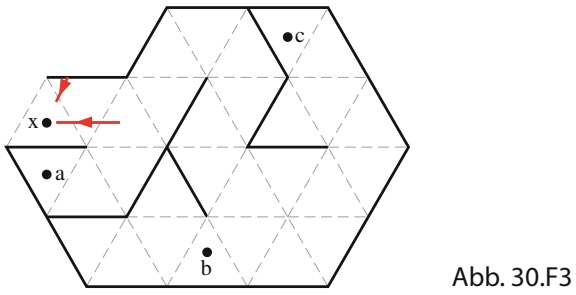

<details>
<summary>text_image</summary>

x
a
b
c
Abb. 30.F3
</details>

**4.** Ein Pinguin watschelt vom Brennpunkt eines konkaven Spiegels entlang dessen optischer Achse ins (effektiv) Unendliche. (a) Wie bewegt sich dabei sein Bild? (b) Wird das Bild immer größer, immer kleiner oder ändert sich die Grö- ße in komplizierterer Weise?
**5.** In dem Film Jurassic Park verfolgt ein Tyrannosaurus rex einen Jeep. Wir sehen das Bild des Sauriers im Rückspiegel, auf dem (mit einer Portion Galgenhumor) die wahre Aussage aufgedruckt ist: „Objekte im Spiegel sind nä- her, als sie erscheinen.“ Handelt es sich um einen konkaven, konvexen oder ebenen Spiegel?
**6.** Abbildung 30.F6 zeigt vier dünne Linsen aus demselben Material, deren Seitenflächen entweder eben oder mit einem Radius mit dem Betrag 10 cm gekrümmt sind. Ordnen Sie die Linsen in absteigender Reihenfolge nach dem Betrag der Brennweite, ohne dafür eine schriftliche Rechnung durchzuführen.


(a)


(c)


(d)

Abb. 30.F6

**7.** Vor einer dünnen, symmetrischen Sammellinse befindet sich ein Objekt. Wird die Bildweite größer, kleiner oder bleibt sie gleich, wenn wir (a) den Brechungsindex n der Linse, (b) den Betrag des Krümmungsradius der beiden Seitenflächen und (c) den Brechungsindex $n _ { \mathrm { M e d } }$ des umgebenden Mediums erhöhen? (Im letzten Fall soll $n _ { \mathrm { M e d } }$ stets kleiner bleiben als n.)

**8.** Ein konkaver Spiegel und eine Sammellinse (Glas, $n =$ 1,5) haben in Luft jeweils eine Brennweite von 3 cm. Sind die Brennweiten in Wasser (n = 1,33) größer als, kleiner als oder gleich 3 cm?
**9.** In Abb. 30.F9 sehen Sie eine Anordnung zweier dünner Linsen. Zusammenstellungen solcher Linsen mit verschiedenen Merkmalen finden Sie in der Tabelle. $( \mathrm { F } _ { 1 }$ und $\mathrm { F } _ { 2 }$ sind die Brennpunkte von Linse 1 bzw. 2.) Ein Objekt befindet sich in der Objektweite $p _ { 1 }$ links von Linse 1 (siehe Abb. Ü30.3 im Übungsbuch). (a) Für welche der angegebenen Zusammenstellungen von Linsen können Sie ohne Rechnung sagen, ob das endgültige (von Linse 2 erzeugte) Bild links oder rechts von Linse 2 entsteht und ob es aufrecht ist? (b) Geben Sie für diese Zusammenstellungen jeweils an, wo das Bild entsteht und welche Orientierung (aufrecht oder umgekehrt) es hat.

| Zusammenstellung | Linse 1 | Linse 2 |  |
| --- | --- | --- | --- |
| 1 | Sammellinse | Sammellinse | $p_{1} < f_{1}$ |
| 2 | Sammellinse | Sammellinse | $p_{1} > f_{1}$ |
| 3 | Zerstreuungslinse | Sammellinse | $p_{1} < f_{1}$ |
| 4 | Zerstreuungslinse | Sammellinse | $p_{1} > f_{1}$ |
| 5 | Zerstreuungslinse | Zerstreuungslinse | $p_{1} < f_{1}$ |
| 6 | Zerstreuungslinse | Zerstreuungslinse | $p_{1} > f_{1}$ |

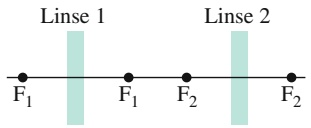

<details>
<summary>text_image</summary>

Linse 1
Linse 2
F₁ F₁ F₂ F₂
</details>

Abb. 30.F9

**10.** Die Brechung der Lichtstrahlen, die für den Sehvorgang des menschlichen Auges notwendig ist, findet zu einem großen Teil an der Hornhaut (der Grenzfläche zwischen Auge und Luft) statt. Der Brechungsindex der Hornhaut ist etwas größer als der von Wasser. (a) Werden die Lichtstrahlen stärker, schwächer oder gleichbleibend abgelenkt, wenn sich Ihr Auge (z. B. beim Baden) in Wasser anstatt in Luft befindet? (b) Der mittelamerikanische Fisch Anableps anableps kann sich gleichzeitig über und unter Wasser orientieren, denn seine Augen ragen beim Schwimmen etwas über die Wasseroberfläche hinaus. Muss der Krümmungsradius des eintauchenden Teils der Hornhaut größer als, kleiner als oder genauso groß wie der Krümmungsradius des herausragenden Teils sein, damit der Fisch in beiden Medien scharf sieht?
**11.** In Abb. 30.F11 steht das Strichmännchen O vor einem sphärischen Spiegel, der innerhalb des markierten Rechtecks aufgebaut ist. Die waagerechte Linie ist die optische Achse des Spiegels. Die vier Strichmännchen $\mathrm { B _ { 1 } }$ bis $\mathrm { B } _ { 4 }$ stellen vier mögliche Orte und Orientierungen für das vom Spiegel erzeugte Bild dar. (Es handelt sich wirklich nur um Schemazeichnungen, weder Höhe noch Abstand zum Spiegel sind maßstabsgerecht.) (a) Welches der

755

---

30 Abbildungen

B-Männchen kann auf keinen Fall ein Bild von O sein? Wel che(s) der möglichen Bilder könnte(n) (b) durch einen konkaven Spiegel und (c) durch einen konvexen Spiegel entstehen? (d) Welches Bild bzw. welche Bilder wäre(n) virtuell und (e) welche(s) würde(n) eine negative Vergrößerung bedeuten?

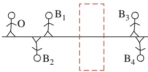

<details>
<summary>text_image</summary>

O
B₁
B₂
B₃
B₄
</details>

Abb. 30.F11

Fragen 11 und 14.

**12.** Ein Objekt wird vor dem Mittelpunkt eines konkaven Spiegels platziert und dann entlang der optischen Achse verschoben, bis es $^ { 5 , 0 }$ m vom Spiegel entfernt ist. Während dieser Bewegung wird die Distanz |i| zwischen Spiegel und Bild gemessen. Anschließend wird der ganze Vorgang mit einem konvexen und dann mit einem Planspiegel wiederholt. Abbildung 30.F12 stellt die Messergebnisse als Funktion der Objektweite p dar. Welche Kurve gehört zu welchem Spiegel? (Kurve 1 besteht aus zwei Teilstücken, Kurve 3 ist eine Gerade.)

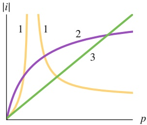

<details>
<summary>line</summary>

| Curve | Trend Description |
| --- | --- |
| 1 (Yellow) | Starts at origin, rises sharply then declines, then flattens. |
| 2 (Purple) | Starts at origin, increases steadily, and continues to rise. |
| 3 (Green) | Starts at origin, increases linearly. |
</details>

Abb. 30.F12

Fragen 12 und 13.

**13.** Ein Objekt wird vor dem Mittelpunkt einer Sammellinse platziert und dann entlang der optischen Achse verschoben, bis es 5,0 m von der Linse entfernt ist. Während dieser Bewegung wird die Distanz |i| zwischen Spiegel und Bild gemessen. Anschließend wird der ganze Vorgang mit einer Zerstreuungslinse wiederholt. Welche der Kurven in

Abb. 30.F12 zeigt |i| als Funktion der Objektweite $p$ für welche der beiden Linsen? (Kurve 1 besteht aus zwei Teilstücken, Kurve 3 ist eine Gerade.)

**14.** In Abb. 30.F11 steht das Strichmännchen O vor einer dünnen symmetrischen Linse, die sich innerhalb des markierten Rechtecks befindet; die waagerechte Linie ist die optische Achse der Linse. Die vier Strichmännchen $\mathrm { B _ { 1 } }$ bis $\mathrm { B } _ { 4 }$ stellen vier mögliche Orte und Orientierungen für das von der Linse erzeugte Bild dar. (Es handelt sich wirklich nur um Schemazeichnungen, weder Höhe noch Abstand zur Linse sind maßstabsgerecht.) (a) Welches der B-Männchen kann auf keinen Fall ein Bild von O sein? Wel che(s) der möglichen Bilder könnte(n) (b) durch eine Sammellinse und (c) durch eine Zerstreuungslinse erzeugt werden? (d) Welches Bild bzw. welche Bilder wäre(n) virtuell und (e) welche(s) würde(n) eine negative Vergrößerung bedeuten?
**15.** Abbildung 30.F15 zeigt ein Koordinatensystem vor einem ebenen Spiegel, die x-Achse zeigt senkrecht zum Spiegel in die Papierebene hinein. Zeichnen Sie das Spiegelbild des Koordinatensystems. (a) Welche Achse kehrt sich bei der Reflexion um? (b) Wenn Sie in einen Spiegel schauen, steht Ihr Bild dann auf dem Kopf? (c) Wird rechts und links vertauscht, wie gemeinhin angenommen wird? (d) Was wird denn sonst vertauscht?

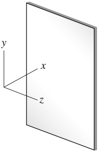

<details>
<summary>text_image</summary>

y
x
z
</details>

Abb. 30.F15

756

---

## 31 Interferenz

## 31.1 Licht als Welle

## Physikalische Motivation

Der Regenbogen beweist, dass Sonnenlicht alle Farbkomponenten des sichtbaren Spektrums enthält. Wir können die einzelnen Komponenten sehen, weil sie – entsprechend ihren Wellenlängen – beim Durchgang durch Regentropfen unterschiedlich stark gebrochen werden. Auch Seifenblasen oder ein Ölfilm auf einer Pfütze können leuchtend bunt aussehen, aber diese Farben werden nicht durch Brechung von Licht hervorgerufen, sondern durch konstruktive und destruktive **Interferenz** von Lichtwellen. Die interferierenden Wellen überlagern einander so, dass bestimmte Farbkomponenten des einfallenden Sonnenlichts entweder unterdrückt oder verstärkt werden. Die Interferenz von Lichtwellen können wir demnach als Superposition behandeln, wie wir sie bereits in Abschn. 12.5 eingeführt hatten.

Diese selektive Verstärkung oder Unterdrückung einzelner Wellenlängen wird in vielfältiger Weise praktisch angewendet. Fällt Licht zum Beispiel auf eine gewöhnliche Glasfläche, so werden rund 4 % der einfallenden Energie reflektiert; d. h., der transmittierte Strahl ist entsprechend schwächer. In optischen Systemen, die aus vielen Elementen bestehen, können sich diese unerwünschten Verluste zu einem ernsthaften Problem summieren. Eine dünne „Interferenzschicht“ auf der Glasflä- che (als Vergütung bezeichnet) kann durch destruktive Interferenz den Anteil des reflektierten Lichts herabsetzen und so den Anteil des transmittierten Lichts erhö- hen. Vergütete Kameraobjektive sind beispielsweise am bläulichen Schimmern der Linse zu erkennen. Andererseits kann man mithilfe solcher Schichten die Reflexion an Glasflächen nicht nur mindern, sondern gegebenenfalls auch steigern.

Um das Phänomen der Interferenz zu verstehen, müssen wir über die geometrische Optik hinausgehen und uns mit der Wellenoptik befassen. Gerade das Auftreten der Interferenz ist, wie wir sehen werden, der vielleicht stichhaltigste Beweis für die Wellennatur des Lichts, denn Interferenz lässt sich ausschließlich durch Wellen erklären.


## 31.1.1 Das Huygenssche Prinzip

Die erste überzeugende Wellentheorie des Lichts wurde 1678 von dem niederlän dischen Physiker Christiaan Huygens vorgelegt. Huygens’ Theorie ist zwar weniger umfassend als die später von Maxwell entwickelte Theorie des Elektromagnetismus, dafür aber mathematisch einfacher, und wird auch heute noch angewendet. Zu ihren Errungenschaften zählt, dass sie das Reflexions- und das Brechungsgesetz auf der Grundlage von Wellen erklärt und den Brechungsindex eines Materials mit der Lichtgeschwindigkeit in diesem Material verknüpft.

Halliday Physik für natur- und ingenieurwiss. Studiengänge, 3. Auflage. D. Halliday, R. Resnick und J. Walker. © 2020 WILEY-VCH Verlag GmbH & Co. KGaA. Published 2020 by WILEY-VCH Verlag GmbH & Co. KGaA.

757

---

31 Interferenz


<details>
<summary>text_image</summary>

b
d
c Δt
Wellenfront
bei t = Δt
neuer Ort der
Wellenfront
bei t = Δt
a
e
</details>

Abb. 31.1

Die Ausbreitung einer ebenen Welle im Vakuum und ihre Erklärung mithilfe des Huygensschen Prinzips.

Huygens’ Wellentheorie beruht auf einem geometrischen Verfahren, mit dessen Hilfe man aus dem momentanen Ort einer Wellenfront deren Position zu jeder zukünftigen Zeit voraussagen kann. Grundlage dieses Verfahrens ist das **Huygenssche Prinzip**:


Jeder Punkt einer Wellenfront ist Ausgangspunkt sekundärer kugelförmiger Elementarwellen. Der Ort der Wellenfront zu einer beliebigen Zeit t ergibt sich aus den Tangenten an alle diese sekundären Elementarwellen.

Betrachten wir ein einfaches Beispiel: In Abb. 31.1 sehen Sie links eine Wellenfront (dargestellt durch die zur Papierebene senkrechte Fläche ‚ab‘) einer ebenen Welle, die sich im Vakuum nach rechts ausbreitet. Wo befindet sich die Wellenfront nach der Zeit Δt? Einige (eingezeichnete) Punkte der Fläche ‚ab‘ behandeln wir als Quellen kugelförmiger sekundärer Elementarwellen, die zum Zeitpunkt $t = 0$ ausgesendet werden. Nach der Zeit $\Delta t$ ist der Radius aller dieser Elementarwellen auf cΔt angewachsen, wenn c die Lichtgeschwindigkeit im Vakuum ist. Als Tangente an die Elementarwellen zur Zeit $\Delta t$ zeichnen wir die Fläche ‚de‘. Diese Fläche entspricht der Wellenfront der ebenen Welle bei $\Delta t ;$ sie verläuft parallel zu $,ab ^{\prime}  ,$ und ihr senkrechter Abstand zu $\mathrm { , a b ^ { \prime } }$ beträgt cΔt.


<details>
<summary>text_image</summary>

einfallende Welle
λ₁
θ₁
ν₁
Luft
Glas
</details>

(a)


<details>
<summary>text_image</summary>

e
λ₁
θ₁
h
λ₂
θ₂
c
g
</details>

(b)


<details>
<summary>text_image</summary>

gebrochene Welle
λ₂
v₂
</details>

(c)

Abb. 31.2

Die Brechung einer ebenen Welle an der Grenzfläche zwischen Luft und Glas und ihre Erklärung mithilfe des Huygensschen Prinzips (ohne die reflektierte Welle). Die Wellenlänge in Glas ist kleiner als die in Luft. (a) bis (c) zeigen drei aufeinanderfolgende Zeitpunkte.

## Das Brechungsgesetz

Mithilfe des Huygensschen Prinzips wollen wir nun das Brechungsgesetz (Gl. 29.40, Snelliussches Gesetz) herleiten. Abbildung 31.2 zeigt drei Stadien der Brechung einiger Wellenfronten an einer ebenen Grenzfläche zwischen Luft (Medium 1) und Glas (Medium 2). Die Wellenfronten im einfallenden Lichtstrahl sollen den Abstand $\lambda _ { 1 }$ (die Wellenlänge in Medium 1) voneinander haben. Die Lichtgeschwindigkeit sei $\nu _ { 1 }$ in Luft und $\nu _ { 2 }$ in Glas; es gilt $\nu _ { 2 } < \nu _ { 1 }$

In Abb. 31.2a ist $\theta _ { 1 }$ der Winkel zwischen der Wellenfront und der Grenzfläche, der ebenso groß ist wie der Winkel zwischen der Normalen zur Wellenfront (also dem einfallenden Strahl) und der Normalen der Grenzfläche; $\theta _ { 1 }$ ist somit der Einfallswinkel.

Beim Eintreten der Welle in das Glas breitet sich zu einem gegebenen Zeitpunkt eine Huygenssche Elementarwelle von Punkt e nach Punkt c aus. Der Abstand zwischen e und c beträgt $\lambda _ { 1 }$ und die Welle benötigt für diese Entfernung eine Zeit $\lambda _ { 1 } / \nu _ { 1 }$ . Zur selben Zeit startet eine andere Elementarwelle von Punkt $\mathrm { h } ,$ aber mit der (kleineren) Geschwindigkeit $\nu _ { 2 }$ und der Wellenlänge $\lambda _ { 2 } ;$ sie gelangt in dem zuvor berechneten Zeitintervall daher nur bis Punkt g. Dieses Zeitintervall muss also auch gleich $\lambda _ { 2 } / \nu _ { 2 }$ sein. Wir setzen die Laufzeiten gleich und erhalten auf diese Weise

$$
\frac {\lambda_ {1}}{\lambda_ {2}} = \frac {\nu_ {1}}{\nu_ {2}}, \tag {31.1}
$$

woraus wir ablesen können, dass die Wellenlänge von Licht in einem Medium proportional zur Lichtgeschwindigkeit in diesem Medium ist.

Nach dem Huygensschen Prinzip muss die gebrochene Wellenfront (z. B. an Punkt g) tangential an einem Kreisbogen mit dem Radius $\lambda _ { 2 }$ um den Punkt h lie gen; gleichzeitig muss sie (z. B. an Punkt c) tangential an einem Bogen mit dem Radius $\lambda _ { 1 }$ um Punkt e liegen. Der daraus folgende Verlauf der Wellenfront ist in Abb. 31.2b gezeigt. Wir erkennen daraus, dass der Winkel $\theta _ { 2 }$ zwischen der gebrochenen Wellenfront und der Grenzfläche gleich dem Brechungswinkel ist.

Für die rechtwinkligen Dreiecke hce und hcg in Abb. 31.2b gilt

$$
\sin \theta_ {1} = \frac {\lambda_ {1}}{\overline {{\mathrm{hc}}}}
$$

758

---

31.1 Licht als Welle

31

und

$$
\sin \theta_ {2} = \frac {\lambda_ {2}}{\overline {{\mathrm{hc}}}}
$$

Wir teilen die obere Gleichung durch die untere und verwenden Gl. 31.1; das ergibt

$$
\frac {\sin \theta_ {1}}{\sin \theta_ {2}} = \frac {\lambda_ {1}}{\lambda_ {2}} = \frac {\nu_ {1}}{\nu_ {2}}. \tag {31.2}
$$

Nun definieren wir einen **Brechungsindex** n für jedes Medium als das Verhältnis zwischen der Lichtgeschwindigkeit im Vakuum und der Lichtgeschwindigkeit in diesem Medium, also

$$
n = \frac {c}{\nu}. \tag {31.3}
$$

Für die beiden Medien in unserem Beispiel gilt damit

$$
n _ {1} = \frac {c}{\nu_ {1}} \quad \text {und} \quad n _ {2} = \frac {c}{\nu_ {2}}. \tag {31.4}
$$

Durch Zusammenfassen der Gln. 31.2 und 31.4 erhalten wir

$$
\frac {\sin \theta_ {1}}{\sin \theta_ {2}} = \frac {c / n _ {1}}{c / n _ {2}} = \frac {n _ {2}}{n _ {1}}, \tag {31.5}
$$

was nichts anderes ist als das in Kapitel 29 eingeführte Brechungsgesetz

$$
n _ {1} \sin \theta_ {1} = n _ {2} \sin \theta_ {2}. \tag {31.6}
$$

## KONTROLLFRAGE 1

Die Abbildung zeigt einen monochromatischen Lichtstrahl, der sich von einem Medium a kommend durch zwei Medien b und c ausbreitet und schließlich wieder in Medium a eintritt; alle Grenzflächen sind parallel. Ordnen Sie die Medien in absteigender Reihenfolge nach der Geschwindigkeit, mit der sich das Licht in ihnen ausbreitet.


<details>
<summary>text_image</summary>

a
b
c
a
</details>

## Wellenlänge und Brechungsindex

Wir haben gesehen, dass sich die Wellenlänge von Licht ändert, wenn sich die Lichtgeschwindigkeit ändert, beispielsweise beim Übergang der Lichtwellen von einem Medium in ein anderes. Die Lichtgeschwindigkeit in einem Medium hängt, wie außerdem gezeigt wurde, gemäß Gl. 31.3 vom Brechungsindex des Mediums ab. Das bedeutet, dass auch die Wellenlänge des Lichts in einem Medium direkt mit dessen Brechungsindex zusammenhängt. Wir wollen nun einen monochromatischen Lichtstrahl betrachten. Im Vakuum habe er die Wellenlänge λ und die Ausbreitungsgeschwindigkeit $c ,$ in einem Medium mit dem Brechungsindex n die Wellenlänge $\lambda _ { n }$ und die Ausbreitungsgeschwindigkeit v. Gleichung 31.1 können wir dann in der Form

$$
\lambda_ {n} = \lambda \frac {\nu}{c} \tag {31.7}
$$

schreiben. Mithilfe von Gl. 31.3 substituieren wir $\nu / c$ durch $1 / n$ und erhalten so

$$
\lambda_ {n} = \frac {\lambda}{n}. \tag {31.8}
$$

Diese Gleichung gibt den Zusammenhang zwischen der Wellenlänge von Licht in einem bestimmten Medium und seiner Wellenlänge im Vakuum an: Je größer der Brechungsindex eines Mediums ist, desto kleiner ist die Wellenlänge des Lichts in diesem Medium.

759

---

31 Interferenz

Können wir einen ähnlichen Zusammenhang für die Frequenz finden? Wir be zeichnen die Frequenz von Licht in einem Medium mit dem Brechungsindex n mit $f _ { n } .$ . Aus der allgemeinen Beziehung $\nu = \lambda f$ (Gl. 12.12) folgt dann

$$
f _ {n} = \frac {\nu}{\lambda_ {n}}.
$$

Wir setzen hier die Gln. 31.3 und 31.8 ein und finden

$$
f _ {n} = \frac {c / n}{\lambda / n} = \frac {c}{\lambda} = f,
$$

wenn $f$ die Frequenz des Lichts im Vakuum bedeutet. In Worten bedeutet das: Die Geschwindigkeit und die Wellenlänge des Lichts in einem beliebigen Medium unterscheiden sich von ihren Werten im Vakuum, die Frequenzen hingegen sind gleich.

In manchen Situationen, in denen die Interferenz von Lichtwellen eine Rolle spielt, ist der durch Gl. 31.8 gegebene Zusammenhang zwischen der Wellenlänge und dem Brechungsindex von Bedeutung. Warum das so ist, illustriert Abb. 31.3. Die rot gezeichneten einfallenden Lichtstrahlen haben dieselbe Wellenlänge und sind in Phase, während sie sich zunächst in Luft $( n \approx 1 )$ ausbreiten. Der untere Strahl fällt dann durch ein Medium 1 mit dem Brechungsindex $n _ { 1 }$ und der Länge $L ,$ der obere Strahl fällt durch ein Medium 2 mit dem Brechungsindex $n _ { 2 }$ und derselben Länge L. Nachdem die Strahlen die beiden Medien verlassen haben, sind ihre Wellenlängen beide wieder gleich λ. Da ihre Wellenlängen in den Medien aber verschieden waren, sind die Wellen jetzt möglicherweise außer Phase.


<details>
<summary>text_image</summary>

n₂
n₁
L
</details>

Abb. 31.3

Zwei Lichtwellen breiten sich in Medien mit verschiedenen Brechungsindizes aus.


Die Phasendifferenz zwischen zwei Lichtwellen kann sich ändern, wenn sich die Wellen durch Medien mit verschiedenen Brechungsindizes ausbreiten.

Wie wir noch sehen werden, kann sich diese Veränderung der Phasendifferenz auf eine mögliche Interferenz der Lichtwellen auswirken, wenn sie sich später in einem Punkt treffen.

Um die Phasendifferenz nach dem Austritt aus den Medien 1 bzw. 2 zu ermitteln, zählen wir zunächst ab, wie viele Wellenlängen $N _ { 1 }$ in die Weglänge L passen, die in Medium 1 zurückgelegt wird. Aus Gl. 31.8 folgt für die Wellenlänge in Medium $1 \lambda _ { n 1 } = \lambda / n _ { 1 }$ , also ist

$$
N _ {1} = \frac {L}{\lambda_ {n 1}} = \frac {L n _ {1}}{\lambda}. \tag {31.9}
$$

Analog zählen wir die Wellenlängen $N _ { 2 } ,$ die in die im Medium 2 zurückgelegte Weglänge (ebenfalls L) passen. Hier gilt $\lambda _ { n 2 } = \lambda / n _ { 2 }$ und daher ist

$$
N _ {2} = \frac {L}{\lambda_ {n 2}} = \frac {L n _ {2}}{\lambda}. \tag {31.10}
$$

Die neue Phasendifferenz erhalten wir, indem wir den kleineren Wert $( N _ { 1 }$ oder $N _ { 2 } )$ vom größeren Wert abziehen. Für $n _ { 2 } > n _ { 1 }$ erhalten wir so

$$
N _ {2} - N _ {1} = \frac {L n _ {2}}{\lambda} - \frac {L n _ {1}}{\lambda} = \frac {L}{\lambda} (n _ {2} - n _ {1}). \tag {31.11}
$$

Nehmen wir an, Gl. 31.11 liefere uns eine Phasendifferenz von 45,6 Wellenlängen nach dem Durchgang durch die Medien. Stattdessen könnten wir auch eine von zwei phasengleichen Wellen um 45,6 Wellenlängen verschoben haben. Eine Ver schiebung um ein ganzzahliges Vielfaches (z. B. 45) der Wellenlänge ergibt jedoch wieder phasengleiche Wellen; für die Phasendifferenz sind daher ausschließlich die Nachkommastellen (0,6) von Bedeutung – eine Phasendifferenz von 45,6 Wellenlängen entspricht einer effektiven Phasendifferenz von 0,6 Wellenlängen.

760

---

31.2 Beugung am Doppelspalt

31

Bei einer Phasendifferenz von 0,5 Wellenlängen schwingen die beiden Wellen exakt gegenphasig. Wenn die Wellen außerdem dieselbe Amplitude haben und sich in einem Punkt treffen, kommt es an diesem Punkt zu vollständig destruktiver Interferenz: Die Wellen löschen einander aus, es entsteht ein dunkler Punkt. Beträgt die Phasendifferenz stattdessen 0,0 oder (gleichbedeutend) 1,0 Wellenlängen, so kommt es zu vollständig konstruktiver Interferenz: Die Wellen verstärken einander, es entsteht ein heller Punkt. Unsere angenommene Situation liegt mit einer Phasendifferenz von 0,6 Wellenlängen zwischen diesen beiden Extremen, aber nä- her an der destruktiven Interferenz. Der Treffpunkt der Wellen ist also schwach beleuchtet.

Eine Phasendifferenz können wir auch im Bogenmaß oder Grad ausdrücken, wie wir es zuvor schon getan haben. Eine Differenz von einer Wellenlänge entspricht dabei einer Differenz von 2π rad oder 360°.

## KONTROLLFRAGE 2

Angenommen, die zu den Strahlen in Abb. 31.3 gehörenden Wellen haben gleiche Wellenlängen, gleiche Amplituden und sind phasengleich. (a) In die oben zurückgelegte Weglänge passen 7,60 Wellenlängen, in die unten zurückgelegte Weglänge nur 5,60. Welches Medium hat den größeren Brechungsindex? (b) Nun sollen die Strahlen nicht parallel, sondern geringfügig gegeneinander geneigt verlaufen und sich in einem Punkt auf einem weit entfernten Schirm treffen. Ist der Treffpunkt sehr hell, recht hell, nur schwach beleuchtet oder dunkel?

## 31.2 Beugung am Doppelspalt

## Lernziele

Nach dem Durcharbeiten dieses Abschnitts sollten Sie in der Lage sein, . . .

• die Beugung von Licht an einem schmalen Spalt einschließlich der Auswirkung einer Änderung der Spaltbreite zu beschreiben,
• das Entstehen eines Interferenzmusters in einem Doppelspaltexperiment mit monochromatischem Licht zu skizzieren,
• zu verstehen, dass sich die Phasendifferenz zwischen zwei Wellen ändern kann, wenn die Wellen wie im Youngschen Experiment verschieden lange Wege zurücklegen,
• die Beziehung zwischen Weglängendifferenz ΔL und Wellenlänge λ für ein Doppelspaltexperiment anzuwenden und das Ergebnis als Interferenz zu interpretieren,
die Weglängendifferenz ΔL zweier in einem Punkt im Interferenzmuster eines Doppelspaltexperiments zusammenlaufender Strahlen durch den Spaltabstand d und den Winkel θ zur Normalen auszudrücken,
• für ein Youngsches Doppelspaltexperiment die Beziehung zwischen dem Spaltabstand d, der Lichtwellenlänge λ und dem Winkel θ von Minima (dunklen Streifen) bzw. Maxima (hellen Streifen) im Interferenzmuster anzuwenden,
• das Interferenzmuster eines Doppelspaltexperiments zu skizzieren und die verschiedenen hellen und dunklen Streifen zu benennen (z. B. „erstes Nebenmaximum“ oder „dritter Ordnung“),
• die Beziehung zwischen dem Abstand D zwischen Doppelspalt und Beobachtungsschirm, dem Winkel θ zu einem Punkt im Interferenzmuster und dem Abstand y dieses Punkts von der Mitte des Musters anzuwenden,
• an einem Doppelspalt-Interferenzmuster die Auswirkung einer Änderung von d oder λ zu beschreiben und zu verstehen, was die Winkelauflösung des Musters bestimmt,
• die Dicke bzw. den Brechungsindex eines transparenten Materials zu bestimmen, das in einem Youngschen Experiment über dem Spalt angebracht wird und eine bestimmte Verschiebung des Interferenzmusters bewirkt.


761

---

31 Interferenz


<details>
<summary>natural_image</summary>

Abstract blue and black wavy pattern with no text or symbols
</details>

Abb. 31.4

Die Beugung von Wasserwellen in einem Becken. Die Wellen werden auf der linken Seite durch eine Art schwingendes Paddel erzeugt. Auf ihrem Weg nach rechts treffen die Fronten auf ein Hindernis mit einer kleinen Öffnung, hinter der sie sich halbkreisförmig über die gesamte Wasseroberfläche ausbreiten [Quelle: George Resch/Fundamental Photographs].

Eine schematische Darstellung der Beugung von Wellen. Für eine gegebene Wellenlänge λ ist die Beugung umso stärker ausgeprägt, je kleiner die Spaltbreite a ist. Gezeigt sind Spaltbreiten von $(a) \; a = 6 , 0 \lambda ,$ (b) $a = 3 { , } 0 \lambda$ und $( \mathsf { c } ) \: a = 1 { , } 5 \lambda$ . In allen drei Fällen stehen Schirm und Spalt senkrecht zur Papierebene und reichen hinreichend weit in diese hinein bzw. aus ihr heraus.

Abb. 31.5


<details>
<summary>text_image</summary>

einfallende
Welle
λ
a
(6,0 λ)
gebeugte
Welle
Schirm
(a)
</details>

## Schlüsselideen

Im Youngschen Interferenzexperiment passiert Licht zuerst einen schmalen Einzelspalt und anschließend zwei dicht benachbarte Spalte in einer Blende, bevor es auf einen Schirm auftrifft. Das Licht wird an dem Doppelspalt gebeugt und als Folge tritt Interferenz zwischen den von den beiden Spalten ausgehenden Lichtwellen auf. Auf dem Schirm entsteht daher ein charakteristisches Streifenmuster.
• Die Bedingungen für maximale bzw. minimale Intensität sind

$$
d \sin \theta = m \lambda \quad \text {mit} \quad m = 0, 1, 2, \dots \quad \text {(Maxima, helle Streifen)}
$$

und

$$
d \sin \theta = \left(m + \frac {1}{2}\right) \lambda \quad \text {mit} \quad m = 0, 1, 2, \dots \quad (\text {Minima, dunkle Streifen})
$$

Dabei ist θ der Winkel zwischen dem Lichtweg vom Doppelspalt zu einem Punkt auf dem Schirm und der Normalen auf Spalt und Schirm; d ist der Spaltabstand.

## 31.2.1 Beugung

Im folgenden Abschnitt wollen wir das Experiment diskutieren, mit dessen Hilfe erstmals bewiesen werden konnte, dass Licht Welleneigenschaften hat. Zu diesem Zweck führen wir zunächst den Begriff der **Beugung** ein, den wir in Kapitel 32 noch wesentlich ausführlicher behandeln werden. Kurz erklärt handelt es sich um folgendes Phänomen: Trifft eine Welle auf ein Hindernis, in dem sich eine Öffnung mit einer Abmessung in der Größenordnung der Wellenlänge befindet, so breitet sich der Teil der Welle, der durch die Öffnung gelangt, dahinter in alle Richtungen im Raum aus – er wird gebeugt. Diese Ausbreitung lässt sich durch eine Konstruktion von Elementarwellen im Huygensschen Sinne (siehe Abb. 31.1) erklären. Beugung tritt nicht nur bei Lichtwellen auf, sondern bei jeder Art von Wellen. Abbildung 31.4 zeigt die Beugung von Wasserwellen an einem Hindernis in einem flachen Becken.

Abbildung 31.5 zeigt eine schematische Darstellung der Situation. Eine ebene Welle mit der Wellenlänge λ trifft auf einen Spalt mit der Breite $a = 6 { , } 0 \lambda$ , der sich senkrecht in die Papierebene hinein und aus ihr heraus erstreckt (Abb. 31.5a). Auf der Rückseite des Hindernisses breiten sich die Wellen (halb-)kreisförmig in der Papierebene aus. Abbildung 31.5b $( a = 3 { , } 0 \lambda )$ und c $\left( a = 1 { , } 5 \lambda \right)$ illustrieren ein wesentliches Merkmal des Phänomens: Je enger der Spalt ist, desto stärker wird der einfallende Strahl gebeugt.

Das Auftreten der Beugung beschränkt die Anwendbarkeit der geometrischen Optik. Dort hatten wir eine elektromagnetische Welle durch einen Strahl darge stellt; wenn wir aber versuchen, einen solchen Strahl tatsächlich zu erzeugen, indem wir Licht durch einen engen Spalt (oder mehrere solcher Spalte) schicken, so


762

---

31.2 Beugung am Doppelspalt

31


<details>
<summary>text_image</summary>

einfallende
Welle
S₀
S₂
S₁
A
B
C
Max
Max
Max
Max
Max
Max
Max
Max
Max
Max
Max
Max
Max
Max
Max
</details>

haben wir nur beschränkten Erfolg. Die Beugung sorgt stets dafür, dass sich das Licht hinter dem Spalt wieder in alle Richtungen im Raum ausbreitet – und je enger wir den Spalt machen (in der Hoffnung, einen besonders eng begrenzten Strahl zu erzeugen), desto größer wird das Ausmaß der Beugung. Die Gesetze der geometrischen Optik gelten deshalb nur, solange die Abmessungen von Spalten oder anderen im Strahlengang befindlichen Öffnungen deutlich (um Größenordnungen) größer sind als die Wellenlängen des betrachteten Lichts.

## 31.2.2 Der Doppelspaltversuch

1801 konnte Thomas Young beweisen, dass Licht – im Gegensatz zu der damals unter Naturwissenschaftlern verbreiteten Vorstellung – eine Welle ist: Er demonstrierte, dass Lichtwellen ebenso wie Wasser- oder Schallwellen oder Wellen jeder anderen Art interferieren können. Außerdem bestimmte er die mittlere Wellenlänge des Sonnenlichts mit bemerkenswerter Genauigkeit zu 570 nm (der heute akzeptierte Wert liegt bei 555 nm). Im Folgenden wollen wir Youngs Experiment als ein Beispiel für die Interferenz von Lichtwellen kennenlernen.

Das Prinzip von Youngs Anordnung ist in Abb. 31.6 gezeigt. Monochromatisches Licht aus einer entfernten Quelle fällt auf einen Spalt $S _ { 0 }$ in einem Schirm A. Beim Durchgang durch den Spalt werden die Wellen gebeugt; hinter dem Spalt breiten sie sich kreisförmig aus und fallen auf einen zweiten Schirm B mit den Spalten $S _ { 1 }$ und $\mathsf { S } _ { 2 }$ . Aus beiden Öffnungen treten hinter B wieder kreisförmige Elementarwellen aus. Die Wellen aus $S _ { 1 }$ und $\mathsf { S } _ { 2 }$ überlagern einander: Es kommt zur Interferenz.

Die Momentaufnahme in Abb. 31.6 veranschaulicht die Interferenz einander überlagernder Wellen. Um den Effekt jedoch tatsächlich sehen zu können, müssen wir das Licht hinter B auf einem dritten Schirm C auffangen. Wir erkennen dort ein Muster aus abwechselnd hellen und dunklen Interferenzstreifen (sie erstrecken sich senkrecht zur Papierebene in Abb. 31.6). Die hellen Streifen gehören zu Maxima der Interferenz (zu vollständig konstruktiver Überlagerung), die dazwischenliegenden dunklen Streifen gehören zu Minima (zu vollständig destruktiver Überlagerung). Streng genommen beziehen sich die Begriffe Maximum und Minimum hier auf die Mitte des jeweiligen Streifens. Die Anordnung heller und dunkler Streifen auf dem Schirm nennt man **Interferenzmuster**. Abbildung 31.7 zeigt einen Ausschnitt des Interferenzmusters, das man auf Schirm C in Abb. 31.6 sehen kann.

## Abb. 31.6

Der Interferenzversuch von Young. Einfallendes monochromatisches Licht wird am Spalt $\mathsf { S } _ { 0 }$ gebeugt, der als Punktquelle halbkreisförmiger Wellenfronten wirkt. Diese Wellenfronten erreichen den Schirm B und werden hier an zwei Spalten $S _ { 1 }$ und $\mathsf { S } _ { 2 }$ gebeugt, die wiederum als Punktquellen wirken. Hinter B überlagern die von $S _ { 1 }$ und $S _ { 2 }$ ausgehenden Wellen einander, es kommt zur Interferenz und auf dem Schirm C entsteht ein aus Maxima und Minima bestehendes Muster. Die Abbildung zeigt einen Querschnitt der Anordnung; Schirme, Spalte und das Interferenzmuster erstrecken sich senkrecht aus der Papierebene heraus und in sie hinein. Zwischen B und C sind halbkreisförmige Wellenfronten mit dem Mittelpunkt in $S _ { 2 }$ eingezeichnet; wäre der Spalt $\mathsf { S } _ { 1 }$ geschlossen, so wären in dieser Region nur diese Fronten vorhanden; Entsprechendes gilt für die halbkreisförmigen Fronten mit dem Mittelpunkt in $S _ { 1 }$


<details>
<summary>natural_image</summary>

A vertical row of glowing orange dots on a black background, resembling a minimalist image with no text or symbols.
</details>

## Abb. 31.7

Das Interferenzmuster, das in einer Anordnung wie der in Abb. 31.6 gezeigten auf Schirm $\mathbf { C }$ entsteht. Die abwechselnd roten und dunklen Streifen nennt man Interferenzstreifen [Quelle: Jearl Walker].

763

---

31 Interferenz

## Die Positionen der Interferenzstreifen

Im Doppelspaltversuch von Young, wie man das in Abb. 31.6 gezeigte klassische Experiment auch nennt, erzeugen Lichtwellen ein Interferenzmuster. Aber was bestimmt die Lage der einzelnen Streifen und ihre Abstände voneinander? Zur Beantwortung dieser Frage betrachten wir die Anordnung in Abb. 31.8a. Eine ebene Welle monochromatischen Lichts fällt hier auf zwei Spalte $S _ { 1 }$ und $\mathsf { S } _ { 2 }$ in einem Schirm B. An den Spalten wird das Licht gebeugt, auf dem dahinter befindlichen Schirm C entsteht ein Interferenzmuster. Als Bezugsachse zeichnen wir die Senkrechte auf $C ,$ ausgehend vom Mittelpunkt zwischen den beiden Spalten. Dann wählen wir einen beliebigen Punkt P auf $\mathsf { C } ;$ die von P ausgehende Verbindungslinie mit dem Mittelpunkt zwischen den Spalten schließt mit der Bezugsachse einen Winkel θ ein. In P treffen sich der von $S _ { 1 }$ (unten) ausgehende Strahl $\mathbf { r } _ { 1 }$ und der von $\mathsf { S } _ { 2 }$ (oben) ausgehende Strahl $\mathbf { r } _ { 2 }$

Die zu $\mathbf { r } _ { 1 }$ und $\mathbf { r } _ { 2 }$ gehörenden Wellen sind phasengleich, denn es handelt sich um Teile einer einzigen auf B auftreffenden Welle. Hinter B müssen die Wellen aber verschiedene Wege zurücklegen, um von $S _ { 1 }$ bzw. $\mathsf { S } _ { 2 }$ nach P zu gelangen. In Abschn. 13.3 war uns eine ähnliche Situation bereits mit Schallwellen begegnet; dort war unsere Schlussfolgerung:


Die Phasendifferenz zwischen zwei Wellen kann sich ändern, wenn die Wellen verschieden lange Wege zurücklegen.

Die Änderung der Phasendifferenz ist auf den Unterschied ΔL der optischen Weglängen der beiden Wellen zurückzuführen. Wir betrachten nun zwei exakt phasengleiche Wellen. Sie legen Wege zurück, deren Längen sich um $\Delta L$ unterscheiden, und treffen einander dann in einem gemeinsamen Punkt. Wenn ΔL null oder ein ganzzahliges Vielfaches der Wellenlänge ist, sind die Wellen auch an diesem Punkt noch exakt phasengleich und eine vollständig konstruktive Interferenz ist die Folge. Sofern diese Bedingung auf die in Abb. 31.8 gezeigten Strahlen $\mathbf { r } _ { 1 }$ und $\mathbf { r } _ { 2 }$ zutrifft, gehört der Punkt P zu einem hellen Streifen. Wenn ΔL hingegen ein ungeradzahliges Vielfaches einer halben Wellenlänge ist, sind die Wellen an ihrem Treffpunkt exakt gegenphasig und es kommt zu einer vollständig destruktiven Interferenz. Sofern diese Bedingung auf die Strahlen $\mathbf { r } _ { 1 }$ und $\mathbf { r } _ { 2 }$ zutrifft, gehört P zu einem dunklen Streifen. (Natürlich treten ebenso alle dazwischenliegenden Stufen der Interferenz auf – P kann also auch mäßig hell beleuchtet sein.) Wir fassen zusammen:


Ob ein bestimmter Punkt des Interferenzmusters auf dem Beobachtungsschirm des Doppelspaltversuchs von Young hell oder dunkel ist, hängt vom Weglängenunterschied ΔL der Strahlen ab, die an diesem Punkt ankommen.

Abb. 31.8

(a) Wellen, die von den (sich senkrecht zur Papierebene erstreckenden) Spalten $\mathsf { S } _ { 1 }$ und $S _ { 2 }$ ausgehen, treffen in Punkt P aufeinander. P ist ein zufällig ausgewählter Punkt auf dem Beobachtungsschirm C in einem Abstand y von der Bezugsachse. Wir geben P durch den Winkel θ an. (b) Für D ≫ d sind die Strahlen r<sub>1</sub> und $\mathbf { r } _ { 2 }$ in guter Näherung parallel; beide schließen dann den Winkel θ mit der Bezugsachse ein.


<details>
<summary>text_image</summary>

ein-fallende
Welle
S₂
S₁
b
θ
r₂
r₁
d
P
y
B
C
(a)
</details>

(b)


<details>
<summary>text_image</summary>

S₂
θ
d
θ
S₁
b
r₁
r₂
Weglängenunterschied ΔL
</details>

764

---

31.2 Beugung am Doppelspalt

31

Die Position der hellen und dunklen Streifen auf dem Schirm geben wir mithilfe des Winkels θ zwischen der Bezugsachse und dem jeweiligen Streifen an. Um θ zu erhalten, benötigen wir einen Zusammenhang zwischen diesem Winkel und $\Delta L$ Dazu wählen wir zunächst (siehe Abb. 31.8a) einen Punkt b auf dem Strahl $\mathbf { r } _ { 1 } ,$ für den die Weglänge von b zu P gleich der Weglänge von $\mathsf { S } _ { 2 }$ zu P ist. Der Weglängenunterschied $\Delta L$ zwischen den beiden Strahlen ist dann einfach der Abstand von $S _ { 1 }$ zu b.

Der exakte Zusammenhang zwischen θ und dem Abstand $\overline { { S _ { 1 } \mathrm { b } } }$ ist recht kompliziert. Wir können die Situation jedoch deutlich vereinfachen, indem wir dafür sorgen, dass der Abstand D zwischen den Spalten und Schirm C viel größer ist als der Abstand d der Spalte voneinander. In diesem Fall können wir die Strahlen $\mathbf { r } _ { 1 }$ und $\mathbf { r } _ { 2 }$ in guter Näherung als parallel betrachten; beide schließen dann den Winkel θ mit der Bezugsachse ein (Abb. 31.8b). Das Dreieck $S _ { 1 } S _ { 2 } \mathsf { b }$ nehmen wir – ebenfalls nä- herungsweise – als rechtwinklig an, und den Innenwinkel mit dem Scheitelpunkt $S _ { 2 }$ setzen wir gleich θ. Für dieses Dreieck gilt sin $\theta = \Delta L / d$ und daher

$$
\Delta L = d \sin \theta . \tag {31.12}
$$

Wie bereits bemerkt, muss ΔL gleich null oder einem ganzzahligen Vielfachen der Wellenlänge sein, wenn ein heller Streifen entstehen soll. Mithilfe von Gl. 31.12 formulieren wir diese Forderung als Bedingung für Interferenzmaxima in der Form

$$
\Delta L = d \sin \theta = \text {ganze Zahl} \cdot \lambda \tag {31.13}
$$

bzw.

$$
d \sin \theta = m \lambda \quad \text {mit} \quad m = 0, 1, 2, \dots \tag {31.14}
$$

Bei dunklen Streifen muss $\Delta L$ ein ungeradzahliges Vielfaches der halben Wellenlänge sein. Wieder mithilfe von Gl. 31.12 schreiben wir diese Bedingung für Interferenzminima in der Form

$$
\Delta L = d \sin \theta = \text {ungerade Zahl} \cdot \frac {1}{2} \lambda \tag {31.15}
$$

oder

$$
d \sin \theta = \left(m + \frac {1}{2}\right) \cdot \lambda \quad \text {mit} \quad m = 0, 1, 2, \dots \tag {31.16}
$$

Die Gln. 31.14 und 31.16 liefern uns die Winkel θ und damit die Positionen aller Streifen, die wir anhand der zugehörigen Werte von m voneinander unterscheiden. Für $m = 0$ entsteht laut Gl. 31.14 ein heller Streifen bei $\theta = 0 ,$ also auf der Bezugsachse. An diesem Hauptmaximum treffen die Wellen von beiden Spalten mit einem Weglängenunterschied $\Delta L = 0$ ein, sind also in Phase.

Für $m = 2$ finden wir gemäß Gl. 31.14 helle Streifen unter dem Winkel

$$
\theta = \sin^ {- 1} \left(\frac {2 \lambda}{d}\right)
$$

oberhalb und unterhalb der Bezugsachse. Die von den Spalten ausgehenden Wellen treffen hier mit $\Delta L = 2 \lambda$ und einer Phasendifferenz von zwei Wellenlängen ein (also einer effektiven Phasendifferenz von null). Es handelt sich um Nebenmaxima, genauer gesagt um Maxima zweiter Ordnung (wegen $m = 2 )$ , also die zweiten Maxima vom Hauptmaximum aus nach beiden Seiten gezählt (die ersten Nebenmaxima ergeben sich aus Gl. 31.14 mit $m = 1 )$ .

Zur Bestimmung der Minima wenden wir Gl. 31.16 an, z. B. mit $m = 1$ . In diesem Fall entstehen dunkle Streifen unter dem Winkel

$$
\theta = \sin^ {- 1} \left(\frac {1 , 5 \lambda}{d}\right)
$$

765

---

31 Interferenz

oberhalb und unterhalb der Bezugsachse. Hier treffen die Wellen mit einem Weglängenunterschied $\Delta L = 1 { , } 5 \lambda$ und einer Phasendifferenz von 1,5 Wellenlängen ein (also einer effektiven Phasendifferenz von 0,5 Wellenlängen). Wir nennen diese Streifen Minima zweiter Ordnung; es sind die zweiten Minima, vom Hauptmaximum aus nach beiden Seiten gezählt (die ersten Minima ergeben sich aus Gl. 31.16 mit $m = 0 )$

Wir haben die Gln. 31.14 und 31.16 unter der Bedingung $D \gg d$ hergeleitet. Sie gelten aber auch, wenn wir eine Sammellinse zwischen die Spalte und den Beobachtungsschirm bringen und diesen Schirm dann so lange bewegen, bis er den Brennpunkt der Linse enthält. (Man sagt dann, der Schirm befinde sich in der Brennebene der Linse – der Ebene senkrecht zur optischen Achse, welche den Brennpunkt enthält.) Eine Eigenschaft der Sammellinse besteht darin, alle parallel einfallenden Strahlen in einem gemeinsamen, auf der Brennebene liegenden Punkt zu fokussieren. Die Strahlen, die sich nun in einem beliebigen Punkt des Schirms (der Brennebene) treffen, müssen also exakt (nicht nur näherungsweise) parallel gewesen sein, als sie aus den Spalten austraten. Sie entsprechen den in Abb. 30.14a gezeigten parallelen Strahlen, die von einer Linse in einem Punkt (dem Brennpunkt) fokussiert werden.

## KONTROLLFRAGE 3

Geben Sie für die beiden Strahlen in Abb. 31.8a die Weglängendifferenz ΔL (als Vielfaches der Wellenlänge) und die Phasendifferenz (in Wellenlängen) an, wenn sich in P (a) ein Nebenmaximum dritter Ordnung und (b) ein Minimum dritter Ordnung befindet.

## 31.3 Interferenz und Intensität


## Lernziele

Nach dem Durcharbeiten dieses Abschnitts sollten Sie in der Lage sein, . . .

• kohärentes und inkohärentes Licht zu unterscheiden,
• Ausdrücke für die elektrischen Feldkomponenten zweier Lichtwellen, die sich in einem gemeinsamen Punkt treffen, als Funktionen der Zeit und einer Phasenkonstante anzugeben,
• zu verstehen, dass die Phasendifferenz zwischen zwei Wellen ihr Interferenzverhalten bestimmt,
die Intensität an einem bestimmten Punkt in einem Doppelspalt-Interferenzmuster als Funktion der Phasendifferenz der ankommenden Wellen anzugeben und diese Phasendifferenz mit dem Winkel θ in Beziehung zu setzen, der diesem Punkt in dem Muster entspricht,
• die resultierende Welle (Amplitude und Phasenkonstante) von zwei oder mehr Lichtwellen, die sich in einem gemeinsamen Punkt treffen, mit einem Zeigerdiagramm zu ermitteln und daraus dann die resultierende Intensität zu bestimmen,
• die Beziehung zwischen der Kreisfrequenz ω einer Lichtwelle und die der Winkelgeschwindigkeit ω des Zeigers anzuwenden, welcher diese Welle repräsentiert.


## Schlüsselideen

Damit zwei Lichtwellen in einem Punkt wahrnehmbar interferieren können, muss ihre Phasendifferenz zeitlich konstant sein, d. h., die Wellen müssen kohärent sein. Wenn zwei kohärente Wellen aufeinandertreffen, lässt sich die resultierende Intensität mithilfe von Zeigern bestimmen.
• Im Youngschen Interferenzexperiment ergeben zwei Wellen mit derselben Intensität $I _ { 0 }$ eine resultierende Welle mit der Intensität

$$
I = 4 I _ {0} \cos^ {2} \frac {\varphi}{2} \quad \text {mit} \quad \varphi = \frac {2 \pi d}{\lambda} \sin \theta .
$$

766

---

31.3 Interferenz und Intensität

31

## 31.3.1 Kohärenz

Damit auf dem Beobachtungsschirm C in Abb. 31.6 ein Interferenzmuster erscheint, darf sich die Phasendifferenz der Wellen, die in einem beliebigen Punkt P auf C eintreffen, zeitlich nicht ändern. Diese Bedingung ist in Abb. 31.6 erfüllt: Die Wellen, die durch die Spalte $S _ { 1 }$ und $\mathsf { S } _ { 2 }$ gelangen, sind Teile einer einzelnen Lichtwelle, die von vorne auf den Schirm B fällt. Weil ihre Phasendifferenz konstant bleibt, nennt man die von $S _ { 1 }$ und $\mathsf { S } _ { 2 }$ ausgehenden Wellen vollständig **kohärent**.

Direktes Sonnenlicht ist teilweise kohärent: Die Phasendifferenz von Sonnenlichtwellen, die auf zwei voneinander getrennte Punkte treffen, ist nur dann konstant, wenn diese Punkte sehr nahe beieinander liegen. Schauen Sie einmal in hellem Sonnenlicht aus kurzer Entfernung auf Ihren Fingernagel: Sie sehen ein blasses, aus Flecken bestehendes Interferenzmuster. Lichtwellen, die an dicht nebeneinander liegenden Punkten des Nagels gestreut werden, sind ausreichend kohärent, dass es im Auge zur Interferenz kommen kann. Für die Spalte in einem Doppelspaltversuch gilt dies nicht: Sie liegen so weit auseinander, dass die hindurchtretenden Wellen im direkten Sonnenlicht **inkohärent** sind. Um kohärentes Licht zu erhalten, müssen wir das Sonnenlicht zunächst wie in Abb. 31.6 durch einen Einzelspalt fallen lassen. Dieser Spalt ist so eng, dass das hindurchtretende Licht kohä- rent ist. Außerdem bewirkt der enge Spalt eine effektive Beugung des kohärenten Lichts, sodass beide Spalte in dem dahinter angeordneten Schirm beleuchtet werden.

Wir ersetzen den Doppelspalt nun durch zwei ähnliche, aber voneinander unabhängige Lichtquellen, etwa zwei Glühdrähte. Die Phasendifferenz zwischen den von ihnen emittierten Wellen ändert sich jetzt schnell und zufällig. (Der Grund dafür ist, dass das Licht von einer großen Zahl von Atomen in den Drähten emittiert wird; diese Emissionen finden zufällig, voneinander unabhängig und in extrem kurzen Zeitspannen in der Größenordnung von Nanosekunden statt.) Betrachten wir einen beliebigen Punkt auf Schirm $C ,$ so variiert die Interferenz der Wellen aus den beiden Quellen schnell und in zufälliger Weise zwischen den beiden Extremen. Unser Auge und die meisten gebräuchlichen Detektoren können solche Änderungen nicht verfolgen – wir sehen kein Interferenzmuster. Die Streifen verschwinden und der Schirm erscheint uns gleichmäßig beleuchtet.

Laser (Abschn. 36.7) unterscheiden sich von gewöhnlichen Lichtquellen unter anderem dadurch, dass hier sehr viele Atome synchronisiert Licht aussenden; diese Wellen sind kohärent. Darüber hinaus ist das emittierte Licht nahezu monochromatisch und der austretende Strahl ist sehr eng gebündelt (kollimiert) und lässt sich mit geeigneten Vorrichtungen noch weiter bis auf einen Durchmesser in der Größenordnung der Wellenlänge des Lichts fokussieren.

## 31.3.2 Die Intensitäten bei der Interferenz am Doppelspalt

Die Gln. 31.14 und 31.16 liefern uns die Orte der Maxima und Minima im Interferenzmuster am Doppelspalt als Funktion des Winkels θ (siehe Abb. 31.8). Nun wollen wir einen Ausdruck für die Intensität I der Streifen als Funktion von θ herleiten.

Das aus den Spalten austretende Licht ist in Phase. Wir wollen aber annehmen, dass die Wellen in Punkt P außer Phase ankommen. Die elektrischen Feldkomponenten der Wellen sind in P folglich gegeneinander phasenverschoben und haben daher die Form

$$
E _ {1} = E _ {0} \sin \omega t \tag {31.17}
$$

und

$$
E _ {2} = E _ {0} \sin (\omega t + \varphi), \tag {31.18}
$$

767

---

31 Interferenz

wobei ω die Kreisfrequenz der Wellen ist und 𝜑 die Phasenkonstante der Welle $E _ { 2 }$ Wie Sie bemerken werden, sind die Amplituden der Wellen identisch $( E _ { 0 } )$ und die Phasendifferenz ist gleich 𝜑. Weil die Phasendifferenz zeitlich konstant ist, sind die Wellen kohärent. Wir werden nun zeigen, dass die Intensität an dem Punkt P, an dem die Wellen einander überlagern, durch

$$
I = 4 I _ {0} \cos^ {2} \frac {\varphi}{2} \tag {31.19}
$$

mit

$$
\varphi = \frac {2 \pi d}{\lambda} \sin \theta \tag {31.20}
$$

gegeben ist.

In Gl. 31.19 beschreibt $I _ { 0 }$ die von einem Spalt ausgehende, auf dem Schirm eintreffende Intensität, wenn der andere Spalt vorübergehend abgedeckt wird. Wir gehen davon aus, dass die Spalte im Vergleich zur Wellenlänge so eng sind, dass diese von einem Spalt hervorgerufene Intensität in dem Bereich des Schirms, wo wir das Interferenzmuster beobachten wollen, nahezu gleichmäßig ist.

Die Gln. 31.19 und 31.20 geben gemeinsam an, wie die Intensität I der Streifen von dem Winkel θ in Abb. 31.8 abhängt. Dazu müssen sie offensichtlich Informationen über die Lage der Maxima und Minima enthalten. Wir wollen versuchen, diese Informationen aus den Gleichungen zu extrahieren und eigenständige Beziehungen für die Positionen der Streifen zu erhalten.

Aus Gl. 31.19 folgt für die Intensitätsmaxima

$$
\frac {1}{2} \varphi = m \pi \quad \text {mit} \quad m = 0, 1, 2, \dots \tag {31.21}
$$

Setzen wir dies in Gl. 31.20 ein, so erhalten wir

$$
2 m \pi = \frac {2 \pi d}{\lambda} \sin \theta \quad \mathrm{mit} \quad m = 0, 1, 2, \ldots
$$

oder

$$
d \sin \theta = m \lambda \quad \text {mit} \quad m = 0, 1, 2, \dots \tag {31.22}
$$

Dies entspricht exakt Gl. 31.14 für die Positionen der Maxima, die wir bereits weiter oben hergeleitet hatten.

Für die Intensitätsminima gilt

$$
\frac {1}{2} \varphi = \left(m + \frac {1}{2}\right) \pi \quad \text {mit} \quad m = 0, 1, 2, \dots
$$

Wenn wir diese Beziehung mit Gl. 31.20 zusammenfassen, gelangen wir unmittelbar zu

$$
d \sin \theta = \left(m + \frac {1}{2}\right) \lambda \quad \text {mit} \quad m = 0, 1, 2, \dots , \tag {31.23}
$$

was wir auch weiter oben für die Minima erhalten haben (Gl. 31.16).

Abbildung 31.9 zeigt die Auftragung der Intensität I eines Interferenzmusters am Doppelspalt als Funktion der Phasendifferenz der beiden Wellen beim Eintreffen

## Abb. 31.9

Auftragung der Funktion aus Gl. 31.19. Dargestellt ist die Intensität eines Interferenzmusters am Doppelspalt als Funktion der Phasendifferenz zwischen den von den Spalten ausgehenden Wellen bei der Ankunft auf dem Schirm. Wenn man einen der Spalte abdeckt, ist der Schirm homogen mit der Intensität $I _ { 0 }$ beleuchtet. Die mittlere Intensität des Streifenmusters ist $2 I _ { 0 } ,$ die maximale Intensität beträgt $4 I _ { 0 }$ (bei kohärentem Licht).


<details>
<summary>line</summary>

| \(\phi (\)Range) | Intensität auf dem Schirm (Value) |
| --- | --- |
| \(-5\pi\) ~ \(0\) | 4I0 (zwei kohärente Quellen) |
| \(0\) ~ \(5\pi\) | 2I0 (zwei inkohärente Quellen) |
| N/A | I0 (eine Quelle) |
</details>

768

---

31.3 Interferenz und Intensität

31

auf dem Schirm gemäß Gl. 31.19. Die durchgezogene waagerechte Linie entspricht $I _ { 0 } ,$ der (homogenen) Intensität, wenn einer der beiden Spalte abgedeckt wird. Wie Sie aus Gl. 31.19 und dem Graphen der Funktion entnehmen können, variiert I zwischen null (Minima) und $4 I _ { 0 }$ (Maxima).

Wenn die von den beiden Spalten ausgehenden Wellen inkohärent sind (also kei ne zeitlich konstante Phasenbeziehung zwischen ihnen besteht), so entsteht kein Interferenzmuster; der Schirm ist dann gleichmäßig mit der Intensität $2 I _ { 0 }$ ausgeleuchtet. Zu diesem Wert gehört die gestrichelte waagerechte Linie in Abb. 31.9.

Die Interferenz kann Energie natürlich nicht erschaffen oder vernichten; sie wird im Bereich des Schirms lediglich umverteilt. Die mittlere Intensität muss deshalb stets $2 I _ { 0 }$ betragen, unabhängig davon, ob die von den beiden Spalten ausgehenden Wellen kohärent sind. Dies folgt auch aus Gl. 31.19: Wenn wir hier den Mittelwert $\frac { 1 } { 2 }$ der Kosinusquadrat-Funktion einsetzen, erhalten wir gerade $I _ { \mathrm { m i t t e l } } = 2 I _ { 0 }$

## Die Herleitung der Gln. 31.19 und 31.20

Wir wollen die in den Gln. 31.17 und 31.18 angegebenen elektrischen Feldkomponenten $E _ { 1 }$ und $E _ { 2 }$ nun mithilfe von Zeigern addieren; diese Methode hatten wir bereits in Abschn. 12.6 eingeführt. In Abb. 31.10a sind die Wellen mit den Komponenten $E _ { 1 }$ und $E _ { 2 }$ durch Zeiger mit der Länge $E _ { 0 }$ dargestellt, die mit der Winkelgeschwindigkeit ω um den Ursprung rotieren. Die Beträge von $E _ { 1 }$ und $E _ { 2 }$ zu einem beliebigen Zeitpunkt sind durch die Projektionen der zugehörigen Zeiger auf die senkrechte Achse gegeben. In Abb. 31.10a sind die Zeiger und ihre Projektionen zu einem Zeitpunkt t dargestellt. In Übereinstimmung mit den Gln. 31.17 und 31.18 sind ωt der Winkel des Zeigers von $E _ { 1 }$ und (ωt + 𝜑) der Zeigerwinkel von $E _ { 2 } .$

Um die elektrischen Feldkomponenten $E _ { 1 }$ und $E _ { 2 }$ an einem beliebigen Punkt P in Abb. 31.8 zu überlagern, addieren wir die zugehörigen Zeiger vektoriell (siehe Abb. 31.10b). Der Betrag der Vektorsumme ist gleich der Amplitude E der resultierenden Welle in Punkt P, die Phasenkonstante dieser Welle ist $\beta .$ Wir wollen zunächst die Amplitude E in Abb. 31.10b ermitteln. Dazu stellen wir fest, dass die beiden mit β bezeichneten Winkel gleich groß sind, weil sie Gegenwinkel der Schenkel eines gleichschenkligen Dreiecks sind. Weiterhin wissen wir, dass ein Außenwinkel eines Dreiecks (hier $\varphi ,$ siehe Abb. 31.10b) gleich der Summe der gegenüberliegenden Innenwinkel (hier $\beta + \beta )$ ist, es gilt also $\beta = \varphi / 2$ . Somit ist

$$
\begin{array}{l} E = 2 (E _ {0} \cos \beta) \\ = 2 E _ {0} \cos \frac {1}{2} \varphi . \tag {31.24} \\ \end{array}
$$

Quadrieren dieser Gleichung ergibt

$$
E ^ {2} = 4 E _ {0} ^ {2} \cos^ {2} \frac {1}{2} \varphi . \tag {31.25}
$$

Nach Gl. 29.24 ist die Intensität einer elektromagnetischen Welle proportional zum Quadrat ihrer Amplitude. Die Wellen, die wir in Abb. 31.10b überlagern, haben jeweils die Amplitude $E _ { 0 }$ und folglich eine Intensität $I _ { 0 }$ proportional zu $E _ { 0 } ^ { 2 } ;$ die resultierende Welle mit der Amplitude E hat die Intensität $I ,$ die proportional zu $E ^ { 2 }$ ist. Also gilt

$$
\frac {I}{I _ {0}} = \frac {E ^ {2}}{E _ {0} ^ {2}}.
$$

Wir setzen hier Gl. 31.25 ein, stellen um und erhalten

$$
I = 4 I _ {0} \cos^ {2} \frac {1}{2} \varphi .
$$

Dies ist gerade Gl. 31.19, die wir herleiten wollten.


<details>
<summary>text_image</summary>

E₂
E₁
φ
ωt
E₀
E₀
ω
</details>

(a)


<details>
<summary>text_image</summary>

E₂
ω
β
E₀
φ
E
E₁
β
E₀
ωt
</details>

(b)

## Abb. 31.10

(a) Zeigerdarstellung der elektrischen Feldkomponenten aus den Gln. 31.17 und 31.18 zur Zeit t. Beide Zeiger haben die Länge $E _ { 0 }$ und rotieren mit der Winkelgeschwindigkeit ω. Ihre Phasendifferenz ist $\varphi .$ (b) Durch Vektoraddition der beiden Zeiger erhalten wir den zur resultierenden Welle (mit der Amplitude E und der Phasenkonstante $\bar { \beta ) }$ gehörenden Zeiger.

769

---

31 Interferenz

Wir wenden uns nun der Herleitung von Gl. 31.20 zu, der Beziehung zwischen der Phasendifferenz $\varphi$ der beiden in einem Punkt P auf dem Schirm eintreffenden Wellen (siehe Abb. 31.8) und dem Winkel θ, anhand dessen wir die Position dieses Punkts angeben.

Die Phasendifferenz 𝜑 in Gl. 31.18 hängt mit dem Weglängenunterschied $\overline { { S _ { 1 } \mathrm { b } } }$ in Abb. 31.8b zusammen: Für $\overline { { \mathsf { S } _ { 1 } \mathsf { b } } } = \lambda / 2$ ist $\varphi = \pi ;$ für $\overline { { S _ { 1 } \mathsf { b } } } = \lambda$ ist $\varphi = 2 \pi$ usw. Wir nehmen deshalb den folgenden Zusammenhang zwischen Phasendifferenz und Weglängenunterschied an:

$$
(\text {Phasendifferenz}) = \frac {2 \pi}{\lambda} \quad (\text {Weglängenunterschied}). \tag {31.26}
$$

Der Weglängenunterschied $\overline { { S _ { 1 } \mathrm { b } } }$ in Abb. 31.8b ist gleich d sin $\theta ;$ aus Gl. 31.26 ergibt sich daher

$$
\varphi = \frac {2 \pi d}{\lambda} \sin \theta .
$$

Dies entspricht Gl. 31.20, welche wir herleiten wollten.

## Zeigeraddition von mehr als zwei Wellen

In einem allgemeineren Fall müssen wir möglicherweise die Resultierende von mehr als zwei sinusförmig schwingenden Wellen an einem Punkt bestimmen. Dazu gehen wir folgendermaßen vor:

1. Wir konstruieren zu jeder der zu addierenden Wellen den entsprechenden Zeiger. Diese Zeiger fügen wir zusammen (jeweils Ende an Spitze), wobei wir die korrekte Phasenbeziehung zwischen benachbarten Zeigern beibehalten.
2. Nun konstruieren wir die Vektorsumme dieser Anordnung von Zeigern. Die Länge des Summenvektors gibt die Amplitude des resultierenden Zeigers an. Der Winkel zwischen dem Summenvektor und dem ersten Zeiger entspricht der Phase der Resultierenden relativ zu der des ersten Zeigers. Die Projektion des zu der Vektorsumme gehörenden Zeigers auf die senkrechte Achse liefert die zeitliche Variation der resultierenden Welle.

## KONTROLLFRAGE 4

Vier Paare von Lichtwellen (alle mit gleicher Wellenlänge) treffen einander jeweils an einem Punkt auf einem Schirm. Die Amplituden und Phasendifferenzen der jeweiligen Wellen an diesen Punkten sind $\left( \mathsf{a} \right) 2E_{0}, 6E_{0}$ und π rad, (b) $3 E _ { 0 } , 5 E _ { 0 }$ und π rad, $(c) $9 E _ { 0 } ,$ $7 E _ { 0 }$$ und 3π rad und $(d) $2 E _ { 0 } ,$ $2 E _ { 0 }$$ und 0 rad. Ordnen Sie die Paare in absteigender Reihenfolge nach der Intensität am Treffpunkt auf dem Schirm. (Hinweis: Verwenden Sie Zeigerdiagramme.)

## 31.4 Interferenz an dünnen Schichten

## Lernziele

Nach dem Durcharbeiten dieses Abschnitts sollten Sie in der Lage sein, . . .

die Vorgänge bei der Interferenz an dünnen Schichten zu skizzieren und dabei den einfallenden und die reflektierten Strahlen (der Übersichtlichkeit halber leicht schräg, obwohl sie senkrecht auf der Schicht stehen) sowie die Schichtdicke und die drei Brechungsindizes einzuzeichnen,
• zu beschreiben, unter welcher Bedingung eine Reflexion eine Phasenverschiebung verursacht, und den Wert dieser Phasenverschiebung anzugeben,
• die drei Faktoren zu nennen, die das Interferenzverhalten der reflektierten Wellen bestimmen: Phasenverschiebung durch Reflexion, Weglängendifferenz und Brechungsindex der dünnen Schicht,

770

---

31.4 Interferenz an dünnen Schichten

31

• die Phasenverschiebung durch Reflexion mit der für die reflektierte bzw. die transmittierte Welle jeweils gültigen Interferenzbedingung zu vergleichen, die den Zusammenhang zwischen Schichtdicke L, Wellenlänge λ (in Luft) und Brechungsindex n der Schicht angibt,
• zu erklären, warum eine sehr dünne (Schichtdicke viel kleiner als die Wellenlänge von sichtbarem Licht) Schicht in Luft stets dunkel ist,
die Gleichung zwischen Schichtdicke L, Wellenlänge λ (in Luft) und Brechungs index n der Schicht an beiden Enden einer dünnen keilförmigen Schicht aufzustellen und anzuwenden und anzugeben, wie viele helle und dunkle Bänder über die gesamte Länge der Schicht auftreten.

## Schlüsselideen

• Wenn Licht aus Luft auf eine dünne transparente Schicht fällt, interferieren die von der oberen und der unteren Grenzfläche reflektierten Lichtwellen. Bei nahezu senkrechtem Einfall sind die Interferenzbedingungen

$$
2 L = \left(m + \frac {1}{2}\right) \frac {\lambda}{n _ {2}} \quad \text {mit} \quad m = 0, 1, 2, \dots \quad (\text {Maxima, helle Schicht}),
$$

$$
2 L = m \frac {\lambda}{n _ {2}} \quad \text {mit} \quad m = 0, 1, 2, \dots \quad (\text {Minima, dunkle Schicht})
$$

Dabei sind L die Schichtdicke, $n _ { 2 }$ der Brechungsindex der Schicht und λ die Wellenlänge des Lichts in Luft.

• Wenn sich eine Schicht zwischen anderen Medien als Luft befindet, müssen die Gleichungen für helle und dunkle Schichten je nach den relativen Brechungsindizes möglicherweise vertauscht werden.
Wenn Licht auf eine Grenzfläche zwischen Medien mit unterschiedlichen Bre chungsindizes fällt und dabei aus dem Medium mit dem kleineren Brechungsindex kommt, erzeugt die Reflexion einen Phasensprung um π rad bzw. eine halbe Wellenlänge in der reflektierten Welle. Andernfalls gibt es keine Phasenänderung durch Reflexion. Brechung bewirkt keine Phasenänderung.

## 31.4.1 Interferenz an dünnen Schichten

Wenn die Sonne auf eine Seifenblase oder einen Ölfleck auf einer Pfütze scheint, sehen wir farbige Effekte. Diese Farben kommen durch die Interferenz von Lichtwellen zustande, die an der Vorder- und an der Rückseite einer dünnen transparenten Schicht reflektiert wurden. Die Dicke des Seifenhäutchens oder Ölfilms liegt dabei typischerweise in der Größenordnung der Wellenlänge des (sichtbaren) Lichts, welches das Phänomen hervorruft. (Wenn die Schicht dicker ist, geht die Kohärenz der beiden Lichtwellen verloren und es tritt keine Interferenz mehr auf.)

In Abb. 31.11 sehen Sie eine dünne, transparente Schicht mit der gleichmäßigen Dicke L und dem Brechungsindex $n _ { 2 } .$ Sie wird von einer weit entfernten Lichtquelle mit hellem Licht der Wellenlänge λ beleuchtet. Vorerst wollen wir annehmen, die Schicht sei auf beiden Seiten von Luft eingeschlossen, also $n _ { 1 } = n _ { 3 }$ . Der Einfachheit halber gehen wir außerdem davon aus, dass die Strahlen fast senkrecht zur Schicht einfallen $( \theta \approx 0 )$ . Wir wollen nun wissen, ob die Schicht für einen nahezu senkrecht darauf blickenden Beobachter hell oder dunkel erscheint. (Sie wundern sich, warum eine hell beleuchtete Schicht dunkel erscheinen sollte? Warten Sie unsere Diskussion ab!)

Das einfallende Licht – dargestellt durch den Strahl i – fällt von links in Punkt a auf die Vorderseite der Schicht, wo es teilweise reflektiert und teilweise gebrochen wird. Der reflektierte Strahl $\mathbf { r } _ { 1 }$ fällt ins Auge des Beobachters, der gebrochene Strahl läuft durch die Schicht bis zu Punkt b auf der rückseitigen Grenzfläche, wo er wiederum reflektiert und gebrochen wird. Das in b reflektierte Licht läuft zurück zur vorderen Grenzfläche zu Punkt c und wird dort nochmals reflektiert und


<details>
<summary>text_image</summary>

n₁
r₂
r₁
c
θ
θ
a
b
L
n₂
n₃
i
</details>

Abb. 31.11

Eine Lichtwelle, dargestellt durch den Strahl i, fällt auf eine dünne transparente Schicht der Dicke L mit dem Brechungsindex $n _ { 2 } ,$ Die Strahlen $\mathbf { r } _ { 1 }$ und $\mathbf { r } _ { 2 }$ gehören zu Lichtwellen, die an der Vorder- bzw. an der Rückseite der Schicht reflektiert wurden. (In Wirklichkeit verlaufen alle drei Strahlen nahezu senkrecht zur Schicht.) Die Interferenz der Strahlen $\mathbf { r } _ { 1 }$ und $\mathbf { r } _ { 2 }$ hängt von deren Phasendifferenz ab. Die Brechungsindizes $n _ { 1 }$ und $n _ { 3 }$ der Medien rechts und links von der Schicht müssen nicht notwendigerweise gleich sein; der Einfachheit halber nehmen wir jedoch an, es handele sich in beiden Fällen um Luft, also $n _ { 1 } = n _ { 3 } = 1 { , } 0 < n _ { 2 }$

771

---

31 Interferenz

gebrochen. Nach der Brechung verlässt ein Teil des Lichts, dargestellt durch den Strahl $\mathbf { r } _ { 2 } ,$ die Schicht und wird vom Beobachter wahrgenommen.

Wenn die Wellen von $\mathbf { r } _ { 1 }$ und $\mathbf { r } _ { 2 }$ im Auge des Beobachters exakt in Phase sind, entsteht dort ein Interferenzmaximum, und das Gebiet ac auf der Vorderseite der Schicht erscheint hell. Sind sie exakt gegenphasig, entsteht ein Interferenzminimum, und das Gebiet ac erscheint dunkel, obwohl es von der Quelle beleuchtet wird. Liegt die Phasendifferenz im mittleren Bereich, so nimmt der Beobachter das Gebiet ac mäßig hell wahr; die Interferenz liegt dort zwischen den Extremen.

Was der Beobachter sieht, hängt also von der Phasendifferenz zwischen den zu $\mathbf { r } _ { 1 }$ und $\mathbf { r } _ { 2 }$ gehörenden Wellen ab. Beide Strahlen entstehen aus dem gleichen einfallenden Strahl i; $\mathbf { r } _ { 2 }$ verlässt die Schicht jedoch erst, nachdem er sie zweimal (von a nach b und von b nach c) durchlaufen hat, während $\mathbf { r } _ { 1 }$ sofort an der ersten Grenzflä- che reflektiert wurde. Den Weglängenunterschied zwischen $\mathbf { r } _ { 1 }$ und $\mathbf { r } _ { 2 }$ können wir näherungsweise gleich 2L setzen, weil wir oben von $\theta \approx 0$ ausgegangen waren. Um die Phasendifferenz der beiden Wellen zu ermitteln, dürfen wir nun allerdings nicht einfach ausrechnen, wie viele Wellenlängen in $\Delta L$ passen. Dies hat zwei Gründe: Erstens liegt $\Delta L$ in einem anderen Medium als Luft und zweitens tritt unterwegs eine Reflexion auf, die die Phase der Wellen ändern kann.


Die Phasendifferenz zwischen zwei Wellen kann sich ändern, wenn mindestens eine von ihnen reflektiert wird.

Bevor wir also unsere Betrachtungen zur Interferenz an dünnen Schichten fortsetzen können, müssen wir uns mit den Phasenänderungen im Zuge von Reflexionen befassen.

## Phasenverschiebungen durch Reflexion

Bei der Brechung an einer Grenzfläche ändert sich die Phase der beteiligten Welle grundsätzlich nicht. Bei Reflexionen hingegen können Phasenverschiebungen auftreten, deren Betrag von den Brechungsindizes auf beiden Seiten der Grenzfläche abhängt. Abbildung 31.12 veranschaulicht solche Verschiebungen am Beispiel eines Seilwellenpulses, wobei das Seil in einem Teil dichter ist (der Puls bewegt sich hier relativ langsam) als im anderen (hier bewegt sich der Puls schneller).

Wir betrachten einen Puls, der sich relativ langsam die dichtere Hälfte des Seils entlang bewegt (Abb. 31.12a). Er erreicht die Grenze zur weniger dichten Hälfte, wo er teils durchgelassen, teils reflektiert wird; seine Orientierung ändert sich dabei nicht. Dies entspricht der Situation, dass Licht aus einem Medium mit grö- ßerem Brechungsindex in ein Medium mit kleinerem Brechungsindex eintritt. (Sie erinnern sich, dass die Ausbreitungsgeschwindigkeit mit zunehmendem n kleiner wird.) In diesem Fall ändert sich die Phase der Welle bei der Reflexion an der Grenze nicht: Die resultierende Phasenverschiebung ist null.

Nun soll der Puls die Grenze zwischen den Seilen von der weniger dichten Seilhälfte her erreichen (Abb. 31.12b). Wieder wird er teilweise transmittiert und reflektiert. Der durchgelassene Puls hat dieselbe Orientierung wie der einfallende, aber der reflektierte Puls kehrt nun seine Orientierung um. Für eine sinusförmige Welle entspricht diese Änderung einer Phasenverschiebung von π rad bzw. einer halben Wellenlänge. Die hierzu analoge Situation ist, dass eine Lichtwelle aus einem Medium mit kleinerem Brechungsindex in ein Medium mit größerem Brechungsindex (und folglich größerer Ausbreitungsgeschwindigkeit) eintritt. Auch in diesem Fall wird die Phase der Welle bei der Reflexion um π rad bzw. eine halbe Wellenlänge verschoben.

Wir fassen unsere Ergebnisse für die Phasenverschiebung bei der Reflexion von Licht zusammen in Abhängigkeit vom Brechungsindex des Mediums, an dem die Reflexion stattfindet:


Abb. 31.12

Phasenverschiebung bei der Reflexion eines Wellenpulses in einer Seilwelle an der Grenze zwischen zwei gespannten Seilen verschiedener linearer Dichte. In dem weniger dichten Seil bewegt sich der Puls schneller. (a) Der Puls kommt aus dem dichteren Seil. (b) Der Puls kommt aus dem weniger dichten Seil. Nur in diesem Fall – und nur im reflektierten Puls! – ändert sich die Phase.

772

---

31.4 Interferenz an dünnen Schichten

31

| Reflexion am Medium ... | Phasenverschiebung durch Reflexion |
| --- | --- |
| ... mit kleinerem Brechungsindex | keine |
| ... mit größerem Brechungsindex | 1/2 Wellenlänge |

Als Eselsbrücke können Sie sich merken: höherer Index – halbe Wellenlänge.

## Gleichungen für die Interferenz an dünnen Schichten

In diesem Kapitel haben wir drei Situationen kennengelernt, in denen sich die Phasenbeziehung zwischen zwei Wellen ändern kann:

1. durch Reflexion,
2. durch Unterschiede der Weglängen, die von den Wellen zurückgelegt werden, und
3. durch Unterschiede der Brechungsindizes der Medien, in denen die Wellen sich ausbreiten.

An der Reflexion von Licht an einer dünnen Schicht, bei der die in Abb. 31.11 durch die Strahlen $\mathbf { r } _ { 1 }$ und $\mathbf { r } _ { 2 }$ dargestellten Wellen entstehen, sind alle drei Faktoren beteiligt. Wir wollen diese jetzt getrennt voneinander betrachten und unsere Erkenntnisse in Tab. 31.1 zusammenfassen.

Zunächst wenden wir uns noch einmal den beiden in Abb. 31.11 gezeigten Reflexionen zu. An Punkt a wird die aus Luft einfallende Welle an einem Medium mit größerem Brechungsindex reflektiert; Strahl $\mathbf { r } _ { 1 }$ erfährt demzufolge eine Phasenverschiebung um 0,5 Wellenlängen. An Punkt b wird die aus der Schicht einfallende Welle an dem Medium mit kleinerem Brechungsindex $( \mathrm { L u f t } )$ reflektiert; die Phase der in die Schicht zurückreflektierten Welle bleibt folglich unverändert und dasselbe gilt für den Strahl $\mathbf { r } _ { 2 }$ nach seinem Austritt aus der Schicht, da er ja keine weitere Reflexion mehr erfährt. Diese Informationen tragen wir in die erste Zeile von Tab. 31.1 ein: Durch die beiden Reflexionen an der Vorder- bzw. Rückseite der dünnen Schicht ergibt sich vorerst eine Phasenverschiebung von 0,5 Wellenlängen zwischen den Strahlen $\mathbf { r } _ { 1 }$ und $\mathbf { r } _ { 2 } ,$ die Wellen schwingen also exakt gegenphasig.

Als Nächstes untersuchen wir den Weglängenunterschied; er kommt zustande, weil $\mathbf { r } _ { 2 }$ die Schicht zweimal durchläuft; in der zweiten Zeile von Tab. 31.1 notieren wir daher $\Delta L = 2 L$ . Damit $\mathbf { r } _ { 1 }$ und $\mathbf { r } _ { 2 }$ am Ende exakt in Phase sind und vollständig konstruktive Interferenz die Folge ist, muss der Weglängenunterschied von 2L folglich eine zusätzliche Phasendifferenz von $^ { 0 , 5 , 1 , 5 , 2 , 5 , . . }$ . Wellenlängen hervorrufen, denn nur dann ergibt sich insgesamt eine Phasendifferenz, die einem ganzzahligen Vielfachen der Wellenlänge entspricht. Der Beobachter sieht die Schicht folglich dann hell, wenn die Bedingung

$$
2 L = \frac {\text {ungerade Zahl}}{2} \cdot \text {Wellenlänge} \tag {31.27}
$$

erfüllt ist. Dabei ist die Wellenlänge $\lambda _ { n _ { 2 } }$ des Lichts in dem Medium einzusetzen, in dem der Weglängenunterschied 2L durchlaufen wird, also in dem Medium mit dem Brechungsindex $n _ { 2 }$ (diese Information halten wir in der dritten Zeile von

TABELLE 31.1:

Interferenz an einer dünnen Schicht in $\mathrm { L u f t ^ { a ) } }$

| Phasenverschiebung durch Reflexion | $r_{1}$: 0,5 Wellenlängen, $r_{2}$: 0 |
| --- | --- |
| Weglängenunterschied | 2L |
| Brechungsindex des Mediums, in dem $\Delta L$ entsteht | $n_{2}$ |
| Bedingung für phasengleiche Strahlen | $2L = \frac{\text{ungerade Zahl}}{2} \cdot \lambda / n_{2}$ |
| Bedingung für gegenphasige Strahlen | $2L = \text{ganze Zahl} \cdot \lambda / n_{2}$ |

a) Für $n _ { 2 } > n _ { 1 }$ und $n _ { 2 } > n _ { 3 } .$

773

---

31 Interferenz

Tab. 31.1 fest). Damit erhält Gl. 31.27 die Form

$$
2 L = \frac {\text {ungerade Zahl}}{2} \cdot \lambda_ {n _ {2}}. \tag {31.28}
$$

Sollen die Wellen hingegen exakt gegenphasig schwingen, sodass vollständig de struktive Interferenz resultiert und der Beobachter die Schicht dunkel wahrnimmt, so darf durch den Weglängenunterschied 2L entweder überhaupt keine Phasendifferenz hinzukommen oder sie muss ein ganzzahliges Vielfaches der Wellenlänge betragen. Nur dann ist die gesamte Phasenverschiebung gleich einem ungeradzahligen Vielfachen einer halben Wellenlänge. Hierfür muss die Bedingung

$$
2 L = \text { ganze   Zahl } \cdot \text { Wellenlänge } \tag {31.29}
$$

erfüllt sein, wobei wir für die Wellenlänge wieder $\lambda _ { n _ { 2 } }$ in dem Medium einsetzen müssen, in dem der Weglängenunterschied 2L tatsächlich entsteht; es gilt daher

$$
2 L = \text {ganze Zahl} \cdot \lambda_ {n _ {2}}. \tag {31.30}
$$

Für die Wellenlänge von $\mathbf { r } _ { 2 }$ innerhalb der Schicht gilt nach Gl. 31.8 $( \lambda _ { n } = \lambda / n )$

$$
\lambda_ {n _ {2}} = \frac {\lambda}{n _ {2}}, \tag {31.31}
$$

wenn λ die Wellenlänge des einfallenden Lichts im Vakuum (bzw. näherungsweise in Luft) ist. Durch Einsetzen von Gl. 31.31 in Gl. 31.28 und Ersetzen von (ungerade Zahl/2) durch $( m + 1 / 2 )$ erhalten wir somit als Bedingung dafür, dass die Schicht hell erscheint,

$$
2 L = \left(m + \frac {1}{2}\right) \frac {\lambda}{n _ {2}} \quad \text {mit} \quad m = 0, 1, 2, \dots \tag {31.32}
$$

Diese Bedingung halten wir in der vierten Zeile von Tab. 31.1 fest.

Analog ergibt sich durch Ersetzen von (ganze Zahl) durch m in Gl. 31.30 als Bedingung dafür, dass die Schicht dunkel erscheint,

$$
2 L = m \frac {\lambda}{n _ {2}} \quad \mathrm{mit} \quad m = 0, 1, 2, \dots \tag {31.33}
$$

Diese Bedingung halten wir in der letzten Zeile von Tab. 31.1 fest.

Bei gegebener Schichtdicke L können wir anhand der Gln. 31.32 und 31.33 entscheiden, bei welchen Wellenlängen des einfallenden Lichts der Beobachter die Schicht hell bzw. dunkel wahrnimmt; zu jedem m gehört dabei eine Wellenlänge. Für zwischen diesen Extremen liegende Wellenlängen erscheint die Schicht mä- ßig hell. Bei gegebener Wellenlänge λ ergibt sich umgekehrt aus den Gln. 31.32 und 31.33, wie dick die Schicht sein muss, damit sie in dem gegebenen Licht hell oder dunkel erscheint; zu jedem m gehört ein Wert für die Dicke. Für dazwischenliegende Werte erscheint die Schicht mäßig hell.

Eine spezielle Situation tritt bei besonders dünnen Schichten ein, bei denen L wesentlich kleiner wird als λ (etwa $L < 0 ,   1 \lambda )$ . Dann ist der Weglängenunterschied 2L vernachlässigbar und die Phasendifferenz zwischen $\mathbf { r } _ { 1 }$ und $\mathbf { r } _ { 2 }$ wird allein durch die Reflexion bestimmt. Angenommen, die Schicht aus Abb. 31.11, an der die Reflexionen eine Phasenverschiebung von 0,5 Wellenlängen verursachen, sei derart dünn. Dann schwingen die Wellen in den austretenden Strahlen $\mathbf { r } _ { 1 }$ und $\mathbf { r } _ { 2 }$ exakt gegenphasig und die Schicht erscheint dunkel, unabhängig von der Wellenlänge und der Intensität des einfallenden Lichts. Diese Situation entspricht $m = 0$ in Gl. 31.33. Schichtdicken mit $L < 0 ,$ 1λ betrachten wir grundsätzlich als die geringste von Gl. 31.33 erfasste Dicke, für die in Abb. 31.11 eine dunkle Schicht wahrgenommen wird (d. h., jede derartige Dicke entspricht $m = 0 )$ . Die nächstgrößere Schichtdicke, die die Schicht dunkel erscheinen lässt, entspricht dann $m = 1$

In Abb. 31.13 sehen Sie ein senkrecht stehendes Seifenhäutchen, dessen Dicke infolge der Wirkung der Schwerkraft von oben nach unten zunimmt (die Seifenlö- sung wird nach unten gezogen) und das hell beleuchtet ist. Trotzdem erscheint der

774

---

31.4 Interferenz an dünnen Schichten

31

obere Teil dunkel, weil das Häutchen dort so dünn ist. Im etwas dickeren mittleren Abschnitt sehen wir ein Muster aus Streifen, deren Farbe in erster Linie davon abhängt, bei welcher Wellenlänge (reflektiertes) Licht bei der jeweiligen Schichtdicke vollständig konstruktiv interferiert. Zum unteren (dicksten) Ende der Schicht hin werden die Streifen immer schmaler, die Farben beginnen einander zu überlagern und verblassen.

## Schmetterlingsflügel

Eine Oberfläche, deren Farbigkeit durch Interferenz an dünnen Schichten zustande kommt, irisiert (von griechisch iris, „Regenbogen“): Sie ändert ihren Farbton je nach der Blickrichtung des Beobachters. Der irisierende Glanz der Flügeloberseiten vieler Schmetterlinge entsteht durch Interferenz an dachziegelartig angeordneten, durchscheinenden Schüppchen. Die Schichten sind wie breite, flache Verzweigungen baumartiger Strukturen senkrecht zur Flügelfläche aufgebaut.

Wenn man senkrecht auf einen solchen Flügel schaut, der von oben mit weißem Licht beleuchtet wird, dann interferiert das von den Schüppchen reflektierte Licht im blaugrünen Spektralbereich vollständig konstruktiv, Licht mit Wellenlängen vom anderen Ende des sichtbaren Spektrums (rot und gelb) dagegen nur teilweise konstruktiv und erscheint deshalb schwächer. Der Flügel wirkt unter diesen Bedingungen folglich blaugrün.

Wenn man jedoch schräg auf den Flügel blickt, dann hat auch das wahrgenommene Licht die Schuppenschicht auf einem geneigten Weg durchlaufen. Vollständig konstruktive Interferenz tritt deshalb jetzt bei einer im Vergleich zu einer senkrechten Betrachtung geringfügig verschobenen Wellenlänge auf. Wenn sich der Flügel so bewegt, dass man ihn unter ständig wechselnden Winkeln sieht, verschiebt sich die intensivste Wellenlänge des reflektierten Lichts dauernd – der Farbton ändert sich, der Flügel irisiert.


<details>
<summary>natural_image</summary>

Close-up of a glass bowl with a colorful liquid layer inside, showing no text or symbols.
</details>

Abb. 31.13

Reflexion von Licht an einem Seifenhäutchen, das senkrecht in einer Drahtschleife aufgespannt ist. Der obere Teil des Häutchens ist so dünn, dass das reflektierte Licht destruktiv interferiert und die Schicht dunkel erscheint. Auf dem Rest des Häutchens erkennen wir farbige Streifen, teilweise verformt durch die Bewegung der Flüssigkeit, die durch die Schwerkraft nach unten gezogen wird [Quelle: Richard Megna/Fundamental Photographs].

## LÖSUNGSSTRATEGIEN

**Strategie 1: Gleichungen für die Interferenz an dünnen Schichten** Die Gln. 31.32 und 31.33 gelten nicht für alle Situationen der Interferenz an dünnen Schichten! Wir hatten sie nur für den Fall hergeleitet, dass in Abb. 31.11 $n _ { 2 } > n _ { 1 }$ und $n _ { 2 } > n _ { 3 }$ ist.

Entsprechende Gleichungen für andere Situationen erhalten Sie, wenn sie dem in diesem Kapitel vorgestellten schrittweisen Verfahren folgend neue Tabellen analog zu Tab. 31.1 erstellen. Im Ergebnis gelangen Sie zwar stets zu den Gln. 31.32 und 31.33, aber je nach der spezifischen Situation kann auch Gl. 31.32 die Minima und Gl. 31.33 die Maxima angeben – also genau umgekehrt wie zuvor beschrieben. Welche Gleichung für welchen Fall zutrifft, hängt von der durch die Reflexion an den beiden Grenzflächen bewirkten Phasenverschiebung ab.

## KONTROLLFRAGE 5

In den vier auf der nächsten Seite abgebildeten Situationen wird Licht senkrecht an einer dünnen Schicht der Dicke L reflektiert (siehe Abb. 31.11). Alle Brechungsindizes sind angegeben. (a) In welchen Fällen verursacht die Reflexion an der Schicht keine Phasenverschiebung zwischen den reflektierten Strahlen? (b) In welchen Fällen erscheint die Schicht einem Beobachter dunkel, wenn der Weglängenunterschied 2L eine Phasenverschiebung von 0,5 Wellenlängen hervorruft?


775

---

31 Interferenz

## 31.5 Das Michelson-Interferometer


## Lernziele

Nach dem Durcharbeiten dieses Abschnitts sollten Sie in der Lage sein, . . .

• anhand einer Skizze zu erklären, wie ein Interferometer funktioniert,
die Beziehung zwischen der Phasenänderung des Lichts (als Funktion der Wellenlänge, der Schichtdicke und des Brechungsindexes im Material) anzuwenden, wenn ein transparentes Material in den Strahlengang eines Interferometers gebracht wird,
• die Beziehung zwischen der Verschiebung des beweglichen Spiegels und der daraus resultierenden Verschiebung des Interferenzmusters anzuwenden.


## Schlüsselideen

• In einem Michelson-Interferometer wird eine Lichtwelle in zwei Teilstrahlen aufgespalten, die auf unterschiedlichen Wegen durch das Interferometer laufen und dann wieder in einem Punkt zusammengeführt werden.
• Das sich ergebende Interferenzmuster hängt von der Längendifferenz der beiden Wege sowie den Brechungsindizes entlang dieser Wege ab.
• Wenn sich ein transparentes Material mit dem Brechungsindex n und der Dicke L in einem Arm des Interferometers befindet, ist die Phasendifferenz bei Überlagerung der beiden Strahlen

$$
\text {Phasendifferenz} = \frac {2 L}{\lambda} (n - 1),
$$

wenn λ die Wellenlänge des Lichts ist.


<details>
<summary>text_image</summary>

beweglicher
Spiegel
M2
d2
P
S
M
d1
M1
T
</details>

Abb. 31.14

Das Michelson-Interferometer. Eingezeichnet ist der Weg eines Lichtstrahls, der von Punkt P auf einer ausgedehnten Quelle ausgeht. Am Spiegel M wird das Licht in zwei Teilstrahlen aufgespalten, diese werden an den Spiegeln $M _ { 1 }$ und $M _ { 2 }$ zurück zu M und dann zum Teleskop T reflektiert. Durch das Teleskop erkennt ein Beobachter ein Muster aus Interferenzstreifen.

## 31.5.1 Das Michelson-Interferometer

Mit einem **Interferometer** kann man kleinste Längen oder Längenänderungen hochpräzise messen. Das Grundprinzip besteht in der Erzeugung und Auswertung von Interferenzmustern. Wir lernen hier die klassische, von Albert A. Michelson im Jahr 1881 entwickelte und gebaute Anordnung kennen.

Betrachten wir einen Lichtstrahl (Abb. 31.14), der eine ausgedehnte Quelle S im Punkt P verlässt und auf einen Strahlteiler M trifft. Unter einem Strahlteiler versteht man einen Spiegel, der das einfallende Licht zur Hälfte durchlässt und zur Hälfte reflektiert. Der Einfachheit halber wollen wir hier annehmen, die Dicke des Spiegels sei vernachlässigbar gering. In M spaltet sich der einfallende Strahl in zwei Teilstrahlen auf. Einer von ihnen durchläuft M in Richtung des Spiegels $M _ { 1 } ,$ der andere wird zum Spiegel $M _ { 2 }$ reflektiert. An $\mathbf { M } _ { 1 }$ und $M _ { 2 }$ findet eine vollständige Reflexion statt: Beide Strahlen kehren genau auf dem Einfallsweg zurück und treten schließlich in ein Fernrohr T ein. Der Beobachter sieht ein Muster aus geraden oder leicht gekrümmten Interferenzstreifen; im letzteren Fall ähnelt das Muster der Zeichnung eines Zebras.

Wenn sich die beiden Teilstrahlen am Fernrohr wieder treffen, beträgt ihr Weglängenunterschied $2 d _ { 2 } - 2 d _ { 1 }$ . Jeder Faktor, der diese Differenz beeinflusst, verändert gleichzeitig die Phasendifferenz der beiden Wellen am Auge des Beobachters. Bewegt man zum Beispiel den Spiegel $M _ { 2 }$ um eine Strecke $\lambda / 2 ,$ so ändert sich der Weglängenunterschied um λ und das Muster verschiebt sich um einen Streifen (als ob jeder dunkle Streifen auf dem Rücken eines Zebras an die Stelle des benachbarten dunklen Streifens rückte). Eine Bewegung von $M _ { 2 }$ um $\lambda / 4$ verschiebt das Muster um einen halben Streifen (als ob jeder dunkle Streifen eines Zebras an die Stelle des benachbarten hellen Streifens rückte).

Das Streifenmuster verschiebt sich auch, wenn man ein Stückchen eines dünnen, transparenten Materials in den Strahlengang eines der Spiegel bringt, beispielsweise von Spiegel $M _ { 1 }$ . Das Material habe die Dicke L und den Brechungsindex n; in einen Hin- und Rückweg des Strahls durch das Material passen dann gemäß Gl. 31.9

776

---

31.6 Zusammenfassung

31

$N _ { m }$ Wellenlängen mit

$$
N _ {m} = \frac {2 L}{\lambda_ {n}} = \frac {2 L n}{\lambda}. \tag {31.34}
$$

In eine Luftschicht derselben Dicke (also vor dem Einfügen des zusätzlichen Mediums) passen dagegen

$$
N _ {\mathrm{L}} = \frac {2 L}{\lambda} \tag {31.35}
$$

Wellenlängen. Nachdem das transparente Material in den Strahlengang gebracht wurde, ist die Phase des von Spiegel $\mathbf { M } _ { 1 }$ zurückkehrenden Lichts folglich um

$$
N _ {m} - N _ {\mathrm{L}} = \frac {2 L n}{\lambda} - \frac {2 L}{\lambda} = \frac {2 L}{\lambda} (n - 1) \tag {31.36}
$$

Wellenlängen verschoben.

Bei jeder Phasenänderung um eine Wellenlänge verschiebt sich das Muster um einen Streifen. Man kann also die Anzahl der Streifen ermitteln, um die das Muster durch das Einfügen des Materials verschoben wird, und diese Zahl in Gl. 31.36 für $N _ { m }   -   N _ { \mathrm { L } }$ einsetzen; daraus erhält man die Dicke L des Materials (in Wellenlängen).

Dieses Verfahren ermöglicht es, die Länge von Objekten als Vielfaches der Wellenlänge des eingestrahlten Lichts anzugeben. Zu Michelsons Lebzeiten wurde noch das Urmeter als Standard der Längenmessung verwendet, eine Metallschiene mit zwei dünnen Markierungen, die in Sèvres bei Paris aufbewahrt wurde. Mithilfe seines Interferometers konnte Michelson zeigen, dass der Abstand zwischen den Markierungen – ein Meter – genau dem 1 553 163,5-Fachen der Wellenlänge einer bestimmten monochromatischen Strahlung entspricht, die von einer cadmiumhaltigen Lichtquelle ausgesendet wird. Unter anderem für diese sorgfältige Messung erhielt Michelson 1907 den Physik-Nobelpreis. Später wurden seine Arbeiten fortgesetzt, bis man 1961 ganz auf das Urmeter verzichtete und das Meter anhand der Wellenlänge einer bestimmten Strahlung definierte. 1983 erwies sich auch dieser Standard als nicht mehr exakt genug, um den gestiegenen Anforderungen von Naturwissenschaft und Technik zu entsprechen. Der seitdem gültige neue Standard beruht auf einem definierten Wert für die Lichtgeschwindigkeit.

## 31.6 Zusammenfassung

**Das Huygenssche Prinzip** Die dreidimensionale Ausbreitung von Wellen, darunter Lichtwellen, kann häufig mit hilfe des Huygensschen Prinzips erklärt werden. Es besagt, dass alle Punkte einer Wellenfront Ausgangspunkte sekundärer kugelförmiger Elementarwellen sind. Der Ort einer Wellenfront nach einer Zeit t ist durch die tangential an diesen Elementarwellen verlaufende Fläche gegeben.

Aus dem Huygensschen Prinzip kann das Brechungsgesetz abgeleitet werden. Dazu setzt man den Brechungsindex eines Mediums gleich $n = c / \nu ,$ wobei v die Lichtgeschwindigkeit in dem betreffenden Medium ist und c die Lichtgeschwindigkeit im Vakuum.

**Wellenlänge und Brechungsindex** Die Wellenlänge $\lambda _ { n }$ von Licht in einem Medium mit dem Brechungsindex n beträgt

$$
\lambda_ {n} = \frac {\lambda}{n} \tag {31.8}
$$

(λ ist die Wellenlänge des Lichts im Vakuum). Aufgrund dieses Zusammenhangs kann sich die Phasendifferenz zwischen zwei Wellen ändern, wenn die Wellen sich in Medien mit unterschiedlichen Brechungsindizes ausbreiten.

**Der Versuch von Young** Beim Doppelspaltversuch von Young fällt Licht durch einen Einzelspalt auf zwei Spalte in einem Schirm. Das aus diesen Spalten austretende Licht breitet sich infolge von Beugung in alle Richtungen aus, weshalb hinter dem Schirm Interferenz auftritt. Auf einem Beobachtungsschirm entsteht ein aus hellen und dunklen Streifen bestehendes Interferenzmuster.

Die Lichtintensität in einem beliebigen Punkt auf dem Beobachtungsschirm hängt zum Teil vom Unterschied der Weglängen ab, welche die beiden Wellen von den Spalten bis zu diesem Punkt zurückgelegt haben. Ist der Unterschied gleich einem ganzzahligen Vielfachen der Wellenlänge, so interferieren die Wellen konstruktiv, was sich als Maximum der Intensität bemerkbar macht. Ist der Unterschied gleich einem ungeradzahligen Vielfachen einer halben Wellenlänge, so kommt es zur destruktiven Interferenz, es entsteht ein Intensitätsminimum. Die Bedingun-

777

---

31 Interferenz

gen für die Maxima und Minima der Intensität sind

$$
d \sin \theta = m \lambda \quad \text {mit} \quad m = 0, 1, 2, \dots
$$

(31.14)

und

$$
d \sin \theta = \left(m + \frac {1}{2}\right) \lambda \quad \text {mit} \quad m = 0, 1, 2, \dots
$$

(31.16)

θ ist der Winkel zwischen dem Weg des Lichts und der Bezugsachse, d ist der Abstand der beiden Spalte voneinander.

**Kohärenz** Die Interferenz zweier Lichtwellen, die sich in einem Punkt treffen, kann von einem Beobachter nur registriert werden, wenn die Phasendifferenz zwischen den Wellen zeitlich konstant ist. Solche Wellen heißen **kohä- rent**. Die beim Aufeinandertreffen zweier kohärenter Wellen entstehende Intensität kann man mithilfe von Zeigerdiagrammen ermitteln.

**Intensitäten bei der Interferenz am Doppelspalt** Beim Youngschen Doppelspaltexperiment überlagern sich zwei Wellen, jeweils mit der Intensität $I _ { 0 } ,$ auf dem Beobachtungsschirm zu einer Resultierenden mit der Intensität I. Dabei gilt:

$$
I = 4 I _ {0} \cos^ {2} \frac {1}{2} \varphi \tag {31.19}
$$

mit

$$
\varphi = \frac {2 \pi d}{\lambda} \sin \theta . \tag {31.20}
$$

In dieser Beziehung sind die Gln. 31.14 und 31.16 enthalten, die die Positionen der Streifenminima und Streifenmaxima angeben.

## 31.7 Fragen

**1.** Abbildung 31.F1 zeigt drei Lichtpulse gleicher Wellenlänge, die jeweils durch eine Kunststoffschicht geschickt werden; die zugehörigen Brechungsindizes sind angegeben. Ordnen Sie die Pulse in absteigender Reihenfolge nach der Zeit, die sie zum Durchlaufen der Kunststoffschicht benötigen.


<details>
<summary>bar_stacked</summary>

| Category | Value |
| --- | --- |
| a | 1,60 |
| b | 1,50 |
| c | 1,55 |
</details>

Abb. 31.F1

**2.** Eine Lichtwelle breitet sich durch eine 1500 nm lange Nanostruktur aus. An einem Ende der Struktur befindet sich zu einem gegebenen Zeitpunkt gerade ein Wellenberg. Befindet sich dann am anderen Ende ein Wellenberg oder ein Wellental, wenn die Wellenlänge des Lichts (a) 500 nm und (b) 1000 nm beträgt?

**Interferenz an dünnen Schichten** Fällt Licht auf eine dünne Schicht eines transparenten Materials, so interferieren die an der vorderen bzw. hinteren Grenzfläche reflektierten Wellen. Bei nahezu senkrechtem Einfall lauten die Bedingungen für maximale und minimale Intensität des an der (in Luft befindlichen) Schicht reflektierten Lichts

$$
2 L = \left(m + \frac {1}{2}\right) \frac {\lambda}{n _ {2}} \quad \text {mit} \quad m = 0, 1, 2, \dots , \tag {31.32}
$$

(Maxima-Schicht erscheint hell)

$$
2 L = m \frac {\lambda}{n _ {2}} \quad \text {mit} \quad m = 0, 1, 2, \dots \tag {31.33}
$$

Hier sind $n _ { 2 }$ der Brechungsindex der Schicht, L die Schichtdicke und λ die Wellenlänge des Lichts in Luft.

Fällt Licht aus einem Medium mit kleinerem Brechungsindex auf eine Grenzfläche zu einem Medium mit größerem Brechungsindex, so verursacht die Reflexion in der reflektierten Welle eine Phasenverschiebung um π rad (bzw. eine halbe Wellenlänge). In allen anderen Fällen der Reflexion tritt keine Phasenverschiebung auf. Auch die Brechung an beliebigen Grenzflächen beeinflusst die Phase nicht.

**Das Michelson-Interferometer** Im Michelson-Interferometer wird ein Lichtstrahl in zwei Teilstrahlen aufgespal ten, welche unterschiedlich lange Wege durchlaufen und sich anschließend wieder treffen. Im Treffpunkt kommt es zur Interferenz und ein Streifenmuster ist zu beobachten. Indem man die Weglänge eines der beiden Teilstrahlen verändert, kann man sehr genaue Längenmessungen vornehmen: Man zählt die Streifen, um die sich das Interferenzmuster durch das Einfügen einer Probe in einen der Strah lengänge verändert, und kann dann die Dicke der Probe als Vielfaches der Wellenlänge des Lichts angeben.

**3.** Abbildung 31.F3 zeigt zwei Lichtstrahlen mit einer Wellenlänge von 600 nm, die an zwei 150 nm hintereinander angeordneten Glasflächen reflektiert werden. Vor der Reflexion sind die Wellen in Phase. (a) Geben Sie den Weglängenunterschied der Strahlen an. (b) Schwingen die zugehörigen Wellen exakt gleichphasig, exakt gegenphasig oder liegt die Phasenbeziehung irgendwo dazwischen, wenn die Strahlen die dargestellte Umgebung der Glasscheiben verlassen haben?


<details>
<summary>text_image</summary>

150 nm
</details>

Abb. 31.F3

778

---

31.7 Fragen

31

**4.** Abbildung 31.F4 zeigt zwei anfangs exakt phasengleiche Lichtstrahlen, die wie gezeigt an mehreren Glasflächen reflektiert werden. Die geringfügige Neigung der Strahlen rechts in der Anordnung ist zu vernachlässigen. (a) Geben Sie den Weglängenunterschied der Strahlen in Vielfachen der Strecke d an. (b) Wie groß müsste der Weglängen-

unterschied sein, damit die Strahlen exakt gegenphasig aus der Anordnung austreten? (c) Wie groß muss d mindestens sein, damit die in (b) geforderte Phasendifferenz erreicht werden kann?


<details>
<summary>text_image</summary>

d
d
d
</details>

Abb. 31.F4

**5.** Nehmen Sie an, der Weglängenunterschied der in Abb. 31.8 gezeigten Strahlen betrage (a) 2,2λ, (b) 3,5λ, (c) 1,8λ und (d) 1,0λ. Befindet sich dann in Punkt P ein Minimum, Maximum oder ein mittlerer Zustand (näher dem Minimum oder dem Maximum?) der Interferenz? Geben Sie für jeden Fall den Wert von m zu dem betreffenden Maximum oder Minimum an.
**6.** Sie schauen von einem hellen Streifen eines Zweistrahl-Interferenzmusters (am Doppelspalt) auf den nächstäuße ren hellen Streifen. (a) Nimmt der Weglängenunterschied $\Delta L$ dabei von einem zum nächsten Streifen ab oder zu? (b) Um wie viel (in Wellenlängen λ) ändert sich der Weglängenunterschied?
**7.** Nimmt der Abstand zwischen zwei Streifen in einem Interferenzmuster am Doppelspalt ab, zu oder bleibt er gleich, wenn (a) der Abstand zwischen den Spalten vergrö- ßert wird, (b) anstelle von rotem Licht blaues eingestrahlt wird, (c) die gesamte Anordnung in kochendes Wasser getaucht wird? (d) Die Spalte werden nun mit weißem Licht beleuchtet. Befindet sich in den Nebenmaxima auf beiden Seiten das Maximum der blauen oder der roten Komponente näher am Hauptmaximum?
**8.** In Abb. 31.F8 sehen Sie vier Paare von Zeigern, die je weils zwei Lichtwellen in einem Doppelspalt-Interferenzversuch darstellen. Jeder Abbildungsteil gehört zu einem bestimmten Punkt auf dem Beobachtungsschirm zu einer bestimmten Zeit. Alle Zeiger sollen gleich lang sein. Ordnen Sie die zugehörigen Punkte auf dem Schirm in absteigender Reihenfolge nach ihrer Helligkeit.


(a)


(b)


(c)


(d)

Abb. 31.F8

**9.** Abbildung 31.F9 zeigt zwei Quellen $S _ { 1 }$ und $S _ { 2 } ,$ die Radiowellen mit der Wellenlänge λ in alle Raumrichtungen emittieren. Die Quellen sind exakt in Phase, der Abstand zwischen ihnen beträgt 1,5λ. Die senkrechte Strichpunktlinie halbiert die Entfernung zwischen den Quellen. (a) Nehmen Sie an, wir bewegen uns vom angegebenen Startpunkt aus den $\mathrm { W e g }$ 1 entlang. Treffen wir dabei abwechselnd auf Interferenzmaxima und -minima, oder liegt der gesamte Weg auf einem einzigen Maximum/Minimum? Wiederholen Sie die Aufgabe für (b) Weg 2 und (c) Weg 3.


<details>
<summary>text_image</summary>

S₁
Start
1
S₂
Start
2
3
</details>

Abb. 31.F9

**10.** Abbildung 31.F10 zeigt, wie zwei Lichtstrahlen an einer Grenzfläche gebrochen und reflektiert werden. Welche der auslaufenden Wellen wurden in ihrer Phase verschoben?


<details>
<summary>text_image</summary>

n = 1,60
a
c
b
d
n = 1,50
</details>

Abb. 31.F10

**11.** In Abb. 31.F11a sehen Sie den Querschnitt einer dünnen, nach unten dicker werdenden Schicht. Abbildung 31.F11b zeigt dieselbe Schicht von vorn, während sie mit einem senkrecht einfallenden Strahl roten Lichts beleuchtet wird, wobei ein Muster aus vier hellen Streifen entsteht. Die Punkte, die helle Streifen verursachen, sind auf dem Querschnitt markiert. Geben Sie den Unterschied der Dicke der Schicht (a) zwischen den Punkten a und b und (b) zwischen den Punkten c und d an, jeweils als Vielfaches der Wellenlänge des Lichts innerhalb der Schicht.


<details>
<summary>text_image</summary>

a
b
c
d
</details>

(a)

(b)

Abb. 31.F11

**12.** Abbildung 31.F12 zeigt den Durchgang eines senkrecht einfallenden Lichtstrahls durch eine dünne, von Luft umgebene Schicht (der Strahl wurde der besseren Verständlichkeit halber geringfügig geneigt gezeichnet). (a) Ist die Phase von $\mathbf { r } _ { 3 }$ infolge der Reflexion verschoben? (b) Geben Sie die Phasenverschiebung von Strahl $\mathbf { r } _ { 4 }$ aufgrund der Reflexion als Vielfaches der Wellenlänge an. (c) Ermitteln

779

---

31 Interferenz

Sie den Weglängenunterschied zwischen $\mathbf { r } _ { 3 }$ und $\mathbf { r } _ { 4 } ,$ wenn die Dicke der Schicht gleich L ist.


<details>
<summary>text_image</summary>

einfallendes
Licht
r₄
r₃
</details>

Abb. 31.F12

**13.** In Abb. 31.F13a ist die Lichtintensität I gegen die Position x auf dem Beobachtungsschirm für den zentralen Bereich eines Doppeltspalt-Interferenzmusters aufgetragen. Die übrigen Teilabbildungen zeigen Zeigerdiagramme für die elektrischen Feldkomponenten der Lichtwellen, die von den beiden Spalten ausgehend an dem Schirm ankommen (wie in Abb. 31.10a). Welcher der fünf Punkte 1–5 gehört zu welchem Zeigerdiagramm?


<details>
<summary>line</summary>

| X | I |
| --- | --- |
| 1 | ~0.8 |
| 2 | ~0.3 |
| 3 | 0 |
| 4 | ~0.8 |
| 5 | 0 |
</details>

(a)


(b)


(c)


(d)

Abb. 31.F13

**14.** Abbildung 31.F14 zeigt vier Situationen, in denen Licht senkrecht von einer dünnen Schicht der Dicke L reflektiert wird, die sich zwischen zwei viel dickeren Materialien befindet; die drei beteiligten Brechungsindizes sind in der Ab bildung angegeben. In welchen Situationen ergibt Gl. 31.32, dass die Reflexion zu einem Maximum der reflektierten Intensität (d. h. einer hellen Schicht) führt?


(a)


(b)


(c)


(d)

Abb. 31.F14

**15.** Abbildung 31.F15 zeigt drei Situationen, in denen zwei Strahlen Sonnenlicht etwas in den Mondboden eindringen und dann wieder herausgestreut werden. Nehmen Sie an, dass die Strahlen anfänglich in Phase sind. In welcher Situation sind die zugehörigen Wellen auch am Ende in Phase? (Bei Vollmond macht die Mondhelligkeit einen plötzlichen Sprung um etwa 25 %, weil wir dann Lichtwellen empfangen, die vom Mondboden zurück in Richtung Sonne – d. h. bei Vollmond zu uns – gestreut werden und dabei konstruktiv interferieren. Bevor die ersten Astronauten auf dem Mond landeten, befürchtete die NASA, dass die Astronauten durch das vom Mondboden rückgestreute Sonnenlicht möglicherweise erblinden würden, wenn sie keinen geeigneten Blendschutz an ihren Helmen hätten.)


(a)


(b)


(c)

Abb. 31.F15

780

---

## 32 Beugung

## 32.1 Beugung am Einzelspalt

## Physikalische Motivation

Ein Schwerpunkt der physikalischen Untersuchung der Eigenschaften von Licht liegt auf der Erforschung und Anwendung von Beugungserscheinungen, wie sie an engen Spalten oder (was wir später besprechen werden) Hindernissen und Kanten auftreten können. Wir haben dieses Phänomen bereits in Kapitel 31 gestreift, als wir die Aufweitung des Lichts an den Spalten im Youngschen Interferenzexperiment bemerkt haben. Bei der Beugung an einem Spalt passiert jedoch mehr als nur eine einfache Strahlaufweitung, da das Licht auch mit sich selbst interferiert und so ein Interferenzmuster erzeugt. Aufgrund derartiger Komplikationen bietet das Licht vielfältige Anwendungsmöglichkeiten, denn obwohl die Beugung des Lichts an einem idealen Spalt oder einem rechteckigen Hindernis zunächst ausgesprochen akademisch klingt, verdienen unzählige Ingenieure und Wissenschaftler ihren Lebensunterhalt mit dieser Art von Physik, und der weltweite Umsatz mit Anwendungen von Beugungsphänomenen ist kaum zu berechnen.

Bevor wir aber einige dieser vielen Anwendungen diskutieren können, müssen wir zunächst diskutieren, wie die Beugung mit der Wellennatur des Lichts zusammenhängt.

## 32.1.1 Beugung und die Wellentheorie des Lichts

In Kapitel 31 haben wir die Beugung etwas ungenau als „Aufweitung“ des Lichts nach dem Durchgang durch eine eng begrenzte Öffnung erklärt. Ein weiterer, wesentlicher Effekt der Beugung kam dabei jedoch nicht zur Sprache: Es entsteht ein Interferenzmuster, genauer gesagt ein **Beugungsmuster**. Tritt zum Beispiel monochromatisches Licht aus einer weit entfernten Quelle (oder einem Laser) durch einen engen Spalt, so erkennt man auf einem hinter der Öffnung aufgestellten Beobachtungsschirm ein Muster ähnlich dem in Abb. 32.1 gezeigten: Zu beiden Seiten eines breiten, sehr hellen Streifens – des Hauptmaximums – befinden sich schmalere und weniger helle Nebenmaxima. Je zwei Maxima sind durch ein Minimum voneinander getrennt.

Die geometrische Optik kann das Auftreten von Beugungsmustern nicht erklä- ren: Wenn man davon ausgeht, dass Licht sich in Form von Strahlen geradlinig ausbreitet, so wäre zu erwarten, dass ein im Strahlengang befindlicher Spalt einige dieser Strahlen durchlässt; auf einem hinter dem Spalt angebrachten Beobachtungsschirm sollte man folglich ein scharfes, helles Abbild der Öffnung sehen. Die Existenz der Beugung (ebenso wie die der Interferenz in Kapitel 31) beweist, dass die geometrische Optik nur eine genährte Beschreibung der tatsächlichen Verhältnisse ist.

Beugungseffekte beobachtet man nicht nur, wenn Licht durch eine eng begrenzte Öffnung – etwa einen Spalt oder ein Nadelöhr – tritt: Auch an scharfen Kanten,


<details>
<summary>natural_image</summary>

Abstract blue vertical gradient with a bright white vertical stripe at the center (no text or symbols)
</details>

Abb. 32.1

Licht tritt durch einen engen senkrechten Spalt und fällt auf einen Beobachtungsschirm. Durch die Beugung breitet sich das Licht senkrecht zur längsten Ausdehnung des Spalts aus: Es entsteht ein Interferenzmuster aus einem breiten Hauptmaximum und schmaleren, weniger hellen Nebenmaxima; zwischen je zwei Maxima befindet sich ein Minimum [Quelle: Ken Kay/Fundamental Photographs].

Halliday Physik für natur- und ingenieurwiss. Studiengänge, 3. Auflage. D. Halliday, R. Resnick und J. Walker. © 2020 WILEY-VCH Verlag GmbH & Co. KGaA. Published 2020 by WILEY-VCH Verlag GmbH & Co. KGaA.

781

---

32 Beugung


<details>
<summary>natural_image</summary>

Abstract blue and white pattern with glowing shapes, no text or symbols present
</details>

Abb. 32.2

Beugungsmuster an einer Rasierklinge in monochromatischem Licht. Beachten Sie die linienförmigen Minima und Maxima [Quelle: Ken Kay/Fundamental Photographs].

zum Beispiel denjenigen einer Rasierklinge, wird Licht gebeugt, wie Sie in Abb. 32.2 sehen können. Wie Sie bemerken werden, verlaufen die aus Maxima und Minima bestehenden Beugungsmuster ungefähr parallel sowohl zu den Innen- als auch zu den Außenkanten der Klinge. Strahlt das Licht beispielsweise an der linken senkrechten Kante vorbei, so breitet es sich nach links und rechts aus, es kommt zur Interferenz; so entsteht das Muster entlang der linken Kante. Der äußere rechte Teil dieses Musters liegt innerhalb des (scharf begrenzten) Schattens, den wir im Rahmen der geometrischen Optik erwarten würden.

Eine alltägliche Beugungserscheinung können Sie beobachten, wenn Sie gegen helles Licht – zum Beispiel den klaren Taghimmel – schauen. Sie sehen dann häufig kleine Flecken und härchenartige Strukturen, die sich durch ihr Gesichtsfeld bewegen. Sie entstehen, wenn das Licht an den Kanten winziger Zell- und Gewebebestandteile im Glaskörper (einer durchsichtigen, den Augapfel ausfüllenden gallertartigen Substanz) gebeugt wird. Streng genommen sind es die Beugungsmuster dieser Partikel, die Sie auf Ihrer Netzhaut wahrnehmen. Wenn Sie das Licht als annähernd ebene Welle auf Ihr Auge fallen lassen (z. B. indem Sie durch ein kleines Loch in einem ansonsten undurchsichtigen Stück Pappe schauen), können Sie auf diese Weise sogar einzelne Maxima und Minima der Beugungsmuster erkennen.

## Der Poissonsche Fleck


<details>
<summary>natural_image</summary>

Abstract red concentric circle pattern with a central dark center and a small red dot at the center (no text or symbols)
</details>

Abb. 32.3

Das Beugungsmuster eines kreisrunden Hindernisses (einer Scheibe). Die konzentrischen Beugungsringe und der Poissonsche Fleck in der Mitte des Schattenbilds sind gut zu erkennen. Im Wesentlichen entspricht diese Anordnung dem Experiment, das 1819 an der Académie Française zur Überprüfung von Poissons Vorhersage ausgeführt wurde: Dort verwendete man als Hindernis eine Kugel, deren Querschnitt ebenfalls kreisförmig ist [Quelle: Jearl Walker].

Im Rahmen der Wellentheorie des Lichts ist das Phänomen der Beugung problemlos zu erklären. Trotzdem dauerte es geraume Zeit, bis diese Theorie allgemein anerkannt war. Gegen Ende des 17. Jahrhunderts ursprünglich von Huygens entwickelt und über hundert Jahre später von Young zur Erklärung der Interferenzeffekte am Doppelspalt herangezogen, musste sich die Wellentheorie vor allem gegen Newtons Auffassung von Licht als Teilchenstrom behaupten.

Als Augustin Fresnel im frühen 19. Jahrhundert als junger Ingenieur beim Militär beschäftigt war, war die Teilchenbeschreibung des Lichts unter den französischen Naturwissenschaftlern allgemein akzeptiert. Fresnel hingegen war von der Wellennatur überzeugt und reichte bei der Académie Française eine Arbeit ein, in der er seine Experimente mit Licht und ihre aus der Wellentheorie hergeleiteten Erklärungen darlegte.

Die in der Akademie stark vertretenen Anhänger Newtons beschlossen, diesen Standpunkt öffentlich zur Diskussion zu stellen. 1819 wurde zu einem Wettbewerb von Arbeiten über die Beugungstheorie aufgerufen. Fresnel gewann nach einer längeren Diskussion schließlich den ersten Preis. Siméon D. Poisson, ein überzeugter Verfechter der Teilchenbeschreibung, hatte ein merkwürdiges Resultat erhalten: Falls Fresnels Theorie korrekt war, sollten Lichtwellen so in den Schatten eines kreisförmigen Gegenstands hinein gebeugt werden, dass man im Mittelpunkt des Schattenbilds einen hellen Fleck sehen müsste. Die Jury des Wettbewerbs sorgte sofort für eine Überprüfung der Vorhersage des berühmten Mathematikers – und tatsächlich fand man den inzwischen nach seinem Entdecker benannten Poissonschen Fleck (in der angelsächsischen Literatur auch als „Fresnel bright spot“bezeichnet, Abb. 32.3). Nichts spricht so überzeugend für eine Theorie wie ein unerwarteter, der Intuition widersprechender experimenteller Beweis ihrer Voraussagen.

## 32.1.2 Beugung am Einzelspalt: Die Lage der Minima

Wir wollen nun das Beugungsmuster untersuchen, das beim Einfall ebener Licht wellen der Wellenlänge λ auf einen einzelnen, langen, engen Spalt in einem ansonsten undurchsichtigen Schirm entsteht. Den Querschnitt der Anordnung zeigt Abb. 32.4; a ist die Breite des Spalts, der sich in die Papierebene hinein und aus ihr heraus erstreckt, und die Wellenfronten treffen parallel zu B ein. Bei der An-

782

---

32.1 Beugung am Einzelspalt

32

kunft des gebeugten Lichts am Beobachtungsschirm C kommt es zur Interferenz von Wellen, die von verschiedenen Punkten innerhalb des Spalts ausgehen. Auf dem Schirm wird ein Muster aus hellen und dunklen Streifen (Interferenzmaxima bzw. -minima) sichtbar. Zur Ermittlung der Streifenpositionen gehen wir ähnlich vor wie bei der Beschreibung des Interferenzmusters am Doppelspalt (siehe Abschn. 31.2). Allerdings sind die Beugungseffekte am Einzelspalt mathematisch schwieriger zu erfassen, weshalb wir an dieser Stelle lediglich Gleichungen für die Positionen der dunklen Streifen (der Minima) herleiten werden.

Zuvor wollen wir jedoch die Entstehung des mittleren hellen Streifens in Abb. 32.1 klären. Huygenssche Elementarwellen von allen Punkten innerhalb des Spalts müssen ungefähr die gleiche Weglänge durchlaufen, bis sie in der Mitte des Musters angekommen sind; folglich sind alle diese Wellen dort in Phase. Für alle anderen hellen Streifen können wir nur aussagen, dass sie etwa in der Mitte zwischen zwei benachbarten dunklen Streifen liegen.

Um die dunklen Streifen zu finden, benutzen wir, etwas vereinfachend, einen kleinen Trick: Wir fassen die aus dem Spalt austretenden Strahlen paarweise zusammen und überlegen dann, unter welchen Bedingungen die Elementarwellen der beiden Strahlen einander auslöschen. Mithilfe dieser Strategie ermitteln wir in Abb. 32.4a $\mathrm { P } _ { 1 }$ als Position des ersten dunklen Streifens. Dazu teilen wir den Spalt zunächst gedanklich in zwei gleich breite Abschnitte $( a / 2 )$ . Dann verlängern wir sowohl den Strahl $\mathbf { r } _ { 1 } ,$ der von der Oberkante des oberen Abschnitts ausgeht, als auch den Strahl $\mathbf { r } _ { 2 } ,$ der von der Oberkante des unteren Abschnitts ausgeht, bis zu $\mathrm { P } _ { 1 } .$ Abschließend verbinden wir die Mitte des Spalts durch eine Bezugsachse mit dem Beobachtungsschirm, wodurch wir die Position von $\mathrm { P } _ { 1 }$ anhand des Winkels θ bezüglich dieser Achse angeben können.

Die Elementarwellen zu den Strahlen $\mathbf { r } _ { 1 }$ und $\mathbf { r } _ { 2 }$ befinden sich innerhalb des Spalts in Phase, denn sie gehören zu ein und derselben Wellenfront, die über dessen ganze Breite durch den Spalt tritt. Damit der erste dunkle Streifen entstehen kann, müssen die beiden Wellen $\mathrm { P } _ { 1 }$ aber exakt gegenphasig (mit einer Phasenverschiebung von $\lambda / 2 )$ erreichen; diese Phasendifferenz kann nur durch einen Weglängenunterschied entstehen (der Weg von $\mathbf { r } _ { 1 }$ bis $\mathrm { P } _ { 1 }$ ist kürzer als der von $\mathbf { r } _ { 2 } )$ . Um diesen Weglängenunterschied darzustellen, suchen wir auf $\mathbf { r } _ { 2 }$ einen Punkt b, für den die Entfernung $\overline { { \mathrm { b P _ { 1 } } } }$ gerade der Länge von $\mathbf { r } _ { 1 }$ entspricht. Der Weglängenunterschied zwischen $\mathbf { r } _ { 1 }$ und $\mathbf { r } _ { 2 }$ ist dann durch den Abstand des Punkts b vom Mittelpunkt des Spalts (der Oberkante der unteren Hälfte) gegeben.

Wenn sich der Beobachtungsschirm $\mathbf { C }$ nahe an Schirm B befindet, lässt sich das Beugungsmuster auf C nur schwer mathematisch beschreiben. Wir können uns die Arbeit aber beträchtlich erleichtern, wenn wir den Abstand D zwischen den


<details>
<summary>text_image</summary>

einfallende
Welle
D
vollständig
destruktive
Interferenz
r₁
P₁
r₂
b
θ
Bezugsachse
P₀
B
Beobachtungsschirm
C
</details>

(a)


<details>
<summary>text_image</summary>

r₁
θ
a/2
θ
b
θ
r₂
Weglängenunterschied
</details>

(b)

## Abb. 32.4

(a) Wellen, die von den oberen Enden zweier Spaltabschnitte mit einer Breite von jeweils $a / 2$ ausgehen, interferieren im Punkt $\mathrm { P _ { 1 } }$ auf dem Beobachtungsschirm C vollständig destruktiv. (b) Für D ≫ a können wir $\mathbf { r } _ { 1 }$ und $\mathbf { r } _ { 2 }$ näherungsweise als parallel betrachten; beide Strahlen schließen mit der Bezugsachse den Winkel θ ein.

783

---

32 Beugung


<details>
<summary>text_image</summary>

einfallende
Welle
B
r1
r2
r3
r4
a/4
a/4
a/4
a/4
D
P2
P1
P0
C
</details>

(a)


<details>
<summary>text_image</summary>

r₁
θ
r₂
Weglängen-
unterschied
zwischen r₁ und r₂
r₃
θ
a/4
a/4
r₄
θ
a/4
r₄
weglängen-
unterschied
zwischen r₃ und r₄
(b)
</details>

Abb. 32.5

(a) Wellen, die von den oberen Enden der vier Spaltabschnitte (jeweils mit der Breite $a / 4 )$ ausgehen, interferieren in $\mathrm { P } _ { 2 }$ vollständig destruktiv. (b) Für $D \gg$ a können wir $\mathbf { r } _ { 1 } , \mathbf { r } _ { 2 } ,$ $\mathbf { r } _ { 3 }$ und $\mathbf { r } _ { 4 }$ näherungsweise als parallel betrachten; alle schließen mit der Bezugsachse den Winkel θ ein.

Schirmen viel größer wählen als die Spaltbreite a. Die Strahlen $\mathbf { r } _ { 1 }$ und $\mathbf { r } _ { 2 }$ sind dann näherungsweise parallel und schließen beide einen Winkel θ mit der Bezugsachse ein (Abb. 32.4b). Das von Punkt $^ \mathrm { b , }$ dem Mittelpunkt des Spalts und dessen oberer Begrenzung gebildete Dreieck können wir als rechtwinklig ansehen (mit θ als einem der Innenwinkel). So erhalten wir für den Weglängenunterschied zwischen $\mathbf { r } _ { 1 }$ und $\mathbf { r } _ { 2 }$ (also den Abstand zwischen dem Mittelpunkt des Spalts und b) den Wert $( a / 2 )$ sin θ.

Für jedes Paar von Strahlen, die von einander entsprechenden Punkten (etwa von den Mittelpunkten) der beiden Abschnitte ausgehen und $\mathrm { P } _ { 1 }$ erreichen, können wir nun analog vorgehen. Zu jedem solchen Strahlenpaar finden wir dann den Weglängenunterschied $( a / 2 )$ sin θ. Wir setzen diesen für alle Paare gleich großen Unterschied gleich $\lambda / 2$ (unsere Bedingung für das Auftreten des ersten dunklen Streifens):

$$
\frac {a}{2} \sin \theta = \frac {\lambda}{2}.
$$

Daraus erhalten wir für das erste Minimum im Beugungsmuster

$$
a \sin \theta = \lambda . \tag {32.1}
$$

Bei gegebener Spaltbreite $\alpha$ und Wellenlänge λ liefert Gl. 32.1 den Winkel $\theta ,$ unter dem (aus Symmetriegründen oberhalb und unterhalb der Bezugsachse) der erste dunkle Streifen entsteht.

Beginnen wir mit $\alpha > \lambda$ und lassen den Spalt bei konstanter Wellenlänge immer schmaler werden, dann wird der Winkel $\theta ,$ unter dem der erste dunkle Streifen erscheint, immer größer; das bedeutet, das Ausmaß der Beugung (die Ausdehnung des Beugungsmusters) ist umso größer, je schmaler der Spalt ist. Erreicht die Spaltbreite schließlich die Wellenlänge $( \alpha = \lambda )$ , so ist $\theta = 9 0 ^ { \circ } -$ da die beiden ersten Minima dann auf dem Schirm quasi im Unendlichen verschwinden, muss das zwischen ihnen liegende erste Maximum den gesamten Schirm einnehmen.

Um den zweiten dunklen Streifen oberhalb und unterhalb der Bezugsachse zu lokalisieren, gehen wir analog vor. Allerdings teilen wir den Spalt jetzt in vier Abschnitte gleicher Breite $( a / 4 )$ , wie in Abb. 32.5a gezeigt ist. Die oberen Enden der Abschnitte verbinden wir durch die Strahlen $\mathbf { r } _ { 1 } ,   \mathbf { r } _ { 2 } ,   \mathbf { r } _ { 3 }$ und $\mathbf { r } _ { 4 }$ mit dem Punkt $\mathrm { P } _ { 2 } ,$ der die Position des zweiten dunklen Streifens angibt. Damit in $\mathrm { P } _ { 2 }$ vollständig destruktive Interferenz auftritt, müssen die Weglängenunterschiede zwischen $\mathbf { r } _ { 1 }$ und $\mathbf { r } _ { 2 } ,$ zwischen $\mathbf { r } _ { 2 }$ und $\mathbf { r } _ { 3 }$ sowie zwischen $\mathbf { r } _ { 3 }$ und $\mathbf { r } _ { 4 }$ sämtlich gleich $\lambda / 2$ sein.

Für $D \gg a$ können wir die vier Strahlen näherungsweise als parallel betrachten; sie alle schließen mit der Bezugsachse den Winkel θ ein. Die Weglängenunterschiede stellen wir dar, indem wir je zwei benachbarte Strahlen durch eine Linie senkrecht zum Strahlenverlauf verbinden (Abb. 32.5b); so entstehen drei rechtwinklige Dreiecke, deren eine Seite jeweils dem Weglängenunterschied entspricht. Aus dem obersten Dreieck entnehmen wir für den Weglängenunterschied zwischen $\mathbf { r } _ { 1 }$ und $\mathbf { r } _ { 2 }$ den Wert $( a / 4 )$ sin $\theta ;$ das unterste Dreieck liefert denselben Unterschied zwischen $\mathbf { r } _ { 3 }$ und $\mathbf { r } _ { 4 } .$ Zu jedem Paar von Strahlen, die von einander entsprechenden Punkten in benachbarten Abschnitten ausgehen, ergibt sich genau dieser Weglängenunterschied von $( a / 4 )$ sin $\theta ,$ der gleich $\lambda / 2$ sein muss, damit unsere Bedingung für destruktive Interferenz erfüllt ist. Es muss also

$$
\frac {a}{4} \sin \theta = \frac {\lambda}{2}
$$

gelten, woraus für das zweite Minimum im Beugungsmuster folgt

$$
a \sin \theta = 2 \lambda . \tag {32.2}
$$

Die Positionen weiterer dunkler Streifen finden wir, indem wir den Spalt sukzessive in immer mehr Abschnitte gleicher Breite aufteilen und wie gezeigt vorgehen. Dabei wählen wir stets eine gerade Anzahl von Abschnitten, um die Strahlen (und

784

---

32.2 Intensitäten bei der Beugung am Einzelspalt

32

die zugehörigen Wellen) paarweise behandeln zu können. So ergibt sich für die Position des m-ten Minimums im Beugungsmuster der allgemeine Ausdruck

$$
a \sin \theta = m \lambda \quad \text {mit} \quad m = 1, 2, 3, \dots \tag {32.3}
$$

Damit Sie sich diese Beziehung besser einzuprägen können, zeichnen Sie ein Drei eck wie in Abb. 32.4b, aber für die gesamte Spaltbreite a. Der Weglängenunterschied zwischen den Strahlen, die von der oberen bzw. unteren Kante des Spalts ausgehen, ist dann gleich a sin θ, und Gl. 32.3 besagt:


Beugungsmuster am Einzelspalt zeigen Minima, wenn der Weglängenunterschied a sin θ zwischen dem von der oberen und dem von der unteren Kante des Spalts ausgehenden Strahl gleich λ, 2λ, 3λ, … ist.

Auf den ersten Blick könnte man diese Aussage für falsch halten, weil sich die Wellen zu den beiden genannten Strahlen ja gerade exakt in Phase befinden, wenn ihr Weglängenunterschied einem ganzzahligen Vielfachen der Wellenlänge entspricht. Es gibt aber zu jeder der beiden Wellen einen exakt gegenphasigen Partner, daher wird jede Welle von einer anderen ausgelöscht und es entsteht ein dunkler Streifen.

Wir haben die Gln. 32.1–32.3 unter der Bedingung D ≫ a hergeleitet. Wir können sie aber auch anwenden, wenn wir eine Sammellinse zwischen den Spalt und den Beobachtungsschirm bringen und den Schirm verschieben, bis er in der Brennebene der Linse liegt. Die Strahlen, die sich jetzt in einem beliebigen Punkt auf dem Schirm treffen, sind in diesem Fall exakt (nicht nur näherungsweise) parallel aus dem Spalt ausgetreten. Sie sind vergleichbar mit den Parallelstrahlen, die in Rich tung des Brennpunkts einer Sammellinse umgelenkt werden (siehe Abb. 30.14a).

## KONTROLLFRAGE 1

Ein langer, schmaler Spalt wird mit blauem Licht beleuchtet. Auf einem hinter dem Spalt liegenden Schirm entsteht ein Beugungsmuster. Wird die Ausdehnung dieses Musters größer oder kleiner (d. h., bewegen sich die Minima und Maxima von der Mitte des Musters weg oder auf dieses zu), wenn (a) gelbes Licht anstelle des blauen verwendet oder (b) die Spaltbreite verringert wird?

## 32.2 Intensitäten bei der Beugung am Einzelspalt

## Lernziele

Nach dem Durcharbeiten dieses Abschnitts sollten Sie in der Lage sein, . . .

einen dünnen Spalt gedanklich in eine Ansammlung von vielen Streifen gleicher Breite aufzuteilen und dann einen Ausdruck für die Phasendifferenz der von benachbarten Streifen ausgehenden Wellen als Funktion des Winkels θ zu einem Punkt auf dem Beobachtungsschirm anzugeben,
für die Beugung am Einzelspalt Zeigerdiagramme für das zentrale Maximum und einige Minima und Maxima auf jeder Seite zu zeichnen und dabei die Phasendifferenz zwischen benachbarten Zeigern anzugeben, zu erklären, wie das resultierende elektrische Feld zu berechnen ist, und jeweils die zugehörigen Bereiche im Beugungsmuster zu markieren,
• das resultierende elektrische Feld an bestimmten Stellen im Beugungsmuster zu beschreiben,
• die Größe α zu berechnen, die den Zusammenhang zwischen einem Winkel θ zu einem Punkt im Beugungsmuster und der Intensität I an diesem Punkt beschreibt,
• für einen gegebenen Punkt in einem Beugungsmuster, d. h. einen gegebenen Beugungswinkel, die Intensität I als Funktion der Intensität $I _ { \mathrm { m } }$ in der Mitte des Beugungsmusters zu ermitteln.


785

---

32 Beugung


## Schlüsselideen

• Die Intensität des Beugungsmusters bei einem Winkel θ ist

$$
I (\theta) = I _ {\mathrm{m}} \left(\frac {\sin \alpha}{\alpha}\right) ^ {2}.
$$

Dabei ist $I _ { \mathrm { m } }$ die Intensität in der Mitte des Beugungsmusters und es gilt

$$
\alpha = \frac {\pi a}{\lambda} \sin \theta .
$$

## 32.2.1 Intensitäten bei der Beugung am Einzelspalt: Eine qualitative Betrachtung

In Abschn. 32.1 haben wir die Positionen der Maxima und Minima von Beugungsmustern ermittelt, die am Einzelspalt entstehen. Nun wenden wir uns einem allgemeineren Problem zu, nämlich der Intensität I des Musters als Funktion des Winkels $\theta ,$ anhand dessen wir die Position eines Punkts auf dem Beobachtungsschirm angeben.

Wir teilen dazu den Spalt in Abb. 32.4a zunächst in N Abschnitte gleicher Breite $\Delta x ;$ dabei soll Δx hinreichend klein sein, damit wir jeden Abschnitt als Quelle sekundärer Huygensscher Elementarwellen ansehen können. Die Elementarwellen, die in einem beliebigen Punkt P (unter dem zugehörigen Winkel $\theta )$ auf dem Beobachtungsschirm eintreffen, wollen wir nun überlagern und die Amplitude $E _ { \theta }$ der elektrischen Feldkomponente der resultierenden Welle in P bestimmen. Die Intensität des Lichts in diesem Punkt ist dann proportional zum Quadrat dieser Amplitude.

Zur Berechnung von $E _ { \theta }$ benötigen wir die Phasenbeziehungen zwischen den eintreffenden Elementarwellen. Die Phasendifferenz zwischen zwei von benachbarten Abschnitten des Spalts ausgehenden Elementarwellen ist

$$
(\text {Phasendifferenz}) = \left(\frac {2 \pi}{\lambda}\right) \quad (\text {Weglängenunterschied}).
$$

Für einen Punkt P unter dem Winkel θ beträgt der Weglängenunterschied zwischen Elementarwellen benachbarter Abschnitte $\Delta x$ sin $\theta ;$ für die Phasendifferenz Δ𝜑 dieser Wellen gilt demzufolge

$$
\Delta \varphi = \left(\frac {2 \pi}{\lambda}\right) (\Delta x \sin \theta). \tag {32.4}
$$

## Abb. 32.6

Zeigerdiagramme für $N = 1 8 ; \mathrm { d . h }$ h. für eine Unterteilung des Spalts in 18 gleich große Abschnitte. Dargestellt sind die resultierenden Amplituden für (a) das Hauptmaximum mit $\theta = 0 ,$ (b) einen Punkt auf dem Schirm unter einem kleinen Winkel θ bezüglich der Achse, (c) das erste Minimum und (d) das erste Nebenmaximum.

Wir nehmen nun $\mathbf { a n } ,$ dass alle in P ankommenden Elementarwellen dieselbe Am plitude $\Delta E$ haben. Die Amplitude $E _ { \theta }$ der Resultierenden in P erhalten wir dann durch Zeigeraddition aller Amplituden ΔE in diesem Punkt. Dazu konstruieren wir ein Diagramm mit N Zeigern, jeweils einen zu jedem Abschnitt des Spalts.

An dem Punkt $\mathrm { P _ { 0 } }$ mit $\theta = 0$ (auf der Bezugsachse) in Abb. 32.4a ist die Phasendifferenz Δ𝜑 zwischen den Elementarwellen nach Gl. 32.4 null: Alle Elementarwellen treffen phasengleich ein. Das zugehörige Zeigerdiagramm sehen Sie in Abb. 32.6a.


786

---

32.2 Intensitäten bei der Beugung am Einzelspalt

32

Benachbarte Zeiger gehören zu Elementarwellen, die von benachbarten Abschnitten des Spalts ausgehen. Die Zeiger wurden fortlaufend (Ende an Spitze) aneinandergereiht. Da die Phasendifferenz der Elementarwellen null ist, ist auch der Winkel zwischen benachbarten Zeigern null. Die Amplitude $E _ { \theta }$ in $\mathrm { P } _ { 0 }$ ergibt sich als Vektorsumme all dieser Zeiger. Wie sich herausstellt, ist $E _ { \theta }$ für $\theta = 0$ (also den hier beschriebenen Fall) am größten. Wir nennen diesen Maximalwert $E _ { \mathrm { m } }$

Wir betrachten nun einen Punkt P unter einem kleinen, aber von null verschiedenen Winkel θ zur Bezugsachse. Ein Blick auf Gl. 32.4 zeigt, dass die Phasendifferenz $\Delta \varphi$ der Elementarwellen aus benachbarten Abschnitten dann nicht mehr null ist. In Abb. 32.6b ist das zugehörige Zeigerdiagramm dargestellt; wieder wurden die Zeiger fortlaufend angeordnet, aber der Winkel $\Delta \varphi$ zwischen aneinanderstoßenden Zeigern ist ungleich null. Auch hier ergibt sich die Amplitude $E _ { \theta }$ als Vektorsumme aller Zeiger, wir erhalten jedoch einen kleineren Wert als für $\theta = 0$ (Abb. 32.6a). Die Intensität des Lichts ist in P demnach geringer als in $\mathbf { P } _ { 0 } .$

Je größer wir nun θ wählen, desto größer wird auch der Winkel $\Delta \varphi$ zwischen benachbarten Zeigern. Die Kette der Zeiger krümmt sich daher immer stärker und schließt sich schließlich zum Kreis (Abb. 32.6c). In diesem Fall ist die resultierende Amplitude $E _ { \theta }$ null und der Punkt auf dem Schirm folglich dunkel: Wir haben den ersten dunklen Streifen, das erste Minimum des Beugungsmusters erreicht. Die Phasendifferenz zwischen dem ersten und dem letzten Zeiger ist gleich 2π rad, d. h., der Weglängenunterschied zwischen dem von der oberen und dem von der unteren Kante ausgehenden Strahl entspricht gerade einer Wellenlänge – wir erinnern uns, dass das genau unsere Bedingung für das Auftreten des ersten Beugungsminimums war.

Vergrößern wir θ über diesen Punkt hinaus, so nimmt $\Delta \varphi$ noch weiter zu. Die Zeigerkette bildet nun eine Spirale (Abb. 32.6d), die sich immer stärker zusammenzieht. Die Amplitude nimmt dabei wieder zu und erreicht bei der in Abb. 32.6d dargestellten Anordnung einen maximalen Wert, der dem ersten Nebenmaximum im Beugungsmuster entspricht.

Wenn θ weiter zunimmt, nimmt $E _ { \theta }$ wieder ab (die Spirale schrumpft); die Intensität in dem zugehörigen Punkt ist kleiner als am ersten Nebenmaximum. Das zweite Minimum ist erreicht, wenn die Spitze des letzten Zeigers wieder mit dem Ende des ersten Zeigers zusammentrifft.

Dieses qualitative Verfahren zur Lokalisierung der Maxima und Minima im Beugungsmuster ließe sich beliebig fortsetzen. Statt dies zu tun, wollen wir nun jedoch eine quantitative Methode kennenlernen.

## KONTROLLFRAGE 2

Die Abbildung zeigt zwei Zeigerdiagramme analog zu Abb. 32.6 (die Kurven sind hier glatter, weil mehr Zeiger verwendet wurden). Sie gehören zu zwei Punkten auf entgegengesetzten Seiten eines Maximums in einem Beugungsmuster. (a) Um welches Maximum handelt es sich? (b) Welcher Wert von m (siehe Gl. 32.3) gehört ungefähr zu diesem Maximum?


## 32.2.2 Intensitäten bei der Beugung am Einzelspalt: Eine quantitative Betrachtung

Gleichung 32.3 liefert uns die Minima im Beugungsmuster eines Einzelspalts auf einem Beobachtungsschirm C als Funktion des in Abb. 32.4a eingezeichneten Winkels θ. Wir wollen nun einen Ausdruck für die Intensität $I ( \theta )$ in Abhängigkeit von diesem Winkel herleiten. Wie weiter unten bewiesen werden soll, ist gilt für die Intensität

$$
I (\theta) = I _ {\mathrm{m}} \left(\frac {\sin \alpha}{\alpha}\right) ^ {2} \tag {32.5}
$$

787

---

32 Beugung


<details>
<summary>line</summary>

| \(\theta (\)Grad) | Relative Intensität |
| --- | --- |
| 20 | ~0.68 |
| 15 | ~0.83 |
| 10 | ~0.94 |
| 5 | ~0.99 |
| 0 | 1.0 |
| 5 | ~0.99 |
| 10 | ~0.94 |
| 15 | ~0.83 |
| 20 | ~0.68 |
</details>

(a)


<details>
<summary>line</summary>

| \(\theta (\)Grad) | Relative Intensität |
| --- | --- |
| -20 | ~0.05 |
| -15 | ~0.08 |
| -10 | ~0.05 |
| -5 | ~0.45 |
| 0 | 1.0 |
| 5 | ~0.45 |
| 10 | ~0.05 |
| 15 | ~0.08 |
| 20 | ~0.05 |
</details>

(b)


<details>
<summary>line</summary>

| \(\theta (\)Grad) | Relative Intensität |
| --- | --- |
| -20 | ~0.01 |
| -15 | ~0.03 |
| -10 | ~0.08 |
| -5 | ~0.01 |
| 0 | 1.0 |
| 5 | ~0.01 |
| 10 | ~0.08 |
| 15 | ~0.03 |
| 20 | ~0.01 |
</details>

(c)

Abb. 32.7

Relative Intensitäten bei der Beugung am Einzelspalt für drei Werte des Verhältnisses $a / \lambda$ . Das Hauptmaximum wird umso schmaler, je breiter der Spalt ist.


<details>
<summary>text_image</summary>

α
α
φ
R
R
Eθ
Em
φ
Em
</details>

Abb. 32.8

Die Konstruktion zur Berechnung der Intensitäten bei der Beugung am Einzelspalt. Die gezeigte Situation entspricht Abb. 32.7b.

mit

$$
\alpha = \frac {1}{2} \varphi = \frac {\pi a}{\lambda} \sin \theta . \tag {32.6}
$$

Die Hilfsgröße α ist einfach eine praktische Verbindung zwischen dem Winkel θ, anhand dessen wir die Position eines Punkts auf dem Beobachtungsschirm festlegen, und der Intensität $I _ { \mathrm { m } }$ des Lichts in diesem Punkt. Der Maximalwert $I _ { \mathrm { m } }$ der Intensität $I ( \theta )$ in diesem Muster entspricht dem Hauptmaximum (mit $\theta = 0 ) ;$ 𝜑 ist die Phasendifferenz (im Bogenmaß) zwischen Strahlen, die von der oberen bzw. der unteren Kante des Spalts mit der Breite a ausgehen.

Nach Gl. 32.5 gilt für die Intensitätsminima

$$
\alpha = m \pi \quad \text {mit} \quad m = 1, 2, 3, \dots \tag {32.7}
$$

Setzen wir dies in Gl. 32.6 ein, so erhalten wir als Bedingung für Minima im Beugungsmuster

$$
m \pi = \frac {\pi a}{\lambda} \sin \theta \quad \text {mit} \quad m = 1, 2, 3, \dots
$$

oder

$$
a \sin \theta = m \lambda \quad \text {mit} \quad m = 1, 2, 3, \dots \tag {32.8}
$$

Dieser Ausdruck entspricht exakt der zuvor hergeleiteten Gl. 32.3.

Abbildung 32.7 zeigt Intensitäten von Beugungsmustern an Einzelspalten, die mithilfe der Gln. 32.5 und 32.6 berechnet wurden, für Spalte mit den Breiten $\alpha = \lambda _ { i }$ $\alpha = 5 \lambda$ und $a = 1 0 \lambda$ . Man erkennt, dass die Breite des Hauptmaximums (des mittleren Maximums der gezeigten Kurven) mit zunehmender Spaltbreite (relativ zur Wellenlänge) abnimmt; das Ausmaß der Beugung wird also umso geringer, je breiter die Öffnung ist. Gleichzeitig wird auch das zweite Nebenmaximum schmaler und weniger intensiv. Wenn die Spaltbreite groß gegen die Wellenlänge des einstrahlenden Lichts ist, verschwindet das zweite Nebenmaximum und wir können nicht mehr von Beugung am Einzelspalt sprechen. (Stattdessen beobachten wir dann Beugungsmuster, die an den Kanten der Öffnung entstehen wie an der Rasierklinge in Abb. 32.2.)

## Herleitung der Gln. 32.5 und 32.6

Der aus Zeigern zusammengesetzte Bogen in Abb. 32.8 stellt die Elementarwellen dar, die einen beliebigen Punkt P auf dem Beobachtungsschirm in Abb. 32.4 erreichen; der zu P gehörende Winkel θ ist klein, aber von null verschieden. Die Ampli tude $E _ { \theta }$ der Resultierenden in P ergibt sich als Vektorsumme der Zeiger. Wenn wir den Spalt in Abb. 32.4 in infinitesimale Abschnitte mit der Breite Δx teilen, nähert sich die Anordnung der Zeiger in Abb. 32.8 einem Kreisbogen an, dessen Radius wir wie in der Abbildung mit R bezeichnen. Die Länge des Bogens muss gleich $E _ { \mathrm { m } }$ sein, der Amplitude in der Mitte des Beugungsmusters: Würden wir den Bogen „gerade biegen“, so ergäbe sich die Anordnung aus Abb. 32.6a (in Abb. 32.8 ganz unten angedeutet).

Der Winkel 𝜑 im unteren Teil von Abb. 32.8 gibt die Phasendifferenz zwischen den (infinitesimalen) Zeigern ganz links und ganz rechts in dem Bogen $E _ { \mathrm { m } }$ an. Aus geometrischen Überlegungen folgt, dass 𝜑 gleichzeitig dem Winkel zwischen den mit R bezeichneten Radien entspricht. Die gestrichelte Linie teilt 𝜑 in zwei gleiche Teile, wodurch zwei kongruente Dreiecke entstehen. Für jedes von ihnen gilt

$$
\sin \frac {1}{2} \varphi = \frac {E _ {\theta}}{2 R}. \tag {32.9}
$$

Im Bogenmaß entspricht dies (unter der Annahme, dass $E _ { \mathrm { m } }$ ein Kreisbogen ist) einem Winkel

$$
\varphi = \frac {E _ {\mathrm{m}}}{R}.
$$

788

---

32.3 Beugung an einer kreisrunden Öffnung

32

Das lösen wir nach R auf und setzen den Ausdruck in Gl. 32.9 ein; so erhalten wir

$$
E _ {\theta} = \frac {E _ {\mathrm{m}}}{\frac {1}{2} \varphi} \sin \left(\frac {1}{2} \varphi\right). \tag {32.10}
$$

Aus Abschn. 29.2 wissen wir, dass die Intensität einer elektromagnetischen Welle proportional zum Quadrat der Amplitude ihres elektrischen Felds ist. In unserem Fall bedeutet das, dass die maximale Intensität $I _ { \mathrm { m } }$ (im Hauptmaximum) proportional zu $E _ { \mathrm { m } } ^ { 2 }$ ist und die Intensität $I ( \theta )$ bei einem Winkel θ proportional zu $\overline { { E _ { \theta ^ { \prime } } ^ { 2 } } }$ Wir können also schreiben

$$
\frac {I (\theta)}{I _ {\mathrm{m}}} = \frac {E _ {\theta} ^ {2}}{E _ {\mathrm{m}} ^ {2}}. \tag {32.11}
$$

Hier setzen wir $E _ { \theta }$ aus Gl. 32.10 sowie $\begin{array} { r } { \alpha = \frac { 1 } { 2 } \varphi . } \end{array}$ ein und erhalten für die Intensität als Funktion von θ

$$
I (\theta) = I _ {\mathrm{m}} \left(\frac {\sin \alpha}{\alpha}\right) ^ {2}.
$$

Damit haben wir Gl. 32.5 hergeleitet.

Jetzt wollen wir noch den Zusammenhang zwischen α und θ nachprüfen, also Gl. 32.6. Die Phasendifferenz 𝜑 zwischen zwei Strahlen, die von der oberen bzw. von der unteren Kante des Spalts ausgehen, lässt sich mithilfe von Gl. 32.4 als

$$
\varphi = \left(\frac {2 \pi}{\lambda}\right) (a \sin \theta)
$$

schreiben, wobei a die Summe aller Breiten Δx unserer infinitesimalen Abschnitte ist. Mit $\varphi = 2 \alpha$ geht diese Gleichung unmittelbar in Gl. 32.6 über.

## KONTROLLFRAGE 3

Ein Einzelspalt wird separat mit Licht der Wellenlängen 650 nm und 430 nm be leuchtet. Die Abbildung zeigt für beide Beugungsmuster die Intensität I als Funktion des Winkels θ. Anschließend wird der Spalt mit Licht beleuchtet, das beide angegebenen Wellenlängen enthält. Welche Farbe erkennt man im zugehörigen Beugungsmuster unter den Winkeln (a) A und (b) B?


<details>
<summary>line</summary>

| \(\theta\) | I (Solid Line) | I (Dotted Line) |
| --- | --- | --- |
| 0 | High | High |
| A | ~0 | ~0.2 |
| B | ~0.1 | ~0 |
</details>

## 32.3 Beugung an einer kreisrunden Öffnung

## Lernziele

Nach dem Durcharbeiten dieses Abschnitts sollten Sie in der Lage sein, . . .

• das Beugungsmuster hinter einer kleinen kreisförmigen Öffnung oder einem runden Hindernis zu beschreiben und zu skizzieren,
bei der Beugung an einer kleinen kreisförmigen Öffnung oder einem entsprechenden Hindernis die Beziehungen zwischen dem Winkel θ zum ersten Minimum, der Lichtwellenlänge λ, dem Durchmesser d von Öffnung bzw. Hindernis, der Distanz D zum Beobachtungsschirm und dem Abstand y zwischen dem Minimum und der Mitte des Beugungsmusters anzuwenden,


789

---

32 Beugung

• anhand der Beugungsmuster von Punktobjekten zu erklären, wie Beugungseffekte die visuelle Auflösung von Objekten begrenzen,
• das Rayleigh-Kriterium für die Auflösbarkeit von zwei benachbarten Punktobjekten zu verstehen,
• die Beziehungen zwischen dem Winkel $\theta _ { \mathrm { R } }$ im Rayleigh-Kriterium, der Wellenlänge λ, dem Durchmesser d der Öffnung (z. B. des Pupillendurchmessers), dem Winkel θ, unter dem zwei Punktobjekte aus der Ferne gesehen werden, und dem Abstand L zu diesen Objekten anzuwenden.


## Schlüsselideen

• Die Beugung an einer kreisförmigen Öffnung oder Linse mit Durchmesser d erzeugt ein zentrales Maximum und konzentrische Maxima und Minima. Der Winkel θ zum ersten Minimum erfüllt die Bedingung

$$
\sin \theta = 1, 2 2 \frac {\lambda}{d}.
$$

Das Rayleigh-Kriterium besagt, dass zwei Objekte gerade noch getrennt wahrgenommen („aufgelöst“) werden können, wenn das zentrale Beugungsmaxi mum des einen sich im ersten Minimum des anderen befindet. Ihr Winkelabstand muss dafür mindestens

$$
\theta_ {\mathrm{R}} = 1, 2 2 \frac {\lambda}{d} \qquad (\text {Rayleigh - Kriterium})
$$

sein, worin d der Durchmesser der Öffnung ist, die das Licht passieren muss.

## 32.3.1 Beugung an einer kreisrunden Öffnung


<details>
<summary>natural_image</summary>

Concentric red and black rings on a dark background, no text or symbols present
</details>

Abb. 32.9

Ein an einer kreisrunden Öffnung entstandenes Beugungsmuster: zu erkennen sind ein Hauptmaximum und mehrere ringförmige Nebenmaxima.

Letztere erscheinen normalerweise nur sehr schwach; damit sie hier besser sichtbar werden, wurde das Foto überbelichtet [Quelle: Jearl Walker].

Wir wenden uns nun der Beugung an einer kreisrunden Öffnung zu, etwa einer Linse, die von einer Blende eingefasst ist und durch die Licht fällt. In Abb. 32.9 sehen Sie das Bild einer weit entfernten Punktquelle (beispielsweise eines Sterns) auf einem fotografischen Film, der sich in der Brennebene einer Sammellinse befindet. Vom Standpunkt der geometrischen Optik aus betrachtet, sollte das Bild punktförmig sein. Das ist offensichtlich nicht der Fall: Wir erkennen eine Scheibe, umgeben von Ringen, deren Helligkeit von innen nach außen abnimmt. Ein Vergleich mit Abb. 32.1 lässt keinen Zweifel: Wir haben es mit einer Beugungserscheinung zu tun. Gebeugt wird das Licht hier allerdings nicht an einem rechteckigen Spalt, sondern an einer kreisrunden Öffnung mit dem Durchmesser d.

Die mathematische Analyse eines derartigen Musters ist kompliziert. Sie liefert als Position des ersten Beugungsminimums an einer kreisrunden Öffnung

$$
\sin \theta = 1, 2 2 \frac {\lambda}{d}, \tag {32.12}
$$

wobei d der Durchmesser der Öffnung ist und θ den Winkel zwischen der Bezugsachse und einem beliebigen Punkt des (ringförmigen) Minimums angibt. Vergleichen Sie diesen Ausdruck mit Gl. 32.1,

$$
\sin \theta = \frac {\lambda}{a}, \tag {32.13}
$$

für die Position des ersten Minimums im Beugungsmuster an einem langen, engen Spalt mit der Breite a. Der Unterschied liegt im Wesentlichen in dem Faktor 1,22; er kommt durch die Kreisform der Öffnung zustande.

## Optische Auflösbarkeit

Wir haben gesehen, dass die durch Linsen erzeugten Abbildungen Beugungsmuster sind. Von Bedeutung ist diese Tatsache beispielsweise, wenn es darum geht,

790

---

32.3 Beugung an einer kreisrunden Öffnung

32


<details>
<summary>natural_image</summary>

Circular glowing orange-yellow object against a dark background, resembling a glowing red-orange magnet or flame (no text or symbols visible)
</details>


<details>
<summary>natural_image</summary>

Illustration of a red-orange peak on a gray surface with circular patterns (no text or symbols)
</details>

(a)


<details>
<summary>natural_image</summary>

Abstract glowing orange-yellow shape against dark background, resembling a stylized heart or starburst (no text or symbols)
</details>


<details>
<summary>natural_image</summary>

Illustration of a red, bimodal peak on a gray surface with concentric circular patterns (no text or symbols)
</details>

(b)


<details>
<summary>natural_image</summary>

Two glowing yellow circular shapes against a dark background, resembling a stylized letter or symbol (no text or symbols present)
</details>


<details>
<summary>natural_image</summary>

Illustration of two orange conical spikes on a gray surface with ripple patterns (no text or symbols)
</details>

(c)

zwei weit entfernte, punktförmige Objekte mit kleinem Winkelabstand aufzulö- sen, d. h. separat wahrnehmbar abzubilden.

Betrachten Sie dazu in Abb. 32.10 die Abbildungen zweier eng benachbarter Objekte (z. B. Sterne) mit den zugehörigen Intensitätsverteilungen. In Abb. 32.10a verhindert die Beugung, dass die Objekte getrennt wahrgenommen werden: Die Beugungsmuster, insbesondere deren Hauptmaxima, überlagern einander so stark, dass man im Ergebnis nicht unterscheiden kann, ob es sich um ein Objekt oder mehrere handelt. In Abb. 32.10b sind die Objekte gerade eben aufgelöst, in Abb. 32.10c erkennt man die Objekte eindeutig als zwei separate Einheiten.

In Abb. 32.10b ist der Winkelabstand zwischen den Punktquellen so groß, dass das Hauptmaximum des Beugungsmusters einer Quelle mit dem ersten Minimum der anderen Quelle zusammenfällt. Diese Bedingung nennt man das **Rayleigh-Kriterium der Auflösbarkeit**. Aus Gl. 32.12 folgt für zwei Objekte, die diesem Kriterium gemäß gerade eben getrennt wahrgenommen werden können, ein Winkelabstand $\theta _ { \mathrm { R } }$ von

$$
\theta_ {\mathrm{R}} = \sin^ {- 1} \frac {1 , 2 2 \lambda}{d}.
$$

Da die hier beteiligten Winkel klein sind, können wir sin $\theta _ { \mathrm { R } }$ durch $\theta _ { \mathrm { R } }$ (im Bogenmaß) ersetzen; mit dieser Näherung folgt

$$
\theta_ {\mathrm{R}} = 1, 2 2 \frac {\lambda}{d}. \tag {32.14}
$$

Das Rayleigh-Kriterium ist nur eine Näherung, denn die Auflösbarkeit hängt von vielen Faktoren ab: von der relativen Helligkeit der Quellen und ihrer Umgebung, von Turbulenzen in der Luft zwischen Objekt und Betrachter und nicht zuletzt von der Leistungsfähigkeit des visuellen Systems des Betrachters. Experimente zeigen, dass der kleinste Winkelabstand, bei dem eine Person zwei Objekte noch getrennt wahrnimmt, in der Regel etwas größer ist als der von Gl. 32.14 gegebene Wert. Soweit es unsere folgenden Berechnungen betrifft, wollen wir Gl. 32.14 jedoch als präzises Kriterium ansehen: Ist der Winkelabstand θ zwischen den Objekten grö- ßer als $\theta _ { \mathrm { R } } ,$ so können die Objekte aufgelöst werden, ansonsten nicht.

Mithilfe des Rayleigh-Kriteriums lassen sich die Farben in den Gemälden der sogenannten Pointillisten erklären. Diese malten ihre Bilder nicht mit den üblichen Pinselstrichen, sondern setzten ihre Motive aus unzähligen farbigen Pünktchen zusammen. Wenn Sie in einem Museum aus geringer Entfernung auf ein solches Bild schauen, ist der Winkelabstand θ zwischen benachbarten Farbpunkten größer als $\theta _ { \mathrm { R } }$ und Sie nehmen die Punkte getrennt voneinander wahr; ihre Farbigkeit entspricht dem vom Maler (oder der Malerin) ausgewählten Pigment. Wenn Sie aber

## Abb. 32.10

Oben: Die von einer Sammellinse erzeugten Abbildungen zweier Punktquellen (Sterne). Unten: Die zugehö- rigen Intensitätsverteilungen. (a) Der Winkelabstand der Objekte ist so gering, dass sie nicht getrennt wahrgenommen werden können. (b) Die Objekte sind gerade eben unterscheidbar. (c) Die Objekte sind getrennt wahrnehmbar. In (b) ist das Rayleigh-Kriterium genau erfüllt: Das Hauptmaximum des einen Beugungsmusters fällt mit dem ersten Minimum des anderen zusammen [Quelle: Jearl Walker].

791

---

32 Beugung


<details>
<summary>natural_image</summary>

Microscopic view of blood cells with red blood cells and orange cytoplasm (no text or symbols visible)
</details>

Abb. 32.11

Ein Falschfarbenbild einer Vene mit roten Blutkörperchen; aufgenommen mit einem Rasterelektronenmikroskop [Quelle: Scott Camazine/Alamy Stock Photo].

weiter zurückgehen, werden die Winkelabstände der einzelnen Punkte irgendwann kleiner als $\theta _ { \mathrm { R } }$ und Sie nehmen anstelle einzelner Punkte Flächen in Farbtönen wahr, die Ihr visuelles System aus den Farben der vorhandenen Punkte „mischt“, wobei möglicherweise Farbtöne zustande kommen, die nirgendwo im Bild verwendet wurden! Der „Schöpfer“ des Bilds – zumindest, soweit es die farbige Gestaltung betrifft – ist also nicht nur der Maler, sondern vor allem Ihre Wahrnehmung.

Wenn wir Objekte durch eine Linse betrachten und dabei eine optimale Auflösung erreichen wollen, müssen wir dafür sorgen, dass wir die Beugungseffekte möglichst gering halten. Gemäß Gl. 32.14 verringert sich die Ausdehnung des Beugungsmusters mit zunehmendem Durchmesser der Linse oder mit abnehmender Wellenlänge des einstrahlenden Lichts.

Aus diesem Grund verwendet man für die Mikroskopie häufig ultraviolettes Licht. Dessen kurze Wellenlängen erlauben die Beobachtung von Details, die man durch ein mit sichtbarem Licht arbeitendes Mikroskop nicht erkennen könnte. In Kapitel 34 werden wir sehen, dass sich auch Elektronenstrahlen unter bestimmten Bedingungen wellenähnlich verhalten. Man erreicht in Elektronenmikroskopen Wellenlängen im Bereich des $1 0 ^ { - 5 }$ -Fachen der Wellenlängen von sichtbarem Licht. Daher kann man mit dem Elektronenmikroskopwinzigste Strukturen untersuchen (siehe Abb. 32.11), die in einem optischen Mikroskop durch Beugungseffekte verschwimmen würden.

## KONTROLLFRAGE 4

Stellen Sie sich zwei rote Punkte in einiger Entfernung vor, die Sie aufgrund der Beugungseffekte an der Pupille Ihrer Augen gerade noch getrennt wahrnehmen können. Nun wird die Umgebungshelligkeit erhöht, sodass der Durchmesser der Pupille abnimmt. Können Sie die Punkte jetzt besser auflösen oder überhaupt nicht mehr? Berücksichtigen Sie ausschließlich die Beugung. (Überprüfen Sie Ihre Antwort mit einem entsprechenden Experiment.)

## 32.4 Beugung am Doppelspalt


## Lernziele

Nach dem Durcharbeiten dieses Abschnitts sollten Sie in der Lage sein, . . .

• in einer Skizze eines Doppelspaltexperiments zu erklären, wie die Beugung an den beiden Spalten das Doppelspalt-Interferenzmuster verändert, und die Einhüllende des Beugungsmusters sowie das Haupt- und die Nebenmaxima dieser Einhüllenden zu identifizieren,
• für einen gegebenen Punkt in einem Doppelspalt-Beugungsmuster die Lichtintensität I in Abhängigkeit von der Intensität $I _ { \mathrm { m } }$ in der Mitte des Musters zu berechnen,
• in der Intensitätsgleichung für ein Doppelspalt-Beugungsmuster anzugeben, welcher Anteil auf die Interferenz zwischen den zwei Spalten zurückgeht und welcher Anteil der Beugung an den Spalten entspricht,
für die Beugung am Doppelspalt die Beziehung zwischen dem Verhältnis d∕a und den Positionen der Minima im Einzelspalt-Beugungsmuster anzuwenden und dann die Anzahl der Doppelspaltmaxima im zentralen Peak und den Seitenpeaks der Umhüllenden des Beugungsmusters zu bestimmen.


## Schlüsselideen

• Wellen, die durch zwei benachbarte Spalte treten, erfahren eine Kombination aus Doppelspaltinterferenz und Beugung an den Einzelspalten.
• Für identische Spalte mit der Breite a und dem Mitte-zu-Mitte-Abstand d variiert die Intensität im Beugungsmuster mit dem Winkel θ von der zentralen

792

---

32.4 Beugung am Doppelspalt

32

Achse gemäß

$$
I (\theta) = I _ {\mathrm{m}} (\cos^ {2} \beta) \left(\frac {\sin \alpha}{\alpha}\right) ^ {2} \qquad \text {(Doppelspalt)}.
$$

Dabei sind $I _ { \mathrm { m } }$ die Intensität in der Mitte des Musters,

$$
\beta = \left(\frac {\pi d}{\lambda}\right) \sin \theta
$$

und

$$
\alpha = \left(\frac {\pi a}{\lambda}\right) \sin \theta .
$$

## 32.4.1 Beugung am Doppelspalt

Bei der Besprechung von Doppelspaltexperimenten in Kapitel 31 sind wir implizit stets davon ausgegangen, dass die Spaltbreite klein ist verglichen mit der Wellenlänge des einstrahlenden Lichts, dass also $\alpha \ll \lambda$ gilt. In diesen Fällen nimmt das Hauptmaximum des von jedem Spalt einzeln erzeugten Beugungsmusters den gesamten Beobachtungsschirm ein. Durch die Interferenz der von den beiden Spalten ausgehenden Wellen entsteht ein Muster aus nahezu gleich intensiven Streifen (vgl. Abb. 31.9).

In der Praxis arbeitet man häufig mit sichtbarem Licht und die Bedingung $\alpha \ll \lambda$ ist nicht erfüllt. Wenn die Spalte relativ breit sind, entstehen am Doppelspalt In terferenzmuster aus Streifen verschiedener Helligkeit: Die Intensitäten der Interferenzstreifen werden durch die Beugung des Lichts an jedem einzelnen Spalt beeinflusst (siehe dazu unsere Diskussion in Kapitel 31).

Betrachten wir dazu ein Beispiel. In Abb. 32.12a sehen Sie das Interferenzmuster zweier unendlich schmaler Spalte (mit $\alpha \ll \lambda )$ ; alle hellen Streifen sind gleich intensiv. Abbildung 32.12b zeigt das Beugungsmuster eines Einzelspalts endlicher Breite; man erkennt ein breites Hauptmaximum und schwächere Nebenmaxima bei $\pm 1 7 ^ { \circ }$ . In Abb. 32.12c schließlich ist das Interferenzmuster zweier Spalte mit endlicher Breite dargestellt: Die Kurve aus Abb. 32.12b bildet die Hüllkurve für die


<details>
<summary>line</summary>

| \(\theta (\)Grad) | Relative Intensität |
| --- | --- |
| -20 | ~1.0 |
| -19 | ~-1.0 |
| -18 | ~1.0 |
| -17 | ~-1.0 |
| -16 | ~1.0 |
| -15 | ~-1.0 |
| -14 | ~1.0 |
| -13 | ~-1.0 |
| -12 | ~1.0 |
| -11 | ~-1.0 |
| -10 | ~1.0 |
| -9 | ~-1.0 |
| -8 | ~1.0 |
| -7 | ~-1.0 |
| -6 | ~1.0 |
| -5 | ~-1.0 |
| -4 | ~1.0 |
| -3 | ~-1.0 |
| -2 | ~1.0 |
| -1 | ~-1.0 |
| 0 | 0.0 |
| 1 | ~-1.0 |
| 2 | ~1.0 |
| 3 | ~-1.0 |
| 4 | ~1.0 |
| 5 | ~-1.0 |
| 6 | ~1.0 |
| 7 | ~-1.0 |
| 8 | ~1.0 |
| 9 | ~-1.0 |
| 10 | ~1.0 |
| 11 | ~-1.0 |
| 12 | ~1.0 |
| 13 | ~-1.0 |
| 14 | ~1.0 |
| 15 | ~-1.0 |
| 16 | ~1.0 |
| 17 | ~-1.0 |
| 18 | ~1.0 |
| 19 | ~-1.0 |
| 20 | ~1.0 |
</details>

(a)


<details>
<summary>line</summary>

| \(\theta (\)Grad) | Relative Intensität |
| --- | --- |
| -20 | ~0.1 |
| -15 | ~0.2 |
| -10 | ~0.1 |
| -5 | ~0.8 |
| 0 | 1.0 |
| 5 | ~0.8 |
| 10 | ~0.1 |
| 15 | ~0.2 |
| 20 | ~0.1 |
</details>

(b)


<details>
<summary>line</summary>

| \(\theta (\)Grad) | Relative Intensität |
| --- | --- |
| -20 | ~0.05 |
| -18 | ~0.15 |
| -16 | ~0.15 |
| -14 | ~0.15 |
| -12 | ~0.15 |
| -10 | ~0.15 |
| -9 | ~0.25 |
| -8 | ~0.35 |
| -7 | ~0.55 |
| -6 | ~0.75 |
| -5 | ~0.95 |
| -4 | ~1.05 |
| -3 | ~1.05 |
| -2 | ~1.05 |
| -1 | ~1.05 |
| 0 | 1.0 |
| 1 | ~1.05 |
| 2 | ~1.05 |
| 3 | ~1.05 |
| 4 | ~1.05 |
| 5 | ~0.95 |
| 6 | ~0.75 |
| 7 | ~0.55 |
| 8 | ~0.35 |
| 9 | ~0.25 |
| 10 | ~0.15 |
| 12 | ~0.15 |
| 14 | ~0.15 |
| 16 | ~0.15 |
| 18 | ~0.15 |
| 20 | ~0.05 |
</details>

(c)

## Abb. 32.12

(a) Intensitätsverteilung bei der Interferenz an zwei unendlich schmalen Spalten. (b) Intensitätsverteilung bei der Beugung an einem einzelnen Spalt der endlichen Breite a. (c) Intensitätsverteilung bei der Interferenz an zwei Spalten mit der endlichen Breite $^ { a . }$ Die Verteilung aus (b) begrenzt als Hüllkurve die Intensität der Streifen aus (a). Die ersten Minima des Musters aus (b) sorgen dafür, dass die Interferenzstreifen bei etwa $\pm 1 2 ^ { \circ }$ in (c) verschwinden.

793

---

32 Beugung

Abb. 32.13 (a) Interferenzmuster eines realen Doppelspaltsystems; vergleichen Sie mit Abb. 32.12c. (b) Beugungsmuster eines realen Einzelspalts; vergleichen Sie mit Abb. 32.12b [Quelle: Jearl Walker].


Intensitätsverteilung aus Abb. 32.12a. Offensichtlich ändern sich nicht die Positionen der Streifen, sondern nur ihre Intensitäten.

Abbildung 32.13a zeigt ein reales Muster, in dem sowohl die Interferenz am Doppelspalt als auch die Einflüsse der Beugung zu erkennen sind. Wenn man einen Spalt abdeckt, so erscheint das in Abb. 32.13b gezeigte Beugungsmuster. Beachten Sie die Beziehungen zwischen den Abb. 32.13a und 32.12c bzw. 32.13b und 32.12b. Berücksichtigen Sie bei Ihrem Vergleich, dass die Fotos in Abb. 32.13 absichtlich überbelichtet wurden, um die intensitätsschwachen Nebenmaxima sichtbar zu machen, und dass Abb. 32.13 im Gegensatz zu Abb. 32.12 auch die zweiten Nebenmaxima enthält.

Die Intensitätsverteilung des Interferenzmusters an einem Doppelspalt ist bei Einbeziehung der Beugungseffekte durch

$$
I (\theta) = I _ {\mathrm{m}} (\cos^ {2} \beta) \left(\frac {\sin \alpha}{\alpha}\right) ^ {2} \tag {32.15}
$$

mit

$$
\beta = \frac {\pi d}{\lambda} \sin \theta \tag {32.16}
$$

und

$$
\alpha = \frac {\pi a}{\lambda} \sin \theta \tag {32.17}
$$

gegeben; dabei ist d der Abstand zwischen den Spalten und a ist die Spaltbreite. Die rechte Seite von Gl. 32.15 ist das Produkt aus der Intensität $I _ { \mathrm { m } }$ und zwei zusätzlichen Faktoren: Der erste ist der Interferenzterm $\cos ^ { 2 } \beta ,$ der durch die Interferenz an zwei Spalten im Abstand $d$ entsteht (siehe die Gln. 32.16 und 32.17), der zweite der Beugungsterm [(sin α) ${ \mathrm { ~  ~ } } ) / \alpha ] ^ { 2 }$ aufgrund der Beugung an einem Einzelspalt der Breite a (siehe die Gln. 32.5 und 32.6).

Beide Faktoren wollen wir näher betrachten. Wenn in Gl. 32.17 $\alpha \rightarrow 0$ geht, so gilt ebenfalls $\alpha \to 0$ und (sin $\alpha ) / \alpha \rightarrow 1$ . Dadurch reduziert sich Gl. 32.15 wie erwartet auf die Beschreibung der Intensitätsverteilung bei der Interferenz an zwei unendlich schmalen Spalten im Abstand d. Wenn wir hingegen in Gl. 32.16 $d = 0$ setzen, entspricht das physikalisch einer Verschmelzung der beiden Spalte zu einem Einzelspalt der Breite $a .$ In Gl. 32.16 wird dann $\beta = 0$ und $\cos ^ { 2 } \beta = 1 ,$ , und Gl. 32.15 beschreibt die Situation richtig als Beugung am Einzelspalt der Breite a.

Das durch Gl. 32.15 beschriebene und in Abb. 32.13a dargestellte Doppelspaltmuster illustriert die Verknüpfung von Beugung und Interferenz. Beide Effekte

794

---

32.5 Beugungsgitter

32

entstehen durch Superposition, d. h. Überlagerung von Elementarwellen unterschiedlicher Phase in einem bestimmten Punkt. Gehen diese Elementarwellen von einer kleinen Zahl von Quellen aus – wie im Falle des Doppelspaltversuchs mit $a \ll \lambda - ,$ so nennen wir das Phänomen Interferenz; treffen die Elementarwellen in einer gemeinsamen Wellenfront ein – wie beim Versuch am Einzelspalt –, so sprechen wir von Beugung. Diese begriffliche Unterscheidung ist willkürlich (und wird auch nicht immer exakt befolgt), vereinfacht aber die Diskussion. Wir dürfen dabei jedoch nicht vergessen, dass es sich in beiden Fällen um Auswirkungen der Überlagerung von Wellen handelt und dass Interferenz und Beugung in der Regel gemeinsam auftreten (wie in Abb. 32.13a).

## KONTROLLFRAGE 5

Nehmen wir an, in dem zuvor beschriebenen Versuch wird Licht mit einer Wellenlänge von 550 nm verwendet. Nehmen dann (a) die Breite des Hauptmaximums der Beugungskurve und (b) die Anzahl der hellen Interferenzstreifen innerhalb dieses Maximums zu, ab oder bleiben sie gleich?

## 32.5 Beugungsgitter

## Lernziele

Nach dem Durcharbeiten dieses Abschnitts sollten Sie in der Lage sein, . . .

• ein Beugungsgitter zu beschreiben und das von ihm erzeugte Interferenzmuster für monochromatisches Licht zu skizzieren,
• die Interferenzmuster von Beugungsgitter und Doppelspalt zu vergleichen,
• die Begriffe „Linie“ und „Ordnung“ im Zusammenhang mit Beugungsgittern zu verstehen,
• für ein Beugungsgitter die Beziehung zwischen der Ordnung m und der Weglängendifferenz von Strahlen anzugeben, die zu einem hellen Streifen im Beugungsmuster führen,
• für ein Beugungsgitter die Beziehung zwischen dem Spaltabstand d, dem Winkel θ zu einem hellen Streifen, der Ordnung m dieses Streifens und der Wellenlänge λ des Lichts anzugeben,
• zu verstehen, dass und warum es für ein gegebenes Beugungsgitter eine maximale Ordnung gibt,
• die Herleitung der Gleichung für die halbe Breite einer Linie im Beugungsmuster eines Beugungsgitters zu erklären,
• die halbe Breite einer Linie bei einem gegebenen Beugungswinkel an einem Beugungsgitter zu berechnen,
• zu erklären, inwiefern eine große Zahl von Spalten in einem Beugungsgitter von Vorteil ist,
• die Funktionsweise eines Gitterspektrometers zu erläutern.


## Schlüsselideen

Ein Beugungsgitter ist eine Anordnung einer großen Zahl von gleichartigen „Spalten“, durch die eine einfallende Welle in ihre spektralen Komponenten (d. h. ihre einzelnen Wellenlängen) zerlegt werden kann, indem ihre jeweiligen Beugungsmaxima getrennt werden. Beugung an N Spalten ergibt Maxima (Linien) bei Winkeln θ, die die Bedingung

$$
d \sin \theta = m \lambda , \quad m = 0, 1, 2, \dots \tag {Maxima}
$$

erfüllen.

• Die halbe Breite $\Delta \theta _ { 1 / 2 }$ einer Linie ist der Winkel von ihrer Mitte bis zu dem Punkt, an dem die Intensität verschwindet; für sie gilt

$$
\Delta \theta_ {1 / 2} = \frac {\lambda}{N d \cos \theta}.
$$


795

---

32 Beugung


<details>
<summary>text_image</summary>

λ
d
P
C
</details>

Abb. 32.14

Ein idealisiertes Beugungsgitter aus fünf Spalten. Auf dem weit entfernten Beobachtungsschirm C entsteht ein Interferenzmuster.


<details>
<summary>line</summary>

| Peak Label | Intensity Level |
| --- | --- |
| 3 | High |
| 2 | High |
| 1 | High |
| 0 | Low |
| 1 | High |
| 2 | High |
| 3 | High |
</details>

(a)


(b)

Abb. 32.15

(a) An einem Beugungsgitter mit sehr vielen Öffnungen oder Rillen entsteht eine Intensitätsverteilung mit schmalen Maxima, die hier mit dem zugehö- rigen Wert von m bezeichnet wurden. (b) Das auf dem Schirm erscheinende Muster besteht aus dünnen, hier entsprechend zu (a) beschrifteten Linien. Eingezeichnet sind die Linien nullter, erster, zweiter und dritter Ordnung.


<details>
<summary>text_image</summary>

zum Punkt P
auf dem
Beobachtungsschirm
Weglängen-
unterschied
benachbarter
Strahlen
θ
θ
θ
d
</details>

## 32.5.1 Beugungsgitter

Eines der nützlichsten Hilfsmittel zur Untersuchung von Licht und dessen Absorption oder Emission durch verschiedenste Objekte ist das **Beugungsgitter**. Die Anordnung ähnelt dem in Abb. 31.9 gezeigten Doppelspalt – allerdings ist die Anzahl N der Öffnungen (Striche) viel größer (sie kann in der Größenordnung von mehreren Tausend pro Millimeter liegen). Das in Abb. 32.14 gezeigte idealisierte Gitter besteht aus nur fünf Spalten. Beleuchtet man es mit monochromatischem Licht, so entsteht ein Muster aus schmalen Interferenzstreifen, aus deren Lage sich die Wellenlänge des Lichts bestimmen lässt. (Es gibt viele verschiedene Formen von Beugungsgittern. Anstelle von parallelen Öffnungen kann man in eine undurchsichtige Fläche auch parallele Rillen einritzen, an denen das Licht gestreut wird und zur Interferenz kommt.)

Wir wollen uns vorstellen, dass wir eine Anordnung von Spalten mit monochromatischem Licht beleuchten und dabei die Spaltanzahl allmählich von 2 auf eine große Zahl N erhöhen. Die für den Doppelspalt typische Intensitätsverteilung (Abb. 32.12c) wird dabei zunächst immer komplizierter und geht schließlich in die in Abb. 32.15a dargestellte Funktion über. Abbildung 32.15b zeigt das Interferenzmuster bei Verwendung von monochromatischem rotem Licht – etwa aus einem Helium-Neon-Laser. Die Maxima sind jetzt sehr schmal, man nennt sie Linien; zwischen ihnen liegen relativ breite dunkle Bereiche.

Um die Lage der hellen Streifen auf dem Beobachtungsschirm zu ermitteln, gehen wir in gewohnter Weise vor. Dabei nehmen wir an, die Entfernung zwischen Gitter und Schirm sei so groß, dass die in einem Punkt P auf dem Schirm eintreffenden Strahlen näherungsweise parallel sind (siehe Abb. 32.16). Dann behandeln wir nebeneinander liegende Spalte paarweise so, wie es weiter oben für die Interferenz am Doppelspalt vorgeführt wurde. Den Abstand d zwischen zwei Gitterstrichen nennt man Gitterkonstante. (Liegen N Striche innerhalb einer Gesamtbreite w des Gitters, so gilt $d = w / N )$ . Wieder ist der Weglängenunterschied zwischen benachbarten Strahlen gleich d sin θ (Abb. 32.16) mit θ als Winkel zwischen der Bezugsachse (bzw. der Achse des Beugungsmusters) und dem Punkt P. In P befindet sich eine Interferenzlinie (ein Maximum), wenn der Weglängenunterschied zwischen benachbarten Strahlen ein ganzzahliges Vielfaches der Wellenlänge λ ist:

$$
d \sin \theta = m \lambda \quad \text {mit} \quad m = 0, 1, 2, \dots \tag {32.18}
$$

Jede Zahl m gehört zu einer bestimmten Linie, weshalb man die Ordnung m wie in Abb. 32.15 zur Bezeichnung des Musters verwenden kann. Man spricht dann von Linien nullter, erster, zweiter usw. Ordnung; die Linie nullter Ordnung ist das Hauptmaximum mit $m = 0 .$

Wenn wir Gl. 32.18 in der Form $\theta = \sin ^ { - 1 } ( m \lambda / d )$ schreiben, wird deutlich, dass der Winkel zwischen der Bezugsachse und einer beliebigen Interferenzlinie für ein gegebenes Beugungsgitter von der Wellenlänge des eingestrahlten Lichts abhängt. Wenn ein Gitter mit Licht unbekannter Wellenlänge bestrahlt wird, können wir λ daher mithilfe von Gl. 32.18 aus den Positionen der Linien höherer Ordnung berechnen. Diese Methode lässt sich ebenso zur Unterscheidung und Identifikation verschiedener in einem Strahl enthaltener Wellenlängen verwenden. Mit der Doppelspaltanordnung, wie wir sie in Abschn. 31.2 besprochen haben, ist dies nicht möglich, obwohl dieselben Gleichungen und Beziehungen gelten. Hier überlagern sich die von verschiedenen Wellenlängen erzeugten hellen Streifen nämlich zu stark, um einzeln analysiert werden zu können.

## Abb. 32.16

Strahlen, die von den Strichen (Spalten) eines Beugungsgitters zu einem entfernten Punkt P verlaufen, sind näherungsweise parallel. Der Weglängenunterschied zwischen zwei benachbarten Strahlen beträgt d sin $\theta ,$ wobei θ in der Skizze angegeben ist. (Das Gitter erstreckt sich senkrecht zur Papierebene).

796

---

32.5 Beugungsgitter

32

## Linienbreiten am Beugungsgitter

Die Fähigkeit eines Gitters, Linien zu verschiedenen Wellenlängen des eingestrahlten Lichts getrennt abbilden (auflösen) zu können, hängt von der Breite dieser Linien ab. Wir wollen im Folgenden einen Ausdruck für die halbe Breite der mittleren Linie (derjenigen mit $m = 0 )$ herleiten und daraus eine entsprechende Beziehung für die Linien höherer Ordnung entwickeln. Die halbe Breite der zentralen Linie messen wir als den Winkel $\Delta \theta _ { 1 / 2 }$ von der Mitte der Linie $( \theta = 0 )$ nach außen zum Beginn des dunklen Bereichs des ersten Minimums (siehe Abb. 32.17). In einem solchen Minimum löschen die von einem Gitter mit N Strichen ausgehenden N Strahlen einander aus. (Die tatsächliche Linienbreite beträgt natürlich $2 \Delta \theta _ { 1 / 2 } ,$ zum Vergleich von Linienbreiten zieht man aber gewöhnlich den Wert $\Delta \theta _ { 1 / 2 }$ heran.)

In Abschn. 32.1 haben wir uns bereits mit dem gegenseitigen Auslöschen sehr vieler Strahlen (bei der Beugung am Einzelspalt) beschäftigt. Dabei erhielten wir Gl. 32.3, die wir aufgrund der Ähnlichkeiten beider Situationen auch jetzt zum Auffinden des ersten Minimums verwenden können. Gleichung 32.3 zufolge tritt das erste Minimum dort auf, wo der Weglängenunterschied zwischen dem von der oberen und dem von der unteren Kante des Spalts ausgehenden Strahl gleich λ ist. Im Falle der Beugung am Einzelspalt war dieser Unterschied gleich a sin θ. Für ein Gitter mit N Strichen und der Gitterkonstante d beträgt die Entfernung zwischen dem oberen und dem unteren Strich Nd (Abb. 32.18), der Weglängenunterschied zwischen dem Strahl vom oberen und dem vom unteren Strich ist deshalb Nd sin $\Delta \theta _ { 1 / 2 ^ { \circ } }$ Folglich erscheint das erste Minimum bei

$$
N d \sin \Delta \theta_ {1 / 2} = \lambda . \tag {32.19}
$$

Weil $\Delta \theta _ { 1 / 2 }$ klein ist, können wir sin $\Delta \theta _ { 1 / 2 } = \Delta \theta _ { 1 / 2 }$ setzen (im Bogenmaß). Damit liefert uns Gl. 32.19 für die halbe Breite der mittleren Linie

$$
\Delta \theta_ {1 / 2} = \frac {\lambda}{N d}. \tag {32.20}
$$

Ohne Beweis stellen wir fest, dass die halbe Breite einer beliebigen anderen Linie von deren Position relativ zur Bezugssache abhängt und durch

$$
\Delta \theta_ {1 / 2} = \frac {\lambda}{N d \cos \theta} \tag {32.21}
$$

gegeben ist. In Worten bedeutet das, dass die Linienbreite für Licht einer bestimmten Wellenlänge λ abnimmt, wenn die Anzahl N der Gitterstriche zunimmt (bei konstantem Abstand d der Striche). Man kann mit einem Gitter die verschiedenen in einem Lichtstrahl enthaltenen Wellenlängen demzufolge umso besser auftrennen, je mehr Striche das Gitter enthält: Die Linien werden mit steigendem N schmaler und das Ausmaß ihrer Überlagerung nimmt ab.

## Eine Anwendung von Beugungsgittern

Beugungsgitter benutzt man häufig, um herauszufinden, welche Wellenlängen das Licht einer bestimmten Quelle – einer Flamme, einer Glühlampe, eines Sterns – enthält. In Abb. 32.19 sehen Sie das Schema eines einfachen Gitterspektrografen. Das von der Quelle Q ausgesendete Licht wird durch die Linse $\mathrm { L } _ { 1 }$ auf einen vertikalen Spalt $S _ { 1 }$ fokussiert, der sich in der Brennebene der Linse $\mathrm { L } _ { 2 }$ befindet. Aus dem Rohr $C ,$ dem Kollimator, tritt das Licht als ebene Welle aus; es fällt senkrecht auf das Gitter G und wird gebeugt, wobei das Maximum nullter Ordnung $( m = 0 )$ bei $\theta = 0$ entsteht, also auf der Bezugsachse des Gitters.

Das Beugungsmuster, das auf einem Beobachtungsschirm entstünde, beobach tet man durch ein Fernrohr T, das man im gewünschten Winkel θ zur Achse des Gitters ausrichten kann. Die Fernrohrlinse $\mathrm { L } _ { 3 }$ fokussiert das unter dem Winkel θ


<details>
<summary>line</summary>

| \(\theta\) | Intensität |
| --- | --- |
| \(0{}^{\circ}\) | Peak Value |
</details>

Abb. 32.17

Die halbe Breite $\Delta \theta _ { 1 / 2 }$ der mittleren Linie messen wir von der Mitte der Linie nach außen bis zum Beginn des benachbarten Minimums in einem Diagramm von I als Funktion von θ wie in Abb. 32.16a.


<details>
<summary>text_image</summary>

Strahl von
oberer
Kante
zum ersten
Minimum
Δθ₁/₂
Nd
Strahl von
unterer
Kante
Weglängen-
unterschied
Δθ₁/₂
</details>

Abb. 32.18

Der Abstand zwischen dem obersten und dem untersten Strich eines Gitters mit N Strichen ist gleich Nd. Folglich ist der Weglängenunterschied zwischen dem Strahl von dem oberen und dem von dem unteren Strich gleich Nd sin $\Delta \theta _ { 1 / 2 } ,$ wenn $\Delta \theta _ { 1 / 2 }$ der Winkel bis zum ersten Minimum ist. (Der Übersichtlichkeit halber sind die Winkel hier übertrieben groß dargestellt.)

797

---

32 Beugung


<details>
<summary>text_image</summary>

F'
O
F
T
L3
θ
θ
G
L2
C
Q1
L1
Q
</details>

Abb. 32.19

Ein einfacher Gitterspektrograf zur Spektralanalyse der Lichtquelle Q.

(sowie unter geringfügig kleineren und größeren Winkeln) gebeugte Licht in eine Brennebene $\widetilde { \mathrm { F F } ^ { \prime } }$ innerhalb des Fernrohrs. Durch das Okular O sieht man dieses Bild vergrößert.

Durch Variation des Winkels θ kann man nun das gesamte Muster betrachten. Die Maxima jeder Ordnung (mit Ausnahme der nullten) werden entsprechend der im Licht vorhandenen Wellenlängen (Farben) aufgespalten. Anhand von Gl. 32.18 lässt sich dann feststellen, um welche Wellenlängen es sich handelt. Während wir das Fernrohr horizontal in dem zu einem Maximum bestimmter Ordnung m gehörenden Winkelbereich drehen, sehen wir für jede im Spektrum der Quelle enthaltene Farbe eine vertikale Linie (vorausgesetzt, die Quelle emittiert diskrete Wellenlängen). Dabei nimmt die beobachtete Wellenlänge mit $\theta \; \mathbf { z u } ,$

Eine Wasserstofflampe, die gasförmigen Wasserstoff enthält, emittiert zum Beispiel vier diskrete Wellenlängen im sichtbaren Bereich. Wir empfinden das gemischte Licht als weiß. Blicken wir jedoch durch einen Gitterspektrografen, so können wir die vier zu den einzelnen Wellenlängen gehörenden Emissionslinien separat und in mehreren Ordnungen beobachten. Abbildung 32.20 zeigt drei dieser Ordnungen. In der Mitte des Musters $( m = 0 )$ liegen die vier Linien übereinander, sodass bei $\theta = 0$ eine einzige helle weiße Linie erscheint. Erst in den höheren Ordnungen spaltet das Spektrum auf.

Der Klarheit halber wurde in Abb. 32.20 die dritte Ordnung weggelassen, denn sie überlappt mit den Linien zweiter und vierter Ordnung. Außerdem fehlt die rote Linie vierter Ordnung, die an dem gezeigten Gitter nicht entsteht: Wenn wir Gl. 32.18 für die rote Linie mit $m = 4$ lösen wollen, so ergibt sich für sin θ ein Wert größer als 1. Man sagt, die vierte Ordnung an diesem Gitter sei unvollständig. Dieses Problem ließe sich durch Verwendung eines Gitters mit größerem d beheben, an dem die Linien weniger stark aufspalten als in Abb. 32.20 gezeigt. Abbildung 32.21 zeigt die Emissionslinien von Cadmium im sichtbaren Spektralbereich.


<details>
<summary>text_image</summary>

m = 0
m = 1
m = 2
m = 4
</details>

## Abb. 32.20

Sichtbare Emissionslinien von Wasserstoff in nullter, erster, zweiter und vierter Ordnung. Beachten Sie, dass der Abstand zwischen den Linien mit dem Winkel zunimmt. (Gleichzeitig nimmt die Intensität der Linien ab und die Breite nimmt zu, was hier nicht gezeigt wird.)


<details>
<summary>text_image</summary>

Cd
Hg
Na
</details>

Abb. 32.21

Emissionslinien von Cadmium, Quecksilber und Natrium im sichtbaren Spektralbereich in einem Gitterspektrografen [Quelle: Herbertweidner].

## KONTROLLFRAGE 6

Die Abbildung zeigt Linien verschiedener Ordnung, die bei Bestrahlung eines Beugungsgitters mit monochromatischem rotem Licht entstanden sind. (a) Befindet sich die Mitte des Musters rechts oder links des gezeigten Ausschnitts? (b) Werden die halben Breiten der Linien in diesen Ordnungen kleiner, größer oder bleiben sie gleich, wenn das rote Licht durch grünes ersetzt wird?


798

---

32.6 Beugungsgitter: Dispersion und Auflösungsvermögen

32

## 32.6 Beugungsgitter: Dispersion und Auflösungsvermögen

## Lernziele

Nach dem Durcharbeiten dieses Abschnitts sollten Sie in der Lage sein, . . .

• Dispersion als Aufspaltung der Beugungslinien von Licht mit unterschiedlichen Wellenlängen zu verstehen,
• die Beziehung zwischen der Dispersion D, der Wellenlängendifferenz Δλ, dem Winkelabstand Δθ, dem Spaltabstand d, der Ordnung m und dem zu dieser Ordnung gehörenden Winkel θ anzuwenden,
• die Auswirkungen einer Veränderung des Spaltabstands auf die Dispersion eines Beugungsgitters zu kennen,
• die Beziehung zwischen dem Auflösungsvermögen R, der Wellenlängendifferenz $\Delta \lambda ,$ der mittleren Wellenlänge $\lambda _ { \mathrm { g e m } } ,$ der Anzahl N der Spalte (bzw. Striche) im Gitter und der Ordnung m der Linien anzuwenden,
• zu wissen, wie sich das Auflösungsvermögen R ändert, wenn die Anzahl N der Spalte (bzw. Striche) im Gitter erhöht wird.


## Schlüsselideen

• Die Dispersion D eines Beugungsgitters ist ein Maß für den Winkelabstand Δθ zweier Linien, deren Wellenlängen sich um Δλ unterscheiden. Für eine Linie der Ordnung m mit dem Beugungswinkel θ ist die Dispersion

$$
D = \frac {\Delta \theta}{\Delta \lambda} = \frac {m}{d \cos \theta} \qquad (\text {Dispersion}).
$$

• Das Auflösungsvermögen R eines Beugungsgitters ist ein Maß für seine Fähig keit, die Emissionslinien von zwei nah benachbarten Wellenlängen noch getrennt darzustellen. Für zwei Wellenlängen, die sich um Δλ unterscheiden und deren Mittelwert $\lambda _ { \mathrm { g e m } }$ ist, gilt

$$
R = \frac {\lambda_ {\mathrm{gem}}}{\Delta \lambda} = N m \quad \text {(Auflösungsvermögen)}.
$$


## 32.6.1 Dispersion

Mit einem Gitterspektrografen will man auch nahe beieinander liegende Wellenlängenkomponenten des eingestrahlten Lichts einzeln erkennen können. Dies wird umso einfacher, je deutlicher die Beugungslinien örtlich voneinander getrennt sind. Die Fähigkeit eines Gitters, Beugungslinien aufzuspalten, bezeichnet man als **Winkeldispersion** $D$ und definiert

$$
D = \frac {\Delta \theta}{\Delta \lambda}. \tag {32.22}
$$

Hier gibt $\Delta \theta$ den Winkelabstand zweier Linien an, deren Wellenlängen sich um Δλ unterscheiden. Je größer D ist, desto größer ist der Abstand zwischen zwei Linien mit gegebenem Unterschied Δλ der Wellenlänge. Wie wir weiter unten herleiten werden, ist die Dispersion eines Gitters für den Winkel θ

$$
D = \frac {m}{d \cos \theta}. \tag {32.23}
$$

Um eine hohe Dispersion zu erzielen, müssen wir demnach ein Gitter mit mög lichst geringem Abstand d zwischen den Strichen wählen und bei einer möglichst hohen Ordnung m arbeiten. Dagegen hängt die Dispersion nicht von der Anzahl N der Gitterstriche ab. Die SI-Einheit für D ist Grad (oder Radiant) pro Meter.


<details>
<summary>natural_image</summary>

Close-up of a reflective CD or DVD disc with rainbow diffraction pattern (no text or symbols visible)
</details>

Abb. 32.22

Die feinen, nur 0,5 μm breiten Rillen auf einer Compact Disc wirken als Beugungsgitter. Beleuchtet man die CD mit weißem Licht, so überlagern sich die Beugungsmuster zu farbigen Streifen [Quelle: Spike Mafford/Getty Images].

799

---

32 Beugung

## 32.6.2 Auflösungsvermögen

Zwei nahe beieinander liegende Beugungslinien kann man gut voneinander unterscheiden (auflösen), wenn jede einzelne Linie möglichst schmal ist. Die entsprechende Kenngröße des Gitters ist das **Auflösungsvermögen** $R ,$ definiert als

$$
R = \frac {\lambda_ {\mathrm{gem}}}{\Delta \lambda}. \tag {32.24}
$$

In dieser Gleichung ist $\lambda _ { \mathrm { g e m } }$ die mittlere Wellenlänge zweier Emissionslinien, die gerade noch als getrennt wahrgenommen werden, und Δλ ist der Unterschied zwischen den Wellenlängen dieser Linien. Je größer R ist, desto kleiner darf der Abstand zwischen zwei Linien sein, die gerade noch aufgelöst werden sollen. (Machen Sie sich an dieser Stelle den Unterschied zwischen Auflösungsvermögen und Winkeldispersion klar! Beide Parameter gemeinsam bestimmen, wie gut sich einzelne Linien in einem Gitterspektrografen voneinander unterscheiden lassen.) Für das Auflösungsvermögen eines Gitters gilt

$$
R = N m . \tag {32.25}
$$

Ein gutes Auflösungsvermögen haben folglich Gitter mit einer möglichst hohen Anzahl N von Strichen.

## 32.6.3 Die Herleitung von Gl. 32.23

Wir gehen von Gl. 32.18 für die Position der Linien im Beugungsmuster eines Gitters aus,

$$
d \sin \theta = m \lambda .
$$

Nun betrachten wir $\theta$ und λ als Variable und differenzieren die Gleichung; das liefert uns

$$
d \cos \theta \mathrm{d} \theta = m \mathrm{d} \lambda .
$$

Für hinreichend kleine Winkel können wir die Differenziale näherungsweise als Differenzen schreiben:

$$
d \cos \theta \Delta \theta = m \Delta \lambda \tag {32.26}
$$

oder

$$
\frac {\Delta \theta}{\Delta \lambda} = \frac {m}{d \cos \theta}.
$$

Das Verhältnis auf der linken Seite ist gerade die Definition von D (siehe Gl. 32.22). Wir haben damit wie gewünscht Gl. 32.23 hergeleitet.

## 32.6.4 Die Herleitung von Gl. 32.25

Wir gehen von Gl. 32.26 aus, die wir aus der Beziehung für die Position der Linien im Beugungsmuster eines Gitters (Gl. 32.18) hergeleitet hatten. Δλ ist der (kleine) Unterschied der Wellenlängen zweier gebeugter Wellen und $\Delta \theta$ ist der Winkelab stand zwischen den entsprechenden Linien im Beugungsmuster. Nun nehmen wir an, Δθ sei der kleinste Winkel, der die Auflösung der beiden Linien noch zulässt. Dann muss gemäß dem Rayleigh-Kriterium $\Delta \theta$ gleich der halben Breite $\Delta \theta _ { 1 / 2 }$ der Linien sein, für die nach Gl. 32.21 gilt

$$
\Delta \theta_ {1 / 2} = \frac {\lambda}{N d \cos \theta}.
$$

800

---

32.7 Röntgenbeugung

32

Wir setzen $\Delta \theta _ { 1 / 2 }$ aus dieser Beziehung für Δθ in Gl. 32.26 ein und erhalten so

$$
\frac {\lambda}{N} = m \Delta \lambda ,
$$

woraus unmittelbar folgt

$$
R = \frac {\lambda}{\Delta \lambda} = N m.
$$

Dies ist gerade Gl. 32.25, die wir herleiten wollten.

## 32.6.5 Ein Vergleich zwischen Dispersion und Auflösungsvermögen

Achten Sie darauf, sorgfältig zwischen Dispersion und Auflösungsvermögen eines Gitters zu unterscheiden. Tabelle 32.1 zeigt einige Kenngrößen dreier Beugungsgitter. Sie alle werden mit Licht der Wellenlänge $\lambda = 5 8 9$ nm beleuchtet und das Beugungsmuster erster Ordnung (m = 1 in Gl. 32.18) wird analysiert. Prüfen Sie nach, dass aus den Gln. 32.23 bzw. 32.25 tatsächlich die angegebenen Werte für D und R folgen. (Bei der Berechnung von D müssen Sie die Einheit rad/min Grad∕μm umrechnen.)

TABELLE 32.1: Kenngrößen dreier Beugungsgitter<sup>a)</sup>.

| Gitter | N | d (nm) | θ (°) | D (°/μm) | R |
| --- | --- | --- | --- | --- | --- |
| A | 10 000 | 2540 | 13,4 | 23,2 | 10 000 |
| B | 20 000 | 2540 | 13,4 | 23,2 | 20 000 |
| C | 10 000 | 1370 | 25,5 | 46,3 | 10 000 |

a) Angaben für $\lambda = 5 8 9$ nm und $m = 1$

Unter den in Tab. 32.1 angegebenen Bedingungen haben die Gitter A und B dieselbe Dispersion, A und C hingegen dasselbe Auflösungsvermögen.

Abbildung 32.23 zeigt die Intensitätsverteilungen (auch Linienformen genannt), die sich im Beugungsmuster der drei Gitter für zwei Linien mit den Wellenlängen λ1 $\lambda _ { 1 }$ und $\lambda _ { 2 }$ ergeben $( \lambda _ { 1 }$ und $\lambda _ { 2 }$ liegen in unmittelbarer Nachbarschaft von $\lambda   =   589    nm$ . Gitter B hat das beste Auflösungsvermögen und erzeugt deshalb die schmalsten Linien. Man könnte mit diesem Gitter auch Linien unterscheiden, deren Wellenlängen viel näher beieinander liegen als im hier gezeigten Fall. Die Winkeldispersion ist für das Gitter C am größten, die Linien haben dort den größten Abstand voneinander.

## 32.7 Röntgenbeugung

## Lernziele

Nach dem Durcharbeiten dieses Abschnitts sollten Sie in der Lage sein, . . .

• den Bereich der Röntgenstrahlen innerhalb des elektromagnetischen Spektrums einzuordnen,
• eine Elementarzelle in einem Kristall zu definieren,
• Kristallebenen und deren Abstände zu definieren,
• die Streuung von zwei Strahlen an benachbarten Ebenen zu skizzieren und die für die Berechnungen benötigten Winkel einzutragen,
• für die Röntgenstreuung an einem Kristall die Beziehung zwischen dem Abstand d der Kristallebenen, dem Streuwinkel θ, der Ordnung m der Intensitätsmaxima und der Wellenlänge λ der Röntgenstrahlen anzuwenden,


## Abb. 32.23

Die Intensitätsverteilungen der Beugungsmuster, wenn aus zwei Wellenlängen bestehendes Licht durch die in Tab. 32.1 beschriebenen Gitter fällt. Gitter B hat das beste Auflösungsvermögen, Gitter C die höchste Winkeldispersion.


801

---

32 Beugung

• anhand einer Skizze der Elementarzelle zu demonstrieren, wie sich der Abstand der Kristallebenen durch Röntgenbeugung bestimmen lässt.


## Schlüsselideen

• Richtet man Röntgenstrahlen auf einen Kristall, erfahren sie Bragg-Streuung. Diese lässt sich am leichtesten veranschaulichen, wenn man sich vorstellt, dass die Atome in dem Kristall in parallelen Ebenen angeordnet sind.
• Für Röntgenstrahlen der Wellenlänge λ, die an Kristallebenen in einem Abstand d voneinander gestreut werden, ist der Winkel θ zu den Maxima der Streuintensität durch

$$
2 d \sin \theta = m \lambda \quad m = 1, 2, 3, \dots \qquad (\text {Braggsches Gesetz})
$$

gegeben.

## 32.7.1 Röntgenbeugung


<details>
<summary>text_image</summary>

C
F → T
Röntgenstrahlung
W
V
</details>

Abb. 32.24

Röntgenstrahlung entsteht, wenn Elektronen nach dem Austritt aus einem beheizten Draht F durch eine Potenzialdifferenz V beschleunigt werden und auf ein metallisches Ziel T treffen. Das Austrittsfenster W in der evakuierten Kammer C ist für Röntgenstrahlung durchlässig.

Röntgenstrahlung ist ein Teil des elektromagnetischen Spektrums. Ihre Wellenlänge liegt in der Größenordnung von wenigen Nanometern und darunter (vergleichen Sie dies mit der mittleren Wellenlänge von sichtbarem Licht im Bereich von 550 nm!). Abbildung 32.24 zeigt die Entstehung von Röntgenstrahlung schematisch: Elektronen, die aus einem beheizten Draht F ausgetreten sind, werden durch eine Potenzialdifferenz V beschleunigt und treffen auf ein metallisches Ziel T.

Wellenlängen im Bereich der Röntgenstrahlung lassen sich durch optische Beugungsgitter nicht mehr voneinander trennen. Für $\lambda   =   1   \mathring { \mathrm { A } }   =   0 { , } 1$ nm und d = 3000 nm liefert Gl. 32.18 beispielsweise für die Winkelposition des Maximums erster Ordnung

$$
\theta = \sin^ {- 1} \frac {m \lambda}{d} = \sin^ {- 1} \frac {1 \cdot 0 , 1 \mathrm{nm}}{3 0 0 0 \mathrm{nm}} = 0, 0 0 1 9 ^ {\circ}.
$$

Das bedeutet, das Maximum erster Ordnung liegt so nahe am (zentralen) Maximum nullter Ordnung, dass keine Auswertung erfolgen kann. Wünschenswert wä- ren hier Gitter mit $d \approx \lambda ;$ da aber die Wellenlängen der Röntgenstrahlung im Bereich der Atomdurchmesser liegen, kann man derartige Beugungsgitter zumindest nicht mechanisch herstellen.

Im Jahr 1912 kam der deutsche Physiker Max von Laue auf die Idee, einen kristallinen Festkörper, in dem die Atome eine regelmäßige Anordnung bilden, als dreidimensionales „Beugungsgitter“ für Röntgenstrahlung zu verwenden. Betrachten wir dazu als Beispiel Natriumchlorid: Der NaCl-Kristall entsteht durch eine Aneinanderreihung sehr vieler Elementarzellen, bestimmter Grundmuster aus Natrium- und Chlor-Ionen. Zu jeder Elementarzelle von NaCl gehören vier Natriumund vier Chlor-Ionen. Einen Querschnitt durch einen NaCl-Kristall sehen Sie in Abb. 32.25a; die Elementarzelle, ein Würfel mit der Kantenlänge $a _ { 0 } ,$ ist farbig hervorgehoben.

Ein Röntgenstrahl, der auf einen solchen Kristall trifft, wird an den Ionen gestreut, d. h. in alle Raumrichtungen abgelenkt. In manchen Richtungen findet eine destruktive Interferenz der gestreuten Wellen statt, dort treten Minima der Intensität auf; analog beobachtet man Intensitätsmaxima in den Raumrichtungen, in denen die gestreuten Wellen konstruktiv interferieren. Dieser Prozess der Streuung und Interferenz kann als eine Form der Beugung bezeichnet werden. Sie unterscheidet sich allerdings grundlegend von der zuvor besprochenen Beugung von Licht an einer Kante oder einem Spalt.

Die Beugung von Röntgenstrahlung an Kristallen ist mathematisch nicht leicht zu beschreiben. Ein Ergebnis der Analyse ist: Die Maxima befinden sich an den räumlichen Positionen, wo man sie unter der Annahme erwarten würde, dass die

802

---

32.7 Röntgenbeugung

32


<details>
<summary>chemical</summary>

Crystal lattice structure diagram showing Na⁺ and Cl⁻ ions with lattice parameters a₀ and a₀↑
</details>

(a)


<details>
<summary>text_image</summary>

einfallende
Röntgen-
strahlen
3 2 1
θ θ
d
θ θ
d
θ θ
</details>

(b)


<details>
<summary>text_image</summary>

Strahl 2
Strahl 1
θ θ
θ θ
d
d sin θ
d sin θ
θ θ
</details>

(c)


<details>
<summary>text_image</summary>

d
d
θ
θ
θ
θ
</details>

(d)

## Abb. 32.25

(a) Kubische Struktur eines Natriumchlorid-Kristalls. Eingezeichnet sind die Natrium- und die Chlor-Ionen, die Elementarzelle ist schattiert. (b) Einfallende Röntgenstrahlung wird an der in (a) dargestellten Struktur gebeugt. Das Ergebnis dieses Prozesses ist das gleiche, als wenn die Strahlung an einer Schar paralleler Ebenen gebeugt würde. Der Einfallswinkel ist dabei gleich dem Reflexionswinkel, wobei die Winkel relativ zur Fläche selbst (nicht zu ihrer Normalen, wie ansonsten in der Optik üblich) gemessen werden. (c) Der Weglängenunterschied zwischen Wellen, die an zwei benachbarten Ebenen reflektiert wurden, beträgt 2d sin θ. (d) Die Röntgenstrahlung fällt hier unter einem anderen Winkel bezüglich der Kristallstruktur ein als in (b). Die Reflexion findet deshalb an einer anderen Schar paralleler Ebenen statt.

Strahlen von einer Schar paralleler reflektierender Ebenen (den Kristallebenen) zurückgeworfen werden, die sich durch den gesamten Kristall erstrecken und regel mäßige Anordnungen von Atomen enthalten. (In Wirklichkeit werden die Röntgenstrahlen nicht reflektiert. Wir verwenden die gedachten Ebenen nur, um uns die Analyse des tatsächlichen Beugungsvorgangs zu erleichtern.)

Abbildung 32.25b zeigt drei Vertreter einer solchen Schar von Kristallebenen. Der Abstand zwischen ihnen beträgt jeweils d. Die Strahlen 1, 2 und 3 sollen an der ersten, zweiten bzw. dritten Ebene „reflektiert“ werden. Der Einfallswinkel und der Reflexionswinkel sind überall mit θ bezeichnet. Im Gegensatz zur sonst in der Optik gültigen Festlegung werden die Winkel hier relativ zur reflektierenden Flä- che angegeben, nicht relativ zur Normalen auf dieser Fläche. In Abb. 32.25b ist der Abstand zwischen den Ebenen zufällig gerade genau so groß wie die Kantenlänge $a _ { 0 }$ der Elementarzelle.

Eine Seitenansicht der Reflexion an zwei benachbarten Ebenen ist in Abb. 32.25c dargestellt. Die Wellen 1 und 2 erreichen den Kristall in Phase. Die Reflexion selbst kann keine Phasendifferenz hervorrufen, da wir sie nur als Hilfsmittel verwendet haben, um die Maxima im Beugungsmuster der Röntgenstrahlung am Kristall erklären zu können. Im Unterschied zu Lichtstrahlen werden Röntgenstrahlen beim Eintritt in den Kristall nicht gebrochen; wir definieren für diese Situation auch keinen Brechungsindex. Die relative Phase der Wellen 1 und 2 beim Austritt aus dem Kristall wird also ausschließlich vom Weglängenunterschied bestimmt. Damit die Wellen den Kristall in Phase verlassen, muss der Weglängenunterschied ein ganzzahliges Vielfaches der Wellenlänge λ der Röntgenstrahlung sein.

Wir zeichnen in Abb. 32.25c senkrechte Linien ein und finden einen Weglängenunterschied von 2d sin θ. Er gilt für jedes Paar benachbarter Ebenen aus der in Abb. 32.25b dargestellten Ebenenschar gleichermaßen. Als Kriterium für die Intensitätsmaxima bei der Beugung von Röntgenstrahlung ergibt sich damit das **Braggsche Gesetz**

$$
2 d \sin \theta = m \lambda \quad \text {mit} \quad m = 1, 2, 3, \dots , \tag {32.27}
$$

mit m als Ordnung des jeweiligen Maximums. Benannt wurde das Gesetz nach dem britischen Physiker William L. Bragg, der es als Erster herleitete. (Für die Anwendung der Röntgenstrahlung zur Untersuchung von Kristallstrukturen wurde Bragg 1915 gemeinsam mit seinem Vater William H. Bragg mit dem Nobelpreis

803

---

32 Beugung


<details>
<summary>text_image</summary>

2a₀
a₀
5d
d
</details>

Abb. 32.26

Eine Ebenenschar, die durch die in Abb. 32.25a gezeigte Kristallstruktur verläuft und die Beziehung zwischen der Kantenlänge $\alpha _ { 0 }$ der Elementarzelle und dem Abstand d zwischen den Kristallebenen verdeutlicht.

für Physik geehrt.) Der Einfalls- und Reflexionswinkel in Gl. 32.27 wird als Braggscher Winkel bezeichnet.

Für jeden Winkel, unter dem die Röntgenstrahlung auf den Kristall trifft, gibt es eine Schar von Ebenen, für die das Braggsche Gesetz erfüllt und eine Reflexion möglich ist. Die Kristallstruktur in Abb. 32.25d ist genauso ausgerichtet wie die aus Abb. 32.25a, nur fällt die Strahlung jetzt aus einer anderen Richtung ein als in Abb. 32.25b. Um die Beugung der Röntgenstrahlung mithilfe des Braggschen Gesetzes erklären zu können, muss man jetzt eine andere Schar reflektierender Ebenen mit anderem Abstand d und anderem Braggschen Winkel θ heranziehen.

Abbildung 32.26 veranschaulicht, wie der Abstand d zwischen den Ebenen mit der Kantenlänge $a _ { 0 }$ der Elementarzelle zusammenhängt. Für die hier gezeigte Schar von Ebenen liefert der Satz des Pythagoras

$$
5 d = \sqrt {\frac {5}{4}} a _ {0}
$$

oder

$$
d = \frac {a _ {0}}{\sqrt {2 0}} = 0, 2 2 3 6 a _ {0}. \tag {32.28}
$$

Mithilfe dieser oder ähnlicher Beziehungen kann man die Dimensionen der Ele mentarzelle eines Kristallgitters (auch für andere Gittertypen als das Natriumchlo rid-Gitter) berechnen, wenn man den Abstand zwischen den Kristallebenen mittels Röntgenbeugung experimentell bestimmt hat.

Die Röntgenbeugung ist ein leistungsfähiges Hilfsmittel zur Untersuchung von Röntgenspektren und Kristallstrukturen. Zur Aufnahme eines Röntgenspektrums wählt man eine bestimmte Schar von Kristallebenen mit bekanntem Abstand d. An diesen Ebenen wird Strahlung verschiedener Wellenlängen unter unterschiedlichen Winkeln „reflektiert“. Mit einem Detektor, der diese Winkel registriert und unterscheidet, lässt sich das Wellenlängenspektrum der auf den Kristall treffenden Röntgenstrahlung ermitteln. Wenn die Kristallstruktur selbst Gegenstand der Untersuchung ist, arbeitet man mit monochromatischer Röntgenstrahlung. So kann man den Abstand der Ebenen verschiedener Ebenenscharen feststellen und daraus die Abmessungen der Elementarzelle berechnen.

## 32.8 Zusammenfassung

**Beugung** Treffen Wellen auf eine Kante, eine Öffnung oder ein Hindernis, deren Dimensionen in der Größenordnung der Wellenlänge liegen, so werden sie auf ihrem weiteren Weg im Raum aufgeweitet und es kommt zur Interferenz. Diesen Effekt nennt man Beugung.

**Beugung am Einzelspalt** Beim **Durchgang** durch einen langen, schmalen Spalt der Breite a erzeugen Wellen auf einem Beobachtungsschirm ein **Beugungsmuster**, das aus einem Hauptmaximum und mehreren Nebenmaxima besteht; jeweils zwei Maxima sind durch ein Minimum voneinander getrennt. Die Minima treten bei Winkeln θ relativ zur Bezugsachse auf, für die die Beziehung

$$
a \sin \theta = m \lambda \quad \text {mit} \quad m = 1, 2, 3, \dots \tag {32.3}
$$

gilt. Die Intensität des Beugungsmusters bei einem beliebigen Winkel θ ist

$$
I (\theta) = I _ {\mathrm{m}} \left(\frac {\sin \alpha}{\alpha}\right) ^ {2} \tag {32.5}
$$

mit

$$
\alpha = \frac {\pi a}{\lambda} \sin \theta . \tag {32.6}
$$

$I _ { \mathrm { m } }$ ist dabei die Intensität in der Mitte des Musters.

**Beugung an einer kreisrunden Öffnung** Beugungsmuster, die an einer kreisrunden Öffnung oder einer Linse mit dem Durchmesser d entstehen, besitzen ein zentrales Hauptmaximum und mehrere konzentrisch angeordnete Nebenmaxima und Minima. Die Position des ersten Minimums liegt unter einem Winkel θ relativ zur Achse des Musters, für den

$$
\sin \theta = 1, 2 2 \frac {\lambda}{d} \tag {32.12}
$$

gilt.

**Rayleigh-Kriterium** Das Rayleigh-Kriterium besagt, dass zwei eng benachbarte Objekte gerade noch getrennt wahrgenommen (aufgelöst) werden, wenn das Hauptmaximum

804

---

32.9 Fragen

32

des Beugungsmusters des einen Objekts mit dem ersten Minimum des Beugungsmusters des anderen Objekts zusammenfällt. Der Winkelabstand der Objekte muss dann mindestens gleich

$$
\theta_ {\mathrm{R}} = 1, 2 2 \frac {\lambda}{d} \tag {32.14}
$$

sein; d ist der Durchmesser der Öffnung, durch welche das Licht fällt.

**Beugung am Doppelspalt** Beim Durchgang von Wellen durch zwei Spalte mit der Breite a, die in einem Abstand d nebeneinander angeordnet sind, entsteht ein Beugungsmuster. Die Intensität I des Musters bei einem Winkel θ berechnet sich zu

$$
I (\theta) = I _ {\mathrm{m}} (\cos^ {2} \beta) \left(\frac {\sin \alpha}{\alpha}\right) ^ {2} \tag {32.15}
$$

mit $\beta = ( \pi d / \lambda )$ sin $\theta ;$ α ist wie oben für den Einzelspalt angegeben definiert.

**Beugung an vielen Spalten** Bei der Beugung von Wellen an einem System aus N Spalten entstehen Muster, deren Maxima (Linien) sich bei Winkeln θ mit

$$
d \sin \theta = m \lambda \quad \text {mit} \quad m = 0, 1, 2, \dots \tag {32.18}
$$

befinden. Die halbe Breite der Linien beträgt

$$
\Delta \theta_ {1 / 2} = \frac {\lambda}{N d \cos \theta}. \tag {32.21}
$$

**Beugungsgitter** Unter einem Beugungsgitter versteht man eine Anordnung paralleler „Spalte“, mit deren Hilfe man eine einfallende Welle in ihre Wellenlängenkomponenten zerlegen kann, indem man die einzelnen Beugungslinien auftrennt und darstellt. Die Kenngrößen eines Gitters sind seine Winkeldispersion D und sein Auflösungsvermögen R:

$$
D = \frac {\Delta \theta}{\Delta \lambda} = \frac {m}{d \cos \theta}, \tag {32.22,32.23}
$$

$$
R = \frac {\lambda_ {\mathrm{gem}}}{\Delta \lambda} = N m. \tag {32.24,32.25}
$$

**Röntgenbeugung** Die regelmäßige Anordnung von Atomen in einem Kristall kann als dreidimensionales Beugungsgitter für sehr kurzwellige Strahlung (Röntgenstrahlung) wirken. Um die Situation zu analysieren, kann man gedachte Scharen paralleler Ebenen mit dem Abstand d voneinander durch die Atomlagen konstruieren. Beugungsmaxima infolge konstruktiver Interferenz entstehen, wenn der Einfallswinkel der Welle, gemessen von den Ebenen aus, und die Wellenlänge λ der Strahlung das **Braggsche Gesetz** erfüllen:

$$
2 d \sin \theta = m \lambda \quad \text {mit} \quad m = 1, 2, 3, \dots \tag {32.27}
$$

## 32.9 Fragen

**1.** Licht mit der Frequenz f fällt auf einen langen, schmalen Spalt; dabei entsteht ein Beugungsmuster. (a) Die Frequenz wird auf 1,3 f erhöht – dehnt sich hierdurch das Beugungsmuster aus oder schrumpft es zusammen? (b) Wie verändert sich die Ausdehnung des Musters, wenn die ganze Anordnung in klares Wasser getaucht wird?
**2.** Wir betrachten ein Beugungsexperiment am Einzelspalt mit Licht der Wellenlänge λ. Was sieht man an einem Punkt des Beobachtungsschirms, an dem die Wellen von der oberen und von der unteren Kante des Spalts mit einem Weglängenunterschied von (a) 5λ und (b) 4,5λ eintreffen?
**3.** Stellen Sie sich vor, Sie sprechen zu einer Person, die direkt vor Ihnen steht. Wann nimmt die Person Ihre Stimme lauter wahr: Wenn Sie ein Megafon vor Ihren Mund halten oder wenn Sie mit gleicher Lautstärke ohne Megafon sprechen?
**4.** In Abb. 32.F4 sehen Sie vier verschiedene rechteckige Öffnungen einer Quelle von Schall- oder Lichtwellen. Die Seitenlängen betragen L oder 2L; L sei dreimal so groß wie die jeweils eingestrahlte Wellenlänge. Ordnen Sie die Öffnungen in absteigender Reihenfolge nach dem Ausmaß der Verbreiterung der Wellen aufgrund von Beugungseffekten (a) nach links und rechts und (b) nach oben und unten.


(1)


(2)


(3)


(4)

Abb. 32.F4

**5.** Wir betrachten wieder ein Beugungsexperiment am Einzelspalt. Die beiden von der oberen und unteren Kante des Spalts ausgehenden Strahlen treffen mit einem Weglängenunterschied von 4,0 Wellenlängen an einem bestimmten Punkt des Beobachtungsschirms ein. Die Situation soll in einem Zeigerdiagramm analog zu Abb. 32.6 dargestellt werden. Wie viele einander überlagernde Kreise bildet die Zeigerkette?
**6.** In abgedunkelter Umgebung, etwa bei Nacht, sehen viele Menschen Ringe (sogenannte entoptische Halos) um helle Lampen (z. B. Straßenlaternen). Es handelt sich dabei um die ersten Nebenmaxima von Beugungsmustern, die an kleinen Strukturen vermutlich in der Hornhaut oder der Linse des Auges entstehen. (Die Hauptmaxima dieser Muster sind dem Bild der Lampe überlagert.) (a) Wird der Durchmesser eines solchen Rings größer oder kleiner, wenn man die entsprechende Lampe von blauem auf rotes Licht umschaltet? (b) Eine Lampe emittiere weißes Licht. Erscheint die Außenkante des Rings dann rot oder blau?

805

---

32 Beugung

**7.** Abbildung 32.F7 zeigt Beugungsmuster aus zwei Doppelspaltexperimenten. Eingezeichnet wurden jeweils die hellen Streifen, die innerhalb des mittleren Maximums der Beugungshüllkurve liegen; die verwendeten Wellenlängen sind identisch. Ist (a) die Spaltbreite $a ,$ (b) der Abstand d der Spalte und (c) das Verhältnis $d / a$ in Experiment B grö- ßer als, kleiner als oder ebenso groß wie in Experiment A?

A


B


Abb. 32.F7

**8.** Abbildung 32.F8 zeigt eine rote und eine grüne Linie gleicher Ordnung aus dem Beugungsmuster eines Gitters. Stellen Sie sich vor, wir vergrößern die Anzahl der Gitterstriche, indem wir ein Klebeband entfernen, das zuvor die Hälfte der Striche verdeckte. Werden dadurch (a) die halben Breiten der Linien und (b) der Abstand zwischen den Linien kleiner, größer oder bleiben sie gleich? (c) Verschieben sich die Linien? Wenn ja, in welche Richtung?


Abb. 32.F8

Fragen 8 und 9.

**9.** Betrachten Sie noch einmal die Situation in Frage 8 und Abb. 32.F8. Was geschieht (a) mit den halben Breiten der Linien und (b) mit dem Abstand zwischen den Linien, wenn der Abstand zwischen den Gitterstrichen vergrößert wird? (c) Verschieben sich hierdurch die Linien? Wenn ja, in welche Richtung?
**10.** (a) Abbildung 32.F10a zeigt zwei Beugungsmuster, die mit Licht identischer Wellenlänge an zwei Gittern A und B entstanden sind. Die Linien gehören jeweils zur gleichen Ordnung und erscheinen unter gleichen Winkeln θ. Welches Gitter hat mehr Striche? (b) In Abb. 32.F10b sehen Sie Beugungslinien zweier verschiedener Ordnungen, die beim Einstrahlen von Licht mit zwei Wellenlängenkomponenten auf ein einzelnes Beugungsgitter entstanden sind. Beide Wellenlängen liegen im roten Bereich des sichtbaren Spektrums. Zu welchem Linienpaar, dem rechten oder dem linken, gehört der größere Wert von m? Befindet sich die Mitte des Beugungsmusters links oder rechts von (c) Abb. 32.F10a und (d) Abb. 32.F10b?


(a)


(b)

Abb. 32.F10

**11.** (a) Ein Beugungsgitter wird mit Licht bestrahlt, das zwei Komponenten mit nahe beieinander liegenden Wellenlängen enthält. Die mittlere Wellenlänge der Komponenten wird nun langsam erhöht. Nimmt dadurch die

kleinstmögliche Wellenlängendifferenz Δλ, bei der man die beiden Komponenten noch auflösen kann, zu, ab oder bleibt sie gleich? (b) Ist Δλ in einem bestimmten Wellenlängenbereich (beispielsweise um 500 nm) in der ersten oder in der dritten Ordnung größer?
**12.** Abbildung 32.F12 zeigt drei Messkurven von Doppelspalt-Interferenzversuchen, bei denen jeweils der Parameter $\beta$ gegen den Winkel θ aufgetragen wurde. Die verwendete Wellenlänge war 500 nm. Die Spaltabstände sind in den drei Experimenten unterschiedlich. Ordnen Sie die Experimente in absteigender Reihenfolge (a) nach den Spaltabständen und (b) nach der Gesamtzahl der Maxima im Interferenzmuster.


<details>
<summary>line</summary>

| \(\pi/2\) | Curve A \((\beta)\) | Curve B \((\beta)\) | Curve C \((\beta)\) |
| --- | --- | --- | --- |
| 0 | 0 | 0 | 0 |
| \(\pi/2\) | ~High | ~Medium-High | ~Low-Medium |
</details>

(rad)

Abb. 32.F12

**13.** Abbildung 32.F13 zeigt die Messkurven von drei Versuchen zur Beugung am Einzelspalt mit Licht der Wellenlänge 500 nm. Ordnen Sie die Experimente in absteigender Reihenfolge (a) nach der Spaltbreite und (b) nach der Gesamtzahl der Minima im Beugungsmuster.


<details>
<summary>line</summary>

| X | A | B | C |
| --- | --- | --- | --- |
| 0 | 0 | 0 | 0 |
| \(\pi/2\) | ~High | ~Medium-High | ~Low |
</details>

(rad)

Abb. 32.F13

**14.** Sie verwenden drei unterschiedliche Anordnungen, um zwei eng benachbarte kleine Objekte zu beobachten, die beide gleich weit von Ihnen entfernt sind (viel weiter als ihre Abmessungen und ihr Abstand voneinander). Der Winkel, den die Objekte jeweils in Ihrem Gesichtsfeld einnehmen, und die Entfernungen zu Ihnen betragen in den drei Fällen (1) 2𝜑 und R, (2) 2𝜑 und 2R und (3) $\varphi / 2$ und $R / 2 .$ (a) Ordnen Sie die Anordnungen in absteigender Reihenfolge nach dem Abstand, in dem Sie die Objekte sehen. Können Sie die beiden Objekte (b) in Aufbau 1 und (c) in Aufbau 3 getrennt wahrnehmen, wenn Sie sie in Versuch 2 so gerade noch auflösen können?
**15.** Für ein Beugungsgitter beträgt das Verhältnis $\lambda / a$ (also Wellenlänge zu Gitterabstand) 1/3,5. Geben Sie ohne Rechnung an, welche Ordnungen (außer der nullten) im Beugungsmuster zu sehen sind.

806

---

# 33 Relativitätstheorie

## 33.1 Gleichzeitigkeit und Zeitdilatation

## Physikalische Motivation

Gegenstand der **Relativitätstheorie** sind zum großen Teil Messungen an physika lischen **Ereignissen:** Wo und wann geschieht etwas, und wie weit sind zwei Ereignisse räumlich oder zeitlich voneinander entfernt? Die Theorie beschreibt außer dem die Übertragung solcher und anderer Messungen zwischen Bezugssystemen, die sich relativ zueinander bewegen (daher die Bezeichnung Relativitätstheorie). Wir hatten solche Situationen bereits in den Abschnitten 1.11 und 1.12 diskutiert.

Bis zum Jahr 1905 meinten die Physiker, gut über bewegte Bezugssysteme und die erwähnten Transformationen zwischen ihnen Bescheid zu wissen, und betrachteten die Arbeit mit diesen Zusammenhängen als Routine. Dann legte Albert Einstein (Abb. 33.1) seine **Spezielle Relativitätstheorie** vor. Das Adjektiv speziell bedeutet hier, dass sich die Theorie ausschließlich mit **inertialen Bezugssystemen** beschäftigt, also Bezugssystemen, in denen die Newtonschen Gesetze gelten. Solche Bezugssysteme bewegen sich relativ zueinander nur mit konstanter Geschwindigkeit, d. h., sie dürfen nicht beschleunigt sein. (Den anspruchsvolleren Fall beschleunigter Bezugssysteme behandelt Einsteins Allgemeine Relativitätstheorie, die wir hier nicht diskutieren werden. Wenn wir im Folgenden von Relativitätstheorie sprechen, setzen wir stets inertiale Bezugssysteme voraus.)

Ausgehend von zwei täuschend einfach erscheinenden Postulaten verblüffte Einstein die Naturwissenschaftler seiner Zeit, indem er zeigte, dass die althergebrach ten Auffassungen der Relativität schlicht falsch waren – ungeachtet dessen, dass man sich im Lauf der Jahrhunderte dermaßen an sie gewöhnt hatte, dass niemand sie mehr ernsthaft infrage stellte. Der gesunde Menschenverstand orientiert sich aber an alltäglich vorkommenden, vergleichsweise langsamen Bewegungen. Einsteins Theorie, die – wie sich herausstellen sollte – für alle Geschwindigkeitsbereiche korrekte Ergebnisse liefert, sagt etliche Effekte voraus, die auf den ersten Blick seltsam erscheinen, weil sie sich der Alltagserfahrung entziehen.

Einstein zeigte, wie Raum und Zeit miteinander verknüpft sind: Welche Zeit zwischen zwei Ereignissen vergeht, hängt von der räumlich-zeitlichen Entfernung der Ereignisse ab und umgekehrt. Beobachter, die sich relativ zueinander bewegen, nehmen diese Verknüpfung außerdem unterschiedlich wahr. Daraus folgt beispielsweise, dass die Zeit nicht mit einer festgelegten Geschwindigkeit vergeht: Das Universum wird nicht von einer Art riesiger mechanischer Pendeluhr dirigiert, die ihren Takt ewig und unveränderlich einhält. Stattdessen kann die Zeit unterschiedlich schnell ablaufen, und verantwortlich dafür sind Relativbewegungen. Vor 1905 hätte man solche Ideen als Spinnerei abgetan. Inzwischen sind Naturwissenschaftler und Ingenieure von der Gültigkeit der Einsteinschen Theorie überzeugt, weil die Erfahrungen mit der Speziellen Relativitätstheorie ihre Denkweise verändert haben.

Die Spezielle Relativitätstheorie steht in dem Ruf, äußerst kompliziert zu sein. Zu Unrecht, soweit es die Mathematik betrifft (zumindest in dem Rahmen, den wir


<details>
<summary>natural_image</summary>

Portrait of a man with mustache and formal attire (no visible text or symbols)
</details>

Abb. 33.1

Albert Einstein zu Beginn des 20. Jahrhunderts. Als er seine Spezielle Relativitätstheorie veröffentlichte, arbeitete er im Berner Patentbüro [Quelle: Corbis-Bettmann].

Halliday Physik für natur- und ingenieurwiss. Studiengänge, 3. Auflage. D. Halliday, R. Resnick und J. Walker. © 2020 WILEY-VCH Verlag GmbH & Co. KGaA. Published 2020 by WILEY-VCH Verlag GmbH & Co. KGaA.

807

---

33 Relativitätstheorie

hier behandeln werden); zu Recht insofern, als wir stets sehr genau darauf achten müssen, wer an einem Ereignis welche Messung vornimmt und wie er das bewerkstelligt. Und Sie dürfen sich nicht wundern, wenn Ergebnisse gelegentlich Ihrer Erfahrung widersprechen sollten.

## 33.1.1 Die Postulate

Zunächst sollen die beiden Postulate erläutert werden, auf die sich Einsteins Relativitätstheorie gründet:


1. Das Relativitätspostulat: Die Gesetze der Physik gelten für Beobachter in allen Inertialsystemen gleichermaßen. Kein Bezugssystem ist gegenüber einem anderen bevorzugt.

Galilei ging davon aus, dass die Gesetze der Mechanik in allen inertialen Bezugssystemen gelten. (Eine wichtige Folge ist das erste Newtonsche Bewegungsgesetz.) Einstein erweiterte diese Idee auf alle physikalischen Gesetze, insbesondere diejenigen der Optik und des Elektromagnetismus. Das Postulat sagt nicht aus, dass Beobachter in beliebigen Inertialsystemen für alle physikalischen Größen dieselben Werte messen; tatsächlich stimmen diese Werte in der Praxis sehr oft nicht überein. Ausgesagt wird lediglich, dass die physikalischen Beziehungen, die diese Größen miteinander verknüpfen, in allen inertialen Bezugssystemen gleich sind.


2. Das Postulat der konstanten Lichtgeschwindigkeit: Im Vakuum breitet sich Licht in allen Richtungen und in allen inertialen Bezugssystemen mit derselben Geschwindigkeit c aus.

Wir können diesen Satz auch folgendermaßen formulieren: In der Natur gibt es eine Höchstgeschwindigkeit c, die in allen Raumrichtungen und in allen inertialen Bezugssystemen gleich ist. Mit dieser Geschwindigkeit breiten sich außer Licht auch alle anderen masselosen Teilchen aus (etwa die Gluonen, welche die Quarks in Proton und Neutron zusammenhalten). Kein Träger von Energie oder Information kann diese Geschwindigkeit überschreiten; massebehaftete Teilchen können c nicht einmal erreichen, gleichgültig, wie sehr oder wie lange sie beschleunigt werden.

Beide Postulate wurden in einer Vielzahl von Experimenten nachgeprüft und bislang wurde kein Fall gefunden, in dem sie verletzt waren.

## Die größtmögliche Geschwindigkeit

1964 zeigte W. Bertozzi experimentell, dass sich Elektronen nicht über eine bestimmte Geschwindigkeit hinaus beschleunigen lassen. Bertozzi beschleunigte Elektronen auf mehrere Geschwindigkeiten (siehe Abb. 33.2); durch ein davon unabhängiges Verfahren ermittelte er gleichzeitig ihre kinetische Energie. Er stellte fest, dass die kinetische Energie eines Elektrons umso mehr zunahm, je mehr Kraft darauf ausgeübt wurde, ohne dass dabei jedoch seine Geschwindigkeit noch merklich zunahm. Inzwischen wurden Elektronen mindestens auf das 0,999 999 999 95-Fache der Lichtgeschwindigkeit beschleunigt, was dem Wert von c tatsächlich sehr nahe kommt, ihn aber eben nicht exakt erreicht.

Definitionsgemäß ist der Zahlenwert der Lichtgeschwindigkeit gleich

$$
c = 2 9 9   7 9 2   4 5 8 \mathrm{m/s}. \tag {33.1}
$$


<details>
<summary>line</summary>

| Geschwindigkeit (10^8 m/s) | kinetische Energie (MeV) |
| --- | --- |
| ~2.5 | ~0.6 |
| ~2.7 | ~1.1 |
| ~2.8 | ~1.7 |
| 3 | ~4.4 |
</details>

Abb. 33.2

Die gemessene kinetische Energie eines Elektrons als Funktion seiner gemessenen Geschwindigkeit. Wie viel Energie man einem Elektron (oder einem beliebigen anderen massebehafteten Teilchen) auch immer zuführt, niemals erreicht oder überschreitet seine Geschwindigkeit den Grenzwert c. (Die durch die Punkte gelegte grüne Kurve veranschaulicht die Vorhersage von Einsteins Spezieller Relativitätstheorie.)

In diesem Buch haben wir bisher meist mit dem Näherungswert $c = 3 { , } 0 \cdot 1 0 ^ { 8 }$ m/s gearbeitet; für das aktuelle Kapitel wollen wir den etwas genaueren Zahlenwert $\tilde { c } = 2 { , } 9 9 8 \cdot 1 0 ^ { 8 }$ m/s verwenden. Vielleicht geben Sie die Zahl gleich in den Spei-

808

---

33.1 Gleichzeitigkeit und Zeitdilatation

33

cher Ihres Taschenrechners ein (falls nicht bereits geschehen), denn wir werden sie häufiger benötigen.

## Überprüfung des Postulats der Lichtgeschwindigkeit

Wenn die Lichtgeschwindigkeit in allen inertialen Bezugssystemen gleich ist, so sollte sich Licht, das von einer bewegten Quelle emittiert wird, gleich schnell im Raum ausbreiten wie von einer im Laborsystem ruhenden Quelle ausgesendetes Licht. Diese Behauptung wurde in einem hochpräzisen Experiment nachgeprüft. Als $_ { r ^ { \mathrm { I } } }$ ichtquelle“ verwendete man das neutrale Pion π<sup>0</sup>, ein instabiles, kurzlebiges Teilchen, das durch Stoßprozesse in einem Teilchenbeschleuniger erzeugt werden kann. Es zerfällt in zwei Gammaquanten gemäß der Gleichung

$$
\pi^ {0} \rightarrow \gamma + \gamma . \tag {33.2}
$$

Gammastrahlen bilden den höchstfrequenten Teil des elektromagnetischen Spek trums und sind deshalb – ebenso wie sichtbares Licht – vom Postulat der Lichtgeschwindigkeit betroffen.

Physiker am CERN, der Europäischen Organisation für Kernforschung in Genf, erzeugten 1964 einen Strahl von Pionen, die sich mit dem 0,999 75-Fachen der Lichtgeschwindigkeit bezüglich des Labors fortbewegten. Die Experimentatoren bestimmten nun die Geschwindigkeit der von diesen sehr schnell bewegten Quellen emittierten Gammaquanten und stellten fest, dass diese ebenso groß war wie die Geschwindigkeit von Gammaquanten, die von im Laborsystem ruhenden Pionen ausgesendet werden.

## 33.1.2 Die Messung von Ereignissen

Ein **Ereignis** im physikalischen Sinn ist ein Vorfall, dem ein Beobachter drei Ortsund eine Zeitkoordinate zuordnen kann. Beispiele für physikalische Ereignisse sind das An- und Ausschalten einer Lichtquelle, der Zusammenstoß zweier Teilchen, der Durchgang eines Lichtpulses durch einen bestimmten Punkt im Raum, eine Explosion und das Zusammentreffen der Spitze eines Uhrzeigers mit einer Markierung auf dem Zifferblatt. Ein Beobachter, der sich in einem bestimmten inertialen Bezugssystem befindet, kann einem Ereignis A beispielsweise die in Tab. 33.1 angegebenen Koordinaten zuordnen. Wir bezeichnen sie als Raumzeit-Koordinaten, weil in der Relativitätstheorie Raum und Zeit miteinander verknüpft sind. Das Koordinatensystem ist ein Teil des Bezugssystems, in dem sich der Beobachter aufhält.

Ein gegebenes Ereignis kann von beliebig vielen Beobachtern registriert werden; dabei kann sich jeder Beobachter in einem anderen Inertialsystem befinden. Die Raumzeit-Koordinaten ein und desselben Ereignisses werden in der Regel von jedem Beobachter anders angegeben. Beachten Sie dabei, dass ein Ereignis nicht zu einem Bezugssystem „gehört“. Ein Ereignis ist nichts weiter als ein Vorfall, der von jedem denkbaren Bezugssystem aus betrachtet werden kann und dem Raumzeit-Koordinaten zugeordnet werden können.

In der Praxis kann die Zuordnung solcher Koordinaten durchaus kompliziert sein. Angenommen, um exakt 09:00 Uhr MEZ platzt 1 km rechts von Ihnen ein Ballon und 2 km links von Ihnen explodiert ein Feuerwerkskörper. Keines der beiden Ereignisse registrieren Sie genau um 09:00 Uhr, denn von keinem der Ereignisse hat Sie zu diesem Zeitpunkt Licht erreicht. Das von dem Feuerwerkskörper ausgehende Licht muss einen weiteren Weg zurücklegen; sie erfahren von diesem Ereignis deshalb später als vom Platzen des Ballons. Um die tatsächlichen Zeitpunkte zu ermitteln, zu denen die Ereignisse stattfanden, müssen Sie die jeweiligen Laufzeiten des Lichts berechnen und von den zugehörigen Ankunftszeiten abziehen.

TABELLE 33.1: Raumzeit-Koordinaten eines Ereignisses A.

| Koordinate | Wert |
| --- | --- |
| x | 3,58 m |
| y | 1,29 m |
| z | 0 m |
| t | 34,5 s |

809

---

33 Relativitätstheorie


<details>
<summary>text_image</summary>

y
A
z
x
</details>

Abb. 33.3

Eine Ebene eines dreidimensionalen Gitters aus Messstäben und Uhren, mit dessen Hilfe ein Beobachter einem Ereignis – etwa einem Lichtblitz in Punkt A – Raumzeit-Koordinaten zuordnen kann. Die Ortskoordinaten sind ungefähr x = 3,7 Stablängen, y = 1,2 Stablängen, $z = 0 ,$ Die Zeitkoordinate ist im Moment des Blitzes an der Uhr abzulesen, die A am nächsten liegt.

In anspruchsvolleren Situationen kann dieses Verfahren sehr mühsam sein. Wir benötigen eine einfachere Methode, die das Problem der Laufzeit des Lichts zwischen Ereignis und Beobachter automatisch eliminiert. Ein Ansatz hierzu ist die Konstruktion eines gedachten Gitters, bestehend aus Messstäben (Linealen) und Uhren, das sich durch das gesamte Bezugssystem des Beobachters erstreckt und sich starr mit diesem bewegt. Diese Konstruktion mag etwas künstlich erscheinen – sie erspart uns aber Verwirrung und Rechenaufwand und sie erlaubt die einfache Bestimmung von Raum-, Zeit- und Raumzeit-Koordinaten, wie im Folgenden gezeigt werden soll.

1. Raumkoordinaten. Wir stellen uns vor, auf dem Koordinatensystem des Beob achters liege eine dicht gepackte dreidimensionale Anordnung von Messstäben in der Weise, dass die Stäbe jeweils parallel zu den Achsen verlaufen (Abb. 33.3). Mithilfe der Stäbe können wir die Koordinaten auf den Achsen ablesen. Das Er eignis bestehe beispielsweise im Anschalten einer kleinen Glühlampe. Um den Ort des Ereignisses festzustellen, zählen wir lediglich die Messstäbe, die in allen drei Raumrichtungen zwischen dem Koordinatenursprung und der Position der Glühlampe liegen.

2. Zeitkoordinate. Wir denken uns hierfür in jedem Kreuzungspunkt der Messstä be unseres Gitters eine kleine Uhr, die ein Beobachter im Schein des Lichts ablesen kann, das die Uhr vom Ereignis ausgehend erreicht. Abbildung 33.3 zeigt eine Ebene in dem so entstehenden Dickicht aus Stäben und Uhren.

Nun müssen wir für eine geeignete Synchronisation aller Uhren sorgen. Es genügt nicht, identische Uhren zu wählen, sie alle auf die gleiche Zeit einzustellen und dann an ihren jeweiligen Positionen zu befestigen – z. B. könnte es ja sein, dass sich die Ganggeschwindigkeit der Uhren bereits durch diese Bewegung ändert (was in der Tat der Fall ist). Das bedeutet, wir können die Uhren erst dann synchronisieren, wenn sie am gewünschten Ort angekommen sind.

Gäbe es ein Verfahren, Signale unendlich schnell zu übertragen, dann wäre eine solche Synchronisation nicht schwierig. Kein Signal kann jedoch diese Eigenschaft haben. Die größte physikalisch mögliche Geschwindigkeit c hat Licht (wobei diese Bezeichnung hier stellvertretend für das gesamte elektromagnetische Spektrum stehen soll), daher verwenden wir Lichtwellen für die Übertragung der für die Synchronisation erforderlichen Signale.

Eine der vielen Möglichkeiten, die beschriebene Anordnung von Uhren mithilfe von Lichtsignalen zu synchronisieren, ist die folgende: Der Beobachter bittet viele Helfer, sich bei je einer Uhr aufzustellen, wobei sein eigener Standpunkt zum Ursprung des Koordinatensystems erklärt wird. Wenn die Uhr im Ursprung $t = 0$ anzeigt, sendet der Beobachter einen Lichtpuls aus. Sobald der Puls eine der anderen Uhren erreicht, wird diese vom dort wartenden Helfer auf die Zeit $t = r / c$ gestellt; r ist der Abstand zwischen dem Ursprung und der betreffenden Uhr. Wurde für alle Uhren in dieser Weise verfahren, so ist die Synchronisation erfolgt.

3. Raumzeit-Koordinaten. Um einem Ereignis Raumzeit-Koordinaten zuzuordnen, muss der Beobachter nun lediglich die Uhr ablesen, die dem Ereignis am nächsten steht, und die räumliche Position anhand der nächstliegenden Mess stäbe ermitteln. Der zeitliche und räumliche Abstand zweier Ereignisse kann durch Subtraktion der zugehörigen Messwerte festgestellt werden. So umgehen wir die problematische Berechnung der Laufzeiten der Signale, die ein Beobachter von den Ereignissen empfängt.

## 33.1.3 Die Relativität der Gleichzeitigkeit

Nehmen wir an, ein Beobachter (Sam) registriert zwei voneinander unabhängige Ereignisse (Ereignis Rot und Ereignis Blau) gleichzeitig. Eine andere Beobachterin (Sally), die sich relativ zu Sam mit konstanter Geschwindigkeit v⃗ bewegt, zeichnet die Ereignisse ebenfalls auf. Nimmt auch Sally Rot und Blau als gleichzeitig wahr?

810

---

33.1 Gleichzeitigkeit und Zeitdilatation

33

Die Antwort lautet in der Regel nein:


Zwei relativ zueinander bewegte Beobachter sind sich im Allgemeinen nicht einig darüber, ob zwei Ereignisse gleichzeitig stattfinden oder nicht. Nimmt ein Beobachter die Ereignisse gleichzeitig wahr, so trifft das für den anderen in der Regel nicht zu.

Wir können nicht behaupten, einer der Beobachter habe Recht, der andere nicht. Beide Beobachtungen sind gleichermaßen gültig, und es gibt keinen Grund, eine gegenüber der anderen zu bevorzugen.

Ein Ergebnis von Einsteins Theorie ist also, dass zwei widersprüchliche Aussagen über ein und denselben realen Vorgang gleichermaßen korrekt sein können. Das mag auf den ersten Blick seltsam erscheinen. Sicherlich erinnern Sie sich aber daran, dass wir bereits in Kapitel 13 diskutiert hatten, wie sich Bewegung auf das Ergebnis einer Messung auswirken kann, ohne uns dabei jedoch Gedanken über die widersprüchlichen Resultate zu machen: Die Frequenz, die ein Beobachter für eine Schallwelle misst, hängt von der Bewegung des Beobachters relativ zur Schallquelle ab; wir bezeichnen dies als Doppler-Effekt. Zwei Beobachter, die sich relativ zueinander bewegen, können demnach gleichzeitig verschiedene Frequenzen derselben Welle messen – und beide Ergebnisse sind richtig.

Wir können nun folgenden Schluss ziehen:


Die Gleichzeitigkeit von Ereignissen ist niemals absolut, sondern stets relativ, denn sie hängt von der Bewegung des Beobachters ab.

Ist die Relativgeschwindigkeit zweier Beobachter sehr viel kleiner als die Lichtgeschwindigkeit, so weichen die von beiden gemessenen Zeitkoordinaten eines Ereignisses so wenig voneinander ab, dass man den Unterschied nicht feststellen kann. Dies deckt sich mit unserer Alltagserfahrung, und deshalb ist die Relativität der Gleichzeitigkeit etwas Ungewohntes für uns.

## Mehr zur Gleichzeitigkeit

Wir wollen die Relativität der Gleichzeitigkeit nun an einem Beispiel erläutern, das auf den Relativitätspostulaten fußt und nicht unmittelbar mit Messstäben oder Uhren zu tun hat. In Abb. 33.4 sehen Sie zwei lange Raumschiffe, Sally und Sam, die als inertiale Bezugssysteme für die beiden Beobachter Sally und Sam dienen sollen. Die Beobachter stehen jeweils in der Mitte ihres Raumschiffs; die Flugkörper entfernen sich entlang der gemeinsamen x-Achse voneinander, wobei die Geschwindigkeit von Sally relativ zu Sam gleich v⃗ ist. Abbildung 33.4a zeigt den Moment, in dem die Beobachter einander gerade genau gegenüberstehen.


<details>
<summary>text_image</summary>

→
v
B'      ♀ Sally      R'
Ereignis Blau      Sam      R
Ereignis Rot
</details>

(a)


<details>
<summary>text_image</summary>

v
B
C
R
Sam registriert beide Ereignisse
</details>

(c)


<details>
<summary>text_image</summary>

Sally registriert Ereignis Rot
→
B
Q
R
</details>

(b)


<details>
<summary>text_image</summary>

Sally registriert Ereignis Blau
→
v
B
O
R
</details>

(d)

## Abb. 33.4

Die Raumschiffe von Sally und Sam und die Abfolge der Ereignisse aus Sams Sicht. Sallys Schiff bewegt sich mit der Geschwindigkeit ν⃗ nach rechts. (a) Das Ereignis Rot erfolgt am Ort (R, R′), das Ereignis Blau in (B, B′). Beide Ereignisse senden eine Lichtwelle aus. (b) Sally registriert die Wellenfront von Rot. (c) Sam registriert gleichzeitig die Wellenfronten von Rot und Blau. (d) Sally registriert die Wellenfront von Blau.

811

---

33 Relativitätstheorie

Jetzt werden die Schiffe von zwei großen Meteoriten getroffen, wobei – nicht unbedingt gleichzeitig – ein roter Blitz (Ereignis Rot) und ein blauer Blitz (Ereignis Blau) aufleuchten. Die Positionen des Auftreffens, (R, R′) und (B, B′), bleiben auch nach den Ereignissen sichtbar.

Nehmen wir an, die von den beiden Ereignissen ausgehenden Wellenfronten erreichen Sam zur gleichen Zeit (Abb. 33.4c). Sam stellt außerdem durch Nachmessen fest, dass er sich im Augenblick der beiden Ereignisse tatsächlich exakt zwischen den Markierungen R und B auf seinem Schiff befand. Er kann dann Folgendes aussagen:

1. (Sam): „Das Licht von Ereignis Rot und das Licht von Ereignis Blau sind gleichzeitig bei mir eingetroffen. Aus den Markierungen der Einschläge habe ich entnommen, dass ich mich genau zwischen den beiden Quellen befand, als mich das Licht erreichte. Daraus schließe ich, dass Rot und Blau gleichzeitig stattgefunden haben.“

Bei der Betrachtung von Abb. 33.4 stellen wir fest, dass sich die Wellenfront des Ereignisses Rot auf Sally zu ausbreitet, während die des Ereignisses Blau sich in gleicher Richtung bewegt wie Sally. Die Wellenfront von Rot erreicht Sally deswegen eher als die Wellenfront von Blau, und die Beobachterin fasst zusammen:

2. (Sally): „Das Licht von Ereignis Rot erreichte mich eher als das Licht von Ereignis Blau. Aus den Markierungen der Einschläge habe ich entnommen, dass ich mich zu diesem Zeitpunkt genau zwischen den beiden Quellen befand. Folglich fand Ereignis Rot vor Ereignis Blau statt.“

Die Berichte stimmen offensichtlich nicht überein. Trotzdem sind beide richtig.

Führen Sie sich noch einmal vor Augen, dass vom Ort jedes Ereignisses nur jeweils eine Wellenfront ausgesendet wird und dass sich diese Wellenfronten in beiden Bezugssystemen mit derselben Geschwindigkeit c ausbreiten, wie es das Postulat der Lichtgeschwindigkeit fordert.

Die Meteoriten hätten die Raumschiffe auch so treffen können, dass Sally die Einschläge gleichzeitig wahrgenommen hätte. In diesem Fall wäre Sams Urteil gewesen, dass die Ereignisse nacheinander erfolgt seien.

## 33.1.4 Die Relativität der Zeit

Wenn relativ zueinander bewegte Beobachter das Zeitintervall (die zeitliche Entfernung) zwischen zwei Ereignissen messen, erhalten sie im Allgemeinen verschie dene Resultate. Der Grund dafür ist, dass der räumlich-zeitliche Abstand zwischen Ereignissen die gemessenen Zeitintervalle beeinflussen kann.


Das Zeitintervall zwischen zwei Ereignissen hängt von der räumlichen und zeitlichen Entfernung ab, in der die Ereignisse erfolgen. Das bedeutet, dass das räumliche und das zeitliche Intervall zwischen Ereignissen miteinander verknüpft sind.

In diesem Abschnitt wollen wir die Verknüpfung von Raum und Zeit anhand eines Beispiels diskutieren. Dieses Beispiel unterliegt allerdings einer wesentlichen Einschränkung: Einer der beiden Beobachter nimmt die beiden Ereignisse am gleichen Ort wahr. Erst in Abschn. 33.7 werden wir auch allgemeinere Beispiele besprechen.

In Abb. 33.5a sehen Sie die Anordnung eines Experiments, das Sally in einem bezüglich des nächsten Bahnhofs mit der konstanten Geschwindigkeit ⃗v fahrenden Zug ausführt. Ein Lichtpuls verlässt die Quelle B (Ereignis 1) senkrecht nach oben, wird an einem Spiegel nach unten reflektiert und am Ort der Quelle wieder registriert (Ereignis 2). Zwischen den Ereignissen vergeht Sallys Messung zufolge das Zeitintervall $\Delta t _ { 0 } ,$ das wie folgt mit dem Abstand zwischen Quelle und Spiegel zusammenhängt:

$$
\Delta t _ {0} = \frac {2 D}{c}. \tag {33.3}
$$

812

---

33.1 Gleichzeitigkeit und Zeitdilatation

33


<details>
<summary>text_image</summary>

Spiegel
M
D
Ereig-
nis 1
B
Ereig-
nis 2
</details>


(a)


<details>
<summary>flowchart</summary>

```mermaid
graph TD
  Spiegel["Spiegel"] -->|"L"| B["B"]
  B -->|"v \Delta t"| C1(("C1"))
  B -->|"Δt"| C2(("C2"))
  C1 -->|"L"| Spiegel
  C2 -->|"L"| Spiegel
  Spiegel -->|"D"| B
  Spiegel -->|"Bewegung"| Bewegung
```
</details>

Sam

(b)

Beide Ereignisse finden in Sallys Bezugssystem am gleichen Ort statt. Um das Zeitintervall zu messen, benötigt Sally nur eine einzige Uhr in C. In Abb. 33.5a ist diese Uhr zweimal dargestellt, einmal zu Beginn und einmal am Ende des Intervalls.

Betrachten wir nun, welche Ergebnisse Sam erhält, der seine Messungen beim Vorbeifahren des Zugs vom Bahnsteig aus vornimmt. Die Anordnung des Experiments bewegt sich mit dem Zug; Sam sieht den Weg des Lichts deswegen so wie in Abb. 33.5b gezeigt und in seinem Bezugssystem finden die beiden Ereignisse an verschiedenen Orten statt. Um das Zeitintervall zwischen den Ereignissen zu messen, benötigt Sam folglich zwei synchronisierte Uhren $C _ { 1 }$ und $C _ { 2 }$ an den Orten von Ereignis 1 bzw. 2. Einsteins Postulat von der Lichtgeschwindigkeit zufolge bewegt sich das Licht für Sam und für Sally gleich schnell, nämlich mit der Geschwindig keit c. Zwischen den Ereignissen vergeht für Sam daher das Zeitintervall

$$
\Delta t = \frac {2 L}{c} \tag {33.4}
$$

mit

$$
L = \sqrt {\left(\frac {1}{2} \nu \Delta t\right) ^ {2} + D ^ {2}}. \tag {33.5}
$$

Mithilfe von Gl. 33.3 können wir dies auch in der Form

$$
L = \sqrt {\left(\frac {1}{2} \nu \Delta t\right) ^ {2} + \left(\frac {1}{2} c \Delta t _ {0}\right) ^ {2}} \tag {33.6}
$$

schreiben. Setzen wir L in Gln. 33.4 und 33.6 gleich und lösen nach Δt auf, so ergibt sich

$$
\Delta t = \frac {\Delta t _ {0}}{\sqrt {1 - (\nu / c) ^ {2}}} . \tag {33.7}
$$

Gleichung 33.7 gibt das Verhältnis zwischen dem von Sam (Δt) und dem von Sally $( \Delta t _ { 0 } )$ gemessenen Zeitintervall an. Weil v kleiner als c sein muss, ist der Nenner in Gl. 33.7 stets kleiner als 1, und folglich ist Δt größer als $\Delta t _ { 0 } ;$ Aus Sams Sicht vergeht zwischen den Ereignissen mehr Zeit als aus Sallys Sicht. Sam und Sally messen das Zeitintervall zwischen den beiden gleichen Ereignissen, aber infolge ihrer Bewegung relativ zueinander erhalten sie unterschiedliche Ergebnisse. Wir schließen

## Abb. 33.5

(a) Sally misst im fahrenden Zug das Zeitintervall $\Delta t _ { 0 }$ zwischen den Ereig nissen 1 und 2 mithilfe einer einzigen im Zug befindlichen Uhr C. Diese ist zweimal abgebildet, je einmal für Ereignis 1 bzw. 2. (b) Sam beobachtet die Ereignisse vom Bahnsteig aus. Er benötigt zwei synchronisierte Uhren $C _ { 1 }$ (für Ereignis 1) und $C _ { 2 }$ (für Ereignis 2), um das Zeitintervall festzustellen, und sein Resultat ist Δt.

813

---

33 Relativitätstheorie

daraus, dass sich durch eine Relativbewegung die Geschwindigkeit ändern kann, mit der die Zeit zwischen zwei Ereignissen vergeht. Die Ursache dieses Phänomens ist, dass die Lichtgeschwindigkeit für beide Beobachter gleich groß ist.

Zur Unterscheidung der Messungen von Sam und Sally führen wir die folgenden Begriffe ein:


Finden zwei Ereignisse in einem inertialen Bezugssystem an demselben Ort statt, so nennt man das in demselben Bezugssystem gemessene Zeitintervall zwischen ihnen das **Eigenzeitintervall** oder die **Eigenzeit**. Misst man dieses Intervall von einem beliebigen anderen Bezugssystem aus, so erhält man stets einen größeren Wert.

Das bedeutet, Sally misst im obigen Beispiel ein Eigenzeitintervall; folglich ist das von Sam gemessene Intervall länger. Den Betrag, um den ein gemessenes Zeitintervall vom zugehörigen Eigenzeitintervall abweicht, nennt man **Zeitdilatation** (Zeitdehnung).

Das dimensionslose Verhältnis v∕c in Gl. 33.7 wird oft als **Geschwindigkeitsparameter** $\beta$ bezeichnet und der Kehrwert der Quadratwurzel in dieser Gleichung wird zu dem sogenannten **Lorentz-Faktor** γ zusammengefasst:

$$
\gamma = \frac {1}{\sqrt {1 - \beta^ {2}}} = \frac {1}{\sqrt {1 - (\nu / c) ^ {2}}} . \tag {33.8}
$$

Damit lautet Gl. 33.7 für die Zeitdilatation („Zeitdehnung“)

$$
\Delta t = \gamma \Delta t _ {0}. \tag {33.9}
$$


<details>
<summary>line</summary>

| \(\beta\) | \(\gamma\) |
| --- | --- |
| 0 | ~1 |
| 0.2 | ~1 |
| 0.4 | ~1 |
| 0.6 | ~1 |
| 0.8 | ~1 |
| 0.9 | ~2 |
| 1.0 | >10 |
</details>

Abb. 33.6

Der Lorentz-Faktor γ als Funktion des Geschwindigkeitsparameters $\beta = \nu / c$ (fällt Ihnen die Ähnlichkeit zu Abb. 33.2 auf?).

Der Geschwindigkeitsparameter $\cdot \beta$ ist stets kleiner als 1; γ hingegen ist stets größer als 1, sofern v größer als null ist. Die Differenz zwischen $\gamma$ und 1 wird aber erst für $\nu > 0 ,$ 1c relevant; in der Regel lässt sich die klassische Theorie der Relativität für $\nu < 0 ,$ ,1c noch sinnvoll anwenden. Erst wenn v größer wird, müssen wir mit der Speziellen Relativitätstheorie arbeiten. Wie das Diagramm in Abb. 33.6 zeigt, nimmt der Betrag von γ für $\cdot \beta \rightarrow 1$ (also $\nu \to c )$ schnell zu. Je schneller sich also Sally relativ zu Sam bewegt, umso größer wird das von Sam gemessene Zeitintervall. Ist die Relativgeschwindigkeit hinreichend hoch, so empfindet Sam das Intervall als „unendlich lang“.

Vielleicht fragen Sie sich nun, wie Sally die Abweichung der beiden Messungen voneinander kommentiert. Dass Sam einen größeren Wert erhalten hat, wird Sally nicht überraschen – aus ihrer Sicht hat Sam seine Uhren $C _ { 1 }$ und $C _ { 2 }$ (allen gegenteiligen Beteuerungen zum Trotz) nicht korrekt synchronisiert. Wie Sie sich erinnern werden, herrscht unter Beobachtern, die sich relativ zueinander bewegen, keine Einigkeit über die Gleichzeitigkeit von Ereignissen. Sam ist der Meinung, seine Uhren hätten im Moment von Ereignis 1 beide dieselbe Zeit angezeigt. Sally dagegen vertritt die Auffassung, Sam habe die Uhr $C _ { 2 }$ während der Synchronisation fälschlicherweise vorgestellt. Die von Sam an $C _ { 2 }$ für Ereignis 2 abgelesene Zeitkoordinate ist in Sallys Augen zu groß, weshalb Sam ein zu langes Zeitintervall erhalten musste.

## Experimentelle Nachweise der Zeitdilatation

1. Mikroskopische Uhren. Myonen (subatomare Teilchen, die mit dem Elektron verwandt sind) sind instabil – sie zerfallen kurze Zeit nach ihrer Entstehung, d. h., sie wandeln sich in andere Teilchen um. Als Lebensdauer eines Myons bezeichnet man das Zeitintervall zwischen seiner Erzeugung (Ereignis 1) und seinem Zerfall (Ereignis 2). Die mittlere Lebensdauer von Myonen beträgt $\mathrm { 2 , } 2 0 0   \mu \mathrm { s } ,$ gemessen an stationären Myonen mit stationären Uhren (z. B. in einem Labor). Es handelt sich dabei um das Eigenzeitintervall, denn die Er eignisse 1 und 2 finden am gleichen Ort – am Ort des Myons selbst – statt.

814

---

33.1 Gleichzeitigkeit und Zeitdilatation

33

Wir nennen dieses Intervall deshalb $\Delta t _ { 0 }$ und bezeichnen das Bezugssystem, in welchem es gemessen wurde, als Ruhesystem des Myons.

Wenn man dagegen die Lebensdauer eines bewegten (durch das Labor fliegenden) Myons mit einer im Labor stationären Uhr misst, erhält man aufgrund der Zeitdilatation eine längere mittlere Lebensdauer. Um diese Vorhersage nachzu prüfen, wurde die mittlere Lebensdauer von Myonen, die sich relativ zur Labor uhr mit einer Geschwindigkeit von 0,9994c bewegten, experimentell bestimmt. Aus Gl. 33.8 erhalten wir mit $\beta = 0 { , } 9 9 9 4$ den Lorentz-Faktor

$$
\begin{array}{l} \gamma = \frac {1}{\sqrt {1 - \beta^ {2}}} = \frac {1}{\sqrt {1 - (0 , 9 9 9 4) ^ {2}}} \\ = 2 8, 8 7. \\ \end{array}
$$

Gleichung 33.9 liefert dann für die mittlere Lebensdauer

$$
\Delta t = \gamma \Delta t _ {0} \cdot 2 8, 8 7 \cdot 2, 2 0 0 \mu \mathrm{s} = 6 3, 5 1 \mu \mathrm{s}.
$$

Der gemessene Wert stimmte innerhalb der experimentellen Fehlergrenzen des Experiments mit diesem Resultat überein.

2. Makroskopische Uhren. Im Oktober 1977 führten Joseph Hafele und Richard Keating ein Experiment aus, das sehr arbeitsaufwändig klingt. Sie luden vier tragbare Atomuhren in Maschinen öffentlicher Fluglinien und ließen sie je zweimal um die Welt fliegen, einmal in jeder Richtung. Ihr erklärtes Ziel war die Überprüfung von Einsteins Relativitätstheorie mit makroskopischen Uhren. Wie oben gezeigt wurde, gab es bereits Beweise für die Richtigkeit der Theorie im mikroskopischen Maßstab. Es erschien ihnen jedoch überzeugender, den Nachweis auch mit einer „richtigen“ Uhr zu führen. Die zugehörigen Messungen rückten erst nach der Erfindung hochpräziser moderner Atomuhren in den Bereich des Möglichen. Hafele und Keating bestätigten die Vorhersagen der Theorie innerhalb eines Toleranzbereichs von 10 %. (In diesem Experiment spielt auch die Allgemeine Relativitätstheorie eine Rolle. Sie beschreibt den Einfluss der auf eine Uhr wirkenden Gravitationskraft auf die Geschwindigkeit, mit der die Zeit an dieser Uhr vergeht.)

Einige Jahre später wiederholten Physiker von der Universität Maryland das Experiment mit noch höherer Genauigkeit. Sie ließen ein Flugzeug mit einer Atomuhr 15 Stunden lang Runden über der Chesapeake Bay fliegen und erhielten Werte für die Zeitdilatation, die um weniger als ein Prozent von den theoretischen Vorhersagen abwichen. Beim Transport von Atomuhren (z. B. zur Kalibrierung) wird heutzutage immer die Auswirkung der Bewegung auf die an gezeigte Zeit berücksichtigt.

## KONTROLLFRAGE 1

Stellen Sie sich vor, Sie stehen neben den Bahngleisen, als plötzlich ein relativistischer Güterwagen an Ihnen vorbeifährt (siehe Abbildung). Im Inneren des Güterwagens schießt jemand einen Laserpuls von der Frontseite in Richtung Rückseite und misst dessen Geschwindigkeit. (a) Würden Sie, außerhalb des Güterwagens stehend, eine größere, kleinere oder die gleiche Geschwindigkeit des Pulses messen wie die Person im Wagen? (b) Misst der Mann im Wagen als Flugzeit ein Eigenzeitintervall? (c) Ist der Zusammenhang zwischen seinem Messwert und Ihrem Messwert durch Gl. 33.9 gegeben?


<details>
<summary>text_image</summary>

Diagram showing a person standing next to a cart with a truck, labeled with velocity vector v and directional arrows.
</details>

815

---

33 Relativitätstheorie

## 33.2 Die Relativität der Länge


## Lernziele

Nach dem Durcharbeiten dieses Abschnitts sollten Sie in der Lage sein, . . .

• zu verstehen, dass Messungen der Länge eines Objekts aufgrund der Verknüp fung von räumlichen und zeitlichen Abständen in zwei relativ zueinander be wegten Bezugssystemen unterschiedliche Ergebnisse liefern können,
• die Bedingung zu kennen, unter der eine gemessene Länge eine Eigenlänge ist,
• zu verstehen, dass wenn eine in einem Bezugssystem gemessene Länge eine Eigenlänge ist, diese Länge in einem anderen, relativ zum ersten (in Richtung dieser Länge) bewegten System kleiner ist,
• die Beziehung zwischen verkürzter Länge L, Eigenlänge $L _ { 0 }$ und Relativgeschwindigkeit v zweier Bezugssysteme anzuwenden.


## Schlüsselideen

Die Länge $L _ { 0 }$ eines Objekts, die ein Beobachter in einem Inertialsystem misst, in welchem das Objekt ruht, nennt man seine **Eigenlänge**. Beobachter in anderen Bezugssystemen, die sich relativ zum ersten in Richtung dieser Länge bewegen, werden immer eine kürzere Länge für dieses Objekt messen. Dieser Effekt wird als Längenkontraktion bezeichnet.
• Wenn die Relativgeschwindigkeit zwischen zwei Bezugssystemen v beträgt, hängen verkürzte (kontrahierte) Länge L und Eigenlänge $L _ { 0 }$ gemäß

$$
L = L _ {0} \sqrt {1 - \beta^ {2}} = \frac {L _ {0}}{\gamma}
$$

zusammen. Dabei sind $\beta = \nu / c$ der Geschwindigkeitsparameter und $\gamma = ( 1 -$ $\beta ^ { 2 } ) ^ { - 1 / 2 }$ der Lorentz-Faktor.

## 33.2.1 Die Relativität der Länge

Möchten Sie die Länge eines relativ zu Ihnen ruhenden Stabs feststellen, so kön nen Sie ohne Eile die Positionen der beiden Enden nacheinander auf einem hinreichend langen, ruhenden Lineal abtragen und die Werte anschließend voneinander abziehen. Bewegt sich der Stab jedoch relativ zu Ihnen, so müssen Sie entweder die Endpunkte gleichzeitig (in Ihrem Bezugssystem) markieren, oder Ihr Ergebnis kann nicht tatsächlich als „Länge des Stabs“ bezeichnet werden. Abbildung 33.7 zeigt als Beispiel, wie schwierig es sein kann, die Länge eines watschelnden Pinguins zu messen: Wenn Sie die Vorder- und die Rückseite der Kontur zu verschiedenen Zeitpunkten aufzeichnen, erhalten Sie einen offensichtlich unsinnigen Wert. Da aber Gleichzeitigkeit, wie wir bereits wissen, relativ ist und in die Längenmessung einfließt, sollte auch die Länge relativ sein. Das trifft in der Tat zu.

Es sei $L _ { 0 }$ die Länge eines Stabs, die Sie unter stationären Bedingungen gemessen haben (der Stab und Sie befanden sich im gleichen Bezugssystem, dem Ruhesystem des Stabs). Dann ist L die Länge, die Sie im Falle einer Bewegung des Stabs relativ zu Ihnen mit der Geschwindigkeit v (in Längsrichtung des Stabs) erhalten, sofern

Abb. 33.7

Wenn Sie die Länge eines watschelnden Pinguins vom Vorderende seiner Füße bis zur Schwanzspitze messen wollen, müssen Sie beide Punkte (in Ihrem Bezugssystem) simultan markieren (a), nicht nacheinander (b).


<details>
<summary>text_image</summary>

Position
bei t₀
xA(t₀) xB(t₀)
</details>

(a)


<details>
<summary>text_image</summary>

Position
bei t₁
xₐ(t₀)
xₑ(t₁)
</details>

(b)

816

---

33.2 Die Relativität der Länge

33

Sie die Positionen beider Enden gleichzeitig notieren:

$$
L = L _ {0} \sqrt {1 - \beta^ {2}} = \frac {L _ {0}}{\gamma}. \tag {33.10}
$$

Wenn v größer als null ist, also eine Relativbewegung stattfindet, ist der Lorentz-Faktor γ stets größer als 1 und L ist kleiner als $L _ { 0 } .$ Wir bezeichnen diesen Effekt deshalb als **Längenkontraktion** („Längenverkürzung“). Da $\gamma$ mit steigender Geschwindigkeit v zunimmt, nimmt auch die Längenkontraktion mit v zu.


Die Länge $L _ { 0 }$ eines Objekts, gemessen in dessen Ruhesystem, ist die Eigen**länge** oder Ruhelänge. Misst man die Länge des gleichen Objekts von einem Bezugssystem aus, das sich relativ zur Richtung der Längsausdehnung des Objekts bewegt, so erhält man stets einen kleineren Wert als $L _ { 0 }$

Vorsicht: Die Längenkontraktion macht sich nur in Richtung der Relativbewegung bemerkbar! Unter einer „Länge“ verstehen wir in diesem Zusammenhang auch nicht nur die Abmessung eines einzelnen Objekts (etwa eines Stabs oder eines Kreises), sondern auch einen Abstand zwischen zwei Objekten im gleichen Bezugssystem (etwa zwischen der Sonne und einem nahe gelegenen Stern, die, zumindest näherungsweise, relativ zueinander ruhen).

Schrumpft ein bewegtes Objekt tatsächlich zusammen? Die Realität gründet sich auf Erfahrung und auf Messungen: Sind die Resultate konsistent und lässt sich kein Fehler finden, so ist für uns $\mathbf { , } \mathbf { r e a l } ^ { \alpha } ,$ was wir sehen und messen. In dieser Hinsicht schrumpft ein bewegtes Objekt wirklich, obwohl man eigentlich exakter sagen muss: Wir messen tatsächlich, dass es schrumpft, wobei die Bewegung die Messung und damit die Realität beeinflusst.

Sie messen die Längenkontraktion eines relativ zu Ihnen bewegten Stabs. Was hält ein Beobachter, der sich gemeinsam mit dem Stab bewegt, von Ihrem Ergebnis? Für ihn erhalten Sie ein falsches Ergebnis, weil Sie die Enden des Stabs nicht exakt gleichzeitig abgetragen haben. (Wie Sie sich erinnern, herrscht unter relativ zueinander bewegten Beobachtern keine Einigkeit über die Gleichzeitigkeit von Ereignissen.) Der Beobachter wird behaupten, Sie hätten zuerst die Position des vorderen Endes aufgezeichnet und dann, einen winzigen Moment später, die des hinteren Endes. Folglich müssen Sie eine Länge erhalten, die kleiner ist als die Eigenlänge des Stabs.

## Herleitung von Gl. 33.10

Die Längenkontraktion ist eine direkte Folge der Zeitdilatation. Betrachten wir wieder Sally und Sam. Wieder sitzt Sally in einem Zug und fährt an Sam vorbei, der auf dem Bahnsteig steht. Beide wollen die Länge des Bahnsteigs messen. Mit dem Maßband ermittelt Sam die Eigenlänge $L _ { 0 } ,$ weil er sich relativ zum Bahnsteig nicht bewegt. Sam registriert außerdem, dass Sally (im Zug) die Zeit $\Delta t = L _ { 0 } / \nu$ benötigt (wenn v die Geschwindigkeit des Zugs ist), um den Bahnsteig zu passieren. Für Sam ist demnach

$$
L _ {0} = \nu \Delta t. \tag {33.11}
$$

Dabei ist $\Delta t$ kein Eigenzeitintervall, weil die beiden Ereignisse, welche die Länge des Intervalls festlegen (das Passieren des Anfangs und des Endes des Bahnsteigs), an zwei verschiedenen Orten stattfinden. Sam muss daher zwei synchronisierte Uhren verwenden, um Δt zu messen.

Aus Sallys Sicht hingegen bewegt sich der Bahnsteig am Zug vorbei. In ihrem Bezugssystem finden die von Sam gemessenen Ereignisse am gleichen Ort statt, weswegen sie eine einzige stationäre Uhr verwenden kann. Sie misst folglich $\Delta t _ { 0 } ,$ das Eigenzeitintervall. Die Länge L des Bahnsteigs ist für sie gegeben durch

$$
L = \nu \Delta t _ {0}. \tag {33.12}
$$

817

---

33 Relativitätstheorie

Nun teilen wir Gl. 33.12 durch Gl. 33.11 und verwenden Gl. 33.9 für die Zeitdilatation; das ergibt

$$
\frac {L}{L _ {0}} = \frac {\nu \Delta t _ {0}}{\nu \Delta t} = \frac {1}{\gamma}
$$

oder

$$
L = \frac {L _ {0}}{\gamma}. \tag {33.13}
$$

Dies entspricht genau Gl. 33.10 für die Längenkontraktion.

## KONTROLLFRAGE 2

In Beispielaufgabe 33.3 im Übungsbuch misst Sally die Zeit, die das Raumschiff zum Vorbeiflug benötigt. Nehmen wir an, Sam hätte diese Zeit auch gemessen. (a) Wer von beiden erhält eine Eigenzeit? (b) Wer misst den kleineren Wert?

## 33.3 Die Lorentz-Transformation


## Lernziele

Nach dem Durcharbeiten dieses Abschnitts sollten Sie in der Lage sein, . . .

• die Galilei-Transformation auf Bezugssysteme in relativer Bewegung anzuwenden, um den Ort eines Ereignisses vom einen Bezugssystem in das andere zu transformieren,
zu verstehen, dass die Galilei-Transformationen eine zulässige Näherung für kleine Relativgeschwindigkeiten sind, aber nur die Lorentz-Transformatio nen für alle physikalisch möglichen Geschwindigkeiten bis hinauf zur Lichtgeschwindigkeit korrekte Ergebnisse liefern,
• die Lorentz-Transformationen für räumliche und zeitliche Abstände von Ereignissen aus Sicht zweier Bezugssysteme mit der Relativgeschwindigkeit v anzuwenden,
• die Gleichung für Zeitdilatation und Längenkontraktion aus den Lorentz-Transformationen herzuleiten,
• mithilfe der Lorentz-Transformationen zu zeigen, dass wenn zwei Ereignisse in einem Bezugssystem gleichzeitig an verschiedenen Orten stattfinden, sie in keinem anderen, relativ zum ersten bewegten Bezugssystem gleichzeitig geschehen können.


## Schlüsselideen

Die Gleichungen der Lorentz-Transformationen geben den Zusammenhang zwischen den Raumzeit-Koordinaten eines einzelnen Ereignisses aus Sicht von Beobachtern in zwei unterschiedlichen inertialen Bezugssystemen S und $\mathsf { S } ^ { \prime }$ an, wenn sich $\mathsf { S } ^ { \prime }$ und S mit der Geschwindigkeit v gegeneinander bewegen (aus Sicht von S bewege sich $\mathsf { S } ^ { \prime }$ in die positive x-Richtung). Es gilt

$$
\begin{array}{l} x ^ {\prime} = \gamma (x - \nu t), \\ y ^ {\prime} = y, \\ z ^ {\prime} = z, \\ t ^ {\prime} = \gamma (t - \nu x / c ^ {2}). \\ \end{array}
$$

## 33.3.1 Die Lorentz-Transformation

Abbildung 33.8 zeigt ein inertiales Bezugssystem $\mathsf { S } ^ { \prime } ,$ das sich relativ zu einem zweiten Inertialsystem S mit der Geschwindigkeit v in positiver Richtung der gemeinsamen horizontalen Achse (x′ bzw. x) bewegt. Ein Beobachter in S registriert zu

818

---

33.3 Die Lorentz-Transformation

33

einem bestimmten Ereignis die Raumzeit-Koordinaten x, $y , z ,$ t; ein Beobachter in $\mathsf { S } ^ { \prime }$ ordnet demselben Ereignis die Koordinaten $x ^ { \prime } ,   y ^ { \prime } ,   z ^ { \prime } ,   \dot { t ^ { \prime } }$ zu. Welche Beziehung besteht zwischen den beiden Koordinatensätzen?

Wir behaupten vorläufig, dass die senkrecht zur Bewegungsrichtung liegenden Koordinaten y und z von der Bewegung nicht beeinflusst werden (dies wird später noch zu beweisen sein); es gilt also $y = y ^ { \prime }$ und $z = z ^ { \prime }$ . Damit beschäftigen uns nur noch die Beziehungen zwischen x und $x ^ { \prime }$ sowie zwischen t und $t ^ { \prime } ,$

## Die Galilei-Transformation

Bevor Einstein seine Spezielle Relativitätstheorie veröffentlicht hatte, ging man von folgendem Zusammenhang zwischen den vier genannten Koordinaten aus:

$$
\begin{array}{l} x ^ {\prime} = x - \nu t, \\ x ^ {\prime} = x - \nu t. \end{array} \tag {33.14}
$$

$$
t ^ {\prime} = t.
$$

Diese Gleichungen der Galilei-Transformation wurden hier unter der Annahme formuliert, dass die Koordinatenursprünge von S und $\mathsf { S } ^ { \prime }$ zum Zeitpunkt $t = 0$ zusammenfallen. Mithilfe von Abb. 33.8 können Sie die erste Gleichung sofort nachprüfen. Die zweite Gleichung sagt im Prinzip aus, dass die Zeit für Beobachter in beiden Systemen gleich schnell vergeht – ein Fakt, der für einen Physiker vor Einstein zu selbstverständlich war, als dass es hätte erwähnt werden müssen. Solange die Geschwindigkeit v viel kleiner als c ist, liefern die Gl. 33.14 im Wesentlichen korrekte Ergebnisse.

## Die Lorentz-Transformation

Ohne es hier beweisen zu wollen, halten wir fest, dass sich die korrekten, also bei beliebigen Geschwindigkeiten bis hin zu c gültigen Transformationsgleichungen aus den Relativitätspostulaten herleiten lassen. Die Gleichungen der Lorentz-Transformation<sup>1</sup>) lauten

$$
x ^ {\prime} = \gamma (x - \nu t),
$$

$$
y ^ {\prime} = y, \tag {33.15}
$$

$$
z ^ {\prime} = z,
$$

$$
t ^ {\prime} = \gamma (t - \nu x / c ^ {2}).
$$

(Wieder wurde bei der Formulierung angenommen, dass die Koordinatenursprünge von S und $\mathsf { S } ^ { \prime }$ zum Zeitpunkt $t = 0$ zusammenfallen.) Wie Sie bemerken, treten in der ersten und in der letzten Gleichung sowohl die Ortskoordinate x als auch die Zeitkoordinate t auf. Diese Verknüpfung von Raum und Zeit, eine der zentralen Aussagen von Einsteins Theorie, wurde von Einsteins Zeitgenossen lange angezweifelt.

Formal fordern wir, dass die relativistischen Gleichungen in die gewohnten klassischen Beziehungen übergehen, wenn wir c gegen Unendlich gehen lassen. Anders ausgedrückt: Wenn die Lichtgeschwindigkeit unendlich wäre, wären im Vergleich dazu alle anderen Geschwindigkeiten „klein“ und die klassischen Gleichungen wä- ren ohne Einschränkung anwendbar. Geht in Gl. 33.15 $c \to \infty$ , so geht $\gamma \rightarrow 1$ und die Beziehungen in der ersten und in der letzten Zeile reduzieren sich auf die Galilei-Transformation aus Gl. 33.14 – überzeugen Sie sich selbst!


<details>
<summary>text_image</summary>

y
S
y'
S'
→ v
vt
x
x'
Ereignis
x
</details>

Abb. 33.8

Zwei inertiale Bezugssysteme; System $\mathsf { S } ^ { \prime }$ bewegt sich relativ zu System S mit der Geschwindigkeit ⃗v.

<small><span class="docvortex-page-footnote" data-block-type="page_footnote" style="color:#6b7280">1) Vielleicht fragen Sie sich, warum man Gl. 33.15 nicht als Einstein-Transformation und γ nicht als Einstein-Faktor bezeichnet. Tatsächlich hatte Hendrik A. Lorentz diese Gleichungen schon vor Einstein hergeleitet, aber es dabei versäumt, den letzten Schritt zu vollziehen – ihre Interpretation als den wahren Zusammenhang zwischen Raum und Zeit in der Natur. Erst durch die von Einstein vorgenommene Deutung wurde diese Transformation zum Kern der Relativitätstheorie.</span></small>

819

---

33 Relativitätstheorie

Die angegebene Form von Gl. 33.15 ist besonders nützlich, wenn aus gegebenen Werten für x und t die Koordinaten $x ^ { \prime }$ und $t ^ { \prime }$ berechnet werden sollen. Manchmal will man umgekehrt vorgehen. Dazu müssen wir die Gleichungen nach x und t auflösen:

$$
x = \gamma (x ^ {\prime} + \nu t ^ {\prime}) \quad \text {und} \quad t = \gamma (t ^ {\prime} + \nu x ^ {\prime} / c ^ {2}). \tag {33.16}
$$

Ein Vergleich der Gln. 33.15 und 33.16 zeigt, dass sich der jeweils andere Satz von Koordinaten ergibt, wenn man gestrichene und ungestrichene Größen vertauscht sowie das Vorzeichen der Relativgeschwindigkeit v umkehrt.

Die Gln. 33.15 und 33.16 geben die Raumzeit-Koordinaten desselben Ereignisses an, nur eben aus Sicht zweier verschiedener Beobachter. Es kommt auch vor, dass man sich nicht für die Koordinaten eines einzelnen Ereignisses interessiert, sondern für die Differenz der Koordinaten zweier Ereignisse, die wir mit den Indizes 1 und 2 bezeichnen wollen. Gefragt sind dann die Beziehungen

$$
\Delta x = x _ {2} - x _ {1} \quad \text {und} \quad \Delta t = t _ {2} - t _ {1},
$$

gemessen von einem Beobachter in S, sowie

$$
\Delta x ^ {\prime} = x _ {2} ^ {\prime} - x _ {1} ^ {\prime} \quad \text {und} \quad \Delta t ^ {\prime} = t _ {2} ^ {\prime} - t _ {1} ^ {\prime},
$$

gemessen von einem Beobachter in $\mathsf { S } ^ { \prime } .$

In Tab. 33.2 finden Sie die Lorentz-Gleichungen in Differenzenform zur Analyse von Ereignispaaren. Sie ergeben sich einfach durch Einsetzen von Differenzgrößen wie $\Delta x$ oder $\Delta x ^ { \prime }$ für die entsprechenden Variablen in die Gln. 33.15 und 33.16.

Wenn Sie Zahlenwerte für diese Differenzen einsetzen wollen, müssen Sie die Koordinaten der Ereignisse 1 und 2 in den beiden Bezugssystemen sorgfältig auseinanderhalten. Achten Sie auch darauf, eventuell vorkommende negative Vorzeichen der Differenzen mit zu übernehmen.

TABELLE 33.2: Die Gleichungen der Lorentz-Transformation für Ereignispaare.<sup>a</sup>)

<table><tr><td colspan="2">S&#x27; nach S</td><td colspan="2">S nach S&#x27;</td></tr><tr><td>1.</td><td> $\Delta x = \gamma(\Delta x' + \nu\Delta t')$ </td><td>1&#x27;.</td><td> $\Delta x' = \gamma(\Delta x - \nu\Delta t)$ </td></tr><tr><td>2.</td><td> $\Delta t = \gamma(\Delta t' + \nu\Delta x'/c^2)$ </td><td>2&#x27;.</td><td> $\Delta t' = \gamma(\Delta t - \nu\Delta x/c^2)$ </td></tr><tr><td></td><td colspan="3"> $\gamma = \frac{1}{\sqrt{1-(\nu/c)^2}} = \frac{1}{\sqrt{1-\beta^2}}$ </td></tr></table>

a) Das Bezugssystem $\mathsf { S } ^ { \prime }$ bewegt sich relativ zum Bezugssystem S mit der Geschwindigkeit v.

## KONTROLLFRAGE 3

Die Abbildung zeigt drei Situationen, in denen sich ein blaues und ein grünes Bezugssystem relativ zueinander in der gemeinsamen x- bzw. $x ^ { \prime } .$ -Richtung bewegen, wie der an einem der Systeme eingezeichnete Geschwindigkeitsvektor angibt. Nehmen wir an, in allen Fällen ruhe das blaue Bezugssystem. Ist v in den Gleichungen aus Tab. 33.2 dann jeweils positiv oder negativ?


(a)


(b)


(c)

820

---

33.3 Die Lorentz-Transformation

33

## 33.3.2 Einige Folgen aus den Lorentz-Gleichungen

Mithilfe der in Tab. 33.2 angegebenen Transformationsgleichungen wollen wir jetzt einige der Schlussfolgerungen untermauern, die wir weiter oben bereits mit qualitativen Argumenten aus den Relativitätspostulaten gezogen haben.

## Gleichzeitigkeit

Betrachten wir Gl. 2 in Tab. 33.2,

$$
\Delta t = \gamma \left(\Delta t ^ {\prime} + \frac {\nu \Delta x ^ {\prime}}{c ^ {2}}\right). \tag {33.17}
$$

Wenn die beiden betrachteten Ereignisse an verschiedenen Orten im Bezugssystem $S ^ { \prime }   ( \mathrm { A b b . }   3 3 . 8 )$ stattfinden, ist $\Delta x ^ { \prime }$ hier ungleich null. Selbst wenn die Ereignisse in $\mathsf { S } ^ { \prime }$ gleichzeitig ablaufen $( \Delta t ^ { \prime } = 0 ) ,$ , gilt dies nicht für das Bezugssystem ${ \sf S } .$ (Dies steht im Einklang mit unserer Schlussfolgerung aus Abschn. 33.4.) Das Zeitintervall zwischen den Ereignissen in S ist dann

$$
\Delta t = \gamma \frac {\nu \Delta x ^ {\prime}}{c ^ {2}}.
$$

## Zeitdilatation

Nehmen wir nun an, die beiden Ereignisse finden in $\mathsf { S } ^ { \prime }$ am gleichen Ort statt $( \Delta x ^ { \prime } = 0 )$ , aber zu verschiedenen Zeiten $( \Delta t ^ { \prime } \neq 0 )$ . Gleichung 33.17 wird dann zu

$$
\Delta t = \gamma \Delta t ^ {\prime}, \tag {33.18}
$$

einer Beziehung für die Zeitdilatation. Da die beiden Ereignisse in $\mathsf { S } ^ { \prime }$ am gleichen Ort ablaufen, darf das Zeitintervall $\Delta t ^ { \prime }$ zwischen ihnen mit einer einzigen, ebenfalls an diesem Ort befindlichen Uhr gemessen werden. Es handelt sich dann um ein Eigenzeitintervall, das wir mit $\Delta t _ { 0 }$ bezeichnen können, und aus Gl. 33.18 wird

$$
\Delta t = \gamma \Delta t _ {0},
$$

also genau zu Gl. 33.9, die wir oben für die Zeitdilatation erhalten hatten.

## Längenkontraktion

Abschließend betrachten wir Gl. $1 ^ { \prime }$ aus Tab. 33.2,

$$
\Delta x ^ {\prime} = \gamma (\Delta x - \nu \Delta t). \tag {33.19}
$$

Liegt ein im System $\mathsf { S } ^ { \prime }$ ruhender Stab parallel zu den Achsen x und $x ^ { \prime }$ in Abb. 33.8, so kann ein Beobachter in $\mathsf { S } ^ { \prime }$ seine Länge ohne Weiteres messen. Dazu kann er beispielsweise die Koordinaten der Endpunkte des Stabs voneinander subtrahieren. Der Wert, den er dabei für $\Delta x ^ { \prime }$ erhält, ist die Eigenlänge $L _ { 0 }$ des Stabs.

Nehmen wir nun $\mathbf { a n } ,$ der Stab bewege sich im System S. Die Differenz $\Delta x$ kann nur dann als Länge $L$ des Stabs in $\mathsf { S }$ bezeichnet werden, wenn die Messung der Koordinaten der Endpunkte simultan vorgenommen wird (wenn also $\Delta t = 0$ ist). Setzen wir in Gl. 33.19 $\Delta x ^ { \prime } = L _ { 0 } ,   \Delta x = L$ und $\Delta t = 0 ,$ , so ergibt sich

$$
L = \frac {L _ {0}}{\gamma}. \tag {33.20}
$$

Das ist exakt Gl. 33.10, die wir oben für die Längenkontraktion gefunden hatten.

821

---

33 Relativitätstheorie

## 33.4 Die Relativität der Geschwindigkeiten


## Lernziele

Nach dem Durcharbeiten dieses Abschnitts sollten Sie in der Lage sein, . . .

• anhand einer Skizze zu erklären, wie man relativistisch korrekt die Geschwindigkeit eines Teilchens relativ zu zwei Bezugssystemen misst, die sich relativ zueinander bewegen,
• die Beziehung für die relativistische Geschwindigkeitstransformation zwischen zwei Bezugssystemen, die sich relativ zueinander bewegen, anzuwenden.


## Schlüsselideen

Wenn ein Teilchen sich mit der Geschwindigkeit $u ^ { \prime }$ in die positive $x ^ { \prime } .$ Richtung eines Inertialsystems $\mathsf { S } ^ { \prime }$ bewegt, das sich seinerseits mit der Geschwindigkeit v parallel zur x-Richtung eines zweiten Inertialsystems S bewegt, dann misst man im System S die Teilchengeschwindigkeit

$$
u = \frac {u ^ {\prime} + \nu}{1 + u ^ {\prime} \nu / c ^ {2}}.
$$

## 33.4.1 Die Relativität der Geschwindigkeiten


<details>
<summary>flowchart</summary>

```mermaid
graph LR
  A["S"] --> B["S'"]
  C["x"] --> D["x'"]
  B --> E["Teilchen"]
  D --> F["u' gemessen von S aus\nu gemessen von S aus"]
```
</details>

Abb. 33.9

Das Bezugssystem $\mathsf { S } ^ { \prime }$ bewegt sich mit der Geschwindigkeit ⃗v relativ zu dem Bezugssystem ${ \sf S } .$ Ein Teilchen bewegt sich gemessen von $\mathsf { S } ^ { \prime }$ aus mit der Geschwindigkeit $\vec { u } ^ { \prime } ,$ gemessen von S aus mit der Geschwindigkeit u⃗.

Mithilfe der Lorentz-Transformation wollen wir nun die Geschwindigkeiten vergleichen, die zwei Beobachter in verschiedenen Bezugssystemen (S und $S ^ { \prime } )$ für ein und dasselbe bewegte Teilchen messen. Das System $\bar { S ^ { \prime } }$ bewege sich relativ zu $\mathsf { S }$ mit der Geschwindigkeit v.

Während sich das Teilchen mit konstanter Geschwindigkeit parallel zu den Achsen x und $x ^ { \prime }$ in Abb. 33.9 fortbewegt, sende es zwei Signale aus. Jeder der beiden Beobachter misst den räumlichen und den zeitlichen Abstand dieser Ereignisse. Der Zusammenhang zwischen den insgesamt vier Messwerten ist gegeben durch die Gln. 1 und 2 aus Tab. 33.2:

$$
\Delta x = \gamma (\Delta x ^ {\prime} + \nu \Delta t ^ {\prime})
$$

und

$$
\Delta t = \gamma \left(\Delta t ^ {\prime} + \frac {\nu \Delta x ^ {\prime}}{c ^ {2}}\right).
$$

Wir teilen die obere Gleichung durch die untere und erhalten so

$$
\frac {\Delta x}{\Delta t} = \frac {\Delta x ^ {\prime} + \nu \Delta t ^ {\prime}}{\Delta t ^ {\prime} + \nu \Delta x ^ {\prime} / c ^ {2}}.
$$

Auf der rechten Seite dieser Beziehung teilen wir Zähler und Nenner durch $\Delta t ^ { \prime } ;$ das ergibt

$$
\frac {\Delta x}{\Delta t} = \frac {\Delta x ^ {\prime} / \Delta t ^ {\prime} + \nu}{1 + \nu (\Delta x ^ {\prime} / \Delta t ^ {\prime}) / c ^ {2}}.
$$

Wenn die Differenzen in Ableitungen übergehen, ist $\Delta x / \Delta t = u$ (die in S gemessene Geschwindigkeit des Teilchens) und $\Delta x ^ { \prime } / \Delta t ^ { \prime } = u ^ { \prime }$ (die in $\mathsf { S } ^ { \prime }$ gemessene Geschwindigkeit). Für die relativistische Transformation der Geschwindigkeit ergibt sich somit

$$
u = \frac {u ^ {\prime} + \nu}{1 + u ^ {\prime} \nu / c ^ {2}}. \tag {33.21}
$$

Wenn wir formal $c \rightarrow$ ∞ gehen lassen, so reduziert sich dieser Ausdruck auf die klassische (Galilei-)Transformation der Geschwindigkeit:

$$
u = u ^ {\prime} + \nu . \tag {33.22}
$$

822

---

33.5 Der Doppler-Effekt für Lichtwellen

33

Mit anderen Worten: Gleichung 33.21 gilt für beliebige physikalisch mögliche Geschwindigkeiten, während Gl. 33.22 eine geeignete Näherung für Geschwindigkeiten ist, die viel kleiner als c sind.

## 33.5 Der Doppler-Effekt für Lichtwellen

## Lernziele

Nach dem Durcharbeiten dieses Abschnitts sollten Sie in der Lage sein, . . .

• zu verstehen, dass die Frequenz von Licht aus Sicht eines Bezugssystems, in welchem die Lichtquelle ruht, die Eigenfrequenz ist,
• bei zu- bzw. abnehmendem Abstand zwischen Quelle und Detektor anzugeben, ob die gemessene Frequenz höher oder niedriger als die Eigenfrequenz liegt, zu verstehen, dass die Frequenzänderung mit steigender Relativgeschwindigkeit zunimmt, und mit den Begriffen Blau- und Rotverschiebung umzugehen,
• zu verstehen, was eine Radialgeschwindigkeit ist,
• bei zu- bzw. abnehmendem Abstand zwischen Quelle und Detektor die Beziehungen zwischen Eigenfrequenz $f _ { 0 } ,$ gemessener Frequenz f und Radialgeschwindigkeit v anzuwenden,
• zwischen den Gleichungen für die Frequenzverschiebung und die Wellenlängenänderung hin- und herzuwechseln,
• für Radialgeschwindigkeiten, die viel kleiner als die Lichtgeschwindigkeit sind, die Näherungslösung für Wellenlängenänderung $\Delta \lambda ,$ Eigenwellenlänge $\lambda _ { 0 }$ und Radialgeschwindigkeit v anzuwenden,
• zu wissen, dass es bei Licht (anders als bei Schall) selbst dann eine Frequenzverschiebung gibt, wenn die Quelle sich senkrecht zur Verbindungslinie von Quelle und Detektor bewegt (dies liegt an der Zeitdilatation),
• die Beziehung für den transversalen Doppler-Effekt anzuwenden, indem Sie gemessene Frequenz $f ,$ Eigenfrequenz $f _ { 0 }$ und Relativgeschwindigkeit v zueinander in Beziehung setzen.


## Schlüsselideen

• Wenn sich eine Lichtquelle und ein Lichtdetektor relativ zueinander bewegen, ist die im Ruhesystem der Quelle gemessene Wellenlänge die Eigenwellenlänge $\lambda _ { 0 }$ . Die gemessene Wellenlänge λ kann sowohl länger (Rotverschiebung) als auch kürzer (Blauverschiebung) sein, je nachdem ob der Abstand zwischen Quelle und Detektor zu- oder abnimmt.

• Wenn der Abstand zunimmt, hängen die Wellenlängen gemäß

$$
\lambda = \lambda_ {0} \sqrt {\frac {1 + \beta}{1 - \beta}}
$$


zusammen, wobei $\beta = \nu / c$ ist und v die relative radiale Geschwindigkeit entlang der Verbindungslinie von Quelle und Detektor bezeichnet. Wenn der Abstand abnimmt, muss man die Vorzeichen vor dem $\beta$ jeweils umkehren.

• Für Geschwindigkeiten, die viel kleiner als c sind, gilt für den Betrag der Doppler-Verschiebung $\Delta \lambda = \lambda - \lambda _ { 0 }$ der Wellenlängen näherungsweise

$$
\nu = \frac {| \Delta \lambda |}{\lambda_ {0}} c \quad (\nu \ll c).
$$

• Wenn die relative Bewegung der Lichtquelle senkrecht auf der Verbindungslinie von Quelle und Detektor steht, hängt die gemessene Frequenz $f$ mit der Eigenfrequenz $f _ { 0 }$ gemäß

$$
f = f _ {0} \sqrt {1 - \beta^ {2}}
$$

zusammen. Dieser transversale Doppler-Effekt wird von der Zeitdilatation verursacht.

823

---

33 Relativitätstheorie

## 33.5.1 Der Doppler-Effekt für Lichtwellen

In Abschn. 13.7 hatten wir den Doppler-Effekt (eine Verschiebung der gemessenen Wellenlänge) für Schallwellen in Luft besprochen. In diesem Fall hing der Doppler-Effekt von zwei Geschwindigkeiten ab, derjenigen der Quelle und derjenigen des Detektors jeweils bezüglich des Trägermediums der Welle (Luft).

Anders gestaltet sich die Situation bei Lichtwellen (und allen anderen elektromagnetischen Wellen): Wie wir wissen, benötigen diese Wellen kein Ausbreitungsmedium, sie können sich sogar im Vakuum ausbreiten. Der Doppler-Effekt für Lichtwellen hängt deshalb nur von einer Geschwindigkeit ab, nämlich der Geschwindigkeit $\vec { \nu }$ der Quelle relativ zum Detektor, gemessen von einem beliebigen der beiden Bezugssysteme aus. Es sei $f _ { 0 }$ die **Eigenfrequenz** der Quelle – die Frequenz, die ein Beobachter im Ruhesystem der Quelle misst. Ein Beobachter, der sich mit der Geschwindigkeit $\vec { \nu }$ relativ zu diesem Ruhesystem bewegt, messe die Frequenz $f .$ Wenn v⃗ direkt von der Quelle weg gerichtet ist, gilt

$$
f = f _ {0} \sqrt {\frac {1 - \beta}{1 + \beta}} \tag {33.23}
$$

mit $\beta = \nu / c$ . Wenn v⃗ hingegen direkt auf die Quelle gerichtet ist, müssen wir die Vorzeichen vor $\beta$ im Zähler und im Nenner von Gl. 33.23 umkehren.

Da man bei Licht oft die Wellenlänge statt der Frequenz misst, schreiben wir Gl. 33.23 um, indem wir $f$ durch $c / \lambda$ und $f _ { 0 }$ durch $c / \lambda _ { 0 }$ ersetzen, wobei λ die gemessene Wellenlänge und $\lambda _ { 0 }$ die Eigenwellenlänge bezeichnen soll. Wir kürzen c auf beiden Seiten heraus und erhalten für den Fall, dass Quelle und Detektor sich voneinander entfernen,

$$
\lambda = \lambda_ {0} \sqrt {\frac {1 + \beta}{1 - \beta}}. \tag {33.24}
$$

Wenn v⃗ direkt auf die Quelle zu gerichtet ist, müssen wir in den Gln. 33.23 und 33.24 lediglich überall das Vorzeichen von $\beta$ umkehren.

Wenn der Abstand zwischen Quelle und Detektor zunimmt, erkennen wir aus Gl. 33.24 (eine Addition im Zähler und eine Subtraktion im Nenner), dass die gemessene Wellenlänge größer ist als die Eigenwellenlänge. Solch eine Doppler-Verschiebung nennt man eine Rotverschiebung, was aber nicht bedeutet, dass irgendwelche „roten“ Wellenlängen im Spiel wären – es bedeutet lediglich, dass die Wellenlänge zunimmt (die roten Farbtöne bilden das langwellige Ende des sichtbaren Spektrums). Entsprechend spricht man bei kleiner werdendem Abstand zwischen Quelle und Detektor, wenn λ kleiner als $\lambda _ { 0 }$ ist, von einer Blauverschiebung.

## Der Doppler-Effekt bei niedrigen Geschwindigkeiten

Für niedrige Geschwindigkeiten (also $\beta \ll 1 )$ kann Gl. 33.23 in eine Potenzreihe in $\beta$ entwickelt werden. Näherungsweise gilt dann

$$
f = f _ {0} \left(1 - \beta + \frac {1}{2} \beta^ {2}\right). \tag {33.25}
$$

In der entsprechenden, bei geringer Geschwindigkeit gültigen Gleichung für den Doppler-Effekt des Schalls (oder beliebiger anderer nicht elektromagnetischer Wellen) treten die ersten beiden Terme ebenfalls auf, der Koeffizient des dritten Terms ist jedoch ein anderer. Die relativistische Natur des Doppler-Effekts für Lichtquellen und -detektoren äußert sich folglich nur im $\beta ^ { 2 }$ -Term.

Radarmessgeräte, wie sie die Polizei zur Messung der Geschwindigkeit von Fahr zeugen verwendet, nutzen den Doppler-Effekt bei Mikrowellen aus. Eine Quelle in nerhalb der Radareinheit emittiert einen Mikrowellenstrahl mit einer bestimmten (Eigen-)Frequenz $f _ { 0 }$ entlang der Straße. Auf ein Fahrzeug, das sich auf die Quelle

824

---

33.5 Der Doppler-Effekt für Lichtwellen

33

zubewegt, trifft dieser Strahl mit einer entsprechend dem Doppler-Effekt infolge der Relativbewegung von Auto und Sender erhöhten Frequenz. Der Strahl wird an dem Fahrzeug reflektiert; aufgrund der Relativbewegung ist die Frequenz des Strahls, der schließlich wieder am Detektor eintrifft, nochmals nach oben verschoben. Das Messgerät vergleicht die Frequenz des empfangenen Signals mit $f _ { 0 }$ und berechnet aus der Differenz die Geschwindigkeit v des Fahrzeugs.

## Der Doppler-Effekt in der Astronomie

Aus den Daten astronomischer Beobachtungen von Sternen, Galaxien und anderen Lichtquellen kann man berechnen, wie schnell sich diese Objekte direkt von uns weg- oder auf uns zubewegen. Dazu misst man die Doppler-Verschiebung des auf der Erde eintreffenden Lichts. Von einem relativ zur Erde ruhenden Stern würden wir Licht mit einer bestimmten Eigenfrequenz $f _ { 0 }$ empfangen. Bewegt sich der Stern jedoch von der Erde weg oder auf sie zu, so empfangen wir Licht mit der Frequenz $f ,$ welche infolge des Doppler-Effekts relativ zu $f _ { 0 }$ verschoben ist. Diese Doppler-Verschiebung wird ausschließlich von der Radialbewegung des Objekts bezüglich der Erde (in direkter Linie auf sie zu oder von ihr weg) verursacht. Das bedeutet, eine derartige Messung berücksichtigt lediglich die radiale Komponente der Bewegung des Sterns relativ zur Erde.

Nehmen wir an, die Radialgeschwindigkeit v einer Lichtquelle sei hinreichend klein $( \beta$ ist hinreichend klein), sodass wir den $\beta ^ { 2 } \text {-} \mathrm { T e r m }$ in Gl. 33.25 vernachlässigen können. Außerdem wollen wir den β-Term explizit mit einem ±-Zeichen versehen: Das Minuszeichen steht für die radiale Bewegung von der Erde weg, das Pluszeichen die radiale Bewegung auf sie zu. Gleichung 33.25 wird somit zu

$$
f = f _ {0} (1 \pm \beta). \tag {33.26}
$$

In der Astronomie charakterisiert man Lichtwellen in der Regel nicht durch ihre Frequenz, sondern durch ihre Wellenlänge. Wir ersetzen also $f$ durch $c / \lambda$ und $f _ { 0 }$ durch $c / \lambda _ { 0 } ; \lambda$ ist die gemessene Wellenlänge, $\lambda _ { 0 }$ die **Eigenwellenlänge**. In Gl. 33.26 setzen wir noch $\beta = \nu / c$ ein. Wir erhalten dann

$$
\frac {c}{\lambda} = \frac {c}{\lambda_ {0}} \left(1 \pm \frac {\nu}{c}\right)
$$

und daraus

$$
\nu = \pm \frac {\lambda - \lambda_ {0}}{\lambda} c.
$$

Üblicherweise schreibt man diesen Ausdruck in der Form

$$
\nu = \frac {\Delta \lambda}{\lambda} c \tag {33.27}
$$

mit $\Delta \lambda = | \lambda - \lambda _ { 0 } |$ als Doppler-Verschiebung der Wellenlänge der Lichtquelle.

## KONTROLLFRAGE 4

Die Abbildung zeigt eine Quelle, die Licht mit der Eigenfrequenz $f _ { 0 }$ emittiert, während sie sich mit der Geschwindigkeit $c / 4$ (gemessen vom Bezugssystem S aus) nach rechts bewegt. Ein Detektor (links) misst die Frequenz $f$ des emittierten Lichts mit $f > f _ { 0 ^ { \cdot } } ( { \mathsf { a } } )$ Bewegt sich der Detektor nach rechts oder nach links? (b) Ist die Geschwindigkeit des Detektors, gemessen vom Bezugssystem S aus, größer als, kleiner als oder gleich $c / 4 ?$


<details>
<summary>text_image</summary>

Detektor
Quelle
c/4
S
</details>

825

---

33 Relativitätstheorie


<details>
<summary>text_image</summary>

S
v
P
D
</details>

Abb. 33.10

Eine Lichtquelle S bewegt sich mit der Geschwindigkeit ⃗v an einem Detektor D vorbei. Die Spezielle Relativitätstheorie sagt einen transversalen Doppler-Effekt voraus, der in dem Moment wirkt, wo die Quelle Punkt P passiert (dort steht ihre Bewegungsrichtung senkrecht auf der Verbindungslinie zwischen P und D). Die klassische Theorie erfasst diesen Effekt nicht.

## Der transversale Doppler-Effekt

Bisher – sowohl hier als auch in Kapitel 13 – haben wir den Doppler-Effekt nur für den Fall diskutiert, dass sich Quelle und Detektor direkt aufeinander zu oder voneinander wegbewegen. Abbildung 33.10 zeigt eine prinzipiell andere Anordnung: Eine Strahlungsquelle S bewegt sich am Detektor D vorbei. In Punkt P ist die Geschwindigkeit von S senkrecht zur Verbindungslinie zwischen D und S gerichtet; in diesem Moment bewegt sich S weder auf D zu noch davon weg. Emittiert die Quelle Schallwellen der Frequenz $f _ { 0 } ,$ so empfängt der Detektor Wellen exakt dieser Frequenz (ohne Doppler-Verschiebung), vorausgesetzt, diese wurden genau in P abgestrahlt. Sendet die Quelle hingegen Lichtwellen aus, so macht sich der **transversale Doppler-Effekt** bemerkbar. Lichtwellen, die in P mit der Frequenz $f _ { 0 }$ emittiert wurden, kommen dann mit der Frequenz

$$
f = f _ {0} \sqrt {1 - \beta^ {2}} \tag {33.28}
$$

am Detektor D an.

Bei kleinen Geschwindigkeiten (also $\beta \ll 1 )$ kann Gl. 33.28 in eine Potenzreihe in $\beta$ entwickelt werden, und es gilt näherungsweise

$$
f = f _ {0} \left(1 - \frac {1}{2} \beta^ {2}\right). \tag {33.29}
$$

Der erste Term entspricht unseren Erwartungen für Schallwellen; der relativistische Effekt für Lichtquellen und -detektoren mit niedriger Relativgeschwindigkeit kommt auch hier ausschließlich durch den $\beta ^ { 2 } \cdot$ Term zum Ausdruck.

Im Prinzip kann ein Radarmessgerät der Polizei auch die Geschwindigkeit eines Autos messen, das sich senkrecht zur Ausbreitungsrichtung des Messstrahls bewegt. Auch für ein sehr schnelles Auto ist $\beta$ jedoch klein; der relativistische Term $\beta ^ { 2 } / 2$ in Gl. 33.29 wird dann extrem klein. Daher gilt $f \approx f _ { 0 } ,$ und das Messgerät ermittelt eine Geschwindigkeit von null. Der Polizist versucht das Messgerät deshalb stets entlang der Bewegungsrichtung des Fahrzeugs (der Straße) auszurichten, um dessen tatsächliche Geschwindigkeit zu ermitteln. Jede Abweichung von der idealen Richtung wirkt zugunsten des Autofahrers, denn sie führt zu einer kleineren gemessenen Geschwindigkeit.

Anhand des transversalen Doppler-Effekts können wir ein weiteres Mal die Zeitdilatation überprüfen. Wir formulieren Gl. 33.28 dazu nicht als Funktion von $f ,$ sondern von $T ,$ der Schwingungsperiode des emittierten Lichts. Wegen $T = 1 / f$ ist dann

$$
T = \frac {T _ {0}}{\sqrt {1 - \beta^ {2}}} = \gamma T _ {0} \tag {33.30}
$$

mit $T _ { 0 } = 1 / f _ { 0 }$ als der **Eigenperiode** der Quelle. Wie ein Vergleich mit Gl. 33.9 zeigt, gibt Gl. 33.30 einfach die Zeitdilatation an, weil eine Schwingungsperiode eine Zeitspanne ist.

## Das Navigationssystem GPS

Die Satelliten des GPS-Ortungssystems senden ständig Radiosignale auf einer festen, durch hochpräzise Atomuhren geregelten Frequenz. Ein Empfänger beispielsweise in einem Flugzeug registriert ein solches Signal auf einer infolge des Doppler-Effekts gegenüber dem Ausgangswert verschobenen Frequenz. Werden nun Signale von mehreren GPS-Satelliten gleichzeitig empfangen, kann der Detektor die Richtung jedes einzelnen Senders sowie die Bewegungsrichtungen aller Sender ermitteln. Aus der Doppler-Verschiebung des Signals berechnet der Detektor schließlich die Geschwindigkeit des Flugzeugs.

826

---

33.6 Impuls und Energie

33

Die Funktionsweise dieses Verfahrens wollen wir an einem Beispiel mit gerundeten Zahlenwerten erläutern. Relativ zum Erdmittelpunkt bewege sich ein GPS-Satellit mit einer Geschwindigkeit von $^ { 1 , 0   \cdot   1 0 ^ { 4 } }$ m/s. Der zugehörige Wert von $\beta$ ist ungefähr $^ { 3 , 0 \cdot 1 0 ^ { - 5 } . }$ . Für den Relativitätsterm $\beta ^ { 2 } / 2$ in Gl. 33.25 und Gl. 33.29 erhalten wir damit $4 \mathrm { , } 5 \cdot 1 0 ^ { - 1 0 }$ . Die relativistischen Effekte machen in anderen Worten gerade $4 { , } 5 / 1 0 ^ { 1 0 }$ der Doppler-Verschiebung des Signals aus – ein so geringer Wert scheint kaum erwähnenswert zu sein.

Wie wir jetzt zeigen werden, täuscht dieser Eindruck. Die Atomuhren an Bord der Satelliten sind so präzise, dass die Frequenz des Signals maximal um $2 / 1 0 ^ { 1 2 }$ abweicht. Gleichung 33.29 entnehmen wir, dass $\beta$ (und damit v) von der Quadratwurzel aus $f / f _ { 0 }$ abhängt. Die Frequenzvariation des Senders um $2 \cdot 1 0 ^ { - 1 2 }$ verursacht demnach eine Abweichung von

$$
\sqrt {2 \cdot 1 0 ^ {- 1 2}} = 1, 4 \cdot 1 0 ^ {- 6}
$$

des Messwerts für die Geschwindigkeit v des Flugzeugs relativ zum Satelliten.

Die Relativgeschwindigkeit v entsteht vorrangig durch die schnelle Bewegung des Satelliten mit $1 , 0 \cdot 1 0 ^ { 4 }   \mathrm { m / s }$ . Das bedeutet, $\nu$ (und folglich die Geschwindigkeit des Flugzeugs) kann mit einer Genauigkeit von ungefähr

$$
(1, 4 \cdot 1 0 ^ {- 6}) (1, 0 \cdot 1 0 ^ {4} \mathrm{m/s}) = 1, 4 \mathrm{cm/s}
$$

ermittelt werden. Nehmen wir $\mathbf { a n } ,$ das Flugzeug fliege eine Stunde (3600 s) lang. Kennt man die Geschwindigkeit auf rund 1,4 cm/s genau, lässt sich die Position am Ende der Flugzeit auf

$$
(0, 0 1 4) (3 6 0 0 \mathrm{s}) = 5 0 \mathrm{m}
$$

genau vorhersagen. Für die moderne Navigation ist dieser Toleranzbereich akzeptabel.

Ohne Berücksichtigung relativistischer Effekte könnte die Geschwindigkeit des Flugzeugs auf höchstens 21 cm/s genau bestimmt werden. Der Variationsbereich der Position am Ende einer Flugstunde wäre dann mindestens 760 m groß!

## 33.6 Impuls und Energie

## Lernziele

Nach dem Durcharbeiten dieses Abschnitts sollten Sie in der Lage sein, . . .

zu verstehen, dass die klassischen Ausdrücke für Impuls und kinetische Energie gute Näherungen für langsame Geschwindigkeiten darstellen, während die relativistischen Ausdrücke für alle physikalisch möglichen Geschwindigkeiten korrekte Ergebnisse liefern,
• die relativistische Beziehung zwischen Impuls, Masse und Relativgeschwindigkeit anzuwenden,
• zu verstehen, dass ein Objekt eine Ruheenergie besitzt, die unmittelbar mit seiner Masse verknüpft ist,
• die Beziehungen zwischen Gesamtenergie, Ruheenergie, kinetischer Energie, Impuls, Masse, Geschwindigkeit, Geschwindigkeitsparameter $\beta$ und Lorentz-Faktor γ anzuwenden,
• die kinetische Energie gegen das Verhältnis $\nu / c$ (Geschwindigkeit zu Lichtgeschwindigkeit) aufzutragen, und zwar sowohl für den klassischen wie für den relativistischen Ausdruck der kinetischen Energie,
• die Beziehung zwischen dem Q-Wert einer chemischen oder Kernreaktion und der Änderung der Ruheenergie anzuwenden,
• zu verstehen, wie das Vorzeichen von $Q$ einer chemischen oder Kernreaktion bestimmt, ob Energie freigesetzt oder absorbiert wird.


827

---

33 Relativitätstheorie


## Schlüsselideen

• Die folgenden Definitionen von linearem Impuls $\vec { p } ,$ kinetischer Energie K und Gesamtenergie $E$ eines Teilchens der Masse m gelten für jede physikalisch mögliche Geschwindigkeit:

$$
\vec {p} = \gamma m \vec {\nu} \quad (\text {Impuls})
$$

$$
K = m c ^ {2} (\gamma - 1) \quad \text {(kinetische Energie)}
$$

$$
E = m c ^ {2} + K = \gamma m c ^ {2} \quad (\text {Gesamtenergie})
$$

Hierbei sind $\gamma$ der Lorentz-Faktor für die Bewegung des Teilchens und $m c ^ { 2 }$ die mit der Masse des Teilchens verbundene Ruheenergie.

• Diese Gleichungen führen auf die Beziehungen

$$
(p c) ^ {2} = K ^ {2} + 2 K m c ^ {2} \quad \text {und} \quad E ^ {2} = (p c) ^ {2} + (m c ^ {2}) ^ {2}.
$$

• Wenn ein System von Teilchen eine chemische oder nukleare Reaktion eingeht, ist der Q-Wert der Reaktion das Negative der Änderung der Gesamtruhemasse des Systems:

$$
Q = M _ {\mathrm{i}} c ^ {2} - M _ {\mathrm{f}} c ^ {2} = - \Delta M c ^ {2}.
$$

Dabei sind $M _ { \mathrm { i } }$ die anfängliche (initiale) Gesamtmasse des Systems vor der Reaktion und $M _ { \mathrm { f } }$ die finale Gesamtmasse nach der Reaktion.

## 33.6.1 Eine neue Sicht auf den Impuls

Betrachten wir folgende Situation: Mehrere Beobachter – jeder in einem eigenen Inertialsystem – verfolgen einen isolierten Zusammenstoß zweier Teilchen. In der klassischen Mechanik stellen alle Beobachter fest, dass bei diesem Prozess der Impuls erhalten bleibt (obwohl sie unterschiedliche Geschwindigkeiten der kollidierenden Teilchen messen). In allen Fällen ist der Gesamtimpuls des Teilchensystems nach dem Stoß gleich dem Gesamtimpuls des Systems vor dem Stoß.

Wie ist die Situation relativistisch zu beschreiben? Wenn wir den Impuls $\vec { p }$ eines Teilchens wie gehabt als Produkt mv⃗ aus Masse und Geschwindigkeit definieren, dann gilt, wie wir feststellen werden, der Impulserhaltungssatz nicht mehr, sobald die Beobachter sich in verschiedenen Inertialsystemen befinden. Wir stehen nun vor der Wahl, entweder den Impulserhaltungssatz zu verwerfen oder den Impuls eines Teilchens auf eine Weise neu zu definieren, die die Gültigkeit des Satzes rettet. Dieser letzte Weg führt tatsächlich zum Erfolg.

Ein Teilchen bewege sich mit der konstanten Geschwindigkeit v in positiver x-Richtung. Klassisch ist der Betrag seines Impulses

$$
p = m \nu = m \frac {\Delta x}{\Delta t} \tag {33.31}
$$

mit Δx als der im Zeitraum Δt zurückgelegten Strecke. Um einen Ausdruck für einen relativistischen Impuls zu erhalten, definieren wir

$$
p = m \frac {\Delta x}{\Delta t _ {0}}.
$$

Wieder ist $\Delta x$ die Strecke, die das von einem Beobachter verfolgte Teilchen zurücklegt. Die Zeit $\Delta t _ { 0 : }$ , die das Teilchen für die Strecke $\Delta x$ benötigt, wird jetzt aber nicht von diesem Beobachter selbst gemessen, sondern von einem zweiten, sich mit dem Teilchen bewegenden Beobachter, relativ zu dem das Teilchen ruht. Der zweite Beobachter misst folglich eine Eigenzeit.

Mithilfe der Gleichung für die Zeitdilatation (Gl. 33.9) erhalten wir

$$
p = m \frac {\Delta x}{\Delta t _ {0}} = m \frac {\Delta x}{\Delta t} \frac {\Delta t}{\Delta t _ {0}} = m \frac {\Delta x}{\Delta t} \gamma .
$$

828

---

33.6 Impuls und Energie

33

Weil $\Delta x / \Delta t$ gerade der Geschwindigkeit v des Teilchens entspricht, ist

$$
p = \gamma m \nu . \tag {33.32}
$$

Beachten Sie, dass der Unterschied zwischen dieser Beziehung und der klassischen Definition (Gl. 33.31) ausschließlich im Lorentz-Faktor besteht! Dieser Unterschied aber ist entscheidend: Im Gegensatz zum klassischen Impuls wird der relativistische Impuls unendlich groß, wenn v sich c nähert.

In Vektorschreibweise lautet Gl. 33.32 verallgemeinert

$$
\vec {p} = \gamma m \vec {\nu}. \tag {33.33}
$$

Dies ist eine für alle physikalisch möglichen Geschwindigkeiten gültige Definition des Impulses. Für Geschwindigkeiten, die viel kleiner als c sind, reduziert sie sich auf die klassische Definition des Impulses: $\vec { p } = m \vec { \nu } .$

## 33.6.2 Eine neue Sicht auf die Energie

## Die relativistische Energie

Lange Zeit gingen die Naturwissenschaftler davon aus, dass Masse und Energie in chemischen Reaktionen unabhängig voneinander erhalten bleiben. 1905 zeigte Albert Einstein in seiner Speziellen Relativitätstheorie, dass die Masse eines Körpers nichts anderes als dessen mit einem konstanten Faktor multiplizierte Energie ist. Der Energieerhaltungssatz umfasst also im Grunde die Erhaltung von Masse und Energie.

In einer chemischen Reaktion (einer Wechselwirkung zwischen Atomen oder Molekülen) wird nur ein äußerst geringer Teil der Masse des Systems in andere Energieformen umgewandelt (oder umgekehrt), sodass man die Massenänderung auch mit den genauesten Laborwaagen nicht messen kann. In der Tat scheint es daher so, als sei die Erhaltung der Masse von der Erhaltung der Energie unabhängig. In Kernreaktionen hingegen (einer Wechselwirkung zwischen Atomkernen oder Elementarteilchen) wird häufig Millionen Mal mehr Energie freigesetzt als in chemischen Reaktionen und die Massenänderung lässt sich problemlos ermitteln. Die korrekte Berücksichtigung von Masse-Energie-Umwandlungen ist bei der Untersuchung von Kernreaktionen unerlässlich.

Für die Umrechnung zwischen der Masse m eines Objekts und dem Energieäquivalent dieser Masse gilt die Formel

$$
E _ {0} = m c ^ {2}. \tag {33.34}
$$

Dies ist (abgesehen vielleicht vom Index 0) die bekannteste Gleichung der Naturwissenschaften überhaupt. Die mit der Masse eines Objekts verknüpfte Energie wird **Ruheenergie** genannt, womit ausgedrückt werden soll, dass das Objekt auch dann die Energie $E _ { 0 }$ besitzt, wenn es ruht – allein aufgrund seiner Masse. (Wenn Sie sich über dieses Buch hinausgehend mit der Relativitätstheorie beschäftigen, werden Sie feststellen, dass die Beziehung zwischen Masse und Energie nach wie vor diskutiert wird und selbst über die grundsätzliche Aussage von Gl. 33.34 nicht immer Einigkeit herrscht.)

Tabelle 33.3 zeigt die Ruheenergien verschiedener Objekte. Die Ruheenergie einer kleinen Münze (etwa eines Eurocent-Stücks) ist enorm – die äquivalente Menge an elektrischer Energie würde in Deutschland viele Millionen Euro kosten. Andererseits entspricht beispielsweise die Jahresproduktion an elektrischer Energie in den USA einer Masse von nur wenigen hundert Kilogramm Materie (Feldsteine, Ziegel oder irgendetwas anderem).

In der Praxis rechnet man mit Gl. 33.34 häufig nicht in SI-Einheiten – diese sind zu groß und deshalb unbequem. Massen gibt man in der Regel in atomaren Mas-

829

---

33 Relativitätstheorie

TABELLE 33.3: Energieäquivalente einiger Objekte.

| Objekt | Masse (kg) | Energieäquivalent (J) | Umrechnung |
| --- | --- | --- | --- |
| Elektron | $9,11 \cdot 10^{-31}$ | $8,19 \cdot 10^{-14}$ | (= 511 keV) |
| Proton | $1,67 \cdot 10^{-27}$ | $1,50 \cdot 10^{-10}$ | (= 938 MeV) |
| Uranatom | $3,95 \cdot 10^{-25}$ | $3,55 \cdot 10^{-8}$ | (= 225 GeV) |
| Staubkorn | $1 \cdot 10^{-13}$ | $1 \cdot 10^{4}$ | (= 2 kcal) |
| Eurocent-Stück | $2,3 \cdot 10^{-3}$ | $2,1 \cdot 10^{14}$ | (= 58 Mio. kWh) |

seneinheiten an,

$$
1 \mathrm{u} = 1, 6 6 \cdot 1 0 ^ {- 2 7} \mathrm{kg}, \tag {33.35}
$$

und Energien werden in Elektronenvolt (eV) oder Vielfachen davon (keV, MeV) gemessen:

$$
1 \mathrm{eV} = 1, 6 0 \cdot 1 0 ^ {- 1 9} \mathrm{J}. \tag {33.36}
$$

In den Einheiten der Gln. 33.35 und 33.36 gilt

$$
\begin{array}{l} c ^ {2} = 9, 3 1 5 \cdot 1 0 ^ {8} \mathrm{eV/u} = 9, 3 1 5 \cdot 1 0 ^ {5} \mathrm{keV/u} \\ = 9 3 1, 5 \mathrm{MeV/u}. \tag {33.37} \\ \end{array}
$$

## Die Gesamtenergie

Gleichung 33.34 gibt die Ruheenergie $E _ { 0 }$ eines Objekts an, die nur von dessen Masse m bestimmt wird und nicht davon abhängt, ob das Objekt ruht oder sich bewegt. Im letzteren Fall besitzt das Objekt zusätzlich eine kinetische Energie K. Unter der Annahme, dass die potenzielle Energie null ist, ergibt sich die Gesamtenergie E als Summe aus der Ruheenergie und der kinetischen Energie:

$$
E = E _ {0} + K = m c ^ {2} + K. \tag {33.38}
$$

Eine alternative Formulierung (die wir hier ohne Beweis angeben wollen) ist

$$
E = \gamma m c ^ {2} \tag {33.39}
$$

mit γ als dem Lorentz-Faktor der Bewegung des Objekts.

Seit Kapitel 3 haben wir zahlreiche Situationen diskutiert, in denen sich die Gesamtenergie eines Teilchens oder Teilchensystems aus dem einen oder anderen Grund änderte. Die Ruheenergie haben wir dabei bisher nicht berücksichtigt, weil ihre Änderung in den besprochenen Fällen entweder null oder vernachlässigbar klein war. Der Satz von der Erhaltung der Gesamtenergie gilt aber auch dann, wenn die Änderung der Ruheenergie signifikant wird; ungeachtet derartiger Effekte gilt der in Abschn. 4.5 formulierte Satz deshalb weiterhin:


Die Gesamtenergie eines isolierten Systems ändert sich nicht.

Wenn beispielsweise die gesamte Ruheenergie zweier miteinander wechselwirkender Teilchen in einem isolierten System abnimmt, dann muss in diesem System die Energie einer anderen Energieform zunehmen, weil die Gesamtenergie konstant bleiben muss.

Für Systeme, in denen chemische Reaktionen oder Kernreaktionen stattfinden, gibt man die Änderung der gesamten Ruheenergie im Verlauf dieser Reaktionen häufig mithilfe des Q-Werts an. Er ergibt sich aus der Beziehung

$$
\binom{\text {Anfangswert (i) der}}{\text {Gesamtruheenergie}} = \binom{\text {Endwert (f) der}}{\text {Gesamtruheenergie}} + Q
$$

830

---

33.6 Impuls und Energie

33

oder

$$
E _ {0 \mathrm{i}} = E _ {0 \mathrm{f}} + Q. \tag {33.40}
$$

Mithilfe von Gl. 33.34 $( E _ { 0 } = m c ^ { 2 } )$ können wir diese Beziehung auch für die Gesamtmassen des Systems vor und nach der Reaktion als

$$
M _ {\mathrm{i}} c ^ {2} = M _ {\mathrm{f}} c ^ {2} + Q
$$

oder

$$
Q = M _ {\mathrm{i}} c ^ {2} - M _ {\mathrm{f}} c ^ {2} = - \Delta M c ^ {2} \tag {33.41}
$$

formulieren, wobei $\Delta M = M _ { \mathrm { f } } - M _ { \mathrm { i } }$ die Massenänderung des Systems im Verlauf der Reaktion angibt.

Wird während einer Reaktion beispielsweise Ruheenergie der Ausgangsstoffe in kinetische Energie der Produkte umgewandelt, so nimmt die Gesamt-Ruheenergie $E _ { 0 }$ (und die Gesamtmasse $M )$ ab; Q ist dann positiv. Erfordert eine Reaktion hingegen, dass Energie einer anderen Form in Ruheenergie umgewandelt wird, so nimmt die Gesamtruheenergie $E _ { 0 }$ (und die Gesamtmasse M) des Systems zu und Q ist negativ.

Betrachten wir dies anhand eines Beispiels. Zwei Wasserstoffkerne verschmelzen in einer Fusionsreaktion unter Aussendung zweier Teilchen zu einem neuen Kern. Die Gesamtruheenergie (und Gesamtmasse) dieses Kerns und der beiden Teilchen ist geringer als die Gesamtruheenergie (und Gesamtmasse) der ursprünglich vorhandenen Wasserstoffkerne. Der Q-Wert der Fusion ist folglich positiv, die Reaktion setzt also Energie frei (Ruheenergie wird abgegeben). Diese Tatsache ist für uns Menschen von erheblicher Bedeutung: Eine derartige Fusion ist Teil des Energiehaushalts der Sonne, eines Prozesses also, als dessen Ergebnis Sonnenenergie zur Erde gelangt und das Leben ermöglicht.

## Die kinetische Energie

Nach Kapitel 3 ist die kinetische Energie K eines Objekts der Masse $m ,$ das sich mit einer Geschwindigkeit v weit unterhalb von c bewegt,

$$
K = \frac {1}{2} m v ^ {2}. \tag {33.42}
$$

Diese klassische Näherung liefert aber nur im angegebenen Geschwindigkeitsbereich vernünftige Ergebnisse.

Wir wollen nun einen Ausdruck für die kinetische Energie entwickeln, der für alle physikalisch möglichen Geschwindigkeiten bis hin zu c gilt. Dazu lösen wir Gl. 33.38 nach K auf und substituieren E aus Gl. 33.39. So erhalten wir

$$
\begin{array}{l} K = E - m c ^ {2} = \gamma m c ^ {2} - m c ^ {2} \\ = m c ^ {2} (\gamma - 1) \tag {33.43} \\ \end{array}
$$

mit $\gamma = 1 / \sqrt { 1 - ( \nu / c ) ^ { 2 } }$ als Lorentz-Faktor der Bewegung des Objekts.

In Abb. 33.11 ist die kinetische Energie eines Elektrons als Funktion von $\nu / c$ aufgetragen, berechnet einmal mit der allgemeingültigen Definition (Gl. 33.43) und einmal mit der klassischen Näherung (Gl. 33.42). Sie sehen, dass die Graphen im linken Teil des Diagramms deckungsgleich sind – bisher hatten wir nur kinetische Energien in diesem Bereich von $\nu / c$ (also bei niedrigen Geschwindigkeiten) berechnet. Offensichtlich war unsere Anwendung der klassischen Beziehung Gl. 33.42 hier berechtigt. Im rechten Teil des Diagramms jedoch, bei Geschwindigkeiten nahe $c ,$ weichen die Graphen deutlich voneinander ab. Die Kurve für die klassisch berechnete kinetische Energie steigt nur mäßig an, während v∕c sich


<details>
<summary>line</summary>

| v/c | K (MeV) (Solid Blue Line) | K (MeV) (Dashed Purple Line) |
| --- | --- | --- |
| 0.2 | ~0.02 | ~0.01 |
| 0.4 | ~0.08 | ~0.06 |
| 0.6 | ~0.25 | ~0.15 |
| 0.8 | ~0.65 | ~0.25 |
| 0.9 | ~1.3 | ~0.35 |
</details>

Abb. 33.11

Die kinetische Energie eines Elektrons als Funktion von $\nu / c ,$ berechnet einmal mit der klassischen (Gl. 33.42) und einmal mit der relativistischen Beziehung (Gl. 33.43); v ist die Geschwindigkeit des Elektrons, c ist die Lichtgeschwindigkeit. Bei kleinen Geschwindigkeiten fallen die Kurven zusammen, bei hohen Geschwindigkeiten weichen sie dagegen deutlich voneinander ab. Experimentelle Daten (×) bei hohen Geschwindigkeiten reproduzieren die relativistische, nicht die klassische Gleichung.

831

---

33 Relativitätstheorie

dem Wert 1,0 nähert; der Anstieg der Kurve für die relativistisch berechnete kinetische Energie ist hingegen dramatisch, denn für $\nu / c \to 1 { , } 0$ gilt jetzt $K \to \infty$ Liegt die Geschwindigkeit eines Objekts nahe bei c, sind wir also gezwungen, bei der Berechnung seiner kinetischen Energie Gl. 33.43 heranzuziehen.

Aus Abb. 33.11 können wir auch entnehmen, welche Arbeit wir an einem Objekt verrichten müssen, um seine Geschwindigkeit beispielsweise um 1 % zu erhöhen. Die erforderliche Arbeit W ist gleich der damit verbundenen Änderung ΔK der kinetischen Energie des Objekts. Findet die Änderung bei kleiner Geschwindigkeit (links in Abb. 33.11) statt, muss mäßig viel Arbeit geleistet werden. Findet die Änderung hingegen bei hoher Geschwindigkeit (rechts in Abb. 33.11) statt, so kann die erforderliche Arbeit enorme Ausmaße erreichen, weil die kinetische Energie K hier außerordentlich schnell mit der Geschwindigkeit v zunimmt. Um ein Objekt auf die Geschwindigkeit c zu beschleunigen, müsste man dann im Prinzip eine unendlich große Arbeit leisten. Dies ist unmöglich.

Zur Angabe der kinetischen Energie von Elektronen, Protonen oder anderen Teilchen verwendet man den Zahlenwert mit der Einheit Elektronenvolt (oder einem Vielfachen davon) oft als eine Art Präfix. Unter einem 20-MeV-Elektron verstehen wir ein Elektron mit einer kinetischen Energie von 20 MeV.

## Kinetische Energie und Impuls

In der klassischen Mechanik ist der Impuls p eines Teilchens gleich mv, seine kinetische Energie K ist (1/2) mv<sup>2</sup>. Setzen wir diese Beziehungen in v gleich, so können wir eine direkte Beziehung zwischen Impuls und kinetischer Energie angeben:

$$
p ^ {2} = 2 K m. \tag {33.44}
$$

In der Relativitätstheorie erhalten wir eine ähnliche Beziehung, wenn wir die relativistischen Definitionen des Impulses (Gl. 33.32) und der kinetischen Energie (Gl. 33.43) in v gleichsetzen. Nach einigen Umformungsschritten ergibt sich

$$
(p c) ^ {2} = K ^ {2} + 2 K m c ^ {2}. \tag {33.45}
$$

Mithilfe von Gl. 33.38 erhalten wir daraus eine Beziehung zwischen dem Impuls p und der Gesamtenergie E eines Teilchens:

$$
E ^ {2} = (p c) ^ {2} + (m c ^ {2}) ^ {2}. \tag {33.46}
$$

Das in Abb. 33.12 dargestellte rechtwinklige Dreieck kann als Gedankenstütze für diese nützlichen Zusammenhänge dienen. In ihm gelten

$$
\sin \theta = \beta \quad \text {und} \quad \cos \theta = 1 / \gamma . \tag {33.47}
$$

Aus Gl. 33.46 folgt, dass das Produkt pc dieselbe Dimension wie die Energie E haben muss; die Einheit des Impulses ist folglich eine Energieeinheit dividiert durch c. In der Teilchenphysik gibt man den Impuls daher häufig in den Einheiten MeV∕c oder $\mathrm { G e V } / c$ an.

## KONTROLLFRAGE 5

Sind (a) die kinetische Energie und (b) die Gesamtenergie eines 1-GeV-Elektrons größer als, kleiner als oder gleich den entsprechenden Werten eines 1-GeV-Protons?


<details>
<summary>text_image</summary>

E
mc²
K
pc
θ
mc²
</details>

Abb. 33.12

Eine Gedankenstütze für die relativistischen Beziehungen zwischen der Gesamtenergie E, der Ruheenergie $m c ^ { 2 }$ , der kinetischen Energie K und dem Impuls $p .$

832

---

33.7 Zusammenfassung

33

## 33.7 Zusammenfassung

**Zwei Postulate** Die Grundlage der von Einstein entwickelten **Speziellen Relativitätstheorie** bilden die Postulate

1. Die Gesetze der Physik gelten für Beobachter in allen Inertialsystemen gleichermaßen. Kein Bezugssystem ist gegenüber den anderen bevorzugt.
2. Im Vakuum breitet sich Licht in allen Richtungen und in allen inertialen Bezugssystemen mit derselben $\mathbf { G e } -$ schwindigkeit c aus.

Die Lichtgeschwindigkeit c im Vakuum ist die höchste physikalisch mögliche Geschwindigkeit. Kein Träger von Energie oder Information kann sie überschreiten.

**Koordinaten eines Ereignisses** Ein physikalisches **Ereignis** wird durch drei Raumkoordinaten und eine Zeitkoordinate festgelegt. Eine Aufgabe der Speziellen Relativitätstheorie besteht darin, einen Zusammenhang zwischen den Raum- und Zeitkoordinaten herzustellen, die relativ zueinander gleichförmig bewegte Beobachter für ein und dasselbe Ereignis messen.

**Gleichzeitige Ereignisse** Unter Beobachtern, die sich relativ zueinander bewegen, herrscht keine Einigkeit über die Gleichzeitigkeit von Ereignissen. Nimmt einer der Beobachter zwei an verschiedenen Orten ablaufende Ereignisse gleichzeitig wahr, so gilt dies für den anderen nicht und umgekehrt. Gleichzeitigkeit ist niemals absolut, sondern sie bezieht sich stets auf einen Beobachter und dessen Bewegungszustand. Die Relativität der Gleichzeitigkeit ist eine direkte Folge davon, dass c die Obergrenze der physikalisch möglichen Geschwindigkeiten bildet.

**Zeitdilatation** Finden zwei Ereignisse nacheinander am gleichen Ort eines inertialen Bezugssystems statt, so kann man das Zeitintervall zwischen ihnen mit einer einzigen Uhr am Ort des Ereignisses messen. Man erhält auf diese Weise das **Eigenzeitintervall** $\Delta t _ { 0 }$ . Beobachter in Bezugssystemen, die sich relativ zu diesem System mit der Geschwindigkeit v bewegen, messen stets eine Zeitspanne größer als $\Delta t _ { 0 } ,$ und zwar

$$
\begin{array}{l} \Delta t = \frac {\Delta t _ {0}}{\sqrt {1 - (\nu / c) ^ {2}}} \\ = \frac {\Delta t _ {0}}{\sqrt {1 - \beta^ {2}}} \\ = \gamma \Delta t _ {0}. \tag {33.7-33.9} \\ \end{array}
$$

Dabei sin<u>d</u> $\beta = \nu / c$ der Geschwindigkeitsparameter und $\gamma = 1 / \sqrt { 1 - \beta ^ { 2 } }$ der **Lorentz-Faktor**. Eine wichtige Konsequenz der Zeitdilatation ist, dass bewegte Uhren für einen ruhenden Beobachter stets nachgehen.

**Längenkontraktion** Die Länge $L _ { 0 }$ eines Objekts, gemessen von einem Beobachter, in dessen Bezugssystem das Objekt ruht, ist die **Eigenlänge**. Beobachter in Bezugssystemen, die sich relativ zum ersten System mit der Geschwindigkeit v bewegen, messen stets eine geringere Länge als $L _ { 0 } ,$ und zwar

$$
L = L _ {0} \sqrt {1 - \beta^ {2}} = \frac {L _ {0}}{\gamma}. \tag {33.10}
$$

Die Lorentz-Transformation Die Gleichungen der Lorentz-Transformation geben die Beziehung zwischen den Raumzeit-Koordinaten eines einzelnen Ereignisses an, die von zwei Bezugssystemen S und $\mathsf { S } ^ { \prime }$ aus beobachtet werden. Dabei bewegen sich S und $\mathsf { S } ^ { \prime }$ mit der Geschwindigkeit v entlang der gemeinsamen $x -$ bzw. $x ^ { \prime } .$ -Richtung relativ zueinander. Die Zusammenhänge zwischen den gestrichenen und den ungestrichenen Koordinaten lauten

$$
x ^ {\prime} = \gamma (x - \nu t),
$$

$$
y ^ {\prime} = y, \tag {33.15}
$$

$$
z ^ {\prime} = z,
$$

$$
t ^ {\prime} = \gamma (t - \nu x / c ^ {2}).
$$

**Die Relativität der Geschwindigkeiten** Ein Teilchen bewege sich mit der Geschwindigkeit $u ^ { \prime }$ in positiver $x ^ { \prime } .$ -Richtung in einem inertialen Bezugssystem $\mathsf { S } ^ { \prime } ,$ welches sich seinerseits mit der Geschwindigkeit v parallel zur x-Richtung eines zweiten Bezugssystems S bewege. Die Geschwindigkeit u des Teilchens, gemessen in ${ \sf S } ,$ ist dann

$$
u = \frac {u ^ {\prime} + \nu}{1 + u ^ {\prime} \nu / c ^ {2}}. \tag {33.21}
$$

**Der relativistische Doppler-Effekt** Eine Lichtquelle, die elektromagnetische Wellen mit der Frequenz $f _ { 0 }$ aussendet, entfernt sich mit der relativen radialen Geschwindigkeit v (und dem Geschwindigkeitsparameter $\beta = \nu / c )$ von einem Detektor. Die vom Detektor gemessene Frequenz f der dort eintreffenden Wellen ist dann

$$
f = f _ {0} \sqrt {\frac {1 - \beta}{1 + \beta}}. \tag {33.23}
$$

Bewegt sich die Quelle direkt auf den Detektor zu, so kehren sich die Vorzeichen in Gl. 33.23 um.

In der Astronomie misst man den Doppler-Effekt auf die Wellenlänge. Bei Geschwindigkeiten, die klein gegen c sind, führt Gl. 33.23 zu

$$
\nu = \frac {\Delta \lambda}{\lambda} c \tag {33.27}
$$

mit Δλ als Doppler-Verschiebung der Wellenlänge (Betrag der Änderung der Wellenlänge) infolge der Bewegung.

**Der transversale Doppler-Effekt** Bewegt sich die Lichtquelle relativ zum Detektor senkrecht zur Verbindungslinie zwischen Detektor und Quelle, so registriert der Detektor die Frequenz:

$$
f = f _ {0} \sqrt {1 - \beta^ {2}}. \tag {33.28}
$$

Die Ursache für diesen transversalen Doppler- $. E \mathit { f f e k t }$ ist die Zeitdilatation.

833

---

33 Relativitätstheorie

**Energie und Impuls** Folgende Definitionen des linearen Impulses $\vec { p } ,$ der kinetischen Energie K und der Gesamtenergie $E$ eines Teilchens der Masse m gelten bei allen physikalisch möglichen Geschwindigkeiten:

$$
\vec {p} = \gamma m \vec {\nu}, \tag {33.33}
$$

$$
E = m c ^ {2} + K = \gamma m c ^ {2}, \tag {33.38,33.39}
$$

$$
K = m c ^ {2} (\gamma - 1). \tag {33.43}
$$

Dabei sind γ der Lorentz-Faktor für die Bewegung des Teilchens und $i _ { m c ^ { 2 } }$ die mit der Teilchenmasse m verknüpfte **Ruheenergie**. Aus diesen Gleichungen folgen die Beziehungen

$$
(p c) ^ {2} = K ^ {2} + 2 K m c ^ {2} \tag {33.45}
$$

## 33.8 Fragen

**1.** Raumschiff A in Abb. 33.F1 sendet einen Laserpuls in Richtung des entgegenkommenden Raumschiffs B, während der Aufklärer C schnell davonfliegt. Alle angegebenen Geschwindigkeiten wurden vom gleichen Bezugssystem aus gemessen. Ordnen Sie die Raumschiffe in absteigender Reihenfolge nach der Geschwindigkeit, die jedes von ihnen für den Laserpuls misst.


<details>
<summary>text_image</summary>

0,5c
C
A
0,4c
0,3c
B
</details>

Abb. 33.F1

Fragen 1 und 7.

**2.** Abbildung 33.F2a zeigt zwei Uhren in einem ruhenden Bezugssystem S, in dem sie synchronisiert sind, und eine weitere Uhr im bewegten System $\mathsf { S } ^ { \prime } .$ Wenn sich die Uhren $C _ { 1 }$ und $C ^ { \prime }$ aneinander vorbeibewegen, stehen beide auf null. Wir betrachten nun den Moment, in dem sich $C ^ { \prime }$ an $C _ { 2 }$ vorbeibewegt. (a) Auf welcher der beiden Uhren ist weniger Zeit vergangen? (b) Welche Uhr misst eine Eigenzeit?


Abb. 33.F2

Fragen 2 und 3.

**3.** Abbildung 33.F2b zeigt zwei Uhren im ruhenden Bezugssystem $\check { \mathsf { S } ^ { \prime } } ,$ in dem sie synchronisiert sind, und eine weitere Uhr im bewegten System S. Wenn sich die Uhren $C _ { 1 }$ und $C ^ { \prime }$ aneinander vorbeibewegen, stehen beide auf null.

und

$$
E ^ {2} = (p c) ^ {2} + (m c ^ {2}) ^ {2}. \tag {33.46}
$$

Findet zwischen den Teilchen eines Systems eine chemische oder nukleare Reaktion statt, ist der Q-Wert der Reaktion gleich dem Negativen der Änderung der Gesamtruheenergie des Systems

$$
\begin{array}{l} Q = M _ {\mathrm{i}} c ^ {2} - M _ {\mathrm{f}} c ^ {2} \\ = - \Delta M c ^ {2}, \tag {33.41} \\ \end{array}
$$

mit $M _ { \mathrm { i } }$ als Gesamtmasse des Systems vor der Reaktion und $M _ { \mathrm { f } }$ als Gesamtmasse des Systems danach.

Wir betrachten den Moment, in dem sich $C _ { 1 }$ an $\mathrm { C ^ { \prime } }$ vorbeibewegt. (a) Auf welcher der beiden Uhren ist weniger Zeit vergangen? (b) Welche Uhr misst eine Eigenzeit?

**4.** Sam fliegt mit einem Raumschiff von der Venus zum Mars und passiert Sally, die sich auf einem Beobachtungsposten auf der Erde befindet, mit einer relativen Geschwindigkeit von 0,5c. (a) Wer misst ein Eigenzeitintervall für die Dauer des gesamten Flugs: Sam, Sally oder keiner von beiden? (b) Unterwegs sendet Sam einen Lichtpuls in Richtung Mars aus. Sam und Sally ermitteln die Flugzeit des Pulses. Wer misst eine Eigenzeit?
**5.** In Abb. 33.F5 sehen Sie ein Raumschiff mit eigenem (an Bord befindlichem) Bezugssystem S′. Es fliegt an einem Beobachter im Bezugssystem S vorbei. Ein Proton wird mit nahezu Lichtgeschwindigkeit vom Bug des Raumschiffs in Richtung Heck abgeschossen. (a) Ist der räumliche Abstand $\Delta x ^ { \prime }$ zwischen dem Abschussort und dem Auftreffort des Protons eine positive oder eine negative Größe? (b) Ist der zeitliche Abstand Δt zwischen den beiden Ereignissen positiv oder negativ?


<details>
<summary>text_image</summary>

y
S
x
y'
S'
Proton
v
x'
</details>

Abb. 33.F5

**6.** (a) Wir betrachten noch einmal Abb. 33.8. Ein Beobachter im Bezugssystem $\mathsf { S } ^ { \prime }$ registriert zwei Ereignisse am gleichen Ort $x ^ { \prime } ,$ aber zu verschiedenen Zeitpunkten. Ist es möglich, dass ein Beobachter in S ebenfalls den gleichen Ort für die Ereignisse misst? (b) Wenn zwei Ereignisse aus der Sicht eines Beobachters gleichzeitig am gleichen Ort stattfinden, werden sie dann auch von allen anderen Beob achtern als gleichzeitig empfunden und (c) am gleichen Ort gemessen?

834

---

33.8 Fragen

33

**7.** Die Raumschiffe A und B in Abb. 33.F1 bewegen sich direkt aufeinander zu. Alle angegebenen Geschwindigkeiten wurden von ein und demselben Bezugssystem aus gemessen. Ist die Geschwindigkeit von A relativ zu B kleiner als, größer als oder gleich 0,7c?
**8.** Abbildung 33.F8 zeigt eins von vier Raumschiffen bei einem Wettflug: Jedes der Raumschiffe, das die Startlinie überquert, setzt eine kleinere Fähre aus, die auf die Ziellinie zurast. Stellen Sie sich vor, Sie wären der Schiedsrichter und befänden sich relativ zu Start und Ziel in Ruhe. Die Geschwindigkeiten $\nu _ { \mathrm { R } }$ der Raumschiffe (relativ zu Ihnen) und die Geschwindigkeiten $\nu _ { \mathrm { F } }$ der Fähren relativ zum jeweiligen Raumschiff sind (1) 0,70c, 0,40c; (2) 0,40c, 0,70c; (3) 0,20c, 0,90c und (4) 0,50c, 0,60c.
(a) Ordnen Sie die Fähren ohne schriftliche Rechnung in absteigender Reihenfolge nach ihrer Geschwindigkeit relativ zu Ihnen. (b) Ordnen Sie die Fähren ohne explizite Berechnung in absteigender Reihenfolge nach der Entfernung, die ihre Piloten zwischen Start und Ziel messen (beginnend mit dem größten Wert). (c) Jedes Raumschiff sendet seiner Fähre ein Signal mit einer bestimmten Frequenz $f _ { 0 } ,$ gemessen an Bord des Raumschiffs. Ordnen Sie, wiederum ohne Rechnung, die Fähren in absteigender Reihenfolge nach der Frequenz des empfangenen Signals.


<details>
<summary>flowchart</summary>

```mermaid
graph LR
  Start["Start"] --> v_R["v_R"]
  v_R --> Flight["Flight"]
  v_F["v_F"] --> Flight
```
</details>

Abb. 33.F8

**9.** An Bord eines der in Frage 8 beschriebenen Raumschiffe empfangen Sie Signale, die von Ihrer Fähre ausgesendet werden. Dabei bewegt sich die Fähre einmal direkt auf das Raumschiff $\mathbf { Z } \mathbf { u } ,$ einmal direkt davon weg. Beide Signale haben die Eigenfrequenz $f _ { 0 } .$ . Für die Geschwindigkeit und die Richtung der Fähre relativ zu Ihnen sind gegeben: (a) 0,3c auf Sie zu, (b) 0,6c auf Sie zu, (c) 0,3c von Ihnen weg, (d) 0,6c von Ihnen weg. Ordnen Sie die Situationen nach der Frequenz, die Sie von der Fähre empfangen (beginnend mit dem größten Wert).
**10.** Drei Teilchen haben folgende Ruheenergien und Gesamtenergien, angegeben in Vielfachen der Größe A: (1) A, 2A; (2) A, 3A und (3) 3A, 4A. Ordnen Sie die Teilchen in absteigender Reihenfolge nach (a) ihrer Masse, (b) ihrer kinetischen Energie, (c) ihrem Lorentz-Faktor und (d) ihrer Geschwindigkeit, jeweils ohne schriftliche Rechnung.
**11.** Bezugssystem $S ^ { \prime }$ bewegt sich an Bezugssystem S mit der Geschwindigkeit v in Richtung der parallelen $x ^ { \prime } -$ und x-Achsen vorbei, wie in Abb. 33.8 dargestellt. Ein Beobachter, der mit Bezugssystem $S ^ { \prime }$ mitreist, wartet 25 s auf seiner Armbanduhr ab. Das entsprechende Zeitintervall $\Delta t$ soll von einem Beobachter in Bezugssystem $\mathsf { S }$ gemessen werden. Welche der Kurven in Abb. 33.F11 beschreibt Δt (vertikale Achse des Graphen) als Funktion des Geschwindigkeitsparameters $\beta$ am besten?


<details>
<summary>line</summary>

| \(\beta\) | a | b | c | d | e |
| --- | --- | --- | --- | --- | --- |
| 0 | 0 | 0 | 0 | 0 | 0 |
| 0.2 | ~0.35 | ~0.15 | ~0.15 | ~0.15 | ~0.15 |
| 0.4 | ~0.65 | ~0.35 | ~0.15 | ~0.15 | ~0.15 |
| 0.6 | ~0.95 | ~0.65 | ~0.15 | ~0.15 | ~0.15 |
| 0.8 | >1.2 | ~1.0 | ~0.15 | ~0.15 | ~0.15 |
</details>

Abb. 33.F11

**12.** Das Gitter aus Messstäben und Uhren in Abb. 33.F12 ist wie das aus Abb. 33.3 angelegt. Die Uhren auf der x-Achse sind (Mitte zu Mitte) genau 1 Lichtsekunde voneinander entfernt, ebenso die Uhren auf der y-Achse. Alle Uhren wurden synchronisiert wie in Abschn. 33.1 beschrieben. Wenn das anfängliche Synchronisationssignal für $t = 0$ vom Ursprung aus bei (a) Uhr A, (b) Uhr B und (c) Uhr C ankommt, welche Startzeit wird dann auf diesen Uhren eingestellt? Ein Ereignis geschieht bei Uhr A, wenn diese 10 s anzeigt. (d) Wie lange braucht das Signal von diesem Ereignis, um zu einem Beobachter im Ursprung zu gelangen? (e) Welche Zeit schreibt der Beobachter diesem Ereignis zu?


<details>
<summary>text_image</summary>

y
B 1-20 1-20 1-20 1-20 1-20 1-20 1-20 1-20 1-20 1-20 1-20 1-20 1-20 1-20 1-20 1-20 1-20 1-20 1-20 1-20 1-2
C
1-20 1-20 1-20 1-20 1-20 1-20 1-20 1-20 1-20 1-20 1-20 1-20 1-20 1-20
z
A x
</details>

Abb. 33.F12

**13.** Abbildung 33.F13 zeigt das Dreieck aus Abb. 33.12 für sechs Teilchen; die Strecken 2 und 4 haben die gleiche Län-${ \mathfrak { g e } } .$ Ordnen Sie die Teilchen in absteigender Reihenfolge nach (a) ihrer Masse, (b) ihrem Impulsbetrag und (c) ihrem Lorentz-Faktor. (d) Geben Sie an, welche zwei Teilchen die gleiche Gesamtenergie haben. (e) Ordnen Sie die drei Teilchen mit der geringsten Masse in absteigender Reihenfolge nach ihrer kinetischen Energie.


<details>
<summary>text_image</summary>

1
2
3
4
5
6
</details>

Abb. 33.F13

835

---


---

# 34 Photonen und Materiewellen

## 34.1 Das Photon: Teilchen des Lichts

## Physikalische Motivation

Unsere Diskussion der Speziellen Relativitätstheorie Einsteins führte uns in eine Welt weit jenseits der Alltagserfahrungen – in die Welt von Gegenständen, die sich mit nahezu Lichtgeschwindigkeit bewegen. Neben anderen überraschenden Schlussfolgerungen besagt die Relativitätstheorie beispielsweise, dass der Gang einer Uhr von ihrer Geschwindigkeit relativ zu einem Beobachter abhängt: Je grö- ßer diese Relativgeschwindigkeit ist, umso langsamer geht aus Sicht des Beobachters diese Uhr. Diese und andere Vorhersagen haben bisher allen experimentellen Überprüfungen standgehalten, und die Spezielle Relativitätstheorie hat uns zu einem tieferen und besseren Verständnis der Natur von Raum und Zeit geführt.

Nun betreten wir eine zweite Welt jenseits unserer Alltagserfahrung – die subatomare Welt. Wieder werden wir eine Fülle von Überraschungen erleben, die Physiker trotz ihrer oft seltsam anmutenden Konsequenzen Schritt für Schritt zu einem tieferen und besseren Verständnis der Realität geführt haben.

Die **Quantenphysik**, wie unser neues Thema heißt, beantwortet Fragen wie: Weshalb leuchten Sterne? Weshalb lassen sich die chemischen Elemente in ein Periodensystem einordnen? Wie arbeiten Transistoren und andere mikroelektronische Bauteile? Weshalb ist Kupfer elektrisch leitend, Glas aber nicht? Die Quantenphysik ist die Grundlage der gesamten Chemie einschließlich der Bioche mie – wir müssen also die Quantenphysik verstehen, wenn wir das Leben verstehen wollen.

Einige der Vorhersagen der Quantenphysik erscheinen selbst den Physikern und den Philosophen, die sich mit ihren Grundlagen beschäftigen, außerordentlich bizarr. Trotzdem hat sich die Theorie in bisher jedem Experiment als richtig erwie sen, und ständig offenbaren sich noch seltsamere Aspekte der Quantenphysik. Die Quantenwelt ist wie ein Vergnügungspark, voll wilder Fahrten, die Ihnen Ihre von Kindheit an vertrauten und vernünftig erscheinenden Ansichten über die Welt gehörig durcheinanderrütteln werden. Wir beginnen unsere Erkundung des Quantenparks mit dem Photon.


## 34.1.1 Das Photon: Teilchen des Lichts

Die **Quantenphysik** (man spricht auch von Quantentheorie) beschäftigt sich hauptsächlich mit der Mikrowelt. Dort stellt sich in vielen Fällen heraus, dass bestimmte Größen nur in ganzzahligen Vielfachen von bestimmten kleinsten Beträgen (elementaren Einheiten) auftreten können. In solchen Fällen sagt man, diese Größen seien quantisiert oder gequantelt. Die elementare Einheit einer solchen Größe wird auch als **Quant** dieser Größe bezeichnet.

In einem gewissen Sinn ist auch eine Währung wie der Euro quantisiert, denn die Münze mit dem kleinsten Wert ist der Cent oder die 0,01-Euro-Münze. Die

Halliday Physik für natur- und ingenieurwiss. Studiengänge, 3. Auflage. D. Halliday, R. Resnick und J. Walker. © 2020 WILEY-VCH Verlag GmbH & Co. KGaA. Published 2020 by WILEY-VCH Verlag GmbH & Co. KGaA.

837

---

34 Photonen und Materiewellen

Werte aller anderen Münzen und Scheine sind dadurch eingeschränkt, dass es sich immer um ganzzahlige Vielfache dieser kleinsten Menge handelt. Mit anderen Worten, das Geldquant ist 0,01  und alle größeren Geldbeträge sind von der Form n(0,01 ), wobei n eine positive ganze Zahl ist. Einen Betrag von $0 { , } 7 5 5   \in { }$ 75,5 ⋅ (0,01 ) können Sie nicht bar bezahlen.

Im Jahr 1905 schlug Einstein vor, dass die elektromagnetische Strahlung (oder einfacher Licht) quantisiert ist und nur in Vielfachen einer zunächst „Lichtquant genannten kleinsten Einheit vorkommt. Heute heißen die Lichtquanten meist **Photonen**. Ein solcher Vorschlag sollte Ihnen merkwürdig erscheinen, denn in den vergangenen Kapiteln haben wir ausgiebig darüber diskutiert, dass es sich bei der klas sischen Vorstellung von Licht um eine sinusförmige Welle mit einer Wellenlänge λ, einer Frequenz $f$ und einer Geschwindigkeit c handelt, die über die Beziehung

$$
f = \frac {c}{\lambda} \tag {34.1}
$$

zusammenhängen.

Außerdem haben wir in Kapitel 29 argumentiert, dass es sich bei der klassischen Lichtwelle um eine Kombination aus elektrischen und magnetischen Feldern handelt, die mit derselben Frequenz $f$ oszillieren. Wie kann eine solche Welle aus elementaren Einheiten – Lichtquanten – bestehen? Was ist ein Photon?

Das Konzept eines Lichtquants oder Photons stellte sich als weitaus subtiler und geheimnisvoller heraus, als es Einstein zunächst vorschwebte. Im Grunde genommen ist es immer noch nicht ganz verstanden. In diesem Buch werden wir nur einige der grundlegenden Aspekte des Photons diskutieren.

Nach Einsteins Vorstellungen hat das Quant einer Lichtwelle der Frequenz $f$ die Energie

$$
E = h f \quad (\text {Energie eines Photons}). \tag {34.2}
$$

Das **Plancksche Wirkungsquantum** (oder die **Plancksche Konstante**) h hat den Wert

$$
h = 6, 6 3 \cdot 1 0 ^ {- 3 4} \mathrm{J} \cdot \mathrm{s} = 4, 1 4 \cdot 1 0 ^ {- 1 5} \mathrm{eV} \cdot \mathrm{s}. \tag {34.3}
$$

Die minimale Energie, die eine Lichtwelle der Frequenz f haben kann, beträgt $h f -$ die Energie eines einzelnen Photons. Wenn die Welle eine größere Energie besitzt, muss ihre Gesamtenergie ein ganzzahliges Vielfaches von $h f$ sein, ähnlich wie in unserem vorherigen Beispiel bei der Währung. Licht kann keine Energie von 0,6hf oder 75,5hf haben.

Außerdem erklärte Einstein, dass und wie Licht von den Atomen in einem Gegenstand (Materie) absorbiert oder emittiert wird. Absorbiert ein Atom Licht einer Frequenz $f ,$ so wird die Energie $h f$ eines Photons von dem Licht auf das Atom übertragen. Bei dieser Photonenabsorption verschwindet das Photon, es wurde von dem Atom absorbiert. Wird Licht der Frequenz f von einem Atom emittiert, wird die Energie $h f$ von dem Atom auf das Licht übertragen. Bei dieser Photonenemission entsteht plötzlich ein Photon und man sagt, das Atom habe das Photon emittiert.

Bei großen Gegenständen aus vielen Atomen können auch sehr viele Photonen absorbiert (beispielsweise in einer Sonnenbrille) oder emittiert werden (beispielsweise von einer Lampe). Trotzdem wird bei jedem Einzelereignis einer Photonenabsorption oder -emission immer nur die Energie eines einzelnen Photons übertragen.

Wenn wir in den vergangenen Kapiteln Beispiele für eine Absorption oder Emission von Licht diskutiert haben, war immer so viel Licht beteiligt, dass wir die Quantenphysik nicht benötigten und mit der klassischen Physik auskamen. Doch seit den 1980er Jahren ist die Technologie so ausgereift, dass Experimente mit einzelnen Photonen ausgeführt werden können und auch praktische Anwendung finden. Seitdem gehört die Quantenphysik zum alltäglichen Ingenieursgeschäft, besonders im Bereich der Optoelektronik.

838

---

34.2 Der photoelektrische Effekt

34

## KONTROLLFRAGE 1

Ordnen Sie die folgenden Strahlungen in absteigender Reihenfolge nach den zugehörigen Photonenenergien: (a) das gelbe Licht einer Natriumdampflampe, (b) ein von einem radioaktiven Kern emittierter Gammastrahl, (c) die von einer Antenne eines Radiosenders emittierte Radiowelle, (d) ein Mikrowellenstrahl eines Flughafenradars.

## 34.2 Der photoelektrische Effekt

## Lernziele

Nach dem Durcharbeiten dieses Abschnitts sollten Sie in der Lage sein, . . .

• einen Versuchsaufbau zum photoelektrischen Effekt in einer einfachen Skizze darzustellen, welche das einfallende Licht, die Metallplatte, die emittierten Elektronen (Photoelektronen) und den Kollektor enthält,
• die Probleme zu erklären, die Physiker mit dem photoelektrischen Effekt vor Einsteins Erklärung des Effekts hatten, und anzugeben, worin die historische Bedeutung seiner Hypothese besteht,
• den Zusammenhang zwischen dem Stopppotenzial $V _ { \mathsf { s t o p } }$ und der maximalen kinetischen Energie $K _ { \mathrm { m a x } }$ der entkommenden Photoelektronen anzugeben,
• beim Photoeffekt die Beziehungen zwischen Frequenz und Wellenlänge des einfallenden Lichts, der maximalen kinetischen Energie $K _ { \mathrm { m a x } }$ der Photoelektronen, der Austrittsarbeit Φ und dem Stopppotenzial $V _ { \mathrm { s t o p } }$ anzuwenden,
• für einen Versuchsaufbau zum photoelektrischen Effekt das Stopppotenzial $V _ { \mathrm { s t o p } }$ gegen die Lichtfrequenz aufzutragen und auf diese Weise die Grenzfrequenz $f _ { 0 }$ zu bestimmen sowie die Steigung der Kurve mit dem Planckschen Wirkungsquantum h und der Elementarladung e in Beziehung zu setzen.


## Schlüsselideen

Wenn Licht mit ausreichend hoher Frequenz auf eine Metalloberfläche trifft, können die Elektronen des Metalls durch Absorption der Photonen genug Energie aufnehmen, um das Metall zu verlassen. Dies nennt man den photoelektrischen Effekt (Photoeffekt).
• Die Energieerhaltungsgleichung für einen solchen Absorptionsvorgang lautet

$$
h f = K _ {\mathrm{max}} + \varPhi ,
$$

wobei $h f$ die absorbierte Photonenenergie ist und $K _ { \mathrm { m a x } }$ die maximale kinetische Energie der freigesetzten Elektronen. Die Austrittsarbeit Φ ist die Energie, die mindestens erforderlich ist, um ein durch elektrische Kräfte im Metallverband gebundenes Elektron aus dem Metall herauszuschlagen.

• Für $h f = \varPhi$ können die Elektronen gerade eben entkommen, haben aber keine kinetische Energie; die zugehörige Lichtfrequenz ist die Grenzfrequenz $f _ { 0 } .$

• Für $h f < \varPhi$ können keine Elektronen aus dem Metall entkommen; es tritt kein photoelektrischer Effekt auf.

## 34.2.1 Der photoelektrische Effekt

Trifft ein Lichtstrahl mit einer hinreichend kleinen Wellenlänge auf eine glatte Metalloberfläche, so verlassen Elektronen diese Oberfläche (das Licht schlägt die Elektronen aus der Oberfläche heraus). Dieser **photoelektrische Effekt** (oder Pho toeffekt) wird in vielen Geräten wie z. B. Fernsehkameras, Camcordern oder Nachtsichtgeräten ausgenutzt. Einstein begründete sein Photonenkonzept mit der Erklä- rung dieses Effekts, der sich ohne die Quantenphysik nicht verstehen lässt.

Wir wollen nun zwei Experimente zum photoelektrischen Effekt untersuchen, die beide die Apparatur aus Abb. 34.1 verwenden. Hier trifft Licht der Frequenz f auf eine Metallplatte M und löst dort Elektronen heraus. Zwischen der Metallplat-


<details>
<summary>flowchart</summary>

```mermaid
graph LR
  A["Vakuum"] --> B["K"]
  B --> C["M"]
  C --> D["Einfallendes Licht"]
  E["Quarzenster"] -.-> F["A"]
  G["Gleitkontakt"] --> H["V"]
  I["I"] --> J["V"]
  H --> G
  J --> G
```
</details>

Abb. 34.1

Eine Apparatur zur Untersuchung des photoelektrischen Effekts. Das einfallende Licht trifft auf eine Metallplatte M und schlägt dort Elektronen heraus, die von einem Kollektor K aufgesammelt werden. In dem Stromkreis bewegen sich die Elektronen entgegen der üblichen Stromrichtung. Die Batterien und der verstellbare Widerstand dienen zur Anpassung der elektrischen Potenzialdifferenz zwischen M und K.

839

---

34 Photonen und Materiewellen

te M und einem Kollektor K zur Aufnahme dieser sogenannten **Photoelektronen** wird eine Potenzialdifferenz V aufrechterhalten. In dieser Anordnung entsteht ein **photoelektrischer Strom** $I ,$ der mit einem Amperemeter A gemessen wird.

## Das erste photoelektrische Experiment

Wir stellen zunächst mithilfe des Gleitkontakts in Abb. 34.1 die Potenzialdiffer enz $V$ so ein, dass der Kollektor K relativ zur Metallplatte M schwach negativ geladen ist. Diese Potenzialdifferenz dient zum Abbremsen der herausgeschlagenen Elektronen. Anschließend verändern wir V bis zu einem gewissen Wert $V _ { \mathrm { s t o p } }$ (manchmal **Stopppotenzial** genannt), bei dem die Anzeige des Amperemeters gerade auf null sinkt. Bei $V = V _ { \mathrm { s t o p } }$ werden auch die energiereichsten der aus dem Metall herausgelösten Elektronen wieder zurückgelenkt, bevor sie den Kollektor erreichen. Für die kinetische Energie $K _ { \mathrm { m a x } }$ dieser energiereichsten Elektronen gilt

$$
K _ {\max} = e V _ {\text {stop}}, \tag {34.4}
$$

wobei e die Elektronenladung ist.

Experimentell findet man nun, dass $K _ { \mathrm { m a x } }$ für Licht einer gegebenen Frequenz nicht von der Intensität der Lichtquelle abhängt. Die maximale kinetische Energie der herausgeschlagenen Elektronen hat immer denselben Wert, unabhängig davon, ob es sich um eine blendend helle oder kaum wahrnehmbar schwache Lichtquelle handelt (oder eine beliebige Intensität dazwischen).

Dieses experimentelle Ergebnis lässt sich im Rahmen der klassischen Physik nicht erklären. Klassisch handelt es sich bei dem einfallenden Licht um eine sinusförmige elektromagnetische Welle. Ein Elektron in der Metallplatte sollte durch die oszillierende elektrische Kraft des elektrischen Felds ebenfalls zu Schwingungen angeregt werden. Ist die Amplitude der Elektronenschwingung groß genug, sollte sich das Elektron von der Metalloberfläche lösen können und so aus dem Metall herausgeschlagen werden. Wenn wir die Amplitude der Welle bzw. des oszillierenden elektrischen Felds erhöhen, sollte das Elektron einen stärkeren „Stoß“ bekommen. Das ist jedoch nicht, was wir beobachten! Bei einer gegebenen Frequenz übertragen die intensiven wie auch die schwachen Lichtstrahlen den herausgeschlagenen Elektronen exakt denselben maximalen Stoß.

Dieses Ergebnis klingt jedoch natürlich, wenn wir an Photonen denken. In diesem Fall entspricht die von dem einfallenden Licht auf ein Elektron übertragene Energie der Energie eines einzelnen Photons. Wenn wir die Lichtintensität erhö- hen, erhöhen wir die Anzahl der Photonen in dem Licht. Die Photonenenergie (Gl. 34.2) bleibt dabei jedoch unverändert, da sich die Frequenz nicht geändert hat. Damit bleibt auch die auf ein Elektron übertragene und teilweise in dessen kinetische Energie umgewandelte Energie unverändert.

## Das zweite photoelektrische Experiment

Nun verändern wir die Frequenz f des einfallenden Lichts und messen das zugehörige Potenzial $V _ { \mathrm { s t o p } } .$ In Abb. 34.2 ist $V _ { \mathrm { s t o p } }$ gegen die Frequenz f aufgetragen. Zunächst fällt auf, dass der photoelektrische Effekt unterhalb einer bestimmten Frequenz $f _ { 0 }$ (der **Grenzfrequenz**) nicht auftritt. Äquivalent können wir auch von einer **Grenzwellenlänge** $\lambda _ { 0 } = c / f _ { 0 }$ sprechen, oberhalb derer der Effekt nicht beobachtet wird. Dies gilt unabhängig von der Intensität des einfallenden Lichts.

Auch dieses Verhalten ist im Rahmen der klassischen Physik rätselhaft. Stellt man sich Licht als elektromagnetische Welle vor, würde man erwarten, dass unabhängig von der Frequenz immer Elektronen herausgeschlagen werden können, wenn nur die Lichtintensität und damit die Energie des Lichts genügend groß sind. Das ist jedoch nicht, was wir beobachten! Unterhalb der Frequenz $f _ { 0 }$ tritt der pho toelektrische Effekt überhaupt nicht auf, gleichgültig wie hell die Lichtquelle ist.

840

---

34.2 Der photoelektrische Effekt

34


<details>
<summary>line</summary>

| Freqenz des einfallenden Lichts f (10^14 Hz) | Stoppotenzial Vstop (V) |
| --- | --- |
| ~7.2 | ~0.7 |
| ~7.6 | ~0.9 |
| ~8.0 | ~1.15 |
| ~10.4 | 2.0 |
| ~12.6 | ~2.9 |
</details>

## Abb. 34.2

Das Potenzial $V _ { \mathrm { s t o p } }$ als Funktion der Frequenz $f$ des einfallenden Lichts für eine Natriumprobe M in der $\mathrm { A } \mathrm { p } \mathrm { - }$ paratur von Abb. 34.1. (Die Daten stammen von R.A. Millikan aus dem Jahr 1916.)

Das Vorhandensein einer Grenzfrequenz ist jedoch genau, was man bei einer Energieübertragung durch diskrete Photonen erwarten würde. Die Elektronen werden durch elektrische Kräfte in dem Metall festgehalten. (Anderenfalls würden sie schon aufgrund der Schwerkraft aus der Probe herausfallen.) Um der Metallplatte entfliehen zu können, benötigen die Elektronen eine bestimmte Mindestenergie $\varPhi .$ Sie ist eine Materialeigenschaft der Probe und wird als **Austrittsarbeit** bezeichnet. Wenn die von einem Photon auf das Elektron übertragene Energie $h f$ größer ist als die Austrittsarbeit, also $h f > \varPhi$ gilt, kann das Elektron der Platte entkommen. Ist die übertragene Energie kleiner als die Austrittsarbeit $( h f < \varPhi )$ , bleibt das Elektron in dem Metall. Genau das zeigt Abb. 34.2.

## Die photoelektrische Gleichung

Einstein hat die Ergebnisse solcher photoelektrischer Experimente in der **photoelektrischen Gleichung** zusammengefasst:

$$
h f = K _ {\max} + \Phi \quad (\text {photoelektrische Gleichung}). \tag {34.5}
$$

Diese Gleichung ist eine direkte Konsequenz der Energieerhaltung bei der Absorp tion eines einzelnen Photons in einem Material mit der Austrittsarbeit Φ. Die Energie $h f$ eines Photons wird auf ein einzelnes Elektron in der Probe übertragen. Soll das Elektron aus dem Material herausgelöst werden, muss es mindestens die Energie Φ aufnehmen. Was das Elektron an zusätzlicher Energie $( h f - \phi )$ von dem Photon mitbekommt, behält es in Form von kinetischer Energie K. Im günstigsten Fall kann das Elektron der Oberfläche entkommen, ohne bei diesem Prozess weitere kinetische Energie zu verlieren. In diesem Fall hat das Elektron außerhalb der Probe die maximal mögliche Energie $K _ { \mathrm { m a x } } .$

Wir ersetzen in Gl. 34.5 die maximale kinetische Energie $K _ { \mathrm { m a x } }$ mithilfe von Gl. 34.4 und formen etwas um; so erhalten wir die Beziehung

$$
V _ {\mathrm{stop}} = \left(\frac {h}{e}\right) f - \frac {\Phi}{e}. \tag {34.6}
$$

Die Verhältnisse $( h / e )$ und $( \varPhi / e )$ sind Konstanten. Wenn wir das gemessene Potenzial $V _ { \mathrm { s t o p } }$ gegen die Frequenz $f$ des einfallenden Lichts auftragen, erwarten wir demzufolge eine gerade Linie, genau wie in Abb. 34.2. Die Steigung dieser Geraden sollte gleich $h / e$ sein. Zur Überprüfung messen wir die Strecken $\mathrm { , } \mathrm { a b } ^ { \prime }$ und ‚bc in Abb. 34.2 aus und finden

$$
\begin{array}{l} \frac {h}{e} = \frac {\mathrm{ab}}{\mathrm{bc}} = \frac {2 , 3 5 \mathrm{V} - 0 , 7 2 \mathrm{V}}{(1 1 , 2 \cdot 1 0 ^ {1 4} - 7 , 2 \cdot 1 0 ^ {1 4}) \mathrm{Hz}} \\ = 4, 1 \cdot 1 0 ^ {- 1 5} \mathrm{V} \cdot \mathrm{s}. \\ \end{array}
$$

841

---

34 Photonen und Materiewellen

Wir multiplizieren dieses Ergebnis mit der Elementarladung e und erhalten

$$
h = (4, 1 \cdot 1 0 ^ {- 1 5} \mathrm{V} \cdot \mathrm{s}) (1, 6 \cdot 1 0 ^ {- 1 9} \mathrm{C}) = 6, 6 \cdot 1 0 ^ {- 3 4} \mathrm{J} \cdot \mathrm{s},
$$

in Übereinstimmung mit Messwerten, die auf anderen Wegen erhalten wurden.

Eine Nebenbemerkung: Eine Erklärung des photoelektrischen Effekts erfordert sicherlich die Quantenphysik. Für viele Jahre galt die Erklärung Einsteins auch als zwingendes Argument für die Existenz von Photonen. Im Jahr 1969 fand man jedoch eine alternative Erklärung, die zwar auf der Quantenphysik basiert, aber ohne das Konzept der Photonen auskommt. Licht ist zwar in Form von Photonen quantisiert, doch die Einsteinsche Erklärung des photoelektrischen Effekts ist kein zwingender Beweis dafür.

## KONTROLLFRAGE 2

Die Abbildung zeigt Messkurven von der Art der in Abb. 34.2 gezeigten. Als Me tallproben wurden Caesium, Kalium, Natrium und Lithium verwendet. (a) Ordnen Sie die Proben in absteigender Reihenfolge nach ihrer Austrittsarbeit. (b) Ordnen Sie die Geraden in absteigender Reihenfolge nach dem Wert, den sie für h liefern.


<details>
<summary>line</summary>

| Species | f (10^14 Hz) range | Vstop (range) |
| --- | --- | --- |
| Caesium | 5.15~5.35 | 0~>6 |
| Kalium | 5.4~5.65 | 0~>6 |
| Natrium | 5.5~5.7 | 0~>6 |
| Lithium | 5.85~6.05 | 0~>6 |
</details>

## 34.3 Photonenimpuls, Compton-Verschiebung und Lichtinterferenz


## Lernziele

Nach dem Durcharbeiten dieses Abschnitts sollten Sie in der Lage sein, . . .

• die Beziehungen zwischen Impuls, Energie, Frequenz und Wellenlänge eines Photons anzuwenden,
• die wesentlichen Aspekte eines Experiments zur Untersuchung der Compton-Streuung zu skizzieren,
• die historische Bedeutung des Compton-Effekts zu verstehen,
• anzugeben, welche der folgenden Größen im gestreuten Röntgenstrahl mit dem Compton-Streuwinkel 𝜑 zu- oder abnehmen: kinetische Energie, Impuls und Wellenlänge,
• zu beschreiben, wie bei der Compton-Streuung die Erhaltung von Impuls und kinetischer Energie auf die Gleichung für die Wellenlängenverschiebung Δλ führt,
• die Beziehungen zwischen den Wellenlängen von einfallendem und gestreutem Strahl, der Wellenlängenverschiebung Δλ, dem Streuwinkel 𝜑 der Röntgenphotonen und der finalen Werte von Energie und Impuls der Elektronen anzuwenden (beim Impuls nach Betrag und Winkel),
• die Standardversion, die Ein-Photon-Version und die Weitwinkelversion des Doppelspaltexperiments im Photonenbild zu erklären.


## Schlüsselideen

• Obwohl es masselos ist, hat das Photon einen Impuls, der mit seiner Energie E, Frequenz $f$ und Wellenlänge λ wie folgt zusammenhängt:

$$
p = \frac {h f}{c} = \frac {h}{\lambda}.
$$

• Bei der Compton-Streuung werden Röntgenstrahlen wie Teilchen (Photonen) an schwach in einem Target gebundenen Elektronen gestreut.

842

---

34.3 Photonenimpuls, Compton-Verschiebung und Lichtinterferenz

34

• Bei dieser Streuung werden Energie und Impuls auf ein Elektron des Targets übertragen.
• Die daraus resultierende Zunahme der Photonenwellenlänge, die Compton-Verschiebung, ist

$$
\Delta \lambda = \frac {h}{m _ {\mathrm{e}} c} (1 - \cos \varphi),
$$

wobei $m _ { \mathrm { e } }$ die Elektronenmasse ist und $\varphi$ der Winkel, um den das Photon aus seiner Einfallsrichtung herausgestreut wird.

• Photonen: Wenn Licht mit Materie wechselwirkt, ist die Wechselwirkung teil chenartig, geschieht an einem Punkt im Raum und es werden Energie und Impuls übertragen.
• Welle: Wenn ein einzelnes Photon von einer Quelle emittiert wird, interpretieren wir seine Bewegung als die Ausbreitung einer Wahrscheinlichkeitswelle.
• Welle: Wenn viele Photonen von einer Quelle emittiert oder absorbiert werden, interpretieren wir sie alle gemeinsam als klassische elektromagnetische bzw. Lichtwelle.

## 34.3.1 Photonen besitzen einen Impuls

Im Jahr 1916 erweiterte Einstein sein Konzept der Lichtquanten (Photonen), indem er für ein Lichtquant einen Impuls postulierte. Für ein Photon der Energie hf gilt für den Betrag dieses Impulses

$$
p = \frac {h f}{c} = \frac {h}{\lambda} \quad (\text {Photonenimpuls}), \tag {34.7}
$$

wobei wir $f$ mithilfe von Gl. 34.1 $\left( f = c / \lambda \right)$ ersetzt haben. Bei der Wechselwirkung zwischen einem Photon und Materie werden daher Energie und Impuls übertragen, als ob es sich um einen Stoß zwischen einem Photon und einem Materieteilchen im klassischen Sinn handelte (wie in Kapitel 5).

Im Jahr 1923 führte Arthur Compton von der Washington University in St. Louis ein Experiment durch, das die Möglichkeit einer Impuls- und Energieübertragung durch Photonen untermauerte. Bei diesem Experiment trafen Röntgenstrahlen der Wellenlänge λ wie in Abb. 34.3 auf eine Kohlenstoffprobe. Röntgenstrahlung ist eine Form von elektromagnetischer Strahlung mit großen Frequenzen, also kleinen Wellenlängen. Compton maß die Wellenlängen und Intensitäten der Röntgenstrahlen, die unter verschiedenen Winkeln von der Kohlenstoffprobe gestreut wurden.

Abbildung 34.4 gibt seine Ergebnisse wieder. Obwohl im einfallenden Röntgenstrahl nur eine einzige Wellenlänge (λ = 71,1 pm) vertreten ist, erkennt man bei den gestreuten Röntgenstrahlen ein breites Spektrum an Wellenlängen mit zwei ausgeprägten Intensitätsmaxima. Ein Maximum liegt bei der Wellenlänge λ der einfallenden Strahlung, das zweite Maximum bei einer Wellenlänge $\lambda ^ { \prime } ,$ , die um eine Wellenlängendifferenz Δλ (die sogenannte **Compton-Verschiebung**) größer ist. Der Wert der Compton-Verschiebung hängt von dem Winkel ab, unter dem die Röntgenstrahlen gestreut werden.

Auch die Ergebnisse in Abb. 34.4 sind im Rahmen der klassischen Physik ein Rätsel. Klassisch sollte es sich bei dem einfallenden Röntgenstrahl um eine sinusförmig oszillierende elektromagnetische Welle handeln. Ein Elektron in der Kohlenstoffprobe sollte durch die oszillierende elektrische Kraft des elektrischen Felds ebenfalls in Schwingung geraten. Außerdem sollte die Frequenz, mit der das Elektron schwingt, gleich der Frequenz der einfallenden Strahlung sein. Und das Elektron sollte wie eine winzige Antenne selbst Strahlung mit derselben Frequenz aussenden. Die gestreuten Röntgenstrahlen sollten daher dieselbe Frequenz und damit auch dieselbe Wellenlänge haben wie die einfallende Strahlung – das ist aber nicht der Fall.


<details>
<summary>flowchart</summary>

```mermaid
graph LR
  Input["Führungspalte"] --> M["M"]
  M --> Detector["Detektor"]
  Detector --> Röntgenstrahlen["gestreute Röntgenstrahlen"]
  RNtgenstrahlen["Röntgenstrahlen"] --> M
  RNtgenstrahlen --> FeedbackLoop1["einfallende Röntgenstrahlen"]
  FeedbackLoop1 --> M
```
</details>

## Abb. 34.3

Der Aufbau von Comptons Experiment. Ein Röntgenstrahl der Wellenlänge λ = 71,1 pm trifft auf ein Kohlenstoff-Target M. Die gestreuten Röntgenstrahlen werden unter verschiedenen Winkeln 𝜑 zum einfallenden Strahl beobachtet. Der Detektor misst sowohl die Intensität als auch die Wellenlänge der gestreuten Röntgenstrahlen.

843

---

34 Photonen und Materiewellen

Abb. 34.4 Comptons Ergebnisse für vier verschiedene Streuwinkel 𝜑. Man beachte, dass die Compton-Verschiebung Δλ mit zunehmendem Winkel größer wird.


<details>
<summary>line</summary>

| Feature | Description |
| --- | --- |
| X-axis | x (horizontal) |
| Y-axis | y (vertical) |
| Function | Röntgenstrahl (red line) |
| Vector | Elektron (green dot) |
| Condition | v = 0 (voltage vector) |
| Note | vorher |
</details>


<details>
<summary>text_image</summary>

Röntgen-
strahl
φ
λ'
x
θ
Elektron
v
nachher
</details>

Abb. 34.5

Ein Röntgenstrahl der Wellenlänge λ wechselwirkt mit einem ruhenden freien Elektron. Der Röntgenstrahl wird unter einem Winkel 𝜑 gestreut und hat nun die größere Wellenlänge $\lambda ^ { \prime } .$ Das Elektron bewegt sich mit der Geschwindigkeit v in die Richtung θ.

Compton interpretierte die Streuung von Röntgenstrahlen am Kohlenstoff als Energie- und Impulsübertragung (vermittelt durch Photonen) zwischen dem einfallenden Röntgenstrahl und locker gebundenen Elektronen im Kohlenstoff. Wir wollen nun, zunächst konzeptuell und später quantitativ, untersuchen, wie diese quantenmechanische Interpretation die Ergebnisse Comptons erklären kann.

Wir nehmen an, ein einzelnes Photon der Energie $E = h f$ sei an der Wechselwirkung zwischen dem einfallenden Röntgenstrahl und dem ruhenden Elektron beteiligt. Im Allgemeinen wird sich die Ausbreitungsrichtung des Röntgenstrahls ändern (der Röntgenstrahl wird gestreut) und das Elektron erleidet einen Rückstoß. Dem Elektron wurde also ein gewisser Betrag an kinetischer Energie übertragen. Bei diesem einzelnen Prozess ist die Energie erhalten. Die Energie des gestreuten Photons $( E ^ { \prime } = h f ^ { \prime } )$ muss daher kleiner sein als die des einfallenden Photons. Also müssen die gestreuten Röntgenstrahlen eine kleinere Frequenz $f ^ { \prime }$ und damit eine größere Wellenlänge $\lambda ^ { \prime }$ als die einfallenden Röntgenstrahlen haben. Genau das zeigen die in Abb. 34.4 dargestellten experimentellen Ergebnisse von Compton.

Für eine quantitative Behandlung dieser Streuung wenden wir zunächst die Energieerhaltung an. Abbildung 34.5 zeigt einen $_ { p } \mathrm { Z }$ usammenstoß“ zwischen einem Röntgenstrahl und einem zunächst ruhenden freien Elektron in der Probe. Nach dem Stoß bewegt sich ein Röntgenstrahl mit der Wellenlänge $\lambda ^ { \prime }$ in die durch den Winkel $\varphi$ gekennzeichnete Richtung und das Elektron bewegt sich in die Richtung θ. Die Energieerhaltung erfordert dann

$$
h f = h f ^ {\prime} + K,
$$

wobei $h f$ die Energie des einfallenden Röntgenphotons ist, $h f ^ { \prime }$ die Energie des gestreuten Röntgenphotons und K die kinetische Energie des zurückgestoßenen Elektrons. Da der Rückstoß des Elektrons mit nahezu Lichtgeschwindigkeit erfolgen kann, müssen wir für die kinetische Energie des Elektrons den relativistischen Ausdruck aus Gl. 33.43 verwenden:

$$
K = m c ^ {2} (\gamma - 1).
$$

Hierbei sind m die Elektronenmasse und γ der Lorentz-Faktor:

$$
\gamma = \frac {1}{\sqrt {1 - (\nu / c) ^ {2}}}.
$$

844

---

34.3 Photonenimpuls, Compton-Verschiebung und Lichtinterferenz

34

Wir setzen den obigen Ausdruck für K in die Gleichung für die Energieerhaltung ein; das ergibt

$$
h f = h f ^ {\prime} + m c ^ {2} (\gamma - 1).
$$

Außerdem ersetzen wir noch f durch $c / \lambda$ und $f ^ { \prime }$ durch $c / \lambda ^ { \prime }$ und erhalten eine neue Form der Gleichung für die Energieerhaltung:

$$
\frac {h}{\lambda} = \frac {h}{\lambda^ {\prime}} + m c (\gamma - 1). \tag {34.8}
$$

Nun wenden wir auch die Impulserhaltung auf die Streuung zwischen Röntgenstrahl und Elektron in Abb. 34.5 an. Nach Gl. 34.7 ist der Impulsbetrag des einfallenden Photons gleich $h / \lambda$ und der des gestreuten Photons gleich $\bar { h / \lambda ^ { \prime } }$ . Nach Gl. 33.32 ist der Impulsbetrag des gestreuten Elektrons gleich $\gamma m \nu .$ Da wir es hier mit einer zweidimensionalen Situation zu tun haben, formulieren wir die Bedingungen für die Impulserhaltung entlang der x- und y-Achse getrennt:

$$
\frac {h}{\lambda} = \frac {h}{\lambda^ {\prime}} \cos \varphi + \gamma m \nu \cos \theta \quad (x \text {-Achse}) \tag {34.9}
$$

und

$$
0 = \frac {h}{\lambda^ {\prime}} \sin \varphi + \gamma m \nu \sin \theta \quad (y - A c h s e). \tag {34.10}
$$

Wir wollen die Compton-Verschiebung $\Delta \lambda   =   \lambda ^ { \prime } - \lambda$ der gestreuten Röntgenstrahlen bestimmen. Von den fünf Stoßparametern $( \lambda , \lambda ^ { \prime } , \nu ,$ 𝜑 und θ), die in den Gln. 34.8–34.10 auftauchen, eliminieren wir v und $\theta ,$ die sich auf das gestreute Elektron beziehen. Einige (kompliziertere) Umformungen führen auf die folgende Gleichung für die Compton-Verschiebung als Funktion des Streuwinkels 𝜑:

$$
\Delta \lambda = \frac {h}{m c} (1 - \cos \varphi) \quad \text {(Compton - Verschiebung)}  . \tag {34.11}
$$

Diese Gleichung stimmt genau mit den experimentellen Ergebnissen von Compton überein.

Die Größe $h / m c$ in Gl. 34.11 ist eine Konstante, die man als Compton-Wel**lenlänge** bezeichnet. Ihr Wert hängt von der Masse m des Teilchens ab, an dem die Röntgenstrahlen gestreut werden. Im vorliegenden Fall handelt es sich um ein locker gebundenes Elektron, daher setzen wir für m die Elektronenmasse ein und erhalten so die Compton-Wellenlänge für die Compton-Streuung an einem Elektron.

## Eine offene Frage

Wir müssen noch eine Erklärung für das Maximum bei der einfallenden Wellenlän-$\mathrm { g e }   \lambda   ( = 7 1 , 1   \mathrm { p m } )$ in Abb. 34.4 finden. Dieses Maximum beruht nicht auf der Wechselwirkung zwischen den Röntgenstrahlen und den locker gebundenen Elektronen in der Probe, sondern auf der Wechselwirkung zwischen den Röntgenstrahlen und den fest gebundenen Elektronen in den Kohlenstoffatomen der Probe. Praktisch handelt es sich dabei um einen Stoß zwischen einem Röntgenstrahl und einem ganzen Kohlenstoffatom. Ersetzen wir m in Gl. 34.11 durch die Masse eines Kohlenstoffatoms (das ungefähr 22 000-mal schwerer ist als ein Elektron), wird Δλ offensichtlich um den Faktor 22 000 kleiner als die Compton-Verschiebung für ein Elektron. Das ist zu klein für einen Nachweis. Die bei solchen Stößen gestreuten Röntgenstrahlen haben in der Praxis daher dieselbe Wellenlänge wie die einfallenden Röntgenstrahlen.

## KONTROLLFRAGE 3

Vergleichen Sie die Compton-Streuung für Röntgenstrahlen $( \lambda \approx 2 0   \mathrm { p m } )$ für einen festen Streuwinkel mit der von sichtbarem Licht $( \lambda   \approx   5 0 0   \mathrm { n m } )$ . In welchem Fall findet man die größere (a) Compton-Verschiebung, (b) relative Wellenlängenverschiebung, (c) relative Energieänderung der Photonen und (d) Energieübertragung auf das Elektron?

845

---

34 Photonen und Materiewellen

## 34.3.2 Licht als Wahrscheinlichkeitswelle

Eines der grundlegenden Rätsel in der Physik besteht darin, wie sich Licht in der klassischen Physik als Welle verhalten kann (die sich über ein vergleichsweise großes Gebiet verteilt), während es in der Quantenphysik in Form von diskreten Photonen emittiert und absorbiert wird (die an bestimmten Orten entstehen und verschwinden). Das Doppelspaltexperiment aus Abschn. 31.2 steht im Zentrum dieser Problematik. Wir wollen nun drei verschiedene Versionen dieses Experiments diskutieren.

## Das Standardexperiment


<details>
<summary>text_image</summary>

ein-
fallendes
Licht
B
Interferenz-
streifen
D
C
</details>

Abb. 34.6

Licht trifft auf einen Schirm B mit zwei parallelen Spalten. Hinter den beiden Spalten wird das Licht gebeugt und breitet sich über einen großen Bereich aus. Die beiden Beugungswellen überlagern sich bei dem Schirm C und bilden ein Interferenzmuster. Ein kleiner Photonendetektor D in der Ebene von C zeigt jedes auftreffende Photon durch ein scharfes Klicken an.

Abbildung 34.6 zeigt den Aufbau des Originalexperiments von Thomas Young aus dem Jahr 1801 schematisch (siehe auch Abb. 31.6). Licht scheint auf einen Schirm B, in dem sich zwei enge, parallele Spalte befinden. Hinter den Spalten breiten sich zwei gebeugte Lichtwellen aus und überlagern sich in der Ebene von Schirm C. Dort entsteht durch Interferenz das Muster von abwechselnden Intensitätsmaxima und -minima. In Abschn. 31.2 haben wir das Vorhandensein dieser Interferenzstreifen als zwingenden Beweis für die Wellennatur des Lichts gedeutet.

Nun stellen wir einen winzigen Photonendetektor D in der Ebene von Schirm C auf. Der Detektor bestehe aus einem photoelektrischen Bauteil, das bei jeder Absorption eines Photons ein scharfes Klicken von sich gibt. Bei dem vorliegenden Experiment würden wir feststellen, dass der Detektor eine zeitlich zufällige Folge von Klicktönen von sich gibt. Jeder dieser Töne signalisiert die Absorption eines Photons, also eine Energieübertragung von der Lichtwelle auf den Schirm.

Würden wir den Detektor langsam entlang des Schirms verschieben, wie in Abb. 34.6 durch die schwarzen Pfeile angedeutet, würde die Klickrate zu- bzw. abnehmen, je nachdem ob wir uns gerade bei einem Maximum oder einem Minimum der Interferenzstreifen befinden.

Dieses Gedankenexperiment zeigt uns Folgendes: Wir können nicht vorhersagen, wann ein Photon an einem bestimmten Punkt des Schirms C nachgewiesen wird. Die Photonen treffen mehr oder weniger zufällig zu bestimmten Zeiten bei bestimmten Punkten auf den Schirm. Wir können jedoch die jeweilige Wahrscheinlichkeit vorhersagen, mit der ein Photon an einem bestimmten Punkt in einem vorgegebenen Zeitintervall auf dem Schirm auftreffen wird: Diese Wahrscheinlichkeit ist proportional zur Intensität des einfallenden Lichts an diesen Punkt.

In Abschn. 29.2 hatten wir gesehen, dass die Intensität I einer Lichtwelle an je dem Punkt proportional zum Quadrat der Amplitude $E _ { \mathrm { m } }$ des oszillierenden elektrischen Feldvektors der Welle an diesem Punkt ist. Das bedeutet:


Die Wahrscheinlichkeit (pro Zeitintervall), mit der ein Photon in einem kleinen Volumen um einen gegebenen Punkt in einer Lichtwelle nachgewiesen wird, ist proportional zum Quadrat der Amplitude des elektrischen Feldvektors der Welle an diesem Punkt.

Wir sind damit zu einer probabilistischen Beschreibung (einer Wahrscheinlich keitsbeschreibung) einer Lichtwelle gelangt – eine neue Sichtweise auf die Natur des Lichts. Es handelt sich bei Licht nicht nur um eine elektromagnetische Welle, sondern auch um eine **Wahrscheinlichkeitswelle**. Jedem Punkt in einer Lichtwelle können wir eine numerische Wahrscheinlichkeit zuordnen, in einer kleinen Umgebung dieser Stelle pro Zeitintervall ein Photon nachzuweisen.

## Das Experiment mit einzelnen Photonen

Eine Variante des Doppelspaltexperiments mit einzelnen Photonen wurde zuerst von G.I. Taylor im Jahr 1909 durchgeführt und seitdem mehrmals wiederholt.

846

---

34.3 Photonenimpuls, Compton-Verschiebung und Lichtinterferenz

34

Im Gegensatz zur Standardversion ist bei diesem Experiment die Lichtquelle so schwach, dass die Photonen nur einzeln und in zufälligen Zeitabständen emittiert werden. Erstaunlicherweise entstehen trotzdem wieder die gewohnten Interferenzstreifen auf dem Schirm C, sofern das Experiment lange genug läuft (mehrere Monate in Taylors ersten Experimenten).

Welche Erklärung können wir für das Ergebnis dieses Doppelspaltexperiments mit einzelnen Photonen anbieten? Bevor man das Ergebnis überhaupt betrachtet, ist man geneigt, Fragen der folgenden Art zu stellen: Wenn sich die Photonen einzeln durch die Apparatur bewegen, durch welchen der beiden Spalte in Schirm B tritt ein gegebenes Photon hindurch? Woher „weiß“ ein bestimmtes Photon überhaupt, dass es einen zweiten Spalt gibt, sodass Interferenz erst möglich wird? Kann ein einzelnes Photon irgendwie durch beide Spalte hindurchtreten und anschlie ßend mit sich selbst interferieren?

Wir sollten nicht vergessen, dass wir nur die Wechselwirkung von Photonen mit Materie wahrnehmen – wir können Photonen nie ohne eine solche Wechselwirkung mit Materie, beispielsweise in einem Detektor oder auf einem Schirm, nachweisen. In dem Experiment von Abb. 34.6 wissen wir daher nur, dass die Photonen in der Lichtquelle entstehen und an dem Schirm wieder verschwinden. Wir können nicht beobachten, wo das Photon zwischen Quelle und Schirm ist oder was es macht. Da sich jedoch auf dem Schirm schließlich ein Interferenzmuster aufbaut, können wir vermuten, dass sich jedes einzelne Photon von der Quelle zum Detektor als Welle ausbreitet, die den Raum zwischen den Gegenständen ausfüllt und schließlich in einer Photonenabsorption, also mit einer Energie- und Impulsübertragung an einem bestimmten Punkt auf dem Schirm, wieder verschwindet.

Für ein gegebenes Photon können wir nicht vorhersagen, wo dieser Energieübertrag stattfinden wird (wo ein Photon nachgewiesen wird). Wir können jedoch vorhersagen, mit welcher Wahrscheinlichkeit eine Energieübertragung an einem bestimmten Punkt auf dem Schirm stattfinden wird. Eine Energieübertragung durch die Absorption von Photonen wird bevorzugt in solchen Bereichen des Schirms auftreten, wo sich die hellen Interferenzstreifen aufbauen. Umgekehrt wird in den Bereichen, wo sich auf dem Schirm die dunklen Interferenzstreifen befinden, eine Energieübertragung seltener nachgewiesen (d. h., dort werden Photonen seltener absorbiert). In diesem Sinn können wir davon sprechen, dass es sich bei der Welle, die sich zwischen Quelle und Schirm ausbreitet, um eine Wahrscheinlichkeitswelle handelt, die auf dem Schirm ein Muster von „Wahrscheinlichkeitsstreifen“erzeugt.

## Das Experiment mit einzelnen Photonen bei großen Winkeln

In der Vergangenheit haben Physiker immer wieder versucht, das Doppelspalt experiment mit einzelnen Photonen dadurch zu erklären, dass kleine Pakete von klassischen Lichtwellen durch die beiden Spalte treten. Diese kleinen Pakete könnte man dann als Photonen definieren. Doch eine solche Erklärung und eine solche Definition werden durch neuere Experimente ausgeschlossen. Abbildung 34.7 zeigt die Versuchsanordnung eines dieser Experimente, über das erstmals 1992 von Ming Lai und Jean-Claude Diels von der University of New Mexico berichtet wurde. Die Quelle S enthält Moleküle, die in größeren Zeitabständen Photonen emittieren. Zwei Spiegel $M _ { 1 }$ und $M _ { 2 }$ reflektieren das von der Quelle in zwei verschiedene Richtungen 1 und 2 emittierte Licht. Der Winkel θ zwischen diesen beiden Richtungen liegt nahe bei 180°. Diese Anordnung unterscheidet sich daher von den üblichen Doppelspaltexperimenten, bei denen die beiden Wege zu den beiden Spalten sehr nahe beieinander liegen.

Nachdem sie an den Spiegeln $M _ { 1 }$ und $M _ { 2 }$ reflektiert wurden, treffen sich die beiden Lichtstrahlen wieder an dem Strahlteiler B. (Ein Strahlteiler ist eine optische Vorrichtung, beispielsweise ein halbdurchlässiger Spiegel, welche die Hälfte des auftreffenden Lichts durchlässt und die andere Hälfte reflektiert.) Auf der rechten Seite des Strahlteilers in Abb. 34.7 trifft die entlang Weg 2 laufende und von B re flektierte Lichtwelle wieder auf die zweite Lichtwelle, die entlang Weg 1 lief und


<details>
<summary>text_image</summary>

ein einzelnes Molekül
Weg 1
S
θ
Weg 2
M₁
B
M₂
D
</details>

Abb. 34.7

Das Licht einer einzelnen Photonenemission aus der Quelle S breitet sich über zwei weit voneinander entfernte Wege aus und interferiert schließlich am Detektor D, nachdem es von einem Strahlteiler B wieder zusammengeführt wurde. (Aus Lai, M. und Diels J.-C. (1992). Journal of the Optical Society of America B, 9: 2290–2294.)

847

---

34 Photonen und Materiewellen

von B durchgelassen wurde. Diese beiden Lichtwellen erreichen den Detektor D (ein Photomultiplier oder Photovervielfacher, der selbst einzelne Photonen nachweisen kann) und interferieren dort.

Der Detektor misst eine zeitlich zufällige Folge von elektronischen Impulsen, einen für jedes nachgewiesene Photon. Die Position des Strahlteilers wird nun langsam nach rechts bzw. links verschoben (bei dem zitierten Experiment betrug der maximale Abstand zwischen den Positionen der Strahlteiler nur ungefähr 50 μm), und die Signale des Detektors werden aufgezeichnet. Durch die Verschiebung des Strahlteilers verändern sich die Weglängen 1 und 2, was zu einem Gangunterschied zwischen den am Detektor ankommenden Lichtwellen führt. Das Detektorsignal zeigt dabei deutliche Interferenzmaxima und -minima.

Dieses Experiment lässt sich mit der traditionellen Begriffsbildung nur schwer verstehen. Wenn beispielsweise ein Molekül in der Quelle ein einzelnes Photon emittiert, wie gelangt dieses Photon in Abb. 34.7 zu dem Detektor – über Weg 1 oder Weg 2 (oder entlang irgendeines anderen Wegs)? Wie kann es sich gleichzeitig entlang beider Wege ausbreiten? Die Antwort im Rahmen der Quantenmechanik lautet: Wir nehmen an, dass sich bei der Emission eines Photons von einem Molekül aus eine Wahrscheinlichkeitswelle in alle Richtungen ausbreitet. Bei dem Experiment werden zwei dieser Richtungen, fast gegenüberliegend, ausgewählt. Die Wahrscheinlichkeitswelle breitet sich also entlang beider Wege aus.

Mit den folgenden Annahmen können wir also alle drei Versionen des Doppelspaltexperiments interpretieren: (1) Licht wird von einer Quelle in Form von Photonen erzeugt, (2) Licht wird an einem Detektor in Form von Photonen absorbiert und (3) zwischen Quelle und Detektor breitet sich Licht als Wahrscheinlichkeitswelle aus.

## 34.4 Die Geburtsstunde der Quantenphysik


## Lernziele

Nach dem Durcharbeiten dieses Abschnitts sollten Sie in der Lage sein, . . .

• die Definition eines idealen schwarzen Körpers sowie sein Emissionsspektrum zu beschreiben,
• zu verstehen, warum die Strahlung des schwarzen Körpers vor Plancks Arbeit ein Problem für die Physik darstellte, und zu erklären, wie Planck und Einstein dieses Problem lösten,
• das Plancksche Strahlungsgesetz für eine gegebene Wellenlänge und Temperatur anzuwenden.


## Schlüsselideen

• In Abschn. 14.6 hatten wir einen idealen schwarzen Körper bzw. schwarzen Strahler als einen Körper mit maximalem Abstrahlvermögen definiert, dessen Wärmestrahlung nur von seiner Temperatur abhängt.
• Das Plancksche Strahlungsgesetz geht davon aus, dass atomare Oszillatoren die thermische Strahlung erzeugen, es lautet

$$
u (f) \mathrm{d} f = \frac {8 \pi f ^ {2}}{c ^ {3}} \frac {h f}{\mathrm{e} ^ {h f / (k _ {\mathrm{B}} T)} - 1} \mathrm{d} f,
$$

wobei f die Frequenz der Strahlung ist, h das Plancksche Wirkungsquantum, k die Boltzmann-Konstante und $T$ die absolute (also in Kelvin angegebene) Temperatur der strahlenden Fläche.

• Das Plancksche Strahlungsgesetz war der erste Hinweis darauf, dass die von atomaren Oszillatoren abgegebenen Energien quantisiert sein müssen.

848

---

34.4 Die Geburtsstunde der Quantenphysik

34

## 34.4.1 Die Geburtsstunde der Quantenphysik

Bereits fünf Jahre vor Einsteins Erklärung des photoelektrischen Effekts durch die Quantisierung des Lichtfelds in Photonen postulierte Max Planck bei der Berechnung des Spektrums der Strahlung schwarzer Körper eine quantisierte Strahlungsenergie. Plancks Arbeit entstand vor dem Hintergrund, dass die zu diesem Zeitpunkt existierenden Theorien nicht in der Lage waren, das experimentell gemessene Emissionsspektrum eines schwarzen Körpers im gesamten Wellenlängenbereich korrekt zu berechnen. Die bereits in Abschn. 14.6 diskutierte Wärmestrahlung des schwarzen Körpers zeigt ein Spektrum, das bei kleinen und großen Wellenlängen jeweils gegen Null geht und dazwischen ein Maximum zeigt, das mit steigenden Temperaturen immer ausgeprägter wird und zu kleineren Wellenlängen verschoben wird, siehe Abb. 34.8.

Theoretische Analysen auf der Basis der klassischen Physik können die experi mentell gemessenen Spektren nicht vollständig erklären. Unter der Annahme, dass die Schwarzkörperstrahlung durch thermisch oszillierende elektrische Ladungen der den Körper aufbauenden Moleküle zustande kommt, leiteten die englischen Physiker Lord John William S. Rayleigh und James Jeans das nach ihnen benannte **Rayleigh-Jeans-Gesetz** her:

$$
u (f) \mathrm{d} f = \frac {8 \pi f ^ {2}}{c ^ {3}} k _ {\mathrm{B}} T \mathrm{d} f. \tag {34.12}
$$

Hier ist $u ( f )$ u( f ) die Energiedichte der Strahlung im Frequenzintervall d $f .$ Wie wir in Abb. 34.9 sehen, kann das Rayleigh-Jeans-Gesetz das korrekte Spektrum nur im Bereich großer Wellenlängen $\dot { \lambda } = c / f$ reproduzieren.

Auch das von dem Physiker Wilhelm Wien (1864–1928) empirisch gefundene **Wiensche Strahlungsgesetz**

$$
u (f) \mathrm{d} f = \frac {8 \pi f ^ {2}}{c ^ {3}} h f \mathrm{e} ^ {- h f / (k _ {\mathrm{B}} T)} \mathrm{d} f \tag {34.13}
$$

weicht deutlich vom Experiment ab. Wie Abb. 34.9 zeigt, stimmt es für kleine Wellenlängen gut mit dem Experiment überein, bei großen Wellenlängen liefert es jedoch systematisch zu niedrige Werte.

Diese Problematik konnte Planck durch sein berühmtes Strahlungsgesetz

$$
u (f) \mathrm{d} f = \frac {8 \pi f ^ {2}}{c ^ {3}} \frac {h f}{\mathrm{e} ^ {h f / (k _ {\mathrm{B}} T)} - 1} \mathrm{d} f \quad \text {(Plancksches Strahlungsgesetz)} \tag {34.14}
$$

zufriedenstellend lösen. Wie sich mit etwas Mathematik zeigen lässt, erhält man das **Plancksche Strahlungsgesetz**, indem man die mittlere thermische Energie $k _ { \mathrm { B } } T$ in Gl. 34.12 durch die mittlere Energie

$$
\overline {{E}} = \frac {h f}{\mathrm{e} ^ {h f / (k _ {\mathrm{B}} T)} - 1} \tag {34.15}
$$


<details>
<summary>line</summary>

| \(\lambda (\mu m)\) | Orange Line (u(f)) | Red Line (u(f)) | Dark Red Line (u(f)) |
| --- | --- | --- | --- |
| 0 | 0 | 0 | 0 |
| ~1.2 | Peak | Peak | — |
| 2 | ~0.4 | ~0.3 | ~0.1 |
| 4 | ~0.15 | ~0.1 | ~0.05 |
| 6 | ~0.08 | ~0.05 | ~0.03 |
| 8 | ~0.05 | ~0.03 | ~0.02 |
| 10 | ~0.03 | ~0.02 | ~0.01 |
</details>

## Abb. 34.8

Spektrum der Schwarzkörperstrahlung für T = 2500 K (untere Kurve), T = 4000 K (mittlere Kurve) und T = 6000 K (obere Kurve).

849

---

34 Photonen und Materiewellen

## Abb. 34.9

Spektrum der Schwarzkörperstrahlung für T = 4000 K (rot) gemäß dem Planckschen Strahlungsgesetz. Die lang gestrichelte Kurve zeigt die Vorhersage des Rayleigh-Jeans-Gesetzes und die gepunktete Kurve illustriert den Verlauf der Kurve nach dem Wienschen Strahlungsgesetz.


<details>
<summary>line</summary>

| \(\lambda (\mu m)\) | Solid Line (u(f)) | Dotted Line (u(f)) | Dashed Line (u(f)) |
| --- | --- | --- | --- |
| 0 | 0 | 0 | — |
| ~1.2 | Peak | Peak | — |
| 2 | ~0.6 | ~0.4 | ~0.9 |
| 4 | ~0.25 | ~0.15 | ~0.35 |
| 6 | ~0.15 | ~0.08 | ~0.18 |
| 8 | ~0.1 | ~0.05 | ~0.12 |
</details>

eines Ensembles harmonischer Oszillatoren mit der quantisierten Energie

$$
E _ {n} = n h f, \quad n = 0, 1, 2, \dots \tag {34.16}
$$

ersetzt. Diese **Energiequantisierung** wurde von Planck ad hoc eingeführt. Sie erwies sich später im Rahmen einer quantenmechanischen Analyse als die korrekte Energierelation für einen harmonischen Quantenoszillator.

Das Plancksche Strahlungsgesetz erklärt nicht nur die experimentellen Messungen mit großer Genauigkeit, sondern es enthält auch die anderen Strahlungsformeln als Grenzfälle. Für $\begin{array} { r } { h f \gg k _ { \mathrm { B } } T , } \end{array}$ , d. h. für große Energien, ist $\mathrm { e } ^ { h f / ( k _ { \mathrm { B } } T ) } \gg \stackrel { \circ } { 1 }$ und man kann den Summanden −1 im Nenner von Gl. 34.14 vernachlässigen; man gelangt so zu Gl. 34.13. In dem entgegengesetzten Grenzfall, $\begin{array} { r } { h f \ll k _ { \mathrm { B } } T , } \end{array}$ kann man die Exponentialfunktion in eine Taylorreihe entwickeln:

$$
\mathrm{e} ^ {\hbar f / (k _ {\mathrm{B}} T)} \approx 1 + \frac {h f}{k _ {\mathrm{B}} T}. \tag {34.17}
$$

Damit reduziert sich Gl. 34.14 auf das Rayleigh-Jeans-Gesetz (Gl. 34.12).

## 34.5 Elektronen und Materiewellen


## Lernziele

Nach dem Durcharbeiten dieses Abschnitts sollten Sie in der Lage sein, . . .

• zu verstehen, dass Elektronen (ebenso wie Protonen und alle anderen Elementarteilchen) Materiewellen sind,
• sowohl für relativistische als auch für nichtrelativistische Teilchen die Beziehungen zwischen De-Broglie-Wellenlänge, Impuls, Geschwindigkeit und kinetischer Energie anzuwenden,
• ein Doppelspalt-Interferenzmuster zu beschreiben, das mit Materiewellen wie z. B. Elektronen erzeugt wurde,
• die Gleichungen für optische Interferenz am Doppelspalt (Abschn. 31.2) und optische Beugung (Abschn. 32.1) auf Materiewellen zu übertragen.


## Schlüsselideen

• Ein sich bewegendes Teilchen wie etwa ein Elektron kann als eine sich ausbreitende Materiewelle beschrieben werden.
• Die Wellenlänge der Materiewelle eines Teilchens ist die De-Broglie-Wellenlänge $\lambda = h / p ,$ wobei p der Impuls des Teilchens ist.
• Teilchenbild: Die Wechselwirkung eines Elektrons mit Materie erfolgt teilchenartig; sie geschieht an einem spezifischen Punkt im Raum und es werden Energie und Impuls übertragen.
• Wellenbild: Wir interpretieren die Bewegung eines Elektrons im Raum als die Ausbreitung einer Wahrscheinlichkeitswelle.

850

---

34.5 Elektronen und Materiewellen

34

## 34.5.1 Elektronen und Materiewellen

Im Jahr 1924 kam der junge französische Physiker Louis de Broglie aus Symmetrieüberlegungen auf eine interessante Idee: Ein Lichtstrahl ist eine Welle, die jedoch nur an lokalisierten Punkten (durch Photonen) Energie und Impuls an Materie überträgt. Weshalb kann ein Teilchenstrahl nicht dieselben Eigenschaften haben? Weshalb kann beispielsweise ein Elektron – oder auch jedes andere Teilchen – nicht ebenfalls eine **Materiewelle** sein, die jedoch nur an lokalisierten Punkten Energie und Impuls mit anderer Materie austauscht?

Aus dieser Überlegung heraus schlug de Broglie vor, dass Gl. 34.7 $( p = h / \lambda )$ nicht nur für Photonen, sondern auch für Elektronen gelten solle. In Abschn. 34.3 hatten wir mithilfe dieser Gleichung jedem Photon einer Lichtwelle der Wellenlänge λ den Impuls $p$ zugeschrieben. Nun verwenden wir dieselbe Gleichung in der Form

$$
\lambda = \frac {h}{p} \quad (\text {De - Broglie - Wellenlänge}), \tag {34.18}
$$

um einem Teilchen mit dem Impuls $p$ eine Wellenlänge λ zuzuschreiben. Die nach dieser Gleichung berechnete Wellenlänge bezeichnet man als die **De-Broglie-Wellenlänge** eines Teilchens mit dem Impuls $p .$ De Broglies Vorhersage der Existenz von Materiewellen wurde 1927 von Clinton J. Davisson und Lester H. Germer von den Bell Telephone Laboratories sowie von George P. Thomson von der University of Aberdeen, Schottland, experimentell bestätigt.

Abbildung 34.10 zeigt einen fotografischen „Beweis“ der Existenz von Materiewellen aus einem etwas jüngeren Experiment. Bei diesem Experiment entstand das


851

---

34 Photonen und Materiewellen

Interferenzmuster, nachdem die Elektronen einzeln durch eine Doppelspaltapparatur getreten waren. Der experimentelle Aufbau war vergleichbar mit den bisher betrachteten Apparaturen zum Nachweis der optischen Interferenz, außer dass der Nachweisschirm eher einem gewöhnlichen Fernsehbildschirm entsprach. Wenn ein Elektron auf diesen Schirm traf, erzeugte es einen kurzen Lichtblitz, dessen Position aufgezeichnet wurde.

Die ersten Elektronen (die oberen beiden Bilder) zeigen keine interessante Struktur und scheinen an zufälligen Stellen auf den Schirm zu treffen. Nachdem jedoch mehrere Tausend Elektronen durch die Apparatur getreten sind, wird auf dem Schirm ein Muster erkennbar. Es werden Streifen sichtbar, wo viele Elektronen auf den Schirm getroffen sind, und Streifen, wo nur wenige den Schirm erreicht haben. Das Muster entspricht vollkommen dem, was wir bei der Interferenz einer Welle erwarten würden. Wir können daher schließen, dassjedes einzelne Elektron als Materiewelle durch die Apparatur getreten ist und anschließend der Teil der Welle, der durch den einen Spalt getreten ist, mit dem Teil, der durch den anderen Spalt getreten ist, interferiert hat. Diese Interferenz bestimmte dann die Wahrscheinlichkeit, mit der sich ein Elektron an einem bestimmten Punkt an dem Schirm materialisierte und dort auf den Schirm traf. Viele Elektronen materialisierten in den Bereichen der hellen Streifen und nur wenige Elektronen in den Bereichen der dunklen Streifen; so entstand insgesamt das charakteristische Muster einer optischen Interferenz.

Ähnliche Interferenzerscheinungen wurden bei Protonen, Neutronen und verschiedenen Atomen nachgewiesen. Im Jahr 1994 wurde ein entsprechendes Experiment mit Iodmolekülen $\mathrm { I } _ { 2 }$ durchgeführt, die nicht nur 500 000-mal schwerer sind als Elektronen, sondern auch wesentlich komplexer. Im Jahr 1999 konnte der Effekt sogar mit den noch komplexeren Fullerenen (oder Buckyballs) $C _ { 6 0 }$ und $C _ { 7 0 }$ nachgewiesen werden. (Fullerene sind fußballartige Moleküle aus Kohlenstoffatomen; 60 Kohlenstoffatome in $C _ { 6 0 }$ und 70 in $\mathbb { C } _ { 7 0 ^ { \circ } } )$ Offensichtlich breiten sich kleine Objekte wie Elektronen, Protonen, Atome und Moleküle in Form von Materiewellen aus. Doch wenn wir immer größere und komplexere Gegenstände betrachten, muss es einen Punkt geben, an dem wir einen Gegenstand nicht länger als Welle ansehen dürfen. An diesem Punkt kommen wir wieder in die uns vertraute Nicht-Quantenwelt mit ihrer Physik, wie wir sie in den früheren Kapiteln dieses Buchs behandelt haben. Kurz: Ein Elektron ist eine Materiewelle, die mit sich selbst interferieren kann, aber eine Katze ist keine Materiewelle und kann auch nicht mit sich selbst interferieren.

Die Wellennatur von Teilchen und Atomen wird mittlerweile in den meisten wissenschaftlichen und technischen Bereichen als selbstverständlich angenommen. So wird beispielsweise die Beugung von Elektronen und Neutronen bei der Untersuchung des atomaren Aufbaus von Festkörpern und Flüssigkeiten eingesetzt, und mithilfe von Elektronenbeugung kann man mittlerweile atomare Strukturen in den Oberflächen von Festkörpern erkennen.

Abbildung 34.11a zeigt eine Anordnung, mit deren Hilfe sich die Streuung von Röntgen- und Elektronenstrahlen an Kristallen nachweisen lässt. Dabei trifft ein Photonen- bzw. Elektronenstrahl auf eine Probe aus pulverisierten kleinen Aluminiumkristallen. Die Röntgenstrahlen haben eine bestimmte Wellenlänge λ und die Elektronen haben eine kinetische Energie, die zu einer De-Broglie-Wellenlänge von λ führt. Die Streuung der Röntgen- oder Elektronenstrahlen an den Kristallen erzeugt auf einer fotografischen Platte ein kreisförmiges Beugungs- bzw. Interferenzmuster. Abbildung 34.11b zeigt dieses Muster für die Streuung von Röntgenstrahlen und Abb. 34.11c zeigt das entsprechende Muster für Elektronenstrahlen. Beide Muster sind grundsätzlich gleich – sowohl Röntgenstrahlen als auch Elektronen sind Wellen.

852

---

34.5 Elektronen und Materiewellen

34


<details>
<summary>flowchart</summary>

```mermaid
graph LR
  A["einkelender Strahl\n(Röntgenstrahlen oder Elektronen)"] --> B["Probe\n(pulverisiertes Aluminium)"]
  B --> C["kreisförmiger Beugungsring"]
  B --> D["fotografische Platte"]
```
</details>

(a)


<details>
<summary>natural_image</summary>

Circular gradient pattern with concentric rings and a central bright center (no text or symbols)
</details>

(b)


<details>
<summary>natural_image</summary>

Concentric circular pattern with a central dark circle, resembling a diffraction or interference effect (no text or symbols)
</details>

(c)

## Abb. 34.11

(a) Eine experimentelle Anordnung zum Nachweis des Wellencharakters eines einfallenden Strahls mithilfe von Beugungserscheinungen. Die Beugungsmuster eines einfallenden (b) Röntgenstrahls (Lichtwelle) und (c) Elektronenstrahls (Materiewelle). Die Geometrie beider Beugungsmuster ist grundsätzlich gleich [Quelle für Teil (b) und (c): chemgapedia/Wiley].

## Wellen und Teilchen

Die Wellennatur der Materie wird durch die Abb. 34.10 und 34.11 überzeugend nahegelegt, doch es gibt mindestens ebenso viele Experimente, die den Teilchencharakter der Materie aufzeigen. Stellen Sie sich eine sogenannte Blasenkammeraufnahme vor, mit der man früher Elementarteilchen sichtbar gemacht hat. Man sah dort geradlinige oder gekrümmte (wenn die Teilchen geladen waren und sich in einem Magnetfeld befanden) Spuren. Diese Spuren – Ketten von winzigen Bläschen in flüssigem Wasserstoff – zeigen an, dass an diesen Stellen ein Teilchen vorbeigeflogen ist. Wo aber befindet sich die Welle?

Um die Situation nicht komplizierter zu machen als nötig, lassen wir das Magnetfeld abgeschaltet, sodass die Blasenkette eine gerade Linie bildet. Wir können uns jede Blase als einen Nachweispunkt für das fliegende Elektron vorstellen. Wenn sich eine Materiewelle zwischen den Nachweispunkten I und F in Abb. 34.12 ausbreitet, so überstreicht sie alle möglichen Wege zwischen ihnen, von denen einige angedeutet sind.

Im Allgemeinen gibt es zu jedem Weg (abgesehen von der geraden Verbindungslinie) zwischen I und F einen benachbarten Weg mit der Eigenschaft, dass sich die Materiewellen entlang dieser beiden Wege durch Interferenz gegenseitig aufheben. Das gilt jedoch nicht für die gerade Verbindungslinie zwischen I und F. In diesem Fall verstärken die Materiewellen entlang der benachbarten Wege die Welle entlang des direkten Wegs. Sie können sich die Blasen entlang der Teilchenspur als eine Folge von Nachweispunkten vorstellen, an denen die Materiewelle konstruktiv interferiert.


<details>
<summary>flowchart</summary>

```mermaid
graph LR
  A["I"] --> B["F"]
  B --> C["Output"]
  C --> D["Vector Direction"]
```
</details>

## Abb. 34.12

Einige der vielen Verbindungswege zwischen zwei Teilchennachweispunkten I und F. Nur Materiewellen, die Wegen in unmittelbarer Nachbarschaft der geraden Verbindungslinie zwischen diesen Punkten folgen, interferieren konstruktiv. Für alle anderen möglichen Wege interferieren die Wellen zu benachbarten Wegen destruktiv. In diesem Sinne hinterlässt eine Materiewelle eine gerade Spur.

853

---

34 Photonen und Materiewellen

## KONTROLLFRAGE 4

Ein Elektron und ein Proton haben (a) dieselbe kinetische Energie, (b) denselben Impuls und (c) dieselbe Geschwindigkeit. Welches Teilchen hat jeweils die kürzere De-Broglie-Wellenlänge?

## 34.6 Die Schrödinger-Gleichung


## Lernziele

Nach dem Durcharbeiten dieses Abschnitts sollten Sie in der Lage sein, . . .

• zu verstehen, dass Materiewellen Lösungen der Schrödinger-Gleichung sind,
• die Schrödinger-Gleichung für ein nichtrelativistisches Teilchen, das sich entlang der x-Achse bewegt, aufzustellen und die allgemeine Lösung für den räumlichen Anteil der Wellenfunktion aufzuschreiben,
• für ein nichtrelativistisches Teilchen die Beziehungen zwischen Wellenzahl, Energie, potenzieller Energie, kinetischer Energie, Impuls und De-Broglie-Wellenlänge anzuwenden,
• zu einer gegebenen räumlichen Lösung der Schrödinger-Gleichung die volle zeitabhängige Lösung zu bestimmen,
• zu einer gegebenen komplexen Zahl deren komplex Konjugierte anzugeben,
• zu einer gegebenen Wellenfunktion die Wahrscheinlichkeitsdichte an einem gegebenen Ort zu einer gegebenen Zeit zu berechnen.


## Schlüsselideen

• Eine Materiewelle (etwa eines Elektrons) wird durch eine Wellenfunktion $\Psi ( x , y , z , t )$ beschrieben, die sich in einen ortsabhängigen Anteil $\psi ( x , y , z )$ und einen zeitabhängigen Anteil $\mathrm { e } ^ { - \mathrm { i } \omega t }$ zerlegen lässt, wobei ω die (Kreis-)Frequenz der Welle ist.
Für ein nichtrelativistisches Teilchen der Masse m, das sich mit der Energie E und der potenziellen Energie U entlang der x-Achse bewegt, lässt sich der ortsabhängige Anteil der Wellenfunktion durch Lösen der Schrödinger-Gleichung

$$
\frac {\mathrm{d} ^ {2} \psi}{\mathrm{d} x ^ {2}} + k ^ {2} \psi = 0
$$

bestimmen, wobei k die Wellenzahl ist.

• Ein Teilchen hat keinen spezifischen Aufenthaltsort, solange dieser nicht explizit gemessen wurde.
• Die Wahrscheinlichkeit, ein Teilchen in einem kleinen Volumen um einen gegebenen Punkt anzutreffen, ist proportional zur Wahrscheinlichkeitsdichte $| \dot { \psi } | ^ { 2 }$ der zugehörigen Materiewelle an diesem Punkt.

## 34.6.1 Die Schrödinger-Gleichung

Alle bisher behandelten Wellen, sei es eine Welle auf einem Seil, eine Schallwelle oder eine Lichtwelle, werden durch irgendeine Größe beschrieben, deren Wert sich räumlich und zeitlich wellenartig verändert. Bei Lichtwellen ist diese Größe die elektrische Feldstärke der Welle, $\vec { E } ( x , y , z , t )$ . Ihr gemessener Wert hängt von dem Raum- und Zeitpunkt ab, an dem die Messung erfolgt.

Doch durch welche Größe sollen wir eine Materiewelle beschreiben? Von die ser Größe, die wir als **Wellenfunktion** $\Psi ( x , y , z , t )$ bezeichnen, steht zu erwarten, dass sie komplizierter ist als die entsprechende Größe für eine Lichtwelle; denn eine Materiewelle transportiert nicht nur Energie und Impuls wie eine Lichtwelle, sondern auch Masse und (oft) Ladung. Es zeigt sich, dass $\Psi$ (der griechische Groß- buchstabe Psi) meist eine Funktion ist, die im mathematischen Sinne komplex ist. Mehr über komplexe Zahlen erfahren Sie in Ihrem Mathematik-Lehrbuch.

854

---

34.6 Die Schrödinger-Gleichung

34

In allen Fällen, die wir in diesem Buch behandeln werden, lassen sich die Raumund Zeitvariablen separieren, d. $\mathrm { h } _ { \star } ,$ die Wellenfunktion $\Psi$ kann in der Form

$$
\Psi (x, y, z, t) = \psi (x, y, z) \mathrm{e} ^ {- \mathrm{i} \omega t} \tag {34.19}
$$

geschrieben werden, wobei $\omega = 2 \pi f$ die Kreisfrequenz der Materiewelle ist (wenn keine Verwechslungsgefahr besteht, wird $\omega$ oft einfach als Frequenz bezeichnet). Die Funktion $\psi$ (der griechische Kleinbuchstabe psi) stellt nur den ortsabhängigen Teil der vollständigen, zeitabhängigen Wellenfunktion $\Psi$ dar. Wir werden es im Folgenden fast ausschließlich mit $\psi$ zu tun haben. Es stellen sich an dieser Stelle sofort zwei Fragen: Was hat man unter der Wellenfunktion zu verstehen und wie können wir sie berechnen?

Was hat man unter der Wellenfunktion zu verstehen? Die Antwort hängt damit zusammen, dass es sich bei der Materiewelle, wie bei einer Lichtwelle, um eine Wahrscheinlichkeitswelle handelt. Angenommen, eine Materiewelle erreicht einen kleinen Teilchendetektor; dann ist die Wahrscheinlichkeit, mit der ein Teilchen in einem bestimmten Zeitintervall von diesem Detektor nachgewiesen wird, proportional zu dem Betragsquadrat

$$
| \psi | ^ {2} = \psi \psi^ {*}
$$

der Wellenfunktion am Ort des Detektors. In der Mathematik der komplexen $\mathrm { Z a h } \cdot$ len bezeichnet $\psi ^ { * }$ die zu $\psi$ konjugiert komplexe Funktion, die wir erhalten, indem wir überall in $\psi$ die imaginäre Einheit i durch −i ersetzen.

Physikalisch wird $| \psi | ^ { 2 }$ als **Wahrscheinlichkeitsdichte** (d. h. als Wahrscheinlich | |keit pro Volumeneinheit) interpretiert. Mathematisch nicht ganz rigoros ausgedrückt können wir sagen:


Die Wahrscheinlichkeit (pro Zeiteinheit), ein Teilchen in einem kleinen Volumen um einen gegebenen Punkt in einer Materiewelle nachzuweisen, ist proportional zu dem Wert von $| \psi | ^ { 2 }$ an diesem Punkt.

Wie kann man die Wellenfunktion bestimmen? Schallwellen und Wellen auf einem Seil werden durch die Gleichungen der Newtonschen Mechanik beschrieben, Lichtwellen durch die Maxwellschen Gleichungen. Ganz analog werden Materiewellen durch die **Schrödinger-Gleichung** beschrieben, die 1926 von dem österreichischen Physiker Erwin Schrödinger aufgestellt wurde.

Die sogenannte zeitabhängige Schrödinger-Gleichung ist eine Differenzialgleichung für die Wellenfunktion $\Psi ( x , y , z , t )$ . Durch die Separation von Raum- und Zeitvariablen (Gl. 34.19) erhalten wir die stationäre Schrödinger-Gleichung für die Wellenfunktion $\psi ( x , y , z )$ . Wenn wir im Folgenden von der Schrödinger-Gleichung sprechen, ist implizit immer die stationäre Schrödinger-Gleichung gemeint.

In vielen physikalischen Situationen, die wir untersuchen werden, handelt es sich um ein Teilchen, das sich entlang der x-Richtung ausbreitet. Dabei wirken Kräfte auf das Teilchen, die wir dadurch beschreiben können, dass wir dem Teilchen eine potenzielle Energie $U ( x )$ zuschreiben. In diesem speziellen Fall hat die (stationäre) Schrödinger-Gleichung die Form

$$
\frac {\mathrm{d} ^ {2} \psi}{\mathrm{d} x ^ {2}} + \frac {8 \pi^ {2} m}{h ^ {2}} [ E - U (x) ] \psi = 0 \quad \text {(eindimensionale stationäre Schrödinger - Gleichung).} \tag {34.20}
$$

Hierbei ist $E$ die gesamte mechanische Energie (potenzielle plus kinetische Ener-$\mathrm { g i e ) }$ des Teilchens. (Bei dieser nichtrelativistischen Gleichung berücksichtigen wir keine Massenenergie.) Wir können die Schrödinger-Gleichung nicht aus fundamentaleren Prinzipien herleiten; sie ist das fundamentale Prinzip.

Wenn $U ( x )$ in Gl. 34.20 verschwindet, beschreibt diese Gleichung ein freies Teil**chen**, also ein Teilchen, auf das keine resultierenden Kräfte wirken. Die Gesamtenergie des Teilchens besteht in diesem Fall nur aus kinetischer Energie und daher

855

---

34 Photonen und Materiewellen

ist $E$ in Gl. 34.19 gleich $( 1 / 2 ) m \nu ^ { 2 }$ . In diesem Fall vereinfacht sich die Schrödinger-Gleichung zu

$$
\frac {\mathrm{d} ^ {2} \psi}{\mathrm{d} x ^ {2}} + \frac {8 \pi^ {2} m}{h ^ {2}} \left(\frac {m v ^ {2}}{2}\right) \psi = 0,
$$

was wir auch als

$$
\frac {\mathrm{d} ^ {2} \psi}{\mathrm{d} x ^ {2}} + \left(2 \pi \frac {p}{h}\right) ^ {2} \psi = 0
$$

schreiben können; dabei haben wir lediglich mv durch den Impuls $p$ ersetzt und die einzelnen Terme umgeschrieben.

Nach Gl. 34.18 entspricht $p / h$ in dieser Gleichung $1 / \lambda$ , wobei λ die De-Broglie-Wellenlänge des Teilchens ist. Weiterhin ist $2 \pi / \lambda$ die Wellenzahl $k ,$ die wir in Gl. 12.5 definiert hatten. Mit diesen Ersetzungen wird aus der obigen Gleichung

$$
\frac {\mathrm{d} ^ {2} \psi}{\mathrm{d} x ^ {2}} + k ^ {2} \psi = 0 \quad \text {(Schrödinger - Gleichung, freies Teilchen)}.\tag {34.21}
$$

Die allgemeinste Lösung dieser Gleichung hat die Form

$$
\psi (x) = A \mathrm{e} ^ {\mathrm{i} k x} + B \mathrm{e} ^ {- \mathrm{i} k x} \tag {34.22}
$$

mit zwei beliebigen Konstanten A und B. Dass es sich hierbei tatsächlich um eine Lösung von Gl. 34.21 handelt, sieht man sofort, wenn man die Wellenfunktion $\psi$ und ihre zweite Ableitung in die obige Gleichung einsetzt.

Die zeitabhängige Wellenfunktion $\Psi$ für ein freies Teilchen in einer Dimension erhalten wir, indem wir Gl. 34.22 in Gl. 34.19 einsetzen:

$$
\begin{array}{l} \Psi (x, t) = \psi (x) \mathrm{e} ^ {- \mathrm{i} \omega t} = (A \mathrm{e} ^ {\mathrm{i} k x} + B \mathrm{e} ^ {- \mathrm{i} k x}) \mathrm{e} ^ {- \mathrm{i} \omega t} \\ = A \mathrm{e} ^ {\mathrm{i} (k x - \omega t)} + B \mathrm{e} ^ {- \mathrm{i} (k x + \omega t)}. \tag {34.23} \\ \end{array}
$$

## Die Wahrscheinlichkeitsdichte $| \psi | ^ { 2 }$

In Abschn. 12.1 hatten wir gesehen, dass jede Funktion der Form $F ( k x \pm \omega t )$ eine sich ausbreitende Welle beschreibt. Das gilt für Exponentialfunktionen wie in Gl. 34.23 ebenso wie für die sinusförmigen Funktionen, mit denen wir die Wellen auf einem Seil beschrieben hatten. Tatsächlich hängen diese beiden Darstellungen von Funktionen in der Welt der komplexen Zahlen eng zusammen; es gelten

$$
\mathrm{e} ^ {\mathrm{i} \theta} = \cos \theta + \mathrm{i} \sin \theta \quad \text {und} \quad \mathrm{e} ^ {- \mathrm{i} \theta} = \cos \theta - \mathrm{i} \sin \theta ,
$$

wobei θ ein beliebiger Winkel ist.

Der erste Term auf der rechten Seite von Gl. 34.23 beschreibt daher eine Welle, die sich in die positive x-Richtung ausbreitet, und der zweite Term eine Welle, die sich in die negative x-Richtung ausbreitet. Wollen wir ein Teilchen beschreiben, das sich in die positive x-Richtung bewegt, können wir in der allgemeinen Lösung (Gl. 34.23 bzw. Gl. 34.22) die freie Konstante $B$ gleich null setzen. Gleichzeitig bezeichnen wir die Konstante A mit $\psi _ { 0 } .$ Damit wird aus Gl. 34.22

$$
\psi (x) = \psi_ {0} \mathrm{e} ^ {\mathrm{i} k x}. \tag {34.24}
$$

Die Wahrscheinlichkeitsdichte erhalten wir aus dem Quadrat des Absolutbetrags von ψ(x):

$$
| \psi | ^ {2} = | \psi_ {0} \mathrm{e} ^ {\mathrm{i} k x} | ^ {2} = (\psi_ {0}) ^ {2} | \mathrm{e} ^ {\mathrm{i} k x} | ^ {2}.
$$

Mit

$$
| \mathrm{e} ^ {\mathrm{i} k x} | ^ {2} = (\mathrm{e} ^ {\mathrm{i} k x}) (\mathrm{e} ^ {\mathrm{i} k x}) ^ {*} = \mathrm{e} ^ {\mathrm{i} k x} \mathrm{e} ^ {- \mathrm{i} k x} = \mathrm{e} ^ {\mathrm{i} k x - \mathrm{i} k x} = \mathrm{e} ^ {0} = 1
$$

856

---

34.7 Die Heisenbergsche Unschärferelation

34

folgt sofort

$$
| \psi | ^ {2} = \left(\psi_ {0} ^ {2}\right) (1) ^ {2} = \psi_ {0} ^ {2}.
$$

Abbildung 34.13 zeigt die Wahrscheinlichkeitsdichte $| \psi | ^ { 2 }$ eines freien Teilchens | |als Funktion von x: eine gerade Linie parallel zur x-Achse von −∞ bis +∞. Die Wahrscheinlichkeitsdichte $| \psi | ^ { 2 }$ ist für alle x-Werte dieselbe, das Teilchen kann | |also mit derselben Wahrscheinlichkeit an jedem Punkt der x-Achse beobachtet werden. Es gibt keinen Anhaltspunkt, über den wir irgendeinen wahrscheinlichsten Ort für das Teilchen vorhersagen können. Alle Orte sind gleich wahrscheinlich.

Was das bedeutet, werden wir im nächsten Abschnitt sehen.

## 34.7 Die Heisenbergsche Unschärferelation

## Lernziele

Nach dem Durcharbeiten dieses Abschnitts sollten Sie in der Lage sein, . . .

• die Heisenbergsche Unschärferelation beispielsweise auf ein Elektron anzuwenden, das sich entlang der x-Achse bewegt, und ihre Bedeutung zu erklären.

## Schlüsselideen

Die probabilistische Natur der Quantenphysik setzt der Messung von Ort und Impuls eines Teilchens eine fundamentale Grenze. Es ist nicht möglich, die Position und den Impuls eines Teilchens gleichzeitig mit beliebiger Genauigkeit zu bestimmen oder anzugeben. Die Mindestwerte für die Unsicherheit in den Komponenten dieser Größen sind

$$
\Delta x \cdot \Delta p _ {x} \geq \hbar , \quad \Delta y \cdot \Delta p _ {y} \geq \hbar , \quad \Delta z \cdot \Delta p _ {z} \geq \hbar.
$$

## 34.7.1 Die Heisenbergsche Unschärferelation

Die in Abb. 34.13 zum Ausdruck gebrachte Unmöglichkeit, die Position eines freien Teilchens vorherzusagen, ist ein erstes Beispiel für die **Heisenbergsche Unschärferelation**, die von dem deutschen Physiker Werner Heisenberg im Jahr 1927 formuliert wurde. Sie besagt, dass wir einem Teilchen nicht gleichzeitig mit beliebiger Genauigkeit einen $\operatorname { O r t } { \vec { \vec { r } } }$ und einen Impuls $\vec { p }$ zuschreiben können.

Ausgedrückt durch die Komponenten von $\vec { r }$ und $\vec { p }$ liefern die Heisenbergschen Relationen die folgenden Schranken (die Konstante $\hbar = h / 2 \pi$ wird $\mathrm { h - q u e r } ^ { a }$ ausgesprochen):

$$
\Delta x \cdot \Delta p _ {x} \geq \hbar ,
$$

$$
\Delta y \cdot \Delta p _ {y} \geq \hbar , \quad \text {(Heisenbergsche Unschärferelation)} \tag {34.25}
$$

$$
\Delta z \cdot \Delta p _ {z} \geq \hbar .
$$

In diesem Fall bezeichnen beispielsweise $\Delta x$ und $\Delta p _ { x }$ die Unsicherheiten in den Messungen der x-Komponenten von $\vec { r }$ und $\vec { p } .$ Selbst mit den besten Messinstrumenten, die jemals technisch möglich sein werden, werden die Produkte aus den Ortsungenauigkeiten und den Impulsungenauigkeiten in Gl. 34.25 immer größer gleich ℏ sein; sie können prinzipiell niemals kleiner sein.

Bei dem Teilchen, dessen Wahrscheinlichkeitsdichte in Abb. 34.13 aufgetragen ist, handelt es sich um ein freies Teilchen. Es unterliegt keiner Kraft, daher muss sein Impuls $\vec { p }$ konstant sein. Wir sind davon ausgegangen – ohne dass wir es besonders betont hätten –, dass wir $\vec { p }$ mit absoluter Genauigkeit bestimmen können, d. h., wir haben implizit $\Delta p _ { x } = \Delta p _ { y } = \Delta p _ { z } = 0$ angenommen. Nach Gl. 34.25 impliziert diese Annahme $\Delta x \to \infty , \dot { \Delta } y \to$ ∞ und $\Delta z \to \infty$ . Bei diesen unendlich


<details>
<summary>line</summary>

| < 0 | N/A |
| --- | --- |
| 0 | N/A |
| > 0 | N/A |
</details>

Abb. 34.13

Wahrscheinlichkeitsdichte $| \psi | ^ { 2 }$ eines | |freien Teilchens, das sich in die positive x-Richtung bewegt. Da $| \psi | ^ { 2 } ]$ für | |alle Werte von x denselben konstanten Wert hat, kann das Teilchen mit derselben Wahrscheinlichkeit an jedem Punkt auf der x-Achse nachgewiesen werden.


857

---

34 Photonen und Materiewellen

großen Unsicherheiten kann über den Ort des Teilchens keinerlei Aussage getroffen werden – genau das bringt Abb. 34.13 zum Ausdruck.

Man darf in diesem Fall aber nicht denken, dass sich das Teilchen in Wirklichkeit doch an einem wohldefinierten Ort befindet, der uns aus irgendwelchen Gründen aber verborgen bleibt. Vielmehr verliert der Begriff $\mathrm { { } _ { v } O r t }$ des Teilchens“ jegliche Bedeutung, wenn der Impuls eines Teilchens mit absoluter Sicherheit bekannt ist. Das Teilchen in Abb. 34.13 kann mit gleicher Wahrscheinlichkeit überall auf der x-Achse sein.

## 34.8 Reflexion an einer Potenzialschwelle


## Lernziele

Nach dem Durcharbeiten dieses Abschnitts sollten Sie in der Lage sein, . . .

• die allgemeine Wellenfunktion als Lösung der Schrödinger-Gleichung eines Elektrons in einem Gebiet mit konstanter potenzieller Energie (also z. B. auch null) zu formulieren,
• eine Potenzialschwelle für ein Elektron einschließlich ihrer Höhe $U _ { 0 }$ schematisch zu skizzieren,
• die Wahrscheinlichkeitsamplituden (Koeffizienten) der Wellenfunktionen von Elektronen in zwei benachbarten Gebieten zu bestimmen, indem Sie die Werte und Steigungen der Funktionen an der Grenze zwischen den Gebieten anpassen,
• die Reflexions- und Transmissionskoeffizienten für Elektronen zu bestimmen, die auf eine Potenzialschwelle treffen, wenn die einfallenden Elektronen keine potenzielle Energie haben $( U = 0 )$ und ihre mechanische Energie $E$ größer ist als die Schwellenhöhe $U _ { 0 } ,$
• zu verstehen, dass Elektronen wegen ihrer Welleneigenschaften an einer Potenzialschwelle reflektiert werden können, selbst wenn sie mehr als genug Energie besitzen, um die Schwelle zu überwinden,
die Reflexions- und Transmissionskoeffizienten mithilfe der Wahrscheinlichkeiten für die Reflexion bzw. Transmission eines Elektrons oder die mittlere Zahl der tatsächlich reflektierten bzw. durchgelassenen Elektronen zu erklären.


## Schlüsselideen

• Ein Teilchen kann an einer Grenzfläche reflektiert werden, wenn sich dort seine potenzielle Energie ändert, selbst wenn dies klassisch unmöglich wäre (weil es genügend Energie besitzt, um die Schwelle zu überwinden).
• Der Reflexionskoeffizient R gibt die Wahrscheinlichkeit für die Reflexion eines individuellen Teilchens an der Grenzfläche an.
• Für einen Strahl aus einer sehr großen Zahl von Teilchen gibt R auch die relative Häufigkeit der tatsächlich reflektierten Teilchen an.
• Der Transmissionskoeffizient T gibt die Wahrscheinlichkeit für die Transmission durch die Grenzfläche an; es gilt

$$
T = 1 - R.
$$


<details>
<summary>text_image</summary>

V = 0
V₀ < 0
x = 0
x
</details>

Abb. 34.14

Ein Elektron (roter Punkt) nä- hert sich einem Gebiet mit negativem elektrischem Potenzial $V _ { 0 } .$

## 34.8.1 Reflexion an einer Potenzialschwelle

Im Folgenden erhalten Sie einen kurzen Vorgeschmack auf das, was Sie in einer vertieften quantenphysikalischen Diskussion erwarten würde. Abbildung 34.14 zeigt einen Strahl aus sehr vielen nichtrelativistischen Elektronen, jeweils mit der Gesamtenergie $E ,$ die entlang der x-Achse durch eine enge Röhre geschickt werden. Anfänglich befinden sie sich in Gebiet 1, in dem ihre potenzielle Energie $U = 0$ ist, aber bei $x = 0$ gelangen sie in ein Gebiet mit dem negativen elektrischen Potenzial $V _ { 0 } .$ . Solch einen Übergang nennt man eine Potenzialschwelle oder auch Potenzialbarriere. Die Schwelle hat eine $\mathrm { H } \ddot { \mathrm { o } } \mathrm { h } \mathrm { e } ^ { \alpha } U _ { 0 } ,$ dies ist die potenzielle Energie,

858

---

34.8 Reflexion an einer Potenzialschwelle

34

die ein Elektron hat, wenn es die Grenzfläche bei $x = 0$ durchschritten hat. Abbildung 34.15 zeigt die potenzielle Energie als Funktion von x (rufen Sie sich wieder ins Gedächtnis, dass $U = q V$ ist – hier ist das Potenzial $V _ { 0 }$ negativ, die Elektronenladung q ebenfalls, also ist die potenzielle Energie $U _ { 0 }$ positiv).

Betrachten wir zunächst die Situation $E > U _ { 0 }$ . Klassisch sollten alle Elektronen die Grenzfläche passieren – sie haben ganz sicher genügend Energie dafür. Wir haben diese Art von Bewegungen ausführlich in den Kapiteln 18–20 diskutiert, als wir Elektronen durch elektrische Potenziale fliegen ließen, wobei sich dabei ihre potenziellen und kinetischen Energien verändert hatten. Wir hatten dort einfach die Energieerhaltung ausgenutzt und beachtet, dass bei zunehmender potenzieller Energie die kinetische Energie um denselben Betrag abnimmt und somit auch die Geschwindigkeit kleiner wird. Es war für uns selbstverständlich, dass die Elektronen die Grenze passieren, wenn sie ausreichend Energie dafür besitzen. Wenn wir jedoch die Schrödinger-Gleichung anwenden, erleben wir eine Überraschung: da Elektronen Materiewellen sind und keine winzigen kleinen Kügelchen, werden doch einige von ihnen an der Grenzfläche reflektiert. Lassen Sie uns ausrechnen, welcher Bruchteil R der einlaufenden Elektronen reflektiert wird.

In Gebiet 1 mit $U = 0$ ist die Wellenzahl (vgl. Gl. 34.36)

$$
k _ {1} = \frac {2 \pi \sqrt {2 m E}}{h} \tag {34.26}
$$

und Gl. 34.22 liefert uns die allgemeine ortsabhängige Lösung der Schrödinger-Gleichung

$$
\psi_ {1} (x) = A \mathrm{e} ^ {\mathrm{i} k _ {1} x} + B \mathrm{e} ^ {- \mathrm{i} k _ {1} x} \quad \text {(Gebiet 1)}. \tag {34.27}
$$

In Gebiet 2 mit der potenziellen Energie $U = U _ { 0 }$ ist die Wellenzahl

$$
k _ {2} = \frac {2 \pi \sqrt {2 m (E - U _ {0})}}{h} \tag {34.28}
$$

und die allgemeine ortsabhängige Lösung der Schrödinger-Gleichung lautet

$$
\psi_ {2} (x) = C \mathrm{e} ^ {\mathrm{i} k _ {2} x} + D \mathrm{e} ^ {- \mathrm{i} k _ {2} x} \quad \text {(Gebiet 2)}. \tag {34.29}
$$

Dabei werden sich die Koeffizienten A, B bzw. $C , D$ im Allgemeinen voneinander unterscheiden (ebenso wie $k _ { 1 }$ und $k _ { 2 } )$ .

Die Terme mit positiven Exponenten entsprechen Teilchen, die sich in x-Richtung bewegen bzw. ausbreiten, Teilchen mit negativen Exponenten bewegen sich in (−x)-Richtung. Da sich allerdings rechts von Abb. 34.14 bzw. 34.15 keine Elektronenquelle befindet, müssen sich alle Elektronen von links nach rechts bewegen; folglich muss $B = D = 0$ sein und die Lösung in Gebiet 2 ist einfach

$$
\psi_ {2} (x) = C \mathrm{e} ^ {\mathrm{i} k _ {2} x} \qquad (\text {Gebiet 2}). \tag {34.30}
$$

Als Nächstes müssen wir sicherstellen, dass sich unsere Lösungen an der Grenzfläche „gut benehmen“. Das heißt, sie müssen bei $x = 0$ sowohl im Funktionswert als auch in der ersten Ableitung (der Steigung) übereinstimmen. Solche Forderungen nennt man **Randbedingungen**. Als erstes setzen wir $x = 0$ in die Gln. 34.27 und 34.30 ein und setzen die Ausdrücke dann gleich. Dies liefert unsere erste Randbedingung:

$$
A + B = C. \tag {34.31}
$$

Wenn Gl. 34.31 erfüllt ist, haben die Funktionen bei $x = 0$ denselben Wert.

Nun leiten wir die Gln. 34.27 und 34.30 nach x ab, setzen wiederum $x = 0$ ein und setzen die erhaltenen Ausdrücke gleich. Wir finden so

$$
A k _ {1} + B k _ {1} = C k _ {2}. \tag {34.32}
$$

Wenn Gl. 34.31 erfüllt ist, stimmen auch die Steigungen bei $x = 0$ überein.


<details>
<summary>area</summary>

| Position (x) | Energy Level |
| --- | --- |
| < 0 | 0 |
| 0 | 0 |
| > 0 | U0 |
</details>

Abb. 34.15

Die Energie der Elektronen aus Abb. 34.14 als Funktion der Ortsvariable x. Schwarz gestrichelt ist die Energie E eines Elektrons aufgetragen, die potenzielle Energie (und insbesondere ihren Sprung um $U _ { 0 }$ bei $x = 0 )$ zeigt die grüne Kurve.

859

---

34 Photonen und Materiewellen

Wir möchten die Wahrscheinlichkeit dafür bestimmen, dass ein Elektron an der Schwelle bzw. Barriere reflektiert wird. Erinnern Sie sich daran, dass die Wahrscheinlichkeitsdichte proportional zu $| \psi | ^ { 2 }$ ist. Hier bilden wir jetzt das Verhältnis | |aus der Wahrscheinlichkeitsdichte im reflektierten Strahl (die proportional zu $| B | ^ { 2 }$ ist) und derjenigen des einfallenden Strahls (die proportional zu $\lceil A \rceil ^ { 2 }$ | |ist) und definieren so den **Reflexionskoeffizienten**

$$
R = \frac {| B | ^ {2}}{| A | ^ {2}}. \tag {34.33}
$$

R ist ein Maß für die Wahrscheinlichkeit einer Reflexion und damit auch für den Anteil (d. h. die relative Häufigkeit) der reflektierten Elektronen, wenn eine große Zahl von ihnen einläuft. Der **Transmissionskoeffizient** (die Transmissions- bzw. Durchlasswahrscheinlichkeit) ist dann einfach die komplementäre Wahrscheinlichkeit

$$
T = 1 - R. \tag {34.34}
$$

Nehmen wir beispielsweise an, es sei $R = 0 { , } 0 1 0$ . Das würde bedeuten, dass von 10 000 auf die Schwelle zufliegenden Elektronen im Mittel 100 reflektiert werden. Wir können jedoch niemals sagen, welche 100 Elektronen dies sein werden (oder ob ein einzelnes herausgegriffenes Elektron reflektiert wird oder nicht). Wir haben immer nur die Wahrscheinlichkeit. Ein einzelnes Elektron wird also mit einer Wahrscheinlichkeit von 1,0 % reflektiert und dringt mit einer Wahrscheinlichkeit von 99 % in Gebiet 2 ein. Die Wellennatur des Elektrons erlaubt uns keine klareren Aussagen.

Um R für gegebene Werte von E und $U _ { S }$ zu berechnen, lösen wir erst die Gln. 34.31 und 34.32 nach B als Funktion von A auf (indem wir C eliminieren) und setzten dann das Ergebnis in Gl. 34.33 ein. Schließlich ersetzen wir noch mithilfe der Gln. 34.26 und 34.28 die Werte für $k _ { 1 }$ und $k _ { 2 }$ . Und tatsächlich: R ist nicht einfach null (und T nicht einfach 1), wie es unsere (klassische) Intuition unzutreffenderweise erwartet hätte.

## 34.9 Der Tunneleffekt


## Lernziele

Nach dem Durcharbeiten dieses Abschnitts sollten Sie in der Lage sein, . . .

• eine Potenzialbarriere für ein Elektron zu skizzieren und die Höhe $U _ { 0 }$ der Barriere und deren Breite L einzutragen,
• zu verstehen, welche Energie klassisch erforderlich ist, damit ein Teilchen die Potenzialbarriere passieren kann,
• den Transmissionskoeffizienten für den Tunneleffekt anzugeben,
• den Transmissionskoeffizienten T für den Tunneleffekt aus der Teilchenenergie $E ,$ der Teilchenmasse m und der Höhe $U _ { 0 }$ und Breite L der Barriere zu berechnen,
• einen Transmissionskoeffizienten durch die Wahrscheinlichkeit für das Tunneln eines Teilchens oder die relative Häufigkeit der tatsächlich tunnelnden Teilchen zu erklären,
• in einem Experiment zum Tunneleffekt die Wahrscheinlichkeitsdichte vor, innerhalb und hinter der Potenzialbarriere zu beschreiben,
• zu beschreiben, wie ein Raster-Tunnelmikroskop funktioniert.


## Schlüsselideen

• Eine Potenzialbarriere ist ein Gebiet, in dem ein durchziehendes Teilchen eine um den Wert $U _ { 0 }$ erhöhte potenzielle Energie besitzt.
• Das Teilchen kann passieren, wenn seine Gesamtenergie $E > U _ { 0 }$ ist.

860

---

34.9 Der Tunneleffekt

34

Klassisch betrachtet kann es die Barriere für $E < U _ { 0 }$ nicht überwinden, quantenmechanisch existiert jedoch eine gewisse (meist sehr kleine) Wahrscheinlichkeit dafür, dass dies trotzdem geschieht; man bezeichnet dieses Phänomen als den Tunneleffekt.
• Für ein Teilchen mit Masse m vor einer Barriere mit der Breite L ist der Tunnel-Transmissionskoeffizient

$$
T \approx \mathrm{e} ^ {- 2 k L}
$$

mit

$$
k = \sqrt {\frac {8 \pi^ {2} m (U _ {0} - E)}{h ^ {2}}}.
$$

## 34.9.1 Der Tunneleffekt

Wir ersetzen nun die Potenzialschwelle aus Abb. 34.14 durch eine Potenzialbarriere, bei der nur in einem Gebiet mit endlicher Dicke bzw. Breite L das elektrische Potenzial den Wert $V _ { 0 } ( < 0 )$ besitzt und die Höhe der Barriere $U _ { 0 } ( = q V )$ ist, wie in Abb. 34.16 gezeigt. Rechts von der Barriere befindet sich das Gebiet 3 mit $V = 0 ,$ Wie zuvor schicken wir einen Strahl aus sehr vielen nichtrelativistischen Elektronen, jedes mit der Gesamtenergie $E ,$ auf die Barriere zu. Wenn wieder $E > U _ { 0 }$ ist, wird die Situation insofern komplizierter als in Abschn. 34.8, als es nun zwei Möglichkeiten für die Elektronen gibt, an einer Grenzfläche reflektiert zu werden, nämlich bei $x = 0$ und $x = L$

Anstelle dieser Komplikation wollen wir aber die Situation $E < U _ { 0 }$ betrachten – die Energie der Elektronen soll also klassisch gesehen zu klein sein, um auch nur die erste Schwelle zu überwinden. Dazu müsste nämlich ihre kinetische Energie $K = E - U _ { 0 }$ in Gebiet 2 negativ werden, was offensichtlich unsinnig ist, weil die kinetische Energie immer positiv sein muss (es gibt keine Möglichkeit, den Ausdruck $m \nu ^ { 2 }$ negativ zu machen). Daher ist Gebiet 2 für ein Elektron mit $E < U _ { 0 }$ klassisch gesehen absolut unerreichbar.

Stellen Sie sich dazu als Beispiel vor, dass Sie eine Murmel mehrmals über eine Tischplatte schießen, auf der irgendwo in ihrer Bahn ein dickes Buch oder ein anderes unüberwindliches Hindernis liegt – Sie wären vermutlich sehr erstaunt, die Murmel irgendwann tatsächlich auf der anderen Seite des Buchs auftauchen zu sehen. Eine Murmel tut so etwas nicht. Etwas sehr Ähnliches passiert aber mit Elektronen und anderen leichten Teilchen. Dieses Phänomen bezeichnet man als

## Tunneleffekt.

In Abb. 34.17a sehen Sie ein Elektron mit einer Gesamtenergie $E ,$ das sich parallel zur x-Achse auf eine **Potenzialbarriere** der Höhe $U _ { 0 }$ und der Breite L zubewegt. Da $E < U _ { 0 }$ ist, würde das Elektron klassisch betrachtet von der Potenzialschwelle reflektiert werden und wieder in die Richtung zurücklaufen, aus der es gekommen ist. Im Rahmen der Quantenmechanik ist das Elektron jedoch eine Materiewelle, und es besteht eine nicht verschwindende Wahrscheinlichkeit, dass es durch die Barriere „hindurchschlüpft“ und auf der anderen Seite wieder auftaucht. In der Abbildung besteht also eine gewisse Wahrscheinlichkeit, dass sich das Elektron auf der anderen Seite der Barriere nach rechts weiterbewegt.

Die Wellenfunktion ψ(x) für das Elektron erhält man, indem man die Schrö- dinger-Gleichung (Gl. 34.20) für die drei Bereiche in Abb. 34.17a getrennt löst: (1) auf der linken Seite der Potenzialbarriere, (2) innerhalb der Potenzialbarriere und (3) rechts der Potenzialbarriere. Die freien Konstanten in der Lösung können (und müssen) dann so gewählt werden, dass die Werte von $\psi ( x )$ und ihrer ersten Ableitung nach x an den Stellen $x = 0$ und $x = L$ glatt ineinander übergehen (keine Sprünge und keine Knicke). Das Betragsquadrat von $\psi ( x )$ liefert dann die Wahr scheinlichkeitsdichte.


<details>
<summary>text_image</summary>

V = 0
V₀ < 0
V = 0
-x
L
x = 0 x = L
</details>

Abb. 34.16

Ein Elektron (roter Punkt) fliegt in einer engen Röhre auf ein negatives elektrisches Potenzial $V _ { 0 }$ im Bereich zwischen $x = 0$ und $x = L$ zu.


Abb. 34.17

(a) Eine Potenzialbarriere der Höhe $U _ { 0 }$ und der Breite L. Ein Elektron mit der Energie E nähert sich dem Hindernis von links. (b) Die Wahrscheinlichkeitsdichte $| \psi | ^ { 2 }$ der Materiewelle des | |Elektrons zeigt das Tunneln des Elektrons durch die Potenzialschwelle. Die Kurve links von der Potenzialschwelle entspricht einer stehenden Welle, die sich aus der Superposition der einfallenden und der reflektierten Welle ergibt.

861

---

34 Photonen und Materiewellen

Abbildung 34.17b zeigt das Ergebnis. Die oszillierende Kurve links von der Potenzialschwelle $( x < 0 )$ entsteht aus der Überlagerung der einlaufenden und der reflektierten Materiewelle (die eine kleinere Amplitude als die einlaufende Welle hat). Diese Oszillationen entstehen durch Interferenz der beiden in entgegengesetzte Richtungen laufenden Wellen, was zu einer stehenden Welle führt.

Innerhalb der Potenzialschwelle $( 0 < x < L )$ fällt die Wahrscheinlichkeitsdichte als Funktion von x exponentiell ab. Ist L nicht zu groß, ist die Wahrscheinlichkeitsdichte allerdings bei $x = L$ noch nicht ganz auf null abgefallen.

Auf der rechten Seite der Potenzialschwelle von Abb. 34.17 $( x > L )$ beschreibt der Graph für die Wahrscheinlichkeitsdichte eine durch die Barriere hindurchgetretene Welle mit einer kleinen konstanten Amplitude. In diesem Bereich kann das Elektron also mit einer kleinen Wahrscheinlichkeit nachgewiesen werden. (Vergleichen Sie diesen Teil der Abbildung mit Abb. 34.13 für ein freies Teilchen.)

Wir können der einlaufenden Materiewelle und der Potenzialschwelle in Abb. 34.17a einen Transmissionskoeffizienten (oder auch Durchlasskoeffizienten) T zuordnen. Dieser Koeffizient gibt die Wahrscheinlichkeit an, mit der ein Elek tron durch die Barriere hindurchtritt – also Tunneln auftritt. Ist beispielsweise $T = 0 { , } 0 2 0 { , }$ , dann werden von 1000 auf die Barriere zufliegenden Elektronen im Mittel 20 hindurchtunneln und 980 reflektiert werden.

Der **Transmissionskoeffizient** T ist näherungsweise durch

$$
T \approx \mathrm{e} ^ {- 2 k L} \tag {34.35}
$$

mit

$$
k = \sqrt {\frac {8 \pi^ {2} m (U _ {0} - E)}{h ^ {2}}} \tag {34.36}
$$

gegeben.

Wegen der exponentiellen Form von Gl. 34.35 hängt der Wert von T sehr empfindlich von den drei dort auftretenden Variablen ab: der Teilchenmasse m, der Schwellendicke L und der Energiedifferenz $U _ { 0 } - E$

Der Tunneleffekt wird mittlerweile in vielen technischen Anwendungen ausgenutzt, unter anderem bei der Tunneldiode, bei der ein Elektronenstrom (die Elektronen tunneln durch ein bestimmtes Bauteil) schnell ein- oder ausgeschaltet wird, indem man die Höhe der Potenzialschwelle verändert. Da dies sehr rasch geschehen kann (innerhalb von 5 ps), eignet sich dieses Bauteil für Anwendungen, bei denen sehr schnelle Reaktionszeiten erforderlich sind. Im Jahr 1973 teilten sich drei „Tunnelbauer“ den Nobelpreis für Physik: Leo Esaki (für Tunneleffekte in Halbleitern), Ivar Giaever (für Tunneleffekte in Supraleitern) und Brian Josephson (für den Josephson-Kontakt, ebenfalls auf dem Tunneleffekt basierend, mit dessen Hilfe außerordentlich schnelle Schaltvorgänge möglich werden). Im Jahr 1986 wurde der Nobelpreis für Physik an Gerd Binnig und Heinrich Rohrer verliehen, die eine weitere Anwendung des Tunneleffekts entwickelt hatten: das Raster-Tunnelmikroskop (Scanning Tunneling Microscope, STM).

## KONTROLLFRAGE 5

Wie verhält sich die Wellenlänge der durchgetunnelten Welle zur Wellenlänge der einfallenden Welle in Abb. 34.17b: Ist sie größer, kleiner oder gleich groß?

## Das Raster-Tunnelmikroskop

Mithilfe eines Raster-Tunnelmikroskops lassen sich detaillierte Karten von Oberflächen anfertigen, auf denen Strukturen von atomarer Größenordnung sichtbar sind und deren Auflösung wesentlich größer ist als die eines optischen oder Elektronenmikroskops. Ein Beispiel ist in Abb. 34.18 gezeigt, wo die einzelnen Atome auf einer Siliciumoberfläche deutlich zu erkennen sind.

862

---

34.10 Zusammenfassung

34


<details>
<summary>natural_image</summary>

Microscopic view of cellular structures with red and blue staining (no text or symbols)
</details>

Abb. 34.18

Ein Muster aus Siliciumatomen, aufgenommen mit einem Raster-Tunnelmikroskop [Quelle: IBM Research/ Science Source].

Abbildung 34.19 zeigt das Funktionsprinzip eines Raster-Tunnelmikroskops. Eine winzige Metallspitze am Kreuzungspunkt dreier senkrecht aufeinander stehender Quarzstäbe wird sehr nahe an die zu untersuchende Oberfläche gebracht. Zwischen Spitze und Oberfläche wird eine kleine Spannung von etwa 10 mV angelegt.

Quarzkristalle haben eine interessante Eigenschaft, die man als Piezoelektrizität bezeichnet: Wenn man an eine Quarzprobe eine elektrische Spannung anlegt, verändern sich ihre Abmessungen ein wenig. Dadurch kann man die Länge der drei Stäbe aus Abb. 34.19 sehr gleichmäßig um winzige Beträge verändern und so mit der Metallspitze die Oberfläche abtasten. Die Metallspitze fährt die Oberfläche dabei rasterförmig (daher der Name) in x- und y-Richtung ab und kann gleichzeitig ihren Abstand zur Oberfläche (in z-Richtung) verändern.

Der schmale Spalt zwischen der Oberfläche und der Metallspitze bildet eine Potenzialschwelle ähnlich der aus Abb. 34.17a. Wenn die Spitze sich nahe genug an der Oberfläche befindet, tunneln Elektronen aus der Probe durch die Barriere auf die Metallspitze und erzeugen einen Tunnelstrom.

Gewöhnlich versucht man, die vertikale Position der Spitze über eine elektronische Rückkopplung so zu regeln, dass der Tunnelstrom konstant bleibt, während die Spitze die Oberfläche abtastet. Damit bleibt aber auch der Abstand zwischen Spitze und Oberfläche konstant. Das Ergebnis ist eine Karte der unterschiedlichen vertikalen Positionen der Spitze (wie in Abb. 34.18) und damit der Kontur der Oberfläche als Funktion der Position in der xy-Ebene.

Raster-Tunnelmikroskope sind mittlerweile kommerziell erhältlich und werden in Forschungslaboratorien auf der ganzen Welt eingesetzt.


<details>
<summary>text_image</summary>

y
z
Quarz-
stäbe
x
Spitze
Ober-
fläche
</details>

Abb. 34.19

Das Prinzip eines Raster-Tunnelmikroskops. Drei Quarzstäbe steuern eine außerordentlich dünne, leitende Metallspitze über eine Oberfläche und sorgen gleichzeitig dafür, dass der Abstand zwischen Oberfläche und Spitze konstant bleibt. Dabei bewegt sich die Spitze auf und $\mathbf { a } \mathbf { b } ,$ um sich den Konturen der Oberfläche anzupassen. Diese Bewegung wird aufgezeichnet und liefert schließlich eine Karte der Oberfläche wie die in Abb. 34.18 gezeigte.

## 34.10 Zusammenfassung

**Lichtquanten – Photonen** Eine elektromagnetische Welle (Licht) ist quantisiert; die Quanten bezeichnet man als Photonen. Für eine Lichtwelle mit der Frequenz $f ,$ der Wellenlänge λ, der Energie $E$ und dem Impuls $p$ gelten

$$
E = h f \quad (\text {Photonenenergie}) \tag {34.2}
$$

und

$$
p = \frac {h f}{c} = \frac {h}{\lambda} \quad (\text {Photonenimpuls}). \tag {34.7}
$$

**Photoelektrischer Effekt** Wenn Licht genügend hoher Frequenz auf eine saubere Metalloberfläche trifft, werden durch die Wechselwirkung mit Photonen Elektronen aus der Oberfläche herausgeschlagen. Die Energiebilanz ergibt

$$
h f = K _ {\mathrm{max}} + \varPhi , \tag {34.5}
$$

wobei $h f$ die Photonenenergie ist, $K _ { \mathrm { m a x } }$ die kinetische Energie der energiereichsten herausgeschlagenen Elektronen und $\varPhi$ die **Austrittsarbeit**.

**Compton-Effekt** Bei der Streuung von Röntgenstrahlen an locker gebundenen Elektronen in einer Probe haben einige der gestreuten Röntgenstrahlen eine längere Wellenlänge als die einfallenden Strahlen. Diese **Compton-Verschiebung** der Wellenlänge beträgt:

$$
\Delta \lambda = \frac {h}{m c} (1 - \cos \varphi), \tag {34.11}
$$

wobei $\varphi$ der Streuwinkel der Röntgenstrahlen ist.

**Lichtwellen und Photonen** Bei der Wechselwirkung zwischen Licht und Materie werden durch Photonen Energie

863

---

34 Photonen und Materiewellen

und Impuls übertragen. Bei der Ausbreitung von Licht interpretieren wir die Lichtwelle jedoch als **Wahrscheinlichkeitswelle**. Die Wahrscheinlichkeit (pro Zeiteinheit), ein Photon nachzuweisen, ist proportional zu $E _ { \mathrm { m ^ { \prime } } } ^ { 2 }$ wobei $E _ { \mathrm { m } }$ die Amplitude des elektrischen Felds der Lichtwelle am Ort des Detektors ist.

**Strahlung schwarzer Körper** Zur theoretischen Modellierung der Strahlung schwarzer Körper liefert die Rechnung auf der Basis der klassischen Physik das Rayleigh-Jeans-Gesetz

$$
u (f) \mathrm{d} f = \frac {8 \pi f ^ {2}}{c ^ {3}} k _ {\mathrm{B}} T \mathrm{d} f, \tag {34.12}
$$

wobei $u ( f )$ die Energiedichte in dem Intervall d f ist. Da dies nur im Bereich großer Wellenlängen $\lambda   =   c / f$ mit dem Experiment übereinstimmt, postulierte Wien das spä- ter nach ihm benannte, empirisch verbesserte Strahlungsgesetz

$$
u (f) \mathrm{d} f = \frac {8 \pi f ^ {2}}{c ^ {3}} h f \mathrm{e} ^ {- h f / (k _ {\mathrm{B}} T)} \mathrm{d} f. \tag {34.13}
$$

Es beschreibt zwar das Verhalten bei kleinen Wellenlängen und im Bereich des Maximums korrekt, weicht aber bei großen Wellenlängen vom experimentellen Spektrum ab.

**Plancksches Strahlungsgesetz** Auf der Basis des Postulats quantisierter Energien

$$
E _ {n} = n h f, \quad n = 0, 1, 2, \dots \tag {34.16}
$$

erhielt Planck das Strahlungsgesetz

$$
u (f) \mathrm{d} f = \frac {8 \pi f ^ {2}}{c ^ {3}} \frac {h f}{\mathrm{e} ^ {h f / (k _ {\mathrm{B}} T)} - 1} \mathrm{d} f,
$$

(34.14)

das nicht nur hervorragend mit den Experimenten übereinstimmt, sondern auch das Rayleigh-Jeans-Gesetz und das Wiensche Strahlungsgesetz als Grenzfälle enthält.

**Materiewellen** Ein Teilchen wie z. B. ein Elektron oder Proton lässt sich durch eine Materiewelle beschreiben. Seine Wellenlänge (**De-Broglie-Wellenlänge**) ist $\lambda   =   h / p ,$ wobei p der Impuls des Teilchens ist.

**Die Wellenfunktion** Eine Materiewelle wird durch ihre Wellenfunktion $\Psi ( x , y , z , t )$ beschrieben. Diese Wellenfunktion lässt sich in einen ortsabhängigen Teil $\psi ( x ,   y ,   z )$ und einen zeitabhängigen Teil $\mathrm { e } ^ { - \mathrm { i } \omega t }$ aufspalten. Für ein Teilchen der Masse m, das sich mit der Gesamtenergie $E$ entlang der x-Achse durch ein Gebiet bewegt, in dem seine potenzielle Energie $U ( x )$ ist, erhält man $\psi ( x )$ als Lösung der vereinfachten **Schrödinger-Gleichung**

$$
\frac {\mathrm{d} ^ {2} \psi}{\mathrm{d} x ^ {2}} + \frac {8 \pi^ {2} m}{h ^ {2}} [ E - U (x) ] \psi = 0. \tag {34.20}
$$

Genau wie eine Lichtwelle ist auch eine Materiewelle eine Wahrscheinlichkeitswelle. Die Wahrscheinlichkeit, mit der ein Teilchendetektor ein Teilchen in einem bestimmten Zeitintervall nachweist, ist proportional zu $| \psi | ^ { 2 }$ . Die-| |se Größe bezeichnet man auch als **Wahrscheinlichkeitsdichte**.

Für ein freies Teilchen $\left( U ( x ) = 0 \right)$ , das sich in eine Richtung entlang der x-Achse bewegt, ist $| \psi | ^ { 2 }$ für alle Orte x konstant.

**Die Heisenbergsche Unschärferelation** Aus der probabilistischen Natur der Quantenphysik folgt eine wichtige Einschränkung für die Messung von Ort und Impuls eines Teilchens. Es ist nicht möglich, den Ort $\vec { r }$ eines Teilchens und seinen Impuls $\vec { p }$ gleichzeitig mit beliebiger Genauigkeit anzugeben. Die Unsicherheiten in den Komponenten dieser Größen unterliegen folgenden Schranken:

$$
\Delta x \cdot \Delta p _ {x} \geq \hbar ,
$$

$$
\Delta z \cdot \Delta p _ {z} \geq \hbar . \tag {34.25}
$$

**Potenzialschwelle** Als Potenzialschwelle wird ein Gebiet bezeichnet, in dem die potenzielle Energie eines Teilchens auf Kosten seiner kinetischen Energie um $U _ { 0 }$ zunimmt. Klassisch gesehen wird ein Teilchen, dessen anfängliche kinetische Energie größer als $U _ { 0 }$ ist, beim Übergang in dieses Gebiet niemals reflektiert. Aufgrund der quantenphysikalischen Wellennatur aller Teilchen gibt es jedoch einen Reflexionskoeffizienten $R > 0$ , der eine endliche Wahrscheinlichkeit für eine Reflexion liefert. Die Transmissionswahrscheinlichkeit ist $T = 1 - R$

**Tunneleffekt** Nach den Gesetzen der klassischen Physik wird ein einfallendes Teilchen von einer Potenzialschwelle, deren Höhe größer als die kinetische Energie des Teilchens ist, zwingend reflektiert. Nach den Gesetzen der Quantenphysik kann das Teilchen jedoch mit einer gewissen Wahrscheinlichkeit durch diese Barriere hindurchtunneln. Die Wahrscheinlichkeit, mit der ein Teilchen der Masse m und der Energie E durch eine Potenzialschwelle der Höhe $U _ { 0 }$ und der Dicke L hindurchtunnelt, ist durch den Transmissionskoeffizienten

$$
T \approx \mathrm{e} ^ {- 2 k L} \tag {34.35}
$$

mit

$$
k = \sqrt {\frac {8 \pi^ {2} m (U _ {0} - E)}{h ^ {2}}} \tag {34.36}
$$

gegeben.

864

---

34.11 Fragen

34

## 34.11 Fragen

**1.** Vergleichen Sie die elektromagnetischen Wellen eines Mikrowellenherds und eines Röntgenapparats. Welche dieser Wellen hat die größere (a) Wellenlänge, (b) Frequenz und (c) Photonenenergie?
**2.** Welche der folgenden Behauptungen zum photoelektrischen Effekt sind wahr und welche falsch? (a) Je größer die Frequenz des einfallenden Lichts, desto größer ist das Stopppotenzial. (b) Je größer die Intensität des einfallenden Lichts, desto größer ist die Grenzfrequenz. (c) Je größer die Austrittsarbeit aus der Probe, desto größer ist das Stopppotenzial. (d) Je größer die Austrittsarbeit aus der Probe, desto größer ist die Grenzfrequenz. (e) Je größer die Frequenz des einfallenden Lichts, desto größer ist die maximale kinetische Energie der Elektronen. (f ) Je größer die Energie der Photonen, desto kleiner ist das Stopppotenzial.
**3.** Für welches Metall, Kalium oder Natrium, ist die maximale kinetische Energie der herausgelösten Elektronen nach der Abbildung zu Kontrollfrage 2 bei gegebener Frequenz für das einfallende Licht größer?
**4.** Welche der folgenden Größen (wenn überhaupt eine) hängen beim photoelektrischen Effekt für eine gegebene Probe und eine feste Frequenz des einfallenden Lichts von der Intensität des Lichtstrahls ab: (a) die maximale kinetische Energie der Elektronen, (b) der maximale photoelektrische Strom, (c) das Stopppotenzial, (d) die Grenzfrequenz?
**5.** Wenn auf eine isolierte Metallplatte ultraviolettes Licht trifft, werden von dieser Platte für eine Weile Elektronen emittiert. Weshalb hört diese Emission schließlich auf?
**6.** Eine Metallplatte wird mit Licht einer bestimmten Frequenz bestrahlt. Welche der folgenden Größen haben einen Einfluss darauf, ob Elektronen aus dem Metall herausgelöst werden: (a) die Lichtintensität, (b) die Zeitdauer der Lichteinstrahlung, (c) die thermische Leitfähigkeit der Platte, (d) die Fläche der Platte, (e) das Material der Platte?
**7.** Bei einem Experiment zum Compton-Effekt wird ein Röntgenphoton in Vorwärtsrichtung (𝜑 = 0 in Abb. 34.3) gestreut. Welche Energie nimmt das Elektron bei dieser Wechselwirkung auf?
**8.** Nach Gl. 34.11 ist die Compton-Verschiebung für Röntgenstrahlen und für sichtbares Licht gleich. Weshalb kann die Compton-Verschiebung trotzdem für Röntgenstrahlen vergleichsweise leicht, für sichtbares Licht aber nur sehr schwer gemessen werden?
**9.** Photon A besitzt die doppelte Energie wie Photon B. (a) Ist der Impuls von A kleiner, größer oder gleich dem Impuls von B? (b) Ist die Wellenlänge von A kleiner, größer oder gleich der Wellenlänge von B?
**10.** Photon A stammt aus einer Ultraviolettlampe und Photon B von einem Fernsehsender. Welches Photon hat

(a) die größere Wellenlänge, (b) die größere Energie, (c) die größere Frequenz und (d) den größeren Impuls?

**11.** Die Daten in Abb. 34.4 entstammen einem Experiment, bei dem Röntgenstrahlen auf eine Kohlenstoffprobe gelenkt wurden. In welcher Hinsicht, falls überhaupt, würden sich diese Daten qualitativ von Daten unterscheiden, die an einer Schwefelprobe statt an Kohlenstoff gewonnen wurden?
**12.** Ein Elektron und ein Proton haben dieselbe kinetische Energie. Welches Teilchen hat die größere De-Broglie-Wellenlänge?
**13.** (a) Wie verändert sich die De-Broglie-Wellenlänge, wenn Sie die kinetische Energie eines nichtrelativistischen Teilchens verdoppeln? (b) Wie verändert sich die De-Broglie-Wellenlänge, wenn Sie stattdessen die Geschwindig keit des Teilchens verdoppeln?
**14.** Die folgenden nichtrelativistischen Teilchen sollen alle dieselbe kinetische Energie haben. Ordnen Sie die Teilchen in absteigender Reihenfolge nach ihrer De-Broglie-Wellenlänge: Elektron, Alpha-Teilchen, Neutron.
**15.** Abbildung 34.F15 zeigt vier Situationen, bei denen sich ein Elektron durch ein Feld bewegt. Es bewegt sich (a) entgegengesetzt zum elektrischen Feld, (b) in die gleiche Richtung wie das elektrische Feld, (c) in die gleiche Richtung wie das magnetische Feld, (d) senkrecht zum magnetischen Feld. Nimmt die De-Broglie-Wellenlänge in den einzelnen Situationen zu, ab oder bleibt sie gleich?


(a)


(b)


(c)


(d)

## Abb. 34.F15

**16.** Ein Proton und ein Deuteron mit einer kinetischen Energie von jeweils 3 MeV nähern sich einer Potenzialschwelle der Höhe $U _ { 0 } = 1 0$ MeV. Welches der beiden Teilchen wird mit größerer Wahrscheinlichkeit hindurchtunneln? (Ein Deuteron ist doppelt so schwer wie ein Proton.)
**17.** Was hat den größeren Einfluss auf den Transmissionskoeffizienten T für ein Elektron, das durch eine Potenzialschwelle tunnelt: (a) die Anhebung der Potenzialhöhe um 1 % oder (b) die Verringerung der kinetischen Energie des Elektrons um 1 %?
**18.** Weshalb sind die Werte der Minima von $| \psi | ^ { 2 }$ auf der linken Seite in Abb. 34.17b größer als null?
**19.** Angenommen, die Potenzialschwelle in Abb. 34.17a sei unendlich hoch. (a) Welchen Wert würden Sie für den Transmissionskoeffizienten für Elektronen durch diese Barriere erwarten? (b) Entspricht Gl. 34.35 Ihrem Resultat?

865

---

34 Photonen und Materiewellen

**20.** In der Tabelle finden Sie Relativwerte für drei verschiedene Experimente zum Tunneleffekt von Abb. 34.17. Ordnen Sie die Experimente in absteigender Reihenfolge nach der Wahrscheinlichkeit, mit der ein Elektron durch die Barriere hindurchtunnelt.

|  | Elektronenenergie | Potenzialhöhe | Potenzialbreite |
| --- | --- | --- | --- |
| (a) | E | 5E | L |
| (b) | E | 17E | L/2 |
| (c) | E | 2E | 2L |

866

---

# 35 Mehr über Materiewellen

## 35.1 Die Energie eines Elektrons in einer Elektronenfalle

## Physikalische Motivation

Zu Beginn des zwanzigsten Jahrhunderts war nichts darüber bekannt, wo sich die Elektronen in einem Atom befinden, welche Bewegungsform sie haben, wie Atome Licht emittieren oder absorbieren können, oder auch nur, weshalb Atome überhaupt stabil sind. Ohne dieses Wissen kann man aber unmöglich verstehen, wie sich Atome zu Molekülen oder zu einem Kristallgitter in einem Festkörper zusammenfinden. Dementsprechend waren die Grundlagen der Chemie – einschließlich der Biochemie, der Grundlage des Lebens – mehr oder weniger rätselhaft.

In den 1920er Jahren fanden all diese Fragen (und noch viele mehr) durch die Entwicklung der Quantenmechanik eine Antwort. Die Grundannahme der Quantenmechanik besteht darin, dass Elektronen, Protonen und andere Teilchen sich am besten als Materiewellen darstellen lassen, deren Verhalten durch die Schrö- dinger-Gleichung bestimmt wird. Obwohl die Quantenmechanik auch für schwere Teilchen gilt, gibt es keinen Grund Fußbälle, Autos, Planeten oder ähnliche Gegenstände quantentheoretisch zu behandeln. Für solche schweren, langsamen Gegenstände sind die Vorhersagen der Newtonschen Physik und der Quantenphysik identisch.

Bevor wir jedoch den Formalismus der Quantenphysik auf das Problem des Atomaufbaus anwenden können, müssen wir anhand von einfacheren Beispielen einige Einsichten in das Wesen der Quantenmechanik gewinnen. Diese „Übungsaufgaben“ mögen etwas künstlich erscheinen, aber sie bilden eine gute Grundlage für das Verständnis einer realen Situation, die wir in Abschn. 35.5 untersuchen wollen: die Struktur des Wasserstoffatoms.


## 35.1.1 Seil- und Materiewellen

In Kapitel 12 hatten wir gesehen, dass es zwei Arten von Wellen auf einem gespannten Seil gibt: laufende Wellen und stehende Wellen. Auf einem (im Prinzip) unendlich langen Seil kann sich eine Welle von praktisch jeder Frequenz ausbreiten. Wenn das gespannte Seil jedoch eine endliche Länge besitzt, weil es beispielsweise an beiden Enden fest eingespannt ist, können wir auf diesem Seil nur stehende Wellen mit definierten, diskreten Frequenzen erzeugen. Mit anderen Worten: Wenn eine Welle auf ein endliches Raumgebiet beschränkt ist, werden die möglichen Bewegungsformen der Welle quantisiert. Es gibt nur noch diskrete Zustände für die Welle, die jeweils eine scharf definierte Frequenz haben.

Diese Beobachtung trifft für sämtliche Arten von Wellen zu, einschließlich Mate riewellen. Für Materiewellen ist es jedoch sinnvoller, statt von der Frequenz f der Welle von der Energie E des zugehörigen Teilchens zu sprechen. Bei den folgenden Überlegungen beziehen wir uns zwar meist auf die Materiewellen eines Elektrons, sie treffen aber grundsätzlich für jede Form von Materiewelle in einem begrenzten Raumgebiet zu.

Halliday Physik für natur- und ingenieurwiss. Studiengänge, 3. Auflage. D. Halliday, R. Resnick und J. Walker. © 2020 WILEY-VCH Verlag GmbH & Co. KGaA. Published 2020 by WILEY-VCH Verlag GmbH & Co. KGaA.

867

---

35 Mehr über Materiewellen

Betrachten Sie die Materiewelle eines Elektrons, das sich ohne Einfluss einer äußeren Kraft in die positive x-Richtung bewegt – ein freies Teilchen. Die Energie eines solchen Elektrons kann jeden beliebigen Wert annehmen, ebenso wie die sich ausbreitende Welle auf einem unendlich langen Seil jede beliebige Frequenz haben kann.

Betrachten Sie nun die Materiewelle eines Elektrons in einem Atom, beispielsweise des Valenzelektrons (des am schwächsten gebundenen Elektrons) in einem Natriumatom. Dieses Elektron wird durch die anziehende Coulomb-Kraft zwischen ihm und dem positiv geladenen Atomkern im Atomverband gehalten: Es ist kein freies Teilchen. Es kann demzufolge nur in bestimmten Zuständen existieren, von denen jeder eine diskrete Energie E besitzt. Das klingt sehr nach den diskreten Zuständen der quantisierten Frequenzen auf einem gespannten Seil endlicher Länge. Für Materiewellen gilt ebenso wie für alle anderen Wellenarten die folgende Feststellung, die manchmal als Einschlussprinzip bezeichnet wird:


Eine Welle in einem endlichen Raumgebiet ist quantisiert, d. h., es gibt einen diskreten Satz von Zuständen mit diskreten Energien. Die Welle kann nur diese Energien haben.

## 35.1.2 Eindimensionale Elektronenfallen

Wir untersuchen zunächst die Materiewelle eines Elektrons, das sich nur in einem endlichen Raumbereich aufhalten kann, analog zu den stehenden Wellen auf einem in x-Richtung zwischen zwei Punkten gespannten Seil. Da die Enden fixiert sind, müssen die beiden Endpunkte des Seils Knotenpunkte sein, an denen sich das Seil nicht bewegt. Es kann noch weitere Knoten geben, aber diese beiden müssen immer vorhanden sein, wie Abb. 12.20 verdeutlicht.

Die Zustände bzw. die diskreten Wellenformen, in denen das Seil schwingen kann, erhält man aus der Bedingung, dass die Seillänge L ein ganzzahliges Vielfaches der halben Wellenlänge sein muss. Die Schwingungsmoden n des Seils erfüllen also die Bedingung

$$
L = \frac {n \lambda}{2} \quad \text {fur} \quad n = 1, 2, 3, \dots \tag {35.1}
$$

Jeder Wert von n entspricht einem Zustand des schwingenden Seils. In der Sprache der Quantenphysik bezeichnen wir die ganze Zahl n in dieser Bedingung als **Quantenzahl**.

Für jeden nach Gl. 35.1 erlaubten Zustand des Seils ist die transversale Auslenkung des Seils an der Stelle x durch

$$
y _ {n} (x) = A \sin \left(\frac {n \pi}{L} x\right) \quad \text {fur} \quad n = 1, 2, 3, \dots \tag {35.2}
$$


<details>
<summary>text_image</summary>

V → -∞ V = 0 V → -∞
← L →
x = 0 x = L
-x
</details>

Abb. 35.1

Das Prinzip einer idealisierten Elektronenfalle, in der ein Elektron auf dem mittleren Zylinder „gefangen“ist. Die beiden jeweils zu einer Seite unendlich langen Zylinder haben (im Idealfall) ein unendlich hohes negatives Potenzial, der Zylinder in der Mitte hat das Potenzial null.

gegeben, wobei die Quantenzahl n das Schwingungsmuster festlegt und A von dem Beobachtungszeitpunkt abhängt. (Gl. 35.2 ist eine Kurzfassung von Gl. 12.55.) Offensichtlich sind die Punkte $x = 0$ und $x = L$ für alle Werte von n und für jeden Zeitpunkt Knotenpunkte (mit der Auslenkung null), wie es auch sein muss. In Abb. 12.19 sind Momentaufnahmen von Seilwellen zu diesen Zuständen für $n = 2 ,$ 3 und 4 wiedergegeben.

Nun wenden wir uns den Materiewellen zu. Unser erstes Problem besteht darin, wie man diese Situation, dass ein Elektron auf der x-Achse in einem endlichen Streckenbereich „eingesperrt“ ist, physikalisch realisieren kann. Abbildung 35.1 zeigt eine solche eindimensionale Elektronenfalle. Sie besteht aus zwei sich jeweils nach einer Seite ins Unendliche erstreckenden Zylindern, von denen jeder ein elektrisches Potenzial von $V \to - \infty$ hat. Zwischen diesen Zylindern befindet sich ein Zylinder der Länge L mit dem elektrischen Potenzial null. Auf diesen mittleren Zylinder setzen wir ein einzelnes Elektron, das dort gefangen ist.

868

---

35.1 Die Energie eines Elektrons in einer Elektronenfalle

35

Die Elektronenfalle von Abb. 35.1 lässt sich zwar rechnerisch leicht behandeln, ist aber nicht sehr praktisch. In einem Labor verwendet man vom Aufbau her etwas kompliziertere Elektronenfallen, die aber im Prinzip den gleichen Effekt haben. An der Universität von Washington wurde beispielsweise ein einzelnes Elektron über mehrere Monate in einer solchen Falle gehalten, wodurch die Wissenschaftler sehr genaue Messungen der Elektroneneigenschaften vornehmen konnten.

## Berechnung der quantisierten Energien

Abbildung 35.2 zeigt die potenzielle Energie des Elektrons als Funktion seiner Position auf der x-Achse für die idealisierte Falle aus Abb. 35.1. Für ein Elektron auf dem mittleren Zylinder verschwindet die potenzielle Energie $U ( = - e V )$ , weil das Potenzial V null ist. Könnte das Elektron diesen Bereich verlassen, wäre seine potenzielle Energie positiv und unendlich, weil dort $V \to - \infty$ gilt. Die Potenzialform in Abb. 35.2 bezeichnen wir als **unendlich hohes Kastenpotenzial** (oder auch **unendlich hohen – oder tiefen – Potenzialtopf**), weil das Elektron in einem solchen Potenzial wie in einem Kasten oder Topf gefangen ist. Nähert sich das Elektron in Abb. 35.1 einem der beiden Zylinderenden, wird seine Bewegung durch eine praktisch unendliche Kraft umgelenkt. Da sich das Elektron zusätzlich auch nur entlang einer einzigen Achse bewegen kann, bezeichnet man dieses Potenzial auch als eindimensionales unendlich hohes Kastenpotenzial.

Genau wie eine stehende Welle auf einem endlich langen gespannten Seil muss auch die Materiewelle des Elektrons in dem Kastenpotenzial Knoten bei $x = 0$ und $x = L$ haben. Und auch Gl. 35.1 gilt für Materiewellen, wenn wir λ als die De-Broglie-Wellenlänge des Elektrons interpretieren.

Die De-Broglie-Wellenlänge λ hatten wir in Gl. 34.18 als $\lambda = h / p$ definiert, wobei p der Betrag des Elektronenimpulses ist. Dieser Betrag <u>hängt</u> mit der kinetischen Energie K und der Masse m des Elektrons über $p = { \sqrt { 2 m K } }$ zusammen. Für ein Elektron auf dem mittleren Zylinder in Abb. 35.1, wo $U = 0$ gilt, ist die gesamte mechanische Energie gleich seiner kinetischen Energie. Damit gilt für die De-Broglie-Wellenlänge dieses Elektrons

$$
\lambda = \frac {h}{p} = \frac {h}{\sqrt {2 m E}}. \tag {35.3}
$$

Wir setzen diese Gleichung in Gl. 35.1 ein und lösen nach der Energie E auf. Wir erhalten die Energie E als Funktion der Quantenzahl n:

$$
E _ {n} = \left(\frac {h ^ {2}}{8 m L ^ {2}}\right) n ^ {2} \quad \text {fur} \quad n = 1, 2, 3, \dots \tag {35.4}
$$

Die ganze Zahl n ist die Quantenzahl für den Zustand des Elektrons in der Elektronenfalle.

Aus Gl. 35.4 lernen wir etwas sehr Wichtiges: Da das Elektron in der Falle fest sitzt, kann es nur die durch obige Gleichung gegebenen Energien besitzen. Es kann keine Energie haben, die beispielsweise in der Mitte zwischen den Werten für $n = 1$ und $n = 2$ liegt. Weshalb diese Einschränkung? Weil es sich bei einem Elektron um eine Materiewelle handelt. Wäre ein Elektron ein klassisches Teilchen, könnte seine Energie auch innerhalb der Falle jeden Wert annehmen.

Abbildung 35.3 zeigt die fünf niedrigsten erlaubten Energiewerte für ein Elektron in einem unendlich hohen Kastenpotenzial mit $L = 1 0 0$ pm (das entspricht ungefähr der Größe eines typischen Atoms). Diese Energiewerte bezeichnet man auch als Energieniveaus, und in Abb. 35.3 sind sie als „Leitersprossen“ in einer Energieniveaudarstellung bzw. einem Energieniveauschema eingezeichnet. Die Energie ist vertikal aufgetragen; die horizontale Achse hat keine Bedeutung.

Den Quantenzustand mit der niedrigsten nach Gl. 35.4 erlaubten Energie $E _ { 1 }$ zur Quantenzahl $n = 1$ bezeichnet man als Grundzustand des Elektrons. Ein Elektron


<details>
<summary>text_image</summary>

U(x)
0 L x
</details>

Abb. 35.2

Die potenzielle elektrische Energie U(x) eines Elektrons auf dem mittleren Zylinder in Abb. 35.1. Für $0 < x < L$ ist U = 0 und für x < 0 bzw. x > L gilt $U \to \infty .$


<details>
<summary>line</summary>

| State | Energy Level (eV) |
| --- | --- |
| 1. angeregter Zustand | ~150 |
| 2. angeregter Zustand | ~340 |
| 3. angeregter Zustand | ~600 |
| 4. angeregter Zustand | ~950 |
| Grundzustand | ~30 |
</details>

Abb. 35.3

Einige der nach Gl. 35.4 erlaubten Energien eines Elektrons in dem unendlich hohen Kastenpotenzial aus Abb. 35.2. Im vorliegenden Fall ist die Breite $L = 1 0 0   \mathrm { p m }$ . Diese Art der Darstellung von erlaubten Energien bezeichnet man als Energieniveauschema oder Energieniveaudarstellung.

869

---

35 Mehr über Materiewellen

hält sich nach Möglichkeit in diesem niedrigsten Energiezustand auf. Alle anderen Quantenzustände mit höheren Energien (zu den Quantenzahlen $n = 2$ oder hö- her) bezeichnet man als angeregte Zustände. Der Zustand mit der Energie $E _ { 2 }$ zur Quantenzahl $n = 2$ ist der erste angeregte Zustand, weil es sich um den ersten der angeregten Zustände handelt, wenn man die Leiter der Energieniveaus nach oben klettert. Entsprechend bezeichnet man den Zustand zur Energie $E _ { 3 }$ als den zweiten angeregten Zustand.

## Übergänge zwischen Zuständen

Ein gebundenes Elektron hält sich nach Möglichkeit in dem Zustand der niedrigsten erlaubten Energie auf, d. h. im Grundzustand. In einen angeregten Zustand (mit einer höheren Energie) kann es nur wechseln, wenn eine äußere Quelle die dafür notwendige Energie zur Verfügung stellt. Sei $E _ { \mathrm { t i e f } }$ die Anfangsenergie des Elektrons und $E _ { \mathrm { h o c h } }$ die Energie eines höheren Energieniveaus, dann ist die für den Zustandswechsel des Elektrons notwendige Energie

$$
\Delta E = E _ {\mathrm{hoch}} - E _ {\mathrm{tief}}. \tag {35.5}
$$

Wenn diese Energie auf ein Elektron übertragen wird, macht es einen Quantensprung (oder auch Quantenübergang) von dem niedrigeren in den höheren $\mathbf { Z u } \cdot$ stand. Man sagt in diesem Fall auch, dass das Elektron von dem tieferen in den höheren Zustand angeregt wird. Abbildung 35.4a zeigt einen Quantensprung vom Grundzustand (Energieniveau $E _ { 1 } )$ in den dritten angeregten Zustand (Energieniveau $E _ { 4 } )$ . Wie man in der Abbildung erkennt, muss der Zustand von einem Energieniveau zu einem anderen Energieniveau erfolgen, er kann dabei aber ein oder mehrere dazwischenliegende Energieniveaus überspringen.

Eine Möglichkeit, einem Elektron die für einen Quantensprung notwendige Energie zu übertragen, ist die Absorption eines Photons. Eine solche Absorption und der entsprechende Quantensprung können jedoch nur auftreten, wenn die folgende Bedingung erfüllt ist:


Damit ein gebundenes Elektron ein Photon absorbieren kann, muss die Energie $h f$ des Photons gleich der Energiedifferenz $\Delta E$ zwischen dem Anfangsniveau des Elektrons und einem höheren Niveau sein.

Bei der Anregung eines Elektrons durch Absorption eines Photons muss daher im Potenzialtopf gelten

$$
h f = \Delta E = E _ {\mathrm{hoch}} - E _ {\mathrm{tief}}. \tag {35.6}
$$

Ohne äußere Einflüsse bleibt ein Elektron nie lange in einem angeregten Zustand, sondern fällt bald auf ein tieferes Energieniveau zurück. In den Abb. 35.4b bis d sind einige Möglichkeiten angegeben, wie ein Elektron vom dritten angeregten $\mathrm { Z u - }$ stand in den Grundzustand zurückgelangen kann. Das Elektron kann entweder direkt (Abb. 35.4b) oder in mehreren kürzeren Sprüngen über dazwischenliegende Energieniveaus (Abb. 35.4c und d) in den Grundzustand zurückspringen.

Abb. 35.4

(a) Die Anregung eines Elektrons in einem Kastenpotenzial von seinem Grundzustand in den dritten angeregten Zustand. (b)–(d) Drei von vier Möglichkeiten, wie das Elektron in seinen Grundzustand zurückkehren kann (Welche Möglichkeit fehlt?).


<details>
<summary>text_image</summary>

E
E₄
E₃
E₂
E₁
</details>

(a)


(b)


(c)


(d)

870

---

35.2 Die Wellenfunktionen eines Elektrons in einem Kastenpotenzial

35

Um bei der Rückkehr in einen tieferen Zustand seine überschüssige Energie abzugeben, kann ein Elektron ein Photon emittieren; man spricht in diesem Zusammenhang von spontaner Emission oder Lumineszenz bzw. Fluoreszenz. Auch für diesen Vorgang gilt die entsprechende Bedingung für die Energie:


Wenn ein gebundenes Elektron ein Photon emittiert, muss dessen Energie hf gleich der Energiedifferenz ΔE zwischen dem anfänglichen Energieniveau des Elektrons und seinem niedrigeren Endniveau sein.

Gleichung 35.6 gilt daher sowohl für die Absorption als auch für die Emission von Licht durch ein gebundenes Elektron. Das absorbierte oder emittierte Licht kann immer nur bestimmte Werte von $h f$ und damit auch nur bestimmte Werte der Frequenz f und der Wellenlänge λ besitzen.

Anmerkung: Obwohl Gl. 35.6 und unsere Anmerkungen zur Photonenabsorption und -emission für alle physikalischen (tatsächlich existierenden) Elektronenfallen zutreffen, gelten sie streng genommen nicht für eindimensionale (nicht wirklich existierende) Elektronenfallen. Der Grund hängt damit zusammen, dass bei einer Photonenabsorption bzw. -emission auch der Drehimpuls erhalten bleiben muss. In diesem Buch werden wir diese Komplikation allerdings unberücksichtigt lassen und Gl. 35.6 auch auf eindimensionale Elektronenfallen anwenden.

## KONTROLLFRAGE 1

Ordnen Sie die folgenden Paare von Quantenzuständen eines Elektrons in einem unendlich hohen Kastenpotenzial in absteigender Reihenfolge nach den Energiedifferenzen zwischen ihnen: (a) $n = 3$ und n = 1, (b) n = 5 und n = 4, (c) n = 4 und $n = 3$

## 35.2 Die Wellenfunktionen eines Elektrons in einem Kastenpotenzial

## Lernziele

Nach dem Durcharbeiten dieses Abschnitts sollten Sie in der Lage sein, . . .

• die Wellenfunktion eines Elektrons in einem eindimensionalen unendlichen Po tenzialtopf als Funktion seiner Position und der Quantenzahl n zu formulieren,
• zu verstehen, was eine Wahrscheinlichkeitsdichte ist,
die Wahrscheinlichkeitsdichte eines Elektrons in einem eindimensionalen unendlichen Potenzialtopf für einen gegebenen Zustand als Funktion seiner Position anzugeben, zu verstehen, dass die Wahrscheinlichkeitsdichte außerhalb des Potenzialtopfs null ist, und die Wahrscheinlichkeit dafür zu berechnen, das Elektron zwischen zwei gegebenen Positionen innerhalb des Topfs anzutreffen,
• das Korrespondenzprinzip zu erläutern,
• eine gegebene Wellenfunktion zu normieren und zu verstehen, inwiefern dieser Vorgang mit der Aufenthaltswahrscheinlichkeit des Teilchens zusammenhängt,
• zu verstehen, dass die niedrigste erlaubte Energie (die Nullpunktsenergie) eines Elektrons in einem Potenzialtopf nicht null ist.

## Schlüsselideen

• Die Wellenfunktionen eines Elektrons in einem unendlichen, eindimensionalen Potenzialtopf der Länge L entlang der x-Achse haben die Form

$$
\psi_ {n} (x) = \sqrt {\frac {2}{L}} \sin \left(\frac {n \pi}{L} x\right) \quad \text {mit} \quad n = 1, 2, 3, \dots ,
$$

wobei n die Quantenzahl ist.

• Das Produkt $\psi _ { n } ^ { 2 } ( x )$ dx gibt die Wahrscheinlichkeit an, das Elektron im Intervall zwischen den Koordinaten x und x + dx anzutreffen.


871

---

35 Mehr über Materiewellen

• Wenn die Wahrscheinlichkeitsdichte eines Elektrons über die gesamte x-Achse integriert wird, muss die resultierende Wahrscheinlichkeit immer 1 sein (irgendwo muss es sein!), also

$$
\int_ {- \infty} ^ {\infty} \psi_ {n} ^ {2} (x) \mathrm{d} x = 1.
$$

## 35.2.1 Die Wellenfunktionen eines Elektrons in einem Kastenpotenzial

Wenn wir die Schrödinger-Gleichung für ein Elektron in einem eindimensionalen unendlich hohen Kastenpotenzial der Breite L lösen, erhalten wir die Wellenfunktionen

$$
\psi_ {n} (x) = A \sin \left(\frac {n \pi}{L} x\right) \quad \mathrm{mit} \quad n = 1, 2, 3, \dots ; \tag {35.7}
$$

dies gilt für den Bereich $0 < x < L$ (außerhalb dieses Bereichs ist die Wellenfunktion null). Die Konstante A (die Amplitude der Wellenfunktion) werden wir noch berechnen.

Die Wellenfunktionen $\psi _ { n } ( x )$ haben also dieselbe Form wie die Auslenkungsfunktionen $y _ { n } ( x )$ einer stehenden Welle auf einem zwischen zwei festen Punkten gespannten Seil (siehe Gl. 35.2). In diesem Sinn können wir uns ein Elektron in einem eindimensionalen unendlich hohen Kastenpotenzial als eine stehende Materiewelle vorstellen.

## Die Nachweiswahrscheinlichkeit

Die Wellenfunktion $\psi _ { n } ( x )$ kann direkt weder nachgewiesen noch in irgendeiner Form gemessen werden – wir können nicht in ein Kastenpotenzial hineinschauen und die Welle beobachten, wie wir eine Wasserwelle in einer Badewanne beob achten können. Wir können lediglich einen Detektor in das Potenzial bringen und versuchen, das Elektron nachzuweisen. Im Augenblick des Nachweises materialisiert sich das Elektron am Nachweispunkt, irgendwo auf der x-Achse innerhalb des Kastenpotenzials.

Würden wir diese Nachweisprozedur an sehr vielen gleichartigen Systemen an verschiedenen Positionen innerhalb des Kastenpotenzials wiederholen, würden wir eine Abhängigkeit der Nachweiswahrscheinlichkeit für das Elektron von dessen Position finden. Diese Abhängigkeit wird durch die Wahrscheinlichkeitsdichte $\psi _ { n } ^ { 2 } ( x )$ beschrieben. In Abschn. 34.6 hatten wir festgestellt, dass die Wahrscheinlichkeit, ein Teilchen in einem infinitesimalen Volumen um einen bestimmten Punkt anzutreffen, im Allgemeinen proportional zu $| \psi _ { n } ^ { 2 } |$ ist. Im vorliegenden Fall | |ist das Elektron in einem eindimensionalen Kastenpotenzial gefangen und wir interessieren uns nur für den Nachweis des Elektrons entlang der x-Achse. Die Wahrscheinlichkeitsdichte $\psi _ { n } ^ { 2 } ( x )$ ist daher eine Wahrscheinlichkeit pro Länge entlang der x-Achse. (Wir können die Betragsstriche hier weglassen, weil $\psi _ { n }$ in Gl. 35.7 eine reelle Größe ist, keine komplexe.) Die Wahrscheinlichkeit $p ( x ) ,$ , ein Elektron in einem Intervall der Breite dx um den Punkt x innerhalb des Kastens nachzuweisen, ist somit

$$
\begin{array}{l} \left( \begin{array}{c} \text {Nachweiswahrscheinlichkeit} p (x) \\ \text {innerhalb des Intervalls} \\ \text {der Breite} \mathrm{d} x \text {um den Punkt} x \end{array} \right) \\ = \binom{\text {Wahrscheinlichkeitsdichte} \psi_ {n} ^ {2} (x)}{\text {am Punkt} x} (\text {Breite}   \mathrm{d} x)  , \\ \end{array}
$$

872

---

35.2 Die Wellenfunktionen eines Elektrons in einem Kastenpotenzial

35

bzw.

$$
p (x) = \psi_ {n} ^ {2} (x) \mathrm{d} x. \tag {35.8}
$$

Nach Gl. 35.7 ist die Wahrscheinlichkeitsdichte $\psi _ { n } ^ { 2 } ( x )$ für ein Elektron im Kastenpotenzial

$$
\psi_ {n} ^ {2} (x) = A ^ {2} \sin^ {2} \left(\frac {n \pi}{L} x\right) \quad \text {fur} \quad n = 1, 2, 3, \dots , \tag {35.9}
$$

wieder für den Bereich $0 \leq x \leq L$ (außerhalb dieses Bereichs ist die Wahrscheinlichkeitsdichte genau wie die Wellenfunktion null). Abbildung 35.5 zeigt die Funktion $\psi _ { n } ^ { 2 } ( x )$ für $n = 1 , 2 , 3$ und 15 für ein Elektron in einem unendlich hohen Kastenpotenzial der Breite $L = 1 0 0$ pm.

Zur Berechnung der Wahrscheinlichkeit, mit der man das Elektron in einem endlichen Bereich des Kastens – beispielsweise zwischen den Punkten $x _ { 1 }$ und $x _ { 2 } -$ nachweisen kann, muss man $p ( x )$ über diesen Bereich integrieren. Aus den Gln. 35.8 und 35.9 folgt

$$
= \int_ {x _ {1}} ^ {x _ {2}} p (x) = \int_ {x _ {1}} ^ {x _ {2}} A ^ {2} \sin^ {2} \left(\frac {n \pi}{L} x\right) \mathrm{d} x. \tag {35.10}
$$

Im Rahmen der klassischen Physik würden wir erwarten, dass das Elektron an jedem Punkt des Kastens mit derselben Wahrscheinlichkeit anzutreffen ist. Aus Abb. 35.5 wird deutlich, dass das nicht der Fall ist. Betrachten wir als Beispiel den Zustand mit $n = 2$ . Aus der Abbildung oder Gl. 35.9 wird deutlich, dass das Elektron am wahrscheinlichsten in der Nähe von $x = 2 5$ pm und $x = 7 5$ pm zu finden ist. Die Wahrscheinlichkeit für einen Nachweis in der Nähe von $x = 0 , x = 5 0$ p m und $x = 1 0 0$ pm ist fast null.

Wenn wir jedoch in Abb. 35.5 den Fall $n = 1 5$ betrachten, so wird deutlich, dass mit wachsendem n die Nachweiswahrscheinlichkeit immer gleichmäßiger über den Kasten verteilt ist. Dieses Ergebnis ist ein Spezialfall eines allgemeinen Prinzips, des sogenannten **Korrespondenzprinzips**:


Bei hinreichend hohen Quantenzahlen gehen die Vorhersagen der Quantenmechanik in die Vorhersagen der klassischen Physik über.

Dieses Prinzip wurde von dem dänischen Physiker Niels Bohr formuliert und es gilt für alle quantenphysikalischen Vorhersagen. Es sollte Sie an ein ähnliches Prinzip aus der Speziellen Relativitätstheorie erinnern: Wenn die Teilchengeschwindigkeiten hinreichend klein sind, gehen die Vorhersagen der Speziellen Relativitätstheorie in die Vorhersagen der klassischen Physik über.

## KONTROLLFRAGE 2

Die Abbildung zeigt drei unendlich hohe Kastenpotenziale mit den Breiten $L ,$ 2L und 3L, die jeweils ein Elektron im Zustand $n = 1 0$ enthalten. Ordnen Sie die Kästen in absteigender Reihenfolge nach (a) der Anzahl der Maxima der Wahrschein lichkeitsdichte des Elektrons und (b) der Energie des Elektrons.


<details>
<summary>text_image</summary>

L
(a)
2L
(b)
3L
(c)
</details>


<details>
<summary>contour</summary>

| x (pm) | \(\psi_{1}^{2}\) |
| --- | --- |
| 0 | 0 |
| ~50 | ~peak |
| 100 | 0 |
</details>


<details>
<summary>line</summary>

| x (pm) | \(\psi^{2}_{2}\) |
| --- | --- |
| 0 | 0 |
| ~25 | ~peak |
| 50 | 0 |
| ~75 | ~peak |
| 100 | 0 |
</details>


<details>
<summary>line</summary>

| x (pm) | \(\psi^{2}_{3}\) |
| --- | --- |
| 0 | 0 |
| ~15 | ~peak |
| ~35 | 0 |
| ~50 | ~peak |
| ~65 | 0 |
| ~85 | ~peak |
| 100 | 0 |
</details>


<details>
<summary>line</summary>

| x (pm) | \(\psi^{2}_{15}\) |
| --- | --- |
| 0 | 0 |
| ~5 | ~1.0 |
| ~10 | 0 |
| ~15 | ~1.0 |
| ~20 | 0 |
| ~25 | ~1.0 |
| ~30 | 0 |
| ~35 | ~1.0 |
| ~40 | 0 |
| ~45 | ~1.0 |
| ~50 | 0 |
| ~55 | ~1.0 |
| ~60 | 0 |
| ~65 | ~1.0 |
| ~70 | 0 |
| ~75 | ~1.0 |
| ~80 | 0 |
| ~85 | ~1.0 |
| ~90 | 0 |
| ~95 | ~1.0 |
| 100 | 0 |
</details>

## Abb. 35.5

Die Wahrscheinlichkeitsdichte $\psi _ { n } ^ { 2 } ( x )$ für vier Zustände eines Elektrons in einem eindimensionalen unendlich hohen Kastenpotenzial. Die zugehö- rigen Quantenzahlen sind $n = \bar { 1 } , 2 , 3$ und 15. Mit der größten Wahrscheinlichkeit findet man das Elektron an den Stellen, an denen $\psi _ { n } ^ { 2 } ( x )$ maximal ist, und mit der kleinsten Wahrscheinlichkeit an den Stellen, wo $\psi _ { n } ^ { 2 } ( x )$ am kleinsten ist.

873

---

35 Mehr über Materiewellen

## Die Normierung der Wellenfunktion

Das Produkt $\psi _ { n } ^ { 2 } ( x )$ dx entspricht der Wahrscheinlichkeit, ein Elektron innerhalb des unendlich hohen Kastenpotenzials in dem Intervall zwischen x und $x +$ dx nachzuweisen. Wir wissen aber, dass sich das Elektron irgendwo in dem Kasten befinden muss, also muss

$$
\int_ {- \infty} ^ {+ \infty} \psi_ {n} ^ {2} (x) \mathrm{d} x = 1 \qquad (\text {Normierungsbedingung}) \tag {35.11}
$$

sein, denn die Wahrscheinlichkeit 1 (oder 100 %) entspricht einer absoluten Sicherheit. Obwohl das Integral sich formal über die gesamte x-Achse erstreckt, trägt nur der Bereich von $x = 0$ bis $x = L$ zu seinem Wert und damit zur Wahrscheinlichkeit bei. Grafisch entspricht das Integral in Gl. 35.11 der Fläche unter den Kurven in Abb. 35.5.

In Beispielaufgabe 35.3 im Übungsbuch sehen Sie, dass wir für die Amplitude in Gl. 35.9 den Ausdruck $A = \sqrt { 2 / L }$ erhalten, wenn wir Gl. 35.9 in die Normierungsbedingung einsetzen und nach A auflösen. Die Amplitude einer Wellenfunktion mithilfe von Gl. 35.11 zu berechnen, bezeichnet man als **Normierung** der Wellenfunktion; sie lässt sich auf alle eindimensionalen Wellenfunktionen anwenden.

## Die Nullpunktsenergie

Der Wert $n = 1$ in Gl. 35.4 definiert den Zustand niedrigster Energie – den Grundzustand – für ein Elektron in einem unendlich hohen Kastenpotenzial. In diesem Zustand befindet sich das Elektron, solange ihm keine Energie zugeführt wird, die es in einen angeregten Zustand anhebt.

Damit stellt sich sofort die Frage, warum wir nicht auch den Fall $n = 0$ zu den Möglichkeiten in Gl. 35.4 hinzuzählen dürfen. Für $n = 0$ erhielten wir tatsächlich die Energie null für den Grundzustand. Allerdings erhalten wir für $n = 0$ aus Gl. 35.9 auch sofort $\psi _ { n } ^ { 2 } ( x ) = 0$ für alle x. Das können wir nur so interpretieren, dass sich in diesem Fall kein Elektron in dem Kasten befindet. Wenn wir nun aber wissen, dass ein Elektron in dem Kasten enthalten sein muss, ist $n = 0$ keine erlaubte Quantenzahl.

Dies ist eine wichtige Schlussfolgerung aus der Quantenphysik: Systeme mit einem endlichen Volumen können keinen Zustand mit der Energie null haben. Es muss immer eine bestimmte Minimalenergie, die sogenannte **Nullpunktsenergie**, vorhanden sein.

Wir können die Nullpunktsenergie so klein machen, wie wir wollen, indem wir das Kastenpotenzial breiter machen und so L in Gl. 35.4 vergrößern. Nur im Grenz fall $L \to \infty$ geht die Nullpunktsenergie gegen null. In diesem Grenzfall wird das Elektron zu einem freien Teilchen, das entlang der x-Achse keinen Einschränkungen mehr unterliegt. Seine Energie ist nichtquantisiert; sie kann jeden Wert annehmen, einschließlich null. Ein Teilchen in einem begrenzten Gebiet muss dagegen eine Nullpunktsenergie haben und kann niemals vollkommen in Ruhe sein.

## KONTROLLFRAGE 3

In einem unendlich hohen Kastenpotenzial mit einer gegebenen Breite befindet sich (a) ein Elektron, (b) ein Proton, (c) ein Deuteron und (d) ein Alpha-Teilchen. Ordnen Sie die Teilchen in absteigender Reihenfolge nach ihrer Nullpunktsenergie. Die Masse der Teilchen nimmt in der angegebenen Reihenfolge zu.

874

---

35.3 Das eindimensionale endliche Kastenpotenzial

35

## 35.3 Das eindimensionale endliche Kastenpotenzial

## Lernziele

Nach dem Durcharbeiten dieses Abschnitts sollten Sie in der Lage sein, . . .

• einen endlichen eindimensionalen Potenzialtopf zu skizzieren und seine Länge und Höhe anzugeben,
• das Energieniveauschema eines Elektrons in einem endlichen Potenzialtopf zu skizzieren, das nichtquantisierte Gebiet anzugeben und die Energien und De-Broglie-Wellenlängen mit denen eines unendlichen Potenzialtopfs gleicher Länge zu vergleichen,
• zu erklären, wie (im Prinzip) die Wellenfunktionen der erlaubten Zustände eines Elektrons in einem endlichen Potenzialtopf bestimmt werden,
• die Wahrscheinlichkeitsdichte eines Elektrons in einem endlichen Potenzialtopf mit gegebener Quantenzahl n als Funktion seiner Position innerhalb des Topfs und im Bereich der Wände zu skizzieren,
• zu verstehen, dass ein im Potenzialtopf gefangenes Elektron nur in den erlaubten Zuständen existieren kann, und den Zusammenhang zwischen den Energien der Zustände und der kinetischen Energie des Elektrons anzugeben,
• die Energie zu berechnen, die ein Elektron absorbieren oder emittieren muss, damit es zwischen erlaubten Zuständen oder zwischen einem erlaubten Zustand und dem nichtquantisierten Bereich hin- und herwechseln kann,
• für einen durch Licht ausgelösten Quantensprung die Beziehung zwischen der Energieänderung und der Frequenz und Wellenlänge des Photons anzuwenden,
für einen erlaubten Zustand in einem endlichen Potenzialtopf zu berechnen, welche Energie das Elektron mindestens braucht, um aus dem Topf entkommen zu können, bzw. welche kinetische Energie ein entkommenes Elektron besitzt, auf das mehr als diese Mindestenergie übertragen wurde,
die Emissions- und Absorptionsspektren eines Elektrons in einem eindimensionalen endlichen Potenzialtopf zu verstehen, einschließlich der Übergänge, die dem Entkommen aus dem bzw. dem Hineinfallen in den Topf entsprechen.


## Schlüsselideen

• Die Wellenfunktion eines Elektrons in einem endlichen eindimensionalen Potenzialtopf erstreckt sich in die Wände hinein, wobei die Wellenfunktion dort exponentiell mit der Eindringtiefe abnimmt.
• Verglichen mit den Zuständen in einem unendlichen Potenzialtopf gleicher Größe haben die Zustände in einem endlichen Topf eine begrenzte Anzahl, längere De-Broglie-Wellenlängen und niedrigere Energien.


## 35.3.1 Ein Elektron in einem endlichen Kastenpotenzial

Ein unendlich hohes Kastenpotenzial ist eine Idealisierung. Abbildung 35.6 zeigt ein realistisches Kastenpotenzial, bei dem die potenzielle Energie eines Elektrons außerhalb des Kastens nicht unendlich groß ist, sondern einen endlichen positiven Wert $U _ { 0 }$ hat, den man auch als die **Potenzialtiefe** (oder, je nach Standpunkt, Potenzialhöhe) bezeichnet. Die Analogie zwischen Wellen auf einem gespannten Seil und Materiewellen gilt für endliche Kastenpotenziale nicht mehr, da die Materiewellen bei den Stellen $x = 0$ und $x = L$ keine Knotenpunkte mehr haben müssen (und auch nicht haben, wie wir sehen werden).

Wenn wir die Wellenfunktionen zu den Quantenzuständen eines Elektrons in dem endlichen Kastenpotenzial von Abb. 35.6 bestimmen wollen, müssen wir von der Schrödinger-Gleichung ausgehen, der Grundgleichung der Quantenmechanik. Nach Abschn. 34.6 ist die Schrödinger-Gleichung für die eindimensionale Bewe-


<details>
<summary>text_image</summary>

U
U₀
0
0
L
x
U(x)
</details>

Abb. 35.6

Ein endliches Kastenpotenzial. Die Potenzialtiefe ist $U _ { 0 }$ und die Breite ist L. Wie bei dem unendlich hohen Kastenpotenzial aus Abb. 35.2 soll sich das eingefangene Elektron nur in x-Richtung bewegen können.

875

---

35 Mehr über Materiewellen


Abb. 35.7

Drei Wahrscheinlichkeitsdichten $\psi _ { n } ^ { 2 } ( x )$ für ein Elektron in einem endlichen Kastenpotenzial der Tiefe $U _ { 0 } = 4 5 0   \mathrm { e V }$ und der Breite L = 100 pm.


<details>
<summary>line</summary>

| Energy Level | Value (eV) |
| --- | --- |
| E1 | 24 |
| E2 | 109 |
| E3 | 280 |
| E4 | 393 |
</details>

Abb. 35.8

Ein Elektron in dem vorgegebenen endlichen Kastenpotenzial mit $U _ { 0 } = 4 5 0   \mathrm { e V }$ und $L = 1 0 0$ pm kann nur in den Zuständen mit den Quantenzahlen $n = 1 , 2 , 3$ oder 4 vorliegen.

Hat das Elektron eine Energie von 450 eV oder mehr, ist es nicht mehr in dem Kasten gefangen und seine Energie ist nicht mehr quantisiert.


gung eines Teilchens in einem Potenzial $U ( x )$ durch Gl. 34.20 gegeben:

$$
\frac {\mathrm{d} ^ {2} \psi}{\mathrm{d} x ^ {2}} + \frac {8 \pi^ {2} m}{h ^ {2}} [ E - U (x) ] \psi = 0. \tag {35.12}
$$

An dieser Stelle wollen wir nur das Ergebnis dieser Gleichung für bestimmte numerische Werte von $U _ { 0 }$ und L diskutieren. Abbildung 35.7 zeigt drei mögliche Wahrscheinlichkeitsdichten $\psi _ { n } ^ { 2 } ( x )$ für ein Kastenpotenzial mit $U _ { 0 } = 4 5 0   \mathrm { e V }$ und $L = 1 0 0   \mathrm { p m } .$

Alle drei Wahrscheinlichkeitsdichten $\psi _ { n } ^ { 2 } ( x )$ in Abb. 35.7 erfüllen die Normierungsbedingung der Gl. 35.11; die Flächen unter den Wahrscheinlichkeitsdichten sind also alle 1.

Wenn Sie Abb. 35.7 für das endliche Kastenpotenzial mit Abb. 35.5 für ein unendliches Kastenpotenzial vergleichen, bemerken Sie einen wichtigen Unterschied: Bei dem endlichen Kastenpotenzial kann die Materiewelle des Elektrons in die Wände des Kastens eindringen, also in einen Bereich, in dem das Elektron sich nach der Newtonschen Mechanik nicht aufhalten darf. Dieses Eindringen in die Wände sollte jedoch nicht überraschen, denn in Abschn. 34.9 haben wir bereits gesehen, dass ein Elektron durch eine Potenzialbarriere hindurchtunneln kann. Das „Hineintunneln“ in die Wände einer endlichen Potenzialwand ist ein ähnliches Phänomen. Aus den drei Kurven für $\psi ^ { 2 }$ in Abb. 35.7 wird deutlich, dass dieses Eindringen mit wachsenden Quantenzahlen n zunimmt.

Da ein Elektron in die Wände eines endlichen Potenzials eindringt, ist die Wellenlänge λ zu einem gegebenen Quantenzustand in einem endlichen Potenzialkasten größer, als wenn das Elektron in einem unendlichen Potenzialkasten gefangen wäre. Nach Gl. 35.3 ist daher die Energie E eines Elektrons für einen bestimmten Zustand im endlichen Potenzialkasten kleiner als im unendlichen Potenzialkasten.

Mit diesen Informationen können wir die Energieniveaus für ein Elektron in einem endlichen Kastenpotenzial näherungsweise bestimmen. Als Beispiel betrachten wir die Energieniveaus zu den Kurven in Abb. 35.7, die zu einem Kastenpotenzial der Breite $L = 1 0 0$ pm und der Tiefe $U _ { 0 } = 4 5 0   \mathrm { e V }$ gehören. Die entsprechenden Energieniveaus zu dem unendlichen Kastenpotenzial findet man in Abb. 35.3. $\mathrm { Z u - }$ nächst entfernen wir in Abb. 35.3 den gesamten Bereich oberhalb von 450 eV. Die drei verbliebenen Energieniveaus verschieben wir etwas nach unten, das Niveau zu n = 4 am meisten, denn das Eindringen der Materiewelle in die Wände ist für $n = 4$ am größten. Als Ergebnis erhalten wir eine Näherung für die Energieniveaus des endlichen Kastens. Die tatsächlichen Niveaus sind in Abb. 35.8 gezeigt.

In diesem Bild hat ein Elektron mit einer Energie größer als $U _ { 0 }   ( = 4 5 0   \mathrm { e V } )$ zu viel Energie, um in dem endlichen Kasten gefangen zu sein. Seine Bewegung ist daher auch nicht auf ein endliches Gebiet eingeschränkt und seine Energie nichtquantisiert, also nicht nur auf einen diskreten Satz von Werten eingeschränkt. Um diesen nichtquantisierten Teil in der Energieniveaudarstellung erreichen und frei sein zu können, muss ein gefangenes Elektron irgendwoher eine ausreichende Menge an Energie erhalten, sodass seine mechanische Energie größer als 450 eV wird.

## 35.4 Zwei- und dreidimensionale Elektronenfallen

## Lernziele

Nach dem Durcharbeiten dieses Abschnitts sollten Sie in der Lage sein, . . .

• Nanokristallite hinsichtlich ihrer Eigenschaft als Elektronenfallen zu diskutieren und zu erklären, wie deren Schwellenwellenlänge ihre Farbe bestimmen kann,
• Herstellung und Eigenschaften von Quantenpunkten und Quantenpferchen zu verstehen,
• die Gleichungen für die Wellenfunktion und Wahrscheinlichkeitsdichte eines Elektrons in einem unendlichen Potenzialtopf in zwei oder drei Dimensionen

876

---

35.4 Zwei- und dreidimensionale Elektronenfallen

35

zu formulieren und aus ihnen die Aufenthaltswahrscheinlichkeit des Elektrons in einem gegebenen Bereich um den Topf zu berechnen,

die erlaubten Energien eines Elektrons in einem unendlichen zwei- bzw. dreidi mensionalen Potenzialtopf zu berechnen und das Energieniveauschema zu skiz zieren, einschließlich der Beschriftungen für die Quantenzahlen, den Grundzu stand und einige angeregte Zustände,
• zu erklären, was entartete Zustände sind,
die Energie zu berechnen, die ein Elektron absorbieren oder emittieren muss, um zwischen den erlaubten Zuständen in einer zwei- oder dreidimensionalen Elektronenfalle hin- und herzuwechseln,
• bei Quantensprüngen unter Beteiligung von Licht die Beziehungen zwischen Energieänderung, Frequenz und Wellenlänge der Photonen anzuwenden.

## Schlüsselideen

• Die quantisierten Energien eines Elektrons in einem zweidimensionalen unendlichen Potenzialtopf in Form eines Rechtecks sind

$$
E _ {n _ {x}, n _ {y}} = \frac {h ^ {2}}{8 m _ {\mathrm{e}}} \left(\frac {n _ {x} ^ {2}}{L _ {x} ^ {2}} + \frac {n _ {y} ^ {2}}{L _ {y} ^ {2}}\right).
$$

Dabei sind $n _ { x }$ die Quantenzahl für die Topfbreite $L _ { x }$ und $n _ { y }$ diejenige für die Topfbreite $L _ { y } .$

• Die Wellenfunktionen für ein Elektron in einem zweidimensionalen Potenzialtopf sind

$$
\psi_ {n _ {x}, n _ {y}} (x) = \sqrt {\frac {2}{L _ {x}}} \sin \left(\frac {n _ {x} \pi}{L _ {x}} x\right) \sqrt {\frac {2}{L _ {y}}} \sin \left(\frac {n _ {y} \pi}{L _ {y}} y\right).
$$


## 35.4.1 Elektronenfallen in der Praxis

Im Folgenden wollen wir einige Arten von Elektronenfallen beschreiben, die prak tisch realisierbar und realisiert sind und teilweise bereits Anwendungen finden.

## Nanokristallite

Der vermutlich direkteste Weg, Potenzialbarrieren für Elektronen im Labor zu realisieren, besteht in der Herstellung einer Halbleiterprobe in Form eines Pulvers aus sehr kleinen (Abmessungen im Nanometerbereich) Kristallen mit möglichst homogener Größe. Solche Nanokristallite wirken für die in ihnen gefangenen Elektronen wie ein Kastenpotenzial.

Nach Gl. 35.4, $E _ { n } = ( h ^ { 2 } / 8 m L ^ { 2 } ) n ^ { 2 }$ , können wir die Energie des niedrigsten Quantenzustands eines Elektrons in einem unendlich hohen Kastenpotenzial erhöhen, indem wir die Breite L des Kastens verkleinern. Je kleiner ein solcher Nanokristall ist, desto höher liegen die erlaubten Energieniveaus und desto größer sind auch die Energien der Photonen, die von einem darin gefangenen Elektron absorbiert werden können.

Wenn Sonnenlicht auf ein nanokristallines Pulver fällt, können die Kristallite al le Photonen absorbieren, deren Energie oberhalb einer bestimmten Grenzenergie $E _ { G } \: ( = h f _ { G } )$ bzw. deren Wellenlänge unterhalb einer bestimmten Grenzwellenlän-$\mathrm { g e }   \lambda _ { \mathrm { G } }$ liegt. Dabei ist

$$
\lambda_ {\mathrm{G}} = \frac {c}{f _ {\mathrm{G}}} = \frac {c h}{E _ {\mathrm{G}}} . \tag {35.13}
$$

Nicht absorbiertes Licht wird gestreut, daher streut unser Pulver aus Nanokristalliten alle Wellenlängen oberhalb von $\lambda _ { \mathrm { G } } .$

877

---

35 Mehr über Materiewellen


<details>
<summary>natural_image</summary>

Close-up of colorful powder on a blue surface, including red and yellow powders in clear glass containers (no text or symbols visible)
</details>

Abb. 35.9

Mehrere Proben des pulverisierten Halbleiters Cadmiumselenid, die sich nur in der Größe ihrer Kristalle unterscheiden. Jeder Nanokristall bildet eine Elektronenfalle. Das rote Pulver enthält die größten Kristalle und besitzt dementsprechend die kleinsten Abstände zwischen den Energieniveaus und eine niedrigere Energieschwelle für die Lichtabsorption [Quelle: ©1992 Scientific American].


<details>
<summary>text_image</summary>

Leitungs-
draht
Metall
Isolator
Halbleiter
Isolator
Metall
+ Leitungs-
draht
≈ 500 nm
</details>

Abb. 35.10

Ein Quantenpunkt oder „künstliches Atom“. Eine mittlere Schicht aus Halbleitermaterial (violett) bildet einen Potenzialkasten, in dem die Elektronen gefangen sind.

Wir sehen das Pulver in dem Licht, das zu unseren Augen zurückgestreut wird. Indem man die Größe der Nanokristallite in einer Probe verändert, kann man folg lich auch die Wellenlänge des von dieser Probe gestreuten Lichts und damit die Farbe der Probe ändern.

In Abb. 35.9 erkennt man mehrere Proben des Halbleiters Cadmiumselenid, jeweils als nanokristallines Pulver. Das rote Pulver streut Licht am langwelligen Ende des Spektrums. Das gelbe Pulver unterscheidet sich von dem roten nur in der Grö- ße der Nanokristallite. Es enthält die kleineren Kristallite, daher ist seine Grenzenergie $E _ { \mathrm { G } }$ größer und nach Gl. 35.13 die zugehörige Grenzwellenlänge kürzer. Die Farbe dieses Pulvers entspricht daher einer kürzeren Wellenlänge – im vorliegenden Fall gelb. Die beeindruckenden Farbunterschiede zwischen den Proben sind gleichzeitig ein überzeugendes Indiz für die Quantisierung der Energien von eingefangenen Elektronen und die Abhängigkeit dieser Energien von der Größe der Elektronenfalle.

## Quantenschichten, Quantendrähte und Quantenpunkte

Die modernen Methoden der Halbleiterepitaxie machen es möglich, komplizierte Halbleiterstrukturen dadurch aufzubauen, dass man eine Atomlage nach der anderen auf einen Substrat genannten Untergrund aufbringt. Dabei ist es möglich, die Zusammensetzung des Materials von einer Atomlage zur nächsten zu ändern. Auf diese Weise kann man einige wenige Atomlagen mit einer speziellen Zusammensetzung zwischen Atomlagen einer anderen Zusammensetzung einbauen – quasi ein Nano-Sandwich.

Beispielsweise kann man mit einem Material beginnen, in dem die minimale Energie der Elektronen relativ hoch ist, und darauf eine Schicht eines zweiten Materials mit etwas kleinerer Elektronenenergie auftragen. Wenn man anschließend eine weitere Schicht des ersten Materials aufbringt, hat man für die Elektronen effektiv eine Potenzialbarriere geschaffen. Innerhalb der Atomlage können sich die Elektronen ungestört bewegen, aber in der Richtung senkrecht zu den Atomlagen, d. h. in der Wachstumsrichtung der Struktur, existiert ein eindimensionaler Potenzialtopf für die Elektronen. Solche Strukturen bezeichnet man als Halbleiter-Quantenschichten. Sie haben in der Optoelektronik große Bedeutung, da viele Halbleiterlaser und Leuchtdioden auf solchen Strukturen basieren.

Bei Quantenschichten ist die Elektronenbewegung nur in einer Richtung eingeschränkt, d. h., in den restlichen beiden Raumdimensionen können sich die Elek tronen frei bewegen. Daher bezeichnet man diese Quantenschichten oft als „zweidimensionale Strukturen“.

Die Einschränkung der Freiheitsgrade für die Elektronenbewegung ist aber kei neswegs auf Quantenschichten beschränkt. Beispielsweise kann man aus Quantenschichten lange dünne Streifen herausätzen, sodass eine freie Bewegung der Elektronen nur noch in einer Richtung möglich ist; die entstehenden Strukturen bezeichnet man entsprechend als Quantendrähte. Durch geeignete Wachstumsprozesse kann man solche quasi-eindimensionalen Systeme auch direkt herstellen.

Noch weiter geht man bei den sogenannten Quantenpunkten. Hier wird die freie Bewegung der Elektronen komplett unterdrückt, indem man beispielsweise einen kleinen Ausschnitt aus einer Quantenschicht freiätzt. Unter geeigneten Bedingungen wachsen solche Quantenpunkte auch von allein; man spricht dann von sogenannten selbstorganisierten Quantenpunkten.

Neben diesen Strukturen, die ausschließlich aus verschiedenen Halbleitermate rialien bestehen, gibt es noch viele andere Arten von Systemen, in denen die Elek tronenbeweglichkeit auf die eine oder andere Art eingeschränkt wird. Ein Beispiel ist in Abb. 35.10a dargestellt. Auch hier handelt es sich um einen Quantenpunkt, allerdings wurde hier die violett dargestellte dünne Halbleiterschicht zwischen zwei isolierende Schichten gebracht, von denen eine sehr viel dünner als die andere ist. An den Enden werden Metallkappen mit Leitungsdrähten angebracht. Die Mate-

878

---

35.4 Zwei- und dreidimensionale Elektronenfallen

35

rialien sind so gewählt, dass die potenzielle Energie eines Elektrons in der mittleren Schicht kleiner als in den beiden nichtleitenden Schichten ist, womit die mittlere Halbleiterschicht wie ein Potenzialkasten wirkt. Abbildung 35.10b zeigt einen realen Quantenpunkt. Der Kasten, in dem die einzelnen Elektronen gefangen sind, entspricht dem violetten Bereich.

Die untere nichtleitende Schicht ist (im Gegensatz zur oberen Schicht) so dünn, dass Elektronen durch sie hindurchtunneln können, wenn eine entsprechende Spannung zwischen den Metallkappen angelegt wird. Auf diese Weise lässt sich die Anzahl der Elektronen innerhalb des Kastens verändern. Eine solche Anordnung verhält sich daher wie ein künstliches Atom, bei dem die Anzahl der Elektronen gezielt eingestellt werden kann. Quantenpunkte lassen sich in Form von zweidimensionalen Gittern anordnen und könnten in dieser Form die Grundlage für sehr schnelle Computersysteme mit einer großen Speicherkapazität werden.

## Quantenpferche

Wenn ein Raster-Tunnelmikroskop (wie in Abschn. 34.9 beschrieben) eine Oberfläche abtastet, übt seine Spitze eine schwache Kraft auf isolierte Atome aus, die sich auf der ansonsten glatten Oberfläche befinden. Wenn man die Position der Spitze vorsichtig verändert, können solche Atome über die Oberfläche „gezogen“und an einen anderen Ort gebracht werden. Mit dieser Technik gelang es Wissenschaftlern am IBM-Forschungszentrum Almaden (Silicon Valley, Kalifornien), Eisenatome auf einer sorgsam präparierten Kupferoberfläche zu verschieben und zu einem Kreis anzuordnen, den sie **Quantenpferch** (**quantum corral**) nannten.

In einem solchen Quantenpferch können ebenfalls Elektronen eingefangen werden, die sich ansonsten frei über die Kupferoberfläche bewegen würden, aber das „Gatter“ der Eisenatome nicht überwinden können.

## 35.4.2 Die theoretische Analyse zwei- und dreidimensionaler Potenzialtöpfe

Im nächsten Abschnitt werden wir das Wasserstoffatom in Analogie zu einem dreidimensionalen endlichen Potenzialtopf behandeln. Als Vorbereitung wollen wir nun unsere Untersuchung des unendlich hohen Kastenpotenzials bzw. Potenzialtopfs auf zwei und drei Dimensionen ausdehnen.

## Ein rechteckiger Potenzialtopf

Abbildung 35.11 zeigt die rechteckige Fläche, auf der ein Elektron in einer zweidimensionalen Ausführung des unendlich hohen Kastenpotenzials aus Abb. 35.2 gefangen gehalten wird. Die Seitenlängen der Fläche seien $L _ { x }$ und $L _ { y } .$ Ein solches Potenzial bezeichnet man als rechteckigen Potenzialtopf. Es kann sich beispielsweise auf der Oberfläche eines Körpers befinden, wobei das Elektron irgendwie an der Bewegung parallel zur z-Achse und damit am Verlassen der Oberfläche gehindert wird. Entlang jeder der Seiten des Rechtecks muss man sich eine unendlich hohe Potenzialwand vorstellen (ähnlich wie U(x) in Abb. 35.2), die das Elektron innerhalb des Rechtecks gefangen hält.

Die Lösung der Schrödinger-Gleichung für den rechteckigen Potenzialtopf aus Abb. 35.11 zeigt, dass die Materiewelle des Elektrons nun bezüglich beider Richtungen in das Rechteck passen muss, ebenso wie vorher die Materiewelle des Elektrons in den eindimensionalen Potenzialtopf passen musste. Das bedeutet, dass die Welle nun sowohl bezüglich der Breite $L _ { x }$ als auch bezüglich der Breite $L _ { y }$ quantisiert ist. $n _ { x }$ sei die Quantenzahl bezüglich der Breite $L _ { x }$ und $n _ { y }$ die Quantenzahl


<details>
<summary>text_image</summary>

Potenzial-topf
Lx
Ly
x
y
z
</details>

Abb. 35.11

Ein rechteckiger Potenzialtopf – ein zweidimensionales Analogon zu dem unendlich hohen Kastenpotenzial aus Abb. 35.2 – mit den Seitenlängen $L _ { x }$ und $L _ { y } .$

879

---

35 Mehr über Materiewellen

bezüglich der Breite $L _ { y } .$ Wie bei dem eindimensionalen Kastenpotenzial können auch hier die Quantenzahlen nur positive ganze Zahlen sein.

Die Energie des Elektrons hängt nun von beiden Quantenzahlen ab und ist gleich der Summe aus den beiden Energien, die das Elektron hätte, wenn es nur entlang der x-Achse oder nur entlang der y-Achse gefangen wäre. Nach Gl. 35.4 können wir dafür schreiben

$$
E _ {n _ {x}, n _ {y}} = \left(\frac {h ^ {2}}{8 m L _ {x} ^ {2}}\right) n _ {x} ^ {2} + \left(\frac {h ^ {2}}{8 m L _ {y} ^ {2}}\right) n _ {y} ^ {2} = \frac {h ^ {2}}{8 m} \left(\frac {n _ {x} ^ {2}}{L _ {x} ^ {2}} + \frac {n _ {y} ^ {2}}{L _ {y} ^ {2}}\right). (3 5. 1 4)
$$

Die Anregung eines Elektrons durch Photonenabsorption oder auch das Zurückspringen des Elektrons in ein tieferes Niveau durch Photonenemission unterliegen denselben Bedingungen wie im eindimensionalen Fall. Der einzige wesentliche Unterschied für den zweidimensionalen Potenzialtopf besteht darin, dass die Energie eines gegebenen Zustands nun von zwei Quantenzahlen $( n _ { x }$ und $n _ { y } )$ abhängt. Im Allgemeinen haben verschiedene Zustände (zu unterschiedlichen Werten von $n _ { x }$ und $n _ { y } )$ auch verschiedene Energien. In manchen Fällen können verschiedene $\mathrm { Z u - }$ stände jedoch dieselben Energien haben. Solche Zustände (und die zugehörigen Energieniveaus) bezeichnet man als entartet. In eindimensionalen Potenzialtöpfen können solche entarteten Zustände nicht auftreten.


<details>
<summary>text_image</summary>

z
Lz
y
Lx
Ly
x
</details>

Abb. 35.12

Ein quaderförmiger Kasten – ein dreidimensionales Analogon zu dem unendlich hohen Kastenpotenzial aus Abb. 35.2 – mit den Kantenlängen $L _ { x } , L _ { y }$ und $L _ { z } .$

## Der dreidimensionale rechteckige Potenzialtopf

Ein Elektron kann auch in einem dreidimensionalen unendlich hohen Potenzialtopf gefangen sein. Wenn ein solcher Kasten die in Abb. 35.12 gezeigte Form besitzt, dann folgt aus der Schrödinger-Gleichung für die Energie des Elektrons

$$
E _ {n _ {x}, n _ {y}, n _ {z}} = \frac {h ^ {2}}{8 m} \left(\frac {n _ {x} ^ {2}}{L _ {x} ^ {2}} + \frac {n _ {y} ^ {2}}{L _ {y} ^ {2}} + \frac {n _ {z} ^ {2}}{L _ {z} ^ {2}}\right). \tag {35.15}
$$

Hierbei ist $n _ { z }$ eine dritte Quantenzahl, welche die Wellenfunktion in z-Richtung charakterisiert, die nun an die Kastenbreite $L _ { z }$ angepasst sein muss.

## KONTROLLFRAGE 4

Was ist in der Notation von Gl. 35.14 die Grundzustandsenergie eines Elektrons in einem rechteckigen Potenzialtopf: $E _ { 0 , 0 } , E _ { 1 , 0 } , E _ { 0 , 1 }$ oder $E _ { 1 , 1 ^ { \frac { 7 } { } } }$

## 35.5 Das Wasserstoffatom


## Lernziele

Nach dem Durcharbeiten dieses Abschnitts sollten Sie in der Lage sein, . . .

• das Bohrsche Modell des Wasserstoffatoms zu verstehen und zu erklären, wie Bohr die quantisierten Radien und Energien herleitete,
• zu einer gegebenen Quantenzahl n im Bohr-Modell den Bahnradius des Elek trons, seine kinetische, potenzielle und Gesamtenergie, seine Bahnperiode und -frequenz sowie seinen Impuls und seinen Drehimpuls zu berechnen,
• die Unterschiede zwischen Bohrs und Schrödingers Beschreibung des Wasserstoffatoms zu erläutern, insbesondere im Hinblick auf die erlaubten Werte des Drehimpulses,
• die Beziehung zwischen den quantisierten Energien $E _ { n }$ und der Quantenzahl n für das Wasserstoffatom anzuwenden,
• für einen gegebenen Übergang im Wasserstoffatom (entweder zwischen zwei quantisierten Zuständen oder zwischen einem quantisierten und einem nichtquantisierten Zustand) die Energieänderung zu berechnen, sowie – falls dabei

880

---

35.5 Das Wasserstoffatom

35

Licht im Spiel ist – die zugehörige Energie, Frequenz und Wellenlänge und den Impuls des Photons zu bestimmen,

das Energieniveauschema des Wasserstoffs zu skizzieren, den Grundzustand und einige angeregte Zustände anzugeben und den nichtquantisierten Bereich sowie die Paschen-, Balmer- und Lyman-Serie einschließlich der Seriengrenzen zu bezeichnen,
• für jede Spektralserie die Übergänge mit den größten und kleinsten Wellenlängen, die Seriengrenzen und die Ionisierungsenergie anzugeben,
• alle Quantenzahlen eines Atoms aufzuführen und ihre erlaubten Werte anzugeben,
• zu einer gegebenen normierten Wellenfunktion die radiale Wahrscheinlichkeitsdichte P(r) zu berechnen und die Wahrscheinlichkeit anzugeben, das Elektron in einem gegebenen Intervall von Radien anzutreffen,
• die radiale Wahrscheinlichkeitsdichte des Grundzustands des Wasserstoffatoms als Funktion der radialen Entfernung r aufzutragen und darin den Bohrschen Radius a anzugeben,
• zu verifizieren, dass eine gegebene normierte Wasserstoff-Wellenfunktion die Schrödinger-Gleichung erfüllt,
• zwischen (Haupt-)Schalen und Unterschalen in einem Atom zu unterscheiden,
• die Punktwolkendarstellung einer Wahrscheinlichkeitsdichte zu erklären.

## Schlüsselideen

• Das Bohrsche Modell des Wasserstoffatoms sagte die Energieniveaus für dieses Atom erfolgreich voraus und erklärte dessen Emissions- und Absorptionsspektrum. In fast jeder anderen Hinsicht ist es jedoch nicht korrekt.

• Das Bohr-Modell ist ein Planetenmodell, in dem das Elektron das zentrale Proton mit einem Drehimpuls L umkreist, der gemäß

$$
L = n \hbar \quad \text { mit } \quad n = 1, 2, 3, \dots
$$

quantisiert ist; dabei ist n eine Quantenzahl. Der Wert L = 0 ist fälschlicherweise ausgeschlossen.

• Die Schrödinger-Gleichung liefert die korrekten Werte für L und die quantisierten Energien:

$$
E _ {n} = \frac {m e ^ {4}}{8 \varepsilon_ {0} ^ {2} h ^ {2}} \frac {1}{n ^ {2}} = - \frac {1 3 , 6 0 \mathrm{eV}}{n ^ {2}} \quad \text {mit} \quad n = 1, 2, 3, \dots
$$

• Das Atom (bzw. genauer das Elektron im Atom) kann seine Energie nur in Sprüngen zwischen diesen erlaubten Energiewerten ändern.

• Erfolgt die Energieänderung (der Quantensprung) durch Absorption (Energie des Atoms nimmt zu) oder Emission (Energie des Atoms nimmt ab) eines Photons, führt diese Beschränkung der Energieänderungen auf die Bedingung

$$
\frac {1}{\lambda} = R \left(\frac {1}{n _ {\text {unten}} ^ {2}} - \frac {1}{n _ {\text {oben}} ^ {2}}\right)
$$

für die Lichtwellenlänge; dabei ist die Rydberg-Konstante

$$
R = \frac {m e ^ {4}}{8 \varepsilon_ {0} ^ {2} h ^ {3} c} = 1, 0 9 7 3 7 3 \cdot 1 0 ^ {7} \mathrm{m} ^ {- 1}.
$$

Die radiale Wahrscheinlichkeitsdichte P(r) für einen Zustand im Wasserstoffatom ist so definiert, dass P(r) dr die Wahrscheinlichkeit dafür angibt, das Elek tron irgendwo im Bereich zwischen einer Kugelschale mit Radius r und einer mit Radius r + dr um den Atomkern anzutreffen.


881

---

35 Mehr über Materiewellen

• Die Normierung erfordert

$$
\int_ {0} ^ {\infty} P (r) \mathrm{d} r = 1.
$$

• Die Wahrscheinlichkeit, das Elektron irgendwo zwischen zwei gegebenen Radien $r _ { 1 }$ und $r _ { 2 }$ zu finden, beträgt

$$
P (\text {Detektion zwischen} r _ {1} \text {und} r _ {2}) = \int_ {r _ {1}} ^ {r _ {2}} P (r) \mathrm{d} r.
$$

## 35.5.1 Das Wasserstoffatom als Elektronenfalle

Nachdem wir uns mit künstlichen und fiktiven Elektronenfallen beschäftigt haben, wenden wir uns nun natürlichen Fallen zu – den Atomen. In diesem Kapitel steht das einfachste Beispiel, das Wasserstoffatom, im Mittelpunkt. Dieses Atom besteht aus einem einzigen Elektron, das elektrisch an ein Proton gebunden ist, welches der einzige Bestandteil des Atomkerns im Zentrum des Atoms ist. Wir wollen uns an dieser Stelle nicht weiter mit dem Atomkern befassen, sondern ausschließlich die Tatsache berücksichtigen, dass das negativ geladene Elektron durch die Coulomb-Kraft von dem positiv geladenen Proton angezogen wird. Da die Protonenmasse wesentlich größer als die Elektronenmasse ist, können wir in guter Näherung davon ausgehen, dass das Proton fixiert ist und dass sich das Elektron in seiner Nä- he befinden muss, d. h., dass das Elektron gebunden ist. Dies bedeutet, dass die Elektronenenergie E und daher auch jegliche Veränderung $\Delta E$ seiner Energie gequantelt sein muss. In diesem Kapitel wollen wir die quantisierten Energien des Elektrons in einem Wasserstoffatom berechnen.

Bevor wir jedoch den Wellenansatz anwenden, den wir bereits von unendlichen und endlichen Potenzialtöpfen kennen, wollen wir uns kurz dem historischen Hintergrund widmen und einen Blick auf die Zeit werfen, als die Quantenphysik noch in den Kinderschuhen steckte – die Zeit also, in der Physiker erst nach und nach entdeckten, dass Atome quantisierte Systeme sind.

## 35.5.2 Das Bohrsche Atommodell

Zu Beginn des 20. Jahrhunderts hatten Wissenschaftler erkannt, dass Materie aus winzigen Teilen besteht, die man Atome nannte. Ein Wasserstoffatom trägt beispielsweise eine positive Ladung +e in seinem Zentrum und eine negative Ladung $- e$ (ein Elektron) außerhalb des Zentrums. Allerdings konnte niemand erklären, warum die starke elektrische Anziehung zwischen dem Elektron und der positiven Ladung nicht dazu führte, dass das Elektron in den Kern stürzte.

Einen Hinweis auf die Antwort auf diese Frage lieferte die Beobachtung, dass ein Wasserstoffatom nicht einfach beliebige Wellenlängen von Licht aussenden und absorbieren kann, sondern z. B. im Bereich des sichtbaren Spektrums nur vier scharf definierte Wellenlängen. Johann Balmer fand (letztlich durch Raten und Ausprobieren) die folgende Gleichung für diese Wellenlängen:

$$
\frac {1}{\lambda} = R \left(\frac {1}{2 ^ {2}} - \frac {1}{n ^ {2}}\right) \quad \text {mit} \quad n = 3, 4, 5 \text {oder} 6 \tag {35.16}
$$

und einer Konstante R. Allerdings wusste weder Balmer noch irgendein anderer Wissenschaftler, warum die sichtbare Emission und Absorption durch ein Was serstoffatom auf die vier Wellenlängen beschränkt war, die durch diese Formel angegeben wurden. Warum kann ein Wasserstoffatom nicht Licht beliebiger Wellenlängen im sichtbaren Bereich aussenden und absorbieren?

882

---

35.5 Das Wasserstoffatom

35


<details>
<summary>text_image</summary>

Atomkern
kreisförmige Bahn
Elektron
</details>

(a)


(b)


<details>
<summary>contour</summary>

| r (pm) | U (eV) |
| --- | --- |
| 0 | -13 |
| ~100 | -13 |
| ~200 | -13 |
| ~300 | -13 |
| ~400 | -13 |
| ~500 | -13 |
| ~600 | -13 |
</details>

(c)

Diese Frage konnte bis 1913 niemand beantworten. Als Niels Bohr in diesem Jahr auf Balmers Gleichung stieß, erkannte er jedoch, dass er sie herleiten konnte, indem er einige gewagte (und zu diesem Zeitpunkt völlig unbegründete) Hypo thesen aufstellte: (1) Das Elektron in einem Wasserstoffatom umkreist den Kern ähnlich wie die Erde die Sonne (Abb. 35.13a). (2) Der Betrag des Drehimpulses $\vec { L }$ des Elektrons in seiner Umlaufbahn ist auf die Werte

$$
L = n \hbar \quad \text {mit} \quad n = 1, 2, 3, \dots \tag {35.17}
$$

beschränkt, mit ℏ (gelesen $\mathrm{h}-\mathrm{q} \mathrm{u} \mathrm{e}^{\alpha}=h /(2 \pi)$ und einer Quantenzahl n.

## Im Bohr-Modell ist der Bahnradius quantisiert

Betrachten wir die Bahnbewegung des Elektrons im Bohrschen Modell. Die Zentripetalkraft, die das Elektron in einer Umlaufbahn mit dem Radius r hält, ist die Coulomb-Kraft. Wie in Kapitel 20 diskutiert, ist ihr Betrag

$$
F = k \frac {| q _ {1} | | q _ {2} |}{r ^ {2}}
$$

mit $k = 1 / ( 4 \pi \varepsilon _ { 0 } ) .$ . Hierbei ist $q _ { 1 }$ die Ladung −e des Elektrons und $q _ { 2 }$ ist die Ladung +e des Kerns (des Protons). Die Beschleunigung des Elektrons ist die Zentripetalbeschleunigung mit dem Betrag $a = \nu ^ { 2 } / r ,$ wenn v die Geschwindigkeit des Elektrons ist. Sowohl die Kraft $\vec { F }$ als auch die Beschleunigung a⃗ sind radial nach innen (negative Richtung auf einer radialen Achse) auf den Kern gerichtet (Abb. 35.13b). Daher können wir das zweite Newtonsche Gesetz $( F = m a )$ für eine radiale Koordinate in der Form

$$
- \frac {1}{4 \pi \varepsilon_ {0}} \frac {e ^ {2}}{r ^ {2}} = m \left(- \frac {\nu^ {2}}{r}\right) \tag {35.18}
$$

schreiben, wobei m die Elektronenmasse ist.

## Abb. 35.13

(a) Die kreisförmige Bahn des Elektrons im Bohrschen Modell des Was serstoffatoms. (b) Das Elektron wird durch die Coulomb-Kraft $\vec { F }$ vom Proton angezogen. (c) Die potenzielle Energie U eines Wasserstoffatoms als Funktion des Abstands r zwischen dem Elektron und dem zentralen Proton. Die Kurve wurde zweimal gezeichnet (einmal links und einmal rechts), um die dreidimensionale kugelsymmetrische Falle zu verdeutlichen, in der das Elektron sitzt.

883

---

35 Mehr über Materiewellen

Nun führen wir über Bohrs Hypothese aus Gl. 35.17 die Quantisierung ein. Der Betrag l des Drehimpulses eines einzelnen Teilchens mit der Masse m und der Geschwindigkeit $\nu ,$ das sich auf einer Kreisbahn mit dem Radius r bewegt, ist $l =$ rmv sin 𝜑, wobei $\varphi$ (der Winkel zwischen ⃗r und v⃗) gleich $9 0 ^ { \circ }$ ist. Wenn wir L in Gl. 35.17 durch rmv sin $9 0 ^ { \circ }$ ersetzen, erhalten wir

$$
r m \nu = n \hbar
$$

oder

$$
v = \frac {n \hbar}{r m}. \tag {35.19}
$$

Das setzen wir in Gl. 35.18 ein, ersetzen ℏ durch $h / ( 2 \pi )$ und stellen etwas um; damit erhalten wir

$$
r = \frac {h ^ {2} \varepsilon_ {0}}{\pi m e ^ {2}} n ^ {2} \quad \text {fur} \quad n = 1, 2, 3, \dots \tag {35.20}
$$

Das schreiben wir in der Form

$$
r = a n ^ {2} \tag {35.21}
$$

mit $n = 1 , 2 , 3 , \ldots$ und einer Konstante

$$
a = \frac {h ^ {2} \varepsilon_ {0}}{\pi m e ^ {2}} = 5, 2 9 1 7 7 2 \cdot 1 0 ^ {- 1 1} \mathrm{m} \approx 5 2, 9 2 \mathrm{pm}. \tag {35.22}
$$

Diese drei Gleichungen zeigen, dass der Radius r der Umlaufbahn des Elektrons im Bohrschen Modell des Wasserstoffatoms quantisiert und der kleinste Radius $( { \mathrm { f i r ~ } } n = 1 )$ durch a gegeben ist; dieser Radius wird **Bohrscher Radius** genannt. Dem Bohrschen Modell zufolge kann die Entfernung des Elektrons vom Kern nicht kleiner als a werden. Dies liefert dann auch den Grund dafür, dass die Anziehung zwischen dem Elektron und dem Kern nicht dazu führt, dass das Elektron in den Kern stürzt.

## Die Quantisierung der Bahnenergie

Wir wollen nun ermitteln, welche Energie das Wasserstoffatom im Bohrschen Modell hat. Das Elektron besitzt die kinetische Energie $K = ( 1 / 2 ) m \nu ^ { 2 }$ und das System Elektron–Kern eine potenzielle elektrische Energie $U = q _ { 1 } q _ { 2 } / ( 4 \pi \varepsilon _ { 0 } r )$ (Gl. 20.41). Hier sollen $q _ { 1 }$ die Ladung −e des Elektrons und $q _ { 2 }$ die Ladung +e des Kerns sein. Daraus folgt, dass die mechanische Energie insgesamt

$$
\begin{array}{l} E = K + U \\ = \frac {1}{2} m v ^ {2} + \left(- \frac {1}{4 \pi \varepsilon_ {0}} \frac {e ^ {2}}{r}\right) \tag {35.23} \\ \end{array}
$$

beträgt. Nun lösen wir Gl. 35.18 nach $m \nu ^ { 2 }$ auf und setzen das Ergebnis in Gl. 35.23 ein; das ergibt

$$
E = \frac {1}{8 \pi \varepsilon_ {0}} \frac {e ^ {2}}{r}. \tag {35.24}
$$

Ersetzen von r mithilfe von Gl. 35.20 liefert

$$
E _ {n} = - \frac {m e ^ {4}}{8 \varepsilon_ {0} ^ {2} h ^ {2}} \frac {1}{n ^ {2}} \quad \text {mit} \quad n = 1, 2, 3, \dots , \tag {35.25}
$$

wobei der Index n an E anzeigt, dass die Energie quantisiert ist. Einsetzen der Werte der Konstanten in Gl. 35.25 liefert schließlich

$$
E _ {n} = - \frac {2 , 1 8 0 \cdot 1 0 ^ {- 1 8} \mathrm{J}}{n ^ {2}} = - \frac {1 3 , 6 1 \mathrm{eV}}{n ^ {2}} \quad \text {mit} \quad n = 1, 2, 3, \dots \tag {35.26}
$$

884

---

35.5 Das Wasserstoffatom

35

Dieser Gleichung entnehmen wir die Quantisierung der Energie – sie ist auf diskrete Werte $E _ { n }$ beschränkt, die durch die Quantenzahl $n$ definiert sind. Da wir davon ausgehen, dass der Kern räumlich fixiert ist und sich nur das Elektron (um den Kern) bewegt, können wir die Energien aus Gl. 35.26 entweder dem Atom insgesamt oder dem Elektron allein zuschreiben.

## Energieänderungen

Die Energie eines Wasserstoffatoms (oder äquivalent die seines Elektrons) ändert sich, wenn das Atom Licht aussendet oder absorbiert. Bei Anregung eines Elektrons durch Absorption eines Photons gilt Gl. 35.6:

$$
h f = \Delta E = E _ {\mathrm{hoch}} - E _ {\mathrm{tief}}. \tag {35.27}
$$

Um wieder auf Balmers Gleichung (Gl. 35.16) zurückzukommen, nehmen wir drei Veränderungen an Gl. 35.27 vor. Auf der linken Seite ersetzen wir $f$ durch $c / \lambda$ und auf der rechten Seite verwenden wir zweimal Gl. 35.26, um die Energieterme zu ersetzen. Durch eine einfache Umstellung erhalten wir dann

$$
\frac {1}{\lambda} = - \frac {m e ^ {4}}{8 \varepsilon_ {0} ^ {2} h ^ {3} c} \left(\frac {1}{n _ {\mathrm{hoch}} ^ {2}} - \frac {1}{n _ {\mathrm{tief}} ^ {2}}\right) \tag {35.28}
$$

oder

$$
\frac {1}{\lambda} = R \left(\frac {1}{n _ {\text {tief}} ^ {2}} - \frac {1}{n _ {\text {hoch}} ^ {2}}\right), \tag {35.29}
$$

wobei wir die Rydberg-Konstante

$$
R = \frac {m e ^ {4}}{8 \varepsilon_ {0} ^ {2} h ^ {3} c} = 1, 0 9 7 3 7 3 \cdot 1 0 ^ {7} \mathrm{m} ^ {- 1} \tag {35.30}
$$

eingeführt haben.

Wenn wir in Gl. 35.29 $n _ { \mathrm { t i e f } }$ durch 2 ersetzen und $n _ { \mathrm { h o c h } }$ auf die Werte 3, 4, 5 und 6 beschränken, erhalten wir gerade Balmers Formel, Gl. 35.16. Diese Entsprechung war für Bohr ein großer Triumph und ebnete den Weg für die Quantenphysik der Atome.

Bohrs Erfolg war jedoch nur von kurzer Dauer. Zwar gibt das Bohrsche Modell die korrekten Emissions- und Absorptionswellenlängen für das Wasserstoffatom an, aber es ist insofern nicht korrekt, als das Elektron in Wirklichkeit den Kern nicht umkreist wie ein Planet die Sonne. Daher gelang es auch nicht, das Bohrsche Modell auf Atome anzuwenden, die komplizierter als Wasserstoff sind. Dieser Misserfolg lässt sich darauf zurückführen, dass ein Elektron in einem Atom in Wirklichkeit eine Materiewelle ist, die in einem anziehenden Potenzial lokalisiert ist. Um die daraus resultierende quantisierte Energie zu ermitteln, muss man die Schrödinger-Gleichung auf das Elektron anwenden.

## 35.5.3 Die Schrödinger-Gleichung und das Wasserstoffatom

Das auf das Elektron im Wasserstoffatom wirkende elektrische Potenzial ist

$$
U (r) = \frac {- e ^ {2}}{4 \pi \varepsilon_ {0} r}. \tag {35.31}
$$

Es handelt sich hierbei um ein dreidimensionales Potenzial, das etwas komplizierter als die bereits diskutierten Potenzialtöpfe ist. Beispielsweise hat das Potenzial

885

---

35 Mehr über Materiewellen

in Gl. 35.31 keine scharf definierten „Wände“, sondern die Wandtiefe (bzw. Po tenzialhöhe) variiert kontinuierlich als Funktion der radialen Entfernung r. Abbil dung 35.13c zeigt die grafische Darstellung des Wasserstoffpotenzials, die der Realität wahrscheinlich am ehesten entspricht. Doch auch diese Darstellung erfordert ein gewisses Maß an Interpretation.

Man kann die Schrödinger-Gleichung auf ein Elektron anwenden, das in dem durch Gl. 35.31 gegebenen Potenzial gebunden ist. Die dabei auftretenden sogenannten Kugelflächenfunktionen $Y _ { l , m } ( \theta , \varphi )$ sowie die assoziierten Laguerre-Poly nome findet man in Büchern über Quantenmechanik, in Tabellensammlungen von mathematischen Funktionen in der Physik oder in Mathematikprogrammen.

Das Ergebnis dieser Analyse ist, dass die Energien quantisiert sind und ihre er laubten Werte mit denen aus Gl. 35.26 für das (physikalisch nicht korrekte) Bohr sche Modell übereinstimmen. Daher werden auch die aufgrund von Lichtemission oder -absorption auftretenden Energieveränderungen ΔE korrekt durch Gl. 35.27 und die entsprechenden Wellenlängen durch Gl. 35.29 beschrieben. Im Folgenden wollen wir diese Ergebnisse etwas genauer betrachten.

## Energieniveaus und Spektren des Wasserstoffatoms

Abbildung 35.14 zeigt die Energieniveaus zu den unterschiedlichen Werten von n in Gl. 35.26. Das niedrigste Niveau für $n = 1$ ist der Grundzustand des Wasserstoffs. Höhere Niveaus entsprechen angeregten Zuständen, genau wie wir es von den einfacheren Potenzialfallen kennen. Es lassen sich jedoch einige Unterschiede feststellen: (1) Die Energieniveaus haben nun keine positiven Werte, wie wir sie vorher z. B. in Abb. 35.3 und 35.8 gewählt hatten, sondern negative. (2) Die höheren Niveaus liegen zunehmend dichter beisammen. (3) Die Energie für den höchsten Wert von n, $n = \infty ,$ , ist jetzt $E _ { \infty } = 0$ . Wenn die Energie größer wird als $E _ { \infty } = 0 ,$ sind Elektron und Proton nicht mehr aneinander gebunden (das Wasserstoffatom ist dann ionisiert, das Elektron ist frei). Der Bereich in Abb. 35.14 mit $E > 0$ entspricht dem nichtquantisierten Bereich des endlichen Topfs aus Abb. 35.8.

Der Zustand des Wasserstoffatoms kann zwischen den quantisierten Energieniveaus hin- und herspringen, indem Licht der durch Gl. 35.29 spezifizierten Wellenlängen emittiert oder absorbiert wird. Diese Wellenlängen werden aufgrund der $\mathrm { A r t } _ { i }$ wie sie in einem Spektroskop erscheinen, als Linien bezeichnet. Ein Wasserstoffatom hat demzufolge Absorptions- und Emissionslinien. Eine Sammlung solcher Linien nennt man das **Spektrum** des Wasserstoffatoms.


<details>
<summary>bar</summary>

| Energy Level (eV) | State / Feature |
| --- | --- |
| 0 | N/A |
| -1.5 | N/A |
| -2.8 | Balmer-Serie |
| -3.0 | Paschen-Serie |
| -3.3 | Serien-grenze |
| -13.5 | Lyman-Serie |
</details>

Abb. 35.14 Grafische Darstellung von Gl. 35.26 mit einigen der Energieniveaus des Wasserstoffatoms. Die Übergänge sind in Serien eingeteilt, die nach verschiedenen Wissenschaftlern benannt sind.

886

---

35.5 Das Wasserstoffatom

35

Die Wasserstofflinien werden nach den Niveaus, aus denen die Sprünge nach oben beginnen bzw. in denen die Sprünge nach unten enden, in Serien eingeteilt. So heißen z. B. die Emissions- und Absorptionslinien für alle möglichen Sprünge aus dem bzw. in das Niveau mit $n = 1$ Lyman-Serie, benannt nach Theodore Lyman, der diese Linien zuerst untersucht hat. Das untere Niveau der Lyman-Serie ist demnach stets das mit $n = 1$ , das der Balmer-Serie ist das Niveau mit $n = 2$ und das der Paschen-Serie das mit $n = 3 .$

Vier Linien der Balmer-Serie liegen im sichtbaren Bereich; bei ihnen handelt es sich um die Linien, die Balmer untersuchte. Sie sind in Abb. 35.14 mit Pfeilen entsprechend ihrer Farben dargestellt. Der kürzeste dieser Pfeile repräsentiert den kürzesten Sprung in der Serie, zwischen den Niveaus $n = 3$ und $n = 2$ . Diesem Sprung entsprechen daher die geringste Veränderung der Elektronenergie und die kleinste emittierte Photonenenergie innerhalb der Serie; das zugehörige Licht ist rot. Der nächste Sprung in der Serie, zwischen $n = 4$ und $n = 2$ ist weiter, die Photonenenergie ist größer, die Wellenlänge des emittierten Lichts kürzer und das Licht erscheint grün. Der dritte, vierte und fünfte Pfeil repräsentieren noch größere Sprünge und demzufolge noch kürzere Wellenlängen. Bei dem fünften Sprung liegt das zugehörige Licht im Ultravioletten und ist daher nicht sichtbar.

Die Grenze einer Serie ist die Linie, die durch den Sprung zwischen dem Grundzustandsniveau und dem Grenzniveau mit der Quantenzahl $n = \infty$ entsteht. Somit ist die Seriengrenze die kürzeste Wellenlänge in der Serie. Abbildung 35.15 zeigt eine spektroskopische Aufnahme der Balmer-Emissionslinien; die Seriengrenze ist durch ein kleines Dreieck markiert.

Bei einem Sprung nach oben in den nichtquantisierten Bereich der Energie ist die Elektronenenergie nicht mehr durch Gl. 35.26 gegeben, da das Elektron nicht mehr im Atom gebunden ist. Das Wasserstoffatom ist dann ionisiert, was bedeutet, dass das Elektron sich so weit entfernt hat, dass die Coulomb-Anziehung des Kerns vernachlässigt werden kann. Das Atom kann ionisiert werden, indem es Wellenlängen absorbiert, die kleiner als die Seriengrenze sind. Das freie Elektron hat dann nur noch eine kinetische Energie $K = ( 1 / 2 ) m \nu ^ { 2 }$ (wenn man von einer nichtrelativistischen Situation ausgeht).

## Die Quantenzahlen des Wasserstoffatoms

Obwohl sich die Energien des Wasserstoffatoms durch eine einzige Quantenzahl n kennzeichnen lassen, erfordern die Wellenfunktionen zur Charakterisierung der Zustände insgesamt drei Quantenzahlen, entsprechend der drei Dimensionen, in denen sich das Elektron bewegen kann. Diese drei Quantenzahlen sind zusammen mit ihren Bezeichnungen und ihren möglichen Werten in Tab. 35.1 angegeben.

Jeder Satz von Quantenzahlen $( n , l , m _ { l } )$ identifiziert die Wellenfunktion zu einem bestimmten Quantenzustand eindeutig. Die Quantenzahl $n ,$ die sogenannte **Hauptquantenzahl**, tritt schon in Gl. 35.26 für die Energie des Zustands auf. Die **Bahndrehimpulsquantenzahl** l ist ein Maß für den Betrag des Bahndrehimpulses des entsprechenden Quantenzustands. Die **magnetische Quantenzahl** $m _ { l }$ beschreibt die Orientierung des Drehimpulsvektors im Raum relativ zu einer Bezugsachse. Die in Tab. 35.1 angegebenen Einschränkungen für die Werte der Quantenzahlen des Wasserstoffatoms sind nicht willkürlich, sondern ergeben sich


<details>
<summary>line</summary>

| Wavelength \((\lambda)\) (nm) | Band Description |
| --- | --- |
| 656.3 | Rot |
| 486.1 | Blau |
| 430.0 | Violet |
| 410.2 | Violet |
| 397.0 | Nahes Ultraviolet |
| 388.9 | Nahes Ultraviolet |
| 364.6 | Nahes Ultraviolet |
</details>

Abb. 35.15 Das Spektrum der Emissionslinien der Balmer-Serie beim Wasserstoffatom. Während in Abb. 35.14 nur vier Übergänge dieser Serie sowie der Grenzübergang eingezeichnet sind, erkennt man in diesem Bild mehr als ein Dutzend Linien. Man beachte, wie diese Linien zur Seriengrenze (durch ein Dreieck markiert) hin immer enger beieinander liegen.

TABELLE 35.1: Die Quantenzahlen des Wasserstoffatoms.

| Symbol | Name | mögliche Werte |
| --- | --- | --- |
| n | Hauptquantenzahl | 1, 2, 3, ... |
| l | Bahndrehimpulsquantenzahl | 0, 1, 2, ..., n - 1 |
| ml | magnetische Quantenzahl | -l, -(l - 1), ..., +(l - 1), +l |

887

---

35 Mehr über Materiewellen

aus der Lösung der Schrödinger-Gleichung. Für den Grundzustand $n = 1$ finden wir die Einschränkungen $l = 0$ und $m _ { l } = 0$ . Das Wasserstoffatom hat in seinem Grundzustand also einen Drehimpuls von null.

## KONTROLLFRAGE 5

Betrachten Sie die Quantenzustände des Wasserstoffatoms zur Hauptquantenzahl $n = 5$ . Welche Werte sind für l möglich? (b) Ein Teil dieser Quantenzustände des Wasserstoffatoms zu $n = 5$ habe die Quantenzahl $l = 3$ . Wie viele Werte sind für $m _ { l }$ in dieser Gruppe möglich?

## Die Grundzustandswellenfunktion des Wasserstoffatoms

Die Wellenfunktion des Grundzustands des Wasserstoffatoms erhält man als (normierte) Lösung der dreidimensionalen Schrödinger-Gleichung. Sie lautet

$$
\psi (r) = \frac {1}{\sqrt {\pi} a ^ {3 / 2}} \mathrm{e} ^ {- r / a} \quad \text {(Grundzustandswellenfunktion)}.\tag {35.32}
$$

Hierbei ist a wieder der Bohrsche Radius, der ungefähr dem effektiven Radius eines Wasserstoffatoms entspricht und damit auch in anderen Situationen eine nützliche Längeneinheit zum Vergleich atomarer Abmessungen ist.

Wie alle Wellenfunktionen besitzt auch diese keine unmittelbare physikalische Bedeutung, wohl aber $\psi ^ { 2 } ( r ) ,$ die Wahrscheinlichkeitsdichte – Wahrscheinlichkeit pro Volumen – für den Nachweis des Elektrons.<sup>1</sup>) Insbesondere ist $\psi ^ { 2 } ( r )   \mathrm { d } V$ die Wahrscheinlichkeit, das Elektron in einem (infinitesimalen) Volumenelement dV um einen Punkt im Abstand r vom Atomkern anzutreffen:

$$
\left( \begin{array}{c} \text {Nachweiswahrscheinlichkeit} \\ \text {innerhalb des Volumens d} V \\ \text {im Abstand} r \end{array} \right) = \binom{\text {Wahrscheinlichkeitsdichte}}{\psi^ {2} (r) \text {im Abstand} r} (\text {Volumen d} V). \tag {35.33}
$$

Da $\psi ^ { 2 } ( r )$ nur vom Radius r abhängt, ist es sinnvoll, als Volumenelement dV das Volumen zwischen zwei konzentrischen Kugelschalen mit den Radien r und $r   +   \mathrm { d } r$ zu wählen. Wir setzen daher

$$
\mathrm{d} V = (4 \pi r ^ {2}) \mathrm{d} r, \tag {35.34}
$$

wobei $4 \pi r ^ { 2 }$ die Fläche der inneren Kugelschale und $\mathrm { d } \boldsymbol { r }$ der radiale Abstand zwischen den beiden Kugelschalen sind. Aus den Gln. 35.32–35.34 erhalten wir dann

$$
\begin{array}{l} \left( \begin{array}{c} \text {Nachweiswahrscheinlichkeit} \\ \text {innerhalb des Volumens d} V \\ \text {im Abstand} r \end{array} \right) = \psi^ {2} (r)   \mathrm{d} V \\ = \frac {4}{a ^ {3}} \mathrm{e} ^ {- 2 r / a} r ^ {2} \mathrm{d} r. \tag {35.35} \\ \end{array}
$$

Statt mit der Wahrscheinlichkeitsdichte $\psi ^ { 2 } ( r )$ (Wahrscheinlichkeit pro Volumen) zu rechnen, ist es zur Beschreibung der Nachweiswahrscheinlichkeit bequemer, mit einer **radialen Wahrscheinlichkeitsdichte** $P ( r )$ (Wahrscheinlichkeit pro Län-$\mathtt { g e } )$ zu arbeiten. $P ( r )$ ist eine lineare Wahrscheinlichkeitsdichte; mit ihr gilt

$$
\begin{array}{l} \binom{\text {radiale Wahrscheinlichkeits - }}{\text {dichte} P (r) \text {im Abstand} r} \binom{\text {radiale}}{\text {Breite} \mathrm{d} r} \\ = \left( \begin{array}{c} \text {Wahrscheinlichkeitsdichte} \\ (\text {pro Volumen}) \psi^ {2} (r) \\ \text {im Abstand} r \end{array} \right) (\text {Volumen} \mathrm{d} V) \\ \end{array}
$$

1) In dem allgemeineren Fall komplexwertiger Wellenfunktionen ist die Wahrscheinlichkeitsdichte durch |ψ(r)|2 gegeben, also durch das Betragsquadrat der Wellenfunktion.

888

---

35.5 Das Wasserstoffatom

35

oder

$$
P (r) \mathrm{d} r = \psi^ {2} (r) \mathrm{d} V. \tag {35.36}
$$

Wir ersetzen $\psi ^ { 2 } ( r )$ dV nach Gl. 35.35 und erhalten so

$$
P (r) = \frac {4}{a ^ {3}} r ^ {2} \mathrm{e} ^ {- 2 r / a} \quad \text {(radiale Wahrscheinlichkeitsdichte für den Grundzustand des Wasserstoffatoms).} \tag {35.37}
$$

Diese Funktion ist in Abb. 35.16 dargestellt. Aufgrund der Normierung ist die Flä- che unter der Kurve gleich eins:

$$
\int_ {0} ^ {\infty} P (r) \mathrm{d} r = 1. \tag {35.38}
$$

Diese Gleichung drückt nur aus, dass sich das Elektron irgendwo zwischen dem Atomkern und dem Rand des Universums befinden muss.

Das Dreieck auf der horizontalen Achse von Abb. 35.16 markiert den Bohrschen Radius. Nach dieser Abbildung ist ein Elektron im Grundzustand des Wasserstoffatoms mit der größten Wahrscheinlichkeit in ungefähr dieser Entfernung vom Atomkern anzutreffen.

Abbildung 35.16 steht in krassem Widerspruch zu dem populären Bild, wonach sich die Elektronen in Atomen auf wohldefinierten Bahnen bewegen wie die Planeten um die Sonne. Dieses Bild ist falsch! Wir können über die Position des Elektrons im Grundzustand des Wasserstoffatoms nicht mehr wissen, als Abb. 35.16 zeigt. Die Frage kann also nicht lauten $_ { p } \mathrm { W }$ ann befindet sich das Elektron an einem bestimmten $\mathrm { O r t ? } _ { , } ^ { \omega }$ sondern nur „Mit welcher Wahrscheinlichkeit können wir das Elektron in einem kleinen Volumen um einem bestimmten Punkt nachweisen?“Die Darstellung in Abb. 35.17 soll diese probabilistische Natur der Wellenfunktion verdeutlichen und gleichzeitig eine nützliche Vorstellung vom Grundzustand des Wasserstoffatoms geben. Stellen Sie sich das Atom in diesem Zustand eher wie eine verschwommene Hülle vor, ohne scharfe Ränder und ohne irgendeinen Hinweis auf irgendwelche Elektronenbahnen.

Es ist zu Beginn oft nicht leicht, sich Elementarteilchen in dieser probabilisti schen Weise vorzustellen. Die Schwierigkeit liegt meist darin, unsere gewohnte Vorstellung von einem Elektron als einer winzigen Kugel aufzugeben, die sich zu bestimmten Zeitpunkten an bestimmten Raumpunkten befindet und einer wohldefinierten Bahn folgt. Elektronen und andere Elementarteilchen verhalten sich eben nicht nach diesen naiven Vorstellungen.

Die Energie des Grundzustands beträgt $E _ { 1 } = - 1 3 { , } 6   \mathrm { e V }$ . Wir können diesen Wert entweder aus Gl. 35.26 für $n = 1$ berechnen, oder indem wir die Schrödinger-Gleichung für das Wasserstoffatom lösen und den kleinsten gefundenen Wert der Energie auswählen. Auf diesem Weg erhalten wir praktischerweise auch gleich die zughörige Wellenfunktion des Grundzustands.

Tatsächlich kann man Lösungen der Schrödinger-Gleichung für beliebige Energien finden, also z. B. auch für $E = - 1 1 { , } 6   \mathrm { e V }$ oder $- 1 4 ,   3   \mathrm { e V }$ . Man könnte daraus schließen, die Energien des Wasserstoffatoms seien nicht quantisiert, was jedoch der Erfahrung widerspricht. Des Rätsels Lösung ist, dass solche Lösungen der Schrödinger-Gleichung physikalisch nicht sinnvoll sind, da sie für $r \rightarrow$ ∞ immer größere Werte liefern. Bei diesen „Wellenfunktionen“ wäre das Elektron mit der größten Wahrscheinlichkeit unendlich weit vom Atomkern entfernt – eine unsinnige Aussage, da dann erstens kein Wasserstoffatom mehr vorhanden wäre und diese Wellenfunktionen zweitens nicht mehr normierbar wären (und deshalb gleich mehreren Anforderungen an Wellenfunktionen nicht genügten). Um physikalisch sinnvolle Lösungen zu erhalten, muss man den Lösungen der Schrö- dinger-Gleichung noch sogenannte **Randbedingungen** auferlegen: Wir lassen nur Lösungen der Schrödinger-Gleichung zu, für die $\psi ( r )   \to   0$ für $r \to \infty$ gilt.


<details>
<summary>line</summary>

| Radius (pm) | radiale Wahrscheinlichkeitsdichte \((10^{-3}\) \(pm^{-1})\) |
| --- | --- |
| 0 | 0 |
| ~25 | ~6.5 |
| ~50 | 10 |
| ~75 | ~8.5 |
| ~100 | ~6.5 |
| ~125 | ~4.5 |
| ~150 | ~3.0 |
| ~175 | ~2.0 |
| ~200 | ~1.2 |
| ~225 | ~0.8 |
| 250 | 0 |
</details>

Abb. 35.16

Die radiale Wahrscheinlichkeitsdichte P(r) für den Grundzustand des Wasserstoffatoms. Das Dreieck markiert den Bohrschen Radius und der Ursprung entspricht dem Atommittelpunkt.


<details>
<summary>scatter</summary>

| Series | X (range) | Y (range) |
| --- | --- | --- |
| Blue | 0~100 | 0~100 |
| Red | ~35 | ~35 |
</details>

Abb. 35.17

Die Dichte der blauen Punkte in dieser Darstellung repräsentiert die $\mathrm { W a h r - }$ scheinlichkeitsdichte $\psi ^ { 2 } ( r ) - \mathrm { n i c h t }$ die radiale Wahrscheinlichkeitsdichte $P ( r )$ – für den Grundzustand des Wasserstoffatoms. Die Punktdichte nimmt exponentiell mit dem Abstand vom Kern (roter Punkt) ab. Eine solche Darstellung vermittelt eine Vorstellung von der „Elektronenwolke“ eines Atoms.

889

---

35 Mehr über Materiewellen

TABELLE 35.2: Quantenzahlen der Zustände mit $n = 2$ im Wasserstoffatom.

| n | l | $m_{l}$ |
| --- | --- | --- |
| 2 | 0 | 0 |
| 2 | 1 | +1 |
| 2 | 1 | 0 |
| 2 | 1 | -1 |


<details>
<summary>scatter</summary>

| Series | X (range) | Y (range) |
| --- | --- | --- |
| Blue points | -10~10 | -10~10 |
| Red point | 1 | 1 |
</details>

Abb. 35.18

Die Dichte der blauen Punkte in dieser Darstellung entspricht der Wahrscheinlichkeitsdichte $\psi ^ { 2 } ( r )$ für den Zustand mit $n = 2 ,   l = 0$ und $m _ { l } = 0$ des Wasserstoffatoms. Die Verteilung ist kugelsymmetrisch um den Atomkern. Die kreisförmige Lücke in der Punktdichte entspricht einer Kugeloberfläche, auf der $\psi ^ { 2 } ( r ) = 0$ ist.


<details>
<summary>text_image</summary>

z
θ
r
P
y
φ
x
</details>

Abb. 35.19

Die Beziehungen zwischen den kartesischen Koordinaten $x ,   y$ und z und den Kugelkoordinaten $r ,$ θ und 𝜑. Kugelkoordinaten eignen sich besonders für die Analyse von kugelsymmetrischen Systemen wie beispielsweise dem Wasserstoffatom.

Die Wahrscheinlichkeitsdichten $\psi ^ { 2 } ( r , \theta )$ für die Zustände mit $n = 2$ und im Wasserstoffatom. (a) Darstellung für $m _ { l } = 0 . \left( \mathsf { b } \right)$ Darstellung für $m _ { l } = \pm 1$ . Die Wahrscheinlichkeitsdichte ist in allen Fällen rotationssymmetrisch um die z-Achse.

Abb. 35.20

Das bedeutet im Umkehrschluss, dass wir nur gebundene Elektronen betrachten. Mit dieser Einschränkung gibt es nur noch eine endliche Zahl von Lösungen der Schrödinger-Gleichung, die den quantisierten Energien aus Gl. 35.25 entsprechen.

## Die Zustände mit $n = 2$ im Wasserstoffatom

Wenn wir die in Tab. 35.1 aufgeführten Bedingungen für die Zustände des Wasserstoffatoms auf die Hauptquantenzahl $n = 2$ anwenden, so finden wir insgesamt vier Zustände. Die erlaubten Quantenzahlen sind in Tab. 35.2 aufgeführt. Wir betrachten zunächst den Zustand mit $n = 2$ und $l = m _ { l } = 0$ . Die zugehörige Wahr scheinlichkeitsdichte ist in Abb. 35.18 skizziert. Die Verteilung der Punkte in dieser Darstellung ist ebenso wie in Abb. 35.17 kugelsymmetrisch. In Kugelkoordinaten (Abb. 35.19) hängt die Wahrscheinlichkeitsdichte daher nur von der Radialkoordinate r und nicht von den Winkelkoordinaten θ und 𝜑 ab.

Es zeigt sich, dass alle Zustände mit der Quantenzahl $l = 0$ durch kugelsym metrische Wellenfunktionen dargestellt werden. Das ist auch vernünftig, denn die Quantenzahl l ist ein Maß für den Drehimpuls dieses Zustands. Für $l = 0$ verschwindet der Drehimpuls und daher ist es nur folgerichtig, dass auch die Wahrscheinlichkeitsdichte eines solchen Zustands keine Vorzugsachse besitzt.

Abbildung 35.20 zeigt Darstellungen der Wahrscheinlichkeitsdichten für die drei Zustände mit $n = 2$ und $l = 1$ . Die Wahrscheinlichkeitsdichten der Zustände mit $m _ { l } = \pm 1$ sind identisch; sie sind zwar rotationssymmetrisch um die z-Achse, aber nicht kugelsymmetrisch. Die Wahrscheinlichkeitsdichten für diese drei Zustände sind daher sowohl Funktionen von r als auch der Winkelkoordinate θ.

Ein kleines Rätsel: Welche Eigenschaft des Wasserstoffatoms bestimmt die in Abb. 35.20 so offensichtliche Symmetrieachse der Wahrscheinlichkeitsdichten? Die Antwort lautet: Überhaupt keine!

Die Lösung dieses Rätsels hängt damit zusammen, dass alle drei Zustände in Abb. 35.20 dieselbe Energie haben. Die Energie eines Zustands hängt nach Gl. 35.25 nämlich nur von der Hauptquantenzahl n ab, nicht aber von l und $m _ { l }$ Tatsächlich kann man bei einem isolierten Wasserstoffatom experimentell überhaupt nicht zwischen den drei Zuständen in Abb. 35.20 unterscheiden.

Die Summe der drei Wahrscheinlichkeitsdichten zu $n = 2$ und $l = 1$ ist eine ku gelsymmetrische Wahrscheinlichkeitsdichte ohne Vorzugsachse. Man kann sich vorstellen, dass das Elektron jeweils ein Drittel seiner Zeit in jedem der drei Zustände in Abb. 35.20 verbringt. Man fasst diese drei unabhängigen Zustände daher zu einer kugelsymmetrischen **Unterschale** zusammen, die durch die Quantenzahlen $n = 2$ und l = 1 definiert ist. Die einzelnen Zustände offenbaren ihre eigenstän-


(a)

(b)

890

---

35.6 Zusammenfassung

35

dige Existenz erst, wenn sich das Wasserstoffatom in einem äußeren elektrischen oder magnetischen Feld befindet, das die Symmetrie der Umgebung aufhebt. Dann haben die drei Zustände zu den Quantenzahlen $n = 2$ und $l = 1$ auch verschiedene Energien und die Richtung des äußeren Felds definiert die Richtung der Symmetrieachse.

Der Zustand mit den Quantenzahlen $n = 2$ und $l = 0 ,$ dessen Wahrscheinlichkeitsdichte in Abb. 35.18 wiedergegeben ist, hat ebenfalls dieselbe Energie wie die drei Zustände aus Abb. 35.20. Insgesamt können wir uns alle vier Zustände, deren Quantenzahlen in Tab. 35.2 angegeben sind, als eine kugelsymmetrische **Schale** (oder auch **Hauptschale**) vorstellen, die durch die Quantenzahl n gekennzeichnet ist. Die Bedeutung von Schalen und Unterschalen wird sich erst in Kapitel 36 erschließen, wenn wir Atome mit mehr als einem Elektron behandeln.

Wir runden unser Bild des Wasserstoffatoms durch Betrachtung von Abb. 35.21 ab. Sie zeigt eine Darstellung der radialen Wahrscheinlichkeitsdichte für einen $\mathrm { Z u - }$ stand des Wasserstoffatoms mit einer vergleichsweise hohen Hauptquantenzahl $( n = 4 5 )$ und der höchsten dafür nach Tab. 35.1 erlaubten Drehimpulsquantenzahl $( l = n - 1 = 4 4 )$ . Die Wahrscheinlichkeitsdichte bildet hier einen Ring, der symmetrisch zur z-Achse ist und weitgehend in der xy-Ebene liegt. Der mittlere Radius des Rings ist $n ^ { 2 } a ,$ wobei a wieder der Bohrsche Radius ist. Dieser mittlere Radius ist folglich mehr als 2000-mal so groß wie der effektive Radius des Wasserstoffatoms in seinem Grundzustand. tatsächlich erinnert Abb. 35.21 an die Elektronenbahnen der klassischen Physik. Wir sehen hier ein weiteres Beispiel für das Bohrsche Korrespondenzprinzip: Für große Quantenzahlen gehen die Vorhersagen der Quantenphysik in die Vorhersagen der klassischen Physik über. Stellen Sie sich eine Darstellung wie in Abb. 35.21 für wirklich große Werte von n und l vor, beispielsweise $n = 1 0 0 0$ und $l = 9 9 9$


<details>
<summary>text_image</summary>

r=n²a
x
y
</details>

Abb. 35.21

Die radiale Wahrscheinlichkeitsdich-$P ( r )$ für das Wasserstoffatom in einem Quantenzustand mit einer vergleichsweise großen Hauptquantenzahl (n = 45) und Drehimpulsquantenzahl $( l = n - 1 = 4 4 )$ . Die Punkte liegen in der Nähe der xy-Ebene und der Ring erinnert schon mehr an eine klassische Elektronenbahn.

## 35.6 Zusammenfassung

**Wellen in endlichen Gebieten** Wenn eine Welle – egal ob es sich um eine Seil- oder eine Materiewelle handelt – auf ein endliches Raumgebiet beschränkt ist, ist eine Quantisierung die Folge, d. h. die Existenz diskreter Zustände mit diskreten Energien.

**Ein Elektron in einem unendlich hohen Kastenpotenzial** Wenn sich ein Elektron in einem unendlich hohen Kastenpotenzial befindet, kann die Materiewelle des gefangenen Elektrons nur in diskreten Zuständen vorliegen. Für einen eindimensionalen Potenzialtopf sind die Energien dieser Quantenzustände

$$
E _ {n} = \left(\frac {h ^ {2}}{8 m L ^ {2}}\right) n ^ {2} \quad \text { für } \quad n = 1, 2, 3, \dots , \tag {35.4}
$$

wobei L die Breite des Potenzialtopfs ist und n eine **Quantenzahl**. Wenn das Elektron von einem Zustand in einen anderen Zustand wechselt, muss sich seine Energie um den Betrag

$$
\Delta E = E _ {\mathrm{hoch}} - E _ {\mathrm{tief}} \tag {35.5}
$$

ändern, wenn $E _ { \mathrm { h o c h } }$ die höhere und $E _ { \mathrm { t i e f } }$ die niedrigere Energie ist. Erfolgt der Übergang durch Photonenabsorption oder -emission, gilt für die Energie der Photonen

$$
h f = \Delta E = E _ {\mathrm{hoch}} - E _ {\mathrm{tief}}. \tag {35.6}
$$

Die **Wellenfunktionen** zu den Quantenzuständen sind

$$
\psi_ {n} (x) = A \sin \left(\frac {n \pi}{L} x\right) \quad \text {mit} \quad n = 1, 2, 3, \dots \tag {35.7}
$$

Die Wahrscheinlichkeitsdichte $\psi _ { n } ^ { 2 } ( x )$ eines erlaubten $\mathbf { Z u } \cdot$ stands hat folgende physikalische Bedeutung: $\psi _ { n } ^ { 2 } ( x )$ dx ist die Wahrscheinlichkeit, das Elektron in dem Intervall zwischen x und x + dx nachzuweisen. Für ein Elektron in einem unendlich hohen Kastenpotenzial sind die Wahrscheinlichkeitsdichten

$$
\psi_ {n} ^ {2} (x) = A ^ {2} \sin^ {2} \left(\frac {n \pi}{L} x\right) \quad \text {mit} \quad n = 1, 2, 3, \dots \tag {35.9}
$$

Für große Quantenzahlen n geht das Verhalten des Elektrons in das klassische Verhalten über, d. h., es befindet sich mit gleicher Wahrscheinlichkeit in allen Teilen des Potenzialtopfs. Dies ist ein Beispiel für das **Korrespondenzprinzip:** Bei genügend großen Quantenzahlen gehen die Vorhersagen der Quantenphysik in die Vorhersagen der klassischen Physik über.

**Normierung und Nullpunktsenergie** Die Amplitude $A ^ { 2 }$ in Gl. 35.9 kann aus der Normierungsbedingung berechnet werden:

$$
\int_ {- \infty} ^ {+ \infty} \psi_ {n} ^ {2} (x) \mathrm{d} x = 1. \tag {35.11}
$$

891

---

35 Mehr über Materiewellen

Sie besagt, dass sich das Elektron mit Sicherheit (d. h. mit Wahrscheinlichkeit 1) irgendwo befindet.

Gleichung 35.4 können wir entnehmen, dass die niedrigste erlaubte Energie des Elektrons nicht null ist, sondern der Quantenzahl $n = 1$ entspricht. Diese niedrigste Energie bezeichnet man als die Nullpunktsenergie des Elektrons in dem Potenzialtopf.

**Ein Elektron in einem endlichen Potenzialtopf** In einem endlichen Potenzialtopf ist die potenzielle Energie eines Elektrons um einen endlichen Betrag $U _ { 0 }$ kleiner als außerhalb. Die Wellenfunktion des Elektrons in einem solchen Potenzialtopf dringt auch in dessen Wände ein.

**Zwei- und dreidimensionale Elektronenfallen** Die quantisierten Energien eines Elektrons in einem zweidimensionalen unendlich tiefen rechteckigen Potenzialtopf sind

$$
E _ {n _ {x}, n _ {y}} = \frac {h ^ {2}}{8 m} \left(\frac {n _ {x} ^ {2}}{L _ {x} ^ {2}} + \frac {n _ {y} ^ {2}}{L _ {y} ^ {2}}\right), \tag {35.14}
$$

wobei $n _ { x }$ und $n _ { y }$ Quantenzahlen sind, die sich aus der Forderung ergeben, dass die Materiewelle des Elektrons in die Breite $L _ { x }$ bzw. $L _ { y }$ des rechteckigen Kastens passen muss. Entsprechend sind die Energien für ein Elektron in einem dreidimensionalen unendlich tiefen Potenzialkasten der Kantenlängen $L _ { x } , L _ { y }$ x, Ly und $L _ { z }$

$$
E _ {n _ {x}, n _ {y}, n _ {z}} = \frac {h ^ {2}}{8 m} \left(\frac {n _ {x} ^ {2}}{L _ {x} ^ {2}} + \frac {n _ {y} ^ {2}}{L _ {y} ^ {2}} + \frac {n _ {z} ^ {2}}{L _ {z} ^ {2}}\right). \tag {35.15}
$$

$n _ { z }$ ist eine weitere Quantenzahl, die sich aus der Forderung ergibt, dass die Wellenfunktion auch in z-Richtung in das Potenzial der Breite $L _ { z }$ passen muss.

**Das Wasserstoffatom** Die potenzielle Energie des Wasserstoffatoms ist

$$
U = - \frac {1}{4 \pi \varepsilon_ {0}} \frac {e ^ {2}}{r}. \tag {35.23}
$$

Aus der dreidimensionalen Form der Schrödinger-Gleichung lassen sich die Energien der Quantenzustände des

Wasserstoffatoms berechnen:

$$
\psi_ {2 1 0} (r, \theta) = \frac {1}{4 \sqrt {2 \pi}} a ^ {- 3 / 2} \frac {r}{a} \mathrm{e} ^ {- r / (2 a)} \cos \theta ,
$$

$$
\psi_ {2 1 + 1} (r, \theta , \varphi) = \frac {1}{8 \sqrt {\pi}} a ^ {- 3 / 2} \frac {r}{a} \mathrm{e} ^ {- r / (2 a)} (\sin \theta) \mathrm{e} ^ {+ \mathrm{i} \varphi}, \tag {35.26}
$$

$$
\psi_ {2 1 - 1} (r, \theta , \varphi) = \frac {1}{8 \sqrt {\pi}} a ^ {- 3 / 2} \frac {r}{a} \mathrm{e} ^ {- r / (2 a)} (\sin \theta) \mathrm{e} ^ {- \mathrm{i} \varphi}.
$$

wobei n die Hauptquantenzahl ist. Zur vollständigen Beschreibung der Quantenzustände erfordert das Wasserstoffatom drei Quantenzahlen, deren Bezeichnungen und erlaubten Werte in Tab. 35.1 angeführt sind.

Die **radiale Wahrscheinlichkeitsdichte** $P ( r )$ eines Zustands des Wasserstoffatoms ist so definiert, dass P(r) dr gleich der Wahrscheinlichkeit ist, mit der ein Elektron zwischen zwei konzentrischen Kugelschalen um den Atomkern mit Radius r bzw. $r + \mathrm { d } r$ nachgewiesen wird. Für den Grundzustand des Wasserstoffatoms ist

$$
P (r) = \frac {4}{a ^ {3}} r ^ {2} \mathrm{e} ^ {- 2 r / a}, \tag {35.37}
$$

wobei a der **Bohrsche Radius** ist $( a   =   5 2 { , } 9   \mathrm { p m } )$ . Abbildung 35.16 zeigt $P ( r )$ für den Grundzustand.

Die Abb. 35.18 und 35.20 zeigen die Wahrscheinlichkeitsdichten (nicht die radialen Wahrscheinlichkeitsdichten) der vier Zustände des Wasserstoffatoms mit $n = 2 .$ Die Darstellung in Abb. 35.18 $( n = 2 , l = 0 , m _ { l } = 0 )$ ist kugelsymmetrisch. Die Darstellungen in Abb. 35.20 $( n = 2 ,$ $l   =   1 , m _ { l }   =   0 , \pm 1 )$ sind symmetrisch zur z-Achse; ihre Summe ist ebenfalls kugelsymmetrisch.

Alle vier Zustände mit n = 2 haben dieselbe Energie. Zu sammengenommen kann man sie als eine **Schale** auffassen, in diesem Fall die Schale mit $n = 2$ . Die drei Zustände aus Abb. 35.20 kann man zusammen als **Unterschale** mit n = 2 und l = 1 ansehen. Experimentell lassen sich die vier Zustände mit n = 2 nicht unterscheiden, solange sich das Wasserstoffatom nicht in einem elektrischen oder magnetischen Feld befindet, das eine Symmetrieachse auszeichnet.

## 35.7 Fragen

**1.** Angenommen, Sie verdoppeln die Breite eines eindimensionalen unendlichen Kastenpotenzials. (a) Wird die Grundzustandsenergie des Elektrons mit dem Faktor 4, 2, 1/2, 1/4 oder einer anderen Zahl multipliziert? (b) Werden die Energien der höheren Zustände mit demselben Faktor multipliziert oder mit einem anderen, der von ihrer Quantenzahl abhängt?
**2.** Drei Elektronen befinden sich in drei verschiedenen eindimensionalen unendlich tiefen Potenzialtöpfen der Breiten (a) 50 pm, (b) 200 pm und (c) 100 pm. Ordnen Sie die Elektronen in absteigender Reihenfolge nach ihren Grundzustandsenergien.

**3.** Wenn Sie die idealisierte Falle aus Abb. 35.1 für ein Positron verwenden wollen, müssen Sie dann (a) die Geometrie der Falle verändern, (b) das elektrische Potenzial des mittleren Zylinders oder (c) das elektrische Potenzial der beiden sich jeweils nach unendlich erstreckenden Zylinder? (Ein Positron hat dieselbe Masse wie ein Elektron, trägt aber eine positive Ladung.)

**4.** Ein Elektron befinde sich in einem eindimensionalen unendlich tiefen Potenzialtopf in dem Zustand mit der Quantenzahl $n = 1 7$ . Wie viele Punkte (a) verschwindender Nachweiswahrscheinlichkeit und (b) maximaler Nachweiswahrscheinlichkeit hat die zugehörige Materiewelle?

892

---

35.7 Fragen

35

**5.** Abbildung 35.F5 zeigt drei unendlich hohe Kastenpotenziale entlang der x-Achse. Bestimmen Sie ohne explizite Rechnung die Wellenfunktion der Grundzustände in jedem Potenzial.


Abb. 35.F5

**6.** In Abb. 35.F6 sind die niedrigsten Energieniveaus (in Elektronenvolt) für fünf verschiedene, unendlich hohe eindimensionale Kastenpotenziale angegeben, in denen jeweils ein Elektron gefangen ist. In den Potenzialen B, $\mathbb { C } , \mathbb { D }$ und E befinden sich die Elektronen im Grundzustand. Das Elektron in Potenzial A wurde in den vierten angeregten Zustand (bei 25 eV) gehoben und kann nun durch Emission von einem oder mehreren Photonen wieder in den Grundzustand zurückkehren. Welche der bei diesen verschiedenen Möglichkeiten emittierten Photonenenergien passt zu einer Absorptionsenergie (aus dem Grundzustand) der anderen vier Elektronen? Geben Sie die zugehörigen Quantenzahlen an.


<details>
<summary>scatter</summary>

| Category | Energy Level 1 (eV) | Energy Level 2 (eV) | Energy Level 3 (eV) | Energy Level 4 (eV) | Energy Level 5 (eV) |
| --- | --- | --- | --- | --- | --- |
| A | 1 | 4 | 9 | 16 | 25 |
| B | 2 | 8 | 19 | — | — |
| C | 4 | — | 16 | — | — |
| D | 3 | — | 12 | — | 27 |
| E | 5 | — | — | — | 20 |
</details>

Abb. 35.F6

**7.** Ist die Grundzustandsenergie für ein Proton in einem eindimensionalen unendlich hohen Kastenpotenzial grö- ßer, kleiner oder gleich der Grundzustandsenergie eines Elektrons in demselben Potenzial?
**8.** Ein Proton und ein Elektron befinden sich in gleichen eindimensionalen unendlich hohen Kastenpotenzialen. Jedes der Teilchen sei in seinem Grundzustand. Ist die Nachweiswahrscheinlichkeit für das Proton in der Mitte des Potenzials größer, kleiner oder gleich der Nachweiswahrscheinlichkeit für das Elektron?
**9.** Sie wollen das endliche Kastenpotenzial aus Abb. 35.6 so verändern, dass es für das Elektron mehr als drei diskrete Quantenzustände innerhalb des Potenzials gibt. Müssen Sie dazu das Potenzial (a) breiter oder enger, (b) tiefer oder flacher machen?
**10.** Ein endlicher Potenzialtopf sei tief genug, damit sich darin ein Elektron im Zustand mit der Quantenzahl $n = 4$ befinden kann. Wie viele Punkte hat die Materiewelle des Elektrons in diesem Zustand mit (a) einer Nachweiswahrscheinlichkeit null und (b) maximaler Nachweiswahrscheinlichkeit?

**11.** Ordnen Sie die drei Quantenzustände aus Abb. 35.7 in absteigender Reihenfolge nach den De-Broglie-Wellenlängen des Elektrons.
**12.** Ein Elektron in einem endlichen Kastenpotenzial wie in Abb. 35.6 befinde sich in seinem Grundzustand. Sind (a) seine De-Broglie-Wellenlänge, (b) der Betrag seines Impulses und (c) seine Energie größer, kleiner oder gleich den entsprechenden Größen in einem gleich breiten, aber unendlich hohen Kastenpotenzial wie in Abb. 35.2?
**13.** Die Tabelle enthält die Quantenzahlen von fünf fikti ven Zuständen im Wasserstoffatom. Welche dieser Zustände kann es nicht geben?

|  | n | l | $m_{l}$ |
| --- | --- | --- | --- |
| (a) | 3 | 2 | 0 |
| (b) | 2 | 3 | 1 |
| (c) | 4 | 3 | -4 |
| (d) | 5 | 5 | 0 |
| (e) | 5 | 3 | -2 |

**14.** Im Jahr 1996 gelang es Physikern erstmals, in einem Beschleunigerlabor Antiwasserstoffatome herzustellen. Diese Atome bestehen aus einem Positron im elektrischen Feld eines Antiprotons. Ein Positron hat dieselbe Masse wie ein Elektron, aber entgegengesetzte Ladung. Ein Antiproton hat dieselbe Masse wie ein Proton, aber ebenfalls die entgegengesetzte Ladung. Was würden Sie für das Spektrum von Antiwasserstoff erwarten? Ist es das gleiche Spektrum wie das von Wasserstoff oder unterscheidet es sich?
**15.** (a) In der Energieniveaudarstellung für das Wasserstoffatom (Abb. 35.14) erkennt man, dass die Photonenenergie für die zweite Spektrallinie der Lyman-Serie gleich der Summe der Photonenenergien zweier anderer Linien ist. Um welche Linien handelt es sich? (b) Die Photonenenergie der zweiten Linie der Lyman-Serie ist auch gleich der Differenz der Photonenenergien zweier anderer Linien. Um welche Linien handelt es sich in diesem Fall?
**16.** Ein Wasserstoffatom befinde sich in seinem dritten angeregten Zustand. In welchen Zustand (geben Sie die Quantenzahl n an) sollte das Elektron springen, damit (a) das emittierte Licht eine möglichst große Wellenlänge hat, (b) das emittierte Licht eine möglichst kleine Wellenlänge hat und (c) das absorbierte Licht eine möglichst große Wellenlänge hat?
**17.** Ein Elektron ist in einem eindimensionalen unendlichen Potenzialtopf der Breite L gefangen und wird aus dem Grundzustand in den ersten angeregten Zustand angeregt. Welchen Einfluss hat die Anregung auf die Wahrscheinlichkeit, das Elektron (a) in der Mitte des Potenzialtopfs bzw. (b) in der Nähe der Wand innerhalb eines gegebenen kleinen Abschnitts der x-Achse zu detektieren (wird die Wahrscheinlichkeit größer, kleiner oder bleibt sie gleich)?

893

---


---

# 36 Atome

## 36.1 Eigenschaften von Atomen

## Physikalische Motivation

Noch zu Beginn des zwanzigsten Jahrhunderts glaubten viele bedeutende Wissenschaftler nicht einmal an die Existenz von Atomen. Heutzutage weiß praktisch jeder, dass es Atome gibt und dass sie die Bausteine der materiellen Welt bilden. Wir können heute sogar einzelne Atome ertasten und sie umherschieben oder in einem „Quantenpferch“ einsperren (Abschn. 35.4). Wir können sogar das Licht einzelner Atome fotografieren.


## 36.1.1 Eigenschaften von Atomen

Haben Sie manchmal das Gefühl, die moderne Atomphysik habe nichts mehr mit dem Alltag zu tun? Dann überlegen Sie sich einmal, wie die folgenden grundlegenden Eigenschaften von Atomen (deren wir uns oft kaum bewusst sind) unser Leben in dieser Welt beeinflussen:

• Atome sind stabil. Nahezu alle Atome in unserer Umgebung existieren unverändert seit Milliarden von Jahren. Wie sähe unsere Welt aus, wenn sich Atome ständig verändern würden – vielleicht im Abstand weniger Wochen oder Jahre?
• Atome können Verbindungen eingehen. Atome verbinden sich zu stabilen Molekülen oder zu Kristallgittern in Festkörpern. Ein Atom besteht zum größten Teil aus leerem Raum, und doch können Sie auf dem Fußboden stehen (der aus Atomen besteht) ohne hindurchzufallen.

Diese Eigenschaften der Atome lassen sich genauso mithilfe der Quantenphysik erklären wie die folgenden, weniger offensichtlichen drei Eigenschaften.

## Der Atomaufbau folgt einer Systematik

Abbildung 36.1 zeigt ein Beispiel für eine periodische Eigenschaft der chemischen Elemente als Funktion ihrer Stellung im Periodensystem (Umschlagseite vorne). Aufgetragen ist hier die **Ionisierungsenergie** der Elemente als Funktion ihrer Ordnungszahl. Die Ionisierungsenergie ist die zum Herauslösen des am schwächsten gebundenen Elektrons aus einem neutralen Atom notwendige Energie. Die auffallenden Ähnlichkeiten in den chemischen und physikalischen Eigenschaften der Elemente in jeder senkrechten Spalte des Periodensystems sind ein deutlicher Hinweis darauf, dass der Aufbau der Atome einer Systematik folgt.

Im Periodensystem sind die Elemente in sieben horizontalen **Perioden** angeordnet. Abgesehen von der ersten beginnt jede dieser Perioden auf der linken Seite mit einem sehr reaktionsfreudigen Alkalimetall (Lithium, Natrium, Kalium usw.) und endet auf der rechten Seite mit einem chemisch trägen Edelgas (Neon, Argon,

Halliday Physik für natur- und ingenieurwiss. Studiengänge, 3. Auflage. D. Halliday, R. Resnick und J. Walker. © 2020 WILEY-VCH Verlag GmbH & Co. KGaA. Published 2020 by WILEY-VCH Verlag GmbH & Co. KGaA.

895

---

36 Atome

Abb. 36.1 Die Ionisierungsenergien der chemischen Elemente als Funktion ihrer Ordnungszahl. Deutlich erkennbar ist die Regelmäßigkeit über die sechs ersten Perioden des Periodensystems. Die Anzahl der Elemente in jeder dieser Perioden ist ebenfalls angegeben.


<details>
<summary>line</summary>

| Element | Z | Ionisierungsergie (eV) |
| --- | --- | --- |
| H | ~2 | ~13.5 |
| He | ~4 | ~24.5 |
| Li | ~5 | ~5.5 |
| Ne | ~10 | ~21.5 |
| Na | ~11 | ~5.5 |
| Ar | ~18 | ~16 |
| K | ~20 | ~4.5 |
| Kr | ~37 | ~14 |
| Rb | ~38 | ~4.5 |
| Cs | ~55 | ~4 |
| Xe | ~56 | ~12 |
| Rn | ~85 | ~10.5 |
</details>

Krypton usw.). Mithilfe der Quantenmechanik lassen sich die chemischen Eigenschaften dieser Elemente verstehen. Die Anzahl der Elemente in den sieben Perioden sind

2, 8, 8, 18, 18, 32 und 32 .

Die Quantenmechanik kann auch diese Zahlen erklären.

## Atome emittieren und absorbieren Licht

Wir haben bereits gesehen, dass Atome nur in diskreten Quantenzuständen mit wohldefinierten Energien existieren können. Zwischen den verschiedenen Zuständen können Übergänge stattfinden, bei denen Licht emittiert (bei einem Übergang in ein tieferes Energieniveau $E _ { \mathrm { t i e f } } )$ oder absorbiert (bei einem Übergang in ein hö- heres Energieniveau $E _ { \mathrm { h o c h } } )$ wird. In Abschn. 35.1 hatten wir bereits diskutiert, dass für die Energien der absorbierten bzw. emittierten Photonen gilt

$$
h f = E _ {\mathrm{hoch}} - E _ {\mathrm{tief}}. \tag {36.1}
$$

Die Aufgabe, die Frequenzen des von den Atomen emittierten oder absorbierten Lichts zu erklären, reduziert sich daher darauf, die Energien der erlaubten Quantenzustände in einem Atom zu bestimmen. Mithilfe der Quantenmechanik können wir diese Energien berechnen.


<details>
<summary>text_image</summary>

z
L
r
m, -e
v
μ
</details>

Abb. 36.2

Ein klassisches Modell eines Teilchens der Masse m und der Ladung −e, das sich mit der Geschwindigkeit v auf einem Kreis mit Radius r bewegt. Ein solches Teilchen hat einen Drehimpuls $\vec { L } = \vec { r } \times \vec { p } ,$ wobei ⃗p der Impuls m⃗v ist. Die Bewegung dieses Teilchens entspricht einer geschlossenen Stromschleife mit dem zugehörigen magnetischen Moment μ⃗, dessen Richtung zu L⃗ entgegengesetzt ist.

## Atome haben einen Drehimpuls und ein magnetisches Moment

Abbildung 36.2 zeigt ein negativ geladenes Teilchen auf einer Kreisbahn um einen festen Mittelpunkt. Wie wir bereits in Abschn. 28.5 besprochen hatten, besitzt ein solches Teilchen neben dem Bahndrehimpuls $\vec { L }$ auch ein magnetisches Dipolmoment $\vec { \mu } ,$ da seine Bahn einer winzigen Stromschleife entspricht. (Der Einfachheit halber haben wir hier den in Kapitel 28 verwendeten Index „Bahn“ weggelassen.) In Abb. 36.2 erkennt man, dass sowohl L⃗ als auch $\vec { \mu }$ senkrecht auf der Bahnebene stehen, aber in entgegengesetzte Richtungen zeigen, weil die Ladung negativ ist.

Das in Abb. 36.2 dargestellte Modell ist rein klassisch und kann daher ein Elektron in einem Atom nicht korrekt wiedergeben. Das Modell starrer Kreisbahnen wurde in der Quantenmechanik durch das Modell der Wahrscheinlichkeitsdichten ersetzt. Trotzdem gilt auch in der Quantenmechanik, dass ein Zustand eines Elektrons in einem Atom im Allgemeinen einen Bahndrehimpuls $\vec { L }$ und dann auch ein

896

---

36.1 Eigenschaften von Atomen

36

magnetisches Dipolmoment $\vec { \mu }$ besitzt, die in entgegengesetzte Richtungen zeigen. (Man spricht daher auch von einer Kopplung der beiden Vektorgrößen.)

## Das Einstein-de-Haas-Experiment

Bereits 1915, lange vor der Entdeckung der Quantenmechanik, führten Albert Ein stein und der niederländische Physiker Wander J. de Haas ein einfaches Experi ment durch, mit dem die Kopplung zwischen dem Drehimpuls und dem magnetischen Moment einzelner Atome nachgewiesen werden sollte.

Einstein und de Haas befestigten wie in Abb. 36.3a gezeigt einen Eisenzylinder an einem dünnen Faden. Dieser Zylinder wurde in eine Spule gebracht, die den Zylinder nicht berührte. Zu Beginn zeigten die magnetischen Dipolmomente $\vec { \mu }$ der Atome in dem Zylinder in unterschiedliche, zufällige Richtungen, sodass sich ihre magnetischen Effekte gegenseitig aufhoben (Abb. 36.3a). Dann wurde jedoch ein Spulenstrom eingeschaltet und es bildete sich ein magnetisches Feld B⃗ parallel zur Zylinderachse (Abb. 36.3b). Das hatte zur Folge, dass sich die magnetischen Dipolmomente der Atome in dem Zylinder parallel zu diesem Feld ausrichteten. Wenn die Drehimpulse $\vec { L }$ der einzelnen Atome mit ihren magnetischen Momenten $\vec { \mu }$ gekoppelt sind, sollte diese Ausrichtung der atomaren magnetischen Momente gleichzeitig zu einer Ausrichtung der Drehimpulse führen, und zwar entgegen dem äußeren Magnetfeld.

Auf den Zylinder wirkten keine äußeren Drehmomente, daher muss sein Gesamtdrehimpuls seinen ursprünglichen Wert (null) behalten. Da sich jedoch aufgrund des Magnetfelds B⃗ alle atomaren Drehimpulse antiparallel zu $\vec { B }$ ausrichten, übertragen sie dem Zylinder als Ganzem einen Drehimpuls $\vec { L } _ { \mathrm { g e s } }$ (in Abb. 36.3b nach unten gerichtet). Damit der Gesamtdrehimpuls des Zylinders null bleibt, muss der Zylinder um seine Mittelachse zu rotieren beginnen, sodass sein makroskopischer Drehimpuls $\vec { L } _ { \mathrm { r o t } }$ (in Abb. 36.3b nach oben gerichtet) den Drehimpuls $\vec { L } _ { \mathrm { g e s } }$ der atomaren Momente ausgleicht.

Ohne die Schnur würde sich der Zylinder solange drehen, wie das Magnetfeld eingeschaltet ist. Die Verdrillung der Schnur erzeugt jedoch ein Drehmoment, das die Rotation des Zylinders kurz stoppt und ihn schließlich in eine harmonische Drehschwingung versetzt.

Die Beobachtung der Zylinderrotation bestätigte die Vermutung, dass der Drehimpuls und das magnetische Dipolmoment eines Atoms entgegengesetzt gekoppelt sind. Außerdem zeigt dieses Experiment deutlich, dass der Drehimpuls einzelner Quantenzustände der Atome zu einer sichtbaren Rotation eines makroskopischen Gegenstands führen kann.


<details>
<summary>text_image</summary>

Faden
Eisen-
zylinder
Spule
B=0
L_rot
μ
B
L_ges
</details>

(a)

(b)

## Abb. 36.3

Die Anordnung des Einstein-de-Haas-Experiments. (a) Zu Beginn verschwindet das magnetische Feld in dem Eisenzylinder und die magnetischen Dipolmomentvektoren μ⃗ der Atome zeigen in beliebige, unterschiedliche Richtungen. Die Drehimpulsvektoren der Atome (nicht dargestellt) zeigen entgegen der magnetischen Momente und haben daher ebenfalls zufällige Richtungen. (b) Wenn ein Magnetfeld B⃗ entlang der Zylinderachse angelegt wird, richten sich die magnetischen Momente parallel zu B⃗ aus. Damit ändern sich auch die Vektoren der atomaren Drehimpulse und zeigen entgegen der Richtung des Magnetfelds. Wenn keine äußeren Drehmomente auf den $\mathrm { Z y } _ { 1 }$ linder wirken, bleibt sein Drehimpuls erhalten und er muss daher als Ganzes zu rotieren beginnen.

897

---

36 Atome

## 36.1.2 Der Elektronenspin

Wie wir schon in Abschn. 28.5 gesehen hatten, besitzt ein Elektron (egal ob frei oder gebunden) einen intrinsischen Drehimpuls ${ \vec { S } } ,$ den man als Spin oder Spin**drehimpuls** bezeichnet. (Intrinsisch bedeutet so viel wie „eingebaut“, es handelt sich also bei $\vec { S }$ um eine fundamentale Eigenschaft eines Elektrons, vergleichbar mit seiner Masse und seiner elektrischen Ladung.) Im nächsten Abschnitt werden wir sehen, dass der Betrag von $\vec { S }$ quantisiert ist und von einer Spinquantenzahl s abhängt, die für Elektronen (ebenso wie für Protonen und Neutronen) immer den Wert $1 / 2$ hat. Zusätzlich ist auch die Komponente von S⃗ bezüglich einer Bezugsachse quantisiert und hängt von einer **magnetischen Spinquantenzahl** $m _ { s }$ ab, die nur die Werte +1∕2 und $- 1 / 2$ annehmen kann.

Es waren zwei niederländische Wissenschaftler, George Uhlenbeck und Samuel Goudsmit, die auf der Grundlage ihrer Untersuchungen von Atomspektren im Rahmen ihrer Doktorarbeiten erstmals den Elektronenspin postulierten. Die quantenmechanische Grundlage für den Elektronenspin wurde einige Jahre spä- ter durch den englischen Physiker Paul A.M. Dirac gelegt, der im Jahr 1929 eine relativistische Quantentheorie des Elektrons aufstellte.

Es liegt nahe, beim Elektronenspin an die Eigendrehung eines winzigen Teilchens um seine Achse zu denken. Dieses klassische Modell kann jedoch ebenso wie die klassischen Vorstellungen der Elektronenbahnen nicht aufrechterhalten werden. In der Quantenmechanik stellt man sich den Spin am besten als eine messbare, intrinsische Eigenschaft des Elektrons vor. Es gibt einfach kein klassisches Modell für den Spin.

Tabelle 36.1 ist eine Erweiterung von Tab. 35.1. Sie zeigt die vier Quantenzahlen $n ,   l ,   m _ { l }$ und $m _ { s } ,$ die den Zustand eines Elektrons in einem Wasserstoffatom vollständig festlegen. (Da für alle Elektronen $s = 1 / 2$ gilt, ist die Quantenzahl s nicht gesondert aufgeführt.) Dieselben Quantenzahlen charakterisieren auch die erlaubten Zustände eines Elektrons in einem Mehrelektronenatom.

TABELLE 36.1: Quantenzahlen und Zustände von Elektronen in einem Atom.

| Quantenzahl | Symbol | Erlaubte Werte | Hat zu tun mit |
| --- | --- | --- | --- |
| Hauptquantenzahl | n | 1, 2, 3, ... | Abstand vom Kern |
| Bahndrehimpulsquantenzahl | l | 0, 1, 2, ..., (n-1) | Bahndrehimpuls |
| magnetische Quantenzahl | ml | 0, ±1, ±2, ..., ±l | z-Komponente des Bahndrehimpulses |
| magnetische Spinquantenzahl | ms | ±1/2 | z-Komponente des Spins |

Alle Zustände mit demselben Wert für n bilden eine Schale.

Es gibt $2 n ^ { 2 }$ Zustände in einer Schale.

Alle Zustände mit denselben Werten für n und l bilden eine Unterschale.

Alle Zustände in einer Unterschale haben dieselbe Energie.

Es gibt 2(2l + 1) Zustände in einer Unterschale.

## 36.1.3 Drehimpulse und magnetische Momente

Jeder Quantenzustand eines Elektrons in einem Atom hat einen Bahndrehimpuls (der auch null sein kann) und ein damit zusammenhängendes magnetisches Dipolmoment. Jedes Elektron, ob in einem Atom oder frei, besitzt zusätzlich einen Spin, der ebenfalls mit einem magnetischen Dipolmoment verknüpft ist. Wir wollen diese Größen nun untersuchen, zunächst unabhängig voneinander, anschließend gemeinsam.

898

---

36.1 Eigenschaften von Atomen

36

## Bahndrehimpuls und Magnetismus

Der Betrag des **Bahndrehimpulses** $\vec { L }$ eines Elektrons in einem Atom ist quantisiert, d. h., er kann nur bestimmte diskrete Werte annehmen. Diese Werte sind

$$
L = \sqrt {l (l + 1)} \hbar , \tag {36.2}
$$

wobei l die Bahndrehimpulsquantenzahl ist (und $\hbar = h / 2 \pi )$ . Nach Tab. 36.1 muss l entweder null sein oder eine positive ganze Zahl kleiner als $n ;$ für einen Zustand mit $n = 3$ sind beispielsweise nur die Werte $l = 2 ,   l = 1$ und $l = 0$ erlaubt.

Wie wir in Abschn. 28.5 gesehen hatten, ist mit dem Bahndrehimpuls $\vec { L }$ eines Elektrons in einem Atom ein magnetischer Dipol verknüpft. Dieser magnetische Dipol besitzt ein **magnetisches Dipolmoment** $\vec { \mu } _ { \mathrm { B a h n } } ,$ der mit dem Bahndrehim puls gemäß Gl. 28.22 zusammenhängt:

$$
\vec {\mu} _ {\mathrm{Bahn}} = - \frac {e}{2 m} \vec {L}. \tag {36.3}
$$

Das Minuszeichen bedeutet, dass $\vec { \mu } _ { \mathrm { B a h n } }$ und $\vec { L }$ entgegengesetzt gerichtet sind. Da der Betrag von $\vec { L }$ quantisiert ist (Gl. 36.2), muss der Betrag von $\vec { \mu } _ { \mathrm { B a h n } }$ ebenfalls quantisiert sein:

$$
\mu_ {\mathrm{Bahn}} = \frac {e}{2 m} \sqrt {l (l + 1)} \hbar . \tag {36.4}
$$

Weder $\vec { \mu } _ { \mathrm { B a h n } }$ noch $\vec { L }$ können direkt gemessen werden. Wir können jedoch die Komponenten dieser Vektoren bezüglich einer vorgegebenen Achse messen. Wenn sich das Atom beispielsweise in einem Magnetfeld $\vec { B }$ befindet und die z-Richtung entlang der magnetischen Feldlinien verläuft, dann können wir die z-Komponenten von $\vec { \mu } _ { \mathrm { B a h n } }$ und $\vec { L }$ bezüglich dieser Achse messen.

Die Komponente $\mu _ { \mathrm { B a h n } , z }$ des magnetischen Dipolmoments ist quantisiert und durch

$$
\mu_ {\mathrm{Bahn}, z} = - m _ {l} \mu_ {\mathrm{B}} \tag {36.5}
$$

gegeben. Hierbei ist $m _ { l }$ die magnetische Quantenzahl aus Tab. 36.1 und $\mu _ { \mathrm { B } }$ ist das **Bohrsche Magneton**

$$
\mu_ {\mathrm{B}} = \frac {e h}{4 \pi m} = \frac {e \hbar}{2 m} = 9, 2 7 4 \cdot 1 0 ^ {- 2 4} \mathrm{J/T} \quad (\text {Bohrsches Magneton}) \tag {36.6}
$$

(m ist die Elektronenmasse).

Die Komponente $L _ { z }$ des Bahndrehimpulses ist ebenfalls quantisiert und auf die Werte

$$
L _ {z} = m _ {l} \hbar \tag {36.7}
$$

beschränkt.

Abbildung 36.4 zeigt die fünf quantisierten Komponenten $L _ { z }$ des Bahndrehimpulses für ein Elektron mit $l = 2$ und außerdem die zugehörigen Richtungen des Bahndrehimpulses $\vec { L } .$ . Dieses Bild ist streng genommen nicht ganz korrekt, denn $\vec { L }$ selbst können wir nicht messen; eine grafische Darstellung wie in Abb. 36.4 kann daher bestenfalls als Vorstellungshilfe dienen. Wir können diese Vorstellung trotzdem noch einen Schritt weitertreiben und durch

$$
\cos \theta = \frac {L _ {z}}{L} \tag {36.8}
$$

einen Winkel $\theta$ definieren, den wir als halbklassischen Winkel zwischen dem Vektor $\vec { L }$ und der z-Achse bezeichnen. Dieser Winkel entspringt einer klassischen Vorstellung von einer Vektorgröße, von der man gemäß der Quantentheorie immer nur den Betrag und eine Komponente messen kann.


<details>
<summary>text_image</summary>

L_z = +2ħ
+ħ
0
-ħ
-2ħ
l = 2
L = √6ħ
</details>

Abb. 36.4

Die erlaubten Werte von $L _ { z }$ für ein Elektron in einem Zustand mit $l = 2 .$ Zu jedem Bahndrehimpulsvektor L⃗ in dieser Abbildung gehört ein Vektor, der in die entgegengesetzte Richtung zeigt und den Betrag und die Richtung des magnetischen Dipolmoments $\vec { \mu } _ { \mathrm { B a h n } }$ angibt.

899

---

36 Atome

## Der Spin und sein magnetisches Moment

Der Betrag S des Spins $\vec { S }$ kann für ein Elektron, ganz gleich ob frei oder gebunden, nur den Wert

$$
\begin{array}{l} S = \sqrt {s (s + 1)} \hbar \\ = \sqrt {\left(\frac {1}{2}\right) \left(\frac {1}{2} + 1\right)} \hbar = 0, 8 6 6 \hbar , \tag {36.9} \\ \end{array}
$$

annehmen, wobei $s \; ( = 1 / 2 )$ die Spinquantenzahl des Elektrons ist.

Wie schon in Abschn. 28.5 diskutiert, ist der Spin eines Elektrons immer mit einem intrinsischen magnetischen Dipol verknüpft. Dieser magnetische Dipol besitzt ein magnetisches Dipolmoment $\vec { \mu } _ { s } ,$ das über Gl. 28.16 mit dem Spin zusammenhängt:

$$
\vec {\mu} _ {s} = - \frac {e}{m} \vec {S}. \tag {36.10}
$$

Das Minuszeichen zeigt auch hier die entgegengesetzten Richtungen von $\vec { \mu }$ und $\vec { S }$ an. Da der Betrag des Spins $\vec { S }$ quantisiert ist (Gl. 36.9), muss auch der Betrag von $\vec { \mu } _ { s }$ quantisiert sein:

$$
\mu_ {s} = \frac {e}{m} \sqrt {s (s + 1)} \hbar . \tag {36.11}
$$

Weder $\vec { S }$ noch $\vec { \mu } _ { s }$ können direkt gemessen werden. Wir können jedoch jeweils eine Komponente entlang einer gegebenen Achse – beispielsweise einer z-Achse – messen. Die Komponente $S _ { z }$ des Spins ist quantisiert und auf die Werte

$$
S _ {z} = m _ {s} \hbar \tag {36.12}
$$

beschränkt, wobei $m _ { s }$ die magnetische Spinquantenzahl aus Tab. 36.1 ist. Sie kann nur die beiden Werte $m _ { s } = + 1 / 2$ (der Spin des Elektrons zeigt nach oben, daher spricht man auch von einem Spin-up-Zustand) oder $m _ { s } = - 1 / 2$ (der Spin zeigt nach unten, der sogenannte Spin-down-Zustand) annehmen.

Die Komponenten $\mu _ { s , z }$ des mit dem Spin verknüpften magnetischen Dipolmoments sind ebenfalls quantisiert und auf die Werte

$$
\mu_ {s, z} = - 2 m _ {s} \mu_ {\mathrm{B}} \tag {36.13}
$$

beschränkt.

Abb. 36.5 Erlaubte Werte für und für ein Elektron.

Abbildung 36.5 zeigt die beiden möglichen Quantenwerte der z-Komponente $S _ { z }$ des Elektronenspins und die zugehörige (halbklassische) Orientierung des Vektors $\vec { S }$ sowie die Komponenten $\mu _ { s , z }$ des magnetischen Dipolmoments und die zugehö- rige Orientierung von $\vec { \mu } _ { s }$ .

## Bahndrehimpuls und Spin

Für ein Atom mit mehr als einem Elektron definieren wir den Gesamtdrehimpuls $\vec { J }$ als Vektorsumme aller Drehimpulse – sowohl der Bahn- als auch der Spindrehimpulse – aller einzelnen Elektronen. Die Anzahl der Elektronen (und die Anzahl der Protonen) in einem neutralen Atom bezeichnet man als die **Ordnungszahl** Z (oder auch **Kernladungszahl**). Für ein neutrales Atom gilt daher

$$
\vec {J} = (\vec {L} _ {1} + \vec {L} _ {2} + \vec {L} _ {3} + \dots + \vec {L} _ {Z}) + (\vec {S} _ {1} + \vec {S} _ {2} + \vec {S} _ {3} + \dots + \vec {S} _ {Z}). \tag {36.14}
$$

Entsprechend ist auch das gesamte magnetische Dipolmoment eines Mehrelektronenatoms gleich der Vektorsumme der Dipolmomente (sowohl aufgrund der


<details>
<summary>text_image</summary>

z
Sz = +1/2ħ
μs,z = +μB
μs
μs,z = -μB
Sz = -1/2ħ
s = 1/2
S = √3/2ħ
</details>

900

---

36.2 Das Stern-Gerlach-Experiment

36

Bahn- als auch der Spindrehimpulse) der einzelnen Elektronen. Wegen des zusätzlichen Faktors 2 in Gl. 36.13 hat das resultierende magnetische Dipolmoment eines Atoms jedoch nicht die Richtung $\begin{array} { r } { \operatorname { v o n } - \vec { J } , } \end{array}$ , sondern steht unter einem bestimmten Winkel zu diesem Vektor. Das **effektive magnetische Dipolmoment** $\vec { \mu } _ { \mathrm { e f f } }$ eines Atoms ist gleich der Komponente der Vektorsumme der einzelnen magnetischen Dipolmomente in Richtung von −⃗J (Abb. 36.6).

Wie wir im nächsten Abschnitt sehen werden, gibt es in typischen Atomen eine große Zahl von Elektronen, für die die Summe der Bahndrehimpuls- und der Spinvektoren null ist. In solchen Fällen beruhen $\vec { J }$ und $\vec { \mu } _ { \mathrm { e f f } }$ auf einer überschaubaren Zahl von Elektronen, oft sogar nur auf einem einzelnen Valenzelektron.

## KONTROLLFRAGE 1

Ein Elektron befindet sich in einem Zustand, in dem der Betrag seines Bahndrehimpulses $\vec { L }$ den Wert $2 { \sqrt { 3 } } \hbar$ hat. Wie viele Projektionen des Bahndrehimpulses auf die z-Achse sind in diesem Fall möglich?

## 36.2 Das Stern-Gerlach-Experiment

## Lernziele

Nach dem Durcharbeiten dieses Abschnitts sollten Sie in der Lage sein, . . .

• das Stern-Gerlach-Experiment zu skizzieren und zu erklären, welche Art von Atomen benötigt wird, welches Ergebnis zu erwarten ist, was man tatsächlich misst und worin die Bedeutung dieses Experiments liegt,
• die Beziehung zwischen dem magnetischen Feldgradienten und der Kraft auf ein Atom in einem Stern-Gerlach-Experiment anzuwenden.

## Schlüsselideen

• Das Stern-Gerlach-Experiment demonstriert, dass das magnetische Moment von Silberatomen quantisiert ist. Es liefert den experimentellen Beweis dafür, dass magnetische Momente auf atomarem Niveau quantisiert sind.
• Auf ein Atom mit einem magnetischen Dipolmoment wirkt in einem inhomogenen magnetischen Feld eine Kraft. Wenn sich das Feld in z-Richtung mit der Rate d $| B / \mathrm { d } z |$ ändert, hängt die Kraft entlang der z-Achse gemäß

$$
F _ {z} = \mu_ {z} \frac {\mathrm{d} B}{\mathrm{d} z}.
$$

mit der z-Komponente $\mu _ { z }$ des Dipolmoments zusammen.

## 36.2.1 Das Stern-Gerlach-Experiment

Im Jahr 1922 demonstrierten Otto Stern und Walther Gerlach experimentell, dass das magnetische Moment von Silberatomen quantisiert ist. Im Stern-Gerlach Experiment, wie man es heute nennt, wird Silber in einem Ofen verdampft, aus dem ein Teil des gasförmigen Silbers durch einen schmalen Schlitz in der Ofenwand in eine evakuierte Röhre entweichen kann. Ein Teil der dort angekommenen Atome tritt anschließend durch einen zweiten engen Schlitz und bildet einen scharf gebündelten Atomstrahl (Abb. 36.7), der zwischen den Polen eines Elektromagneten hindurchtritt und schließlich zum Nachweis auf eine Glasplatte trifft, auf der sich die Silberatome ablagern.

Solange der Magnet abgeschaltet ist, sammeln sich die Silberatome in einem kleinen Fleck auf der Glasplatte. Wird der Magnet jedoch eingeschaltet, verteilen sich die Silberatome in vertikaler Richtung. Da Silberatome ein magnetisches Dipolmoment besitzen, werden sie bei ihrem Durchtritt durch den Magneten von


<details>
<summary>text_image</summary>

z
Jz
J
μeff
μeff,z
</details>

Abb. 36.6

Ein klassisches Modell für den Gesamtdrehimpuls ⃗J und das effektive magnetische Moment $\vec { \mu } _ { \mathrm { e f f } } .$


<details>
<summary>text_image</summary>

Strahl
Blende
S
N
Elektromagnet
Glasplatte
z
</details>

Abb. 36.7

Der Aufbau des Stern-Gerlach-Experiments.

901

---

36 Atome

den vertikalen Magnetkräften beeinflusst und dadurch nach oben oder unten abgelenkt. Aus der Verteilung der Silberatome auf der Glasplatte kann man auf die Ablenkung schließen, die die Atome im Magnetfeld erfahren haben. Als Stern und Gerlach das Silbermuster auf ihrer Nachweisplatte untersuchten, fanden sie eine Überraschung. Bevor wir jedoch auf diese Überraschung eingehen und ihre Bedeutung für die Quantentheorie diskutieren, wollen wir die Art der ablenkenden Magnetkräfte untersuchen.

## Die Ablenkung der Silberatome im Magnetfeld

Wir haben bisher noch nicht untersucht, von welcher Art die Kräfte sind, die die Silberatome in einem Stern-Gerlach-Experiment ablenken. Es handelt sich dabei nicht um das Magnetfeld selbst, das auf bewegte Ladungen wirkt und sie nach Gl. 24.2 $( \vec { F } = q \vec { \nu } \times \vec { B } )$ ablenkt. Der Grund ist einfach: Ein Silberatom ist elektrisch neutral (seine Gesamtladung q ist null) und daher ist die resultierende Kraft nach dieser Gleichung null.

Die im vorliegenden Fall gesuchte magnetische Kraft beruht auf einer Wechselwirkung zwischen dem Magnetfeld $\vec { B }$ des Elektromagneten und dem magnetischen Dipol eines einzelnen Silberatoms. Einen solchen Ausdruck für die Kraft können wir aus der potenziellen Energie $U$ eines Dipols in einem Magnetfeld ableiten. Nach Gl. 24.33 gilt

$$
U = - \vec {\mu} \cdot \vec {B}, \tag {36.15}
$$

wobei $\vec { \mu }$ das magnetische Dipolmoment eines Silberatoms ist. In Abb. 36.7 zeigt die positive z-Achse vertikal nach oben und stimmt mit der Richtung des Magnetfelds $\vec { B }$ überein. Daher können wir Gl. 36.15 auch durch die Komponente $\mu _ { z }$ des magnetischen Dipolmoments entlang des Magnetfelds $\vec { B }$ ausdrücken:

$$
U = - \mu_ {z} B. \tag {36.16}
$$

Wir wenden Gl. 4.19 $( F = -   \mathrm { d } U / \mathrm { d } x )$ auf die z-Achse in Abb. 36.7 an und erhalten so

$$
F _ {z} = - \frac {\mathrm{d} U}{\mathrm{d} z} = \mu_ {z} \frac {\mathrm{d} B}{\mathrm{d} z}. \tag {36.17}
$$

Genau danach haben wir gesucht: eine Gleichung für die magnetische Kraft, die ein Silberatom bei seinem Durchtritt durch ein Magnetfeld ablenkt.

Der Ausdruck $\mathsf { d } B / \mathsf { d } z$ in Gl. 36.17 ist der Gradient des Magnetfelds entlang der z-Achse. Würde sich das Magnetfeld entlang dieser Achse nicht ändern (wenn das Magnetfeld also homogen wäre), wäre $\mathrm { d } B / \mathrm { d } z = 0$ und das Silberatom würde zwischen den Magnetpolen nicht abgelenkt. Im Stern-Gerlach-Experiment sind die Magnetpole daher so geformt, dass der Gradient $\mathrm { d } B / \mathrm { d }$ z möglichst groß wird. Die Silberatome werden dadurch zwischen den Polen so stark wie möglich abgelenkt und diese Ablenkung wird auf der Glasplatte sichtbar.

Nach den Gesetzen der klassischen Physik sollten die Werte der z-Komponenten der magnetischen Dipolmomente der Silberatome in Abb. 36.7 kontinuierlich von $- \mu$ (das Dipolmoment $i \vec { \mu }$ zeigt nach unten) bis $+ \mu$ (das Dipolmoment $\vec { \mu }$ zeigt nach oben) variieren. Daher sollten nach Gl. 36.17 auch die Kräfte auf die Silberatome einen kontinuierlichen Bereich überdecken und die Auslenkungen der Atome entsprechend alle Werte zwischen einer größten Auslenkung nach unten bis zu einer größten Auslenkung nach oben annehmen. Man sollte also erwarten, dass die $\mathrm { A t o - }$ me auf der Glasplatte gleichmäßig entlang einer vertikalen Linie verteilt sind. Das ist jedoch nicht das beobachtete Ergebnis.

902

---

36.2 Das Stern-Gerlach-Experiment

36

## Eine experimentelle Überraschung

Stern und Gerlach stellten fest, dass sich die Silberatome an zwei Punkten auf der Glasplatte sammelten. Der eine Punkt befand sich etwas oberhalb der Mitte (also der Stelle, wo sie bei abgeschaltetem Magnetfeld aufgetroffen waren), der zweite Punkt befand sich im selben Abstand unterhalb dieser Mitte. Abbildung 36.8 zeigt das Resultat einer modernen Version des Stern-Gerlach-Experiments, in dem sich dieser Effekt deutlich erkennen lässt. In diesem Fall wird ein Strahl Caesiumatome (magnetische Dipole wie die Silberatome im ursprünglichen Stern-Gerlach-Experiment) durch ein Magnetfeld mit einem sehr großen Gradienten dB∕dz gelenkt. Das Feld kann ein- und ausgeschaltet werden und ein Detektor wird vertikal durch den Strahl verschoben.

Bei abgeschaltetem Magnetfeld wird der Strahl natürlich nicht abgelenkt und der Detektor zeichnet eine Verteilung mit einem mittleren Maximum auf (blaue Kurve in Abb. 36.8). Dann wird das Magnetfeld eingeschaltet. Der ursprüngliche Strahl spaltet sich nun in zwei Teilstrahlen auf, die nach oben bzw. nach unten abgelenkt werden. Wenn nun der Detektor vertikal verschoben wird, entsteht die orange Kurve mit den beiden Maxima in Abb. 36.8.

## Die Interpretation der Ergebnisse

Im ursprünglichen Stern-Gerlach-Experiment bildeten sich auf der Glasplatte zwei winzige Silberflecken und keine durchgehende vertikale Linie aus Silber, wie man nach der klassischen Physik erwartet hätte. Das bedeutet, die Komponente $\mu _ { z }$ in ${ \vec { B } } .$ -Richtung (z-Achse) kann nicht jeden beliebigen Wert zwischen $- \mu$ und +μ annehmen, wie es die klassische Physik vorhersagt, sondern nur zwei diskrete Werte, die den beiden Flecken auf der Glasplatte entsprechen. Das ursprüngliche Stern-Gerlach-Experiment bewies somit, dass $\mu _ { z }$ (und damit auch $( \vec { \mu } )$ quantisiert ist. Und da der Drehimpuls eines Atoms mit $\vec { \mu }$ zusammenhängt, bedeutet dieses Ergebnis weiter, dass auch der Drehimpuls und seine Komponente $L _ { z }$ quantisiert sind.

Im Rahmen der Quantenmechanik können wir das Stern-Gerlach-Experiment noch umfassender deuten. Wir wissen heute, dass Silberatome aus vielen Elektronen bestehen, von denen jedes ein magnetisches Spinmoment und ein magnetisches Bahnmoment besitzt. Wir wissen weiter, dass sich die meisten dieser Spin- und Bahnmomente gegenseitig aufheben, mit Ausnahme der Momente eines einzelnen Elektrons mit verschwindendem Bahndrehimpuls $( l = 0 )$ . Das Gesamtdipolmoment $\vec { \mu }$ des Silberatoms besteht daher nur aus dem magnetischen Spinmoment dieses einen Elektrons. Nach Gl. 36.13 kann $\mu _ { z }$ daher nur zwei Werte entlang der z-Achse in Abb. 36.7 annehmen, entsprechend der Quantenzahl $m _ { s } = + 1 / 2$ (der Spin des Elektrons zeigt nach oben) bzw. der Quantenzahl $m _ { s } = - 1 / 2$ (der Elektronenspin zeigt nach unten). Mit diesen beiden Möglichkeiten folgt aus Gl. 36.13

$$
\mu_ {s, z} = - 2 \left(+ \frac {1}{2}\right) \mu_ {\mathrm{B}} = - \mu_ {\mathrm{B}} \quad \text {oder} \quad \mu_ {s, z} = - 2 \left(- \frac {1}{2}\right) \mu_ {\mathrm{B}} = + \mu_ {\mathrm{B}}. \tag {36.18}
$$

Wir setzen diese Ausdrücke für $\mu _ { z }$ in Gl. 36.17 ein und erhalten so die Komponente $F _ { z }$ der magnetischen Kraft, die die Silberatome bei ihrem Durchtritt durch das magnetische Feld ablenkt. Sie kann nur zwei Werte annehmen,

$$
F _ {z} = - \mu_ {\mathrm{B}} \left(\frac {\mathrm{d} B}{\mathrm{d} z}\right) \quad \text {und} \quad F _ {z} = + \mu_ {\mathrm{B}} \left(\frac {\mathrm{d} B}{\mathrm{d} z}\right), \tag {36.19}
$$

die den beiden Silberflecken auf der Glasplatte entsprechen.


<details>
<summary>line</summary>

| Position des Strahldetektors | Magnet aus (Intensity) | Magnet ein (Intensity) |
| --- | --- | --- |
| Left side | Low | Moderate |
| Center | High | Low |
| Right side | Low | Moderate |
</details>

## Abb. 36.8

Das Ergebnis einer modernen Version des Stern-Gerlach-Experiments mit Caesiumatomen. Bei abgeschaltetem Magnetfeld gibt es nur einen einzigen Strahl. Bei eingeschaltetem Magnetfeld spaltet sich dieser Strahl in zwei Teilstrahlen auf, die der parallelen bzw. antiparallelen Orientierung der magnetischen Momente der Caesiumatome relativ zum äußeren Magnetfeld entsprechen.

903

---

36 Atome

## 36.3 Kernspinresonanz


## Lernziele

Nach dem Durcharbeiten dieses Abschnitts sollten Sie in der Lage sein, . . .

für ein Proton in einem Magnetfeld den Feldvektor und den Vektor des magnetischen Moments des Protons in den beiden möglichen Energiezuständen zu skizzieren und die Bezeichnungen „Spin up“ und „Spin down“ zuzuweisen,
• die Energiedifferenz zwischen den beiden Spinzuständen eines Protons in einem Magnetfeld zu berechnen und die Frequenz und Wellenlänge eines Photons anzugeben, das einen Übergang zwischen den Zuständen bewirken kann,
• zu erklären, wie man ein Kernspinresonanzspektrum erhält.


## Schlüsselideen

• Ein Proton hat einen intrinsischen Spindrehimpuls $\vec { S }$ und ein intrinsisches magnetisches Spindipolmoment $\vec { \mu } _ { S } ,$ die in dieselbe Richtung zeigen (da das Proton positiv geladen ist).
• Das magnetische Dipolmoment $i \vec { \mu }$ eines Protons in einem Magnetfeld $\vec { B }$ hat zwei Möglichkeiten, sich relativ zur Feldachse zu orientieren: „Spin up“ $( \mu _ { z }$ zeigt in B⃗-Richtung) und „Spin down“ $( \mu _ { z }$ zeigt in die entgegengesetzte Richtung).
• Anders als bei einem Elektron ist für das positiv geladene Proton „Spin up“ der Zustand mit der geringeren Energie; die Energiedifferenz zwischen den beiden Orientierungen beträgt $2 \mu _ { z } B .$
• Die für einen Übergang zwischen den beiden Spinzuständen („Umklappen des Spins“) erforderliche Energie ist

$$
h f = 2 m _ {z} B.
$$


<details>
<summary>text_image</summary>

μz
μz
B
</details>

(a)


<details>
<summary>text_image</summary>

Energie
2μzB
</details>

(b)

## Abb. 36.9

(a) Ein Proton (roter Punkt), dessen Spinkomponente in Richtung eines Magnetfelds den Wert $\hbar / 2$ hat, kann in diesem Magnetfeld zwei quantisierte Orientierungen einnehmen. Wenn Gl. 36.20 erfüllt ist, kann ein Proton von der einen in die andere Orientierung umklappen. (b) Gewöhnlich befinden sich mehr Protonen im niedrigeren Energiezustand als im höheren.

• Das resultierende Feld ist die Vektorsumme aus einem äußeren Feld, das von der Umgebung (z. B. der Messapparatur) erzeugt wird, und einem inneren Feld, das von den Atomen und Kernen in der Nachbarschaft des Protons erzeugt wird.
• In Kernspinresonanzspektren wird das Umklappen von Spins zwischen den möglichen Spinzuständen als Funktion der magnetischen Feldstärke registriert, wodurch sich Substanzen hochspezifisch nachweisen lassen.

## 36.3.1 Kernspinresonanz

Wir hatten in Abschn. 28.5 bereits kurz erwähnt, dass auch ein Proton einen intrinsischen Spin $\vec { S }$ und damit zusammenhängend ein magnetisches Dipolmoment $\vec { \mu }$ besitzt. Spin und Dipolmoment zeigen in dieselbe Richtung (weil das Proton positiv geladen ist). Befindet sich ein Proton in einem konstanten äußeren Magnetfeld $\breve { B }$ parallel zur z-Achse, kann $\vec { \mu }$ nur zwei mögliche Orientierungen einnehmen: $\mu _ { z }$ kann entweder parallel oder antiparallel zu $\vec { B }$ liegen, wie in Abb. 36.9a zeigt. Aus Gl. 24.33 $( U ( \vec { \theta } ) = - \vec { \mu } \cdot \vec { B } )$ wissen wir, dass sich die Energien dieser beiden Orientierungen um einen Betrag $2 \mu _ { z } B$ unterscheiden. Diese Energie ist notwendig, um einen magnetischen Dipol in einem konstanten Magnetfeld umzuklappen. Der niedrigere Energiezustand entspricht der Konstellation, bei der $\mu _ { z }$ parallel zu $\vec { B }$ liegt, bei dem höheren Energiezustand ist $\mu _ { z }$ antiparallel zu ${ \vec { B } } .$

Wir bringen einen Tropfen Wasser in ein konstantes Magnetfeld $\vec { B }$ . Für jedes der Protonen im Wasserstoff der Wassermoleküle ist $\mu _ { z }$ entweder parallel oder anti-parallel zu ${ \vec { B } } .$ Nun überlagern wir dem konstanten Magnetfeld noch ein alternie rendes Magnetfeld einer bestimmten Frequenz $f .$ Die Protonen können jetzt aus dem niedrigeren Energiezustand in den höheren Energiezustand springen, indem

904

---

36.3 Kernspinresonanz

36

sie die Richtung ihres magnetischen Moments umkehren. Diesen Prozess bezeich net man als Umklappen des Spins (denn die Umkehr des magnetischen Dipolmoments erfordert auch die Umkehr des Spins). Die für ein derartiges Umklappen notwendige Frequenz $f$ ergibt sich aus

$$
h f = 2 \mu_ {z} B. \tag {36.20}
$$

Diese Bedingung bezeichnet man als **Kernspinresonanz** (oder **magnetische Kernresonanz**). Damit ein alternierendes elektromagnetisches Feld den Spin der Protonen in einem magnetischen Feld umkehren kann, muss die Energie der zugehörigen Photonen $h f$ gleich der Energiedifferenz $2 \mu _ { z } B$ zwischen den beiden möglichen Orientierungen von $\mu _ { z }$ (und damit des Protonenspins) in dem Feld sein.

Wenn sich ein Proton einmal in dem höheren Energiezustand befindet, kann es durch die Emission eines Photons derselben Energie $\bar { h } f$ (Gl. 36.20) wieder in den unteren Zustand zurückkehren. Gewöhnlich befinden sich mehr Protonen in dem niedrigeren Energiezustand als in dem höheren (vgl. Abb. 36.9b). Einem angelegten alternierenden elektromagnetischen Feld wird daher messbar Energie entzogen.

Bei dem konstanten Magnetfeld B⃗ in Gl. 36.20 handelt es sich in Wirklichkeit nicht nur um das angelegte äußere Feld $\vec { B } _ { \mathrm { e x t } } ,$ in das der Wassertropfen gebracht wird, sondern dieses äußere Feld wird noch durch die schwachen lokalen internen Magnetfelder $\vec { B } _ { \mathrm { l o k a l } }$ aufgrund der magnetischen Momente der Atome und Kerne in der Nähe eines gegebenen Protons modifiziert. Wir schreiben Gl. 36.20 daher in der Form

$$
h f = 2 \mu_ {z} (B _ {\mathrm{ext}} + B _ {\mathrm{lokal}}). \tag {36.21}
$$

Üblicherweise hält man die Frequenz $f$ der elektromagnetischen Feldstärkeoszillationen konstant und variiert stattdessen $B _ { \mathrm { e x t } }$ in Gl. 36.21, bis man ein Absorptionsmaximum beobachtet und daher die Bedingung der magnetischen Resonanz erfüllt ist.

Die Kernspinresonanz ist die Grundlage einer sehr hilfreichen Analysemethode zur Identifikation chemischer Verbindungen. Abbildung 36.10 zeigt das **Kernspinresonanz-** oder **NMR-Spektrum** (NMR = nuclear magnetic resonance) von Ethanol mit der chemischen Formel $\mathrm{CH_{3}{-}CH_{2}{-}OH}$ . Die unterschiedlichen Resonanzmaxima entsprechen dem Umklappen der Spinorientierungen der verschiedenen Protonen in dem Molekül. Sie treten bei unterschiedlichen Werten von $B _ { \mathrm { e x t } }$ auf, weil sich die lokalen Umgebungen der sechs Protonen innerhalb eines Ethanolmoleküls voneinander unterscheiden. Das Spektrum in Abb. 36.10 ist für Ethanol charakteristisch.

Eine Anwendung der Kernspinresonanz in der Medizin ist die **Kernspinresonanztomografie** (MRT = magnetic resonance tomography) oder NMR-Tomografie, die in der medizinischen Diagnostik mit großem Erfolg eingesetzt wird. Die Protonen in den verschiedenen Körpergeweben befinden sich in sehr unterschiedlichen lokalen magnetischen Umgebungen. Wenn man nun einen Körper (oder einen Körperteil) in ein starkes äußeres Magnetfeld bringt, können diese Unterschiede mithilfe der Kernspinresonanz nachgewiesen und die gemessenen Daten von einem Computer zu einem Bild verarbeitet werden, das in mancher Hinsicht einer Röntgenaufnahme gleicht, jedoch oft andere Kontraste verdeutlicht. Abbildung 36.11 zeigt beispielsweise einen mit diesem Verfahren erzeugten Querschnitt durch einen menschlichen Kopf.


<details>
<summary>spectrogram</summary>

| Kategorie | Absorbierte Energie |
| --- | --- |
| OH-Gruppe | ~15% |
| CH2-Gruppe | ~20% |
| CH3-Gruppe | ~95% |
</details>

Abb. 36.10

Das NMR-Spektrum von Ethanol. Die Spektrallinien entsprechen den unterschiedlichen Absorptionsenergien für das Umklappen der verschiedenen Protonen. Die drei Liniengruppen gehören zu den Protonen in der OH-, $\mathrm { C H _ { 2 } } \cdot$ und $\mathrm { C H } _ { 3 } .$ -Gruppe des Ethanolmoleküls. Die dargestellte horizontale Achse umfasst weniger als $1 0 ^ { - 4 }   \mathrm { T }$

905

---

36 Atome

## Abb. 36.11

Ein mithilfe der Kernspinresonanz erzeugtes Querschnittsbild eines menschlichen Kopfs wird digital gespeichert und kann so vom Arzt auf einem Tablet begutachtet und ausgewertet werden [Quelle: Hero Images/Getty Images].


<details>
<summary>natural_image</summary>

Medical professional examining a patient's brain scan on a tablet, no visible text or symbols
</details>

## 36.4 Das Pauli-Prinzip


## Lernziele

Nach dem Durcharbeiten dieses Abschnitts sollten Sie in der Lage sein, . . .

• das Pauli-Prinzip zu verstehen,
• zu erklären, wie man mehrere Elektronen unter Beachtung des Pauli-Prinzips und der Existenz entarteter Zustände in ein-, zwei- und dreidimensionalen Fallen platzieren kann, und die Begriffe „unbesetzte“, „teilweise besetzte“ und „voll besetzte Niveaus“ zu erläutern,
• ein Energieniveauschema für ein System aus vielen Elektronen in ein-, zwei- und dreidimensionalen Fallen zu zeichnen.


## Schlüsselideen

• Für Elektronen in Atomen und anderen Fallen gilt das Pauli-Prinzip, nach dem keine zwei Elektronen in einer Falle in allen Quantenzahlen übereinstimmen dürfen.

## 36.4.1 Das Pauli-Prinzip

In Kapitel 35 hatten wir verschiedene Elektronenfallen untersucht, angefangen bei fiktiven eindimensionalen Kastenpotenzialen bis hin zu dem realen dreidimensionalen Potenzial des Wasserstoffatoms. In allen dort behandelten Beispielen befand sich immer nur ein einzelnes Elektron in dem betrachteten Potenzial. Wenn wir uns jedoch mit Potenzialen beschäftigen, in denen sich mehr als ein Elektron be findet (was in den folgenden zwei Abschnitten der Fall sein wird), dann müssen wir uns zunächst mit einem Prinzip vertraut machen, das für jedes Teilchen gilt, dessen Spinquantenzahl s nicht null oder ganzzahlig ist. Dieses Prinzip gilt daher nicht nur für Elektronen, sondern auch für Protonen und Neutronen, für die jeweils s = 1∕2 ist. Benannt ist dieses **Pauli-Prinzip** nach Wolfgang Pauli, der es im Jahr 1925 formulierte. Für Elektronen lautet es:


Keine zwei Elektronen in derselben Elektronenfalle können denselben Satz von Quantenzahlen haben.

Wie wir in Abschn. 36.5 sehen werden, folgt aus diesem Prinzip, dass keine zwei Elektronen in einem Atom dieselben Werte für die vier Quantenzahlen $n ,   l ,$ $m _ { l }$ und $m _ { s }$ haben können (da ohnehin alle Elektronen denselben $\operatorname { \mathbb { W } e r t } s = 1 / 2$ für die Spinquantenzahl besitzen). Mit anderen Worten, die Quantenzahlen von je zwei Elektronen in einem Atom müssen sich in mindestens einem dieser vier Werte unterscheiden. Ohne dieses Prinzip würden die Atome in sich zusammenfallen und die uns vertraute Welt könnte in dieser Form nicht existieren.

906

---

36.4 Das Pauli-Prinzip

36

## 36.4.2 Mehrere Elektronen in kastenförmigen Potenzialtöpfen

Bevor wir unsere Diskussion von Mehrelektronenatomen beginnen, betrachten wir zur Vorbereitung zwei Elektronen in den kastenförmigen Potenzialen aus Kapitel 35. Wir werden die dort gefundenen Quantenzahlen verwenden, allerdings werden wir noch den Spin der beiden Elektronen berücksichtigen. Dazu nehmen wir an, die Elektronenfalle befinde sich zusätzlich noch in einem konstanten Magnetfeld. Dann kann nach Gl. 36.12 der Spin eines Elektrons entweder $\mathrm { { \mathfrak { p } } u p } ^ { \alpha }$ $( m _ { s }   =   + 1 / 2 )$ oder „down $( m _ { s }   =   - 1 / 2 )$ sein. (Wir denken uns dieses Magnetfeld als so schwach, dass wir die damit verbundenen potenziellen Energien der Elektronen vernachlässigen können.)

Da sich nun zwei Elektronen in einer Falle befinden, müssen wir das Pauli-Prinzip berücksichtigen. Die beiden Elektronen können also nicht dieselben Werte für ihre Quantenzahlen haben.

1. Eindimensionaler Potenzialtopf. In dem eindimensionalen Kastenpotenzial aus Abb. 35.2 genügt eine Quantenzahl n, um die Wellenfunktion des Elektrons an die Potenzialbreite L anzupassen. Jedes Elektron in diesem Potenzial muss daher einen definierten Wert für n haben; außerdem kann seine Quantenzahl $m _ { s }$ die $\mathrm { W e r t e + 1 / 2 }$ oder $- 1 / 2$ annehmen. Wenn die beiden Elektronen unterschiedliche Werte für n haben, können die Werte für $m _ { s }$ beliebig sein. Sind die beiden Werte für n jedoch gleich, müssen sich die Orientierungen der beiden Spins unterscheiden.
2. Rechteckiger zweidimensionaler Potenzialtopf. Die Anpassung der Wellenfunktion eines Elektrons an die Kantenlängen $L _ { x }$ und $L _ { y }$ des rechteckigen Potenzialtopfs aus Abb. 35.11 implizierte zwei Quantenzahlen $n _ { x }$ und $n _ { y } .$ Für jedes Elektron in diesem Potenzial nehmen diese beiden Quantenzahlen daher definierte Werte an, außerdem können die Quantenzahlen $m _ { s }$ wieder +1 $/ 2$ oder $- 1 / 2$ sein. Insgesamt schreiben wir nun einem Elektron drei Quantenzahlen zu. Nach dem Pauli-Prinzip müssen sich die Quantenzahlen der beiden Elektronen in diesem Potenzial in mindestens einem dieser drei Werte unterscheiden.
3. Dreidimensionaler kastenförmiger Potenzialtopf. In dem dreidimensionalen Potenzial aus Abb. 35.12 werden die Wellenfunktionen durch drei Quantenzahlen $n _ { x } ,   n _ { y }$ und $n _ { z }$ charakterisiert. Diese Quantenzahlen ergeben sich aus der Forderung, dass die Wellenfunktion nun bezüglich aller drei Kantenlängen $L _ { x } ,$ $L _ { y }$ und $L _ { z }$ die richtigen Nullstellen haben muss. Neben diesen drei Quantenzahlen kann die Quantenzahl $m _ { s }$ eines Elektrons noch die Werte $+ 1 / 2$ und $- 1 / 2$ annehmen. Insgesamt gibt es daher vier Quantenzahlen. Nach dem Pauli-Prinzip müssen sich die Zustände zweier Elektronen in diesem Potenzial hinsichtlich mindestens einer dieser vier Quantenzahlen unterscheiden.

Nun stellen wir uns vor, wir füllen die Potenziale in obiger Liste nach und nach mit weiteren Elektronen auf. Die ersten Elektronen gehen jeweils in den niedrigsten Energiezustand – man sagt auch, sie besetzen diesen Zustand. Doch irgendwann verbietet das Pauli-Prinzip die Besetzung dieses niedrigsten Energieniveaus mit weiteren Elektronen, sodass die nächsthöheren Niveaus besetzt werden müssen. Wenn ein Energieniveau wegen des Pauli-Prinzips nicht weiter besetzt werden kann, sagt man auch, dieses Niveau sei **voll** oder **voll besetzt**. Demgegenüber bezeichnet man ein Niveau, das von noch keinem Elektron besetzt ist, als **leer** oder **unbesetzt**. Anderenfalls spricht man von einem **teilweise besetzten** Niveau. Die Elektronenkonfiguration eines Systems aus mehreren gefangenen Elektronen besteht in einer Auflistung (oder einer Zeichnung) sämtlicher besetzter Energieniveaus bzw. sämtlicher Quantenzahlen der Elektronen.

907

---

36 Atome

## Die Gesamtenergie

Meist ist man daran interessiert, die Gesamtenergie eines Systems aus zwei oder mehr Elektronen zu berechnen. Wie findet man die Gesamtenergie für eine beliebige Elektronenkonfiguration in einem Kastenpotenzial?

Der Einfachheit halber nehmen wir an, es gäbe keine elektrische Wechselwirkung zwischen den Elektronen; wir vernachlässigen also die potenzielle elektrische Energie von Elektronenpaaren. In diesem Fall erhält man die Gesamtenergie einer Elektronenkonfiguration, indem man die Energien der einzelnen Elektronen wie in Kapitel 35 berechnet und diese Energien schließlich addiert. (Dies führen wir in Beispielaufgabe 36.2 im Übungsbuch für ein System aus sieben Elektronen in einem zweidimensionalen rechteckigen Potenzialtopf durch.)

Einen guten Überblick über die Energiewerte eines gegebenen Elektronensystems erhält man auch durch Energieniveaudarstellungen für ein ganzes System. Der Zustand mit der niedrigsten Energie $E _ { \mathrm { G } }$ entspricht dem Grundzustand des Systems. Der nächsthöhere Energiewert $E _ { \mathrm { a 1 } }$ entspricht dem ersten angeregten Zustand, noch eine Stufe höher erhält man den zweiten angeregten Zustand $E _ { \mathrm { a 2 } }$ usw.

## 36.5 Der Aufbau des Periodensystems


## Lernziele

Nach dem Durcharbeiten dieses Abschnitts sollten Sie in der Lage sein, . . .

• zu verstehen, dass alle Zustände in einer Unterschale dieselbe Energie haben, die im Wesentlichen von der Hauptquantenzahl n und nur zu einem kleinen Teil von der Quantenzahl l abhängt,
• die symbolischen Bezeichnungen für die verschiedenen Werte der Bahndrehimpulsquantenzahl zu kennen,
• das Auffüllen der Schalen und Unterschalen der Atome beim Aufbau des Periodensystems zu erklären (unter Vernachlässigung von Elektron-Elektron-Wechselwirkungen),
• die Besonderheiten der Edelgase im Vergleich zu den anderen chemischen Ele menten anzugeben, insbesondere im Hinblick auf Reaktivität, Gesamtdrehimpuls und Ionisierungsenergie,
• bei Übergängen zwischen atomaren Energieniveaus durch Emission oder Absorption von Licht die Beziehung zwischen Energiedifferenz und Frequenz bzw. Wellenlänge des Lichts anzuwenden.


## Schlüsselideen

• Im Periodensystem der Elemente sind die verschiedenen chemischen Elemente nach ihrer Ordnungszahl Z geordnet, wobei Z die Anzahl der Protonen im Atomkern angibt. Für ein neutrales Atom entspricht Z auch der Elektronenzahl.
• Zustände mit gleicher Quantenzahl n bilden eine Schale.
• Zustände mit gleichen Werten in den Quantenzahlen n und l bilden jeweils eine Unterschale.
Geschlossene Schalen und Unterschalen enthalten die maximale durch das Pauli-Prinzip erlaubte Zahl von Elektronen. Der Gesamtdrehimpuls und das magnetische Gesamtmoment solcher geschlossener Schalen sind immer null.

## 36.5.1 Der Aufbau des Periodensystems

Die vier Quantenzahlen aus Tab. 36.1 charakterisieren die Zustände jedes einzelnen Elektrons in einem Atom. Die Wellenfunktionen dieser Zustände sind in Mehrelektronensystemen jedoch nicht dieselben wie die Wellenfunktionen der entsprechenden Zustände beim Wasserstoffatom, weil die potenzielle Energie ei-

908

---

36.5 Der Aufbau des Periodensystems

36

nes Elektrons in einem Mehrelektronensystem nicht mehr nur von der Ladung und dem Ort des Atomkerns abhängt, sondern auch von den Ladungen und Orten aller anderen Elektronen in dem Atom. Die Schrödinger-Gleichung für Mehrelektronensysteme lässt sich – zumindest näherungsweise – mithilfe eines Computers numerisch lösen.

In Abschn. 35.5 hatten wir kurz erwähnt, dass alle Zustände mit denselben Werten für die Quantenzahlen n und l eine Unterschale bilden. Für einen gegebenen Wert von l gibt es $2 l + 1$ mögliche Werte für die magnetische Quantenzahl $m _ { l } ,$ daher existieren insgesamt $2 ( 2 l + 1 )$ Zustände in einer Unterschale. Es zeigt sich, dass alle Zustände in einer gegebenen Unterschale dieselbe Energie haben. Der Wert dieser Energie hängt in erster Linie von n und nur zu einem geringeren Teil von l ab.

Aus historischen Gründen werden die Unterschalen für verschiedene Werte von l symbolisch durch Buchstaben gekennzeichnet:

$$
\begin{array}{c c c c c c c} l = 0 & 1 & 2 & 3 & 4 & 5 & \ldots \\ \text {s} & \text {p} & \text {d} & \text {f} & \text {g} & \text {h} & \ldots \end{array}
$$

Beispielsweise wird die Unterschale mit $n = 3$ und $l = 2$ auch als 3d-Unterschale bezeichnet.

Wenn wir in einem Mehrelektronenatom die einzelnen Elektronen gewissen Zuständen zuordnen, müssen wir das Pauli-Prinzip aus Abschn. 36.4 berücksichtigen: In einem Atom können keine zwei Elektronen dieselben Werte für die Quantenzahlen $n , l , m _ { l }$ und $m _ { s }$ annehmen. Ohne dieses Prinzip würden alle Elektronen in einem Atom das niedrigste Energieniveau besetzen, und eine Chemie von Atomen und Molekülen oder gar eine Biochemie könnte es nicht geben. Wir wollen nun anhand einiger Beispielatome untersuchen, wie das Pauli-Prinzip den Aufbau des Periodensystems beeinflusst.

## Neon

Das Neonatom besitzt zehn Elektronen. Nur zwei davon passen in die Unterschale zur niedrigsten Energie, die 1s-Unterschale. Diese beiden Elektronen haben die Quantenzahlen $n = 1 ,   l = 0$ und $m _ { l } = 0 ,$ , eines von ihnen hat die Quantenzahl $m _ { s } = + 1 / 2 ,$ , das andere $m _ { s } = - 1 / 2$ . Die 1s-Unterschale besteht nach Tab. 36.1 aus genau $2 ( 2 l + 1 ) = 2$ Zuständen. Diese Unterschale enthält somit bereits die nach dem Pauli-Prinzip erlaubte maximale Anzahl von Elektronen, daher sagt man auch, sie sei **abgeschlossen**.

Zwei der verbliebenen acht Elektronen besetzen die nächste Unterschale, die 2s-Unterschale, die damit ebenfalls voll ist. Die letzten sechs Elektronen füllen die 2p-Unterschale, die mit $l = 1$ gerade $2 ( 2 l + 1 ) = 6$ Zustände enthält und damit ebenfalls abgeschlossen ist.

In einer geschlossenen Unterschale sind alle erlaubten z-Projektionen des Bahndrehimpulsvektors $\vec { L }$ auch vorhanden, wie man aus Abb. 36.4 ersehen kann. Diese Projektionen heben sich innerhalb einer Unterschale gegenseitig auf: Für jede positive Projektion gibt es eine entsprechende negative Projektion desselben Betrags. Ganz entsprechend heben sich auch die z-Projektionen des Spins gegenseitig auf. Eine abgeschlossene Unterschale besitzt daher keinen Drehimpuls und kein magnetisches Moment. Außerdem ist die Wahrscheinlichkeitsdichte kugelsymmetrisch. Damit besitzt Neon mit seinen drei abgeschlossenen Unterschalen (1s, 2s und 2p) keine „losen“ Elektronen, die eine chemische Reaktion mit anderen Atomen unterstützen würden. Ebenso wie alle anderen **Edelgase**, welche die ganz rechte Spalte des Periodensystems bilden, zählt Neon zu den chemisch extrem trä- gen Elementen.

909

---

36 Atome

## Natrium

Unmittelbar nach Neon folgt mit elf Elektronen Natrium im Periodensystem. Zehn dieser Elektronen bilden einen abgeschlossenen, neonartigen Atomrumpf, der, wie wir gesehen haben, einen verschwindenden Drehimpuls besitzt. Das verbleibende Elektron befindet sich zum größten Teil außerhalb dieses trägen Atomrumpfs in der energetisch nächstniedrigen 3s-Unterschale. Dieses sogenannte **Valenzelektron** von Natrium besetzt einen Zustand mit $l = 0$ (also einen s-Zustand). Der Drehimpuls und das magnetische Dipolmoment von Natrium beruhen ausschließ- lich auf dem Spin dieses einzelnen Elektrons.

Natrium verbindet sich sehr leicht mit anderen Atomen, die „einen Platz frei haben“, den das nur locker gebundene Valenzelektron einnehmen kann. Wie alle anderen **Alkalimetalle**, welche die ganz linke Spalte im Periodensystem bilden, ist auch Natrium chemisch sehr aktiv.

## Chlor

Das Chloratom besitzt 17 Elektronen. Zehn davon befinden sich in einem abgeschlossenen, neonartigen Atomrumpf, es verbleiben also noch sieben Elektronen. Zwei von ihnen füllen die 3s-Unterschale. Die restlichen fünf Elektronen besetzen die Zustände der 3p-Unterschale, welche die nächstniedrige Energie haben. Diese Unterschale zur Quantenzahl $l = 1$ kann $2 ( 2 l + 1 ) = 6$ Elektronen aufnehmen. Es gibt also einen freien Platz – ein $\mathrm { L o c h } ^ { a } -$ in dieser Unterschale.

Chlor reagiert sehr leicht mit Atomen mit einem Valenzelektron, das dieses Loch füllen kann. Beispielsweise ist Natriumchlorid (NaCl) eine sehr stabile Verbindung. Chlor zählt zu den chemisch sehr aktiven **Halogenen**, welche die 17. bzw. VIIA-Spalte des Periodensystems bilden.

## Eisen

Die Konfiguration der 26 Elektronen in einem Eisenatom lässt sich folgendermaßen darstellen:

$$
\underbrace {1 \mathrm{s} ^ {2} 2 \mathrm{s} ^ {2} 2 \mathrm{p} ^ {6} 3 \mathrm{s} ^ {2} 3 \mathrm{p} ^ {6}} _ {\text {}} 3 \mathrm{d} ^ {6} 4 \mathrm{s} ^ {2}.
$$

Die Unterschalen sind, wie allgemein üblich, nach ihrer numerischen Reihenfolge aufgelistet, wobei der Hochindex die Anzahl der Elektronen in jeder Unterschale angibt. Tabelle 36.1 können wir entnehmen, dass eine s-Unterschale 2 Elektronen aufnehmen kann, eine p-Unterschale 6 Elektronen und eine d-Unterschale 10 Elektronen. Die ersten 18 Elektronen bilden die fünf abgeschlossenen Unterschalen, die durch die Klammer markiert wurden, womit noch 8 Elektronen übrig bleiben. Von diesen acht Elektronen besetzen sechs die 3d-Unterschale und die verbleibenden zwei befinden sich in der 4s-Unterschale.

Die letzten beiden Elektronen füllen also nicht die 3d-Unterschale weiter auf (die insgesamt 10 Elektronen aufnehmen könnte). Die $3 \mathrm { d } ^ { 6 } 4 \mathrm { s } ^ { 2 } .$ -Konfiguration entspricht einem Zustand mit geringerer Gesamtenergie des Atoms als die $\mathsf { \Gamma } _ { \mathrm { 3 d } ^ { 8 } } .$ Konfiguration. Ein Eisenatom, dessen 8 Elektronen (statt 6) sich in der 3d-Unterschale befänden, würde sehr rasch in die $3 \mathsf { d } ^ { 6 } 4 \mathsf { s } ^ { 2 } .$ -Konfiguration übergehen und dabei elektromagnetische Strahlung emittieren. Wichtig ist an dieser Stelle, dass die Zustände (abgesehen von den einfachsten Elementen) offenbar nicht immer nach der scheinbar „logischen“ Reihenfolge aufgefüllt werden, sondern stets nach der energetisch günstigsten.

910

---

36.6 Röntgenstrahlung

36

## 36.6 Röntgenstrahlung

## Lernziele

Nach dem Durcharbeiten dieses Abschnitts sollten Sie in der Lage sein, . . .

• anzugeben, wo die Röntgenstrahlen im elektromagnetischen Spektrum angesiedelt sind,
• zu erklären, wie Röntgenstrahlen in einem Labor oder einer Arztpraxis erzeugt werden,
• zwischen einem kontinuierlichen und einem charakteristischen Röntgenspektrum zu unterscheiden,
• in einem kontinuierlichen Röntgenspektrum das Zustandekommen einer Grenzwellenlänge $\lambda _ { \mathrm { m i n } }$ zu erklären,
• zu verstehen, dass bei einem Stoß zwischen einem Elektron und einem Atom Energie und Impuls erhalten bleiben,
• die Beziehung zwischen der Grenzwellenlänge $\lambda _ { \mathrm { m i n } }$ und der kinetischen Energie $K _ { 0 }$ der einfallenden Elektronen anzuwenden,
• ein Energieniveauschema für Löcher in inneren Schalen zu zeichnen und die Übergänge zu markieren, die Röntgenstrahlen erzeugen,
• für einen gegebenen Übergang aus einem oder in ein Loch die Wellenlänge der abgegebenen Röntgenstrahlung auszurechnen,
• die Bedeutung von Moseleys Arbeit für das Verständnis des Periodensystems zu erklären,
• ein Moseley-Diagramm zu skizzieren,
• die Auswirkungen von Abschirmeffekten in Atomen mit vielen Elektronen zu beschreiben,
• die Beziehung zwischen der Frequenz von emittierten $\mathrm { K } _ { \alpha }$ -Röntgenstrahlen und der Ordnungszahl Z der emittierenden Atome anzuwenden.


## Schlüsselideen

• Wenn ein Strahl von hochenergetischen Elektronen auf einen Festkörper trifft, können die Elektronen ihre Energie durch Streuung an den Atomen abgeben und dabei ein kontinuierliches Spektrum von Röntgenstrahlen aussenden.
• Die kürzeste Wellenlänge in einem solchen Spektrum ist die Grenzwellenlänge $\lambda _ { \mathrm { m i n } }$ , die dann emittiert wird, wenn ein einfallendes Elektron seine gesamte kinetische Energie $K _ { 0 }$ in einer einzigen Kollision verliert:

$$
\lambda_ {\mathrm{min}} = \frac {h c}{K _ {0}}.
$$

Das charakteristische Röntgenspektrum entsteht, wenn einfallende Elektronen gebundene Elektronen aus den inneren Schalen der Zielatome herausschlagen. Die dabei dort entstehenden „Löcher“ werden von Elektronen aus höheren Niveaus aufgefüllt, wobei Röntgenstrahlung entsprechend der großen Energiedifferenz zwischen beiden Niveaus emittiert wird.

In einem Moseley-Diagramm wird die Quadratwurzel der charakteristischen Emissionsfrequenzen gegen die Ordnungszahl Z der emittierenden Atome aufgetragen. Die sich ergebende Gerade zeigt, dass die Position eines Elements im Periodensystem durch Z und nicht durch die Atommasse bestimmt wird.


## 36.6.1 Röntgenstrahlen und Ordnungszahlen

Wenn ein Festkörper wie Molybdän, Kupfer oder Wolfram mit Elektronen bestrahlt wird, deren kinetische Energie im Bereich einiger Kiloelektronenvolt (keV) liegt, geht von diesem Festkörper eine elektromagnetische Strahlung aus: **Röntgenstrahlen**. Die medizinische und technische Nützlichkeit von Röntgenstrahlen ist allgemein bekannt. Uns soll hier jedoch interessieren, was wir aus diesen Strah-

911

---

36 Atome


<details>
<summary>line</summary>

| Wellenlänge (pm) | Relative Intensität |
| --- | --- |
| ~35 | \(\lambda min\) |
| ~48 | Kontinuierliches Spektrum |
| ~62 | \(K\beta\) |
| ~70 | \(K\alpha\) |
</details>

Abb. 36.12

Die Wellenlängenverteilung von Röntgenstrahlung, die bei der Bestrahlung einer Molybdänprobe mit 35-keV-Elektronen erzeugt werden. Die scharfen Peaks und das kontinuierliche Spektrum entstehen durch unterschiedliche Mechanismen.


<details>
<summary>other</summary>

| Element | Energy Level |
| --- | --- |
| Atom | N/A |
| Röntgen-photon | N/A |
| K0 einfallendes Elektron | N/A |
| \(K0 - \Delta K\) | N/A |
</details>

Abb. 36.13

Ein Elektron mit der kinetischen Energie $K _ { 0 }$ wird an einem Atom in der Probe gestreut und erzeugt dabei ein Röntgenphoton. Das Elektron verliert bei diesem Prozess einen Teil seiner Energie. Auf diese Weise entsteht das kontinuierliche Röntgenspektrum.

len über den Aufbau der Atome lernen können, die Röntgenstrahlen emittieren oder absorbieren. Abbildung 36.12 zeigt das Wellenlängenspektrum von Röntgenstrahlen, das bei der Bestrahlung von Molybdän mit einem 35-keV-Elektronenstrahl erzeugt wurde. Man erkennt ein breites, kontinuierliches Strahlungsspektrum sowie zwei scharfe Spitzen („Peaks“) bei wohldefinierten Wellenlängen. Das kontinuierliche Spektrum und die Peaks haben unterschiedliche Ursachen, die wir im Folgenden getrennt untersuchen wollen.

## Das kontinuierliche Röntgenspektrum

Zunächst wollen wir das kontinuierliche Röntgenspektrum aus Abb. 36.13 verstehen und lassen daher die beiden Peaks für den Augenblick beiseite. Ein Elektron mit einer anfänglichen kinetischen Energie $K _ { 0 }$ werde an einem Atom in der Probe gestreut, wie in Abb. 36.13 dargestellt. Das Elektron verliert dabei eine bestimmte Menge an kinetischer Energie $\Delta K ,$ die in Form eines Röntgenphotons abgestrahlt wird. (Eine sehr geringe Energiemenge wird auch auf das gestreute Atom übertragen, doch wegen der vergleichsweise großen Masse des Atoms können wir diesen Betrag vernachlässigen.)

Das gestreute Elektron in Abb. 36.13 besitzt nun eine geringere Energie als $K _ { 0 }$ und kann an einem zweiten Atom streuen, wobei es wiederum ein Photon erzeugt und einen Teil seiner Energie verliert. Dieses Photon besitzt im Allgemeinen eine andere Energie als das bei der ersten Streuung erzeugte Photon. Das Elektron kann mehrfach streuen, bis es schließlich praktisch zur Ruhe kommt. Alle bei diesem Prozess erzeugten Photonen sind Teil des kontinuierlichen Röntgenspektrums.

Auffallend in Abb. 36.12 ist die scharfe **Grenzwellenlänge** $\lambda _ { \mathrm { m i n } } ,$ unterhalb de rer es kein kontinuierliches Spektrum mehr gibt. Diese minimale Wellenlänge entspricht einem Prozess, bei dem das auftreffende Elektron seine gesamte Energie $K _ { 0 }$ bei einem Frontalzusammenstoß mit einem Atom verliert. Praktisch die gesamte Energie erscheint nun als Photon, dessen Wellenlänge – die kleinstmögliche Wellenlänge – sich aus der Bedingung

$$
K _ {0} = h f = \frac {h c}{\lambda_ {\min}}
$$

bzw.

$$
\lambda_ {\min} = \frac {h c}{K _ {0}} \quad (\text {Grenzwellenlänge}) \tag {36.22}
$$

ergibt. Diese Grenzwellenlänge hat nichts mit dem Material der bestrahlten Probe zu tun. Wenn wir beispielsweise (bei gleicher Elektronenenergie) die Molybdänprobe durch eine Kupferprobe ersetzen, ändern sich sämtliche Eigenschaften des Röntgenspektrums in Abb. 36.12 – außer der Grenzwellenlänge.

## KONTROLLFRAGE 2

Wird die Grenzwellenlänge $\lambda _ { \mathrm { m i n } }$ des kontinuierlichen Teils des Röntgenspektrums größer, kleiner oder bleibt sie unverändert, wenn Sie (a) die kinetische Energie des Elektronenstrahls erhöhen, (b) den Elektronenstrahl auf eine dünne Folie statt auf eine dicke Probe lenken oder (c) die Probe durch ein Element mit einer höheren Ordnungszahl ersetzen?

## Das charakteristische Röntgenspektrum

Nun wenden wir unsere Aufmerksamkeit den beiden Peaks mit der Bezeichnung $\mathrm { K } _ { \alpha }$ und $\mathrm { K } _ { \beta }$ in Abb. 36.12 zu. Diese (und andere Peaks jenseits des in Abb. 36.12 wiedergegebenen Wellenlängenbereichs) bilden das **charakteristische Röntgenspektrum** der Probe.

912

---

36.6 Röntgenstrahlung

36

Der Prozess, bei dem diese Peaks entstehen, besteht aus zwei Schritten: (1) Ein energiereiches Elektron trifft auf ein Atom in der Probe und schlägt dort ein Elektron aus einer der tiefer liegenden Schalen (mit kleinem n) heraus. Wenn sich dieses Elektron vorher in der Schale mit $n = 1$ befand (die aus historischen Gründen K-Schale genannt wird), bleibt dort ein freier Platz – ein Loch. (2) Eines der Elektronen aus den höheren Schalen springt in die K-Schale und füllt das dort entstandene Loch. Dabei emittiert das Atom ein charakteristisches Röntgenphoton. Springt beispielsweise das Elektron aus der Schale mit $n = 2$ (der L-Schale) in die K-Schale, handelt es sich bei der emittierten Strahlung um die $\mathrm { K } _ { \alpha }$ -Linie in Abb. 36.12. Springt das Elektron aus der Schale mit $n = 3$ (der M-Schale), erzeugt es eine $\mathrm{K_{\beta} - Lini_{i}}$ , und so weiter. Das so entstandene Loch in der L- oder M-Schale wird anschließend von einem Elektron aus einer weiter außen liegenden Schale besetzt.

Bei der Untersuchung des Röntgenspektrums ist es einfacher, von dem tief in der Elektronenwolke des Atoms erzeugten Loch auszugehen, als die ganzen Ände rungen in den Quantenzahlen der Elektronen aufzuzeichnen, die dieses Loch wie der auffüllen. Genau das ist in Abb. 36.14 geschehen. Es handelt sich hierbei um die Energieniveaudarstellung für Molybdän, also das Element, auf das sich auch Abb. 36.12 bezieht. Die Grundlinie $( E = 0 )$ entspricht dem neutralen Atom in seinem Grundzustand. Das mit dem Buchstaben K gekennzeichnete Niveau (bei $E = 2 0   \mathrm { k e V } )$ entspricht der Energie des Molybdänatoms mit einem Loch in der K-Schale. Entsprechend bezieht sich das Niveau mit dem Buchstaben L (bei $E =$ 2,7 keV) auf das Atom mit einem Loch in seiner L-Schale, und so weiter.

Die Übergänge $\mathrm { K } _ { \alpha }$ und $\mathrm { K } _ { \beta }$ in Abb. 36.14 erzeugen die beiden Röntgenpeaks in Abb. 36.12. Beispielsweise entsteht die $\operatorname { K } _ { \alpha } \operatorname { - L i n i e } ,$ wenn ein Elektron aus der L-Schale ein Loch in der K-Schale füllt. In Abb. 36.14 wurde dieser Übergang als Sprung eines Lochs aus der K-Schale in die L-Schale dargestellt.

## Die Nummerierung der Elemente

Im Jahr 1913 untersuchte der britische Physiker Henry G.J. Moseley die charakteristischen Röntgenspektren von allen Elementen, die ihm zur Verfügung standen – insgesamt 38 – indem er sie in einer eigens dafür konstruierten Vakuumröhre mit Elektronen bombardierte. Mithilfe eines kleinen Wagens, den er über ein Seilsystem steuern konnte, schob er die einzelnen Proben in den Elektronenstrahl. Die Wellenlängen der emittierten Röntgenstrahlen bestimmte er mit der in Abschn. 32.7 beschriebenen Methode der Kristallbeugung.

Moseley suchte in diesen Spektren nach Regelmäßigkeiten (die er auch fand) zwischen den verschiedenen Elementen des Periodensystems. Als er die Wurzel aus der Frequenz $f$ einer bestimmten Spektrallinie (z. B. der $\mathrm { K } _ { \alpha }$ -Linie) gegen die Position des betreffenden Elements im Periodensystem auftrug (man bezeichnet diese Auftragung heute als **Moseley-Diagramm**), erhielt er eine Gerade. In Abb. 36.15 ist ein Teil seiner sehr umfangreichen Daten in dieser Form wiedergegeben. Mo seleys Schlussfolgerung daraus war:

Wir haben hier einen Beweis vor uns, dass es in einem Atom eine fundamentale Größe gibt, die von einem Element zum nächsten in gleichmäßigen Schritten zunimmt. Bei dieser Größe kann es sich nur um die Ladung des zentralen Atomkerns handeln.

Dank der Arbeit von Moseley wurde das charakteristische Röntgenspektrum ein allgemein anerkannter „Fingerabdruck“ für ein chemisches Element, mit dessen Hilfe auch einige offene Probleme bezüglich des Periodensystems geklärt werden konnten. Vor dieser Zeit (1913) wurde die Position eines Elements im Periodensystem nach dem Atomgewicht festgelegt. In manchen Fällen stellte man jedoch fest, dass die daraus resultierende Reihenfolge nicht zu den chemischen Eigenschaften der Elemente passte. Moseley zeigte nun, dass die eigentliche Grundlage für die Nummerierung der Elemente ihre Kernladung (d. h. die Ordnungszahl Z) war.


<details>
<summary>line</summary>

| State | Energy Level (keV) |
| --- | --- |
| K (n = 1) | 20 |
| L (n = 2) | ~3 |
| M (n = 3) | ~1 |
| N (n = 4) | ~0.5 |
| \(K\beta\) | ~19.5 |
| \(K\alpha\) | ~19.5 |
| \(L\beta\) | ~2.5 |
| \(L\alpha\) | ~2.5 |
</details>

Abb. 36.14 Eine vereinfachte Energieniveaudarstellung für Molybdän, in dem die Übergänge eingezeichnet wurden, zu denen einige der charakteristischen Röntgenlinien dieses Elements gehören. Jede horizontale Linie entspricht der Energie des Atoms mit einem Loch (einem herausgeschlagenen Elektron) in der angegebenen Schale.

913

---

36 Atome


<details>
<summary>scatter</summary>

| Element | Ordnungszahl im Periodensystem | Vf (10^9 Hz^1/2) |
| --- | --- | --- |
| Al | ~13 | ~0.6 |
| Si | ~13 | ~0.65 |
| K | ~17 | ~0.85 |
| Cl | ~18 | ~0.8 |
| Ca | ~20 | ~0.95 |
| Ti | ~22 | ~1.05 |
| V | ~23 | ~1.1 |
| Cr | ~24 | ~1.15 |
| Mn | ~26 | ~1.2 |
| Fe | ~26 | ~1.3 |
| Co | ~27 | ~1.35 |
| Ni | ~27 | ~1.4 |
| Cu | ~29 | ~1.45 |
| Zn | ~29 | ~1.5 |
| Y | ~38 | ~1.9 |
| Zr | ~39 | ~1.95 |
| Mo | ~40 | ~2.0 |
| Nb | ~41 | ~2.05 |
| Ru | ~43 | ~2.15 |
| Pd | ~45 | ~2.25 |
| Ag | ~46 | ~2.3 |
</details>

Abb. 36.15

Ein Moseley-Diagramm für die $\mathrm { K } _ { \alpha ^ { \circ } }$ -Linie des charakteristischen Röntgenspektrums von 21 Elementen. Die Frequenz wurde aus den gemessenen Wellenlängen berechnet.

Im Jahr 1913 enthielt das Periodensystem noch einige offene Felder, und gleichzeitig gab es eine überraschend große Anzahl von Kandidaten für neue Elemente. Mit dem Röntgenspektrum hatte man einen überzeugenden Test für solche Kandidaten. Die sogenannten Lanthanoide, auch als Seltenerdmetalle bezeichnet, waren nur ungenügend klassifiziert, weil ihre sehr ähnlichen chemischen Eigenschaften eine solche Klassifikation äußerst schwierig machten. Nachdem die Ergebnisse von Moseleys Arbeit einmal bekannt waren, konnte man auch diesen Elementen ihren Platz im Periodensystem zuordnen. Auch später noch wurde die Identität mancher Elemente jenseits von Uran erst eindeutig geklärt, nachdem sie in ausreichend großen Mengen hergestellt werden konnten, um eine Analyse ihrer Röntgenspektren zu ermöglichen.

Der Grund, weshalb das charakteristische Röntgenspektrum diese beeindruckende Regelmäßigkeit zwischen den Elementen aufweist, während das optische Spektrum im sichtbaren Bereich (oder in dessen Umgebung) diese Regelmäßigkeiten nicht zeigt, ist leicht einzusehen: Der Schlüssel zur Identifikation eines chemischen Elements ist seine Kernladungszahl. Gold beispielsweise hat eine Kernla dungszahl von +79e (d. h. Z = 79), und nur deshalb hat es auch die Eigenschaften von Gold. Quecksilber trägt eine Elementarladung mehr, Platin eine Elementarladung weniger. Die für die Erzeugung des Röntgenspektrums entscheidenden K-Elektronen befinden sich sehr nahe am Atomkern und ihre Energie hängt aus diesem Grund empfindlich von der Kernladungszahl ab – sie sind deshalb ausgesprochen gute Messsonden für die Kernladungszahl. Das optische Spektrum entsteht dagegen durch Übergänge der äußeren Elektronen, die durch die anderen Elektronen im Atom ziemlich gut vom Atomkern abgeschirmt sind und deren Energien daher nur wenig durch die Kernladung beeinflusst werden.

## Die Erklärung des Moseley-Diagramms

Mithilfe der Daten von Moseley, von denen ein kleiner Teil in dem Moseley-Diagramm in Abb. 36.15 wiedergegeben ist, konnte man den chemischen Elementen direkt ihren Platz im Periodensystem zuordnen. Das wäre sogar ohne eine theoretische Erklärung dieser Daten möglich gewesen. Doch auch eine solche Erklärung gibt es natürlich.

Nach Gl. 35.26 gilt für die Energieniveaus im Wasserstoffatom

$$
E _ {n} = - \frac {m e ^ {4}}{8 \in_ {0} ^ {2} h ^ {2}} \frac {1}{n ^ {2}} = - \frac {1 3 , 6 \mathrm{eV}}{n ^ {2}} \quad \text {mit} \quad n = 1, 2, 3, \dots \tag {36.23}
$$

914

---

36.7 Laser

36

Wir betrachten nun eines der beiden innersten Elektronen in der K-Schale eines Mehrelektronenatoms. Da noch das zweite K-Elektron vorhanden ist, $\mathrm { { \sf { w } } s i e h t { \mathrm { { \acute { e } } } } }$ unser Elektron eine effektive Kernladung von ungefähr $( Z - 1 ) e ,$ wenn e die Elementarladung und $Z$ die Ordnungszahl des Elements sind. Der Faktor $e ^ { 4 }$ in Gl. 36.23 ist das Produkt aus $e ^ { 2 } -$ dem Quadrat der Kernladung von Wasserstoff – und $( - e ) ^ { 2 } -$ dem Quadrat der Elektronenladung. Für ein Mehrelektronenatom erhalten wir eine Näherung für die effektive Energie des Niveaus mit der Hauptquantenzahl $n ,$ indem wir den Faktor $e ^ { 4 }$ durch $\tilde { ( Z - 1 ) ^ { 2 } e ^ { 2 } \cdot ( - e ) ^ { 2 } }$ bzw. $e ^ { 4 } ( Z - 1 ) ^ { \hat { 2 } }$ ersetzen. Damit folgt aus Gl. 36.23

$$
E _ {n} = - \frac {(1 3 , 6 \mathrm{eV}) (Z - 1) ^ {2}}{n ^ {2}}. \tag {36.24}
$$

Das $\mathrm { K } _ { \alpha }$ -Röntgenphoton (mit der Energie $h f )$ entsteht bei dem Übergang eines Elektrons von der L-Schale $( n = 2$ und Energie $E _ { 2 } )$ in die K-Schale $( n = 1$ und Energie $E _ { 1 } )$ . Nach Gl. 36.24 gilt somit für die Energiedifferenz

$$
\begin{array}{l} \Delta E = E _ {2} - E _ {1} \\ = \frac {- (1 3 , 6 \mathrm{eV}) (Z - 1) ^ {2}}{2 ^ {2}} - \frac {- (1 3 , 6 \mathrm{eV}) (Z - 1) ^ {2}}{1 ^ {2}} \\ = (1 0, 2 \mathrm{eV}) (Z - 1) ^ {2}. \\ \end{array}
$$

Für die Frequenz der $\mathrm { K } _ { \alpha ^ { - 1 } }$ Linie folgt damit

$$
\begin{array}{l} f = \frac {\Delta E}{h} = \frac {(1 0 , 2 \mathrm{eV}) (Z - 1) ^ {2}}{(4 , 1 4 \cdot 1 0 ^ {- 1 5} \mathrm{eV} \cdot \mathrm{s})} \\ = (2, 4 6 \cdot 1 0 ^ {1 5} \mathrm{Hz}) (Z - 1) ^ {2}. \tag {36.25} \\ \end{array}
$$

Wir ziehen auf beiden Seiten die Wurzel und erhalten so

$$
\sqrt {f} = C Z - C, \tag {36.26}
$$

wobei C eine Konstante $( = 4 { , } 9 6 { \cdot } 1 0 ^ { 7 }   \mathrm { H z } ^ { 1 / 2 } )$ ist. Gleichung 36.26 beschreibt eine Gerade. Folglich sollten wir eine gerade Linie erhalten, wenn wir die Wurzel der Frequenz der $\mathrm { K } _ { \alpha }$ -Röntgenlinie gegen die Ordnungszahl $Z$ auftragen. Wie Abb. 36.15 zeigt, war genau das das Ergebnis von Moseleys Analyse.

## KONTROLLFRAGE 3

Die $\mathrm { K } _ { \alpha }$ -Linie von Cobalt $( Z = 2 7 )$ hat eine Wellenlänge von ungefähr 179 pm. Ist die Wellenlänge der $\mathrm { K } _ { \alpha }$ -Linie von Nickel $\left( Z = 2 8 \right)$ größer oder kleiner als 179 pm?

## 36.7 Laser

## Lernziele

Nach dem Durcharbeiten dieses Abschnitts sollten Sie in der Lage sein, . . .

• Laserstrahlung von elektromagnetischen Wellen aus einer herkömmlichen Lichtquelle zu unterscheiden,
• Energieniveauschemas für die drei grundsätzlichen Möglichkeiten zu skizzieren, wie Licht mit Materie (Atomen) wechselwirken kann, und anzugeben, auf welcher der Laserprozess beruht,
• zu erklären, was man unter einem metastabilen Zustand versteht,
• für zwei gegebene Zustände die Beziehung zwischen dem Anteil von Atomen, die thermisch in den höheren Zustand angeregt wurden, der Energiedifferenz und der Temperatur anzuwenden,
• zu verstehen, was man unter „Besetzungszahlinversion“ versteht, zu erklären, warum sie für einen Laserprozess erforderlich ist und was sie mit der Lebensdauer der Zustände zu tun hat,


915

---

36 Atome

• zu diskutieren, wie ein Helium-Neon-Laser funktioniert, welches Gas den Laserprozess trägt und wozu das andere Gas benötigt wird,
• die Beziehung zwischen Energieänderung, Frequenz und Wellenlänge für die induzierte Emission anzuwenden,
• die Beziehung zwischen Energie, Leistung, Zeit, Intensität, Fläche, Photonenenergie und Photonenemissionsrate für die induzierte Emission anzuwenden.


## Schlüsselideen

Bei der induzierten Emission wird ein Atom in einem angeregten Energiezustand von einem ankommenden Photon dazu gebracht, unter Emission eines Photons in einen niedrigeren Energiezustand überzugehen. Hierzu müssen das ankommende Photon und das emittierte Photon identische Eigenschaften besitzen.
• Das durch induzierte Emission ausgesendete Licht ist in Phase mit dem induzierenden Licht und breitet sich in exakt dieselbe Richtung aus.
• Ein Laser kann durch induzierte Emission kohärentes Licht erzeugen, sofern in seinem Lasermedium eine Besetzungszahlinversion vorliegt. Das bedeutet, dass es ein Paar von Energieniveaus geben muss, bei dem sich mehr Atome im oberen als im unteren Zustand befinden, sodass die induzierte Emission stärker als die Absorption ist.

## 36.7.1 Laser und Laserlicht

Gegen Ende der 1940er Jahre und nochmals um 1960 entstanden zwei revolutionäre technische Anwendungen aus der quantenphysikalischen Grundlagenforschung: der **Transistor**, der die Computerrevolution auslöste, und der **Laser**. Wie gewöhnliches Licht wird auch Laserlicht beim Übergang eines Atoms von einem Zustand mit einer höheren Energie in einen Zustand mit einer niedrigeren Energie emittiert. Bei einem Laser agieren die Atome jedoch – in völligem Gegensatz zu anderen Lichtquellen – wie in einem Kollektiv, wodurch das Licht einige ganz besondere Eigenschaften erhält:

1. Laserlicht ist hochgradig monochromatisch. Das Licht einer gewöhnlichen Glühbirne erstreckt sich über einen relativ breiten kontinuierlichen Wellenlängenbereich und ist weit davon entfernt, monochromatisch zu sein. Das Licht einer fluoreszierenden Neonleuchte ist monochromatisch, aber ihre Wellenlängen erstrecken sich doch über ein Intervall, dessen Breite (hier Bandbreite genannt) sich zur mittleren Wellenlänge wie etwa 1 zu 10<sup>6</sup> verhält. Die relative Bandbreite von Laserlicht ist dagegen um ein Vielfaches kleiner und liegt im Bereich von 1 zu 10<sup>15</sup>.
2. Laserlicht ist hochgradig kohärent. Bei Laserlicht können sich einzelne lange Wellen (Wellenzüge) über mehrere hundert Kilometer erstrecken. Selbst wenn sich zwei Strahlen über eine entsprechende Distanz entlang verschiedener Wege ausgebreitet haben und schließlich wieder zusammengeführt werden, „erinnern“ sie sich an ihren gemeinsamen Ursprung und können interferieren. Die entsprechende Kohärenzlänge für Wellenzüge von einer gewöhnlichen Glühbirne ist kürzer als ein Meter.
3. Laserlicht ist hochgradig gerichtet. Laserstrahlen werden bei ihrer Ausbreitung kaum aufgefächert. Dass Laserstrahlen sich überhaupt verbreitern, beruht auf einem Beugungseffekt an der Austrittsöffnung des Lasers. Die Laserpulse, die verwendet werden, um den Abstand zum Mond zu vermessen, haben auf der Mondoberfläche einen Durchmesser von wenigen Metern. Das Licht einer gewöhnlichen Lichtquelle kann durch geeignete Linsensysteme ebenfalls annähernd parallel fokussiert werden, aber die Divergenz eines solchen Strahls ist immer noch wesentlich größer als die eines Laserstrahls. Jeder Punkt eines Glühfadens emittiert seinen eigenen Lichtstrahl, und die Divergenz des Gesamtstrahls entsteht durch die Ausdehnung dieses Fadens.

916

---

36.7 Laser

36

4. Laserlicht kann sehr scharf fokussiert werden. Für Lichtstrahlen einer bestimmten Energie (hier ist die Gesamtenergie des Strahls gemeint, nicht die Energie der einzelnen Photonen) hängt die Intensität des Strahls auf einer Fläche davon ab, wie scharf sich dieser Lichtstrahl bündeln lässt. Für Laserlicht kann der Strahl so scharf fokussiert werden, dass durchaus Intensitäten von $1 0 ^ { 1 7 }   \mathrm { W / c m ^ { 2 } }$ erreicht werden können. Demgegenüber erreicht eine Acetylenflamme, wie sie zum Schneiden von Metallen verwendet wird, nur eine Intensität von rund $1 0 ^ { 3 }   \mathrm { W / c m ^ { 2 } }$

## Anwendungen von Lasern

Kleine Laser, wie sie beispielsweise zur Datenübertragung durch optische Glasfaserkabel eingesetzt werden, verwenden Halbleiterkristalle von der Größe eines Stecknadelkopfs oder weniger als Lasermedium. Trotz ihrer Kleinheit können solche Laser eine Leistung von mehreren hundert Milliwatt haben. Die größten Laser werden in der Kernfusionsforschung sowie für astronomische und militärische Zwecke eingesetzt; sie füllen leicht ein ganzes Gebäude aus. Der größte dieser Laser erzeugt kurze Laserpulse und erreicht während eines solchen Pulses eine Leistung von rund $1 0 ^ { 1 5 }   \mathrm { W }$ – das ist einige hundertmal mehr als die gesamte Leistung, die von allen Elektrizitätswerken in den Vereinigten Staaten von Amerika zusammengenommen erzeugt wird. Um während eines solchen Pulses einen globalen Zusammenbruch des Stromnetzes zu vermeiden, wird die für den Puls erforderliche Energie in den vergleichsweise langen Pausen zwischen den Pulsen angesammelt und gespeichert.

Zu den vielen Anwendungsmöglichkeiten von Lasern gehören das Lesen von Strichcodes (Abb. 36.16), die Herstellung und das Abtasten von CDs, die unterschiedlichsten chirurgischen Eingriffe, Vermessungsarbeiten, das Schneiden von Stoffen in der Kleidungsindustrie (mehrere hundert Schichten auf einmal), das Schweißen von Autokarosserien oder die Herstellung von Hologrammen.


<details>
<summary>text_image</summary>

Hand holding a digital scanning machine in front of cardboard boxes with visible barcode labels and text.
</details>

Abb. 36.16

Das Scannen eines Barcodes in einem Versandzentrum [Quelle: Ermin Gutenberger/iStockphoto].

## 36.7.2 Das Funktionsprinzip von Lasern

Das Wort „Laser“ ist ein Akronym für „Light Amplification by Stimulated Emission of Radiation“ (Lichtverstärkung durch induzierte Emission von Strahlung). Daher wird es kaum überraschen, dass der Schlüssel für die Funktionsweise eines Lasers in der **induzierten Emission** liegt. Einstein erwähnte diesen Mechanismus zum ersten Mal im Jahr 1917. Obwohl die Welt noch über vierzig Jahre warten musste, bis der erste funktionsfähige Laser gebaut werden konnte, wurden die Grundlagen für seine Entwicklung schon Jahrzehnte früher gelegt.

Ein einzelnes, isoliertes Atom kann sich entweder in seinem Zustand niedrigster Energie $E _ { 0 }$ (seinem Grundzustand) oder in einem angeregten Zustand mit einer höheren Energie $E _ { \mathrm { x } }$ befinden. Es gibt mehrere Möglichkeiten für das Atom, zwischen diesen beiden Zuständen zu wechseln. Die folgenden drei Prozesse sind für die Funktionsweise eines Lasers wichtig:

1. Absorption. Abbildung 36.17a zeigt das Atom zunächst in seinem Grundzustand. In einem elektromagnetischen Wechselfeld der Frequenz $f$ kann das Atom die Energie $h f$ aus dem Feld absorbieren und in den höheren Zustand springen. Aus der Energieerhaltung folgt für diesen Vorgang

$$
h f = E _ {\mathrm{x}} - E _ {0}. \tag {36.27}
$$

Diesen Prozess bezeichnen wir als Absorption.

2. Spontane Emission. In Abb. 36.17b befindet sich das Atom in einem angeregten Zustand und es gibt kein äußeres Strahlungsfeld. Nach einer Weile (meist sehr schnell) kehrt das Atom von selbst in seinen Grundzustand zurück und emittiert dabei ein Photon der Energie $h f$ . Diesen Prozess bezeichnen wir als spontane

917

---

36 Atome

Abb. 36.17

Die Wechselwirkung zwischen Strahlung und Materie bei (a) einer Absorption, (b) einer spontanen Emission und (c) einer induzierten Emission. Der Zustand eines Atoms (Materie) wird durch den roten Punkt dargestellt: Das Atom kann sich entweder in einem niedrigeren Quantenzustand mit der Energie $E _ { 0 }$ oder einem höheren Quantenzustand mit der Energie $E _ { \mathrm { x } }$ befinden. In (a) absorbiert das Atom ein Photon der Energie $h f$ aus einer äußeren Lichtwelle. In (b) emittiert es eine Lichtwelle durch die Emission eines Photons der Energie $h f .$ In (c) ist ein Photon mit der Energie hf aus einer äußeren Lichtwelle der Auslöser für die Emission eines Photons derselben Energie, wodurch die Energie der Lichtwelle zunimmt.


Emission – spontan, weil dieses Ereignis durch keinen äußeren Einfluss ausgelöst wurde. Das Licht eines Glühfadens entsteht auf diese Weise.

Gewöhnlich beträgt die mittlere Lebensdauer eines angeregten Atoms rund $1 0 ^ { - 8 }   \mathrm { s } ,$ bevor es zur spontanen Emission kommt. Bei manchen angeregten $\mathbf { Z u } \cdot$ ständen kann die mittlere Lebensdauer jedoch bis zu $1 0 ^ { 5 }$ -mal länger sein. Solche sehr langlebigen Zustände bezeichnet man als **metastabil**. Sie spielen für die Funktionsweise von Lasern eine wichtige Rolle.

3. Induzierte Emission. In Abb. 36.17c befindet sich das Atom wieder in einem angeregten Zustand, jetzt gibt es jedoch zusätzlich noch eine äußere Strahlung mit der durch Gl. 36.27 gegebenen Frequenz. Ein Photon der Energie $h f$ kann nun einen Übergang des Atoms in seinen Grundzustand induzieren. Bei diesem Prozess wird ein zusätzliches Photon mit der Energie $h f$ emittiert. Dieses Ereignis bezeichnen wir als induzierte Emission – induziert, weil sie durch ein ankommendes Photon ausgelöst wurde. Das emittierte Photon gleicht in jeder Hinsicht dem induzierenden Photon. Die Wellen beider Photonen haben dieselbe Energie, dieselbe Phase, dieselbe Polarisation und dieselbe Ausbreitungsrichtung.

Abbildung 36.17c verdeutlicht die induzierte Emission für ein einzelnes Atom. Nun betrachten wir eine große Anzahl von Atomen, die sich bei einer Temperatur $T$ im thermischen Gleichgewicht befinden. Zunächst gebe es noch kein äußeres Strahlungsfeld. Die Zahl der Atome im Grundzustand mit der Energie $E _ { 0 }$ sei $N _ { 0 }$ und die Zahl der Atome in dem angeregten Zustand mit der höheren Energie $E _ { \mathrm { x } }$ sei $N _ { x }$ Ludwig Boltzmann konnte zeigen, dass zwischen $N _ { \mathrm { x } }$ und $N _ { 0 }$ die Beziehung

$$
N _ {\mathrm{x}} = N _ {0} \mathrm{e} ^ {- (E _ {\mathrm{x}} - E _ {0}) / (k T)} \tag {36.28}
$$


Abb. 36.18

(a) Die Verteilung von Atomen zwischen ihrem Grundzustand $E _ { 0 }$ und ihrem angeregten Zustand $E _ { \mathrm { x } }$ bei ausschließlich thermischen Einflüssen. (b) Eine invertierte Besetzungsverteilung, wie sie durch besondere Verfahren erreicht wird. Eine solche invertierte Niveaubesetzung oder Besetzungszahlinversion ist für die Funktionsweise eines Lasers notwendig.

besteht, wobei k die Boltzmann-Konstante ist. Diese Beziehung erscheint vernünftig: Die Größe $k T$ ist proportional zur mittleren kinetischen Energie eines Atoms bei der Temperatur T. Je höher die Temperatur, umso mehr Atome werden – im Mittel – durch die thermische Bewegung (d. h. durch Stöße zwischen Atomen) in den Zustand mit der höheren Energie $E _ { \mathrm { x } }$ „gestoßen“. Da $E _ { \mathrm { x } } > E _ { 0 }$ ist, folgt aus Gl. 36.28 auch $N _ { \mathrm { x } } < N _ { 0 } - \mathbf { e } \mathbf { s }$ befinden sich also weniger Atome im angeregten Zustand als im Grundzustand. Diese Situation ist zu erwarten, wenn die Besetzungszahlen $N _ { 0 }$ und $N _ { \mathrm { x } }$ der beiden Niveaus nur durch thermische Einflüsse bestimmt werden. Abbildung 36.18a verdeutlicht diese Situation.

Nun bestrahlen wir die Atome in Abb. 36.18a mit Photonen der Energie $E _ { \mathrm { x } }   -   E _ { 0 } .$ Einige dieser Photonen werden von den Grundzustandsatomen absorbiert und verschwinden, andere Photonen entstehen neu (hauptsächlich durch induzierte Emission von angeregten Atomen). Einstein konnte zeigen, dass die Wahrschein lichkeiten für diese beiden Prozesse gleich sind. Da sich normalerweise jedoch

918

---

36.7 Laser

36

mehr Atome im Grundzustand befinden als im angeregten Zustand, überwiegt insgesamt die Absorption der Photonen.

Laserlicht entsteht nun, wenn mehr Photonen emittiert als absorbiert werden, die induzierte Emission also überwiegt. Am einfachsten ist diese Situation zu erreichen, wenn sich wie in Abb. 36.18b mehr Atome im angeregten Zustand befin den als im Grundzustand. Eine solche **Besetzungszahlinversion** steht jedoch im Widerspruch zum thermischen Gleichgewicht, man muss sich also schon etwas Besonderes einfallen lassen, um eine solche Situation zu erzeugen.

## Der Helium-Neon-Laser

Abbildung 36.19 zeigt einen Lasertyp, der bereits in den frühen 1960er Jahren entwickelt wurde, aber heute immer noch häufig eingesetzt wird. Die gläserne Entladungsröhre ist mit einem Gasgemisch aus 20 % Helium und 80 % Neon gefüllt, wobei Neon das eigentliche Lasermedium ist.

Abbildung 36.20 ist eine vereinfachte Darstellung der Energieniveaus der beiden Atomarten. Ein Elektronenstrom fließt durch das Helium-Neon-Gemisch, und durch Stoßprozesse zwischen Heliumatomen und Elektronen werden viele Heliumatome in den metastabilen Zustand $E _ { 3 }$ angeregt. Die Energie dieses $\mathrm { Z u - }$ stands (20,61 eV) liegt sehr nahe bei der Energie des Zustands $E _ { 2 }$ der Neonatome (20,66 eV). Wenn daher ein Heliumatom in seinem metastabilen $E _ { 3 }$ -Zustand und ein Neonatom in seinem Grundzustand $( E _ { 0 } )$ zusammenstoßen, kann die Anregungsenergie des Heliumatoms auf das Neonatom übertragen werden, das dadurch in seinen $E_{2} -Zustand$ übergeht. Auf diese Weise wird das Neonniveau $E _ { 2 }$ in Abb. 36.20 relativ zu dem Niveau $E _ { 1 }$ überbesetzt – es liegt somit eine Besetzungsinversion vor.

Diese Besetzungszahlinversion lässt sich aus folgenden Gründen vergleichsweise leicht realisieren: (1) es gibt zunächst nahezu keine Neonatome im Zustand $E _ { 1 1 }$ (2) durch die Metastabilität des Heliumzustands $E _ { 3 }$ wird ein ständiger Nachschub an Neonatomen im Zustand $E _ { 2 }$ sichergestellt, und (3) die Neonatome in Niveau $E _ { 1 }$ zerfallen schnell (über nicht dargestellte Zwischenzustände) in den Grundzustand $E _ { 0 } .$

Angenommen, ein Neonatom springt spontan von seinem $E _ { 2 }$ -Zustand in seinen $E _ { 1 }$ -Zustand und emittiert dabei ein Photon. Ein solches Photon kann bei einem


<details>
<summary>text_image</summary>

Entladungsröhre
F
Laserstrahl
S₁
+
VL
-
S₂
(halbdurchlässig)
</details>

## Abb. 36.19

Die Bestandteile eines Helium-Neon-Lasers. Aufgrund des angelegten Potenzials $V _ { \mathrm { L } }$ fließen Elektronen durch eine Entladungsröhre, die ein Gemisch aus Helium und Neon enthält. Diese Elektronen kollidieren mit Heliumatomen, die wiederum mit Neonatomen kollidieren. Die Neonatome emittieren schließlich Licht entlang der Röhre. Dieses Licht tritt durch die Fenster F und wird von den Spiegeln $S _ { 1 }$ und $\mathsf { S } _ { 2 }$ reflektiert. Dadurch kommt es zu weiteren induzierten Lichtemissionen der Neonatome. Ein Teil des Lichts tritt durch den Spiegel $\mathsf { S } _ { 2 }$ aus und bildet den Laserstrahl.


<details>
<summary>line</summary>

| Energy Level | Description |
| --- | --- |
| E0 | gemeinsamer Grundzustand |
| E1 | schneller Zerfall |
| E2 | Laserlicht (632,8 nm) |
| E3 | Anregung durch Stoßprozesse |
| E3 | metastabiler Zustand |
| E2 | He-Ne-Stöße |
</details>

## Abb. 36.20

Vier wichtige Energieniveaus für Helium und Neon in einem Helium-Neon-Laser. Das Laserlicht entsteht bei dem Übergang zwischen den Neonniveaus $E _ { 2 }$ und $E _ { 1 } ,$ wenn sich mehr Neonatome im Niveau $E _ { 2 }$ als im Niveau $E _ { 1 }$ befinden.

919

---

36 Atome

zweiten Neonatom die induzierte Emission eines zweiten Photons auslösen, das wiederum weitere Emissionen induzieren kann. Durch eine solche lawinenartige Kettenreaktion baut sich rasch ein kohärenter Strahl von rotem Laserlicht auf, der sich parallel zur Röhrenachse ausbreitet. Dieses Licht der Wellenlänge 632,8 nm wird an den Spiegeln $S _ { 1 }$ und $S _ { 2 }$ reflektiert (Abb. 36.19). Es durchläuft die Entladeröhre auf diese Weise viele Male, und bei jedem Durchgang werden weitere Photonenemissionen induziert. $S _ { 1 }$ ist vollständig reflektierend, während es sich bei $S _ { 2 }$ um einen „halbdurchlässigen“ Spiegel handelt, der einen geringen Bruchteil des Laserlichts als den eigentlichen Laserstrahl nach außen entweichen lässt.

## KONTROLLFRAGE 4

Die Wellenlänge des Laserlichts eines Lasers A (eines Helium-Neon-Lasers) beträgt 632,8 nm, die des Lichts von Laser B (eines Kohlenstoffdioxid-Lasers) $^ { 1 0 , 6 }$ μm, und die des Lichts von Laser C (eines Galliumarsenid-Halbleiterlasers) 840 nm. Ordnen Sie diese Laser in absteigender Reihenfolge nach den Energiedif ferenzen zwischen den beiden für die Laserfunktion verantwortlichen Zuständen.

## 36.8 Zusammenfassung

**Einige Eigenschaften von Atomen** Die Energien von Atomen sind quantisiert, d. h., Atome können sich nur in bestimmten diskreten Zuständen befinden, zu denen bestimmte diskrete Energiewerte gehören. Durch Absorption bzw. Emission eines Photons können Übergänge zwischen verschiedenen Zuständen stattfinden. Wenn $E _ { \mathrm { h o c h } }$ die Energie des höheren und $E _ { \mathrm { t i e f } }$ die Energie eines tieferen Zustands ist, gilt für die Frequenz des bei diesem Übergang emittierten bzw. absorbierten Lichts

$$
h f = E _ {\mathrm{hoch}} - E _ {\mathrm{tief}}. \tag {36.1}
$$

Auch die Drehimpulse und die magnetischen Dipolmomente von Atomen sind quantisiert.

**Drehimpulse und magnetische Dipolmomente** Ein Elektron in einem Atom besitzt einen Bahndrehimpuls $\vec { L } ,$ dessen Betrag durch

$$
L = \sqrt {l (l + 1)} \hbar \tag {36.2}
$$

gegeben ist. Hierbei ist l die Bahndrehimpulsquantenzahl (die nur die in Tab. 36.1 angegebenen Werte annehmen kann) und $\hbar = h / \mathfrak { I }$ 2π ist die Konstante „h-quer“. Die Projektion $L _ { z }$ von $\vec { L }$ auf eine beliebige z-Achse ist ebenfalls quantisiert und messbar und kann die Werte

$$
L _ {z} = m _ {l} \hbar \tag {36.7}
$$

annehmen. Hierbei ist $m _ { l }$ die magnetische Quantenzahl (für die nur die in Tab. 36.1 angegebenen Werte möglich sind).

Zu dem Bahndrehimpuls $\vec { L }$ eines Elektrons in einem Atom gehört ein magnetisches Dipolmoment $\vec { \mu } _ { \mathrm { B a h n } } ,$ das $\vec { L }$ entgegengesetzt ist:

$$
\vec {\mu} _ {\mathrm{Bahn}} = - \frac {e}{2 m} \vec {L}. \tag {36.3}
$$

Die Projektion des magnetischen Dipolmoments auf die z-Achse ist quantisiert und messbar und kann die folgen-

den Werte annehmen:

$$
\mu_ {\mathrm{Bahn}, z} = - m _ {l} \mu_ {\mathrm{B}}. \tag {36.5}
$$

Hierbei ist $\mu _ { \mathrm { B } }$ das Bohrsche Magneton:

$$
\mu_ {\mathrm{B}} = \frac {e h}{4 \pi m} = 9, 2 7 4 \cdot 1 0 ^ {- 2 4} \mathrm{J/T}. \tag {36.6}
$$

Ein Elektron besitzt (egal ob es sich um ein gebundenes oder ein freies Elektron handelt) einen intrinsischen Spin ${ \vec { S } } ,$ dessen Betrag durch

$$
S = \sqrt {s (s + 1)} \hbar \tag {36.9}
$$

gegeben ist, wobei die Spinquantenzahl s des Elektrons immer den Wert $1 / 2$ hat. Die Projektion $S _ { z }$ von $\vec { S }$ auf eine beliebige z-Achse ist quantisiert und messbar und kann die Werte

$$
S _ {z} = m _ {s} \hbar \tag {36.12}
$$

annehmen. $m _ { s }$ ist die magnetische Spinquantenzahl des Elektrons, die +1∕2 oder −1∕2 sein kann.

Wegen seines Spins $\vec { S }$ ist ein Elektron ein intrinsischer magnetischer Dipol. Dieser magnetische Dipol besitzt ein magnetisches Dipolmoment $\vec { \mu } _ { s }$ und ist $\vec { S }$ entgegengesetzt:

$$
\vec {\mu} _ {s} = - \frac {e}{m} \vec {S}. \tag {36.10}
$$

Die Projektion $\mu _ { s , z }$ des mit dem Elektronenspin verknüpften magnetischen Dipolmoments auf eine beliebige z-Achse ist quantisiert und messbar und kann die folgenden Werte annehmen:

$$
\mu_ {s, z} = - 2 m _ {s} \mu_ {\mathrm{B}}. \tag {36.13}
$$

920

---

36.9 Fragen

36

**Kernspinresonanz** Ein Proton besitzt einen intrinsischen Spin $\vec { S }$ und ein zugehöriges magnetisches Dipolmoment $\vec { \mu } ,$ das immer in dieselbe Richtung wie $\vec { S }$ zeigt. Befindet sich ein Proton in einem äußeren Magnetfeld ${ \vec { B } } ,$ kann $\vec { \mu }$ nur zwei mögliche Orientierungen bezüglich der Richtung von $\vec { B }$ einnehmen: „spin $\mathtt { u p } ^ { \alpha } ( \mu _ { z }$ parallel zu $\vec { B } )$ oder „spin down $( \mu ,$ antiparallel zu $\vec { B } )$ . Die Energiedifferenz zwischen diesen beiden Orientierungen beträgt $2 \mu _ { z } B$ . Damit ein Photon ein Umklappen des Spins eines Protons zwischen diesen beiden Orientierungen auslösen kann, muss es die Energie

$$
h f = 2 \mu_ {z} (B _ {\mathrm{ext}} + B _ {\mathrm{lokal}}) \tag {36.21}
$$

haben, wobei $B _ { \mathrm { e x t } }$ für das äußere Magnetfeld und $B _ { \mathrm { l o k a l } }$ für das von den Atomen und Atomkernen in der Umgebung des Protons erzeugte lokale Magnetfeld steht. Die Messung solcher Umklappprozesse ist Gegenstand der Kernspinresonanzspektroskopie und dient zum Nachweis chemischer oder biologischer Substanzen.

**Das Pauli-Prinzip** Elektronen in Atomen oder anderen Elektronenfallen unterliegen dem **Pauli-Prinzip**, wonach keine zwei Elektronen in einem Atom (oder einer Elektronenfalle) dieselben Quantenzahlen haben können.

**Der Aufbau des Periodensystems** Im Periodensystem sind die chemischen Elemente nach aufsteigender Ordnungszahl $Z$ angeordnet. Die Kernladung beträgt $Z e ,$ daher entspricht Z sowohl der Anzahl der Protonen im Atomkern wie auch der Anzahl der Elektronen im neutralen Atom.

Alle Zustände mit demselben Wert der Hauptquantenzahl n bilden eine **Schale**, Zustände mit denselben Werten für n und l bilden eine **Unterschale**. Abgeschlossene Schalen oder Unterschalen enthalten die nach dem Pauli-Prinzip maximal mögliche Anzahl von Elektronen. In abgeschlossenen Schalen oder Unterschalen addieren sich die Drehimpulse (sowohl Bahndrehimpuls als auch Spin) und die magnetischen Momente der einzelnen Elektronen zu null.

**Röntgenstrahlung** Bei der Streuung hochenergetischer Elektronen an Atomkernen wird ein **kontinuierliches Spektrum** von Röntgenstrahlen emittiert. Die **Grenzwellenlänge** $\lambda _ { \mathrm { m i n } }$ entspricht der emittierten Wellenlänge, bei

## 36.9 Fragen

**1.** Ein Elektron in einem Goldatom befinde sich in einem Zustand mit der Hauptquantenzahl $n = 4 .$ Welche der folgenden Werte sind für l möglich: −3, 0, 2, 3, 4, 5?
**2.** Ein Silberatom besitzt abgeschlossene 3d- und 4d-Unterschalen. In welcher dieser Unterschalen befinden sich mehr Elektronen (oder enthalten beide gleich viele)?
**3.** Ein Uranatom besitzt abgeschlossene 6p- und 7s-Unterschalen. In welcher dieser Unterschalen befinden sich mehr Elektronen?

der die Elektronen ihre gesamte Energie bei einer einzigen Kollision verlieren. Sie ist durch

$$
\lambda_ {\min} = \frac {h c}{K _ {0}} \tag {36.22}
$$

gegeben, wobei $K _ { 0 }$ die anfängliche kinetische Energie der Elektronen ist.

Das **charakteristische Röntgenspektrum** entsteht, wenn hochenergetische Elektronen auf ein Atom treffen und dabei Elektronen aus einer der inneren Schalen des Atoms herausschlagen. Das so entstandene „Loch“ wird durch ein Elektron aus einer äußeren Schale gefüllt, wobei ein Photon aus dem charakteristischen Röntgenspektrum emittiert wird.

Im Jahr 1913 untersuchte der britische Physiker Henry G.J. Moseley die Frequenzen der charakteristischen Röntgenstrahlen für eine große Anzahl chemischer Elemente. Dabei fand er, dass die Quadratwurzel der Frequenz, aufgetragen gegen die Position des Elements im Periodensystem, eine gerade Linie ergibt, das sogenannte **Moseley-Diagramm** aus Abb. 36.15. Dieses Ergebnis führte Moseley zu der Schlussfolgerung, dass die Position eines Elements im Periodensystem nicht durch die atomare Masse, sondern durch die Ordnungszahl Z bestimmt sein muss, also die Anzahl der Protonen im Atomkern.

**Laser** Laserlicht entsteht durch **induzierte Emission**. Ein Photon der Energie

$$
h f = E _ {\mathrm{x}} - E _ {0} \tag {36.27}
$$

löst in diesem Fall einen Übergang eines Atoms von einem höheren Energieniveau (mit der Energie $E _ { \mathrm { x } } )$ in ein tieferes Niveau (mit Energie $\left| E _ { 0 } \right\rangle$ aus, wobei ein Photon mit der Frequenz $f$ emittiert wird. Das auslösende Photon und das emittierte Photon sind in jeder Hinsicht (einschließlich ihrer Phasen) identisch. Laserlicht besteht aus sehr vielen solchen identischen Photonen.

Damit die induzierte Emission vorherrscht, muss gewöhnlich eine **Besetzungszahlinversion** vorliegen, d. h., es müssen sich mehr Atome im oberen Energieniveau befinden als im unteren.

**4.** Ein Elektron in einem Quecksilberatom befinde sich in der 3d-Unterschale. Welche Werte sind für $m _ { l }$ möglich: $-3,-1,0,1,2?$
**5.** (a) Wie viele Unterschalen gibt es in der Schale mit $n = 2 ?$ Wie viele Elektronenzustände gibt es in dieser Schale? (b) Wiederholen Sie Teil (a) für die Schale mit $n = 5$
**6.** Aus welchem Atom der folgenden Paare lässt sich jeweils leichter ein Elektron herauslösen? (a) Krypton oder Brom? (b) Rubidium oder Cer? (c) Helium oder Wasserstoff?

921

---

36 Atome

**7.** Von welchen Quantenzahlen hängt die Energie eines Elektrons in einem (a) Wasserstoffatom und (b) Vanadiumatom ab?
**8.** Welche der folgenden Aussagen sind richtig, welche falsch? (a) Eine (und nur eine) der folgenden Unterschalen kann es nicht geben: 2p, 4f, 3d, 1p. (b) Die Anzahl der erlaubten Werte von $m _ { l }$ hängt nur von l, nicht aber von n ab. (c) Es gibt vier Unterschalen zu $n = 4 .   ( \mathsf { d } )$ Der kleinste erlaubte Wert für n für einen gegebenen Wert von l ist $l + 1$ (e) Für alle Zustände mit $l = 0$ gilt auch $m _ { l } = 0 .   \mathrm { ( f ) }$ Zu jedem n gibt es insgesamt n Unterschalen.
**9.** Welche der folgenden Aussagen gelten für das Einstein-de-Haas-Experiment bzw. lassen sich aus seinem Ergebnis folgern? (a) Atome besitzen einen Drehimpuls. (b) Der Drehimpuls von Atomen ist quantisiert. (c) Atome besitzen magnetische Momente. (d) Die magnetischen Momente von Atomen sind quantisiert. (e) Der Drehimpuls eines Atoms ist mit seinem magnetischen Moment gekoppelt. (f ) Das Experiment macht von der Drehimpulserhaltung Gebrauch.
**10.** Betrachten Sie die Elemente Krypton und Rubidium. (a) Welches der beiden Elemente eignet sich besser für einen Stern-Gerlach-Versuch, wie er im Zusammenhang mit Abb. 36.7 beschrieben wurde? (b) Welches (falls überhaupt eines) würde sich gar nicht eignen?
**11.** Das Röntgenspektrum aus Abb. 36.12 entstand bei der Bestrahlung von Molybdän $( Z = 4 2 )$ mit 35,0-keV-Elektronen. Angenommen, Sie ersetzen Molybdän durch Silber $( Z = 4 7 )$ . Welche der folgenden Größen nimmt/nehmen zu, wird/werden kleiner oder bleibt/bleiben unverändert: $\left( \mathsf{a} \right) \lambda_{\min}, \left( \mathsf{b} \right)$ die Wellenlänge der $\mathrm { K } _ { \alpha }$ -Linie und (c) die Wellenlänge der $K _{\beta} -  Line?$
**12.** Die $\mathrm{K_{\alpha}-R\ddot{o}n tg en l i n i e}$ eines Elements entsteht beim Übergang zwischen der K-Schale $( n = 1 )$ und der L-Schale $( n = 2 )$ . Abbildung 36.12 zeigt diese Linie für Molybdän bei einer einzigen Wellenlänge. Bei einer höheren Auflö- sung teilt sich diese Linie in mehrere Wellenlängenkomponenten auf, weil die L-Schale keine eindeutige Energie hat. (a) Wie viele Komponenten enthält die $\mathrm{K_{\alpha} - Line2 (b)}$ Wie viele Komponenten enthält die $K _{\beta} -  Line ?$

**13.** Welche der folgenden Aussagen ist eine Voraussetzung für die Funktionsweise eines Lasers? (a) Es gibt mehr Atome im oberen Laserniveau als im unteren. (b) Das obere Laserniveau ist metastabil. (c) Das untere Laserniveau ist metastabil. (d) Das untere Laserniveau ist der Grundzustand des Atoms. (e) Das Lasermedium ist ein Gas.
**14.** Abbildung 36.20 zeigt die Energieniveaus von Helium und Neon, die für die Funktionsweise eines Helium-Neon-Lasers wichtig sind. Es wurde behauptet, dass ein Heliumatom im Zustand $E _ { 3 }$ bei einem Zusammenstoß mit einem Neonatom in seinem Grundzustand das Neonatom in den Zustand $E _ { 2 }$ anregen kann. Die Energie des Heliumzu stands $E _ { 3 } \; ( 2 0 { , } 6 1   \mathrm { e V } )$ liegt zwar nahe bei, ist aber nicht exakt gleich der Energie des Neonzustands $E _ { 2 }   ( 2 0 { , } 6 6   \mathrm { e V } )$ . Wie kann es überhaupt zu einer Energieübertragung kommen, wenn diese beiden Energien nicht exakt gleich sind?
**15.** Abbildung 36.F15 zeigt drei Punkte, an denen sich ein Spin-up-Elektron in einem inhomogenen magnetischen Feld befinden kann (es gibt einen Feldgradienten entlang der z-Achse). (a) Ordnen Sie die drei Punkte nach der Energie U des intrinsischen magnetischen Dipolmoments $\vec { \mu } _ { s }$ des Elektrons, den positivsten Wert zuerst. (b) In welche Richtung wirkt die vom Magnetfeld ausgeübte Kraft auf das Elektron, wenn sich das Spin-up-Elektron am Punkt 2 befindet?


<details>
<summary>text_image</summary>

z
1
2
3
→
B
</details>

Abb. 36.F15

922

---

# 37 Elektrische Leitfähigkeit von Festkörpern

## 37.1 Die elektrischen Eigenschaften von Metallen

## Physikalische Motivation

Wir haben gesehen, wie die Quantenmechanik die Eigenschaften einzelner Atome erklären kann. In diesem Kapitel wollen wir anhand eines einzelnen, allerdings breit angelegten Beispiels zeigen, dass sich die Quantenmechanik ebenso gut auch auf Aufgabenstellungen anwenden lässt, die große Ansammlungen von Atomen betreffen – im vorliegenden Fall Festkörper.

Jeder Festkörper besitzt zahlreiche Eigenschaften, die wir zum Gegenstand unserer Untersuchung machen könnten. Ist er lichtdurchlässig? Kann er zu einer dünnen Folie gehämmert werden? Mit welcher Geschwindigkeit breiten sich Schallwellen in ihm aus? Ist er magnetisch? Handelt es sich um einen guten Wärmeleiter? . . . Die Liste ließe sich beliebig verlängern. Wir wollen uns in diesem Kapitel auf eine einzige Frage konzentrieren: Aus welchem Grund ist ein Festkörper ein elektrischer Leiter oder Nichtleiter? Auch auf diese Frage erhalten wir die Antwort aus der Quantenmechanik.


## 37.1.1 Die elektrischen Eigenschaften von Festkörpern

Wir betrachten im Folgenden nur **Kristalle**. Dabei handelt es sich um Festkörper, deren Atome in einer dreidimensionalen, sich wiederholenden Struktur angeordnet sind, die man als **Gitter** bezeichnet. Wir interessieren uns hier also nicht für Festkörper wie Holz, Kunststoffe, Glas oder Gummi, deren Atome keine regelmä- ßigen Muster dieser Art aufweisen. Abbildung 37.1 zeigt zwei fundamentale, sich wiederholende Einheiten – die sogenannten **Elementarzellen** – von Gitterstrukturen, wie sie beispielsweise in Kupfer, Silicium oder Diamant auftreten. Kupfer, Silicium und Diamant werden auch unsere Hauptbeispiele für Leiter, Halbleiter und Nichtleiter sein.

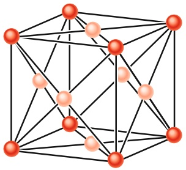

<details>
<summary>chemical</summary>

Molecular structure diagram showing a 3D lattice with red and pink spheres representing atoms or ions
</details>

(a)

## Abb. 37.1

(a) Die Elementarzelle von Kupfer hat die Form eines Würfels. Ein Kupferatom (dunkler gezeichnet) befindet sich an jeder Würfelecke und ein weiteres Kupferatom (heller gezeichnet) im Mittelpunkt jeder Würfelfläche. Eine solche Anordnung bezeichnet man als kubisch flä- chenzentriert. (b) Die Elementarzelle für Silicium und Diamant ist ebenfalls ein Würfel, allerdings bilden die Atome in diesem Fall ein sogenanntes Diamantgitter. Es gibt ein Atom (dunklere Färbung) an jeder Würfelecke und ein weiteres Atom (hellere Färbung) im Mittelpunkt jeder Würfelfläche. Zusätzlich befinden sich jedoch noch vier Atome (mittlere Färbung) innerhalb jedes Würfels. Jedes Atom ist mit seinen vier nächsten Nachbaratomen über eine kovalente Elektronenpaarbindung verbunden. (Nur für die vier Atome innerhalb des Würfels sind alle vier unmittelbaren Nachbaratome eingezeichnet.)

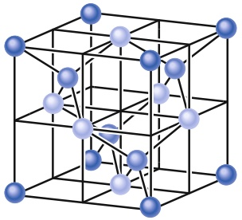

<details>
<summary>chemical</summary>

Crystal lattice structure diagram showing blue and white spheres in a cubic unit cell
</details>

(b)

Halliday Physik für natur- und ingenieurwiss. Studiengänge, 3. Auflage. D. Halliday, R. Resnick und J. Walker. © 2020 WILEY-VCH Verlag GmbH & Co. KGaA. Published 2020 by WILEY-VCH Verlag GmbH & Co. KGaA.

923

---

37 Elektrische Leitfähigkeit von Festkörpern

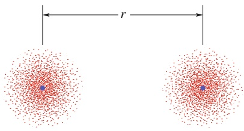

<details>
<summary>text_image</summary>

r
</details>

(a)


<details>
<summary>scatter</summary>

| Time Interval | Electron State |
| --- | --- |
| 1s | 1s, 2s, 3p |
| 2s | 2s, 3p, 4p |
| 2p | 2p, 3p, 4p |
| 3s | 3p, 4p |
| 3p | 3d, 4p |
| 4s | 4p, 5s |
| 4p | 5s, 6s, 7s, 8s, 9s, 10s |
</details>

Abb. 37.2

(a) Zwei Kupferatome in einem großen Abstand. Die Darstellung zeigt die Wahrscheinlichkeitsverteilungen der Elektronen. (b) 29 Elektronen verteilen sich in jedem Kupferatom auf verschiedene Unterschalen. In einem neutralen Atom im Grundzustand sind alle Unterschalen bis zum 3d-Niveau aufgefüllt. Die 4s-Unterschale enthält nur ein Elektron (sie könnte zwei aufnehmen), alle höheren Unterschalen sind leer. Der Einfachheit halber wurden die Unterschalen immer im gleichen Energieabstand wiedergegeben.

Drei grundlegende Eigenschaften kennzeichnen das elektrische Verhalten von Festkörpern:

1. Ihr **spezifischer Widerstand** $\rho$ bei Zimmertemperatur. Die SI-Einheit des spezifischen Widerstands ist Ohm mal Meter (Ω ⋅ m). Definiert wurde der spezifische Widerstand in Abschn. 22.3.
2. Ihr **Temperaturkoeffizient des spezifischen Widerstands** $\alpha ,$ durch Gl. 22.17 als $\alpha   =   ( 1 / \rho ) ( \mathrm { d } \rho / \mathrm { d }   T )$ definiert. Die SI-Einheit von α ist das inverse Kelvin $( \mathrm { K } ^ { - 1 } )$ . Bestimmen lässt sich α aus Messungen des spezifischen Widerstands über einen größeren Temperaturbereich.
3. Ihre **Ladungsträgerdichte** $n .$ Diese Größe, die Anzahl der Ladungsträger pro Volumeneinheit, lässt sich unter anderem aus Messungen des Hall-Effekts bestimmen (vgl. Abschn. 24.3). Ihre SI-Einheit ist der inverse Kubikmeter $( \mathrm { m } ^ { - 3 } )$

Vergleicht man ihre spezifischen Widerstände bei Zimmertemperatur, so findet man bestimmte Materialien, die Elektrizität praktisch überhaupt nicht leiten. Solche Substanzen bezeichnen wir als **Nichtleiter** (oder **Isolatoren**). Sie haben einen sehr hohen spezifischen Widerstand. Ein ausgezeichnetes Beispiel ist Diamant mit einem spezifischen Widerstand, der um den Faktor $1 0 ^ { 2 4 }$ größer ist als der spezifische Widerstand von Kupfer.

Materialien, die nicht zur Gruppe der Nichtleiter gerechnet werden, bezeichnet man als Leiter. Sie lassen sich im Allgemeinen durch Messungen von $\rho ,$ α und n (zumindest bei tieferen Temperaturen) noch weiter in die folgenden zwei Gruppen unterteilen: **Metalle** und **Halbleiter**.

• Halbleiter haben einen wesentlich größeren spezifischen Widerstand als Metalle.
• Für Halbleiter ist der Temperaturkoeffizient α negativ und sehr groß. Der spezifische Widerstand eines Halbleiters nimmt mit steigender Temperatur also ab, während er für Metalle zunimmt.
• Halbleiter besitzen eine wesentlich geringere Dichte n an Ladungsträgern als Metalle.

In Tab. 37.1 findet man die Werte dieser Größen für Kupfer – unseren Prototyp eines Metalls – und Silicium – unseren Prototyp eines Halbleiters.

Mit den beschriebenen Größen haben wir eine Grundlage, um unsere eingangs gestellte Frage zur elektrischen Leitfähigkeit von Festkörpern genauer formulieren zu können: Welche Eigenschaften machen Diamant zu einem Nichtleiter, Kupfer zu einem Metall und Silicium zu einem Halbleiter? Wir erhalten die Antwort mithilfe der Quantenmechanik, und nur mit ihr.

TABELLE 37.1: Elektrische Eigenschaften von Kupfer und Silicium bei Zimmertemperatur.

| Eigenschaft | Einheit | Kupfer | Silicium |
| --- | --- | --- | --- |
| Art des Leiters |  | Metall | Halbleiter |
| spezifischer Widerstand $\rho$ | $\Omega \cdot m$ | $2 \cdot 10^{-8}$ | $3 \cdot 10^{3}$ |
| Temperaturkoeffizient $\alpha$ | $K^{-1}$ | $+4 \cdot 10^{-3}$ | $-70 \cdot 10^{-3}$ |
| Ladungsträgerdichte $n$ | $m^{-3}$ | $9 \cdot 10^{28}$ | $1 \cdot 10^{16}$ |

## 37.1.2 Die Energieniveaus in einem kristallinen Festkörper

In festem Kupfer beträgt der Abstand zwischen benachbarten Kupferatomen 260 pm. Abbildung 37.2a zeigt zwei isolierte Kupferatome in einem sehr viel grö- ßeren Abstand $r _ { \star }$ Wie in Abb. 37.2b schematisch zeigt, sind die 29 Elektronen jedes dieser isolierten, neutralen Atome folgendermaßen auf die verschiedenen Unterschalen verteilt:

$$
1 \mathrm{s} ^ {2} 2 \mathrm{s} ^ {2} 2 \mathrm{p} ^ {6} 3 \mathrm{s} ^ {2} 3 \mathrm{p} ^ {6} 3 \mathrm{d} ^ {1 0} 4 \mathrm{s} ^ {1}.
$$

924

---

37.1 Die elektrischen Eigenschaften von Metallen

37

Zur Kennzeichnung der Unterschalen verwenden wir die Kurzschreibweise aus Abschn. 36.5. So erhält die Unterschale mit der Hauptquantenzahl $n = 3$ und der Bahndrehimpulsquantenzahl $l = 1$ die Bezeichnung 3p-Unterschale. Sie kann bis zu $2 ( 2 l + 1 ) = 6$ Elektronen aufnehmen. Die tatsächliche Anzahl der Elektronen in einer Unterschale wird durch den hochgestellten Index angedeutet. Im Fall des Kupfers sind die ersten sechs Unterschalen im Grundzustand vollständig besetzt, die äußerste 4s-Unterschale, die zwei Elektronen aufnehmen kann, enthält jedoch nur ein Elektron.

Wenn sich die Atome in Abb. 37.2a einander nähern, fangen sie an – vereinfacht ausgedrückt – das jeweils andere Atom zu spüren. In der Sprache der Quantenmechanik beginnen ihre Wellenfunktionen zu überlappen, als Erstes die Wellenfunktionen der äußersten Elektronen.

Sobald die Wellenfunktionen überlappen, sprechen wir nicht mehr von zwei unabhängigen Atomen, sondern von einem zweiatomigen Quantensystem. Dieses zweiatomige System enthält nun $2   \cdot   2 9 = 5 8$ Elektronen. Das Pauli-Prinzip gilt auch für das größere System, daher müssen alle 58 Elektronen verschiedene Quantenzustände besetzen. Tatsächlich sind auch 58 Quantenzustände vorhanden, denn jedes Energieniveau der Einzelatome spaltet sich in zwei Niveaus des zweiatomigen Systems auf.

Wenn wir immer mehr Atome zusammenbringen, können wir nach und nach das Kristallgitter von festem Kupfer aufbauen. Angenommen, unser Gitter enthält N Atome, dann muss sich jedes Niveau der separaten Kupferatome in N Niveaus für den Festkörper aufspalten. Die einzelnen Energieniveaus des Festkörpers bilden daher **Energiebänder**, wobei benachbarte Bänder durch eine **Bandlücke** voneinander getrennt sind. Die Bandlücken entsprechen Energiebereichen, in denen es in dem Festkörper keine Elektronenzustände gibt. Ein typisches Band hat eine Breite von wenigen Elektronenvolt. Da N von der Größenordnung $1 0 ^ { 2 4 }$ sein kann, liegen die einzelnen Niveaus innerhalb eines Bands sehr eng beieinander und es gibt eine riesige Anzahl von Energieniveaus.

Abbildung 37.3a zeigt die allgemeine Struktur aus Bändern und Lücken von Energieniveaus für einen idealisierten kristallinen Festkörper. Die Bänder bei niedrigeren Energien sind schmaler als die bei höheren Energien. Die Elektronen mit niedrigeren Energien befinden sich die meiste Zeit tief in der Elektronenwolke nahe am Kern, ihre Wellenfunktionen überlappen daher weniger als die Wellenfunktionen der äußeren Elektronen. Aus diesem Grund ist die Aufspaltung der Energieniveaus für die tiefliegenden Bänder auch nicht so groß wie die der höheren Energieniveaus, die gewöhnlich von den äußeren Elektronen besetzt werden.

## 37.1.3 Nichtleiter

Einen Festkörper bezeichnet man als Nichtleiter bzw. Isolator, wenn trotz angelegter Spannung kein Strom durch ihn hindurchfließt. Damit ein Strom fließen kann, muss die kinetische Energie von Elektronen zunehmen. Mit anderen Worten, einige Elektronen im Festkörper müssen in ein höheres Energieniveau wechseln. Wie jedoch in Abb. 37.4a dargestellt, ist in einem Nichtleiter das höchste Band, in dem sich noch Elektronen befinden, voll besetzt, und das Pauli-Prinzip verhindert, dass Elektronen in bereits besetzte Niveaus wechseln können.

Die Elektronen im vollen Band eines Nichtleiters haben daher keine freien Niveaus zur Verfügung, in die sie ohne Weiteres (d. h. ohne Energieaufwand) wechseln können. Stellen Sie sich ein Kind vor, das auf eine Leiter klettern möchte, bei der bereits auf jeder Sprosse ein anderes Kind steht – ohne freie Sprossen kann sich keiner bewegen.

Natürlich gibt es freie Niveaus in dem nächsthöheren Band über dem vollen Band aus Abb. 37.4a. Um in eines dieser Niveaus wechseln, muss ein Elektron jedoch aus reichend Energie aufnehmen, um die Lücke zwischen den beiden Bändern überspringen zu können. Für Diamant ist diese Lücke so groß (die notwendige Energie


Abb. 37.3

(a) Energiebänder und Bandlücken in einem idealisierten kristallinen Festkörper. Wie die Vergrößerung andeuten soll, besteht jedes Band aus einer sehr großen Anzahl sehr eng beisammenliegender Energieniveaus. (In vielen Festkörpern können benachbarte Bänder auch überlappen, doch dieser Fall ist der Klarheit halber nicht wiedergegeben.) (b) Ausschnitt aus einer realen Bandstruktur. Man sieht mehrere Energiebänder $E _ { \lambda } ( \vec { k } ) ,$ die durch Bandlücken voneinander getrennt sind. Die rot eingezeichneten Bänder sind die energetisch höchsten Valenzbänder und die blau dargestellten Bänder sind die energetisch tiefsten Leitungsbänder. (c) Die gestrichelten Kurven entsprechen einer Taylorentwicklung der realen Energiedispersionsrelation $E _ { \lambda } ( k )$ um $k = 0 ,$

925

---

37 Elektrische Leitfähigkeit von Festkörpern


Abb. 37.4

(a) Die Bandstruktur eines Nichtleiters. Gefüllte Niveaus sind rot dargestellt, leere Niveaus blau. Bei einem Nichtleiter befindet sich das höchste besetzte Niveau an der oberen Kante

eines Bands, und das nächsthöhere freie Niveau ist um eine vergleichsweise große Bandlücke $E _ { \mathrm { L } }$ davon entfernt.

(b) Die Bandstruktur eines Metalls.

Das höchste im Grundzustand besetzte Niveau, das sogenannte Fermi-

Niveau, befindet sich irgendwo in der Mitte eines Bands. Da innerhalb dieses Bands weitere Niveaus unbesetzt sind, können die Elektronen in diesem Band ihre Niveaus leicht wech-

seln und es kann ein Strom fließen.

für einen Sprung in dieses Band beträgt 5,5 eV, also rund das 140-Fache der mittle ren thermischen Energie eines freien Teilchens bei Zimmertemperatur), dass praktisch kein Elektron in dieses Band springen kann. Aus diesem Grund zählt Diamant zu den sehr guten Isolatoren.

## 37.1.4 Metalle

In Abb. 37.4b erkennt man die (mikroskopische) Eigenschaft, die ein Metall definiert: Das höchste besetzte Energieniveau liegt mitten in einem Energieband. Legen wir an ein Metall eine Spannung an, kann ohne Weiteres ein Strom fließen, da es für die Elektronen (die Ladungsträger in einem Metall) genügend freie Niveaus in unmittelbarer energetischer Nähe (also ohne großen Energieaufwand erreichbar) gibt, in welche die Elektronen springen können. Ein Metall kann elektrische Ladungen leiten, weil die Elektronen im obersten besetzten Energieband leicht in höhere Energieniveaus innerhalb dieses Bands wechseln können.

In Abschn. 22.4 hatten wir für Metalle das **Modell freier Elektronen** eingeführt. Im Rahmen dieses Modells können sich die **Leitungselektronen** frei durch das gesamte Metall bewegen wie Gasmoleküle in einem geschlossenen Behälter. Wir konnten auch einen Ausdruck für den spezifischen Widerstand eines Metalls herleiten, wobei wir für die Elektronen Newtonsche Bewegungsgesetze angenommen haben. Im Folgenden verwenden wir dasselbe Modell für die Beschreibung der Elektronen in dem teilweise gefüllten Energieband aus Abb. 37.4b. Auch diese Elektronen bezeichnen wir als Leitungselektronen. Allerdings folgen wir nun den Gesetzen der Quantenmechanik; wir nehmen die Energien dieser Elektronen als quantisiert an und berücksichtigen das Pauli-Prinzip.

Außerdem machen wir die vereinfachende Annahme, dass das elektrische Potenzial eines Leitungselektrons an allen Punkten innerhalb des Gitters denselben Wert hat. Wir können diesen Wert als die Nullmarke des Potenzials definieren und die gesamte mechanische Energie E eines Leitungselektrons seiner kinetischen Energie zuschreiben.

Das unterste Niveau in dem teilweise gefüllten Energieband von Abb. 37.4b entspricht dann der Energie $E = 0 .$ Das höchste am absoluten Nullpunkt $( T = 0 )$ besetzte Niveau in diesem Band bezeichnet man als **Fermi-Niveau** und die zugehörige Energie als **Fermi-Energie** $E _ { \mathrm { F } }$ (nach Enrico Fermi). Für Kupfer ist $E _ { \mathrm { F } } = 7 { , } 0   \mathrm { e V } .$

Die Elektronengeschwindigkeit, die der Fermi-Energie entspricht, ist die **Fermi-Geschwindigkeit** $\nu _ { \mathrm { F } } ;$ für Kupfer ist $\nu _ { \mathrm { F } } = 1 { , } 6   \cdot   1 0 ^ { 6 }$ m/s. Diese Tatsache widerspricht der populären Vorstellung, wonach am absoluten Nullpunkt der Temperatur jede Form von Bewegung eingefroren ist. Bei dieser Temperatur sind in dem teilweise besetzten Energieband in Abb. 37.4b sämtliche Energieniveaus von null bis zur Fermi-Energie mit Elektronen besetzt. Wegen des Pauli-Prinzips können nicht alle Elektronen die Energie null (und damit eine minimale Geschwindigkeit) haben.

## Wie viele Leitungselektronen gibt es?

Könnten wir einzelne Atome zu einem kleinen Metallstück zusammensetzen, würden wir feststellen, dass die Leitungselektronen des Metalls die Valenzelektronen der Atome sind (also die Elektronen in den äußeren Schalen der einzelnen Atome). Atome mit einem Valenzelektron stellen dem Metall daher auch genau ein Elektron als Leitungselektron zur Verfügung, Atome mit zwei Valenzelektronen tragen schon zwei Elektronen bei. Die Gesamtzahl der Leitungselektronen in einem Metall ist daher

$$
\begin{array}{l} \binom{\text {Anzahl der Leitungselektronen}}{\text {in einer Metallprobe}} \\ = \binom{\text {Anzahl der Atome}}{\text {in der Metallprobe}} \binom{\text {Anzahl der Valenz - }}{\text {elektronen pro Atom}}. \tag {37.1} \\ \end{array}
$$

926

---

37.1 Die elektrischen Eigenschaften von Metallen

37

(In diesem Kapitel werden wir Gleichungen oft in Worten ausdrücken, weil die Symbole, die wir bisher für die Größen in diesen Gleichungen verwendet haben, nun anderen Größen entsprechen.) Die Dichte n der Leitungselektronen in einer Probe ist gleich der Anzahl der Leitungselektronen pro Volumen:

$$
n = \frac {\text {Anzahl der Leitungselektronen in der Probe}}{\text {Volumen V V der Probe}}. \tag {37.2}
$$

Wir können die Anzahl der Atome in einer Metallprobe über die folgenden Gleichungen mit verschiedenen anderen Eigenschaften dieser Probe bzw. des Materials verknüpfen:

$$
\begin{array}{l} \binom{\text {Anzahl der Atome}}{\text {in der Metallprobe}} = \frac {\text {Masse} M _ {\mathrm{P}} \text {der Probe}}{\text {Atommasse}} = \frac {\text {Masse} M _ {\mathrm{P}} \text {der Probe}}{(\text {molare Masse} M) / N _ {\mathrm{A}}} \\ = \frac {\text {(Materialdichte)(Probenvolumen} V)}{\text {(molare Masse} M) / N _ {\mathrm{A}}}. \tag {37.3} \\ \end{array}
$$

Die molare Masse M ist die Masse eines Mols der Substanz in der Probe und $N _ { \mathrm { A } }$ ist die Avogadro-Konstante $( 6 , 0 2 \cdot 1 0 ^ { 2 3 }   \mathrm { m o l ^ { - 1 } } )$ .

## Leitfähigkeit bei $T > 0$

Bei den meisten praktischen Anwendungen interessieren wir uns für die Leitfä- higkeit von Metallen bei Temperaturen oberhalb des absoluten Nullpunkts. Wie verändert sich die Elektronenverteilung aus Abb. 37.4b bei höheren Temperaturen? Wie wir sehen werden, überraschend wenig.

Von den Elektronen in dem teilweise angefüllten Energieband in Abb. 37.4b haben nur die Elektronen nahe der Fermi-Energie unbesetzte Niveaus unmittelbar über sich. Nur sie können daher durch ihre thermische Bewegung in höhere Niveaus angeregt werden. Selbst bei $T = 1 0 0 0   \mathrm { K } -$ einer Temperatur, bei der Kupfer in einem dunklen Raum hell leuchtend glüht – unterscheidet sich die Elektronenverteilung in den zur Verfügung stehenden Niveaus kaum von der Verteilung bei $T = 0$

Anschaulich lässt sich das folgendermaßen verstehen: Die Größe kT (k ist die Boltzmann-Konstante) ist ein gutes Maß für die mittlere Energie, die einem Leitungselektron durch die zufälligen thermischen Bewegungen des Gitters übertragen werden kann. Bei $T = 1 0 0 0   \mathrm { K }$ ist $k T = 0 { , } 0 8 6   \mathrm { e V } .$ . Nur in ganz seltenen Fällen besitzt ein Elektron aufgrund thermischer Mechanismen eine Energie, die diesen kleinen Wert um mehr als beispielsweise das Zehnfache übertrifft. Daher können nur die wenigen Leitungselektronen nahe der Fermi-Energie aufgrund ihrer thermischen Energie in höhere Niveaus springen. Bildlich ausgedrückt verursacht die thermische Energie gewöhnlich nur kleine Wellen an der Oberfläche des Fermi-Ozeans der Elektronen; die Tiefen des Ozeans ruhen ungestört.

## Wie viele Quantenzustände gibt es?

Die elektrische Leitfähigkeit eines Metalls hängt davon ab, wie viele Quantenzustände den Elektronen zur Verfügung stehen und welchen Energien diese Zustände entsprechen. Das führt uns auf folgende Frage: Welche Energien haben die einzelnen Zustände in dem teilweise gefüllten Energieband aus Abb. 37.4b? Diese Frage lässt sich jedoch kaum beantworten, denn die Energien so vieler Zustände können wir nicht einzeln auflisten. Stattdessen können wir uns fragen: Wie viele Zustände mit Energien im Bereich zwischen E und $E + \mathsf { d } E$ gibt es pro Volumeneinheit einer Probe? Wir schreiben diese Zahl als $N ( E )   \mathrm { d } E$ und nennen $N ( E )$ die Zustands**dichte** bei der Energie E. Die übliche Einheit für N(E) dE ist „Zustände pro Kubikmeter“ (Zustände/m3 oder einfach $\mathbf { m } ^ { - 3 } )$ . Entsprechend ist die Einheit für $N ( E )$ „Zustände pro Kubikmeter pro Elektronenvolt“ $( \mathbf { \dot { m } } ^ { - 3 }   \mathbf { \dot { e V } } ^ { - 1 } )$ .

927

---

37 Elektrische Leitfähigkeit von Festkörpern


<details>
<summary>line</summary>

| Energie (eV) | N(E) (10^28 m^-3 eV^-1) |
| --- | --- |
| 0 | 0 |
| 2 | ~1.1 |
| 4 | ~1.5 |
| 6 | ~1.9 |
| 8 | ~2.2 |
| 10 | ~2.4 |
</details>

Abb. 37.5

Die Zustandsdichte $N ( E ) - \mathbf { d } .   \mathrm { I }$ . die Anzahl der Energieniveaus pro Energieintervall und Volumen – als Funktion der Energie. Die Zustandsdichte zählt nur die vorhandenen Zustände; sie sagt nichts darüber aus, ob diese Zustände auch tatsächlich von Elektronen besetzt sind.

Folgende Überlegung führt zu einer guten Abschätzung der Zustandsdichte: Wir zählen die Anzahl der Materiewellen, die in einen Kasten mit den Abmessungen der jeweiligen Probe passen. Das könnte man mit dem Abzählen der Anzahl der stehenden Schallwellen in einer geschlossenen Orgelpfeife vergleichen. Der Unterschied ist, dass es sich hier um eine dreidimensionale Aufgabenstellung handelt (bei der Orgelpfeife ist es eine eindimensionale Aufgabenstellung) und dass es sich um Materiewellen und nicht um Schallwellen handelt. Das Ergebnis einer solchen Abzählung ist

$$
N (E) = \frac {8 \sqrt {2} \pi m ^ {3 / 2}}{h ^ {3}} E ^ {1 / 2} \quad (\text {Zustandsdichte}), \tag {37.4}
$$

wobei m die Elektronenmasse ist. Nirgends in dieser Gleichung tritt die Form der Probe, ihre Temperatur oder das Material auf, aus dem sie besteht. Abbildung 37.5 zeigt den Graphen von Gl. 37.4.

## KONTROLLFRAGE 1

Ist der Abstand zwischen benachbarten Energieniveaus in Kupfer bei $E = 4   \mathrm { e V }$ grö- ßer oder kleiner als bei $E = 6   \mathrm { e V }$ oder ist er gleich? (b) Ist der Abstand zwischen benachbarten Energieniveaus bei $E = 4   \mathrm { e V }$ in Kupfer größer oder kleiner als der Abstand in einer Probe Aluminium mit denselben Abmessungen oder ist er gleich?

## Die Besetzungswahrscheinlichkeit P(E)


<details>
<summary>line</summary>

| Energie (eV) | P(E) |
| --- | --- |
| 0~7 | 1 |
| 7~13 | 0 |
</details>

(a)


<details>
<summary>line</summary>

| Energie (eV) | P(E) |
| --- | --- |
| 0 | 1 |
| ~6.5 | 1 |
| ~7 | 0.5 |
| ~8 | 0.1 |
| 10 | 0.1 |
</details>

(b)

Abb. 37.6

Die Besetzungswahrscheinlichkeit P(E) gibt an, mit welcher Wahrscheinlichkeit ein Niveau mit der Energie E von einem Elektron besetzt ist. (a) Bei $T = 0$ gilt für alle Niveaus mit einer Energie E unterhalb der Fermi-Energie $\widetilde { E _ { \mathrm { F } } } P ( E ) = 1$ und für alle Niveaus mit einer Energie E oberhalb der Fermi-Energie ist $P ( E ) = 0 .$ (b) Bei $T = 1 0 0 0   \mathrm { K }$ befinden sich einige der Elektronen, die bei $T = 0$ eine Energie etwas unterhalb der Fermi-Energie hatten, in Zuständen mit Energien etwas oberhalb der Fermi-Energie. Der Punkt in der Kurve verdeutlicht, dass für die Fermi-Energie $P ( E _ { \mathrm { F } } ) = 0 , 5$ gilt.

Die elektrische Leitfähigkeit eines Metalls hängt von der Wahrscheinlichkeit ab, mit der freie Energieniveaus tatsächlich besetzt werden. Daraus ergibt sich eine weitere Frage: Falls bei der Energie E ein Energieniveau existiert, mit welcher Wahrscheinlichkeit $P ( E )$ ist dieses Niveau tatsächlich von einem Elektron besetzt? Für $T = 0$ kennen wir die Antwort: Alle Niveaus mit einer Energie unterhalb der Fermi-Energie sind mit Sicherheit besetzt, also ist $P ( E ) = 1 .$ . Außerdem sind bei $T = 0$ alle Niveaus mit einer Energie oberhalb der Fermi-Energie mit Sicherheit nicht besetzt, dort ist $P ( E ) = 0$ . Dieser Sachverhalt ist in Abb. 37.6a wiedergegeben. (Aus dieser Kurve wird auch deutlich, weshalb man die Fermi-Energie manchmal als **Fermi-Kante** bezeichnet.)

Oberhalb des absoluten Nullpunkts kann man P(E) mithilfe einiger Abzählregeln der Quantenmechanik berechnen, die man unter der Bezeichnung **Fermi-Dirac-Statistik** zusammenfasst. Der Name erinnert an die beiden Physiker, auf die diese Regeln zurückgehen. Mithilfe dieser Regeln ergibt sich für die **Besetzungswahrscheinlichkeit** $P ( E )$ die folgende Funktion:

$$
P (E) = \frac {1}{\mathrm{e} ^ {(E - E _ {\mathrm{F}}) / (k T)} + 1} \quad \text {(Besetzungswahrscheinlichkeit).} \tag {37.5}
$$

Man beachte, dass P(E) nicht von der Energie E des Niveaus selbst abhängt, sondern nur von der Energiedifferenz $E - E _ { \mathrm { F } }$ , die positiv oder negativ sein kann.

Wir wollen für $T = 0$ überprüfen, ob Gl. 37.5 tatsächlich die Kurve aus Abb. 37.6a beschreibt. Für $E < E _ { \mathrm { F } }$ ist der exponentielle Term in Gl. 37.5 gleich $\mathbf { e } ^ { - \infty }$ , also gleich null. Damit ist $P ( E ) = 1$ , in Übereinstimmung mit Abb. 37.6a. Für $E > E _ { \mathrm { F } }$ ist der exponentielle Term gleich $\mathbf { e } ^ { + \infty }$ , also ist $P ( E ) = 0 ,$ , ebenfalls in Übereinstimmung mit Abb. 37.6a.

Abbildung 37.6b zeigt die Auftragung von P(E) für $T = 1 0 0 0   \mathrm { K } .$ Veränderungen in der Elektronenverteilung unter den zur Verfügung stehenden Zuständen betreffen nur die Zustände in der Nähe der Fermi-Energie. Für $E = E _ { \mathrm { F } }$ ist der exponentielle Term in Gl. 37.5 (unabhängig von der Temperatur T) gleich $\mathbf { e } ^ { 0 } = 1$ und damit $P ( E ) = 0 , 5$ . Damit erhalten wir eine praktischere Definition der Fermi-Energie:


Die Fermi-Energie eines gegebenen Materials ist die Energie des Quantenzustands, dessen Besetzungswahrscheinlichkeit gleich 0,5 ist.

928

---

37.1 Die elektrischen Eigenschaften von Metallen

37

Die Abbildungen 37.6a und b gelten für Kupfer mit einer Fermi-Energie von $\mathrm { 7 , } 0   \mathrm { e V . }$ Bei Kupfer hat daher der Zustand mit der Energie $^ { 7 , 0   \mathrm { e V } }$ sowohl für $T = 0$ als auch für $T = 1 0 0 0   \mathrm { K }$ die Besetzungswahrscheinlichkeit $^ { 0 , 5 }$

## Wie viele besetzte Zustände gibt es?

Gleichung 37.4 und Abb. 37.5 zeigen die Verteilungsfunktion der möglichen $\mathbf { Z u } \cdot$ stände als Funktion der Energie. Die Besetzungswahrscheinlichkeit aus Gl. 37.5 gibt die Wahrscheinlichkeit an, dass ein gegebener Zustand tatsächlich mit einem Elektron besetzt ist. Die Dichte $N _ { \mathrm { b } } ( E )$ der besetzten Zustände erhalten wir, indem wir jeden möglichen Zustand mit dem entsprechenden Wert für seine Besetzungswahrscheinlichkeit gewichten, also

$$
\begin{array}{l} \binom{\text {Dichte der besetzten Zustände}}{N _ {\mathrm{b}} (E) \text {bei der Energie} E}\left. \right) \\ = \binom{\text {Zustandsdichte}}{N (E) \text {bei} E} \binom{\text {Besetzungswahrscheinlichkeit}}{P (E) \text {bei der Energie} E} \\ \end{array}
$$

oder

$$
N _ {\mathrm{b}} (E) = N (E) P (E) \quad (\text {Dichte der besetzten Zustände}). \tag {37.6}
$$

Abbildung 37.7a zeigt Gl. 37.6 für Kupfer bei $T = 0$ . Für jeden Energiewert wird die Zustandsdichte (Abb. 37.5) mit der Besetzungswahrscheinlichkeit am absoluten Nullpunkt (Abb. 37.6a) multipliziert. Abbildung 37.7b zeigt die Dichte der besetzten Zustände in Kupfer bei $T = 1 0 0 0   \mathrm { K }$


<details>
<summary>area</summary>

| Energie (eV) | Nb(E) (10^28 m^-3 eV^-1) |
| --- | --- |
| 0 | 0 |
| ~7 | 2 |
| ~7 | 0 |
</details>

(a)


<details>
<summary>area</summary>

| Energie (eV) | Nb(E) (10^28 m^-3 eV^-1) |
| --- | --- |
| 0 | 0 |
| ~2 | ~1.1 |
| ~4 | ~1.5 |
| ~6 | ~1.9 |
| ~7 | ~0.5 |
| ~8 | ~0.1 |
| ~10 | ~0.05 |
</details>

(b)

## Abb. 37.7

(a) Dichte $N _ { \mathrm { b } } ( E )$ der besetzten Zustände für Kupfer am absoluten Nullpunkt. Die Fläche unter der Kurve ist gleich der Elektronendichte n. Alle Zustände bis zur Fermi-Energie $E _ { \mathrm { F } } = 7   \mathrm { e V }$ sind besetzt und alle Zustände oberhalb der Fermi-Energie sind frei. (b) Die gleiche Funktion für Kupfer bei $T = 1 0 0 0   \mathrm { K } .$ Die Verteilung hat sich nur für $\mathbf { Z u } .$ stände mit einer Energie in der Nähe der Fermi-Energie verändert.

## Die Berechnung der Fermi-Energie

Wenn wir bei $T = 0$ die Anzahl der besetzten Zustände pro Volumeneinheit in Abb. $3 7 . 7 \mathtt { a }$ für alle Energien zwischen $E = 0$ und $E = E _ { \mathrm { F } }$ aufaddieren (durch Integration), müssen wir als Ergebnis die Anzahl n der Leitungselektronen pro Volumeneinheit in dem Metall erhalten, also

$$
n = \int_ {0} ^ {E _ {\mathrm{F}}} N _ {\mathrm{b}} (E) \mathrm{d} E. \tag {37.7}
$$

(Grafisch entspricht dieses Integral der Fläche unter der Verteilungskurve aus Abb. 37.7a.) Da bei $T = 0$ für alle Energien unterhalb der Fermi-Energie $P ( E ) = 1$ gilt, können wir in Gl. 37.7 mithilfe von Gl. 37.6 $N _ { \mathrm { b } } ( E )$ durch $N ( E )$ ersetzen und die Integration ausführen:

$$
n = \frac {8 \sqrt {2} \pi m ^ {3 / 2}}{h ^ {3}} \int_ {0} ^ {E _ {\mathrm{F}}} E ^ {1 / 2} \mathrm{d} E = \frac {8 \sqrt {2} \pi m ^ {3 / 2}}{h ^ {3}} \frac {2 E _ {\mathrm{F}} ^ {3 / 2}}{3}.
$$

929

---

37 Elektrische Leitfähigkeit von Festkörpern

Diese Gleichung lösen wir nach $E _ { \mathrm { F } }$ auf und erhalten

$$
E _ {\mathrm{F}} = \left(\frac {3}{1 6 \sqrt {2} \pi}\right) ^ {2 / 3} \frac {h ^ {2}}{m} n ^ {2 / 3} = \frac {0 , 1 2 1 h ^ {2}}{m} n ^ {2 / 3}. \tag {37.8}
$$

Wenn wir also die Anzahl n der Leitungselektronen pro Volumeneinheit für ein Metall kennen, können wir die Fermi-Energie dieses Metalls berechnen.

## 37.2 Halbleiter und Dotierung


## Lernziele

Nach dem Durcharbeiten dieses Abschnitts sollten Sie in der Lage sein, . . .

• Bänder und Bandlücken eines Halbleiters zu skizzieren und dabei Leitungs- und Valenzband, Leitungselektronen, Löcher und Bandlücke zu markieren,
• die Bandlücke eines Halbleiters mit der eines Isolators zu vergleichen,
• die Beziehung zwischen der Bandlücke eines Halbleiters und der Wellenlänge des Lichts anzuwenden, das bei einem Übergang über die Lücke emittiert bzw. absorbiert wird,
• die Gitterstruktur von reinem und dotiertem Silicium zu skizzieren,
• zu wissen, was Löcher sind, wie sie entstehen und wie sich in einem äußeren elektrischen Feld bewegen,
• den spezifische Widerstand $\rho$ und seinen Temperaturkoeffizienten α bei Metallen und Halbleitern zu vergleichen und zu erklären, wie sich der spezifische Widerstand mit der Temperatur ändert,
• zu erklären, wie n- und p-dotierte Halbleiter entstehen,
• die Beziehung zwischen der Zahl der Leitungselektronen in einem reinen und in einem dotierten Material anzuwenden,
• Donatoren und Akzeptoren zu kennen und die Lage ihrer Energieniveaus in einem Energieniveauschema einzutragen,
• zu wissen, was Majoritäts- und Minoritätsladungsträger sind,
• die Vorteile der Dotierung von Halbleitern zu erklären.


## Schlüsselideen

• Die Bandstruktur eines Halbleiters entspricht der eines Isolators, sie besitzt jedoch eine viel kleinere Bandlücke $E _ { \mathrm { L } }$ , die schon von thermisch angeregten Elektronen überwunden werden kann.
• In Silicium werden bei Raumtemperatur einige wenige Elektronen thermisch in das Leitungsband angeregt, wobei eine gleich große Zahl von Löchern im Valenzband zurückbleibt. Legt man eine Potenzialdifferenz an das Silicium an, wirken sowohl die Elektronen als auch die Löcher als Ladungsträger.
Die Anzahl der Elektronen im Leitungsband von Silicium lässt sich erheblich vergrößern, wenn man das Material mit kleinen Mengen von Phosphor dotiert, man erhält dann n-dotiertes Silicium. Die Phosphoratome werden in diesem Fall als Donatoren (Donatoratome) bezeichnet.
• Die Anzahl der Löcher im Valenzband von Silicium lässt sich erheblich vergrö- ßern, wenn man das Material mit kleinen Mengen von Aluminium dotiert, man erhält dann p-dotiertes Silicium. Die Aluminiumatome werden in diesem Fall als Akzeptoren (Akzeptoratome) bezeichnet.

## 37.2.1 Halbleiter

Ein Vergleich von Abb. 37.8a mit Abb. 37.4a zeigt, dass die Bandstruktur eines Halbleiters der eines Nichtleiters entspricht. Der Unterschied besteht lediglich in der Breite der Bandlücke: Für einen Halbleiter ist die Bandlücke $E _ { \mathrm { L } }$ zwischen dem obersten Niveau des besetzten Bands (des **Valenzbands**) und dem unters-

930

---

37.2 Halbleiter und Dotierung

37


## Abb. 37.8

(a) Die Bandstruktur eines Halbleiters. Sie gleicht der eines Nichtleiters (vgl. Abb. 37.4a), allerdings ist die Bandlücke $E _ { \mathrm { L } }$ wesentlich kleiner, wodurch Elektronen sie mit einer gewissen Wahrscheinlichkeit überspringen können. (b) Einige Elektronen wurden thermisch vom Valenz- in das Leitungsband angeregt und haben im Valenzband eine entsprechende Anzahl an Löchern zurückgelassen. (c) Energiedispersionsrelation eines Halbleiters mit direkter Bandlücke. Hier haben Leitungsband (blau) und Valenzband (rot) ihre Extrema beide bei $k = 0 .$ (d) Energiedispersion eines Halbleiters mit indirekter Bandlücke. Hier liegt das Maximum des Leitungsbands (blau) bei $k \neq 0 ,$ das des Valenzbands (rot) dagegen bei $k = 0$

ten Niveau des darüber liegenden freien Bands (des **Leitungsbands**) wesentlich schmaler. Daraus erklärt sich, weshalb Silicium $( E _ { \mathrm { L } }   =   1 ,   1   \mathrm { e V } )$ ein Halbleiter ist und Diamant $( E _ { \mathrm { L } } = 5 { , } 5   \mathrm { e V } )$ ein Isolator. Im Gegensatz zu Diamant besteht in Silicium eine gewisse Wahrscheinlichkeit, dass ein Elektron bei Zimmertemperatur aufgrund seiner thermischen Bewegung die Bandlücke überspringen und vom Valenzband ins Leitungsband wechseln kann.

In Tab. 37.1 hatten wir drei grundlegende elektrische Eigenschaften von Kupfer (unserem Beispiel für einen Leiter) und Silicium (unserem Beispiel für einen Halb leiter) miteinander verglichen. Wir wollen diese Tabelle nochmals Zeile für Zeile durchgehen und dabei die Unterschiede zwischen einem Halbleiter und einem Leiter herausarbeiten.

## Die Ladungsträgerdichte n

Laut der letzten Zeile von Tab. 37.1 besitzt Kupfer um einen Faktor $1 0 ^ { 1 3 }$ mehr Leitungselektronen pro Volumeneinheit als Silicium. Bei Kupfer steuert jedes Atom sein einzelnes Valenzelektron zur Menge der Leitungselektronen bei. In Silicium gibt es nur deshalb überhaupt Ladungsträger, weil im thermischen Gleichgewicht eine gewisse (kleine) Zahl von Elektronen des Valenzbands die Bandlücke zum Leitungsband überspringen und eine entsprechende Anzahl von unbesetzten Zuständen, die sogenannten **Löcher**, im Valenzband zurücklässt. Dieser Sachverhalt ist in Abb. 37.8b gezeigt.

Sowohl die Elektronen im Leitungsband als auch die Löcher im Valenzband dienen als Ladungsträger. Die Löcher sind insofern Ladungsträger, als sie den Elektronen im Leitungsband eine gewisse (eingeschränkte) Bewegungsfreiheit ermöglichen, die es ohne die Löcher nicht gäbe. Befindet sich ein Halbleiter in einem elektrischen Feld $\vec { E } ,$ bewegen sich die negativ geladenen Elektronen im Valenzband in die zu $\vec { E }$ entgegengesetzte Richtung. Dadurch verschieben sich die Positionen der Löcher in Richtung des ${ \vec { E } } .$ Felds. Effektiv verhalten sich Löcher daher wie Teilchen der Ladung +e.

Allgemein ordnet man den Löchern die Eigenschaften der „fehlenden“ Elektronen zu, d. h. eine Ladung $- ( - e ) = + e$ und einen Impuls

$$
\hbar \vec {k} _ {\mathrm{Loch}} = - \hbar \vec {k} _ {\mathrm{Elektron}}.
$$

931

---

37 Elektrische Leitfähigkeit von Festkörpern

Um sich die Bewegung von Löchern anschaulich vorzustellen, kann man an eine Reihe geparkter Autos denken, die Stoßstange an Stoßstange stehen. Der vorderste Parkplatz sei leer. Wenn nun das erste Auto sich um einen Parkplatz nach vorne bewegt, macht es für das hinter ihm parkende Auto einen Parkplatz frei. Das zweite Auto kann nun ebenfalls um einen Parkplatz nach vorne rücken, anschließend das dritte Auto usw. Die Bewegung der vielen Autos um einen Parkplatz nach vorne kann man auch vereinfacht als eine „Bewegung“ des einzelnen „Lochs“ (der Parklücke) nach hinten auffassen.

In Halbleitern spielt die elektrische Leitung durch Löcher eine ebenso wichtige Rolle wie die durch Elektronen. Im Zusammenhang mit solchen Leitungsvorgängen ist es durchaus zulässig, sich jeden unbesetzten Zustand im Valenzband als mit einem Teilchen der Ladung +e besetzt vorzustellen, das sich quasi-frei, d.h. mit der durch die Banddispersion $E _ { \mathrm { L } } ( \vec { k } )$ bestimmten effektiven Masse durch dieses Band bewegen kann. (Die anderen Elektronen im Valenzband braucht man dann nicht mehr zu berücksichtigen.)

## Direkte und indirekte Halbleiter

Bei dem bekanntesten und in der Elektronik meistverwendeten Halbleitermaterial, dem Silicium, hat die Bandstruktur die in Abb. 37.8d angedeutete Form. Das absolute Minimum des Leitungsbandes in Silicium liegt nicht bei $k = 0 ,$ , sondern bei einem endlichen Wert $k _ { \operatorname* { m i n } } \neq 0 .$ (Genau genommen gibt es sechs äquivalente Minima, entsprechend den Symmetrierichtungen im Siliciumkristall.) Da das Maximum des Valenzbands sich aber bei $k = 0$ befindet, beträgt der minimale energetische Abstand $E _ { \mathrm { L } } ( k _ { \mathrm { m i n } } ) - E _ { \mathrm { V } } ( k = 0 )$ . Solche Halbleiter bezeichnet man als **indirekt** bzw. als Halbleiter mit indirekter Bandlücke.

Im Gegensatz zu Silicium handelt es sich bei dem Verbindungshalbleiter Galliumarsenid (GaAs) um einen Halbleiter mit **direkter** Bandlücke, vgl. Abb. 37.8c. Solche direkten Halbleiter sind speziell für Anwendungen in der Optoelektronik wichtig, vgl. Abschn. 37.3.

## Spezifischer Widerstand $\rho$

In Kapitel 22 hatten wir gezeigt, dass der spezifische Widerstand eines Materials durch m $/ e ^ { 2 } ,$ nτ gegeben ist, wobei m die Elektronenmasse, e die Elementarladung, n die Ladungsträgerdichte und τ die mittlere Zeit zwischen zwei Stößen der Ladungsträger sind. Nach Tab. 37.1 ist der spezifische Widerstand von Silicium bei Zimmertemperatur um einen Faktor $1 0 ^ { 1 1 }$ größer als der von Kupfer. Dieser riesige Unterschied beruht auf dem riesigen Unterschied in n. Zwar spielen andere Faktoren ebenfalls eine Rolle, aber ihr Einfluss auf den spezifischen Widerstand ist im Vergleich zur Ladungsträgerdichte praktisch bedeutungslos.

## Temperaturkoeffizient α

Wir hatten α in Gl. 22.17 als die relative Änderung des spezifischen Widerstands pro Temperatureinheit definiert,

$$
\alpha = \frac {1}{\rho} \frac {\mathrm{d} \rho}{\mathrm{d} T}. \tag {37.9}
$$

Der spezifische Widerstand von Kupfer nimmt mit der Temperatur zu (d. h., es gilt $\mathrm { d } \rho / \mathrm { d }   T > 0 )$ , weil bei höheren Temperaturen die Ladungsträger im Kupfer häufiger zusammenstoßen. Daher ist α für Kupfer positiv.

Auch bei Silicium nimmt die Häufigkeit der Stöße zwischen den Ladungsträ- gern mit der Temperatur zu. Trotzdem sinkt der spezifische Widerstand von Si-

932

---

37.2 Halbleiter und Dotierung

37

licium mit steigender Temperatur $( \mathrm { d } \rho / \mathrm { d } T < 0 )$ , weil die Anzahl n der Ladungsträger (Elektronen im Leitungsband und Löcher im Valenzband) mit steigender Temperatur rasch zunimmt. (Es springen mehr Elektronen vom Valenzband in das Leitungsband.) Die relative Widerstandsänderung α ist daher bei Silicium negativ.

## KONTROLLFRAGE 2

Die Forschungsabteilung einer großen Firma hat drei neue Materialien entwickelt, deren elektrische Eigenschaften in der Tabelle angegeben sind. Aus Gründen der Geheimhaltung werden die Materialien mit Codenamen bezeichnet. Klassifizieren Sie jedes Material als Metall, Nichtleiter oder Halbleiter (oder keines der drei).

| Material (Codename) | $n(m^{-3})$ | $\rho(\Omega \cdot m)$ | $\alpha(K^{-1})$ |
| --- | --- | --- | --- |
| Frankfurt | $10^{29}$ | $10^{-8}$ | $+10^{-3}$ |
| Zürich | $10^{28}$ | $10^{-9}$ | $-10^{-3}$ |
| Wien | $10^{15}$ | $10^{3}$ | $-10^{-2}$ |

## 37.2.2 Dotierung

Die technologischen Anwendungsmöglichkeiten von Halbleitern lassen sich wesentlich erweitern, indem man in ihrem Gitter eine kleine Anzahl der Halbleiteratome durch geeignete Fremdatome („Verunreinigungen“) ersetzt. Diesen Prozess bezeichnet man als **Dotierung**. Typischerweise ist bei einem dotierten Halbleiter nur rund jedes zehnmillionste Atom durch ein Fremdatom ersetzt. Viele der modernen Halbleiterbauelemente beruhen auf dotierten Materialien, die man nach der Art der eingebauten Fremdatome als **n-dotiert** oder **p-dotiert** bezeichnet. Beide werden wir im Folgenden behandeln.

## n-dotierte Halbleiter

In einem isolierten Siliciumatom sind die Elektronen nach folgendem Schema auf die Unterschalen verteilt:

$$
1 \mathrm{s} ^ {2} 2 \mathrm{s} ^ {2} 2 \mathrm{p} ^ {6} 3 \mathrm{s} ^ {2} 3 \mathrm{p} ^ {2}.
$$

Wie üblich geben die hochgestellten Indizes (die sich zur Ordnungszahl 14 von Silicium addieren) die Zahl der Elektronen in der jeweiligen Schale an.

Abbildung 37.9a zeigt eine zweidimensionale Darstellung eines Ausschnitts aus einem Siliciumgitter. Man kann sich dabei vorstellen, dass ein kleiner Ausschnitt des dreidimensionalen Gitters (vgl. Abb. 37.1b, die die Elementarzelle des Siliciumgitters zeigt) auf einer Ebene ausgebreitet wurde. Die beiden 3s-Elektronen und die beiden 3p-Elektronen von Silicium bilden feste kovalente Elektronenpaarbindungen mit den vier nächsten Nachbarn. (Bei einer kovalenten Bindung teilen sich zwei Atome ein Elektronenpaar.) Für die vier Atome innerhalb der Elementarzelle von Abb. 37.1b sind diese vier Bindungen eingezeichnet.

Die Elektronen der kovalenten Bindungen zwischen den Siliciumatomen bilden das Valenzband eines Siliciumkristalls. Wird ein Elektron aus einer dieser Bindungen herausgerissen, sodass es sich frei durch das Gitter bewegen kann, sagt man, das Elektron sei vom Valenzband in das Leitungsband angehoben worden. Die dazu notwendige minimale Energie entspricht der Bandlücke $E _ { \mathrm { L } }$

Da vier seiner Elektronen an der Bindung beteiligt sind, ist ein Siliciumatom im Kristallgitter eigentlich ein Ion, bei dem eine chemisch träge neonartige Elektronenhülle (mit 10 Elektronen) einen Kern mit der Kernladung +14e umgibt (14 ist die Ordnungszahl von Silicium). Die Ladung dieser Ionen ist daher +4e und jedes Ion hat eine chemische Wertigkeit (oder Bindungszahl) von 4.

In Abb. 37.9b wurde das mittlere Siliciumatom durch ein Phosphoratom (Wertigkeit 5) ersetzt. Vier der Valenzelektronen von Phosphor nehmen wieder an den

933

---

37 Elektrische Leitfähigkeit von Festkörpern


Abb. 37.9

(a) Zweidimensionale Darstellung der Gitterstruktur von reinem Silicium. Jedes Siliciumatom ist über eine kovalente Elektronenpaarbindung (angedeutet durch ein Paar roter Punkte zwischen den parallelen schwarzen Linien) mit vier nächsten Nachbarn verbunden. Die Elektronen gehören zur Bindung, nicht zu den einzelnen Atomen, und bilden das Valenzband des Materials. (b) Ein Siliciumatom wurde durch ein Phosphoratom (Wertigkeit 5) ersetzt. Das zusätzliche Elektron ist nur locker an seinen Atomrumpf gebunden und lässt sich leicht in das Leitungsband anheben, wo es sich frei durch das ganze Gitter bewegen kann. (c) Ein Siliciumatom wurde durch ein Aluminiumatom (Wertigkeit 3) ersetzt. Nun gibt es ein Loch in einer der kovalenten Bindungen und damit auch im Valenzband des Materials. Dieses Loch kann sich leicht durch das Valenzband der Probe ausbreiten, indem es durch Elektronen aus Nachbarbindungen gefüllt wird. Im gezeigten Fall bewegt sich das Loch nach rechts.


<details>
<summary>text_image</summary>

n-dotiert
Leitungsband
EL
ED
Valenzband
</details>

(a)


<details>
<summary>text_image</summary>

p-dotiert
EL
EA
</details>

(b)

Abb. 37.10

(a) Bei einem n-dotierten Halbleiter liegen die Energieniveaus der Donatorelektronen um einen kleinen Betrag $E _ { \mathrm { D } }$ unterhalb der unteren Leitungsbandkante. Donatorelektronen können daher sehr leicht in das Leitungsband angeregt werden, sodass es nun mehr Elektronen im Leitungsband gibt. Das Valenzband enthält nach wie vor eine geringe Anzahl von Löchern. (b) Bei einem p-dotierten Halbleiter befinden sich Akzeptorniveaus um einen kleinen Energiebetrag $E _ { \mathrm { A } }$ über der oberen Valenzbandkante. In diesem Fall gibt es vergleichsweise mehr Lö- cher im Valenzband als Elektronen im Leitungsband. Dieses Verhältnis zwischen Majoritätsladungsträgern und Minoritätsladungsträgern ist in Wirklichkeit wesentlich größer als es in diesen Zeichnungen erscheint.

Bindungen zu den vier benachbarten Siliciumatomen teil. Das fünfte (zusätzliche) Elektron ist nur schwach an das Phosphoratom gebunden. In einer Bänderdarstellung entspricht ein solches Elektron einem lokalisierten Zustand innerhalb der Bandlücke, und zwar im Mittel um den Betrag $E _ { \mathrm { D } }$ unter dem tiefsten Niveau des Leitungsbands. Dieser Sachverhalt ist in Abb. 37.10a angedeutet. Üblicherweise ist $E _ { \mathrm { D } } \ll E _ { \mathrm { L } }$ und daher ist die notwendige Energie, um Elektronen aus diesen Niveaus in das Leitungsband anzuheben, wesentlich kleiner als die Energie, die ein Valenzelektron des Siliciums zum Anheben in das Leitungsband benötigt.

Das Phosphoratom bezeichnet man als **Donator**, weil es vergleichsweise leicht ein Elektron an das Leitungsband abgeben kann. Tatsächlich befinden sich bei Zimmertemperatur praktisch alle Elektronen der Donatoratome im Leitungsband. Durch die Zugabe von Donatoratomen lässt sich daher die Anzahl der Elektronen im Leitungsband erhöhen, und zwar wesentlich stärker, als Abb. 37.10a ausdrückt.

Mit Donatoratomen dotierte Halbleiter bezeichnet man auch als **n-dotierte Halbleiter**. Das n steht für negativ und soll andeuten, dass die negativen Ladungsträger im Leitungsband nun im Vergleich zu den positiven Ladungsträgern, den Löchern im Valenzband, überwiegen. Bei n-dotierten Halbleitern bezeichnet man die Elektronen als die **Majoritätsladungsträger** und die Löcher als die **Minoritätsladungsträger**.

## p-dotierte Halbleiter

Nun betrachten wir Abb. 37.9c, bei dem eines der Siliciumatome (Wertigkeit 4) durch ein Aluminiumatom (Wertigkeit 3) ersetzt wurde. Das Aluminiumatom kann nur mit drei der benachbarten Siliciumatome eine kovalente Elektronenpaarbindung eingehen, es fehlt also nun ein Elektron in einer Aluminium-Silicium-Bindung. Dieses fehlende Elektron wirkt wie ein Loch im Valenzband. Mit geringem Energieaufwand kann ein Elektron aus einer benachbarten Silicium-Silicium-Bindung herausgelöst werden, das nun dieses Loch füllt. Dadurch entsteht ein Loch an dieser benachbarten Bindung. Entsprechend kann ein Elektron von einer weiteren Bindung dieses zweite Loch füllen, wodurch ein drittes Loch entsteht. Auf diese Weise kann das Loch durch das ganze Gitter wandern.

Das Aluminiumatom bezeichnet man als **Akzeptor**, weil es vergleichsweise leicht ein Elektron von einer benachbarten Bindung (also ein Elektron aus dem Valenzband von Silicium) aufnehmen kann. Wie Abb. 37.10b andeutet, besetzt

934

---

37.3 pn-Übergänge und Transistoren

37

TABELLE 37.2:

Eigenschaften von n- und p-dotiertem Silicium.

| Eigenschaft | n-dotiert | p-dotiert |
| --- | --- | --- |
| Matrixmaterial | Silicium | Silicium |
| Kernladung des Matrixmaterials | +14e | +14e |
| Bandlücke des Matrixmaterials | 1,2 eV | 1,2 eV |
| Fremdatom | Phosphor | Aluminium |
| Art des Fremdatoms | Donator | Akzeptor |
| Majoritätsladungsträger | Elektronen | Löcher |
| Minoritätsladungsträger | Löcher | Elektronen |
| Bandlücke des Fremdatoms | 0,045 eV | 0,067 eV |
| Wertigkeit des Fremdatoms | 5 | 3 |
| Kernladung des Fremdatoms | +15e | +13e |
| Ionenladung des Fremdatoms | +e | -e |

dieses Elektron ein lokalisiertes Akzeptorniveau, das innerhalb der Bandlücke liegt, im Mittel um einen Betrag $E _ { \mathrm { A } }$ oberhalb der oberen Valenzbandkante. Durch Zugabe von Akzeptoratomen ist es möglich, die Anzahl der Löcher im Valenzband wesentlich zu erhöhen (weitaus stärker, als es aus Abb. 37.10b deutlich wird). Bei Zimmertemperatur sind in einem solchen Siliciumkristall praktisch alle Akzep torniveaus von Elektronen besetzt.

Mit Akzeptoratomen dotierte Halbleiter bezeichnet man als **p-dotierte Halbleiter**. Das p steht für positiv und soll andeuten, dass dieser Halbleiter eine vermehrte Anzahl von Löchern im Leitungsband besitzt, die sich wie positive Ladungsträger verhalten. In einem p-dotierten Halbleiter sind die Löcher die Majoritätsladungs träger und die Elektronen die Minoritätsladungsträger.

Man beachte insbesondere, dass die Donator- bzw. Akzeptorionen trotz ihrer Ladung selbst keine Ladungsträger sind, weil sie bei Zimmertemperatur gewöhnlich an ihrem Gitterplatz bleiben. In Tab. 37.2 sind die Eigenschaften je eines typischen n-dotierten und p-dotierten Halbleiters zusammengefasst.

## 37.3 pn-Übergänge und Transistoren

## Lernziele

Nach dem Durcharbeiten dieses Abschnitts sollten Sie in der Lage sein, . . .

• einen pn-Übergang zu überschreiben und seine Funktionsweise zu beschreiben,
• die Begriffe Diffusionsstrom, Raumladung, Verarmungszone, Kontaktspannung und Feldstrom zu erläutern,
• die Funktionsweise eines Halbleiter-Gleichrichters zu beschreiben,
• zwischen Sperr- und Durchlassrichtung zu unterscheiden,
• die allgemeinen Eigenschaften einer LED, einer Photodiode, eines Halbleiter-Injektionslasers und eines MOSFETs zu erklären.


## Schlüsselideen

• Ein pn-Übergang ist ein halbleitender Kristall, dessen eines Ende p-dotiert und dessen anderes Ende n-dotiert ist. Die beiden Zonen stoßen in der Übergangsebene aneinander.
Im thermischen Gleichgewicht geschieht an der Übergangsebene Folgendes: (1) Majoritätsladungsträger diffundieren durch die Übergangsebene und erzeugen so einen Diffusionsstrom $I _ { \mathrm { d i f f } } .$ (2) Minoritätsladungsträger „rutschen“in entgegengesetzter Richtung durch die Übergangsebene und bilden so einen Feldstrom $I _ { \mathrm { F e l d } } .$ (3) Im Bereich der Übergangsebene bildet sich eine Verarmungszone aus. (4) Eine Kontaktspannung $V _ { 0 }$ baut sich über die Verarmungszone auf.


935

---

37 Elektrische Leitfähigkeit von Festkörpern


(a)


(b)


<details>
<summary>text_image</summary>

V₀
V(x)
x
d₀
</details>

(c)


(d)

Abb. 37.11

(a) Ein pn-Übergang. (b) Die Bewegungen der jeweiligen Majoritätsladungsträger durch die Übergangsebene erzeugen aufgrund der überwiegenden Donatorionen (auf der rechten Seite der Ebene) und der Akzeptorionen (auf der linken Seite der Ebene) eine Raumladung. (c) Aufgrund dieser Raumladung entsteht über einen Bereich $d _ { 0 }$ eine Kontaktspannung $V _ { 0 ^ { \circ } } \left( \mathsf { d } \right)$ Die Diffusion der Majoritätsladungsträger (sowohl der Elektronen als auch der Löcher) durch die Übergangsebene führt zu einem Diffusionsstrom $I _ { \mathrm { D i f f ^ { * } } }$ (Bei wirklichen pn-Übergängen sind die Ränder der Raumladungszone nicht so scharf ausgeprägt wie hier wiedergegeben und die Kontaktspannung (c) verläuft kontinuierlich.)

• Ein pn-Übergang leitet Elektrizität in einer Richtung bezüglich einer angelegten Potenzialdifferenz besser (Durchlassrichtung) als in der entgegengesetzten Richtung (Sperrrichtung), daher wirkt der pn-Übergang als Gleichrichter.
• Ein aus geeigneten Materialien aufgebauter pn-Übergang kann in Durchlassrichtung Licht emittieren; es handelt sich dann um eine LED.
• Ein lichtemittierender pn-Übergang lässt sich auch zu induzierter Emission anregen; es handelt sich dann um einen Halbleiterlaser.

## 37.3.1 Der pn-Übergang

Dotiert man einen einzelnen Halbleiterkristall gezielt so, dass er in einem Bereich zu einem n-dotierten Halbleiter und in dem angrenzenden Bereich zu einem p-dotierten Halbleiter wird, erhält man einen **pn-Übergang** (Abb. 37.11a). Solche Übergänge bilden die Grundlage für nahezu die gesamte Halbleiterelektronik.

Der Einfachheit halber nehmen wir an, dass diese Verbindung mechanisch hergestellt wird, d. h., ein n-dotierter und ein p-dotierter Halbleiter werden miteinander verbunden. Der Übergang von einem Bereich zum nächsten ist daher vollkommen scharf und erfolgt in einer **Übergangsebene**.

Betrachten wir zunächst die Bewegungen von Elektronen und Löchern, unmittelbar nachdem der n-dotierte und der p-dotierte Teil (die beide elektrisch neutral sind) zusammengebracht werden. Zunächst untersuchen wir die Bewegungen der Majoritätsladungsträger, also der Elektronen im n-dotierten Material und der Lö- cher im p-dotierten Material.

## Die Bewegung der Majoritätsladungsträger

Wenn ein mit Helium gefüllter Ballon platzt, diffundieren die Heliumatome in die Umgebungsluft (sie verteilen sich), in der sich nur sehr wenige Heliumatome befinden. Etwas formaler ausgedrückt, herrscht an der Grenzfläche Ballon–Luft ein Helium-Dichtegradient (die Anzahl der Heliumatome verändert sich). Bei der Diffusion der Heliumatome wird dieser Gradient kleiner.

Aus demselben Grund diffundieren Elektronen von der n-Seite in Abb. 37.11a nahe der Übergangsebene durch diese Ebene hindurch (in der Abbildung von rechts nach links) in die p-Seite hinein, wo es nur sehr wenige freie Elektronen gibt. Ganz entsprechend diffundieren Löcher von der p-Seite nahe der Grenzflä- che durch diese Ebene hindurch auf die n-Seite (von links nach rechts), wo es nur wenige Löcher gibt. Dieser Fluss von Elektronen und Löchern bildet einen **Diffusionsstrom** $I _ { \mathrm { D i f f } } ,$ der in Abb. 37.11d nach der gängigen Konvention von links nach rechts verläuft.

Die n-Seite enthält jedoch positiv geladene Donatorionen, die fest an ihren Gitterplätzen sitzen. Normalerweise wird die überschüssige positive Ladung dieser Ionen durch die Leitungsbandelektronen wieder ausgeglichen. Wenn aber ein Elektron von der n-Seite in die Übergangsebene diffundiert, wird eines dieser Donatorionen „freigelegt“, wodurch sich in der Nähe der Übergangsebene eine ortsfeste positive Ladung manifestiert. Erreicht dieses Diffusionselektron die p-Seite, verbindet es sich rasch mit einem Akzeptorion (dem ein Elektron fehlt), sodass eine ortsfeste negative Ladung in der Nähe der Übergangsebene auf der p-Seite entsteht.

Auf diese Weise erzeugen die durch die Grenzfläche diffundierenden Elektro nen in Abb. 37.11a eine **Raumladung** zu beiden Seiten der Übergangsebene, wie in Abb. 37.11b angedeutet. Löcher, die von links nach rechts durch die Grenzflä che diffundieren, haben denselben Effekt. (Nehmen Sie sich die Zeit, sich davon zu überzeugen!) Die Bewegungen beider Majoritätsladungsträger – Elektronen wie Löcher – tragen zum Aufbau dieser beiden **Raumladungszonen** (eine positiv, die andere negativ) bei. Diese bilden eine von beweglichen Ladungsträgern vergleichs

936

---

37.3 pn-Übergänge und Transistoren

37

weise freie **Sperrschicht** (oft verwendet man auch den englischen Begriff depletion zone) der Dicke $d _ { 0 }$ (vgl. Abb. 37.11b).

Durch die Raumladungen entsteht an der Raumladungszone eine **Kontaktspannung** $V _ { 0 } ,$ wie in Abb. 37.11c angedeutet. Diese Potenzialdifferenz verhindert schließlich eine weitere Diffusion von Elektronen und Löchern durch die Übergangsebene. Negative Ladungen vermeiden Bereiche mit niedrigem Potenzial. Nähert sich daher ein Elektron der Übergangsebene in Abb. 37.11b von rechts, dringt es in einen Bereich mit einem niedrigeren Potenzial ein und wird zurück zur n-Seite gelenkt. Ganz entsprechend wird eine positive Ladung (ein Loch), das sich der Übergangsebene von links nähert, durch das dort erhöhte Potenzial abgestoßen.

## Die Bewegung der Minoritätsladungsträger

Auch wenn die überwiegende Anzahl der Ladungsträger in einem n-dotierten Material Elektronen sind, erkennt man in Abb. 37.10a, dass es auch einige Löcher gibt. Ganz entsprechend enthält ein p-dotiertes Material (Abb. 37.10b) auch einige Elektronen, auch wenn die Anzahl der Löcher bei weitem überwiegt. Die Löcher und die Elektronen sind bei diesen Materialien die Minoritätsladungsträger.

Der Potenzialunterschied $V _ { 0 }$ in Abb. 37.11c ist für die Majoritätsladungsträ- ger eine Barriere. Für die Minoritätsladungsträger, sowohl die Elektronen auf der p-Seite als auch die Löcher auf der n-Seite, wirkt er dagegen wie eine „Rutsche“. Positive Ladungen (Löcher) bewegen sich in die Bereiche mit niedrigem Potenzial, negative Ladungen (Elektronen) bewegen sich in die Bereiche mit hohem Potenzial. Beide Arten von Ladungsträgern strömen also aufgrund des Kontaktpotenzials (bzw. dem damit zusammenhängenden Feld) durch die Übergangsebene und bilden gemeinsam einen sogenannten **Feldstrom** $I _ { \mathrm { F e l d } }$ durch die Übergangsebene, der in Abb. 37.11d von rechts nach links verläuft.

Bei einem isolierten pn-Übergang befindet sich das Material daher im thermischen Gleichgewicht, wenn sich zwischen den beiden Enden der Übergangsebene eine Potenzialdifferenz $V _ { 0 }$ aufgebaut hat. Im Gleichgewicht wird der Diffusionsstrom $I _ { \mathrm { D i f f } }$ von der p-Seite zur n-Seite gerade durch den Feldstrom in umgekehrter Richtung kompensiert. Diese beiden Ströme heben sich gegenseitig auf, denn der Gesamtstrom durch die Ebene muss verschwinden, da anderenfalls unbegrenzt Ladungen von einer zur anderen Seite fließen würden.

## KONTROLLFRAGE 3

Welche der folgenden fünf Ströme durch die Übergangsebene von Abb. 37.11a müssen verschwinden? (a) Der Gesamtstrom der Löcher, Majoritätsladungsträ- ger und Minoritätsladungsträger zusammengenommen. (b) Der Gesamtstrom der Elektronen, Majoritätsladungsträger und Minoritätsladungsträger zusammengenommen. (c) Der Gesamtstrom von Löchern und Elektronen, Majoritätsladungsträger und Minoritätsladungsträger zusammengenommen. (d) Der Gesamtstrom der Majoritätsladungsträger, sowohl Elektronen als auch Löcher. (e) Der Gesamtstrom der Minoritätsladungsträger, sowohl Elektronen als auch Löcher.

## 37.3.2 Der Halbleiter-Gleichrichter

Betrachten wir nun Abb. 37.12. Aus dieser Abbildung wird deutlich, dass je nach dem Vorzeichen eines von außen an einen pn-Übergang angelegten Potenzials durch die Grenzfläche ein Strom fließt oder auch nicht. Ist das Vorzeichen so gewählt, dass ein Strom fließt, spricht man von der **Durchlassrichtung** des Übergangs (hier durch ein + gekennzeichnet), anderenfalls von der **Sperrrichtung**.

Eine Anwendung dieser Eigenschaft ist der Halbleiter-Gleichrichter, der die Grundlage nahezu aller Gleichrichterdioden bildet und dessen Symbol in Abb.


<details>
<summary>line</summary>

| Spannung (V) | Stromstärke (mA) |
| --- | --- |
| -2 | ~0.1 |
| -1 | ~0.1 |
| 0 | ~0.1 |
| +0.5 | ~0.5 |
| +0.7 | ~3.5 |
</details>

Abb. 37.12

Strom-Spannungs-Diagramm eines pn-Übergangs. Die Raumladungszone ist für einen Strom in Durchlassrichtung gut leitend und praktisch isolierend für einen Strom in Sperrrichtung.

937

---

37 Elektrische Leitfähigkeit von Festkörpern


<details>
<summary>line</summary>

| t | Eingangsspannung |
| --- | --- |
| 0 | 0 |
| ~1/3 | ~Max |
| ~2/3 | 0 |
| ~3/3 | ~-Max |
| ~4/3 | 0 |
| ~5/3 | ~-Min |
| ~6/3 | 0 |
</details>

(a)


<details>
<summary>text_image</summary>

Gleichrichter
V$_{ein}$
R
V$_{aus}$
</details>

(b)


<details>
<summary>line</summary>

| Time (t) | Output (Ausgangsspannung) |
| --- | --- |
| 0 | 0 |
| Peak 1 | ~Max |
| Trough 1 | 0 |
| Peak 2 | ~Max |
| Trough 2 | 0 |
| Peak 3 | ~Max |
| Trough 3 | 0 |
</details>

(c)

Abb. 37.13

Ein pn-Übergang als Gleichrichter. Der Schaltkreis in (b) lässt die positive Hälfte des Eingangspotenzials (a) durch, während die negative Hälfte unterdrückt wird. Das Durchschnittspotenzial der Eingangswelle ist null, das der Ausgangswelle (c) hat den positiven Wert $V _ { \mathrm { g e m } ^ { * } }$

37.13b wiedergegeben ist. Die Pfeilspitze entspricht dabei dem p-dotierten Ende des Bauelements und zeigt in die konventionelle Stromrichtung. Handelt es sich bei dem Eingangspotenzial um eine Sinuswelle (Abb. 37.13a), so enthält das Ausgangspotenzial nur noch die Hälfte dieses Signals (Abb. 37.13c). Der Halbleiter-Gleichrichter wirkt im Wesentlichen wie ein geschlossener Schalter (unendlicher Widerstand) für die eine Stromrichtung und wie ein geöffneter Schalter (Widerstand null) für die andere Stromrichtung.

Der Mittelwert der Eingangsspannung in Abb. 37.13a ist null, doch der Mittelwert der Ausgangsspannung in Abb. 37.13c ist von null verschieden. Ein solcher pn-Übergang findet daher in Gleichrichtern Anwendung, bei denen ein Wechselpotenzial in ein konstantes Potenzial umgewandelt wird.

Abbildung 37.14 illustriert die Arbeitsweise eines pn-Übergangs als Gleichrichter. In Abb. 37.14a wurde der positive Pol einer Batterie mit der $\mathrm { p } \cdot$ Seite des Halbleiters verbunden. Bei dieser Polung wird die p-Seite noch positiver und die n-Seite noch negativer als zuvor. Die Höhe der Potenzialbarriere $V _ { 0 }$ in Abb. 37.11c nimmt also $a b .$ Diese kleinere Barriere kann nun von mehr Majoritätsladungsträ- gern überwunden werden, sodass der Diffusionsstrom $I _ { \mathrm { D i f f } }$ deutlich zunimmt.

Die den Feldstrom bildenden Minoritätsladungsträger spüren keine Barriere und der Feldstrom $I _ { \mathrm { F e l d } }$ wird durch die äußere Batterie nicht beeinflusst. Das ohne das äußere Potenzial vorhandene Stromgleichgewicht (Abb. 37.11d) ist gestört und in dem Stromkreis fließt ein großer Durchlassstrom $I _ { \mathrm { D } } ,$ wie in Abb. 37.14a angedeutet.

Das in dieser Form angelegte Potenzial hat noch einen weiteren Effekt: Die Raumladungszone bzw. Sperrzone wird schmaler, wie ein Vergleich der Abb. 37.11b und 37.14a zeigt. Die reduzierte Potenzialbarriere impliziert nämlich eine kleinere Raumladung, und da die für die Raumladung verantwortlichen Ionen fest an ihren Gitterpunkten sitzen, bedeutet eine Reduktion ihrer Anzahl automatisch eine schmalere Raumladungszone.

Die Raumladungszone enthält gewöhnlich relativ wenige Ladungsträger, wodurch sie zu einem Bereich mit einem hohen Widerstand wird (daher auch die Bezeichnung Sperrzone). Wird ihre Dicke jedoch durch ein äußeres Potenzial wesentlich verringert, wird auch ihr Widerstand kleiner, was wiederum den großen Durchlassstrom ermöglicht.

Abbildung 37.14b zeigt die Schaltung in Sperrrichtung, bei der der negative Pol der Batterie mit der p-dotierten Seite des pn-Übergangs verbunden ist. Die angelegte Spannung erhöht nun das Kontaktpotenzial und der Diffusionsstrom nimmt ab, während der Feldstrom unverändert bleibt. Das Ergebnis ist ein vergleichsweise geringer Sperrstrom $\mathrm { I } _ { \mathrm { S } } .$ Die Raumladungszone (Sperrzone) wird breiter und der Widerstand daher größer.


<details>
<summary>text_image</summary>

+
-
Vext
p
-
+
-
n
dD
</details>


<details>
<summary>text_image</summary>

I_{Diff}
I_{Feld}
I_D
</details>

(a)


<details>
<summary>text_image</summary>

Vext
p
n
dS
</details>


(b)

Abb. 37.14

(a) Ist das Potenzial an einem pn-Übergang in Durchlassrichtung geschaltet, verengt sich die Sperrzone und es fließt ein großer Durchlassstrom $I _ { \mathrm { D } } .$ (b) Ist das Potenzial in Sperrrichtung geschaltet, wird die Sperrzone breiter und es fließt nur ein kleiner Sperrstrom $I _ { \mathrm { S } ^ { * } }$

938

---

37.3 pn-Übergänge und Transistoren

37

## 37.3.3 Anwendungen des pn-Übergangs

## Leuchtdioden (LED)

Fast überall, wo wir hinschauen, entdecken wir hell leuchtende „elektronische“ Ziffern: an Registrierkassen, an Tankzapfsäulen, an Mikrowellen, an Radioweckern. Und auch ohne die unsichtbaren Infrarotstrahlen an Aufzugstüren oder der Fernbedienung des Fernsehers können wir scheinbar nicht mehr auskommen. In nahezu allen Fällen stammt dieses Licht aus dem pn-Übergang in einer **Leuchtdiode** oder **LED** (für light-emitting diode). Aber wie entsteht in einem pn-Übergang Licht?

Für die Lichterzeugung in einem pn-Übergang muss ein Elektron vom unteren Rand des Leitungsbands in ein Loch am oberen Rand des Valenzbands fallen und die bei dieser **Elektron-Loch-Rekombination** frei werdende Energie in Form von Licht emittieren, d. h. als Photon mit der Energie $h f$ . Für eine solche strahlende Rekombination

$$
\text {Elektron} + \text {Loch} \rightarrow \text {Photon}
$$

gelten der Energieerhaltungssatz

$$
E _ {\text {Elektron}} + E _ {\text {Loch}} = E _ {\text {Photon}}
$$

und der Impulserhaltungssatz

$$
\hbar \vec {k} _ {\mathrm{Elektron}} + \hbar \vec {k} _ {\mathrm{Loch}} = \vec {p},
$$

wobei $\vec { p }$ der Impuls des Photons ist. Dessen Betrag $p = h / \lambda$ (vgl. Gl. 34.7) ist aller dings sehr klein im Vergleich zu einem typischen Elektronen- oder Lochimpuls in Kristallen. In der Regel kann man den Photonenimpuls bei der Lichtemission daher eigentlich fast immer vernachlässigen, sodass das Elektron praktisch ohne Impuls übertrag mit dem Loch rekombiniert. Man spricht hier von im k-Raum senkrechten Übergängen, siehe Abb. 37.15a.

Betrachten wir nun einfache Halbleiter, wie Silicium oder Germanium, d. h. Halbleiter mit indirekter Bandlücke. Bei diesen befinden sich die meisten Elektronen im Leitungsbandminimum, d. h., sie haben einen endlichen, von Null verschiedenen Impuls. Die Löcher befinden sich aber in der Nähe des Valenzbandmaximums. Ihre Verteilung ist also um $k = 0$ zentriert. Kommt es nun zur Elektron-Loch-Rekombination, dann kann dieser Prozess nicht zur Lichtemission führen, da die Impulserhaltung nicht erfüllt werden kann. Stattdessen wird die bei dem Rekombinationsprozess frei werdende Energie zum größten Teil in Wärmeenergie des schwingenden Kristallgitters umgewandelt. Aus diesem Grund sind Halbleiter mit indirekter Bandlücke für die Lichterzeugung nicht geeignet.

Zum Glück gibt es aber Halbleiter mit direkter Bandlücke, wie z. B. Galliumarsenid. Da Leitungsbandminimum und Valenzbandmaximum in diesen Materialien beide bei $k = 0$ liegen, haben Elektronen und Löcher vergleichbare Impulse und die strahlende Rekombination ist problemlos möglich. Aufgrund der Energieerhaltung ergibt sich für die Wellenlänge des emittierten Lichts

$$
\lambda = \frac {c}{f} = \frac {c}{E _ {\mathrm{L}} / h} = \frac {h c}{E _ {\mathrm{L}}} . \tag {37.10}
$$

Damit ausreichend Licht für eine LED emittiert werden kann, muss es in dem Material zu einer ausreichenden Zahl von Elektron-Loch-Übergängen kommen. Diese Bedingung ist in einem reinen Halbleiter nicht erfüllt, da es bei Zimmertemperatur einfach nicht genügend Elektron-Loch-Paare gibt. Abbildung 37.10 kann man entnehmen, dass auch eine Dotierung des Halbleiters in diesem Fall nicht weiter-


## Abb. 37.15

(a) Die Elektronen (−) im Leitungsband (blau) und die Löcher (+) im Valenzband (rot) eines direkten Halbleiters können strahlend rekombinieren. Die dabei frei werdende Energie wird auf das emittierte Photon übertragen. (b) Ein in Durchlassrichtung betriebener pn-Übergang. Elektronen werden dem n-dotierten Material und Löcher dem p-dotierten Material zugeführt. (Löcher bewegen sich in die konventionelle Richtung des Stroms I, entsprechend bewegen sich Elektronen in die entgegengesetzte Richtung.) Jedes Mal, wenn ein Elektron und ein Loch durch die schmale Sperrzone rekombinieren, wird aus diesem Bereich Licht emittiert.

939

---

37 Elektrische Leitfähigkeit von Festkörpern


<details>
<summary>text_image</summary>

Achse
Licht
licht-
durchlässige
Kappe
Ring
p
n
Anschluss
</details>

Abb. 37.16

Querschnitt durch eine LED (die Anordnung ist um die Mittelachse rotationssymmetrisch). Das p-dotierte Material hat die Form einer Kreisscheibe und ist dünn genug, um lichtdurchlässig zu sein. Die Verbindung zum p-dotierten Material erfolgt über einen kreisförmigen Metallring, der die Scheibe am Außenrand berührt. Die Sperrzone zwischen dem n- und dem p-dotierten Material ist nicht wiedergegeben.

hilft. Ein n-dotierter Halbleiter besitzt zwar ausreichend viele Leitungselektronen, aber es gibt nicht genügend Löcher, mit denen sie rekombinieren können. Umgekehrt gibt es in einem p-dotierten Halbleiter zwar ausreichend viele Löcher, aber nicht genügend Elektronen für die Rekombination. Weder in einem reinen noch in einem dotierten Halbleiter gibt es daher eine ausreichende Anzahl von Elektron-Loch-Übergängen, um eine Anwendung als LED zu ermöglichen.

Benötigt wird ein Halbleiter mit einer sehr großen Anzahl von Elektronen im Leitungsband und einer entsprechend großen Anzahl von Löchern im Valenzband. Diese Kombination erhält man durch eine sehr starke Durchlassspannung an einem hochdotierten pn-Übergang. Das Prinzip ist in Abb. 37.15b dargestellt. Bei dieser Anordnung dient der Strom I sowohl der Zufuhr von Elektronen in die n-dotierte Seite als auch der Zufuhr von Löchern in die p-dotierte Seite. Bei genü- gend hoher Dotierung und entsprechend starkem Strom kann die Raumladungs zone sehr schmal werden (in der Größenordnung einiger Mikrometer). In diesem Fall steht einer hohen Dichte an Elektronen im n-dotierten Material eine entsprechend hohe Dichte an Löchern im p-dotierten Material gegenüber, getrennt nur durch eine sehr schmale Sperrzone. Unter diesen Umständen kommt es zu vielen Rekombinationen von Elektronen und Löchern und in der Folge zur Emission von Licht. Abbildung 37.16 zeigt den Aufbau einer realen LED.

Handelsübliche LED für den sichtbaren Bereich beruhen meist auf Gallium, dotiert mit Arsen- und Phosphoratomen. Handelt es sich bei den Fremdatomen zu 60 % um Arsen und zu 40 % um Phosphor, erhält man ein Material mit einer Bandlücke von $E _ { \mathrm { L } } = 1 { , } 8   \mathrm { e V } ,$ , was rotem Licht entspricht. Durch andere Dotierungen und Übergangsniveauanordnungen sowie durch Farbmischung kann man heute LED konstruieren, deren Licht in praktisch jedem gewünschten Bereich des sichtbaren bzw. angrenzenden Spektrums liegt.

## Die Photodiode

Wie wir gerade gesehen haben, kann Licht emittiert werden, wenn Strom durch einen geeigneten pn-Übergang fließt. Auch die Umkehrung ist möglich: Wenn Licht auf einen geeigneten pn-Übergang fällt, der Teil eines Stromkreises ist, kann in diesem Kreis ein Strom entstehen. Dieses Prinzip bildet die Grundlage der **Photodiode**.

Viele Fernbedienungen, beispielsweise für Fernseher, enthalten eine LED, die eine verschlüsselte Folge von Lichtimpulsen im Infrarotbereich aussendet. Das Empfangsteil im Fernseher ist im Wesentlichen eine kompliziertere Version einer (zweipoligen) Photodiode, die das empfangene Signal nicht nur verstärkt, sondern auch in elektrische Signale umwandelt, über die sich unter anderem der Kanal oder die Lautstärke regeln lassen. Solarzellen arbeiten nach demselben Prinzip wie Photodioden.

## Der Halbleiter-Injektionslaser

In der Anordnung aus Abb. 37.15 befinden sich viele Elektronen im Leitungsband des n-dotierten Materials und viele Löcher im Valenzband des p-dotierten Materials. Es liegt also eine **Besetzungszahlinversion** der Elektronen vor, d. h., es gibt mehr Elektronen in höheren Energieniveaus als in tieferen Energieniveaus. Wie wir in Abschn. 36.7 gesehen haben, ist dies eine notwendige – wenn auch nicht hinreichende – Bedingung für die Erzeugung von Laserlicht.

Wechselt ein einzelnes Elektron vom Leitungsband in das Valenzband, kann es seine Energie in Form eines Photons abgeben. Dieses Photon kann ein zweites Elektron zu einem Übergang ins Valenzband anregen und so durch stimulierte Emission ein zweites Photon erzeugen. Ist der Strom durch den pn-Übergang groß genug, kann auf diese Weise eine Kettenreaktion induzierter Emissionen ausgelöst werden und es kann Laserlicht entstehen. Damit dies möglich wird, müssen die

940

---

37.3 pn-Übergänge und Transistoren

37

Seitenflächen des Kristalls, der den pn-Übergang enthält, vollkommen flach und parallel sein, damit das Licht innerhalb des Kristalls hin und her reflektiert werden kann. (Bei dem Helium-Neon-Laser in Abb. 36.20 hatten zwei Spiegel diese Rolle übernommen.) Ein pn-Übergang kann daher auch das zentrale Bauelement eines **Halbleiter-Injektionslasers** sein. Das von ihm erzeugte Licht ist hochgradig kohärent und in Bezug auf seine Wellenlänge weitaus schärfer definiert als das Licht einer LED.

Anwendungen finden Halbleiter-Injektionslaser beispielsweise in CD-Spielern, in denen die Reflexionen des Laserlichts an der rotierenden CD registriert werden. Auf diese Weise werden mikroskopische Vertiefungen in der CD letztlich in Schall umgewandelt. Weit verbreitet sind Halbleiter-Injektionslaser auch in optischen Kommunikationssystemen über Glasfaserkabel. Systeme, die für die Datenübertragung verwendet werden, arbeiten gewöhnlich im infraroten Spektralbereich, weil optische Fasern in diesem Bereich zwei „Fenster“ haben (bei $\lambda   =   1 { , } 3 1$ μ m und $\lambda = 1 , 5 5   \mu \mathrm { m } )$ . Bei diesen Wellenlängen ist die Energieabsorption der Faser pro Längeneinheit minimal.

## KONTROLLFRAGE 4

Ist die Wellenlänge von 650 nm für die LED in Beispielaufgabe 37.7 im Übungsbuch (a) die einzige mögliche Wellenlänge, (b) die maximal mögliche Wellenlänge, (c) die minimal mögliche Wellenlänge oder (d) die mittlere Wellenlänge des emittierten Lichts? (Betrachten Sie den Quantensprung, der in dieser Lösung angenommen wurde.)

## 37.3.4 Der Transistor

Ein **Transistor** ist ein Halbleiterbauelement mit drei Anschlüssen, das zur Verstärkung von Eingangssignalen dient. Abbildung 37.17 zeigt einen verallgemeinerten Feldeffekttransistor (FET). Die drei Anschlüsse bezeichnet man als Source S (Quelle), Drain D (Senke) und Gate G (Steuerelektrode). Die Elektronen fließen von Anschluss S zu Anschluss D. Dieser Elektronenstrom lässt sich durch ein elektrisches Feld (daher Feldeffekt) innerhalb des Bauelements über ein geeignetes elektrisches Potenzial am Anschluss G steuern. Es gibt viele verschiedene Arten von Transistoren. Wir wollen hier jedoch nur einen besonderen FET behandeln, den sogenannten MOSFET (metal oxide semiconductor FET). Der MOSFET wird manchmal als das Arbeitspferd der modernen Elektronikindustrie bezeichnet.

Für viele Anwendungen arbeitet der MOSFET nur in zwei Zuständen: entweder ist der Strom $I _ { \mathrm { D S } }$ EINgeschaltet (das Gate offen) oder AUSgeschaltet (das Gate geschlossen). In der Binärsprache der digitalen Logik entspricht der erste Zustand der 1, der zweite der 0. Daher wird der MOSFET bevorzugt bei digitalen Schaltkreisen eingesetzt. Das Umschalten zwischen EIN- und $\mathrm { A U S - Z }$ ustand erfolgt mit hoher Geschwindigkeit, sodass Binärdaten sehr schnell durch Schaltkreise mit MOSFETs transportiert werden können. MOSFETs mit Abmessungen deutlich unter 100 nm werden mittlerweile in Serie hergestellt und in unterschiedlichen Elektronikbauelementen eingesetzt.

Abbildung 37.18 zeigt die Grundstruktur eines MOSFET. Ein Einkristall aus Silicium oder einem anderen Halbleiter wird schwach p-dotiert. Zwei n-dotierte „Inseln“ innerhalb dieses Substrats dienen als Senke D und Quelle S; sie werden durch eine Überdotierung mit n-Fremdatomen erzeugt. Senke und Quelle sind durch einen schmalen **Kanal** aus n-dotiertem Material verbunden. Der Kristall wird mit einer dünnen Isolierschicht aus Siliciumoxid (daher das O in MOSFET) überzogen, die von zwei metallischen Anschlüssen (daher das M in MOSFET) bei D und S durchstoßen wird, sodass Quelle und Senke an einen elektrischen Schaltkreis angeschlossen werden können. Dem Kanal gegenüber befindet sich eine dünne Metallschicht – das Gate G. Das Gate steht nicht in elektrischem Kontakt mit dem eigentlichen Transistor, sondern ist durch die isolierende Oxidschicht von ihm getrennt.


<details>
<summary>text_image</summary>

G
D
S
I_DS
R
E
</details>

Abb. 37.17

Ein Schaltkreis mit einem verallgemeinerten Feldeffekttransistor. Die Elektronen fließen von der Quelle (Source) S durch das Bauelement zur Senke (Drain) D. (Die konventionelle Stromrichtung $I _ { \mathrm { D S } }$ verläuft in entgegengesetzter Richtung.) Die Stromstärke $I _ { \mathrm { D S } }$ kann durch ein elektrisches Feld gesteuert werden, das von einem Potenzial am Gate G erzeugt wird.

941

---

37 Elektrische Leitfähigkeit von Festkörpern


<details>
<summary>text_image</summary>

VDS
+
-
VGS
-
+
G
S
D
n
n-Kanal
IDS
Substrat
Metall
p-dotierter
Halbleiter
Isolator
(SiO2)
n-dotierter
Halbleiter
</details>

Abb. 37.18

Der Aufbau eines MOSFET. Der Betrag des Stroms (mit der konventionellen Richtung von D nach S) durch den Kanal kann durch eine Spannung $V _ { \mathrm { G S } }$ zwischen dem Gate G und der Quelle S gesteuert werden. Die Sperrzone zwischen dem n-dotierten und dem p-dotierten Material ist nicht eingezeichnet.


Wir betrachten zunächst den Fall, dass die Quelle und das p-dotierte Substrat auf Masse sind (Potenzial null) und das Gate „frei“ ist, d. h., das Gate ist mit keiner äußeren Spannungsquelle verbunden. Zwischen Senke und Quelle sei eine Spannung $V _ { \mathrm { D S } }$ angelegt, sodass die Senke positiv ist. Elektronen fließen von der Quelle durch den Kanal zur Senke, was einem konventionellen Strom $I _ { \mathrm { D S } }$ von Senke zur Quelle entspricht, wie in Abb. 37.18 angedeutet.

Nun wird an das Gate ein Potenzial $V _ { \mathrm { G S } }$ angelegt, sodass es relativ zur Quelle negativ geladen ist. Dieses negative Gate erzeugt innerhalb des Bauelements ein elektrisches Feld (daher „Feldeffekt“), das die Elektronen aus dem Kanal in das Substrat drängt. Dadurch wird die natürliche Raumladungszone zwischen dem Kanal und dem Substrat breiter, und zwar auf Kosten des Kanals. Die Verengung des Kanals zusammen mit der Verminderung der Ladungsträger innerhalb des Kanals erhöht dessen Widerstand und vermindert den Strom $I _ { \mathrm { D S } } .$ Durch eine geeignete Wahl von $V _ { \mathrm { G S } }$ lässt sich dieser Strom sogar völlig unterbinden. Über das Potenzial $V _ { \mathrm { G S } }$ lässt sich der MOSFET daher zwischen seinem EIN- und AUS-Zustand schalten.

Durch das Substrat fließen keine Ladungsträger, da das Substrat (1) schwach dotiert ist, (2) kein guter Leiter ist und (3) vom Kanal und den beiden n-dotierten Inseln durch eine Sperrzone (in Abb. 37.18 nicht wiedergegeben) getrennt ist. Eine solche Sperrzone gibt es immer an der Grenze zwischen einem n-dotierten und einem p-dotierten Material (vgl. Abb. 37.11b).

## Integrierte Schaltkreise

Computer und andere Elektrogeräte enthalten Milliarden von Transistoren und anderen elektronischen Komponenten wie Kondensatoren und Widerstände. Diese werden heute nicht mehr als getrennte Einheiten gebaut, sondern sind Teil eines einzelnen halbleitenden **Chips**, eines **integrierten Schaltkreises**.

Abbildung 37.19 zeigt einen Pentium-Mikroprozessor von Intel aus den 1990er Jahren. Er enthielt fast 7 Millionen Transistoren sowie viele andere elektronische Bauteile. Abbildung 37.20 zeigt den vergrößerten Ausschnitt des Aufbaus eines anderen Prozessorchips. Die verschiedenen Farben entsprechen verschiedenen Ebenen im Chip.

## Abb. 37.19

Oben: Der Mikroprozessor Intel i486DX2 für Personal Computer von 1992. Das Gehäuse wurde geöffnet und man sieht den „Halbleiter-Die“ mit ca. 1,2 Millionen Transistoren auf etwa 76 mm<sup>2</sup>. Die zentrale rechteckige Struktur ist die eigentliche elektronische Schaltung, an deren vier Seiten sind die Anschlussleitungen zur Verdrahtung zu den Pins des Gehäuses angeordnet. An den Flächen unterschiedlicher Helligkeit erkennt man den Aufbau des Prozessors aus Funktionseinheiten wie Rechenwerk und internem Cache (Foto: Matt Britt/CC-SA-3.0). Unten: Der obige IC im kompletten Zustand mit Gehäuse [Quelle: Andrew Dunn/CC-SA-2.0].

Abb. 37.20

Der Aufbau eines Mikroprozessors [Quelle: aetb/Getty Images].


<details>
<summary>natural_image</summary>

Close-up of a green printed circuit board with integrated circuits and connectors (no readable text or symbols)
</details>

942

---

37.4 Zusammenfassung

37

## 37.4 Zusammenfassung

**Leiter, Halbleiter und Nichtleiter** Die folgenden Eigenschaften kristalliner Festkörper dienen als Unterscheidungskriterien in Bezug auf ihr elektrisches Verhalten: der **spezifische Widerstand** $\rho ,$ der **Temperaturkoeffizient** α und die **Ladungsträgerdichte** n. Festkörper lassen sich zunächst in Leiter (kleines $\rho )$ und **Nichtleiter** (großes ρ) einteilen. Die Gruppe der Leiter wird weiter in **Metalle** (kleines $\rho ,$ positives α, großes n) und **Halbleiter** (größeres $\rho ,$ negatives α und kleineres n) unterteilt.

**Energieniveaus und Bandlücken in einem kristallinen Festkörper** Ein isoliertes Atom kann nur diskrete Energieniveaus einnehmen. Wenn sich Atome zu Festkörpern verbinden, verschmelzen die Energieniveaus der einzelnen Atome zu diskreten **Energiebändern** des Festkörpers. Diese Energiebänder sind durch Bandlücken voneinander getrennt. Dabei handelt es sich um Energiebereiche, in denen es keine Elektronenzustände gibt.

Jedes Energieband besteht aus einer Unzahl sehr eng beieinander liegender Energieniveaus. Aufgrund des Pauli-Prinzips kann jedes dieser Niveaus nur von einem einzigen Elektron besetzt werden.

**Nichtleiter** In einem Nichtleiter ist das höchste mit Elek tronen besetzte Energieband vollständig aufgefüllt und von dem leeren Leitungsband darüber durch eine so große Bandlücke getrennt, dass die Elektronen durch ihre thermische Bewegung diese Lücke praktisch nie überspringen können.

**Metalle** Bei einem Metall ist das oberste mit Elektronen besetzte Energieband nur teilweise aufgefüllt. Die Energie des höchsten bei einer Temperatur von 0 K besetzten Energieniveaus bezeichnet man als **Fermi-Energie** $E _ { \mathrm { F } }$ des Metalls. Für Kupfer ist $E _ { \mathrm { F } } = 7 { , } 0   \mathrm { e V } .$

Die Elektronen in dem teilweise besetzten Energieband sind die Leitungselektronen, für deren Anzahl gilt

$$
\begin{array}{l} \binom{\text {Anzahl der Leitungselektronen}}{\text {in einer Metallprobe}} \\ = \binom{\text {Anzahl der Atome}}{\text {in der Metallprobe}} \\ \cdot \binom {\text {Anzahl der Valenzelektronen}} {\text {pro Atom}}. \tag {37.1} \\ \end{array}
$$

Die Anzahl der Atome in einer Metallprobe ist

$$
\begin{array}{l} \binom{\text {Anzahl der Atome}}{\text {in der Metallprobe}} = \frac {\text {Masse} M _ {\mathrm{P}} \text {der Probe}}{\text {Atommasse}} \\ = \frac {\text {Masse} M _ {\mathrm{P}} \text {der Probe}}{(\text {molare Masse} M) / N _ {\mathrm{A}}} \\ = \frac {\text {(Materialdichte)(Probenvolumen} V)}{\text {(molare Masse} M) / N _ {\mathrm{A}}} \tag {37.3} \\ \end{array}
$$

und für die Dichte n der Leitungselektronen folgt

$$
n = \frac {\text {Anzahl der Leitungselektronen in der Probe}}{\text {Volumen} V \text {der Probe}}. \tag {37.2}
$$

Die **Zustandsdichte** $N ( E )$ ist gleich der Anzahl der pro Volumeneinheit und Energieeinheit zur Verfügung stehenden Energieniveaus in der Probe; es gilt

$$
N (E) = \frac {8 \sqrt {2} \pi m ^ {3 / 2}}{h ^ {3}} E ^ {1 / 2} \quad \text {(Zustandsdichte).} \tag {37.4}
$$

Dabei ist $E$ die Energie, bei der $N ( E )$ ausgewertet wird.

Die **Besetzungswahrscheinlichkeit** $P ( E )$ (die Wahrscheinlichkeit, mit der ein gegebener möglicher Zustand von einem Elektron tatsächlich besetzt wird) ist

$$
P (E) = \frac {1}{\mathrm{e} ^ {(E - E _ {\mathrm{F}}) / (k T)} + 1} \quad (\text {Besetzungswahrscheinlichkeit}). \tag {37.5}
$$

Die **Dichte** $N _ { \mathrm { b } } ( E )$ **der besetzten Zustände** ist das Produkt der beiden Größen in Gln. 37.4 und 37.5:

$$
N _ {\mathrm{b}} (E) = N (E) P (E) \quad (\text {Dichte der besetzten Zustände}). \tag {37.6}
$$

Durch Integration von $N _ { \mathrm { b } } ( E )$ bei $T   =   0$ von $E = 0$ bis $E = E _ { \mathrm { F } }$ lässt sich die Zahl der Leitungselektronen in einer Probe bestimmen. Wenn diese bekannt ist, kann man daraus umgekehrt die Fermi-Energie berechnen; das Ergebnis ist dann

$$
\begin{array}{l} E _ {\mathrm{F}} = \left(\frac {3}{1 6 \sqrt {2} \pi}\right) ^ {2 / 3} \frac {h ^ {2}}{m} n ^ {2 / 3} \\ = \frac {0 , 1 2 1 h ^ {2}}{m} n ^ {2 / 3}. \tag {37.8} \\ \end{array}
$$

**Halbleiter** Die Bandstruktur eines Halbleiters gleicht der eines Nichtleiters, allerdings ist die Bandlücke $E _ { \mathrm { L } }$ bei einem Halbleiter wesentlich kleiner. In Silicium (einem Halbleiter) werden bei Zimmertemperatur immer einige Elektronen aufgrund ihrer thermischen Energie in das **Leitungsband** gehoben, wodurch im **Valenzband** eine entsprechende Anzahl von **Löchern** entsteht. Sowohl Elektronen als auch Lö- cher wirken als Ladungsträger.

Die Anzahl der Elektronen im Leitungsband von Silicium lässt sich durch Dotierung mit einer geringen Menge Phosphor erheblich erhöhen. Auf diese Weise erhält man ein **n-dotiertes Material**. Ebenso kann die Anzahl der Lö- cher im Valenzband von Silicium durch eine Dotierung mit Aluminium erhöht werden. In diesem Fall spricht man von einem **p-dotierten Material**.

**Der pn-Übergang** Einen pn-Übergang erhält man, indem man eine Seite eines Halbleiterkristall p- und die andere n-dotiert. Die beiden dotierten Hälften treffen sich an der **Übergangsebene**. Im thermischen Gleichgewicht finden an dieser Ebene die folgenden Prozesse statt:

943

---

37 Elektrische Leitfähigkeit von Festkörpern

• Die **Majoritätsladungsträger** (Elektronen auf der n-Seite und Löcher auf der p-Seite) diffundieren durch die Übergangsebene und erzeugen einen **Diffusionsstrom** $I _ { \mathrm { D i f f } } .$
Die **Minoritätsladungsträger** (Löcher auf der n-Seite und Elektronen auf der p-Seite) werden durch ein Potenzial durch die Übergangsebene getrieben und erzeugen einen **Feldstrom** $I _ { \mathrm { F e l d } }$ . Beide Ströme sind vom Betrag her gleich, der Gesamtstrom verschwindet daher.
• In der Umgebung der Übergangsebene entsteht eine **Sperrzone** (oder Raumladungszone), die hauptsächlich aus geladenen Donator- und Akzeptorionen besteht.
• Über die Sperrzone baut sich eine **Kontaktspannung** $V _ { 0 }$ auf.

**Anwendungen von pn-Übergängen** Wird an einen pn-Übergang eine Spannung angelegt, fließt der Strom durch das Bauelement bei der einen Polarität des Potenzials nahezu ungehindert, bei der anderen Polarität wird er praktisch vollständig unterdrückt. Ein pn-Übergang kann daher als **Gleichrichter** dienen.

## 37.5 Fragen

**1.** Abbildung 37.1a zeigt 14 Atome in einer Elementarzelle von Kupfer. Da jedoch jedes dieser Atome auch Teil einer oder mehrerer benachbarter Elementarzellen ist, gehört nur ein Teil jedes Atoms zu der dargestellten Einheitszelle. Wie groß ist die Anzahl der Kupferatome pro Elementarzelle? (Addieren Sie zur Beantwortung dieser Frage die relativen Anteile der einzelnen Atome zu einer einzelnen Elementarzelle.)
**2.** Abbildung 37.1b zeigt 18 Atome in einer Elementarzelle von Silicium. Vierzehn dieser Atome sind jedoch auch Teil einer oder mehrerer benachbarter Elementarzellen. Wie groß ist die Anzahl der Siliciumatome pro Elementarzelle? (Vergleiche Frage 1.)
**3.** Von welchen Größen hängt die Intervallbreite zwischen benachbarten Energieniveaus im höchsten besetzen Energieband eines Metalls ab: (a) vom Material, (b) von der Grö- ße der Probe, (c) von der Lage des Niveaus innerhalb des Bands, (d) von der Temperatur der Probe oder (c) von der Fermi-Energie des Materials?
**4.** Vergleichen Sie die Strömungsgeschwindigkeit $\nu _ { s }$ der Leitungselektronen in einem stromdurchflossenen Kupferdraht mit der Fermi-Geschwindigkeit $\nu _ { \mathrm { F } }$ für Kupfer. Ist $\nu _ { \mathrm { s } }$ (a) ungefähr gleich $\nu _ { \mathrm { F } } ,$ (b) viel größer als $\nu _ { \mathrm { F } }$ oder (c) viel kleiner als $\nu _ { \mathrm { F } } { } _ { * } ^ { ? }$
**5.** Wo sollten Sie in einem Siliciumgitter nach (a) einem Leitungselektron, (b) einem Valenzelektron und (c) einem Elektron aus der 2p-Unterschale eines isolierten Siliciumatoms suchen?

Wird ein pn-Übergang in Durchlassrichtung betrieben, kann er Licht emittieren. Dies ist das Prinzip einer **Leuchtdiode** (**LED**). Die Wellenlänge des emittierten Lichts ist

$$
\lambda = \frac {c}{f} = \frac {h c}{E _ {\mathrm{L}}} . \tag {37.10}
$$

Ein **Halbleiter-Injektionslaser** besteht im Wesentlichen aus einem in Durchlassrichtung betriebenen pn-Übergang in einem Kristall mit planparallelen Seitenflächen, der Licht einer scharf definierten Wellenlänge emittiert.

**MOSFETs** Ein MOSFET ist ein **Feldeffekttransistor**, bei dem die Leitfähigkeit für den Elektronenfluss von einer **Quelle** (Source S) zu einer **Senke** (Drain D) durch ein Potenzial an einem **Gate** G geregelt werden kann. Gewöhnlich wird ein MOSFET nur in einem EIN- (leitend) oder AUS-Zustand (nichtleitend) betrieben. MOSFETs werden zu Milliarden auf Siliciumwafern produziert (die in **Chips** unterteilt werden) und bilden dort zusammen mit anderen Mikroelektronikbauteilen **integrierte Schaltkreise**. In diesem Sinne sind MOSFETs die Grundbausteine jedes Computers.

**6.** Welche der folgenden Aussagen (falls überhaupt eine) sind wahr? (a) Bei hinreichend tiefen Temperaturen verhält sich Silicium wie ein Nichtleiter. (b) Bei hinreichend hohen Temperaturen wird Silicium ein guter Leiter. (c) Bei hinreichend hohen Temperaturen verhält sich Silicium wie ein Metall.
**7.** Die Bandlücken $E _ { \mathrm { L } }$ für die Halbleiter Silicium und Germanium sind 1,12 eV bzw. 0,67 eV. Welche der folgenden Aussagen (falls überhaupt eine) sind wahr? (a) Beide Materialien haben dieselbe Ladungsträgerdichte bei Zimmertemperatur. (b) Bei Zimmertemperatur hat Germanium eine größere Ladungsträgerdichte als Silicium. (c) Beide Materialien haben eine größere Dichte von Leitungselektronen als Löcher. (d) Für beide Materialien ist die Elektronen- gleich der Löcherdichte.
**8.** Ein Germaniumatom besitzt 32 Elektronen, die folgendermaßen auf die Unterschalen verteilt sind:

$$
1 \mathrm{s} ^ {2} 2 \mathrm{s} ^ {2} 2 \mathrm{p} ^ {6} 3 \mathrm{s} ^ {2} 3 \mathrm{p} ^ {6} 3 \mathrm{d} ^ {1 0} 4 \mathrm{s} ^ {2} 4 \mathrm{p} ^ {2}.
$$

Dieses chemische Element hat dieselbe Kristallstruktur wie Silicium und ist ebenfalls ein Halbleiter. Welche der Elektronen bilden das Leitungsband eines Germaniumkristalls?

**9.** Germanium (Z = 32) hat dieselbe Kristallstruktur und dasselbe Bindungsmuster wie Silicium. Ist die Gesamtladung eines Germaniumions in seinem Gitter gleich $+ e ,$ +2e, +4e, +28e oder +32e?
**10.** (a) Welche der Elemente Arsen, Indium, Zinn, Gallium, Antimon und Bor würden als Fremdatome in Silicium

944

---

37.5 Fragen

37

ein n-dotiertes Material ergeben? (b) Welche würden ein p-dotiertes Material ergeben? (c) Welche wären als Fremdatome zur Dotierung ungeeignet? (Hinweis: Schauen Sie in das Periodensystem auf der Umschlagseite vorne.)

**11.** Eine Siliciumprobe wird mit Phosphor dotiert. Welche der folgenden Aussagen (falls überhaupt eine) sind wahr? (a) Die Anzahl der Löcher in der Probe ist etwas erhöht. (b) Der spezifische Widerstand der Probe ist größer. (c) Die Probe ist positiv geladen. (d) Die Probe ist negativ geladen. (e) Die Bandlücke zwischen dem Valenz- und dem Leitungsband ist etwas kleiner.
**12.** Sie möchten einen n-dotierten Halbleiter herstellen. Würden Sie (a) Silicium dotiert mit Arsen, oder (b) Germanium dotiert mit Indium verwenden? (Hinweis: Schauen Sie in das Periodensystem.)
**13.** Bei den pn-Übergängen in Abb. 37.14 existiert zu der jeweiligen Spannung an der Sperrzone ein elektrisches Feld E⃗. (a) Zeigt die Richtung von E⃗ von links nach rechts oder von rechts nach links? (b) Ist der Betrag dieses Felds größer für den Betrieb in Durchlassrichtung oder für den Betrieb in Sperrrichtung?

**14.** Bei einem bestimmten isolierten pn-Übergang habe sich an der Sperrzone eine Spannung von 0,78 V aufgebaut. Die beiden Anschlüsse des Übergangs werden mit einem Voltmeter verbunden, wobei der positive Anschluss des Voltmeters mit der p-Seite des Übergangs verbunden wird. Zeigt das Voltmeter (a) +0,78 V, (b) −0,78 V, (c) null oder (d) irgendetwas anderes an? (Hinweis: Kontaktspannungen entstehen an den Verbindungen zwischen dem pn-Übergang und den Voltmeterdrähten.)
**15.** Für welche der folgenden Bauelemente gilt das Ohmsche Gesetz: (a) ein reiner Siliciumstab, (b) ein n-dotierter Siliciumstab, (c) ein p-dotierter Siliciumstab, (d) ein Siliciumstab mit einem pn-Übergang?
**16.** Eine LED aus einem Gallium-Arsen-Phosphor-Halbleiterkristall emittiere rotes Licht. Wenn Sie durch einen solchen Kristall auf eine weiße Oberfläche schauen, sehen Sie die Fläche (a) rot, (b) blau, (c) überhaupt nicht, weil der Kristall lichtundurchlässig ist, oder (d) weiß?

945

---


---

## Anhang

A Das Internationale Einheitensystem (SI)
B Astronomische Daten
C Umrechnungsfaktoren
D Mathematische Formeln
E Eigenschaften der Elemente
F Antworten auf die Kontrollfragen und Fragen
G Stichwortverzeichnis

Halliday Physik für natur- und ingenieurwiss. Studiengänge, 3. Auflage. D. Halliday, R. Resnick und J. Walker. © 2020 WILEY-VCH Verlag GmbH & Co. KGaA. Published 2020 by WILEY-VCH Verlag GmbH & Co. KGaA.

947

---

Anhang


## Das Internationale Einheitensystem (SI)

Am 16. November 2018 wurde von der Generalkonferenz für Maße und Gewichte (Conférence Générale des Poids et Mesures, CGPM) in Versailles bei Paris eine Revision des Internationalen Einheitensystems beschlossen, das im Mai 2019 in Kraft trat. Mit dieser Revision wurden alle sieben Basiseinheiten auf Naturkonstanten zurückgeführt, denen feste Zahlenwerte zugewiesen wurden. Insbesondere die Definition des Kilogramms basiert nun nicht mehr auf dem „Urkilogramm“, einem Zylinder aus Platin und Iridium mit möglicherweise schwankenden Materialeigenschaften. Die dem neuen SI-System zugrundeliegenden Naturkonstanten sind in der folgenden Tabelle mit ihren exakten Werten aufgeführt.

| Elementare Naturkonstante | Wert (exakt) |
| --- | --- |
| Frequenz des Hyperfeinstrukturübergangs des Grundzustands im Cs-133-Atom | $\Delta\nu_{Cs} = 9\,192\,631\,770\,\frac{1}{s}$ |
| Lichtgeschwindigkeit im Vakuum | $c = 299\,792\,458\,\frac{m}{s}$ |
| Plancksches Wirkungsquantum | $h = 6,626\,070\,15 \cdot 10^{-34}\,\frac{kg\,m^{2}}{s}$ |
| Elementarladung | $e = 1,602\,176\,634 \cdot 10^{-19}\,As$ |
| Boltzmann-Konstante | $k = 1,380\,649 \cdot 10^{-23}\,\frac{kg\,m^{2}}{s^{2}\,K}$ |
| Avogadro-Konstante | $N_{A} = 6,022\,140\,76 \cdot 10^{23}\,\frac{1}{mol}$ |
| photometrisches Strahlungsäquivalent einer monochromatischen Strahlung der Frequenz 540 THz | $K_{cd}(540 \cdot 10^{12}\,Hz) = 683\,\frac{lm}{W} = 683\,\frac{cd\,sr\,s^{3}}{kg\,m^{2}}$ |

948

---

Das Internationale Einheitensystem (SI)

A

## SI-Basiseinheiten

Die folgende Tabelle fasst die aus diesen Naturkonstanten abgeleiteten neuen Definitionen der SI-Basiseinheiten zusammen. Weitergehende Informationen und Erläuterungen findet man im Buch „The New International System of Units (SI)“, E.O. Göbel, U. Siegner, Wiley-VCH, Weinheim, 2019.

| Größe | Name | Symbol | Definition |
| --- | --- | --- | --- |
| Zeit | Sekunde | s | Eine Sekunde ist definiert als Kehrwert der Frequenz des Hyperfeinstrukturübergangs des Grundzustands im Cs-133-Atom:$1\mathrm{\;s} = \frac{9\,192\,631\,770}{\Delta\nu_{\mathrm{{Cs}}}}$. |
| Länge | Meter | m | Ein Meter ist der 299 792 348-te Teil des Wegs, den Licht in einer Sekunde im Vakuum zurücklegt:$1\,\mathrm{m} = \left(\frac{c}{299\,792\,458}\right)\,\mathrm{s}$. |
| Masse | Kilogramm | kg | Ein Kilogramm ist definiert in Bezug auf die Planck-Konstante als $1\,\mathrm{kg} = \left(\frac{h}{6,626\,070\,15 \cdot 10^{-34}}\right)\,\frac{\mathrm{s}}{\mathrm{m}^{2}}$. |
| Stromstärke | Ampere | A | Ein Ampere ist die Stromstärke, bei der in einer Sekunde $1/1,602\,176\,634 \cdot 10^{-19} (\approx 6,241\,510 \cdot 10^{18})$ Elementarladungen transportiert werden:$1\,\mathrm{A} = \left(\frac{e}{1,602\,176\,634 \cdot 10^{-19}}\right)\,\frac{1}{\mathrm{s}}$. |
| thermodynamische Temperatur | Kelvin | K | Ein Kelvin ist definiert in Bezug auf die Boltzmann-Konstante als $1\,\mathrm{K} = \left(\frac{1,380\,649 \cdot 10^{-23}}{k}\right)\,\frac{\mathrm{kg}\,\mathrm{m}^{2}}{\mathrm{s}^{2}}$. |
| Stoffmenge | Mol | mol | Ein Mol ist definiert als Kehrwert der Avogadro-Konstanten, das heißt: $1\,\mathrm{mol} = 6,022\,140\,76 \cdot 10^{23}\,\frac{1}{N_{\mathrm{A}}}$. |
| Lichtstärke | Candela | cd | Ein Candela ist definiert in Bezug auf das photometrische Strahlungsäquivalent einer monochromatischen Strahlung der Frequenz 540 THz als$1\,\mathrm{cd} = \frac{K_{\mathrm{cd}}}{683}\,\frac{\mathrm{kg}\,\mathrm{m}^{2}}{\mathrm{s}^{3}\mathrm{sr}}$. |

949

---

Anhang

Abgeleitete SI-Einheiten

<table><tr><td>Größe</td><td>Einheit</td><td colspan="2">Symbol</td></tr><tr><td>Fläche</td><td>Quadratmeter</td><td> $m^2$ </td><td></td></tr><tr><td>Volumen</td><td>Kubikmeter</td><td> $m^3$ </td><td></td></tr><tr><td>Frequenz</td><td>Hertz</td><td>Hz</td><td>=  $s^{-1}$ </td></tr><tr><td>Dichte</td><td>Kilogramm pro Kubikmeter</td><td> $kg/m^3$ </td><td></td></tr><tr><td>Geschwindigkeit</td><td>Meter pro Sekunde</td><td>m/s</td><td></td></tr><tr><td>Winkelgeschwindigkeit</td><td>Radiant pro Sekunde</td><td>rad/s</td><td></td></tr><tr><td>Beschleunigung</td><td>Meter pro Quadratsekunde</td><td> $m/s^2$ </td><td></td></tr><tr><td>Winkelbeschleunigung</td><td>Radiant pro Quadratsekunde</td><td> $rad/s^2$ </td><td></td></tr><tr><td>Kraft</td><td>Newton</td><td>N</td><td>=  $kg \cdot m/s^2$ </td></tr><tr><td>Druck</td><td>Pascal</td><td>Pa</td><td>=  $N/m^2$ </td></tr><tr><td>Arbeit, Energie, Wärmemenge</td><td>Joule</td><td>J</td><td>= N·m = W·s</td></tr><tr><td>Leistung</td><td>Watt</td><td>W</td><td>= J/s</td></tr><tr><td>elektrische Ladung</td><td>Coulomb</td><td>C</td><td>= A·s</td></tr><tr><td>elektrische Spannung (Potenzialdifferenz)</td><td>Volt</td><td>V</td><td>= W/A</td></tr><tr><td>elektrische Feldstärke</td><td>Volt pro Meter (Newton pro Coulomb)</td><td>V/m</td><td>= N/C</td></tr><tr><td>elektrischer Widerstand</td><td>Ohm</td><td>Ω</td><td>= V/A</td></tr><tr><td>Kapazität</td><td>Farad</td><td>F</td><td>= A·s/V</td></tr><tr><td>magnetischer Fluss</td><td>Weber</td><td>Wb</td><td>= V·s</td></tr><tr><td>Induktivität</td><td>Henry</td><td>H</td><td>= V·s/A</td></tr><tr><td>magnetische Induktion (Flussdichte)</td><td>Tesla</td><td>T</td><td>=  $Wb/m^2$ </td></tr><tr><td>Entropie</td><td>Joule pro Kelvin</td><td>J/K</td><td></td></tr><tr><td>spezifische Wärme</td><td>Joule pro Kilogramm und Kelvin</td><td>J/(kg·K)</td><td></td></tr><tr><td>Wärmeleitfähigkeit</td><td>Watt pro Meter und Kelvin</td><td>W/(m·K)</td><td></td></tr><tr><td>Strahlungsintensität</td><td>Watt pro Steradiant</td><td>W/sr</td><td></td></tr></table>

Ergänzende SI-Einheiten

| Menge | Einheit | Symbol |
| --- | --- | --- |
| ebener Winkel | Radiant | rad |
| Raumwinkel | Steradiant | sr |

950

---

Anhang

B

## B Astronomische Daten

Entfernungen von der Erde

| Objekt | Entfernung |
| --- | --- |
| $Mond^{a)}$ | $3,82 \cdot 10^{8} \text{ m}$ |
| $Sonne^{a)}$ | $1,50 \cdot 10^{11} \text{ m}$ |
| erdnächster Stern (Proxima Centauri) | $4,04 \cdot 10^{16} \text{ m}$ |
| Zentrum der Milchstraße | $2,5 \cdot 10^{20} \text{ m}$ |
| Andromeda-Galaxie | $2,4 \cdot 10^{22} \text{ m}$ |
| Rand des beobachtbaren Universums | $\approx 4 \cdot 10^{27} \text{ m}$ |

a) Mittlere Entfernung

Sonne, Erde und Erdmond

| Eigenschaft | Einheit | Sonne | Erde | Mond |
| --- | --- | --- | --- | --- |
| Masse | kg | $1,99 \cdot 10^{30}$ | $5,98 \cdot 10^{24}$ | $7,36 \cdot 10^{22}$ |
| mittlerer Radius | m | $6,96 \cdot 10^{8}$ | $6,37 \cdot 10^{6}$ | $1,74 \cdot 10^{6}$ |
| mittlere Dichte | kg/m3 | 1410 | 5520 | 3340 |
| Fallbeschleunigung an der Oberfläche | m/s2 | 274 | 9,81 | 1,67 |
| Fluchtgeschwindigkeit | km/s | 618 | 11,2 | 2,38 |
| Rotationsperiodea) | — | 37 d (Pol)b), 26 d (Äquator)b) | 23 h 56 min | 27,3 d |
| Strahlungsleistungc) | W | $3,90 \cdot 10^{26}$ |  |  |

a) Relativ zu weit entfernten Sternen gemessen.

b) Die Sonne (ein Gasball) rotiert nicht als starrer Körper.

c) Unmittelbar oberhalb der Erdatmosphäre trifft die Sonnenenergie mit einer Rate von 1340 W/m<sup>2</sup> ein (senkrechter Einfall vorausgesetzt).

Eigenschaften der Planeten

|  | Merkur | Venus | Erde | Mars | Jupiter | Saturn | Uranus | Neptun | Pluto$^{a)}$ |
| --- | --- | --- | --- | --- | --- | --- | --- | --- | --- |
| mittlere Entfernung von der Sonne, $10^{6}$ km | 57,9 | 108 | 150 | 228 | 778 | 1430 | 2870 | 4500 | 5900 |
| Umlaufperiode, a | 0,241 | 0,615 | 1,00 | 1,88 | 11,9 | 29,5 | 84,0 | 165 | 248 |
| Rotationsperiode$^{b)}$, d | 58,7 | -243$^{3}$ | 0,997 | 1,03 | 0,409 | 0,426 | -0,451$^{c)}$ | 0,658 | 6,39 |
| Bahngeschwindigkeit, km/s | 47,9 | 35,0 | 29,8 | 24,1 | 13,1 | 9,64 | 6,81 | 5,43 | 4,74 |
| Neigung der Achse gegen die Bahn | &lt; 28° | ≈ 3° | 23,4° | 25,0° | 3,08° | 26,7° | 97,9° | 29,6° | 57,5° |
| Neigung der Bahn gegen die Erdbahn | 7,00° | 3,39° | — | 1,85° | 1,30° | 2,49° | 0,77° | 1,77° | 17,2° |
| Exzentrizität der Bahn | 0,206 | 0,0068 | 0,0167 | 0,0934 | 0,0485 | 0,0556 | 0,0472 | 0,0086 | 0,250 |
| Äquatordurchmesser, km | 4880 | 12 100 | 12 800 | 6790 | 143 000 | 120 000 | 51 800 | 49 500 | 2300 |
| Masse (Erde = 1) | 0,0558 | 0,815 | 1,000 | 0,107 | 318 | 95,1 | 14,5 | 17,2 | 0,002 |
| Dichte (Wasser = 1) | 5,60 | 5,20 | 5,52 | 3,95 | 1,31 | 0,704 | 1,21 | 1,67 | 2,03 |
| Wert von g | 3,78 | 8,60 | 9,78 | 3,72 | 22,9 | 9,05 | 7,77 | 11,0 | 0,5 |
| an der Oberfläche$^{d)}$, m/s$^{2}$ |  |  |  |  |  |  |  |  |  |
| Fluchtgeschwindigkeit, km/s | 4,3 | 10,3 | 11,2 | 5,0 | 59,5 | 35,6 | 21,2 | 23,6 | 1,1 |
| Bekannte Satellitene$^{e)}$ | 0 | 0 | 1 | 2 | 79$^{f)}$ | 62$^{f)}$ | 27$^{f)}$ | 14$^{f)}$ | 5 |

a) Seit dem Beschluss der Generalversammlung der Internationalen Astronomischen Union vom 24. August 2006 wird Pluto als Zwerg planet eingestuft. Lediglich im US-Bundesstaat Illinois, der Heimat des Entdeckers von Pluto, Clyde Tombaugh, gilt Pluto nach einem Senatsbeschluss vom 26. Februar 2009 weiterhin als Planet (Anm. des Verlags).

b) Gemessen relativ zu weit entfernten Sternen.

c) Venus und Uranus rotieren entgegengesetzt zu ihrer Bahnbewegung.

d) Gravitationsbeschleunigung gemessen am Äquator des Planeten.

e) Quelle: [https://solarsystem.nasa.gov](https://solarsystem.nasa.gov), letzter Zugriff am 07.02.2019 (Anm. des Verlags).

f ) Zusätzlich Ringsysteme.

951

---

Anhang

C

Umrechnungsfaktoren

SI-Einheiten sind fett gedruckt.

Zeit

|  | a | d | h | min | s |
| --- | --- | --- | --- | --- | --- |
| 1 Jahr = | 1 | 365,25 | $8,766 \cdot 10^{3}$ | $5,259 \cdot 10^{5}$ | $3,156 \cdot 10^{7}$ |
| 1 Tag = | $2,738 \cdot 10^{-3}$ | 1 | 24 | 1440 | $8,640 \cdot 10^{4}$ |
| 1 Stunde = | $1,141 \cdot 10^{-4}$ | $4,167 \cdot 10^{-2}$ | 1 | 60 | 3600 |
| 1 Minute = | $1,901 \cdot 10^{-6}$ | $6,944 \cdot 10^{-4}$ | $1,667 \cdot 10^{-2}$ | 1 | 60 |
| 1 Sekunde = | $3,169 \cdot 10^{-8}$ | $1,157 \cdot 10^{-5}$ | $2,778 \cdot 10^{-4}$ | $1,667 \cdot 10^{-2}$ | 1 |

Ebener Winkel

|  | ° | ' | " | rad | U |
| --- | --- | --- | --- | --- | --- |
| 1 Grad = | 1 | 60 | 3600 | $1,745 \cdot 10^{-2}$ | $2,778 \cdot 10^{-3}$ |
| 1 Bogenminute = | $1,667 \cdot 10^{-2}$ | 1 | 60 | $2,909 \cdot 10^{-4}$ | $4,630 \cdot 10^{-5}$ |
| 1 Bogensekunde = | $2,778 \cdot 10^{-4}$ | $1,667 \cdot 10^{-2}$ | 1 | $4,848 \cdot 10^{-6}$ | $7,716 \cdot 10^{-7}$ |
| 1 Radiant = | 57,30 | 3438 | $2,063 \cdot 10^{5}$ | 1 | 0,1592 |
| 1 Umdrehung = | 360 | $2,16 \cdot 10^{4}$ | $1,296 \cdot 10^{6}$ | 6,283 | 1 |

## Raumwinkel

$$
1 \text {Vollkugel} = 4 \pi \{\text {Steradiant} \} = 1 2, 5 7 \{\text {Steradiant} \}
$$

## Länge

$$
\begin{array}{r l} 1 \mathbf {m} & = 1 0 0 \mathrm{cm} = 1 0 ^ {- 3} \mathrm{km} = 3 9, 3 7 \mathrm{in} = 3, 2 8 1 \mathrm{ft} \\ & = 6, 2 1 4 \cdot 1 0 ^ {- 4} \mathrm{mi} \end{array}
$$

$$
1 \mathrm{km} = 1 0 0 0 \mathrm{m} = 1 0 ^ {5} \mathrm{cm} = 0, 6 2 1 4 \mathrm{mi}
$$

$$
1 \AA = 10^{-10} \mathbf{m}
$$

$$
1 \text {Fermi} = 1 0 ^ {- 1 5} \mathbf {m}
$$

$$
1 \text {Bohrscher Radius} = 5, 2 9 2 \cdot 1 0 ^ {- 1 1} \mathbf {m}
$$

$$
1 \text {Seemeile} = 1 8 5 2 \mathbf {m}
$$

$$
1 \text {Lichtjahr} = 9, 4 6 0 \cdot 1 0 ^ {1 2} \mathrm{km}
$$

$$
1 \text {Parsec} = 3, 0 8 4 \cdot 1 0 ^ {1 3} \text {km}
$$

$$
1 \text {in} = 2, 5 4 0 \mathrm{cm}
$$

$$
1 \mathrm{ft} = 3 0, 4 8 \mathrm{cm}
$$

$$
1 \mathrm{mi} = 1 6 0 9 \mathbf {m}
$$

$$
1 \text { yard } = 3 \text { ft }
$$

## Fläche

$$
1 \mathrm{m} ^ {2} = 1 0 0 0 0 \mathrm{cm} ^ {2} = 1 0, 7 6 \mathrm{ft} ^ {2} = 1 5 5 0 \mathrm{in} ^ {2}
$$

$$
1 \mathrm{km} ^ {2} = 1 0 0 \mathrm{ha} = 1 0 ^ {6} \mathbf {m} ^ {2}
$$

$$
1 \text {barn} = 1 0 ^ {- 2 8} \mathbf {m} ^ {2}
$$

## Volumen

$$
1 \mathrm{m} ^ {3} = 1 0 ^ {6} \mathrm{cm} ^ {3} = 1 0 0 0 \mathrm{L} = 3 5, 3 1 \mathrm{ft} ^ {3}
$$

$$
1 \mathrm{L} = 1 0 0 0 \mathrm{cm} ^ {3}
$$

## Masse

$$
1 \mathrm{kg} = 1 0 0 0 \mathrm{g} = 6, 0 2 2 \cdot 1 0 ^ {2 6} \mathrm{u} = 3 5, 2 7 \mathrm{oz} = 2, 2 0 5 \mathrm{lb}
$$

$$
1 \mathrm{t} = 1 0 0 0 \mathrm{kg}
$$

$$
1 \mathrm{u} = 1, 6 6 1 \cdot 1 0 ^ {- 2 7} \mathrm{kg}
$$

## Dichte

$$
1 \mathrm{kg} / \mathrm{m} ^ {3} = 1 0 ^ {- 3} \mathrm{g} / \mathrm{cm} ^ {3}
$$

## Geschwindigkeit

$$
1 \mathrm{km/h} = 2 7, 7 8 \mathrm{cm/s} = 0, 2 7 7 8 \mathrm{m/s} = 0, 6 2 1 4 \mathrm{mi/h}
$$

$$
1 \mathrm{m/s} = 3, 6 \mathrm{km/h}
$$

$$
1 \text {Knoten} = 1 \mathrm{nmi/h}
$$

## Kraft

$$
1 \mathrm{N} = 10^5 \mathrm{dyn}
$$

## Druck

$$
1 \mathrm{Pa} = 9, 8 6 9 \cdot 1 0 ^ {- 6} \mathrm{atm} = 7, 5 0 1 \cdot 1 0 ^ {- 3} \mathrm{mmHg}
$$

$$
(\text {für} g = 9, 8 0 6 6 5 \mathrm{m/s} ^2)
$$

$$
1 \mathrm{Torr} = 1 \mathrm{mmHg}
$$

$$
1 \mathrm{bar} = 1 0 0 0 \mathrm{mbar} = 0, 1 \mathrm{MPa}
$$

## Leistung

$$
1 \mathrm{W} = 3, 4 1 3 \mathrm{Btu/h} = 0, 2 3 8 9 \mathrm{cal/s}
$$

$$
1 \mathrm{kW} = 1 0 0 0 \mathrm{W}
$$

$$
1 \mathrm{PS} = 7 3 5 \mathbf {W}
$$

## Magnetfeld

$$
1 \mathrm{Gau} \beta = 1 0 ^ {- 4} \mathrm{T}
$$

$$
1 \mathrm{T} = 1 \mathrm{Wb/m} ^2
$$

## Magnetischer Fluss

$$
1 \mathrm{Wb} = 10^8 \text{Maxwell}
$$

952

---

Umrechnungsfaktoren

C

Energie, Arbeit,Wärme

|  | J | cal | kW·h | eV | MeV | kg | u | Btu | erg |
| --- | --- | --- | --- | --- | --- | --- | --- | --- | --- |
| 1 Joule = | 1 | 0,2389 | $2,778 \cdot 10^{-7}$ | $6,242 \cdot 10^{18}$ | $6,242 \cdot 10^{12}$ | $1,113 \cdot 10^{-17}$ | $6,702 \cdot 10^9$ | $9,481 \cdot 10^{-4}$ | $10^7$ |
| 1 Kalorie = | 4,186 | 1 | $1,163 \cdot 10^{-6}$ | $2,613 \cdot 10^{19}$ | $2,613 \cdot 10^{13}$ | $4,660 \cdot 10^{-17}$ | $2,806 \cdot 10^{10}$ | $3,969 \cdot 10^{-3}$ | $4,168 \cdot 10^7$ |
| 1 Kilowattstunde = | $3,600 \cdot 10^6$ | $8,600 \cdot 10^5$ | 1 | $2,247 \cdot 10^{25}$ | $2,247 \cdot 10^{19}$ | $4,007 \cdot 10^{-11}$ | $2,413 \cdot 10^{16}$ | 3413 | $3,600 \cdot 10^{13}$ |
| 1 Elektronenvolt = | $1,602 \cdot 10^{-19}$ | $3,827 \cdot 10^{-20}$ | $4,450 \cdot 10^{-26}$ | 1 | $10^{-6}$ | $1,783 \cdot 10^{-36}$ | $1,074 \cdot 10^{-9}$ | $1,519 \cdot 10^{-22}$ | $1,602 \cdot 10^{-12}$ |
| 1 Megaelektronenvolt = | $1,602 \cdot 10^{-13}$ | $3,827 \cdot 10^{-14}$ | $4,450 \cdot 10^{-20}$ | $10^6$ | 1 | $1,783 \cdot 10^{-30}$ | $1,074 \cdot 10^{-3}$ | $1,519 \cdot 10^{-16}$ | $1,602 \cdot 10^{-6}$ |
| 1 Kilogramma) = | $8,987 \cdot 10^{16}$ | $2,146 \cdot 10^{16}$ | $2,497 \cdot 10^{10}$ | $5,610 \cdot 10^{35}$ | $5,610 \cdot 10^{29}$ | 1 | $6,022 \cdot 10^{26}$ | $8,521 \cdot 10^{13}$ | $8,987 \cdot 10^{23}$ |
| 1 atomare Masseneinheita) | $1,492 \cdot 10^{-10}$ | $3,564 \cdot 10^{-11}$ | $4,146 \cdot 10^{-17}$ | $9,320 \cdot 10^8$ | 932,0 | $1,661 \cdot 10^{-27}$ | 1 | $1,415 \cdot 10^{-13}$ | $1,492 \cdot 10^{-3}$ |
| 1 british thermal unit = | 1055 | 252,0 | $2,930 \cdot 10^{-4}$ | $6,585 \cdot 10^{21}$ | $6,585 \cdot 10^{15}$ | $1,174 \cdot 10^{-14}$ | $7,070 \cdot 10^{12}$ | 1 | $1,055 \cdot 10^{10}$ |
| 1 erg = | $10^{-7}$ | $2,389 \cdot 10^{-8}$ | $2,778 \cdot 10^{-14}$ | $6,242 \cdot 10^{11}$ | $6,242 \cdot 10^5$ | $1,113 \cdot 10^{-24}$ | 670,2 | $9,481 \cdot 10^{-11}$ | 1 |

dievollständigineineangegebeneEnergieeinheitumgewandeltwürde. umdieEnergie,diefreigesetztwürde,wenneinKilogrammbzw.eineatomareMasseneinheit(1u)einerSubstanzvollständiginEnergieumgewandeltwürde,bzw.umdieMasse, a)DieseGrößensindkeineEnergie-,sondernMasseneinheiten.DieAngabenfolgenderrelativistischenBeziehungzwischenMasseundEnergieE=mc2.Eshandeltsichfolglich

953

---

Anhang

D

Mathematische Formeln

## Geometrie

• Kreis mit dem Radius r:

$$
\text {Umfang} = 2 \pi r
$$

$$
\text {Fläche} = \pi r ^ {2}
$$

• Kugel mit dem Radius r:

$$
\begin{array}{l} \text {Oberfläche} = 4 \pi r ^ {2} \\ \text {Volumen} = \frac {4}{3} \pi r ^ {3} \\ \end{array}
$$

• Gerader Kreiszylinder mit dem Radius r und der Höhe h:

$$
\text {Oberfläche} = 2 \pi r ^ {2} + 2 \pi r h
$$

$$
\text {Volumen} = \pi r ^ {2} h
$$

• Dreieck mit der Basis a und der Höhe h:

$$
\text {Fläche} = \frac {1}{2} a h
$$

## Quadratische Gleichung

• Für $a x ^ { 2 } + b x + c = 0 \; \mathrm { g i l t }$

$$
x = \frac {- b \pm \sqrt {b ^ {2} - 4 a c}}{2 a}.
$$

## Trigonometrische Funktionen des Winkels θ

$$
\sin \theta = \frac {y}{r}, \quad \cos \theta = \frac {x}{r}, \quad \tan \theta = \frac {y}{x}
$$

$$
\sec \theta = \frac {r}{x}, \quad \csc \theta = \frac {r}{y}, \quad \cot \theta = \frac {x}{y}
$$


<details>
<summary>text_image</summary>

y
r
θ
0
x
y
x
</details>

## Satz des Pythagoras

Für das abgebildete rechtwinklige Dreieck gilt

$$
a ^ {2} + b ^ {2} = c ^ {2}.
$$


## Dreiecke

Den Winkeln A, B, C liegen die Seiten a, b, c gegenüber. D ist ein Außenwinkel (Ergänzungswinkel von B zu 180°). Dann gilt:

$$
A + B + C = 1 8 0 ^ {\circ},
$$

$$
\frac {\sin A}{a} = \frac {\sin B}{b} = \frac {\sin C}{c},
$$

$$
c ^ {2} = a ^ {2} + b ^ {2} - 2 a b \cos C,
$$

$$
D = A + C.
$$


<details>
<summary>text_image</summary>

b
C
a
A
B
D
c
</details>

## Mathematische Zeichen und Symbole

<div class="docvortex-algorithm" style="white-space: pre-wrap; font-family:monospace;">
Symbol    Bedeutung
=       ist gleich
≈       ungefähr gleich, rund
~       in der Größenordnung von
≠       ungleich
≡       identisch, definiert als
&gt;       größer als (≫ viel größer als, groß gegen)
&lt;       kleiner als (≪ viel kleiner als, klein gegen)
≥       größer als oder gleich (nicht kleiner als)
≤       kleiner als oder gleich (nicht größer als)
±       plus oder minus
→       geht gegen (Grenzübergang)
∞       über alle Grenzen, unendlich
∝       proportional zu
∑       Summenzeichen
x_gem     mittlerer (gemittelter) Wert von x
</div>

## Trigonometrische Gleichungen

$$
\sin (90^\circ - \theta) = \cos \theta
$$

$$
\cos (90^\circ - \theta) = \sin \theta
$$

$$
\frac {\sin \theta}{\cos \theta} = \tan \theta
$$

$$
\sin^ {2} \theta + \cos^ {2} \theta = 1
$$

$$
\sin 2 \theta = 2 \sin \theta \cos \theta
$$

$$
\cos 2 \theta = \cos^ {2} \theta - \sin^ {2} \theta = 2 \cos^ {2} \theta - 1 = 1 - 2 \sin^ {2} \theta
$$

$$
\sin (\alpha \pm \beta) = \sin \alpha \cos \beta \pm \cos \alpha \sin \beta
$$

954

---

Mathematische Formeln

D

$$
\cos (\alpha \pm \beta) = \cos \alpha \cos \beta \mp \sin \alpha \sin \beta
$$

$$
\tan (\alpha \pm \beta) = \frac {\tan \alpha \pm \tan \beta}{1 \mp \tan \alpha \tan \beta}
$$

$$
\sin \alpha \pm \sin \beta = 2 \sin \frac {1}{2} (\alpha \pm \beta) \cos \frac {1}{2} (\alpha \mp \beta)
$$

$$
\cos \alpha + \cos \beta = 2 \cos \frac {1}{2} (\alpha + \beta) \cos \frac {1}{2} (\alpha - \beta)
$$

$$
\cos \alpha - \cos \beta = - 2 \sin \frac {1}{2} (\alpha + \beta) \sin \frac {1}{2} (\alpha - \beta)
$$

## Binomische Reihe

$$
(1 + x) ^ {n} = 1 + \frac {n x}{1 !} + \frac {n (n - 1) x ^ {2}}{2 !} + \dots \quad (x ^ {2} <   1)
$$

## Potenzreihenentwicklung von $\mathsf { e } ^ { x }$

$$
\mathrm{e} ^ {x} = 1 + x + \frac {x ^ {2}}{2 !} + \frac {x ^ {3}}{3 !} + \dots
$$

## Potenzreihenentwicklung von $\mathsf { I n } ( 1 + x )$

$$
\ln (1 + x) = x - \frac {1}{2} x ^ {2} + \frac {1}{3} x ^ {3} - \dots \quad (| x | <   1)
$$

## Potenzreihenentwicklung trigonometrischer Funktionen (θ in rad)

$$
\sin \theta = \theta - \frac {\theta^ {3}}{3 !} + \frac {\theta^ {5}}{5 !} - \dots
$$

$$
\cos \theta = 1 - \frac {\theta^ {2}}{2 !} + \frac {\theta^ {4}}{4 !} - \dots
$$

$$
\tan \theta = \theta + \frac {\theta^ {3}}{3} + 2 \frac {\theta^ {5}}{1 5} + \dots
$$

## Cramersche Regel

Das lineare Gleichungssystem

$$
a _ {1} x + b _ {1} y = c _ {1} \quad \text {und} \quad a _ {2} x + b _ {2} y = c _ {2}
$$

mit den beiden Unbekannten x und y hat die Lösungen

$$
x = \frac {\left| \begin{array}{c c} c _ {1} & b _ {1} \\ c _ {2} & b _ {2} \end{array} \right|}{\left| \begin{array}{c c} a _ {1} & b _ {1} \\ a _ {2} & b _ {2} \end{array} \right|} = \frac {c _ {1} b _ {2} - c _ {2} b _ {1}}{a _ {1} b _ {2} - a _ {2} b _ {1}}
$$

und

$$
y = \frac {\left| \begin{array}{c c} a _ {1} & c _ {1} \\ a _ {2} & c _ {2} \end{array} \right|}{\left| \begin{array}{c c} a _ {1} & b _ {1} \\ a _ {2} & b _ {2} \end{array} \right|} = \frac {a _ {1} c _ {2} - a _ {2} c _ {1}}{a _ {1} b _ {2} - a _ {2} b _ {1}}.
$$

## Ableitungen und Integrale

Im Folgenden stehen u und v für beliebige Funktionen der Variable x; a und m sind Konstanten. Zu jedem unbestimmten Integral ist eine beliebige Integrationskonstante zu addieren. Eine ausführlichere Übersicht finden Sie etwa in Bronstein, Semendjajew, Musiol, Mühlig, Taschenbuch der Mathematik.

## Ableitungen

1. ${ \frac { \mathrm { d } x } { \mathrm { d } x } } = 1$

2. ${ \frac { \operatorname { d } } { \operatorname { d }   x } } ( a u ) = a { \frac { \operatorname { d }   u } { \operatorname { d }   x } }$

3. ${ \frac { \operatorname { d } } { \operatorname { d }   x } } ( u + \nu ) = { \frac { \operatorname { d }   u } { \operatorname { d }   x } } + { \frac { \operatorname { d }   \nu } { \operatorname { d }   x } }$

4. ${ \frac { \mathrm { d } } { \mathrm { d } x } } x ^ { m } = m x ^ { m - 1 }$

5. ${ \frac { \operatorname { d } } { \operatorname { d }   x } } \ln x = { \frac { 1 } { x } }$

6. ${ \frac { \operatorname { d } } { \operatorname { d }   x } } ( u \nu ) = u { \frac { \operatorname { d }   \nu } { \operatorname { d }   x } } + \nu { \frac { \operatorname { d }   u } { \operatorname { d }   x } }$

7. ${ \frac { \operatorname { d } } { \operatorname { d }   x } } \mathbf { e } ^ { x } = \mathbf { e } ^ { x }$

8. $\frac{\mathrm{d}}{\mathrm{d}x}\sin x = \cos x$

9. $\frac{\mathrm{d}}{\mathrm{d}x}\cos x = -\sin x$

10. $\frac{\mathrm{d}}{\mathrm{d}x}\tan x = \sec^{2}x$

11. ${ \frac { \operatorname { d } } { \operatorname { d }   x } } \cot x = - \csc ^ { 2 } x$

12. $\frac{\mathrm{d}}{\mathrm{d}x}\sec x = \tan x\sec x$

13. $\frac{\mathrm{d}}{\mathrm{d}x}\csc x = -\cot x\csc x$

14. ${ \frac { \mathrm { d } } { \mathrm { d } x } } \mathbf { e } ^ { u } = \mathbf { e } ^ { u } { \frac { \mathrm { d } u } { \mathrm { d } x } }$

15. $\frac{\mathrm{d}}{\mathrm{d}x}\sin u = \cos u\frac{\mathrm{d}u}{\mathrm{d}x}$

16. $\frac{\mathrm{d}}{\mathrm{d}x}\cos u = -\sin u\frac{\mathrm{d}u}{\mathrm{d}x}$

955

---

Anhang

## Integrale

1. $\int \mathrm { d } x = x$
2. $\int a u   \mathrm{d}x = a \int u   \mathrm{d}x$
3. $\int ( u + \nu )   \mathrm{d}x = \int u   \mathrm{d}x + \int \nu   \mathrm{d}x$
4. $\int x^{m}   \mathrm{d}x = \frac{x^{m + 1}}{m + 1} (m \neq - 1)$
5. $\int { \frac { \mathrm { d } x } { x } } = \ln | x |$
6. $\int u { \frac { \mathrm { d } \nu } { \mathrm { d } x } }   \mathrm { d } x = u \nu - \int \nu { \frac { \mathrm { d } u } { \mathrm { d } x } }   \mathrm { d } x .$
7. $\int \mathrm { e } ^ { x }   \mathrm { d } x = \mathrm { e } ^ { x }$
8. $\int \sin x   dx = -\cos x$
9. $\int \cos x   dx = \sin x$
10. $\int \tan x   dx = \ln |\sec x|$
11. $\int \sin ^ { 2 } x   \mathrm{d}x = \frac { 1 } { 2 } x - \frac { 1 } { 4 } \sin 2 x$
12. $\int \mathrm{e}^{-ax}   \mathrm{d}x = -\frac{1}{a} \mathrm{e}^{-ax}$
13. $\int x \mathrm{e}^{-ax}   \mathrm{d}x = -\frac{1}{a^2} (ax + 1) \mathrm{e}^{-ax}$
15. $\int_{0}^{\infty} x^{n} \mathrm{e}^{-ax}   \mathrm{d}x = \frac{n!}{a^{n+1}}$
17. $\int \frac{\mathrm{d}x}{\sqrt{x^{2} + a^{2}}} = \ln\left( x + \sqrt{x^{2} + a^{2}} \right)$
18. $\int { \frac { x   \mathrm { d } x } { ( x ^ { 2 } + a ^ { 2 } ) ^ { 3 / 2 } } } = - { \frac { 1 } { ( x ^ { 2 } + a ^ { 2 } ) ^ { 1 / 2 } } }$
19. $\int \frac{\mathrm{d}x}{(x^2 + a^2)^{3/2}} = \frac{x}{a^2(x^2 + a^2)^{1/2}}$
20. $\int_{0}^{\infty} x^{2n+1} \mathrm{e}^{-ax^2}   \mathrm{d}x = \frac{n!}{2a^{n+1}} (a > 0)$
21. $\int { \frac { x   \mathrm { d } x } { x + a } } = x - a \ln ( x + a )$

14. $\int x^{2} \mathrm{e}^{-ax}   \mathrm{d}x = -\frac{1}{a^{3}} (a^{2}x^{2} + 2ax + 2)\mathrm{e}^{-ax}$

16. $\int_{0}^{\infty} x^{2n} \mathrm{e}^{-ax^2}   \mathrm{d}x = \frac{1 \cdot 3 \cdot 5 \cdot \ldots \cdot (2n-1)}{2^{n+1}a^n} \sqrt{\frac{\pi}{a}}$

## Vektoren

Die Vektorsumme ⃗s ist die Summe der Vektoren ${ \vec { a } } { \vec { b } } .$

$$
\vec {s} = \vec {a} + \vec {b} \tag {D.1}
$$

Die Reihenfolge bei der Vektoraddition ist beliebig (Kommutativgesetz)

$$
\vec {a} + \vec {b} = \vec {b} + \vec {a}. \tag {D.2}
$$

Es gilt das Assoziativgesetz

$$
(\vec {a} + \vec {b}) + \vec {c} = \vec {a} + (\vec {b} + \vec {c}). \tag {D.3}
$$

Der Vektor $- \vec { b }$ besitzt den gleichen Betrag wie $\vec { b } ,$ er weist jedoch in die entgegengesetzte Richtung

$$
\vec {b} + (- \vec {b}) = 0.
$$

Die Differenz zwischen zwei Vektoren ist (siehe unten)

$$
\vec {d} = \vec {a} - \vec {b} = \vec {a} + (- \vec {b}). \tag {D.4}
$$

Geometrisch können wir die beiden Komponenten von a⃗ in Abb. D.1a anhand des angegebenen rechtwinkligen Dreiecks ermitteln:

$$
a _ {x} = a \cos \theta \quad \text {und} \quad a _ {y} = a \sin \theta , \tag {D.5}
$$

wobei a der Betrag von $\vec { a }$ ist und θ der Winkel zwischen dem Vektor a⃗ und der positiven Richtung der x-Achse. Wie Abb.D.1c zeigt, bilden a⃗ und seine x- bzw. y-Komponente ein rechtwinkliges Dreieck.


## Abb. D.1

(a) Die Komponenten $a _ { x }$ und $\alpha _ { y }$ des zweidimensionalen Vektors ${ \vec { a } } .$ (b) Die Komponenten bleiben unverändert, wenn der Vektor verschoben wird, solange Betrag und Orientierung des Vektors beibehalten werden. (c) Die Komponenten bilden die Schenkel eines rechtwinkligen Dreiecks, dessen Hypotenuse den Betrag des Vektors angibt.

956

---

Mathematische Formeln

D

## Betrag-Winkel-Schreibweise:

$$
a = \sqrt {a _ {x} ^ {2} + a _ {y} ^ {2}} \quad \text {und} \quad \tan \theta = \frac {a _ {y}}{a _ {x}} \tag {D.6}
$$

Im allgemeineren, dreidimensionalen Fall benötigen wir einen Betrag und zwei Winkel (z. B. a, θ und $\varphi )$ oder drei Komponenten $( a _ { x } , a _ { y }$ und $\left. a _ { z } \right) _ { 1 }$ , um einen Vektor zu spezifizieren.

Ein **Einheitsvektor** ist ein Vektor, dessen Betrag gleich 1 ist und der in eine bestimmte Richtung zeigt. Ein solcher Einheitsvektor besitzt weder Dimension noch Einheit. Seine einzige Aufgabe ist es, irgendwohin zu weisen, d. h. eine Richtung anzugeben. Die Einheitsvektoren, welche (in drei Dimensionen) die positive Richtung auf der $x - , y -$ und z-Achse anzeigen, werden mit $\vec { e } _ { x } ,   \vec { e } _ { y }$ und $\vec { e } _ { z }$ bezeichnet (Abb. D.2).


<details>
<summary>text_image</summary>

y
→
e_y
x
→
e_x
z
→
e_z
</details>

Abb. D.2

Die Einheitsvektoren $\vec { e } _ { x } , \vec { e } _ { j }$ und $\vec { e } _ { z }$ definieren die Richtungen eines rechtshändigen Koordinatensystems.

Es gilt

$$
\vec {a} = a _ {x} \vec {e} _ {x} + a _ {y} \vec {e} _ {y} + a _ {z} \vec {e} _ {z} \tag {D.7}
$$

und

$$
\vec {b} = b _ {x} \vec {e} _ {x} + b _ {y} \vec {e} _ {y} + b _ {z} \vec {e} _ {z} \tag {D.8}
$$

Die Größen $\vec { a _ { x } e _ { x } } ,   \vec { a _ { y } e _ { y } }$ und $a _ { z } \vec { e } _ { z }$ sind die Vektorkomponenten von a⃗. Die Größen $a _ { x }$ und $\alpha _ { y }$ sind die skalaren Komponenten von a⃗ (oder einfach nur Komponenten).

Die **Vektoraddition**

$$
\vec {r} = \vec {a} + \vec {b} \tag {D.9}
$$

entspricht in Komponentenschreibweise

$$
r _ {x} = a _ {x} + b _ {x}, \tag {D.10}
$$

$$
r _ {y} = a _ {y} + b _ {y}, \tag {D.11}
$$

$$
r _ {z} = a _ {z} + b _ {z}. \tag {D.12}
$$

Die **Vektorsubtraktion** (vgl. Gl. D.4)

$$
\vec {d} = \vec {a} - \vec {b}
$$

kann auch als Addition $\vec { d } = \vec { a } + ( - \vec { b } )$ geschrieben werden. Dies ist in Komponentenschreibweise

$$
d _ {x} = a _ {x} - b _ {x}, \quad d _ {y} = a _ {y} - b _ {y} \quad \text {und} \quad d _ {z} = a _ {z} - b _ {z}
$$

und

$$
\vec {d} = d _ {x} \vec {e} _ {x} + d _ {y} \vec {e} _ {y} + d _ {z} \vec {e} _ {z}.
$$

Wenn wir einen Vektor $\vec { a }$ **mit einem Skalar** s multiplizie**ren**, erhalten wir einen neuen Vektor. Sein Betrag ist gleich dem Produkt des Betrags von $\vec { \alpha }$ und des Absolutwerts von s. Ist s positiv, so entspricht seine Richtung der Richtung von a⃗. Ist s negativ, so zeigt der neue Vektor in die entgegengesetzte Richtung. Um a⃗ durch s zu dividieren, multiplizieren wir a⃗ mit $1 / s$

Das **Skalarprodukt** von zwei Vektoren a⃗ und $\vec { b }$ (Abb. D.3a) wird mit ${ \vec { a } } \cdot { \vec { b } }$ bezeichnet und ist definiert als

$$
\vec {a} \cdot \vec {b} = a b \cos \varphi , \tag {D.13}
$$

wobei a der Betrag von a⃗, b der Betrag von $\vec { b }$ und $\varphi$ der Winkel zwischen beiden Vektoren ist (vgl. Gl. D.6).


(a)


<details>
<summary>text_image</summary>

Komponente von b
entlang der Richtung von
a ist b cos φ
a
φ
b
Komponente von a
entlang der Richtung
von b ist a cos φ
(b)
</details>

Abb. D.3

(a) Zwei Vektoren a⃗ und ⃗b bilden einen Winkel 𝜑. (b) Jeder Vektor besitzt eine Komponente entlang der Richtung des anderen Vektors.

Das Kommutativgesetz gilt auch für das Skalarprodukt, d. h., es ist

$$
\vec {a} \cdot \vec {b} = \vec {b} \cdot \vec {a}.
$$

Einheitsvektoren-Schreibweise des Skalarprodukts

$$
\vec {a} \cdot \vec {b} = (a _ {x} \vec {e} _ {x} + a _ {y} \vec {e} _ {y} + a _ {z} \vec {e} _ {z}) \cdot (b _ {x} \vec {e} _ {x} + b _ {y} \vec {e} _ {y} + b _ {z} \vec {e} _ {z}). \tag {D.14}
$$

Ausmultiplizieren ergibt

$$
\vec {a} \cdot \vec {b} = a _ {x} b _ {x} + a _ {y} b _ {y} + a _ {z} b _ {z}. \tag {D.15}
$$

Das **Vektorprodukt (Kreuzprodukt)** von a⃗ und $\vec { b }$ wird als $\vec { a } \times \vec { b }$ bezeichnet. Der Betrag ist durch

$$
c = a b \sin \varphi \tag {D.16}
$$

gegeben ist, wobei 𝜑 der kleinere der beiden Winkel zwischen $\vec { a }$ und ⃗b ist. (Für das Vektorprodukt müssen Sie den kleineren der beiden Winkel zwischen den Vektoren wählen, da sich sin 𝜑 und sin $( 3 6 0 ^ { \circ } - \varphi )$ in ihrem Vorzeichen

Die Reihenfolge ist wichtig:

$$
\vec {b} \times \vec {a} = - (\vec {a} \times \vec {b}). \tag {D.17}
$$

Mit anderen Worten, das Kommutativgesetz gilt für das Kreuzprodukt nicht.

Einheitsvektoren-Schreibweise des Vektorprodukts

$$
\vec {a} \times \vec {b} = (a _ {x} \vec {e} _ {x} + a _ {y} \vec {e} _ {y} + a _ {z} \vec {e} _ {z}) \times (b _ {x} \vec {e} _ {x} + b _ {y} \vec {e} _ {y} + b _ {z} \vec {e} _ {z}). \tag {D.18}
$$

957

---

Anhang

## Rechenregeln für Produkte von Vektoren

Es seien $\vec { e } _ { x } , \; \vec { e } _ { y }$ und $\vec { e } _ { z }$ Einheitsvektoren in $x - , y -$ bzw. z-Richtung. Dann gilt:

$$
\begin{array}{l} \vec {e} _ {x} \cdot \vec {e} _ {x} = \vec {e} _ {y} \cdot \vec {e} _ {y} = \vec {e} _ {z} \cdot \vec {e} _ {z} = 1, \\ \vec {e} _ {x} \cdot \vec {e} _ {y} = \vec {e} _ {y} \cdot \vec {e} _ {z} = \vec {e} _ {z} \cdot \vec {e} _ {x} = 0, \\ \vec {e} _ {x} \times \vec {e} _ {x} = \vec {e} _ {y} \times \vec {e} _ {y} = \vec {e} _ {z} \times \vec {e} _ {z} = 0, \\ \vec {e} _ {x} \times \vec {e} _ {y} = \vec {e} _ {z}, \quad \vec {e} _ {y} \times \vec {e} _ {z} = \vec {e} _ {x}, \quad \vec {e} _ {z} \times \vec {e} _ {x} = \vec {e} _ {y}. \\ \end{array}
$$

Jeder Vektor ⃗a mit den Komponenten $a _ { x } , a _ { y }$ und $a _ { z }$ entlang der $x - , y -$ bzw. $z - A _ { 1 }$ chse kann in der Form

$$
\vec {a} = a _ {x} \vec {e} _ {x} + a _ {y} \vec {e} _ {y} + a _ {z} \vec {e} _ {z}
$$

geschrieben werden.

Die Vektoren $\vec { a } , \vec { b }$ und ⃗c seien beliebige Vektoren mit den Beträgen $a , b$ bzw. c. Dann gelten die Beziehungen

$$
\vec {a} \times (\vec {b} + \vec {c}) = (\vec {a} \times \vec {b}) + (\vec {a} \times \vec {c})
$$

und

$$
(s \vec {a}) \times \vec {b} = \vec {a} \times (s \vec {b}) = s (\vec {a} \times \vec {b})
$$

(dabei ist s ein Skalar).

Es sei $\theta$ der kleinere der beiden Winkel, den die Vektoren a⃗ und ⃗b miteinander einschließen. Dann gelten

$$
\vec {a} \cdot \vec {b} = \vec {b} \cdot \vec {a} = a _ {x} b _ {x} + a _ {y} b _ {y} + a _ {z} b _ {z} = a b \cos \theta
$$

sowie

$$
\begin{array}{l} \vec {a} \times \vec {b} = - \vec {b} \times \vec {a} = \left| \begin{array}{c c c} \vec {e} _ {x} & \vec {e} _ {y} & \vec {e} _ {z} \\ a _ {x} & a _ {y} & a _ {z} \\ b _ {x} & b _ {y} & b _ {z} \end{array} \right| \\ = \vec {e} _ {x} \left| \begin{array}{c c} a _ {y} & a _ {z} \\ b _ {y} & b _ {z} \end{array} \right| - \vec {e} _ {y} \left| \begin{array}{c c} a _ {x} & a _ {z} \\ b _ {x} & b _ {z} \end{array} \right| + \vec {e} _ {z} \left| \begin{array}{c c} a _ {x} & a _ {y} \\ b _ {x} & b _ {y} \end{array} \right| \\ = (a _ {y} b _ {z} - b _ {y} a _ {z}) \vec {e} _ {x} + (a _ {z} b _ {x} - b _ {z} a _ {x}) \vec {e} _ {y} \\ + (a _ {x} b _ {y} - b _ {x} a _ {y}) \vec {e} _ {z}, \\ \end{array}
$$

$$
\begin{array}{l} | \vec {a} \times \vec {b} | = a b \sin \theta , \\ \vec {a} \cdot (\vec {b} \times \vec {c}) = \vec {b} \cdot (\vec {c} \times \vec {a}) = \vec {c} \cdot (\vec {a} \times \vec {b}), \\ \vec {a} \times (\vec {b} \times \vec {c}) = (\vec {a} \cdot \vec {c}) \vec {b} - (\vec {a} \cdot \vec {b}) \vec {c}. \\ \end{array}
$$

958

---

Anhang

E

E

Eigenschaften der Elemente

Soweit nicht anders vermerkt, sind die physikalischen Eigenschaften für einen Druck von 1 atm (0,1 MPa) angegeben.

| $Element^{a)}$ | Symbol | Ordnungs- zahl Z | Molare Mas- se$^{b)}$(g/mol) | $Dichte^{c)}$(g/cm$^{3}$ bei 20°C) | Schmelzpunkt (°C) | Siedepunkt (°C) | Spezifische Wärme [J/(g·K) bei 25°C] |
| --- | --- | --- | --- | --- | --- | --- | --- |
| Actinium | Ac | 89 | (227) | 10,06 | 1323 | (3473) | 0,092 |
| Aluminium | Al | 13 | 26,9815 | 2,699 | 660 | 2450 | 0,900 |
| Americium | Am | 95 | (243) | 13,67 | 1541 | — | — |
| Antimon | Sb | 51 | 121,75 | 6,691 | 630,5 | (1380) | 0,205 |
| Argon | Ar | 18 | 39,948 | $1,6626 \cdot 10^{-3}$ | -189,4 | -185,8 | 0,523 |
| Arsen | As | 33 | 74,9216 | 5,78 | 817 (28 atm) | 613 | 0,331 |
| Astat | At | 85 | (210) | — | (302) | — | — |
| Barium | Ba | 56 | 137,34 | 3,594 | 729 | 1640 | 0,205 |
| Berkelium | Bk | 97 | (247) | 14,79 | — | — | — |
| Beryllium | Be | 4 | 9,0122 | 1,848 | 1287 | 2770 | 1,83 |
| Bismut | Bi | 83 | 208,980 | 9,747 | 271,37 | 1560 | 0,122 |
| Blei | Pb | 82 | 207,19 | 11,35 | 327,45 | 1725 | 0,129 |
| Bohrium | Bh | 107 | 262,12 | — | — | — | — |
| Bor | B | 5 | 10,811 | 2,34 | 2030 | — | 1,11 |
| Brom | Br | 35 | 79,909 | 3,12 (flüssig) | -7,2 | 58 | 0,293 |
| Cadmium | Cd | 48 | 112,40 | 8,65 | 321,03 | 765 | 0,226 |
| Caesium | Cs | 55 | 132,905 | 1,873 | 28,40 | 690 | 0,243 |
| Calcium | Ca | 20 | 40,08 | 1,55 | 838 | 1440 | 0,624 |
| Californium | Cf | 98 | (251) | — | — | — | — |
| Cer | Ce | 58 | 140,12 | 6,768 | 804 | 3470 | 0,188 |
| Chlor | Cl | 17 | 35,453 | $3,214 \cdot 10^{-3}$ (0°C) | -101 | -34,7 | 0,486 |
| Chrom | Cr | 24 | 51,996 | 7,19 | 1857 | 2665 | 0,448 |
| Cobalt | Co | 27 | 58,9332 | 8,85 | 1495 | 2900 | 0,423 |
| Copernicium | Cn | 112 | (285) | — | — | — | — |
| Curium | Cm | 96 | (247) | 13,3 | — | — | — |
| Darmstadtium | Ds | 110 | (281) | — | — | — | — |
| Dubnium | Db | 105 | 262,114 | — | — | — | — |
| Dysprosium | Dy | 66 | 162,50 | 8,55 | 1409 | 2330 | 0,172 |
| Einsteinium | Es | 99 | (254) | — | — | — | — |
| Eisen | Fe | 26 | 55,847 | 7,874 | 1536,5 | 3000 | 0,447 |
| Erbium | Er | 68 | 167,26 | 9,15 | 1522 | 2630 | 0,167 |
| Europium | Eu | 63 | 151,96 | 5,243 | 817 | 1490 | 0,163 |
| Fermium | Fm | 100 | (237) | — | — | — | — |
| Flerovium | Fl | 114 | (289) | — | — | — | — |
| Fluor | F | 9 | 18,9984 | $1,696 \cdot 10^{-3}$ (0°C) | -219,6 | -188,2 | 0,753 |
| Francium | Fr | 87 | (223) | — | (27) | — | — |
| Gadolinium | Gd | 64 | 157,25 | 7,90 | 1312 | 2730 | 0,234 |
| Gallium | Ga | 31 | 69,72 | 5,907 | 29,75 | 2237 | 0,377 |
| Germanium | Ge | 32 | 72,59 | 5,323 | 937,25 | 2830 | 0,322 |
| Gold | Au | 79 | 196,967 | 19,32 | 1064,43 | 2970 | 0,131 |
| Hafnium | Hf | 72 | 178,49 | 13,31 | 2227 | 5400 | 0,144 |
| Hassium | Hs | 108 | (265) | — | — | — | — |
| Helium | He | 2 | 4,0026 | $0,1664 \cdot 10^{-3}$ | -269,7 | -268,9 | 5,23 |
| Holmium | Ho | 67 | 164,930 | 8,79 | 1470 | 2330 | 0,165 |

a) In geänderter und aktualisierter Form übernommen aus Emsley J. (1998). The Elements. 3. Aufl., Oxford: Clarendon Press. Aktuellste Werte finden Sie unter www.webelements.com.

b) In Klammern gesetzte molare Massen gehören zum längstlebigen Isotop des radioaktiven Elements. Schmelzpunkte und Siedepunkte in Klammern sind nicht exakt bekannt.

c) Die Angaben für Gase gelten für deren normalen molekularen Zustand, etwa $\mathrm{H_2,He,O_2,}$ Ne usw. Die spezifischen Wärmekapazitäten der Gase sind für konstanten Druck angegeben.

959

---

Anhang

| Indium | In | 49 | 114,82 | 7,31 | 156,634 | 2000 | 0,233 |
| --- | --- | --- | --- | --- | --- | --- | --- |
| Iod | I | 53 | 126,9044 | 4,93 | 113,7 | 183 | 0,218 |
| Iridium | Ir | 77 | 192,2 | 22,5 | 2447 | (5300) | 0,130 |
| Kalium | K | 19 | 39,102 | 0,862 | 63,20 | 760 | 0,758 |
| Kohlenstoff | C | 6 | 12,011 15 | 2,26 | 3727 | 4830 | 0,691 |
| Krypton | Kr | 36 | 83,80 | $3,488 \cdot 10^{-3}$ | -157,37 | -152 | 0,247 |
| Kupfer | Cu | 29 | 63,54 | 8,96 | 1083,40 | 2595 | 0,385 |
| Lanthan | La | 57 | 138,91 | 6,189 | 920 | 3470 | 0,195 |
| Lawrencium | Lr | 103 | (257) | — | — | — | — |
| Lithium | Li | 3 | 6,939 | 0,534 | 180,55 | 1300 | 3,58 |
| Livermorium | Lv | 116 | (293) | — | — | — | — |
| Lutetium | Lu | 71 | 174,97 | 9,849 | 1663 | 1930 | 0,155 |
| Magnesium | Mg | 12 | 24,312 | 1,738 | 650 | 1107 | 1,03 |
| Mangan | Mn | 25 | 54,9380 | 7,44 | 1244 | 2150 | 0,481 |
| Meitnerium | Mt | 109 | (266) | — | — | — | — |
| Mendelevium | Md | 101 | (256) | — | — | — | — |
| Molybdän | Mo | 42 | 95,94 | 10,22 | 2617 | 5560 | 0,251 |
| Moscovium | Mc | 115 | (288) | — | — | — | — |
| Natrium | Na | 11 | 22,9898 | 0,9712 | 97,85 | 892 | 1,23 |
| Neodym | Nd | 60 | 144,24 | 7,007 | 1016 | 3180 | 0,188 |
| Neon | Ne | 10 | 20,183 | $0,8387 \cdot 10^{-3}$ | -248,597 | -246,0 | 1,03 |
| Neptunium | Np | 93 | (237) | 20,25 | 637 | — | 1,26 |
| Nickel | Ni | 28 | 58,71 | 8,902 | 1453 | 2730 | 0,444 |
| Nihonium | Nh | 113 | (284) | — | — | — | — |
| Niob | Nb | 41 | 92,906 | 8,57 | 2468 | 4927 | 0,264 |
| Nobelium | No | 102 | (255) | — | — | — | — |
| Oganesson | Og | 118 | (294) | — | — | — | — |
| Osmium | Os | 76 | 190,2 | 22,59 | 3027 | 5500 | 0,130 |
| Palladium | Pd | 46 | 106,4 | 12,02 | 1552 | 3980 | 0,243 |
| Phosphor | P | 15 | 30,9738 | 1,83 | 44,25 | 280 | 0,741 |
| Platin | Pt | 78 | 195,09 | 21,45 | 1769 | 4530 | 0,134 |
| Plutonium | Pu | 94 | (244) | 19,8 | 640 | 3235 | 0,130 |
| Polonium | Po | 84 | (210) | 9,32 | 254 | — | — |
| Praseodym | Pr | 59 | 140,907 | 6,773 | 931 | 3020 | 0,197 |
| Promethium | Pm | 61 | (145) | 7,22 | (1027) | — | — |
| Protactinium | Pa | 91 | (231) | 15,37 (geschätzt) | (1230) | — | — |
| Quecksilber | Hg | 80 | 200,59 | 13,55 | -38,87 | 357 | 0,138 |
| Radium | Ra | 88 | (226) | 5,0 | 700 | — | — |
| Radon | Rn | 86 | (222) | $9,96 \cdot 10^{-3}$ (0°C) | (-71) | -61,8 | 0,092 |
| Rhenium | Re | 75 | 186,2 | 21,02 | 3180 | 5900 | 0,134 |
| Rhodium | Rh | 45 | 102,905 | 12,41 | 1963 | 4500 | 0,243 |
| Roentgenium | Rg | 111 | (280) | — | — | — | — |
| Rubidium | Rb | 37 | 85,47 | 1,532 | 39,49 | 688 | 0,364 |
| Ruthenium | Ru | 44 | 101,107 | 12,37 | 2250 | 4900 | 0,239 |
| Rutherfordium | Rf | 104 | 261,11 | — | — | — | — |
| Samarium | Sm | 62 | 150,35 | 7,52 | 1072 | 1630 | 0,197 |
| Sauerstoff | O | 8 | 15,9994 | $1,3318 \cdot 10^{-3}$ | -218,80 | -183,0 | 0,913 |
| Scandium | Sc | 21 | 44,956 | 2,99 | 1539 | 2730 | 0,569 |
| Schwefel | S | 16 | 32,064 | 2,07 | 119,0 | 444,6 | 0,707 |
| Seaborgium | Sg | 106 | 263,118 | — | — | — | — |
| Selen | Se | 34 | 78,96 | 4,79 | 221 | 685 | 0,318 |
| Silber | Ag | 47 | 107,870 | 10,49 | 960,8 | 2210 | 0,234 |
| Silicium | Si | 14 | 28,086 | 2,33 | 1412 | 2680 | 0,712 |
| Stickstoff | N | 7 | 14,0067 | $1,1649 \cdot 10^{-3}$ | -210 | -195,8 | 1,03 |
| Strontium | Sr | 38 | 87,62 | 2,54 | 768 | 1380 | 0,737 |
| Tantal | Ta | 73 | 180,948 | 16,6 | 3014 | 5425 | 0,138 |
| Technetium | Tc | 43 | (99) | 11,46 | 2200 | — | 0,209 |

960

---

Eigenschaften der Elemente

E

| Tellur | Te | 52 | 127,60 | 6,24 | 449,5 | 990 | 0,201 |
| --- | --- | --- | --- | --- | --- | --- | --- |
| Tenness | Ts | 117 | (294) | — | — | — | — |
| Terbium | Tb | 65 | 158,924 | 8,229 | 1357 | 2530 | 0,180 |
| Thallium | Tl | 81 | 204,37 | 11,85 | 304 | 1457 | 0,130 |
| Thorium | Th | 90 | (232) | 11,72 | 1755 | (3850) | 0,117 |
| Thulium | Tm | 69 | 168,934 | 9,32 | 1545 | 1720 | 0,159 |
| Titan | Ti | 22 | 47,90 | 4,54 | 1670 | 3260 | 0,523 |
| Uran | U | 92 | (238) | 18,95 | 1132 | 3818 | 0,117 |
| Vanadium | V | 23 | 50,942 | 6,11 | 1902 | 3400 | 0,490 |
| Wasserstoff | H | 1 | 1,007 97 | $0,08375 \cdot 10^{-3}$ | -259,19 | -252,7 | 14,4 |
| Wolfram | W | 74 | 183,85 | 19,3 | 3380 | 5930 | 0,134 |
| Xenon | Xe | 54 | 131,30 | $5,495 \cdot 10^{-3}$ | -111,79 | -108 | 0,159 |
| Ytterbium | Yb | 70 | 173,04 | 6,965 | 824 | 1530 | 0,155 |
| Yttrium | Y | 39 | 88,905 | 4,469 | 1526 | 3030 | 0,297 |
| Zink | Zn | 30 | 65,37 | 7,133 | 419,58 | 906 | 0,389 |
| Zinn | Sn | 50 | 118,69 | 7,2984 | 231,868 | 2270 | 0,226 |
| Zirconium | Zr | 40 | 91,22 | 6,506 | 1852 | 3580 | 0,276 |

961

---

Anhang

F

Antworten auf die Kontrollfragen und Fragen

## Kapitel 1

**Kontrollfragen. 1.** (b) und (c) **2.** null (Verschiebung bei gesamter Fahrt ist null) **3.** (siehe Strategie 5) (a) plus; (b) minus; (c) minus; (d) plus 4. 1 und 4 $\bar { ( a = \mathrm { d } ^ { 2 } x / \mathrm { d } t ^ { 2 } }$ muss eine Konstante sein) **5.** (a) plus (Verschiebung die y-Achse aufwärts); (b) minus (Verschiebung die y-Achse abwärts); (c) $$a   =   - g   =   - 9 { , } 8   \mathsf { m } / \mathsf { s } ^ { 2 }$ $\mathbf { 6 . } \mathrm { ~ ( a ) ~ } ( 8 \vec { e } _ { x }   -   6 \vec { e } _ { y } )   \mathsf { m } ;$ (b)$ ) ja, die xy-Ebene (keine z-Komponente) **7.** (v⃗ zeigt in Richtung der Tangente an die Bahnkurve und beginnt an der Bahnkurve) (a) erster Quadrant; (b) dritter **8.** (zweite Ableitung nach der Zeit bilden) (1) und (3) $a _ { x }$ und $\alpha _ { y }$ sind konstant, also ist a⃗ konstant; (2) und (4) $\alpha _ { y }$ ist konstant, $a _ { x }$ aber nicht, also ist auch a⃗ nicht konstant **9.** 4 m/s3, −2 m/s, 3 m $\mathbf { 1 0 . ( a ) }   \nu _ { x }$ ist konstant; (b) $\nu _ { y }$ ist anfangs positiv, läuft durch null und wird zunehmend negativ; (c) überall $a _ { x }   =   0 ;$ (d) überall $a _ { y } = - g \; { \bf 1 1 . } \; ( \mathrm { a } ) \; - ( 4 \; \mathrm { m } / \mathrm { s } ) \vec { e } _ { x } ;   ( \mathrm { b } ) \; - ( 8 \; \mathrm { m } / \mathrm { s } ^ { 2 } ) \vec { e } _ { y }$ **12.** (a) 0, Entfernung ändert sich nicht; (b) +70 km/h; Entfernung nimmt $\mathrm{zu};(\mathrm{c})+80\mathrm{km}/\mathrm{h},$ Entfernung nimmt ab **13.** (a) bis (c) Betrag nimmt zu

**Fragen. 1.** (a) negativ; (b) positiv; (c) ja; (d) positiv; (e) konstant **2.** (a) alle gleich; (b) 4, 1 und 2 gleichauf, 3 **3.** (a) negativ; (b) positiv; (c) null; (d) negativ; (e) zweimal **4.** in die negative Richtung; (b) in die positive Richtung; (c) 3 und $5 ;$ (d) 2 und 6 gleichauf, dann 3 und 5 gleichauf, dann 1 und 4 gleichauf (null) **5.** (a) 2, 3; (b) 1, 3; (c) 4 **6.** a und c **7.** (a) 9,81 $\mathrm { m } / \mathrm { s } ^ { 2 } ;$ (b) nach unten; (c) nach oben; (d) 2 m/s; (e) er nimmt ab **8.** 1 und 2 gleichauf, dann 3; **9.** 60 km/h; **10.** $x \: = \: t ^ { 2 }$ und $x   =   8 ( t   -   2 )   +   ( 1 { , } 5 ) ( t   -   2 ) ^ { 2 }$ **11.** gleich $\mathbf { 1 2 . ( a ) }   ( 7   \mathrm { m } ) \vec { e } _ { x } + ( 1   \mathrm { m } ) \vec { e } _ { y } + ( - 2   \mathrm { m } ) \vec { e } _ { z } ; ( \mathrm { b } )   ( 5   \mathrm { m } ) \vec { e } _ { x } + ( - 3   \mathrm { m } ) \vec { e } _ { y } +$ $(1   m )\vec{e}_{z};( c )(-2   m )\vec{e}_{x}$ **15.** (a) alle zugleich; (b) 1 und 2 gleichauf (Rakete wird nach oben geschossen), dann 3 und 4 gleichauf (Rakete wird in den Boden geschossen!) **16.** (a) 0; (b) 350 km/h; (c) 350 km/h; (d) gleich lang (keine Änderung bei der Vertikalbewegung) **17.** (a) weniger; (b) keine Antwort möglich; (c) gleich; (d) keine Antwort möglich **18.** (a) alle gleich; (b) alle gleich; (c) 3, 2, 1; (d) 3; 2; 1 **19.** (a) 2; (b) 3; (c) 1; (d) 2; (e) 3; (f ) 1 **20.** 2, dann 1 und 4 gleichauf, dann 3 **21.** (a) ja; (b) nein; (c) ja **22.** (a) C, B, A; (b) A, B, C **23.** (a) 90° und 270°; (b) 0° und 180°; (c) 90° und 270° **24.** (a) nein; (b) gleich groß **25.** am Maximum **26.** kleiner

## Kapitel 2

**Kontrollfragen. 1.** (c), (d) und $\left( \mathrm{e} \right) (\vec{F}_1$ und $\vec { F } _ { 2 }$ müssen Spitze an Start gezeichnet werden, $\vec { F } _ { \mathrm { e f f } }$ wird von der Spitze des einen Pfeils bis zum Start des anderen gemessen) **2.** (a) und (b) 2 N, nach links (in jeder Situation ist die Beschleunigung null) **3.** (a) und (b) 1, 4, 3, 2 **4.** (a) gleich; (b) grö- ßer (Beschleunigung nach oben, resultierende Kraft auf den Körper zeigt nach oben) **5.** (a) gleich; (b) größer; (c) kleiner **6.** (a) nehmen zu; (b) ja; (c) gleich; (d) ja **7.** (a) F sin θ;

(b) nimmt zu **8.** 0 (weil jetzt $\alpha = - g )$ **9.** (a) null (der Block bewegt sich nicht über den Boden); (b) 5 N; (c) nein; (d) ja; (e) 8 N **10.** (a) gleich, 10 N; (b) nimmt ab; (c) nimmt ab (weil N abnimmt) **11.** größer $( \nu _ { \mathrm { t } }$ hängt von $\sqrt { R }$ ab, siehe Beispielaufgabe) **12.** (a⃗ zeigt zum Mittelpunkt der Kreisbahn) (a) a⃗ nach unten, $\vec { N }$ nach oben; (b) a⃗ und $\vec { N }$ nach oben **13.** (a) $4 R _ { 1 } ; \left( \mathsf { b } \right) 4 R _ { 1 }$

**Fragen. 1.** (a) 5; (b) 7; (c) $( 2   \mathrm { N } ) \vec { e } _ { x } ;   ( \mathrm { d } )   - ( 6   \mathrm { N } ) \vec { e } _ { y } ;$ (e) vierter; (f ) vierter **2.** (a) 2 und 3; (b) 2 **3.** (a) 2 und 4; (b) 2 und 4 **4.** vergrößern **5.** (a) 2, 3, 4; (b) 1, 3, 4; (c) 1, +y; 2, +x; 3, vierter Quadrant; 4, dritter Quadrant **6.** 1: Kurve a und e; 2: Kurve b und d; 3: Kurve b und f; 4: Kurve c und d **7.** (a) weniger; (b) größer **8.** (a) nimmt vom Anfangswert mg aus zu; (b) fällt von mg auf null (danach wird der Block angehoben) **9.** (a) 20 kg; (b) 18 kg; (c) 10 kg; (d) alle gleichauf; (e) 3, 2, 1 **10.** (a) 17 kg; (b) 12 kg; (c) 10 kg; (d) alle gleich; (e) $\vec { F } ,   \vec { F } _ { 2 1 } ,   \vec { F } _ { 3 2 }$ **11.** (a) 4 oder 5; (b) 2; (c) 1; (d) 4 oder 5; (e) 3; (f ) 6; (g) 3 und 6; 1,2 und 5; (h) 3 und 6; (i) 1,2 und 5 **13.** a, dann b, c und d gleichauf **14.** d, c, b, a (null) **15.** (a) $F _ { 1 } , F _ { 2 } , F _ { 3 } ; ( \mathsf { b } )$ alle gleichauf **16.** (a) nach rechts (entgegen Bewegungsrichtung der Tasse); (b) nach links (Reaktionsprinzip); (c) verringert; (d) nach links (Reaktionskraft zu e), bzw.: Tasse bewegt sich relativ zum Tablett nach rechts); (e) nach rechts (entgegen Bewegungsrichtung des Tabletts); (f ) erhöht (Tasse würde ohne Tablett im Fußboden-Bezugssystem ruhen); (g) im Bezugssystem des bremsenden Körpers ja **17.** (a) gleich; (b) nimmt zu; (c) nimmt zu; (d) nein **18.** (a) nach oben; (b) horizontal auf Sie zu; (c) bleibt gleich; (d) nimmt zu; (e) nimmt zu **19.** (a) nimmt ab; (b) nimmt ab; (c) nimmt zu; (d) nimmt zu; (e) nimmt zu **20.** (a) nimmt ab; (b) nimmt ab; (c) nimmt ab; (d) nimmt ab; (e) nimmt ab **21.** (a) die Masse m des Blocks; (b) gleich (Kräftepaar nach dem dritten newtonschen Gesetz); (c) die Reibungskraft auf die Platte wirkt in Richtung der Kraft, die auf den Block in entgegengesetzter Richtung; (d) die Masse M der Platte **23.** 4, 3, dann 1, 2 und 5 gleichauf **24.** (a) alle gleich; (b) alle gleich; (c) 2, 3, 1 **25.** Als der Fallschirm sich öffnete, übte er aufgrund seines Luftwiderstands eine große, nach oben gerichtete Kraft auf den Springer aus, die diesen plötzlich abbremste. Um den Kürbis halten zu können, hätte er ihn ebenso stark abbremsen müssen, aber das überstieg seine Kraft. Aus der Sicht des Springers nahm das scheinbare Gewicht des Kürbisses plötzlich zu, woraufhin er ihm nach unten aus den Händen rutschte. Aus der Sicht des Kürbisses riss die plötzlich auftretende Kraft auf den Springer diesen nach oben von ihm weg. **26.** Die Reibungskraft ist anfangs parallel zur Rampe nach oben gerichtet und ihr Betrag sinkt mit zunehmender Kraft F von mg sin θ auf null. Danach ist die Reibungskraft parallel zur Rampe nach unten gerichtet und ihr Betrag nimmt mit zunehmender Kraft $F$ bis auf ihren Maximalwert $f _ { \mathrm { s , m a x } }$ zu. Anschließend wirkt eine Gleitreibungskraft parallel zur Rampe nach unten, deren konstanter Betrag $f _ { \mathrm { k } }$ kleiner ist als

962

---

Antworten auf die Kontrollfragen und Fragen

$f _ { \mathrm { s , m a x } } , 2 7$ . Die Reibungskraft ist anfangs parallel zur Rampe nach oben gerichtet und ihr Betrag nimmt mit zunehmender Kraft F ausgehend von mg sin θ bis auf ihren Maximalwert $f _ { \mathrm { s , m a x } }$ zu. Anschließend wirkt eine Gleitreibungskraft parallel zur Rampe nach oben, deren konstanter Betrag $f _ { \mathrm { k } }$ kleiner ist als $f_{s, max }.\ 28.\ (a)\ 5-10\  m / s ^2;$ (b) 0 bis $5   \mathrm { m } / \mathrm { s } ^ { 2 }$ **29.** Auf der geringeren Höhe war die Dichte der Luft so groß, dass die Kugeln durch den Luftwiderstand deutlich abgebremst wurden. Die Maschine flog direkt in sie hinein. **30.** (a) nimmt zu; (b) nimmt zu; (c) nimmt ab; (d) nimmt ab; (e) nimmt ab

## Kapitel 3

**Kontrollfragen. 1.** (a) nimmt ab; (b) gleich; (c) negativ, null **2.** d, c, b, a **3.** (a) gleich; (b) kleiner **4.** (a) positiv; (b) negativ; (c) null **5.** null

**Fragen. 1.** alle gleichauf **2.** (a) positiv; (b) negativ; (c) negativ **3.** (a) positiv; (b) null; (c) negativ; (d) negativ; (e) null; (f ) positiv **4.** (a) 3 m; (b) 3 m; (c) 0 und 6 m; (d) −x **5.** (a) A, B, C; (b) C, B, A; (c) C, B, A; (d) A, b; B, c; C, a **6.** b (positive Arbeit), a (keine Arbeit), c (negative Arbeit), d (noch negativere Arbeit) **7.** alle gleichauf **9.** c, d, dann a und b gleichauf, dann f, e **10.** (a) A; (b) B **11.** (a) bis (d) 3, 2, 1 **13.** B, C, A **14.** (a) $\mathrm { A }   \rightarrow \vec { F } _ { 2 } ,   \mathrm { B }   \rightarrow \vec { F } _ { 1 } , \mathrm { C }   \rightarrow \vec { F } _ { 3 } ,   \mathrm { D }   \rightarrow \vec { F } _ { 4 } ;$ (b) E zu A und D, F zu B und C; G und H sind unsinnig, weil K nicht negativ werden kann **15.** e bis h **16.** 2, 3, 1

## Kapitel 4

**Kontrollfragen. 1.** nein (betrachten Sie den Umlauf in der kleineren Schleife) **2.** 3, 1, 2 (siehe Gl. 4.6) **3.** (a) alle gleich; (b) alle gleich **4.** (a) CD, AB, BC (null) (betrachten Sie den Betrag der Steigungen); (b) positive x-Richtung **5.** alle gleich

**Fragen. 1.** (a) 12 J; (b) −2 J **3.** (a) alle gleichauf; (b) alle gleichauf **5.** (a) 4; (b) er kehrt zum Anfang zurück und beginnt von vorne; (c) 1; (d) 1 **6.** (a) AB, CD, dann BC und DE gleichauf (Kraft null); (b) 5 J; (c) 5 J; (d) 6 J; (e) FG; (f ) DE **7.** (a) fL; (b) 0-mal; (c) 5-mal; (d) 5-mal; (e) b, Mitte; c, rechts; d, links **9.** (a) wird größer; (b) wird kleiner; (c) wird kleiner; (d) konstant in AB und BC, wird kleiner in CD **10.** (a) 3, 2, 1; (b) 1, 2, 3 **11.** +30 J **12.** (b) +30 J **13.** 2, 3, 1 **14.** alle gleich **15.** −40 J

## Kapitel 5

**Kontrollfragen. 1.** (a) Ursprung; (b) vierter Quadrant; (c) auf der y-Achse unterhalb des Ursprungs; (d) Ursprung; (e) dritter Quadrant; (f ) Ursprung **2.** (a) bis (c) im Schwerpunkt, unverändert im Ursprung (es handelt sich um innere Kräfte des Systems, deshalb kann sich der Schwerpunkt nicht bewegen) **3.** (Betrachten Sie die Steigungen und Gl. 5.19) (a) 1, 3, dann 2 und 4 gleichauf (Kraft ist null); (b) 3 **4.** (a) unverändert; (b) unverändert (siehe Gl. 5.27);

(c) nimmt ab (Gl. 5.31) **5.** (a) null; (b) positiv $( p _ { y }$ anfänglich negativ, am Ende positiv) (c) +y **6.** (Keine resultierende äußere Kraft; P⃗ erhalten) (a) 0; (b) nein; (c) −x **7.** (a) 500 km/h; (b) 2600 km/h; (c) 1600 km/h **8.** (a) ja; (b) nein (resultierende Kraft wirkt entlang y) **9.** (a) 10 kg ⋅ m/s; (b) 14 kg ⋅ m/s; (c) 6 kg ⋅ m/s **10.** (a) 4 kg ⋅ m/s; (b) 8 kg ⋅ m/s; (c) 3 J **11.** (a) 2 kg ⋅ m/s (Impuls entlang x erhalten); (b) 3 kg ⋅ m/s (Impuls entlang y erhalten)

**Fragen 1.** (a) 2 N nach rechts; (b) 2 N nach rechts; (c) > 2 N nach rechts **2.** (a) ac, cd, bc; (b) bc; (c) bd und ad **3.** b, c, a **4.** alle gleichauf **5.** (a) x ja, y nein; (b) x ja, y nein; (c) x nein, y ja **6.** d, c, a, b (null) **7.** (a) c, weil die kinetische Energie nicht negativ werden kann; d, weil die kinetische Gesamtenergie nicht zunehmen kann; (b) a; (c) b **8.** (a) vorwärts; (b) er ruht; (c) rückwärts **9.** (a) einer ruhte; (b) 2; (c) 5; (d) gleich **10.** a, c, e, f: Summe der Impulse nach der Explosion ist nicht gleich der Summe der Impulse vor der Explosion **11.** (a) C; (b) B; (c) 3 **12.** (a) positiv; (b) negativ; (c) 2 und 3

## Kapitel 6

**Kontrollfragen. 1.** (b) und (c) 2. (a) und (d) $( \alpha = \mathrm { d } ^ { 2 } \theta / \mathrm { d } t ^ { 2 }$ muss konstant sein) **3.** (a) ja; (b) nein; (c) ja; (d) ja **4.** alle gleich **5.** 1, 2, 4, 3 (siehe Gl. 6.23) **6.** 1 und 3 gleichauf, dann 4, dann 2 und 5 gleichauf (null) (siehe Gl. 6.28) **7.** (a) in der Skizze nach unten $( \tau _ { \mathrm { e f f } } = 0 )$ ; (b) kleiner (betrachten Sie die Hebelarme)

**Fragen. 1.** (a) positiv; (b) null; (c) negativ; (d) negativ **2.** (a) Uhrzeigersinn; (b) Gegenuhrzeigersinn; (c) ja; (d) positiv; (e) konstant **3.** Drehwinkel sind im Allgemeinen nicht kommutativ **4.** a und c **5.** (a) c, a, dann b und d gleichauf; (b) b, dann a und c gleichauf, dann d **7.** 3, 1, 2 **8.** steigen **9.** 90°, dann 70° und 110° gleichauf **10.** $\vec { F } _ { 5 } ,   \vec { F } _ { 4 } ,   \vec { F } _ { 2 } ,   \vec { F } _ { 1 } ,   \vec { F } _ { 3 }$ **11.** (a) verringern; (b) im Uhrzeigersinn; (c) gegen Uhrzeigersinn **13.** (a) 1: Gegenuhrzeigersinn (positiv), 2: Gegenuhrzeigersinn (positiv), 3: bei θ = 0; (b) 1: vorher, 2: bei t = 0, 3: nachher; (c) 1: positiv, 2: negativ, 3: positiv **14.** alle gleichauf **15.** c, a, b **16.** (a) 1 und 2 gleichauf, dann 3; (b) 1 und 3 gleichauf, dann 2 (c) 2, 1, 3 **17.** kleiner

## Kapitel 7

**Kontrollfragen. 1.** (a) gleich groß; (b) kleiner **2.** eine geringere Höhe (betrachten Sie die Umwandlung von kinetischer Energie der Rotation in potenzielle Energie der Gravitation) **3.** (zeichnen Sie die Vektoren, wenden Sie die Rechte-Hand-Regel an) (a) ±z; (b) +y; (c) −x **4.** (siehe Gl. 7.29) (a) 1 und 3 gleichauf, dann 2 und 4 gleichauf, dann 5 (null); (b) 2 und 3 **5.** (siehe Gln. 7.21 und 7.14) (a) 3, 1, dann 2 und 4 gleichauf (null); (b) 3 **6.** (a) alle gleichauf (τ gleich, t gleich, also auch ΔL gleich); (b) Kugel, Scheibe, Reifen (in umgekehrter Reihenfolge von I) **7.** (a) nimmt ab; (b) gleich $\left( \tau _ { \mathrm { e f f } } = 0 , \right.$ also L erhalten); (c) nimmt zu

963

---

Anhang

**Fragen. 1.** (a) die gleiche; (b) Quader; (c) Quader **3.** (a) 0,5L; (b) L **4.** (a) 0° oder 180°; (b) 90° **5.** b, dann c und d gleichauf, dann a und e gleichauf (null) **7.** a, dann b und c gleichauf, dann e, d (null) **9.** (a) gleich; (b) größer; (c) kleiner; (d) gleich, kleiner, größer **10.** (a) 4, 6, 7, 1, dann 2, 3 und 5 gleichauf (null) **11.** (a) 1, 2, 3 (null); (b) 1 und 2 gleichauf, dann 3; (c) 1 und 3 gleichauf, dann 2 **12.** (a) 5 und 6; (b) 1 und 4 gleichauf, dann die restlichen gleichauf **13.** (a) 3, 1, 2; (b) 3, 1, 2 **14.** (a) es rotiert auf der Stelle; (b) es rollt in Richtung der Kraft; (c) es rollt von der Kraft weg **15.** (a) 3; (b) 1; (c) 2; (d) 4 **16.** D, B, dann A und C gleichauf **17.** (a) gleich; (b) gleich **18.** (a) gleichzeig; (b) der Holzzylinder gewinnt

## Kapitel 8

**Kontrollfragen. 1.** c, e, f **2.** direkt unterhalb des Spießes (Drehmoment auf den Apfel infolge von $\vec { F } _ { \mathrm { G } }$ bezüglich des Spießes ist null) **3.** (a) nein; (b) in den Angriffspunkt von $\vec { F } _ { 1 : }$ senkrecht zur Papierebene; (c) 45 N **4.** (a) in C (um Kräfte aus der Drehmomentgleichung zu eliminieren); (b) plus; (c) minus; (d) gleich **5.** d **6.** (a) gleich; (b) B; (c) B

**Fragen. 1.** (a) ja; (b) ja; (c) ja; (d) nein **2.** (a) 1, 2, 3 (null), 4, 5, 6; (b) 6, 5, 4, 3, 2, 1 **3.** a und c (Kräfte und Drehmomente ausgeglichen) **5.** $m _ { 2 } = 1 2$ kg, $m _ { 3 } = 3$ kg, $m _ { 4 } = 1$ k g **6.** (a) gleich; (b) kleiner; (c) kleiner; (d) gleich **7.** (a) 15 N (Lösungsschlüssel: Rolle, an der das Gewicht von 10 N hängt); (b) 10 N **9.** A, dann B und C gleichauf **11.** (a) 1 und 3 gleichauf, dann 2; (b) alle gleichauf; (c) 1 und 3 gleichauf, dann 2 (null) **12.** (a) bei C (um Kräfte aus der Drehmomentgleichung zu eliminieren); (b) +; (c) −; (d) gleich groß **13.** nimmt zu

## Kapitel 9

**Kontrollfragen. 1.** alle gleichauf **2.** (a) 1, dann 2 und 4 gleichauf, dann 3; (b) näher an d **3.** negative y-Richtung **4.** (a) größer; (b) negativ **5.** (a) 2; (b) 1 **6.**(a) Weg 1 – verringertes (negativeres) E ergibt verringertes a; (b) kleiner – verringertes a ergibt verringertes T

**Fragen. 1.** (a) dazwischen, näher am schwereren Teilchen; (b) nein; (c) nein (abgesehen vom Unendlichen) 2. $. G m ^ { 2 } / r ^ { 2 }$ nach oben 3. $3 G M ^ { 2 } / d ^ { 2 }$ , nach links 5. (a) 1 und 2 gleichauf, dann 3 und 4 gleichauf; (b) 1, 2, 3, 4 **6.** b, d und f gleichauf, dann e, c, a 7. U ∕4 **8.** 1, dann 2 und 4 gleichauf, 3 **9.** (a) alle gleichauf; (b) alle gleichauf **10.** B, A, C **11.** (a) bis (d) null **13.** (a) c, b, a; (b) a, b, c **14.** b und c gleichauf, dann a (null) **15.** ja, im zweiten Quadranten, näher an der y-Achse, wobei der Abstand von der Masse abhängt **16.** (a) positive y-Richtung; (b) ja, rotiert im Gegenuhrzeigersinn, bis sie auf B zeigt

## Kapitel 10

**Kontrollfragen. 1.** alle gleichauf **2.** (a) alle gleichauf (die Gravitationskraft auf den Pinguin ist dieselbe); (b) $0 \mathrm { , } 9 5 \rho _ { 0 } \mathrm { , }$ $\rho _ { 0 } , 1 , 1 \rho _ { 0 }   { \bf 3 } .   1 3   \mathrm { c m } ^ { 3 } / \mathrm { s }$ , nach außen 4. (a) alle gleichauf; (b) 1, dann 2 und 3 gleichauf, dann 4 (größerer Rohrdurchmesser = langsamere Strömung); (c) 4, 3, 2, 1 (je größer der Durchmesser und je tiefer das Rohr, desto größer der Druck)

**Fragen. 1.** e, dann b und d gleichauf, dann a und c gleichauf **2.** b, dann a und d gleichauf (null), dann c **3.** (a) 2; (b) 1: kleiner, 3: gleich, 4: größer **4.** a, b, c **5.** (a) bewegt sich nach unten; (b) bewegt sich nach unten **7.** alle gleichauf **9.** (a) sinkt; (b) sinkt; (c) bleibt gleich **11.** (a) 1 und 4; (b) 2; (c) 3 **12.** c, b, a **13.** B, C, A

## Kapitel 11

**Kontrollfragen. 1.** (skizzieren Sie x als Funktion von t) $(a) $- x _ { \mathrm { m } } ;$ (b) $+ x _ { \mathrm { m } } ;$ (c) $0 \; \mathbf { 2 }$$ . a (F muss die in der Gl. 11.8 angegebene Form haben, also F ∝ −x sein) **3.** (a) 5 J; (b) 2 J; (c) 5 J **4.** alle gleichauf (in Gl. 11.25 ist I ∝ m, also kürzt sich m raus) **5.** 1,2, 3 (es zählt das Verhältnis m∕b, k hingegen nicht)

**Fragen. 1.** c **3.** (a) 2; (b) positiv; (c) zwischen 0 und $+ x _ { \mathrm { m } }$ **4.** a und b **5.** (a) in der Nähe von $- x _ { \mathrm { m } } ; ( \mathsf { b } )$ in der Nähe von $+ x _ { \mathrm { m } } ;$ (c) zwischen $- x _ { \mathrm { m } }$ und 0; (d) zwischen $- x _ { \mathrm { m } }$ und $0 ; ( \mathrm { e } )$ nimmt ab; (f ) nimmt zu **6.** (a) −π bzw. −180°; $( \mathsf { b } ) - \pi / 2$ bzw. −90°; (c) +π∕2 bzw. +90° **7.** (a) π rad; (b) π rad; (c) π∕2 rad **9.** (a) ändert sich; (b) ändert sich; (c) $x = \pm x _ { \mathrm { m } } ;$ (d) würde eher rutschen **10.** (a) größer; (b) gleich; (c) gleich; (d) grö- ßer; (e) größer **11.** b (unendliche Periode, oszilliert nicht), c, a **13.** ein System: k = 1500 N/m, m = 500 kg; anderes System: k = 1200 N/m, m = 400 kg; gleiches Verhältnis $k / m = 3$ für beide Systeme erzeugt Resonanz **14.** (a) zwischen D und E; (b) zwischen 3π∕2 rad und 2π rad **16.** (a) alle gleichauf; (b) 3, dann 1 und 2 gleichauf; (c) 1, 2, 3 (null); (d) 1, 2, 3 (null); (e) 1, 3, 2 **17.** (a) A, B, C; (b) C, B, A

## Kapitel 12

**Kontrollfragen. 1.** a, 2; b, 3; c, 1 (vergleichen Sie mit der Phase in Gl. 12.2, siehe dann Gl. 12.5) **2.** (a) 2, 3, 1 (siehe Gl. 12.12); (b) 3, dann 1 und 2 gleichauf (ermitteln Sie die Amplitude von dy∕dt) **3.** (a) bleibt gleich (unabhängig von f ); (b) wird kleiner $( \lambda = \nu / f ) ;$ (c) wird größer; (d) wird größer **4.** (a) wird größer; (b) wird größer; (c) wird größer **5.** 0,20 und 0,80 gleichauf, dann 0,60, dann 0,45 **6.** (a) 1; (b) 3; (c) 2 **7.** (a) 75 Hz; (b) 525 Hz

**Fragen. 1.** 7d **2.** a nach oben; b nach oben; c nach unten; d nach unten; e nach unten; f nach unten; g nach oben; h nach oben **3.** (a) $\pi / 2$ rad und 0,25 Wellenlänge; (b) π rad und 0,5 Wellenlänge; (c) 3π∕2 rad und 0,75 Wellenlängen; (d) 2π rad und 1,0 Wellenlänge; (e) 3T∕4; (f ) T∕2 **4.** (a) 1, 4, 2, 3; (b) 1, 4, 2, 3 **5.** (a) 4; (b) 4; (c) 3 **6.** teilweise (mit Tendenz zu vollständig destruktiv) **7.** (a) und (d) gleichauf, dann (b) und (c) gleichauf **8.** (a) 8; (b) Bauch; (c) größer; (d) kleiner **9.** (d) **12.** (a) 0, 0,2 Wellenlängen, 0,5 Wellenlängen (null); (b) $4 P _ { \mathrm { g e m , 1 } }$ **13.** c, a, b

964

---

Antworten auf die Kontrollfragen und Fragen

## Kapitel 13

**Kontrollfragen. 1.** beginnt abzunehmen (Beispiel: Bewegen Sie gedanklich die Kurven in Abb. 13.6 nach rechts am Punkt x = 42 m vorbei) **2.** (a) 0, vollständig konstruktiv; (b) 4λ, vollständig konstruktiv **3.** (a) 1 und 2 gleichauf, dann 3 (siehe Gl. 13.28); (b) 3, dann 1 und 2 gleichauf (siehe Gl. 13.26) **4.** die zweite Mode (siehe Gln. 13.35 und 13.37) **5.** (a) größer; (b) kleiner; (c) keine Aussage; (d) keine Aussage; (e) größer; (f ) kleiner

**Fragen. 1.** Puls entlang Weg 2 **3.** (a) 2,0 Wellenlängen; (b) 1,5 Wellenlängen; (c) vollständig konstruktiv, vollständig destruktiv **5.** (a) genau außer Phase; (b) genau außer Phase **7.** (a) eins; (b) in der neunten Mode **8.** (a) größer; (b) kleiner **9.** 150 Hz und 450 Hz **10.** alle ungeraden Harmonischen **11.** d (Grundschwingung) **12.** d, e, b, c, a **13.** (a) 3, dann 1 und 2 gleichauf; (b) 1, dann 2 und 3 gleichauf; (c) 3, 2, 1 **14.** 0, 0,2 Wellenlängen, 0,5 Wellenlängen; (b) $4 P _ { \mathrm { g e m , 1 } }$ 15. C, dann A und B gleichauf **16.** (a) vier; (b) ein Bauch **17.** E, A, D, C, B **18.** entweder 505, 507, 508 Hz oder 501, 503, 508 Hz

## Kapitel 14

**Kontrollfragen. 1.** (a) alle gleichauf; (b) 50° X, 50° Y, 50° W **2.** (a) 2 und 3 gleichauf, dann 1, dann 4; (b) 3, 2, dann 1 und 4 gleichauf (siehe Gln. 14.9 und 14.10); die Flächenänderung sei proportional zur Anfangsfläche) **3.** A (siehe Gl. 14.14) **4.** c und e (die von einem Zyklus in Uhrzeigerrichtung eingeschlossene Fläche ist maximal) **5.** (a) alle gleichauf $( \Delta E _ { \mathrm { i n t } }$ hängt von i und f ab, nicht aber vom Weg); (b) 4, 3, 2, 1 (vergleichen Sie die Flächen unter den Kurven); (c) 4, 3, 2, 1 (siehe Gl. 14.21) **6.** (a) null (geschlossener Kreis); (b) negativ $( W _ { \mathrm { e f f } }$ ist negativ, siehe Gl. 14.21) **7.** b und d gleichauf, dann a, dann c $( P _ { \mathrm { L } }$ identisch, siehe Gl. 14.27)

**Fragen. 1.** 25° S, 25° U, 25° R 2. c, dann die restlichen gleichauf **3.** A und B gleichauf, dann $C ,$ dann D 4. B, dann A und C gleichauf **5.** (a) beide im Uhrzeigersinn; (b) beide im Uhrzeigersinn **6.** (a) alle gleich; (b) alle gleich **7.** c, a, b **9.** Kugel, Halbkugel, Würfel **10.** (a) größer; (b) 1, 2, 3; (c) 1, 3, 2; (d) 1, 2, 3; (e) 2, 3, 1 **11.** (a) am Gefrierpunkt; (b) gefriert nicht; (c) schmilzt teilweise **12.** (a) f, weil die Temperatur nicht bis zum Schmelzpunkt ansteigen und dann abfallen kann; (b) b und c am Schmelzpunkt, d darüber, e darunter; (c) in b erstarrt die Flüssigkeit teilweise und es schmilzt kein Eis, in c erstarrt keine Flüssigkeit und es schmilzt kein Eis, in d erstarrt keine Flüssigkeit und das Eis schmilzt vollständig und in e erstarrt die Flüssigkeit vollständig und es schmilzt kein Eis **13.** c, b, a

## Kapitel 15

**Kontrollfragen. 1.** alle außer c **2.** (a) alle gleichauf; (b) 3, 2, 1 **3.** Gas A **4.** 5 (größte Änderung von $T ) ,$ dann gleichauf 1, 2, 3 und 4 5. 1, 2, 3 $\left( Q _ { 3 } = 0 , Q _ { 2 } \right.$ fließt in Arbeit $W _ { 2 } ,$ aber $Q _ { 1 }$ fließt in die größere Arbeit $W _ { 1 }$ und erhöht die Temperatur des Gases)

**Fragen. 1.** nimmt zu, aber auf weniger als das Doppelte **3.** a und c gleichauf, dann b, dann d **5.** 1–4 **6.** d, dann a und b gleichauf, dann c **7.** 20 J **8.** bei konstantem Volumen **9.** (a) 3; (b) 1; (c) 4; (d) 2; (e) ja **10.** (a) bleibt gleich; (b) nimmt zu; (c) nimmt ab; (d) nimmt zu **11.** (a) 1, 2, 3, 4; (b) 1, 2, 3 **12.** −4 J **13.** (a) 0; (b) 0; (c) negativ; (d) positiv **14.** (a) 0; (b) 0; (c) negativ; (d) positiv **15.** (a) 0; (b) 0; (c) negativ (d) positiv

## Kapitel 16

**Kontrollfragen. 1.** a, b, c **2.** kleiner (Q ist kleiner) **3.** c, b, a **4.** a, d, c, b **5.** b

**Fragen. 1.** unverändert **2.** 9 und −8, 8 und −5, 5 und −3 sowie 3 und −2 **3.** b, a, c, d **5.** gleich **6.** c, a, b **7.** (a) gleich; (b) größer; (c) kleiner **9.** (a) gleich; (b) größer; (c) kleiner **10.** länger als das Alter des Universums **11.** (a) 0; (b) 0,25; (c) 0,50 **12.** a und c gleichauf, dann b und d gleichauf **13.** A: erster, B: erster und zweiter, C: zweiter, D: keiner

## Kapitel 17

**Kontrollfragen. 1.** C und D ziehen einander an, B und D ziehen einander an **2.** (a) nach links; (b) nach links; (c) nach links **3.** (a) a, c, b; (b) kleiner **4.** −15e (die Nettoladung von −30e wird gleichmäßig geteilt)

**Fragen. 1.** nein, nur für geladene Teilchen, geladene teilchenähnliche Objekte und gleichmäßig geladene Kugelschalen (einschließlich Vollkugeln) **3.** a und b **4.** (a) dazwischen; (b) positiv; (c) instabil 5 $\bar { \circ } .   2 q ^ { 2 } / 4 \pi \varepsilon _ { 0 } r ^ { 2 }$ , in der Papierebene nach oben **6.** a und b gleichauf, dann b und c gleichauf **7.** (a) gleich; (b) kleiner; (c) kompensieren sich; (d) verstärken sich; (e) der sich verstärkenden Komponenten; (f ) positive y-Richtung; (g) negative y-Richtung; (h) positive x-Richtung; (i) negative x-Richtung **8.** (a) neutral; (b) negativ **9.** (a) nicht zwingend; (b) zwingend **11.** nein (Person und Gegenstand teilen sich die Ladung) **12.** 3, 1, 2, 4 (null) **13.** (a) 3, 1, 2; (b) alle gleich **14.** b und c gleichauf, dann a (null) **15.** $2 k ^ { 2 } q ^ { 2 } / r ^ { 2 }$ , nach oben **16.** (a) +4e; (b) −2e nach oben; (c) −3e nach oben; (d) −12e nach oben **17.** (a) 1–3: +x, 4: −x; (b) 1 und 2 gleichauf, dann 3 und 4 gleichauf

## Kapitel 18

**Kontrollfragen. 1.** (a) nach rechts; (b) nach links; (c) nach links; (d) nach rechts (p und e haben vom Betrag her gleiche Ladungen; p ist weiter entfernt) **2.** alle gleichauf **3.** (a) nach +y; (b) nach +x; (c) nach −y **4.** (a) nach links; (b) nach links; (c) nimmt ab **5.** (a) alle gleichauf; (b) 1 und 3 gleichauf, dann 2 und 4 gleichauf

965

---

Anhang

**Fragen. 1.** (a) nach +x; (b) nach unten und nach rechts; (c) A **2.** (a) links; (b) nein **3.** Es gibt zwei Punkte, einen links von den Teilchen und einen zwischen den Protonen. $4 .   q / 4 \pi \varepsilon _ { 0 } d ^ { 2 }$ , nach links 5. (a) ja; (b) hin; (c) nein (die Feldvektoren verlaufen nicht entlang derselben Linie); (d) lö- schen sich aus; (e) verstärken sich; (f ) der sich verstärkenden Komponenten; (g) nach −y **7.** e, b, dann a und c gleichauf, dann d (null) **8.** (a) nach rechts; (b) $+ q _ { 1 }$ und $- q _ { 3 } ;$ nimmt zu, $+ q _ { 2 } ;$ nimmt ab, n: bleibt gleich 9. (a) nach unten; (b) 2 und 4 nach unten, 3 nach oben **10.** (a) positiv; (b) gleich **11.** (a) 4, 3, 1, 2; (b) 3, dann 1 und 4 gleichauf, dann 2 **13.** a, b, c **14.** 2, 4, 3, 1 (null) **15.** (a) 3, dann 1 und 2 gleichauf (null); (b) alle gleich; (c) 1 und 2 gleichauf, dann 3 **16.** a, b, c **17.** b **18.** a, b, c **19.** alle gleich

## Kapitel 19

**Kontrollfragen. 1.** (a) +EA; (b) −EA; (c) 0; (d) 0 **2.** (a) 2; (b) 3; (c) 1 **3.** (a) gleich; (b) gleich; (c) gleich **4.** (a) +50e; (b) −150e **5.** 3 und 4 gleichauf, dann 2, dann 1

**Fragen. 1.** (a) 8 N ⋅ $\mathrm { m ^ { 2 } / C ; }$ (b) 0 **3.** (a) alle vier; (b) keiner (alle gleich) **4.** alle gleich **5.** (a) $\mathsf { S } _ { 3 } , \mathsf { S } _ { 2 } , \mathsf { S } _ { 1 } ;$ (b) alle gleichauf; (c) $\mathsf { S } _ { 3 } , \mathsf { S } _ { 2 } , \mathsf { S } _ { 1 } ;$ (d) alle gleich (null) **6.** alle gleich $7 .   2 \sigma , \sigma ,$ 3σ oder 3σ, σ, 2σ **8.** (a) 2, 1, 3; (b) alle gleich (+4q) **9.** (a) alle gleichauf $( E = 0 ) ;$ (b) alle gleichauf 10. (a) a, b, c, d; (b) a und b gleichauf, dann c, d **11.** (a) alle gleich; (b) a (homogen), b (variabel), c (homogen), d (variabel) **12.** alle gleich **13.** (a) unmöglich; $\left( \mathsf{b} \right) - 3 q_{0} ; \left( \mathsf{c} \right)$ unmöglich **14.** (a) alle gleich (null); (b) alle gleich **15.** a, c, dann b und d gleichauf (null)

## Kapitel 20

**Kontrollfragen. 1.** (a) negativ; (b) nimmt zu **2.** (a) positiv; (b) zu einem Punkt höheren Potenzials **3.** (a) nach rechts; (b) 1, 2, 3, 5 positiv; 4 negativ; (c) 3, dann 1, 2 und 5 gleichauf, dann 4 **4.** alle gleichauf **5.** a, c (null), b **6.** (a) 2, dann 1 und 3 gleichauf; (b) $3 ;$ (c) beschleunigt nach links

**Fragen. 1.** (a) höher; (b) positiv; (c) negativ; (d) alle gleichauf **2.** (a) 1 und 2; (b) keines; (c) nein; (d) 1 und 2: ja, 3 und 4: nein $\mathbf { 3 } . - 4 q / 4 \pi \varepsilon _ { 0 } d   \mathbf { 4 }$ **.** b, dann a, c und d gleichauf **5.** (a) bis (c) $Q / 4 \pi \varepsilon_{0} R ; \mathrm{(d)} \mathrm{a}, \mathrm{b}, \mathrm{c} \in \mathrm{(a)}$ 1, dann 2 und 3 gleichauf; (b) 3 **7.** (a) 2, 4, dann 1, 3 und 5 gleichauf (mit E = 0); (b) negative x-Richtung; (c) positive x-Richtung **8.** (a) 3 und 4 gleichauf, dann 1 und 2 gleichauf; (b) 1 und 2: größer; 3 und 4: kleiner **9.** (a) bis (d) null **10.** (a) positiv; (b) positiv; (c) negativ; (d) alle gleich **11.** a, b, c **12.** (a) B; (b) A; (c) A; (d) Alpha-Teilchen, dann Elektron und Proton gleichauf

## Kapitel 21

**Kontrollfragen. 1.** (a) bleibt gleich; (b) bleibt gleich **2.** (a) nimmt ab; (b) nimmt zu; (c) nimmt ab **3.** (a) V, $q / 2 ;   ( \mathsf { b } )$ V∕2, q 4. (a) $q _ { 0 } = q _ { 1 } + q _ { 3 4 } ;$ (b) gleich (Reihenschaltung!) **5.** (a) konstant; (b) bis (d) nimmt zu; (e) konstant (gleiche Potenzialdifferenz bei gleichem Plattenabstand) **6.** (a) bleibt gleich; (b) nimmt ab; (c) nimmt zu

**Fragen. 1.** a zu 2, b zu 1, c zu 3 2. (a) V∕3; (b) $C V / 3 ;$ (c) $C V / 3$ (nicht CV) 3. a Reihe, b parallel, c parallel **4.** (a) nein; (b) ja; (c) alle gleich **5.** (a) C∕3; (b) 3C; (c) parallel **6.** Parallelschaltung, nur $C _ { 1 }$ , nur $C _ { 2 } ,$ Reihenschaltung **7.** (a) gleich; (b) gleich; (c) größer; (d) größer **8.** (a) kleiner; (b) kleiner; (c) kleiner; (d) kleiner **9.** (a) 2; (b) 3; (c) 1 **11.** (a) nimmt zu; (b) nimmt zu; (c) nimmt ab; (d) nimmt ab; (e) bleibt gleich, nimmt zu, nimmt zu, nimmt zu **13.** (a) nimmt zu; (b) bleibt gleich; (c) nimmt zu; (d) nimmt zu; (e) nimmt zu; (f ) nimmt zu

## Kapitel 22

**Kontrollfragen. 1.** 8 A, nach rechts **2.** (a) bis (c) nach rechts **3.** a und c gleichauf, dann b **4.** Bauelement 2 **5.** (a) und (b) gleichauf, dann (d), dann (c)

**Fragen. 1.** a, b und c gleichauf, dann d (null) **2.** a, b und c gleichauf, dann d **3.** b, a, c **5.** A, B, C gleichauf, dann $\mathbf { A } + \mathbf { B }$ und B + C gleichauf; dann A + B + C **6.** (a) bis (d) oben/unten, vorne/hinten, links/rechts **7.** (a) bis (c) 1 und 2 gleich auf, dann 3 **9.** C, A, B **11.** (a) alle gleich; (b) $\mathrm { B } , \mathrm { C } , \mathrm { A } ; ( \mathrm { c } )   \mathrm { B } , \mathrm { C } ,$ A **12.** (a) B, A, C; (b) B, A, C **13.** (a) C, B, A; (b) alle gleich; (c) A, B, C; (d) alle gleich **14.** (a) a und c gleichauf, dann b (null); (b) a, b, c; (c) a und b gleichauf, dann c

## Kapitel 23

**Kontrollfragen. 1.** (a) nach rechts; (b) alle gleichauf; (c) b, dann a und c gleichauf; (d) b, dann a und c gleichauf **2.** (a) alle gleichauf; (b) $R _ { 1 } ,   R _ { 2 } ,   R _ { 3 }     \mathbf { 3 } .$ (a) kleiner; (b) grö- ßer; (c) gleich **4.** (a) V∕2, i; (b) V, i∕2 **5.** (a) 1, 2, 4, 3; (b) 4, dann 1 und 2 gleichauf, dann 3

**Fragen. 1.** 3, 4, 1, 2 **2.** (a) in Reihe; (b) parallel; (c) parallel **3.** (a) nein; (b) ja; (c) alle gleichauf **5.** parallel, $R _ { 2 } , R _ { 1 } ,$ in Reihe **6.** 2,0 A **7.** (a) gleich; (b) gleich; (c) kleiner; (d) grö- ßer **8.** 60 μC **9.** (a) kleiner; (b) kleiner; (c) größer **10.** (a) alle gleich; (b) 1, 3, 2 **11.** c, b, a **12.** (a) b und d gleichauf, dann a, c und e gleichauf; (b) b, d, dann a, c und e gleichauf; (c) +x **13.** (a) 3R; (b) R/3; (c) bleibt gleich **14.** (a) parallel; (b) in Reihe **15.** 1: c, 2: a, 3: d, 4: b

## Kapitel 24

**Kontrollfragen. 1.** $\left( \mathrm { a } \right) + z ; \left( \mathrm { b } \right) - x ; \left( \mathrm { c } \right) \vec { F } _ { B } = 0   2 . \left( \mathrm { a } \right) 2 ,$ dann 1 und 3 gleichauf (null); (b) 4 **3.** (a) +z und −z gleichauf, dann +y und −y gleichauf, dann +x und −x gleichauf (null); (b) +y **4.** (a) Elektron; (b) im Uhrzeigersinn **5.** −y **6.** (a) alle gleichauf; (b) 1 und 4 gleichauf, dann 2 und 3 gleichauf

**Fragen. 1.** (a) nein, v⃗ und $\vec { F } _ { B }$ müssen senkrecht aufeinander stehen; (b) ja; (c) nein, B⃗ und $\vec { F } _ { B }$ müssen senkrecht aufeinander stehen **3.** (a) ${ \vec { F } } _ { E } ;$ (b) $\vec { F } _ { B }$ **4.** 2, 5, 6, 9, 10 **5.** (a) ne-

966

---

Antworten auf die Kontrollfragen und Fragen

gativ; (b) gleich; (c) gleich; (d) ein Halbkreis **6.** in die Seite hinein: a, d, e; aus der Seite heraus: b, c, f; das Teilchen ist negativ geladen **7.** (a) ${ \vec { B } } _ { 1 } ;$ (b) $B _ { 1 }$ in die Papierebene hinein, $B _ { 2 }$ aus ihr heraus; (c) kleiner **8.** 1: i, 2: e, 3: c, 4: a, 5: g, 6: j, 7: d, 8: b, 9: h, 10: f, 11: k **9.** (a) 1: 180°, 2: 270°, 3: 90°, 4: 0°, 5: 315°, 6: 225°, 7: 135°, 8: 45°; (b) 1 und 2 gleichauf, dann 3 und 4 gleichauf; (c) 8, dann 5 und 6 gleichauf, dann 7 **10.** (a) positiv; (b) 2 → 1 und 2 → 4 gleich, dann 2 → 3 **11.** (a) 3 und 4 gleichauf, dann 1 und 2 gleichauf (null); (b) 4 (unter der plausiblen Annahme, dass der Strom nach rechts aus der nach links gerichteten Bewegung der Elektronen in dem Draht resultiert) **12.** (a) +z und −z gleichauf, dann +y und −y gleichauf, dann +x und −x gleichauf (null); (b) +y **13.** (a) obere Platte; (b) untere Platte; (c) aus der Seite heraus **14.** (a) alle gleich; (b) alle gleich; (c) 3, 2, 1

## Kapitel 25

**Kontrollfragen. 1.** a, c, b **2.** b, c, a **3.** d, dann a und c gleichauf, dann b **4.** d, a, dann gleichauf b und c (null)

**Fragen. 1.** c, d, dann a und b gleichauf 3. c, a, b 5. (a) 1, 3, 2; (b) kleiner **7.** c und d gleichauf, dann b, dann a **8.** b, a, d, c (null) **9.** d, dann a und e gleichauf, dann b, dann c **11.** 1, dann 3 und 4 gleichauf, dann 2 (null) **12.** (a) c, a, d, b; (b) a, c, b, d; (c) a und c gleichauf, dann b und d gleichauf; (d) größer

## Kapitel 26

**Kontrollfragen. 1.** b, dann d und e gleichauf, dann a und c gleichauf (null) **2.** a und b gleichauf, dann c (null) **3.** c und d gleichauf, dann a und b gleichauf **4.** b heraus; c heraus; d hinein; e hinein **5.** d und e **6.** (a) 2, 3, 1 (null); (b) 2, 3, 1 **7.** a und b gleichauf, dann c

**Fragen. 1.** (a) alle gleichauf (null); (b) 2, dann 1 und 3 gleichauf (null) **2.** heraus **3.** (a) hinein; (b) im Gegenuhrzeigersinn; (c) im größeren **5.** c, a, b **6.** c und d gleichauf, dann b, dann a **7.** c, b, a **8.** (a) alle gleich (null); (b) 1 und 2 gleichauf, dann 3; (c) alle gleich (null) **9.** (a) größer; (b) gleich groß; (c) gleich groß; (d) gleich groß (null) **10.** 2: a, 4: b, 1: c, 3: d **11.** 1 und 3 gleichauf (Uhrzeigersinn), dann 2 und 5 (null), dann 4 und 6 gleichauf (Gegenuhrzeigersinn) **12.** (a) 2, 1, 3; (b) 2, 1, 3; (c) 1: Gegenuhrzeigersinn, 2: Uhrzeigersinn, 3: Gegenuhrzeigersinn **13.** b **14.** (a) und (b) 1 und 2 gleichauf, dann 3 und 4 gleichauf

## Kapitel 27

**Kontrollfragen. 1.** (a) $T / 2 ;$ (b) T; (c) $T / 2 ;$ (d) T∕4 **2.** (a) 5 V; (b) 150 μJ **3.** (a) bleibt gleich; (b) bleibt gleich **4.** (a) C, B, A; (b) 1: A, 2: B, 3: S, 4: C; (c) A **5.** (a) bleibt gleich; (b) nimmt zu **6.** (a) bleibt gleich; (b) nimmt ab **7.** (a) 1: eilt nach, 2: eilt voran, 3: in Phase; (b) 3 $( \omega _ { \mathrm { a } } = \omega \; \mathrm { f i r } \; X _ { L } = X _ { C } )$ **8.** (a) erhöhen (Stromkreis ist vorwiegend kapazitiv; C ist zu erhöhen, damit $X _ { C }$ abnimmt und die Resonanz für das

Maximum $P _ { \mathrm { m i t } }$ näher liegt); (b) sie nähert sich **9.** (a) größer; (b) aufwärts

**Fragen. 1.** (a) $T / 4 ;$ (b) $T / 4 ;$ (c) T∕2 (siehe Abb. 27.2); (d) T∕2 (siehe Gl. 27.24) 2. (a) $0 \pm n 2 \pi ,$ (c) $\pi / 2 \pm n 2 \pi ,$ (e) π ± n2π, (g) 3π∕2 ± n2π **3.** b, a, c **4.** (a) kleiner; (b) grö- ßer **5.** (a) 3, 1, 2; (b) 2, dann 1 und 3 gleichauf **7.** a: Spule, b: Wirkwiderstand, c: Kondensator **8.** (a) 1 und 4; (b) 2 und 3 **9.** (a) eilt voran; (b) kapazitiv; (c) kleiner **10.** (a) kleiner; (b) gleich; (c) größer **11.** (a) nach rechts, größer $( X _ { L }$ nimmt zu, näher an Resonanz); (b) nach rechts, größer $( X _ { C }$ nimmt ab, näher an Resonanz); (c) nach rechts, grö- ßer $( \omega _ { \mathrm { a } } / \omega$ nimmt zu, näher an Resonanz) **12.** (a) positiv; (b) kleiner (um $X _ { L }$ zu verringern und der Resonanz näherzukommen); (c) abnehmen (um $X _ { C }$ zu vergrößern und so der Resonanz näherzukommen) **13.** c, b, a **14.** (a) Induktivität; (b) kleiner

## Kapitel 28

**Kontrollfragen. 1.** d, b, c, a (null) **2.** a, c, b, d (null) **3.** b, c und d gleichauf, dann a **4.** (a) 2; (b) 1 **5.** (a) weg; (b) weg; (c) kleiner

**Fragen. 1.** muss zugeführt werden **2.** b **3.** (a) alle nach unten; (b) 1 nach oben, 2 nach unten, 3 null **4.** (a) nimmt zu; (b) nimmt zu **5.** (a) 1 nach oben, 2 nach oben, 3 nach unten; (b) 1 nach unten, 2 nach oben, 3 null **6.** (a) 1 nach unten, 2 nach unten, 3 nach oben; (b) 1 nach oben, 2 nach unten, 3 null **7.** (a) 1 nach oben, 2 nach oben, 3 nach unten; (b) und (c) 2, dann 1 und 3 gleichauf **8.** (a) nimmt ab; (b) nimmt zu **9.** (a) nach rechts; (b) nach links; (c) hinein **11.** 1: a, 2: b, 3: c und d **12.** (a) a und b gleichauf, dann c, dann d; (b) nirgendwo (weil die Platte nicht kreisförmig ist, liegt B⃗ nicht tangential an einer kreisförmigen Schleife); (c) nirgendwo **13.** (a) 1, 3, 2; (b) 2 **14.** (a) a, c, f; (b) gh

## Kapitel 29

**Kontrollfragen. 1.** (a) (siehe Abb. 29.5) – auf der rechten Seite des Rechtecks zeigt E⃗ in negative y-Richtung; auf der linken Seite ist E⃗ + dE⃗ größer und zeigt in die gleiche Richtung; (b) E⃗ zeigt nach unten – Auf der rechten Seite zeigt B⃗ in negative z-Richtung; auf der linken Seite ist $\vec { B } + \mathrm { d } \vec { B }$ grö- ßer und zeigt in die gleiche Richtung. **2.** positive x-Richtung **3.** (a) bleibt gleich; (b) nimmt ab **4.** a, d, b, c (null) **5.** a

**Fragen. 1.** (a) positive z-Richtung; (b) x **2.** in die Papierebene hinein **3.** (a) bleibt gleich; (b) größer; (c) kleiner **4.** (a) und (b) A = 1, n = 4 und θ = 30° **5.** c **6.** b: 30°, c: 60°, d: 60°; e: 30°; f: 60° **7.** a, b, c **8.** d, b, a, c **9.** keine **11.** b **12.** B **13.** 20° und 90° **14.** $n _ { 3 } , n _ { 2 } , n _ { \mathrm { 1 } }$

## Kapitel 30

**Kontrollfragen. 1.** 0,2d, 1,8d, 2,2d **2.** (a) reell; (b) umgekehrt; (c) auf der gleichen Seite **3.** (a) e; (b) virtuell, ja **4.** virtuell (wie Objekt); Zerstreuungslinse

967

---

Anhang

**Fragen. 1.** c **2.** (a) a; (b) c **3.** (a) a und c; (b) dreimal; (c) sich selbst **4.** (a) aus dem Unendlichen bis in den Brennpunkt; (b) wird stetig kleiner **5.** konvex **6.** d (unendlich), dann a und b gleichauf, dann c **7.** (a) wird kleiner; (b) wird größer; (c) wird größer **9.** (a) alle außer Nr. 2; (b) für Nr. 1, 3, 4: rechts, umgekehrt; für Nr. 5 und 6: links, gleich **11.** (a) $\mathrm { B } _ { 2 }$ und $\mathsf { B } _ { 3 } ;   ( \mathsf { b } ) \; \mathsf { B } _ { 1 }$ und $\mathsf{B}_{4};   (c)   \mathsf{B}_{1};   (d)   \mathsf{B}_{1};   (e)   \mathsf{B}_{4}$ **12.** 1: konkav; 2: konvex; 3: plan **13.** 1: Sammellinse, 2: Zerstreuungslinse **15.** (a) x; (b) nein; (c) nein; (d) Ihre Blickrichtung

## Kapitel 31

**Kontrollfragen. 1.** b (kleinstes n), c, a **2.** (a) das obere; (b) recht hell, Phasendifferenz beträgt 2,1 Wellenlängen **3.** (a) 3λ, 3; (b) 2,5λ, 2,5 **4.** a und d gleichauf (Amplitude der resultierenden Welle ist $4 E _ { 0 } )$ , dann b und c gleichauf (Amplitude der resultierenden Welle ist $2 E _ { 0 } )$ **5.** (a) 1 und 4; (b) 1 und 4

**Fragen. 1.** a, c, b **2.** (a) Wellenberg; (b) Wellental **3.** (a) 300 nm; (b) exakt gegenphasig **4.** (a) 2d; (b) (ungerade Zahl) mal $\lambda / 2 ;   ( \mathrm { c } )     \lambda / 4     5 .     ( \mathrm { a } )$ mittlerer Zustand, nä- her am Maximum, m = 2; (b) Minimum, m = 3; (c) mittlerer Zustand, näher am Maximum, m = 2; (d) Maximum, m = 1 **6.** (a) nimmt zu; (b) 1λ **7.** (a) bis (c) nimmt ab; (d) blau **9.** (a) Maximum; (b) Minimum; (c) abwechselnd **11.** (a) 0,5 Wellenlängen; (b) 1 Wellenlänge **12.** (a) nein; (b) 2 ⋅ 0 = 0 (c) 2L **13.** b: 3 und 5, c: 1 und 4, d: 2 **14.** c, d **15.** c

## Kapitel 32

**Kontrollfragen. 1.** (a) wird größer; (b) wird größer **2.** (a) zweites Nebenmaximum; (b) 2,5 **3.** (a) rot; (b) violett **4.** schlechter auflösbar **5.** (a) nimmt zu; (b) bleibt gleich **6.** (a) links; (b) kleiner

**Fragen. 1.** (a) schrumpft; (b) schrumpft **2.** (a) m = 5 (Minimum); (b) (ungefähres) Maximum zwischen den Minima zu m = 4 und m = 5 **3.** mit dem Megaphon (Öffnung grö- ßer, weniger Beugung) **4.** (a) 1 und 3 gleichauf, dann 2 und 4 gleichauf; (b) 1 und 2 gleichauf, dann 3 und 4 gleichauf **5.** vier **6.** (a) größer; (b) rot **7.** (a) kleiner; (b) größer; (c) grö- ßer **8.** (a) kleiner; (b) gleich; (c) unverändert **9.** (a) nimmt ab; (b) nimmt ab; (c) ja, nach rechts **10.** (a) A; (b) zum linken; (c) links; (d) rechts **11.** (a) nimmt zu; (b) in der ersten Ordnung **12.** (a) A, B, C; (b) A, B, C **13.** (a) A, B, C; (b) A, B, C **14.** (a) 1 und 2 gleich, dann 3; (b) ja; (c) nein **15.** Die nächsten drei Ordnungen mit m = 1, 2, 3, für die sin θ < 1,0 ist (für die höheren Ordnungen wäre sin θ > 1,0 erforderlich)

## Kapitel 33

**Kontrollfragen. 1.** (a) gleich (Postulat der Lichtgeschwindigkeit); (b) nein (Start und Ende des Fluges sind räumlich getrennt); (c) nein (seine Messung liefert keine Eigenzeit) **2.** (a) Sally; (b) Sally **3.** (a) positiv; (b) negativ; (c) positiv **4.** (a) nach rechts; (b) größer **5.** (a) gleich; (b) kleiner

**Fragen. 1.** alle gleichauf (Geschwindigkeit des Pulses ist immer c) $2.\left(  a  \right) C_{1}^{'} ;\left(  b  \right) C_{1}^{'} 3.\left(  a  \right) C_{1}^{'} ;\left(  b  \right) C_{1}^{'} 4.\left(  a  \right)$ Sam; (b) niemand **5.** (a) negativ; (b) positiv **7.** kleiner **8.** (a) 3, dann 1 und 2 gleichauf, dann 4; (b) 4, dann 1 und 2 gleichauf, dann 3; (c) 1, 4, 2, 3 **9.** b, a, c, d **10.** (a) 3, dann 1 und 2 gleichauf; (b) 2, dann 1 und 3 gleichauf; (c) 2, 1, 3; (d) 2, 1, 3 **11.** b **12.** (a) 4 s; (b) 3 s; (c) 5 s; (d) 4 s; (e) 10 s **13.** (a) 3, 4 und 6 gleichauf, dann 1, 2 und 5 gleichauf; (b) 1, dann 2 und 3 gleichauf, $4 ,$ dann 5 und 6 gleichauf; (c) 1, 2, 3, 4, 5, 6; (d) 2 und 4; (e) 1, 2, 5

## Kapitel 34

**Kontrollfragen. 1.** b, a, d, c **2.** (a) Lithium, Natrium, Kalium, Caesium; (b) alle gleichauf **3.** (a) beide gleich, (b) bis (d) bei Röntgenstrahlen **4.** (a) Proton; (b) gleich; (c) Proton **5.** gleich

**Fragen. 1.** (a) Mikrowellen; (b) Röntgenstrahlung; (c) Röntgenstrahlung **3.** Kalium **4.** nur b **5.** Auf der Platte baut sich eine positive Ladung auf, die eine weitere Emission von Elektronen verhindert. **6.** nur e **7.** keine **9.** (a) grö- ßer; (b) kleiner **11.** kein wesentlicher Unterschied **12.** Elektron **13.** (a) nimmt um den Faktor $1 / \sqrt { 2 }$ ab; (b) nimmt um den Faktor 1/2 ab **14.** Elektron, Neutron, Alpha-Teilchen **15.** (a) nimmt ab; (b) nimmt zu; (c) bleibt gleich; (d) bleibt gleich **17.** a **18.** Die Amplitude der reflektierten Welle ist kleiner als die der einfallenden Welle. **19.** (a) null; (b) ja **20.** alle gleich

## Kapitel 35

**Kontrollfragen. 1.** b, a, c **2.** (a) alle drei gleichauf; (b) a, b, c **3.** a, b, c, d $4 .   E _ { 1 , 1 }$ (weder $n _ { x }$ noch $n _ { y }$ können null werden) **5.** (a) 5; (b) 7

**Fragen. 1.** (a) 1/4; (b) mit demselben **2.** a, c, b **3.** c **4.** (a) 18; (b) 17 **5.** (a) √1∕L sin(π∕2L)x; (b) $\sqrt { 4 / L }$ sin(2π∕L)x; (c) $\sqrt { 2 / L }$ cos(π∕L)x **6.** 12 eV (4 → 2 in A stimmt mit 1 → 2 in C überein), 9 eV (5 → 4 in A stimmt mit 1 → 3 in D überein), 24 eV (5 → 1 in A stimmt mit 1 → 3 in D überein), 15 eV (4 → 1 in A stimmt mit 1 → 2 in E überein) **7.** kleiner **8.** gleich **9.** (a) breiter; (b) tiefer **10.** (a) 3; (b) 4 **11.** n = 1, n = 2, n = 3 **12.** (a) größer; (b) kleiner, (c) kleiner **13.** b, c und d **15.** (a) erste Linie der Lyman-Serie und erste Linie der Balmer-Serie; (b) Lyman-Seriengrenze minus Paschen-Seriengrenze **16.** (a) n = 3; (b) n = 1; (c) n = 5 **17.** (a) nimmt ab; (b) nimmt zu

## Kapitel 36

**Kontrollfragen. 1.** 7 **2.** (a) kleiner; (b) unverändert; (c) unverändert **3.** kleiner **4.** A, C, B

**Fragen. 1.** 0, 2 und 3 **2.** gleich viele (10) **3.** 6p **4.** 2, −1, 0 und 1 **5.** (a) 2, 8; (b) 5, 50 **6.** (a) Brom; (b) Rubidium; (c) Wasserstoff **7.** (a) n; (b) n und l **8.** alle korrekt

968

---

Antworten auf die Kontrollfragen und Fragen

**9.** a, c, e, f **10.** (a) Rubidium; (b) Krypton **11.** (a) bleibt gleich, (b) nimmt ab, (c) nimmt ab **12.** (a) 2; (b) 3 **13.** a und b **14.** Außer seiner quantisierten Energie besitzt ein Heliumatom auch (unquantisierte) kinetische Energie, seine Gesamtenergie kann daher durchaus 20,66 eV betragen. **15.** (a) 1, 2, 3; (b) −z-Richtung

## Kapitel 37

**Kontrollfragen. 1.** (a) größer; (b) gleich **2.** Frankfurt: Metall, Zürich: keines davon, Wien: Halbleiter **3.** a, b und c **4.** b

**Fragen. 1.** 4 **2.** 8 **3.** von (b) und (c) **4.** viel kleiner **5.** (a) überall im Gitter; (b) in jeder Si-Si-Bindung; (c) in einem Silicium-Ionenrumpf an einer Gitterposition **7.** b und d **8.** 4s<sup>2</sup> und 4p<sup>2</sup> **9.** +4e **11.** keine **13.** (a) rechts nach links; (b) Sperrrichtung **15.** a, b und c

969

---

Anhang

G

Stichwortverzeichnis

## Abbildungen

– an Spiegeln, 736

– dünne Linsen, 743

– Kugelspiegel, 735

Abbildungsmaßstab, 736

abgeschlossenes System, 95, 98

– Energieerhaltung, 106

– Entropie, 397, 401

– Impulserhaltung, 125

Ableitung, 5, 6

– partielle, 491

absoluter Druck, 237

absoluter Nullpunkt, 333, 929

## Absorption

– Atome, 896

– Photonen, 838

– Potenzialtopf, 880

– Strahlung, 711

– und Emission, 917

Abwärtstransformator, 666

Achse, feste, 144

adiabatische Expansion, ideales Gas, 385

adiabatischer Prozess, 352

Aggregatzustand, 346

Aktion ist gleich Reaktion, 48

Aktionsprinzip, 40

Akzeptor, 934

Alkalimetalle, 910

allgemeine Gaskonstante, 365

Allgemeine Relativitätstheorie, 225, 807

– Zeitdilatation, 815

Ampere (Einheit), 524

Ampère-Maxwellsches Gesetz, 674

Amperemeter, 558

Ampèresches Gesetz, 600

– Zylinderspule, 604

Amplitude, 256, 282, 642

– exponentiell abnehmende, 649

Amplitudenresonanzfunktion, 272

Analysator, 715

angeregter Zustand, 870

Anheben/Absenken, 75

Antenne, 701

antreibende Kreisfrequenz, 651

Anzahldichte, 372

Äquipotenzialfläche, 480

– Berechnung des Felds, 490

Äquivalenz von Masse und Energie, 829

Äquivalenzprinzip, 225

Arbeit, 70

– äußere Kraft, 102

– bei konstantem Druck/Volumen, 367

– Carnot-Maschine, 404

– Definition, 407

– elektrisches Feld, 478

– Federkraft, 78

– Gravitationskraft, 75

– ideales Gas, 366

– Rotation, 160

– und elektrisches Potenzial, 479

– und kinetische Energie, 72, 82

– und potenzielle Energie, 89

– und Reibung, 102

– und Wärme, 343, 348

Arbeitssubstanz, 403

archimedisches Prinzip, 242, 243

Atmosphäre (Einheit), 235

Atome, 421

– Drehimpuls, 896

– Eigenschaften, 895

Atommodell, Bohrsches, 882

Auflösungsvermögen, 750, 790

– Gitterspektrograf, 800, 801

Auftrieb, 242

Aufwärtstransformator, 666

Ausbreitungsgeschwindigkeit, 283

– Huygenssches Prinzip, 759

Ausbreitungsrichtung, elektromagnetische Wellen, 701, 708

Auslenkung, 77, 256, 281

– Addition, 293, 297

– Schallwellen, 312

äußere Kraft, 41, 102

äußeres Drehmoment, 180, 182

Austauschkopplung, 691

Austrittsarbeit, 841

Avogadro-Konstante, 364

axiale Vektoren, 147

Azimutalkraft, 60

Bahndrehimpuls, 684

– Elektronen, 899

Bahndrehimpulsquantenzahl, 887, 890

Bahnkurve, 17

– Kreisbewegung, 25

– Wurfbewegung, 20

Balmer-Serie, 887

Bandlücke, 925

Bandstruktur, 926

Barometer, 238

Batterie, 500, 546

– elektrische Leistung, 537

Bäuche, 299, 302

Bernoulli-Gleichung, 248

Berührungspunkt, 169

Beschleunigung, 6, 151

– bei veränderlicher Masse, 134

– harmonische Schwingung, 258

– konstante, 9, 11

– Relativbewegung, 28

– Vorzeichen, 8

– Wellengleichung, 291

– Zentripetal-, 24, 57

– zweites Newtonsches Gesetz, 40

Beschleunigungsamplitude, 258

Besetzungswahrscheinlichkeit, 928

Besetzungszahlinversion, 919, 940

Bestrahlungsstärke, 709

Beugung, 762

– am Einzelspalt, 782

– an kreisrunder Öffnung, 790

– Doppelspaltversuch, 793

– Wellentheorie des Lichts, 781

Beugungsgitter, 796

Beugungsmuster, 781

– Beugung am Einzelspalt, 784

– Beugung an kreisrunder Öffnung, 790

Beugungsterm, 794

Bewegung, 1

– durch ein elektrisches Feld, 477

– Leiterschleife, 619

– Leitungselektronen, 535

– Moleküle, 383

Bewegungsgleichungen, 11

– linear und Rotation, 148

Bezugspunkt

– Drehimpuls, 176

– Drehmoment, 180

– elektrisches Potenzial, 482

Bezugssystem, 26, 28

– Inertialsystem, 38

– Lorentz-Transformation, 818

Bild, 729

Bildkonstruktion, 737, 744

Bildweite, 734

Bimetallstreifen, 339

Biot-Savartsches Gesetz, 594

– Spule, 606

Bogenmaß, 144, 150

Bohrscher Radius, 884

Bohrsches Atommodell, 882

Bohrsches Magneton, 683, 899

Boltzmann-Konstante, 366

– Definition des Kelvin, 335

Boltzmannsche Entropiegleichung, 414

Braggsches Gesetz, 803

Brechung, 717

– sphärische brechende Flächen, 739

Brechungsgesetz, 718

– Huygenssches Prinzip, 758

Brechungsindex, 718, 759, 771

Brechungsindextensor, 720

Brennpunkt, 221, 735

Brennpunktstrahlen, 737, 745

Brennweite, 735

– Kugelspiegel, 735

– Vorzeichen, 744

Brewstersches Gesetz, 724

Brewster-Winkel, 723

Carnot-Kältemaschine, 408

Carnot-Maschine, 403

Celsius-Skala, 337

charakteristisches Röntgenspektrum, 912

chemische Bindung, 385

chemisches Potenzial, 391

Chladnische Klangfiguren, 303

Compton-Verschiebung, 843

Compton-Wellenlänge, 845

Cooper-Paar, 540

Coriolis-Kraft, 60

Coulomb (Einheit), 424

Coulomb-Gesetz, 423

Curiesches Gesetz, 690

Curie-Temperatur, 692

Dämpfung, 270

– RLC-Kreis, 648

Dauerstrom, 540

De-Broglie-Wellenlänge, 851

– Potenzialtopf, 869

Defibrillation, 512

Dehnung, 201

Deklination, 679

destruktive Interferenz, 295, 315

970

---

Stichwortverzeichnis

G

Dezibel (Einheit), 317

Diamagnetismus, 686, 687

Dichte, 234

Dielektrikum, 514, 516

– und Gaußscher Satz, 517

dielektrische Verschiebung, 519

Dielektrizitätszahl, 514

Differenzialgleichung, 678

– Entladen eines Kondensators, 562

– Laden eines Kondensators, 560

– LC-Kreis, 646

– reibungsfreie Schwingung, 645

– RL-Kreis, 633

– Schrödinger-Gleichung, 855

Diffusionsstrom, 936

Dimension, 11, 41, 286

Diode, 937

Dipol

– elektrischer, 436

– magnetischer, 606, 672

Dipolmoment

– elektrisches, 439, 486

– magnetisches, 588

– permanentes, 486

direkte Halbleiter, 932

Dispersion, 719

– Gitterspektrograf, 799, 801

Domänen, magnetische, 692

Donator, 934

Doppelbrechung, 720

Doppelspaltversuch, 763

– Beugung, 793

– einzelne Quanten, 846

– Photonen, 846

Doppler-Effekt, 324, 811

– relativistischer, 824

– transversaler, 826

Doppler-Verschiebung, 825

Dotieren, 538

Dotierung, 933

Drain, 941

Drehachse, siehe Rotationsachse

Drehimpuls, 176

– Atome, 896

– Erhaltungssatz, 182

– Kreisel, 185

– Spin, siehe Spin

– starrer Körper, 179

– Wasserstoffatom, 883

Drehmoment, 157

– Dipol im elektrischen Feld, 449

– Erhaltung des Drehimpulses, 182

– erweiterte Definition, 174

– Gleichgewicht, 192

– Kreisel, 185

– Leiterschleife, 585

– Pendel, 265

– Vorzeichen, 197

Drehwinkel, 145, 150

Driftgeschwindigkeit, 527, 535

drittes Newtonsches Gesetz, 48

– Stoßprozesse, 122

Druck, 234

– absoluter, 237

– ideales Gas, 368

– Messung, 238

– Schallwellen, 311

Druckamplitude, 312

Druckfestigkeit, 201, 202

dünne Linsen, 742

Durchlassrichtung, 937

Durchschlagsfestigkeit, 514

durchschnittliche Leistung, 83, 107

– Seilwellen, 290

Durchschnittsbeschleunigung, 6, 18

Durchschnittsgeschwindigkeit, 3, 16

– Moleküle, 376

Durchströmungsrate, 456

ebene Symmetrie, 467

ebene Welle, 701

ebener Spiegel, 731

Edelgase, 909

effektive Ladung, 420

effektive Querschnittsfläche, 54

Effektivwert, 663, 665

E-Gitarre, 618

Eigenfrequenz, 824

Eigenlänge, 817

Eigenwellenlänge, 825

Eigenzeit, 814

Einfallslot, 718

Einfallswinkel, 718

Einheiten, 4

Einheitsvektoren-Schreibweise, 15, 17, 19

Einstein-de-Haas-Experiment, 897

Einstein-Ring, 227

Eisenkern, 666

elastische potenzielle Energie, 93

– Seilwellen, 288

elastischer Stoß

– bewegtes Objekt, 131

– ruhendes Objekt, 129

Elastizitätsmodul, 201, 202

Elastizitätstheorie, 200

elektrische Energiedichte, 513

elektrische Feldkonstante, 424

elektrische Feldlinien, 434

– Äquipotenzialflächen, 481

– elektrischer Fluss, 458

elektrische Feldstärke, 434

– Kugelschale, 494

elektrische Ladung, 420

– Erhaltungssatz, 428, 527

– Gaußscher Satz, 458

– Kondensator, 500

– kontinuierliche Verteilung, 487

– Quantisierung, 426

– und Potenzial, 476

elektrische Leistung

– im Wechselstromkreis, 662

– in Stromkreisen, 537

– Spannungsquelle, 553

elektrische Leitfähigkeit, 530, 927

elektrische potenzielle Energie, 476, 492, 511

– LC-Kreis, 647

elektrische Spannung

– Definition, 547

– Induktion, 614

– Selbstinduktion, 628

elektrische Stromstärke, 527

elektrischer Dipol

– Drehmoment, 449

– Feldverteilung, 438

– im elektrischen Feld, 449

– Potenzial, 485

elektrischer Durchbruch, 448

elektrischer Fluss, 457

elektrischer Strom, 523

– Drehmoment auf, 585

– Kraft zwischen parallelen Strömen, 598

– Magnetfeld, 593

– magnetische Kraft, 583

elektrischer Widerstand, 529

– Parallelschaltung, 556, 557

– Reihenschaltung, 551, 557

elektrisches Dipolmoment, 439, 486

elektrisches Feld, 434

– Arbeit, 478

– Berechnung, 490

– Dipol, 438

– elektromagnetische Wellen, 701

– gespeicherte Energie, 511

– induziertes, 622

– Kondensator, 503

– Punktladung, 437

– und Potenzialänderung, 491

elektrisches Potenzial, 476

– Änderung, 477

– Berechnung, 481, 489

– Dipol, 485

– und Induktion, 624

– Vorzeichen, 484

Elektrodynamik, 677

Elektromagnet, 567

elektromagnetische Kanone, 599

elektromagnetische Schwingungen, 641

– gedämpfte, 648

elektromagnetische Wellen, 279, 699

– Ausbreitungsrichtung, 701

– Erzeugung, 701

– Schwingungsebene, 713

Elektromagnetismus, 677

Elektromotor, 585

– Faradaysches Induktionsgesetz, 613

Elektronen, 421

– Entdeckung, 572

– freie, 926

– Magnetismus, 682

– Materiewellen, 851

– Photoeffekt, 839

– Ringstrommodell, 684

– Spin, 898

Elektronenfalle, 868, 877

– Pauli-Prinzip, 906

– Wasserstoffatom als, 882

Elektronenmikroskop

– Auflösungsvermögen, 792

Elektronenvolt (Einheit), 479

Elektroschocktherapie, 512

elektrostatische Konstante, 423

elektrostatische Kraft, 423, 446

elektrostatisches Gleichgewicht, 463

elektrostatisches Kräftediagramm, 426

Elementarladung, 426

– Messung, 447

Elementarwellen, 758

– Beugung am Einzelspalt, 783

Elementarzelle, 802, 923

Ellipse, 221, 223, 224

Emission

– Atome, 896

971

---

Anhang

– induzierte, 917
– Photonen, 838
– Potenzialtopf, 880
– spontane, 917
Emissionsgrad, 357
Endgeschwindigkeit, 55
Energie, 69
– Fermi-Energie, 926
– Gleichverteilungssatz, 383
– harmonische Schwingung, 261
– kinetische, 69
– potenzielle, 90
– Quantisierung, 850, 869
– Relativitätstheorie, 829
Energiebänder, 925
Energiedichte
– elektrische, 513
– Magnetfeld, 634
Energieniveauschema, 869, 887
– kristalline Festkörper, 924
Entladestrom, 562
Entropie, 397
– als Zustandsfunktion, 400
– Änderung, 398
– Carnot-Maschine, 405
– statistische Interpretation, 411
– und Wahrscheinlichkeit, 414
Erdbeschleunigung, 8, 12, 212
– Messung mit Pendel, 267
– Wurfbewegung, 21
Erdmagnetismus, 679
Erdmittelpunkt, 215
Erdoberfläche, Gravitationskraft, 212
Ereignisse, 809
– Gleichzeitigkeit, 811
– Lorentz-Transformation, 820
Ergodenhypothese, 371
Erhaltungssatz der elektrischen Ladung, 428, 527
Erhaltungssatz der Energie
– elastischer Stoß, 129
– elektrisches Potenzial, 478
– Lenzsche Regel, 616
– Mechanik, 96, 97, 105
– Relativitätstheorie, 830
Erhaltungssatz des Drehimpulses, 182
Erhaltungssatz des Impulses, 125
– Stoßprozesse, 131
Ersatzkapazität, 507, 509
Ersatzkondensator, 507, 509
Ersatzwiderstand
– Parallelschaltung, 556
– Reihenschaltung, 551
erster Hauptsatz der Thermodynamik, 351, 400
erstes Newtonsches Gesetz, 37
erzwungene Schwingungen, 271
Expansion
– adiabatische, 385
– freie, 353, 387
– isotherme, 399
Exzentrizität, 221, 224

Fahrenheit-Skala, 337

Fallbeschleunigung, 214

Fallschirmspringen, 56, 123

Farad (Einheit), 500

Faradaysches Induktionsgesetz, 613, 614, 624
– elektromagnetische Wellen, 704
– Gegeninduktion, 636
– Selbstinduktion, 628
– Transformator, 666
Fata Morgana, 730
Federkonstante, 259
Federkraft, 77
– potenzielle Energie, 94
Feld, 433
Feldeffekttransistor (FET), 941
Feldlinien, siehe elektrische Feldlinien, magnetische Feldlinien
Feldstrom, 937
Fermi-Dirac-Statistik, 928
Fermi-Energie, 926
– Berechnung, 929
Fermi-Geschwindigkeit, 926
Fermi-Kante, 928
Fermi-Niveau, 926
Fernrohr, 749
Ferromagnetismus, 686, 691
feste Achse, 144
Festkörper
– Elastizitätstheorie, 200
– kristalline, 802, 923
Feuerwerk, 118
Fixpunkt der Temperaturskala, 335
Flächenladungsdichte, 444, 464, 467
Flächensatz, 222
Flächenvektor, 457
Fledermäuse, 327
Fließgleichgewicht, 355
Fluchtgeschwindigkeit, 219
Flugbahn, 20
Fluide, 54, 233
– bewegte, 245
– ideale, 245
– Konvektion, 356
– ruhende, 236
– scheinbares Gewicht in, 244
Fluss, 456
Flüssigkeiten, 234
Flussröhre, 247
Fokus, 735
fortlaufende Wellen, 281
Foucaultsches Pendel, 61, 273
freie Expansion, 353, 387
freier Fall, 12
– mit Reibung, 55
freies Teilchen, 855, 868
Freiheitsgrade, 383, 878
Frequenz, 255, 283
– Doppler-Effekt, 324
– Schwebung, 322
– und Brechung, 760
– Wechselstrom, 650
Fullerene, 852
Funken, 448

Galilei-Transformation, 819

Galilieische Monde, 267

Ganghöhe, 578

Gangunterschied, 295

– Beugung am Einzelspalt, 784, 786
– Doppelspaltversuch, 764
– Michelson-Interferometer, 776

Gase, 234
– reale, 389
Gasgesetz, ideales, 365
Gaskonstante, allgemeine, 365
Gastheorie, kinetische, 363, 368
Gasthermometer, 335
Gate, 941
Gaußsche Fläche, 456, 461
Gaußscher Satz, 455, 458
– Kondensator, 503
– Magnetfelder, 671
– und Dielektrika, 517
gedämpfte Schwingungen, 269
– RLC-Kreis, 648
Gegeninduktion, 635
Gegenkraft, 48
gekreuzte Felder, 572
geneigte Ebene, 171
Generator, 653
geometrische Optik, 717
Gesamtarbeit, 73
– Federkraft, 78
Gesamtenergie, 105
Gesamtkraft, 37
Geschwindigkeit, 150
– Bernoulli-Gleichung, 249
– Bezugssystem, 27
– Doppler-Effekt, 324
– Fermi-, 926
– Gasmoleküle, 368
– harmonische Schwingung, 258
– Präzessions-, 186
– quadratisch gemittelte, 369, 374
– Regentropfen, 56
– Relativität, 822
– Rollbewegung, 167
– und Reibung, 51
– veränderliche, 18
– Verteilungsfunktion, 374
– wahrscheinlichste, 376
– Wellen, 283, 286
Geschwindigkeitsamplitude, 258
Geschwindigkeitsparameter, 814
Gewicht, 44
Gitter (Festkörper), 200, 923
Gitterkonstante, 796
Gitterspektrograf, 797
– Auflösungsvermögen, 800
gleichförmige Kreisbewegung, 24, 57
– und harmonische Schwingung, 268
Gleichgewicht, 191
– elektrostatisches, 463
– Fließgleichgewicht, 355
– Hall-Effekt, 575
– indifferentes, 101
– instabiles, 101, 192
– labiles, 101
– stabiles, 101
– thermodynamisches, 334, 400
– unterbestimmte Strukturen, 198
Gleichgewichtspunkte, 100
gleichmäßig beschleunigte Bewegung, 10
Gleichrichterdiode, 937
Gleichstrom, 650
Gleichverteilungssatz der Energie, 383
Gleichzeitigkeit, Relativität der, 810
Gleitreibung, 171
Gleitreibungskoeffizient, 53

972

---

Stichwortverzeichnis

G

Gleitreibungskraft, 51, 65

Gravitation

– Erdbeschleunigung, siehe Erdbeschleunigung

– potenzielle Energie, 217

Gravitationsbeschleunigung, 13

Gravitationsgesetz

– Allgemeine Relativitätstheorie, 225

– Newtonsches, 208, 423

Gravitationskonstante, 208, 423

Gravitationskraft, 43

– Erdoberfläche, 212

– Gleichgewicht, 194

– potenzielle Energie, 93

– Superpositionsprinzip, 210

– und Auftrieb, 244

– und Reibung, 51

– verrichtete Arbeit, 75

Gravitationslinseneffekt, 226

Gravizentrum, 194

Grenzfrequenz, Photoeffekt, 840

Grenzwellenlänge, Röntgenspektrum, 912

Grenzwinkel der Totalreflexion, 722

Grundschwingung, 303

Grundzustand, 870

– Wasserstoffatom, 888

Haftreibung, 171

Haftreibungskoeffizient, 53

Haftreibungskraft, 51

Halbachse, 221, 222

Halbierungs-Regel, 714

Halbleiter, 422, 538, 924, 930

Halbleiter-Gleichrichter, 937

Halbleiter-Injektionslaser, 940

Halbwertsbreite, 797

Hall-Effekt, 575

Halogene, 910

Harmonische, 303, 320

harmonische Schwingungen, 255

– Energie, 261

– gedämpfte, 269

– und Kreisbewegung, 268

Härte, Feder, 78

Hauptmaximum, 765, 781

Hauptquantenzahl, 885, 887, 890

Hauptsatz der Thermodynamik

– erster, 351, 400

– nullter, 333

– zweiter, 401

Hauptschale, 891

Hauptstrahlen, 737, 744

Hebelarm, 185

Hebelwaage, 45

Heisenbergsche Unschärferelation, 857

Helium-Neon-Laser, 919

Helix, 578

Henry (Einheit), 626

Hertz (Einheit), 256

Himmelslicht, 715

Hochspannungsleitung, 665

Hochtemperatur-Supraleiter, 540

homogene Körper, 115

homogenes Feld, 435

Hookesches Gesetz, 76, 216

horizontale Bewegung, 21, 22

Hörschwelle, 318

Hufeisenmagnet, 571

Hüllkurve, Interferenzmuster, 793

Huygenssches Prinzip, 758

hydraulische Presse, 240

hydraulische Spannung, 200, 202

hydrostatischer Druck, 236

Hysterese, 693

ideale Fluide, 245

– Bernoulli-Gleichung, 248

ideale Spannungsquelle, 547

ideales Gas

– adiabatische Expansion, 385

– Wärmekapazität, 378

ideales Gasgesetz, 365

Impedanz, 659

Impedanzanpassung, 667

Impuls, 120

– Erhaltungssatz, 125

– Photonen, 843

– Relativitätstheorie, 828, 832

– Strahlungsdruck, 711

Impulsübertrag, 123

indifferentes Gleichgewicht, 101

indirekte Halbleiter, 932

Induktion, 614

– elektrische Felder, 622

– elektromagnetische Wellen, 704

– Magnetfelder, 673

Induktivität, 626

induzierte Emission, 917

induziertes Dipolmoment, 486

inelastischer Stoß, 127

Inertialsystem, 38, 59

– Lorentz-Transformation, 818

inhomogenes Magnetfeld, 685

– Diamagnetismus, 687

– Stern-Gerlach-Experiment, 902

Inklination, 679

inkohärent, 767

inkompressibel, 234

– Pascalsches Prinzip, 240

inkompressible Strömung, 246

Innenwiderstand, 547, 550

innere Energie, 105

– Gase, 378

instabiles Gleichgewicht, 101, 192

Integral, 11

– Arbeit, 81

integrierte Schaltkreise, 942

Intensität, 709

– Beugung am Einzelspalt, 786, 787

– Doppelspaltversuch, 767

– Photoeffekt, 840

– polarisiertes Licht, 714

– Schall, 317

Interferenz, 294, 757

– an dünnen Schichten, 771, 773, 775

– Beugung am Einzelspalt, 782

– Schallwellen, 314

Interferenzmuster, 763

– Hüllkurve, 793

Interferenzterm, 794

Interferometer, 776

Ionen, 422

Ionisierungsenergie, 895

irreversibel, 397, 401

isobar, 388

isochor, 388

Isolatoren, 421, 924

isoliertes System, 95

– Impulserhaltung, 126

isotherm, 366

isotherme Expansion, 399

Jo-Jo, 173

Joule, 70

Joule (Einheit), 343

Jupiter, 267

Kalorie (Einheit), 343

Kältemaschine, 408

Kammerton A, 323

Kapazität, 500

– Berechnung, 502

– isolierte Kugel, 505

kapazitive Zeitkonstante, 561, 630

kapazitiver Widerstand, 654

Kastenpotenzial, 869, 875

– Wellenfunktion, 872

Kathodenstrahlröhre, 572

Kelvin (Einheit), 333

Keplersche Gesetze, 221

Kernfusion, 831

Kernladungszahl, 900

Kernspinresonanz (NMR), 904

Kernspinresonanztomografie, 905

Kilowattstunde (Einheit), 84

kinetische Energie, 69

– elastischer Stoß, 129

– mechanische Schwingung, 645

– Photoeffekt, 840

– relativistische Elektronen, 808

– Relativitätstheorie, 831

– Rollbewegung, 170

– Rotation, 152, 160

– Satelliten, 224

– Seilwellen, 288

kinetische Gastheorie, 363, 368

kinetische Translationsenergie, 371

Kirchhoffsche Regeln, 549, 555

Klimaanlage, 408

Knoten, 299, 302

Knotenregel, 555

Kohärenz, 767

– Laserlicht, 916

Kohäsionsdruck, 389

Kollimator, 797

Kommutator, 585

Kompass, 571

kompressibel, 234

Kompressionsmodul, 202, 308

Kondensator, 499

– Aufladen, 501, 560

– Entladen, 561

– LC-Kreis, 642

– mit Dielektrikum, 514

– Parallelschaltung, 507

– Reihenschaltung, 508

Konfigurationen, 412

konkav, 734

konservative Kraft, 90

– Potenzialkurve, 99

konstante Beschleunigung, 9, 11

konstante Winkelbeschleunigung, 148

konstruktive Interferenz, 295, 315

Kontaktspannung, 937

973

---

Anhang

kontinuierliche Ladungsverteilung, 487

kontinuierliches Röntgenspektrum, 912

Kontinuitätsgleichung, 247

Konvektion, 356

konvex, 734

Koordinaten, Raumzeit-, 809

Koordinatensystem, 27

– Steinerscher Satz, 155

– Teilchensysteme, 114

Koronaentladung, 495

Korrespondenzprinzip, 873

Kosinusquadrat-Regel, 715

Kovolumen, 389

Kraft, 36

– (nicht)konservative, 90

– analytische Bestimmung, 99

– elektrostatische, 423, 446

– harmonische Schwingung, 259

– konstante, 72

– magnetische, 569, 583

– Rollbewegung, 170

– und Arbeit, 70

– und Druck, 234

– und potenzielle Energie, 219

– veränderliche, 77, 80

– Wellengleichung, 291

– zwischen parallelen Strömen, 598

Kräftediagramm, 41, 211

– elektrostatisches, 426

Kräftegleichgewicht, 193

Kraft-Gegenkraft-Paar, 48

Kraftstoß, 123

Kreisbahn, 150

– geladene Teilchen, 577

– Ringstrommodell, 684

– Satelliten, 224

– Zyklotron und Synchrotron, 581

Kreisbewegung

– gleichförmige, 24, 57

– und harmonische Schwingung, 268

Kreisbogen, Magnetfeld, 596

Kreisfrequenz, 257, 283

– antreibende, 651

– LC-Kreis, 644, 646

– natürliche, 652

– RLC-Kreis, 649

Kreisprozess, 350, 353

– Carnot-Maschine, 403

Kristallebenen, 803

kristalline Festkörper, 802, 923

kritische Temperatur, 390, 539

kritisches Magnetfeld, 540

Krümmung des Raums, 226

Krümmungsmittelpunkt, 734

Kugelkondensator, 505

Kugelschalentheorem, 209, 214, 424

– Gaußscher Satz, 470

Kugelspiegel, 734

– Abbildungen, 735

Kugelsymmetrie, 469

– Ladungsverteilung, 484

Kugelwellen, 709

Kurzschluss, 561

labiles Gleichgewicht, 101

Ladung, elektrische, siehe elektrische Ladung

Ladungsdichte, 441

Ladungselement, 441

Ladungserhaltung, 428

Ladungsschwingung, 646

Ladungsträger, 525

– Kreisbahn, 577

Ladungsträgerdichte, 528, 924

Ladungstransport, 523

Ladungsverteilung, lineare, 440, 442

laminare Strömung, 245, 250

Längenausdehnungskoeffizient, 340

Längenkontraktion, 817

Längenmessung, 810

Laser, 916

– Halbleiter-Injektionslaser, 940

Lastinduktivität, 655

Lastkapazität, 653

Lastwiderstand, 652

latente Wärme, 346

Lateralvergrößerung, 736

– dünne Linsen, 744

LC-Kreise, 641

Leistung, 83

– elektrische, siehe elektrische Leistung

– Seilwellen, 290

– und Energieerhaltung, 107

Leistungsfaktor, 663, 665

Leiter, 421

– geladene isolierte, 462, 494

– Magnetfeld, 594

– Magnetfeld im Inneren, 602

– Ohmsches Gesetz, 533

– Rechte-Hand-Regeln, 597

Leiterschleife

– Ampèresches Gesetz, 600

– Bewegung, 619

– Drehmoment auf, 585

– Induktion, 613

– Magnetfeld, 596

– und Stabmagnet, 614

– Verschiebungsstrom, 676

Leitfähigkeit, elektrische, 530, 927

Leitungsband, 930

Leitungselektronen, 422, 524, 926

– Wechselstrom, 651

Lenzsche Regel, 616

– Selbstinduktion, 628

Leuchtdiode (LED), 939

Licht, 703

– Doppler-Effekt, 824

– Laser-, 916

– Photonen, siehe Photonen

– polarisiertes, 713

Lichtgeschwindigkeit, 279, 702

– Konstanz, 808

linear polarisiert, 713

lineare Geschwindigkeitsfunktion, 9

lineare Ladungsverteilung, 440, 442

– Potenzial, 488

– Zylindersymmetrie, 465

linearer harmonischer Oszillator, 259

– Energie, 261

linearer Impuls, siehe Impuls

Linienbreite am Beugungsgitter, 797

Liniendiagramm, 660

Linienintegral, 482

Linsen, 741

Linsenfernrohr, 749

Linsengleichung, 740, 751

Linsenschleiferformel, 742

Linsensysteme, 745

Löcher, 913, 931

Longitudinalwelle, 281

– Schall, 307

Lorentz-Faktor, 814

Lorentz-Transformation, 818, 819

Loschmidt-Zahl, 364

Luftwiderstand, 23

Lupe, 747

Lyman-Serie, 887

Mach-Zahl, 329

Magnete, 679

Magnetfeld, 567, 701

– Definition, 568

– Energiedichte, 634

– Energiespeicherung im, 633

– in einem Leiter, 602

– inhomogenes, 685, 902

– kritisches, 540

– Spule, 606

– um einen Strom, 593, 601

– zeitlich veränderliches, 623

magnetische Domänen, 692

magnetische Feldlinien, 571

– Induktionsgesetz, 615

– um geraden Leiter, 594

– Zylinderspule, 604

magnetische Kernresonanz (NMR), 905

magnetische Kraft, 569

– auf einen Leiter, 583

magnetische Materialien, 686

magnetische Monopole, 672

magnetische potenzielle Energie, 588, 633

– LC-Kreis, 647

magnetische Quantenzahl, 684, 887

magnetische Spinquantenzahl, 898, 900

magnetischer Dipol, 606, 672

magnetischer Fluss, 615

– Gaußscher Satz, 672

– induzierte elektrische Felder, 622

– Lenzsche Regel, 617

– zeitlich veränderlicher, 625

magnetisches Dipolmoment, 588

– Atome, 897, 899

– Bahn-, 684

– Ferromagnetismus, 693

– Spin-, 682

Magnetisierung, 690

Magnetisierungskurve, 690, 692, 693

Magnetisierungsstrom, 666

Magnetismus von Elektronen, 682

Magnetometer, 679

Majoritätsladungsträger, 934

Makrozustände, 413

Maschenregel, 548

– Selbstinduktion, 630

Masse, 39

– Äquivalenz von Masse und Energie, 829

– veränderliche, 133

– Wellengleichung, 291

masselos, 46

Massenelement, 155, 180

Massenflussrate, 248

Massepunkt, 118, 136

Materiewellen, 280, 851

– und Seilwellen, 867

974

---

Stichwortverzeichnis

G

Maxwell-Gleichungen, 677

Maxwellsche Geschwindigkeitsverteilung, 375

– Leitungselektronen, 535

Maxwellsches Induktionsgesetz, 673

– elektromagnetische Wellen, 705

Mechanik, Newtonsche, 36

mechanische Energie, 95

mechanische Wellen, 279

Meißner-Ochsenfeld-Effekt, 540

Messung von Längen und Zeiten, 810

Metalle, 924, 926

Michelson-Interferometer, 776

Mikroskop, 749

Mikrozustände, 412

Millikan-Versuch, 447

Millimeter Quecksilbersäule (Einheit), 235

Minoritätsladungsträger, 934

Minuszeichen, 13

Mittelpunktstrahlen, 737, 745

mittlere freie Weglänge, 372

mittlere Winkelbeschleunigung, 146

mittlere Winkelgeschwindigkeit, 145

Modenzahl, 321

Mol (Einheit), 345

molare Wärmekapazität, 345

– ideales Gas, 378

– konstanter Druck, 381

– konstantes Volumen, 379

Molmasse, 364

momentane Beschleunigung, 6, 18

momentane Geschwindigkeit, 5, 16

momentane Leistung, 83, 107

momentane Winkelbeschleunigung, 146

momentane Winkelgeschwindigkeit, 146

Momentanwerte, 642, 663

Moseley-Diagramm, 913

MOSFET, 941

Multimeter, 559

Multiplizität einer Konfiguration, 413

musikalische Töne, 319

Myonen, Lebensdauer, 815

Nachweiswahrscheinlichkeit, 872

Nahpunkt, 748

Nanokristallite, 877

natürliche Kreisfrequenz, 652

Navigationssystem, 826

n-dotierte Halbleiter, 933

Nebenmaximum, 765, 781

neutrales Gleichgewicht, 101

Neutronen, Spin, 683

Neutronenstern, 184

Newtonsche Mechanik, 36

Newtonsches Gravitationsgesetz, 208, 423

nicht starrer Körper, 136

– Elastizitätstheorie, 200

Nichtinertialsystem, 38

nichtkonservative Kraft, 90

Nichtleiter, 421, 924

– Bandstruktur, 925

nichtviskose Strömung, 246

Normalkraft, 45, 47

– und Reibung, 51

Normierung, Wellenfunktion, 874

Nullpunkt, absoluter, siehe absoluter Nullpunkt

Nullpunktsenergie, 874

nullter Hauptsatz der Thermodynamik, 333

Oberschwingung, 303

Objekt, 731

– ausgedehntes, 731

Objektiv, 749, 750

Objektweite, 734

Ohm (Einheit), 529

Ohmscher Widerstand, 533

– Energiedissipation, 537

Ohmsches Gesetz, 533

Okular, 749, 750

Optik, 699

– geometrische, 717

optische Achse, 721, 734

optische Instrumente, 747

Ordnungszahl, 895, 900

Ort, 2, 150

Ortsvektor, 15

Oszillator

– linearer harmonischer, 259

– mechanischer und elektrischer, 644

Paarbildung und Paarvernichtung, 428

Parabelbahn, siehe Wurfparabel parallele Strömen, Kraft zwischen, 598

Parallelschaltung

– Kondensatoren, 507

– Widerstände, 556, 557

Parallelstrahlen, 737, 744

Paramagnetismus, 686, 689

partielle Ableitung, 491

Pascal (Einheit), 235

Pascalsches Prinzip, 240

Pauli-Prinzip, 906

p-dotierte Halbleiter, 934

Pendel, 265

– Energieerhaltung, 96

– Foucaultsches, 273

– physikalisches, 266

– Torsions-, siehe Torsionspendel

Periode, 256, 283

– linearer harmonischer Oszillator, 260

– physikalisches Pendel, 266

Periodensystem, 896

– Aufbau, 908

permanentes Dipolmoment, 486

– Paramagnetismus, 689

Permanentmagnet, 571

Permittivität, 514

Pferdestärke (Einheit), 84

Phase (Wärmelehre), siehe

Aggregatzustand

Phase (Wellen), 282, 285

Phasendifferenz

– bei Reflexion, 772

– Beugung am Einzelspalt, 786

– Brechung, 760

– Doppelspaltversuch, 764

Phasenkoexistenzgebiet, 392

Phasenkonstante (Phasenwinkel), 257, 259

– im Wechselstromkreis, 656

– Interferenz, 294

– LC-Kreis, 647

– Reihen-RLC-Kreis, 660

– Zeiger, 298

Phasenübergang, 391

Phasenverschiebung, 294, 315

Photodiode, 940

Photoeffekt, 839

photoelektrische Gleichung, 841

Photonen, 838

– Doppelspaltversuch, 846

– Impuls, 843

physikalisches Pendel, 266

Piezoelektrizität, 863

Plancksches Strahlungsgesetz, 849

Plancksches Wirkungsquantum, 682, 838

Planeten, 221

Planspiegel, 731

Plattenkondensator, 500, 503

– Induktion, 673

pn-Übergang, 936

Pointillisten, 791

Poissonscher Fleck, 782

polare Dielektrika, 516

Polarisation durch Reflexion, 723

Polarisationsfilter, 714

Polarisator, 715

polarisiertes Licht, 713

Polarisierung, 486

Polarlicht, 579

Polschuh, 571

polykristallines Material, 693

Postulat der konstanten

Lichtgeschwindigkeit, 808

Potenzial

– chemisches, 391

Potenzial, elektrisches, siehe elektrisches Potenzial

Potenzialdifferenz, 484, 501

– elektrischer Widerstand, 529

– Hall-Effekt, 575

– im Stromkreis, 552

– Kondensator, 503

– Ohmsches Gesetz, 533

– Selbstinduktion, 629

Potenzialkurve, 99

Potenzialschwelle

– Tunneleffekt, 861

Potenzialtiefe, 875

Potenzialtopf, 101, 869, 879

Pauli-Prinzip, 907

potenzielle Energie

– Berechnung, 92

– Dipol im elektrischen Feld, 450

– elektrische, 476, 492, 511

– Gravitation, 217

– magnetische, 588

– mechanische Schwingung, 645

– Satelliten, 224

– und Arbeit, 89

– und Kraft, 219

Poynting-Vektor, 708

Presse, hydraulische, 240

Primärwicklung, 666

Prinzipschaltbild, 500

Probeladung, 434

– elektrisches Potenzial, 476, 481

Projektil, 20

Protonen, Spin, 683

Punktladung, 437

– elektrisches Potenzial, 483

975

---

Anhang

– Gaußscher Satz, 459
– im elektrischen Feld, 446
Punktquelle, 709, 731
pV-Diagramm, 349
– Carnot-Maschine, 404
– Entropieänderung, 401

quadratisch gemittelte Geschwindigkeit, 369, 374

Quantenelektrodynamik, 683

Quantenpferch, 879

Quantenphysik, 837

– Gastheorie, 384, 389

– Geburtsstunde, 849

Quantenpunkte, 878

Quantenschichten, 878

Quantensprung, 870

Quantenzahlen, 868, 885, 887

– im Periodensystem, 909

– magnetische, siehe magnetische Quantenzahl

– Pauli-Prinzip, 907

– Spin, 898

Quantisierung

– Bahnenergie, 884

– Bohrsches Atommodell, 884

– elektrische Ladung, 426

– Energie, 850, 869

– Spin, 682

Quecksilberbarometer, 238

Quecksilberthermometer, 335

Querschnittsfläche, effektive, 54

radiale Komponente, 157

radiale Wahrscheinlichkeitsdichte, 888

Radiant, 152

radioaktiver Zerfall, Ladungserhaltung, 428

Rakete, 133

Raketengleichungen, 135

Rampe, 49

Randbedingungen, 859

Raster-Tunnelmikroskop, 862

Raumladungsdichte, 470

Raumladungszone, 936

räumliche Symmetrie, 116

Raumschiff, Lenkung, 184

Raumzeit, 226

Raumzeit-Koordinaten, 809

Rayleigh-Jeans-Gesetz, 849

Rayleigh-Kriterium der Auflösbarkeit, 791

RC-Kreise, 560

Reaktionsprinzip, 48

reale Gase, 389

reale Spannungsquelle, 547

Rechte-Hand-Regel, 147, 569, 595

– Ampèresches Gesetz, 601

– Überblick, 597

reelles Bild, 730, 736

– brechende Flächen, 740

– dünne Linsen, 744

Referenzkonfiguration, 93

Reflexion, 717

– Polarisation durch, 723

– Potenzialschwelle, 858

– stehende Seilwellen, 301

– Strahlung, 711

Reflexionsgesetz, 718, 732

Reflexionskoeffizient, 860

Regenbogen, 720
Reibung, 51
– Elektrizität, 420
– freier Fall, 55
– gedämpfte harmonische Schwingungen, 270

– Rollbewegung, 170

– und Arbeit, 102

reibungsfreie Oberfläche, 36

Reibungskraft, 46

– Eislaufen, 137

– Jo-Jo, 173

Reichweite, Wurfbewegung, 23

Reihenentwicklung, 439

Reihen-RLC-Kreis, 648, 658

Reihenschaltung

– Kondensatoren, 508

– Widerstände, 551, 557

Relativbewegung, 26, 28

Relativität der Geschwindigkeit, 822

Relativität der Gleichzeitigkeit, 810

Relativität der Länge, 816

Relativität der Zeit, 812

Relativitätspostulat, 808

Relativitätstheorie

– Allgemeine, 225, 815

– Spezielle, siehe Spezielle

Relativitätstheorie

Resonanz, 271, 302

– RLC-Kreis, 652, 660, 661

– Zyklotron, 581

Resonanzfrequenz, 302

– musikalische Töne, 320

Resonanzkurve, 661

resultierende Arbeit, siehe Gesamtarbeit

resultierende Kraft, 37

reversibel, 399

Riesenrad, 58

Ringspule, 605

Ringstrommodell, 684

RLC-Kreise, 648

RL-Kreise, 630

Rollbewegung, 167

– kinetische Energie, 170

Röntgenspektrum, 804

– charakteristisches, 912

– kontinuierliches, 912

Röntgenstrahlung, 802

– Compton-Verschiebung, 844

– und Ordnungszahl, 911

Rotation

– Arbeit, 160

– Jo-Jo, 173

– kinetische Energie, 152, 160

– konstante Winkelbeschleunigung, 148

– Moleküle, 383

– Rollbewegung, 167

– starrer Körper, 180

– und Translation, 181

– zweites Newtonsches Gesetz, 158

Rotationsachse, 144

– Erde, 213

– Gleichgewicht, 196

– Trägheitsmoment, 154

Rotationsschwingung, 263

Rowland-Ring, 692

Rückstellkraft, 77, 262

Rückstoß, 844

Ruheenergie, 829

Ruhelänge, 817

ruhende Fluide, 236

Ruhezustand, 77

Rydberg-Konstante, 885

Sammellinse, 742

– Auflösungsvermögen, 791

Satelliten, 221, 224

Satelliten-Navigationssystem, 826

Schale, 891

Schall

– Doppler-Effekt, 824

Schallgeschwindigkeit, 308, 309

– Doppler-Effekt, 324

– und Molekülgeschwindigkeit, 370

Schallintensität, 317

Schallpegel, 318

Schallwellen, 307

– Ausbreitung, 311

– Interferenz, 314

scheinbares Gewicht, 45

– in Fluiden, 244

Scheinkräfte, 40, 60

Scheinwiderstand, 659

Scheitelpunktstrahlen, 737

Scheitelwert, 643

Scherspannung, 200

Scherung, 202

Schienenkanone, 599

Schmelzwärme, 346

Schmetterlingsflügel, 775

Schraubenbahn, 578

Schrödinger-Gleichung, 855

– Wasserstoffatom, 885

Schubkraft, 135

Schubmodul, 202

schwarzer Körper, 357, 849

Schwebung, 322

schwere Masse, 44

– Newtonsches Gravitationsgesetz, 208

Schwerelosigkeit, 58

Schwerkraft, siehe Gravitationskraft

Schwerpunkt, 113

– Gleichgewicht, 194

– inelastischer Stoß, 128

– Rollbewegung, 170

schwimmen und schweben, 244

Schwingkreis

– LC-Kreis, 644

Schwingungen, 255

– elektromagnetische, 641

– erzwungene, 271

– Moleküle, 383

Schwingungsdauer, 256

Schwingungsebene, elektromagnetische Wellen, 713

Schwingungsmode, 302, 303

– musikalische Töne, 319

Schwungrad, 184

Seifenblasen, 771, 775

Seilwellen, 280

– Geschwindigkeit, 287

– Phasenverschiebung durch Reflexion, 772

– stehende, 301

– und Materiewellen, 867

Sekundärwicklung, 666

976

---

Stichwortverzeichnis

G

Selbstinduktion, 628

Singularität, 484

sinusförmige Welle, 282

skalare Felder, 433

Snelliussches Brechungsgesetz, 718

Solenoid, 603

Sonnensystem, 223

Source, 941

Spannung

– elektrische, siehe elektrische Spannung

– mechanische, 46, 200, 289

Spannungsquelle, 545, 546

– elektrische Leistung, 553

Spannungsregel, 549

Spektralanalyse, Gitterspektrograf, 798

Spektrum, 700

– Kernspinresonanz (NMR), 905

– Schwarzkörperstrahlung, 849

– Wasserstoffatom, 886

Sperrrichtung, 937

Spezielle Relativitätstheorie

– Lichtgeschwindigkeit, 703

– Postulate, 808

spezifische Wärme, 344

spezifischer Widerstand, 530, 924

– Halbleiter, 932

– Ohmsches Gesetz, 534

– Temperaturabhängigkeit, 531

sphärische brechende Flächen, 739

Spiegel, 731

Spiegelkabinett, 732

Spin, 682

– Elektronen, 898

– Kernspinresonanz (NMR), 904

Spinquantenzahl, 898, 900

spontane Emission, 917

Spule

– als Dipol, 606

– LC-Kreis, 642

– Magnetfeld, 606

stabiles Gleichgewicht, 101

Stabmagnet, 571, 671

– und Leiterschleife, 614

starrer Körper, 136, 144

– Drehimpuls, 179

– Rotation, 180

statische Elektrizität, 420

statisches Gleichgewicht, 191

– Beispiele, 196

– Wasser, 236

statistische Mechanik, 412

Stefan-Boltzmann-Konstante, 357

stehende Welle, 299

Steifigkeit, Feder, 78

Steigung, 3

Steinerscher Satz, 154

Stern-Gerlach-Experiment, 901

Stirling-Maschine, 406

Stirling-Näherung, 414

Stoffmenge, 363

Stopppotenzial, 840

Stoßprozesse, 122

– Compton-Verschiebung, 844

– Leitungselektronen, 535

– zweidimensionale, 132

Stoßserien, 124

Stoßzeit, 123

Strahl, 308, 702

Strahlenoptik, 717

Strahlteiler, 776

Strahlungsdruck, 710

Strahlungsenergie, 357

Strahlungsgesetze, 849

Streckgrenze, 201, 202

streifender Stoß, 132

Stromamplitude, 658

Stromdichte, 526, 530

Stromkreis, 500

– elektrische Leistung, 537

– Ersatzkondensatoren, 510

– Gegeninduktion, 635

– systematische Analyse, 557

– unverzweigter, 548

– verzweigter, 555

Strom-Längen-Element, 594, 596

Stromrichtung, 525

– und Magnetfeld, 595

Stromschwingung, 646

Strömung, 245

Strömungswiderstand, 54

Summationsvariable, 115

Superpositionsprinzip, 37

– Drehmoment, 158

– Gravitation, 210

– stehende Wellen, 300

– Wellen, 293

Supraleitung, 539

Symmetrie

– Dipolfeld, 438

– Gaußscher Satz, 460

– räumliche, 116

Synchronisation von Uhren, 810

Synchrotron, 582

tangentiale Komponente, 157

Teekannen-Effekt, 252

Teilchen und Wellen, 853

Teilchensysteme

– Drehimpuls, 179

– Impuls, 121

Temperatur, 333

– Definition, 334

– kritische, 390, 539

– und mittlere Translationsenergie, 372

– und Wärme, 343

Temperaturdifferenz, 338

Temperaturkoeffizient des spezifischen

Widerstands, 532, 924

Halbleiter, 538, 932

Tesla (Einheit), 570

thermische Energie, siehe Wärmeenergie

thermische Expansion, 339

thermischer Widerstand, 355

Thermodynamik

– erster Hauptsatz, 351, 400

– nullter Hauptsatz, 333

– zweiter Hauptsatz, 401

thermodynamischer Prozess, 348

– spontaner, 397

thermodynamisches Gleichgewicht, 334, 400

Thermometer, 335

Thermoskop, 334

Tintenstrahldrucker, 447

Töne, musikalische, 319

Toroid, 605

Torr (Einheit), 235

Torsionskonstante, 263

Torsionspendel, 263

Totalreflexion, 722

träge Masse, 40

Trägheitsmoment, 153

– Berechnung, 154

– Erhaltung des Drehimpulses, 183

– Rollbewegung, 170

Trägheitsprinzip, 37

Trajektorie, 22

Transformator, 666

Transistor, 941

Translation

– Rollbewegung, 167

– und Rotation, 181

Translationsbewegung von Molekülen, 383

Transmissionskoeffizient, 860, 862

transversaler Doppler-Effekt, 826

Transversalwelle, 280

Tripelpunkt von Wasser, 335

TS-Diagramm, 404

Tunneleffekt, 861

Überdruck, 237

Übergangsebene, 936

Überschallgeschwindigkeit, 328

Überschussladung, 462, 494

Übersetzungsverhältnis, 667

Uhren, Synchronisation, 810

Ultraschall, 327

Umkehrpunkte, 99

Umlaufbahn, 57, 221, 224

Umlaufzeit, 222

Umwandlungswärme, 346

unpolare Dielektrika, 516

unpolarisiert, 713

Unschärferelation, 857

unterbestimmte Strukturen, 198

Unterschale, 890, 909

unverzweigter Stromkreis, 548

Urkilogramm, 37

U-Rohr-Manometer, 239

Valenzband, 930

Valenzelektronen, 910, 926

Van-Allen-Strahlungsgürtel, 579

Van-der-Waals-Gleichung, 389

Vektor, 41, 956

– Darstellung als Zeiger, 297

– elektrisches Dipolmoment, 486

– Flächenvektor, 457

– Geschwindigkeit, 5

– Gleichgewichtsgleichungen, 193

– Kreisbeschleunigung, 26

– Ortsvektor, 15

– Schwerpunkt, 115

– Verschiebung, 2

– Winkelgrößen, 146

Vektoraddition, 38, 956, 957

Vektorfeld, 434

Vektorprodukt, 175, 957

– Magnetfeld, 568

– Rechte-Hand-Regel, 597

veränderliche Masse, 133

Verbundplatte, 355

Verdampfungswärme, 346

Verkettungsfluss, 627

977

---

Anhang

Verschiebung, 2, 15

– differenzielle, 483

– und Arbeit, 72

Verschiebungsstrom, 676

vertikale Bewegung, 21, 22

verzweigter Stromkreis, 555

Verzweigungsregel, 555

virtuelles Bild, 730, 736

– brechende Flächen, 740

– dünne Linsen, 744

vollständig inelastischer Stoß, 128

Volt (Einheit), 477

Voltmeter, 558

Volumenausdehnungskoeffizient, 341

Volumenflussrate, 248

Vorzeichen

– Arbeit, 73, 79

– Beschleunigung, 8

– Brennweite, 744

– Drehmoment, 197

– Drehwinkel, 145

– elektrische Ladung, 420, 489

– elektrisches Potenzial, 484

– Ladungsträger, 525

– Vektorprodukt, 569

Wahrscheinlichkeit und Entropie, 414

Wahrscheinlichkeitsdichte, 855, 856, 872

– radiale, 888

Wahrscheinlichkeitsverteilung, Molekülgeschwindigkeit, 375

Wahrscheinlichkeitswellen, 846

wahrscheinlichste Geschwindigkeit, 376

wahrscheinlichste Konfiguration, 413

Wärme, 343

– Definition, 407

– und Arbeit, 343, 348

Wärmeausdehnung, 339

Wärmebad, 348

– zweiter Hauptsatz, 406

Wärmeenergie, 90, 103, 343

– Carnot-Maschine, 403

– RLC-Kreis, 648

– und Entropieänderung, 398

– und Induktion, 619

Wärmeisolierung, 355

Wärmekapazität, 344

– ideales Gas, 378

Wärmekraftmaschine

– Wirkungsgrad, 405

Wärmeleitfähigkeit, 355

Wärmeleitung, 354

Wärmestrahlung, 357

Wärmeübertragung, 354

Wasser

– permanentes Dipolmoment, 486

– Tripelpunkt, 335

– Wärmeausdehnung, 341

Wasserstoffatom, 882

– Schrödinger-Gleichung, 885

– Wellenfunktion, 888

Wasserwellen, 762

Watt (Einheit), 84

Weber (Einheit), 615

Wechselschalter, 632

Wechselstrom, 650

Wechselstromgenerator, 651

Wechselwirkungsgesetz, 48

Weglänge, mittlere freie, 372

Weglängendifferenz, siehe Gangunterschied

Wegunabhängigkeit, 91

– Gravitationskraft, 218

Wellen

– elektromagnetische, 279, 699

– Geschwindigkeit, 283, 286

– Materie-, 280, 851

– mechanische, 279

– Schall, 307

– stehende, 299

– Superpositionsprinzip, 293

– und Teilchen, 853

– Wahrscheinlichkeitswellen, 846

– Wasser-, 762

Wellenfront, 308, 702

– Doppler-Effekt, 325

– Huygenssches Prinzip, 758

Wellenfunktion, 854

– Kastenpotenzial, 872

– Normierung, 874

– Wasserstoffatom, 888

Wellengleichung, 290

Wellenlänge, 282

– Compton-, 845

– De-Broglie-, 851

– elektromagnetische Welle, 700

– Huygenssches Prinzip, 758

Wellenpuls, 301

– Reflexion, 772

Wellentheorie des Lichts, 781

Wellenzahl, 283

Widerstand, thermischer, 355

Widerstandskoeffizient, 54

Widerstandsregel, 549

Wiensches Strahlungsgesetz, 849

Windungen, 604

Windungszahl, 605, 627

Winkelamplitude, 266

Winkelbeschleunigung, 146, 151

Winkeldispersion, 799

Winkelgeschwindigkeit, 59, 145, 150

– Rollbewegung, 168

Winkelposition, 144

Winkelrichtgröße, 263

Winkelvergrößerung, 750

wirbelfreie Strömung, 246

Wirbelstrom, 621

Wirkungsgrad, 405

– reale Maschinen, 410

Wirkungsquantum, Plancksches, siehe Plancksches Wirkungsquantum

Wirkwiderstand, 643, 652

Wurfbewegung, 20

Wurfparabel, 22

– Schwerpunktbewegung, 118

Youngscher Modul, 201

Zeiger, 297

– Addition, 770, 786

Zeigerdiagramm

– Beugung am Einzelspalt, 786

– RLC-Kreis, 653, 660

Zeitdilatation, 814, 821

– experimentelle Nachweise, 814

Zeitintervalle

– Messung, 810

Zeitintervalle, Relativität, 812

Zeitkonstante, 561, 630, 641

Zentrifugalkraft, 60

Zentripetalbeschleunigung, 24, 57

– Erde, 213

Zentripetalkraft, 57, 58

– Bohrsches Atommodell, 883

Zerstreuungslinse, 742

Zugfestigkeit, 201, 202

Zugspannung, 46, 200

– Seilwellen, 291

Zustand (Quanten), 867, 869

Zustandsdichte, 927

Zustandsgleichung

– Van-der-Waals-, 389

Zustandsgleichung, ideale Gase, 366

Zustandsgrößen, 398

zweiter Hauptsatz der Thermodynamik, 401

zweites Newtonsches Gesetz, 40

– Arbeit, 72

– Impulsformulierung, 120

– Kreisbewegung, 58

– Rollbewegung, 171

– Rotation, 158

– Seilwellen, 287

– Strahlungsdruck, 711

– Teilchensysteme, 117

– Winkelschreibweise, 177

Zyklotron, 581

Zylinderkondensator, 504

Zylinderspule, 603

– Induktivität, 626

Zylindersymmetrie, 465

978

---

# Einige physikalische Eigenschaften

Luft (trocken, bei 20 °C und 1 atm)

| Dichte | $1,21 \text{ kg/m}^{3}$ |
| --- | --- |
| spezifische Wärmekapazität bei konstantem Druck | $1010 \text{ J/(kg} \cdot \text{K)}$ |
| Verhältnis der spezifischen Wärmekapazitäten | 1,40 |
| Schallgeschwindigkeit | 343 m/s |
| Durchschlagsfestigkeit | $3 \cdot 10^{6} \text{ V/m}$ |
| effektive molare Masse | 0,0289 kg/mol |

Wasser

| Dichte | 1000 kg/m3 |
| --- | --- |
| Schallgeschwindigkeit | 1460 m/s |
| spezifische Wärmekapazität bei konstantem Druck | 4190 J/(kg·K) |
| Schmelzwärme (0 °C) | 333 kJ/kg |
| Verdampfungswärme (100 °C) | 2260 kJ/kg |
| Brechungsindex ($\lambda = 589$ nm) | 1,33 |
| molare Masse | 0,0180 kg/mol |

Erde

| Masse | $5,98 \cdot 10^{24}$ kg |
| --- | --- |
| mittlerer Radius | $6,37 \cdot 10^{6}$ m |
| Beschleunigung des freien Falls an der Erdoberfläche | $9,81$ m/s$^{2}$ |
| Standard-Atmosphärendruck | $1,01 \cdot 10^{5}$ Pa |
| Umlaufzeit eines Satelliten in 100 km Höhe | 86,3 min |
| Radius der geostationären Bahn | 42 200 km |
| Fluchtgeschwindigkeit | 11,2 km/s |
| magnetisches Dipolmoment | $8,0 \cdot 10^{22}$ A · m$^{2}$ |
| mittleres elektrisches Feld an der Oberfläche | 150 V/m, nach unten |

Entfernung zwischen Erde und . . .

| Erdmond | $3,82 \cdot 10^{8}$ m |
| --- | --- |
| Sonne | $1,50 \cdot 10^{11}$ m |
| erdnächstem Stern (Proxima Centauri) | $4,04 \cdot 10^{16}$ m |
| Zentrum der Milchstraße | $2,5 \cdot 10^{20}$ m |
| Andromeda-Galaxie | $2,4 \cdot 10^{22}$ m |
| Rand des beobachtbaren Universums | $\approx 4 \cdot 10^{27}$ m |

---

## Periodensystem der Elemente

<table><tr><td></td><td colspan="2">Haupt-gruppen-elemente</td><td colspan="11">Nebengruppenelemente(d-Elemente)</td><td colspan="5">Hauptgruppenelemente</td><td>Edel-gase</td></tr><tr><td>Gruppe</td><td>IA1</td><td>IIA2</td><td>IIIB3</td><td>IVB4</td><td>VB5</td><td>VIB6</td><td>VIIB7</td><td>8</td><td>9</td><td>10</td><td>IB11</td><td>IIB12</td><td>IIIA13</td><td>IVA14</td><td>VA15</td><td>VIA16</td><td>VIIA17</td><td>VIIIA18</td><td></td></tr><tr><td rowspan="7"></td><td>1H1,0079</td><td></td><td rowspan="3"></td><td rowspan="3"></td><td rowspan="3"></td><td rowspan="3"></td><td rowspan="3"></td><td rowspan="3"></td><td rowspan="3"></td><td rowspan="3"></td><td rowspan="3"></td><td rowspan="3"></td><td></td><td></td><td></td><td></td><td></td><td>2He4,0026</td><td></td></tr><tr><td>3Li6,941</td><td>4Be9,0122</td><td>5B10,81</td><td>6C12,01115</td><td>7N14,0067</td><td>8O15,9994</td><td>9F18,9984</td><td>10Ne20,179</td><td></td></tr><tr><td>11Na22,9898</td><td>12Mg24,305</td><td>13Al26,9815</td><td>14Si28,086</td><td>15P30,9738</td><td>16S32,08</td><td>17Cl35,453</td><td>18Ar39,948</td><td></td></tr><tr><td>19K39,09</td><td>20Ca40,08</td><td>21Sc44,956</td><td>22Ti47,90</td><td>23V50,941</td><td>24Cr51,996</td><td>25Mn54,9380</td><td>26Fe55,847</td><td>27Co58,9332</td><td>28Ni58,71</td><td>29Cu63,45</td><td>30Zn65,37</td><td>31Ga69,72</td><td>32Ge75,59</td><td>33As74,9216</td><td>34Se78,96</td><td>35Br79,909</td><td>36Kr83,80</td><td></td></tr><tr><td>37Rb85,467</td><td>38Sr87,62</td><td>39Y88,906</td><td>40Zr91,22</td><td>41Nb92,9064</td><td>42Mo95,94</td><td>43Tc98,906</td><td>44Ru101,07</td><td>45Rh102,905</td><td>46Pd106,4</td><td>47Ag107,868</td><td>48Cd112,40</td><td>49In114,82</td><td>50Sn118,69</td><td>51Sb121,75</td><td>52Te127,60</td><td>53I126,904</td><td>54Xe131,30</td><td></td></tr><tr><td>55Cs132,905</td><td>56Ba137,33</td><td>57La138,905</td><td>72Hf178,49</td><td>73Ta180,947</td><td>74W183,85</td><td>75Re186,2</td><td>76Os190,2</td><td>77Ir192,2</td><td>78Pt195,09</td><td>79Au196,967</td><td>80Hg200,59</td><td>81Tl204,37</td><td>82Pb207,2</td><td>83Bi208,980</td><td>84Po(209)</td><td>85At(210)</td><td>86Rn(222)</td><td></td></tr><tr><td>87Fr(223)</td><td>88Ra226,025</td><td>89Ac(227)</td><td>104Rf261,109</td><td>105Db262,114</td><td>106Sg263,118</td><td>107Bh262,123</td><td>108Hs(265)</td><td>109Mt(266)</td><td>110Ds(281)</td><td>111Rg(280)</td><td>112Cn(285)</td><td>113Nh(284)</td><td>114Fl(289)</td><td>115Mc(288)</td><td>116Lv(293)</td><td>117Ts(294)</td><td>118Og(294)</td><td></td></tr><tr><td rowspan="3" colspan="3">LanthanoideActinoide</td><td colspan="16">f-Elemente (Seltene Erden)</td><td></td></tr><tr><td>58Ce140,12</td><td>59Pr140,907</td><td>60Nd144,24</td><td>61Pm(145)</td><td>62Sm150,4</td><td>63Eu151,96</td><td>64Gd157,25</td><td>65Tb158,925</td><td>66Dy162,50</td><td>67Ho164,930</td><td>68Er167,26</td><td>69Tm168,934</td><td>70Yb173,04</td><td>71Lu174,97</td><td></td><td></td><td></td></tr><tr><td>90Th232,038</td><td>91Pa231,036</td><td>92U238,029</td><td>93Np237,05</td><td>94Pu(244)</td><td>95Am(243)</td><td>96Cm(247)</td><td>97Bk(247)</td><td>98Cf(251)</td><td>99Es(254)</td><td>100Fm(257)</td><td>101Md(258)</td><td>102No(259)</td><td>103Lr(260)</td><td></td><td></td><td></td></tr></table>

Weitere Daten zu den Elementen findet man unter www.webelements.com

## Das griechische Alphabet

| Alpha | A | $\alpha$ | Iota | I | $\iota$ | Rho | P | $\rho$ |
| --- | --- | --- | --- | --- | --- | --- | --- | --- |
| Beta | B | $\beta$ | Kappa | K | $\kappa$ | Sigma | $\Sigma$ | $\sigma$ |
| Gamma | $\Gamma$ | $\gamma$ | Lambda | $\Lambda$ | $\lambda$ | Tau | T | $\tau$ |
| Delta | $\Delta$ | $\delta$ | My | M | $\mu$ | Ypsilon | $\Upsilon$ | $\upsilon$ |
| Epsilon | E | $\epsilon$ | Ny | N | $\nu$ | Phi | $\Phi$ | $\varphi$ |
| Zeta | Z | $\zeta$ | Xi | $\Xi$ | $\xi$ | Chi | X | $\chi$ |
| Eta | H | $\eta$ | Omikron | O | o | Psi | $\Psi$ | $\psi$ |
| Theta | $\Theta$ | $\theta$ | Pi | $\Pi$ | $\pi$ | Omega | $\Omega$ | $\omega$ |

---

## Einige Umrechnungsfaktoren<sup>\*</sup>)

## Masse und Dichte

## Länge und Volumen

## Kraft und Druck

## Geschwindigkeit

## Zeit

## Energie und Leistung

## Winkel

## Magnetfeld

## Präfixe für SI-Einheiten<sup>\*\*</sup>)

| Faktor | Präfix | Symbol | Faktor | Präfix | Symbol |
| --- | --- | --- | --- | --- | --- |
| $10^{24}$ | Yotta | Y | $10^{-1}$ | Dezi | d |
| $10^{21}$ | Zetta | Z | $10^{-2}$ | Zenti | c |
| $10^{18}$ | Exa | E | $10^{-3}$ | Milli | m |
| $10^{15}$ | Peta | P | $10^{-6}$ | Mikro | μ |
| $10^{12}$ | Tera | T | $10^{-9}$ | Nano | n |
| $10^{9}$ | Giga | G | $10^{-12}$ | Piko | p |
| $10^{6}$ | Mega | M | $10^{-15}$ | Femto | f |
| $10^{3}$ | Kilo | k | $10^{-18}$ | Atto | a |
| $10^{2}$ | Hekto | h | $10^{-21}$ | Zepto | z |
| $10^{1}$ | Deka | da | $10^{-24}$ | Yokto | y |

\*) Umfangreichere Tabellen finden Sie in Anhang C.

\*\*) In allen Zusammensetzungen wird die erste Silbe betont (zum Beispiel Nánometer).

---

## Wichtige physikalische Konstanten<sup>\*</sup>)

| Konstante | Symbol | Näherungswert für Berechnungen | Werta) |
| --- | --- | --- | --- |
| Lichtgeschwindigkeit im Vakuum | c | $3,00 \cdot 10^{8} \text{ m/s}$ | 2,997 924 58 (exakt) |
| Elementarladung | e | $1,60 \cdot 10^{-19} \text{ C}$ | 1,602 176 634 (exakt) |
| Gravitationskonstante | G | $6,67 \cdot 10^{-11} \text{ m}^{3}/(\text{s}^{2} \cdot \text{kg})$ | 6,674 30(15) |
| Gaskonstante | R | $8,31 \text{ J/(mol} \cdot \text{K)}$ | 8,314 462 618 |
| Avogadro-Konstante | $N_{\text{A}}$ | $6,02 \cdot 10^{23} \text{ mol}^{-1}$ | 6,022 140 76 (exakt) |
| Boltzmann-Konstante | k | $1,38 \cdot 10^{-23} \text{ J/K}$ | 1,380 648 649 (exakt) |
| Stefan-Boltzmann-Konstante | σ | $5,67 \cdot 10^{-8} \text{ W/(m}^{2} \cdot \text{K}^{4)}$ | 5,670 374 419 |
| Molares Volumen des idealen Gases (bei Standardtemperatur und -druck) | $V_{\text{m}}$ | $22,7 \cdot 10^{-3} \text{ m}^{3}/\text{mol}$ | 22,710 954 64 |
| Dielektrizitätskonstante des Vakuums | $\varepsilon_{0} = 1/(\mu_{0} \cdot c^{2})$ | $8,85 \cdot 10^{-12} \text{ F/m}$ | 8,854 187 812 8(13) |
| Permeabilität des Vakuums | $\mu_{0}$ | $12,6 \cdot 10^{-6} \text{ H/m}$ | 1,256 637 062 12(19) |
| Plancksche Konstante | h | $6,63 \cdot 10^{-34} \text{ J} \cdot \text{s}$ | 6,626 070 15 (exakt) |
| Masse des Elektronsb) | $m_{\text{e}}$ | $9,11 \cdot 10^{-31} \text{ kg}$$5,49 \cdot 10^{-4} \text{ u}$ | 9,109 383 701 5(28)5,485 799 090 65(16) |
| Masse des Protonsb) | $m_{\text{p}}$ | $1,67 \cdot 10^{-27} \text{ kg}$1,0073 u | 1,672 621 923 69(51)1,007 276 466 621 (53) |
| Massenverhältnis Proton/Elektron | $m_{\text{p}}/m_{\text{e}}$ | 1840 | 1836,152 673 43(11) |
| Masse-Ladungs-Verhältnis des Elektrons | $e/m_{\text{e}}$ | $1,76 \cdot 10^{11} \text{ C/kg}$ | 1,758 820 010 76(53) |
| Neutronenmasseb) | $m_{\text{n}}$ | $1,68 \cdot 10^{-27} \text{ kg}$1,0087 u | 1,674 927 498 04(95)1,008 664 915 95(49) |
| Masse des Wasserstoffatomsb) | $m (^{1}\text{H})$ | 1,0078 u | 1,007 825 032 2(6) |
| Masse des Deuteriumatomsb) | $m (^{2}\text{H})$ | 2,0141 u | 2,014 101 778 1(8) |
| Masse des Heliumatomsb) | $m (^{4}\text{H})$ | 4,0026 u | 4,002 603 254 5(4) |
| Masse des Myons | $m_{\mu}$ | $1,88 \cdot 10^{-28} \text{ kg}$ | 1,883 531 627(42) |
| Magnetisches Moment des Elektrons | $\mu_{\text{e}}$ | $928,48 \cdot 10^{-26} \text{ J/T}$ | 928,476 470 43(28) |
| Magnetisches Moment des Protons | $\mu_{\text{p}}$ | $1,41 \cdot 10^{-26} \text{ J/T}$ | 1,410 606 797 36(60) |
| Bohrsches Magneton | $\mu_{\text{B}}$ | $927 \cdot 10^{-26} \text{ J/T}$ | 927,401 007 83(28) |
| Kernmagneton | $\mu_{\text{N}}$ | $5,05 \cdot 10^{-27} \text{ J/T}$ | 5,050 783 746 1(15) |
| Bohrscher Radius | $r_{\text{B}}$ | $0,529 \cdot 10^{-10} \text{ m}$ | 0,529 177 210 903 (80) |
| Rydberg-Konstante | R | $10\,973\,732\,\text{m}^{-1}$ | 10 973 731,568 160 (21) |
| Compton-Wellenlänge des Elektrons | $\lambda_{\text{C}}$ | $2,43 \cdot 10^{-12} \text{ m}$ | 2,426 310 238 67(73) |

a) Anzufügen ist die gleiche Einheit und Zehnerpotenz wie in Spalte 3 (Wert für Berechnungen).

b) Massenangaben in atomaren Masseneinheiten mit $1 \mathrm {   u } = 1 \mathrm { , } 6 6 0   5 3 9   0 6 6 \cdot 1 0 ^ { - 2 7 }$ kg.

<small><span class="docvortex-page-footnote" data-block-type="page_footnote" style="color:#6b7280">\*) Auswahl aus den von CODATA 2018 empfohlenen Werten ([www.physics.nist.gov](http://www.physics.nist.gov)). Die Ziffern in den Klammern hinter einem Zahlenwert bezeichnen die Unsicherheit in den letzten Stellen des Wertes, Beispiel: Die Angabe 6,674 08(31) ist gleichbedeutend mit 6,674 08±0,000 31. Wird eine nicht in der Tabelle aufgeführte Kombination von Naturkonstanten benötigt, so ist bei der Berechnung der entsprechenden Unsicherheit die Korrelation der Tabellenwerte zu beachten.</span></small>

---

## WILEY END USER LICENSE AGREEMENT

Go to www.wiley.com/go/eula to access Wiley’s ebook EULA.

---

## WILEY END USER LICENSE AGREEMENT

Go to www.wiley.com/go/eula to access Wiley’s ebook EULA.
