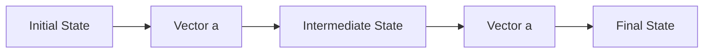

# 1 Bewegung

原始 PDF 第 15–48 页。

# 1 Bewegung

## 1.1 Ort, Verschiebung und mittlere Geschwindigkeit

## Physikalische Motivation

Eines der Ziele der Physik ist, die Bewegung von Objekten zu beschreiben – z. B. wie schnell sie sich bewegen oder welche Entfernung sie in einer bestimmten Zeit zurücklegen. Die Konstrukteure von Rennautos sind an diesem Aspekt der Physik besonders interessiert, weil diese Zusammenhänge letztlich über Sieg oder Niederlage im Rennen entscheiden. Geologen verwenden diesen Teil der Physik, um die Bewegungen von tektonischen Platten zu messen und zu versuchen, daraus Erdbeben vorherzusagen. Mediziner brauchen diese physikalischen Zusammenhänge, um aus der beobachteten Strömung des Blutes in einem Patienten den Teilverschluss einer Arterie zu diagnostizieren, und Autofahrer nutzen sie, um zu bremsen, wenn ihr Radarwarner piepst. Natürlich gibt es noch unzählige weitere Beispiele. In diesem Kapitel untersuchen wir zunächst die Grundlagen der Physik von Bewegungen, in denen sich ein Objekt (ein Rennwagen, eine tektonische Platte, rote Blutkörperchen . . . ) entlang einer einzigen Achse bewegt. Danach beschäftigen wir uns mit der Beschreibung von Bewegungen in zwei und drei Raumdimensionen.

## 1.1.1 Bewegung

Die Erde – und alles auf ihr – bewegt sich. Selbst scheinbar regungslose Dinge, wie z. B. eine Straße, bewegen sich mit der Erddrehung, der Umlaufbahn der Erde um die Sonne, der Umlaufbahn des Sonnensystems um das Zentrum der Milchstraße und der Bewegung der Galaxis relativ zu anderen Galaxien. Die Klassifizierung und der Vergleich von Bewegungen – **Kinematik** genannt – können manchmal eine große Herausforderung darstellen. Was genau messen wir dabei und wie werden die Vergleiche gezogen?

Bevor wir versuchen, diese Fragen zu beantworten, werden wir einige allgemeine Eigenschaften einer ganz bestimmten Art von Bewegung studieren. Diese wird durch drei Bedingungen eingeschränkt:

1. Die Bewegung erfolgt nur entlang einer geraden Linie. Diese Linie kann senkrecht (wie bei einem fallenden Stein), waagerecht (wie bei einem Auto auf einer geraden Straße) oder schräg verlaufen, aber sie muss eine Gerade sein.
2. Bewegung wird durch Kräfte („ziehen“ und „schieben“) verursacht – diese werden jedoch erst in Kap. 5 behandelt. In dem vorliegenden Kapitel werden wir nur die Bewegung an sich sowie Veränderungen dieser Bewegung untersuchen. Wird das bewegte Objekt schneller oder langsamer, hält es an oder wechselt es die Richtung? Welche Rolle spielt die Zeit bei der Veränderung der Bewegung?
3. Das bewegte Objekt ist entweder ein **Teilchen**, d. h. ein punktförmiges Gebilde wie z. B. ein Elektron, oder ein Objekt, das sich wie ein Teilchen bewegt (derart, dass all seine Teile sich mit exakt derselben Geschwindigkeit in dieselbe

Halliday Physik für natur- und ingenieurwiss. Studiengänge, 3. Auflage. D. Halliday, R. Resnick und J. Walker. © 2020 WILEY-VCH Verlag GmbH & Co. KGaA. Published 2020 by WILEY-VCH Verlag GmbH & Co. KGaA.

1

---

1 Bewegung

other

| Category | X (m) |
| --- | --- |
| Positive Richtung | ~0.7 |
| Negative Richtung | ~-0.7 |

Abb. 1.1

Der Ort bzw. die Position eines Teilchens lässt sich anhand einer Achse bestimmen, die in Einheiten der Länge gekennzeichnet ist (hier in Metern) und sich unendlich weit in entgegengesetzte Richtungen erstreckt. Die Achsenbeschriftung – hier x – befindet sich immer auf der positiven Seite des Ursprungs.

Richtung bewegen). Ein Kind, das seinen Körper ganz steif macht und auf dem Spielplatz eine gerade Rutsche hinunterrutscht, bewegt sich wie ein Teilchen; ein vom Wind durch die Wüste getriebener, rollender Steppenläufer dagegen nicht, da sich verschiedene Punkte in seinem Inneren in verschiedene Richtungen bewegen.

## 1.1.2 Ort und Verschiebung

Den Ort eines Teilchens zu bestimmen bedeutet, seine Position in Bezug auf einen bestimmten Referenzpunkt festzulegen, oftmals in Bezug auf den Ursprung (oder Nullpunkt) einer Achse, wie der x-Achse in Abb. 1.1. Die **positive Richtung** der Achse ist die Richtung ansteigender Zahlen (Koordinaten), die in Abb. 1.1 nach rechts zeigt. Die entgegengesetzte Richtung wird als **negative Richtung** bezeichnet.

Ein Teilchen befindet sich z. B. am Ort x = 5 m, d. h., es befindet sich 5 m in positiver Richtung vom Ursprung entfernt. Läge es bei $x = - 5   \mathrm { m } ,$ so befände es sich genauso weit vom Ursprung entfernt, allerdings in der entgegengesetzten Richtung. Auf der Achse liegt eine Koordinate von −5 m weiter links – also zu kleineren Zahlen hin – als eine von −1 m, und beide Koordinaten befinden sich weiter links als eine Koordinate von +5 m. Das Pluszeichen einer Koordinate muss man nicht ausschreiben, das Minuszeichen dagegen muss immer aufgeführt werden.

Ein Wechsel von einem Ort $x _ { 1 }$ zu einem anderen Ort $x _ { 2 }$ wird eine **Verschiebung** Δx genannt, wobei

$$
\Delta x = x _ {2} - x _ {1}. \tag {1.1}
$$

(Das Symbol $\Delta ,$ der griechische Großbuchstabe Delta, steht für eine Veränderung einer Größe, also die Differenz von Endwert und Anfangswert dieser Größe.) Wenn für die Ortsangaben $x _ { 1 }$ und $x _ { 2 }$ Zahlenwerte eingesetzt werden, so ergibt eine Verschiebung in die positive Richtung (nach rechts in Abb. 1.1) immer einen positiven Wert, eine Verschiebung in die entgegengesetzte Richtung (nach links in der Abbildung) einen negativen Wert. Bewegt sich das Teilchen beispielsweise von $x _ { 1 } = 5$ m nach $x _ { 2 } = 1 2   \mathrm { m }$ , dann ist $\Delta x = ( 1 2   \mathrm { m } ) - ( 5   \mathrm { m } ) = + 7   \mathrm { m }$ . Der positive Wert gibt an, dass die Bewegung in die positive Richtung erfolgt. Kehrt das Teilchen dann zu $x = 5$ m zurück, so ist die Verschiebung für die ganze Bewegung gleich null. Die tatsächliche Anzahl von Metern, die auf der gesamten Strecke zurückgelegt wurde, ist irrelevant. Verschiebungen berücksichtigen nur den Anfangs- und den Endpunkt einer Bewegung.

Auch bei einer Verschiebung muss ein Pluszeichen nicht aufgeführt werden, ein Minuszeichen dagegen immer. Ignorieren wir das Vorzeichen (und damit die Richtung) einer Verschiebung, so erhalten wir den **Betrag** (oder **Absolutbetrag**) der Verschiebung. Im vorangehenden Beispiel ist der Betrag von Δx gleich 7 m.

Eine Verschiebung ist ein Beispiel für eine **Vektorgröße**, d. h., eine Größe, die sowohl über eine Richtung als auch über einen Betrag verfügt. Über Vektoren werden wir in Anhang D mehr erfahren; an dieser Stelle genügt die Feststellung, dass eine Verschiebung zwei Eigenschaften besitzt: (1) Ihr Betrag ist der Abstand (wie z. B. eine Zahl von Metern) zwischen Anfangs- und Endpunkt. (2) Die Richtung der Verschiebung zwischen Anfangs- und Endpunkt wird einfach mit einem Plusoder Minuszeichen angegeben, falls die Bewegung nur entlang einer einzigen Achse erfolgt.

Was an dieser Stelle folgt, ist die erste einer Vielzahl von „Kontrollfragen“, die Ihnen in diesem Buch begegnen werden. Sie bestehen aus einer oder mehreren Fragen, deren Beantwortung gewisse Argumentationsketten oder Kopfrechnungen erfordert und die Ihnen die Möglichkeit geben, Ihr Verständnis rasch zu überprüfen. Die Antworten finden Sie am Schluss dieses Buchs.

2

---

1.1 Ort, Verschiebung und mittlere Geschwindigkeit

## KONTROLLFRAGE 1

Hier sind drei Paare von Anfangs- und Endpunkten einer Bewegung gegeben, die entlang einer x-Achse erfolgt. Welche Paare ergeben eine negative Verschiebung: (a) −3 m, 5 m; (b) −3 m, −7 m; (c) 7 m, −3 m?

## 1.1.3 Durchschnittsgeschwindigkeit

Die Position eines Teilchens lässt sich auf kompakte Weise anhand der Ort-Zeit-Kurve $x ( t )$ beschreiben. Dabei wird der Ort x als Funktion der Zeit t aufgetragen. (Dabei steht der Ausdruck $\mathbf { , } x ( t ) ^ { \omega }$ für $\scriptstyle { \pmb { \mathscr { p } } } ^ { \pmb { \mathscr { x } } }$ als Funktion von $t ^ { \alpha } ,$ nicht für das Produkt x mal t.) Abb. 1.2 zeigt als einfaches Beispiel die Ortsfunktion $x ( t )$ x(t) eines ruhenden Gürteltiers (das wir wie ein Teilchen behandeln) bei $x = - 2   \pi$ .

Abbildung 1.3a ist interessanter, da sich das Gürteltier hier bewegt. Das Tier wird offensichtlich zum ersten Mal zum Zeitpunkt $t = 0$ gesichtet, als es sich am Ort $x = - 5   \mathrm { m }$ befindet. Es bewegt sich bis $x = 0 ,$ überquert diesen Punkt bei $t = 3   ;$ s und strebt dann nach immer größer werdenden positiven Werten von x.

Abbildung 1.3b zeigt die tatsächliche geradlinige Bewegung des Gürteltiers. Sie entspricht dem, was Sie in etwa sehen würden. Die Kurve in Abb. 1.3a ist abstrakter und weiter von dem entfernt, was Sie beobachten würden, doch sie enthält mehr Information. Sie macht auch deutlich, wie schnell sich das Gürteltier bewegt.

Tatsächlich hängt der Ausdruck „wie schnell“ mit mehreren Größen zusammen. Eine von ihnen ist die **Durchschnittsgeschwindigkeit** oder **mittlere Geschwindigkeit** $\nu _ { \mathrm { g e m } } .$ Sie wird durch das Verhältnis der Verschiebung $\Delta x ,$ die in einem bestimmten Zeitintervall $\Delta t$ stattfindet, zu diesem Zeitintervall gegeben:

$$
\nu_ {\mathrm{gem}} = \frac {\Delta x}{\Delta t} = \frac {x _ {2} - x _ {1}}{t _ {2} - t _ {1}}. \tag {1.2}
$$

Diese Schreibweise bedeutet, dass die Position zum Zeitpunkt $t _ { 1 }$ gleich $x _ { 1 }$ ist und entsprechend zum Zeitpunkt $t _ { 2 }$ gleich $x _ { 2 } .$ Eine gebräuchliche Einheit für $\nu _ { \mathrm { g e m } }$ ist Meter pro Sekunde (m/s oder $\mathbf { m } \cdot \mathbf { s } ^ { - 1 } )$ . In den Aufgaben werden Ihnen eventuell auch andere Einheiten begegnen, diese haben jedoch immer die Form Länge/Zeit.

Wird x gegen t aufgetragen, so ist $\nu _ { \mathrm { g e m } }$ durch die **Steigung** der Geraden gegeben, welche zwei bestimmte Punkte der Kurve x(t) verbindet: Einer dieser Punkte entspricht $x _ { 2 }$ und $t _ { 2 } ;$ , der andere $x _ { 1 }$ und $t _ { 1 } .$ Genau wie eine Verschiebung besitzt auch $\nu _ { \mathrm { g e m } }$ einen Betrag und eine Richtung – es ist ebenfalls eine Vektorgröße. Der Betrag von $\nu _ { \mathrm { g e m } }$ entspricht dem Betrag der Steigung der Geraden. Ist $\nu _ { \mathrm { g e m } }$ (und damit die Steigung der Geraden) positiv, so steigt die Gerade nach rechts hin an; ist $\nu _ { \mathrm { g e m } }$ negativ (negative Steigung), so verläuft die Gerade von links oben nach rechts unten. Die Durchschnittsgeschwindigkeit $\nu _ { \mathrm { g e m } }$ besitzt immer das gleiche Vorzeichen wie die Verschiebung $\Delta x ,$ da $\Delta t$ in Gl. 1.2 immer positiv ist.

Abbildung 1.4 zeigt, wie man $\nu _ { \mathrm { g e m } }$ im Falle des Gürteltiers aus Abb. 1.3 für das Zeitintervall zwischen $t = 1   s$ und $t = 4   \mathrm { s }$ ermitteln kann. Dazu zeichnen wir die Gerade, die den Punkt auf der Bahnkurve am Anfang des Zeitintervalls mit demjenigen am Ende des Zeitintervalls verbindet. Dann ermitteln wir die Steigung $\Delta x / \Delta t$ der Geraden. Für das gegebene Zeitintervall ist die Durchschnittsgeschwindigkeit damit:

$$
\nu_ {\mathrm{gem}} = \frac {6 \mathrm{m}}{3 \mathrm{s}} = 2 \mathrm{m/s}.
$$

„Wie schnell“ sich ein Teilchen bewegt, lässt sich auch durch die in einem Zeitintervall insgesamt zurückgelegte Entfernung (z. B. die zurückgelegte Anzahl von Metern), unabhängig von der Richtung ausdrücken:

$$
\nu_ {\mathrm{eff}} = \frac {\text {gesamte Entfernung}}{\Delta t}  . \tag {1.3}
$$

text_image

x (m)
+1
-1 0 1 2 3 4 t (s)
-1
x(t)

Abb. 1.2

Die Kurve x(t) für ein Gürteltier, das sich unbewegt bei $x = - 2$ m aufhält. Für alle Zeiten t ist der Wert von x gleich − 2 m.

line

| Time (s) | Position (m) |
| --- | --- |
| 0 | -5 |
| 3 | 0 |
| 4 | 2 |

Abb. 1.3

(a) Die x(t)-Kurve eines sich bewegenden Gürteltiers. (b) Die Bahn, die dieser Kurve entspricht. Die Skala unterhalb der x-Achse gibt die Zeiten an, zu denen das Gürteltier bestimmte Werte von x erreicht.

3

---

1 Bewegung

line

| t (s) | x (m) (Steigung dieser Geraden) | x (m) (Nonlinear) |
| --- | --- | --- |
| 1 | -4 | -4 |
| 3 | 0 | 0 |
| 4 | 2 | 2 |

Abb. 1.4

Berechnung der Durchschnittsgeschwindigkeit zwischen t = 1 s und t = 4 s: Die Durchschnittsgeschwindigkeit entspricht der Steigung der Geraden, welche die Punkte verbindet, die diesen Zeiten auf der x(t)-Kurve entsprechen.

Diese Größe, die wir auch als **Effektivgeschwindigkeit** bezeichnen können, besitzt kein Vorzeichen, da die insgesamt zurückgelegte Entfernung keine Angaben über die Richtung der Bewegung macht. Manchmal entspricht die Effektivgeschwindigkeit $\nu _ { \mathrm { e f f } }$ (bis auf das Vorzeichen) der Durchschnittsgeschwindigkeit $\nu _ { \mathrm { g e m } }$ . Wie in der Beispielaufgabe 1.1 im Übungsbuch gezeigt wird, können sich die beiden Größen allerdings deutlich voneinander unterscheiden, wenn ein Objekt auf seinem Weg umkehrt.

## KONTROLLFRAGE 2

Ebenfalls in Beispielaufgabe 1.1 im Übungsbuch fahren Sie gleich nach dem Auftanken Ihres Fahrzeugs mit 35 km/h zum Punkt $x _ { 1 }$ zurück. Wie groß ist Ihre Durchschnittsgeschwindigkeit für die gesamte Strecke?

## LÖSUNGSSTRATEGIEN

**Strategie 1: Verstehen Sie das Problem?** Wenn man im Aufgabenlösen noch unerfahren ist, passiert es häufig, dass man die gestellte Aufgabe einfach nicht versteht. Der beste Test für Ihr Verständnis ist folgender: Können Sie die Aufgabe in Ihren eigenen Worten erklären?

Schreiben Sie die vorgegebenen Daten mit den dazugehörigen Einheiten auf, indem Sie die Symbole aus diesem Kapitel benutzen. (In der Beispielaufgabe 1.1 im Übungsbuch erlauben Ihnen die vorgegebenen Daten, in Teil (a) Ihre Verschiebung Δx und in Teil (b) das entsprechende Zeitintervall Δt herauszufinden.) Identifizieren Sie die Unbekannte und das dazugehörige Symbol. (In der gleichen Aufgabe ist die Unbekannte in Teil (c) Ihre Durchschnittsgeschwindigkeit $\nu _ { \mathrm { g e m } ^ { \cdot } } )$ Finden Sie dann die Verbindung zwischen der Unbekannten und den gegebenen Daten. (Die Verbindung ist hier Gl. 1.2, also die Definition der Durchschnittsgeschwindigkeit.)

**Strategie 2: Stimmen die Einheiten?** Stellen Sie sicher, dass Sie ein konsistentes System von Einheiten benutzen, wenn Sie die Zahlen in die Gleichungen einsetzen. In der Beispielaufgabe 1.1 im Übungsbuch sind die Einheiten durch die vorgegebenen Daten bestimmt: Kilometer für Entfernungen, Stunden für Zeitintervalle und Kilometer pro Stunde für Geschwindigkeiten. Eventuell müssen Sie ab und zu eine Einheit in eine andere umformen.

**Strategie 3: Ist Ihre Antwort plausibel?** Ist Ihre Antwort sinnvoll? Ist der Wert viel zu groß oder viel zu klein? Stimmt das Vorzeichen? Sind die Einheiten korrekt? In Teil (c) der Beispielaufgabe 1.1 im Übungsbuch z. B. ist die richtige Antwort 17 km/h. Erhalten Sie an dieser Stelle 0,000 17 km/h, −17 km/h, 17 km/s oder 17 000 km/h, so sollte Ihnen sofort klar sein, dass Sie etwas falsch gemacht haben. Der Fehler liegt möglicherweise in Ihrer Vorgehensweise, in Ihren Rechnungen oder in Tippfehlern beim Eingeben der Zahlen in Ihren Taschenrechner.

**Strategie 4: Eine Kurve lesen** Die Abb. 1.2, 1.3a und 1.4 sind Kurven, die Sie leicht lesen können sollten. In jeder Kurve ist die Variable auf der horizontalen Achse die Zeit t mit nach rechts hin ansteigenden Werten. In allen Kurven gibt die vertikale Achse den Ort x des sich bewegenden Teilchens relativ zum Ursprung an, die positive x-Richtung zeigt nach oben. Achten Sie immer auf die Einheiten (Sekunden oder Minuten; Meter oder Kilometer), in denen die Variablen angegeben werden.

## 1.2 Momentangeschwindigkeit

## Lernziele

Nach dem Durcharbeiten dieses Abschnitts sollten Sie in der Lage sein, . . .

• aus dem Ort eines Teilchens als Funktion der Zeit seine Momentangeschwindigkeit zu jedem Zeitpunkt zu berechnen,
• aus der Auftragung des Ortes eines Teilchens als Funktion der Zeit seine Momentangeschwindigkeit zu jedem Zeitpunkt zu bestimmen,

4

---

1.3 Beschleunigung

zwischen der vektoriellen Geschwindigkeit (die gerichtet bzw. im eindimensionalen Fall vorzeichenbehaftet ist) und ihrem Betrag (einer skalaren und vorzeichenlosen Größe, die im allgemeinen Sprachgebrauch auch einfach als „Geschwindigkeit“ bezeichnet wird) zu unterscheiden.

## Schlüsselideen

• Die Momentangeschwindigkeit (oder einfach Geschwindigkeit) v eines sich bewegenden Teilchens ist

$$
\nu = \lim _ {\Delta t \to 0} \frac {\Delta x}{\Delta t} = \frac {\mathrm{d} x}{\mathrm{d} t}
$$

mit $\Delta x = x _ { 2 } - x _ { 1 }$ und $\Delta t = t _ { 2 } - t _ { 1 }$

• Die zu einem bestimmten Zeitpunkt geltende Momentangeschwindigkeit kann aus der Steigung der Kurve von x als Funktion von t zu diesem Zeitpunkt bestimmt werden.
• In vielen Fällen, in denen es nicht auf die Richtung des Geschwindigkeitsvektors ankommt, bezeichnet man den Betrag dieses Vektors als „Geschwindigkeit“.

## 1.2.1 Momentangeschwindigkeit

Bisher haben Sie zwei Wege kennengelernt, anhand derer man beschreiben kann, wie schnell sich etwas bewegt: die Durchschnittsgeschwindigkeit und die Effektivgeschwindigkeit. Beide werden über ein Zeitintervall Δt gemessen. Der Ausdruck „wie schnell“ bezieht sich meist jedoch darauf, wie schnell sich ein Teilchen zu einem gegebenen Zeitpunkt bewegt – damit ist die **Momentangeschwindigkeit** v gemeint, oft auch einfach nur **Geschwindigkeit** genannt.

Die Geschwindigkeit zu einem beliebigen Zeitpunkt erhält man aus der Durchschnittsgeschwindigkeit, indem man das Zeitintervall Δt immer weiter verkürzt und gegen null gehen lässt. Je kleiner Δt wird, desto mehr nähert sich die Durchschnittsgeschwindigkeit einem Grenzwert, der der Momentangeschwindigkeit zu diesem Zeitpunkt entspricht:

$$
\nu = \lim _ {\Delta t \to 0} \frac {\Delta x}{\Delta t} = \frac {\mathrm{d} x}{\mathrm{d} t}. \tag {1.4}
$$

Diese Gleichung macht zwei Charakteristika der Momentangeschwindigkeit v deutlich: Erstens ist v die Rate, mit der sich der Ort x des Teilchens zu einem bestimmten Zeitpunkt in Abhängigkeit von der Zeit verändert. Das heißt, v ist die Ableitung von x nach t. Zweitens entspricht v zu jedem gegebenen Zeitpunkt der Steigung der Ort-Zeit-Kurve des Teilchens zu diesem bestimmten Zeitpunkt. Die Geschwindigkeit ist eine Vektorgröße und beinhaltet deshalb eine entsprechende Richtung. Der Betrag der Geschwindigkeit entspricht dem Zahlenwert ohne das Vorzeichen: Eine Geschwindigkeit von +5 m/s und eine Geschwindigkeit von −5 m/s haben damit beide den gleichen Betrag von 5 m/s. Der Geschwindigkeitsmesser in einem Auto misst den Betrag der Geschwindigkeit, nicht die Geschwindigkeit selbst, da er die Richtung nicht bestimmen kann.

## 1.3 Beschleunigung

## Lernziele

Nach dem Durcharbeiten dieses Abschnitts sollten Sie in der Lage sein, . . .

eine Beziehung zwischen der mittleren Beschleunigung, die auf ein Teilchen wirkt, der daraus resultierenden Änderung seiner Geschwindigkeit und dem für diese Änderung erforderlichen Zeitintervall anzugeben,
• aus der gegebenen Geschwindigkeit eines Teilchens als Funktion der Zeit die zu jedem Zeitpunkt wirkende Momentanbeschleunigung zu berechnen,

5

---

1 Bewegung

• aus der Auftragung der Geschwindigkeit eines Teilchens als Funktion der Zeit die zu jedem Zeitpunkt wirkende Momentanbeschleunigung sowie die in einem beliebigen Zeitintervall wirkende mittlere Beschleunigung zu ermitteln.

## Schlüsselideen

• Die mittlere Beschleunigung ist das Verhältnis aus der Änderung $\Delta \nu$ einer Geschwindigkeit und dem Zeitintervall $\Delta t ,$ in dem diese Änderung erfolgt:

$$
a _ {\mathrm{gem}} = \frac {\Delta \nu}{\Delta t}.
$$

Das Vorzeichen von $a _ { \mathrm { g e m } }$ gibt die Richtung der Beschleunigung an.

• Die Momentanbeschleunigung (oder einfach Beschleunigung) ist die erste Ableitung der Geschwindigkeit v(t) bzw. die zweite Ableitung des Ortes $x ( t )$ nach der Zeit:

$$
a _ {\mathrm{gem}} = \frac {\mathrm{d} \nu}{\mathrm{d} t} = \frac {\mathrm{d} ^ {2} x}{\mathrm{d} t ^ {2}}.
$$

• In einer Auftragung von v gegen t ist die Beschleunigung a zu einem Zeitpunkt t gleich der Steigung der Kurve am Punkt t.

## 1.3.1 Beschleunigung

Wenn sich die Geschwindigkeit eines Teilchens ändert, so sagt man, das Teilchen unterliegt einer **Beschleunigung** bzw. es wird **beschleunigt**. Erfolgt die Bewegung entlang einer Achse, so ist die **Durchschnittsbeschleunigung** $a _ { \mathrm { g e m } }$ in dem Zeitintervall Δt gleich

$$
a _ {\mathrm{gem}} = \frac {\nu_ {2} - \nu_ {1}}{t _ {2} - t _ {1}} = \frac {\Delta \nu}{\Delta t}, \tag {1.5}
$$

wobei das Teilchen zum Zeitpunkt $t _ { 1 }$ die Geschwindigkeit $\nu _ { 1 }$ und zum Zeitpunkt $t _ { 2 }$ die Geschwindigkeit $\nu _ { 2 }$ hat. Die **Momentanbeschleunigung** (oder einfach nur Be**schleunigung**) ist die Ableitung der Geschwindigkeit nach der Zeit:

$$
a = \frac {\mathrm{d} \nu}{\mathrm{d} t}. \tag {1.6}
$$

In Worten ausgedrückt ist die Beschleunigung eines Teilchens zu jedem Zeitpunkt gleich der Rate, mit der sich seine Geschwindigkeit zu diesem Zeitpunkt ändert. Grafisch entspricht die Beschleunigung an jedem Punkt der Steigung der v(t)-Kurve an diesem Punkt.

Kombinieren wir Gl. 1.6 und Gl. 1.4, so erhalten wir:

$$
a = \frac {\mathrm{d} \nu}{\mathrm{d} t} = \frac {\mathrm{d}}{\mathrm{d} t} \left(\frac {\mathrm{d} x}{\mathrm{d} t}\right) = \frac {\mathrm{d} ^ {2} x}{\mathrm{d} t ^ {2}}. \tag {1.7}
$$

Abb. 1.5 Colonel J.P. Stapp in einem Raketenschlitten, der auf sehr hohe Geschwindigkeiten gebracht wird (dabei zeigt die Beschleunigung aus der Buchseite heraus) und dann ruckartig wieder abgebremst wird (die Beschleunigung weist dabei in die Buchseite hinein) [Quelle: Mit freundlicher Erlaubnis der US Air Force].

6

---

1.3 Beschleunigung

In Worten ausgedrückt ist die Beschleunigung eines Teilchens zu jedem Zeitpunkt gleich der zweiten Ableitung seines Ortes x(t) nach der Zeit.

Eine übliche Einheit für die Beschleunigung ist Meter pro Sekunde pro Sekunde bzw. Meter pro Quadratsekunde: $\mathbf { m } / ( \mathbf { s } \cdot \mathbf { s } )$ oder $\mathbf { m } / s ^ { 2 }$ bzw. $\mathbf { m } \cdot \mathbf { s } ^ { - 2 } .$ . In den Aufgaben werden Ihnen noch andere Einheiten begegnen, sie werden jedoch immer die Form Länge∕(Zeit ⋅ Zeit) oder Länge $/ \mathrm { Z e i t } ^ { 2 }$ haben. Die Beschleunigung besitzt sowohl einen Betrag als auch eine Richtung, sie ist eine weitere Vektorgröße. Genau wie bei der Verschiebung und der Geschwindigkeit gibt das Vorzeichen der Beschleunigung ihre Richtung entlang einer Achse an. Besitzt die Beschleunigung einen positiven Wert, so erfolgt sie in positiver Richtung der Achse; ist sie negativ, erfolgt sie entsprechend in negativer Richtung.

In Abb. Ü1.2c im Übungsbuch ist die Beschleunigung der Aufzugkabine aus der dortigen Beispielaufgabe 1.2 dargestellt. Vergleichen Sie die Kurve a(t) mit derjenigen von v(t). a(t) gibt die Ableitung (Steigung) der Kurve v(t) zum entsprechenden Zeitpunkt wieder. Ist v konstant (bei 0 oder 4 m/s), so ist die Ableitung gleich null und die Beschleunigung demzufolge auch. Während der Zeit, in der sich der Aufzug in Bewegung setzt, ist die Ableitung der v(t)-Kurve positiv (die Steigung ist positiv), d. h., auch die Beschleunigung ist positiv. Während des Abbremsens sind Ableitung und Steigung der v(t)-Kurve negativ; entsprechend ist a(t) ebenfalls negativ.

Vergleichen Sie als Nächstes die Steigung der v(t)-Kurve während der beiden Beschleunigungsvorgänge. Die Steigung, die dem Abbremsen bzw. der Verzögerung des Aufzugs entspricht, ist steiler, da die Kabine zum Anhalten nur halb so viel Zeit benötigt, wie sie gebraucht hatte, um ihre übliche Fahrtgeschwindigkeit zu erreichen. Die steilere Steigung sagt aus, dass der Betrag der Verzögerung, wie in Abb. Ü1.2c im Übungsbuch dargestellt, größer ist als derjenige der Beschleunigung.

Das Gefühl, das Sie während der Fahrt mit diesem Aufzug verspüren würden, ist anhand der skizzierten Figuren angedeutet. Während der Aufzug beschleunigt, fühlen Sie sich, als würden Sie nach unten gedrückt; während des Bremsvorgangs wirkt es so, als würden Sie nach oben in die Länge gezogen. Dazwischen spüren Sie nichts Besonderes. Ihr Körper reagiert auf Beschleunigungen (er ist ein guter Beschleunigungssensor), jedoch nicht auf Geschwindigkeiten (er ist kein Geschwin digkeitsmesser). Ob Sie sich in einem Auto befinden, das sich mit 90 km/h bewegt, oder in einem mit 900 km/h fliegenden Flugzeug – Ihr Körper spürt diese Bewegung nicht. Verändern Auto oder Flugzeug jedoch abrupt ihre Geschwindigkeit, so werden Sie sich dieser Veränderung nur allzu deutlich bewusst. Der Reiz eines Freizeitparks liegt zum großen Teil in den schnellen Geschwindigkeitsänderungen, denen Sie auf den Achterbahnen ausgesetzt sind. Ein extremeres Beispiel zeigt die Fotoserie von Abb. 1.5, die aufgenommen wurde, während ein Raketenschlitten entlang einer Schiene ruckartig beschleunigt und wieder abgebremst wurde.

Abb. 1.5

Fortsetzung

7

---

1 Bewegung

Große Beschleunigungen werden oft in Einheiten von g ausgedrückt, wobei

$$
1 g = 9, 8 \mathrm{m} / \mathrm{s} ^ {2} \quad (\text {Einheit} g). \tag {1.8}
$$

(Wie wir in Abschn. 2.5 sehen werden, ist g der Betrag der Beschleunigung eines fallenden Objekts in der Nähe der Erdoberfläche.) Auf einer Achterbahn erleben Sie kurzfristig Beschleunigungen von bis zu 3g, d. h. $(3)(9,8    m/s ^2)$ , also etwa $2 9   \mathrm { m } / \mathrm { s } ^ { 2 }$ – mehr als genug, um den teuren Fahrpreis zu rechtfertigen.

## LÖSUNGSSTRATEGIEN

**Strategie 5: Das Vorzeichen einer Beschleunigung** In der Umgangssprache hat das Vorzeichen einer Beschleunigung eine nichtwissenschaftliche Bedeutung: Positive Beschleunigung bedeutet, dass der Geschwindigkeitsbetrag eines Objekts größer wird, negative Beschleunigung sagt aus, dass das Objekt langsamer wird (der Betrag der Geschwindigkeit wird kleiner). In diesem Buch bezieht sich das Vorzeichen einer Beschleunigung jedoch auf eine Richtung und nicht etwa darauf, ob die Geschwindigkeit eines Objekts größer oder kleiner wird.

Wird ein Fahrzeug mit einer ursprünglichen Geschwindigkeit $\nu   =   - 2 5$ m/s z. B. innerhalb von $^ { 5 , 0 } s$ vollständig abgebremst, so ist $a _ { \mathrm { g e m } }   =   + 5 { , } 0   \mathrm { m } / \mathrm { s } ^ { 2 }$ . Die Beschleunigung ist positiv, doch der Betrag der Geschwindigkeit des Fahrzeugs nimmt ab. Der Grund liegt in den unterschiedlichen Vorzeichen: Die Richtung der Beschleunigung ist derjenigen der Geschwindigkeit entgegengesetzt.

So interpretieren Sie die Vorzeichen korrekt:

Sind die Vorzeichen der Geschwindigkeit und der Beschleunigung eines Teilchens gleich, so nimmt der Betrag der Geschwindigkeit zu, das Teilchen wird schneller. Sind die Vorzeichen unterschiedlich, so nimmt der Geschwindigkeitsbetrag ab, das Teilchen wird langsamer.

## KONTROLLFRAGE 3

Ein Teilchen bewegt sich entlang einer x-Achse. Was ist das Vorzeichen seiner Beschleunigung, wenn es sich (a) mit ansteigendem Geschwindigkeitsbetrag in positive x-Richtung, (b) mit abfallendem Geschwindigkeitsbetrag in positive x-Richtung, (c) mit ansteigendem Geschwindigkeitsbetrag in negative x-Richtung und (d) mit abfallendem Geschwindigkeitsbetrag in negative x-Richtung bewegt?

## 1.4 Konstante Beschleunigung

## Lernziele

Nach dem Durcharbeiten dieses Abschnitts sollten Sie in der Lage sein, . . .

• die Beziehungen zwischen Ort, Verschiebung, Geschwindigkeit, Beschleunigung und Zeit (Tab. 1.1) für konstante Beschleunigungen anzuwenden,
• die Änderung der Geschwindigkeit eines Teilchens zu berechnen, indem Sie seine Beschleunigung über die Zeit integrieren,
• die Änderung des Ortes eines Teilchens zu berechnen, indem Sie seine Geschwindigkeit über die Zeit integrieren.

## Schlüsselideen

• Die folgenden fünf Gleichungen beschreiben die Bewegung eines Teilchens unter dem Einfluss einer konstanten Beschleunigung:

$$
\begin{array}{l} \nu = \nu_ {0} + a t, \quad x - x _ {0} = \nu_ {0} t + \frac {1}{2} a t ^ {2}, \\ \nu^ {2} = \nu_ {0} ^ {2} + 2 a (x - x _ {0}), \quad x - x _ {0} = \frac {1}{2} (\nu + \nu_ {0}) t, \quad x - x _ {0} = \nu t - \frac {1}{2} a t ^ {2}. \\ \end{array}
$$

Sie gelten nur für den Fall einer konstanten Beschleunigung.

8

---

1.4 Konstante Beschleunigung

## 1.4.1 Konstante Beschleunigung: Ein Sonderfall

Bei vielen Arten von Bewegungen ist die Beschleunigung entweder konstant oder zumindest annähernd gleichmäßig. Sie können z. B. ein Auto annähernd gleichmäßig beschleunigen, wenn die Ampel von Rot auf Grün springt. Die Kurven Ihrer Position, Ihrer Geschwindigkeit und Ihrer Beschleunigung würden dann denen aus Abb. 1.6 ähneln. (Beachten Sie, dass $a ( t )$ in Abb. 1.6c konstant ist, was bedeutet, dass $\nu ( t )$ in Abb. 1.6b eine konstante Steigung besitzt.) Wenn Sie das Auto danach abbremsen, um anzuhalten, so ist die Verzögerung dabei möglicherweise ebenfalls annähernd konstant.

Diese Fälle treten so häufig auf, dass ein spezieller Satz von Gleichungen aufgestellt wurde, um sie zu behandeln. Ein möglicher Weg, diese Gleichungen herzuleiten, wird in diesem Abschnitt beschrieben. Einen weiteren finden Sie im nächsten Abschnitt. Sowohl beim Studium dieser beiden Abschnitte als auch später, wenn Sie zu Hause Aufgaben lösen, sollten Sie im Hinterkopf behalten, dass diese Gleichungen nur für konstante Beschleunigungen gelten (oder für Situationen, in denen Sie die Beschleunigung näherungsweise gleich einer Konstante setzen können).

Ist die Beschleunigung konstant, so sind Durchschnittsbeschleunigung und Momentanbeschleunigung gleich. Mit kleinen Änderungen in der Schreibweise wird Gl. 1.5 damit zu:

$$
a = a _ {\mathrm{gem}} = \frac {\nu - \nu_ {0}}{t - 0}.
$$

Hierbei ist $\nu _ { 0 }$ die Geschwindigkeit zur Zeit $t = 0$ und v die Geschwindigkeit zu jedem beliebigen späteren Zeitpunkt t. Diese Gleichung lässt sich umschreiben zu:

$$
\nu = \nu_ {0} + a t. \tag {1.9}
$$

Beachten Sie, dass diese Gleichung bei $t = 0$ wie gefordert $\nu   =   \nu _ { 0 }$ ergibt. Um die Richtigkeit des Ganzen nochmals zu überprüfen, bilden Sie die Ableitung von Gl. 1.9. Damit erhalten Sie $\mathrm { d } \nu / \mathrm { d } t = a ,$ , was der Definition von a entspricht. In Abb. 1.6b ist eine Kurve von Gl. 1.9, also von der Geschwindigkeitsfunktion v(t), aufgezeichnet; die Funktion ist linear, die Kurve damit eine Gerade.

Auf ähnliche Art und Weise können wir Gl. 1.2 (mit ein paar Veränderungen in der Schreibweise) zu

$$
\nu_ {\mathrm{gem}} = \frac {x - x _ {0}}{t - 0}
$$

umschreiben und erhalten dann

$$
x = x _ {0} + \nu_ {\mathrm{gem}} t, \tag {1.10}
$$

wobei $x _ { 0 }$ die Position des Teilchens bei $t = 0$ und $\nu _ { \mathrm { g e m } }$ die Durchschnittsgeschwindigkeit zwischen $t = 0$ und einem späteren Zeitpunkt t bezeichnet.

Für die lineare Geschwindigkeitsfunktion von Gl. 1.9 ist die Durchschnittsgeschwindigkeit in einem beliebigen Zeitintervall (z. B. von $t = 0$ bis zu einem spä- teren Zeitpunkt t) der Mittelwert zwischen der Geschwindigkeit am Anfang des Intervalls $( = \nu _ { 0 } )$ und der Geschwindigkeit am Ende des Intervalls $( = \nu )$ . Für das Intervall von $t = 0$ zu einer späteren Zeit t ist die Durchschnittsgeschwindigkeit damit:

$$
\nu_ {\mathrm{gem}} = \frac {1}{2} (\nu_ {0} + \nu). \tag {1.11}
$$

Ersetzt man v durch die rechte Seite von Gl. 1.9, so erhält man nach kleinen Umformungen:

$$
\nu_ {\mathrm{gem}} = \nu_ {0} + \frac {1}{2} a t. \tag {1.12}
$$

## Abb. 1.6

- (a) Der Ort x(t) eines Teilchens, das sich unter dem Einfluss einer konstanten Beschleunigung bewegt.
- (b) Seine Geschwindigkeit v(t), die in jedem Punkt durch die Steigung der x(t)-Kurve aus (a) gegeben wird.
- (c) Seine (konstante) Beschleunigung, die der (konstanten) Steigung der v(t)-Kurve entspricht.

9

---

1 Bewegung

Einsetzen von Gl. 1.12 in Gl. 1.10 ergibt dann schließlich:

$$
x - x _ {0} = \nu_ {0} t + \frac {1}{2} a t ^ {2}. \tag {1.13}
$$

Beachten Sie, dass das Einsetzen von $t = 0$ wie gefordert $x = x _ { 0 }$ ergibt. Außerdem liefert die Ableitung von Gl. 1.13 genau Gl. 1.9 – ebenfalls wie gefordert. Abbildung 1.6a stellt Gl. 1.13 grafisch dar: Die Funktion ist quadratisch, die Kurve verläuft daher gekrümmt.

Die Gln. 1.9 und 1.13 sind die grundlegenden Gleichungen der gleichmäßig beschleunigten Bewegung. Sie können sie benutzen, um jede beliebige Aufgabe in diesem Buch zu lösen, in der eine konstante Beschleunigung angenommen wird. Zusätzlich werden wir jedoch weitere Gleichungen herleiten, die sich in bestimmten Situationen als nützlich erweisen können. Beachten Sie zunächst, dass in Aufgaben mit gleichmäßiger Beschleunigung insgesamt fünf Größen auftreten können, und zwar $x - x _ { 0 } , \nu , t , a$ und $\nu _ { 0 } .$ Üblicherweise kommt eine dieser Größen in der Übungsaufgabe nicht vor, weder als vorgegebene Größe noch als Unbekannte. Man gibt uns dann drei der verbleibenden Größen vor und fordert uns auf, die vierte zu ermitteln.

Die Gln. 1.9 und 1.13 enthalten jeweils vier dieser Größen, allerdings nicht dieselben vier. In Gl. 1.9 fehlt die Verschiebung $x   -   x _ { 0 }$ . In Gl. 1.13 ist es die Geschwindig keit v. Diese beiden Gleichungen können außerdem auf drei verschiedene Arten zu drei weiteren Gleichungen kombiniert werden, die dann jeweils eine andere „fehlende Variable“ aufweisen. In einem ersten Schritt können wir t eliminieren und erhalten damit:

$$
\nu^ {2} = \nu_ {0} ^ {2} + 2 a (x - x _ {0}). \tag {1.14}
$$

Diese Gleichung ist dann von Nutzen, wenn wir t nicht kennen und auch nicht herausfinden sollen. In einem zweiten Schritt können wir die Beschleunigung a anhand der Gln. 1.9 und 1.13 eliminieren. Wir erhalten dann eine Gleichung, in der a nicht mehr vorkommt:

$$
x - x _ {0} = \frac {1}{2} (\nu_ {0} + \nu) t. \tag {1.15}
$$

Schließlich können wir $\nu _ { 0 }$ eliminieren und bekommen:

$$
x - x _ {0} = \nu t - \frac {1}{2} a t ^ {2}. \tag {1.16}
$$

Beachten Sie den subtilen Unterschied zwischen dieser Gleichung und Gl. 1.13. Die eine beinhaltet die Anfangsgeschwindigkeit $\nu _ { 0 } ,$ , die andere die Geschwindigkeit v zur Zeit t.

In Tab. 1.1 sind die grundlegenden Gleichungen der gleichmäßig beschleunigten Bewegung (Gln. 1.9 und 1.13) sowie die spezielleren Gleichungen aufgeführt, die wir daraus abgeleitet haben. Um eine einfache Aufgabe mit konstanter Beschleunigung zu lösen, können Sie normalerweise eine der Gleichungen aus dieser Liste benutzen – falls Sie die Liste zur Hand (oder im Kopf!) haben. Wählen Sie eine Gleichung, in der die einzige Unbekannte die in der Aufgabe gesuchte Größe ist. Einfacher ist es, sich nur die Gln. 1.9 und 1.13 zu merken und beide bei Bedarf als gekoppeltes Gleichungssystem zu lösen. Ein Beispiel dafür finden Sie in Beispielaufgabe 1.4 im Übungsbuch.

## KONTROLLFRAGE 4

Die folgenden Gleichungen geben die Position x(t) eines Teilchens in vier verschiedenen Situationen an: (1) $x = 3t - 4;   (2)   x = -5t^3 + 4t^2 + 6;   (3)   x = 2/t^2 - 4/t;$ $( 4 )   x = 5 t ^ { 2 }   -   3$ . Auf welche dieser Situationen können die Gleichungen aus Tab. 1.1 angewendet werden?

10

---

1.4 Konstante Beschleunigung

TABELLE 1.1: Bewegungsgleichungen der gleichmäßig beschleunigten Bewegunga).

| Nummer der Gleichung | Gleichung | Fehlende Größe |
| --- | --- | --- |
| 1.9 | $\nu = \nu_{0} + at$ | $x - x_{0}$ |
| 1.13 | $x - x_{0} = \nu_{0}t + \frac{1}{2}at^{2}$ | $\nu$ |
| 1.14 | $\nu^{2} = \nu_{0}^{2} + 2a(x - x_{0})$ | $t$ |
| 1.15 | $x - x_{0} = \frac{1}{2}(\nu_{0} + \nu)t$ | $a$ |
| 1.16 | $x - x_{0} = vt - \frac{1}{2}at^{2}$ | $\nu_{0}$ |

a) Vergewissern Sie sich, dass die Beschleunigung tatsächlich konstant ist, bevor Sie die Gleichungen aus dieser Tabelle anwenden.

## LÖSUNGSSTRATEGIEN

**Strategie 6: Überprüfen Sie die Dimensionen** Die Dimension einer Geschwindigkeit ist $L / T -$ also die Dimension L einer Länge dividiert durch die Dimension T einer Zeit; die einer Beschleunigung ist $L / T ^ { \tilde { 2 } }$ ∕T2 . In jeder beliebigen Gleichung müssen die Dimensionen der beiden Terme links und rechts des Gleichheitszeichens die gleichen sein. Hegen Sie Zweifel an einer Gleichung, überprüfen Sie ihre Dimensionen.

Um die Dimensionen von Gl. 1.15 $\textstyle ( x   -   x _ { 0 } \; = \; \nu _ { 0 } t   +   \frac { 1 } { 2 } a t ^ { 2 } )$ zu überprüfen, stellen wir zunächst fest, dass jeder Summand auf der rechten Seite eine Länge sein muss, da dies die Dimension von x und $x _ { 0 }$ ist. Die Dimension des Ausdrucks $\nu _ { 0 } t$ ist $( L / T ) ( T ) ,$ also L. Die Dimension von $\left[ { \frac { 1 } { 2 } } a t ^ { 2 } \right.$ ist $( L / T ^ { 2 } ) ( T ^ { 2 } )$ , d. h. ebenfalls L. In dieser Gleichung gehen die Dimensionen somit auf.

## 1.4.2 Konstante Beschleunigung: ein anderer Blickwinkel1)

Die ersten beiden Gleichungen in Tab. 1.1 sind die Grundgleichungen, aus denen die anderen abgeleitet werden. Diese beiden Gleichungen können unter Ausnutzung der Bedingung, dass a konstant ist, durch Integration der Beschleunigung gewonnen werden. Um Gl. 1.9 zu erhalten, schreiben wir die Definition der Beschleunigung (Gl. 1.6) um:

$$
\mathrm{d} \nu = a \mathrm{d} t.
$$

Anschließend bilden wir das unbestimmte Integral von beiden Seiten der Gleichung:

$$
\int \mathrm{d} v = \int a \mathrm{d} t.
$$

Da die Beschleunigung a eine Konstante ist, können wir sie vor das Integralzeichen ziehen und erhalten damit:

$$
\int \mathrm{d} \nu = a \int \mathrm{d} t.
$$

oder

$$
\nu = a t + C. \tag {1.17}
$$

Um die Integrationskonstante $C$ zu ermitteln, setzen wir $t = 0 .$ Wie wir wissen, ist zu diesem Zeitpunkt $\nu = \nu _ { 0 }$ . Durch Einsetzen dieser Werte in Gl. 1.17 (die ja für alle Werte von t einschließlich $t = 0$ gelten muss) erhalten wir:

$$
\nu_ {0} = (a) (0) + C = C.
$$

1) Dieser Abschnitt ist für Studierende vorgesehen, die bereits die Integralrechnung beherrschen.

11

---

1 Bewegung

Dies schließlich in Gl. 1.17 eingesetzt ergibt Gl. 1.9.

Um Gl. 1.13 herzuleiten, schreiben wir die Definition der Geschwindigkeit (Gl. 1.4) in der Form

$$
\mathrm{d} x = \nu \mathrm{d} t
$$

und bilden dann auf beiden Seiten der Gleichung das unbestimmte Integral:

$$
\int \mathrm{d} x = \int \nu \mathrm{d} t.
$$

Im Allgemeinen ist v nicht konstant, wir können v also nicht vor das Integralzeichen ziehen. Wir können v jedoch anhand von Gl. 1.9 ersetzen und erhalten damit:

$$
\int \mathrm{d} x = \int (\nu_ {0} + a t) \mathrm{d} t.
$$

Da $\nu _ { 0 }$ ebenso wie die Beschleunigung a eine Konstante ist, lässt sich dies umschreiben als

$$
\int \mathrm{d} x = \nu_ {0} \int \mathrm{d} t + a \int t \mathrm{d} t.
$$

Nach der Integration ergibt sich nun:

$$
x = \nu_ {0} t + \frac {1}{2} a t ^ {2} + C ^ {\prime}, \tag {1.18}
$$

wobei $C ^ { \prime }$ eine weitere Integrationskonstante ist. Zum Zeitpunkt $t = 0$ ist $x = x _ { 0 }$ Einsetzen dieser Werte in Gl. 1.18 ergibt $x _ { 0 } = C ^ { \prime }$ . Ersetzen wir schließlich $C ^ { \prime }$ in Gl. 1.18 durch $x _ { 0 } ,$ so erhalten wir Gl. 1.13.

## 1.5 Der freie Fall

## Lernziele

Nach dem Durcharbeiten dieses Abschnitts sollten Sie in der Lage sein, . . .

zu verstehen, dass ein Teilchen im freien Fall (aufwärts oder abwärts) unter Vernachlässigung des Einflusses des Luftwiderstands auf seine Bewegung eine konstante nach unten gerichtete Beschleunigung mit einem Betrag g erfährt, den wir gerundet gleich $9 { , } 8   \mathrm { m } / \mathrm { s } ^ { 2 }$ setzen können,
• die Bewegungsgleichungen für konstante Beschleunigung (Tab. 1.1) auf die Bewegung im freien Fall anzuwenden.

## Schlüsselideen

Ein Objekt, das in der Nähe der Erdoberfläche frei aufsteigt oder fällt, ist ein wichtiges Beispiel einer geradlinigen Bewegung. Diese Bewegung wird durch die Gleichungen für Bewegungen unter konstanter Beschleunigung beschrieben, wir nehmen jedoch zwei Veränderungen an der Schreibweise vor: Erstens beschreiben wir die Bewegung jetzt bezüglich einer vertikalen y-Achse, deren positive Richtung nach oben zeigt, und zweitens ersetzen wir die Beschleunigung a durch $- g ,$ wobei $g$ der Betrag der Erdbeschleunigung ist. In der Nähe der Erdoberfläche ist $g = 9 , 8   \mathrm { m } / \mathrm { s } ^ { 2 }$

## 1.5.1 Der freie Fall

Sie werfen einen Gegenstand entweder nach oben oder nach unten. Könnten Sie dabei die Auswirkungen des Luftwiderstands auf seinen Flug ausschalten, so würden Sie feststellen, dass der Gegenstand mit einer bestimmten, konstanten Rate nach unten beschleunigt wird. Diese Rate wird **Gravitations-** oder **Erdbeschleunigung** genannt, ihren Betrag bezeichnet man mit $g .$ Die Beschleunigung hängt

12

---

1.5 Der freie Fall

nicht von den Eigenschaften des Gegenstands, wie Masse, Dichte oder Form, ab. Sie ist für alle Objekte gleich.

Abbildung 1.7 zeigt anhand einer Reihe von Stroboskopaufnahmen einer Feder und eines Apfels zwei Beispiele von Bewegungen im freien Fall. Während des Falls werden die beiden Gegenstände nach unten beschleunigt – beide mit derselben Rate $g .$ Ihre Geschwindigkeiten nehmen in gleichem Maße zu.

Der Betrag von $g$ hängt leicht von der geografischen Breite und von der Höhe ab. Auf Höhe des Meeresspiegels in mittleren Breiten beträgt er $9 { , } 8   \mathrm { m } / \mathrm { s } ^ { 2 }$ . Diesen Wert sollten Sie für alle Aufgaben in diesem Kapitel verwenden.

Die Bewegungsgleichungen für die gleichmäßig beschleunigte Bewegung in Tab. 1.1 gelten auch für den freien Fall in der Nähe der Erdoberfläche. Das heißt, sie gelten für ein Objekt mit senkrechter Flugrichtung – entweder nach oben oder nach unten – in dem Fall, dass die Wirkung des Luftwiderstands vernachlässigt werden kann. Beachten Sie jedoch, dass für den freien Fall Folgendes gilt: (1) Die Richtung der Bewegung liegt nun entlang einer senkrechten y-Achse anstatt einer waagerechten x-Achse, wobei die positive Richtung nach oben weist. (Dies ist für spätere Kapitel wichtig, in denen Bewegungen untersucht werden, die sowohl in horizontaler als auch in vertikaler Richtung erfolgen.) (2) Die Gravitationsbeschleunigung ist nun negativ, d. h., sie zeigt auf der y-Achse nach unten in Richtung Erdmittelpunkt und hat damit in den Gleichungen den $\mathtt { W e r t - } g$

Die Gravitationsbeschleunigung in der Nähe der Erdoberfläche ist $a =$ $- g = - 9 , 8   \mathrm { m } / \mathrm { s } ^ { 2 } ;$ der Betrag der Beschleunigung ist $g = 9 , 8   \mathrm { m } / \mathrm { s } ^ { 2 }$ . Setzen Sie für g nicht $- 9 . 8   \mathrm { m } / \mathrm { s } ^ { 2 }$ ein!

Nehmen Sie an, Sie werfen eine Tomate gerade nach oben, mit einer (positiven) Anfangsgeschwindigkeit $\nu _ { 0 } ,$ und fangen sie auf ihrer Ausgangshöhe wieder auf. Während des freien Falls – also von dem Moment an, nachdem Sie die Tomate losgelassen haben, bis kurz bevor Sie sie wieder auffangen – beschreiben die Gleichungen von Tab. 1.1 die Bewegung. Die Beschleunigung ist konstant gleich $a = - g = - 9 { , } 8   \mathrm { m } / \mathrm { s } ^ { 2 }$ , sie ist also negativ und weist nach unten. Die Geschwindigkeit jedoch verändert sich wie in den Gln. 1.9 und 1.14 angegeben: Während des Aufstiegs wird der Betrag der – positiven – Geschwindigkeit immer kleiner, bis er für einen Moment gleich null ist. Die Tomate hält zu diesem Zeitpunkt an und hat den höchsten Punkt ihrer Flugbahn erreicht. Während des Herunterfallens nimmt der Betrag der – nun negativen – Geschwindigkeit zu.

## KONTROLLFRAGE 5

(a) Wie lautet in Beispielaufgabe 1.5 im Übungsbuch das Vorzeichen der Ver schiebung des Balls während des Aufstiegs, vom Ausgangspunkt bis zum höchsten Punkt gemessen? (b) Wie lautet das Vorzeichen während des Falls nach unten, vom höchsten Punkt bis zur Rückkehr an den Ausgangspunkt gemessen? (c) Wie groß ist die Beschleunigung des Balls an seinem höchsten Punkt?

## LÖSUNGSSTRATEGIEN

**Strategie 7: Die Bedeutung von Minuszeichen** In Beispielaufgabe 1.5 im Übungs buch enthalten viele der Ergebnisse automatisch ein Minuszeichen. Es ist wichtig zu wissen, was diese Zeichen bedeuten. Bei diesen Aufgaben, die beide den freien Fall behandeln, haben wir eine vertikale Achse bestimmt (die y-Achse) und – etwas willkürlich – die Aufwärtsrichtung als positive Richtung gewählt.

Anschließend haben wir den Ursprung der y-Achse (d.h. den Ort $y = 0 )$ passend zur Aufgabe gewählt. Ein negativer Wert von y bedeutet dann, dass der Körper sich unterhalb des Ursprungs befindet. Eine negative Geschwindigkeit drückt aus, dass der Körper sich in negative Richtung – also nach unten – entlang der y-Achse bewegt. Dies gilt an jedem beliebigen Ort, an dem sich der Körper befindet.

In allen Aufgaben, die mit dem freien Fall zu tun haben, setzen wir eine negative Erdbeschleunigung an $( - 9 , 8   \mathrm { m } / \mathrm { s } ^ { 2 } )$ . Dies bedeutet, dass die Geschwindig

natural_image

Still life photo showing a white feather being placed next to several apples and a machine (no text or symbols visible)

Abb. 1.7

Eine Feder und eine Kugel, die sich im Vakuum im freien Fall befinden, bewegen sich beide unter dem Einfluss der Gravitationsbeschleunigung g nach unten. Die Beschleunigung bewirkt, dass sich der Abstand zwischen aufeinander folgenden Bildern während des Falls vergrößert. Beachten Sie, dass Feder und Apfel in Abwesenheit des Luftwiderstands jedes Mal die gleiche Strecke zurückgelegt haben [Quelle: Jim Sugar/CORBIS].

13

---

1 Bewegung

keit des Körpers im Lauf der Zeit entweder weniger positiv oder negativer wird. Dies gilt unabhängig davon, wo sich der Körper befindet, und unabhängig davon, wie schnell oder in welche Richtung er sich bewegt. In der Beispielaufgabe 1.5 im Übungsbuch ist die Beschleunigung des Balls während des gesamten Flugs negativ, d. h. nach unten gerichtet, ob der Ball nun aufsteigt oder hinunterfällt.

**Strategie 8: Unerwartete Ergebnisse** Die Mathematik liefert oft Antworten, an die Sie womöglich nicht gedacht haben, wie z. B. in der Beispielaufgabe 1.5c im Übungsbuch. Wenn Sie mehr Antworten erhalten, als Sie erwartet haben, verwerfen Sie nicht automatisch diejenigen, die nicht zu passen scheinen. Prüfen Sie sorgfältig, ob sie nicht doch eine physikalische Bedeutung haben. Ist die Zeit die gesuchte Variable, so können auch negative Zeiten etwas aussagen; ein negatives Vorzeichen verweist auf Zeiten vor t = 0, dem (willkürlich festgelegten) Zeitpunkt, an dem Sie Ihre Stoppuhr gestartet haben.

## 1.6 Zwei und drei Raumdimensionen

## Lernziele

Nach dem Durcharbeiten dieses Abschnitts sollten Sie in der Lage sein, . . .

• zwei- und dreidimensionale Ortsvektoren für ein Teilchen zu zeichnen und ihre Komponenten bezüglich der Achsen eines Koordinatensystems anzugeben,
• Betrag und Richtung des Ortsvektors eines Teilchens aus seinen Komponenten in einem Koordinatensystem zu bestimmen (und umgekehrt),
• die Beziehung zwischen dem Verschiebungsvektor eines Teilchens und seinen Start- und Endkoordinaten anzugeben.

## Schlüsselideen

• Die Position eines Teilchens relativ zum Ursprung eines Koordinatensystems wird durch einen Ortsvektor ⃗r beschrieben, der in Einheitsvektoren-Schreibweise die Form

$$
\vec {r} = x \vec {e} _ {x} + y \vec {e} _ {y} + z \vec {e} _ {z}
$$

hat. $x \vec { e } _ { x } ,   y \vec { e } _ { y }$ und $z \vec { e } _ { z }$ sind die Vektorkomponenten des Ortsvektors $\vec { r } ,$ dessen skalare Komponenten x, y und z sind (die auch die Koordinaten des Teilchens sind).

• Ein Ortsvektor wird entweder durch seinen Betrag und einen oder (in drei Dimensionen) zwei Winkel oder aber durch seine skalaren Komponenten spezifiziert.
• Wenn ein Teilchen sich so bewegt, dass sein Ortsvektor sich von ${ \vec { r } } _ { 1 }$ zu $\vec { r } _ { 2 }$ verändert, ist sein Verschiebungsvektor

$$
\Delta \vec {r} = \vec {r} _ {2} - \vec {r} _ {1}.
$$

Alternativ kann der Verschiebungsvektor auch wie folgt geschrieben werden:

$$
\begin{array}{l} \Delta \vec {r} = (x _ {2} - x _ {1}) \vec {e} _ {x} + (y _ {2} - y _ {1}) \vec {e} _ {y} + (z _ {2} - z _ {1}) \vec {e} _ {z} \\ = \Delta x \vec {e} _ {x} + \Delta \vec {e} _ {y} + \Delta z \vec {e} _ {z}. \\ \end{array}
$$

In den nun folgenden Abschnitten werden wir uns weiter mit der physikalischen Beschreibung von Bewegung beschäftigen, wobei nun aber Bewegungen in zwei oder drei Dimensionen zugelassen sein sollen. Beispielsweise können Sie ein Auto auf einer Autobahn oder Landstraße (zweidimensionale Bewegung) vermutlich sehr sicher fahren, hätten aber wahrscheinlich einige Probleme, ohne aufwändiges Training ebenso sicher ein Flugzeug zu landen (dreidimensionale Bewegung).

Bei unserer Untersuchung von zwei- und dreidimensionalen Bewegungen beginnen wir wieder mit den physikalischen Größen Ort und Verschiebung.

14

---

1.7 Durchschnittsgeschwindigkeit und Momentangeschwindigkeit

Eine allgemeine Methode, den Ort eines Teilchens (oder eines Objekts, das wie ein Teilchen behandelt werden kann) darzustellen, ist die Angabe seines **Ortsvektors** ⃗r. Dieser erstreckt sich von einem Referenzpunkt – üblicherweise dem Ursprung eines Koordinatensystems – bis zu dem entsprechenden Teilchen. In der Einheitsvektoren-Schreibweise (vergleiche Anhang D) kann ⃗r wie folgt ausgedrückt werden:

$$
\vec {r} = x \vec {e} _ {x} + y \vec {e} _ {y} + z \vec {e} _ {z}, \tag {1.19}
$$

wobei $x \vec { e } _ { x } ,   y \vec { e } _ { y }$ und $z \vec { e } _ { z }$ die Vektorkomponenten von $\vec { r }$ und die Koeffizienten x, y und z die skalaren Komponenten von ⃗r sind.

Die Koeffizienten x, y und z geben den Ort eines Teilchens entlang der Koordinatenachsen und relativ zum Ursprung an; das Teilchen besitzt also in dem rechtwinkligen Koordinatensystem die Koordinaten $( x ,   y ,   z )$ . Abbildung 1.8 zeigt z. B. ein Teilchen mit dem Ortsvektor

$$
\vec {r} = (- 3 \mathrm{m}) \vec {e} _ {x} + (2 \mathrm{m}) \vec {e} _ {y} + (5 \mathrm{m}) \vec {e} _ {z}
$$

und den rechtwinkligen Koordinaten $(-3   m , 2   m , 5   m )$ . Entlang der x-Achse befindet sich das Teilchen 3 m weit in Richtung $- \vec { e } _ { x }$ vom Ursprung entfernt. Entlang der y-Achse ist es 2 m in $+ \vec { e } _ { y }$ -Richtung und entlang der z-Achse 5 m in $+ \vec { e } _ { z }$ -Richtung vom Ursprung entfernt.

Wenn sich ein Teilchen bewegt, verändert sich sein Ortsvektor derart, dass er immer vom Referenzpunkt (dem Ursprung) zur aktuellen Position des Teilchens zeigt. Verändert sich der Ortsvektor z. B. von ${ \vec { r } } _ { 1 }$ nach $\vec { r } _ { 2 }$ innerhalb eines bestimmten Zeitintervalls, dann ist die **Verschiebung** $\Delta \vec { r }$ des Teilchens während dieses Zeitintervalls gleich

$$
\Delta \vec {r} = \vec {r} _ {2} - \vec {r} _ {1}. \tag {1.20}
$$

In der Einheitsvektoren-Schreibweise von Gl. 1.19 wird diese Verschiebung zu:

$$
\Delta \vec {r} = (x _ {2} \vec {e} _ {x} + y _ {2} \vec {e} _ {y} + z _ {2} \vec {e} _ {z}) - (x _ {1} \vec {e} _ {x} + y _ {1} \vec {e} _ {y} + z _ {1} \vec {e} _ {z})
$$

oder

$$
\Delta \vec {r} = (x _ {2} - x _ {1}) \vec {e} _ {x} + (y _ {2} - y _ {1}) \vec {e} _ {y} + (z _ {2} - z _ {1}) \vec {e} _ {z}, \tag {1.21}
$$

wobei die Koordinaten $( x _ { 1 } , y _ { 1 } , z _ { 1 } )$ zum Ortsvektor ${ \vec { r } } _ { 1 }$ und die Koordinaten $( x _ { 2 } , y _ { 2 } ,$ $z _ { 2 } )$ zum Ortsvektor $\vec { r } _ { 2 }$ gehören. Wir können die Verschiebung weiter umformen, indem wir $\Delta x$ für $( x _ { 2 } - x _ { 1 } ) ,   \Delta y$ für $( y _ { 2 } - y _ { 1 } )$ und $\Delta z$ für $( z _ { 2 } - z _ { 1 } )$ einsetzen:

$$
\Delta \vec {r} = \Delta x \vec {e} _ {x} + \Delta y \vec {e} _ {y} + \Delta z \vec {e} _ {z}. \tag {1.22}
$$

## KONTROLLFRAGE 6

(a) Eine Fledermaus fliege vom Ort mit den xyz-Koordinaten $(-2   m , 4   m , -3   m )$ nach $(6   m ,   -2   m ,   -3   m )$ . Wie lautet ihre Verschiebung $\Delta \vec { r }$ in Einheitsvektoren Schreibweise? (b) Verläuft $\Delta \vec { r }$ parallel zu einer der drei Ebenen, die von den Koordinatenachsen aufgespannt werden? Wenn ja, zu welcher?

## 1.7 Durchschnittsgeschwindigkeit und Momentangeschwindigkeit

## Lernziele

Nach dem Durcharbeiten dieses Abschnitts sollten Sie in der Lage sein, . . .

• zu verstehen, dass die Geschwindigkeit eine Vektorgröße ist und daher einen Betrag und eine Richtung sowie Komponenten besitzt,

text_image

(5 m) \vec{e}_z\n(2 m) \vec{e}_y\n(-3 m) \vec{e}_x\nO\nx\ny\n\vec{r}\nz

Abb. 1.8

Der Ortsvektor ⃗r eines Teilchens ist die Vektorsumme seiner Vektorkomponenten.

15

---

1 Bewegung

• zwei- und dreidimensionale Geschwindigkeitsvektoren für ein Teilchen zu zeichnen und ihre Komponenten bezüglich der Achsen des Koordinatensystems anzugeben,
eine Beziehung zwischen Start- und Endposition eines Teilchens, dem Zeitin tervall zwischen Start und Ankunft und dem zugehörigen Vektor der mittleren Geschwindigkeit des Teilchens sowohl in Betrag-Winkel- als auch in Einheitsvektoren-Schreibweise anzugeben,
• aus dem Ort eines Teilchens als Funktion der Zeit seinen (momentanen) Geschwindigkeitsvektor zu bestimmen.

## Schlüsselideen

• Wenn ein Teilchen im Zeitintervall Δt eine Verschiebung $\Delta \vec { r }$ erfährt, ist seine Durchschnittsgeschwindigkeit $\vec { \nu } _ { \mathrm { g e m } }$ in diesem Zeitintervall

$$
\vec {\nu} _ {\mathrm{gem}} = \frac {\Delta \vec {r}}{\Delta t}.
$$

• Wenn wir das Zeitintervall Δt gegen null gehen lassen, erhalten wir die Momentangeschwindigkeit $\vec { \nu } ( t ) = \vec { \nu }$ (oft auch einfach als Geschwindigkeit bezeichnet):

$$
\vec {\nu} = \frac {\mathrm{d} \vec {\nu}}{\mathrm{d} t},
$$

die wir in Einheitsvektoren-Schreibweise als

$$
\vec {\nu} = \nu_ {x} \vec {e} _ {x} + \nu_ {y} \vec {e} _ {y} + \nu_ {z} \vec {e} _ {z}
$$

mit $\nu _ { x } = \mathrm { d } \nu / \mathrm { d } x ,   \nu _ { y } = \mathrm { d } \nu / \mathrm { d } y$ und $\nu _ { z } = \mathrm { d } \nu / \mathrm { d }$ z schreiben können.

• Die Momentangeschwindigkeit v⃗ eines Teilchens zeigt stets in Richtung der Tangente an die Bahnkurve des Teilchens an seinem momentanen Ort.

## 1.7.1 Mittlere und Momentangeschwindigkeit

Wenn ein Teilchen in einem Zeitintervall $\Delta t$ eine Verschiebung $\Delta \vec { r }$ durchläuft, dann ist seine **Durchschnittsgeschwindigkeit** $\vec { \nu } _ { \mathrm { g e m ^ { \ast } } }$

$$
\text {Durchschnittsgeschwindigkeit} = \frac {\text {Verschiebung}}{\text {Zeitintervall}}
$$

beziehungsweise

$$
\vec {\nu} _ {\mathrm{gem}} = \frac {\Delta \vec {r}}{\Delta t}. \tag {1.23}
$$

Dies bedeutet, dass die Richtung von $\vec { \nu } _ { \mathrm { g e m } }$ (dem Vektor auf der linken Seite von Gl. 1.23) dieselbe sein muss wie die der Verschiebung $\Delta \vec { r }$ (des Vektors auf der rechten Seite). Anhand von Gl. 1.22 können wir Gl. 1.23 in Vektorkomponenten umschreiben und erhalten:

$$
\vec {\nu} _ {\mathrm{gem}} = \frac {\Delta x \vec {e} _ {x} + \Delta y \vec {e} _ {y} + \Delta z \vec {e} _ {z}}{\Delta t} = \frac {\Delta x}{\Delta t} \vec {e} _ {x} + \frac {\Delta y}{\Delta t} \vec {e} _ {y} + \frac {\Delta z}{\Delta t} \vec {e} _ {z}. \tag {1.24}
$$

Wenn sich die Fledermaus aus Kontrollfrage 6 in 2,0 s von ihrer Anfangs- zu ihrer Endposition bewegt, so ist ihre Durchschnittsgeschwindigkeit während dieses Zeitintervalls:

$$
\vec {v} _ {\mathrm{gem}} = \frac {\Delta \vec {r}}{\Delta t} = \frac {(8 \mathrm{m}) \vec {e} _ {x} - (6 , 0 \mathrm{m}) \vec {e} _ {y}}{2 , 0 \mathrm{s}} = (4, 0 \mathrm{m/s}) \vec {e} _ {x} - (3 \mathrm{m/s}) \vec {e} _ {y}.
$$

Wenn wir von der **Geschwindigkeit** eines Teilchens sprechen, so meinen wir üblicherweise die **Momentangeschwindigkeit** v⃗ des Teilchens zu einem bestimmten

16

---

1.7 Durchschnittsgeschwindigkeit und Momentangeschwindigkeit

Zeitpunkt. Diese Geschwindigkeit $\vec { \nu }$ ist der Grenzwert, den $\vec { \nu } _ { \mathrm { g e m } }$ anstrebt, wenn wir das Zeitintervall $\Delta t$ um diesen Zeitpunkt herum gegen null gehen lassen. Formal können wir v⃗ also als die Ableitung

$$
\vec {\nu} = \frac {\mathrm{d} \vec {r}}{\mathrm{d} t} \tag {1.25}
$$

schreiben. Abbildung 1.9 zeigt die Bahnkurve eines Teilchens, dessen Bewegung auf die $x y .$ -Ebene beschränkt ist. Während das Teilchen sich entlang der Kurve nach rechts bewegt, schwenkt auch sein Ortsvektor nach rechts. Während des Zeitintervalls $\Delta t$ ändert sich der Ortsvektor von ${ \vec { r } } _ { 1 }$ nach ${ \vec { r } } _ { 2 } ,$ die Verschiebung des Teilchens ist $\Delta \vec { r } = \vec { r } _ { 2 } - \vec { r } _ { 1 }$

Um die Momentangeschwindigkeit des Teilchens zur Zeit $t _ { 1 }$ zu bestimmen (zu der sich das Teilchen am Ort 1 befindet), lassen wir das Intervall $\Delta t$ um $t _ { 1 }$ herum gegen null gehen. Dabei passieren drei Dinge: (1) Der Ortsvektor $\vec { r } _ { 2 }$ in Abb. 1.9 bewegt sich au $\mathrm { f }   \vec { r } _ { 1 }$ zu, sodass $\Delta \vec { r }$ gegen null geht. (2) Die Richtung von $\Delta \vec { r } / \Delta t$ (also von $\vec { \nu } _ { \mathrm { g e m } } )$ nähert sich der Richtung der Tangente an die Bahnkurve des Teilchens im Punkt 1 an. (3) Die Durchschnittsgeschwindigkeit $\vec { \nu } _ { \mathrm { g e m } }$ nähert sich der Momentangeschwindigkeit $\vec { \nu }$ zum Zeitpunkt $t _ { 1 }$ an.

Für $\Delta t \rightarrow 0$ geht $\vec { \nu } _ { \mathrm { g e m } }$ im Grenzwert gegen $\vec { \nu } ;$ außerdem nimmt $\vec { \nu } _ { \mathrm { g e m } } - \mathrm { w a s }$ a n dieser Stelle besonders wichtig ist – die Richtung der Tangente an die Bahnkurve an. Also besitzt v⃗ ebenfalls diese Richtung:

Die Richtung der Momentangeschwindigkeit v⃗ eines Teilchens verläuft immer tangential zur Bahnkurve am momentanen Ort des Teilchens.

Dieses Ergebnis gilt genauso in drei Dimensionen: $\vec { \nu }$ weist immer entlang der Tangente an die (räumliche) Bahnkurve des Teilchens.

Um Gl. 1.25 in Einheitsvektoren-Schreibweise zu schreiben, ersetzen wir $\vec { r }$ anhand von Gl. 1.19:

$$
\vec {v} = \frac {\mathrm{d}}{\mathrm{d} t} (x \vec {e} _ {x} + y \vec {e} _ {y} + z \vec {e} _ {z}) = \frac {\mathrm{d} x}{\mathrm{d} t} \vec {e} _ {x} + \frac {\mathrm{d} y}{\mathrm{d} t} \vec {e} _ {y} + \frac {\mathrm{d} z}{\mathrm{d} t} \vec {e} _ {z}.
$$

Diese Gleichung lässt sich vereinfachen, indem wir sie in die Form

$$
\vec {\nu} = \nu_ {x} \vec {e} _ {x} + \nu_ {y} \vec {e} _ {y} + \nu_ {z} \vec {e} _ {z} \tag {1.26}
$$

bringen, wobei die skalaren Komponenten von v⃗ gleich

$$
\nu_ {x} = \frac {\mathrm{d} x}{\mathrm{d} t}, \quad \nu_ {y} = \frac {\mathrm{d} y}{\mathrm{d} t} \quad \text {und} \quad \nu_ {z} = \frac {\mathrm{d} z}{\mathrm{d} t} \tag {1.27}
$$

sind. So ist $\mathrm { d } x / \mathrm { d } t \mathrm {  ~ z . ~ } \mathrm { B } .$ die skalare Komponente von $\vec { \nu }$ entlang der x-Achse. Wir können also die skalaren Komponenten von v⃗ bestimmen, indem wir die skalaren Komponenten von $\vec { r }$ nach der Zeit ableiten.

Abbildung 1.10 zeigt einen Geschwindigkeitsvektor $\vec { \nu }$ und seine skalaren Komponenten in x- und $y \cdot$ Richtung. Beachten Sie, dass $\vec { \nu }$ am Ort des Teilchens tangential zur Bahnkurve des Teilchens verläuft. Vorsicht: Wenn ein Ortsvektor wie in den Abb. 1.8 und 1.9 gezeichnet wird, dann wird er durch einen Pfeil dargestellt, der sich von einem Punkt (einem „hier“) zu einem anderen Punkt (einem „dort“) erstreckt. Wenn ein Geschwindigkeitsvektor so gezeichnet wird wie in Abb. 1.10, dann erstreckt er sich nicht von einem Punkt zu einem anderen. Vielmehr zeigt er die momentane Richtung an, in der sich das Teilchen bewegt, das sich an seinem Anfang befindet. Die Länge des Pfeils (die dem Betrag der Geschwindigkeit entspricht) kann in einem beliebigen Maßstab gezeichnet werden.

## KONTROLLFRAGE 7

Die Abbildung zeigt die kreisförmige Bahn eines Teilchens. Die Momentangeschwindigkeit des Teilchens ist $\vec { \nu } = ( 2   \mathrm { m / s } ) \vec { e } _ { x } - ( 2   \mathrm { m / s } ) \vec { e } _ { y } .$ In welchem Quadranten befindet sich das Teilchen, wenn es den Kreis (a) im Uhrzeigersinn und (b) im Gegenuhrzeigersinn durchläuft? Zeichnen Sie v⃗ in beiden Fällen in die Abbildung ein.

text_image

y
Tangente
1
Δr
2
O
x
r₁
r₂
Bahnkurve

Abb. 1.9 Die Verschiebung $\Delta \vec { r }$ eines Teilchens während eines Zeitintervalls Δt von Position 1 mit Ortsvektor $\vec { r } _ { 1 }$ zur Zeit $t _ { 1 }$ zur Position 2 mit Ortsvektor $\vec { r } _ { 2 }$ zur Zeit $t _ { 2 } .$ Eingezeichnet ist auch die Tangente an die Bahnkurve des Teilchens am Ort 1.

text_image

y
Tangente
v_y
v
v_x
O
x
Bahnkurve

Abb. 1.10 Die Geschwindigkeit ⃗v eines Teilchens und die skalaren Komponenten von ⃗v.

natural_image

Simple geometric diagram showing a circle centered at the origin on a Cartesian coordinate system (x, y axes), no text or labels present.

17

---

1 Bewegung

## 1.8 Durchschnittsbeschleunigung und Momentanbeschleunigung

## Lernziele

Nach dem Durcharbeiten dieses Abschnitts sollten Sie in der Lage sein, . . .

• zu verstehen, dass die Beschleunigung eine Vektorgröße ist und daher sowohl einen Betrag als auch eine Richtung sowie Komponenten besitzt,
• zwei- und dreidimensionale Beschleunigungsvektoren für ein Teilchen zu zeichnen und ihre Komponenten anzugeben,
aus der Start- und Endgeschwindigkeit eines Teilchens und dem entsprechen den Zeitintervall den zugehörigen Vektor der mittleren Beschleunigung des Teilchens sowohl in Betrag-Winkel- als auch in Einheitsvektoren-Schreibweise anzugeben,
• aus der Geschwindigkeit eines Teilchens als Funktion der Zeit seinen (momentanen) Beschleunigungsvektor zu bestimmen,
• die Gleichungen für eine Bewegung mit konstanter Beschleunigung (siehe Abschn. 1.4) für jede Dimension der Bewegung anzuwenden, um Beschleunigung, Geschwindigkeit, Ort und Zeit in Beziehung zu setzen.

## Schlüsselideen

• Wenn sich die Geschwindigkeit eines Teilchens im Zeitintervall $\Delta t$ von ${ \vec { \nu } } _ { 1 }$ auf $\vec { \nu } _ { 2 }$ ändert, ist seine mittlere Beschleunigung $\vec { a } _ { \mathrm { g e m } }$ in diesem Zeitintervall

$$
\vec {a} _ {\mathrm{gem}} = \frac {\vec {\nu} _ {2} - \vec {\nu} _ {1}}{\Delta t} \frac {\Delta \vec {\nu}}{\Delta t}.
$$

• Wenn wir das Zeitintervall Δt gegen null gehen lassen, erhalten wir die Momentanbeschleunigung $\vec { a }$ (oft auch einfach als Beschleunigung bezeichnet):

$$
\vec {a} = \frac {\mathrm{d} \vec {v}}{\mathrm{d} t}.
$$

• In Einheitsvektoren-Schreibweise ist

$$
\vec {a} = a _ {x} \vec {e} _ {x} + a _ {y} \vec {e} _ {y} + a _ {z} \vec {e} _ {z}
$$

mit $a_{x} = \mathrm{d}a / \mathrm{d}x, a_{y} = \mathrm{d}a / \mathrm{d}y   and   a_{z} = \mathrm{d}a / \mathrm{d}z.$

## 1.8.1 Veränderliche Geschwindigkeiten

Wenn sich die Geschwindigkeit eines Teilchens innerhalb eines Zeitintervalls Δt von ${ \vec { \nu } } _ { 1 }$ auf $\vec { \nu } _ { 2 }$ ändert, dann ist seine **Durchschnittsbeschleunigung** (oder **mittlere Beschleunigung**) $\vec { a } _ { \mathrm { g e m } }$ im Zeitintervall Δt durch

$$
\text {Durchschnittsbeschleunigung} = \frac {\text {Geschwindigkeitsänderung}}{\text {Zeitintervall}}
$$

gegeben, d. h.:

$$
\vec {a} _ {\mathrm{gem}} = \frac {\vec {\nu} _ {2} - \vec {\nu} _ {1}}{\Delta t} = \frac {\Delta \vec {\nu}}{\Delta t}. \tag {1.28}
$$

Lassen wir $\Delta t$ um einen bestimmten Zeitpunkt herum gegen null gehen, dann nä- hert sich $\vec { a } _ { \mathrm { g e m } }$ im Grenzwert der **Momentanbeschleunigung** (oder Beschleuni**gung**) a⃗ zu diesem Zeitpunkt an, d. h.:

$$
\vec {a} = \frac {\mathrm{d} \vec {v}}{\mathrm{d} t}. \tag {1.29}
$$

Wenn die Geschwindigkeit sich entweder in ihrem Betrag oder in ihrer Richtung ändert (oder in beiden), dann muss das Teilchen einer Beschleunigung unterliegen.

18

---

1.9 Wurfbewegungen

Indem wir $\vec { \nu }$ anhand von Gl. 1.26 ersetzen, können wir Gl. 1.29 in die Einheitsvektoren-Schreibweise umschreiben:

$$
\vec {a} = \frac {\mathrm{d}}{\mathrm{d} t} (\nu_ {x} \vec {e} _ {x} + \nu_ {y} \vec {e} _ {y} + \nu_ {z} \vec {e} _ {z}) = \frac {\mathrm{d} \nu_ {x}}{\mathrm{d} t} \vec {e} _ {x} + \frac {\mathrm{d} \nu_ {y}}{\mathrm{d} t} \vec {e} _ {y} + \frac {\mathrm{d} \nu_ {z}}{\mathrm{d} t} \vec {e} _ {z}.
$$

Dies können wir wiederum in die Form

$$
\vec {a} = a _ {x} \vec {e} _ {x} + a _ {y} \vec {e} _ {y} + a _ {z} \vec {e} _ {z} \tag {1.30}
$$

bringen, wobei die skalaren Komponenten von a⃗ gleich

$$
a _ {x} = \frac {\mathrm{d} \nu_ {x}}{\mathrm{d} t}, \quad a _ {y} = \frac {\mathrm{d} \nu_ {y}}{\mathrm{d} t} \quad \text {und} \quad a _ {z} = \frac {\mathrm{d} \nu_ {z}}{\mathrm{d} t} \tag {1.31}
$$

sind. Demnach ermitteln wir die skalaren Komponenten von ${ \vec { a } } ,$ indem wir die skalaren Komponenten von v⃗ nach der Zeit ableiten.

Abbildung 1.11 zeigt einen Beschleunigungsvektor a⃗ und seine skalaren Komponenten für ein Teilchen, dass sich in zwei Dimensionen bewegt. Vorsicht: Wenn ein Beschleunigungsvektor wie in Abb. 1.11 gezeichnet wird, erstreckt er sich nicht von einem Punkt zu einem anderen. Vielmehr zeigt er die Richtung der Beschleunigung eines Teilchens an, das sich am Anfang des Vektors befindet. Seine Länge (der Betrag der Beschleunigung) kann in einem beliebigen Maßstab gezeichnet werden.

## KONTROLLFRAGE 8

Anbei finden Sie vier Angaben (in Metern) zur Position eines Eishockeypucks, der sich in einer xy-Ebene bewegt:

Bestimmen Sie für jede dieser Positionen, ob x- und y-Komponente der Beschleunigung des Pucks konstant sind und ob der Beschleunigungsvektor a⃗ konstant ist.

## KONTROLLFRAGE 9

Die Position einer Murmel wird durch $\vec { r } = ( 4 t ^ { 3 } - 2 t ) \vec { e } _ { x } + 3 \vec { e } _ { y }$ beschrieben, wobei ⃗r in Metern und t in Sekunden gemessen wird. Welche Einheiten besitzen die Koeffizienten $4 , - 2$ und 3?

## 1.9 Wurfbewegungen

## Lernziele

Nach dem Durcharbeiten dieses Abschnitts sollten Sie in der Lage sein, . . .

• in einer Skizze der Bahnkurve eines Teilchens Betrag und Richtung der Geschwindigkeit sowie die Komponenten der Beschleunigung anzugeben,
aus der gegebenen Startgeschwindigkeit eines Teilchens in Betrag-Richtungoder Einheitsvektoren-Schreibweise den Ort, die Verschiebung und die Geschwindigkeit des Teilchens für beliebige Zeitpunkte während seines Flugs zu berechnen,
• aus den Daten für einen beliebigen Zeitpunkt während des Flugs die Startgeschwindigkeit zu berechnen.

## Schlüsselideen

Bei Wurfbewegungen wird ein Teilchen mit einer Geschwindigkeit $\nu _ { 0 }$ in einem Winkel $\theta _ { 0 }$ (gegen eine horizontale x-Achse gemessen) in die Luft geworfen. Während des Flugs ist seine horizontale Beschleunigung (unter Vernachlässigung des Luftwiderstands) null und seine vertikale Beschleunigung beträgt −g (entlang einer vertikalen y-Achse nach unten).

text_image

y
ax
ay
a
Bahnkurve
O
x

Abb. 1.11

Die Beschleunigung a⃗ eines Teilchens und die skalaren Komponenten von a⃗.

19

---

1 Bewegung

• Während des Flugs lauten die Bewegungsgleichungen des Teilchens

$$
\begin{array}{l} x - x _ {0} = (\nu_ {0} \cos \theta_ {0}) t, \\ y - y _ {0} = (\nu_ {0} \sin \theta_ {0}) t - \frac {1}{2} g t ^ {2}, \\ \nu_ {y} = \nu_ {0} \sin \theta_ {0} - g t, \\ \nu_ {y} ^ {2} = (\nu_ {0} \sin \theta_ {0}) ^ {2} - 2 g (y - y _ {0}). \\ \end{array}
$$

• Die Trajektorie (Bahnkurve, Flugbahn) eines fliegenden Teilchens ist eine Parabel, die für $x _ { 0 } = y _ { 0 } = 0$ durch

$$
y = (\tan \theta_ {0}) x - \frac {g x ^ {2}}{2 (\nu_ {0} \cos \theta_ {0}) ^ {2}}
$$

gegeben ist.

• Die horizontale Reichweite R des Teilchens, d. h. die horizontale Entfernung vom Startpunkt bis zu der Stelle, an der es die Abwurfhöhe wieder erreicht, beträgt

$$
R = \frac {\nu_ {0} ^ {2}}{g} \sin 2 \theta_ {0}.
$$

## 1.9.1 Flugbahnen

natural_image

Microscopic view of a yellow-green cellular or biological structure with white branching patterns against a black background (no text or symbols)

Abb. 1.12

Eine Stroboskopaufnahme eines gelben Tennisballs, der von einer harten Oberfläche abprallt. Zwischen den Augenblicken, in denen er den Boden berührt, führt der Ball eine Wurfbewegung aus [Quelle: Richard Megna/Fundamental Photographs].

Als Nächstes betrachten wir einen Spezialfall der zweidimensionalen Bewegung: Ein Teilchen bewege sich in einer senkrechten Ebene mit einer bestimmten Anfangsgeschwindigkeit $\vec { \nu } _ { 0 }$ und unterliege dabei der nach unten gerichteten Gravitationsbeschleunigung $\vec { g } .$ Ein solches Teilchen wird ein **Projektil** genannt, da es geworfen oder geschossen wurde. Seine Bewegung bezeichnen wir als eine **Wurfbewegung**. Ein solches Projektil kann z. B. ein Tennisball (Abb. 1.12) oder ein Stein während des Flugs sein – ein Flugzeug oder eine fliegende Ente wären jedoch keine Projektile. Unser Ziel ist es hier, die Wurfbewegung anhand der in den Abschn. 4.1–4.3 vorgestellten „Werkzeuge“ für die zweidimensionale Bewegung zu analysieren. Dazu setzen wir voraus, dass die Auswirkungen des Luftwiderstands auf das Projektil vernachlässigt werden können.

Die Abb. 1.13, die im nächsten Abschnitt analysiert wird, zeigt die Bahnkurve, die ein Projektil beschreibt, wenn der Luftwiderstand gleich null ist. Das Projektil wird mit einer Anfangsgeschwindigkeit $\vec { \nu } _ { 0 }$ geworfen, die sich in der Form

$$
\vec {\nu} _ {0} = \nu_ {0 x} \vec {e} _ {x} + \nu_ {0 y} \vec {e} _ {y} \tag {1.32}
$$

Abb. 1.13

Die Bahn eines Projektils, das bei $x _ { 0 } = 0$ und $y _ { 0 } = 0$ mit einer Anfangsgeschwindigkeit $\vec { \nu } _ { 0 }$ geworfen wird. Eingezeichnet sind die Anfangsgeschwindigkeit sowie die Geschwindigkeiten an verschiedenen Punkten der Bahnkurve zusammen mit ihren Komponenten. Beachten Sie, dass die horizontale Geschwindigkeitskomponente konstant bleibt, die vertikale Geschwindigkeitskomponente sich jedoch kontinuierlich verändert. Die Reichweite R ist die horizontale Entfernung, die das Projektil in dem Moment zurückgelegt hat, in dem es wieder seine Ausgangshöhe erreicht.

text_image

y
vy = 0
vy
vx
vy
vx
O
v0x
θ0
R
x
vy
v
v
vx
vy
v

20

---

1.9 Wurfbewegungen

schreiben lässt. Die Komponenten $\vec { \nu } _ { 0 x }$ und $\vec { \nu } _ { 0 y }$ lassen sich mithilfe des Winkels $\theta _ { 0 }$ zwischen $\vec { \nu } _ { 0 }$ und der positiven x-Richtung bestimmen:

$$
\nu_ {0 x} = \nu_ {0} \cos \theta_ {0} \quad \text {und} \quad \nu_ {0 y} = \nu_ {0} \sin \theta_ {0}. \tag {1.33}
$$

Während der zweidimensionalen Bewegung des Projektils verändern sich sein Ortsvektor ⃗r und sein Geschwindigkeitsvektor v⃗ kontinuierlich; der Beschleuni gungsvektor a⃗ ist jedoch konstant und immer senkrecht nach unten gerichtet. Ein Projektil erfährt keine horizontale Beschleunigung.

Die in den Abb. 1.12 und 1.13 dargestellte Wurfbewegung sieht kompliziert aus, die folgende – experimentell bestätigte – Tatsache vereinfacht die Situation jedoch deutlich:

Bei der Wurfbewegung erfolgen die horizontale und die vertikale Bewegung unabhängig voneinander, sie beeinflussen sich gegenseitig nicht.

Diese Eigenschaft erlaubt es uns, eine Aufgabe mit einer zweidimensionalen Bewegung in zwei getrennte, einfachere eindimensionale Aufgaben zu zerlegen – eine für die horizontale Bewegung (bei der die Beschleunigung null ist) und eine für die vertikale Bewegung (mit einer gleichmäßigen, nach unten gerichteten Beschleunigung). Lassen Sie uns zwei Experimente betrachten, die zeigen, dass die waagerechte und die senkrechte Bewegung voneinander unabhängig sind.

## Zwei Golfbälle

Abbildung 1.14 zeigt eine Stroboskopaufnahme zweier Golfbälle: Während der eine Ball einfach fallen gelassen wird, wird der andere durch eine Feder in die ho rizontale Richtung geschossen. Die Golfbälle besitzen die gleiche vertikale Bewegung, beide fallen während desselben Zeitintervalls die gleiche senkrechte Strecke nach unten. Die Tatsache, dass sich der eine Ball während des Falls auch horizontal bewegt, hat keinen Einfluss auf seine vertikale Bewegung. Die waagerechte und die senkrechte Bewegung sind also unabhängig voneinander.

## Ein Beispiel für die Physikvorlesung

Abbildung 1.15 zeigt eine Vorführung, die bereits in zahlreichen Physikvorlesungen für Stimmung gesorgt hat. Dazu wird ein Blasrohr mit einem kleinen Ball als Projektil benötigt. Ziel ist es, eine an einem Magneten M aufgehängte Dose zu treffen; das Blasrohr ist dabei direkt auf die Büchse gerichtet. Das Experiment wird so aufgebaut, dass der Magnet die Dose genau in dem Augenblick freigibt, in dem der Ball das Blasrohr verlässt.

Wäre g (der Betrag der Erdbeschleunigung) gleich null, so würde der Ball wie in Abb. 1.15 gezeigt eine gerade Linie beschreiben und die Dose würde, nachdem der Magnet sie freigegeben hat, an ein und derselben Stelle hängenbleiben. Der Ball würde die Dose mit Sicherheit treffen.

Die Gravitationsbeschleunigung g ist jedoch nicht gleich null. Und dennoch trifft der Ball die Dose! Wie Abb. 1.15 zeigt, fallen Dose und Ball während der Flugzeit des Balls ab dem Moment, in dem der Ball das Blasrohr verlässt, um die gleiche Strecke h. Je stärker der Vorführende in das Rohr bläst, desto größer ist die Anfangsgeschwindigkeit des Balls, desto kürzer ist die Flugzeit und desto kleiner auch der Wert von h.

## 1.9.2 Analyse der Wurfbewegung

Lassen Sie uns nun die Wurfbewegung sowohl in horizontaler als auch in vertikaler Richtung im Einzelnen analysieren.

natural_image

Black background with scattered red and yellow dots, no text or symbols present

Abb. 1.14 Ein Ball wird ohne Anfangsgeschwindigkeit in dem Moment fallen gelassen, in dem ein anderer Ball horizontal nach rechts geworfen wird. Die vertikale Bewegung der beiden Bälle ist identisch [Quelle: Richard Megna/ Fundamental Photographs].

text_image

Bahnkurve für g = 0
M
Dose
h
G

Abb. 1.15 Der Ball – das Projektil – trifft die fallende Dose immer. Beide fallen eine Entfernung h von dem Punkt aus gemessen, an dem sie sich ohne Gravitationsbeschleunigung befinden würden.

21

---

1 Bewegung

## Die horizontale Bewegung

Da in horizontaler Richtung keine Beschleunigung stattfindet, bleibt die horizontale Komponente $\nu _ { x }$ der Projektilgeschwindigkeit während der gesamten Bewegung unverändert gleich der Anfangsgeschwindigkeit $\nu _ { 0 x }$ . Zu jeder beliebigen Zeit t ist die horizontale Verschiebung $\Delta x = x - x _ { 0 }$ des Projektils von seiner Ausgangsposition $x _ { 0 }$ durch Gl. 1.13 gegeben, wobei $\alpha = 0$ ist. Damit haben wir

$$
x - x _ {0} = \nu_ {0} t.
$$

Wegen $\nu _ { 0 x } = \nu _ { 0 }$ cos $\theta _ { 0 }$ wird daraus:

$$
x - x _ {0} = (\nu_ {0} \cos \theta_ {0}) t. \tag {1.34}
$$

## Die vertikale Bewegung

Die vertikale Bewegung entspricht derjenigen, die wir in Abschn. 2.5 für ein Teilchen im freien Fall untersucht hatten. Wichtig ist hier, dass die Beschleunigung konstant ist. Also gelten die Gleichungen aus Tab. 1.1, wobei wir a durch $- g$ ersetzen und die Gleichungen für y umschreiben müssen. So wird etwa Gl. 1.13 zu:

$$
y - y _ {0} = \nu_ {0 y} t - \frac {1}{2} g t ^ {2} = (\nu_ {0} \sin \theta_ {0}) t - \frac {1}{2} g t ^ {2}, \tag {1.35}
$$

wobei die vertikale Komponente $\nu _ { 0 y }$ der Anfangsgeschwindigkeit durch den äquivalenten Ausdruck $\nu _ { 0 }$ sin $\theta$ ersetzt wurde. Analog ergibt sich aus den Gln. 1.9 und 1.14

$$
\nu_ {y} = \nu_ {0} \sin \theta_ {0} - g t \tag {1.36}
$$

und

$$
\nu_ {y} ^ {2} = (\nu_ {0} \sin \theta_ {0}) ^ {2} - 2 g (y - y _ {0}). \tag {1.37}
$$

Wie aus Abb. 1.13 und Gl. 1.36 deutlich wird, verhält sich die vertikale Geschwin digkeitskomponente genauso wie bei einem Ball, der senkrecht nach oben geworfen wurde. Sie zeigt anfänglich nach oben und ihr Betrag nimmt kontinuierlich ab, bis er schließlich verschwindet – dieser Punkt entspricht der maximalen Höhe der Flugbahn. Daraufhin verändert die Geschwindigkeitskomponente ihre Richtung und ihr Betrag wird mit der Zeit immer größer.

## Die Bahngleichung

Wir können die Gleichung ermitteln, welche die Form der Flugbahn (**Trajektorie**) des Teilchens beschreibt, indem wir t aus den Gln. 1.34 und 1.35 eliminieren. Dazu lösen wir Gl. 1.34 nach t auf und setzen das Ergebnis in Gl. 1.35 ein. Nach kleinen Umformungen erhalten wir:

$$
y = (\tan \theta_ {0}) x - \frac {g x ^ {2}}{2 (\nu_ {0} \cos \theta_ {0}) ^ {2}}. \tag {1.38}
$$

Dies ist die Gleichung der in Abb. 1.13 gezeigten Bahnkurve. Bei ihrer Herleitung haben wir der Einfachheit halber in den Gln. 1.34 und 1.35 jeweils $x _ { 0 } = 0$ und $y _ { 0 } = 0$ gesetzt. Da $g , \theta _ { 0 }$ und $\nu _ { 0 }$ Konstanten sind, hat Gl. 1.38 die allgemeine Form $y = ax + bx^{2}$ , wobei a und b konstant sind. Dies ist die Gleichung einer Parabel; man sagt, das Projektil beschreibt eine parabolische Bahn bzw. eine Wurfparabel.

22

---

1.9 Wurfbewegungen

## Die horizontale Reichweite

Die horizontale Reichweite des Projektils ist, wie Abb. 1.13 zeigt, die Entfernung, die das Projektil in horizontaler Richtung zurückgelegt hat, wenn es seine ursprüngliche (Abwurf-)Höhe wieder erreicht. Um die Reichweite R zu bestimmen, setzen wir $x - x _ { 0 } = R$ in Gl. 1.34 und $y - y _ { 0 } = 0$ in Gl. 1.35. Damit erhalten wir:

$$
R = (\nu_ {0} \cos \theta_ {0}) t
$$

und

$$
0 = (\nu_ {0} \sin \theta_ {0}) t - \frac {1}{2} g t ^ {2}.
$$

Eliminieren wir t aus diesen beiden Gleichungen, so ergibt sich:

$$
R = \frac {2 \nu_ {0} ^ {2}}{g} \sin \theta_ {0} \cos \theta_ {0}.
$$

Nun nutzen wir aus, dass sin $2 \theta _ { 0 } = 2$ sin $\theta _ { 0 }$ cos $\theta _ { 0 }$ (siehe Anhang D), und erhalten damit:

$$
R = \frac {\nu_ {0} ^ {2}}{g} \sin 2 \theta_ {0}. \tag {1.39}
$$

Vorsicht: Diese Gleichung gibt nicht die horizontale Entfernung an, die ein Projektil zurückgelegt hat, wenn die Höhe des Endpunkts ungleich der Höhe des Startpunkts ist.

Beachten Sie, dass der Wert von R in Gl. 1.39 maximal wird, wenn sin $2 \theta _ { 0 } = 1$ ist; dies entspricht einem Winkel von $2 \theta _ { 0 } = 9 0 ^ { \circ }$ bzw. $\theta _ { 0 } = 4 5 ^ { \circ }$

Die horizontale Reichweite R ist maximal, wenn das Projektil in einem Winkel von $4 5 ^ { \circ }$ geworfen bzw. geschossen wird.

## Der Luftwiderstand

Wir haben bisher vorausgesetzt, dass die Luft, durch die sich das Projektil bewegt, keinerlei Auswirkungen auf seine Bewegung hat. In vielen Situationen kann die Abweichung zwischen unseren Rechnungen und der tatsächlichen Bewegung des Projektils allerdings ganz beträchtlich sein, da die Luft der Bewegung in der Realität durchaus einen Widerstand entgegensetzt. Abbildung 1.16 z. B. zeigt zwei Bahnkurven eines Balls, der in einem Winkel von 60° zur Horizontalen und mit einer Anfangsgeschwindigkeit von $4 4 . 7$ m/s geworfen wird. Bahn I entspricht einer be rechneten Kurve, welche die normalen Bedingungen (in Luft) annähernd wieder gibt. Bahn II ist die Kurve, die der Ball in einem Vakuum beschreiben würde.

TABELLE 1.2: Zwei $\mathrm { B \ddot { a } l l e ^ { a ) } }$

|  | Bahn I (in Luft) | Bahn II (im Vakuum) |
| --- | --- | --- |
| Reichweite | 98,5 m | 177 m |
| maximale Höhe | 53,0 m | 76,8 m |
| Flugzeit | 6,6 s | 7,9 s |

a) Siehe Abb. 1.16. Der Wurfwinkel beträgt 60°, die Abwurfgeschwindigkeit 44,7 m/s.

text_image

y
→v₀
60°
I
II
x

Abb. 1.16

(I) Die Bahn eines geworfenen Balls, wenn man sie unter Berücksichtigung des Luftwiderstands berechnet. (II) Die Bahn, die derselbe Ball im Vakuum beschreiben würde. Sie wurde mit den in diesem Kapitel vorgestellten Methoden berechnet. Die verwendeten Daten finden Sie in Tab. 1.2 [Quelle: Nach „The Trajectory of a Fly Ball“ von Brancazio, P.J. (1985). The Physics Teacher].

23

---

1 Bewegung

## KONTROLLFRAGE 10

Ein Fußball wird über das Spielfeld getreten. Was passiert während seines Flugs (bei dem Sie den Luftwiderstand vernachlässigen können) mit (a) der horizontalen und (b) der vertikalen Komponente seiner Geschwindigkeit? Wie groß sind (c) die horizontale und (d) die vertikale Komponente seiner Beschleunigung während des Anstiegs, des Herabfallens und am höchsten Punkt seiner Flugbahn?

## 1.10 Die gleichförmige Kreisbewegung

## Lernziele

Nach dem Durcharbeiten dieses Abschnitts sollten Sie in der Lage sein, . . .

• die Bahnkurve in einer gleichförmigen Kreisbewegung zu skizzieren und die während der Bewegung auftretenden Geschwindigkeits- und Beschleunigungsvektoren zu erläutern (Betrag und Richtung),
• Beziehungen zwischen dem Radius der Kreisbahn, der Periode der Bewegung, der Geschwindigkeit des Teilchens und dem Betrag seiner Beschleunigung anzugeben und anzuwenden.

## Schlüsselideen

• Wenn ein Teilchen sich mit konstanter Geschwindigkeit v im Kreis oder entlang eines Kreisbogens mit Radius r bewegt, spricht man von einer gleichförmigen Kreisbewegung. Ein solches Teilchen erfährt eine Beschleunigung $\vec { a }$ mit dem konstanten Betrag

$$
a = \frac {v ^ {2}}{r}
$$

in Richtung des Kreismittelpunkts, die als Zentripetalbeschleunigung bezeichnet wird.

• Zur Vollendung eines vollständigen Umlaufs benötigt das Teilchen die Zeit

$$
T = \frac {2 \pi r}{\nu},
$$

die als Periode der Kreisbewegung bezeichnet wird.

flowchart

Abb. 1.17

Geschwindigkeits- und Beschleunigungsvektoren eines Teilchens, das gegen den Uhrzeigersinn eine gleichförmige Kreisbewegung absolviert. Geschwindigkeit und Beschleunigung besitzen einen konstanten Betrag, ändern jedoch kontinuierlich ihre Richtung.

## 1.10.1 Konstanter Betrag, variable Richtung

Ein Teilchen führt eine **gleichförmige Kreisbewegung** aus, wenn es sich mit konstantem, d. h. gleichförmigem Geschwindigkeitsbetrag auf einem Kreis oder einem Kreisbogen bewegt. Obwohl sich der Betrag der Geschwindigkeit nicht ändert, wird das Teilchen beschleunigt. Dies mag auf den ersten Blick verwunderlich erscheinen, da wir eine Beschleunigung meist mit einer Vergrößerung oder Verkleinerung des Geschwindigkeitsbetrags in Verbindung bringen. Tatsächlich ist die Geschwindigkeit jedoch ein Vektor, kein Skalar. Wenn eine Geschwindigkeit also nicht ihren Betrag, sondern nur ihre Richtung verändert, so ist dennoch eine Beschleunigung im Spiel – und genau dies ist bei der gleichförmigen Kreisbewegung der Fall.

Abbildung 1.17 verdeutlicht die Beziehung zwischen dem Geschwindigkeitsvektor und dem Beschleunigungsvektor während verschiedener Phasen einer gleichförmigen Kreisbewegung. Während des Ablaufs der Bewegung ist der Betrag beider Vektoren konstant, ihre Richtung ändert sich jedoch kontinuierlich, da die Geschwindigkeit immer in Bewegungsrichtung entlang der Tangente an die Kreisbahn zeigt. Die Beschleunigung ist immer auf den Mittelpunkt des Kreises gerichtet. Deshalb wird die Beschleunigung in der gleichförmigen Kreisbewegung auch **Zentripetalbeschleunigung** genannt (was so viel bedeutet wie „den Mittelpunkt suchende“ Beschleunigung). Wie wir gleich beweisen werden, ist der Betrag

24

---

1.10 Die gleichförmige Kreisbewegung

dieser Beschleunigung $\vec { a }$ gleich

$$
a = \frac {v ^ {2}}{r} \quad (\text {Zentripetalbeschleunigung}), \tag {1.40}
$$

wobei r der Radius der Kreisbahn und v der Betrag der Geschwindigkeit des Teilchens ist.

Während dieser Beschleunigung bei konstantem Geschwindigkeitsbetrag legt das Teilchen den Umfang des Kreises (welcher der Strecke 2πr entspricht) in der Zeit $T$ zurück mit

$$
T = \frac {2 \pi r}{\nu} \quad (\text {Periode}). \tag {1.41}
$$

T wird die Periode der Bewegung genannt. Im Allgemeinen bezeichnet man damit die Zeit, die ein Teilchen benötigt, um eine geschlossene Bahn genau einmal zu durchlaufen.

## 1.10.2 Beweis von Gl. 1.40

Um den Betrag und die Richtung der Beschleunigung bei einer gleichförmigen Kreisbewegung zu bestimmen, betrachten wir Gl. 1.32. In Abb. 1.18a bewegt sich das Teilchen p mit konstantem Geschwindigkeitsbetrag v entlang einer Kreisbahn mit Radius r. Zu dem dargestellten Zeitpunkt besitzt p die Koordinaten $x _ { \mathrm { p } }$ und $y _ { \mathrm { p } } .$

In Abschn. 4.2 hatten wir gezeigt, dass die Geschwindigkeit v⃗ eines bewegten Teilchens immer entlang der Tangente an die Bahnkurve des Teilchens am momentanen Ort des Teilchens zeigt. In Abb. 1.18a bedeutet dies, dass ⃗v senkrecht auf dem Radius r steht, der zum Ort des Teilchens führt. Dann ist der Winkel $\theta ,$ den v⃗ am Ort von p mit der Vertikalen bildet, gleich dem Winkel θ zwischen dem Radius r und der x-Achse.

Die skalaren Komponenten von ⃗v sind in Abb. 1.18b dargestellt. Mit ihnen können wir die Geschwindigkeit v⃗ in der Form

$$
\vec {\nu} = \nu_ {x} \vec {e} _ {x} + \nu_ {y} \vec {e} _ {y} = (- \nu \sin \theta) \vec {e} _ {x} + (\nu \cos \theta) \vec {e} _ {y} \tag {1.42}
$$

schreiben. Indem wir das rechtwinklige Dreieck aus Abb. 1.18a nutzen, können wir sin θ durch $y _ { \mathrm { p } } / r$ und cos θ durch $x _ { \mathrm { p } } / r$ ersetzen und erhalten damit

$$
\vec {\nu} = \left(- \frac {\nu}{r} y _ {\mathrm{p}}\right) \vec {e} _ {x} + \left(\frac {\nu}{r} x _ {\mathrm{p}}\right) \vec {e} _ {y}. \tag {1.43}
$$

Um die Beschleunigung a⃗ des Teilchens p zu ermitteln, müssen wir diese Gleichung nach der Zeit ableiten. Da sich der Geschwindigkeitsbetrag v und der Radius r im Lauf der Zeit nicht ändern, ergibt dies

$$
\vec {a} = \frac {\mathrm{d} \vec {\nu}}{\mathrm{d} t} = \left(- \frac {\nu}{r} \frac {\mathrm{d} y _ {\mathrm{p}}}{\mathrm{d} t}\right) \vec {e} _ {x} + \left(\frac {\nu}{r} \frac {\mathrm{d} x _ {\mathrm{p}}}{\mathrm{d} t}\right) \vec {e} _ {y}. \tag {1.44}
$$

## Abb. 1.18

Das Teilchen p bewegt sich im Gegenuhrzeigersinn gleichförmig im Kreis. (a) Seine Position und Geschwindigkeit ⃗v zu einem bestimmten Zeitpunkt. (b) Die Geschwindigkeit ⃗v und ihre Komponenten. (c) Die Beschleunigung a⃗ des Teilchens und ihre Komponenten.

text_image

y
v
θ
P
r
θ
x_p
y_p
x

(a)

text_image

y
→
v
θ
vy
vx
x

(b)

text_image

y
a_x
→
φ
a_y
x

(c)

25

---

1 Bewegung

Beachten Sie nun, dass die Rate $\mathrm { d } y _ { \mathrm { p } } / \mathrm { d } t _ { \mathrm { r } }$ mit der sich $y _ { \mathrm { p } }$ verändert, gleich der Geschwindigkeitskomponente $\nu _ { y }$ ist. Entsprechend ist d $x _ { \mathrm { p } } ^ { \mathrm { ~ \scriptsize ~ r ~ } } / \mathrm { d } t = \nu _ { x }$ . Ebenfalls aus Abb. 1.18b sehen wir, dass $\nu _ { x } = - \nu$ sin θ und $\nu _ { y } = \nu \cos \hat { \theta }$ . Einsetzen in Gl. 1.44 liefert:

$$
\vec {a} = \left(- \frac {\nu^ {2}}{r} \cos \theta\right) \vec {e} _ {x} + \left(- \frac {\nu^ {2}}{r} \sin \theta\right) \vec {e} _ {y}. \tag {1.45}
$$

Dieser Vektor und seine Komponenten sind in Abb. 1.18c dargestellt. Mit der allgemeinen Regel für Beträge und Richtungen von Vektoren (vgl. Gl. D.6 in Anhang D) finden wir, dass der Betrag von a⃗ gleich

$$
a = \sqrt {a _ {x} ^ {2} + a _ {y} ^ {2}} = \frac {v ^ {2}}{r} \sqrt {(\cos \theta) ^ {2} + (\sin \theta) ^ {2}} = \frac {v ^ {2}}{r}
$$

ist, genau wie wir es beweisen wollten. Um die Richtung von $\vec { a }$ zu ermitteln, bestimmen wir den in Abb. 1.18c eingezeichneten Winkel $\varphi ;$

$$
\tan \varphi = \frac {a _ {y}}{a _ {x}} = \frac {- (\nu^ {2} / r) \sin \theta}{- (\nu^ {2} / r) \cos \theta} = \tan \theta.
$$

Demnach ist $\varphi = \theta ,$ was bedeutet, dass $\vec { a }$ entlang dem in Abb. 1.18a eingezeichneten Radius r in Richtung Kreismittelpunkt zeigt, wie wir es beweisen wollten.

## KONTROLLFRAGE 11

Ein Gegenstand bewege sich mit konstantem Geschwindigkeitsbetrag in einer ho rizontalen xy-Ebene entlang einer Kreisbahn mit Mittelpunkt im Ursprung des Koordinatensystems. In dem Moment, in dem sich der Gegenstand bei $x = - 2$ m befindet, sei seine Geschwindigkeit gleich $- ( 4   \mathrm { m / s } ) \vec { e } _ { y }$ . Geben Sie (a) die Geschwindigkeit und (b) die Beschleunigung des Gegenstands am Ort $y = 2$ m an.

## 1.11 Relativbewegung in einer Dimension

## Lernziele

Nach dem Durcharbeiten dieses Abschnitts sollten Sie in der Lage sein, . . .

• die Beziehung zwischen Ort, Geschwindigkeit und Beschleunigung eines Teilchens anzugeben, wenn diese in zwei Bezugssystemen gemessen werden, die sich mit konstanter Geschwindigkeit entlang einer Achse gegeneinander bewegen.

## Schlüsselideen

Wenn sich zwei Bezugssysteme A und B mit konstanter Geschwindigkeit relativ zueinander bewegen, unterscheidet sich die von einem Beobachter im Bezugssystem A gemessene Geschwindigkeit eines Teilchens P in der Regel von der, die ein Beobachter im Bezugssystem B misst. Die beiden gemessenen Geschwindig keiten hängen über

$$
\vec {\nu} _ {\mathrm{PA}} = \vec {\nu} _ {\mathrm{PB}} + \vec {\nu} _ {\mathrm{BA}}
$$

miteinander zusammen, wobei $\vec { \nu } _ { \mathrm { B A } }$ die Geschwindigkeit von B relativ zu A ist. Beobachter in beiden Bezugssystemen messen jedoch dieselbe Beschleunigung des Teilchens:

$$
\vec {a} _ {\mathrm{PA}} = \vec {a} _ {\mathrm{PB}}.
$$

## 1.11.1 Bezugssysteme

Nehmen Sie an, Sie beobachten eine Ente, die mit 30 km/h nach Norden fliegt. Aus Sicht einer zweiten Ente, die neben der ersten herfliegt, ändert die erste Ente ihre Position dagegen nicht (sie befindet sich immer „neben mir“). Mit anderen Worten: Die Geschwindigkeit eines Teilchens hängt vom **Bezugssystem** desjenigen ab,

26

---

1.11 Relativbewegung in einer Dimension

der die Bewegung beobachtet bzw. die Geschwindigkeit misst. In unserem Fall ist ein Bezugssystem durch das physikalische Objekt gegeben, an dem wir unser Koordinatensystem befestigen. Im Alltag ist dies meist der Erdboden. So wird z. B. die Geschwindigkeit, die auf Ihrem Bußgeldbescheid erscheint, immer relativ zum Erdboden gemessen. Die Geschwindigkeit relativ zum Auto vor Ihnen ist eine ganz andere, da sich dies während der Messung relativ zum Erdboden bewegt!

Nehmen wir an, dass Alex (am Ursprung des Bezugssystems A) am Rand der Autobahn hält und zusieht, wie das Auto P (das „Teilchen“) vorbeifährt. Barbara (im Ursprung des Bezugssystems B) fährt mit konstanter Geschwindigkeit die Autobahn entlang und beobachtet dabei ebenfalls das Auto P. Wie in Abb. 1.19 gezeigt, messen beide die Position des Autos zu einem bestimmten Zeitpunkt. Aus der Abbildung können wir ablesen, dass

$$
x _ {\mathrm{PA}} = x _ {\mathrm{PB}} + x _ {\mathrm{BA}}. \tag {1.46}
$$

Diese Gleichung besagt Folgendes: „Die von A gemessene Koordinate $x _ { \mathrm { P A } }$ von P ist gleich der von B gemessenen Koordinate $x _ { \mathrm { P B } }$ von P plus der von A gemessenen Koordinate $x _ { \mathrm { A B } }$ von B.“ Beachten Sie, wie diese Bedeutung in der Reihenfolge der Indizes zum Ausdruck kommt.

Indem wir Gl. 1.46 nach der Zeit ableiten, erhalten wir:

$$
\frac {\mathrm{d}}{\mathrm{d} t} (x _ {\mathrm{PA}}) = \frac {\mathrm{d}}{\mathrm{d} t} (x _ {\mathrm{PB}}) + \frac {\mathrm{d}}{\mathrm{d} t} (x _ {\mathrm{BA}})
$$

oder (da $\nu = \mathrm { d } x / \mathrm { d } t )$

$$
\nu_ {\mathrm{PA}} = \nu_ {\mathrm{PB}} + \nu_ {\mathrm{BA}}. \tag {1.47}
$$

Diese Gleichung bedeutet: „Die von A gemessene Geschwindigkeit $\nu _ { \mathrm { P A } }$ von P ist gleich der von B gemessenen Geschwindigkeit $\nu _ { \mathrm { P B } }$ von P plus der von A gemessenen Geschwindigkeit $\nu _ { \mathrm { B A } }$ von B.“ Der Term $\nu _ { \mathrm { B A } }$ entspricht der Geschwindigkeit des Bezugssystems B relativ zum Bezugssystem A. (Da die Bewegungen entlang einer einzigen Achse erfolgen, können wir hier in Gl. 1.47 die Komponenten entlang dieser Achse benutzen und die Vektorpfeile weglassen.)

An dieser Stelle beschränken wir unsere Betrachtungen auf Bezugssysteme, die sich relativ zueinander mit konstanter Geschwindigkeit bewegen. In unserem Beispiel bedeutet dies, dass Barbara (System B) relativ zu Alex (System A) immer mit derselben Geschwindigkeit $\nu _ { \mathrm { B A } }$ fährt. Das Auto P jedoch (das bewegte Teilchen) kann schneller oder langsamer werden, anhalten oder die Richtung wechseln (d. h, es darf einer Beschleunigung unterliegen).

Um die von Barbara und Alex gemessenen Beschleunigungen von P miteinander zu verknüpfen, leiten wir Gl. 1.47 nach der Zeit ab:

$$
\frac {\mathrm{d}}{\mathrm{d} t} (\nu_ {\mathrm{PA}}) = \frac {\mathrm{d}}{\mathrm{d} t} (\nu_ {\mathrm{PB}}) + \frac {\mathrm{d}}{\mathrm{d} t} (\nu_ {\mathrm{BA}}).
$$

Da $\nu _ { \mathrm { B A } }$ konstant ist, ist der letzte Term gleich null und wir erhalten:

$$
a _ {\mathrm{PA}} = a _ {\mathrm{PB}}. \tag {1.48}
$$

Mit anderen Worten:

Bei einem sich bewegenden Teilchen messen Beobachter in verschiedenen Bezugssystemen (die sich mit gleichförmiger Geschwindigkeit relativ zueinander bewegen) die gleiche Beschleunigung.

## KONTROLLFRAGE 12

Die nebenstehende Tabelle gibt für Barbara und das Auto P aus Abb. 1.19 in drei unterschiedlichen Situationen verschiedene Geschwindigkeiten an (in km/h). Wie lautet der fehlende Wert in jeder der drei Situationen und wie verändert sich die Entfernung zwischen Barbara und dem Auto P?

text_image

Bezug-
system A
Bezug-
system B
P
vBA
xPA = xPB + xBA
x

Abb. 1.19

Alex (Bezugssystem A) und Barbara (Bezugssystem B) beobachten das Auto P, während B und P sich mit unterschiedlichen Geschwindigkeiten entlang der identisch verlaufenden x-Achsen der beiden Systeme bewegen. Zu dem dargestellten Zeitpunkt ist $x _ { \mathrm { B A } }$ die Koordinate von B im System A. P besitzt im System B die Koordinate $x _ { \mathrm { P B } }$ und im System A die Koordinate $x _ { \mathrm { P A } } = x _ { \mathrm { P B } } + x _ { \mathrm { B A } } .$

|  | $\nu_{\text{BA}}$ | $\nu_{\text{PA}}$ | $\nu_{\text{PB}}$ |
| --- | --- | --- | --- |
| (a) | +50 | +50 |  |
| (b) | +30 |  | +40 |
| (c) |  | +60 | -20 |

27

---

1 Bewegung

## 1.12 Relativbewegung in zwei Dimensionen

## Lernziele

Nach dem Durcharbeiten dieses Abschnitts sollten Sie in der Lage sein, . . .

• die Beziehung zwischen Position, Geschwindigkeit und Beschleunigung eines Teilchens in zwei Dimensionen aus Sicht zweier Bezugssysteme zu formulieren, die sich mit konstanter Geschwindigkeit aneinander vorbeibewegen.

## Schlüsselideen

Wenn sich zwei Bezugssysteme A und B mit konstanter Geschwindigkeit aneinander vorbeibewegen, unterscheidet sich die in System A gemessene Geschwindigkeit eines Teilchens P in der Regel von der im System B gemessenen. Die beiden gemessenen Geschwindigkeiten hängen über die Beziehung

$$
\vec {\nu} _ {\mathrm{PA}} = \vec {\nu} _ {\mathrm{PB}} + \vec {\nu} _ {\mathrm{BA}}
$$

zusammen. Dabei ist $\vec { \nu } _ { \mathrm { B A } }$ die Geschwindigkeit von B relativ zu A. Beide Beobachter bzw. Systeme messen jedoch die gleiche Beschleunigung von P:

$$
\vec {a} _ {\mathrm{PA}} = \vec {a} _ {\mathrm{PB}}.
$$

## 1.12.1 Mehr als eine Dimension

text_image

P
rPB
y
rPA
Bezugssystem B
vBA
x
y
rBA
x

Bezugssystem A

Abb. 1.20

Bezugssystem B besitzt eine konstante zweidimensionale Geschwindigkeit $\vec { \nu } _ { \mathrm { B A } }$ relativ zum Bezugssystem A. Der Ortsvektor von B relativ zu A ist $\vec { r } _ { \mathrm { B A } } .$ Die Ortsvektoren des Teilchens P sind $\vec { r } _ { \mathrm { P A } }$ relativ zu A und $\vec { r } _ { \mathrm { P B } }$ relativ zu B.

Wir wenden uns nun der Relativbewegung in zwei (und nach Erweiterung auch in drei) Dimensionen zu. In Abb. 1.20 betrachten unsere beiden Beobachter wieder ein sich bewegendes Teilchen P vom Ursprung ihrer jeweiligen Bezugssysteme A und B aus. Dabei bewegt sich B mit einer konstanten Geschwindigkeit $\vec { \nu } _ { \mathrm { B A } }$ relativ zu A. (Die Achsen der beiden Bezugssysteme bleiben dabei jedoch parallel.)

Abbildung 1.20 stellt eine Momentaufnahme während der Bewegung dar. Zu diesem Zeitpunkt ist der Ortsvektor von B relativ zu A gleich $\vec { r } _ { \mathrm { B A } }$ . Die Ortsvektoren des Teilchens P sind $\vec { r } _ { \mathrm { P A } }$ relativ zu A und $\vec { r } _ { \mathrm { P B } }$ relativ zu B. Aus der Anordnung dieser drei Ortsvektoren können wir schließen, dass sie über die Gleichung

$$
\vec {r} _ {\mathrm{PA}} = \vec {r} _ {\mathrm{PB}} + \vec {r} _ {\mathrm{BA}} \tag {1.49}
$$

miteinander verknüpft sind. Indem wir diese Beziehung nach der Zeit ableiten, erhalten wir eine Verbindung zwischen den Geschwindigkeiten $\vec { \nu } _ { \mathrm { P A } }$ und $\vec { \nu } _ { \mathrm { P B } }$ des Teilchens P relativ zu unseren Beobachtern:

$$
\vec {\nu} _ {\mathrm{PA}} = \vec {\nu} _ {\mathrm{PB}} + \vec {\nu} _ {\mathrm{BA}}. \tag {1.50}
$$

Indem wir diese Gleichung wiederum nach der Zeit ableiten, können wir die Beschleunigungen $\vec { a } _ { \mathrm { P A } }$ und $\vec { a } _ { \mathrm { P B } }$ des Teilchens P relativ zu den beiden Beobachtern miteinander verbinden. Beachten Sie jedoch, dass die Ableitung von $\vec { \nu } _ { \mathrm { B A } }$ nach der Zeit null ist, da $\vec { \nu } _ { \mathrm { B A } }$ konstant ist. Damit erhalten wir also:

$$
\vec {a} _ {\mathrm{PA}} = \vec {a} _ {\mathrm{PB}}. \tag {1.51}
$$

Genau wie bei der eindimensionalen Bewegung gilt auch hier die Regel: Beobachter in verschiedenen Bezugssystemen, die sich mit konstanter Geschwindigkeit relativ zueinander bewegen, messen für ein sich bewegendes Teilchen die gleiche Beschleunigung.

## KONTROLLFRAGE 13

Nehmen Sie in Beispielaufgabe 1.13 im Übungsbuch an, dass der Pilot das Flugzeug so abwendet, dass es direkt in Richtung Osten zeigt, ohne dabei jedoch den Betrag der Fluggeschwindigkeit (relativ zum Wind) zu verändern. Welche der folgenden Beträge nehmen ab, welche nehmen zu und welche bleiben konstant: (a) $\nu _ { \mathrm { P G } , y } ,$ (b) $\nu _ { \mathrm { P G } , x }$ und $( \mathtt { c } )   \nu _ { \mathrm { P G } } ?$ (Diese Frage können Sie ohne Berechnungen beantworten.)

28

---

1.13 Zusammenfassung

## 1.13 Zusammenfassung

**Ort** Der Ort x eines Teilchens auf einer x-Achse gibt die Position eines Teilchens in Bezug auf den **Ursprung** oder **Nullpunkt** der Achse an. Der Ort ist entweder positiv oder negativ, je nachdem, auf welcher Seite des Ursprungs sich das Teilchen befindet. Er ist null, wenn das Teilchen sich am Ursprung befindet. Die **positive Richtung** der Achse ist die Richtung ansteigender positiver Zahlen; die entgegengesetzte Richtung ist die **negative Richtung**.

**Verschiebung** Die Verschiebung Δx eines Teilchens ist die Änderung seiner Position:

$$
\Delta x = x _ {2} - x _ {1}. \tag {1.1}
$$

Die Verschiebung ist eine Vektorgröße. Sie ist positiv, wenn das Teilchen sich in die positive Richtung der x-Achse bewegt hat. Sie ist negativ, wenn es sich in die negative Richtung bewegt hat.

**Durchschnittsgeschwindigkeit** Hat sich ein Teilchen während des Zeitintervalls $\Delta t = t _ { 2 } - t _ { 1 }$ von einem Ort $x _ { 1 }$ zu einem Ort $x _ { 2 }$ bewegt, so ist seine Durchschnittsgeschwindigkeit in diesem Intervall

$$
\nu_ {\mathrm{gem}} = \frac {\Delta x}{\Delta t} = \frac {x _ {2} - x _ {1}}{t _ {2} - t _ {1}}. \tag {1.2}
$$

Das Vorzeichen von $\nu _ { \mathrm { g e m } }$ gibt die Richtung der Bewegung an $( \nu _ { \mathrm { g e m } }$ ist eine Vektorgröße). Die Durchschnittsgeschwindigkeit hängt nicht von der tatsächlichen Entfernung ab, die ein Teilchen zurücklegt, sondern nur vom Anfangs- und Endpunkt seines Weges.

Auf einer Kurve von x in Abhängigkeit von t entspricht die Durchschnittsgeschwindigkeit in einem bestimmten Zeitintervall $\Delta t$ der Steigung der Geraden, die die Endpunkte des Zeitintervalls auf der Kurve verbindet.

**Effektivgeschwindigkeit** Die Effektivgeschwindigkeit $\nu _ { \mathrm { e f f } }$ eines Teilchens während eines Zeitintervalls Δt hängt von der Entfernung ab, die das Teilchen während dieses Zeitintervalls insgesamt zurückgelegt hat:

$$
\nu_ {\text {eff}} = \frac {\text {Gesamtentfernung}}{\Delta t}  . \tag {1.3}
$$

**Momentangeschwindigkeit** Die Momentangeschwindigkeit (oder kurz **Geschwindigkeit**) v eines sich bewegenden Teilchens ist gleich

$$
\nu = \lim _ {\Delta t \to 0} \frac {\Delta x}{\Delta t} = \frac {\mathrm{d} x}{\mathrm{d} t}, \tag {1.4}
$$

wobei $\Delta x$ und $\Delta t$ durch Gl. 1.2 gegeben sind. Die Momentangeschwindigkeit (zu einem bestimmten Zeitpunkt) entspricht der Steigung der Kurve von x in Abhängigkeit von t (zu diesem bestimmten Zeitpunkt).

**Mittlere Beschleunigung** Die mittlere Beschleunigung ist das Verhältnis einer Veränderung der Geschwindigkeit Δv zur Dauer des Zeitintervalls $\Delta t ,$ in dem die Veränderung stattfindet:

$$
a _ {\mathrm{gem}} = \frac {\Delta v}{\Delta t}. \tag {1.5}
$$

Das Vorzeichen gibt die Richtung von $a _ { \mathrm { g e m } }$ an.

**Momentanbeschleunigung** Die Momentanbeschleunigung (oder kurz **Beschleunigung**) a ist die Rate, mit der sich die Geschwindigkeit mit der Zeit ändert. Sie entspricht der zweiten Ableitung nach der Zeit am Ort x(t):

$$
a = \frac {\mathrm{d} v}{\mathrm{d} t} = \frac {\mathrm{d} ^ {2} x}{\mathrm{d} t ^ {2}}. \tag {1.6,1.7}
$$

Bei einer Kurve von v in Abhängigkeit von t ist die Beschleunigung a zu jedem Zeitpunkt t gleich der Steigung der Kurve an dem Punkt, der t entspricht.

**Konstante Beschleunigung** Die fünf Gleichungen in Tab. 1.1 beschreiben die Bewegung eines Teilchens, das gleichmäßig beschleunigt wird:

$$
\nu = \nu_ {0} + a t, \tag {1.9}
$$

$$
x - x _ {0} = \nu_ {0} t + \frac {1}{2} a t ^ {2}, \tag {1.13}
$$

$$
\nu^ {2} = \nu_ {0} ^ {2} + 2 a (x - x _ {0}), \tag {1.14}
$$

$$
x - x _ {0} = \frac {1}{2} (\nu_ {0} + \nu) t, \tag {1.15}
$$

$$
x - x _ {0} = \nu t - \frac {1}{2} a t ^ {2}. \tag {1.16}
$$

Diese Gleichungen gelten nicht, wenn die Beschleunigung nicht konstant ist.

**Der freie Fall** Ein wichtiges Beispiel einer geradlinigen, gleichmäßig beschleunigten Bewegung ist die eines Objekts, das sich nahe der Erdoberfläche im freien Fall bewegt. Die Gleichungen für die konstante Beschleunigung beschreiben diese Bewegung, dabei haben wir die Schreibweise jedoch in zwei Hinsichten verändert: (1) Wir beziehen die Bewegung auf eine senkrechte y-Achse, bei der die positive Richtung nach oben weist; (2) wir ersetzen a durch $- g ,$ wobei g der Betrag der Erdbeschleunigung ist. Nahe der Erdoberfläche ist $g = 9 { , } 8   \mathrm { m / s ^ { 2 } }$

**Ortsvektor im Raum** Die Position eines Teilchens relativ zum Ursprung des Koordinatensystems wird durch einen Ortsvektor ⃗r angegeben. In Einheitsvektoren-Schreibweise ist

$$
\vec {r} = x \vec {e} _ {x} + y \vec {e} _ {y} + z \vec {e} _ {z}. \tag {1.19}
$$

Dabei sind $x \vec { e } _ { x } ,   y \vec { e } _ { y }$ und $z \vec { e } _ { z }$ die Vektorkomponenten und $x ,   y$ und z die skalaren Komponenten des Ortsvektors ${ \vec { r } } , x ,$ y und z entsprechen außerdem den Koordinaten des Teilchens. Ein Ortsvektor kann über seinen Betrag und einen (oder im dreidimensionalen Fall zwei) Winkel für die Richtung, durch seine Vektorkomponenten oder durch seine skalaren Komponenten beschrieben werden.

29

---

1 Bewegung

**Verschiebung im Raum** Bewegt sich ein Teilchen so, dass sich sein Ortsvektor von ${ \vec { r } } _ { 1 }$ nach $\vec { r } _ { 2 }$ ändert, dann ist die Verschiebung $\Delta \vec { r }$ des Teilchens

$$
\Delta \vec {r} = \vec {r} _ {2} - \vec {r} _ {1}. \tag {1.20}
$$

Diese Verschiebung lässt sich auch in der Form

$$
\begin{array}{l} \Delta \vec {r} = (x _ {2} - x _ {1}) \vec {e} _ {x} + (y _ {2} - y _ {1}) \vec {e} _ {y} + (z _ {2} - z _ {1}) \vec {e} _ {z} \\ = \Delta x \vec {e} _ {x} + \Delta y \vec {e} _ {y} + \Delta z \vec {e} _ {z} \tag {1.21,1.22} \\ \end{array}
$$

schreiben, wobei die Koordinaten $( x _ { 1 } , y _ { 1 } , z _ { 1 } )$ dem Ortsvektor ${ \vec { r } } _ { 1 }$ und die Koordinaten $( x _ { 2 } ,   y _ { 2 } ,   z _ { 2 } )$ dem Ortsvektor $\vec { r } _ { 2 }$ zugeordnet sind.

**Durchschnittsgeschwindigkeit undMomentangeschwindigkeit in drei Dimensionen** Unterliegt ein Teilchen während eines Zeitintervalls Δt einer Verschiebung $\Delta \vec { r } _ { \star }$ so ist seine Durchschnittsgeschwindigkeit $\vec { \nu } _ { \mathrm { g e m } }$ in diesem Zeitintervall:

$$
\vec {\nu} _ {\mathrm{gem}} = \frac {\Delta \vec {r}}{\Delta t}. \tag {1.23}
$$

Geht $\Delta t$ in Gl. 1.23 gegen null, so strebt $\vec { \nu } _ { \mathrm { g e m } }$ gegen einen Grenzwert v⃗, der Momentangeschwindigkeit oder Geschwindigkeit genannt wird:

$$
\vec {v} = \frac {\mathrm{d} \vec {r}}{\mathrm{d} t}. \tag {1.25}
$$

In Einheitsvektoren-Schreibweise ist die Geschwindigkeit

$$
\vec {\nu} = \nu_ {x} \vec {e} _ {x} + \nu_ {y} \vec {e} _ {y} + \nu_ {z} \vec {e} _ {z}, \tag {1.26}
$$

wobei $\nu _ { x } = \mathrm { d } x / \mathrm { d } t ,   \nu _ { y } = \mathrm { d } y / \mathrm { d } t$ und $\nu _ { z } = \mathrm { d } z / \mathrm { d } t$ ist. Die Momentangeschwindigkeit ⃗v eines Teilchens zeigt immer entlang der Tangente an die Bahnkurve des Teilchens am momentanen Ort des Teilchens.

**Durchschnittsbeschleunigung und Momentanbeschleunigung in drei Dimensionen** Ändert sich die Geschwindigkeit eines Teilchens im Zeitintervall Δt von $\vec { \nu } _ { 1 }$ auf $\vec { \nu } _ { 2 } ,$ so ist seine Durchschnittsbeschleunigung während Δt gleich

$$
\vec {a} _ {\mathrm{gem}} = \frac {\vec {\nu} _ {2} - \vec {\nu} _ {1}}{\Delta t} = \frac {\Delta \vec {\nu}}{\Delta t}. \tag {1.28}
$$

Geht Δt in Gl. 1.28 gegen null, so strebt $\vec { a } _ { \mathrm { g e m } }$ gegen einen Grenzwert a⃗, der Momentanbeschleunigung oder Beschleunigung genannt wird:

$$
\vec {a} = \frac {\mathrm{d} \vec {v}}{\mathrm{d} t}. \tag {1.29}
$$

In Einheitsvektoren-Schreibweise ist

$$
\vec {a} = a _ {x} \vec {e} _ {x} + a _ {y} \vec {e} _ {y} + a _ {z} \vec {e} _ {z}, \tag {1.30}
$$

mit ax = dvx∕dt, ay = dv y∕dt und az = dvz∕dt.

**Wurfbewegung** Als Wurfbewegung bezeichnet man die Bewegung eines Teilchens, das mit einer Anfangsgeschwindigkeit $\vec { \nu } _ { 0 }$ geworfen oder geschossen wird. Während des Flugs ist die horizontale Beschleunigung des Teilchens gleich null und die vertikale Beschleunigung gleich der

Gravitationsbeschleunigung $- g .$ (Die positive y-Richtung weist bei der Betrachtung nach oben.) Wird $\vec { \nu } _ { 0 }$ durch seinen Betrag $\nu _ { 0 }$ und den Winkel $\theta _ { 0 }$ ausgedrückt, so lauten die Bewegungsgleichungen des Teilchens entlang der horizontalen x- und der vertikalen y-Achse:

$$
x - x _ {0} = (\nu_ {0} \cos \theta_ {0}) t. \tag {1.34}
$$

$$
y - y _ {0} = \nu_ {0 y} t - \frac {1}{2} g t ^ {2} = (\nu_ {0} \sin \theta_ {0}) t - \frac {1}{2} g t ^ {2}, \tag {1.35}
$$

$$
\nu_ {y} = \nu_ {0} \sin \theta_ {0} - g t, \tag {1.36}
$$

$$
\nu_ {y} ^ {2} = (\nu_ {0} \sin \theta_ {0}) ^ {2} - 2 g (y - y _ {0}). \tag {1.37}
$$

Die **Trajektorie** (Bahnkurve) eines Teilchens während einer Wurfbewegung ist eine Parabel, die durch

$$
y = (\tan \theta_ {0}) x - \frac {g x ^ {2}}{2 (\nu_ {0} \cos \theta_ {0}) ^ {2}} \tag {1.38}
$$

gegeben ist. Hierbei wurde der Ursprung so gewählt, dass $x _ { 0 }$ und $y _ { 0 }$ in den Gln. 1.34–1.37 gleich null sind. Die ho**rizontale Reichweite** R des Teilchens ist die horizontale Entfernung zwischen dem Abwurfpunkt und dem Punkt, an dem das Teilchen wieder die Abwurfhöhe erreicht. Sie ist gegeben durch

$$
R = \frac {\nu_ {0} ^ {2}}{g} \sin 2 \theta_ {0}. \tag {1.39}
$$

**Gleichförmige Kreisbewegung** Bewegt sich ein Teilchen mit konstantem Geschwindigkeitsbetrag v entlang eines Kreises oder eines Kreisbogens mit Radius $r ,$ so spricht man von einer gleichförmigen Kreisbewegung.

Die Beschleunigung a⃗ besitzt den Betrag

$$
a = \frac {\nu^ {2}}{r} \tag {1.40}
$$

und zeigt zum Mittelpunkt des Kreises bzw. des Kreisbogens. a⃗ wird deshalb als Zentripetalbeschleunigung bezeichnet. Die Zeit, die ein Teilchen für einen kompletten Umlauf braucht, ist

$$
T = \frac {2 \pi r}{\nu}. \tag {1.41}
$$

T wird die Periode der Bewegung genannt.

**Relativbewegung** Bewegen sich zwei Bezugssysteme A und B relativ zueinander mit einer konstanten Geschwindigkeit, so unterscheidet sich die von einem Beobachter im System A gemessene Geschwindigkeit eines Teilchens P üblicherweise von der im Bezugssystem B gemessenen Geschwindigkeit. Die zwei gemessenen Geschwindigkeiten sind durch

$$
\vec {\nu} _ {\mathrm{PA}} = \vec {\nu} _ {\mathrm{PB}} + \vec {\nu} _ {\mathrm{BA}} \tag {1.50}
$$

miteinander verknüpft, wobei $\vec { \nu } _ { \mathrm { B A } }$ die Geschwindigkeit von B relativ zu A ist. Beide Beobachter messen für das Teilchen die gleiche Beschleunigung, d. h.

$$
\vec {a} _ {\mathrm{PA}} = \vec {a} _ {\mathrm{PB}}. \tag {1.51}
$$

30

---

1.14 Fragen

## 1.14 Fragen

**1.** Abbildung 1.F1 gibt die Geschwindigkeit eines Teilchens an, das sich auf einer x-Achse bewegt. In welche Richtung bewegt sich das Teilchen (a) am Anfang und (b) am Ende seiner Bahn? (c) Hält das Teilchen vorübergehend an? (d) Ist die Beschleunigung positiv oder negativ? (e) Bleibt sie konstant oder verändert sie sich?

natural_image

Pure linear function graph with x and y axes (no labels or data points)

Abb. 1.F1

**2.** Abbildung 1.F2 zeigt vier Bahnen, entlang derer sich verschiedene Objekte gleichzeitig von einem Anfangs- zu einem Endpunkt bewegen. Diese Bahnen verlaufen über einem Gitter aus Geraden, die in gleichem Abstand nebeneinanderliegen. Ordnen Sie die Bahnen in absteigender Reihenfolge nach (a) der Durchschnittsgeschwindigkeit und (b) der Effektivgeschwindigkeit der Objekte.

flowchart

Abb. 1.F2

**3.** Abbildung 1.F3 zeigt die Position eines Teilchens entlang der x-Achse als Funktion der Zeit. (a) Welches Vorzeichen hat die Position des Teilchens zur Zeit $t = 0 ?$ Ist die Geschwindigkeit des Teilchens zur Zeit (b) t = 1 s, (c) $t = 2   { \mathrm { { : } } }$ s und (d) $t = 3$ s positiv, negativ oder null? (e) Wie oft passiert das Teilchen den Ort $x = 0 ?$

line

| t (s) | x |
| --- | --- |
| 0 | ~-1.5 |
| 1 | 0 |
| 2 | ~1.0 |
| 3 | 0 |
| 4 | ~-1.5 |

Abb. 1.F3

**4.** Abbildung 1.F4 zeigt die Geschwindigkeit eines Teilchens, das sich entlang einer Achse bewegt. Punkt 1 bezeichnet den höchsten Punkt der Kurve, Punkt 4 den tiefs ten; die Punkte 2 und 6 liegen auf derselben Höhe. In welche Richtung bewegt sich das Teilchen (a) zur Zeit $t = 0$ und (b) an Punkt 4? (c) An welchen der sechs nummerierten Punkte ändert das Teilchen seine Bewegungsrichtung? (d) Ordnen Sie die sechs Punkte in der Reichenfolge absteigenden Betrags der Beschleunigung.

line

| Point | t | v |
| --- | --- | --- |
| 1 | ~0.25 | ~0.8 |
| 2 | ~0.6 | ~0.3 |
| 3 | ~0.9 | 0 |
| 4 | ~1.25 | ~-0.3 |
| 5 | ~1.6 | 0 |
| 6 | ~2.0 | ~0.3 |

Abb. 1.F4

5. Bei $t = 0$ befindet sich ein Teilchen, das sich entlang einer x-Achse bewegt, am Ort $x _ { 0 } = - 2 0   \mathrm { m }$ . Die Vorzeichen der ursprünglichen Geschwindigkeit $\nu _ { 0 }$ (zur Zeit $t _ { 0 } )$ und der konstanten Beschleunigung a sind in vier verschiedenen Situationen jeweils: $\left( 1 \right) + , + ; \left( 2 \right) + , - ; \left( 3 \right) - , + ; \left( 4 \right) - , -$ In welcher dieser Situationen wird das Teilchen (a) vorübergehend anhalten, (b) sich auf jeden Fall (bei ausreichend langer Zeit) über den Ursprung hinwegbewegen und (c) auf keinen Fall den Ursprung überqueren?
**6.** Die folgenden Gleichungen geben die Geschwindigkeit $\nu ( t )$ eines Teilchens in vier verschiedenen Situationen wieder: $(a) $\nu = 3 ; ( \mathrm { b } ) \; \nu = 4 t ^ { 2 } + 2 t - 6 ; ( \mathrm { c } ) \; \nu = 3 t - 4 ; ( \mathrm { d } ) \; \nu =$$ $5 t ^ { 2 } - 3$ . In welcher dieser Situationen gelten die Gleichungen aus Tab. 1.1?
**7.** Ein Passagier in einem Heißluftballon lässt beim Start versehentlich einen Apfel aus dem Korb fallen. Der Ballon beschleunigt in diesem Moment mit einer Beschleunigung von $4 \mathrm { , } 0   \mathrm { m / \bar { s ^ { 2 } } }$ nach oben und besitzt bereits eine nach oben gerichtete Geschwindigkeit von 2 m/s. Geben Sie (a) Betrag und (b) Richtung der Beschleunigung an, die direkt nach dem Loslassen auf den Apfel wirkt. (c) Bewegt sich der $\mathrm { A p } \cdot$ fel im Moment des Loslassens nach oben, nach unten oder ist er stationär? (d) Welchen Betrag besitzt seine Geschwindigkeit in diesem Moment? (e) Nimmt der Betrag seiner Geschwindigkeit in den folgenden Momenten zu, ab oder bleibt er konstant?
**8.** Abbildung 1.F8 zeigt die Beschleunigung, die ein sich entlang einer Achse bewegendes Teilchen in verschiedenen Zeitintervallen verspürt. Ordnen Sie diese Zeitintervalle ohne schriftliche Rechnung in absteigender Reihenfolge nach der durch sie bewirkten Änderung der Geschwindig keit des Teilchens.

bar

| Zeit | Beschleunigung |
| --- | --- |
| 0 | 0 |
| 1 | ~1.5 |
| 2 | 0 |
| 3 | ~0.75 |
| 4 | 0 |
| 5 | ~2.5 |
| 6 | 0 |

Abb. 1.F8

**9.** Die Fahrerin eines blauen Autos, das sich mit 80 km/h bewegt, bemerkt plötzlich, dass sie im Begriff ist, ein rotes Auto zu rammen, das mit 60 km/h vor ihr fährt. Wie groß darf die Geschwindigkeit des blauen Autos, kurz bevor es das rote Auto erreicht, maximal sein, um einen Zusammen-

31

---

1 Bewegung

stoß zu vermeiden? (Aufwärmübung für Aufgabe 1.34 im Übungsbuch)

**10.** Bei $t = 0$ und $x = 0$ beginnt ein parkendes Auto mit einer konstanten Beschleunigung von $2 { , } 0   \mathrm { m / s ^ { 2 } }$ in positiver Richtung entlang einer x-Achse zu beschleunigen. Zur Zeit $t = 2   s$ kommt ein auf der Nebenspur in die gleiche Richtung fahrendes Auto mit einer Geschwindigkeit von $8 ,   0   \mathrm { m } / \mathrm { s }$ und einer konstanten Beschleunigung von $3 ,   0   \mathrm { m } / \mathrm { s } ^ { 2 }$ bei $x = 0$ vorbei. Welche zwei gekoppelten Gleichungen muss man lösen, um herauszufinden, wann das rote Auto das blaue überholt? (Aufwärmübung für Aufgabe 1.32 im Übungsbuch)
**11.** Sie werfen einen Ball von der Oberkante einer Klippe gerade nach oben, er landet im Sand unterhalb der Klippe. Wenn Sie den Ball stattdessen mit dem gleichen Geschwindigkeitsbetrag direkt von der Klippe aus nach unten geworfen hätten, wäre der Geschwindigkeitsbetrag des Balls kurz vor dem Aufprall größer als, kleiner als oder genauso groß wie im ersten Fall? (Hinweis: Betrachten Sie Gl. 1.14.)
**12.** Abbildung 1.F12 zeigt die Anfangsposition 1 und die Endposition 2 eines Teilchens. Wie lauten (a) der Ortsvektor ${ \vec { r } } _ { 1 }$ des Teilchens an der Anfangsposition und (b) der Ortsvektor $\vec { r } _ { 2 }$ des Teilchens an der Endposition in Einheitsvektoren-Schreibweise? (c) Wie lautet die x-Komponente der Verschiebung $\Delta \vec { r }$ des Teilchens?

text_image

y
3 m
2 m
1 m
4 m
x
4 m
z
3 m
5 m
2

Abb. 1.F12

**13.** Im Folgenden finden Sie vier verschiedene Beschreibungen der Geschwindigkeit eines Eishockeypucks in einer xy-Ebene (in Metern pro Sekunde):

(a) Sind die $x -$ und y-Komponente der Beschleunigung bzw. der Beschleunigungsvektor a⃗ in allen Fällen konstant?
(b) Wie lauten in Fall (4) die Einheiten der Koeffizienten −2 und 3, wenn $\vec { \nu }$ in Metern pro Sekunde und t in Sekunden angegeben wird?

**14.** Zu einem bestimmten Zeitpunkt besitze ein Ball die Geschwindigkeit $\vec { \nu } = 2 5 \vec { e } _ { x } { - 4 } \mathbf { , } 9 \vec { e } _ { \perp }$ (die x-Achse verläuft horizontal, die y-Achse ist nach oben gerichtet und v⃗ wird in Metern pro Sekunde angegeben). Hat der Ball den höchsten Punkt seiner Trajektorie schon durchlaufen?

**15.** Sie sollen eine Rakete mit einer der folgenden Anfangsgeschwindigkeiten vom Boden aus starten:

In Ihrem Koordinatensystem verläuft x parallel zum Boden und y nimmt nach oben hin zu. (a) Ordnen Sie die Vektoren in absteigender Reihenfolge nach den Beträgen der Startgeschwindigkeiten. (b) Ordnen sie die Vektoren in absteigender Reihenfolge nach den Flugzeiten der Projektile.

**16.** Ein Flugzeug, das in horizontaler Richtung mit einem konstanten Geschwindigkeitsbetrag von 350 km/h über den ebenen Erdboden fliegt, werfe ein Paket mit Lebensmitteln ab. Vernachlässigen Sie die Auswirkungen des Luftwiderstands auf das Paket. Wie lauten (a) die vertikale und (b) die horizontale Komponente der Anfangsgeschwindigkeit des Pakets? (c) Wie lautet die horizontale Geschwindigkeitskomponente, unmittelbar bevor das Paket auf dem Boden auftrifft? (d) Wenn das Flugzeug stattdessen mit einem Geschwindigkeitsbetrag von 450 km/h fliegen würde, wäre die Fallzeit des Pakets dann länger, kürzer oder gleich lang?

**17.** Sie werfen einen Ball mit einer Wurfgeschwindigkeit $\vec { \nu } _ { 1 }   =   ( 3   \mathrm { m } / \mathrm { s } ) \vec { e } _ { x }   +   ( 4   \mathrm { m } / \mathrm { s } ) \vec { e } _ { y }$ gegen eine Wand, auf der er zur Zeit $t _ { 1 }$ nach dem Wurf in einer Höhe $h _ { 1 }$ auftrifft (Abb. 1.F17). Nehmen Sie an, die Wurfgeschwindigkeit sei stattdessen gleich $\vec { \nu } _ { 1 } = ( 5   \mathrm { m } / \mathrm { s } ) \vec { e } _ { x } + ( 4   \mathrm { m } / \mathrm { s } ) \vec { e } _ { y } .$

(a) Wäre die Zeit, die der Ball bis zur Wand braucht, in diesem Fall größer als, kleiner als oder genauso groß wie $t _ { 1 }$ – oder lässt sich diese Frage ohne Zusatzinformationen gar nicht beantworten?

text_image

h₁
Abb. 1.F17

(b) Wäre die Höhe, in welcher der Ball auf der Wand auftrifft, größer als, kleiner als oder genauso groß wie $h _ { 1 } -$ oder lässt sich diese Frage gar nicht beantworten?
Nehmen Sie nun an, dass die Wurfgeschwindigkeit stattdessen $\vec { \nu } _ { 1 } = ( 3   \mathrm { m / s } ) \vec { e } _ { x } + ( 5   \mathrm { m / s } ) \vec { e } _ { y }$ ist.

(c) Wäre die Zeit, die der Ball bis zur Wand braucht, in diesem Fall größer als, kleiner als oder genauso groß wie $t _ { 1 }$ – oder lässt sich diese Frage gar nicht beantworten?

32

---

1.14 Fragen

(d) Wäre die Höhe, in welcher der Ball auf der Wand auftrifft, größer als, kleiner als oder genauso groß wie $h _ { 1 } -$ oder lässt sich diese Frage gar nicht beantworten?
**18.** Abbildung 1.F18 zeigt drei Bahnkurven eines Fußballs, der vom Boden aus geschossen wurde. Vernachlässigen Sie die Auswirkungen des Luftwiderstands und ordnen Sie die Bahnkurven in absteigender Reihenfolge (a) nach den Flugzeiten, (b) der vertikalen Komponente der Anfangsgeschwindigkeit, (c) der horizontalen Komponente der Anfangsgeschwindigkeit und (d) dem Betrag der Anfangsgeschwindigkeit.

line

| Curve | X-axis Position (Relative) | Y-axis Position (Relative) |
| --- | --- | --- |
| 1 | Low | High |
| 2 | Medium-Low | High |
| 3 | Medium-High | High |

Abb. 1.F18

**19.** Abbildung 1.F19 zeigt die Geschwindigkeit und die Beschleunigung eines Teilchens zu einem bestimmten Zeitpunkt in drei verschiedenen Situationen. In welcher dieser Situationen (a) wächst der Geschwindigkeitsbetrag an, (b) nimmt der Geschwindigkeitsbetrag ab, (c) bleibt der Geschwindigkeitsbetrag gleich, (d) ist $\vec { \vec { \nu } } \cdot \vec { a }$ positiv, (e) ist v⃗ ⋅ a⃗ negativ und (f ) ist ${ \vec { \nu } } \cdot { \vec { a } } = 0 ?$

(1)

(2)

(3)

Abb. 1.F19

**20.** Abbildung 1.F20 stellt vier Gleise dar (deren Kurven entweder aus Viertel- oder Halbkreisen bestehen), die ein Zug mit konstanter Geschwindigkeit befährt. Ordnen Sie die Gleise in absteigender Reihenfolge nach dem Betrag der Beschleunigung des Zugs auf dem gekrümmten Teil der Gleise.

text_image

1
2
3
4

Abb. 1.F20

**21.** (a) Ist es möglich, beschleunigt zu werden, während man sich mit konstantem Geschwindigkeitsbetrag bewegt?

Ist es möglich, eine Kurve (b) mit einer Beschleunigung von null und (c) mit einer Beschleunigung, deren Betrag konstant bleibt, zu durchfahren?

**22.** Ein Ball wird mit einer bestimmten Anfangsgeschwindigkeit vom Boden aus geschossen. Abbildung 1.F22 zeigt die Reichweite R des Schusses als Funktion des Abschusswinkels θ. Ordnen Sie die drei bezeichneten Punkte auf der Kurve in absteigender Reihenfolge (a) nach der gesamten Flugdauer des Balls und (b) nach dem Betrag seiner Geschwindigkeit am höchsten Punkt seiner Flugkurve.

line

| Point | \(\theta\) | R |
| --- | --- | --- |
| A | ~0.45 | ~0.75 |
| B | ~0.65 | ~0.95 |
| C | ~0.85 | ~0.35 |

Abb. 1.F22

**23.** Das Teilchen P in Abb. 1.F23 vollführt eine gleichförmige Kreisbewegung um den Ursprung des xy-Koordinatensystems. (a) Bei welchen Werten von θ besitzt die vertikale Komponente $r _ { y }$ des Ortsvektors den größten Betrag? (b) Bei welchen Werten von θ besitzt die vertikale Komponente $\nu _ { y }$ des Geschwindigkeitsvektors den größten Betrag? (c) Bei welchen Werten von θ besitzt die vertikale Komponente $\alpha _ { y }$ des Beschleunigungsvektors den größten Betrag?

text_image

y
P
r
θ
x

Abb. 1.F23

**24.** Sie fahren direkt hinter einem Pickup mit derselben Geschwindigkeit wie dieser. Eine Kiste fällt von der Ladefläche des Wagens. (a) Kollidiert Ihr Auto mit der Kiste, bevor sie auf dem Boden aufschlägt, wenn Sie weder bremsen noch ausweichen? (b) Ist die horizontale Geschwindigkeit der Kiste während ihres Falls größer, kleiner oder gleich groß wie die des Pickups?
**25.** An welchem Punkt der Flugbahn eines Geschosses ist der Betrag seiner Geschwindigkeit minimal?
**26.** Beim Kugelstoßen wird die Kugel von oberhalb der Schulterhöhe des Athleten gestoßen. Ist der Abwurfwinkel, der den weitesten Wurf erzielt, größer oder kleiner als 45° oder gleich 45°?

33

---

