# 2 Kraft und Bewegung

原始 PDF 第 49–82 页。

# 2 Kraft und Bewegung

## 2.1 Das erste und das zweite Newtonsche Gesetz

## Physikalische Motivation

Wir haben bereits gesehen, dass sich ein wesentlicher Teil der Physik der Untersuchung von Bewegungen widmet, einschließlich der Untersuchung von Beschleunigungen, die nichts anderes sind als Veränderungen von Geschwindigkeiten. Die Physik beschäftigt sich aber auch mit der Frage, wodurch Beschleunigungen verursacht werden. Die Ursache einer Beschleunigung ist immer eine **Kraft** – vereinfacht gesagt, ein Ziehen oder Schieben des Objekts. Man sagt, dass eine Kraft auf das Objekt wirkt oder einwirkt, dessen Geschwindigkeit sie ändert. Wenn beispielsweise ein Rennauto beschleunigt, dann wirkt eine Kraft von der Fahrbahn auf seine Reifen und bewirkt die Änderung seiner Geschwindigkeit. Wenn im Fuß- ball ein Verteidiger einen gegnerischen Schuss mit dem Kopf abwehrt, wirkt eine Kraft vom Kopf des Verteidigers auf den Ball ein, die dessen Richtung (und damit Geschwindigkeit) verändert, ihn also beschleunigt. Oder wenn ein Auto in einen Telefonmast kracht, dann wirkt eine Kraft von dem Mast auf das Auto, die es ziemlich unsanft abbremst. Wissenschaftliche, technische, juristische und medizinische Zeitschriften sind voll mit Artikeln über die physikalischen, juristischen oder medizinischen Auswirkungen von Kräften, die auf Gegenstände oder Menschen einwirken oder eingewirkt haben.

**Kopf hoch** Viele Studierende werden dieses Kapitel als Herausforderung emp finden, jedenfalls als schwieriger als die vorhergehenden. Ein Grund dafür ist vermutlich, dass wir in den Gleichungen immer Vektoren verwenden müssen – man kann bei der Behandlung von Kräften nicht einfach Skalare addieren. Aus diesem Grund benötigen wir die Vektorrechnung (siehe Anhang D). Ein weiterer Grund mag sein, dass wir vielen unterschiedlichen physikalischen Situationen begegnen werden: Gegenstände werden sich entlang von Böden, Decken, Wänden oder Rampen bewegen. Sie bewegen sich an Seilen nach oben, hängen an Flaschenzügen oder fahren in auf- oder absteigenden Aufzügen. Manchmal sind Gegenstände auch miteinander verbunden.

Trotz der Vielzahl von Situationen benötigen wir jedoch nur eine einzige Schlüs selidee (das zweite Newtonsche Gesetz), um die meisten der Aufgaben zu lösen. Das Ziel dieses Kapitels ist es, zu zeigen und einzuüben, wie wir mit diesem zentralen Gesetz jede einzelne der vorgestellten Situationen entschlüsseln und analy sieren können. Das erfordert Erfahrung – Sie müssen dazu viele Aufgaben lösen, nicht nur einen Text durchlesen. Trotzdem beginnen wir mit etwas Text, bevor wir uns dann an die Aufgaben machen.

## 2.1.1 Die Newtonsche Mechanik

Wenn Sie beobachten, dass die Geschwindigkeit eines teilchenartigen Körpers ihren Betrag und/oder ihre Richtung ändert, so wissen Sie, dass irgendetwas diese

Halliday Physik für natur- und ingenieurwiss. Studiengänge, 3. Auflage. D. Halliday, R. Resnick und J. Walker. © 2020 WILEY-VCH Verlag GmbH & Co. KGaA. Published 2020 by WILEY-VCH Verlag GmbH & Co. KGaA.

35

---

2 Kraft und Bewegung

Veränderung (diese Beschleunigung) verursacht haben muss. In der Tat sagt Ihnen die Alltagserfahrung, dass eine solche Veränderung der Geschwindigkeit durch eine Wechselwirkung zwischen dem Körper und etwas aus seiner Umgebung hervorgerufen wurde. Wenn Sie z. B. einen Eishockeypuck dabei beobachten, wie er über eine Eisfläche gleitet und plötzlich anhält oder seine Richtung verändert, so werden Sie daraus schließen, dass der Puck an eine Unebenheit in der Eisfläche gestoßen ist.

Eine Wechselwirkung, die eine Beschleunigung eines Körpers hervorrufen kann, wird eine **Kraft** genannt. Salopp ausgedrückt handelt es sich dabei um ein Schieben oder Ziehen an dem entsprechenden Körper – man sagt, die Kraft wirkt auf den Körper. So übt die Unebenheit in der Eisfläche z. B. einen Schub auf den Puck aus und verursacht dabei eine Beschleunigung. Isaac Newton (1642–1727) war der Erste, der die Beziehung zwischen einer Kraft und der von ihr hervorgerufenen Beschleunigung erkannte. Diese Beziehung wird uns in diesem Kapitel beschäftigen; ihre – von Newton vorgestellte – Untersuchung wird Newtonsche Mechanik genannt. Wir werden uns hier auf ihre drei grundlegenden Bewegungsgesetze konzentrieren.

Die Newtonsche Mechanik gilt nicht für jede beliebige Situation. Wenn die Geschwindigkeiten der wechselwirkenden Körper sehr groß sind – d. h., wenn sie einen wesentlichen Bruchteil der Lichtgeschwindigkeit betragen –, so müssen wir die Newtonsche Mechanik durch Einsteins Spezielle Relativitätstheorie ersetzen, die für alle Geschwindigkeiten inklusive solcher nahe der Lichtgeschwindigkeit gilt. Sind die wechselwirkenden Körper von der Größenordnung atomarer Strukturen (handelt es sich z. B. um Elektronen in einem Atom), so müssen wir die Newtonsche Mechanik durch die Quantenmechanik ersetzen. Die Physiker sehen die Newtonsche Mechanik heutzutage als einen Spezialfall dieser beiden umfassenderen Theorien an. Dennoch handelt es sich dabei um einen äußerst wichtigen Spezialfall, da sich die Newtonsche Mechanik auf die Bewegung von Objekten anwenden lässt, deren Größe sich von kleinen (beinahe auf der Skala atomarer Strukturen) bis hin zu astronomischen Skalen (kosmische Objekte wie Galaxien und Galaxienhaufen) erstreckt.

## 2.1.2 Das erste Newtonsche Gesetz

Bevor Newton seine Mechanik formulierte, dachte man, dass irgendeine Art von Einwirkung, eine „Kraft“, notwendig sei, um einen Körper in einer gleichförmigen Bewegung zu halten. Dementsprechend sollte ein Körper genau dann in seinem „natürlichen Zustand“ sein, wenn er sich in Ruhe befindet. Damit sich der Körper mit konstanter Geschwindigkeit bewegte, musste er augenscheinlich durch etwas gezogen oder geschoben werden. Anderenfalls hätte er „natürlich“ angehalten.

Diese Ideen waren plausibel. Wenn Sie einen Puck über einen hölzernen Fuß- boden rutschen lassen, wird er in der Tat immer langsamer und hält schließlich an. Wollen Sie den Puck mit einer konstanten Geschwindigkeit über den Boden bewegen, müssen Sie ihn fortwährend ziehen oder schieben.

Wenn Sie den Puck jedoch über das Eis eines Eisstadions gleiten lassen, so wird er wesentlich weiter kommen. Sie können sich zudem noch längere und glattere Oberflächen ausdenken, auf denen der Puck weiter und weiter rutschen würde. Im Grenzfall können Sie sich eine lange, extrem glatte Oberfläche vorstellen (eine so genannte **reibungsfreie Oberfläche**), auf welcher der Puck überhaupt nicht langsamer wird. (Tatsächlich kommen wir im Labor oder einem Spielsalon einer solchen Situation sehr nahe, wenn wir den Puck über einen horizontalen Luftkissentisch gleiten lassen, über den er sich auf einer dünnen Luftschicht bewegt.)

Aus diesen Beobachtungen können wir darauf schließen, dass ein Körper sich weiterhin mit konstanter Geschwindigkeit bewegen wird, solange keine Kraft auf

36

---

2.1 Das erste und das zweite Newtonsche Gesetz

2

ihn wirkt. Dies führt uns zum ersten von Newtons drei Bewegungsgesetzen, das Newton ursprünglich etwa folgendermaßen formulierte:

**Erstes Newtonsches Gesetz (Trägheitsprinzip):** Wenn auf einen Körper keine Kräfte einwirken, dann bleibt er im Zustand der Ruhe oder der gleichförmigen Bewegung; der Körper wird also nicht beschleunigt.

Anders ausgedrückt: Ein Körper, der sich in Ruhe befindet, wird auch weiterhin in Ruhe bleiben. Bewegt sich der Körper, so wird er sich weiterhin mit derselben Geschwindigkeit fortbewegen (also mit demselben Betrag und derselben Richtung).

## 2.1.3 Kraft

Wir wollen nun die Einheit der Kraft definieren. Wir wissen, dass eine Kraft eine Beschleunigung eines Körpers verursachen kann. Also werden wir die Krafteinheit anhand der Beschleunigung definieren, die eine Kraft bei einem standardisierten Referenzkörper hervorruft. Als einen solchen Referenzkörper benutzen wir (bzw. stellen ihn uns vor) das in Paris aufbewahrte Urkilogramm. Diesem Körper wurde früher per Definition eine Masse von genau 1 kg zugewiesen.

Wir setzen das Urkilogramm auf einen horizontalen, reibungsfreien Tisch und ziehen es so nach rechts (Abb. 2.1), dass es eine Beschleunigung von 1 $\mathrm { m } / \mathrm { s } ^ { 2 }$ erfährt. Der Kraft, die wir in diesem Augenblick auf das Urkilogramm ausüben, weisen wir per Definition einen Betrag von 1 Newton (abgekürzt: N) zu.

Wir können eine 2 N große Kraft auf unser Urkilogramm ausüben, indem wir es derart ziehen, dass die gemessene Beschleunigung $\mathrm { \tilde { 2 }   m / s ^ { 2 } }$ beträgt, usw. Unterliegt unser Referenzkörper von 1 kg Masse einer Beschleunigung mit Betrag a, so wissen wir nun also, dass auf ihn eine Kraft F einwirken muss und dass der Betrag dieser Kraft in Newton gleich dem Betrag der Beschleunigung in Metern pro Sekundenquadrat sein muss.

Eine Kraft wird demnach anhand der Beschleunigung gemessen, die sie verursacht. Die Beschleunigung ist jedoch eine Vektorgröße, die sowohl einen Betrag als auch eine Richtung besitzt. Ist eine Kraft damit ebenfalls eine Vektorgröße? Wir können einer Kraft leicht eine Richtung zuordnen (z. B. die Richtung der Beschleunigung), doch dies ist nicht ausreichend. Wir müssen vielmehr experimentell beweisen, dass Kräfte Vektorgrößen sind. Solche Experimente wurden tatsächlich durchgeführt: Kräfte sind in der Tat Vektorgrößen; sie besitzen einen Betrag und eine Richtung und gehorchen den Regeln der Vektorrechnung (Anhang D).

Wirken zwei oder mehr Kräfte auf einen Körper ein, so können wir ihre **Gesamtkraft** oder **resultierende Kraft** bestimmen, indem wir die einzelnen Kräfte vektoriell addieren. Eine einzelne Kraft, die den Betrag und die Richtung der Gesamtkraft besitzt, hat die gleichen Auswirkungen auf den Körper wie alle einzelnen Kräfte zusammen. Diese Tatsache nennt man das **Superpositionsprinzip der Kräfte**.

In diesem Buch werden Kräfte meistens durch ein Vektorsymbol wie z. B. $\vec { F }$ symbolisiert, eine Gesamtkraft als $\vec { F } _ { \mathrm { g e s } }$ . Eine Kraft oder eine Gesamtkraft besitzt wie andere Vektoren auch Komponenten entlang der gerade gewählten Koordinatenachsen. Wirkt eine Kraft nur entlang einer einzigen Achse, so hat sie nur eine Komponente. Dann können wir die Pfeile über dem Symbol für die Kraft weglassen und ihre Richtung einfach durch ihr Vorzeichen angeben.

Zur Präzisierung der zuvor angegebenen Formulierung muss ergänzt werden, dass sich das erste Newtonsche Gesetz auf die resultierende Gesamtkraft bezieht, d. h., wenn keine Gesamtkraft $( \vec { F } _ { \mathrm { g e s } } = 0 )$ auf einen Körper einwirkt, dann bleibt er im Zustand der Ruhe oder der gleichförmigen Bewegung. Es kann durchaus eine Vielzahl von Kräften auf den Körper wirken, wenn die daraus resultierende Gesamtkraft jedoch gleich null ist, so kann der Körper nicht beschleunigen.

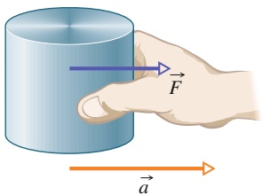

text_image

Diagram showing a hand holding a cylinder with force vector F and acceleration vector a labeled

Abb. 2.1 Eine Kraft F⃗ wirkt auf das Urkilogramm und beschleunigt es mit einer Beschleunigung a⃗.

37

---

2 Kraft und Bewegung

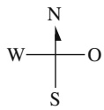

(a)

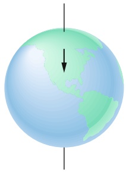

natural_image

Diagram of a globe with a downward arrow indicating direction, no text or symbols present

(b)

## Abb. 2.2

(a) Die Bahn eines Pucks, der auf einem 2000 km langen, reibungsfreien Stück Eis geradewegs nach Süden geschickt wird, aus der Sicht eines auf dem Erdboden stehenden Beobachters. (b) Der Erdboden rotiert aufgrund der Erddrehung unter dem nach Sü- den gleitenden Puck nach Osten.

## Inertialsysteme

Das erste Newtonsche Gesetz gilt nicht in allen Bezugssystemen. Wir können jedoch immer Bezugssysteme finden, in denen es Gültigkeit hat. Solche Bezugssysteme werden **Inertialsysteme** genannt.

Ein Inertialsystem ist ein Bezugssystem, in dem das erste Newtonsche Gesetz gilt.

Wir können z. B. annehmen, dass der Erdboden ein Inertialsystem darstellt, allerdings nur unter der Voraussetzung, dass wir die tatsächlichen astronomischen Bewegungen der Erde – wie die Erdrotation und ihren Lauf um die Sonne – vernachlässigen können.

Diese Annahme funktioniert gut, wenn wir einen Puck ein kurzes, reibungsfreies Stück Eis entlanggleiten lassen – ein auf dem Erdboden stehender Beobachter würde dann bestätigen, dass die Bewegung des Pucks den Gesetzen der Newtonschen Mechanik gehorcht. Stellen Sie sich jedoch vor, wir würden die Eisfläche sehr lang wählen, z. B. einige tausend Kilometer geradlinig nach Süden. Ein auf dem Erdboden stehender Beobachter würde dann feststellen, dass der Puck während seiner Bewegung nach Süden leicht nach Westen beschleunigt wird (Abb. 2.2a); dennoch wäre der Beobachter nicht in der Lage, eine Kraft zu finden, die diese Beschleunigung nach Westen verursacht. In diesem Fall ist der Erdboden ein **Nichtinertialsystem**, da die Erddrehung bei der langen Bahn des Pucks nicht mehr vernachlässigt werden kann. Die überraschende Beschleunigung des gleitenden Pucks relativ zum Erdboden nach Westen wird nämlich einfach dadurch verursacht, dass sich der Erdboden unter dem Puck nach Osten wegdreht (Abb. 2.2b).

Mithilfe des Begriffs Inertialsystem können wir das erste Newtonsche Gesetz folgendermaßen formulieren:

**Erstes Newtonsches Gesetz (moderne Fassung):** Es gibt Inertialsysteme, d. h. Koordinatensysteme, in denen ein kräftefreier Körper im Zustand der Ruhe oder der geradlinigen gleichförmigen Bewegung verbleibt.

In diesem Buch werden wir im Allgemeinen annehmen, dass der Erdboden ein Inertialsystem darstellt und dass die Messungen von Kräften und Beschleunigungen vom Erdboden aus durchgeführt werden. Werden Messungen z. B. in einem Aufzug gemacht, der relativ zum Erdboden beschleunigt, dann werden sie in einem Nichtinertialsystem durchgeführt – und die Ergebnisse können überaus überraschend sein. Einen solchen Fall werden wir in der Beispielaufgabe 2.6 im Übungsbuch behandeln.

## KONTROLLFRAGE 1

Welche der folgenden sechs Anordnungen zeigen die korrekte Vektoraddition der Kräfte ${ \vec { F } } _ { 1 }$ und $\overset { \mathrm {  当 } } { F _ { 2 } }$ zur daraus resultierenden Gesamtkraft $\vec { F } _ { \mathrm { g e s } ^ { 2 } }$

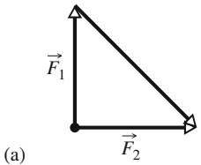

text_image

F₁
(a)
F₂

text_image

F₁
(b)
F₂

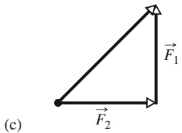

text_image

(c)
F₁
F₂

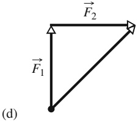

text_image

F₂
F₁
(d)

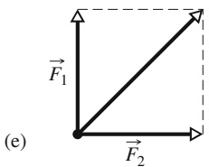

text_image

F₁
(e)
F₂

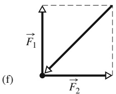

text_image

F₁
(f)
F₂

38

---

2.1 Das erste und das zweite Newtonsche Gesetz

2

## 2.1.4 Masse

Aus unserer Alltagserfahrung wissen wir, dass eine gegebene Kraft bei verschiedenen Körpern verschieden große Beträge der Beschleunigung hervorruft. Legen Sie eine Murmel und eine Bowlingkugel nebeneinander auf den Boden und geben sie beiden den gleichen scharfen Tritt. Selbst wenn Sie dies nicht wirklich ausprobieren, kennen Sie das Ergebnis: Die Murmel erhält eine merklich größere Beschleu nigung als die Bowlingkugel. Die zwei Beschleunigungen sind verschieden, weil die Masse der Murmel sich von der Masse der Bowlingkugel unterscheidet – doch was ist das genau, die Masse?

Wir können erklären, wie man Masse misst, indem wir uns eine Reihe von Experimenten in einem Inertialsystem vorstellen. Im ersten Experiment üben wir eine Kraft auf unser Urkilogramm aus, dessen Masse $m _ { 0 }$ definitionsgemäß gleich 1,0 kg ist. Nehmen wir an, dass es daraufhin mit $1 ,   0   \mathrm { m } / \mathrm { s } ^ { 2 }$ beschleunigt wird. Daraus können wir entnehmen, dass auf das Urkilogramm eine Kraft von 1,0 N wirkt.

In einem nächsten Schritt üben wir die gleiche Kraft (dazu müssten wir irgendwie sicherstellen, dass wir tatsächlich die gleiche Kraft ausüben) auf einen zweiten Körper X aus, dessen Masse wir nicht kennen. Nehmen Sie an, wir finden heraus, dass dieser Körper X mit $0 , 2 5   \mathrm { m } / \mathrm { s } ^ { 2 }$ beschleunigt. Uns ist bekannt, dass eine Murmel mit einer geringeren Masse eine größere Beschleunigung erhält als eine Bowlingkugel mit einer größeren Masse, wenn man auf beide die gleiche Kraft ausübt. Lassen Sie uns dann die folgende Vermutung aufstellen: Wird auf zwei Körper die gleiche Kraft ausgeübt, so ist das Verhältnis der Massen der beiden Körper gleich dem inversen Verhältnis ihrer Beschleunigungen. Im Fall des Körpers X und des Urkilogramms bedeutet dies, dass

$$
\frac {m _ {\mathrm{X}}}{m _ {0}} = \frac {a _ {0}}{a _ {\mathrm{X}}}.
$$

Auflösen nach $m _ { \mathrm { X } }$ ergibt:

$$
m _ {X} = m _ {0} \frac {a _ {0}}{a _ {\mathrm{X}}} = (1, 0 \mathrm{kg}) \frac {1 , 0 \mathrm{m/s} ^ {2}}{0 , 2 5 \mathrm{m/s} ^ {2}} = 4, 0 \mathrm{kg}.
$$

Unsere Vermutung ist natürlich nur dann von Nutzen, wenn sie auch für andere Werte der angewendeten Kraft gilt. Üben wir z. B. eine Kraft von 8,0 N auf das Urkilogramm aus, so erhalten wir eine Beschleunigung von $8 ,   0   \mathrm { m } / \mathrm { s } ^ { 2 }$ . Unsere Vermutung lautet dann:

$$
m _ {\mathrm{X}} = m _ {0} \frac {a _ {0}}{a _ {\mathrm{X}}} = (1, 0 \mathrm{kg}) \frac {8 , 0 \mathrm{m/s} ^ {2}}{2 , 0 \mathrm{m/s} ^ {2}} = 4, 0 \mathrm{kg},
$$

was mit unserem ersten Experiment konsistent ist. Eine Vielzahl von Experimen ten, die ähnliche Ergebnisse liefern, deutet darauf hin, dass unsere Vermutung eine konsistente und verlässliche Methode liefert, einem beliebigen Körper eine Masse zuzuordnen.

Unsere Experimente weisen darauf hin, dass Masse eine intrinsische, jedem Körper innewohnende Eigenschaft ist – d. h. eine Eigenschaft, die durch die Existenz des Körpers automatisch bedingt wird. Die Experimente zeigen außerdem an, dass die Masse eine skalare Größe ist. Dennoch bleibt die quälende Frage weiterhin bestehen: Was ist das nun genau, die Masse?

Da der Ausdruck $\mathrm { { \underline { { { ~ } } } M a s s e } ^ { \alpha } }$ in der Alltagssprache gebräuchlich ist, sollten wir von seiner Bedeutung ein intuitives Verständnis besitzen, vielleicht als etwas, das wir physisch spüren können. Ist es die Größe, das Gewicht oder die Dichte eines Körpers? Die Antwort ist nein, obwohl diese Eigenschaften mit der Masse zu tun ha ben und manchmal mit ihr verwechselt werden. Wir können nur sagen, dass die Masse eines Körpers jene Eigenschaft ist, welche die auf den Körper ausgeübte Kraft mit der daraus resultierenden Beschleunigung verknüpft. Man könnte sie auch den

39

---

2 Kraft und Bewegung

Trägheitswiderstand nennen, den der Körper der Veränderung seines Bewegungszustands entgegensetzt. Genau genommen diskutieren wir hier die **träge Masse**. (Wir werden im nächsten Abschn. 2.2 noch einen weiteren Aspekt der Masse kennenlernen, die schwere Masse.) Es gibt keine vertrautere Definition für Masse; Sie können Masse nur dann physisch spüren, wenn Sie versuchen, einen Körper zu beschleunigen, wie z. B. im Fall der Murmel und der Bowlingkugel.

## 2.1.5 Das zweite Newtonsche Gesetz

All die Definitionen, Experimente und Beobachtungen, die wir bis jetzt untersucht haben, lassen sich in einer einzigen Aussage zusammenfassen:

**Zweites Newtonsches Gesetz (Aktionsprinzip) für Körper mit konstanter Masse:** Die auf einen Körper mit zeitlich konstanter Masse wirkende Gesamtkraft ist gleich dem Produkt der Masse und der Beschleunigung des Körpers.

Mathematisch ausgedrückt bedeutet dies:

$$
\vec {F} _ {\mathrm{ges}} = m \vec {a} \quad (m = \text {const.}). \tag {2.1}
$$

(Die allgemeine Beschreibung wird in Kap. 5 dargestellt). Gleichung 2.1 ist einfach, doch wir müssen sie umsichtig gebrauchen. Zunächst müssen wir sicher sein, auf welchen Körper wir sie anwenden. Dann muss $\vec { F } _ { \mathrm { g e s } }$ gleich der Vektorsumme aller Kräfte sein, die auf diesen Körper wirken. Nur Kräfte, die auf diesen Körper wirken, dürfen in die Summe eingeschlossen werden – nicht jedoch Kräfte, die auf andere Körper wirken, die in der gegebenen Situation vielleicht ebenfalls vorhanden sind. Wenn Sie sich z. B. beim Rugby im Gedränge befinden, so ist die Gesamtkraft, die auf Sie wirkt, die Vektorsumme allen „Ziehens“ und „Schiebens“ an Ihrem Körper. Diese resultierende Gesamtkraft beinhaltet jedoch nicht die Kräfte, die Sie durch Ziehen oder Schieben auf einen anderen Spieler ausüben.

Und noch ein weiterer Warnhinweis: Auch das zweite Newtonsche Gesetz gilt zunächst nur für Inertialsysteme. In Nichtinertialsystemen muss man bei Anwendung des zweiten Newtonschen Gesetzes sogenannte Scheinkräfte berücksichtigen, auf die wir im Abschn. 2.7 näher eingehen werden.

Wie andere Vektorgleichungen entspricht Gl. 2.1 drei Komponentengleichungen, einer für jede Achse eines xyz-Koordinatensystems:

$$
F _ {\mathrm{ges}, x} = m a _ {x}, \quad F _ {\mathrm{ges}, y} = m a _ {y} \quad \text {und} \quad F _ {\mathrm{ges}, z} = m a _ {z}. \tag {2.2}
$$

Jede dieser Gleichungen verbindet die Komponente der Gesamtkraft entlang einer Achse mit der Beschleunigung entlang derselben Achse. So besagt die erste Gleichung z. B., dass die Summe aller Kraftkomponenten entlang der x-Achse die x-Komponente $\alpha _ { x }$ der Beschleunigung des Körpers verursacht, aber keine Beschleunigung in y- oder z-Richtung. Andersherum betrachtet wird die Komponente $\alpha _ { x }$ der Beschleunigung nur durch die Summe der Kraftkomponenten entlang der x-Achse verursacht. Im Allgemeinen gilt:

Die Komponente der Beschleunigung entlang einer Achse wird nur durch die Summe der Kraftkomponenten entlang dieser Achse und nicht durch Kraftkomponenten entlang anderer Achsen verursacht.

Gleichung 2.1 verrät uns, dass die Beschleunigung a⃗ eines Körpers gleich null ist, wenn die auf den Körper ausgeübte Gesamtkraft gleich null ist. Befindet sich der Körper in Ruhe, so bleibt er in Ruhe; bewegt er sich, so bewegt er sich mit konstanter Geschwindigkeit weiter. In einem solchen Fall gleichen sich die auf den Körper wirkenden Kräfte aus; man sagt, sowohl die Kräfte als auch der Körper befinden

40

---

2.1 Das erste und das zweite Newtonsche Gesetz

2

sich im Gleichgewicht. Oft wird auch behauptet, die Kräfte heben sich gegenseitig auf – dieser Begriff ist allerdings irreführend. Er bedeutet nicht, dass die Kräfte aufhören zu existieren. Die Kräfte wirken vielmehr weiterhin auf den Körper, nur ihre Wirkungen heben sich auf.

In SI-Einheiten bedeutet Gl. 2.1, dass

$$
1 \mathrm{N} = (1 \mathrm{kg}) (1 \mathrm{m} / \mathrm{s} ^ {2}) = 1 \mathrm{kg} \cdot \mathrm{m} / \mathrm{s} ^ {2}. \tag {2.3}
$$

Weitere Einheiten aus anderen Einheitensystemen finden Sie in Anhang C.

Um Aufgaben mithilfe des zweiten Newtonschen Gesetzes zu lösen, zeichnen wir oft ein sogenanntes **Kräftediagramm**, in dem nur der Körper erscheint, auf den die zu summierenden Kräfte wirken. In diesem Buch wird der Körper häufig vereinfachend durch einen Punkt angedeutet. Jede Kraft wird dann als ein Vektorpfeil gezeichnet, dessen Anfang auf dem Körper liegt. Meist enthält ein solches Diagramm auch ein Koordinatensystem; die Beschleunigung des Körpers wird manchmal ebenfalls als Vektorpfeil eingezeichnet.

Eine Ansammlung von zwei oder mehr Körpern wird ein **System** genannt. Jede Kraft, die von Körpern außerhalb des Systems auf einen der Körper in dem System ausgeübt wird, bezeichnet man als **äußere Kraft**. Sind die Körper starr miteinander verbunden, so können wir das System wie einen zusammengesetzten Körper behandeln; die resultierende Gesamtkraft $\vec { F } _ { \mathrm { g e s } } ,$ die auf diesen zusammengesetzten Körper wirkt, ist dann die Vektorsumme aller äußerer Kräfte. (**Innere Kräfte** – also Kräfte, die zwischen den zwei Körpern innerhalb des Systems wirken – werden hier nicht betrachtet.) Eine Lokomotive und der mit ihr verbundene Waggon bilden z. B. ein System. Zieht jemand an einem an der Spitze der Lokomotive befestigten Abschleppseil, so wirkt die durch das Seil verursachte Kraft auf das gesamte System aus Lokomotive und Waggon. Wie bei einem einzelnen Körper können wir auch hier die auf das System ausgeübte, resultierende äußere Kraft anhand des zweiten Newtonschen Gesetzes $\vec { F } _ { \mathrm { g e s } } = m \vec { a }$ mit der Beschleunigung des Systems in Verbindung bringen, wobei m die Gesamtmasse des Systems darstellt.

## KONTROLLFRAGE 2

Die Abbildung zeigt zwei horizontale Kräfte, die auf einen liegenden Block wirken. Dieser befindet sich auf einem reibungsfreien Untergrund. Nehmen Sie an, dass außerdem eine dritte horizontale Kraft $\vec { F } _ { 3 }$ auf den Block ausgeübt wird. Wie lauten Betrag und Richtung von $\vec { F } _ { 3 }$ für den Fall, dass der Block sich (a) in Ruhe befindet und sich (b) mit einer konstanten Geschwindigkeit von 5 m/s nach links bewegt?

## KONTROLLFRAGE 3

Die Abbildung zeigt Draufsichten von vier verschiedenen Situationen, in denen zwei Kräfte den gleichen Quader über einen reibungsfreien Untergrund beschleunigen. Ordnen Sie die Situationen in absteigender Reihenfolge nach dem Betrag (a) der resultierenden Gesamtkraft, die auf den Quader wirkt, und (b) der Beschleunigung des Quaders.

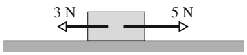

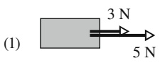

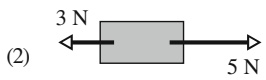

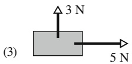

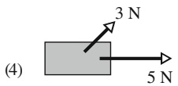

## LÖSUNGSSTRATEGIEN

**Strategie 1: Dimensionen und Vektoren** Vielen Studierenden fällt es schwer, die zweite Lösungsidee in Beispielaufgabe 2.2 im Übungsbuch nachzuvollziehen, und diese Schwierigkeit verfolgt sie das ganze Buch hindurch. Wenn Sie mit Kräften arbeiten, können Sie nicht einfach deren Beträge addieren oder subtrahieren, um die

41

---

2 Kraft und Bewegung

resultierende Gesamtkraft zu bestimmen – es sei denn, die Kräfte liegen auf der selben Achse. Ist das nicht der Fall, so müssen Sie die Vektoraddition verwenden, entweder mithilfe eines vektorfähigen Taschenrechners oder indem Sie die Kom ponenten entlang der Koordinatenachsen ermitteln, wie wir es in der Beispielaufgabe 2.2 im Übungsbuch getan haben.

**Strategie 2: Aufgaben mit Kräften lesen und verstehen** Lesen Sie den Text der Aufgabe mehrmals, bis Sie ein klares Bild davon haben, wie sich die Situation darstellt, welche Werte vorgegeben sind und wonach gefragt ist. Wenn Sie zwar erkennen können, worum es in dieser Aufgabe geht, jedoch nicht wissen, was Sie als Nächstes tun sollen, legen Sie die Aufgabe zur Seite und lesen Sie den entsprechenden Teil des Kapitels noch einmal. Fühlen Sie sich z. B. bezüglich des zweiten Newtonschen Gesetzes unsicher, lesen Sie diesen Abschnitt erneut. Arbeiten Sie die Beispielaufgaben durch. Und behalten Sie im Hinterkopf, dass die Fähigkeit, Physikaufgaben zu lösen, nicht etwas Angeborenes ist – ebenso wie die Fähigkeit, Autos zu reparieren oder Computerchips zu entwerfen, erfordert sie entsprechende Übung.

**Strategie 3: Zwei Arten von Diagrammen zeichnen** Eventuell brauchen Sie zwei Abbildungen. Die eine ist eine grobe Skizze der aktuellen Situation. Wenn Sie die Kräfte darin einzeichnen, platzieren Sie den Anfang eines jeden Kraftvektors entweder auf den Rand oder ins Innere des Körpers, auf den diese Kraft wirkt. Die andere Abbildung ist ein Kräftediagramm: Zeichnen Sie die Kräfte, die auf einen einzigen Körper wirken, und stellen Sie den Körper anhand eines Punkts oder einer kleinen Skizze dar. Platzieren Sie den Anfang jedes Kraftvektors auf dem Punkt oder der Skizze.

**Strategie 4: Was ist Ihr System?** Wenn Sie das zweite Newtonsche Gesetz verwenden, müssen Sie wissen, auf welchen Körper bzw. welches System Sie es anwenden. In Beispielaufgabe 2.1 im Übungsbuch ist es der Puck (nicht das Eis). In Beispielaufgabe 2.2 im Übungsbuch ist es die Keksdose.

**Strategie 5: Wählen Sie zweckmäßige Koordinatenachsen** In vielen Fällen kann man sich viel Arbeit ersparen, indem man das verwendete Koordinatensystem so ausrichtet, dass möglichst viele der auftretenden Kräfte mit der/den Richtung(en) der Achsen zusammenfallen.

## 2.2 Einige besondere Kräfte

## Lernziele

Nach dem Durcharbeiten dieses Abschnitts sollten Sie in der Lage sein, . . .

• Betrag und Richtung der Gravitationskraft auf einen Körper mit gegebener Masse an einem Ort mit gegebener Erdbeschleunigung zu bestimmen,
• zu verstehen, dass das Gewicht eines Körpers der Betrag der Gesamtkraft (im Bezugssystem des Erdbodens gemessen) ist, die erforderlich ist, um ihn vom Fallen abzuhalten,
• zu verstehen, dass eine Waage bei Anwendung in einem Inertialsystem das Gewicht eines Objekts anzeigt, bei Anwendung in einem beschleunigten Bezugssystem jedoch nur ein scheinbares Gewicht,
• Betrag und Richtung der Normalkraft anzugeben, die auftritt, wenn ein Objekt auf eine Oberfläche drückt oder auf ihr geschoben wird,
• zu verstehen, dass die Kraft parallel zu einer Oberfläche, auf der ein Objekt rutscht oder zu rutschen versucht, eine Reibungskraft ist,
• zu verstehen, dass eine Zugspannung auf die Enden einer gespannten Schnur (oder eines ähnlichen Objekts) wirkt.

42

---

2.2 Einige besondere Kräfte

2

## Schlüsselideen

Eine Gravitationskraft $\vec { F } _ { \mathrm { G } }$ auf einen Körper ist eine Zugkraft, die von einem anderen Körper ausgeübt wird. In den meisten in diesem Buch vorkommenden Fällen ist der andere Körper die Erde, manchmal auch ein anderer Himmelskörper. Im Fall der Erde ist diese Kraft nach unten auf den Boden gerichtet, den wir als Inertialsystem betrachten. Mit dieser Annahme ist der Betrag von $\vec { F } _ { \mathrm { G } }$

$$
F _ {\mathrm{G}} = m g,
$$

wobei m die Masse des Körpers ist und g der Betrag der Erdbeschleunigung.

• Das Gewicht W eines Objekts ist der Betrag der nach oben gerichteten Kraft, die erforderlich ist, um die Gravitationskraft auf das Objekt zu kompensieren. Das Gewicht eines Körpers hängt mit seiner Masse durch

$$
W = m g
$$

zusammen.

• Eine Normalkraft $\vec { N }$ ist die Kraft, die eine Fläche, auf der ein Objekt liegt, auf dieses ausübt. Die Normalkraft steht immer senkrecht auf der Oberfläche.
Eine Reibungskraft $\vec { f }$ ist die Kraft, die auf einen Körper wirkt, wenn er auf einer Oberfläche rutscht oder versucht zu rutschen. Diese Kraft ist immer parallel zur Oberfläche und der Gleitbewegung entgegen gerichtet. Auf einer reibungsfreien Oberfläche ist die Reibungskraft null (oder vernachlässigbar).
Wenn eine Schnur gespannt ist, zieht jedes Ende der Schnur an einem Objekt. Diese Zugkraft ist entlang der Schnur gerichtet, weg von dem Befestigungspunkt an dem Objekt. Für eine masselose Schnur (eine Schnur mit vernachlässigbarer Masse) besitzt die Zugkraft an beiden Enden denselben Betrag T, selbst wenn die Schnur um eine masselose, reibungsfreie Rolle (eine Rolle mit vernachlässigbarer Masse und vernachlässigbarer Reibung) läuft.

## 2.2.1 Einige besondere Kräfte

## Die Gravitationskraft

Die Gravitationskraft $\vec { F } _ { \mathrm { G } } ,$ die auf einen Körper wirkt, wird von einem zweiten Körper verursacht, der den ersten Körper zu sich hinzieht. In diesen anfänglichen Kapiteln werden wir uns nicht weiter mit der Natur dieser Kraft beschäftigen; meist betrachten wir Fälle, in denen der zweite Körper die Erde ist. Wenn wir also von der Gravitationskraft $\vec { F } _ { \mathrm { G } }$ sprechen, die auf einen Körper wirkt, so meinen wir üblicherweise eine Kraft, die den Körper direkt in Richtung Erdmittelpunkt „zieht“ – d. h. senkrecht nach unten in Richtung Erdboden. Wir gehen außerdem davon aus, dass der Erdboden als Inertialsystem betrachtet werden kann.

Nehmen Sie an, dass ein Körper der Masse m sich unter dem Einfluss der Gra vitationsbeschleunigung mit Betrag g im freien Fall befindet. Vernachlässigen wir die Auswirkungen des Luftwiderstands, so ist die einzige Kraft, die auf den Körper wirkt, die Gravitationskraft $\vec { F } _ { \mathrm { G } }$ . Diese nach unten gerichtete Kraft und die entsprechende, ebenfalls nach unten gerichtete Beschleunigung können wir anhand des zweiten Newtonschen Gesetzes $( \vec { F } = m \vec { a } )$ miteinander verknüpfen. Dazu legen wir eine vertikale y-Achse entlang der Bahnkurve des Körpers, wobei die positive Richtung nach oben zeigt. Für diese Achse kann das zweite Newtonsche Gesetz in der Form $F _ { \mathrm { g e s } ,   y } = m a _ {   y }$ geschrieben werden, was in unserem Fall

$$
- F _ {\mathrm{G}} = m (- g)
$$

oder

$$
F _ {\mathrm{G}} = m g \tag {2.4}
$$

ergibt. Mit anderen Worten ist der Betrag der Gravitationskraft gleich dem Produkt mg.

43

---

2 Kraft und Bewegung

Dieselbe Gravitationskraft wirkt – mit demselben Betrag – auch dann auf einen Körper, wenn dieser sich nicht im freien Fall befindet, sondern z. B. auf einem Billardtisch liegt oder sich über den Tisch bewegt.

In vektorieller Form lautet das zweite Newtonsche Gesetz für die Gravitationskraft:

$$
\vec {F} _ {\mathrm{G}} = - F _ {\mathrm{G}} \vec {e} _ {y} = - m g \vec {e} _ {y} = m \vec {g}, \tag {2.5}
$$

wobei $\vec { e } _ { y }$ den Einheitsvektor darstellt, der entlang der y-Achse vom Boden aus senkrecht nach oben zeigt, und $\vec { g }$ die nach unten gerichtete Gravitationsbeschleunigung in vektorieller Form bezeichnet.

Genau genommen handelt es sich bei der Masse m in Gl. 2.7 um die sogenannte **schwere Masse**. Im letzten Abschnitt hatten wir bereits die träge Masse kennengelernt, die ein Körper einer Veränderung seines Bewegungszustands als Trägheitswiderstand entgegensetzt. Es ist nun durchaus keine Selbstverständlichkeit, dass träge und schwere Masse gleich sind. Experimentelle Befunde zeigen jedoch, dass beide Massen sich höchstens um einen konstanten Faktor voneinander unterscheiden. Da man diesen Faktor in den Wert der Gravitationsbeschleunigung $\vec { g }$ in Gl. 2.7 aufnehmen könnte, wollen wir im Weiteren diesen Faktor auf 1, also den Wert der schweren Masse gleich dem der trägen Masse setzen und auf die Unterscheidung zwischen beiden verzichten.

## Gewicht

Das **Gewicht** $W$ eines Körpers entspricht dem von einem Beobachter auf dem Erdboden gemessenen Betrag der Gesamtkraft, die aufgewendet werden muss, um den Körper am freien Fall zu hindern. Um z. B. einen Ball in Ruhe in Ihrer Hand zu behalten, während Sie auf dem Boden stehen, müssen Sie eine aufwärts gerichtete Kraft aufbringen, welche die von der Erde auf den Ball ausgeübte Gravitationskraft kompensiert. Nehmen Sie an, der Betrag der Erdanziehungskraft ist 2,0 N. Dann muss der Betrag der von Ihnen ausgeübten, nach oben gerichteten Kraft ebenfalls gleich 2,0 N sein. Das Gewicht W des Balls ist damit 2,0 N. Wir sagen auch, der Ball wiegt 2,0 N, und sprechen von einem 2,0 N wiegenden Ball.

Ein Ball mit einem Gewicht von 3,0 N würde Ihnen eine größere Kraft abverlangen – eine von 3,0 N nämlich –, um den Ball in Ruhe halten zu können. Der Grund hierfür ist, dass die Gravitationskraft, die Sie ausgleichen müssen, in diesem Fall einen größeren Betrag besitzt, nämlich wiederum 3,0 N. Wir sagen, der zweite Ball ist schwerer als der erste.

Lassen Sie uns die Situation nun verallgemeinern. Betrachten Sie einen Körper, der eine Beschleunigung $\vec { a }$ von null relativ zum Boden besitzt, wobei wir auch hier den Erdboden als Inertialsystem ansehen. Zwei Kräfte wirken auf den Körper: die nach unten gerichtete Gravitationskraft $\vec { F } _ { \mathrm { G } }$ und eine ausgleichende, nach oben weisende Kraft mit Betrag W. Für eine vertikale y-Achse, deren positive Richtung nach oben zeigt, ist das zweite Newtonsche Gesetz:

$$
F _ {\mathrm{ges}, y} = m a _ {y}.
$$

In unserem Fall erhalten wir:

$$
W - F _ {\mathrm{G}} = m (0) \tag {2.6}
$$

oder

$$
W = F _ {\mathrm{G}} \quad (\text {Gewicht, mit Erdboden als Inertialsystem}). \tag {2.7}
$$

Diese Gleichung besagt (unter der Annahme, dass der Erdboden ein Inertialsystem darstellt):

Das Gewicht W eines Körpers ist gleich dem Betrag $F _ { \mathrm { G } }$ der Gravitationskraft, die auf diesen Körper wirkt.

44

---

2.2 Einige besondere Kräfte

2

Einsetzen von mg aus Gl. 2.6 anstelle von $F _ { \mathrm { G } }$ ergibt:

$$
W = m g \quad (\text {Gewicht}), \tag {2.8}
$$

also eine Gleichung, die das Gewicht eines Körpers mit seiner Masse verbindet.

Einen Körper zu wiegen, bedeutet, sein Gewicht zu messen. Dies kann man z. B. tun, indem man den Körper auf einen der Teller einer Hebelwaage (Abb. 2.3) legt und auf dem anderen Teller so lange Referenzkörper mit bekannten Massen hinzufügt, bis die Waage sich im Gleichgewicht befindet (d. h., bis die Gravitationskraft auf beiden Seiten der Waage gleich ist). Dann sind die Massen der beiden Teller gleich und wir kennen damit die Masse m des Körpers. Wissen wir den Wert von g am Ort der Waage, so können wir anhand von Gl. 2.9 auch das Gewicht des Körpers ermitteln.

Wir können einen Körper auch mit einer Federwaage wiegen (Abb. 2.4). Der Körper zieht dabei eine Feder in die Länge und bewegt einen Zeiger auf einer Ska-$\mathrm { l a } ,$ die zuvor kalibriert und mit Massen- oder Gewichtseinheiten beschriftet wurde. (Die meisten mechanischen Badezimmerwaagen funktionieren auf diese Art und Weise. Ihre Skalen zeigen hierzulande die Masseneinheit Kilogramm an; in anderen Ländern, z. B. den USA, geben die Waagen das Gewicht jedoch in der Gewichtseinheit Pound (Pfund) an.) Gibt die Skala Masseneinheiten an, so geht die Waage nur an solchen Orten genau, an denen der Wert von g derselbe ist wie an dem Ort, an dem die Waage kalibriert wurde.

Das Gewicht eines Körpers darf nur gemessen werden, wenn der Körper nicht senkrecht zum Erdboden beschleunigt wird. Sie können Ihr Gewicht z. B. in Ihrem Badezimmer oder in einem Schnellzug auf ebenen Gleisen messen. Wiederholen Sie die Messung jedoch mit derselben Waage in einem beschleunigten Aufzug, so wird der Zeiger auf der Skala aufgrund Ihrer Beschleunigung einen anderen Wert anzeigen als Ihr Gewicht. Ein solcher Messwert wird scheinbares Gewicht genannt.

Vorsicht: Das Gewicht eines Körpers entspricht nicht der Masse des Körpers. Das Gewicht wird durch den Betrag einer Kraft gegeben und ist mit der Masse über Gl. 2.9 verknüpft. Bewegen Sie einen Körper an einen Punkt, an dem $g$ einen anderen Wert besitzt, so verändert sich die Masse des Körpers (die eine intrinsische Eigenschaft des Körpers darstellt) nicht; das Gewicht jedoch ändert sich durchaus. Auf der Erde ist das Gewicht einer Bowlingkugel mit einer Masse von 7,2 kg gleich 71 N, auf dem Mond würde die Kugel dagegen nur 12 N wiegen. Die Masse der Kugel ist auf Erde und Mond dieselbe – die Gravitationsbeschleunigung beträgt auf dem Mond jedoch nur 1,7 m $/ \mathbf { s } ^ { 2 }$

## Die Normalkraft

Wenn Sie auf einer Matratze stehen, zieht die Erde Sie nach unten, doch Sie bleiben in Ruhe. Dies liegt daran, dass die Matratze sich unter Ihnen nach unten verformt und Sie nach oben drückt. Stehen Sie auf dem Fußboden, so verformt sich dieser ganz ähnlich (er wird durchgebogen oder eingedrückt, nur eben viel schwächer) und drückt Sie nach oben. Dies geschieht selbst bei einem scheinbar festen Betonboden. (Wenn ein solcher Betonboden nicht direkt auf dem Erdboden ruht, so kann er unter der Last einer entsprechenden Anzahl von Personen tatsächlich zusammenbrechen.)

Der Druck, den Matratze und Fußboden auf Sie ausüben, wird **Normalkraft** ge nannt und üblicherweise mit $\vec { N }$ bezeichnet. Der Name geht auf den mathematischen Ausdruck normal zurück, der so viel wie „senkrecht auf “ bedeutet: Die Kraft, die z. B. der Fußboden auf Sie ausübt, steht senkrecht auf dem Fußboden.

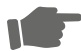

Wenn ein Körper gegen eine Oberfläche drückt, so verformt sich diese Oberfläche (selbst scheinbar feste Oberflächen verformen sich minimal) und wirkt auf den Körper mit einer Normalkraft $\vec { N } _ { i }$ die senkrecht zu der Oberfläche verläuft.

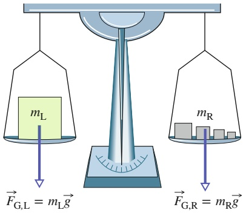

text_image

mL
F_{G,L} = m_Lg
mR
F_{G,R} = m_Rg

Abb. 2.3

Eine Hebelwaage. Wenn sich die Anordnung im Gleichgewicht befindet, sind die Gravitationskraft $\vec { F } _ { \mathrm { G , L } }$ , die auf den zu wiegenden Körper in der linken Waagschale wirkt, und die gesamte Gravitationskraft $\vec { F } _ { \mathrm { G , R } } ,$ die auf die Referenzkörper in der rechten Waagschale wirkt, gleich groß. Damit ist die Masse des zu wiegenden Körpers gleich der Gesamtmasse der Referenzkörper.

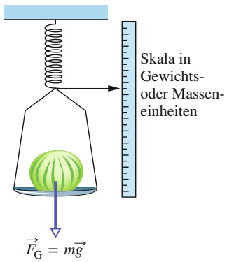

text_image

Skala in
Gewichts-
oder Massen-
einheiten
F_G = m\u0305g

Abb. 2.4

Eine Federwaage. Der angezeigte Wert ist proportional zum Gewicht des Gegenstands in der Waagschale. Ist die Skala in Gewichtseinheiten markiert, so gibt sie dieses Gewicht an. Ist die Skala dagegen in Masseneinheiten beschriftet, so ist der angezeigte Wert nur dann korrekt, wenn die Gravitationsbeschleunigung g am Ort der Waage der Gravitationsbeschleunigung an dem Ort entspricht, an dem die Waage geeicht wurde.

45

---

2 Kraft und Bewegung

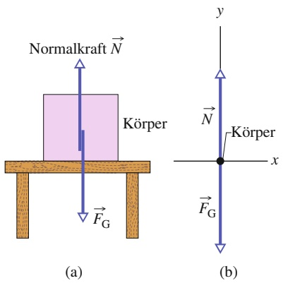

text_image

Normalkraft N
Körper
FG
(a)
y
N
Körper
x
FG
(b)

Abb. 2.5

(a) Ein Körper, der auf einem Tisch ruht, unterliegt einer Normalkraft $\vec { N } ,$ die senkrecht zur Oberfläche des Tischs verläuft. (b) Das entsprechende Kräftediagramm für den Körper.

Ein Beispiel ist in Abb. 2.5a dargestellt. Ein Quader der Masse m liegt auf der ho rizontalen Oberfläche eines Tischs, drückt nach unten auf den Tisch und verformt diesen dabei aufgrund der Gravitationskraft $\vec { F } _ { \mathrm { G } }$ leicht. Der Tisch wiederum drückt den Quader mit einer Normalkraft $\vec { N }$ nach oben. Das Kräftediagramm für den Quader ist in Abb. 2.5b dargestellt. Die Kräfte $\vec { F } _ { \mathrm { G } }$ und $\vec { N }$ sind die einzigen Kräfte, die auf den Quader wirken, sie stehen beide senkrecht auf der Tischoberfläche. In Bezug auf eine vertikale, nach oben hin positive y-Achse lautet das zweite Newtonsche Gesetz $( F _ { \mathrm { g e s } ,   y } = m a _ {   y } )$ für den Quader:

$$
N - F _ {\mathrm{G}} = m a _ {y}.
$$

Einsetzen von mg aus Gl. 2.6 für $F _ { \mathrm { G } }$ ergibt:

$$
N - m g = m a _ {y}.
$$

Der Betrag der Normalkraft ist damit

$$
N = m g + m a _ {y} = m (g + a _ {y}) \tag {2.9}
$$

für jede beliebige vertikale Beschleunigung $\alpha _ { y }$ von Tisch und Quader (die beiden könnten sich z. B. in einem beschleunigten Aufzug befinden). Beschleunigen Tisch und Quader relativ zum Erdboden nicht, dann ist $a _ { y } = 0$ und Gl. 2.11 wird zu:

$$
N = m g. \tag {2.10}
$$

## KONTROLLFRAGE 4

Falls sich der Körper und der Tisch aus Abb. 2.5 in einem Aufzug befinden, der sich (a) mit konstantem Geschwindigkeitsbetrag und (b) mit anwachsendem Geschwindigkeitsbetrag nach oben bewegt, ist der Betrag der Normalkraft $\vec { N }$ dann größer als, kleiner als oder gleich groß wie mg?

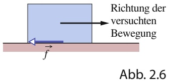

text_image

Richtung der
versuchten
Bewegung
f
Abb. 2.6

Der Versuch, einen Körper über eine Oberfläche zu schieben: Eine Reibungskraft ⃗f wirkt der angestrebten Bewegung entgegen.

## Reibung

Wenn wir versuchen, einen Körper über eine Oberfläche gleiten zu lassen, so wirkt der Bewegung eine gewisse Haftung zwischen dem Körper und der Oberfläche entgegen. (Diese Haftung werden wir in Abschn. 2.4 näher untersuchen.) Der resultierende Widerstand wird mit einer Kraft $\vec { f }$ beschrieben, die **Reibungskraft** oder einfach nur **Reibung** genannt wird. Diese Kraft verläuft entlang der Oberfläche und ist immer der angestrebten Bewegung entgegengesetzt (Abb. 2.6). Um eine gegebene Situation zu vereinfachen, geht man oft davon aus, dass die Reibung vernachlässigt werden kann (die Oberfläche ist dann reibungsfrei).

## Zugspannung

Wenn eine Schnur (oder ein Seil, Draht oder ähnliches Objekt) an einem Körper befestigt und straff angezogen wird, dann zieht sie den Körper mit einer Kraft ${ \vec { T } } ,$ die entlang der Schnur verläuft und von dem Körper weg zeigt (Abb. 2.7a). Diese Kraft wird Zugkraft oder Zugspannung genannt, da die Schnur unter Spannung steht – was bedeutet, dass sie straff angezogen wird. Die Zugspannung (englisch: tension) in der Schnur ist der Betrag T der Kraft, die auf den Körper wirkt. Besitzt die auf den Körper wirkende Kraft z. B. den Betrag T = 50 N, so beträgt die Zugspannung in der Schnur 50 N.

Eine Schnur wird oft als masselos (ihre Masse ist im Vergleich zur Masse des Körpers vernachlässigbar klein) und undehnbar angenommen. Die Schnur existiert dann nur als eine Verbindung zwischen zwei Körpern. Sie zieht an beiden Seiten mit einem Betrag $T ,$ auch dann, wenn die Körper und die Schnur beschleunigen oder die Schnur um eine masselose, reibungsfreie Rolle läuft (Abb. 2.7b und c).

46

---

2.3 Die Newtonschen Gesetze in der Praxis

2

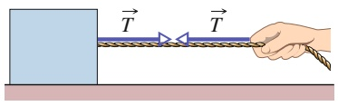

text_image

Diagram showing a hand pulling a rope with tension forces labeled T, illustrating mechanical or physical interaction.

(a)

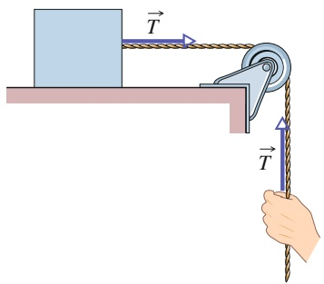

text_image

Diagram illustrating a physics problem showing a lever system with tension T applied to a block on a horizontal surface, connected to a hand holding a rope.

(b)

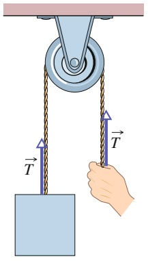

text_image

Diagram of a pulley system with two hanging weights labeled T, showing mechanical advantage setup

(c)

Die Masse einer solchen Rolle kann im Vergleich zur Masse der Körper vernachlässigt werden; ebenso ist die Reibung im Achsenlager der Rolle, die der Bewegung entgegenwirkt, vernachlässigbar. Läuft die Schnur halb um die Rolle wie in Abb. 2.7c, dann ist der Betrag der Gesamtkraft, welche die Schnur auf die Rolle ausübt, gleich 2T.

## KONTROLLFRAGE 5

Der Körper, der in Abb. 2.7c von einem Seil herabhängt, hat ein Gewicht von 75 N. Ist T größer als, kleiner als oder gleich 75 N, wenn sich der Körper (a) mit konstantem Geschwindigkeitsbetrag, (b) mit ansteigendem Geschwindigkeitsbetrag und (c) mit abnehmendem Geschwindigkeitsbetrag nach oben bewegt?

## LÖSUNGSSTRATEGIEN

**Strategie 6: Normalkraft** Gleichung 2.12 für die auf einen Körper wirkende Normalkraft gilt nur, wenn N⃗ nach oben gerichtet ist und die vertikale Beschleunigung des Körpers gleich null ist. Für andere Richtungen von N⃗ oder im Fall einer nicht verschwindenden senkrechten Beschleunigung können wir die Gleichung nicht anwenden. Stattdessen müssen wir aus dem zweiten Newtonschen Gesetz einen neuen Ausdruck für N⃗ ableiten.

Es steht uns frei, N⃗ in einer Abbildung zu verschieben, solange wir ihre Orientierung im Raum beibehalten. In Abb. 2.5a z. B. können wir N⃗ nach unten verschieben, sodass die Spitze des Kraftpfeils auf der Grenzfläche zwischen dem Körper und der Oberfläche des Tischs liegt. Meist lässt sich N⃗ jedoch am einfachsten deuten, wenn der Anfang des Kraftpfeils auf der Grenzfläche bzw. irgendwo im Körper eingezeichnet ist (wie in der Abbildung dargestellt). Noch besser ist es, ein Kräftediagramm wie das aus Abb. 2.5b zu zeichnen, in dem der Anfang von N⃗ direkt auf dem Punkt bzw. der Skizze liegt, die den entsprechenden Körper darstellt.

## 2.3 Die Newtonschen Gesetze in der Praxis

## Lernziele

Nach dem Durcharbeiten dieses Abschnitts sollten Sie in der Lage sein, . . .

• das dritte Newtonsche Gesetz zu verstehen und anzuwenden und Paare von Kräften zu identifizieren, auf die dieses Gesetz zutrifft,
• das zweite Newtonsche Gesetz auf das Kräftediagramm eines Objekts anzuwenden, das sich vertikal oder auf einer horizontalen oder geneigten Ebene bewegt,
• ein Kräftediagramm für eine bewegte Anordnung aus starr miteinander verbundenen Objekten zu zeichnen und das zweite Newtonsche Gesetz sowohl auf die einzelnen Objekte als auch auf die Anordnung als Ganzes anzuwenden.

## Abb. 2.7

(a) Die straff angezogene Schnur befindet sich unter Zugspannung. Kann die Masse der Schnur vernachlässigt werden, so übt sie auf den Körper und die Hand die Kraft T⃗ aus, und zwar auch dann, wenn sie – wie in (b) und (c) dargestellt – um eine masselose, reibungsfreie Rolle läuft.

47

---

2 Kraft und Bewegung

## Schlüsselideen

• Die resultierende oder Gesamtkraft $\vec { F } _ { \mathrm { g e s } }$ , die auf ein Objekt mit der Masse m wirkt, ist gemäß

$$
\vec {F} _ {\mathrm{ges}} = m \vec {a}
$$

mit dessen Beschleunigung verknüpft; in Komponentenschreibweise

$$
F _ {\mathrm{ges}, x} = m a _ {x}, \quad F _ {\mathrm{ges}, y} = m a _ {y} \quad \text {und} \quad F _ {\mathrm{ges}, z} = m a _ {z}.
$$

• Wenn auf einen Körper B eine Kraft $\vec { F } _ { \mathrm { B C } }$ von einem Körper C ausgeübt wird, übt B eine entsprechende Kraft $\vec { F } _ { \mathrm { C B } }$ auf C aus:

$$
\vec {F} _ {\mathrm{BC}} = - \vec {F} _ {\mathrm{CB}}.
$$

Die beiden Kräfte haben denselben Betrag, sind aber entgegengesetzt gerichtet.

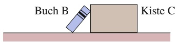

(a)

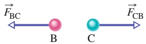

(b)

## Abb. 2.8

(a) Buch B lehnt an der Kiste C. (b) Gemäß dem dritten Newtonschen Gesetz besitzt die Kraft $\vec { F } _ { \mathrm { B C } } ,$ welche die Kiste auf das Buch ausübt, den gleichen Betrag, aber die entgegengesetzte Richtung wie die Kraft $\vec { F } _ { \mathrm { C B } } ,$ die das Buch auf die Kiste ausübt.

## 2.3.1 Das dritte Newtonsche Gesetz

Wenn zwei Körper einen Zug oder einen Druck aufeinander ausüben – wenn also auf jeden der Körper eine Kraft wirkt, die durch den anderen Körper verursacht wird –, so sagt man, die Körper wechselwirken miteinander. Nehmen Sie z.B. an, Sie lehnen ein Buch B an eine Kiste C (Abb. 2.8a). Dann wechselwirken Buch und Kiste miteinander: Die Kiste übt eine horizontale Kraft $\vec { F } _ { \mathrm { B C } }$ auf das Buch aus, während das Buch eine horizontale Kraft $\vec { F } _ { \mathrm { C B } }$ auf die Kiste ausübt. Dieses Paar von Kräften ist in Abb. 2.8b dargestellt. Das dritte Newtonsche Gesetz besagt nun Folgendes:

**Drittes Newtonsches Gesetz (Wechselwirkungsgesetz oder Reaktionsprinzip; Aktion ist gleich Reaktion):** Wenn zwei Körper miteinander wechselwirken, dann besitzen die Kräfte, welche die Körper aufeinander ausüben, denselben Betrag und entgegengesetzte Richtungen.

Im Fall des Buchs und der Kiste können wir dieses Gesetz in Form der skalaren Beziehung

$$
F _ {\mathrm{BC}} = F _ {\mathrm{CB}} \quad (\text { gleicher   Betrag })
$$

oder in Form der Vektorgleichung

$$
\vec {F} _ {\mathrm{BC}} = - \vec {F} _ {\mathrm{CB}} \quad \text {(gleicher Betrag und entgegengesetzte Richtung)}
$$

schreiben, wobei das Minuszeichen aussagt, dass die beiden Kräfte in entgegengesetzte Richtungen weisen. Die Kräfte zwischen zwei wechselwirkenden Körpern können wir als **Kraft-Gegenkraft-Paar** bezeichnen. In welcher Situation auch immer zwei Körper miteinander wechselwirken, immer tritt ein Kraft-Gegenkraft-Paar auf. Das Buch und die Kiste aus Abb. 2.8a befinden sich in Ruhe, das drit te Newtonsche Gesetz würde jedoch gleichermaßen gelten, wenn sich die Körper bewegen würden – selbst dann, wenn sie dabei beschleunigen.

Lassen Sie uns in einem weiteren Beispiel das Kraft-Gegenkraft-Paar in Abb. 2.9a bestimmen, in der eine Melone auf einem Tisch liegt, der wiederum auf dem Erdboden steht. Die Melone wechselwirkt mit dem Tisch und mit der Erde (in diesem Fall sind es also drei Körper, deren Wechselwirkungen wir ermitteln müssen).

48

---

2.3 Die Newtonschen Gesetze in der Praxis

2

Betrachten wir zunächst nur die Melone (Abb. 2.9b). Die Kraft $\vec { F } _ { \mathrm { C T } }$ ist die Normalkraft, die der Tisch auf die Melone ausübt, und die Kraft $\vec { F } _ { \mathrm { C E } }$ die Gravitations kraft, die die Erde auf die Melone ausübt. Bilden diese beiden Kräfte ein Kraft Gegenkraft-Paar? Nein, denn sie wirken beide auf denselben Körper.

Um ein Kraft-Gegenkraft-Paar zu bestimmen, dürften wir nicht allein die Melone betrachten, sondern müssen die Wechselwirkung zwischen der Melone und einem der beiden anderen Körper ins Auge fassen. Bei der Wechselwirkung zwischen Melone und Erde (Abb. 2.9c) zieht die Erde die Melone mit einer Gravitationskraft $\vec { F } _ { \mathrm { C E } }$ an, während die Melone die Erde mit einer Gravitationskraft $\vec { F } _ { \mathrm { E C } }$ anzieht. Bilden diese Kräfte ein Kraft-Gegenkraft-Paar? Ja, denn sie wirken auf zwei wechselwirkende Körper, und jede der Kräfte wird durch den einen Körper auf den jeweils anderen ausgeübt. Gemäß dem zweiten Newtonschen Gesetz ist:

$$
\vec {F} _ {\mathrm{CE}} = - \vec {F} _ {\mathrm{EC}} \quad \text {(Wechselwirkung Melone - Erde)}.
$$

Betrachten wir als Nächstes die Wechselwirkung zwischen Melone und Tisch. Die Kraft des Tischs auf die Melone ist $\vec { F } _ { \mathrm { C T } } ,$ die Kraft der Melone auf den Tisch $\vec { F } _ { \mathrm { T C } }$ (Abb. 2.9d). Diese Kräfte stellen ebenfalls ein Kraft-Gegenkraft-Paar dar, und deshalb gilt

$$
\vec {F} _ {\mathrm{CT}} = - \vec {F} _ {\mathrm{TC}} \quad \text {(Wechselwirkung Melone - Tisch)}.
$$

Um die Newtonschen Gesetze in der Praxis sicher anwenden zu können, ist es wichtig, dass Sie die hier angebotenen Kontrollfragen und die Beispielaufgaben im Übungsbuch eingehend studieren und dabei nicht die einzelnen Antworten auswendig lernen, sondern sich die gezeigten Methoden und Lösungswege einprägen. Besonders wichtig ist es, zu wissen, wie man die Skizze einer bestimmten Situation interpretiert und in ein Kräftediagramm mit zweckmäßigen Achsen „übersetzt“, sodass die Newtonschen Gesetze angewendet werden können.

## KONTROLLFRAGE 6

Nehmen Sie an, dass die Melone und der Tisch aus Abb. 2.9 sich in einem Aufzug befinden, der vom Halten aus nach oben beschleunigt. (a) Werden die Beträge der Kräfte $\vec { F } _ { \mathrm { T C } }$ und $\vec { F } _ { \mathrm { C T } }$ größer, kleiner oder bleiben sie gleich? (b) Besitzen diese beiden Kräfte immer noch den gleichen Betrag und die entgegengesetzte Richtung? (c) Werden die Beträge der Kräfte $\vec { F } _ { \mathrm { C E } }$ und $\vec { F } _ { \mathrm { E C } }$ größer, kleiner oder bleiben sie gleich? (d) Besitzen diese beiden Kräfte immer noch den gleichen Betrag und die entgegengesetzte Richtung?

## KONTROLLFRAGE 7

In der Abbildung wird die horizontale Kraft $\vec { F }$ auf einen Block angewendet, der auf einer Rampe liegt. (a) Ist die Komponente von ${ \vec { F } } ,$ die senkrecht zur Rampe verläuft, gleich F cos θ oder gleich F sin θ? (b) Verstärkt oder verringert die Kraft $\vec { F }$ den Betrag der Normalkraft, die die Rampe auf den Block ausübt?

## KONTROLLFRAGE 8

Eine Person der Masse $m = 7 2 { , } 2$ kg steht auf einer Brückenwaage in einem Aufzug. Wie lautet die Anzeige der Waage, wenn das Aufzugkabel reißt und der Aufzug frei hinunterfällt; d. h., wie groß ist das scheinbare Gewicht der Person im freien Fall?

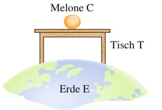

text_image

Melone C
Tisch T
Erde E

(a)

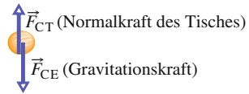

(b)

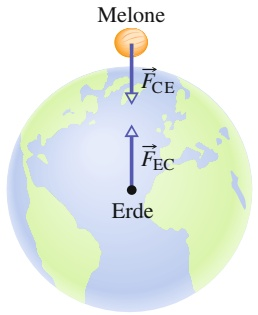

text_image

Melone
F_CE
F_EC
Erde

(c)

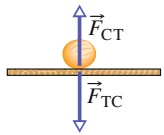

(d)

## Abb. 2.9

(a) Eine Melone liegt auf einem Tisch, der auf der Erde steht. (b) Die Kräfte, die auf die Melone wirken, sind $\vec { F } _ { \mathrm { C T } }$ und $\vec { F } _ { \mathrm { C E ^ { * } } }$ (c) Das Kraft-Gegenkraft-Paar für die Wechselwirkung Melone–Erde. (d) Das Kraft-Gegenkraft-Paar für die Wechselwirkung Melone–Tisch.

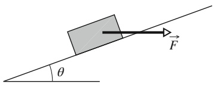

text_image

θ
F

49

---

2 Kraft und Bewegung

## 2.4 Reibung

## Lernziele

Nach dem Durcharbeiten dieses Abschnitts sollten Sie in der Lage sein, . . .

• den Unterschied zwischen der Reibung in einer statischen Situation (Haftreibung) und der Reibung in einer kinetischen/dynamischen Situation (Gleitreibung) zu unterscheiden,
• Betrag und Richtung von Reibungskräften anzugeben,
• Kräftediagramme für Objekte auf horizontalen, vertikalen oder geneigten Ebenen zu zeichnen und das zweite Newtonsche Gesetz auf diese Situationen anzuwenden.

## Schlüsselideen

Wenn eine Kraft $\vec { F }$ darauf hinwirkt, ein Objekt auf einer Oberfläche zum Gleiten zu bringen, wirkt eine Reibungskraft von der Oberfläche auf das Objekt. Diese Reibungskraft ist parallel zur Oberfläche gerichtet und wirkt der Gleitbewegung entgegen. Sie resultiert aus der Wechselwirkung zwischen Objekt und Oberflä- che.
So lange der Körper nicht gleitet, handelt es sich bei der Reibungskraft um eine statische Reibungskraft (oder Haftreibungskraft) $\vec { f } _ { s }$ . Wenn er tatsächlich gleitet, handelt es sich um eine kinetische Reibungskraft (oder Gleitreibungskraft) ${ \vec { f } } _ { \mathrm { k } } ,$
• Wenn das Objekt sich nicht bewegt, sind die Haftreibungskraft $\vec { f } _ { s }$ und die Komponente von $\vec { \bar { F } }$ parallel zur Oberfläche gleich groß und einander entgegen gerichtet. Wenn die Komponente von $\vec { F }$ parallel zur Oberfläche zunimmt, erhöht sich auch $\vec { f } _ { \mathrm { s } } .$
• Der Betrag von $\vec { f } _ { s }$ besitzt einen Maximalwert $f _ { \mathrm { s , m a x } } ,$ der durch

$$
f _ {\mathrm{s,max}} = \mu_ {\mathrm{s}} N
$$

gegeben ist, wobei $\mu _ { s }$ der Koeffizient der statischen Reibung (Haftreibungskoeffizient) und N der Betrag der Normalkraft ist. Wenn die Komponente von $\vec { F }$ parallel zur Oberfläche größer wird als $f _ { \mathrm { s , m a x } }$ beginnt das Objekt, auf der Oberfläche zu gleiten.

• Wenn das Objekt auf der Oberfläche zu gleiten beginnt, verringert sich der Betrag der Reibungskraft schnell auf einen konstanten Wert

$$
f _ {\mathrm{k}} = \mu_ {\mathrm{k}} N,
$$

wobei $\mu _ { \mathrm { k } }$ der Koeffizient der kinetischen Reibung (Gleitreibungskoeffizient) ist. $\mu _ { \mathrm { k } }$ ist in der Regel kleiner als $\mu _ { s } .$

In den folgenden Abschnitten konzentrieren wir uns auf die Physik von drei häufig vorkommenden Arten von Kraft: Reibungs-, Widerstands- und Zentripetalkraft, bevor wir noch ein paar Kräfte vorstellen, die es eigentlich gar nicht gibt: die sogenannten Scheinkräfte.

Für einen Ingenieur, der ein Rennauto für den Grand Prix vorbereitet, sind alle drei „realen“ Kräfte wichtig: Reibungskräfte wirken auf die Reifen und sind von entscheidender Bedeutung für die Beschleunigung des Fahrzeugs aus der Boxengasse und die Kurvenlage (wenn das Auto z. B. auf eine Ölspur kommt, geht die Reibung verloren und das Auto wird aus der Kurve getragen). Der Ingenieur muss die Widerstandskräfte minimieren, die die vorbeiströmende Luft auf das Auto ausübt, da es dem Auto sonst an Geschwindigkeit fehlt, es zu viel Sprit verbraucht und vorzeitig an die Box muss (ein Boxenstopp von 14 s kann leicht den Sieg kosten!). Zentripetalkräfte sind wiederum in Kurven entscheidend – wenn es an Zentripetalkraft fehlt, rutscht das Auto von der Piste. Wir beginnen unsere Betrachtung mit Reibungskräften.

50

---

2.4 Reibung

2

## 2.4.1 Reibung

Reibungskräfte sind in unserem täglichen Leben unvermeidbar. Wären wir nicht in der Lage, ihnen entgegenzuwirken, würden sie jedes sich bewegende Objekt stoppen und jede sich drehende Antriebswelle anhalten. Etwa 20 % des von einem Auto verbrauchten Benzins werden dazu benötigt, die Reibung im Motor und im Antrieb auszugleichen. Gäbe es keine Reibung, so könnten wir allerdings kein Auto irgendwohin bewegen, wir könnten auch nicht laufen oder Fahrrad fahren. Wir könnten keinen Stift festhalten und, wenn wir es könnten, würde er nicht schreiben. Nägel und Schrauben wären nutzlos, gewebte Stoffe würden zerfallen und Knoten nicht halten.

An dieser Stelle beschäftigen wir uns mit Reibungskräften, die zwischen trocke nen, festen Oberflächen auftreten, welche sich entweder relativ zueinander in Ruhe befinden oder sich mit geringer Geschwindigkeit übereinander hinwegbewegen. Beginnen wir mit drei Gedankenexperimenten:

1. Lassen Sie ein Buch einen langen horizontalen Tisch entlang gleiten. Wie er wartet, wird das Buch langsamer und hält dann an. Dies bedeutet, dass das Buch eine Beschleunigung erfahren muss, die parallel zur Oberfläche des Tisches ver läuft und der Geschwindigkeit des Buchs entgegengesetzt gerichtet ist. Nach dem zweiten Newtonschen Gesetz (Aktionsprinzip) muss auf das Buch also eine Kraft wirken, die ebenfalls parallel zur Tischoberfläche verläuft und der Ge schwindigkeit des Buchs entgegengesetzt ist. Diese Kraft ist eine Reibungskraft
2. Schieben Sie das Buch horizontal so, dass es sich mit konstanter Geschwindigkeit über den Tisch bewegt. Kann die von Ihnen ausgeübte Kraft die einzige Kraft sein, die in horizontaler Richtung auf das Buch wirkt? Nein, denn sonst müsste das Buch beschleunigen. Gemäß dem zweiten Newtonschen Gesetz muss auf das Buch also eine zweite Kraft wirken, die den gleichen Betrag besitzt wie Ihre Kraft, deren Richtung ihr jedoch entgegengesetzt ist, sodass sich die beiden Kräfte aufheben. Diese zweite Kraft ist eine parallel zum Tisch wirkende Reibungskraft.
3. Versuchen Sie, eine schwere Kiste horizontal zu verschieben. Die Kiste bewegt sich nicht. Gemäß dem zweiten Newtonschen Gesetz muss also noch eine zweite Kraft auf die Kiste wirken, die Ihrer Kraft entgegenwirkt. Diese Kraft muss Ihrer entgegengerichtet sein und den gleichen Betrag wie Ihre Kraft besitzen, sodass sich die beiden Kräfte aufheben. Diese zweite Kraft ist eine Reibungskraft. Schieben Sie noch stärker. Die Kiste bewegt sich immer noch nicht. Offensichtlich kann die Reibungskraft ihren Betrag verändern, sodass sich die beiden Kräfte immer noch aufheben. Schieben Sie nun mit all Ihrer Kraft. Die Kiste beginnt zu rutschen. Offenbar gibt es einen maximalen Betrag der Reibungskraft: Wenn Sie diesen Maximalbetrag überschreiten, wird die Kiste (endlich) beschleunigt und fängt zu rutschen an.

Abbildung 2.10 zeigt eine ähnliche Situation im Detail. In Abb. 2.10a ruht ein Quader auf einer Tischplatte. Dabei wird die Gravitationskraft $\scriptstyle { \vec { F } } _ { \mathrm { G } }$ durch eine Normalkraft $\vec { N }$ ausgeglichen. In Abb. 2.10b üben Sie eine Kraft $\vec { F }$ auf den Quader aus, indem Sie versuchen, ihn nach links zu ziehen. Infolgedessen wirkt eine Reibungskraft $\vec { f } _ { s }$ nach rechts, die Ihre Kraft genau aufhebt. Die Kraft $\vec { f } _ { s }$ wird statische Reibungskraft oder **Haftreibungskraft** genannt. Der Quader bewegt sich nicht.

Die Abb. 2.10c und d zeigen, dass der Betrag der Haftreibungskraft $\vec { f } _ { s }$ in dem Maß, wie Sie den Betrag der aufgewendeten Kraft erhöhen, ebenfalls wächst und der Quader in Ruhe verbleibt. Erreicht die aufgewendete Kraft aber einen bestimmten Maximalbetrag, löst sich der Quader aus seinem engen Kontakt mit der Tisch platte und beschleunigt nach links (Abb. 2.10e). Die Reibungskraft, die der Bewegung dann entgegenwirkt, nennt man kinetische oder **Gleitreibungskraft** $\vec { f } _ { \mathrm { k } } .$

Normalerweise ist der Betrag der Gleitreibungskraft, die bei Bewegung wirkt, geringer als der Maximalbetrag der Haftreibungskraft, die in Ruhe wirkt. Wenn Sie den Quader also mit konstanter Geschwindigkeit über die Oberfläche bewe-

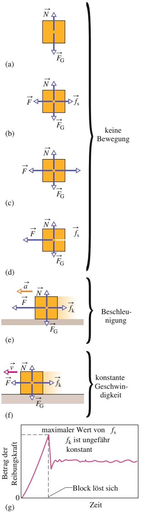

## Abb. 2.10

(a) Die Kräfte, die auf einen in Ruhe befindlichen Quader wirken.
(b)–(d) Eine äußere, auf den Quader wirkende Kraft $\vec { F }$ wird durch eine Haftreibungskraft $\vec { f } _ { s }$ aufgehoben. Wächst $F ,$ so nimmt $f _ { s }$ bis zu einem bestimmten Maximalwert ebenfalls zu. (e) Der Quader löst sich und wird plötzlich in Richtung von $\vec { F }$ beschleunigt. (f ) Soll sich der Quader mit konstanter Geschwindigkeit bewegen, so muss F von dem Maximalwert, den F beim Loslösen des Quaders besaß, verringert werden. (g) Einige Ergebnisse der Versuchsreihe (a) bis (f ).

51

---

2 Kraft und Bewegung

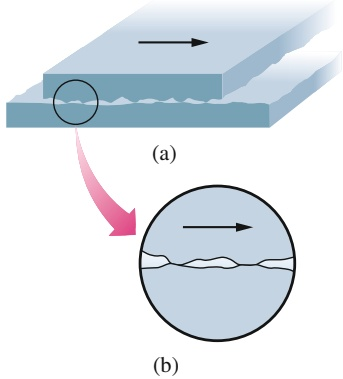

text_image

(a)
(b)

Abb. 2.11

Gleitreibung. (a) In dieser Gesamtansicht gleitet die obere Oberfläche auf der unteren nach rechts. (b) Der Ausschnitt zeigt zwei Punkte, die kalt verschweißt sind. Eine Kraft wird benö- tigt, um die Schweißstellen zu trennen und die Bewegung aufrechtzuerhalten.

gen wollen, müssen Sie meist die aufgewendete Kraft verringern, sobald sich der Quader wie in Abb. 2.10f gezeigt zu bewegen beginnt. Abbildung 2.10g zeigt als Beispiel die Ergebnisse eines Experiments, bei dem die auf einen Quader wirkende Kraft langsam erhöht wurde, bis sich der Quader loslöste. Beachten Sie, dass nach dem Loslösen eine geringere Kraft benötigt wird, um den Quader mit konstanter Geschwindigkeit zu bewegen.

Eine Reibungskraft ist im Wesentlichen die (äußerst komplizierte) Vektorsumme der unzähligen Kräfte, die zwischen den Oberflächenatomen eines Körpers und denen eines anderen wirken. Werden zwei extrem glatt polierte und sorgfältig gesäuberte Metalloberflächen im hochreinen Vakuum (damit sie sauber bleiben) zusammengebracht, gelingt es nicht, sie aufeinander gleiten zu lassen. Da ihre Oberflächen sehr glatt sind, berühren so viele Atome der einen Oberfläche die Atome der anderen, dass die Oberflächen sofort kalt zu einem einzigen Metallstück verschweißen. Hält ein Maschinenschlosser seine speziell polierten Maßblöcke in Luft aneinander, so berühren sich zwar weniger Atome, die Blöcke haften jedoch immer noch so fest aneinander, dass man sie nur durch eine ruckartige Drehbewegung wieder trennen kann. Im Allgemeinen können sich allerdings nicht so viele Atome berühren wie in diesen beiden Extremfällen. Sogar eine äußerst sorgfältig polierte Metalloberfläche ist weit davon entfernt, auf atomarer Skala glatt zu sein. Überdies sind die Oberflächen von Alltagsgegenständen mit Schichten von Oxiden und anderen Verunreinigungen bedeckt, die das Kaltschweißen verhindern.

Werden zwei gewöhnliche Oberflächen aufeinander gelegt, so berühren sich nur die Spitzen auf der Oberfläche – etwa so, als ob man die Schweizer Alpen umdreht und auf die Österreichischen Alpen klappt. Die tatsächliche mikroskopische Berührungsfläche ist viel geringer – vielleicht um das $1 0 ^ { 4 } - \mathrm { F a c h e } -$ als die scheinbare makroskopische. Trotzdem verschweißen viele Berührungspunkte kalt. Diese Schweißstellen erzeugen Haftreibung, wenn eine Kraft aufgewendet wird, um die Oberflächen übereinander gleiten zu lassen.

Ist die aufgewendete Kraft groß genug, um die eine Oberfläche über die andere zu ziehen, so werden zuerst die Schweißstellen getrennt (beim Loslösen) und dann an den zufälligen Berührungspunkten während der Bewegung ständig neue gebildet und wieder getrennt (Abb. 2.11). Die Gleitreibungskraft ${ \vec { f } } _ { \mathrm { k } } ,$ die der Bewegung entgegenwirkt, ist die Vektorsumme der an diesen vielen zufälligen Berührungspunkten wirkenden Kräfte.

Werden die zwei Oberflächen stärker zusammengepresst, verschweißen noch mehr Punkte kalt. Um die Oberflächen dann übereinander gleiten zu lassen, muss eine größere Kraft aufgewendet werden: Die Haftreibungskraft $\vec { f } _ { s }$ besitzt einen hö- heren Maximalbetrag. Sobald die zwei Oberflächen gleiten, gibt es viel mehr Punkte, die kurzzeitig kalt verschweißen, sodass die Gleitreibungskraft $\vec { f } _ { \mathrm { k } }$ ebenfalls grö- ßer ist.

Oft erfolgt die Gleitbewegung einer Oberfläche auf einer anderen ruckartig, da die zwei Oberflächen abwechselnd zusammenhaften und dann wieder übereinander gleiten. Ein solches wiederholtes Haften und Gleiten kann Quietschen und Kreischen erzeugen, wenn z. B. Reifen auf trockener Straße rutschen, Fingernä- gel an einer Tafel kratzen oder eine Tür mit rostigen Angeln geöffnet wird. Es kann aber auch sehr schöne Töne erzeugen, wenn z. B. eine Geigerin den Bogen gekonnt über die Saiten ihrer Violine führt.

## 2.4.2 Eigenschaften der Reibung

Experimentell zeigt sich Folgendes: Drückt ein trockener und nicht geschmierter Körper gegen eine ebensolche Oberfläche, während eine Kraft $i \vec { F }$ versucht, den Körper über die Oberfläche gleiten zu lassen, so besitzt die resultierende Reibungskraft drei Eigenschaften:

52

---

2.4 Reibung

2

**• Eigenschaft 1.** Bewegt sich der Körper nicht, so heben sich die Haftreibungskraft $\vec { f } _ { s }$ und die parallel zur Oberfläche wirkende Komponente von $\vec { F }$ auf. Ihr Betrag ist gleich, und $\vec { f } _ { s }$ ist dieser Komponente von $\vec { F }$ entgegen gerichtet.
**• Eigenschaft 2.** Der Maximalbetrag $f _ { \mathrm { s , m a x } }$ von $\vec { f } _ { s }$ wird durch

$$
f _ {\mathrm{s,max}} = \mu_ {\mathrm{s}} N \tag {2.11}
$$

bestimmt, wobei $\mu _ { s }$ der Koeffizient der statischen Reibung oder Haftreibungs**koeffizient** und N der Betrag der Normalkraft ist, welche die Oberfläche auf den Körper ausübt. Übersteigt der Betrag der parallel zur Oberfläche wirkenden Komponente von $\vec { F }$ den Wert $f _ { \mathrm { s , m a x ^ { \star } } }$ so beginnt der Körper, über die Oberfläche zu gleiten.

**• Eigenschaft 3.** Beginnt der Körper über die Oberfläche zu gleiten, so verringert sich der Betrag der Reibungskraft rasch auf einen Wert $f _ { \mathrm { k } } ,$ der durch

$$
f _ {\mathrm{k}} = \mu_ {\mathrm{k}} N \tag {2.12}
$$

gegeben ist. Dabei ist $\mu _ { \mathrm { k } }$ der Koeffizient der kinetischen Reibung oder Gleitrei**bungskoeffizient**. Während des Gleitens wirkt der Bewegung dann eine Gleitreibungskraft $\vec { f } _ { \mathrm { k } }$ entgegen, deren Betrag Gl. 2.12 angibt.

Der Betrag N der Normalkraft stellt bei den Eigenschaften 2 und 3 ein Maß dafür dar, wie stark der Körper gegen die Oberfläche drückt. Wird der Druck des Körpers größer, dann ist N gemäß dem dritten Newtonschen Gesetz ebenfalls größer. Die Eigenschaften 1 und 2 gehen hier von einer einzigen aufgewendeten Kraft F⃗ aus, sie gelten jedoch ebenso für eine Gesamtkraft, die von mehreren auf den Körper wirkenden Kräften ausgeübt wird. Beachten Sie, dass die Gln. 2.11 und 2.12 keine Vektorgleichungen sind: $\vec { f } _ { s }$ und $\vec { f } _ { \mathrm { k } }$ wirken stets parallel zur Oberfläche und entgegen der versuchten Gleitbewegung; die Normalkraft N wirkt senkrecht zur Oberfläche.

Die Koeffizienten $\mu _ { s }$ und $\mu _ { \mathrm { k } }$ sind dimensionslos und müssen experimentell bestimmt werden. Ihr Wert hängt von den speziellen Eigenschaften sowohl des Körpers als auch der Oberfläche ab. Im Allgemeinen werden sie deshalb mit der Präposition „zwischen“ angegeben, z. B. in der Aussage „der Wert von $\mu _ { s }$ zwischen einem Ei und einer teflonbeschichteten Bratpfanne ist $_ { 0 , 0 4 ; }$ zwischen Bergschuhen und Fels beträgt er immerhin 1,2“. Wir gehen davon aus, dass der Wert von $\mu _ { \mathrm { k } }$ nicht vom Geschwindigkeitsbetrag abhängt, mit dem der Körper über die Oberfläche gleitet.

## KONTROLLFRAGE 9

Ein Block liegt auf dem Fußboden. (a) Wie groß ist der Betrag der Reibungskraft, die der Fußboden auf den Block ausübt? (b) Nun wird eine horizontale Kraft von 5 N auf den Block angewendet, dieser bewegt sich jedoch nicht. Wie groß ist die auf den Block wirkende Reibungskraft? (c) Der Maximalwert $f _ { \mathrm { s , m a x } }$ der auf den Quader wirkenden Haftreibungskraft sei gleich 10 N. Bewegt sich der Block, wenn der Betrag der horizontal wirkenden Kraft gleich 8 N ist? (d) Und wenn der Betrag gleich 12 N ist? (e) Wie groß ist der Betrag der Reibungskraft in Teil (c)?

## KONTROLLFRAGE 10

In der Abbildung wirkt eine Kraft $\vec { F } _ { 1 }$ mit dem Betrag 10 N waagerecht auf eine Kiste, die sich auf dem Boden befindet; die Kiste bewegt sich jedoch nicht. Nun wird eine senkrecht nach oben wirkende Kraft $\vec { F } _ { 2 }$ auf die Kiste angewendet, deren Betrag von null ausgehend ansteigt, ohne dass sich die Kiste jedoch zur Seite bewegt. Werden die folgenden Größen anwachsen, abfallen oder gleich bleiben: (a) der Betrag der auf die Kiste wirkenden Reibungskraft; (b) der Betrag der vom Boden auf die Kiste ausgeübten Normalkraft; (c) der Maximalbetrag θ der auf die Kiste wirkenden Haftreibungskraft?

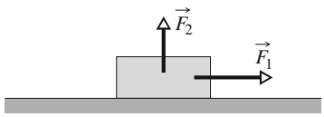

text_image

Physics diagram showing two forces F1 and F2 acting on a block on a horizontal surface

53

---

2 Kraft und Bewegung

## 2.5 Strömungswiderstand und Endgeschwindigkeit

## Lernziele

Nach dem Durcharbeiten dieses Abschnitts sollten Sie in der Lage sein, . . .

• die Beziehung zwischen dem Strömungswiderstand, den ein Körper bei einer Bewegung durch Luft spürt, und seiner Geschwindigkeit anzugeben,
• die Endgeschwindigkeit eines Körpers anzugeben, der in Luft fällt.

## Schlüsselideen

Wenn ein Körper sich relativ zu Luft (oder einem anderen Fluid) bewegt, erfährt er einen Strömungswiderstand $\vec { \bar { F } } _ { \mathrm { G } } ,$ die der relativen Bewegung entgegengesetzt ist und in die Richtung zeigt, in die das Fluid relativ zu dem Körper fließt. Der Betrag von $\vec { D }$ hängt über einen experimentell zu bestimmenden Luftwiderstandsbeiwert $C$ mit der Relativgeschwindigkeit v zwischen Körper und Fluid zusammen:

$$
D = \frac {1}{2} C \rho A \nu^ {2},
$$

wobei $\rho$ die Dichte des Fluids ist (Masse pro Volumeneinheit) und A die effektive Querschnittsfläche des Körpers (seine Querschnittsfläche senkrecht zur Relativgeschwindigkeit v⃗).

• Wenn ein gedrungener Gegenstand weit genug durch die Luft gefallen ist, werden die Beträge des Strömungswiderstands und der Schwerkraft des Körpers gleich. Er fällt dann mit einer konstanten Endgeschwindigkeit

$$
\nu_ {\mathrm{t}} = \sqrt {\frac {2 F _ {\mathrm{G}}}{C \rho A}}.
$$

## 2.5.1 Strömungswiderstand und Endgeschwindigkeit

Als ein **Fluid** bezeichnet man alles, was fließen kann – im Allgemeinen sowohl ein Gas als auch eine Flüssigkeit. Wenn sich ein Fluid und ein Körper relativ zueinander in Bewegung befinden (entweder weil sich der Körper durch das Fluid bewegt oder weil das Fluid an dem Körper vorbeiströmt), so erfährt der Körper einen **Strö- mungswiderstand** ${ \vec { D } } _ { i }$ welcher der Relativbewegung entgegengerichtet ist und in die Richtung zeigt, in die das Fluid relativ zum Körper fließt.

Wir betrachten an dieser Stelle nur Fälle, in denen die Luft das Fluid darstellt. Der betrachtete Körper ist eher gedrungen als schlank (wie z. B. ein Ball, nicht wie ein Speer) und die Relativgeschwindigkeit ist so hoch, dass die Luft hinter dem Körper turbulent wird, also Wirbel bildet. In solchen Fällen ist der Betrag des Strömungswiderstands $\vec { D }$ über einen experimentell bestimmten **Widerstandskoeffizienten** C mit dem Betrag der Relativgeschwindigkeit v verknüpft:

$$
D = \frac {1}{2} C \rho A \nu^ {2}, \tag {2.13}
$$

natural_image

Skier mid-air in a snowy mountain landscape, no visible text or symbols

Abb. 2.12

Diese Skifahrerin bückt sich in die Abfahrtshocke, um so ihre effektive Querschnittsfläche und damit den auf sie wirkenden Luftwiderstand zu minimieren [Quelle: resilva/Shutterstock].

wobei $\rho$ die Dichte der Luft (Masse pro Volumen) und A die effektive Quer**schnittsfläche** des Körpers darstellt, d. h. die Querschnittsfläche senkrecht zur Geschwindigkeit $\vec { \nu } .$ Der Widerstandskoeffizient C (dessen Werte typischerweise zwischen $^ { 0 , 4 }$ und 1,0 liegen) ist keine wirkliche Konstante für einen gegebenen Körper, da der Wert von C variieren kann, wenn v sich deutlich verändert. Solche Komplikationen lassen wir hier allerdings außer Acht.

Abfahrtsläufer wissen sehr genau, dass der Strömungswiderstand von A und $\nu ^ { 2 }$ abhängt. Um hohe Geschwindigkeiten zu erreichen, muss ein Skifahrer $D$ so gering wie möglich halten, indem er $\mathbf { Z } .$ B. in die Hocke geht (Abb. 2.12) und so A minimiert.

54

---

2.5 Strömungswiderstand und Endgeschwindigkeit

2

Wenn ein gedrungener Gegenstand aus seiner Ruheposition heraus durch Luft fällt, so ist der Strömungswiderstand $\vec { D }$ nach oben gerichtet; sein Betrag wächst mit dem Betrag der Geschwindigkeit des Körpers allmählich von null an. Diese nach oben wirkende Kraft $\vec { D }$ wirkt der nach unten gerichteten Gravitationskraft $\vec { F } _ { \mathrm { G } }$ auf den Körper entgegen. Wir können diese Kräfte mit der Beschleunigung des Körpers verbinden, indem wir das zweite Newtonsche Gesetz für eine vertikale y-Achse $( F _ { \mathrm { g e s } ,   y } = m a _ {   y } )$ benutzen:

$$
D - F _ {\mathrm{G}} = m a, \tag {2.14}
$$

mit m als Masse des Körpers. Wie in Abb. 2.13 angedeutet ist, gleichen sich $D$ und $F _ { \mathrm { G } }$ letztendlich aus, wenn der Körper lange genug fällt. Aus Gl. 2.14 ergibt sich, dass dann $\alpha = 0$ und folglich der Betrag der Geschwindigkeit des Körpers konstant ist. Der Körper fällt gleichförmig mit der „terminalen“ **Endgeschwindigkeit** $\nu _ { \mathrm { t } } .$

Um $\nu _ { \mathrm { t } }$ zu bestimmen, setzen wir $\alpha = 0$ in Gl. 2.14 ein, ersetzen D anhand von Gl. 2.13 und erhalten:

$$
\frac {1}{2} C \rho A \nu_ {\mathrm{t}} ^ {2} - F _ {\mathrm{G}} = 0,
$$

woraus

$$
\nu_ {\mathrm{t}} = \sqrt {\frac {2 F _ {\mathrm{G}}}{C \rho A}} \tag {2.15}
$$

folgt. Tabelle 2.1 zeigt Werte von $\nu _ { \mathrm { t } }$ für einige alltägliche Körper.

Berechnungen1) zufolge, die auf Gl. 2.13 beruhen, muss eine Katze etwa sechs Stockwerke tief fallen, um ihre Endgeschwindigkeit zu erreichen. Bis dies geschieht, ist $F _ { G } > D$ und die Katze wird wegen der nach unten gerichteten Gesamtkraft nach unten beschleunigt. Erinnern Sie sich an Kap. 1: Unser Körper ist ein Beschleunigungsmesser, kein Geschwindigkeitsmesser. Da die Katze ebenfalls die Beschleunigung fühlt, hat sie Angst, behält die Pfoten unter ihrem Körper, zieht den Kopf ein und macht einen Buckel, wodurch A klein, $\nu _ { \mathrm { t } }$ groß und eine Verletzung bei der Landung wahrscheinlich wird.

Erreicht die Katze jedoch die Endgeschwindigkeit $\nu _ { \mathrm { t } } ,$ so wird die Beschleunigung gleich null, die Katze entspannt sich etwas, streckt ihre Beine sowie den Hals horizontal aus und macht den Rücken gerade (sie erinnert dann an ein Eichhörnchen im Sprung). Dies vergrößert die Fläche A und somit laut Gl. 2.13 auch den Strö- mungswiderstand D. Der Fall der Katze verlangsamt sich, da nun $D > F _ { G }$ (die Gesamtkraft ist nach oben gerichtet), bis eine neue, kleinere Endgeschwindigkeit $\nu _ { \mathrm { t } }$

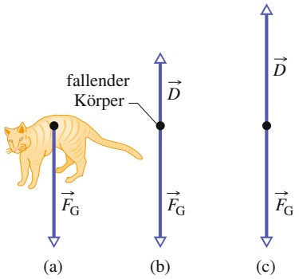

Abb. 2.13

Die auf einen in Luft fallenden Körper wirkenden Kräfte: (a) Der Körper zu Beginn des Falls; (b) Kräftediagramm etwas später, nachdem sich ein Strömungswiderstand entwickelt hat. (c) Der Strömungswiderstand hat zugenommen, bis er die auf den Körper wirkende Gravitationskraft ausgleicht. Der Körper fällt nun mit seiner konstanten Endgeschwindigkeit.

TABELLE 2.1: Einige Endgeschwindigkeiten beim freien Fall in Luft.

| Körper | Endgeschwindigkeit (m/s) | 95-%-Entfernunga)(m) |
| --- | --- | --- |
| Kugel (vom Kugelstoßen) | 145 | 2500 |
| Fallschirmspringer (durchschnittlich, Fallschirm nicht geöffnet) | 60 | 430 |
| Baseball | 42 | 210 |
| Tennisball | 31 | 115 |
| Basketball | 20 | 47 |
| Tischtennisball | 9 | 10 |
| Regentropfen (Radius = 1,5 mm) | 7 | 6 |
| Fallschirmspringer (durchschnittlich, Fallschirm geöffnet) | 5 | 3 |

a) Dies ist die Höhe, aus der ein Körper aus der Ruhe fallen muss, um 95 % seiner Endgeschwindigkeit zu erreichen [Quelle: nach Brancazio, P.J. (1984). Sport Science („Sportwissenschaft“). New York: Simon & Schuster].

1) Whitney, W.O. und Mehlhaff C.J. (1987). „High-Rise Syndrome in Cats“. The Journal of the American Veterinary Medical Association („Das Hochhaus-Phänomen bei Katzen“, Zeitschrift der Amerikanischen Veterinärmedizinischen Gesellschaft), 191: 1399–1403.

55

---

2 Kraft und Bewegung

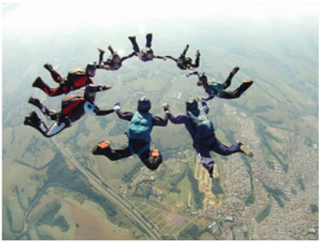

natural_image

Aerial view of multiple people in mid-air during a parachute, surrounded by farmland and landscape (no text or symbols visible)

Abb. 2.14

Fallschirmspringer in einer horizontalen Spread-Eagle-Position, die ihren Strömungswiderstand maximiert [Quelle: Mauricio Graiki/Shutterstock].

erreicht wird. Die Verringerung von $\nu _ { \mathrm { t } }$ reduziert die Wahrscheinlichkeit einer ernsten Verletzung bei der Landung. Kurz vor Ende des Falls, wenn die Katze merkt, dass sie sich dem Boden nähert, zieht sie die Beine zurück unter den Körper, um sich auf die Landung vorzubereiten.

Beim Fallschirmspringen lassen sich Unerschrockene aus großen Höhen fallen, um das Gefühl des freien Falls zu genießen. Im April 1987 jedoch bemerkte der Fallschirmspringer Gregory Robertson, dass seine Kollegin Debbie Williams durch den Zusammenstoß mit einem dritten Fallschirmspringer das Bewusstsein verloren hatte und ihren Fallschirm nicht öffnen konnte. Robertson befand sich zu diesem Zeitpunkt weit über Williams und hatte seinen Fallschirm für den 4 km hohen Sprung noch nicht geöffnet. Er richtete seinen Körper neu aus, mit dem Kopf nach unten, um A zu minimieren und seine abwärts gerichtete Geschwindigkeit zu maximieren. Er erreichte dabei eine geschätzte Endgeschwindigkeit $\nu _ { \mathrm { t } }$ von 320 km/h, holte Williams ein und ging dann in eine horizontale Position über (wie in Abb. 2.14), um D zu erhöhen, sodass er sie fassen konnte. Er öffnete ihren Fallschirm und – nachdem er sie losgelassen hatte – seinen eigenen, gerade mal 10 s vor dem Aufprall. Williams erlitt wegen fehlender Kontrolle bei der Landung schwere innere Verletzungen, aber sie überlebte.

## KONTROLLFRAGE 11

Ist die Geschwindigkeit großer Regentropfen kurz über dem Erdboden größer als, kleiner als oder genauso groß wie die Geschwindigkeit kleiner Regentropfen, wenn wir annehmen, dass alle Regentropfen kugelförmig sind und den gleichen Widerstandskoeffizienten besitzen?

## 2.6 Gleichförmige Kreisbewegung

## Lernziele

Nach dem Durcharbeiten dieses Abschnitts sollten Sie in der Lage sein, . . .

den bei einer gleichförmigen Kreisbewegung zurückgelegten Weg zu skizzieren und die Vektoren der Geschwindigkeit, der Beschleunigung und der Kraft während der gesamten Bewegung zu erläutern (Beträge und Richtungen),
• zu verstehen, dass ein Objekt keine gleichförmige Kreisbewegung ausführen kann, wenn es keine radial nach innen gerichtete Kraft (eine Zentripetalkraft) gibt,
• für ein Teilchen, das eine gleichförmige Kreisbewegung ausführt, die Beziehung zwischen Kreisradius, Geschwindigkeit und Masse des Teilchens und der resultierenden Kraft auf das Teilchen anzugeben und anzuwenden.

## Schlüsselideen

Wenn sich ein Teilchen auf einer Kreisbahn oder einem Kreisbogen mit Radius R mit konstanter Geschwindigkeit v bewegt, sagt man, dass es eine gleichförmige Kreisbewegung ausführt. Es spürt dann eine Zentripetalbeschleunigung mit dem Betrag

$$
a = \frac {\nu^ {2}}{R}.
$$

• Diese Beschleunigung wird durch eine resultierende Zentripetalkraft auf das Teilchen mit dem Betrag

$$
F = \frac{mv^2}{R}
$$

verursacht, wobei m die Masse des Teilchens ist. Die Vektorgrößen $\vec { a }$ und $\vec { F }$ zeigen in Richtung auf den Krümmungsmittelpunkt der Bahn des Teilchens (den Kreismittelpunkt).

56

---

2.6 Gleichförmige Kreisbewegung

2

## 2.6.1 Gleichförmige Kreisbewegung

Wenn sich ein Körper mit einer konstanten Geschwindigkeit v auf einem Kreis bzw. einem Kreisbogen bewegt, spricht man – wie wir aus Abschn. 1.10 wissen – von einer gleichförmigen Kreisbewegung. Wir wissen auch, dass der Körper dabei einer (zum Kreismittelpunkt gerichteten) Zentripetalbeschleunigung unterliegt, deren Betrag durch

$$
a = \frac {\nu^ {2}}{R} \quad (\text {Zentripetalbeschleunigung}) \tag {2.16}
$$

bestimmt wird, wobei R der Radius des Kreises ist.

Lassen Sie uns zwei Bespiele von gleichförmigen Kreisbewegungen betrachten:

## 1. Mit einem Auto um eine Kurve fahren

Sie sitzen in der Mitte der Rückbank eines Autos, das sich mit konstanter, ho her Geschwindigkeit entlang einer ebenen Straße bewegt. In dem Moment, in dem der Fahrer plötzlich nach links steuert und eine kreisförmige Kurve fährt, rutschen Sie auf dem Sitz nach rechts und werden während des gesamten Rests der Kurve an die Seite des Autos gedrückt. Was geschieht dabei?

Während sich das Auto auf der Kreisbahn (bzw. dem Kreisbogen) bewegt, führt es eine gleichförmige Kreisbewegung aus, d. h., es besitzt eine auf den Kreismit telpunkt gerichtete Beschleunigung. Gemäß dem zweiten Newtonschen Gesetz muss eine Kraft diese Beschleunigung verursachen. Diese Kraft muss ebenfalls zum Kreismittelpunkt weisen. Es handelt sich dabei also um eine Zentripetalkraft, wobei „zentripetal“ nichts anderes als „zum Zentrum strebend“ bedeutet. In diesem Beispiel ist die Zentripetalkraft eine von der Straße auf die Reifen ausgeübte Reibungskraft. Sie ermöglicht das Abbiegen.

Wenn Sie sich zusammen mit dem Auto in einer gleichförmigen Kreisbewegung bewegen sollen, so muss auch auf Sie eine Zentripetalkraft wirken. Offensichtlich war jedoch die vom Sitz auf Sie ausgeübte Reibungskraft nicht groß genug, als dass Sie sich mit dem Auto im Kreis bewegen könnten. Deshalb rutscht der Sitz unter Ihnen weg, bis die rechte Wand des Autos gegen Sie drückt. Danach sorgt dieser Druck für die notwendige, auf Sie wirkende Zentripetalkraft, sodass Sie die gleichförmige Kreisbewegung zusammen mit dem Auto ausführen.

## 2. Umkreisen der Erde

Diesmal sind Sie Passagier einer Raumfähre. Während die Raumfähre und Sie die Erde umkreisen, schweben Sie sanft in Ihrer Kabine herum. Was geschieht nun?

Das Spaceshuttle und Sie führen beide eine gleichförmige Kreisbewegung aus, Sie werden beide zum Kreismittelpunkt beschleunigt. Auch hier müssen diese Beschleunigungen nach dem zweiten Newtonschen Gesetz durch Zentripetalkräfte verursacht werden. Dieses Mal sind die Zentripetalkräfte durch die Gra vitationskraft der Erde hervorgerufene, radial nach innen in Richtung Erdmit telpunkt zeigende Zugkräfte (die Gravitationskraft, die auf Sie wirkt, und die Gravitationskraft, die auf das Shuttle wirkt).

Sowohl im Auto als auch in der Raumfähre befinden Sie sich in einer gleichförmi gen Kreisbewegung, die durch eine Zentripetalkraft verursacht wird – Sie nehmen jedoch beide Situationen ganz unterschiedlich wahr. Im Auto werden Sie gegen die Wand gedrückt und nehmen diesen Druck der Wand bewusst wahr. In der Raumfähre auf der Umlaufbahn aber schweben Sie herum, ohne die auf Sie wirkende Kraft zu spüren. Woher kommt dieser Unterschied?

Die Ursache für diesen Unterschied liegt in der Natur der beiden Zentripetalkräfte. Im Auto ist die Zentripetalkraft der Druck gegen den Teil Ihres Körpers, der die Wand berührt. Sie können diesen Druck auf den Teil des Körpers spüren. In der Raumfähre ist die Zentripetalkraft die auf jedes Atom Ihres Körpers wirkende Erdanziehungskraft. Dadurch entsteht kein Druck (oder Zug) auf einen einzelnen Teil Ihres Körpers und somit auch kein Gefühl einer auf Sie wirkenden Kraft. (Dieses

57

---

2 Kraft und Bewegung

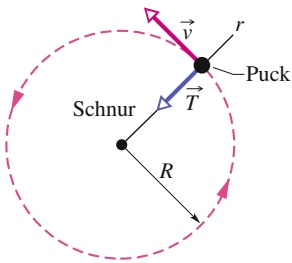

text_image

Puck
Schnur
T
R
v
r

Abb. 2.15

Draufsicht auf einen Eishockeypuck der Masse m, der sich mit einem konstanten Geschwindigkeitsbetrag v auf einer kreisförmigen Bahn mit dem Radius R auf einer waagerechten, reibungsfreien Oberfläche bewegt. Die auf den Puck wirkende Zentripetalkraft ist die Zugspannung $\vec { T }$ der Schnur, die entlang der sich durch den Puck erstreckenden radialen r-Achse nach innen zeigt.

Gefühl wird als „Schwerelosigkeit“ bezeichnet, doch diese Bezeichnung ist irreführend. Die auf Sie wirkende Erdanziehungskraft ist keineswegs verschwunden, sondern in Wirklichkeit nur etwas schwächer als am Erdboden.)

Ein weiteres Beispiel für eine Zentripetalkraft ist in Abb. 2.15 dargestellt. Dabei bewegt sich ein mit einer Schnur an einem Pflock befestigter Eishockeypuck mit einer konstanten Geschwindigkeit v im Kreis. In diesem Fall ist die Zentripetalkraft die durch die Schnur auf den Puck ausgeübte Zugspannung, die radial nach innen zeigt. Ohne diese Kraft würde der Puck in einer geraden Linie davonrutschen, anstatt sich im Kreis zu bewegen.

Beachten Sie, dass die Zentripetalkraft keine neue Art von Kraft ist. Der Name gibt nur die Richtung der Kraft und die spezielle Art der Bewegung (nämlich auf krummen Wegen) an. Es kann sich hierbei um eine Reibungskraft, eine Gravitationskraft, eine durch eine Wand bzw. Schnur verursachte Kraft oder eine beliebige andere Kraft handeln. In jedem Fall gilt:

Eine Zentripetalkraft beschleunigt einen Körper, indem sie die Richtung der Geschwindigkeit des Körpers verändert, ohne den Betrag der Geschwindigkeit zu verändern.

Nach dem zweiten Newtonschen Gesetz und Gl. 2.16 $( a = \nu ^ { 2 } / R )$ können wir den Betrag $F$ einer Zentripetalkraft (oder einer Gesamtzentripetalkraft) als

$$
F = m \frac {v ^ {2}}{R} \quad (\text {Betrag der Zentripetalkraft}) \tag {2.17}
$$

schreiben. Da der Betrag der Geschwindigkeit v hierbei konstant ist, sind auch die Beträge der Beschleunigung und der Kraft konstant.

Die Richtungen von Zentripetalbeschleunigung und -kraft sind jedoch nicht konstant, sie ändern sich ständig derart, dass sie immer zum Kreismittelpunkt weisen. Aus diesem Grund werden die Kraft- und Beschleunigungsvektoren manchmal entlang einer radialen r-Achse (Radialachse r) dargestellt, die sich mit dem Körper bewegt und sich stets vom Kreismittelpunkt zum Körper erstreckt, wie in Abb. 2.15 gezeigt. Die positive Richtung der Achse wird radial nach außen angenommen, die Beschleunigungs- und Kraftvektoren weisen radial nach innen.

## KONTROLLFRAGE 12

Sie sitzen in einem Riesenrad, das sich mit konstanter Geschwindigkeit bewegt. In welche Richtung zeigen die auf Sie wirkende Beschleunigung $\vec { a }$ sowie die Normalkraft $\vec { N }$ der waagerechten Sitzfläche beim Durchqueren (a) des höchsten und (b) des tiefsten Punkts der Fahrt?

## KONTROLLFRAGE 13

Nehmen Sie an, das Auto aus Abb. Ü2.13 im Übungsbuch ist bei dem Kreisradius $R _ { 1 }$ kurz davor wegzurutschen. (a) Wenn wir die Geschwindigkeit des Autos verdoppeln, wie groß muss der Radius dann mindestens sein, um ein Rutschen des Autos zu verhindern? (b) Wenn wir die Masse des Autos ebenfalls verdoppeln (z. B. durch Sandsäcke), wie groß muss der Radius dann mindestens sein, um ein Rutschen des Autos zu verhindern?

## 2.7 Scheinkräfte

## Lernziele

Nach dem Durcharbeiten dieses Abschnitts sollten Sie in der Lage sein, . . .

• zwischen Kräften in Inertialsystemen und Scheinkräften in rotierenden Koordinatensystemen zu unterscheiden,
• die Zentrifugalkraft, die Coriolis-Kraft und die Azimutalkraft auszurechnen.

58

---

2.7 Scheinkräfte

2

## Schlüsselideen

• Die Newtonschen Gesetze gelten nicht in rotierenden Koordinatensystemen, da diese keine Inertialsysteme sind.
• In rotierenden Koordinatensystemen treten Scheinkräfte auf, die die Dimension einer physikalischen Kraft haben und in geeigneten Situationen subjektiv als Kraft wahrgenommen werden.
• Man muss sorgfältig zwischen Bewegungsgleichungen in raumfesten, inertialen Koordinatensystemen und in rotierenden Koordinatensystem unterscheiden.
• Beim Umschreiben der Newtonschen Bewegungsgleichungen von einem raumfesten in ein rotierendes Koordinatensystem treten Zusatzterme auf, die als Scheinkräfte interpretiert werden können.

## 2.7.1 Nichtinertialsysteme

Die Newtonschen Gesetze gelten bekanntlich ja nur in **Inertialsystemen**, d. h., sie gelten nicht in **rotierenden Koordinatensystemen**. Nun befinden wir uns auf der Erde aber gerade in solch einem rotierenden System und es stellt sich die Frage, welche Auswirkungen dies auf die Bewegungsgleichungen hat.

Zur systematischen Untersuchung dieser Effekte definieren wir ein absolutes (nicht mit der Erde rotierendes) Koordinatensystem K, das ein echtes Inertialsystem darstellen soll. Hier auf der Erde haben wir das Koordinatensystem $\mathrm { K } ^ { \prime } ,$ das relativ zu K mit der **Winkelgeschwindigkeit** ω⃗ der Erddrehung rotiert. In dem Inertialsystem K gilt das Newtonsche Bewegungsgesetz

$$
\vec {F} _ {\mathrm{ext}} = \left. \frac {\mathrm{d} \vec {p}}{\mathrm{d} t} \right| _ {\mathrm{K}}, \tag {2.18}
$$

wobei wir die einwirkende externe Kraft mit $\vec { F } _ { \mathrm { e x t } }$ bezeichnen und $\mathrm { d } / \mathrm { d } t | _ { \mathrm { K } }$ anzeigen |soll, dass die Zeitableitung im Koordinatensystem K genommen wird. (Wir haben bisher immer die Formulierung des zweiten Newtonsches Gesetzes mit Masse und Beschleunigung benutzt (Gln. 2.1 bzw. 2.25), wie dies mit dem Impuls $\vec { p }$ zusammenhängt, wird in Abschn. 5.3 näher erläutert werden.)

Zwischen den Zeitableitungen im festen Koordinatensystem K und dem rotierenden Koordinatensystem besteht die Beziehung

$$
\left. \frac {\mathrm{d}}{\mathrm{d} t} \right| _ {\mathrm{K}} = \left. \frac {\mathrm{d}}{\mathrm{d} t} \right| _ {\mathrm{K} ^ {\prime}} + \vec {\omega} \times \tag {2.19}
$$

sodass wir Gl. 2.18 umschreiben können in

$$
\vec {F} _ {\mathrm{ext}} = \left. \frac {\mathrm{d} \vec {p}}{\mathrm{d} t} \right| _ {\mathrm{K} ^ {\prime}} + \vec {\omega} \times \vec {p}. \tag {2.20}
$$

Nun gilt für Systeme mit zeitlich konstanter Masse

$$
\vec {p} = m \left. \frac {\mathrm{d} \vec {r}}{\mathrm{d} t} \right| _ {\mathrm{K}}, \tag {2.21}
$$

was wir im rotierenden Koordinatensystem K′ schreiben können als

$$
\vec {p} = m \left. \frac {\mathrm{d} \vec {r}}{\mathrm{d} t} \right| _ {\mathrm{K} ^ {\prime}} + m \vec {\omega} \times \vec {r}. \tag {2.22}
$$

Setzen wir dies in Gl. 2.20 ein und sortieren die Terme um, so erhalten wir

$$
\vec {F} _ {\mathrm{ext}} = m \left. \frac {\mathrm{d} ^ {2} \vec {r}}{\mathrm{d} t ^ {2}} \right| _ {\mathrm{K} ^ {\prime}} + 2 m \vec {\omega} \times \left. \frac {\mathrm{d} \vec {r}}{\mathrm{d} t} \right| _ {\mathrm{K} ^ {\prime}} + m \left. \frac {\mathrm{d} \vec {\omega}}{\mathrm{d} t} \right| _ {\mathrm{K} ^ {\prime}} \times \vec {r} + m \vec {\omega} \times (\vec {\omega} \times \vec {r}). \tag {2.23}
$$

59

---

2 Kraft und Bewegung

Durch Umstellen der Terme wird daraus

$$
m \left. \frac {\mathrm{d} ^ {2} \vec {r}}{\mathrm{d} t ^ {2}} \right| _ {\mathrm{K} ^ {\prime}} = \vec {F} _ {\text {ext}} - m \vec {\omega} \times (\vec {\omega} \times \vec {r}) - 2 m \vec {\omega} \times \left. \frac {\mathrm{d} \vec {r}}{\mathrm{d} t} \right| _ {\mathrm{K} ^ {\prime}} - m \left. \frac {\mathrm{d} \vec {\omega}}{\mathrm{d} t} \right| _ {\mathrm{K} ^ {\prime}} \times \vec {r}. \tag {2.24}
$$

| | |Diese Gleichung hat genau die Form der Newtonschen Bewegungsgleichung für konstante Masse,

$$
m \vec {a} = \vec {F} _ {\text {effektiv}}, \tag {2.25}
$$

wenn wir die Beschleunigung

$$
\vec {a} = \left. \frac {\mathrm{d} ^ {2} \vec {r}}{\mathrm{d} t ^ {2}} \right| _ {\mathrm{K} ^ {\prime}} \tag {2.26}
$$

|auf der Erde, d. h. im rotierenden Koordinatensystem messen. Alle Terme auf der rechten Seite von Gl. 2.24 fassen wir als effektive Kraft auf,

$$
\vec {F} _ {\mathrm{effektiv}} = \vec {F} _ {\mathrm{ext}} - m \vec {\omega} \times (\vec {\omega} \times \vec {r}) - 2 m \vec {\omega} \times \left. \frac {\mathrm{d} \vec {r}}{\mathrm{d} t} \right| _ {\mathrm{K} ^ {\prime}} - m \left. \frac {\mathrm{d} \vec {\omega}}{\mathrm{d} t} \right| _ {\mathrm{K} ^ {\prime}} \times \vec {r}. (2. 2 7)
$$

Physikalisch gesehen handelt es sich dabei aber keineswegs um echte Kräfte, sondern um Korrekturterme, die nur aufgrund der Rotation unseres Koordinatensystems auftreten. Daher bezeichnet man diese Terme auch als Scheinkräfte. Speziell sind

$$
\vec {F} _ {\text {Zentrifugal}} = - m \vec {\omega} \times (\vec {\omega} \times \vec {r}) \quad \text {(Zentrifugalkraft)} \tag {2.28}
$$

die **Zentrifugalkraft**,

$$
\vec {F} _ {\text {Coriolis}} = - 2 m \vec {\omega} \times \frac {\mathrm{d} \vec {r}}{\mathrm{d} t} \Bigg | _ {\mathrm{K} ^ {\prime}} \quad \tag {2.29}
$$

die **Coriolis-Kraft** und

$$
\vec {F} _ {\text {Azimutal}} = - m \left. \frac {\mathrm{d} \vec {\omega}}{\mathrm{d} t} \right| _ {\mathrm{K} ^ {\prime}} \times \vec {r} \quad \tag {2.30}
$$

## die Azimutalkraft.

Die Scheinkräfte haben die Dimension einer physikalischen Kraft und werden von uns Menschen in geeigneten Situationen subjektiv auch als solche wahrge nommen. Zum Beispiel wirkt auf einen Menschen, der sich entlang eines Kreises des Radius R mit der Geschwindigkeit θ bewegt – wie z. B. in einem Kinderkarussell – nur die Zentripetalkraft, Gl. 2.17. Als Person auf dem Karussell nimmt man die Situation aber so wahr, als ob es zusätzlich noch eine nach außen gerichtete Zentrifugalkraft oder Fliehkraft gäbe. Wohlgemerkt nimmt ein äußerer Beobachter, der sich nicht auf dem Karussell befindet, diese Scheinkraft nicht wahr. Für diesen Beobachter gibt es nur die Zentripetalkraft.

Schauen wir uns die Situation auf dem Karussell nochmals genauer an. Der Einfachheit halber ersetzen wir den Menschen durch einen Massepunkt m. Auf diesen wirkt die **Zentripetalkraft** (Gl. 2.17) in Richtung des Karussellmittelpunktes, d. h. nach innen:

$$
\vec {F} _ {\text {Zentripetal}} = - m \frac {\nu^ {2}}{R} \vec {e} _ {R} = - m \omega^ {2} R \vec {e} _ {R}. \tag {2.31}
$$

Hierbei ist die Bahngeschwindigkeit $\nu = \omega R$ und $\vec { e } _ { R } = \vec { R } / R$ der Einheitsvektor in Richtung $\vec { R } ,$ d. h. in Richtung weg vom Zentrum der Drehbewegung.

Zur Auswertung der Zentrifugalkraft (Gl. 2.28) verwenden wir die im Anhang D angegebene Formel

$$
\vec {a} \times (\vec {b} \times \vec {c}) = (\vec {a} \cdot \vec {c}) \vec {b} - (\vec {a} \cdot \vec {b}) \vec {c}. \tag {2.32}
$$

60

---

2.8 Zusammenfassung

2

Für $\vec { a } = \vec { b } = \vec { \omega }$ und $\vec { c } = \vec { R }$ liefert dies

$$
\vec {\omega} \times (\vec {\omega} \times \vec {R}) = (\vec {\omega} \cdot \vec {R}) \vec {\omega} - (\vec {\omega} \cdot \vec {\omega}) \vec {R}.
$$

Da ω⃗ und $\vec { R }$ senkrecht aufeinander stehen, ergibt das Skalarprodukt $\vec { \omega } \cdot \vec { R } = 0$ und wir erhalten

$$
\vec {F} _ {\text {Zentrifugal}} = m \omega^ {2} \vec {R} = m \omega^ {2} R \vec {e} _ {R}. \tag {2.33}
$$

Für diesen Fall sind also Zentrifugal- und Zentripetalkraft vom Betrag her gleich, sie wirken aber in exakt entgegengesetzte Richtungen.

Die nach Gustave Gaspard **Coriolis** (1792–1843, sprich: „Koriolí“) benannte Scheinkraft (Gl. 2.29) wirkt nur auf Objekte, die sich relativ zum rotierenden Koordinatensystem bewegen, da ansonsten $\left. \mathrm { d } \vec { r } / \mathrm { d } t \right| _ { \mathrm { K } ^ { \prime } }   =   0$ ist. Die Wirkung der |Coriolis-Kraft zeigt sich an vielen Beispielen. Für die Physik spielt dabei wohl das sogenannte Foucaultsche Pendel, das wir in Kap. 12 vorstellen, die größte Rolle. Aber auch in der Meteorologie ist die Coriolis-Kraft sehr wichtig. Sie ist z. B. dafür verantwortlich, dass sich Tiefdruckgebiete auf der Nordhalbkugel der Erde gegen den Uhrzeigersinn und auf der Südhalbkugel im Uhrzeigersinn drehen.

Die Azimutalkraft ist proportional zur zeitlichen Ableitung der Winkelge schwindigkeit. Sie wirkt daher nur in nicht gleichförmig rotierenden Systemen und muss bei deren mathematischer Beschreibung berücksichtigt werden.

## 2.8 Zusammenfassung

**Newtonsche Mechanik** Die Geschwindigkeit eines Teilchens oder eines teilchenartigen Körpers kann sich ändern (das Teilchen kann beschleunigen), wenn eine oder mehrere, von anderen Objekten ausgeübte **Kräfte** auf das Teilchen wirken (z. B. „schieben“ oder „ziehen“). Die Newtonsche Mechanik setzt die entsprechenden Beschleunigungen und Kräfte miteinander in Beziehung.

**Kraft** Kräfte sind Vektorgrößen. Ihr Betrag wird anhand der Beschleunigung definiert, die sie beim Urkilogramm verursachen würden. Eine Kraft, die diesen Referenzkörper auf genau 1 $\mathrm { m } / \mathrm { s } ^ { 2 }$ beschleunigt, besitzt definitionsgemäß einen Betrag von 1 N. Die Kraft zeigt in die Richtung der Beschleunigung, die sie erzeugt. Kräfte werden gemäß den Rechenregeln der Vektorrechnung kombiniert. Insbesondere entspricht die auf einen Körper wirkende Gesamtkraft oder resultierende Kraft der Vektorsumme aller Kräfte, die auf diesen Körper wirken.

**Masse** Die Masse eines Körpers ist jene charakteristische Eigenschaft des Körpers, welche die Beschleunigung des Körpers mit der Kraft (bzw. der Gesamtkraft) verbindet, die diese Beschleunigung verursacht. Die Masse ist eine skalare Größe.

**Das erste Newtonsche Gesetz** Wirkt keine Kraft auf einen Körper, so bleibt dieser in Ruhe, wenn er sich vorher in Ruhe befand, bzw. er verbleibt in geradliniger gleichförmiger Bewegung, wenn er sich zuvor so bewegte.

**Inertialsysteme** Ein Bezugssystem, in dem das erste Newtonsche Gesetz gilt, wird Inertialsystem genannt. In den Fällen, in denen die Erdrotation (einschließlich ihrer sonstigen kosmischen Bewegungen) vernachlässigt werden kann, können wir den Erdboden als Inertialsystem ansehen. Bezugssysteme, in denen dies nicht der Fall ist heißen Nichtinertialsystem. Ein Aufzug, der relativ zum Erdboden beschleunigt, ist ein klassisches Beispiel hierfür.

**Das zweite Newtonsche Gesetz** Die Gesamtkraft $\vec { F } _ { \mathrm { g e s } } ,$ die auf einen Körper der Masse m wirkt, ist über die Gleichung

$$
\vec {F} _ {\mathrm{ges}} = m \vec {a} \tag {2.1}
$$

mit der Beschleunigung a⃗ des Körpers verknüpft. Diese Beziehung lautet in Komponentenform

$$
F _ {\mathrm{ges}, x} = m a _ {x}, F _ {\mathrm{ges}, y} = m a _ {y}, F _ {\mathrm{ges}, z} = m a _ {z}. \tag {2.2}
$$

Das zweite Newtonsche Gesetz zeigt, dass in SI-Einheiten

$$
1 \mathrm{N} = 1 \mathrm{kg} \cdot \mathrm{m} / \mathrm{s} ^ {2}. \tag {2.3}
$$

Ein **Kräftediagramm** kann beim Lösen von Aufgaben rund um das zweite Newtonsche Gesetz sehr hilfreich sein: Es besteht aus einem vereinfachten Diagramm, in dem nur ein Körper betrachtet wird. Dieser Körper wird durch eine grobe Skizze bzw. einfach nur als Punkt symbolisiert. Man zeichnet dann die auf den Körper wirkenden äußeren Kräfte ein sowie ein Koordinatensystem, dessen Achsen so gelegt werden, dass sie die Lösung der Aufgabe möglichst vereinfachen.

**Einige besondere Kräfte** Die **Gravitationskraft** $\vec { F } _ { \mathrm { G } } ,$ die auf einen Körper wirkt, ist eine durch einen anderen Körper verursachte Anziehung. In den meisten Situationen in diesem Buch ist dieser andere Körper die Erde oder auch ein anderer Himmelskörper. Im Fall der Erde weist die Kraft

61

---

2 Kraft und Bewegung

senkrecht nach unten in Richtung Erdboden, der als Inertialsystem betrachtet wird. Mit dieser Annahme ist

$$
F _ {\mathrm{G}} = m g, \tag {2.4}
$$

wobei m die Masse des Körpers und g den Betrag der Gravitationsbeschleunigung darstellt.

Das **Gewicht** W eines Körpers ist der Betrag der aufwärts gerichteten Kraft, die benötigt wird, um die von der Erde (bzw. einem anderen Himmelskörper) auf den Körper ausgeübte Gravitationskraft zu kompensieren. Das Gewicht ist über die Beziehung

$$
W = m g \tag {2.8}
$$

mit der Masse des Körpers verknüpft.

Eine **Normalkraft** $\vec { N }$ ist die Kraft, die von einer Oberflä- che auf einen Körper ausgeübt wird, wenn der Körper gegen diese Oberfläche drückt. Die Normalkraft steht immer senkrecht auf der betreffenden Oberfläche.

Eine **Reibungskraft** $\vec { f }$ ist die Kraft, die auf einen Körper wirkt, wenn dieser sich über eine Oberfläche bewegt bzw. versucht, sich darüber zu bewegen. Die Kraft verläuft immer parallel zu der Oberfläche, sie wirkt der Bewegung des Körpers entgegen. Wir sprechen von einer reibungsfreien Oberfläche, sobald die Reibungskraft vernachlässigt werden kann.

Wenn eine Schnur sich unter Spannung befindet, dann zieht sie mit jedem ihrer Enden an einem Körper. Diese **Zugspannung** verläuft entlang der Schnur und zeigt dabei von dem Punkt weg, an dem diese an dem jeweiligen Körper befestigt ist. Bei einer masselosen Schnur (einer Schnur, deren Masse vernachlässigt werden kann) besitzen die Zugspannungen an beiden Enden den gleichen Betrag T, selbst dann, wenn die Schnur um eine masselose, reibungsfreie Rolle läuft (eine Rolle, bei der die Masse und die Reibung, welche das Achslager der Drehbewegung der Rolle entgegensetzt, vernachlässigt werden können).

**Das dritte Newtonsche Gesetz** Wirkt eine durch den Körper C hervorgerufene Kraft $\vec { F } _ { \mathrm { B C } }$ auf den Körper B, dann existiert eine Gegenkraft $\vec { F } _ { \mathrm { C B } } ,$ die der Körper B auf den Körper C ausübt. Die beiden Kräfte besitzen den gleichen Betrag und entgegengesetzte Richtungen:

$$
\vec {F} _ {\mathrm{BC}} = - \vec {F} _ {\mathrm{CB}}.
$$

**Reibung** Wenn eine Kraft $\vec { F }$ versucht, einen Körper eine Oberfläche entlangzuschieben, so übt die Oberfläche eine **Reibungskraft** auf den Körper aus. Die Reibungskraft wirkt parallel zur Oberfläche und ist der Verschiebung entgegengerichtet. Sie ist auf eine Haftwirkung zwischen Körper und Oberfläche zurückzuführen.

Wenn der Körper nicht rutscht, so ist die Reibungskraft eine statische Reibungskraft oder **Haftreibungskraft** ${ \vec { f } } _ { s } .$ Rutscht der Körper, ist die Reibungskraft eine kinetische Reibungskraft oder **Gleitreibungskraft** $\vec { f } _ { \mathrm { k } }$

## Drei Eigenschaften der Reibung

1. Bewegt sich der Körper nicht, dann besitzen die Haftreibungskraft $\vec { f } _ { s }$ und die Komponente von $\vec { F } ,$ die parallel zur Oberfläche verläuft, den gleichen Betrag und $\vec { f } _ { s }$ wirkt dieser Komponente entgegen. Wenn sich der Betrag dieser parallelen Komponente von $\vec { F }$ erhöht, so steigt auch der Wert von $f _ { s } .$

2. Der Betrag von $\vec { f } _ { s }$ besitzt einen Maximalwert $f _ { \mathrm { s , m a x } } ,$ der durch

$$
f _ {\mathrm{s}, \max} = \mu_ {\mathrm{s}} N \tag {2.11}
$$

gegeben ist, wobei $\mu _ { s }$ der statische Reibungskoeffizient oder **Haftreibungskoeffizient** und N der Betrag der Normalkraft ist. Ist die parallel zur Oberfläche wirkende Komponente von $\vec { F }$ größer als $f _ { \mathrm { s , m a x } } ,$ so rutscht der Körper auf der Oberfläche.

3. Wenn der Körper auf der Oberfläche zu rutschen beginnt, sinkt der Betrag der Reibungskraft rasch auf einen konstanten Wert $f _ { \mathrm { k } } ,$ der durch

$$
f _ {\mathrm{k}} = \mu_ {\mathrm{k}} N \tag {2.12}
$$

bestimmt wird, wobei $\mu _ { \mathrm { k } }$ der kinetische Reibungskoeffizient oder **Gleitreibungskoeffizient** ist.

**Strömungswiderstand** Bewegen sich Luft (oder ein anderes Fluid) und ein Körper relativ zueinander, so erfährt der Körper einen Strömungswiderstand ${ \vec { D } } ,$ der der Relativbewegung entgegenwirkt und in die Richtung zeigt, in die das Fluid relativ zum Körper fließt. Der Betrag von $\vec { D }$ hängt über einen experimentell zu bestimmenden **Widerstandskoeffizienten** C mit dem Betrag der Relativgeschwindigkeit v zusammen:

$$
D = \frac {1}{2} C \rho A \nu^ {2}, \tag {2.13}
$$

wobei $\rho$ die Dichte des Fluids (Masse pro Volumen) und A die **effektive Querschnittsfläche** des Körpers (die Fläche eines Querschnitts senkrecht zur Geschwindigkeit v⃗) darstellt.

**Endgeschwindigkeit** Wenn ein gedrungener Körper weit genug durch die Luft gefallen ist, so gleichen sich die Beträge des Strömungswiderstands $\vec { D }$ und der auf den Körper wirkenden Gravitationskraft $\vec { F } _ { \mathrm { G } }$ aus. Der Körper fällt dann mit einer konstanten Endgeschwindigkeit $\nu _ { \mathrm { t } } ,$ die durch

$$
\nu_ {\mathrm{t}} = \sqrt {\frac {2 F _ {\mathrm{G}}}{C \rho A}} \tag {2.15}
$$

gegeben ist.

**Gleichförmige Kreisbewegung** Bewegt sich ein Teilchen mit einer konstanten Geschwindigkeit v auf einem Kreis oder einem Kreisbogen mit Radius R, so vollführt es eine gleichförmige Kreisbewegung. Es besitzt dann eine **Zentripetalbeschleunigung** a⃗ mit dem Betrag

$$
a = \frac {\nu^ {2}}{R}. \tag {2.16}
$$

Diese Beschleunigung ist auf eine auf das Teilchen wirkende (Gesamt-)**Zentripetalkraft** zurückzuführen, deren Betrag durch

$$
F = m \frac {\nu^ {2}}{R} \tag {2.17}
$$

62

---

2.9 Fragen

2

gegeben ist, wobei m die Masse des Teilchens ist. Die Vektorgrößen a⃗ und $\vec { F }$ zeigen zum Krümmungsmittelpunkt der Teilchenbahn.

**Scheinkräfte** In rotierenden Koordinatensystemen gelten die Newtonschen Gleichungen nicht, da es sich nicht um Inertialsysteme handelt. Für Körper konstanter Masse m kann man aber eine zum zweiten Newtonschen Gesetz analoge Gleichung der Form

$$
m \vec {a} = \vec {F} _ {\text {effektiv}} \tag {2.25}
$$

herleiten, wobei wir mit

$$
\vec {a} = \left. \frac {\mathrm{d} ^ {2} \vec {r}}{\mathrm{d} t ^ {2}} \right| _ {\mathrm{K} ^ {\prime}} \tag {2.26}
$$

die Beschleunigung im rotierenden Koordinatensystem $\mathrm { K ^ { \prime } }$ bezeichnen. Es ist dabei

$$
\vec {F} _ {\mathrm{effektiv}} = \vec {F} _ {\mathrm{ext}} + \vec {F} _ {\mathrm{Zentrifugal}} + \vec {F} _ {\mathrm{Coriolis}} + \vec {F} _ {\mathrm{Azimutal}}
$$

die Summe aus der physikalischen Kraft $\vec { F } _ { \mathrm { e x t } }$ und den Scheinkräften Zentrifugal-, Coriolis- und Azimutalkraft.

## 2.9 Fragen

**1.** Zwei horizontale Kräfte $\vec { F } _ { 1 }   =   ( 3   \mathrm { N } ) \vec { e } _ { x }   -   ( 4   \mathrm { N } ) \vec { e } _ { y }$ und $\vec { F } _ { 2 } \; = \; ( - 1   \mathrm { N } ) \vec { e } _ { x }   -   ( 2   \mathrm { N } ) \vec { e } _ { y }$ ziehen einen Eisbecher über eine reibungsfreie Kneipentheke. Geben Sie ohne einen

Taschenrechner zu benutzen an, welcher der Vektoren in dem Kräftediagramm aus Abb. 2.F1 (a) $\vec { F } _ { 1 }$ und (b) $\vec { F } _ { 2 }$ am besten darstellt. Wie lautet die Komponente der Gesamtkraft entlang (c) der x-Achse und (d) der y-Achse? In welche Quadranten zeigen (e) der Vektor der Gesamtkraft und (f ) der Beschleunigungsvektor des Eisbechers?

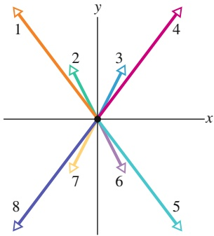

radar

| Vector | Direction |
| --- | --- |
| 1 | Up-Right |
| 2 | Down-Right |
| 3 | Up-Left |
| 4 | Up-Right |
| 5 | Down-Right |
| 6 | Down-Left |
| 7 | Down-Left |
| 8 | Down-Left |

Abb. 2.F1

**2.** Zum Zeitpunkt $t = 0$ fange eine einzelne Kraft $\vec { F }$ mit konstantem Betrag an, auf einen Stein zu wirken, der sich entlang einer x-Achse durch die Tiefen des Weltalls bewegt. Der Stein bewege sich nach Einsetzen der Kraft auch weiterhin die x-Achse entlang. (a) Welcher der folgenden Ausdrücke stellt für $t > 0$ eine mögliche Funktion $x ( t )$ für die Position des Steins dar: (1) $x = 4t - 3,   (2)   x = - 4t^{2} +$ $6t-3,(3)x=4t^{2}+6t-32$ Für welche der angegebenen Funktionen zeigt $\vec { F }$ in die der ursprünglichen Bewegungsrichtung des Steins entgegengesetzte Richtung?
**3.** Abbildung 2.F3 zeigt Draufsichten von vier Situationen, in denen verschiedene Kräfte auf einen Block wirken, der

**Zentrifugalkraft** Die **Zentrifugalkraft**

$$
\vec {F} _ {\text {Zentrifugal}} = - m \vec {\omega} \times (\vec {\omega} \times \vec {r}) \tag {2.28}
$$

ist die Scheinkraft, die in einem rotierenden Bezugssystem vom Mittelpunkt der Kreisbewegung weg wirkt. Für den rotierenden Beobachter auf einem Karussell wirkt sie der Zentripetalkraft entgegen.

**Coriolis-Kraft** Die **Coriolis-Kraft**

$$
\vec {F} _ {\text {Coriolis}} = - 2 m \vec {\omega} \times \frac {\mathrm{d} \vec {r}}{\mathrm{d} t} \Bigg | _ {\mathrm{K} ^ {\prime}} \tag {2.29}
$$

ist eine Scheinkraft, die auf Körper wirkt, die sich im rotierenden Koordinatensystem $\mathrm { K ^ { \prime } }$ mit einer Geschwindigkeit $\left. { \frac { \mathrm { d } { \vec { r } } } { \mathrm { d } t } } \right| _ { \mathrm { K ^ { \prime } } }$ bewegen.

|**Azimutalkraft** Bei der **Azimutalkraft**

$$
\vec {F} _ {\text {Azimutal}} = - m \left. \frac {\mathrm{d} \vec {\omega}}{\mathrm{d} t} \right| _ {\mathrm{K} ^ {\prime}} \times \vec {r} \tag {2.30}
$$

handelt es sich auch um eine Scheinkraft, die nur in rotierenden Systemen auftritt, deren Winkelgeschwindigkeit zeitlich veränderlich ist.

auf einer reibungsfreien Ebene liegt. In welcher dieser Situationen bleibt der Block bei geeignet ausgewählten Beträgen der Kräfte (a) in Ruhe bzw. (b) bewegt sich mit konstanter Geschwindigkeit?

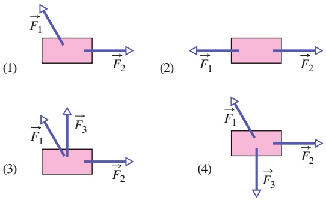

Abb. 2.F3

**4.** In Abb. 2.F4 wirken zwei Kräfte ${ \vec { F } } _ { 1 }$ und $\vec { F } _ { 2 }$ auf einen Brotkasten, der mit konstanter Geschwindigkeit über einen reibungsfreien Fußboden gleitet. Unser Ziel ist $\mathbf { e } \mathbf { s } ,$ den Winkel θ immer weiter zu verkleinern, ohne den Betrag von ${ \vec { F } } _ { 1 }$ zu verändern. Der Brotkasten soll sich dabei weiterhin mit konstanter Geschwindigkeit bewegen. Müssen wir den Betrag von $\vec { F } _ { 2 }$ dazu vergrößern, verkleinern oder unverändert beibehalten?

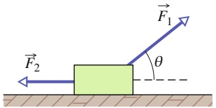

text_image

F₁
θ
F₂

Abb. 2.F4

63

---

2 Kraft und Bewegung

**5.** Abbildung 2.F5 zeigt Kräftediagramme für vier Situationen, in denen ein Objekt von mehreren Kräften über einen reibungsfreien Boden gezogen wird (in Draufsicht). In welchen dieser Situationen besitzt die Beschleunigung a⃗ des Objekts (a) eine x-Komponente und (b) eine y-Komponente? (c) Geben Sie die Richtung von a⃗ für jede der Situationen anhand eines Quadranten bzw. einer Richtung entlang einer Achse an. (Dies können Sie mit ein paar Kopfrechnungen bewerkstelligen.)

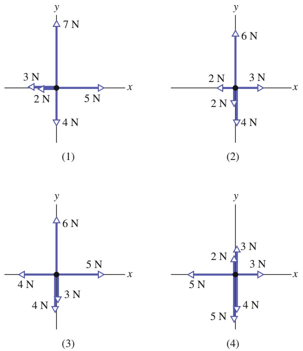

Abb. 2.F5

**6.** Abbildung 2.F6 zeigt jeweils drei Kurven einer Geschwindigkeitskomponente $\nu _ { x } ( t )$ und einer Geschwindigkeitskomponente $\nu _ { y } ( t )$ . Die Kurven sind nicht maßstabsgetreu gezeichnet. Welche der Kurven für $\nu _ { x } ( t )$ und $\nu _ { y } ( t )$ entspricht den vier Situationen aus Frage 5 und Abb. 2.F5 am besten?

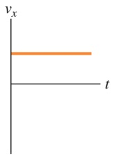

(a)

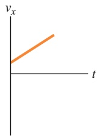

(b)

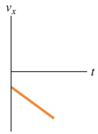

(c)

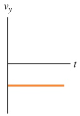

text_image

vy
t

(d)

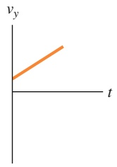

text_image

vy
t

(e)

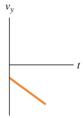

text_image

vy
t

(f)

**7.** Der Körper, der in Abb. 2.9c an einem Seil hängt, besitze ein Gewicht von 75 N. Ist T gleich, größer als oder kleiner als 75 N, wenn sich der Körper (a) mit anwachsendem Geschwindigkeitsbetrag bzw. (b) mit abnehmendem Geschwindigkeitsbetrag nach unten bewegt?
**8.** Eine vertikale Kraft $\vec { F }$ wirke auf einen Block der Masse m, der auf dem Boden liegt. Was passiert mit dem Betrag der Normalkraft $\vec { N } _ { i }$ die der Boden auf den Block ausübt, wenn der Betrag $F$ von null ausgehend vergrößert wird, in dem Fall, dass die Kraft ${ \vec { F } } \left( \mathbf { a } \right)$ nach unten bzw. (b) nach oben zeigt?
**9.** Abbildung 2.F9 zeigt vier miteinander verbundene Blö- cke, die von einer Kraft $\vec { F }$ über einen reibungsfreien Fuß- boden gezogen werden. Welche Gesamtmasse beschleunigt (a) die Kraft $\vec { F } ,$ (b) die Schnur 3 bzw. (c) die Schnur 1 nach rechts? (d) Ordnen Sie die Blöcke in absteigender Reihenfolge nach ihren Beschleunigungen. (e) Ordnen Sie die Schnü- re in absteigender Reihenfolge nach ihren Zugspannungen. (Aufwärmübung für Aufgabe 2.18 im Übungsbuch)

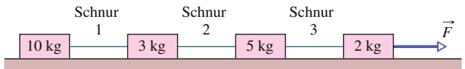

line

| Step | Weight (kg) | Schnur |
| --- | --- | --- |
| 1 | 10 | 1 |
| 2 | 3 | 2 |
| 3 | 5 | 3 |
| 4 | 2 | N/A |

Abb. 2.F9

**10.** Abbildung 2.F10 stellt eine Gruppe von drei Blöcken dar, die durch eine horizontale Kraft F⃗ über einen reibungsfreien Fußboden geschoben werden. Welche Gesamtmasse beschleunigt (a) die Kraft $\vec { F } ,$ (b) die Kraft $\vec { \bar { F } } _ { 2 1 }$ , die Block 1 auf Block 2 ausübt, und (c) die Kraft $\vec { F } _ { 3 2 } ,$ die Block 2 auf Block 3 ausübt, nach rechts? (d) Ordnen Sie die Blöcke in absteigender Reihenfolge nach den Beträgen ihrer Beschleunigungen. (e) Ordnen Sie die Kräfte $\vec { \vec { F } } , \vec { \vec { F } } _ { 2 1 }$ und $\vec { \bar { F } } _ { 3 2 }$ in absteigender Reihenfolge nach ihren Beträgen. (Aufwärmübung für Aufgabe 2.15 im Übungsbuch)

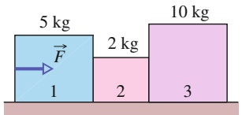

bar

| Category | Weight (kg) |
| --- | --- |
| 1 | 5 |
| 2 | 2 |
| 3 | 10 |

Abb. 2.F10

**11.** In Abb. 2.F11a liegt eine Kiste mit Spielzeug auf dem Dach einer (schwereren) Hundehütte, die auf einem Holzfußboden steht. In Abb. 2.F11b sind diese drei Gegenstände durch Punkte in den entsprechenden Höhen dargestellt. Die Abbildung enthält außerdem sechs senkrechte Vektoren (die nicht maßstabsgetreu gezeichnet sind). Welcher dieser Vektoren stellt die folgenden Kräfte jeweils am besten dar: (a) die auf die Hundehütte wirkende Gravitationskraft, (b) die auf die Spielzeugkiste wirkende Gravitationskraft, (c) die Kraft, welche die Hundehütte auf die Kiste ausübt, (d) die Kraft, welche die Kiste auf die Hütte ausübt, (e) die Kraft, die der Fußboden auf die Hütte ausübt, und (f ) die Kraft, welche die Hütte auf den Fußboden ausübt? (g) Welche dieser Kräfte besitzen den gleichen Betrag? Welche von ihnen besitzen (h) den größten und (i) den kleinsten Betrag?

Abb. 2.F6

64

---

2.9 Fragen

2

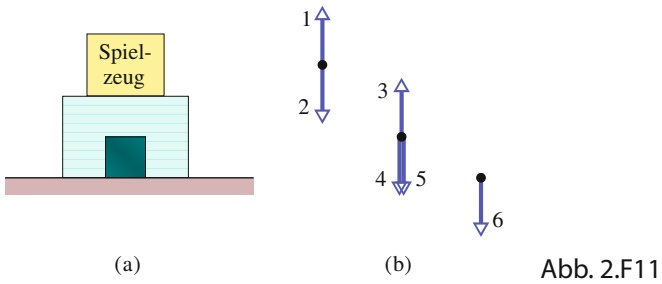

text_image

Spiel-
zeug
(a)
1
2
3
4
5
6
(b)
Abb. 2.F11

**12.** In Abb. 2.F12a ist ein Block mit einem Seil an einer Stange angebunden, die wiederum fest mit einer Rampe verbunden ist. Bestimmen Sie, ob die Beträge der folgenden Größen größer werden, kleiner werden oder gleich bleiben, wenn der Winkel θ der Rampe gegen null geht: (a) die Komponente der auf den Block wirkenden Gravitationskraft $\vec { F } _ { \mathrm { G } }$ entlang der Rampe, (b) die Zugspannung in dem Seil, (c) die Komponente von $\vec { F } _ { \mathrm { G } } ,$ die senkrecht auf der Rampe steht, sowie (d) die Normalkraft, welche die Rampe auf den Block ausübt. (e) Welche der Kurven aus Abb. 2.F12b entspricht welcher der in Teil (a) bis (d) aufgeführten Größen?

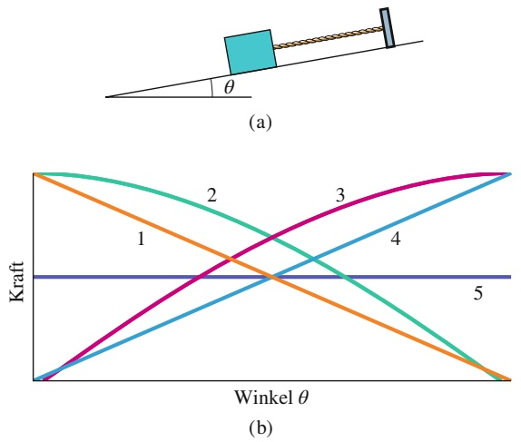

Abb. 2.F12

**13.** Abbildung 2.F13 zeigt eine Kiste in vier Situationen, in denen unterschiedliche horizontale Kräfte auf sie wirken. Ordnen Sie die Situationen absteigend nach dem Betrag der resultierenden Beschleunigung.

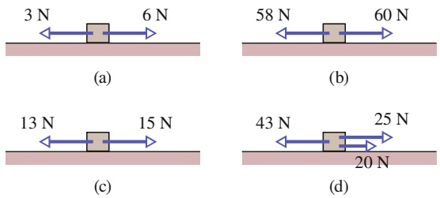

Abb. 2.F13

**14.** Abbildung 2.F14 zeigt vier Möglichkeiten, eine Kraft mit dem Betrag F auf einen Block auf einer geneigten Ebene auszuüben. Alle Richtungen sind entweder horizontal oder vertikal. (Für Variante b ist die Kraft nicht ausreichend, um den Block von der Ebene zu heben.) Ordnen Sie die Varianten absteigend nach dem Betrag der Normalkraft, die von der Ebene auf den Block wirkt.

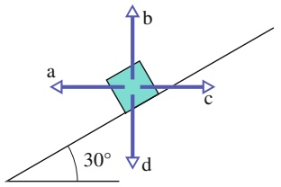

text_image

a
b
c
d
30°

Abb. 2.F14

**15.** In drei Experimenten wirken drei verschiedene Kräfte horizontal auf denselben Körper, der immer auf derselben Tischplatte liegt. Die Beträge der Kräfte seien $F _ { \mathrm { 1 } } = 1 2   \mathrm { N } ,$ $F _ { 2 } = 8   \mathrm { N }$ und $F _ { 3 } = 4   \mathrm { N }$ . Bei jedem Experiment bleibt der Körper trotz der auf ihn ausgeübten Kraft in Ruhe. Ordnen Sie die Kräfte in absteigender Reihenfolge nach (a) dem Betrag $f _ { s }$ der von der Tischplatte auf den Körper ausgeübten Haftreibungskraft und (b) dem Maximalwert $f _ { \mathrm { s , m a x } }$ dieser Kraft.
**16.** In Abb. 2.F16a lassen wir eine Tasse über ein langes Plastiktablett nach links rutschen. In welche Richtung wirkt die Gleitreibungskraft (a) vom Tablett auf die Tasse und (b) von der Tasse auf das Tablett? (c) Erhöht oder verringert die Reibungskraft vom Tablett auf die Tasse den Geschwindigkeitsbetrag der Tasse relativ zum Fußboden? In Abb. 2.F16b lassen wir nun das Tablett unter der Tasse nach links rutschen. In welche Richtung wirkt nun die Gleitreibungskraft (d) vom Tablett auf die Tasse und (e) von der Tasse auf das Tablett? (f ) Erhöht oder verringert die Reibungskraft vom Tablett auf die Tasse den Geschwindigkeitsbetrag der Tasse relativ zum Fußboden? (g) Bremsen Gleitreibungskräfte Körper immer ab?

Abb. 2.F16

**17.** In Abb. 2.F17 wirkt eine Kraft $\vec { F } _ { 1 }$ mit dem Betrag 10 N horizontal auf eine Kiste, die auf dem Fußboden steht; die Kiste bewegt sich jedoch nicht. Wenn der Betrag der vertikalen Kraft ${ \vec { F } } _ { 2 }$ nun von null erhöht wird, bleiben die folgenden Größen gleich, erhöhen sie sich oder werden sie kleiner: (a) der Betrag der auf die Kiste wirkenden Reibungskraft $\dot { f } _ { s } ;$ (b) der Betrag der Normalkraft $\vec { N } _ { i }$ die der Fußboden auf die Kiste ausübt; (c) der Maximalwert $f _ { \mathrm { s , m a x } }$ des Betrags der auf die Kiste wirkenden Haftreibungskraft? (d) Bewegt sich die Kiste letztendlich?

text_image

Physics diagram showing two forces F1 and F2 acting on a block on a horizontal surface

Abb. 2.F17

**18.** Wenn Sie eine Apfelkiste so stark gegen eine Wand drücken, dass die Kiste nicht herunterrutschen kann, in welche Richtung wirken dann (a) die von der Wand auf die Kiste ausgeübte Haftreibungskraft $\vec { f } _ { s }$ und (b) die von

65

---

2 Kraft und Bewegung

der Wand auf die Kiste ausgeübte Normalkraft $\vec { N } _ { \star } ^ { 2 }$ Was geschieht mit (c) $f _ { s } ,$ (d) N und (e) $f _ { \mathrm { s , m a x } } ,$ wenn Sie den Druck erhöhen?

**19.** Wenn die Kiste aus Abb. 2.F19 in Ruhe ist und der Winkel $\theta$ der Kraft $\vec { F }$ vergrößert wird, bleiben die folgenden Größen gleich, erhöhen sie sich oder werden sie kleiner: (a) $F _ { x } ; ( \mathrm { b } ) f _ { s } ; ( \mathrm { c } ) N ; ( \mathrm { d } ) f _ { \mathrm { s , m a x } } ?$ (e) Wenn der Körper stattdessen rutscht und θ vergrößert wird, bleibt der Betrag der auf den Körper wirkenden Reibungskraft dann gleich, erhöht er sich oder nimmt er ab?

Abb. 2.F19

**20.** Wiederholen Sie Frage 19 für eine nach oben statt – wie abgebildet – nach unten gerichtete Kraft ${ \vec { F } } .$

**21.** Abbildung 2.F21 zeigt einen Quader der Masse m auf einer Platte der Masse M und eine horizontal auf den Quader einwirkende Kraft ${ \vec { F } } ,$ die ihn über die Platte gleiten lässt. Zwischen Quader und Platte tritt Reibung auf (nicht aber zwischen Platte und Fußboden). (a) Welche Masse bestimmt den Betrag der Reibungskraft zwischen Quader und Platte? (b) Ist der Betrag der auf den Quader wirkenden Reibungskraft an der Berührfläche zwischen Quader und Platte größer als, kleiner als oder genauso groß wie der Betrag der auf die Platte wirkenden Reibungskraft? (c) In welche Richtungen wirken diese beiden Reibungskräfte? (d) Welche Masse müssen wir mit der Beschleunigung der Platte multiplizieren, wenn wir das zweite Newtonsche Gesetz für die Platte aufstellen?

text_image

reibungsfrei
F
Quader, m
Platte, M

Abb. 2.F21

**22.** Fortsetzung von Aufgabe 2.42 aus dem Übungsbuch. Nehmen Sie an, der größere der beiden Blöcke aus Abb. 2.A42 sei stattdessen auf der darunter befindlichen Oberfläche befestigt. Der kleinere Block soll wiederum nicht an dem größeren herunterrutschen. (a) Ist der Betrag der Reibungskraft zwischen den Blöcken dann größer als, kleiner als oder genauso groß wie in der ursprünglichen Aufgabe? (b) Ist der erforderliche Minimalbetrag der horizontal wirkenden Kraft $\vec { F }$ dann größer als, kleiner als oder genauso groß wie in der ursprünglichen Aufgabe?

**23.** Abbildung 2.F23 zeigt das Gleis einer Bimmelbahn, die mit konstantem Geschwindigkeitsbetrag v durch fünf kreisförmige Bögen mit den Radien $R _ { 0 } , 2 R _ { 0 }$ und $3 R _ { 0 }$ fährt. Ordnen Sie die Bögen in absteigender Reihenfolge nach den Beträgen der auf die Insassen wirkenden Zentripetalkraft.

flowchart

Abb. 2.F23

**24.** Ein Riesenrad fahrende Person bewegt sich durch (1) den höchsten, (2) den tiefsten und (3) einen auf halber Höhe liegenden Punkt. Ordnen Sie diese drei Positionen in absteigender Reihenfolge nach (a) dem Betrag der Zentripetalbeschleunigung der Person, (b) dem Betrag der auf die Person wirkenden Gesamtzentripetalkraft und (c) dem Betrag der auf die Person wirkenden Normalkraft, wenn sich das Riesenrad mit konstantem Geschwindigkeitsbetrag dreht.

**25.** 1987 gönnten sich zwei Fallschirmspringer ein Halloween-Vergnügen der besonderen Art. Sie sprangen westlich von Chicago gemeinsam ab und warfen sich während ihres freien Falls einen großen Kürbis gegenseitig zu. Das Ganze war ein großer Spaß, bis der Springer mit dem Kürbis schließlich seinen Fallschirm öffnete. Er konnte den Kürbis nicht mehr halten, der daraufhin etwa 0,5 km abstürzte, das Dach eines Hauses durchschlug und dort auf dem Küchenboden zerplatzte und die frisch renovierte Kü- che verunstaltete. Begründen Sie einmal aus der Sicht des Fallschirmspringers und einmal aus der Sicht des Kürbisses, warum der Springer die Kontrolle über den Kürbis verlor.

**26.** In Abb. 2.F26 wird ein Block der Masse m auf einer Rampe durch die von dieser ausgeübte Reibungskraft in Ruhe gehalten. Dann wird eine entlang der Rampe nach oben gerichtete Kraft $\vec { F }$ ausgeübt, deren Betrag allmählich von null ausgehend erhöht wird. Wie verändern sich während dieser Erhöhung Richtung und Betrag der auf den Block wirkenden Reibungskraft?

Abb. 2.F26

**27.** Wiederholen Sie Frage 26, aber nun mit einer entlang der Rampe nach unten gerichteten Kraft ${ \vec { F } } .$ Wie verändern sich jetzt während der Erhöhung der Kraft Richtung und Betrag der auf den Block wirkenden Reibungskraft?

**28.** In Abb. 2.F28 soll eine horizontale Kraft von 100 N auf eine Platte der Masse 10 kg ausgeübt werden, die anfänglich auf einem reibungsfreien Boden ruht, um die Platte zu beschleunigen. Auf der Platte liegt ein Blick mit einer Masse von 10 kg; der Reibungskoeffizient $\mu$ zwischen dem Block und der Platte ist nicht bekannt; der Block könnte verrutschen – möglicherweise ist der Kontakt zwischen dem Block und der Platte sogar reibungsfrei. (a) Welchen Bereich von Werten kann die Beschleunigung $a _ { \mathrm { P l a t t e } }$ der Platte unter Berücksichtigung dieser Möglichkeiten annehmen? (Hinweis: Sie brauchen dafür keine expliziten Berechnungen, betrachten Sie einfach Grenzwerte für μ.) (b) Welchen Bereich von Werten kann die Beschleunigung des Blocks $a _ { \mathrm { B l o c k } }$ annehmen?

66

---

2.9 Fragen

2

Abb. 2.F28

**29.** Während eines Routineflugs feuerte der Testpilot Tom Attridge 1956 zu Testzwecken auf 4000 m Höhe bei Überschallgeschwindigkeit einige Feuerstöße aus seinen 20-mm-Bordgeschützen ab. Anschließend steuerte er seinen Jet in einen Sturzflug mit einem Sturzwinkel von 20°, bevor er auf 2000 m Höhe bei einer Geschwindigkeit von 344 m/s eine weitere Salve abfeuerte. Die Geschwindigkeit der Geschosse relativ zu seinem Flugzeug betrug 730 m/s. Plötzlich zerriss es die Glaskuppel um ihn herum und sein rechter Lufteinlass wurde beschädigt. Er versuchte noch, zu seinem Stützpunkt zurückzukehren, aber schließlich stürzte der Jet in ein Waldgebiet; der Pilot überlebte verletzt.

Erklären Sie, was hier anscheinend kurz nach dem zweiten Auslösen der Bordkanonen passierte. (Attridge gilt bis heute als der einzige Pilot, der es schaffte, sich selbst abzuschießen.)

**30.** Eine Kiste steht auf einer Rampe, die in einem Winkel θ gegen die Horizontale geneigt ist. Bleiben die folgenden Größen gleich, erhöhen oder verringern sie sich, solange die Kiste noch nicht rutscht, wenn θ allmählich von null aus vergrößert wird: (a) die Komponente der Schwerkraft, die entlang der Rampe auf die Kiste wirkt, (b) der Betrag der Haftreibungskraft, die von der Rampe auf die Kiste wirkt, (c) die Komponente der Schwerkraft, die senkrecht zur Rampe auf die Kiste wirkt, (d) der Betrag der Normalkraft, die von der Rampe auf die Kiste wirkt und (e) der Maximalwert $f _ { \mathrm { s , m a x } }$ der Haftreibungskraft?

67

---

