# 3 Kinetische Energie und Arbeit

原始 PDF 第 83–102 页。

# 3 Kinetische Energie und Arbeit

## 3.1 Energie

## Physikalische Motivation

Möglichweise die wichtigste physikalische Größe überhaupt ist ein Begriff, über den heute auch außerhalb der Physik viel geredet wird: die Energie. Offensichtlich ist dieses Thema wichtig. In der Tat beruht unsere gesamte Zivilisation auf der Erzeugung und effektiven Nutzung von Energie.

Jedes Kind weiß, dass jede Art von Bewegung Energie erfordert, seien es Urlaubs- oder Geschäftsflüge auf andere Kontinente, Transport von Material in die oberste Etage eines Bürogebäudes oder zu einer Raumstation oder auch das Werfen oder Schießen eines Balles. Wir geben Unsummen von Geld aus, um Energie zu gewinnen oder zu verwenden. Kriege werden begonnen und Schlachten werden geschlagen, um Energiequellen zu erobern oder zu sichern – und die Kriege wurden gewonnen oder verloren, weil eine Seite zu einem neuartigen durchschlagenden Einsatz von Energie in der Lage war. Wir alle kennen zahllose Beispiele für Energie und ihre Nutzung – aber was bedeutet dieser Begriff eigentlich?

## 3.1.1 Kinetische Energie

Die Newtonschen Bewegungsgesetze erlauben uns, viele verschiedene Arten von Bewegungen zu analysieren. Oft ist die Analyse jedoch kompliziert und erfordert die Kenntnis von Details der Bewegung, die wir einfach nicht wissen können. Ein Beispiel: Ein Eishockeypuck wird über eine reibungsfreie Fläche geschossen, die auf und ab verläuft und mehrere, unterschiedlich geformte „Berge“ und „Täler enthält. Der Puck startet mit einer Anfangsgeschwindigkeit von 4,0 m/s auf einer Höhe von 0,46 m. Können Sie mithilfe des zweiten Newtonschen Gesetzes die Geschwindigkeit des Pucks am Ende seiner Bahn auf der Endhöhe null berechnen? Nein – nicht ohne zu wissen, wie die Steigungen der verschiedenen Schrägen entlang seiner Bahn verlaufen, und selbst dann wären die Rechnungen äußerst kompliziert.

Vor langer Zeit begannen Wissenschaftler und Ingenieure, eine weitere, teilweise sehr viel effektivere Technik für die Analyse von Bewegungen zu entwickeln. Diese ließ sich auch auf andere Situationen wie chemische Reaktionen, geologische Prozesse und biologische Funktionen ausweiten, die nichts mit Bewegung zu tun hatten. Dieser Ansatz basiert auf dem Konzept der **Energie**, einer Größe, die in vielen verschiedenen Formen auftritt. In der Tat ist der Begriff der Energie so weit gefasst, dass eine einfache Definition nur sehr schwer zu geben ist. Zunächst einmal ist Energie eine skalare Größe, die mit dem Zustand eines oder mehrerer Objekte in Zusammenhang steht. Diese Definition ist jedoch zu vage, als dass sie eine echte Hilfe sein könnte.

Eine etwas freiere Definition könnte uns zumindest einen ersten Anhaltspunkt bieten. Energie ist eine Zahl, die wir einem System aus einem oder mehreren Ob-

Halliday Physik für natur- und ingenieurwiss. Studiengänge, 3. Auflage. D. Halliday, R. Resnick und J. Walker. © 2020 WILEY-VCH Verlag GmbH & Co. KGaA. Published 2020 by WILEY-VCH Verlag GmbH & Co. KGaA.

69

---

3 Kinetische Energie und Arbeit

jekten zuordnen können. Verändert eine Kraft eines dieser Objekte, indem sie es z. B. in Bewegung versetzt, so ändert sich diese Zahl.

Die für diese Diskussion relevante Form von Energie nennt man die **kinetische Energie** K („kinetisch“ kommt aus dem Griechischen und bedeutet so viel wie „bewegungsmäßig“). Sie hängt unmittelbar mit dem Bewegungszustand eines Objekts zusammen: Je schneller sich das Objekt bewegt, desto größer ist seine kinetische Energie. Befindet sich das Objekt in Ruhe, so ist seine kinetische Energie null.

Für ein Objekt der Masse $m ,$ dessen Geschwindigkeit v weit unterhalb der Lichtgeschwindigkeit liegt, definieren wir die kinetische Energie als:

$$
K = \frac {1}{2} m v ^ {2} \quad (\text {kinetische Energie}). \tag {3.1}
$$

Eine Ente der Masse 3,0 kg, die mit 2,0 m/s an uns vorbeifliegt, besitzt z. B. eine kinetische Energie von $6,0\mathrm{kg}\cdot \mathrm{m}^{2}/\mathrm{s}^{2};$ ; wir ordnen der Bewegung der Ente also diesen Zahlenwert zu.

Die SI-Einheit der kinetischen Energie (und jeder anderen Form von Energie) ist das **Joule** (J), das nach James Prescott Joule benannt wurde, einem englischen Wissenschaftler des 19. Jahrhunderts. Es wird direkt über Gl. 3.1 anhand der Einheiten von Masse und Geschwindigkeit definiert:

$$
1 \text {Joule} = 1 \mathrm{J} = 1 \mathrm{kg} \cdot \mathrm{m} ^ {2} / \mathrm{s} ^ {2}. \tag {3.2}
$$

Die fliegende Ente besitzt also eine kinetische Energie von $^ { 6 , 0 1 }$ .

## 3.1.2 Arbeit

Wenn Sie ein Objekt auf eine größere Geschwindigkeit beschleunigen, indem Sie eine Kraft auf das Objekt ausüben, so vergrößern Sie die kinetische Energie $K ( =$ ${ \frac { 1 } { 2 } } m \nu ^ { 2 } )$ dieses Objekts. Analog verringern Sie die kinetische Energie eines Objekts, wenn Sie es auf eine geringere Geschwindigkeit verzögern, indem Sie eine Kraft auf das Objekt ausüben. Wir verfolgen diese Änderungen der kinetischen Energie, indem wir sagen, dass Ihre Kraft dem Objekt Energie (von Ihnen) zugeführt hat bzw. Ihnen von dem Objekt Energie zugeführt wurde.

Bei einem solchen Energietransfer über eine Kraft sagt man, dass die Kraft eine **Arbeit** W an dem Objekt verrichtet hat $( , W ^ { \alpha }$ steht für englisch „work“). Formaler definieren wir Arbeit wie folgt:

Die Arbeit W ist die Energie, die eine auf ein Objekt wirkende Kraft diesem Objekt zuführt bzw. von diesem Objekt abführt. Energie, die dem Objekt zugeführt wird, entspricht positiven Werten der Arbeit; Energie, die einem Objekt entzogen wird, entspricht negativen Werten der Arbeit.

„Arbeit“ ist also Energie, die übertragen wird; mit dem Ausdruck „Arbeit verrich ten“ bezeichnen wir das Übertragen von Energie. Die Arbeit besitzt dieselbe Einheit wie die Energie, sie ist ebenfalls eine skalare Größe. Übrigens: Da man in der Physik von Arbeit immer nur dann spricht, wenn Energie übertragen wird, ist es sinnlos zu sagen, dass ein Objekt eine gewisse Menge an Arbeit „hat“.

Der Begriff „übertragen“ kann auch irreführend sein. Er bedeutet nicht, dass etwas Materielles in das Objekt hinein- oder aus dem Objekt herausfließt; diese Energieübertragung darf man sich also nicht wie fließendes Wasser vorstellen. Sie entspricht vielmehr dem elektronischen Geldtransfer zwischen zwei Bankkonten: Die Zahl in dem einen Konto steigt an, während die Zahl in dem anderen Konto kleiner wird, obwohl zwischen den beiden Konten kein materieller Gegenstand ausgetauscht wird.

70

---

3.2 Arbeit und kinetische Energie

3

Beachten Sie, dass es uns hier nicht um die alltägliche Bedeutung des Worts $\mathbf { , } \mathbf { A r } \mathbf { \cdot }$ beit“ geht, die beinhaltet, dass jede Art von körperlicher oder mentaler Anstrengung Arbeit ist. Wenn Sie z. B. kräftig gegen eine Wand drücken, so werden Sie aufgrund der erforderten kontinuierlichen Muskelanspannung müde; im alltäglichen Sinne des Worts verrichten Sie dabei Arbeit. Eine solche Anstrengung bewirkt jedoch weder eine Übertragung von Energie auf die Wand noch von der Wand; in dem Wortsinn, den wir hier definiert haben, verrichten Sie demnach an der Wand keine Arbeit.

Um Verwechslungen vorzubeugen, werden wir den Buchstaben W in diesem Kapitel nur für die Arbeit verwenden und das Gewicht mit dem äquivalenten Ausdruck mg bezeichnen.

## 3.2 Arbeit und kinetische Energie

## Lernziele

Nach dem Durcharbeiten dieses Abschnitts sollten Sie in der Lage sein, . . .

• die Beziehung zwischen einem Kraftvektor (mit Betrag und Richtung) und der von ihm während der Verschiebung eines Teilchens an diesem verrichteten Arbeit anzugeben,
• die Arbeit zu berechnen, indem Sie das Skalarprodukt des Kraftvektors und des Verschiebungsvektors in Einheitsvektoren- oder Betrag-Winkel-Schreibweise berechnen,
• die gesamte verrichtete Arbeit zu berechnen, wenn mehrere Kräfte auf ein Teilchen wirken,
• die Beziehung zwischen der durch eine Kraft (oder mehrere Kräfte) verrichteten Arbeit und der hierdurch bewirkten Veränderung der kinetischen Energie eines Teilchens anzugeben.

## Schlüsselideen

Eine Arbeit W ist eine durch eine auf ein Objekt wirkende Kraft auf dieses übertragene (oder von diesem entnommene) Energiemenge. Wenn Energie auf das Objekt übertragen wird, ist die Arbeit positiv, wenn sie dem Objekt entnommen wird, ist die Arbeit negativ.
• Die im Zuge einer Verschiebung $\vec { d }$ durch eine Kraft $\vec { F }$ an einem Teilchen verrichtete Arbeit ist

$$
W = F d \cos \varphi = \vec {F} \cdot \vec {d},
$$

wobei 𝜑 der (konstante) Winkel zwischen $\vec { F }$ und $\vec { d }$ ist.

• Nur die Komponente von F⃗ in Richtung der Verschiebung $\vec { d }$ kann Arbeit an dem Teilchen verrichten.
• Wenn auf ein Objekt zwei oder mehr Kräfte wirken, ist die übertragene Arbeit die Summe der von den einzelnen Kräften jeweils verrichteten Arbeit. Dies ist gleichbedeutend mit der Sichtweise, dass die insgesamt verrichtete Arbeit die von der resultierenden Gesamtkraft $\vec { F } _ { \mathrm { g e s } }$ an dem Objekt verrichtete Arbeit ist.
• Die Veränderung $\Delta K$ der kinetischen Energie eines Teilchens ist gleich der insgesamt an diesem verrichteten Arbeit $W ;$

$$
\Delta K = K _ {\mathrm{f}} - K _ {\mathrm{i}} = W,
$$

wobei $K _ { \mathrm { i } }$ die anfängliche (initiale) kinetische Energie des Teilchens bedeutet und $K _ { \mathrm { f } }$ seine finale kinetische Energie ist, also am Ende des Prozesses, nachdem die Arbeit verrichtet wurde. Die kinetische Energie am Ende des Prozesses ist daher:

$$
K _ {\mathrm{f}} = K _ {\mathrm{i}} + W.
$$

71

---

3 Kinetische Energie und Arbeit

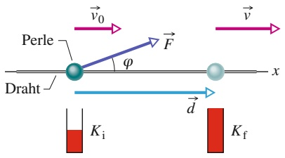

text_image

Perle
Draht
φ
F
x
v₀
v
d
Kᵢ
K_f

Abb. 3.1 Eine konstante Kraft $\vec { F } ,$ die einen Winkel 𝜑 zur Verschiebung d⃗ einer Perle auf einem Draht bildet, beschleunigt die Perle den Draht entlang. Dabei ändert sich die Geschwindigkeit der Perle von $\vec { \nu } _ { 0 }$ auf v⃗. Ein Messgerät zeigt die daraus resultierende Änderung der kinetischen Energie der Perle von $\bar { \iota } K _ { \mathrm { i } }$ auf $K _ { \mathrm { f } }$ an.

## 3.2.1 Arbeit und kinetische Energie

## Herleitung eines Ausdrucks für die Arbeit

Wir wollen zunächst einen Ausdruck für die Arbeit bestimmen. Dazu betrachten wir eine Perle, die über einen reibungsfreien, entlang der horizontalen x-Achse gespannten Draht gleiten kann (Abb. 3.1). Eine konstante Kraft ${ \vec { F } } ,$ die mit dem Draht einen Winkel $\varphi$ bildet, beschleunigt die Perle entlang des Drahts. Die Kraft und die daraus resultierende Beschleunigung können wir anhand des zweiten Newtonschen Gesetzes für die Komponenten entlang der x-Achse miteinander verbinden:

$$
F _ {x} = m a _ {x}, \tag {3.3}
$$

wobei m die Masse der Perle bezeichnet. Während die Perle um $\vec { d }$ verschoben wird, verändert die Kraft die Geschwindigkeit der Perle von einem Anfangswert $\vec { \nu } _ { 0 }$ zu einem anderen Wert $\vec { \nu } .$ Da die Kraft konstant ist, wissen wir, dass auch die Beschleunigung konstant ist. Damit können wir Gl. 1.14 (eine der Grundgleichungen der gleichmäßig beschleunigten Bewegung aus Kapitel 1) benutzen und erhalten für die Komponenten entlang der x-Achse:

$$
\nu^ {2} = \nu_ {0} ^ {2} + 2 a _ {x} d. \tag {3.4}
$$

Auflösen dieser Gleichung nach $a _ { x } ,$ Einsetzen in Gl. 3.3 und Umformen ergibt:

$$
\frac {1}{2} m \nu^ {2} - \frac {1}{2} m \nu_ {0} ^ {2} = F _ {x} d. \tag {3.5}
$$

Der erste Term auf der linken Seite der Gleichung entspricht der (finalen) kine tischen Energie $K _ { \mathrm { f } }$ der Perle am Ende ihrer Verschiebung $d ,$ während der zweite Term der (initialen) kinetischen Energie $K _ { \mathrm { i } }$ der Perle am Anfang der Verschiebung entspricht. Die linke Seite von Gl. 3.5 verrät uns also, dass die kinetische Energie durch die Kraft verändert wurde, und die rechte Seite besagt, dass diese Änderung gleich $F _ { x } d$ ist. Damit ist die durch die Kraft an der Perle verrichtete Arbeit $W$ (d. h. der durch die Kraft verursachte Energietransfer):

$$
W = F _ {x} d. \tag {3.6}
$$

Kennen wir die Werte von $F _ { x }$ und $d ,$ so können wir anhand dieser Gleichung die Arbeit W berechnen, welche die Kraft an der Perle verrichtet hat.

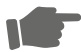

Um die Arbeit zu berechnen, die eine Kraft während einer Verschiebung an einem Objekt verrichtet hat, verwenden wir nur die Kraftkomponente in Richtung der Verschiebung des Objekts. Die Komponente der Kraft, die senkrecht auf der Verschiebung steht, verrichtet keine Arbeit.

Aus Abb. 3.1 können wir ersehen, dass $F _ { x }$ auch als F cos 𝜑 geschrieben werden kann, wobei $\varphi$ der Winkel zwischen den Richtungen der Verschiebung $\vec { d }$ und der Kraft $\vec { F }$ ist. Damit können wir Gl. 3.6 allgemeiner als

$$
W = F d \cos \varphi \quad (\text {von einer konstanten Kraft verrichtete Arbeit}) \tag {3.7}
$$

schreiben. Diese Gleichung ist sehr nützlich, wenn es darum geht, die Arbeit aus den bekannten Größen $F ,$ d und $\varphi$ zu berechnen. Da die rechte Seite dieser Gleichung dem Skalarprodukt $\vec { F } \cdot \vec { d }$ entspricht, lautet die Gleichung auch:

$$
W = \vec {F} \cdot \vec {d} \quad \text {(von einer konstanten Kraft verrichtete Arbeit)}. \tag {3.8}
$$

(Eventuell ist es hilfreich, wenn Sie sich an dieser Stelle die Eigenschaften des Skalarprodukts aus Anhang D vergegenwärtigen.) Gleichung 3.8 eignet sich besonders zur Berechnung der Arbeit, wenn $\vec { F }$ und $\vec { d }$ in Einheitsvektoren-Schreibweise angegeben sind.

72

---

3.2 Arbeit und kinetische Energie

3

Vorsicht: Die Gln. 3.6 bis 3.8 zur Berechnung der Arbeit, die eine Kraft an einem Objekt verrichtet, unterliegen zweierlei Einschränkungen. Erstens muss die Kraft konstant sein; d. h., weder der Betrag noch die Richtung der Kraft dürfen sich während der Bewegung des Objekts ändern. (Den Fall einer veränderlichen Kraft werden wir später untersuchen.) Zweitens muss das Objekt wie ein Teilchen behandelt werden können. Dies bedeutet, dass das Objekt starr sein muss; alle seine Teile müssen sich zusammen in die gleiche Richtung bewegen. In diesem Kapitel werden wir nur solche teilchenartigen Objekte untersuchen, wie z. B. Wagen und Kisten in Abb. 3.2.

**Vorzeichen der Arbeit** Die durch eine Kraft an einem Objekt verrichtete Arbeit kann entweder positiv oder negativ sein. Ist der Winkel $\varphi$ in Gl. 3.7 z. B. kleiner als 90°, so ist cos 𝜑 positiv und die Arbeit damit ebenfalls. Ist $\varphi$ größer als 90° (und kleiner als 180°), dann ist cos 𝜑 negativ und die Arbeit ebenso. (Erkennen Sie, dass die Arbeit null ist, wenn $\varphi = 9 0 ^ { \circ }$ ist?) Diese Ergebnisse führen zu einer einfachen Regel. Um das Vorzeichen der von einer Kraft verrichteten Arbeit zu ermitteln, betrachten Sie die Vektorkomponente der Kraft entlang der entsprechenden Verschiebung:

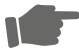

Eine Kraft verrichtet eine positive Arbeit, wenn sie eine Vektorkomponente besitzt, die in die gleiche Richtung zeigt wie die Verschiebung; eine Kraft verrichtet negative Arbeit, wenn sie eine Vektorkomponente besitzt, die in die entgegengesetzte Richtung weist. Die von einer Kraft verrichtete Arbeit ist null, wenn die Kraft keine derartige Vektorkomponente besitzt.

**Einheiten der Arbeit** Die Arbeit besitzt die gleiche Einheit wie die kinetische Energie, nämlich die SI-Einheit Joule. Aus den Gln. 3.6 und 3.7 können wir jedoch erkennen, dass die Einheit Newton mal Meter (N ⋅ m) dazu äquivalent ist. In Erweiterung von Gl. 3.2 gilt also:

$$
1 \mathrm{J} = 1 \mathrm{kg} \cdot \mathrm{m} ^ {2} / \mathrm{s} ^ {2} = 1 \mathrm{N} \cdot \mathrm{m}. \tag {3.9}
$$

**Von mehreren Kräften verrichtete Gesamtarbeit** Wenn zwei oder mehr Kräfte auf ein Objekt wirken, so ist die **resultierende Arbeit** oder **Gesamtarbeit** die Summe der von den einzelnen Kräften jeweils verrichteten Arbeit. Diese Gesamtarbeit können wir auf zwei Arten berechnen: (1) Wir bestimmen die von jeder einzelnen Kraft verrichtete Arbeit und summieren diese Werte anschließend auf. (2) Alternativ ermitteln wir zuerst die aus den einzelnen Kräften resultierende Gesamtkraft $\vec { F } _ { \mathrm { g e s } } .$ . Anschließend verwenden wir Gl. 3.7, wobei wir anstelle von $F$ den Betrag $\tilde { F _ { \mathrm { g e s } } }$ und anstelle von $\varphi$ den Winkel zwischen der Richtung von $\vec { F } _ { \mathrm { g e s } }$ und der Ver schiebung einsetzen müssen; oder wir benutzen die Vektorgleichung Gl. 3.8 und ersetzen dort $\vec { F }$ durch $\vec { F } _ { \mathrm { g e s } }$

## Der Zusammenhang zwischen Arbeit und kinetischer Energie

Gleichung 3.5 verbindet die Änderung der kinetischen Energie der Perle (von einer anfänglichen Energie $\begin{array} { r } { K _ { \mathrm { i } } = \frac { 1 } { 2 } m \nu _ { 0 } ^ { 2 } } \end{array}$ zu einer späteren Energie $K _ { \mathrm { f } } = { \textstyle { \frac { 1 } { 2 } } } \dot { m \nu ^ { 2 } ) }$ mit der Arbeit $W ( = F _ { x } d )$ , die an der Perle verrichtet wird. Für solche teilchenartigen Objekte können wir diese Gleichung verallgemeinern. Es sei ΔK die Änderung der kinetischen Energie des Objekts und $W$ die Gesamtarbeit, die an diesem Objekt verrichtet wird. Dann ist:

$$
\Delta K = K _ {\mathrm{f}} - K _ {\mathrm{i}} = W. \tag {3.10}
$$

Diese Gleichung besagt, dass

$$
\binom{\text {Änderung der kinetischen}}{\text {Energie eines Teilchens}} = \binom{\text {an dem Teilchen}}{\text {verrichtete Gesamtarbeit}}
$$

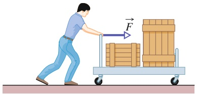

natural_image

Illustration of a person pushing a cart with stacked boxes and a force vector labeled F (no text or symbols on the cart or background)

## Abb. 3.2

Um die Arbeit zu berechnen, welche die von dem Lagerarbeiter ausgeübte Kraft an der Transportkarre und ihrem Inhalt verrichtet, können wir Wagen und Kisten näherungsweise als ein einziges Teilchen betrachten.

73

---

3 Kinetische Energie und Arbeit

ist. Dies können wir auch in der Form

$$
K _ {\mathrm{f}} = K _ {\mathrm{i}} + W \tag {3.11}
$$

schreiben, was so viel bedeutet wie

$$
\begin{array}{l} \binom{\text {kinetische Energie, nachdem die}}{\text {Gesamtarbeit verrichtet wurde}} \\ = \binom{\text {kinetische Energie, bevor die}}{\text {Gesamtarbeit verrichtet wurde}} + \binom{\text {verrichtete}}{\text {Gesamtarbeit}}. \\ \end{array}
$$

Diese Beziehungen gelten sowohl für Arbeit mit positivem als auch mit negativem Vorzeichen: Ist die an einem Teilchen verrichtete Gesamtarbeit positiv, dann erhöht sich die kinetische Energie des Teilchens um den Betrag (Absolutwert) der Arbeit. Ist die Gesamtarbeit negativ, dann nimmt die kinetische Energie um den Betrag der Arbeit ab.

Die kinetische Energie eines Teilchens betrage ursprünglich z. B. 5 J. Wird dem Teilchen eine Gesamtarbeit von 2 J zugeführt (ist die Gesamtarbeit also positiv), so beträgt die kinetische Energie danach 7 J. Wird dagegen eine Gesamtarbeit von 2 J von dem Teilchen abgeführt (ist die Gesamtarbeit also negativ), so ist die kinetische Energie daraufhin 3 J.

## KONTROLLFRAGE 1

Ein Teilchen bewege sich entlang einer x-Achse. Wird die kinetische Energie des Teilchens größer, kleiner oder bleibt sie gleich, wenn sich die Geschwindigkeit des Teilchens (a) von −3 m/s auf −2 m/s bzw. (b) von −2 m/s auf 2 m/s ändert? (c) Ist die an dem Teilchen verrichtete Arbeit in diesen Situationen jeweils positiv, negativ oder null?

## KONTROLLFRAGE 2

Die Abbildung zeigt vier Situationen, in denen eine Kraft auf eine Kiste wirkt, wäh rend diese über einen reibungsfreien Fußboden nach rechts gleitet. Die Beträge der einzelnen Kräfte sind gleich; ihre Richtungen verlaufen wie in der Abbildung angegeben. Ordnen Sie die verschiedenen Situationen nach der Arbeit, die während der Verschiebung an der Kiste verrichtet wird, von der positivsten zur negativsten.

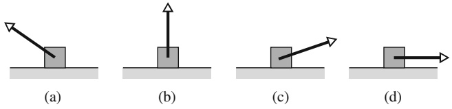

## 3.3 Von der Gravitationskraft verrichtete Arbeit

## Lernziele

Nach dem Durcharbeiten dieses Abschnitts sollten Sie in der Lage sein, . . .

• die beim Anheben oder Absenken eines Objekts von der Gravitationskraft verrichtete Arbeit zu berechnen,
• die Beziehung zwischen der verrichteten Arbeit und der kinetischen Energie eines Objekts auf Situationen anzuwenden, in denen ein Objekt angehoben oder abgesenkt wird.

## Schlüsselideen

• Die von der Gravitationskraft $\vec { F } _ { \mathrm { G } }$ an einem teilchenartigen Objekt der Masse m während einer Verschiebung $\vec { d }$ verrichtete Arbeit $W _ { \mathrm { G } }$ ist

$$
W _ {\mathrm{G}} = m g d \cos \varphi ,
$$

wobei 𝜑 der Winkel zwischen $\vec { F } _ { \mathrm { G } }$ und $\vec { d }$ ist.

74

---

3.3 Von der Gravitationskraft verrichtete Arbeit

3

• Die Arbeit $W _ { \mathbf { a } } ,$ die eine äußere einwirkende Kraft an einem Objekt verrichtet, wenn dieses angehoben oder abgesenkt wird, hängt mit der von der Gravitationskraft verrichteten Arbeit $W _ { \mathrm { G } }$ und der Änderung $\Delta K$ der kinetischen Energie des Objekts gemäß

$$
\Delta K = K _ {\mathrm{f}} - K _ {\mathrm{i}} = W _ {\mathrm{a}} + W _ {\mathrm{G}}
$$

zusammen. Für $K _ { \mathrm { f } } = K _ { \mathrm { i } }$ reduziert sich dieser Ausdruck auf

$$
W _ {\mathrm{a}} = - W _ {\mathrm{G}},
$$

was bedeutet, dass die äußere Kraft gerade so viel Energie auf das Objekt überträgt, wie die Gravitationskraft ihm entnimmt (oder umgekehrt).

## 3.3.1 Von der Gravitationskraft verrichtete Arbeit

Als Nächstes untersuchen wir die Arbeit, die von einer besonderen Art von Kraft an einem Objekt verrichtet wird – nämlich von der Gravitationskraft, die auf dieses Objekt wirkt. Abbildung 3.3 zeigt eine teilchenartige Tomate der Masse m, die mit der Anfangsgeschwindigkeit $\nu _ { 0 } ,$ d. h. der anfänglichen kinetischen Energie $\begin{array} { r } { K _ { \mathrm { i } } = \frac { 1 } { 2 } m \nu _ { 0 } ^ { 2 } , } \end{array}$ , nach oben geworfen wird. Während des Anstiegs der Tomate wird sie durch die Gravitationskraft $\vec { F } _ { \mathrm { G } }$ abgebremst; d. h., die kinetische Energie der Tomate nimmt ab, da $\vec { F } _ { \mathrm { G } }$ während des Anstiegs an der Tomate Arbeit verrichtet.

Da wir die Tomate wie ein Teilchen behandeln können, können wir Gl. 3.7 $\left( W = F d \right.$ cos 𝜑) benutzen, um einen Ausdruck für die während einer Verschiebung $\vec { d }$ verrichtete Arbeit herzuleiten. Für den Betrag F der Kraft setzen wir mg ein, den Betrag von $\vec { F } _ { \mathrm { G } }$ . Damit ist die durch die Gravitationskraft $\vec { F } _ { \mathrm { G } }$ verrichtete Arbeit $W _ { \mathrm { G } }$

$$
W _ {\mathrm{G}} = m g d \cos \varphi \quad (\text {von der Gravitationskraft verrichtete Arbeit}). \tag {3.12}
$$

Wie in Abb. 3.3 dargestellt, zeigt $\vec { F } _ { \mathrm { G } }$ für ein ansteigendes Objekt in die entgegengesetzte Richtung der Verschiebung $\vec { d } .$ Damit ist $\varphi = 1 8 0 ^ { \circ }$ und

$$
W _ {\mathrm{G}} = m g d \cos 1 8 0 ^ {\circ} = m g d (- 1) = - m g d. \tag {3.13}
$$

Das Minuszeichen bedeutet, dass die Gravitationskraft, die auf das Objekt wirkt, während des Anstiegs eine Energiemenge mgd von der kinetischen Energie des Objekts abgeführt hat. Dies stimmt mit der Beobachtung überein, dass das Objekt während des Anstiegs immer langsamer wird.

Nachdem das Objekt seine Maximalhöhe erreicht hat, fällt es wieder nach unten und der Winkel $\varphi$ zwischen der Kraft $\vec { F } _ { \mathrm { G } }$ und der Verschiebung $\vec { d }$ ist gleich null. Dann gilt

$$
W _ {\mathrm{G}} = m g d \cos 0 ^ {\circ} = m g d (+ 1) = + m g d. \tag {3.14}
$$

Das Pluszeichen besagt, dass die Gravitationskraft nun der kinetischen Energie des Objekts eine Energiemenge mgd zuführt. Dies stimmt mit der Beobachtung überein, dass das Objekt während des Falls immer schneller wird. (Wie wir in Kap. 4 sehen werden, betreffen solche Energieübertragungen, die mit dem Steigen oder Fallen eines Objekts zusammenhängen, nicht nur das Objekt selbst, sondern das gesamte System Objekt–Erde. Ohne die Erde wäre in der Tat sogar der Begriff des „Steigens“ bedeutungslos.)

## Während des Anhebens und Absenkens eines Objekts verrichtete Arbeit

Nehmen Sie nun an, dass wir ein teilchenartiges Objekt anheben, indem wir eine senkrechte Kraft $\vec { F }$ auf das Objekt ausüben. Während der Aufwärtsverschiebung verrichtet unsere angelegte Kraft eine positive Arbeit $W _ { \mathrm { a } }$ an dem Objekt, während

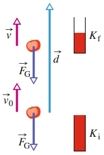

text_image

v
F_G
d
K_f
v_0
F_G
K_i

Abb. 3.3 Eine teilchenartige Tomate der Masse m wird nach oben geworfen. Die Gravitationskraft $\vec { \bar { F } } _ { \mathrm { G } } ,$ die auf die Tomate wirkt, bremst die Tomate während der Verschiebung $\vec { d }$ von der Geschwindigkeit $\vec { \nu } _ { 0 }$ auf die Geschwindigkeit v⃗ ab. Ein Messgerät zeigt die daraus resultierende Änderung der kinetischen Energie der Tomate von $K _ { \mathrm { i } } \; ( = { \textstyle { \frac { 1 } { 2 } } } m \nu _ { 0 } ^ { 2 } )$ auf $K _ { \mathrm { f } } \: ( = { \textstyle { \frac { 1 } { 2 } } } m \nu ^ { 2 } )$ an.

75

---

3 Kinetische Energie und Arbeit

die Gravitationskraft eine negative Arbeit $W _ { \mathrm { G } }$ daran verrichtet. Unsere Kraft überträgt Energie auf das Objekt, während die Gravitationskraft ihm Energie entzieht. Gemäß Gl. 3.10 ist die Änderung ΔK der kinetischen Energie des Objekts aufgrund dieser beiden Energietransfers gleich

$$
\Delta K = K _ {\mathrm{f}} - K _ {\mathrm{i}} = W _ {\mathrm{a}} + W _ {\mathrm{G}}, \tag {3.15}
$$

wobei $K _ { \mathrm { f } }$ die kinetische Energie am Ende und $K _ { \mathrm { i } }$ diejenige am Anfang der Verschiebung darstellt. Diese Gleichung gilt auch, wenn wir das Objekt absenken, doch dann überträgt die Gravitationskraft Energie auf das Objekt, während unsere Kraft ihm Energie entzieht.

In bestimmten alltäglichen Situationen befindet sich das Objekt vor und nach unserer Einwirkung in Ruhe – so z. B., wenn Sie ein Buch vom Boden aufheben und ins Regal stellen. Dann sind $K _ { \mathrm { f } }$ und $K _ { \mathrm { i } }$ beide null und Gl. 3.15 wird zu:

$$
W _ {\mathrm{a}} + W _ {\mathrm{G}} = 0
$$

oder

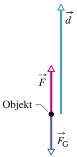

text_image

Objekt
F
d
F_G

(a)

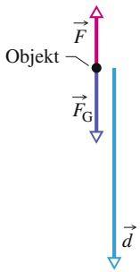

flowchart

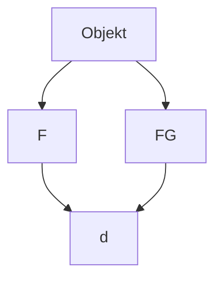

(b)

Abb. 3.4

(a) Eine angelegte Kraft $\vec { F }$ zieht ein Objekt hoch. Die Verschiebung $\vec { d }$ des Objekts bildet einen Winkel $\varphi =$ 180° mit der Gravitationskraft $\vec { \bar { F } } _ { \mathrm { G } } ,$ die auf das Objekt wirkt. Die angelegte Kraft verrichtet positive Arbeit an dem Objekt. (b) Eine angelegte Kraft senkt ein Objekt ab. Die Verschiebung d⃗ des Objekts bildet einen Winkel $\varphi = 0 ^ { \circ }$ mit der Gravitationskraft ${ \vec { F } } _ { \mathrm { G } } .$ Die angelegte Kraft verrichtet negative Arbeit an dem Objekt.

$$
W _ {\mathrm{a}} = - W _ {\mathrm{G}}. \tag {3.16}
$$

Beachten Sie, dass wir das gleiche Ergebnis erhalten, wenn $K _ { \mathrm { f } }$ und $K _ { \mathrm { i } }$ zwar von null verschieden sind, aber den gleichen Wert besitzen. In beiden Fällen besagt das Ergebnis, dass die von der angewendeten Kraft verrichtete Arbeit gleich dem Negativen der von der Gravitationskraft verrichteten Arbeit ist; die ausgeübte Kraft überträgt gerade so viel Energie auf das Objekt, wie die Gravitationskraft von ihm abführt. Anhand von Gl. 3.12 können wir Gl. 3.16 in der Form

$$
W _ {\mathrm{a}} = - m g d \cos \varphi \quad (\text {Arbeit beim Anheben und Absenken;} K _ {\mathrm{f}} = K _ {\mathrm{i}}) \tag {3.17}
$$

schreiben, wobei 𝜑 den Winkel zwischen $\vec { F } _ { \mathrm { G } }$ und $\vec { d }$ bezeichnet. Zeigt die Verschiebung senkrecht nach oben (Abb. 3.4a), so ist $\varphi = 1 8 0 ^ { \circ }$ und die Arbeit, die unsere Kraft verrichtet, wird gleich mgd. Erfolgt die Verschiebung senkrecht nach unten (Abb. 3.4b), dann ist $\varphi = 0 ^ { \circ }$ und die von unserer Kraft verrichtete Arbeit ist gleich −mgd.

Die Gln. 3.16 und 3.17 gelten für jede Situation, in der ein Objekt angehoben oder abgesenkt wird, wenn das Objekt sich vor und nach der Höhenveränderung in Ruhe befindet. Die Gleichungen sind unabhängig vom Betrag der angewendeten Kraft. Wenn ein Gewichtheber seine Hantel in die Höhe stemmt, ändert sich die Kraft, die er dabei auf die Hantel ausübt, im Laufe des Anhebens ganz beträchtlich. Da sich die Hantel jedoch vor und nach dem Anheben in Ruhe befindet, wird die Arbeit, die er an ihr verrichtet hat, durch die Gln. 3.16 und 3.17 gegeben. Dabei entspricht mg in Gl. 3.17 dem gestemmten Gewicht und d der Strecke, um die der Schwerathlet die Hantel angehoben hat.

## KONTROLLFRAGE 3

Nehmen Sie an, dass die Kiste um die gleiche Höhe h angehoben wird, jedoch auf einer längeren Rampe. (a) Ist die durch die Kraft $\vec { T }$ verrichtete Arbeit nun größer als, kleiner als oder gleich groß wie zuvor? (b) Ist der Betrag von ${ \vec { T } } ,$ der benötigt wird, um die Kiste zu bewegen, nun größer als, kleiner als oder gleich groß wie zuvor?

## 3.4 Von einer Federkraft verrichtete Arbeit

## Lernziele

Nach dem Durcharbeiten dieses Abschnitts sollten Sie in der Lage sein, . . .

• das Hookesche Gesetz, d. h. die Beziehung zwischen der von einer Feder auf ein Objekt wirkenden Kraft, der Dehnung oder Kompression der Feder und der Federkonstante anzugeben,
• zu verstehen, dass die Kraft einer Feder eine veränderliche Kraft ist,

76

---

3.4 Von einer Federkraft verrichtete Arbeit

3

• die von der Kraft einer Feder an einem Objekt verrichtete Arbeit durch Integration der Kraft zwischen der Anfangs- und der Endposition der Feder oder durch Anwendung des allgemeinen Ergebnisses dieser Integration zu berechnen,
• Arbeit zu bestimmen, indem Sie die Auftragung der Kraft als Funktion der Position des Objekts grafisch integrieren,
• die Beziehung zwischen der verrichteten Arbeit und der kinetischen Energie eines Objekts auf Situationen anzuwenden, in denen ein Objekt durch die Kraft einer Feder bewegt wird.

## Schlüsselideen

• Die Kraft $\vec { F } _ { \mathrm { F } }$ einer Feder ist durch

$$
\vec {F} _ {\mathrm{F}} = - k \vec {d} \quad \text {(Hookesches Gesetz)}
$$

gegeben, wobei $\vec { d }$ die Auslenkung der Feder aus ihrer Ruhelage (weder gedehnt noch komprimiert) und k die Federkonstante (ein Maß für die Härte oder Steifigkeit einer Feder) ist. Wenn die Feder in Richtung einer x-Achse liegt, deren Nullpunkt sich an der Stelle des Federendes im entspannten Zustand befindet, ist

$$
F _ {\mathrm{F}, x} = - k x \qquad (\text {Hookesches Gesetz}).
$$

• Die Kraft einer Feder ist folglich eine veränderliche Kraft: Sie hängt von der Auslenkung der Feder aus ihrer Ruhelage ab.
• Wenn am Ende der Feder ein Objekt befestigt ist, verrichtet die Feder an diesem Objekt eine Arbeit $W _ { \mathrm { F } } ,$ wenn es von einer anfänglichen Position $x _ { \mathrm { i } }$ zu einer Endposition $x _ { \mathrm { f } }$ bewegt wird:

$$
W _ {\mathrm{F}} = \frac {1}{2} k x _ {\mathrm{i}} ^ {2} - \frac {1}{2} k x _ {\mathrm{f}} ^ {2}.
$$

Für $x _ { \mathrm { i } } = 0$ und $x _ { \mathrm { f } } = x$ wird daraus

$$
W _ {\mathrm{F}, x} = - \frac {1}{2} k x ^ {2}.
$$

## 3.4.1 Von einer Federkraft verrichtete Arbeit

In dem folgenden Abschnitt untersuchen wir die Arbeit, die eine bestimmte Art von veränderlicher Kraft – nämlich eine von einer Feder ausgeübte **Federkraft** – an einem teilchenartigen Objekt verrichtet. Viele der in der Natur auftretenden Kräfte besitzen die gleiche mathematische Form wie die Federkraft. Indem Sie diese Kraft im Detail studieren, entwickeln Sie ein Verständnis für viele weitere derartige Kräfte.

## Die Federkraft

Abbildung 3.5a zeigt eine Feder im entspannten Zustand, dem **Ruhezustand**, in dem die Feder weder zusammengedrückt noch auseinandergezogen wird. Eines ihrer Enden ist fest; an dem anderen – dem freien – Ende ist ein teilchenartiges Objekt wie z. B. ein Block befestigt. Dehnen wir die Feder, indem wir den Block wie in Abb. 3.5b gezeigt nach rechts bewegen, so zieht die Feder den Block nach links. (Weil eine Federkraft immer danach strebt, den Entspannungszustand wiederherzustellen, wird sie auch Rückstellkraft genannt.) Stauchen wir die Feder, indem wir den Block wie in Abb. 3.5c dargestellt nach links schieben, so drückt die Feder den Block nach rechts.

In einer für viele Federn gültigen Näherung ist die von einer Feder ausgeübte Kraft $\vec { F }$ proportional zur hier **Auslenkung** genannten Verschiebung $\vec { d }$ des freien

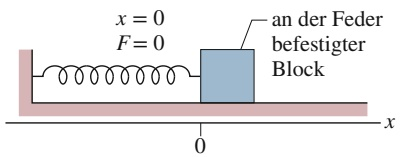

text_image

x = 0
F = 0
an der Feder
befestigter
Block
0
x

(a)

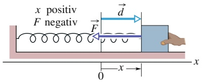

text_image

x positiv
F negativ
F
d
x
0
x

(b)

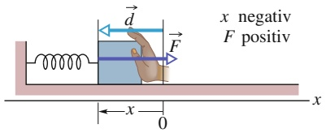

text_image

x negativ
F positiv
x
0
x

(c)

## Abb. 3.5

(a) Eine Feder im entspannten Zustand. Der Ursprung der x-Achse wurde an dasjenige Ende der Feder gelegt, an dem der Block befestigt ist.
(b) Der Block wird um d⃗ verschoben, die Feder dabei um die positive Auslenkung x gedehnt. Beachten Sie die von der Feder ausgeübte Rückstellkraft F⃗. (c) Die Feder wird um die negative Auslenkung x gestaucht. Beachten Sie auch hier die Rückstellkraft der Feder.

77

---

3 Kinetische Energie und Arbeit

Endes von seiner Ausgangsposition im entspannten Zustand. Die Federkraft wird durch das **Hookesche Gesetz**

$$
\vec {F} = - k \vec {d} \quad (\text {Hookesches Gesetz}) \tag {3.18}
$$

beschrieben, das nach Robert Hooke, einem englischen Wissenschaftler des späten 17. Jahrhunderts, benannt ist. Das Minuszeichen in Gl. 3.18 drückt aus, dass die Federkraft immer der Auslenkung des freien Endes entgegenwirkt. Die Konstantek ist die **Federkonstante**; sie ist ein $\mathrm { M a } \&$ für die Steifigkeit oder Härte der Feder. Je größerk ist, desto steifer ist die Feder; d. h., desto stärker ist der Zug oder Druck für eine bestimmte Auslenkung. Die SI-Einheit vonk ist Newton pro Meter.

In Abb. 3.5 verläuft einex-Achse parallel zur Länge der Feder, wobei der Ursprung $( x = 0 )$ am Ort des freien Endes liegt, wenn die Feder sich im entspannten Zustand befindet. Für diese allgemein übliche Anordnung können wir Gl. 3.18 in der Form

$$
F = - k x \quad (\text {Hookesches Gesetz}) \tag {3.19}
$$

schreiben.

Istx positiv (d. h., die Feder wird entlang derx-Achse nach rechts gedehnt), dann ist F negativ (die Kraft zieht nach links). Ist x negativ (d. h., die Feder wird nach links gestaucht), dann ist $F$ positiv (die Kraft drückt nach rechts).

Beachten Sie, dass eine Federkraft eine veränderliche Kraft ist, da ihr Betrag und ihre Richtung vom Ortx des freien Endes abhängen; $F$ kann auch als Funktion $F ( x )$ geschrieben werden. Beachten Sie außerdem, dass das Hookesche Gesetz eine lineare Beziehung zwischen F und x darstellt.

## Von einer Federkraft verrichtete Arbeit

Um einen Ausdruck für die Arbeit herzuleiten, welche die Federkraft verrichtet, während sich der Block aus Abb. 3.5a bewegt, lassen Sie uns zwei vereinfachende Annahmen machen. (1) Die Feder ist masselos; d. h., ihre Masse kann im Vergleich zur Masse des Blocks vernachlässigt werden. (2) Die Feder ist eine ideale Feder; d. h., sie gehorcht dem Hookeschen Gesetz ohne Einschränkung. Außerdem nehmen wir an, dass der Kontakt zwischen dem Block und dem Boden reibungsfrei ist und dass der Block einem Teilchen gleichgesetzt werden kann.

Wir stoßen den Block nach rechts an, um ihn in Bewegung zu versetzen, und lassen ihn seine Bewegung ungestört weiter ausführen. Während der Block sich nach rechts bewegt, verrichtet die Federkraft $\vec { F }$ Arbeit an dem Block, sodass sich die kinetische Energie des Blocks verringert und er langsamer wird. Diese Arbeit können wir jedoch nicht bestimmen, indem wir Gl. 3.7 $\left( W = F d \right.$ cos𝜑) verwenden, da diese Gleichung eine konstante Kraft voraussetzt. Die Federkraft jedoch ist eine veränderliche Kraft.

Um die von der Federkraft verrichtete Arbeit zu ermitteln, müssen wir uns der Analysis bedienen. Die Anfangsposition des Blocks sei $x _ { \mathrm { i } } ,$ seine spätere Position $x _ { \mathrm { f } } .$ . Teilen Sie nun den Abstand zwischen diesen zwei Positionen in viele Segmente der (winzigen) Länge $\Delta x .$ Nummerieren Sie die Segmente von $x _ { \mathrm { i } }$ ausgehend der Reihe nach mit 1, 2 usw. Während der Block sich durch eines dieser Segmente bewegt, verändert sich die Federkraft kaum, da das Segment so klein ist, dass sich x kaum ändert. Also können wir den Betrag der Kraft in einem solchen Segment näherungsweise als konstant annehmen. Nummerieren Sie diese Beträge der Reihe nach mit $F _ { 1 }$ im Segment 1, $F _ { 2 }$ im Segment 2 usw.

Nachdem die Kräfte nun in jedem Segment konstant sind, können wir die in jedem Segment verrichtete Arbeit anhand von Gl. $3 . 7 \left( W = F d \right.$ cos𝜑) berechnen. Hier ist $\varphi = 0 ,$ d. h. cos $\varphi = 1$ . Die in Segment 1 verrichtete Arbeit ist dann $F _ { 1 } \Delta x ,$ die in Segment 2 verrichtete $F _ { 2 } \Delta ;$ x usw. Die von der Feder von $x _ { \mathrm { i } }$ bis $x _ { \mathrm { f } }$ verrichtete Gesamtarbeit $W _ { \mathrm { F } }$ ist die Summe all dieser Arbeiten:

$$
W _ {\mathrm{F}} = \sum_ {\mathrm{i}} ^ {\mathrm{f}} F _ {j} \Delta x, \tag {3.20}
$$

78

---

3.4 Von einer Federkraft verrichtete Arbeit

3

wobei der Index j die Nummer des Segments angibt. Geht $\Delta x$ im Grenzwert gegen null, wird Gl. 3.20 zu

$$
W _ {\mathrm{F}} = \int_ {x _ {\mathrm{i}}} ^ {x _ {\mathrm{f}}} F \mathrm{d} x. \tag {3.21}
$$

Setzen wir F aus Gl. 3.19 ein, so erhalten wir

$$
\begin{array}{l} W _ {\mathrm{F}} = \int_ {x _ {\mathrm{i}}} ^ {x _ {\mathrm{f}}} (- k x) \mathrm{d} x = - k \int_ {x _ {\mathrm{i}}} ^ {x _ {\mathrm{f}}} x \mathrm{d} x \\ = \left(- \frac {1}{2} k\right) \left[ x ^ {2} \right] _ {x _ {\mathrm{i}}} ^ {x _ {\mathrm{f}}} = \left(- \frac {1}{2} k\right) \left(x _ {\mathrm{f}} ^ {2} - x _ {\mathrm{i}} ^ {2}\right). \tag {3.22} \\ \end{array}
$$

Ausmultipliziert ergibt dies

$$
W _ {\mathrm{F}} = \frac {1}{2} k x _ {\mathrm{i}} ^ {2} - \frac {1}{2} k x _ {\mathrm{f}} ^ {2} \quad (\text {von einer Federkraft verrichtete Arbeit}). \tag {3.23}
$$

Diese von der Federkraft verrichtete Arbeit $W _ { \mathrm { F } }$ kann ein positives oder negatives Vorzeichen besitzen, je nachdem, ob der gesamte Energietransfer während der Bewegung von $x _ { \mathrm { i } }$ nach $x _ { \mathrm { f } }$ dem Block zugeführt oder von ihm abgeführt wird. Vorsicht: Die Endposition $x _ { \mathrm { f } }$ erscheint auf der rechten Seite von Gl. 3.23 im zweiten Term. Gleichung 3.23 besagt also:

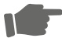

Die Arbeit $W _ { \mathrm { F } }$ ist positiv, wenn der Block sich am Ende der Bewegung näher am entspannten Zustand $( x = 0 )$ befindet, als er es ursprünglich war. Die Arbeit ist negativ, wenn der Block am Ende der Bewegung weiter von $x = 0$ entfernt ist als am Anfang der Bewegung. Die Arbeit ist null, wenn der Block sich am Ende der Bewegung im gleichen Abstand von $x = 0$ befindet.

Ist $x _ { \mathrm { i } } = 0$ und nennen wir die Endposition des Blocks $x ,$ so lautet Gl. 3.23:

$$
W _ {\mathrm{F}} = - \frac {1}{2} k x ^ {2} \quad (\text {von einer Federkraft verrichtete Arbeit}). \tag {3.24}
$$

## Von einer angelegten Kraft verrichtete Arbeit

Nehmen Sie nun an, dass wir den Block entlang der x-Achse bewegen, indem wir kontinuierlich eine äußere Kraft $\vec { F } _ { \mathrm { a } }$ auf ihn ausüben. Diese angelegte Kraft verrichtet während der Verschiebung an dem Block eine Arbeit $W _ { \mathbf { a } } ,$ die Federkraft eine Arbeit $W _ { \mathrm { F } } .$ . Anhand von Gl. 3.10 ergibt sich für die Änderung $\Delta K$ der kinetischen Energie des Blocks aufgrund dieser beiden Energietransfers:

$$
\Delta K = K _ {\mathrm{f}} - K _ {\mathrm{i}} = W _ {\mathrm{a}} + W _ {\mathrm{F}}, \tag {3.25}
$$

wobei $K _ { \mathrm { f } }$ die (finale) kinetische Energie am Ende und $K _ { \mathrm { i } }$ die (initiale) kinetische Energie am Anfang der Verschiebung bezeichnet. Befindet sich der Block vor und nach der Verschiebung in Ruhe, dann sind $K _ { \mathrm { f } }$ und $K _ { \mathrm { i } }$ beide null und Gl. 3.25 wird zu:

$$
W _ {\mathrm{a}} = - W _ {\mathrm{F}}. \tag {3.26}
$$

Befindet sich ein an einer Feder befestigter Block vor und nach einer Verschiebung in Ruhe, dann ist die durch die angelegte Kraft, die den Block bewegt, verrichtete Arbeit gleich dem Negativen der von der Federkraft an dem Block verrichteten Arbeit.

Vorsicht: Befindet sich der Block vor und nach der Verschiebung nicht in Ruhe, dann gilt diese Aussage nicht.

79

---

3 Kinetische Energie und Arbeit

## KONTROLLFRAGE 4

In drei Situationen sind die Anfangs- und Endpositionen des Blocks aus Abb. 3.5 entlang der x-Achse durch die folgenden Werte gegeben: (a) −3 cm, 2 cm; (b) 2 cm, 3 cm und (c) −2 cm, 2 cm. Ist die von der Federkraft an dem Block verrichtete Arbeit in der jeweiligen Situation positiv, negativ oder null?

## 3.5 Von einer allgemeinen veränderlichen Kraft verrichtete Arbeit

## Lernziele

Nach dem Durcharbeiten dieses Abschnitts sollten Sie in der Lage sein, . . .

• aus einer gegebenen veränderlichen Kraft als Funktion des Orts die von ihr an einem Objekt verrichtete Arbeit durch Integration dieser Funktion vom Anfangs zum Endzustand in einer oder mehr Dimensionen zu berechnen,
• aus der Auftragung einer Kraft als Funktion des Orts die von ihr verrichtete Arbeit durch grafische Integration von der Anfangs- bis zur Endposition des Objekts zu bestimmen,
• eine Auftragung der Beschleunigung als Funktion des Orts in eine Auftragung der Kraft als Funktion des Orts umzuwandeln,
• die Beziehung zwischen der verrichteten Arbeit und der kinetischen Energie eines Objekts auf Situationen anzuwenden, in denen ein Objekt durch eine veränderliche Kraft bewegt wird.

## Schlüsselideen

Wenn die Kraft $\vec { F }$ auf ein teilchenartiges Objekt von dessen Position abhängt, muss die Arbeit, die diese Kraft an dem Objekt verrichtet, während es sich von einer Anfangsposition $( x _ { \mathrm { i } } , y _ { \mathrm { i } } , z _ { \mathrm { i } } )$ zu einer Endposition $( x _ { \mathrm { f } } ,   y _ { \mathrm { f } } ,   z _ { \mathrm { f } } )$ bewegt, durch Integration der veränderlichen Kraft bestimmt werden. Unter der Annahme, dass die Komponente $F _ { x }$ nur von x abhängt, nicht aber von y und z (und analog für $F _ { y }$ und $F _ { z } ) ,$ , gilt für die Arbeit

$$
W = \int_ {x _ {\mathrm{i}}} ^ {x _ {\mathrm{f}}} F _ {x} \mathrm{d} x + \int_ {y _ {\mathrm{i}}} ^ {y _ {\mathrm{f}}} F _ {y} \mathrm{d} y + \int_ {z _ {\mathrm{i}}} ^ {z _ {\mathrm{f}}} F _ {z} \mathrm{d} z.
$$

• Wenn die Kraft $\vec { F }$ nur eine x-Komponente besitzt, reduziert sich dieser Ausdruck auf

$$
W = \int_ {x _ {\mathrm{i}}} ^ {x _ {\mathrm{f}}} F (x) \mathrm{d} x.
$$

## 3.5.1 Von einer allgemeinen veränderlichen Kraft verrichtete Arbeit

## Eindimensionale Analyse

Lassen Sie uns zu der in Abb. 3.1 dargestellten Situation zurückkehren. Nehmen Sie nun jedoch an, dass die Kraft die x-Achse entlang weist und der Betrag der Kraft ortsabhängig ist, sich also mit der Position x verändert. Beachten Sie, dass sich hier nur der Betrag dieser Kraft ändert, nicht jedoch ihre Richtung; auch ändert sich der Betrag der Kraft an einem beliebigen festen Ort nicht mit der Zeit.

Abbildung 3.6a zeigt die Kurve einer solchen eindimensionalen veränderlichen Kraft. Gesucht ist ein Ausdruck für die Arbeit, die diese Kraft an einem Teilchen

80

---

3.5 Von einer allgemeinen veränderlichen Kraft verrichtete Arbeit

3

verrichtet, während sich das Teilchen von einem Anfangspunkt $x _ { \mathrm { i } }$ zu einem Endpunkt $x _ { \mathrm { f } }$ bewegt. Wir können jedoch nicht Gl. 3.7 verwenden, da diese nur für eine konstante Kraft $\vec { F }$ gilt. Auch hier werden wir uns deshalb wieder der Analysis bedienen. Wir teilen die Fläche unterhalb der Kurve aus Abb. 3.6a wiederum in eine Vielzahl von schmalen Streifen der Breite $\Delta x$ (Abb. 3.6b). Dabei wählen wir $\Delta x$ so schmal (infinitesimal), dass wir die Kraft $F ( x )$ in diesem Intervall mit gutem $\mathbf { G e } -$ wissen als konstant annehmen können. Es sei $F _ { j , \mathrm { g e m } }$ der mittlere Wert von $F ( x )$ im Intervall $j .   F _ { j , \mathrm { g e m } }$ gibt damit die Höhe des Streifens j an.

Da $F _ { j , \mathrm { g e m } }$ als konstant angenommen wird, wird die infinitesimale Änderung der Arbeit $\widetilde { \Delta }   W _ { j i }$ , welche die Kraft im Intervall $j$ verrichtet hat, nun näherungsweise durch Gl. 3.7 gegeben:

$$
\Delta W _ {j} = F _ {j, \mathrm{gem}} \Delta x. \tag {3.27}
$$

In Abb. 3.6b ist $\Delta W _ { \mathrm { i } }$ gleich der Fläche des rechteckigen, schattierten Streifens $j .$

Um nun die Arbeit W zu erhalten, welche die Kraft während der Bewegung des Teilchens von $x _ { \mathrm { i } }$ nach $x _ { \mathrm { f } }$ insgesamt näherungsweise verrichtet, addieren wir die Flächen aller Streifen, die in Abb. 3.6b zwischen $x _ { \mathrm { i } }$ und $x _ { \mathrm { f } }$ liegen:

$$
W = \sum \Delta W _ {j} = \sum F _ {j, \mathrm{gem}} \Delta x. \tag {3.28}
$$

Gleichung 3.28 ist eine Näherung, da die gebrochene $\mathrm{,Skyline}$ welche die oberen Ränder der schattierten rechteckigen Streifen in Abb. 3.6b bilden, den tatsächlichen Verlauf der Kurve $F ( x )$ nur annähernd beschreibt.

Wir können die Näherung verbessern, indem wir die Breite $\Delta x$ der Streifen wie in Abb. 3.6c dargestellt verkleinern und mehr Streifen verwenden. Im Grenzfall lassen wir die Breite der Streifen gegen null gehen; die Anzahl der Streifen wird dann unendlich groß und wir erhalten als exaktes Ergebnis

$$
W = \lim _ {\Delta x \to 0} \sum F _ {j, \mathrm{gem}} \Delta x. \tag {3.29}
$$

Dieser Grenzwert entspricht genau dem Integral der Funktion $F ( x )$ zwischen den Grenzen $x _ { \mathrm { i } }$ und $x _ { \mathrm { f } } .$ . Damit ist Gl. 3.29 also:

$$
W = \int_ {x _ {\mathrm{i}}} ^ {x _ {\mathrm{f}}} F (x) \mathrm{d} x \quad (\text {von einer veränderlichen Kraft verrichtete Arbeit}). \tag {3.30}
$$

Kennen wir die Funktion $F ( x ) ,$ , so können wir sie in Gl. 3.30 einsetzen, die passenden Integrationsgrenzen einfügen, die Integration ausführen und so die $\mathrm { A l }$ rbeit ermitteln. (Anhang D enthält eine Liste der gebräuchlichsten Integrale.) Geometrisch entspricht die Arbeit der Fläche, die innerhalb der Grenzen $x _ { \mathrm { i } }$ und $x _ { \mathrm { f } }$ zwischen der Kurve $F ( x )$ und der x-Achse enthalten ist (in Abb. 3.6d schattiert dargestellt).

## Dreidimensionale Analyse

Betrachten wir nun ein Teilchen, auf das eine dreidimensionale Kraft

$$
\vec {F} = F _ {x} \vec {e} _ {x} + F _ {y} \vec {e} _ {y} + F _ {z} \vec {e} _ {z} \tag {3.31}
$$

wirkt, wobei die Komponenten $F _ { x } , F _ { y }$ und $F _ { z }$ ortsabhängig, also Funktionen der Position des Teilchens sein können. Wir führen allerdings drei Vereinfachungen ein: $F _ { x }$ darf von x abhängen, nicht jedoch von $y$ oder z, $F _ { y }$ darf von $y$ abhängen, nicht jedoch von x oder $z ,$ und $F _ { z }$ darf von z abhängen, nicht jedoch von x oder $y .$ Das Teilchen bewege sich um eine infinitesimale Verschiebung

$$
\mathrm{d} \vec {r} = \mathrm{d} x \vec {e} _ {x} + \mathrm{d} y \vec {e} _ {y} + \mathrm{d} z \vec {e} _ {z}. \tag {3.32}
$$

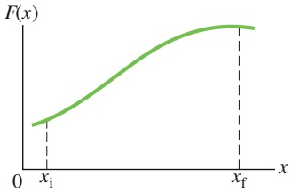

line

| X | F(x) |
| --- | --- |
| \(x_i\) | ~0.25 |
| \(x_f\) | ~0.95 |

(a)

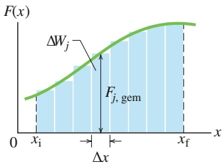

area

| Point | Description |
| --- | --- |
| x_i | Initial point on the curve |
| x_f | Final point on the curve |
| \(\Delta W_j\) | Difference between the two curves |
| F_{j, gem} | Geometric approximation of the area under the curve |

(b)

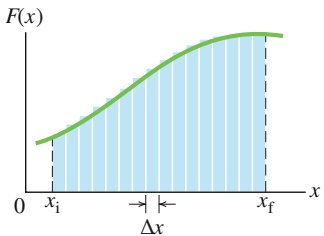

area

| X | F(x) |
| --- | --- |
| 0 | ~0.2 |
| xi | ~0.3 |
| xf | ~1.0 |

(c)

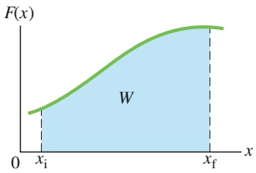

area

| X | F(x) |
| --- | --- |
| 0 | ~0.2 |
| x_i | ~0.3 |
| x_f | ~1.0 |

(d)

## Abb. 3.6

(a) Kurve einer eindimensionalen Kraft $\vec { F }$ in Abhängigkeit von der Verschiebung x des Teilchens, auf das die Kraft wirkt. Das Teilchen bewegt sich von $x _ { \mathrm { i } }$ nach $x _ { \mathrm { f } } .$ (b) Die gleiche Kurve wie in $( a ) ;$ die Fläche unterhalb der Kurve ist in schmale Streifen unterteilt. (c) Die gleiche Darstellung wie in (b); die Fläche unterhalb der Kurve ist in noch schmalere Streifen unterteilt. (d) Der Grenzfall. Die von der Kraft verrichtete Arbeit wird durch Gl. 3.30 gegeben, sie entspricht der schattierten Fläche zwischen der Kurve und der $x - \mathbf { A }$ chse einerseits und zwischen $x _ { \mathrm { i } }$ und $x _ { \mathrm { f } }$ andererseits.

81

---

3 Kinetische Energie und Arbeit

Die infinitesimale $\ddot { \mathrm { A } }$ nderung d $W$ der von $\vec { F }$ während der Verschiebung $\mathrm { d } \vec { r }$ an dem Teilchen verrichteten Arbeit ist gemäß Gl. 3.8:

$$
\mathrm{d} W = \vec {F} \cdot \mathrm{d} \vec {r} = F _ {x} \mathrm{d} x + F _ {y} \mathrm{d} y + F _ {z} \mathrm{d} z. \tag {3.33}
$$

Die Arbeit, die $\vec { F }$ verrichtet, während sich das Teilchen von einer Anfangsposition $r _ { \mathrm { i } }$ mit den Koordinaten $( x _ { \mathrm { i } } , y _ { \mathrm { i } } , z _ { \mathrm { i } } )$ zu einer Endposition $r _ { \mathrm { f } }$ mit den Koordinaten $( x _ { \mathrm { f } } )$ $y _ { \mathrm { f } } , z _ { \mathrm { f } } )$ bewegt, ist dann:

$$
W = \int_ {r _ {\mathrm{i}}} ^ {r _ {\mathrm{f}}} \mathrm{d} W = \int_ {x _ {\mathrm{i}}} ^ {x _ {\mathrm{f}}} F _ {x} \mathrm{d} x + \int_ {y _ {\mathrm{i}}} ^ {y _ {\mathrm{f}}} F _ {y} \mathrm{d} y + \int_ {z _ {\mathrm{i}}} ^ {z _ {\mathrm{f}}} F _ {z} \mathrm{d} z. \tag {3.34}
$$

Besitzt $\vec { F }$ nur eine x-Komponente, dann sind der zweite und der dritte Term in Gl. 3.34 gleich null und die Gleichung reduziert sich auf Gl. 3.30.

## Zusammenhang zwischen Arbeit und kinetischer Energie im Fall einer veränderlichen Kraft

Gleichung 3.30 gibt die von einer veränderlichen Kraft an einem Teilchen verrichtete Arbeit für eine eindimensionale Situation an. Stellen wir nun sicher, dass die mit Gl. 3.30 berechnete Arbeit tatsächlich der Änderung der kinetischen Energie des Teilchens entspricht.

Betrachten wir ein Teilchen der Masse $m ,$ das sich entlang einer $x - A$ chse bewegt und auf das eine Gesamtkraft $F ( x )$ wirkt, die entlang dieser Achse verläuft. Die Arbeit, die diese Kraft an dem Teilchen verrichtet, während es sich von einer Anfangsposition $x _ { \mathrm { i } }$ zu einer Endposition $x _ { \mathrm { f } }$ bewegt, ist durch Gl. 3.30 gegeben:

$$
W = \int_ {x _ {\mathrm{i}}} ^ {x _ {\mathrm{f}}} F _ {x} \mathrm{d} x = \int_ {x _ {\mathrm{i}}} ^ {x _ {\mathrm{f}}} m a \mathrm{d} x, \tag {3.35}
$$

wobei wir das zweite Newtonsche Gesetz ausgenutzt haben, um $F ( x )$ durch ma zu ersetzen. Die Größe ma dx in Gl. 3.35 können wir in der Form

$$
m a \mathrm{d} x = m \frac {\mathrm{d} \nu}{\mathrm{d} t} \mathrm{d} x \tag {3.36}
$$

umschreiben. Gemäß der „Kettenregel“ der Analysis ist:

$$
\frac {\mathrm{d} \nu}{\mathrm{d} t} = \frac {\mathrm{d} \nu}{\mathrm{d} x} \frac {\mathrm{d} x}{\mathrm{d} t} = \frac {\mathrm{d} \nu}{\mathrm{d} x} \nu . \tag {3.37}
$$

Damit wird Gl. 3.36 zu

$$
m a \mathrm{d} x = m \frac {\mathrm{d} \nu}{\mathrm{d} x} \nu \mathrm{d} x = m \nu \mathrm{d} \nu . \tag {3.38}
$$

Einsetzen von Gl. 3.38 in Gl. 3.35 ergibt

$$
\begin{array}{l} W = \int_ {\nu_ {\mathrm{i}}} ^ {\nu_ {\mathrm{f}}} m \nu   \mathrm{d} \nu = m \int_ {\nu_ {\mathrm{i}}} ^ {\nu_ {\mathrm{f}}} \nu   \mathrm{d} \nu \\ = \frac {1}{2} m v _ {\mathrm{f}} ^ {2} - \frac {1}{2} m v _ {\mathrm{i}} ^ {2}. \tag {3.39} \\ \end{array}
$$

Beachten $\mathrm { S i e } ,$ dass wir auch die Grenzen eines Integrals ändern müssen, wenn wir von der Integrationsvariable x zur Integrationsvariable v übergehen. Beachten Sie außerdem, dass wir die Masse m vor das Integral ziehen konnten, da m konstant ist.

82

---

3.6 Leistung

3

Die Terme auf der rechten Seite von Gl. 3.39 sind kinetische Energien; dies erlaubt uns, die Gleichung in der Form

$$
W = K _ {\mathrm{f}} - K _ {\mathrm{i}} = \Delta K
$$

zu schreiben.

## 3.6 Leistung

## Lernziele

Nach dem Durcharbeiten dieses Abschnitts sollten Sie in der Lage sein, . . .

• die Beziehung zwischen der mittleren Leistung, der von einer Kraft verrichteten Arbeit und dem Zeitintervall, in dem diese Arbeit geleistet wird, anzugeben und anzuwenden,
• aus einer gegebenen Arbeit als Funktion der Zeit die momentane Leistung zu bestimmen,
• die momentane Leistung als Skalarprodukt des Kraftvektors und des Geschwindigkeitsvektors zu berechnen (in Einheitsvektoren- und Betrag-Winkel-Schreibweise).

## Schlüsselideen

• Die von einer Kraft erbrachte Leistung ist die von dieser Kraft pro Zeitintervall verrichtete Arbeit.
• Wenn die Kraft im Zeitintervall Δt die Arbeit W verrichtet, ist die von ihr in diesem Zeitintervall erbrachte mittlere (gemittelte) Leistung

$$
P _ {\mathrm{gem}} = \frac {W}{\Delta t}.
$$

• Die momentane Leistung ist die Ableitung der verrichteten Arbeit nach der Zeit:

$$
P = \frac {\mathrm{d} W}{\mathrm{d} t}.
$$

• Wenn eine Kraft $\vec { F }$ in einem Winkel 𝜑 zur Richtung einer Momentangeschwindigkeit v⃗ wirkt, ist die von ihr erbrachte momentane Leistung

$$
P = \vec {F} \cdot \vec {\nu} = F \nu \cos \varphi .
$$

## 3.6.1 Leistung

Ein Bauunternehmer möchte eine Ladung Ziegelsteine mithilfe einer Winde vom Bürgersteig auf das Dach eines Gebäudes heben. Wir können nun berechnen, wie viel Arbeit die von der Winde ausgeübte Kraft an der Ladung verrichten muss, um die Ziegelsteine auf das Dach zu befördern. Den Bauunternehmer interessiert jedoch eigentlich eher die Rate, mit der diese Arbeit verrichtet wird. Wird er für das Anheben fünf Minuten brauchen (was einer akzeptablen Zeitspanne entspräche) oder eher eine Woche (was natürlich völlig inakzeptabel wäre)?

Die Zeitrate, mit der eine Kraft eine Arbeit verrichtet, wird als **Leistung** bezeichnet. Verrichtet eine Kraft eine Arbeit W in dem Zeitintervall $\Delta t ,$ so ist die gemittelte, **durchschnittliche** oder **mittlere Leistung** der Kraft während dieses Zeitintervalls:

$$
P _ {\mathrm{gem}} = \frac {W}{\Delta t} \quad (\text {durchschnittliche Leistung}). \tag {3.40}
$$

Die **momentane Leistung** oder einfach Leistung ist die momentane Rate, mit der Arbeit verrichtet wird:

$$
P = \frac {\mathrm{d} W}{\mathrm{d} t} \quad (\text {momentane Leistung}). \tag {3.41}
$$

83

---

3 Kinetische Energie und Arbeit

Nehmen Sie an, die von einer Kraft verrichtete Arbeit ist als Funktion der Zeit $W ( t )$ bekannt. Um die momentane Leistung $P$ während der verrichteten Arbeit, z. B. zum Zeitpunkt $t = 3 { , } 0   \mathrm { s } _ { i }$ zu berechnen, müssen wir $W ( t )$ zunächst nach der Zeit ableiten und das Ergebnis dann für $t = 3 \mathrm { , } 0$ s ausrechnen.

Die SI-Einheit der Leistung ist das Joule pro Sekunde. Diese Einheit wird so oft gebraucht, dass man ihr einen eigenen Namen gegeben hat, das **Watt** (W). Diese ist nach dem schottischen Erfinder James Watt benannt, der die Rate, mit der Dampfmaschinen Arbeit verrichteten, deutlich verbesserte. Manchmal wird als Einheit der Leistung auch noch die veraltete Nicht-SI-Einheit Pferdestärke (PS) verwendet. Es gilt

$$
1 \mathrm{Watt} = 1 \mathrm{W} = 1 \mathrm{J/s} \tag {3.42}
$$

und

$$
1 \text {Pferdestärke} = 1 \mathrm{PS} = 7 3 5 \mathrm{W}. \tag {3.43}
$$

Aus Gl. 3.40 wird ersichtlich, dass Arbeit auch als Leistung mal Zeit angegeben werden kann, wie man z. B. an der gebräuchlichen Energieeinheit Kilowattstunde ablesen kann:

$$
\begin{array}{l} 1 \text {Kilowattstunde} = 1 \mathrm{kW} \cdot \mathrm{h} = 1 \mathrm{kWh} = (1 0 ^ {3} \mathrm{W}) (3 6 0 0 \mathrm{s}) \\ = 3, 6 0 \cdot 1 0 ^ {6} \mathrm{J} = 3, 6 0 \mathrm{MJ}. \tag {3.44} \\ \end{array}
$$

Oft werden Watt und Kilowattstunde als Einheiten aus dem Bereich der Elektrizität angesehen – vielleicht deshalb, weil sie auf unseren Stromrechnungen erscheinen. Diese Einheiten können jedoch für beliebige Formen von Leistung und Arbeit oder Energie verwendet werden. Heben Sie z. B. dieses Buch vom Fußboden auf und legen es auf einen Tisch, so können Sie die Arbeit, die Sie dabei verrichtet haben, auch als $4 \cdot 1 0 ^ { - 6 }   \mathrm { k W h }$ (oder praktischer als 4 mWh) angeben.

Wir können die Rate, mit der eine Kraft Arbeit an einem Teilchen (oder einem teilchenartigen Objekt) verrichtet, auch durch Kraft und Geschwindigkeit des Teilchens ausdrücken. Für ein Teilchen, das sich auf einer Geraden bewegt (z. B. entlang der x-Achse) und auf das eine konstante Kraft $\vec { F }$ wirkt, die mit dieser Geraden einen Winkel $\varphi$ bildet, wird Gl. 3.41 zu:

$$
P = \frac {\mathrm{d} W}{\mathrm{d} t} = \frac {F \cos \varphi   \mathrm{d} x}{\mathrm{d} t} = F \cos \varphi \left(\frac {\mathrm{d} x}{\mathrm{d} t}\right)
$$

oder

$$
P = F \nu \cos \varphi . \tag {3.45}
$$

Die rechte Seite von Gl. 3.45 entspricht dem Skalarprodukt ${ \vec { F } } \cdot { \vec { \nu } } .$ Damit lässt sich Gl. 3.45 auch in der Form

$$
P = \vec {F} \cdot \vec {\nu} \quad (\text {momentane Leistung}) \tag {3.46}
$$

schreiben.

Der Motor des Pick-ups in Abb. 3.7 übt z. B. eine Kraft $\vec { F }$ auf Fahrzeug und Wohn wagen-Trailer aus, wobei diese zu einem bestimmten Zeitpunkt die gemeinsame Geschwindigkeit v⃗ haben. Die momentane Leistung von $\vec { \bar { F } }$ ist die Rate, mit der $\vec { F }$ zu diesem Zeitpunkt Arbeit am Trailer verrichtet; sie wird durch die Gln. 3.45 und 3.46 gegeben. Oft wird in diesem Zusammenhang von „der Leistung des Pickups“ gesprochen. Wir sollten dabei jedoch im Hinterkopf behalten, was damit wirklich gemeint ist: Leistung ist die Rate, mit der die wirkende Kraft Arbeit verrichtet.

## KONTROLLFRAGE 5

Ein Block bewege sich in einer gleichförmigen Kreisbewegung an einem Seil, das im Zentrum des Kreises befestigt ist. Ist die Leistung der Kraft, die auf den Block wirkt, positiv, negativ oder null?

natural_image

White pickup truck driving on a desert road with rugged terrain in the background (no visible text or symbols)

Abb. 3.7

Die Leistung der Kraft des Pick-up-Motors auf Fahrzeug und Trailer ist die Rate, mit der diese Kraft Arbeit verrichtet [Quelle: Condor 36/Shutterstock].

84

---

3.7 Zusammenfassung

3

## 3.7 Zusammenfassung

**Kinetische Energie** Die kinetische Energie K eines bewegten Teilchens der Masse m und Geschwindigkeit v (wobei v weit unterhalb der Lichtgeschwindigkeit liegt) ist:

$$
K = \frac {1}{2} m v ^ {2} \quad (\text {kinetische Energie}). \tag {3.1}
$$

**Arbeit** Die Arbeit $W$ entspricht einer Energie, die durch eine auf ein Objekt wirkende Kraft auf dieses Objekt übertragen bzw. von diesem Objekt abgeführt wird. Energie, die dem Objekt zugeführt wird, ist positive Arbeit; Energie, die von dem Objekt abgeführt wird, ist negative Arbeit.

**Von einer konstanten Kraft verrichtete Arbeit** Die $\mathrm { A r } -$ beit, die eine konstante Kraft $\vec { F }$ während einer Verschie bung d⃗ eines Teilchens an diesem Teilchen verrichtet, ist:

$$
W = F D \cos \varphi = \vec {F} \cdot \vec {d} \quad (\text {Arbeit; konstante Kraft}), \tag {3.7,3.8}
$$

wobei $\varphi$ der konstante Winkel zwischen den Richtungen von $\vec { F }$ und $\vec { d }$ ist. Nur die Komponente von ${ \vec { F } } ,$ die parallel zur Verschiebung $\vec { d }$ verläuft, kann an dem Objekt Arbeit verrichten. Wenn zwei oder mehr Kräfte auf ein Objekt wirken, so ist ihre **Gesamtarbeit** die Summe der von den einzelnen Kräften verrichteten Arbeiten. Dies ist auch gleich der Arbeit, welche die aus diesen Kräften resultierende Gesamtkraft $\vec { F } _ { \mathrm { g e s } }$ an dem Objekt verrichten würde.

**Arbeit und kinetische Energie** Wir können die Änderung ΔK der kinetischen Energie eines Teilchens und die an ihm verrichtete Arbeit über die Beziehung

$$
\Delta K = K _ {\mathrm{f}} - K _ {\mathrm{i}} = W \tag {3.10}
$$

miteinander verknüpfen, wobei $K _ { \mathrm { i } }$ die ursprüngliche $\mathbf { k i } -$ netische Energie und $K _ { \mathrm { f } }$ die kinetische Energie nach Abschluss der verrichteten Arbeit ist. Nach Umformung ergibt sich aus Gl. 3.10

$$
K _ {\mathrm{f}} = K _ {\mathrm{i}} + W. \tag {3.11}
$$

**Von der Gravitationskraft verrichtete Arbeit** Die von der Gravitationskraft $\vec { F } _ { \mathrm { G } }$ an einem teilchenartigen Objekt der Masse m während einer Verschiebung $\vec { d }$ des Objekts verrichtete Arbeit $W _ { \mathrm { G } }$ beträgt

$$
W _ {\mathrm{G}} = m g d \cos \varphi , \tag {3.12}
$$

wobei 𝜑 der Winkel zwischen $\vec { F } _ { \mathrm { G } }$ und $\vec { d }$ ist.

**Während des Anhebens und Absenkens eines Objekts verrichtete Arbeit** Die Arbeit $W _ { \mathrm { a } } ,$ , die eine angelegte Kraft während des Anhebens oder Absenkens eines teilchenartigen Objekts verrichtet, ist mit der von der Gravitationskraft verrichteten Arbeit $W _ { \mathrm { G } }$ und der Änderung $\Delta K$ der kinetischen Energie über die Beziehung

$$
\Delta K = K _ {\mathrm{f}} - K _ {\mathrm{i}} = W _ {\mathrm{a}} + W _ {\mathrm{G}} \tag {3.15}
$$

verknüpft. Ist die kinetische Energie vor dem Anheben gleich der kinetischen Energie nach dem Anheben, reduziert sich Gl. 3.15 auf:

$$
W _ {\mathrm{a}} = - W _ {\mathrm{G}}. \tag {3.16}
$$

Dies besagt, dass die angelegte Kraft dem Objekt genauso viel Energie zuführt, wie die Gravitationskraft dem Objekt entzieht.

**Federkraft** Die von einer Feder ausgeübte Kraft $\vec { F }$ ist

$$
\vec {F} = - k \vec {d} \quad (\text {Hookesches Gesetz}). \tag {3.18}
$$

Hierbei ist $\vec { d }$ die hier **Auslenkung** genannte Verschiebung des freien Endes der Feder aus der Position, in der sich die Feder im entspannten Zustand befindet (wenn sie also weder zusammengedrückt noch auseinandergezogen ist). k ist die **Federkonstante**, ein Maß für die Steifigkeit der Feder. Verläuft die x-Achse entlang der Feder und liegt der Ursprung am Ort des freien Endes der Feder im entspannten Zustand, so wird Gl. 3.18 zu

$$
F = - k x \quad (\text {Hookesches Gesetz}). \tag {3.19}
$$

Die Federkraft ist eine veränderliche Kraft: Sie hängt von der Auslenkung des freien Endes der Feder ab.

**Von einer Federkraft verrichtete Arbeit** Ist ein Objekt an dem freien Ende einer Feder befestigt, so ist die Arbeit $W _ { \mathrm { F } } ,$ welche die Federkraft verrichtet, während sich das Objekt von einer Anfangsposition $x _ { \mathrm { i } }$ zu einer Endposition $x _ { \mathrm { f } }$ bewegt, durch den Ausdruck

$$
W _ {\mathrm{F}} = \frac {1}{2} k x _ {\mathrm{i}} ^ {2} - \frac {1}{2} k x _ {\mathrm{f}} ^ {2} \tag {3.23}
$$

gegeben. Sind $x _ { \mathrm { i } } = 0$ und $x _ { \mathrm { f } } = x ,$ so wird Gl. 3.23 zu

$$
W _ {\mathrm{F}} = - \frac {1}{2} k x ^ {2}. \tag {3.24}
$$

**Von einer veränderlichen Kraft verrichtete Arbeit** Hängt die auf ein teilchenartiges Objekt ausgeübte Kraft F⃗ von der Position des Objekts ab, so muss man das Integral der Kraft bilden, um die Arbeit zu bestimmen, die F⃗ während einer Verschiebung des Objekts von einer $\mathrm { A n - }$ fangsposition $\vec { r } _ { \mathrm { i } }$ mit den Koordinaten $( x _ { \mathrm { i } } ,   y _ { \mathrm { i } } ,   z _ { \mathrm { i } } )$ zu einer Endposition $\vec { r } _ { \mathrm { f } }$ mit den Koordinaten $( x _ { \mathrm { f } } , \; y _ { \mathrm { f } } , \; z _ { \mathrm { f } } )$ an dem Objekt verrichtet. Unter der Annahme, dass die Komponente $F _ { x }$ von x abhängt, nicht jedoch von $y$ oder $z ,$ die Komponente $F _ { y }$ von y abhängt, nicht jedoch von x oder z

85

---

3 Kinetische Energie und Arbeit

und die Komponente $F _ { z }$ von z abhängt, nicht jedoch von x oder $y ,$ ist diese Arbeit gleich

$$
W = \int_ {x _ {\mathrm{i}}} ^ {x _ {\mathrm{f}}} F _ {x} \mathrm{d} x + \int_ {y _ {\mathrm{i}}} ^ {y _ {\mathrm{f}}} F _ {y} \mathrm{d} y + \int_ {z _ {\mathrm{i}}} ^ {z _ {\mathrm{f}}} F _ {z} \mathrm{d} z. \tag {3.34}
$$

Besitzt $\vec { F }$ nur eine x-Komponente, so reduziert sich Gl. 3.34 auf

$$
W = \int_ {x _ {\mathrm{i}}} ^ {x _ {\mathrm{f}}} F _ {x} \mathrm{d} x. \tag {3.30}
$$

**Leistung** Die Leistung einer Kraft ist die Rate, mit der diese Kraft Arbeit an einem Objekt verrichtet. Verrichtet die Kraft während eines Zeitintervalls $\Delta t$ die Arbeit $W ,$ so ist die gemittelte oder durchschnittliche Leistung der Kraft in diesem Zeitintervall

$$
P _ {\mathrm{gem}} = \frac {W}{\Delta t}. \tag {3.40}
$$

Die momentane Leistung oder einfach Leistung ist die momentane Rate, mit der Arbeit verrichtet wird:

$$
P = \frac {\mathrm{d} W}{\mathrm{d} t}. \tag {3.41}
$$

Bildet die Richtung einer Kraft $\vec { F }$ mit der Bewegungsrichtung, d. h. der Momentangeschwindigkeit ⃗v, des Objekts den Winkel $\varphi ,$ so ist die momentane Leistung

$$
P = F \nu \cos \varphi = \vec {F} \cdot \vec {\nu}. \tag {3.45,3.46}
$$

## 3.8 Fragen

**1.** Ordnen Sie die folgenden Geschwindigkeiten in absteigender Reihenfolge nach der kinetischen Energie, die ein Teilchen mit dieser Geschwindigkeit besitzen würde: (a) $\vec { \nu } = 4 \vec { e } _ { x } + 3 \vec { e } _ { y } , \left( \mathrm { b } \right) \vec { \nu } = - 4 \vec { e } _ { x } + 3 \vec { e } _ { y } ^ { \; ^ { \circ } } , \left( \mathrm { c } \right) \vec { \nu } = - 3 \vec { e } _ { x } + 4 \vec { e } _ { y } ,$ (d) $\vec { \nu } = 3 \ddot { \vec { e } } _ { x } - 4 \vec { \vec { e } } _ { y } ,   ( \mathrm { e } ) \; \vec { \nu } = 5 \vec { e } _ { x }$ und (f ) $\nu = 5$ m/s in einem Winkel von $3 0 ^ { \circ }$ zur Horizontalen.
**2.** Verrichtet eine konstante Kraft $\vec { F }$ an einem Teilchen während einer geradlinigen Verschiebung $\vec { d }$ eine positive oder negative Arbeit, wenn (a) der Winkel zwischen $\vec { F }$ und d⃗ 30° beträgt; (b) der Winkel 100° beträgt; (c) $\vec { F } = 2 \vec { e } _ { x }   -   3 \vec { e } _ { y }$ und $\vec { d } = - 4 \vec { e } _ { x }$ ist?
**3.** Abbildung 3.F3 zeigt sechs verschiedene Situationen, in denen zwei Kräfte gleichzeitig auf eine Kiste wirken, während diese nach links oder nach rechts über eine reibungsfreie Oberfläche gleitet. Die Kräfte besitzen je nach Länge der dargestellten Pfeile einen Betrag von 1 N oder 2 N. Ist die von der resultierenden Gesamtkraft an der Kiste verrichtete Arbeit während der angegebenen Verschiebung d⃗ in diesen Situationen jeweils positiv, negativ oder null?

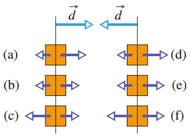

flowchart

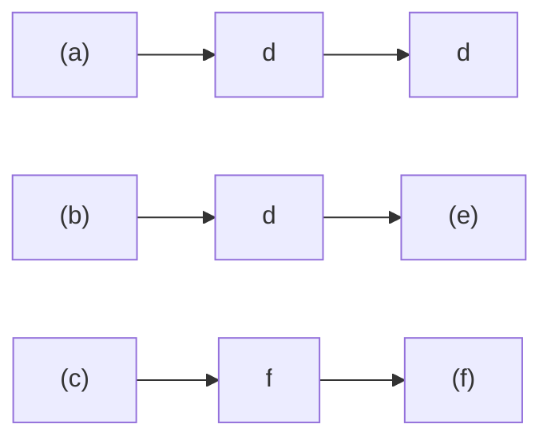

Abb. 3.F3

**4.** Abbildung 3.F4 zeigt die Werte einer Kraft ${ \vec { F } } ,$ die entlang einer x-Achse zeigt und auf ein Teilchen wirkt, das sich entlang der x-Achse bewegt. Wenn das Teilchen bei $x = 0$ aus der Ruhe startet, wie lautet dann seine Koordinate in dem Moment, in dem es (a) die größte kinetische Energie, (b) den größten Geschwindigkeitsbetrag bzw. (c) die Geschwindigkeit null besitzt? (d) In welche Richtung bewegt sich das Teilchen, nachdem es den Punkt $x = 6$ m erreicht hat?

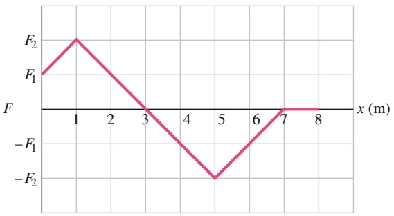

line

| x (m) | F |
| --- | --- |
| 0 | F1 |
| 1 | F2 |
| 3 | 0 |
| 5 | -F2 |
| 7 | 0 |
| 8 | 0 |

Abb. 3.F4

**5.** Abbildung 3.F5 gibt für drei verschiedene Situationen die Position einer Kiste mit Schmuggelware in Abhängigkeit von der Zeit an; die Kiste wird von den an ihr angelegten, entlang der x-Achse zeigenden Kräften über eine reibungsfreie Oberfläche gezogen. Kurve B ist eine Gerade; die anderen Linien verlaufen gekrümmt. Ordnen Sie die Situationen in absteigender Reihenfolge nach der kinetischen Energie der Kiste (a) zur Zeit $t _ { 1 }$ und (b) zur Zeit $t _ { 2 } .$ (c) Ordnen Sie die Situationen nun in absteigender Reihenfolge nach der Gesamtarbeit, welche die angelegten Kräfte während des Zeitintervalls von $t _ { 1 }$ bis $t _ { 2 }$ an der Kiste verrichten. (d) Welche der folgenden Aussagen beschreibt die Gesamtarbeit, welche die angelegten Kräfte während des Zeitintervalls von $t _ { 1 }$ bis $t _ { 2 }$ verrichten, für jede Situation am besten?

(a) Der Kiste wird Energie zugeführt.
(b) Von der Kiste wird Energie abgeführt.
(c) Die Gesamtarbeit ist null.

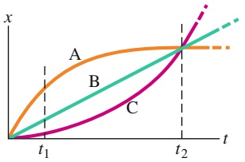

line

| Category | Description |
| --- | --- |
| A | Orange curve representing a non-linear growth function starting from origin. |
| B | Green line representing a linear growth function starting from origin. |
| C | Purple line representing a non-linear growth function starting from origin. |

Abb. 3.F5

86

---

3.8 Fragen

3

**6.** Abbildung 3.F6 zeigt vier (im selben Maßstab gezeichnete) Kurven der x-Komponente einer veränderlichen Kraft $\vec { F }$ (die entlang der x-Achse zeigt) in Abhängigkeit von der Position x eines Teilchens, auf das die Kraft wirkt. Ordnen Sie die Kurven nach der zwischen $x = 0$ und $x _ { 1 }$ von der Kraft $\vec { F }$ an dem Teilchen verrichteten Arbeit, von der positivsten zur negativsten.

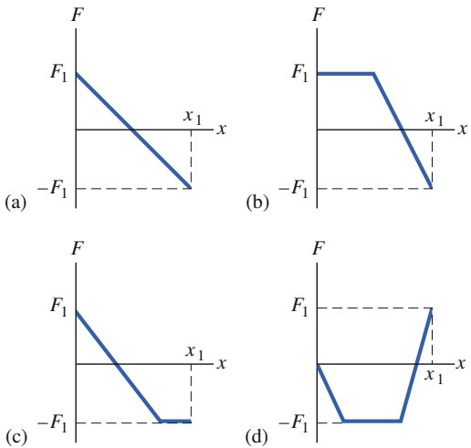

Abb. 3.F6

**7.** In Abb. 3.F7 hat ein Kind die Wahl zwischen drei reibungsfreien Rutschbahnen, auf denen es bis zum Erdboden hinunterrutschen kann. Ordnen Sie die Rutschbahnen in absteigender Reihenfolge nach der Arbeit, welche die Gravitationskraft während des Hinunterrutschens an dem Kind verrichtet.

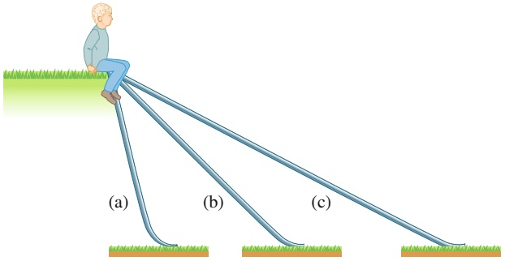

text_image

(a)
(b)
(c)

Abb. 3.F7

**8.** Sie heben eine Kiste auf ein Regal. Hängt die Kraft, die Sie auf die Kiste ausüben, (a) von der Masse der Kiste, (b) vom Gewicht der Kiste, (c) von der Höhe des Regals, (d) von der Zeit, die Sie dafür benötigen, oder (e) davon ab, ob Sie die Kiste schräg oder senkrecht hinaufheben?
**9.** Abbildung 3.F9 zeigt einen Stapel Zeitschriften, der von einem Seil eine Strecke d angehoben wird. In der Tabelle sind sechs Paare von Werten der Anfangsgeschwindigkeit $\nu _ { 0 }$ und der Endgeschwindigkeit v (in Metern pro Sekunde) aufgeführt, die der Stapel jeweils am Anfang und am Ende der Strecke d besitzt. Ordnen Sie die Paare nach der Arbeit, welche die Kraft des Seils über die Entfernung d an dem Stapel verrichtet hat (die positivste zuerst, die negativste zuletzt).

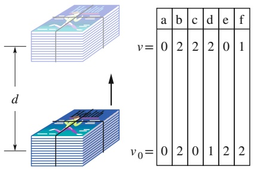

text_image

v=
a b c d e f
0 2 2 2 0 1
v₀=
0 2 0 1 2 2

Abb. 3.F9

**10.** Die Feder A ist steifer als die Feder B; d. h. $k _ { \mathrm { A } } > k _ { \mathrm { B } }$ Welche der Federkräfte verrichtet die größere Arbeit, wenn die Federn (a) um die gleiche Strecke bzw. (b) mit der gleichen angelegten Kraft zusammengedrückt werden?
**11.** Abbildung 3.F11 zeigt drei Anordnungen, in denen ein Block mit einer Anzahl von identischen Federn verbunden ist. Die Federn sind entspannt, wenn der Block wie in der Abbildung gezeigt in der Mitte zwischen den Wänden liegt. Ordnen Sie die Anordnungen absteigend nach dem Betrag der resultierenden Gesamtkraft auf den Block, wenn der Block um einen Betrag d (a) nach rechts und (b) nach links ausgelenkt wird. Ordnen Sie die Anordnungen absteigend nach der von den Federn an dem Block verrichteten Arbeit, wenn der Block um einen Betrag d (c) nach rechts und (d) nach links ausgelenkt wird.

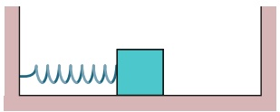

natural_image

Simple diagram of a spring attached to a block on a horizontal surface (no text or symbols)

(a)

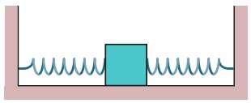

natural_image

Simple diagram of a spring-mass system with no text or symbols

(b)

Abb. 3.F11

**12.** Abbildung 3.F12 zeigt die Geschwindigkeit eines Autoskooters, der durch eine veränderliche angelegte Kraft eine Achse entlang bewegt wird, in Abhängigkeit von der Zeit. Die Zeitachse ist in sechs Abschnitte unterteilt, für die gilt: $\begin{array} { r } { \Delta t _ { 1 } = \Delta t _ { 2 } = \Delta t _ { 3 } = \Delta t _ { 6 } = 2 \Delta t _ { 4 } = \frac { 2 } { 3 } \Delta t _ { 5 } } \end{array}$ . (a) Innerhalb welcher dieser Zeitintervalle führt die angelegte Kraft Energie von dem Autoskooter ab? (b) Ordnen Sie die Zeitintervalle nach der Arbeit, welche die angelegte Kraft während des Intervalls an dem Autoskooter verrichtet (die positivste zuerst, die negativste zuletzt). (c) Ordnen Sie die Zeitintervalle nach der Rate, mit der die angelegte Kraft Energie überträgt, die größte Energieübertragung auf den Skooter zuerst, die größte Energieübertragung von dem Skooter zuletzt.

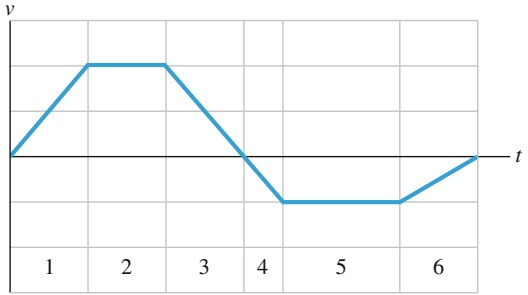

line

| t | v |
| --- | --- |
| 0 | 0 |
| 1.5 | Peak |
| 2.5 | Peak |
| 3.5 | 0 |
| 4.2 | Trough |
| 5.5 | Trough |
| 6.5 | 0 |

Abb. 3.F12

87

---

3 Kinetische Energie und Arbeit

**13.** In drei verschiedenen Situationen wird eine Dose, die sich ursprünglich in Ruhe befand, durch eine angelegte Kraft über einen reibungsfreien Fußboden geschickt. Abbildung 3.F13 zeigt die Kurven der entsprechenden Beschleunigung für die drei Situationen in Abhängigkeit von der Zeit. Ordnen Sie die Kurven in absteigender Reihenfolge nach der Arbeit, welche die angelegte Kraft während der Beschleunigungsphase verrichtet hat.

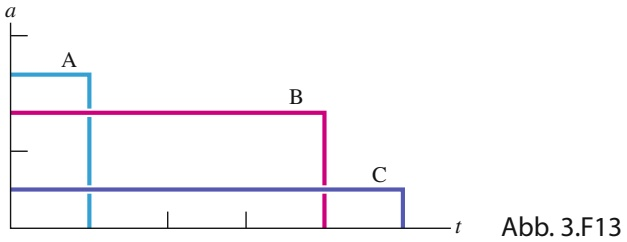

area

| Time Interval | Process A | Process B | Process C |
| --- | --- | --- | --- |
| Start to End | High | High | Low |

**14.** Abbildung 3.F14a zeigt vier Situationen, in denen eine horizontale Kraft auf denselben Block wirkt, der sich anfänglich in Ruhe befindet. Die Beträge der Kräfte sind $F _ { 2 } = F _ { 4 } = 2 F _ { 1 } = 2 F _ { 3 }$ . Die horizontale Komponente $\nu _ { x }$ der Geschwindigkeit des Blocks ist für jede der vier Situationen in Abb. 3.F14b gezeigt. (a) Welche Kurve aus Abb. 3.F14b passt zu welcher Kraft aus Abb. 3.F14a? (b) Welche Kurve aus Abb. 3.F14c (kinetische Energie K als Funktion der Zeit t) passt am besten zu welcher Kurve aus Abb. 3.F14b?

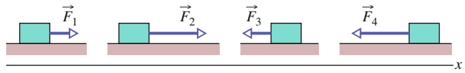

text_image

F₁
F₂
F₃
F₄
x

(a)

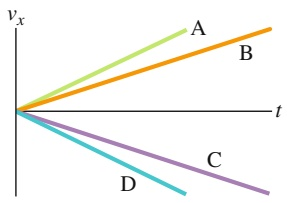

text_image

vₓ
A
B
t
C
D

(b)

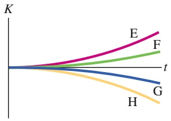

line

| Category | Trend Description |
| --- | --- |
| E | Positive growth curve |
| F | Moderate positive growth curve |
| G | Negative growth curve |
| H | Negative growth curve |

(c)

Abb. 3.F14

**15.** Ein Erdklumpen wird vom Rand einer Klippe geworfen. Welche der Kurven in Abb. 3.F15 könnte die Veränderung seiner kinetischen Energie während des Flugs zeigen?

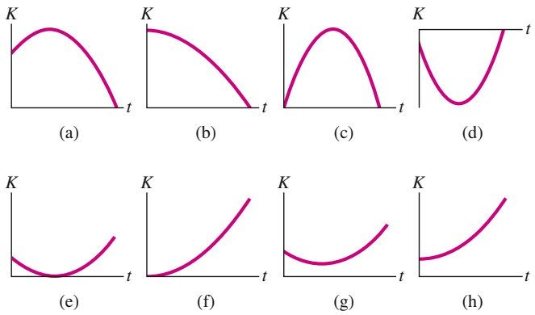

Abb. 3.F15

**16.** Gegeben sind drei Situationen, in denen eine einzige Kraft auf ein sich bewegendes Teilchen wirkt. Die Geschwindigkeiten des Teilchens im betrachteten Moment und die Kräfte sind:

(1)
(2)
(3)

Ordnen Sie die drei Situationen absteigend nach der Geschwindigkeit des Energietransfers auf das oder von dem Teilchen.

88
