# 6 Die Rotation ausgedehnter Körper

原始 PDF 第 157–180 页。

# 6 Die Rotation ausgedehnter Körper

## 6.1 Die Variablen der Rotation

## Physikalische Motivation

Wie wir schon in den vergangenen Kapiteln diskutiert haben, hat Physik viel mehr mit Bewegung zu tun als sich das Nichtphysiker oft vorstellen. Bisher haben wir vor allem Translationsbewegungen untersucht, also solche, bei denen sich ein Objekt entlang einer geraden oder gekrümmten Linie bewegt wie in Abb. 6.1a. Nun wollen wir uns Rotationsbewegungen zuwenden, bei denen sich ein Körper um eine Achse dreht, wie in Abb. 6.1b.

Rotationsbewegungen sind in Maschinen praktisch allgegenwärtig. Auch wenn Sie ein Glas oder eine Flasche mit Schraubverschluss öffnen, setzen Sie jedes Mal eine Rotationsbewegung in Gang. Und wenn Sie einen Vergnügungspark besuchen, bezahlen Sie sogar dafür, Rotationsbewegungen erleben zu dürfen. Rotation ist auch im Sport oft der Schlüssel zum Erfolg, z. B. beim Schlagen eines langen Balls beim Golf (hier muss der Ball rotieren, damit er sich länger in der Luft hält) oder bei raffinierten Freistößen im Fußball (hier bewirkt die Rotation des Balls eine Krümmung der Flugbahn, die die Bahn des Balls schwer einschätzbar macht und sogar Eckbälle direkt ins Tor lenken kann). Rotation ist aber auch im Ingenieurwesen ein entscheidendes Thema, beispielsweise wenn es um das Versagen von Bauteilen bei älteren Flugzeugen geht.

Wir beginnen unsere Diskussion der Rotation, indem wir die wesentlichen Variablen für diese Art von Bewegung definieren, genau wie wir es in Kapitel 1 für die Translation gemacht haben. Wie wir sehen werden, sind die Variablen für die Rotation ganz analog zu denen für die eindimensionale Bewegung, und wie in Kapitel 1 werden wir feststellen, dass eine konstante Beschleunigung (hier: Rotationsbeschleunigung) einen besonders wichtigen Spezialfall darstellt. Wir werden ebenfalls feststellen, dass das zweite Newtonsche Gesetz auch für Rotationsbewegungen formuliert werden kann; allerdings müssen wir hierzu eine neue Größe definieren, die an die Stelle der Kraft tritt: das Drehmoment. Auch die Arbeit und die Beziehung zwischen Arbeit und kinetischer Energie finden wir bei Rotationsbewegungen wieder, nur dass auch in diesem Fall eine neue Größe auftritt: das Trägheitsmoment, das an die Stelle der Masse tritt. Kurz gesagt – vieles von dem,

natural_image

Speed skaters competing on an ice rink during a competition (no visible text or symbols)

(a)

natural_image

Figure skater performing a high acrobatic pose in red costume (no text or symbols visible)

(b)

Abb. 6.1 Zwei Bewegungsformen auf dem Eis: (a) Beim Eisschnelllauf kommt es im Wesentlichen auf die Translation in eine vorgegebene Richtung an [Quelle: McSmit/CC-SA-3.0]. (b) Beim Eiskunstlaufen ist eine Pirouette idealerweise eine reine Rotation [Quelle: Paolo Bona/Shutterstock].

Halliday Physik für natur- und ingenieurwiss. Studiengänge, 3. Auflage. D. Halliday, R. Resnick und J. Walker. © 2020 WILEY-VCH Verlag GmbH & Co. KGaA. Published 2020 by WILEY-VCH Verlag GmbH & Co. KGaA.

143

---

6 Die Rotation ausgedehnter Körper

text_image

Drehachse
Körper
Bezugslinie
O
y
x
z

Abb. 6.2

Ein starrer Körper mit zufällig gewählter Gestalt vollführt eine reine Rotation um die z-Achse des Koordinatensystems. Die Bezugslinie steht immer senkrecht auf der Drehachse, ansonsten ist ihre Lage beliebig wählbar, aber fest; die Bezugslinie rotiert mit dem Körper.

text_image

Bezugs-
linie
y
s
r
θ
Dreh-
achse
x

Abb. 6.3

Querschnitt durch den rotierenden Körper aus Abb. 6.2, von oben gesehen. Die Querschnittsebene ist senkrecht zur Drehachse, welche nun aus der Papierebene heraus zeigt. In der dargestellten Position des Körpers schließt die Bezugslinie einen Winkel θ mit der x-Achse ein.

was wir bisher diskutiert haben, kann mit einigen kleineren Änderungen auf Rotationsbewegungen übertragen werden.

Aber Vorsicht: Obwohl eine Reihe von physikalischen Ideen hier nicht zum ersten Mal an auftritt, finden viele Studierende dieses und das nächste Kapitel sehr anspruchsvoll. Dozenten diskutieren zahlreiche Gründe, warum das so ist, zwei Ursachen werden besonders häufig genannt: (1) Es kommt eine Vielzahl von Symbolen (viele davon mit griechischen Buchstaben) auf Sie zu, und (2) sind wir aus unserem Alltag mit linearen Bewegung sehr vertraut (wir alle können problemlos durch ein Zimmer oder über die Straße gehen), Rotationen bleiben uns dagegen eher fremd (was andererseits ein Grund sein mag, dass wir bereit sind, in Vergnü- gungsparks so viel Geld für schnell rotierende Fahrgeschäfte zu bezahlen). Wenn eine Aufgabe zum Thema Rotation Ihnen wie ein Text in einer unbekannten Sprache vorkommt, dann versuchen Sie doch einmal, ihren Text in die Ihnen bekannte Sprache der eindimensionalen linearen Bewegung aus Kapitel 1 zu übersetzen. Wenn Sie z. B. eine Winkelverschiebung bestimmen sollen, dann ignorieren Sie vorübergehend das Wort „Winkel“ und probieren Sie, ob Sie die Aufgabe mit der Notation und den Ideen aus Kapitel 1 angehen können.

## 6.1.1 Die Variablen der Rotation

Gegenstand unserer Diskussion ist die Rotation eines starren Körpers um eine festgehaltene Achse. Ein **starrer Körper** besteht aus fest miteinander verbundenen Teilchen, die sich während der Rotation nicht gegeneinander verschieben. Das bedeutet, die Gestalt des Körpers ändert sich dabei nicht. Eine **feste Achse** bleibt bei der Rotation unbewegt. Nicht beschäftigen werden wir uns demnach mit Objekten wie der Sonne, deren Teilchen (Gasmoleküle usw.) nicht unbeweglich miteinander verbunden sind. Auch Körper wie eine Bowlingkugel, die auf einer Bowlingbahn rollt, gehören nicht in dieses Kapitel, denn die Achse einer solchen Kugel bewegt sich während der Rotation (tatsächlich handelt es sich hier um eine Mischung aus Translation und Rotation).

In Abb. 6.2 sehen Sie einen starren Körper mit zufällig gewählter Form, der um eine feste Achse – die **Drehachse** (**Rotationsachse**) – rotiert. Jeder Punkt des Körpers beschreibt einen Kreis, dessen Mittelpunkt auf der Drehachse liegt, und jeder Punkt überstreicht innerhalb eines bestimmten Zeitintervalls den gleichen Winkel. Bei der reinen Translation bewegt sich jeder Punkt des Körpers auf einer geraden Linie, und jeder Punkt legt in einem bestimmten Zeitraum die gleich lineare Entfernung zurück. (Im Laufe dieses Kapitels werden wir die lineare und die Kreisbewegung einander mehrmals gegenüberstellen.)

Zunächst führen wir nacheinander die Rotations-Äquivalente der linearen Grö- ßen Ort, Weg, Geschwindigkeit und Beschleunigung ein.

## Die Winkelposition

In dem Körper in Abb. 6.2 wurde eine Bezugslinie festgelegt, die senkrecht auf der Drehachse steht und mit dem Körper rotiert. Die **Winkelposition** dieser Linie entspricht dem Winkel der Linie bezüglich einer bestimmten Richtung, welcher der Nullpunkt des Winkels zugeordnet wurde. In Abb. 6.3 wird die Winkelposition θ relativ zur positiven x-Richtung gemessen. Aus der Geometrie ist uns die folgende Beziehung für den Winkel $\theta ,$ die Länge s des Kreisbogens und den Radius r des zugehörigen Kreises bekannt:

$$
\theta = \frac {s}{r}. \tag {6.1}
$$

Ein in dieser Weise gemessener Winkel wird in **Bogenmaß** (rad) angegeben; zur Angabe von Winkeln stehen außerdem die Einheit Grad und die Hilfseinheit Umdrehungen (U) zur Verfügung. Das Bogenmaß ist als Verhältnis zweier Längen eine

144

---

6.1 Die Variablen der Rotation

6

dimensionslose Zahl, das „Einheitenzeichen“ rad wird nur der Deutlichkeit halber (und nicht immer) hinzugefügt. Da der Umfang eines Kreises mit dem Radius r gleich 2πr ist, entspricht ein Vollkreis 2π rad:

$$
1 \mathrm{U} = 3 6 0 ^ {\circ} = \frac {2 \pi r}{r} = 2 \pi \mathrm{rad}, \tag {6.2}
$$

also

$$
1 \mathrm{rad} = \frac {1 8 0 ^ {\circ}}{\pi} \approx 5 7, 3 ^ {\circ} = 0, 1 5 9 \mathrm{U}. \tag {6.3}
$$

Wir setzen $\theta$ nach einer vollständigen Umdrehung der Bezugslinie nicht auf null zurück. Führt die Bezugslinie also vom Winkel null ausgehend zwei ganze Umdrehungen aus, so ist $\theta = 4 \pi$ rad usw.

Über die reine Translationsbewegung eines Körpers entlang der x-Richtung wissen wir alles, wenn wir die Zeitabhängigkeit seines Orts kennen, die Funktion x(t). Ähnlich wissen wir über die reine Rotationsbewegung eines Körpers Bescheid, wenn die Zeitabhängigkeit der Winkelposition seiner Bezugslinie bekannt ist, θ(t).

## Der Drehwinkel

Wenn sich der in Abb. 6.3 dargestellte Körper um seine Achse dreht, wie es in Abb. 6.4 gezeigt ist, so ändert sich die Winkelposition der Bezugslinie. Bei einer Änderung des Winkels von $\theta _ { 1 }$ nach $\theta _ { 2 }$ ist der **Drehwinkel** Δθ des Körpers definiert als

$$
\Delta \theta = \theta_ {2} - \theta_ {1}. \tag {6.4}
$$

Diese Definition gilt nicht nur für den starren Körper im Ganzen, sondern auch für jeden einzelnen Punkt (jedes Teilchen) in seinem Inneren, weil alle Teilchen unverrückbar miteinander verbunden sind.

Bei einer Translationsbewegung eines Körpers entlang einer x-Achse ist die Verschiebung Δx positiv oder negativ, je nachdem, ob sich der Körper in positiver oder negativer Richtung dieser Achse bewegt. Auch der Drehwinkel eines rotierenden Körpers kann positiv oder negativ sein. Dafür vereinbaren wir folgende Konvention:

Ein Drehwinkel entgegen dem Uhrzeigersinn erhält ein positives Vorzeichen, ein Drehwinkel im Uhrzeigersinn ein negatives.

## KONTROLLFRAGE 1

Wir betrachten eine Scheibe, die um ihre Mittelachse rotieren kann (wie in Abb. 6.5a). Aus welchen der folgenden Wertepaare für die Winkelposition am Anfang und am Ende eines Zeitintervalls folgt ein negativer Drehwinkel? (a) −3 rad, +5 rad, (b) −3 rad, −7 rad, (c) 7 rad, −3 rad.

## Die Winkelgeschwindigkeit

Nehmen wir an, die Bezugslinie eines rotierenden Körpers befinde sich zum Zeitpunkt $t _ { 1 }$ beim Winkel $\theta _ { 1 }$ und zum (späteren) Zeitpunkt $t _ { 2 }$ beim Winkel $\theta _ { 2 }$ (siehe Abb. 6.4). Wir definieren nun die **mittlere Winkelgeschwindigkeit** im Intervall Δt (zwischen $t _ { 1 }$ und $t _ { 2 } )$ als

$$
\omega_ {\mathrm{gem}} = \frac {\theta_ {2} - \theta_ {1}}{t _ {2} - t _ {1}} = \frac {\Delta \theta}{\Delta t} \tag {6.5}
$$

mit $\Delta \theta$ als dem während des Intervalls Δt überstrichenen Drehwinkel (d. h. der Winkelverschiebung).

text_image

y
Bezugslinie
bei t₂
Δθ
bei t₁
O
x
θ₁
θ₂
Drehachse

Abb. 6.4 Die Bezugslinie des in Abb. 6.2 und 6.3 gezeigten Körpers befindet sich zur Zeit $t _ { 1 }$ an der Winkelposition $\theta _ { 1 } ,$ zum (späteren) Zeitpunkt $t _ { 2 }$ an $\theta _ { 2 }$ . Die Größe $\Delta \theta = \theta _ { 2 } - \theta _ { 1 }$ ist der während des Intervalls $\Delta t = t _ { 2 } - t _ { 1 }$ überstrichene Drehwinkel. Der Körper selbst ist nicht eingezeichnet.

145

---

6 Die Rotation ausgedehnter Körper

Die **momentane Winkelgeschwindigkeit** $\omega ,$ mit der wir uns in der Regel beschäftigen werden, ist der Grenzwert des Verhältnisses in Gl. 6.5 für ein unendlich kurzes Zeitintervall:

$$
\omega = \lim _ {\Delta t \to 0} \frac {\Delta \theta}{\Delta t} = \frac {\mathrm{d} \theta}{\mathrm{d} t}. \tag {6.6}
$$

Ist die Funktion $\theta ( t )$ bekannt, so können wir sie nach der Zeit ableiten, um ω zu ermitteln.

Auch die Gln. 6.5 und 6.6 gelten nicht nur für den starren Körper im Ganzen, sondern auch für jedes einzelne seiner Teilchen. In der Regel gibt man die Winkelgeschwindigkeit in den Einheiten rad pro Sekunde, rad/s, oder Umdrehungen pro Sekunde, U/s, an. Ein anderes Maß der Winkelgeschwindigkeit kennen Sie, wenn Sie schon als DJ gearbeitet haben, vielleicht von Plattenspielern, deren Plattenteller sich mit $, 33 ^ { 1 } /  _ { 3 }$ rpm“ oder „45 rpm“ drehten (rpm bedeutet revolutions per minute, auf Deutsch entsprechend U/min).

Bei der Translationsbewegung eines Teilchens entlang einer x-Achse geben wir die Geschwindigkeit entweder als positive oder als negative Größe an, je nachdem, ob sich das Teilchen in positiver oder negativer x-Richtung bewegt. Analog ist die Winkelgeschwindigkeit eines rotierenden starren Körpers positiv oder negativ, je nachdem, ob sich der Körper gegen den Uhrzeigersinn (positiv) oder im Uhrzeigersinn (negativ) dreht.

## Die Winkelbeschleunigung

Ist die Winkelgeschwindigkeit eines rotierenden Körpers nicht konstant, so ist seine Winkelbeschleunigung verschieden von null. Es seien $\omega _ { 1 }$ und $\omega _ { 2 }$ die Winkelge schwindigkeiten des Körpers zu den Zeitpunkten $t _ { 1 }$ und $t _ { 2 } .$ Dann definieren wir die **mittlere Winkelbeschleunigung** im Intervall zwischen $t _ { 1 }$ und $t _ { 2 }$ als

$$
\alpha_ {\mathrm{gem}} = \frac {\omega_ {2} - \omega_ {1}}{t _ {2} - t _ {1}} = \frac {\Delta \omega}{\Delta t} \tag {6.7}
$$

mit Δω als $\ddot { \mathrm { A } }$ nderung der Winkelgeschwindigkeit während des Intervalls Δt. Die **momentane Winkelbeschleunigung**, mit der wir uns meist beschäftigen werden, ist der Grenzwert dieser Größe für ein unendlich kleines Intervall $\Delta t ;$

$$
\alpha = \lim _ {\Delta t \to 0} \frac {\Delta \omega}{\Delta t} = \frac {\mathrm{d} \omega}{\mathrm{d} t}. \tag {6.8}
$$

Wieder gelten die Gln. 6.7 und 6.8 nicht nur für den ganzen Körper, sondern auch für jedes einzelne seiner Teilchen. Angegeben wird die Winkelbeschleunigung in den Einheiten rad $/ \mathrm { s } ^ { 2 }$ oder $\mathrm { U } / s ^ { 2 }$

## 6.1.2 Sind Winkelgrößen Vektoren?

Ort, Geschwindigkeit und Beschleunigung eines einzelnen Teilchens können wir mithilfe von Vektoren beschreiben. Kann sich das Teilchen nur entlang einer geraden Linie bewegen, müssen wir nicht notwendigerweise auf Vektoren zurückgreifen: Dem Teilchen stehen nur zwei Richtungen zur Verfügung, die wir einfach mit Plus und Minus bezeichnen können.

Ähnlich ist die Situation eines rotierenden starren Körpers. Auch hier kommen nur zwei Bewegungsrichtungen infrage (im Uhrzeigersinn bzw. entgegengesetzt dazu), denen wir das Plus- bzw. das Minuszeichnen zuordnen. Ist es möglich (und sinnvoll), den Drehwinkel, die Winkelgeschwindigkeit und die Winkelbeschleunigung eines rotierenden Körpers auch als Vektoren aufzufassen? Die Antwort lautet „zweimal $\mathrm { j a } ^ { \alpha }$ (beachten Sie allerdings die weiter unten erläuterte Besonderheit!).

Betrachten wir beispielsweise die Winkelgeschwindigkeit. In Abb. 6.5a sehen Sie eine Schallplatte, die sich mit der konstanten Winkelgeschwindigkeit ω (etwa $3 3 ^ { 1 } / _ { 3 }$

146

---

6.1 Die Variablen der Rotation

6

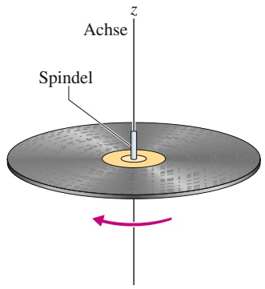

text_image

Achse
Spindel
z

(a)

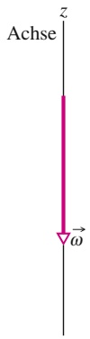

(b)

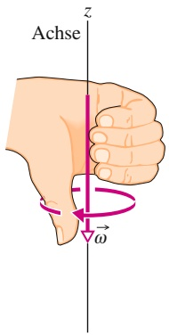

text_image

Achse
z
ω

(c)

## Abb. 6.5

(a) Eine Schallplatte dreht sich um eine Achse, die mit der Spindel des Plattentellers zusammenfällt. (b) Die Winkelgeschwindigkeit der rotierenden Schallplatte kann als Vektor ω⃗ dargestellt werden, welcher auf der Drehachse liegt und in diesem Fall nach unten zeigt. (c) Die Richtung des Vektors ω⃗ ermitteln wir mithilfe der Rechte-Hand-Regel: Die Finger der rechten Hand krümmen sich um die Drehachse und zeigen in Drehrichtung. Dann weist ω⃗ in die gleiche Richtung wie der ausgestreckte Daumen.

Umdrehungen pro Minute) im Uhrzeigersinn auf einem Plattenteller dreht. Die Winkelgeschwindigkeit lässt sich als Vektor ω⃗ darstellen, der in Richtung der Drehachse zeigt (Abb. 6.5b). Die Länge des Vektors geben wir auf einer geeigneten Skala an (z. B. 1 mm je 1 U/min). Zur Festlegung der Richtung von ω⃗ verwenden wir die **Rechte-Hand-Regel**: Krümmen Sie die Finger Ihrer rechten Hand um die Drehachse des rotierenden Körpers (Abb. 6.5c), wobei die Finger in die Drehrichtung weisen. Dann strecken Sie Ihren Daumen aus; er zeigt in die gleiche Richtung wie der Vektor der Winkelgeschwindigkeit. Dreht sich die Schallplatte in die entgegengesetzte Richtung wie in Abb. 6.5a, dann zeigt ω⃗ nach oben, wovon Sie sich mithilfe Ihrer rechten Hand leicht überzeugen können. Auf diese Weise gibt der Vektor sowohl die „Stärke“ der Rotation also auch die Lage der Drehachse an, die Definition ist also tatsächlich sinnvoll.

Winkelgrößen als Vektoren aufzufassen ist etwas gewöhnungsbedürftig. Instinktiv erwarten wir, dass sich ein Körper in Richtung des Geschwindigkeitsvektors bewegt, was hier nicht der Fall ist: Der starre Körper rotiert um die Richtung dieses Vektors. Soweit es reine Rotationen betrifft, definiert der Vektor ω⃗ die Drehachse, nicht die Bewegungsrichtung. Damit definiert er, wie gesagt, die Rotationsbewegung vollständig. Außerdem erfüllt er alle in der Vektorrechnung gültigen Regeln (vgl. Anhang D). Dies gilt ebenfalls für den Vektor der Winkelbeschleunigung α⃗. Zur Unterscheidung von gewöhnlichen Vektoren bezeichnet man diese Größen auch als axiale Vektoren.

In diesem Kapitel sprechen wir nur über Rotationen um eine festgelegte Achse. In diesen Fällen benötigen wir die Vektordarstellung von Winkelgeschwindigkeit und -beschleunigung nicht unbedingt, sondern wir können beide Größen durch ihre Beträge ω und α darstellen und die Richtung mit einem Minuszeichen (im Uhrzeigersinn) oder Pluszeichen (entgegengesetzt dazu) angeben. Das Pluszeichen wird meist nicht ausgeschrieben.

Vorsicht geboten ist bei der Behandlung des Drehwinkels: Er darf (falls er nicht sehr klein ist) nicht als Vektor betrachtet werden, obwohl wir ihm einen Betrag und eine Richtung zuordnen können, wie wir es in Abb. 6.5 für die Winkelgeschwindigkeit getan haben. Der Grund dafür ist folgender: Damit man eine Größe als Vektor darstellen kann, muss sie auch die Gesetze der Vektoraddition befolgen. Eines von ihnen besagt, dass sich die Reihenfolge, in der man zwei Vektoren addiert, nicht auf das Ergebnis auswirken darf. Auf den Drehwinkel trifft das nicht zu, wie an einem Beispiel gezeigt werden soll.

Betrachten wir Abb. 6.6. Ein waagerecht liegendes Buch wird zweimal um je 90° gedreht, erst in der Reihenfolge gemäß Abb. 6.6a, dann in der Reihenfolge gemäß Abb. 6.6b. Die Drehwinkel sind also gleich, die Reihenfolgen verschieden. Wie Sie sich überzeugen können, erhält man zwei verschiedene Orientierungen des Buchs. Die Addition zweier Drehwinkel hängt demnach von der Reihenfolge der Summanden ab, weshalb es sich nicht um Vektoren handeln kann.

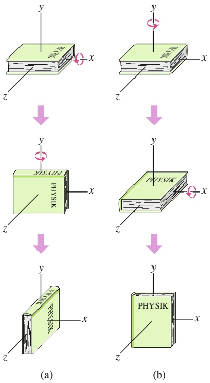

flowchart

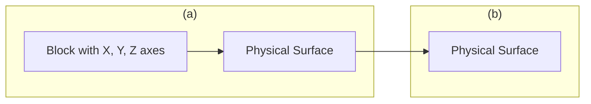

Abb. 6.6

Ausgehend von der waagerechten Anfangslage (oben) wird ein Buch zweimal um 90° gedreht, und zwar (a) erst um die waagerechte x-Achse, dann um die senkrechte y-Achse und (b) in umgekehrter Reihenfolge.

147

---

6 Die Rotation ausgedehnter Körper

## 6.2 Rotation mit konstanter Winkelbeschleunigung

## Lernziele

Nach dem Durcharbeiten dieses Abschnitts sollten Sie in der Lage sein, . . .

• die Beziehungen zwischen Winkelposition, Drehwinkel, Winkelgeschwindig keit, Winkelbeschleunigung und Zeit für Bewegungen mit konstanter Winkelbeschleunigung anzugeben und anzuwenden.

## Schlüsselideen

• Der Fall konstanter Winkelbeschleunigung $( \alpha = \mathrm { c o n s t . } )$ ist ein wichtiger Spezialfall der Rotationsbewegung. Die zugehörigen kinematischen Gleichungen lauten

$$
\begin{array}{l} \omega = \omega_ {0} + \alpha t, \\ \theta - \theta_ {0} = \omega_ {0} t + \frac {1}{2} \alpha t ^ {2}, \\ \omega^ {2} = \omega_ {0} ^ {2} + 2 \alpha (\theta - \theta_ {0}), \\ \theta - \theta_ {0} = \frac {1}{2} (\omega_ {0} + \omega) t, \\ \theta - \theta_ {0} = \omega t - \frac {1}{2} \alpha t ^ {2}. \\ \end{array}
$$

## 6.2.1 Rotation mit konstanter Winkelbeschleunigung

Bewegungen mit konstanter linearer Beschleunigung (z. B. das Fallen eines Körpers) sind wichtige Spezialfälle der reinen Translation. Tabelle 1.1 fasste einige der hierfür geltenden Gleichungen zusammen.

Bewegungen mit konstanter Winkelbeschleunigung sind analog Spezialfälle der reinen Rotation, für die ähnliche Gleichungen Gültigkeit besitzen. Wir werden diese Beziehungen hier nicht herleiten, sondern sie lediglich den Gleichungen für die Translation gegenüberstellen, wobei die linearen Größen gegen die Winkelgrößen ausgetauscht werden. Beide Sätze von Gleichungen finden Sie in Tab. 6.1 (Gln. 1.9 bis 1.16 sowie Gln. 6.9 bis 6.13).

Wie Sie sich erinnern werden, sind die Gln. 1.9 und 1.13 die grundlegenden Be ziehungen für Bewegungen mit konstanter linearer Beschleunigung. Alle anderen aufgeführten Zusammenhänge lassen sich daraus herleiten. In ähnlicher Weise grundlegend sind die Gln. 6.9 und 6.10 für Bewegungen mit konstanter Winkelbeschleunigung. Um eine Aufgabe zu lösen, die eine solche Bewegung beinhaltet,

TABELLE 6.1:

Bewegungsgleichungen für konstante Linear- bzw. Winkelbeschleunigung.

<table><tr><td>Gl.</td><td>Gleichung für beschleunigte Translation</td><td colspan="2">unbekannte Variable</td><td>Gleichung für beschleunigte Rotation</td><td>Gl.</td></tr><tr><td>1.9</td><td> $\nu = \nu_0 t + at$ </td><td> $x - x_0$ </td><td> $\theta - \theta_0$ </td><td> $\omega = \omega_0 + \alpha t$ </td><td>6.9</td></tr><tr><td>1.13</td><td> $x - x_0 = \nu_0 t + \frac{1}{2} at^2$ </td><td> $\nu$ </td><td> $\omega$ </td><td> $\theta - \theta_0 = \omega_0 t + \frac{1}{2} \alpha t^2$ </td><td>6.10</td></tr><tr><td>1.14</td><td> $\nu^2 = \nu_0^2 + 2a(x - x_0)$ </td><td> $t$ </td><td> $t$ </td><td> $\omega^2 = \omega_0^2 + 2\alpha(\theta - \theta_0)$ </td><td>6.11</td></tr><tr><td>1.15</td><td> $x - x_0 = \frac{1}{2} (\nu_0 + \nu)t$ </td><td> $a$ </td><td> $\alpha$ </td><td> $\theta - \theta_0 = \frac{1}{2} (\omega_0 + \omega)t$ </td><td>6.12</td></tr><tr><td>1.16</td><td> $x - x_0 = \nu t - \frac{1}{2} at^2$ </td><td> $\nu_0$ </td><td> $\omega_0$ </td><td> $\theta - \theta_0 = \omega t - \frac{1}{2} \alpha t^2$ </td><td>6.13</td></tr></table>

148

---

6.3 Beziehungen zwischen den Variablen für lineare Bewegung und Rotation

6

brauchen Sie nur diejenige Gleichung aus der Liste auszuwählen, deren Unbekann te der in der Aufgabe gefragten Variable entspricht. Sie sollten allerdings versuchen, mit den Gln. 6.9 und 6.10 auszukommen, wie es in Beispielaufgabe 6.4 im Übungsbuch vorgeführt wird.

## KONTROLLFRAGE 2

Die Winkelposition θ(t) eines rotierenden Körpers sei gegeben durch (a) $\theta = 3 t { - 4 } ,$ (b) $\theta = - 5 \bar { t ^ { 3 } } + 4 t ^ { 2 } + 6 , ( \mathrm { c } ) \theta = 2 / t ^ { 2 } - 4 / t .$ und (d) $\theta = 5 t ^ { 2 } - 3$ . Auf welche dieser Situationen können die in Tab. 6.1 angegebenen Gleichungen angewendet werden?

## 6.3 Beziehungen zwischen den Variablen für lineare Bewegung und Rotation

## Lernziele

Nach dem Durcharbeiten dieses Abschnitts sollten Sie in der Lage sein, . . .

für einen starren Körper, der sich um eine feste Achse dreht, Beziehungen zwischen den Winkelvariablen des Körpers (Winkelposition, Winkelgeschwindigkeit und Winkelbeschleunigung) und den linearen Variablen (Position, Geschwindigkeit und Beschleunigung) eines Teilchens an einer beliebigen Position innerhalb des Körpers anzugeben,
tangentiale und radiale Beschleunigungen zu unterscheiden und beide sowohl für eine Erhöhung als auch für eine Abnahme der Winkelgeschwindigkeit in einer Skizze eines um eine Achse rotierenden Körpers für ein beliebiges Teilchen innerhalb des Körpers einzeichnen zu können.

## Schlüsselideen

• Ein Punkt in einem starren rotierenden Körper im senkrechten Abstand r von der Drehachse bewegt sich auf einer Kreisbahn mit Radius r um diese Achse. Wenn der Körper sich um einen Winkel θ dreht, bewegt sich der Punkt entlang eines Kreisbogens der Länge

$$
s = \theta r \quad (\theta \text {im Bogenma} \beta)
$$

• Die lineare Geschwindigkeit v⃗ eines solchen Punkts verläuft tangential zu diesem Kreis; der Betrag v seiner linearen Geschwindigkeit ist

$$
\nu = \omega r \quad (\omega \text {im Bogenma} \beta),
$$

wobei ω die Winkelgeschwindigkeit (in rad/s) des Körpers und damit auch des Punkts ist.

• Die lineare Beschleunigung a⃗ des Punkts besitzt sowohl tangentiale als auch radiale Komponenten. Die tangentiale Komponente ist

$$
\alpha_ {\mathrm{t}} = \alpha r \qquad (\text {Bogenma} \beta),
$$

wobei α der Betrag der Winkelbeschleunigung (in rad/s2) des Körpers ist. Die radiale Komponente von a⃗ ist

$$
a _ {\mathrm{r}} = \frac {\nu^ {2}}{r} = \omega^ {2} r \qquad (\text {Bogenmaß}).
$$

• Bei einer gleichförmigen Kreisbewegung ist die Periode T der Bewegung für den Punkt und den Körper

$$
T = \frac {2 \pi r}{\nu} = \frac {2 \pi}{\omega} \qquad (\text {Bogenmaß}).
$$

149

---

6 Die Rotation ausgedehnter Körper

## 6.3.1 Beziehungen zwischen den Variablen für lineare Bewegung und Rotation

In Abschn. 1.10 diskutierten wir die gleichförmige Kreisbewegung: Ein Teilchen bewegt sich mit der konstanten Geschwindigkeit v auf einer Kreisbahn um eine Achse. Rotiert ein starrer Körper, etwa ein Karussell, um eine Achse, so beschreibt jedes seiner Teilchen eine derartige Kreisbahn. Da die Teilchen unbeweglich miteinander verbunden sind, benötigen sie für einen vollständigen Umlauf alle die gleiche Zeit; anders ausgedrückt, alle Teilchen bewegen sich mit gleicher Winkelgeschwindigkeit ω.

Je größer jedoch der Abstand eines Teilchens von der Drehachse ist, desto grö- ßer ist auch der Umfang seiner Kreisbahn – das bedeutet, umso größer muss seine lineare Geschwindigkeit v sein. Sie können diesen Zusammenhang nachprüfen, wenn Sie Karussell fahren: Gleichgültig, wie weit Ihr Platz von der Mitte des Karussells entfernt ist, Sie bewegen sich stets mit der gleichen Winkelgeschwindigkeit. Ihre lineare Geschwindigkeit nimmt hingegen merklich zu, wenn Sie nach außen rücken.

Häufig benötigt man Beziehungen zwischen den Variablen s, v und a für die lineare Bewegung eines Teilchens innerhalb eines rotierenden Körpers und den Variablen θ, ω und α für die Rotation des gesamten Körpers. Der Zusammenhang zwischen beiden Variablensätzen ist durch r gegeben, den senkrechten (d. h. entlang einer Senkrechten zur Achse gemessenen) Abstand des betreffenden Punkts von der Rotationsachse. Gleichzeitig ist r der Radius der Kreisbahn, die das einzelne Teilchen um die Achse beschreibt.

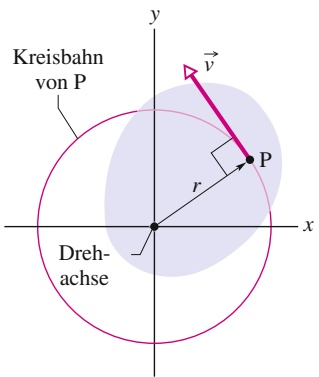

text_image

Kreisbahn
von P
Dreh-
achse
P
y
x
r
v

(a)

## Der Ort

Überstreicht die Bezugslinie eines starren Körpers einen Drehwinkel θ, so bewegt sich ein Punkt im Abstand r von der Drehachse um eine Strecke s entlang eines Kreisbogens; s ist gegeben durch Gl. 6.1:

$$
s = \theta r. \tag {6.14}
$$

Vorsicht: Diese Beziehung zwischen einer linearen und einer Rotationsvariablen gilt nur, wenn der Winkel θ in Bogenmaß angegeben wird. (Tatsächlich ist Gl. 6.14 die Definition der Winkelmessung in Bogenmaß!)

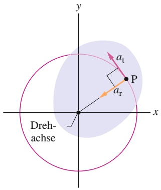

text_image

y
P
a_t
a_r
Drehachse
x

(b)

## Die Geschwindigkeit

Die Ableitung von Gl. 6.14 nach der Zeit (bei konstantem r) liefert

$$
\frac {\mathrm{d} s}{\mathrm{d} t} = \frac {\mathrm{d} \theta}{\mathrm{d} t} r.
$$

Wie Sie sofort bemerken werden, ist ds∕dt der Betrag der linearen Geschwindig keit des betrachteten Punkts, und $\mathrm { d } \theta / \mathrm { d } t$ ist die Winkelgeschwindigkeit ω des rotierenden Körpers. Also gilt

$$
\nu = \omega r. \tag {6.15}
$$

Der rotierende Körper aus Abb. 6.2 von oben im Querschnitt gesehen.
Jeder Punkt (z. B. P) bewegt sich auf einer Kreisbahn um die Drehachse. (a) Die lineare Geschwindig-
keit ⃗v jedes Punkts zeigt in Richtung der Tangente an die Kreisbahn in diesem Punkt. (b) Die lineare Beschleunigung eines Punkts hat in der Regel zwei Komponenten, eine radiale $( a _ { \mathrm { r } } )$ und eine tangentiale $( a _ { \mathrm { t } } )$

Auch hier ist Vorsicht geboten: Die Winkelgeschwindigkeit ω ist in Bogenmaß anzugeben.

Gleichung 6.15 besagt Folgendes: Während die Winkelgeschwindigkeit ω aller Punkte innerhalb eines starren Körpers gleich ist, nimmt die lineare Geschwindigkeit v mit dem Abstand r von der Drehachse zu. Abbildung 6.7a führt Ihnen vor Augen, dass die lineare Geschwindigkeit stets tangential zur Kreisbahn des jeweiligen Punkts gerichtet ist.

150

---

6.3 Beziehungen zwischen den Variablen für lineare Bewegung und Rotation

6

Ist die Winkelgeschwindigkeit ω eines starren Körpers konstant, so ist gemäß Gl. 6.15 auch die lineare Geschwindigkeit jedes seiner Punkte konstant. Das bedeutet, alle Punkte bewegen sich gleichförmig auf Kreisbahnen. Die Periode T der Kreisbewegung jedes einzelnen Punkts und des starren Körpers insgesamt ist gegeben durch Gl. 1.41:

$$
T = \frac {2 \pi r}{\nu}. \tag {6.16}
$$

In Worten besagt diese Gleichung: Die Zeit für einen vollständigen Umlauf eines Punkts ist gegeben durch die Länge der entsprechenden Kreisbahn 2πr geteilt durch die Geschwindigkeit, mit der diese Strecke zurückgelegt wird. Setzen wir v aus Gl. 6.15 ein und kürzen $r ,$ so ergibt sich

$$
T = \frac {2 \pi}{\omega}. \tag {6.17}
$$

Diese (wieder nur in Bogenmaß gültige!) Gleichung besagt, dass die Zeit für einen Umlauf gegeben ist durch den Drehwinkel $2 \pi ,$ der dabei überstrichen wird, geteilt durch die Winkelgeschwindigkeit, mit welcher der Drehwinkel durchlaufen wird.

## Die Beschleunigung

Die Ableitung von Gl. 6.15 nach der Zeit (wiederum bei konstantem r) liefert

$$
\frac {\mathrm{d} \nu}{\mathrm{d} t} = \frac {\mathrm{d} \omega}{\mathrm{d} t} r. \tag {6.18}
$$

Hier stoßen wir auf eine Schwierigkeit. In Gl. 6.18 steht der Ausdruck dv∕dt nur für den Teil der linearen Beschleunigung, der für die Änderung des Betrags v der linearen Geschwindigkeit ⃗v sorgt. Wie ⃗v selbst wirkt dieser Teil der Beschleunigung tangential zur Kreisbahn des fraglichen Punkts, weshalb wir ihn als tangentiale Komponente $a _ { \mathrm { t } }$ der linearen Beschleunigung bezeichnen:

$$
a _ {\mathrm{t}} = \alpha r \tag {6.19}
$$

mit $\alpha = \mathsf { d } \omega / \mathsf { d } t .$ (Die Winkelbeschleunigung α in Gl. 6.19 muss in Bogenmaß angegeben werden.)

Zusätzlich besitzt jedes Teilchen, das sich auf einer Kreisbahn bewegt, Gl. 1.40 zufolge eine radiale Komponente der linearen Beschleunigung $\alpha _ { \mathrm { r } } = \nu ^ { 2 } / r$ (radial zur Achse gerichtet). Diese Komponente ist für Änderungen der Richtung von $\vec { \nu }$ verantwortlich. Wir setzen v aus Gl. 6.15 ein und schreiben für die radiale Komponente:

$$
a _ {\mathrm{r}} = \frac {\nu^ {2}}{r} = \omega^ {2} r. \tag {6.20}
$$

Wie Abb. 6.7b veranschaulicht, besteht die lineare Beschleunigung eines Punkts innerhalb eines rotierenden starren Körpers im Allgemeinen also aus zwei Komponenten. Die radial nach innen gerichtete Komponente $a _ { \mathrm { r } }$ (Gl. 6.20) ist stets von null verschieden, wenn die Winkelgeschwindigkeit des Körpers von null verschieden ist. Die tangentiale Komponente $a _ { \mathrm { t } }$ (Gl. 6.19) ist von null verschieden, wenn die Winkelbeschleunigung von null verschieden ist.

## KONTROLLFRAGE 3

Eine Fliege sitzt auf dem Rand eines rotierenden Karussells. Die Winkelgeschwin digkeit des Systems Fliege–Karussell ist konstant. Ist (a) die Radialbeschleunigung und (b) die Tangentialbeschleunigung der Fliege verschieden von null? Sind (c) Radialbeschleunigung und (d) Tangentialbeschleunigung der Fliege verschieden von null, während das Karussell bremst?

151

---

6 Die Rotation ausgedehnter Körper

## LÖSUNGSSTRATEGIEN

**Strategie 1: Einheiten für die Variablen der Rotation** Von Gl. 6.1 $( \theta = s / r )$ a n haben wir alle Winkelgrößen, die gemeinsam mit linearen Größen in Gleichungen auftreten, in Bogenmaß angegeben (Drehwinkel in Radiant bzw. rad, Winkelgeschwindigkeiten in rad/s oder rad/min, Winkelbeschleunigungen in rad $/ s ^ { 2 }$ oder rad/min2). Dies gilt insbesondere für die Gln. 6.14–6.15, 6.17, 6.19 und 6.20. Die einzigen Ausnahmen von dieser Forderung bilden Gleichungen, in denen ausschließlich winkelbezogene Größen auftreten, etwa die Gln. 6.9–6.13 in Tab. 6.1. Hier steht es Ihnen frei, Winkel in Grad oder Umdrehungen anzugeben statt in Bogenmaß, solange Sie die Einheiten konsistent verwenden.

Kommen in einer Gleichung Winkel in Bogenmaß vor, so müssen Sie die „dimensionslose“ Einheit rad während des Rechenwegs nicht unbedingt mitnehmen, wie es bei anderen Einheiten erforderlich ist – eigentlich ist der Winkel im Bogenmaß einfach nur eine Zahl. Orientieren Sie sich einfach am Kontext.

## 6.4 Die kinetische Energie der Rotation

## Lernziele

Nach dem Durcharbeiten dieses Abschnitts sollten Sie in der Lage sein, . . .

• das Trägheitsmoment eines Teilchens für die Rotation um eine Achse zu bestimmen,
• das Trägheitsmoment eines Systems von Teilchen für die Rotation um eine gemeinsame Achse zu bestimmen,
• die kinetische Energie der Rotation eines Körpers aus seinem Trägheitsmoment und seiner Winkelgeschwindigkeit zu berechnen.

## Schlüsselideen

• Die kinetische Energie eines starren Körpers, der um eine feste Achse rotiert, ist

$$
K = \frac {1}{2} I \omega^ {2} \qquad (\text {Bogenmaß}),
$$

wobei I das Trägheitsmoment des Körpers ist, das für ein System von diskreten Teilchen definiert ist durch

$$
I = \sum m _ {i} r _ {i} ^ {2}.
$$

## 6.4.1 Die kinetische Energie der Rotation

Das schnell rotierende Blatt einer Kreissäge besitzt infolge dieser Drehbewegung ganz ohne Zweifel kinetische Energie. Wie können wir diese Energie formulieren? Wenden wir die gewohnte Formel $\tilde { K } = { \textstyle { \frac { 1 } { 2 } } } m \nu ^ { 2 }$ auf das Sägeblatt als Ganzes an, so erhalten wir lediglich die kinetische Energie des Schwerpunkts – und diese ist gleich null.

Stattdessen müssen wir das Sägeblatt (und jeden anderen rotierenden starren Körper) als Anordnung von Teilchen mit verschiedenen Geschwindigkeiten betrachten. Wir können dann die kinetischen Energien aller Teilchen aufsummieren und erhalten daraus die kinetische Gesamtenergie des Körpers. Formal bedeutet dies

$$
K = \frac {1}{2} m _ {1} \nu_ {1} ^ {2} + \frac {1}{2} m _ {2} \nu_ {2} ^ {2} + \frac {1}{2} m _ {3} \nu_ {3} ^ {2} + \dots ,
$$

152

---

6.4 Die kinetische Energie der Rotation

6

also

$$
K = \sum \frac {1}{2} m _ {i} v _ {i} ^ {2}, \tag {6.21}
$$

mit $m _ { i }$ als Masse der i-ten Teilchens und $\nu _ { i }$ als dessen Geschwindigkeit. Summiert wird über alle Teilchen, die der Körper enthält.

Bei der Anwendung von Gl. 6.21 haben wir ein wesentliches Problem: $\nu _ { i }$ ist nicht für alle Teilchen gleich groß. Die Lösung ist, v aus Gl. 6.15 $( \nu = \omega r )$ einzusetzen:

$$
K = \sum \frac {1}{2} m _ {i} (\omega r _ {i}) ^ {2} = \frac {1}{2} \left(\sum m _ {i} r _ {i} ^ {2}\right) \omega^ {2}, \tag {6.22}
$$

denn ω ist für alle Teilchen gleich.

Der Klammerausdruck auf der rechten Seite von Gl. 6.22 gibt an, wie die Masse des rotierenden Körpers um die Drehachse verteilt ist. Wir nennen diese Größe das **Trägheitsmoment** I des Körpers bezüglich der jeweiligen Achse. Für einen bestimmten starren Körper und eine bestimmte Achse ist I eine Konstante. (Ohne die Angabe dieser Achse ist ein Wert von I physikalisch sinnlos!)

Wir schreiben also für das Trägheitsmoment

$$
I = \sum m _ {i} r _ {i} ^ {2}. \tag {6.23}
$$

und setzen dies in Gl. 6.22 ein, wodurch sich die gesuchte Beziehung für die kinetische Energie ergibt:

$$
K = \frac {1}{2} I \omega^ {2}. \tag {6.24}
$$

Weil wir bei der Herleitung von Gl. 6.24 auf die Beziehung $\nu = \omega r$ zurückgegriffen haben, muss ω in Bogenmaß angegeben werden. Die SI-Einheit von I ist Kilogramm mal Quadratmeter $( \mathrm { k g } \cdot \mathrm { m } ^ { 2 } )$

Gleichung 6.24 gibt die kinetische Energie eines starren Körpers bei der reinen Rotation an und ist damit das Analogon zu der Beziehung $\bar { K } = { \textstyle \frac { 1 } { 2 } } M \nu _ { S } ^ { 2 }$ für die kinetische Energie eines starren Körpers bei der reinen Translation. In beiden Formeln findet sich der Faktor 1/2. An die Stelle der Masse M tritt in der Gleichung für die Rotation das Trägheitsmoment $I ,$ das die Masse und deren Verteilung in sich vereint. Schließlich enthalten beide Gleichungen eine quadratische Geschwindigkeit (der Translation bzw. Rotation). Die kinetische Energie der Translation unterscheidet sich nicht von der kinetischen Energie der Rotation – wir haben lediglich, in Abhängigkeit von der Bewegungsform, verschiedene Ausdrücke für dieselbe Energieform.

Wie bereits bemerkt, fließt in das Trägheitsmoment eines Körpers nicht nur seine Masse, sondern auch deren Verteilung ein. Ein Beispiel dafür, das Sie sofort nachvollziehen können, ist folgendes: Lassen Sie einen länglichen Gegenstand (eine Stange, einen Holzstab oder etwas Ähnliches) erst um seine Längs-, dann um seine Querachse rotieren (Abb. 6.8a bzw. b). Die Masse des Gegenstands ändert sich dabei offensichtlich nicht, aber mit Sicherheit empfinden Sie die erste Rotation als viel leichter. Die Masse befindet sich in diesem Fall näher an der Rotationsachse als im zweiten Fall. Folglich ist das Trägheitsmoment des Stabs bei der Rotation um die Längsachse deutlich kleiner als bei der Rotation um die Querachse. Je kleiner sein Trägheitsmoment ist, desto leichter lässt sich ein Körper drehen.

## KONTROLLFRAGE 4

Die nebenstehende Zeichnung zeigt drei kleine Kugeln, die sich um eine senkrechte Achse drehen. Gegeben ist jeweils der senkrechte Abstand zwischen der Achse und dem Mittelpunkt der Kugel. Ordnen Sie die Kugeln nach ihrem Trägheitsmoment bezüglich dieser Achse, beginnend mit dem größten Wert.

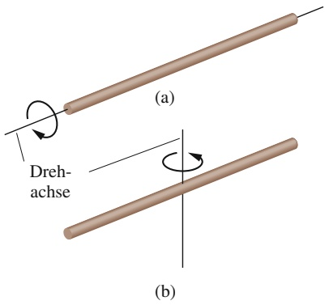

text_image

(a)
Drehachse
(b)

Abb. 6.8

Ein langer Stab lässt sich viel leichter um seine Längsachse drehen (a) als um seine Querachse (b). Der Grund dafür ist, dass die Masse in (a) näher an der Drehachse liegt als in (b).

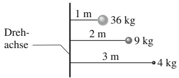

bubble

| Position | Distance (m) | Weight (kg) |
| --- | --- | --- |
| Top | 1 | 36 |
| Middle | 2 | 9 |
| Bottom | 3 | 4 |

153

---

6 Die Rotation ausgedehnter Körper

## 6.5 Die Berechnung des Trägheitsmoments

## Lernziele

Nach dem Durcharbeiten dieses Abschnitts sollten Sie in der Lage sein, . . .

• das Trägheitsmoment eines Körpers zu bestimmen, sofern er in Tab. 6.2 aufgeführt ist,
• das Trägheitsmoment eines Körpers durch Integration über alle Massenelemente zu berechnen,
• den Steinerschen Satz für die Rotation um eine Achse anzuwenden, die nicht durch den Schwerpunkt des Körpers verläuft.

## Schlüsselideen

• Das Trägheitsmoment I eines Körpers ist für ein System von einzelnen Teilchen als

$$
I = \sum m _ {i} r _ {i} ^ {2}
$$

und für Körper mit einer kontinuierlichen Masseverteilung als

$$
I = \int r ^ {2} \mathrm{d} m
$$

definiert. Dabei bezeichnen r bzw. $r _ { i }$ die senkrechten Abstände des jeweiligen Teilchens bzw. Volumenelements von der Rotationsachse und die Summe bzw. Integration verläuft über alle Teilchen bzw. das gesamte Volumen des Körpers (über alle Massenelemente).

• Der Steinersche Satz stellt eine Beziehung zwischen dem Trägheitsmoment I eines Körpers um eine beliebige Achse zu seinem Trägheitsmoment $I _ { \mathrm { S } }$ um eine dazu parallele Achse durch seinen Schwerpunkt her:

$$
I = I _ {\mathrm{S}} + M h ^ {2},
$$

wobei M die Masse des Körpers und h der senkrechte Abstand der beiden Achsen ist. Anschaulich ist h der Abstand, um den die Rotationsachse gegen die dazu parallele Achse durch den Schwerpunkt des Körpers verschoben ist.

## 6.5.1 Die Berechnung des Trägheitsmoments

Besteht ein starrer Körper nur aus wenigen Teilchen, so können wir sein Trägheitsmoment bezüglich einer gegebenen Achse mithilfe von Gl. 6.23 $( I = \textstyle \sum m _ { i } \widetilde { r _ { i } ^ { 2 } } )$ berechnen. Das bedeutet, wir bilden das Produkt $m r ^ { 2 }$ für jedes einzelne Teilchen und summieren anschließend die Produkte. (Wie Sie sich erinnern, ist r der senkrechte Abstand eines Teilchens von der jeweiligen Drehachse.)

Besteht ein starrer Körper hingegen aus sehr vielen Teilchen (handelt es sich also um eine kontinuierliche Verteilung von Materie, etwa in Form einer Frisbeescheibe), so kann man Gl. 6.23 nur mithilfe eines Computers auswerten. Stattdessen ersetzen wir die Summe in dieser Gleichung durch ein Integral und definieren das Trägheitsmoment des Körpers als

$$
I = \int r ^ {2} \mathrm{d} m. \tag {6.25}
$$

In Tab. 6.2 finden Sie Lösungen dieser Gleichung für neun häufig auftretende Formen von Objekten bezüglich der angegebenen Drehachsen.

## Der Steinersche Satz

Gesucht ist das Trägheitsmoment I eines Körpers der Masse m bezüglich einer gegebenen Achse. Prinzipiell können wir I stets durch Integration von Gl. 6.25

154

---

6.5 Die Berechnung des Trägheitsmoments

6

TABELLE 6.2:

Einige Trägheitsmomente bei der Rotation.

<table><tr><td>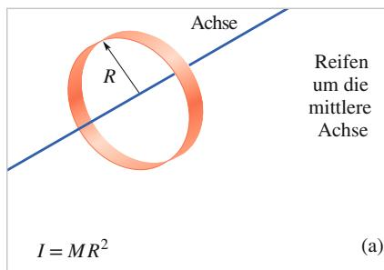</td><td>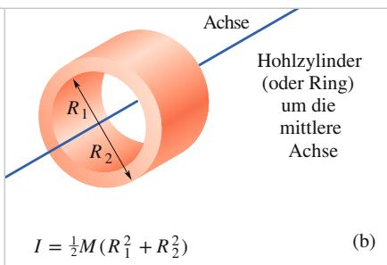</td><td>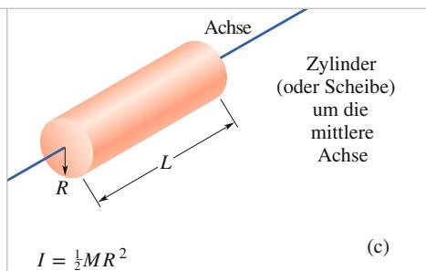</td></tr><tr><td>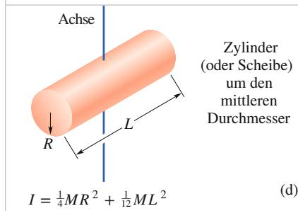</td><td>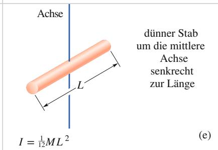</td><td>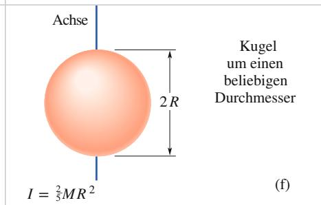</td></tr><tr><td>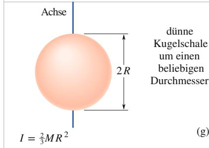</td><td>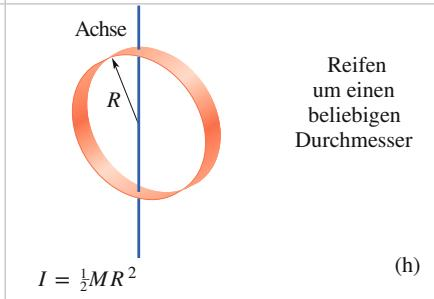</td><td>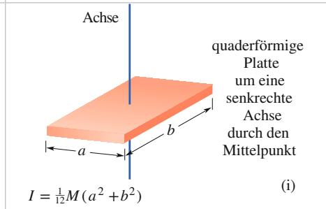</td></tr></table>

ermitteln. Wir können den Rechenweg aber deutlich abkürzen, wenn wir bereits das Trägheitsmoment $I _ { \mathrm { S } }$ des Körpers bezüglich einer Achse kennen, die durch den Schwerpunkt und parallel zur interessierenden Achse verläuft. Es sei h der senkrechte Abstand zwischen der gegebenen Achse und der Achse durch den Schwer punkt (denken Sie daran, dass der folgende Algorithmus nur gilt, wenn diese Achsen parallel verlaufen!). Das Trägheitsmoment I bezüglich der gegebenen Achse ist dann

$$
I = I _ {\mathrm{S}} + M h ^ {2}. \tag {6.26}
$$

Im Folgenden werden wir diesen **Steinerschen Satz** herleiten und anschließend in Kontrollfrage 5 sowie Beispielaufgabe 6.6 im Übungsbuch anwenden.

## Herleitung des Steinerschen Satzes

Der Schwerpunkt eines in zufälliger Weise geformten Körpers, dessen Querschnitt Sie in Abb. 6.9 sehen, liege im Ursprung O eines xy-Koordinatensystems. Nun betrachten wir eine Achse senkrecht zur Querschnittsebene durch O und eine zweite, zur ersten parallele Achse, die durch einen Punkt P verläuft. Die Koordinaten von P seien a und b.

Es sei dm ein Massenelement mit den allgemeinen Koordinaten x und y. Das Trägheitsmoment des Körpers bezüglich der Achse durch P ist dann gemäß Gl. 6.25:

$$
I = \int r ^ {2} \mathrm{d} m = \int [ (x - a) ^ {2} + (y - b) ^ {2} ] \mathrm{d} m,
$$

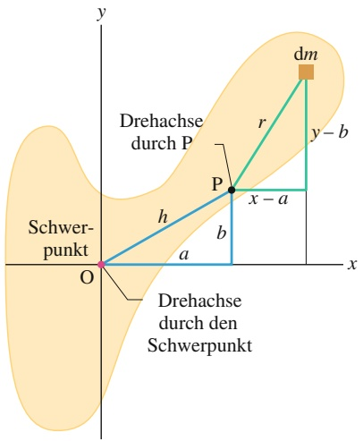

text_image

y
dm
Drehachse
durch P
r
y - b
P
x - a
h
b
O
x
Schwer-
punkt
Drehachse
durch den
Schwerpunkt

Abb. 6.9

Querschnitt eines starren Körpers, der Schwerpunkt befindet sich im Ursprung O. Der Steinersche Satz (Gl. 6.26) gibt die Beziehung zwischen dem Trägheitsmoment des Körpers bezüglich einer Achse durch O und dem Trägheitsmoment bezüglich einer Achse durch einen Punkt P an, der sich im Abstand h vom Schwerpunkt befindet. Beide Achsen stehen senkrecht auf der Ebene des Querschnitts.

155

---

6 Die Rotation ausgedehnter Körper

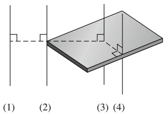

text_image

(1)
(2)
(3) (4)

was wir auch in der Form

$$
I = \int (x ^ {2} + y ^ {2}) \mathrm{d} m - 2 a \int x \mathrm{d} m - 2 b \int y \mathrm{d} m + \int (a ^ {2} + b ^ {2}) \mathrm{d} m, \tag {6.27}
$$

schreiben können. Aus der Definition des Schwerpunkts (Gl. 5.9) entnehmen wir, dass die beiden mittleren Integrale die Koordinaten des Schwerpunkts angeben (multipliziert mit einem konstanten Faktor) und deshalb jeweils gleich null sein müssen. Weiterhin ist $x ^ { 2 } + y ^ { 2 } = R ^ { 2 }$ mit R als Abstand zwischen O und dm, weshalb das erste Integral schlicht gleich $I _ { S }$ ist, das Trägheitsmoment des Körpers bezüglich einer durch seinen Schwerpunkt verlaufenden Achse. Wie uns ein Blick auf Abb. 6.9 sagt, ist der letzte Term in Gl. 6.27 gleich $M h ^ { 2 }$ mit M als Gesamtmasse des Körpers. Wir können Gl. 6.27 folglich auf Gl. 6.26 zurückführen, welche wir herleiten wollten.

## KONTROLLFRAGE 5

Die Zeichnung zeigt ein flaches, quaderförmiges Objekt (etwa ein Buch) mit vier verschiedenen Drehachsen, die alle senkrecht auf der Deckfläche des Objekts stehen. Ordnen Sie die Achsen nach dem zugehörigen Trägheitsmoment des Objekts, beginnend mit dem größten Wert.

## 6.6 Das Drehmoment

## Lernziele

Nach dem Durcharbeiten dieses Abschnitts sollten Sie in der Lage sein, . . .

• zu verstehen, dass ein Drehmoment auf einen Körper von einer Kraft hervorgerufen wird, die an einem Punkt außerhalb der Drehachse angreift,
• ein Drehmoment aus (a) dem Winkel zwischen dem Orts- und dem Kraftvektor, (b) der Richtung und dem Hebel der Kraft oder (c) der Komponente der Kraft senkrecht zum Ortsvektor zu berechnen,
• zu verstehen, dass für die Berechnung eines Drehmoments immer auch die zugehörige Drehachse angegeben sein muss,
• zu verstehen, dass einem Drehmoment je nach der Richtung, in der es den Körper um die Rotationsachse drehen möchte, ein positives oder negatives Vorzeichen zugewiesen wird (im Uhrzeigersinn = negativ),
• das resultierende Drehmoment zu berechnen, wenn mehr als ein Drehmoment auf einen Körper wirkt.

## Schlüsselideen

• Ein Drehmoment versucht, einen Körper aufgrund einer Kraft $\vec { F }$ um eine Rotationsachse zu drehen. Wenn die Kraft $\vec { F }$ an einem Punkt angreift, der durch den Ortsvektor $\vec { r }$ relativ zur Rotationsachse gegeben ist, ist der Betrag des Drehmoments

$$
\tau = r F _ {\mathrm{t}} = r _ {\perp} F = r F \sin \varphi ,
$$

wobei $F _ { \mathrm { t } }$ die Komponente von $\vec { F }$ senkrecht zu $\vec { r }$ ist und 𝜑 der Winkel zwischen ⃗r und $\vec { F } .$ Die Größe $r _ { \perp }$ ist der senkrechte Abstand zwischen der Drehachse und einer gedachten Verlängerung des Kraftvektors. Diese Verlängerung ist die Richtung der Kraft $\vec { F } ; r _ { \perp }$ wird der Hebelarm von $\vec { F }$ genannt. Entsprechend ist r der Hebelarm von $F _ { \mathrm { t } }$

• Die SI-Einheit des Drehmoments ist das Newtonmeter (N ⋅ m). Ein Drehmo ment τ ist positiv, wenn es versucht, einen ruhenden Körper gegen den Uhrzeigersinn zu drehen, und negativ, wenn es versucht, den Körper im Uhrzeigersinn zu drehen.

156

---

6.6 Das Drehmoment

6

## 6.6.1 Das Drehmoment

Eine Türklinke ist stets so weit wie möglich vom Scharnier der Tür entfernt, und das aus gutem Grund. Wollen Sie eine schwere Tür öffnen, so müssen Sie natürlich eine Kraft aufwenden. Wichtig ist aber nicht nur der Betrag dieser Kraft, sondern auch der Angriffspunkt und die Richtung ihrer Wirkung. Drücken Sie in der Nähe des Scharniers oder unter einem Winkel gegen die Tür, der erheblich von $9 0 ^ { \circ }$ bezüglich der Türfläche abweicht, so müssen Sie wesentlich mehr Kraft aufwenden, als wenn Sie Ihre Kraft in der Nähe der Klinke und senkrecht zur Türfläche ansetzen.

In Abb. 6.10a sehen Sie den Querschnitt eines Körpers, der ungehindert um eine auf dem Querschnitt senkrecht stehende Achse durch O rotieren kann. Am Punkt $\mathrm { P } _ { \mathrm { r } }$ dessen Position relativ zu O durch den Ortsvektor $\boldsymbol { \cdot } \vec { r }$ gegeben ist, greift eine Kraft $\vec { F }$ an. Die Richtungen der Vektoren $\vec { F }$ und $\vec { r }$ schließen miteinander einen Winkel 𝜑 ein. (Der Einfachheit halber betrachten wir nur Kräfte, deren Komponente parallel zur Drehachse gleich null ist; das bedeutet, $\vec { F }$ liegt in der Papierebene.)

Wir wollen nun untersuchen, in welcher Weise $\vec { F }$ eine Rotation des Körpers um die angegebene Achse bewirkt. Dazu lösen wir $\vec { F }$ in zwei Komponenten auf (Abb. 6.10b). Eine davon, die radiale Komponente $F _ { \mathbf { r } } ,$ zeigt in Richtung von $\vec { r }$ und erzeugt keine Rotation, denn sie wirkt entlang einer Linie, die durch O verläuft. (Drücken Sie von einer Kante aus in Richtung des Scharniers gegen eine Tür, um sich zu überzeugen, dass sich die Tür dann nicht dreht.) Die tangentiale Komponente $F _ { \mathrm { t } }$ von $\vec { F }$ steht senkrecht au $\vec { r } _ { \vec { r } _ { r } } ^ { \rightarrow }$ ihr Betrag ist $F _ { \mathrm { t } } = F$ sin 𝜑. Diese Komponente ist für die Rotation verantwortlich. (Drücken Sie senkrecht gegen eine Tür, bewegt sie sich.)

Ob und wie effektiv die Anwendung der Kraft $\vec { F }$ eine Rotation bewirkt, hängt – wie bereits bemerkt – nicht nur vom Betrag ihrer tangentialen Komponente $F _ { \mathrm { t } }$ $\mathrm { a b } ,$ sondern auch vom Abstand zwischen dem Angriffspunkt der Kraft und O. Um beide Faktoren zu erfassen, definieren wir ihr Produkt als das **Drehmoment** τ (für englisch „torque“):

$$
\tau = r F \sin \varphi . \tag {6.28}
$$

Zwei äquivalente Schreibweisen dieser Definition sind

$$
\tau = r (F \sin \varphi) = r F _ {\mathrm{t}} \tag {6.29}
$$

und

$$
\tau = (r \sin \varphi) F = r _ {\perp} F \tag {6.30}
$$

mit $r _ { \perp }$ als senkrechtem Abstand zwischen der Rotationsachse in O und der Verlängerung der Richtung des Vektors $\vec { F }$ (siehe Abb. 6.10c). Diese Verlängerungslinie ist die **Richtung der Kraft** $\vec { F }$ und $r _ { \perp }$ ist der **Hebelarm** von F. Wie Sie Abb. 6.10 entnehmen können, ist $r ,$ der Betrag von $\vec { r } ,$ gleich dem Hebelarm der Komponente $F _ { \mathrm { t } }$ von ${ \vec { F } } .$

Das Drehmoment lässt sich als „drehende Wirkung“ der Kraft $\vec { F }$ auffassen. Wenn Sie ein Objekt wie einen Schraubenzieher oder einen Drehmomentschlüssel mithilfe einer Kraft in Rotation versetzen, so wenden Sie ein Drehmoment an. Die SI-Einheit des Drehmoments ist Newton mal Meter (N ⋅ m) bzw. Newtonmeter (Nm). (Vorsicht: Die gleiche Einheit gilt für die Arbeit. Arbeit und Drehmoment sind aber verschiedene Größen, die nicht verwechselt werden dürfen. Oft gibt man eine $\mathrm { A r } -$ beit in J (1 J = 1 N ⋅ m) an, für Drehmomente darf diese Einheit hingegen nicht verwendet werden.)

Im folgenden Kapitel werden wir das Drehmoment allgemeiner als vektorielle Größe diskutieren (und dann auch sehen, dass beim Drehmoment Kraft und Weg auf andere Weise multipliziert werden als bei der Arbeit). Da wir uns im Augenblick auf Drehbewegungen um einzelne Achsen beschränken, müssen wir das Drehmoment noch nicht als Vektor formulieren. Wir ordnen ihm stattdessen ein

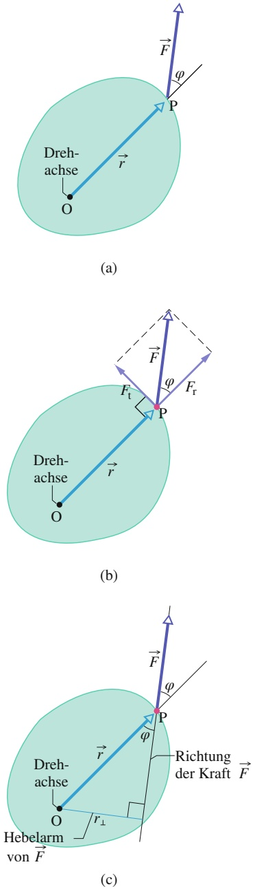

Abb. 6.10 (a) Eine Kraft $\vec { F }$ greift im Punkt P eines starren Körpers an, der ungehindert um eine Achse durch O rotieren kann. Diese Achse steht senkrecht auf der hier abgebildeten Querschnittsebene. (b) Das zu dieser Kraft gehö- rende Drehmoment ist gegeben durch $( r ) ( F$ sin 𝜑) oder äquivalent durch $r F _ { \mathrm { t } } ,$ wobei $F _ { \mathrm { t } }$ die tangentiale Komponente von $\vec { F }$ ist. (c) Eine weitere Schreibweise für das Drehmoment ist $r _ { \perp } F$ mit $r _ { \perp }$ als Hebelarm von ${ \vec { F } } .$

157

---

6 Die Rotation ausgedehnter Körper

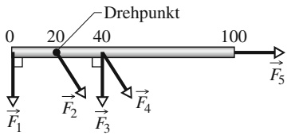

line

| Component | Force Direction |
| --- | --- |
| F1 | Downward |
| F2 | Upward |
| F3 | Downward |
| F4 | Upward |

positives oder negatives Vorzeichen zu, je nachdem, in welche Richtung sich ein ruhender Körper zu drehen beginnt, wenn dieses Drehmoment auf ihn wirkt. Rotiert der Körper im Uhrzeigersinn, so ist das Drehmoment negativ und umgekehrt (siehe zu dieser Vereinbarung Abschn. 6.1).

Drehmomente befolgen das in Kapitel 2 eingeführte Superpositionsprinzip: Wirken auf einen Körper mehrere Drehmomente, so ergibt sich das **resultierende Drehmoment** $\tau _ { \mathrm { g e s } }$ als Summe der einzelnen Beiträge.

## KONTROLLFRAGE 6

Die Skizze zeigt einen Meterstab (von oben gesehen), der sich um den markierten Punkt (Position 20 für 20 cm) drehen kann. Alle fünf waagerecht am Stab angreifenden Kräfte haben den gleichen Betrag. Ordnen Sie die Kräfte nach dem Drehmoment, das sie bewirken, beginnend mit dem größten Wert.

## 6.7 Das zweite Newtonsche Gesetz für die Rotation

## Lernziele

Nach dem Durcharbeiten dieses Abschnitts sollten Sie in der Lage sein, . . .

• das zweite Newtonsche Gesetz für die Rotation anzuwenden, um eine Bezie hung zwischen dem resultierenden Drehmoment auf einen Körper, dessen Träg heitsmoment und der Rotationsbeschleunigung aufzustellen, wobei alle Größen auf dieselbe Rotationsachse bezogen sein müssen.

## Schlüsselideen

• Das Analogon des zweiten Newtonschen Gesetzes für die Rotation ist

$$
\tau_ {\mathrm{ges}} = I \alpha ,
$$

wobei $\tau _ { \mathrm { g e s } }$ das auf ein Teilchen oder einen starren Körper wirkende resultierende Drehmoment ist, I ist das Trägheitsmoment des Teilchens bzw. Körpers um die Drehachse und α die resultierende Winkelbeschleunigung um diese Achse.

## 6.7.1 Das zweite Newtonsche Gesetz für die Rotation

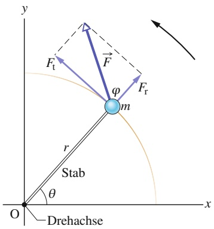

text_image

y
Ft
F
φ
m
Fr
r
Stab
θ
O
Drehachse
x

Abb. 6.11

Ein einfacher starrer Körper, der nur um eine durch O verlaufende Achse rotieren kann. Er besteht aus einem Teilchen der Masse m, befestigt an einem Ende eines masselosen Stabs der Länge r. Durch das Einwirken einer Kraft $\vec { F }$ beginnt die Anordnung zu rotieren.

Wie wir im vorangegangenen Abschnitt gesehen haben, kann ein Drehmoment die Rotation eines starren Körpers bewirken. Wir suchen nun einen Zusammenhang zwischen dem resultierenden Drehmoment $\tau _ { \mathrm { g e s } } ,$ das an einem Körper angreift, und der Winkelbeschleunigung α bezüglich der Rotationsachse, die es verursacht. Dabei gehen wir wie beim zweiten Newtonschen Gesetz $( F _ { \mathrm { g e s } } = m a )$ für die Beschleunigung a eines Körpers der Masse m vor, auf den eine Kraft $F _ { \mathrm { g e s } }$ entlang einer Koordinatenachse wirkt. Wir ersetzen $F _ { \mathrm { g e s } }$ durch $\tau _ { \mathrm { g e s } } ,$ m durch I und a durch α. Dann haben wir bereits das zweite Newtonsche Gesetz für die Drehbewegung:

$$
\tau_ {\mathrm{ges}} = I \alpha \quad (\text {Bogenma} \beta). \tag {6.31}
$$

## Herleitung von Gl. 6.31

Betrachten wir zunächst die einfache, in Abb. 6.11 dargestellte Situation. Der starre Körper besteht hier aus einem einzelnen Teilchen der Masse m, befestigt an einem masselosen Stab der Länge r. Der Stab kann nur um eine Achse rotieren, die durch sein anderes Ende verläuft und senkrecht auf der Papierebene steht. Folglich kann das Teilchen nur eine Kreisbahn beschreiben, durch deren Mittelpunkt die Drehachse führt.

Auf das Teilchen wirkt nun eine Kraft ${ \vec { F } } .$ Da sich das Teilchen nur auf der Kreisbahn bewegen kann, wird es ausschließlich durch die tangentiale Komponente $F _ { \mathrm { t } }$

158

---

6.8 Arbeit und kinetische Energie der Rotation

6

der Kraft (die Komponente, die tangential zur Kreisbahn gerichtet ist) beschleunigt. Den Zusammenhang zwischen $F _ { \mathrm { t } }$ und der tangentialen Beschleunigung $a _ { \mathrm { t } }$ schreiben wir gemäß dem zweiten Newtonschen Gesetz auf als

$$
F _ {\mathrm{t}} = m a _ {\mathrm{t}}.
$$

Aus Gl. 6.29 folgt für das auf das Teilchen wirkende Drehmoment

$$
\tau = F _ {\mathrm{t}} r = m a _ {\mathrm{t}} r.
$$

Mithilfe von Gl. 6.19 $( a _ { \mathrm { t } } = \alpha r )$ schreiben wir dafür

$$
\tau = m (\alpha r) r = (m r ^ {2}) \alpha . \tag {6.32}
$$

Der Klammerausdruck auf der rechten Seite von Gl. 6.32 ist gleich dem Trägheitsmoment des Körpers bezüglich der Drehachse (siehe Gl. 6.23). So verkürzt sich Gl. 6.32 zu

$$
\tau = I \alpha \quad (\text {Bogenma} \beta). \tag {6.33}
$$

Für den Fall, dass mehr als eine Kraft an dem Teilchen angreift, verallgemeinern wir Gl. 6.33:

$$
\tau_ {\mathrm{ges}} = I \alpha \quad (\text {Bogenma} \beta). \tag {6.34}
$$

Diese Gleichung wollten wir herleiten. Sie gilt für beliebige um eine feste Achse rotierende starre Körper, weil sich jeder derartige Körper als Anordnung unverrückbar miteinander verbundener einzelner Teilchen behandeln lässt.

## KONTROLLFRAGE 7

Der skizzierte Meterstab kann um den angegebenen Punkt links von der Mitte des Stabs rotieren. Zwei Kräfte ${ \vec { F } } _ { 1 }$ und $\vec { F } _ { 2 }$ greifen waagerecht an dem Stab an; nur ${ \vec { F } } _ { 1 }$ ist eingezeichnet. Die Kraft $\vec { \bar { F } } _ { 2 }$ wirkt am rechten Ende, senkrecht zum Stab. (a) In welche Richtung muss $\vec { F } _ { 2 }$ zeigen und (b) wie groß muss $F _ { 2 }$ relativ zu $F _ { 1 }$ sein, wenn sich der Stab nicht drehen soll?

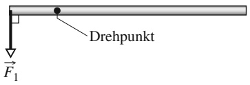

text_image

Drehpunkt
F₁

## 6.8 Arbeit und kinetische Energie der Rotation

## Lernziele

Nach dem Durcharbeiten dieses Abschnitts sollten Sie in der Lage sein, . . .

• die von einem Drehmoment an einem rotierenden Körper verrichtete Arbeit durch Integration des Drehmoments über den Drehwinkel zu berechnen,
aus der Beziehung zwischen Arbeit und kinetischer Energie eine Relation zwischen der von einem Drehmoment verrichteten Arbeit und der daraus resultierenden Änderung der kinetischen Rotationsenergie eines Körpers aufzustellen,
• die von einem konstanten Drehmoment verrichtete Arbeit aus dem Drehwinkel des Körpers zu bestimmen,
• die von einem Drehmoment erbrachte Leistung aus der Rate zu berechnen, mit der es Arbeit verrichtet,
• die momentane Leistung eines Drehmoments zu einem gegebenen Zeitpunkt aus dem Drehmoment und der Winkelgeschwindigkeit zu diesem Zeitpunkt zu bestimmen.

## Schlüsselideen

• Die Gleichungen für die verrichtete Arbeit und die erbrachte Leistung bei Rotationsbewegungen entsprechen denjenigen, die wir aus der Translationsbewegung kennen; sie lauten

$$
W = \int_ {\theta_ {\mathrm{i}}} ^ {\theta_ {\mathrm{f}}} \tau   \mathrm{d} \theta
$$

159

---

6 Die Rotation ausgedehnter Körper

und

$$
P = \frac {\mathrm{d} W}{\mathrm{d} t} = \tau \omega .
$$

• Wenn τ konstant ist, reduziert sich das Integral auf

$$
W = \Delta \theta = \tau (\theta_ {\mathrm{f}} - \theta_ {\mathrm{i}}).
$$

• Die Beziehung zwischen Arbeit und kinetischer Energie lautet für Rotationsbewegungen

$$
\Delta K = K _ {\mathrm{f}} - K _ {\mathrm{i}} = \frac {1}{2} I \omega_ {\mathrm{f}} ^ {2} - \frac {1}{2} I \omega_ {\mathrm{f}} ^ {2} = W.
$$

## 6.8.1 Arbeit und kinetische Energie der Rotation

Bewirkt eine Kraft F die Beschleunigung eines starren Körpers der Masse m entlang einer Koordinatenachse, so verrichtet sie, wie wir in Kapitel 3 diskutiert haben, an diesem Körper eine Arbeit W. Dabei kann sich die kinetische Energie des Körpers $\begin{array} { r } { K = \frac { 1 } { 2 } m \nu ^ { \hat { 2 } } } \end{array}$ ändern. Nehmen wir an, nur diese Energieform des Körpers ändere sich. Dann können wir gemäß Gl. 3.10 folgenden Zusammenhang zwischen $\Delta K$ und der Arbeit W formulieren:

$$
\Delta K = K _ {\mathrm{f}} - K _ {\mathrm{i}} = \frac {1}{2} m v _ {\mathrm{f}} ^ {2} - \frac {1}{2} m v _ {\mathrm{i}} ^ {2} = W. \tag {6.35}
$$

Ist die Bewegung auf die x-Achse beschränkt (eindimensional), so berechnen wir die Arbeit mithilfe von Gl. 3.30:

$$
W = \int_ {x _ {\mathrm{i}}} ^ {x _ {\mathrm{f}}} F \mathrm{d} x. \tag {6.36}
$$

Bei konstanter Kraft F ist dann $W = F d$ mit d als Verschiebung des Körpers. Die Rate, mit der die Arbeit verrichtet wird, ist die Leistung, zu berechnen mithilfe der Gln. 3.41 und 3.46:

$$
P = \frac {\mathrm{d} W}{\mathrm{d} t} = F \nu . \tag {6.37}
$$

Betrachten wir nun den analogen Fall bei einer Rotationsbewegung. Beschleunigt ein Drehmoment die Rotation eines starren Körpers um eine feste Achse, so verrichtet es dabei die Arbeit W. Dabei kann sich die kinetische Energie der Rotation des Körpers $\begin{array} { r } { K = \frac { 1 } { 2 } I \omega ^ { 2 } } \end{array}$ ändern. Wieder nehmen wir an, alle anderen Energieformen des Körpers seien konstant. Analog zu Gl. 6.35 formulieren wir dann einen Zusammenhang zwischen ΔK und der verrichteten Arbeit, wobei nun die kinetische Energie der Rotation einfließt:

$$
\Delta K = K _ {\mathrm{f}} - K _ {\mathrm{i}} = \frac {1}{2} I \omega_ {\mathrm{f}} ^ {2} - \frac {1}{2} I \omega_ {\mathrm{i}} ^ {2} = W. \tag {6.38}
$$

I ist das Trägheitsmoment des Körpers bezüglich der festen Achse; $\omega _ { \mathrm { i } }$ und $\omega _ { \mathrm { f } }$ sind die Winkelgeschwindigkeit des Körpers vor bzw. nach Verrichtung der Arbeit.

Die Arbeit berechnen wir mit der folgenden, zu Gl. 6.36 äquivalenten Beziehung:

$$
W = \int_ {\theta_ {\mathrm{i}}} ^ {\theta_ {\mathrm{f}}} \tau \mathrm{d} \theta . \tag {6.39}
$$

Hier ist τ das Drehmoment, welches die Arbeit W verrichtet; $\theta _ { \mathrm { i } }$ und $\theta _ { \mathrm { f } }$ bezeichnen die Winkelpositionen des Körpers vor bzw. nach der Verrichtung der Arbeit. Bei konstantem τ verkürzt sich Gl. 6.39 zu

$$
W = \tau (\theta_ {\mathrm{f}} - \theta_ {\mathrm{i}}). \tag {6.40}
$$

160

---

6.8 Arbeit und kinetische Energie der Rotation

6

TABELLE 6.3: Gleichungen für die Rotation und ihre Äquivalente für die Translation.

<table><tr><td colspan="2">Reine Translation (feste Richtung)</td><td colspan="2">Reine Rotation (feste Achse)</td></tr><tr><td>Ort</td><td>x</td><td>Winkelposition</td><td> $\theta$ </td></tr><tr><td>Geschwindigkeit</td><td> $\nu = dx/dy$ </td><td>Winkelgeschwindigkeit</td><td> $\omega = d\theta/dt$ </td></tr><tr><td>Beschleunigung</td><td> $a = d\nu/dt$ </td><td>Winkelbeschleunigung</td><td> $\alpha = d\omega/dt$ </td></tr><tr><td>Masse</td><td>m</td><td>Trägheitsmoment</td><td>I</td></tr><tr><td>Zweites Newtonsches Gesetz</td><td> $F_{ges} = ma$ </td><td>Zweites Newtonsches Gesetz</td><td> $\tau_{ges} = I\alpha$ </td></tr><tr><td>Arbeit</td><td> $W = \int F \, dx$ </td><td>Arbeit</td><td> $W = \int \tau \, d\theta$ </td></tr><tr><td>Kinetische Energie</td><td> $K = \frac{1}{2}mv^{2}$ </td><td>Kinetische Energie</td><td> $K = \frac{1}{2}I\omega^{2}$ </td></tr><tr><td>Leistung (konstante Kraft)</td><td> $P = F\nu$ </td><td>Leistung (konstantes Drehmoment)</td><td> $P = \tau\omega$ </td></tr><tr><td>Arbeit und Energie</td><td> $W = \Delta K$ </td><td>Arbeit und Energie</td><td> $W = \Delta K$ </td></tr></table>

Die Rate, mit der die Arbeit verrichtet wird, ist die Leistung. Wir berechnen sie mit der zu Gl. 6.37 äquivalenten Beziehung

$$
P = \frac {\mathrm{d} W}{\mathrm{d} t} = \tau \omega . \tag {6.41}
$$

Tabelle 6.3 stellt die Gleichungen für die Rotation eines starren Körpers um eine feste Achse den entsprechenden Beziehungen für die Translation gegenüber.

## Herleitung der Gln. 6.38–6.41

Betrachten wir noch einmal die Situation in Abb. 6.11: Die Kraft $\vec { F }$ wirkt auf einen starren Körper, bestehend aus einem einzelnen Teilchen der Masse m, befestigt an einem Ende eines masselosen Stabs. Der Körper beginnt zu rotieren; während der Rotation verrichtet $\vec { F }$ an dem Körper eine Arbeit. Nehmen wir an, $\vec { F }$ beeinflusse nur eine einzige Energieform des Körpers, nämlich die kinetische Energie. Dann können wir Gl. 6.35 anwenden:

$$
\Delta K = K _ {\mathrm{f}} - K _ {\mathrm{i}} = W. \tag {6.42}
$$

Mit $\begin{array} { r } { K = \frac { 1 } { 2 } m \nu ^ { 2 } } \end{array}$ und $\nu = \omega r$ (Gl. 6.15) schreiben wir diese Beziehung in der Form

$$
\Delta K = \frac {1}{2} m r ^ {2} \omega_ {\mathrm{f}} ^ {2} - \frac {1}{2} m r ^ {2} \omega_ {\mathrm{i}} ^ {2} = W. \tag {6.43}
$$

Aus Gl. 6.23 folgt für das Trägheitsmoment dieses (aus einem Teilchen bestehenden) Körpers $\bar { I = m r ^ { 2 } }$ . Wir setzen dies in Gl. 6.43 ein:

$$
\Delta K = \frac {1}{2} I \omega_ {\mathrm{f}} ^ {2} - \frac {1}{2} I \omega_ {\mathrm{i}} ^ {2} = W.
$$

Damit haben wir Gl. 6.38 für einen starren, aus einem Teilchen bestehenden Körper hergeleitet. Die Beziehung gilt für jeden starren Körper bei der Rotation um eine feste Achse.

Als zweiten Schritt wollen wir nun einen Zusammenhang zwischen der an dem Körper in Abb. 6.11 verrichteten Arbeit W und dem Drehmoment τ herstellen, das infolge der Kraft $\vec { F }$ auf den Körper wirkt. Bewegt sich das Teilchen eine Strecke ds auf seiner Kreisbahn, so wird es nur von der tangentialen Komponente $F _ { \mathrm { t } }$ der Kraft beschleunigt; das bedeutet, nur $F _ { \mathrm { t } }$ verrichtet an dem Teilchen Arbeit. Diese Arbeit dW schreiben wir als $F _ { \mathrm { t } }$ ds und ersetzten ds durch r dθ mit dθ als dem Winkel, den das Teilchen während des Durchlaufens von ds überstreicht. Es gilt also:

$$
\mathrm{d} W = F _ {\mathrm{t}} r \mathrm{d} \theta . \tag {6.44}
$$

161

---

6 Die Rotation ausgedehnter Körper

Wie ein Blick auf Gl. 6.29 zeigt, ist das Produkt $F _ { \mathrm { t } } r$ gleich dem Drehmoment τ, und wir können anstelle von Gl. 6.44 schreiben:

$$
\mathrm{d} W = \tau \mathrm{d} \theta . \tag {6.45}
$$

Die während des Durchlaufens eines endlichen Drehwinkels (von $\theta _ { \mathrm { i } }$ bis $\theta _ { \mathrm { f } } )$ geleistete Arbeit ist damit gleich:

$$
W = \int_ {\theta_ {\mathrm{i}}} ^ {\theta_ {\mathrm{f}}} \tau \mathrm{d} \theta .
$$

Dies ist Gl. 6.39, aus der Gl. 6.40 unmittelbar hervorgeht. Sie gilt für jeden starren Körper, der um eine feste Achse rotiert.

Die Leistung der Rotationsbewegung erhalten wir aus Gl. 6.45:

$$
P = \frac {\mathrm{d} W}{\mathrm{d} t} = \tau \frac {\mathrm{d} \theta}{\mathrm{d} t} = \tau \omega ,
$$

womit wir bei Gl. 6.41 angelangt sind.

## 6.9 Zusammenfassung

**Winkelposition** Um die Rotation eines starren Körpers um eine feste Achse, die **Dreh**- oder **Rotationsachse**, zu beschreiben, denken wir uns eine **Bezugslinie** senkrecht zu dieser Achse, die mit dem Körper rotiert. Wir messen die Winkelposition θ dieser Linie relativ zu einer festgelegten Richtung (der Winkelposition null). Wird θ in **Bogenmaß** angegeben, so gilt

$$
\theta = \frac {s}{r} \tag {6.1}
$$

mit s als Bogenlänge auf einer Kreisbahn mit dem Radius $r ,$ die beim Überstreichen des Winkels θ durchlaufen wird. Der Zusammenhang zwischen den Winkelangaben in Bogenmaß, Grad und Umdrehungen ist gegeben durch

$$
1 \mathrm{U} = 3 6 0 ^ {\circ} = 2 \pi \mathrm{rad}. \tag {6.2}
$$

**Drehwinkel** Ändert sich die Winkelposition eines rotierenden Körpers bezüglich einer Achse von $\theta _ { 1 }$ nach $\theta _ { 2 } ,$ so bezeichnen wir $\Delta \theta$ mit

$$
\Delta \theta = \theta_ {2} - \theta_ {1} \tag {6.4}
$$

als Drehwinkel. Er ist positiv für Rotationen entgegen dem Uhrzeigersinn und negativ für Rotationen im Uhrzeigersinn.

**Winkelgeschwindigkeit** Dreht sich ein Körper in einem Zeitintervall $\Delta t$ um einen Winkel $\Delta \theta ,$ so ist die mittlere Winkelgeschwindigkeit $\omega _ { \mathrm { g e m } }$ gegeben durch

$$
\omega_ {\mathrm{gem}} = \frac {\Delta \theta}{\Delta t}. \tag {6.5}
$$

Die momentane Winkelgeschwindigkeit ω des Körpers ist

$$
\omega = \frac {\mathrm{d} \theta}{\mathrm{d} t}. \tag {6.6}
$$

Sowohl $\omega _ { \mathrm { g e m } }$ als auch ω sind vektorielle Größen. Ihre Richtungen werden mithilfe der **Rechte-Hand-Regel** (Abb. 6.5) ermittelt. Sie sind positiv für Rotationen entgegen dem Uhrzeigersinn und negativ für Rotationen im Uhrzeigersinn.

**Winkelbeschleunigung** Ändert sich die Winkelgeschwindigkeit eines rotierenden Körpers innerhalb eines Zeitintervalls $\Delta t = t _ { 2 } - t _ { 1 }$ von $\omega _ { 1 }$ nach $\omega _ { 2 } ,$ so ist die mittlere Winkelbeschleunigung $\alpha _ { \mathrm { g e m } }$ des Körpers gleich

$$
\alpha_ {\mathrm{gem}} = \frac {\omega_ {2} - \omega_ {1}}{t _ {2} - t _ {1}} = \frac {\Delta \omega}{\Delta t}. \tag {6.7}
$$

Die momentane Winkelbeschleunigung α ist entsprechend

$$
\alpha = \frac {\mathrm{d} \omega}{\mathrm{d} t}. \tag {6.8}
$$

$\alpha _ { \mathrm { g e m } }$ und α sind Vektoren.

**Bewegungsgleichungen für die gleichmäßig beschleunigte Rotation** Die Rotation mit konstanter Winkelbeschleunigung α ist ein wichtiger Spezialfall der allgemeinen Drehbewegung. Die zugehörigen Bewegungsgleichungen, zusammengefasst in Tab. 6.1, sind

$$
\omega = \omega_ {0} + \alpha t, \tag {6.9}
$$

$$
\theta - \theta_ {0} = \omega_ {0} t + \frac {1}{2} \alpha t ^ {2}, \tag {6.10}
$$

$$
\omega^ {2} = \omega_ {0} ^ {2} + 2 \alpha (\theta - \theta_ {0}), \tag {6.11}
$$

$$
\theta - \theta_ {0} = \frac {1}{2} (\omega_ {0} + \omega) t, \tag {6.12}
$$

$$
\theta - \theta_ {0} = \omega t - \frac {1}{2} \alpha t ^ {2}. \tag {6.13}
$$

162

---

6.9 Zusammenfassung

6

**Beziehungen zwischen den Variablen für lineare Bewegung und Rotation** Ein Punkt innerhalb eines rotierenden starren Körpers, der sich in einem senkrechten Abstand r von der Drehachse befindet, bewegt sich auf einer Kreisbahn mit dem Radius r. Überstreicht der Körper einen Drehwinkel $\theta ,$ so legt der Punkt auf dem Kreisbogen die Strecke

$$
s = \theta r \tag {6.14}
$$

zurück (θ in Bogenmaß).

Die lineare Geschwindigkeit v⃗ des Punkts zeigt in Richtung der Tangente an den Kreis in diesem Punkt. Der Betrag dieser Geschwindigkeit ist gegeben durch

$$
\nu = \omega r \tag {6.15}
$$

mit $\omega$ als Betrag der Winkelgeschwindigkeit in rad/s. Die lineare Beschleunigung $\vec { a }$ des Punkts hat eine tangentiale und eine radiale Komponente. Die tangentiale Komponente ist

$$
a _ {\mathrm{t}} = \alpha r \tag {6.19}
$$

mit α als Betrag der Winkelbeschleunigung in rad $/ \mathbf { s } ^ { 2 } .$ . Die radiale Komponente von $\vec { a }$ ist

$$
a _ {\mathrm{r}} = \frac {\nu^ {2}}{r} = \omega^ {2} r. \tag {6.20}
$$

Bewegt sich der Punkt gleichförmig auf einer Kreisbahn, so ist $T$ die Periode der Bewegung des Punkts und des Körpers mit

$$
T = \frac {2 \pi r}{\nu} = \frac {2 \pi}{\omega} \tag {6.16,6.17}
$$

und ω in rad/s.

**Kinetische Energie und Trägheitsmoment der Rotation** Die kinetische Energie K eines Körpers bei der Rotation um eine feste Achse ist gegeben durch:

$$
K = \frac {1}{2} I \omega^ {2} \tag {6.24}
$$

mit ω in rad/s und I als Trägheitsmoment des Körpers bezüglich dieser Achse, definiert durch

$$
I = \sum m _ {i} r _ {i} ^ {2} \tag {6.23}
$$

für ein System diskreter Teilchen und durch

$$
I = \int r ^ {2} \mathrm{d} m \tag {6.25}
$$

für eine kontinuierliche Masseverteilung. In diesen Gleichungen bezeichnen r und $r _ { i }$ den senkrechten Abstand jedes Massenelements von der Drehachse.

**Steinerscher Satz** Der Steinersche Satz gibt die Beziehung zwischen dem Trägheitsmoment I eines Körpers bezüglich einer beliebigen Achse und dem Trägheitsmoment $I _ { \mathrm { S } }$ dieses Körpers bezüglich einer zur ersten parallelen, aber durch den Schwerpunkt des Körpers verlaufenden Achse an:

$$
I = I _ {\mathrm{S}} + M h ^ {2}. \tag {6.26}
$$

h ist der senkrechte Abstand zwischen beiden Achsen.

**Drehmoment** Erzeugt eine Kraft $\vec { F }$ eine Drehbewegung um eine Achse, so spricht man von einem Drehmoment. Greift $\vec { F }$ an einem Punkt an, der durch den Ortsvektor $\vec { r }$ bezüglich der Achse definiert ist, so ist der Betrag des Drehmoments gegeben durch:

$$
\tau = r F _ {\mathrm{t}} = r _ {\perp} F = r F \sin \varphi \tag {6.28-6.30}
$$

mit $F _ { \mathrm { t } }$ als Komponente von $\vec { F }$ senkrecht zu $1 \vec { r }$ und 𝜑 als Winkel zwischen den Richtungen von $\vec { r }$ und ${ \vec { F } } .$ Die Größe $r _ { \perp } ,$ der Hebelarm von ${ \vec { F } } ,$ ist der senkrechte Abstand zwischen der Drehachse und der Verlängerung des Vektors $\vec { F }$ durch eine Linie (die **Richtung der Kraft**). Analog ist r der Hebelarm von $F _ { \mathrm { r } }$ .

Die SI-Einheit des Drehmoments ist das Newtonmeter (N ⋅ m). Ein Drehmoment τ ist positiv, wenn es einen ruhenden Körper gegen den Uhrzeigersinn in Rotation versetzt, und negativ, wenn die Bewegung im Uhrzeigersinn erfolgt.

**Zweites Newtonsches Gesetz für die Drehbewegung** Das zweite Newtonsche Gesetz für die Drehbewegung ist:

$$
\tau_ {\mathrm{ges}} = I \alpha , \tag {6.34}
$$

mit $\tau _ { \mathrm { g e s } }$ als resultierendem Drehmoment, das auf einen Massepunkt oder einen festen Körper wirkt, I als Trägheitsmoment des Massepunkts oder Körpers bezüglich der Drehachse und α als resultierender Winkelbeschleunigung bezüglich dieser Achse.

**Arbeit und kinetische Energie der Rotation** Die Gleichungen, mit denen wir die Arbeit und die kinetische Energie der Rotation berechnen, entsprechen den für die Translation gültigen Beziehungen und lauten

$$
W = \int_ {\theta_ {\mathrm{i}}} ^ {\theta_ {\mathrm{f}}} \tau \mathrm{d} \theta \tag {6.39}
$$

sowie

$$
P = \frac {\mathrm{d} W}{\mathrm{d} t} = \tau \omega . \tag {6.41}
$$

Bei konstantem Drehmoment τ vereinfacht sich Gl. 6.39 zu

$$
W = \tau (\theta_ {\mathrm{f}} - \theta_ {\mathrm{i}}). \tag {6.40}
$$

Der Zusammenhang zwischen Arbeit und kinetischer Energie der Rotation ist gegeben durch

$$
\Delta K = K _ {\mathrm{f}} - K _ {\mathrm{i}} = \frac {1}{2} I \omega_ {\mathrm{f}} ^ {2} - \frac {1}{2} I \omega_ {\mathrm{i}} ^ {2} = W. \tag {6.38}
$$

163

---

6 Die Rotation ausgedehnter Körper

## 6.10 Fragen

**1.** In Abb. 6.F1b sehen Sie den Graphen der Winkelposition der in Abb. 6.F1a gezeigten rotierenden Scheibe als Funktion der Zeit. Ist die Winkelgeschwindigkeit der Scheibe positiv, negativ oder null bei (a) $t   =   1   \mathrm { s } ,$ (b) $t   =   2   \mathrm { s } _ { i }$ (c) $t = 3   \mathrm { s } ?$ (d) Ist die Winkelbeschleunigung der Scheibe positiv oder negativ?

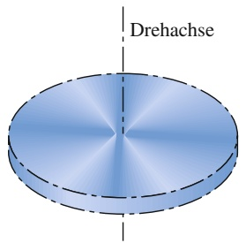

text_image

Drehachse

(a)

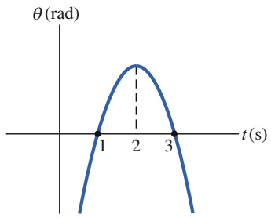

line

| t (s) | \(\theta (\)rad) |
| --- | --- |
| 1 | 0 |
| 2 | Peak |
| 3 | 0 |

(b)

Abb. 6.F1

**2.** In Abb. 6.F2 sehen Sie einen Graphen der Winkelgeschwindigkeit der in Abb. 6.F1a gezeigten rotierenden Scheibe als Funktion der Zeit. Geben Sie die Drehrichtung (a) zu Beginn und (b) am Ende der Messung an! (c) Kommt die Scheibe vorübergehend zum Stillstand? (d) Ist die Winkelbeschleunigung positiv oder negativ? (e) Ist die Winkelbeschleunigung konstant oder ändert sie sich?

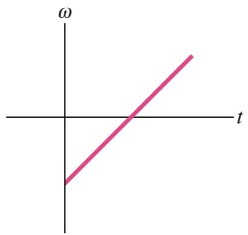

text_image

ω
t

Abb. 6.F2

**3.** Halten Sie Ihren rechten Arm nach unten neben den Körper, die Handfläche zeigt zum Oberschenkel. Das Handgelenk wird während den folgenden Aktionen relativ zum Arm nicht bewegt. (1) Heben Sie den Arm bis zur Waagerechten nach vorne; (2) führen Sie ihn waagerecht zur Seite, bis er direkt nach rechts zeigt, und (3) senken Sie ihn wieder nach unten ab. Ihre Handfläche zeigt nun nach vorne. Beginnen Sie noch einmal von vorn, wobei Sie diesmal aber erst den Arm zur Seite, dann nach vorne und dann wieder in die Ausgangsposition bringen. Warum zeigt Ihre Handfläche jetzt nicht nach vorne?
**4.** Die folgenden Ausdrücke geben Winkelgeschwindigkeiten ω(t) an. In welchen Fällen können Sie die in Tab. 6.1 aufgeführten Gleichungen anwenden? (a) $\omega = 3 ;$ (b) $\omega =$ $4t^{2}+2t-6;( c ) \; \omega = 3t - 4;( d ) \; \omega = 5t^{2}-3$ mit ω jeweils in rad/s und t in s.
**5.** Abbildung 6.F5 zeigt einen Graphen der Winkelgeschwindigkeit als Funktion der Zeit für die rotierende Scheibe aus Abb. 6.F1a. Ordnen Sie für einen Punkt auf dem Rand der Scheibe die vier Zeitpunkte a, b, c und d nach dem Betrag (a) der Tangentialbeschleunigung und (b) der Radialbeschleunigung, beginnend jeweils mit dem größten Wert.

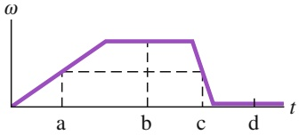

line

| Time (t) | Frequency \((\omega)\) |
| --- | --- |
| 0 | 0 |
| a | ~0.5 |
| b | ~1.0 |
| c | ~1.0 |
| d | 0 |

Abb. 6.F5

**6.** In Abb. 6.F6 sehen Sie eine Momentaufnahme einer entgegen dem Uhrzeigersinn rotierenden Scheibe in Draufsicht. Die Winkelgeschwindigkeit ω der Scheibe nimmt allmählich ab (die Scheibe wird langsamer, aber ihre Drehrichtung ändert sich nicht). Am linken Rand eingezeichnet ist ein Insekt, das sich mit der Scheibe gemeinsam bewegt. Geben Sie für den Zeitpunkt der Aufnahme die Richtung (a) der Radialbeschleunigung und (b) der Tangentialbeschleunigung des Insekts an.

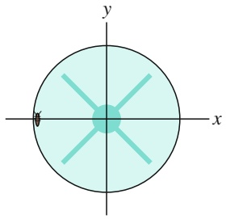

natural_image

Circular diagram with x and y axes intersecting at origin, showing radial lines and a central circle (no text or symbols)

Abb. 6.F6

**7.** In Abb. 6.F7 ist eine Anordnung aus drei kleinen Kugeln gleicher Masse skizziert, welche an einem masselosen Stab in den angegebenen Abständen befestigt sind. Betrachten Sie die Trägheitsmomente der Rotation dieser

Anordnung um jede der drei Kugeln. Ordnen Sie die Kugeln nach dem zugehörigen Trägheitsmoment, beginnend mit dem größten Wert.

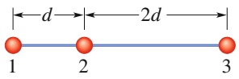

Abb. 6.F7

**8.** Abbildung 6.F8a zeigt in Draufsicht einen waagerechten Balken, der sich um eine Achse drehen kann, die durch den eingezeichneten Punkt führt (senkrecht zur Papierebene). Auf den Balken wirken zwei horizontale Kräfte, aber der Balken bewegt sich nicht. Nun wird der Winkel zwischen $\vec { F } _ { 2 }$ und dem Balken ausgehend von 90° allmählich verkleinert. Muss der Betrag von $\vec { F } _ { 2 }$ steigen, sinken oder gleich bleiben, damit der Balken weiterhin still steht?

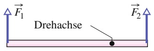

(a)

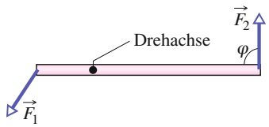

text_image

Drehachse
F₁
F₂
φ

(b)

Abb. 6.F8

Fragen 8 und 9.

164

---

6.10 Fragen

6

**9.** Abbildung 6.F8b zeigt in Draufsicht einen waagerechten Balken, der durch die Wirkung zweier horizontal an den Enden angreifender Kräfte $\vec { F } _ { 1 }$ und $\vec { F } _ { 2 }$ in Rotation um eine Achse durch den angegebenen Punkt versetzt wird. Die Richtung von $\vec { F } _ { 2 }$ schließt mit dem Balken einen Winkel $\varphi$ ein. Ordnen Sie folgende Werte von $\varphi$ nach dem zugehöri gen Betrag der Winkelbeschleunigung des Balkens, beginnend mit dem größten Wert: 90°, 70° und 110°.
**10.** In Abb. 6.F10 sehen Sie von oben, wie fünf Kräfte glei chen Betrags auf ein (reichlich seltsames) Karussell einwirken. Es handelt sich dabei um ein Quadrat, das um einen Punkt P rotieren kann, welcher sich in der Mitte einer Seite befindet. Ordnen Sie die Kräfte nach dem Betrag des Drehmoments, das sie bezüglich Punkt P erzeugen, beginnend mit dem größten Wert.

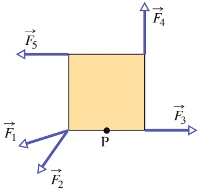

text_image

F₅
F₄
F₁
P
F₃
F₂

Abb. 6.F10

**11.** In Abb. 6.F11 sehen Sie eine Scheibe, die wie ein $\mathrm { K a } -$ russell um ihren Mittelpunkt rotiert, wobei zwei Kräfte ${ \vec { F } } _ { 1 }$ und ${ \vec { F } } _ { 2 }$ wirken. Während der Rotation (mit konstanter Geschwindigkeit gegen den Uhrzeigersinn) bleiben die angegebenen Winkel der Kräfte unverändert. Nun verkleinern wir den Winkel $\theta$ von ${ \vec { F } } _ { 1 }$ , wobei der Betrag der Kraft gleich bleibt. (a) Müssen wir den Betrag von $\vec { F } _ { 2 } ^ { \mathrm { ~   ~ } }$ gleichzeitig verringern, vergrößern oder konstant halten, wenn die Winkelgeschwindigkeit bei dieser Aktion konstant bleiben soll? Versetzt (b) die Kraft ${ \vec { F } } _ { 1 }$ allein und (c) die Kraft $\vec { F } _ { 2 }$ allein die Scheibe in Rotation gegen den oder im Uhrzeigersinn?

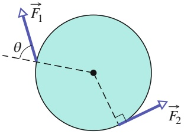

text_image

F₁
θ
F₂

Abb. 6.F11

**12.** In Abb. 6.F12 sehen Sie den Graphen der Winkelgeschwindigkeit ω eines Karussells, das mit einer variablen Kraft angetrieben wird, in Abhängigkeit von der Zeit t. Die Beträge der Steigung des Graphen in den Zeitabschnitten 1, 3, 4 und 6 sind gleich. (a) In welchem Intervall führt die wirkende Kraft Energie vom Karussell ab? (b) Ordnen Sie die Zeitintervalle nach der Arbeit, die jeweils durch Einwirken der Kraft am Karussell verrichtet wird, beginnend mit dem größten positiven und endend mit dem größten negativen Wert. (c) Ordnen Sie die Intervalle nach der Rate, mit der die wirkende Kraft Energie überträgt, beginnend mit der größten Rate zum Karussell, endend mit der größten Rate vom Karussell weg.

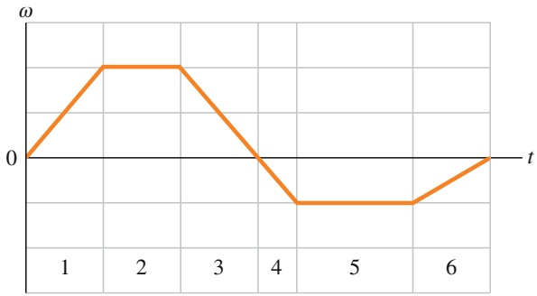

line

| t | \(\omega\) |
| --- | --- |
| 0 | 0 |
| 1.5 | Peak |
| 2.5 | Peak |
| 3.5 | 0 |
| 4.5 | Minimum |
| 5.5 | Minimum |
| 6.5 | 0 |

Abb. 6.F12

**13.** Abbildung 6.F13 zeigt Auftragungen der Winkelposition $\theta$ gegen die Zeit t für drei Fälle, in denen eine Scheibe wie ein Karussell gedreht wird. In jedem Fall wechselt die Drehrichtung bei einer bestimmten Winkelposition $\theta _ { \mathrm { W } }$ Bestimmen Sie für jeden Fall, (a) ob man von $\theta = 0$ durch eine Drehung im Uhrzeigersinn oder gegen den Uhrzeigersinn nach $\theta _ { \mathrm { W } }$ gelangt, (b) ob ω vor, nach oder bei $t = 0$ null ist und (c) ob α positiv, negativ oder null ist.

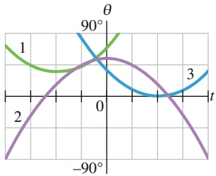

line

| t | Green Line \((\theta)\) | Blue Line \((\theta)\) | Purple Line \((\theta)\) |
| --- | --- | --- | --- |
| 0 | \(90{}^{\circ}\) | ~\(35{}^{\circ}\) | ~\(45{}^{\circ}\) |
| ~1.57 | — | — | ~\(-45{}^{\circ}\) |

Abb. 6.F13

**14.** Auf den Rand einer Scheibe, die sich wie ein Karussell drehen kann, wird eine Kraft ausgeübt, um die Winkelgeschwindigkeit der Scheibe zu verändern. Ihre Anfangs- bzw. Endwinkelgeschwindigkeiten in vier Versuchen sind (a) −2 rad/s, 5 rad/s, (b) 2 rad/s, 5 rad/s, (c) −2 rad $/ \mathbf { s } ,$ $^ { - 5 }$ rad/s und (d) 2 rad $/ s , - 5$ rad/s. Ordnen Sie die Versuche in absteigender Reihenfolge nach der von dem durch die Kraft bewirkten Drehmoment an der Scheibe verrichteten Arbeit.
**15.** Abbildung 6.F15 zeigt eine homogene Metallplatte, die quadratisch war, bevor ein Viertel herausschnitten wurde. Ordnen Sie die drei beschrifteten Punkte in absteigender Reihenfolge nach dem Trägheitsmoment der Platte bezüglich einer Rotation um eine senkrechte Achse durch den jeweiligen Punkt.

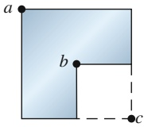

Abb. 6.F15

**16.** Abbildung 6.F16 zeigt drei flache Scheiben (mit dem selben Radius), die sich wie Karussells um ihre Mittelpunkte drehen können. Jede Scheibe besteht aus denselben zwei Materialien, von denen das eine dichter als das andere ist

165

---

6 Die Rotation ausgedehnter Körper

(Dichte ist Masse pro Volumeneinheit). Bei den Scheiben 1 und 3 bildet das dichtere Material die äußere Hälfte der Flä- che der Scheibe; bei Scheibe 2 bildet dieses Material die innere Hälfte der Fläche der Scheibe. Nun werden tangential zu den Scheiben identische Kräften ausgeübt, wie gezeigt entweder am äußeren Rand oder an der Grenzfläche der beiden Materialien. Ordnen Sie die Scheiben in absteigender Reihenfolge (a) nach dem Drehmoment um die Scheibenmitte, (b) nach ihrem Trägheitsmoment bezüglich der Scheibenmitte und (c) nach der resultierenden Winkelbeschleunigung der Scheibe.

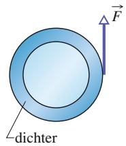

text_image

dichter
F

Scheibe 1

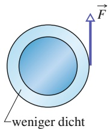

text_image

weniger dicht
F

Scheibe 2

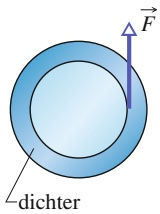

Scheibe 3

## Abb. 6.F16

**17.** Abbildung 6.F17a zeigt einen Meterstab, der zur Hälfte aus Holz und zur Hälfte aus Stahl besteht und an seinem hölzernen Ende bei O drehbar gelagert ist. An seinem stählernen Ende bei a wirkt eine Kraft F⃗. In Abb. 6.F17b ist der Stab umgedreht und ist jetzt an seinem stählernen Ende bei O′ drehbar gelagert; dieselbe Kraft F⃗ wirkt jetzt an seinem hölzernen Ende bei a′. Ist die resultierende Winkelbeschleunigung im Fall von Abb. 6.F17a größer als, kleiner als oder gleich groß wie in Abb. 6.F17b?

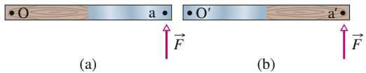

## Abb. 6.F17

**18.** Abbildung 6.F18 zeigt drei Scheiben mit homogener Massenverteilung; die Radien R und die Massen M sind angegeben. Jede Scheibe kann sich um ihre Mittelachse (senkrecht zur Scheibenfläche und durch ihre Mitte) drehen. Ordnen Sie die Scheiben in absteigender Reihenfolge nach ihren Trägheitsmomenten bezüglich ihrer Mittelachsen.

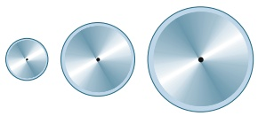

natural_image

Three metallic circular objects with gradient shading, arranged vertically (no text or symbols)

R :1 m 2 m 3 m M:26 kg 7 kg 3 kg

(a)

(b)

(c)

Abb. 6.F18

166
