# 7 Rollbewegung, Drehmoment und Drehimpuls

原始 PDF 第 181–204 页。

# 7 Rollbewegung, Drehmoment und Drehimpuls

## 7.1 Die Rollbewegung

## Physikalische Motivation

Wie wir in Kap. 10 diskutiert haben, macht die Untersuchung von Rotationen einen wesentlichen Teil der Physik aus. Die wichtigste Anwendung dieses Aspekts der Physik ist wohl die Rollbewegung von Rädern und ähnlichen Objekten. Diese Anwendung ist seit Jahrtausenden eine der Grundlagen der menschlichen Zivilisation. Als die Menschen der Osterinsel das Material für ihre riesigen Steinstatuen aus dem Steinbruch brachen und über die Insel bewegten, schleppten sie es vermutlich über Baumstämme, die als Rollen dienten. Viel später, als Siedler im 18. und 19. Jahrhundert auf dem Zug nach Westen durch Amerika fuhren, rollte ihr Besitz zunächst auf Planwagen, später dann mit der Eisenbahn – immer aber auf Rädern. Heutzutage ist unsere Welt – ob wir es mögen oder nicht – voller Autos, Lastwagen, Motorräder, Fahrräder und anderer rollender Fahrzeuge.

Die Physik und Technik der Rollbewegung ist so alt, dass man meinen könn-$\mathbf { t e } ,$ hier gäbe es keine neuen Ideen mehr zu entdecken. Trotzdem wurden solche großen wirtschaftlichen Erfolge wie Skateboards oder Inline-Skates erst vor relativ kurzer Zeit erfunden. Straßenrodeln ist ein ganz neuer Trend, und der selbstbalancierende Segway (Abb. 7.1) hat das Potenzial, die Art und Weise zu verändern, wie wir uns in Städten fortbewegen. Neue Anwendungen der Rollbewegung sind immer noch für eine Überraschung gut. Als Einstieg in die dafür relevante Physik wollen wir zuerst die Rollbewegung als solche verstehen.

## Abb. 7.1

Der selbstbalancierende Segway Personal Transporter wird mittlerweile auch bei der Polizei eingesetzt. Fotoaufnahme beim Bürgerfest im Rahmen der offiziellen Feiern zum 20. Tag der Deutschen Einheit vom 1.–3. Oktober 2010 in Bremen, hier auf dem Grasmarkt vor dem Neuen Rathaus [Quelle: Jocian/CC-AS-3.0].

## 7.1.1 Die Rollbewegung als Mischung aus Translation und Rotation

Wir betrachten das Rad eines Fahrrads, das mit konstanter Geschwindigkeit in einer reinen Rollbewegung (d. h. ohne zu gleiten) an uns vorbeifährt. Wie Sie Abb. 7.2 entnehmen können, bewegt sich der Schwerpunkt O des Rads mit der konstanten Geschwindigkeit $\nu _ { \mathrm { S } }$ vorwärts. Auch der Punkt P auf der Straße, der mit dem Rad in Kontakt steht, bewegt sich mit $\nu _ { S } ,$ sodass er sich stets direkt unter O befindet.

Während eines Zeitintervalls t legen sowohl O als auch P die Strecke s zurück. Aus der Sicht des Radfahrers dreht sich das Rad um einen Winkel θ um seinen Mittelpunkt, wobei der Punkt auf dem Reifen, der die Straße bei $t = 0$ berührte, einen Bogen mit der Länge s durchläuft. Gleichung 6.14 gibt die Beziehung zwischen der Bogenlänge s und dem Drehwinkel θ als Funktion des Radius R des Rads an:

$$
s = \theta R. \tag {7.1}
$$

natural_image

Two police officers in uniform and helmets standing beside a seotroller on a cobblestone street (no visible text or symbols)

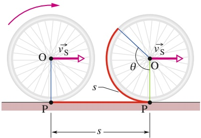

text_image

O
v_S
θ
v_S
P
s
P
s

## Abb. 7.2

Der Schwerpunkt O eines rollenden Rads legt eine Strecke s mit der Geschwindigkeit $\vec { \nu } _ { \mathrm { S } }$ zurück, während sich das Rad um einen Winkel θ dreht. Der Punkt P, in dem das Rad die Straße berührt, bewegt sich dabei um dieselbe Strecke s.

Halliday Physik für natur- und ingenieurwiss. Studiengänge, 3. Auflage. D. Halliday, R. Resnick und J. Walker. © 2020 WILEY-VCH Verlag GmbH & Co. KGaA. Published 2020 by WILEY-VCH Verlag GmbH & Co. KGaA.

167

---

7 Rollbewegung, Drehmoment und Drehimpuls

## Abb. 7.3

Das Rollen eines Rads als Überlagerung einer reinen Translation und einer reinen Rotation. (a) Reiner Rotationsanteil: Alle Punkte des Rads bewegen sich mit derselben Winkelgeschwindigkeit ω. Alle Punkte auf der Außenkante bewegen sich mit derselben linearen Geschwindigkeit $\nu = \nu _ { S } .$ Eingezeichnet sind die linearen Geschwindigkeiten v⃗ zweier solcher Punkte, oben (T) und unten (P). (b) Reiner Translationsanteil: Alle Punkte des Rads bewegen sich mit derselben linearen Geschwindigkeit $\vec { \nu } _ { \mathrm { S } }$ wie der Mittelpunkt nach rechts. (c) Rollbewegung als Mischung von (a) und (b).

(a) reine Rotation

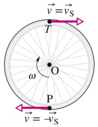

text_image

v⃗ = v⃗_S
T
ω
O
P
v⃗ = -v⃗_S

(b) reine Translation

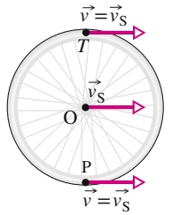

text_image

v⃗ = v⃗_S
T
v⃗_S
O
P
v⃗ = v⃗_S

(c) Rollbewegung

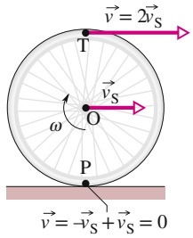

text_image

T
ω
O
P
v = 2v_S
v_S
v = -v_S + v_S = 0

Die lineare Geschwindigkeit $\nu _ { \mathrm { S } }$ des Radmittelpunkts ist gegeben durch ds∕dt. (Die Mitte des Rads soll der Einfachheit halber gleichzeitig dessen Schwerpunkt sein – d. $\mathrm { h } _ { \star } ,$ wir nehmen an, das Rad habe eine homogene Massenverteilung.) Die Winkelgeschwindigkeit ω des Rads bezüglich seines Mittelpunkts ist dθ∕dt. Wir leiten Gl. 7.1 nach der Zeit ab (wobei R konstant gehalten wird) und erhalten für das reine Rollen (ohne Gleiten)

$$
\nu_ {S} = \omega R. \tag {7.2}
$$

Abbildung 7.3 interpretiert die Rollbewegung eines Rads als Überlagerung einer reinen Translation und einer reinen Rotation. In Abb. 7.3a sehen Sie den reinen Rotationsanteil (mit fest stehender Drehachse): Jeder Punkt des Rads dreht sich mit der Winkelgeschwindigkeit ω um die Achse. Wie Sie sich erinnern werden, haben wir diese Art der Bewegung ausführlich in Kap. 10 besprochen. Die lineare Geschwindigkeit $\nu _ { S }$ jedes Punkts an der Außenkante des Rads ist durch Gl. 7.2 gegeben. Abbildung 7.3b zeigt den reinen Translationsanteil (das Rad bewegt sich vorwärts, ohne sich zu drehen): Jeder Punkt des Rads bewegt sich mit der Geschwindigkeit $\nu _ { \mathrm { S } }$ nach rechts.

Die tatsächliche Rollbewegung des Rads (Abb. 7.3c) lässt sich nun als Mischung der Anteile in den Abb. 7.3a und 7.3b beschreiben. Wie Sie erkennen können, ist der untere Teil des Rads (Punkt P) stationär, während sich der obere Teil (Punkt T) schneller bewegt als alle anderen Punkte auf dem Rand des Rads, nämlich mit der Geschwindigkeit $2 \nu _ { \mathrm { S } } ,$ Abbildung 7.4, ein Foto eines rollenden Rads, veranschaulicht Ihnen dieses Ergebnis: Die Speichen im unteren Bereich des Rads sind schärfer abgebildet als diejenigen im oberen Bereich, woraus Sie folgern können, dass sich die oberen Speichen schneller bewegen als die unteren.

Analog zu Abb. 7.3 lässt sich die Bewegung jedes beliebigen runden Körpers, der ohne zu gleiten über eine Fläche rollt, in einen Translations- und einen Rotationsanteil trennen.

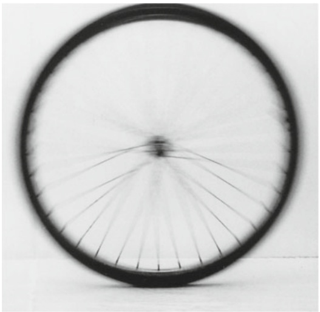

natural_image

Black and white photo of a bicycle wheel rim (no text or symbols visible)

Abb. 7.4 Foto eines rollenden Rads. Die Speichen im oberen Teil des Rads sind weniger scharf abgebildet, weil sie sich schneller bewegen als die Speichen im unteren Teil (siehe Abb. 7.3c) [Quelle: Alice Halliday].

168

---

7.2 Kräfte und die kinetische Energie der Rollbewegung

7

## 7.1.2 Die Rollbewegung als reine Rotation

Abbildung 7.5 legt eine alternative Interpretation der Rollbewegung nahe: als reine Rotation um eine Achse, die stets durch den Berührungspunkt zwischen Straße und Rad verläuft. Entsprechend betrachten wir das Rollen jetzt als reine Rotation um eine Achse durch P (Abb. 7.3c), senkrecht zur Papierebene. Die in Abb. 7.5 eingezeichneten Vektoren stellen dann die momentanen Geschwindigkeiten der zugehörigen Punkte auf dem Rand des Rads dar. Welche Winkelgeschwindigkeit bezüglich dieser Achse ordnet ein ruhender Beobachter einem rollenden Rad zu? Dieselbe Winkelgeschwindigkeit ω, so lautet die Antwort, die er auch für eine reine Rotation um eine Achse durch den Schwerpunkt des Rads angeben würde.

Um diese Antwort nachzuprüfen, wollen wir die lineare Geschwindigkeit des höchsten Punkts des rollenden Rads aus der Sicht eines ruhenden Beobachters in der beschriebenen Weise berechnen. Der Radius des Rads sei R, folglich beträgt der Abstand zwischen T und P in Abb. 7.5 2R, und die lineare Geschwindigkeit in T ist durch Gl. 7.2 gegeben:

$$
\nu_ {\mathrm{T}} = \omega (2 R) = 2 (\omega R) = 2 \nu_ {\mathrm{S}}.
$$

Dies stimmt, wie Sie sofort sehen, mit Abb. 7.3c überein. In analoger Weise können Sie nun die linearen Geschwindigkeiten in den Punkten O und P, wie sie Abb. 7.3c angibt, nachrechnen.

## KONTROLLFRAGE 1

Ein Clown fährt auf einem Fahrrad durch die Manege. Der Radius des Vorderrads ist nur halb so groß wie der des Hinterrads. (a) Ist die lineare Geschwindigkeit des höchsten Punkts des Hinterrads größer als, kleiner als oder ebenso groß wie die Geschwindigkeit des höchsten Punkts des Vorderrads? (b) Ist die Winkelge schwindigkeit des Hinterrads größer als, kleiner als oder ebenso groß wie diejenige des Vorderrads?

## 7.2 Kräfte und die kinetische Energie der Rollbewegung

## Lernziele

Nach dem Durcharbeiten dieses Abschnitts sollten Sie in der Lage sein, . . .

• die kinetische Energie eines Körpers für eine reine Rollbewegung als Summe der kinetischen Energie der Translation des Schwerpunkts und der kinetischen Energie der Rotation um den Schwerpunkt zu berechnen,
• die Beziehung zwischen der Arbeit an einem reibungslos rollenden Objekt und der Änderung seiner kinetischen Energie anzugeben und anzuwenden,
• für eine reine Rollbewegung (ohne Gleiten) mithilfe der Energieerhaltung eine Beziehung zwischen der anfänglichen Energie und der Energie zu einem späteren Zeitpunkt anzugeben,
• ein Kräftediagramm eines beschleunigenden Körpers zu skizzieren, der auf einer horizontalen Fläche oder einer geneigten Ebene aufwärts- oder abwärtsrollt,
• die Beziehung zwischen der Beschleunigung des Schwerpunkts und der Winkelbeschleunigung anzugeben und anzuwenden,
• für eine Rollbewegung eines Objekts auf einer geneigten Ebene die Beziehung zwischen der Beschleunigung des Objekts, seinem Trägheitsmoment und dem Neigungswinkel der Ebene anzuwenden.

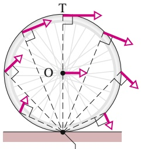

text_image

T
O

Drehachse in P

## Abb. 7.5

Die Rollbewegung kann als reine Rotation mit der Winkelgeschwindigkeit ω um eine Achse betrachtet werden, die stets durch P führt. Die Vektoren geben die momentanen linearen Geschwindigkeiten ausgewählter Punkte auf dem Rand des Rads an. Sie erhalten diese Vektoren durch eine Kombination des Translations- und des Rotationsanteils in Abb. 7.3.

169

---

7 Rollbewegung, Drehmoment und Drehimpuls

## Schlüsselideen

• Ein rollendes Rad besitzt die kinetische Energie

$$
K = \frac {1}{2} I _ {\mathrm{S}} \omega^ {2} + \frac {1}{2} M \nu_ {\mathrm{S}} ^ {2},
$$

wobei $I _ { \mathrm { S } }$ das Trägheitsmoment des Rads um seinen Schwerpunkt ist und M seine Masse.

• Wenn das Rad beschleunigt wird, aber noch rollt, ohne zu gleiten, hängt die Beschleunigung ${ \vec { a } } _ { S }$ des Schwerpunkts gemäß

$$
a _ {S} = \alpha R
$$

mit der Winkelbeschleunigung α um die Mittelachse zusammen.

• Wenn ein Rad eine geneigte Ebene mit dem Neigungswinkel θ abwärtsrollt, ist seine Beschleunigung entlang einer x-Achse parallel zu der Ebene

$$
a _ {\mathrm{S}, x} = - \frac {g \sin \theta}{1 + I _ {\mathrm{S}} / (M R ^ {2})}.
$$

## 7.2.1 Die kinetische Energie der Rollbewegung

Wir wollen nun die kinetische Energie eines rollenden Rads aus der Sicht eines ruhenden Beobachters ermitteln. Betrachten wir das Rollen als reine Rotation um eine Achse durch P (siehe Abb. 7.5), so liefert uns Gl. 6.24

$$
K = \frac {1}{2} I _ {\mathrm{p}} \omega^ {2} \tag {7.3}
$$

mit ω als Winkelgeschwindigkeit des Rads und $I _ { \mathrm { P } }$ als Trägheitsmoment der Rotation um die Achse durch P. Aus dem Steinerschen Satz $( \mathrm { G l . }   6 . 2 6 , I = I _ { \mathrm { S } }   +   M h ^ { 2 } )$ folgt dann

$$
I _ {\mathrm{P}} = I _ {\mathrm{S}} + M R ^ {2}, \tag {7.4}
$$

wobei M die Masse des Rads ist und $I _ { \mathrm { S } }$ das Trägheitsmoment der Rotation um eine Achse durch den Schwerpunkt. Der Radius R entspricht dem senkrechten Abstand h. Wir setzen Gl. 7.4 in Gl. 7.3 ein und erhalten so

$$
K = \frac {1}{2} I _ {\mathrm{S}} \omega^ {2} + \frac {1}{2} M R ^ {2} \omega^ {2},
$$

woraus mithilfe von Gl. $7 . 2 \: ( \nu _ { S } = \omega R )$ folgt

$$
K = \frac {1}{2} I _ {\mathrm{S}} \omega^ {2} + \frac {1}{2} M \nu_ {\mathrm{S}} ^ {2}. \tag {7.5}
$$

Den Term $\frac { 1 } { 2 } I _ { S } \omega ^ { 2 }$ können wir als kinetische Energie der Rotation des Rads um eine Achse durch seinen Schwerpunkt (Abb. 7.3a) interpretieren; $\frac { 1 } { 2 } M \nu _ { S } ^ { 2 }$ ist die kinetische Energie der Translationsbewegung des Schwerpunkts des Rads (Abb. 7.3b). Wir merken uns die folgende Regel:

Ein rollendes Objekt besitzt zwei Formen kinetischer Energie: die Rotationsenergie $\frac { 1 } { 2 } \dot { I _ { S } \omega ^ { 2 } }$ infolge der Rotation um seinen Schwerpunkt und die Translationsenergie $\frac { 1 } { 2 } M \bar { \nu _ { S } ^ { 2 } }$ infolge der Translation seines Schwerpunkts.

## 7.2.2 Die Kräfte bei der Rollbewegung

## Rollen und Reibung

Ein Rad, das mit konstanter Geschwindigkeit rollt wie in Abb. 7.2 gezeigt, gleitet am Berührungspunkt P nicht. Folglich wirken dort keine Reibungskräfte. Wird das Rad hingegen durch eine resultierende Kraft beschleunigt oder verzögert, so

170

---

7.2 Kräfte und die kinetische Energie der Rollbewegung

7

verursacht diese Kraft eine Beschleunigung ${ \vec { a } } _ { S }$ des Schwerpunkts in der Bewe gungsrichtung. Sie bewirkt außerdem, dass sich das Rad schneller oder langsamer dreht – d. h., sie verursacht auch eine Winkelbeschleunigung α bezüglich des Schwerpunkts. Damit das Rad durch die Wirkung dieser Beschleunigungen nicht zu gleiten beginnt, muss dem eine Reibungskraft in Punkt P entgegenwirken.

Solange das Rad nicht gleitet, handelt es sich dabei um eine statische Reibungskraft (Haftreibung) ${ \vec { f } } _ { s } .$ Die Beträge der linearen Beschleunigung ${ \vec { a } } _ { S }$ und der Winkelbeschleunigung α können wir dann durch Ableiten von Gl. 7.2 nach der Zeit (bei konstantem $R )$ zueinander in Beziehung setzen. Auf der linke Seite ist $\mathrm { d } \nu _ { \mathrm { S } } / \mathrm { d } t$ gleich $a _ { S } ,$ auf der rechten Seite ist dω∕dt gleich α. Für reines (gleitfreies) Rollen gilt demnach

$$
a _ {S} = \alpha R. \tag {7.6}
$$

Sobald das Rad gleitet, wirkt in P eine kinetische Reibungskraft (Gleitreibung) $\vec { f } _ { \mathrm { k } }$ und wir können Gl. 7.6 nicht mehr anwenden. Unsere folgende Diskussion werden wir auf das reine Rollen beschränken.

In Abb. 7.6 sehen Sie ein Rad, das über eine ebene Fläche rollt und dabei beschleunigt wird (denken Sie an ein Fahrrad zu Beginn eines Rennens). In Folge der Beschleunigung droht Punkt $\mathrm { P } _ { \mathrm { r } }$ der tiefste Punkt des Rads, nach links zu rutschen. Dem wirkt in P eine nach rechts gerichtete Reibungskraft entgegen. Solange das Rad nicht gleitet, handelt es sich um eine statische Reibungskraft ${ \vec { f } } _ { s } ,$ und wir können Gl. 7.6 anwenden. (Ohne das Wirken der Reibungskräfte wären Radrennen ziemlich langweilig, weil kein Rennfahrer vom Fleck käme.)

Um mit Abb. 7.6 die Verzögerung eines Rads zu beschreiben, sind zwei Änderungen anzubringen: Sowohl die Beschleunigung ${ \vec { a } } _ { S }$ des Schwerpunkts als auch die Reibungskraft $\vec { f } _ { s }$ in Punkt P müssen dann nach links zeigen.

## Die Rollbewegung auf einer geneigten Ebene

In Abb. 7.7 sehen Sie, wie ein runder, homogener Körper mit der Masse M und dem Radius R entlang einer x-Achse von einer Ebene abrollt, die relativ zur Waagerechten um einen Winkel θ geneigt ist. Gesucht ist ein Ausdruck für die Beschleunigung $a _ { \mathrm { S } , x }$ des Körpers während des Abrollens. Um die Aufgabe zu lösen, verwenden wir das zweite Newtonsche Gesetz sowohl in linearer als auch in Winkelschreibweise $( F _ { \mathrm { g e s } } = M a \mathrm { b z w . } \tau _ { \mathrm { g e s } } = I \alpha )$

Zunächst zeichnen wir die wirkenden Kräfte ein (vgl. Abb. 7.7):

1. Die Schwerkraft $\vec { F } _ { \mathrm { G } }$ wirkt senkrecht nach unten. Der zugehörige Vektor beginnt im Schwerpunkt des Körpers. Die Komponente der Kraft entlang der x-Achse ist $F _ { \mathrm { G } }$ sin $\theta$ (äquivalent zu Mg sin θ).
2. Senkrecht zur Ebene der Rampe wirkt eine Normalkraft $\vec { N } .$ Sie greift am Berührungspunkt P an, der zugehörige Vektor wurde in Abb. 7.7 jedoch so weit nach oben verschoben, dass er ebenfalls im Schwerpunkt beginnt.
3. Im Berührungspunkt P greift die statische Reibungskraft $\vec { f } _ { s }$ an, deren Richtung die Rampe aufwärts zeigt. (Sie erkennen, warum dies so ist: Ohne das Wirken der Reibung würde der Körper die Rampe abwärts gleiten. Um dies zu verhindern, muss die Kraft die Rampe hinauf wirken.)

Das zweite Newtonsche Gesetz für die x-Komponenten der Kräfte in Abb. 7.7 $( F _ { \mathrm { g e s } , x } = m a _ { x } )$ können wir nun wie folgt formulieren:

$$
f _ {\mathrm{s}} - M g \sin \theta = M a _ {\mathrm{S}, x}. \tag {7.7}
$$

Dieser Ausdruck enthält zwei Unbekannte, $f _ { S }$ und $a _ { S , x ^ { \ast } }$ (Wir können nicht davon ausgehen, dass $f _ { S }$ den Maximalwert $f _ { \mathrm { s , m a x } }$ erreicht. Wir wissen lediglich, dass der Betrag von $f _ { S }$ gerade ausreicht, um das Abwärtsgleiten des Körpers zu verhindern.)

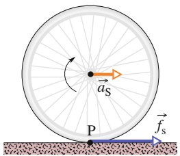

text_image

u_S
P
f_s

Abb. 7.6

Ein Rad rollt ohne zu gleiten über eine waagerechte Fläche, wobei eine lineare Beschleunigung ${ \vec { a } } _ { \mathrm { S } _ { \mathrm { s } } }$ wirkt. Eine statische Reibungskraft $f _ { s }$ wirkt in P dem Wegrutschen dieses Punkts nach links entgegen.

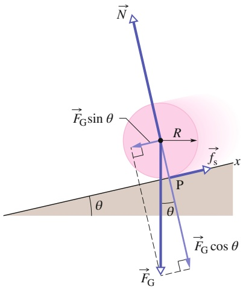

text_image

N
F_G sin θ
R
f_s
x
P
θ
θ
F_G cos θ
F_G

Abb. 7.7

Ein runder, homogener Körper mit dem Radius R rollt von einer geneigten Ebene ab. Auf den Körper wirken die Gravitationskraft $\vec { F } _ { \mathrm { G } } ,$ eine Normalkraft $\vec { N }$ und eine die Rampe aufwärts zeigende Reibungskraft ${ \vec { f } } _ { \mathrm { s } } .$ (Der Übersichtlichkeit halber wurde der Vektor N⃗ so verschoben, dass sein Anfangspunkt auf dem Schwerpunkt liegt.

171

---

7 Rollbewegung, Drehmoment und Drehimpuls

Wir wollen nun das zweite Newtonsche Gesetz in Winkelschreibweise auf die Rotation des Körpers um seinen Schwerpunkt anwenden. Zunächst notieren wir mithilfe von $\mathrm { G l . } \; 6 . 3 0 \; ( \tau = r _ { \perp } F )$ die Drehmomente bezüglich dieses Punkts. Die Reibungskraft $\vec { f } _ { s }$ mit dem Hebelarm $R$ erzeugt das Drehmoment $R f _ { S } ;$ es ist positiv, denn es bewirkt eine Rotation des Körpers gegen den Uhrzeigersinn (siehe Abb. 7.7). Die Hebelarme der Kräfte $\vec { F } _ { \mathrm { G } }$ und $\vec { N }$ sind null, folglich erzeugen diese Kräfte kein Drehmoment. Wir formulieren also das zweite Newtonsche Gesetz $( \tau _ { \mathrm { g e s } } = I \alpha )$ bezüglich einer Achse durch den Schwerpunkt des Körpers:

$$
R f _ {\mathrm{s}} = I _ {\mathrm{S}} \alpha . \tag {7.8}
$$

Auch diese Gleichung enthält zwei Unbekannte: $f _ { S }$ und $\alpha ,$

Da es sich hier um eine reine Rollbewegung handelt, können wir mithilfe von Gl. $7 . 6 \; ( a _ { \mathrm { S } } = \alpha R )$ die unbekannten Größen $a _ { \mathrm { S } , x }$ und α zueinander in Beziehung setzen. Hierbei ist allerdings Vorsicht geboten, weil $a _ { \mathrm { S } , x }$ negativ ist (in negative x-Richtung zeigt), α dagegen positiv (gegen den Uhrzeigersinn). Wir setzen also $- \alpha _ { S , x / R }$ für α in Gl. 7.8 ein und lösen nach $f _ { S }$ auf:

$$
f _ {\mathrm{s}} = - I _ {S} \frac {a _ {\mathrm{S} , x}}{R ^ {2}}. \tag {7.9}
$$

Nun setzen wir noch die rechte Seite dieser Gleichung für $f _ { S }$ in Gl. 7.7 ein und erhalten

$$
a _ {S, x} = - \frac {g \sin \theta}{1 + I _ {S} / (M R ^ {2})}. \tag {7.10}
$$

Mithilfe dieser Gleichung können wir die lineare Beschleunigung $a _ { \mathrm { S } , x }$ eines beliebigen Körpers beim Abrollen von einer um den Winkel θ bezüglich der Waagerechten geneigten Ebene berechnen.

## KONTROLLFRAGE 2

Zwei identische Scheiben A und B rollen mit gleicher Geschwindigkeit über den Boden. Scheibe A rollt eine geneigte Ebene hinauf und erreicht die maximale Hö- he h. Scheibe B rollt eine ebensolche Ebene hinauf, wobei aber keinerlei Reibungskräfte wirken. Erreicht B die gleiche, eine geringere oder eine größere Höhe als A?

## 7.3 Das Jo-Jo

## Lernziele

Nach dem Durcharbeiten dieses Abschnitts sollten Sie in der Lage sein, . . .

• ein Kräftediagramm für ein Jo-Jo zu skizzieren, das sich an seiner Schnur nach oben oder unten bewegt,
• zu verstehen, dass ein Jo-Jo im Prinzip ein Objekt ist, das auf einer geneigten Ebene mit einem Neigungswinkel von 90° aufwärts- oder abwärtsrollt,
• für ein Jo-Jo, das sich an seiner Schnur aufwärts oder abwärts bewegt, die Beziehungen zwischen seiner Beschleunigung und seinem Trägheitsmoment anzugeben,
• die Spannung (Seilkraft) in der Schnur eines Jo-Jos anzugeben, während es sich aufwärts oder abwärts bewegt.

## Schlüsselideen

• Ein Jo-Jo, das sich an seiner Schnur aufwärts oder abwärts bewegt, kann als Rad behandelt werden, das sich auf einer geneigten Ebene mit dem Neigungswinkel 90° bewegt.

172

---

7.4 Eine erweiterte Definition des Drehmoments

7

## 7.3.1 Das Jo-Jo

Ein Jo-Jo ist ein Physiklabor für die Hosentasche. Rollt es eine Strecke h abwärts, so verliert es die potenzielle Energie mgh, gewinnt aber dafür kinetische Energie der Translation $( \frac { 1 } { 2 } m \nu _ { \mathrm { S } } ^ { 2 } )$ und der Rotation $( \frac { 1 } { 2 } I _ { \mathrm { S } } \omega ^ { 2 } )$ . Rollt das Jo-Jo wieder aufwärts, so verliert es kinetische und gewinnt potenzielle Energie.

Bei einer modernen Variante ist das untere Ende des Fadens nicht fest an die Achse der Rolle gebunden, sondern nur darum geschlungen. Kommt die Rolle am Ende des Fadens an, so übt der Faden eine aufwärts gerichtete Kraft auf die Achse aus. Die Rolle fährt fort sich zu drehen (die Achse rotiert innerhalb der Fadenschlinge), wobei sie nur kinetische Energie der Rotation besitzt. Das Jo-Jo „schläft“, bis Sie es „aufwecken“, indem Sie den Faden kurz nach oben ziehen, wodurch er sich wieder auf die Achse wickelt und die Rolle aufwärts zu steigen beginnt. Die kinetische Energie der Rotation der Rolle in der Fadenschlinge (und damit die maximale „Schlafzeit“ des Jo-Jos) können Sie deutlich steigern, indem Sie die Rolle zu Beginn nach unten werfen, ihr also Anfangs(winkel)geschwindigkeiten $\nu _ { \mathrm { S } }$ bzw. ω verschieden von null verleihen.

Wir suchen nun einen Ausdruck für die lineare Beschleunigung $a _ { \mathrm { S } }$ eines abwärts abrollenden Jo-Jos. Dazu könnten wir das zweite Newtonsche Gesetz anwenden, analog zu unserem Vorgehen im Fall des von einer Rampe abrollenden Körpers (Abb. 7.7). Unsere Analyse unterscheidet sich von diesem Fall nur in wenigen Punkten:

1. Das Jo-Jo rollt keine um einen mehr oder weniger flachen Winkel θ geneigte Ebene hinab, sondern es rollt an einem senkrecht hängenden Faden $\left( \theta = 9 0 ^ { \circ } \right)$
2. Das Jo-Jo rollt nicht auf seinem Außenrand, sondern auf einer Achse, die sich beim Radius $R _ { 0 }$ befindet (siehe Abb. 7.8a).
3. Das Jo-Jo wird nicht von einer Reibungskraft $\vec { f } _ { s }$ gebremst, sondern von einer Seilkraft bzw. Spannung ${ \vec { T } } ,$ welche der Faden ausübt (siehe Abb. 7.8b).

Diese Analyse führt uns wieder zu Gl. 7.10. Wir ändern deshalb in dieser Gleichung lediglich die Notation und setzen $\theta = 9 0 ^ { \circ }$ . So erhalten wir für die lineare Beschleunigung:

$$
a _ {\mathrm{S}} = - \frac {g}{1 + I _ {\mathrm{S}} / (M R _ {0} ^ {2})} \tag {7.11}
$$

mit $I _ { S }$ als Trägheitsmoment für die Rotation des Jo-Jos um seine Mittelachse und M als Masse des Jo-Jos. Wenn das Jo-Jo am Faden wieder aufwärtssteigt, wirkt die selbe abwärtsgerichteteBeschleunigung, weil sich die in Abb. 7.8b eingezeichneten Kräfte nicht verändert haben.

## 7.4 Eine erweiterte Definition des Drehmoments

## Lernziele

Nach dem Durcharbeiten dieses Abschnitts sollten Sie in der Lage sein, . . .

• zu verstehen, dass das Drehmoment eine Vektorgröße ist,
• zu verstehen, dass bei der Berechnung eines Drehmoments immer der Punkt angegeben werden muss, auf den es sich bezieht,
• das von einer Kraft auf ein Teilchen ausgeübte Drehmoment zu berechnen, indem Sie das Kreuzprodukt des Ortsvektors des Teilchens und des Kraftvektors entweder in Einheitsvektoren- oder in Betrag-Winkel-Schreibweise bilden,
• die Rechte-Hand-Regel für Kreuzprodukte anzuwenden, um die Richtung eines Drehmomentvektors zu bestimmen.

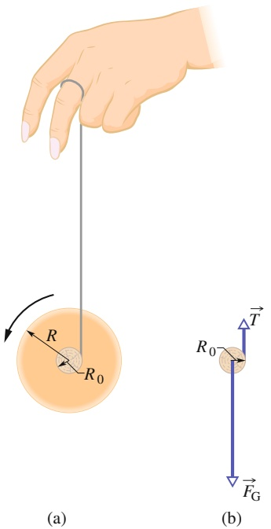

text_image

R
R₀
(a)
T
R₀
Fₖ
(b)

Abb. 7.8

(a) Querschnitt eines Jo-Jos. Der Faden, dessen Dicke wir vernachlässigen wollen, ist um eine Achse mit dem Radius $R _ { 0 }$ gewickelt. (b) Kräftediagramm für das fallende Jo-Jo. Gezeigt ist nur die Achse.

173

---

7 Rollbewegung, Drehmoment und Drehimpuls

## Schlüsselideen

• In drei Dimensionen ist das Drehmoment eine Vektorgröße, die relativ zu einem Bezugspunkt (üblicherweise dem Ursprung des gewählten Koordinatensystems) als

$$
\vec {\tau} = \vec {r} \times \vec {F}
$$

definiert ist, wobei $\vec { F }$ eine Kraft ist, die auf ein Teilchen wirkt, und $\vec { r }$ ein Ortsvektor, der die Position des Teilchens relativ zu dem Bezugspunkt angibt.

• Der Betrag von $\vec { \tau }$ ist durch

$$
\tau = r F \sin \varphi = r F _ {\perp} = r _ {\perp} F
$$

gegeben, wobei $\varphi$ der Winkel zwischen $\vec { F }$ und $\vec { r }$ ist, $F _ { \perp }$ die Komponente von $\vec { F }$ senkrecht zu $\vec { r }$ und $r _ { \perp }$ der Hebelarm von ${ \vec { F } } .$

• Die Richtung von $\stackrel { \rightarrow } { \tau } = \stackrel { \rightarrow } { r } \times \stackrel { \rightarrow } { F }$ kann durch die Rechte-Hand-Regel für Kreuzprodukte bestimmt werden.

## 7.4.1 Ein erweiterter Blick auf das Drehmoment

In Kap. 10 hatten wir das Drehmoment τ eines starren, um eine feste Achse drehbaren Körpers definiert. Jeder Punkt des Körpers muss sich dabei auf einer Kreisbahn um diese Achse bewegen. Wir erweitern unsere Definition nun auf ein einzelnes Teilchen, das sich entlang eines beliebigen Wegs relativ zu einem festen Punkt (anstelle einer festen Achse) bewegt. Dieser Weg muss jetzt keine Kreisbahn mehr sein, weshalb wir das Drehmoment als Vektor τ⃗ mit beliebiger Richtung formulieren müssen.

Abbildung 7.9a zeigt ein solches Teilchen in einem Punkt A der xy-Ebene. Eine Kraft $\vec { F }$ wirkt in dieser Ebene auf das Teilchen, dessen Ort relativ zum Ursprung O durch den Ortsvektor $\vec { r }$ gegeben ist. Das relativ zum festen Punkt O auf das Teilchen wirkende Drehmoment τ⃗ ist definiert als

$$
\vec {\tau} = \vec {r} \times \vec {F}. \tag {7.12}
$$

Das hier auftretende Vektorprodukt (oder Kreuzprodukt) berechnen wir mithilfe der in Anhang D gegebenen Regeln. Um die Richtung von $\vec { \tau }$ zu ermitteln, verschieben wir den Vektor $\vec { F }$ (ohne Änderung der Richtung), bis die Anfangspunkte der im Vektorprodukt auftretenden Vektoren übereinander zu liegen kommen (siehe Abb. 7.9b). Dann wenden wir die Rechte-Hand-Regel an (Abb. 6.5c) und krümmen die Finger der rechten Hand von $\vec { r }$ (dem ersten Vektor) nach $\vec { F }$ (dem zweiten Vektor). Der ausgestreckte rechte Daumen zeigt nun in die Richtung von ⃗τ. In Abb. 7.9b ist dies die positive Richtung der z-Achse.

Nun ist noch der Betrag von $\vec { \tau }$ zu berechnen. Dazu verwenden wir die allgemeine Beziehung c = ab sin $\varphi$ (vgl. Anhang D) und erhalten

$$
\tau = r F \sin \varphi , \tag {7.13}
$$

Abb. 7.9 Zur Definition des Drehmoments: (a) Eine Kraft F⃗ in der xy-Ebene wirkt auf ein Teilchen im Punkt A. (b) Diese Kraft erzeugt ein Drehmoment $\vec { \tau } = \vec { r } \times \vec { F }$ relativ zu O auf das Teilchen. Die Rechte-Hand-Regel für Kreuzprodukte ergibt, dass ⃗τ in positiver z-Richtung zeigt. Der Betrag von ⃗τ ist gegeben durch $r F _ { \perp }$ (b) bzw. $r _ { \perp } F$ (c).

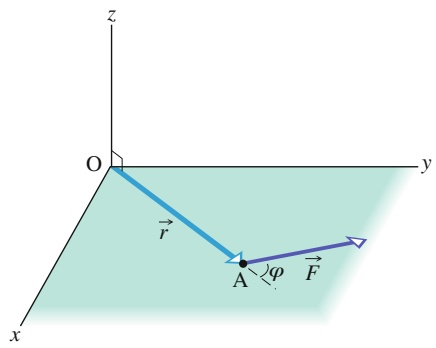

text_image

z
O
y
r
A
φ
F
x

(a)

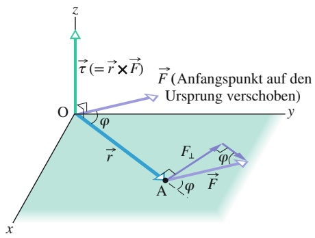

text_image

z
τ (= r × F)
F (Anfangspunkt auf den Ursprung verschoben)
O
φ
y
r
F⊥
φ
A
φ
F
x

(b)

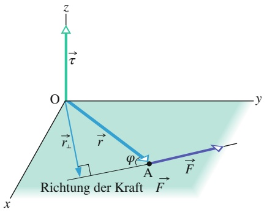

text_image

z
τ
O
y
r⊥
r
φ
A
F
x
Richtung der Kraft
F

(c)

174

---

7.5 Der Drehimpuls

7

mit $\varphi$ als Winkel zwischen den Richtungen von $\vec { r }$ und $\vec { F }$ (wenn die Anfangspunkte der Vektoren aufeinander liegen). Aus Abb. 7.9b entnehmen wir, dass sich Gl. 7.13 auch in der Form

$$
\tau = r F _ {\perp} \tag {7.14}
$$

aufschreiben lässt mit $F _ { \perp } = F$ sin 𝜑 als senkrecht zu $\vec { r }$ stehender Komponente von ${ \vec { F } } .$ Aus Abb. 7.9c folgt als alternative Schreibweise von Gl. 7.13

$$
\tau = r _ {\perp} F \tag {7.15}
$$

mit $r _ { \perp } = r$ sin 𝜑 als Hebelarm von $\vec { F }$ (dem senkrechten Abstand zwischen O und der Richtung der Kraft $\vec { F } )$ .

## KONTROLLFRAGE 3

Der Ortsvektor ⃗r eines Teilchens zeigt in die positive Richtung der z-Achse. In wel cher Richtung wirkt eine Kraft, die ein Drehmoment (a) von null, (b) in negativer x-Richtung und (c) in negativer y-Richtung auf dieses Teilchen erzeugt?

## LÖSUNGSSTRATEGIEN

**Strategie 1: Vektorprodukte und Drehmomente** Gleichung 7.13 ist die erste Anwendung des Vektorprodukts (Kreuzprodukts), die wir kennenlernen. Die entsprechenden Rechenregeln können Sie in Anhang D nachlesen.

Denken Sie daran, dass ein Drehmoment nur sinnvoll ist, wenn es bezüglich eines Punkts (für die Rotation um eine Achse durch diesen Punkt) angegeben wird. Von der Lage dieses Punkts hängt unter Umständen sowohl der Betrag als auch die Richtung des Drehmoments ab. In Beispielaufgabe 7.2 im Übungsbuch haben wir die Drehmomente bezüglich des Ursprungs O berechnet. Sie können sofort zeigen, dass alle drei Drehmomente bezüglich des Punkts A (des Orts des Teilchens) null sind, weil dann stets r = 0 ist.

## 7.5 Der Drehimpuls

## Lernziele

Nach dem Durcharbeiten dieses Abschnitts sollten Sie in der Lage sein, . . .

• zu verstehen, dass der Drehimpuls eine Vektorgröße ist,
• zu verstehen, dass zur Berechnung eines Drehimpulses immer der zugehörige Bezugspunkt angegeben werden muss,
• den Drehimpuls eines Teilchens aus dem Vektorprodukt des Ortsvektors des Teilchens und seines Impulsvektors entweder in Einheitsvektoren- oder Betrag-Winkel-Schreibweise zu berechnen,
• die Rechte-Hand-Regel für Vektorprodukteanzuwenden, um die Richtung eines Drehimpulsvektors zu bestimmen.

## Schlüsselideen

• Der Drehimpuls $\vec { \ell }$ eines Teilchens mit dem Impuls $\vec { p } ,$ der Masse m und der linearen Geschwindigkeit ⃗v ist eine relativ zu einem Bezugspunkt (üblicherweise dem Ursprung) definierte Vektorgröße:

$$
\vec {\ell} = \vec {r} \times \vec {p} = m (\vec {r} \times \vec {\nu}).
$$

• Der Betrag von $\vec { \ell }$ ist durch

$$
\begin{array}{l} \ell = r m \nu \sin \varphi \\ = r p _ {\perp} = r m v _ {\perp} \\ = r _ {\perp} p = r _ {\perp} m \nu \\ \end{array}
$$

175

---

7 Rollbewegung, Drehmoment und Drehimpuls

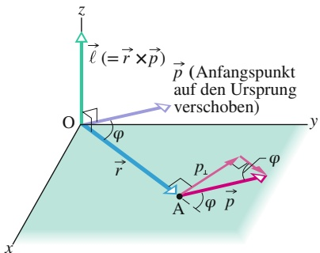

text_image

z
ℓ (= r × p)
p (Anfangspunkt
auf den Ursprung
verschoben)
O
φ
r
y
A
p₁
φ
φ
p
x

(a)

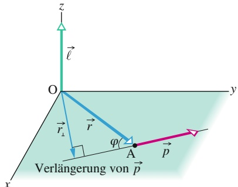

text_image

z
ℓ
O
y
r₁
r
φ₁
A
p
x
Verlängerung von p

(b)

Abb. 7.10

Zur Definition des Drehimpulses: Ein Teilchen, das sich durch den Punkt $\mathbf { A }$ bewegt, besitzt den linearen Impuls $\vec { p } ^ {   } = m \vec { \nu } ,$ wobei der Vektor $\vec { p }$ in der xy-Ebene liegt. Der Drehimpuls des Teilchens bezüglich O ist gegeben durch $\vec { \ell } = \vec { r } \times \vec { p } .$ Wie die Rechte-Hand-Regel ergibt, zeigt der Drehimpulsvektor hier in die positive z-Richtung. Der Betrag von $\vec { \ell }$ ist gegeben (a) durch $\ell = r p _ { \perp } = r m \nu _ { \perp }$ und (b) durch $\ell = r _ { \perp } p = r _ { \perp } m \nu$

gegeben, wobei $\varphi$ der Winkel zwischen $\vec { r }$ und $\vec { p }$ ist und $p _ { \perp }$ und $\nu _ { \perp }$ die Komponenten von $\vec { p }$ bzw. v⃗ senkrecht zu $\vec { r }$ sind. $r _ { \perp }$ ist der senkrechte Abstand zwischen dem Bezugspunkt und der Verlängerung von $\vec { p } .$ .

• Die Richtung von $\vec { \ell }$ ist durch die Rechte-Hand-Regel gegeben: Halten Sie Ihre rechte Hand $\mathbf { S O } ,$ dass die Finger in Richtung von $\vec { r }$ zeigen und drehen Sie die Hand um die Handfläche, bis sie in Richtung von $\vec { p }$ zeigen. Der ausgestreckte Daumen zeigt dann in die Richtung von $\vec { \ell } .$

## 7.5.1 Der Drehimpuls

Wie wir in den vergangenen Kapiteln gesehen haben, sind der lineare Impuls $\vec { p }$ und der zugehörige Impulserhaltungssatz leistungsfähige Hilfsmittel bei der Lö- sung vieler Aufgaben. Mit ihrer Hilfe können wir z. B. das Ergebnis eines Zusammenstoßes zwischen zwei Autos vorhersagen, ohne über Einzelheiten des Ablaufs der Kollision Bescheid zu wissen. In diesem Abschnitt wollen wir das Analogon von $\vec { p }$ für die Rotation einführen. Am Ende dieses Kapitels lernen wir den Erhaltungssatz für diese neue Größe kennen.

Abbildung 7.10 zeigt ein Teilchen mit der Masse m und dem linearen Impuls $\vec { p } = m \vec { \nu } ,$ , das sich durch den Punkt A in der xy-Ebene bewegt. Der **Drehimpuls** $\vec { \ell }$ dieses Teilchens relativ zu O ist definiert als die vektorielle Größe

$$
\vec {\ell} = \vec {r} \times \vec {p} = m (\vec {r} \times \vec {\nu}), \tag {7.16}
$$

mit $\vec { r }$ als Ortsvektor des Teilchens relativ zu O. Bewegt sich das Teilchen bezüglich $\mathrm { O }$ in der Richtung seines Impulses $\vec { p } = m \vec { \nu } ,$ , so rotiert der Ortsvektor $\vec { r }$ um O. Vorsicht: Auch ein Teilchen, das selbst nicht um O rotiert, kann einen Drehimpuls bezüglich O besitzen! Ein Vergleich der Gln. 7.12 und 7.16 zeigt, dass sich der Drehimpuls zum linearen Impuls verhält wie das Drehmoment zur Kraft. Die SI-Einheit des Drehimpulses ist $\mathrm { k g } \cdot \mathrm { m } ^ { 2 } / \mathrm { s }$ (äquivalent zu J ⋅ s).

Um die Richtung des Drehimpulsvektors $\vec { \ell }$ in Abb. 7.10 zu ermitteln, verschieben wir den Vektor $\vec { p } ,$ bis sein Anfangspunkt im Ursprung O liegt. Dann wenden wir die Rechte-Hand-Regel für Vektorproduktean und krümmen die Finger von $\boldsymbol { \cdot } \vec { r }$ nach $\vec { p } .$ Der ausgestreckte Daumen zeigt dann in Richtung von $\vec { \ell } ,$ nämlich in die positive z-Richtung (Abb. 7.10). Diese positive Richtung ist konsistent mit einer Rotation des Ortsvektors $\vec { r }$ des Teilchens gegen den Uhrzeigersinn um die z-Achse, wenn sich das Teilchen weiterbewegt. (Würde $\vec { \ell }$ in negative z-Richtung zeigen, so drehte sich ⃗r im Uhrzeigersinn um die z-Achse.)

Mithilfe der allgemeinen Beziehung $c = a b$ sin $\varphi$ (vgl. Anhang D) berechnen wir nun den Betrag von $\vec { \ell } .$ Dazu schreiben wir

$$
\ell = r m \nu \sin \varphi , \tag {7.17}
$$

mit $\varphi$ als Winkel zwischen $\vec { r }$ und $\vec { p }$ (wenn die Anfangspunkte beider Vektoren aufeinander liegen). Aus Abb. 7.10a entnehmen wir, dass wir Gl. 7.17 auch in der Form

$$
\ell = r p _ {\perp} = r m v _ {\perp} \tag {7.18}
$$

ausdrücken können, mit $p _ { \perp }$ als Komponente von $\vec { p }$ senkrecht zu $\vec { r }$ und $\nu _ { \perp }$ als Komponente von $\vec { \nu }$ senkrecht zu $\vec { r } .$ Aus Abb. 7.10b folgt alternativ

$$
\ell = r _ {\perp} p = r _ {\perp} m \nu \tag {7.19}
$$

mit $r _ { \perp }$ als senkrechtem Abstand zwischen O und der Verlängerung von $\vec { p } .$

Wie das Drehmoment ist auch der Drehimpuls nur bei Angabe eines Bezugs punkts sinnvoll. Läge das Teilchen in Abb. 7.10 nicht in der xy-Ebene oder läge der lineare Impuls $\vec { p }$ des Teilchens nicht ebenfalls in dieser Ebene, so wäre der Drehim puls $\vec { \ell }$ nicht parallel zur $z - \mathrm { A }$ chse. Die Richtung des Drehimpulsvektors steht stets senkrecht auf der Ebene, die vom Ortsvektor $\xrightarrow [ \vec { r } ] { - }$ und vom Vektor des linearen Impulses $\vec { p }$ aufgespannt wird.

176

---

7.6 Das zweite Newtonsche Gesetz in Winkelschreibweise

7

## KONTROLLFRAGE 4

In Teil (a) der Skizze sehen Sie zwei Teilchen 1 und 2, die sich in entgegengesetzten Richtungen um einen Punkt O bewegen. Die Radien der beiden Kreisbahnen sind gleich 2 m und 4 m. In Teil (b) bewegen sich zwei Teilchen 3 und 4 geradlinig in gleicher Richtung, wobei ihre Wege 4 m bzw. 2 m senkrecht von O entfernt sind. Teilchen 5 entfernt sich direkt von O. Alle fünf Teilchen haben gleiche Massen und gleiche Geschwindigkeiten. (a) Ordnen Sie die Teilchen nach dem Betrag des Drehimpulses bezüglich O, beginnend mit dem größten Wert. (b) Welche Teilchen haben einen negativen Drehimpuls bezüglich O?

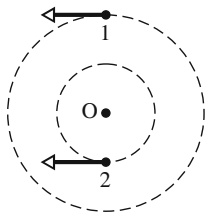

text_image

1
O
2

(a)

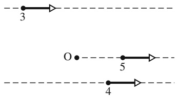

text_image

3
O
5
4

(b)

## 7.6 Das zweite Newtonsche Gesetz in Winkelschreibweise

## Lernziele

Nach dem Durcharbeiten dieses Abschnitts sollten Sie in der Lage sein, . . .

• das zweite Newtonsche Gesetz in Winkelschreibweise anzuwenden, um aus dem auf ein Teilchen wirkenden Drehmoment die resultierende Änderungsrate seines Drehimpulses zu berechnen (alle Größen auf denselben Bezugspunkt bezogen).

## Schlüsselideen

Nach dem Durcharbeiten dieses Abschnitts sollten Sie in der Lage sein, . . .

• Das zweite Newtonsche Gesetz für ein Teilchen kann in Winkelschreibweise in der Form

$$
\vec {\tau} _ {\mathrm{ges}} = \frac {\mathrm{d}\vec {\ell}}{\mathrm{d} t}
$$

geschrieben werden, wobei $\vec { \tau } _ { \mathrm { g e s } }$ das gesamte (resultierende) Drehmoment auf das Teilchen und $\vec { \ell }$ sein Drehimpuls ist.

## 7.6.1 Das zweite Newtonsche Gesetz in Winkelschreibweise

Das zweite Newtonsche Gesetz für ein Teilchen in der Form

$$
\vec {F} _ {\mathrm{ges}} = \frac {\mathrm{d} \vec {p}}{\mathrm{d} t} \tag {7.20}
$$

drückt die fundamentale Beziehung zwischen Kraft und linearem Impuls eines einzelnen Teilchens aus. Wir haben die Parallelen zwischen linearen und Winkelgrö ßen hinreichend diskutiert, um annehmen zu können, dass eine ähnlich enge Beziehung zwischen Drehmoment und Drehimpuls besteht. Ausgehend von Gl. 7.20 vermuten wir, dass diese Beziehung

$$
\vec {\tau} _ {\mathrm{ges}} = \frac {\mathrm{d} \vec {\ell}}{\mathrm{d} t} \tag {7.21}
$$

lautet. Tatsächlich ist Gl. 7.21 das zweite Newtonsche Gesetz für ein einzelnes Teilchen, formuliert mit winkelabhängigen Größen:

177

---

7 Rollbewegung, Drehmoment und Drehimpuls

Die Vektorsumme aller Drehmomente, die auf ein Teilchen wirken, ist gleich der zeitlichen Änderungsrate des Drehimpulses dieses Teilchens.

Achtung: Gl. 7.21 ist nur dann physikalisch sinnvoll, wenn die Drehmomente τ⃗ und der Drehimpuls $\vec { \ell }$ in Bezug auf denselben Punkt angegeben werden!

## Herleitung von Gl. 7.21

Unser Ausgangspunkt ist Gl. 7.16, die Definition des Drehimpulses eines einzelnen Teilchens:

$$
\vec {\ell} = m (\vec {r} \times \vec {\nu}),
$$

mit $1   \vec { r }$ als Ortsvektor und v⃗ als Geschwindigkeit des Teilchens. Wir leiten beide Seiten dieser Gleichung nach $t   \mathrm { a b ^ { 1 ) } }$ und erhalten

$$
\frac {\mathrm{d} \vec {\ell}}{\mathrm{d} t} = m \left(\vec {r} \times \frac {\mathrm{d} \vec {v}}{\mathrm{d} t} + \frac {\mathrm{d} \vec {r}}{\mathrm{d} t} \times \vec {v}\right). \tag {7.22}
$$

In diesem Ausdruck ist $\mathrm { d } \vec { \nu } / \mathrm { d } t$ die Beschleunigung $\vec { a }$ des Teilchens und $\mathrm { d } \vec { r } / \mathrm { d } t$ ist dessen Geschwindigkeit v⃗. Wir können Gl. 7.22 folglich in der Form

$$
\frac {\mathrm{d} \vec {\ell}}{\mathrm{d} t} = m (\vec {r} \times \vec {a} + \vec {\nu} \times \vec {\nu})
$$

schreiben. Das Vektorprodukt eines Vektors mit sich selbst ist null, weil der Winkel zwischen den beiden Faktoren notwendigerweise gleich null ist: $\vec { \nu } \times \vec { \nu } = 0 .$ . Es gilt also

$$
\frac {\mathrm{d} \vec {\ell}}{\mathrm{d} t} = m (\vec {r} \times \vec {a}) = \vec {r} \times m \vec {a}.
$$

Mithilfe des zweiten Newtonschen Gesetzes, $\vec { F } _ { \mathrm { g e s } }   =   m \vec { a } ,$ ersetzen wir nun ma⃗ durch die Vektorsumme der Kräfte, die auf das Teilchen wirken:

$$
\frac {\mathrm{d} \vec {\ell}}{\mathrm{d} t} = \vec {r} \times \vec {F} _ {\mathrm{ges}} = \sum (\vec {r} \times \vec {F}). \tag {7.23}
$$

Das Summenzeichen $\sum$ besagt hier, dass wir die Vektorprodukte ⃗r× $\vec { F } \sum$ aller Kräfte aufsummieren müssen. Aus Gl. 7.12 wissen wir aber, dass jedes derartige Vektorprodukt gleich dem zu einer Kraft gehörigen Drehmoment ist. Gleichung 7.23 sagt deshalb aus:

$$
\vec {\tau} _ {\mathrm{ges}} = \frac {\mathrm{d} \vec {\ell}}{\mathrm{d} t}.
$$

Dies entspricht genau Gl. 7.21.

## KONTROLLFRAGE 5

Die Skizze zeigt den Ortsvektor ⃗r eines Teilchens in einem bestimmten Augenblick. Eingezeichnet sind vier mögliche Richtungen einer Kraft, welche das Teilchen beschleunigt (alle liegen in der xy-Ebene). (a) Ordnen Sie die Varianten nach der bewirkten zeitlichen Änderungsrate des Drehimpulses bezüglich Punkt O, beginnend mit dem größten Wert. (b) In welchem Fall ergibt sich eine negative Änderungsrate bezüglich O?

1) Achten Sie beim Ableiten eines Vektorprodukts darauf, die Reihenfolge der beiden beteiligten Größen (hier ⃗r und ⃗v) nicht zu ändern; siehe dazu auch Anhang D.

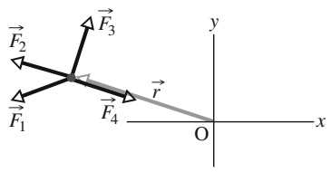

text_image

F₂
F₃
F₁
F₄
r
O
x
y

178

---

7.7 Der Drehimpuls eines starren Körpers

7

## 7.7 Der Drehimpuls eines starren Körpers

## Lernziele

Nach dem Durcharbeiten dieses Abschnitts sollten Sie in der Lage sein, . . .

• das zweite Newtonsche Gesetz in Winkelschreibweise auf ein Teilchensystem anzuwenden, um die zeitliche Änderung seines Drehimpulses aus dem auf das System wirkenden Gesamtdrehmoment zu berechnen,
• den Drehimpuls eines starren Körpers, der sich um eine feste Achse dreht, aus seinem Trägheitsmoment und seiner Winkelgeschwindigkeit um diese Achse zu berechnen,
• den Gesamtdrehimpuls zweier starrer Körper zu berechnen, die sich um dieselbe Achse drehen.

## Schlüsselideen

• Der Drehimpuls $\vec { L }$ eines Teilchensystems ist die Vektorsumme der Drehimpulse der einzelnen Teilchen:

$$
\vec {L} = \vec {\ell} _ {1} + \vec {\ell} _ {2} + \dots = \sum_ {i = 1} ^ {n} \vec {\ell} _ {i}.
$$

• Die zeitliche Änderung dieses Drehimpulses ist gleich dem resultierenden äußeren Drehmoment auf das System, also der Vektorsumme aller Drehmomente aufgrund von Wechselwirkungen zwischen Teilchen des Systems und Teilchen außerhalb des Systems:

$$
\vec {\tau} _ {\mathrm{ges}} = \frac {\mathrm{d} \vec {L}}{\mathrm{d} t}.
$$

• Für einen starren Körper, der um eine feste Achse rotiert, beträgt die Komponente seines Drehimpulses parallel zur Rotationsachse

$$
L = I \omega .
$$

## 7.7.1 Der Drehimpuls eines Systems von Teilchen

Wenden wir uns nun dem Drehimpuls eines Systems aus mehreren Teilchen bezüglich eines gegebenen Bezugspunkts zu. Der Gesamtdrehimpuls $\vec { L }$ ergibt sich als (Vektor-)Summe der Drehimpulse $\vec { \ell }$ der einzelnen Teilchen:

$$
\vec {L} = \vec {\ell} _ {1} + \vec {\ell} _ {2} + \vec {\ell} _ {3} + \dots + \vec {\ell} _ {n} = \sum_ {i = 1} ^ {n} \vec {\ell} _ {i} \tag {7.24}
$$

$( i = 1 , 2 , 3 , . . . , n$ ist die Summationsvariable).

Die Drehimpulse der einzelnen Teilchen können sich mit der Zeit ändern – entweder in Folge von Wechselwirkungen zwischen den Teilchen innerhalb des Systems oder durch äußere Einflüsse. Wir erfassen diese Änderung durch die Ableitung von Gl. 7.24 nach der Zeit:

$$
\frac {\mathrm{d} \vec {L}}{\mathrm{d} t} = \sum_ {i = 1} ^ {n} \frac {\mathrm{d} \vec {\ell} _ {i}}{\mathrm{d} t}. \tag {7.25}
$$

Gleichung 7.21 gemäß ist $\mathrm { d } \vec { \ell _ { i } } / \mathrm { d } t$ gleich dem resultierenden Drehmoment $\vec { \tau } _ { \mathrm { g e s } , i }$ des i-ten Teilchens. Deshalb können wir Gl. 7.25 auch in der Form

$$
\frac {\mathrm{d} \vec {L}}{\mathrm{d} t} = \sum_ {i = 1} ^ {n} \vec {\tau} _ {\mathrm{ges}, i} \tag {7.26}
$$

179

---

7 Rollbewegung, Drehmoment und Drehimpuls

schreiben. In Worten besagt diese Gleichung: Die zeitliche Änderungsrate des Gesamtdrehimpulses $\vec { L }$ eines Systems aus mehreren Teilchen ist gleich der Vektorsumme der Drehmomente, die auf diese Teilchen wirken. Berücksichtigt werden dabei sowohl innere Drehmomente (aufgrund von Wechselwirkungen zwischen den Teilchen innerhalb des Systems) als auch äußere Drehmomente (aufgrund von Kräften, die von außen auf das System ausgeübt werden). Kräfte zwischen den Teilchen des Systems treten jedoch stets als Kräftepaare im Sinne des dritten Newtonschen Gesetzes auf, weshalb sich die von ihnen erzeugten Drehmomente zu null addieren. Folglich kann sich der Gesamtdrehimpuls $\vec { L }$ eines Teilchensystems nur ändern, wenn Drehmomente von außen auf das System wirken.

Die Vektorsumme aller von außen auf die Teilchen des Systems wirkenden Drehmomente sei $\vec { \tau } _ { \mathrm { g e s } }$ . Dann wird Gl. 7.26 zu

$$
\vec {\tau} _ {\mathrm{ges}} = \frac {\mathrm{d} \vec {L}}{\mathrm{d} t}. \tag {7.27}
$$

Dieses zweite Newtonsche Gesetz für die Rotationsbewegung eines Teilchensystems in Winkelschreibweise besagt:

text_image

z
r⊥i
Δmᵢ
pᵢ
rᵢ
θ
O
x
y

(a)

Das von außen auf ein Teilchensystem wirkende resultierende Drehmoment $\vec { \tau } _ { \mathrm { g e s } }$ ist gleich der zeitlichen $\dot { \mathrm { A } }$ nderungsrate des Gesamtdrehimpulses $\vec { L }$ dieses Systems.

Gleichung 7.27 ist das „Rotationsanalogon“ von Gl. 5.19 $( \vec { F } _ { \mathrm { g e s } } = \mathrm { d } \vec { P } / \mathrm { d } t )$ . Achten Sie aber darauf, dass die Drehmomente und der Drehimpuls des Systems bezüglich desselben Punkts angegeben werden müssen! Solange der Schwerpunkt des Systems nicht relativ zu einem Inertialsystem beschleunigt wird, dürfen Sie den Bezugspunkt beliebig auswählen; anderenfalls muss der Schwerpunkt als Bezugspunkt verwendet werden. Betrachten wir beispielsweise ein Rad als Teilchensystem. Dreht sich das Rad um eine relativ zum Boden feste Achse, so kann als Bezugspunkt zur Anwendung von Gl. 7.27 jeder relativ zum Boden stationäre Punkt gewählt werden. Dreht sich das Rad hingegen um eine beschleunigte Achse (etwa beim Abrollen von einer geneigten Ebene), so müssen Sie den Schwerpunkt als Bezugspunkt wählen.

text_image

z
θ
ℓᵢₖ
θ
O
y
x

(b)

## 7.7.2 Der Drehimpuls eines rotierenden starren Körpers

Als Nächstes berechnen wir den Drehimpuls eines Teilchensystems, das einen starren, um eine feste Achse rotierenden Körper bildet. Einen solchen Körper zeigt Abb. 7.11a. Die feste Drehachse ist hier die z-Achse, um die der Körper mit der konstanten Winkelgeschwindigkeit ω rotiert. Gesucht ist der Drehimpuls des Körpers bezüglich dieser Achse.

Ein geeigneter Ansatz besteht darin, die z-Komponenten des Drehimpulses aller Massenelemente des Körpers zu addieren. In Abb. 7.11a wurde ein typisches Massenelement $\Delta m _ { i }$ ausgewählt, welches sich auf einer Kreisbahn um die z-Achse bewegt. Der Ort des Massenelements relativ zum Ursprung O ist durch den Ortsvektor $\vec { r } _ { i }$ gegeben. Der Radius der Kreisbahn des Elements ist gleich dessen senkrechtem Abstand zur z-Achse, $r _ { \perp i } .$

Den Betrag des Drehimpulses $\vec { \ell } _ { i }$ dieses Massenelements bezüglich O gibt Gl. 7.17 an:

$$
\ell_ {i} = r _ {i} p _ {i} (\sin 9 0 ^ {\circ}) = r _ {i} (\Delta m _ {i} \nu_ {i}).
$$

Hier sind $p _ { i }$ und $\nu _ { i }$ der lineare Impuls bzw. die lineare Geschwindigkeit des Massenelements, der Winkel zwischen $\vec { r } _ { i }$ und ${ \vec { p } } _ { i }$ beträgt 90°. Abbildung 7.11b zeigt den Drehimpulsvektor $\vec { \ell } _ { i }$ für das Massenelement in Abb. 7.11a; $\vec { \ell }$ muss senkrecht auf $\vec { r } _ { i }$ und $\vec { \vec { p } } _ { i }$ stehen.

Abb. 7.11 (a) Ein starrer Körper rotiert mit der Winkelgeschwindigkeit ω um die z-Achse. Ein Massenelement $\Delta m _ { i }$ des Körpers beschreibt eine Kreisbahn um die $z - \mathbf { A }$ chse mit dem Radius $r _ { \perp i } .$ Der Ort des Massenelements relativ zum Ursprung ist durch den Ortsvektor $\vec { r } _ { i }$ gegeben; das Massenelement besitzt den linearen Impuls ${ \vec { p } } _ { i }$ . Abgebildet ist das Massenelement in dem Augenblick, wenn $r _ { \perp i }$ parallel zur x-Achse ist. (b) Der Drehimpuls $\vec { \ell } _ { i }$ bezüglich O des Massenelements aus (a) sowie seine z-Komponente $\ell _ { i z } .$

180

---

7.7 Der Drehimpuls eines starren Körpers

7

TABELLE 7.1: Weitere Gleichungen für die Rotation und ihre Äquivalente für die Translation.

<table><tr><td colspan="2">Reine Translation</td><td colspan="2">Reine Rotation</td></tr><tr><td>Kraft</td><td> $\vec{F}$ </td><td>Drehmoment</td><td> $\vec{\tau} = \vec{r} \times \vec{F}$ </td></tr><tr><td>Linearer Impuls</td><td> $\vec{p}$ </td><td>Drehimpuls</td><td> $\vec{\ell} = \vec{r} \times \vec{p}$ </td></tr><tr><td> $Linearer\ Impuls^{a)}$ </td><td> $\vec{P} = \sum \vec{p}_{i}$ </td><td> $Drehimpuls^{a)}$ </td><td> $\vec{L} = \sum \vec{\ell}_{i}$ </td></tr><tr><td> $Linearer\ Impuls^{a)}$ </td><td> $\vec{P} = M\vec{\nu}_{S}$ </td><td> $Drehimpuls^{b)}$ </td><td> $L = I\omega$ </td></tr><tr><td>Zweites</td><td rowspan="2"> $\vec{F}_{ges} = \frac{d\vec{P}}{dt}$ </td><td>Zweites</td><td rowspan="2"> $\vec{\tau}_{ges} = \frac{d\vec{L}}{dt}$ </td></tr><tr><td> $Newtonsches\ Gesetz^{a)}$ </td><td> $Newtonsches\ Gesetz^{a)}$ </td></tr><tr><td> $Erhaltungssatz^{c)}$ </td><td> $\vec{P} = const.$ </td><td> $Erhaltungssatz^{c)}$ </td><td> $\vec{L} = const.$ </td></tr></table>

a) Für Teilchensysteme einschließlich starrer Körper.

b) Für einen starren Körper bezüglich einer festen Achse mit L als Komponente entlang dieser Achse.

c) Für ein geschlossenes, isoliertes System.

Wir suchen nun die Komponente von $\vec { \ell } _ { i }$ parallel zur Drehachse (hier der z-Achse), also die z-Komponente. Sie ist gegeben durch

$$
\ell_ {i z} = \ell_ {i} \sin \theta = (r _ {i} \sin \theta) (\Delta m _ {i} v _ {i}) = r _ {\perp i} \Delta m _ {i} v _ {i}.
$$

Die z-Komponente des Drehimpulses eines rotierenden starren Körpers ist gleich der Summe der Beiträge aller Massenelemente des Körpers. Mit $\nu = \omega r _ { \perp }$ gilt also

$$
\begin{array}{l} L _ {z} = \sum_ {i = 1} ^ {n} \ell_ {i z} = \sum_ {i = 1} ^ {n} \Delta m _ {i} v _ {i} r _ {\perp i} = \sum_ {i = 1} ^ {n} \Delta m _ {i} (\omega r _ {\perp i}) r _ {\perp i} \\ = \omega \left(\sum_ {i = 1} ^ {n} \Delta m _ {i} r _ {\perp i} ^ {2}\right). \tag {7.28} \\ \end{array}
$$

(Wir dürfen ω vor die Summe ziehen, weil der Wert von ω für alle Punkte des rotierenden starren Körpers gleich ist.)

Der Term $\textstyle \sum \Delta m _ { i } r _ { \perp i } ^ { 2 }$ in Gl. 7.28 ist das Trägheitsmoment I des Körpers um die feste Achse (siehe Gl. 6.23). Damit verkürzt sich Gl. 7.28 zu

$$
L = I \omega . \tag {7.29}
$$

Den Index z haben wir hier weggelassen, aber Sie dürfen nicht vergessen, dass sowohl der durch Gl. 7.29 definierte Drehimpuls als auch das auf der rechten Seite auftretende Trägheitsmoment bezüglich der z-Achse als Drehachse angegeben sind (und immer bezüglich derselben Achse formuliert werden müssen!).

In Ergänzung zu Tab. 6.1 und 6.3 fasst Tab. 7.1 weitere Gleichungen für die Rotation und ihre Äquivalente für die Translation zusammen.

## KONTROLLFRAGE 6

In der Skizze sehen Sie eine Scheibe, einen Ring und eine Kugel, die durch Ziehen an den (jeweils aufgewickelten) Bindfäden in Rotation um ihre mittlere Achse versetzt werden. Die Fäden üben auf alle drei Körper dieselbe tangentiale Kraft $\vec { F }$ aus. Alle Körper haben gleiche Massen und Radien und befinden sich zu Beginn in Ruhe. Ordnen Sie die Körper (a) nach dem Drehimpuls bezüglich der angegebenen Achsen und (b) nach ihrer Winkelgeschwindigkeit, nachdem eine Zeit t lang an den Fäden gezogen wurde.

181

---

7 Rollbewegung, Drehmoment und Drehimpuls

## 7.8 Die Erhaltung des Drehimpulses

## Lernziele

Nach dem Durcharbeiten dieses Abschnitts sollten Sie in der Lage sein, . . .

auf ein System ohne resultierendes äußeres Drehmoment bezüglich einer angegebenen Achse die Drehimpulserhaltung anzuwenden, um aus dem anfänglichen Drehimpuls des Systems bezüglich dieser Achse seinen Wert zu einem späteren Zeitpunkt zu berechnen.

## Schlüsselideen

• Der Drehimpuls $\vec { L }$ eines Systems bleibt konstant, wenn kein resultierendes äußeres Drehmoment auf das System wirkt:

$$
\vec {L} = \text {const.} \quad \text {oder} \quad \vec {L} _ {\mathrm{i}} = \vec {L} _ {\mathrm{f}}.
$$

Diese Aussage wird als Drehimpulserhaltungssatz bezeichnet.

## 7.8.1 Die Erhaltung des Drehimpulses

Wir haben bisher zwei überaus nützliche Erhaltungssätze kennengelernt, einen für die Energie und einen für den (linearen) Impuls. In diesem Abschnitt fügen wir den Satz von der Erhaltung des Drehimpulses hinzu. Dabei gehen wir von Gl. 7.27 aus $( \vec { \tau } _ { \mathrm { g e s } } = \mathrm { d } \vec { L } / \mathrm { d } t )$ , dem zweiten Newtonschen Gesetz in Winkelschreibweise. Wirkt auf das System kein äußeres Drehmoment, so wird aus dieser Gleichung $\mathrm { d } \vec { L } / \mathrm { d } t = 0$ oder

$$
\vec {L} = \text {const.} \quad (\text {isoliertes System}). \tag {7.30}
$$

Eine andere Formulierung dieses **Drehimpulserhaltungssatzes** lautet

$$
\binom{\text {resultierender Drehimpuls}}{\text {zum (früheren) Zeitpunkt t_{i}}} = \binom{\text {resultierender Drehimpuls}}{\text {zum (späteren) Zeitpunkt t_{f}}}
$$

oder

$$
\vec {L} _ {\mathrm{i}} = \vec {L} _ {\mathrm{f}} \quad (\text {isoliertes System}). \tag {7.31}
$$

In Worten ausgedrückt, besagen die Gln. 7.30 und 7.31:

Wirkt auf ein System kein äußeres Drehmoment, so ist der Drehimpuls $\vec { L }$ des Systems konstant, ungeachtet aller Prozesse, die innerhalb des Systems stattfinden.

In den Gln. 7.30 und 7.31 treten vektorielle Größen auf. Jede der Gleichungen ist deshalb äquivalent zu einem System aus drei Gleichungen für die Erhaltung des Drehimpulses entlang dreier aufeinander senkrecht stehender Achsen. In Abhängigkeit von den wirkenden Drehmomenten kann der Drehimpuls auch in nur einer oder zwei anstelle aller drei Raumrichtungen erhalten bleiben:

Ist die Komponente des resultierenden äußeren Drehmoments auf ein System entlang einer bestimmten Achse gleich null, so ist die Komponente des Drehimpulses dieses Systems entlang dieser Achse konstant, ungeachtet aller Prozesse, die innerhalb des Systems stattfinden.

Wir wollen diesen Satz auf den isolierten, um die z-Achse rotierenden Körper aus Abb. 7.11 anwenden. Nehmen wir an, während der Drehbewegung verteile sich die

182

---

7.8 Die Erhaltung des Drehimpulses

7

Masse des anfangs starren Körpers relativ zur Rotationsachse in bestimmter Weise um, wodurch sich das Trägheitsmoment des Körpers bezüglich dieser Achse ändert. Der Drehimpuls des Körpers hingegen kann sich entsprechend den Gln. 7.30 und 7.31 nicht ändern. Setzen wir Gl. 7.29 (für den Drehimpuls entlang der Dreh achse) in Gl. 7.31 ein, so erhalten wir den Erhaltungssatz für den Drehimpuls in der Form:

$$
I _ {\mathrm{i}} \omega_ {\mathrm{i}} = I _ {\mathrm{f}} \omega_ {\mathrm{f}}. \tag {7.32}
$$

Die Indizes i und f beziehen sich hier auf die initialen und finalen Werte des Träg heitsmoments und der Winkelgeschwindigkeit, d. h. vor bzw. nach dem Umverteilen der Masse.

Wie auch die beiden anderen bisher behandelten Erhaltungssätze gilt die Drehimpulserhaltung (Gln. 7.30 und 7.31) über die Grenzen der Newtonschen Mechanik hinaus, z. B. für Teilchen, deren Geschwindigkeit der Lichtgeschwindigkeit nahekommt (und die deshalb mithilfe der Relativitätstheorie beschrieben werden müssen), und für Teilchen subatomarer Dimension (die den Gesetzen der Quantenphysik unterworfen sind). Bis heute wurde kein Fall bekannt, in dem die Drehimpulserhaltung verletzt würde.

Zur Veranschaulichung der Drehimpulserhaltung diskutieren wir im Folgenden vier Beispiele.

## 1. Eine Person auf einem Drehstuhl

In Abb. 7.12 sehen Sie einen jungen Mann auf einem Drehstuhl, der ungehindert um seine vertikale Längsachse rotieren kann. In den ausgestreckten Händen hält er zwei Hanteln. Der Drehimpulsvektor $\vec { L }$ zeigt entlang der senkrechten Drehachse nach oben. Durch vorsichtiges Anstoßen wird der Mann auf eine mäßige Anfangswinkelgeschwindigkeit $\omega _ { \mathrm { i } }$ beschleunigt.

Nun zieht der Mann seine Arme an, wodurch sein Trägheitsmoment vom Anfangswert $I _ { \mathrm { i } }$ auf einen Wert $I _ { \mathrm { f } }$ absinkt, weil sich jetzt mehr Masse in der Nähe der Drehachse befindet. Gleichzeitig nimmt die Winkelgeschwindigkeit deutlich zu (von $\omega _ { \mathrm { i } }$ auf $\omega _ { \mathrm { f } } )$ . Um die Rotation zu verzögern, streckt der Mann die Arme wieder aus.

Warum ändert sich die Drehgeschwindigkeit? Auf das System Mann–Stuhl– Hanteln wirkt kein äußeres Drehmoment. Der Drehimpuls des Systems bezüg lich der angegebenen Achse muss deshalb konstant bleiben, gleichgültig, welche Bewegungen der Mann mit den Hanteln ausführt. In Abb. 7.12a ist die Winkelgeschwindigkeit $\omega _ { \mathrm { i } }$ des Mannes relativ gering und sein Trägheitsmoment relativ hoch. Gemäß Gl. 7.32 muss die Winkelgeschwindigkeit in Abb. 7.12b größer sein, um das reduzierte Trägheitsmoment zu kompensieren.

text_image

L
ωi
Ii
Drehachse

(a)

text_image

L
ωf
If

(b)

## Abb. 7.12

(a) Das Trägheitsmoment des Mannes bezüglich der senkrechten Achse ist relativ groß, die Winkelgeschwindigkeit relativ gering. (b) Indem er das Trägheitsmoment absenkt, erhöht er seine Winkelgeschwindigkeit: Der Drehimpuls L⃗ des rotierenden Systems bleibt konstant.

183

---

7 Rollbewegung, Drehmoment und Drehimpuls

text_image

Diagram illustrating a dynamic path with labeled vectors L and directional arrows, showing movement around two human figures.

Abb. 7.13

Der Drehimpuls L⃗ der Springerin, dargestellt durch das Symbol ⊕ (einen in die Papierebene hineinzeigenden Pfeil), bleibt während der Flugphase konstant. Der Schwerpunkt (durch Punkte angedeutet) beschreibt eine Parabel.

Abb. 7.14

(a) Stark vereinfachte Skizze eines Raumschiffs mit eingebautem Schwungrad. Wird das Rad wie dargestellt in Rotation (im Uhrzeigersinn) versetzt, so dreht sich das Raumschiff in entgegengesetzter Richtung (gegen den Uhrzeigersinn). (b) Wenn das Rad zum Stillstand gebracht wird, hört auch das Raumschiff auf, sich zu drehen, verbleibt aber in der neuen Orientierung, welche im Winkel $\Delta \theta _ { \mathrm { n e u } }$ zur alten Ausrichtung steht.

## 2. Ein Turmspringer

Abbildung 7.13 zeigt den Bewegungsablauf einer Turmspringerin bei einem anderthalbfachen Salto vorwärts. Wie Sie sicherlich erwarten, beschreibt der Schwerpunkt der Sportlerin eine parabelförmige Bahn. Beim Absprung besitzt die Springerin einen definierten Drehimpuls $\overrightarrow { \bar { L } }$ bezüglich einer Achse durch ihren Schwerpunkt, in Abb. 7.13 dargestellt durch einen Vektor, der senkrecht in die Abbildungsebene hineinzeigt. Während sich die Springerin in der Luft befindet, wirkt kein äußeres Drehmoment bezüglich ihres Schwerpunkts auf sie; folglich muss ihr Drehimpuls konstant bleiben. Indem sie Arme und Beine wie ein Taschenmesser zusammenklappt, kann die Sportlerin ihr Trägheitsmoment bezüglich der Drehachse deutlich herabsetzen, wodurch ihre Winkelgeschwindigkeit zunimmt (siehe Gl. 7.32). Am Ende des Sprungs streckt sich die Springerin wieder lang aus, das Trägheitsmoment erhöht sich, die Winkelgeschwindigkeit nimmt ab und das Eintauchen erfolgt mit möglichst wenigen Spritzern. Die Erhaltung des Drehimpulses (in Betrag und Richtung) gilt natürlich auch bei komplizierteren Sprüngen, die außer Saltos auch Schraubenbewegungen beinhalten.

## 3. Die Lenkung eines Raumschiffs

Abbildung 7.14 zeigt die Skizze eines Raumschiffs mit starr eingebautem Schwungrad, welche das Funktionsprinzip einer (sehr einfachen) Lenkung für ein Raumschiff illustriert: Das System Raumschiff–Schwungrad ist isoliert. Ist also der Drehimpuls $\vec { L }$ des Systems gleich null, weil sich weder das Raumschiff noch das Schwungrad dreht, so muss er bei allen Manövern null bleiben (solange das System isoliert bleibt).

Um die Flugrichtung des Raumschiffs zu ändern, wird das Schwungrad in Ro tation versetzt (Abb. 7.14a). Damit L⃗ null bleibt, beginnt sich das Raumschiff in der entgegengesetzten Richtung zu drehen. Wird das Schwungrad nun wieder angehalten, so hört auch das Raumschiff auf, sich zu drehen, aber es verbleibt in der neuen Orientierung (Abb. 7.14b). Während des gesamten Vorgangs ist der Drehimpuls des Systems Raumschiff–Schwungrad stets gleich null.

Bei ihrem Vorbeiflug am Planeten Uranus 1986 wurde die Raumsonde Voyager 2 durch einen ähnlichen Effekt immer dann in unerwünschte Rotation versetzt, wenn an Bord bei hoher Geschwindigkeit ein Kassettenrecorder eingeschaltet wurde. Das Bodenpersonal im Antriebslabor musste daraufhin den Bordcomputer so umprogrammieren, dass gleichzeitig mit dem Ein- oder Ausschalten des Recorders ein kurzer Schub der Triebwerke ausgelöst wurde, der diese ungewollte Rotation ausglich.

## 4. Ein Neutronenstern

Ist der Kernbrennstoff im Inneren eines Sterns nahezu verbraucht, so kann der Stern zusammenfallen – unter Umständen so weit, dass sein Radius von Dimensionen ähnlich denen der Sonne bis auf den unglaublich geringen Wert von wenigen Kilometern abnimmt. Dabei baut sich innerhalb des Sterns ein enormer Druck auf, und seine Bestandteile werden zu einem überwiegend aus Neutronen bestehenden Quantengas ungeheuer hoher Dichte komprimiert. Ein Neutronenstern ist entstanden.

Während dieses Kollapses ist der Stern ein isoliertes System, folglich kann sich sein Drehimpuls L⃗ nicht ändern. Da das Trägheitsmoment außerordentlich stark abnimmt, muss seine Winkelgeschwindigkeit entsprechend rasant ansteigen. Manche Neutronensterne rotieren 600- bis 800-mal in der Sekunde – unsere Sonne, ein typischer Stern, dreht sich in dreieinhalb Wochen einmal um sich selbst!

## KONTROLLFRAGE 7

Ein Insekt fährt auf dem Rand einer kleinen Scheibe Karussell. Nun krabbelt es in Richtung des Mittelpunkts der Scheibe. Nehmen dabei die folgenden Größen (jeweils relativ zur Drehachse) zu, ab oder bleiben sie gleich? (a) Trägheitsmoment des Systems Insekt–Scheibe, (b) Drehimpuls des Systems Insekt–Scheibe, (c) Winkelgeschwindigkeit des Insekts und der Scheibe.

184

---

7.9 Die Präzession eines Kreisels

7

## 7.9 Die Präzession eines Kreisels

## Lernziele

Nach dem Durcharbeiten dieses Abschnitts sollten Sie in der Lage sein, . . .

• zu verstehen, dass die auf einen rotierenden Kreisel wirkende Gravitationskraft bewirkt, dass sich der Drehimpulsvektor (und damit der Kreisel) in einer als Präzession bezeichneten Bewegung um seine vertikale Achse dreht,
• die Präzessionsgeschwindigkeit eines Kreisels zu berechnen,
• zu verstehen, dass die Präzessionsgeschwindigkeit eines Kreisels nicht von seiner Masse abhängt.

## Schlüsselideen

• Ein rotierender Kreisel präzediert mit der Geschwindigkeit

$$
\Omega = \frac {M g r}{I \omega}
$$

um eine vertikale Achse durch seinen Auflagepunkt, wenn die Gravitationskraft $M \vec { g }$ auf ihn einwirkt. Dabei sind M die Masse des Kreisels, r der Hebelarm, I das Trägheitsmoment und ω die Winkelgeschwindigkeit des Kreisels.

## 7.9.1 Die Präzession eines Kreisels

Ein einfacher Kreisel besteht aus einem Rad, das an einer Welle befestigt ist und frei um eine Drehachse in Richtung dieser Welle rotieren kann. Wenn ein Ende der Welle eines nicht rotierenden Kreisels wie in Abb. 7.15a auf einen Auflagepunkt gesetzt und der Kreisel losgelassen wird, fällt der Kreisel durch eine Rotation um den Auflagepunkt um. Da es sich bei diesem Umfallen um eine Rotation handelt, wird sie durch das zweite Newtonsche Gesetz in Winkelschreibweise beschrieben, also durch Gl. 7.27:

$$
\vec {\tau} = \frac {\mathrm{d} \vec {L}}{\mathrm{d} t}. \tag {7.33}
$$

Diese Gleichung besagt, dass das Drehmoment, das die Drehung (das Umfallen) bewirkt, den Drehimpuls $\vec { L }$ des Kreisels von seinem anfänglichen Wert von null verändert. Das Drehmoment ist auf die im Schwerpunkt des Kreisels (der im Zentrum des Rads liegen soll) wirkende Schwerkraft zurückzuführen. Der Hebelarm bezogen auf den Auflagepunkt (O in Abb. 7.15a) ist ⃗r. Da der Winkel zwischen $M \vec { g }$ und $\tilde { \vec { r } }   9 0 ^ { \circ }$ beträgt, ist sein Betrag

$$
\tau = M g r \sin 90^\circ = M g r \tag{7.34}
$$

und seine Richtung ist wie in Abb. 7.15a gezeigt.

Ein rotierender Kreisel verhält sich anders. Wir nehmen zunächst an, dass seine Drehachse im Moment des Loslassens ein wenig nach oben gerichtet ist. In diesem Fall wird er sich nach dem Loslassen zwar zunächst etwas nach unten bewegen, aber dann – während er weiterhin um seine Drehachse rotiert – wird seine Drehachse und damit sein Drehimpulsvektor beginnen, horizontal um eine vertikale Achse durch den Auflagepunkt O zu rotieren. Diese Bewegung wird als Präzession bezeichnet.

Warum kippt er nicht einfach um? Wie schafft es der rotierende Kreisel, sich in der Schwebe zu halten, während der ruhende Kreisel einfach umfällt? Der entscheidende Unterschied zwischen beiden Fällen ist, dass das Drehmoment aufgrund der Schwerkraft $M \vec { g }$ im Fall des rotierenden Kreisels nicht auf einen anfänglichen Drehimpuls von null trifft, den es zu ändern gilt, sondern auf einen von null ver schiedenen Drehimpuls, da der Kreisel ja bereits rotiert.

Um zu sehen, wie dieser von null verschiedene Anfangsdrehimpuls zu einer Prä- zession führt, betrachten wir zunächst den Drehimpuls $\vec { L }$ des Kreisels aufgrund

text_image

z
O
y
τ
x
Mg
Auflage

(a)

text_image

ω
x
Mg
r
L
O
z
y
τ̇ = dL/dt

(b)

Kreisbahn der Spitze des Drehimpulsvektors

text_image

z
O
dφ
L(t)
L(t + dt)
y
x
dL/dt

(c)

## Abb. 7.15

(a) Ein ruhender Kreisel fällt aufgrund des Drehmoments τ⃗ durch eine Rotation in der xz-Ebene um. (b) Ein schnell rotierender Kreisel mit dem Drehimpuls $\vec { L }$ präzediert um die z-Achse. Die Präzession findet in der xy-Ebene statt. (c) Die zeitliche Veränderung $\mathrm { d } \vec { L } / \mathrm { d } t$ des Drehimpulses bewirkt eine Rotation von $\vec { L }$ um O.

185

---

7 Rollbewegung, Drehmoment und Drehimpuls

seiner Rotation um die eigene Längsachse. Um die Situation zu vereinfachen, nehmen wir an, dass seine Rotation so schnell ist, dass der zusätzliche Drehimpuls infolge der Präzession gegenüber $\vec { L }$ vernachlässigbar ist. Außerdem nehmen wir an, dass die Drehachse des Kreisels zu Beginn der Präzession horizontal liegt, wie in Abb. 7.15b gezeigt. Der Betrag von $\vec { L }$ ist durch Gl. 7.29 gegeben,

$$
L = I \omega , \tag {7.35}
$$

wobei I das Trägheitsmoment des Kreisels um seine Drehachse ist und ω die Winkelgeschwindigkeit seiner Rotation um diese Achse. Der Vektor $\vec { L }$ zeigt wie in Abb. 7.15b parallel zur Welle bzw. zur Drehachse. Da $\vec { L }$ parallel zu $\vec { r }$ ist, muss das Drehmoment $\vec { \tau }$ senkrecht auf $\vec { L }$ stehen.

Nach Gl. 7.33 bewirkt das Drehmoment $\vec { \tau }$ in einem infinitesimalen Zeitintervall dt eine infinitesimale $\ddot { \mathrm { A } }$ nderung $\mathrm { d } \vec { L }$ des Drehimpulses des Kreisels, also

$$
\mathrm{d} \vec {L} = \vec {\tau} \mathrm{d} t. \tag {7.36}
$$

Für einen schnell rotierenden Kreisel ist der Betrag von $\vec { L }$ aber durch Gl. 7.35 vorgegeben, daher kann das Drehmoment nur die Richtung von $\vec { L }$ ändern, nicht aber seinen Betrag.

Aus Gl. 7.36 erkennen wir, dass $\mathrm { d } \vec { L }$ in Richtung von $\vec { \tau }$ zeigt, also senkrecht zu $\vec { L } .$ Die einzige Möglichkeit, $\dot { \vec { L } }$ in Richtung von $\vec { \tau }$ zu ändern, ohne dabei auch seinen Betrag $L$ zu verändern, ist eine Rotation der Kreiselachse um die $z - \mathrm { A }$ chse wie in Abb. 7.15c. So behält $\vec { L }$ seinen Betrag, während die Spitze des Vektors $\vec { L }$ eine Kreisbahn beschreibt und $\vec { \tau }$ zu jedem Zeitpunkt tangential zu dieser Bahn zeigt. Da $\vec { L }$ immer in Richtung der Drehachse des Kreisels zeigen muss, muss sich also auch diese Drehachse in Richtung von $\vec { \tau }$ um die z-Achse drehen. So entsteht die Präzession: Der rotierende Kreisel muss als Reaktion auf eine Änderung seines anfänglichen Drehimpulses dem zweiten Newtonschen Gesetz in Winkelschreibweise gehorchen und präzedieren, anstatt einfach nur umzufallen.

Die Geschwindigkeit der Präzession können wir bestimmen, indem wir zuerst mithilfe der Gln. 7.36 und 7.34 den Betrag von $\mathrm { d } \vec { L }$ berechnen:

$$
\mathrm{d} L = \tau \mathrm{d} t = M g r \mathrm{d} t. \tag {7.37}
$$

Wenn sich $\vec { L }$ innerhalb eines Zeitintervalls dt um einen infinitesimalen Betrag $\mathrm { d } \vec { L }$ ändert, präzediert die Drehachse $\vec { L }$ um einen infinitesimalen Winkel d𝜑 um die z-Achse. (In Abb. 7.15c ist der Winkel d𝜑 zur Verdeutlichung übertrieben dargestellt.) Mithilfe der Gln. 7.35 und 7.37 erhalten wir für d𝜑

$$
\mathrm{d} \varphi = \frac {\mathrm{d} L}{L} = \frac {M G r \mathrm{d} t}{I \omega}.
$$

Wir dividieren diesen Ausdruck durch dt und setzen die Präzessionsgeschwindig keit $\mathrm { d } \Omega = \mathrm { d } \varphi / \mathrm { d } t$ ein und gelangen so schließlich zu dem Ergebnis

$$
\Omega = \frac {M g r}{I \omega}. \tag {7.38}
$$

Dieses Ergebnis gilt, wie bereits gesagt, unter der vereinfachenden Annahme, dass die Rotationsgeschwindigkeit ω groß ist. Wenn ω zunimmt, nimmt Ω ab. Interessanterweise hängt $\Omega$ nicht von der Masse des Kreisels ab, weil sich M aufgrund der Massenabhängigkeit von $I$ aus dem Ausdruck in Gl. 7.38 herauskürzt, – und das, obwohl die Präzession überhaupt nur deshalb auftritt, weil die Schwerkraft $M \vec { g }$ auf den Kreisel wirkt.

Gleichung 7.38 gilt auch, wenn die Welle bzw. Drehachse des Kreisels schräg zur Horizontalen steht.

186

---

7.10 Zusammenfassung

7

## 7.10 Zusammenfassung

**Die Rollbewegung** Für ein rollendes (und dabei nicht gleitendes) Rad mit dem Radius R gilt

$$
\nu_ {\mathrm{S}} = \omega R \tag {7.2}
$$

mit $\nu _ { S }$ als linearer Geschwindigkeit der Mitte des Rads und ω als Winkelgeschwindigkeit des Rads bei der Rotation um seinen Mittelpunkt. Alternativ kann das Rollen eines Rads auch als momentane Rotation um den Berührungspunkt P zwischen Rad und Untergrund beschrieben werden. Die Winkelgeschwindigkeit des Rads bezüglich seines Mittelpunkts ist gleich der Winkelgeschwindigkeit bezüglich P. Die kinetische Energie eines rollenden Rads ist

$$
K = \frac {1}{2} I _ {\mathrm{S}} \omega^ {2} + \frac {1}{2} M \nu_ {\mathrm{S}} ^ {2}, \tag {7.5}
$$

mit $I _ { \mathrm { S } }$ als Trägheitsmoment des Rads bei der Rotation um seinen Mittelpunkt und M als Masse des Rads. Wird das Rad bei einer reinen (gleitfreien) Rollbewegung beschleunigt, so lautet die Beziehung zwischen der Beschleunigung des Schwerpunkts ${ \vec { a } } _ { S }$ und der Winkelbeschleunigung α bezüglich des Mittelpunkts des Rads

$$
a _ {S} = \alpha R. \tag {7.6}
$$

Rollt das Rad ohne zu gleiten eine Ebene hinab, die um den Winkel θ bezüglich der Waagerechten geneigt ist, so ist seine Beschleunigung entlang einer die Rampe aufwärts gerichteten x-Achse gleich:

$$
a _ {\mathrm{S}, x} = - \frac {g \sin \theta}{1 + I _ {\mathrm{S}} / (M R ^ {2})}. \tag {7.10}
$$

**Das Drehmoment als Vektor** Das Drehmoment τ⃗ ist eine in den drei Raumrichtungen relativ zu einem festen Punkt (in der Regel dem Ursprung des Koordinatensystems) definierte vektorielle Größe:

$$
\vec {\tau} = \vec {r} \times \vec {F}. \tag {7.12}
$$

$\vec { F }$ ist dabei eine an dem betreffenden Massepunkt (Teilchen) angreifende Kraft und $\vec { r }$ der zu diesem Massepunkt gehörende Ortsvektor bezüglich des erwähnten festen Punkts. Der Betrag von τ⃗ ist gegeben durch

$$
\tau = r F \sin \varphi = r F _ {\perp} = r _ {\perp} F \tag {7.13,7.15}
$$

mit $\varphi$ als Winkel zwischen den Richtungen von $\vec { F }$ und ⃗r, $F _ { \perp }$ als Komponente von $\vec { F }$ senkrecht zu $\vec { r }$ und $r _ { \perp }$ als Hebelarm von $\vec { F } .$ Die Richtung von $\vec { r }$ erhält man mithilfe der Rechte-Hand-Regel für Kreuzprodukte von Vektoren.

**Der Drehimpuls eines Teilchens** Der Drehimpuls $\vec { \ell }$ eines Teilchens mit dem linearen Impuls $\vec { p } ,$ der Masse m und der linearen Geschwindigkeit v⃗ ist eine vektorielle Größe, definiert relativ zu einem Bezugspunkt (in der Regel dem Ursprung des gewählten Koordinatensystems):

$$
\vec {\ell} = \vec {r} \times \vec {p} = m (\vec {r} \times \vec {v}). \tag {7.16}
$$

Der Betrag von $\vec { \ell }$ ist gegeben durch folgende Beziehungen:

$$
\ell = r m \nu \sin \varphi , \tag {7.17}
$$

$$
\ell = r p _ {\perp} = r m v _ {\perp}, \tag {7.18}
$$

$$
\ell = r _ {\perp} p = r _ {\perp} m \nu . \tag {7.19}
$$

Hier sind 𝜑 der Winkel zwischen den Richtungen von $\vec { r }$ und ⃗p, $p _ { \perp }$ und $\nu _ { \perp }$ die Komponenten von $\vec { p }$ bzw. ⃗v senkrecht zu $\vec { r }$ und $r _ { \perp }$ der senkrechte Abstand zwischen dem Bezugspunkt und der Verlängerung der Richtung von $\vec { p } .$ Die Richtung von $\vec { \ell }$ ergibt sich durch Anwendung der Rechte-Hand-Regel für Kreuzprodukte von Vektoren.

**Das zweite Newtonsche Gesetz in Winkelschreibweise** Formuliert mit winkelabhängigen Größen lautet das zweite Newtonsche Gesetz für ein Teilchen

$$
\vec {\tau} _ {\mathrm{ges}} = \frac {\mathrm{d} \vec {\ell}}{\mathrm{d} t} \tag {7.21}
$$

mit $\vec { \tau } _ { \mathrm { g e s } }$ als dem resultierenden auf das Teilchen wirkenden Drehmoment und $\vec { \ell }$ als seinem Drehimpuls.

**Der Drehimpuls eines Teilchensystems** Der Drehimpuls L⃗ eines Systems von Teilchen ergibt sich als Vektorsumme der Drehimpulse aller einzelnen Teilchen:

$$
\vec {L} = \vec {\ell} _ {1} + \vec {\ell} _ {2} + \dots + \vec {\ell} _ {n} = \sum_ {i = 1} ^ {n} \vec {\ell} _ {i}. \tag {7.24}
$$

Die zeitliche $\ddot { \mathrm { A } }$ nderungsrate dieses Drehimpulses ist gleich dem resultierenden von außen auf das System wirkenden Drehmoment (der Vektorsumme aller Drehmomente, die sich durch Wechselwirkung zwischen Teilchen des Systems und Teilchen außerhalb des Systems ergeben):

$$
\vec {\tau} _ {\mathrm{ges}} = \frac {\mathrm{d} \vec {L}}{\mathrm{d} t}. \tag {7.27}
$$

**Drehimpuls eines starren Körpers** Die Komponente des Drehimpulses eines starren, um eine feste Achse rotierenden Körpers parallel zur Drehachse ist gegeben durch

$$
L = I \omega . \tag {7.29}
$$

**Die Erhaltung des Drehimpulses** Der Drehimpuls L⃗ eines Systems bleibt konstant, wenn das resultierende von außen wirkende Drehmoment null ist:

$$
\vec {L} = \text {const.} \quad \text {(isoliertes System)} \tag {7.30}
$$

oder

$$
\vec {L} _ {\mathrm{i}} = \vec {L} _ {\mathrm{f}} \quad (\text {isoliertes System}). \tag {7.31}
$$

Dieser **Drehimpulserhaltungssatz** gehört zu den grundlegenden Erhaltungssätzen der Natur, dessen Gültigkeit sogar in Situationen bestätigt wurde, in denen die Newtonschen Gesetze nicht angewendet werden können (z. B. bei Wechselwirkungen zwischen extrem beschleunigten oder subatomaren Teilchen).

**Präzession eines Kreisels** Ein rotierender Kreisel präzediert unter dem Einfluss der Gravitationskraft Mg⃗ mit der Geschwindigkeit

$$
\Omega = \frac {M g r}{I \omega} \tag {7.38}
$$

um eine vertikale Achse durch seinen Auflagepunkt, wobei M die Masse des Kreisels ist, r der Hebelarm, I das Trägheitsmoment und ω seine Rotationsgeschwindigkeit.

187

---

7 Rollbewegung, Drehmoment und Drehimpuls

## 7.11 Fragen

**1.** In Abb. 7.F1 sehen Sie zwei Situationen dargestellt: Ein Quader gleitet eine um den Winkel θ gegen die Waagerechte geneigte Ebene hinab; eine Kugel rollt ohne zu gleiten eine ebensolche Ebene hinunter. Quader und Kugel sind gleich schwer und bewegen sich jeweils aus der Ruhelage (Punkt A) durch einen tiefer gelegenen Punkt B. (a) Verrichtet die Gravitationskraft bei der Abwärtsbewegung von A nach B an dem Quader eine größere, eine geringere oder gleiche Arbeit wie an der Kugel? Welches Objekt hat in B (b) die größere kinetische Energie der Translation und (c) die höhere Geschwindigkeit abwärts?

text_image

A
B
θ
A
B
θ

Abb. 7.F1

**2.** Eine Kanonenkugel rollt ohne zu gleiten einen Hang hinab. Anschließend rollt sie einen zweiten, ebenso hohen, aber weniger steilen Hang hinunter. Ist (a) die Zeit, in der die Kugel den Fuß des Hangs erreicht, und (b) die kinetische Energie der Kugel am Fuß des Hangs im zweiten Fall größer als, kleiner als oder ebenso groß wie im ersten?
**3.** In Abb. 7.F3 sehen Sie eine Frau, die mithilfe eines Bretts eine zylindrische Tonne vor sich herschiebt. Die Tonne bewegt sich ohne zu gleiten oder zu springen um die Strecke $L / 2 ,$ die Länge des Bretts ist $L ;$ das Brett rutscht nicht über die Tonne. (a) Über welche Länge rollt das Brett auf dem höchsten Punkt der Tonne? (b) Wie weit läuft die Frau?

text_image

L
L/2

Abb. 7.F3

**4.** Der Betrag des Ortsvektors $\vec { r }$ eines Teilchens relativ zu einem festen Punkt ist gleich 3 m, der Betrag der auf das Teilchen wirkenden Kraft $\vec { F }$ ist 4 N. Wie groß ist der Winkel zwischen den Richtungen von ⃗r und $\vec { F } ,$ wenn der Betrag des zugehörigen Drehmoments (a) gleich null und (b) gleich 12 N ⋅ m ist?
**5.** In Abb. 7.F5 sehen Sie ein Koordinatensystem, in das fünf Punkte mit den zugehörigen Koordinaten (x, y)eingetragen sind, außerdem ein Teilchen, das sich mit der konstanten Geschwindigkeit v⃗ bewegt. Ordnen Sie die Punkte nach dem Betrag des relativ zu jedem von ihnen gemessenen Drehimpulses des Teilchens, beginnend mit dem größten Wert.

text_image

y
c • (1, 3)
(-3, 1) a
→
v
e • (9, 1)
x
d • (4, -1)
-1, -2) b
Abb. 7.F5

**6.** Kehren wir noch einmal zurück zu Kontrollfrage 4. (a) Welches Drehmoment auf die Teilchen 1 und 2 bezüglich des Punkts O verursachen die Zentripetalkräfte, die für die gleichförmige (mit konstantem Geschwindigkeitsbetrag verlaufende) Kreisbewegung der Teilchen verantwortlich sind? (b) Nehmen die Drehimpulse der Teilchen 3, 4 und 5 bei einer Bewegung von links nach rechts durch O zu, ab oder bleiben sie gleich?
**7.** In Abb. 7.F7 sehen Sie drei gleich schwere Teilchen, die sich mit der gleichen konstanten Geschwindigkeit in die durch die Vektoren angegebenen Richtungen bewegen. Die Punkte a, b, c und d liegen auf den Ecken eines Quadrats, Punkt e ist dessen Mittelpunkt. Ordnen Sie die Punkte nach dem relativ zu ihnen gemessenen resultierenden Drehimpuls des Dreiteilchensystems, beginnend mit dem größten Wert.

text_image

a
b
e
d
c

Abb. 7.F7

**8.** Das Bola genannte Wurfgerät der südamerikanischen Gauchos besteht aus drei schweren Kugeln, die an gleich langen, in einem Punkt zusammenlaufenden kräftigen Seilen befestigt sind (siehe Abb. 7.F8). Man hält die Bola an einer Kugel über den Kopf und dreht das Handgelenk $\mathbf { \mathit { S } } \mathbf { \mathit { \mathbf { 0 } } } ,$ dass die anderen beiden Kugeln in einer waagerechten Kreisbahn um die Hand zu rotieren beginnen (Abb. 7.F8a). Dann lässt man die Bola los, woraufhin es sich sofort wie in Abb. 7.F8b (Draufsicht) gezeigt anordnet. Die Drehachse verläuft also zu Beginn durch die fest gehaltene

Kugel (Achse 1), anschließend durch den Schwerpunkt des Systems (Achse 2). Ist (a) der Drehimpuls und (b) die Winkelgeschwindigkeit bezüglich Achse 2 größer als, kleiner als oder ebenso groß wie bezüglich Achse 1?

chemical

Two molecular diagrams labeled (a) and (b), showing conformational or structural relationships with directional arrows

Abb. 7.F8

**9.** Ein Käfer sitzt auf dem Rand einer waagerechten, gegen den Uhrzeigersinn rotierenden Scheibe. Plötzlich beginnt

188

---

7.11 Fragen

7

er, in Drehrichtung auf dem Rand entlangzulaufen. Werden dabei die Beträge der folgenden Größen kleiner, grö- ßer oder bleiben sie gleich? (a) Drehimpuls des Systems Kä- fer–Scheibe, (b) Drehimpuls und Winkelgeschwindigkeit des Käfers, (c) Drehimpuls und Winkelgeschwindigkeit der Scheibe. (d) Wie lauten Ihre Antworten auf die Teilfragen (a) bis (c), wenn sich der Käfer entgegengesetzt der Drehrichtung bewegt?

**10.** Abbildung 7.F10 zeigt eine rechteckige Platte in Draufsicht, die sich wie ein Karussell um ihren Mittelpunkt O drehen kann. Eingezeichnet sind sieben Wege, auf denen Kugeln (gleicher Masse) aus Knete mit immer der gleichen Geschwindigkeit gegen die ruhende Platte geworfen werden, wo sie dann haften bleiben. (a) Ordnen Sie die Wege nach der Winkelgeschwindigkeit des Systems Knete–Plat-

te nach dem Auftreffen der jeweiligen Kugel, beginnend mit dem größten Wert. (b) Für welche Wege ergibt sich ein negativer Drehimpuls des Systems Knete–Platte bezüglich O aus Blickrichtung von Abb. 7.F10?

text_image

1
2
3
4
5
6
7
O

Abb. 7.F10

**11.** In Abb. 7.F11 sehen Sie drei Kräfte gleichen Betrags, die auf ein Teilchen im Ursprung des Koordinatensystems wirken $( \vec { F } _ { 1 }$ zeigt in die Abbildungsebene hinein). Ordnen Sie die Kräfte nach den Drehmomenten, die sie bezüglich (a) Punkt $\mathrm { P } _ { 1 }$ , (b) Punkt $\mathrm { P } _ { 2 }$ und (c) Punkt $\mathrm { P } _ { 3 }$ erzeugen, beginnend mit dem größten Wert.

text_image

y
P₃
F₂
P₂
P₁
×
F₁
F₃
x

Abb. 7.F11

**12.** In Abb. 7.F12 wurden zwei Teilchen A und B mit den Koordinaten $( x ,   y , z ) = ( 1   m , 1   m , 0 )$ und $( 1   m , 0 , 1   m )$ eingezeichnet. Auf jedes Teilchen wirken drei nummerierte Kräfte, alle gleichen Betrags und parallel zu je einer Koordinatenachse gerich-

tet. (a) Welche Kräfte erzeugen ein Drehmoment bezüglich des Ursprungs, welches parallel zur y-Achse gerichtet ist? (b) Ordnen Sie die Kräfte nach den Beträgen der Drehmomente, die sie bezüglich des Ursprungs auf die Teilchen erzeugen, beginnend mit dem größten Wert.

text_image

y
A
3
1
2
4
x
5
z
B
6

Abb. 7.F12

**13.** Betrachten wir noch einmal Abb. 6.F7: Drei kleine Ku geln gleicher Masse sind in den angegebenen Abständen an einem masselosen Stab befestigt. Mit einer Winkelgeschwindigkeit von 3,0 rad/s rotiert diese Anordnung um eine Achse, die senkrecht auf der Papierebene steht und durch eine der Kugeln verläuft. Wie Sie sofort feststellen werden, gibt es drei Möglichkeiten, eine solche Achse festzulegen. Ordnen Sie diese Alternativen (a) nach dem Betrag des Drehimpulses der Anordnung bezüglich der gewählten Achse und (b) nach der kinetischen Rotationsenergie der Anordnung, beginnend jeweils mit dem größten Wert.

**14.** Was geschieht, wenn man an dem zu Beginn ruhenden Jo-Jo in Abb. 7.F14 mit der Kraft (a) $\vec { \bar { F } } _ { 2 } ^ { \smile }$ (die Richtung der Kraft verläuft durch den Kontaktpunkt auf dem Tisch), (b) ${ \vec { F } } _ { 1 }$ (die Richtung der Kraft verläuft oberhalb des Kontaktpunkts) und (c) $\vec { F } _ { 3 } ^ { \mathrm { ~   ~ } }$ (die Richtung der Kraft verläuft rechts des Kontaktpunkts) an der Schnur zieht?

text_image

Diagram showing three force vectors (F1, F2, F3) acting on a circular object with a dashed line indicating direction.

Abb. 7.F14

**15.** Die Drehimpulse 𝓁(t) eines Teilchens in vier Situationen sind (1 $1) $\ell = 3 t + 4 ,$ (2) $\ell = - 6 t ^ { 2 } ,$$ (3) $\ell = 2$ und (4) $\ell = 4 / t .$ In welchen dieser Situationen ist das resultierende Drehmoment auf das Teilchen (a) null, (b) positiv und konstant, (c) negativ und mit der Zeit zunehmendem Absolutbetrag $( t > 0 )$ und (d) negativ und mit der Zeit abnehmendem Absolutbetrag $( t > 0 ) ?$

**16.** Abbildung 7.F16 zeigt den Betrag L des Drehimpulses eines Rads als Funktion der Zeit t. Ordnen Sie die vier beschrifteten Zeitintervalle in absteigender Reihenfolge nach dem Betrag des auf das Rad wirkenden Drehmoments.

line

| Time Interval | Value |
| --- | --- |
| 1 | Constant |
| 2 | Constant |
| 3 | Increasing |
| 4 | Maximum |
| 5 | Maximum |
| 6 | Maximum |
| 7 | Decreasing |
| t | 0 |

Abb. 7.F16

**17.** Eine Stahl- und eine Marmorkugel rollen aus dem Still stand ein Gefälle hinunter. Sind (a) die Zeit, die die Stahlku gel bis nach unten benötigt und (b) ihre kinetische Energie der Translation am Ende des Gefälles größer, kleiner oder gleich groß wie die der Marmorkugel?

**18.** Ein massiver Messingzylinder und ein massiver Holzzylinder haben denselben Radius und dieselbe Masse (der Holzzylinder ist länger). Sie rollen auf einer Rampe gleichzeitig aus dem Stillstand los. (a) Welcher Zylinder erreicht das Ende der Rampe zuerst? Oder kommen Sie gleichzeitig an? (b) Der Holzzylinder wird auf dieselbe Länge wie der Messingzylinder gekürzt, dafür erhält der Messingzylinder eine Bohrung entlang seiner Achse, damit er wieder dieselbe Masse wie der Holzzylinder hat. Wie geht das Rennen jetzt aus?

189

---

