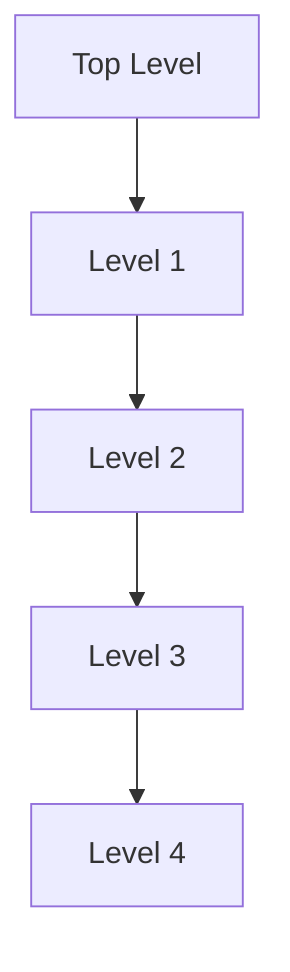

# 8 Gleichgewicht und Elastizität

原始 PDF 第 205–220 页。

# 8 Gleichgewicht und Elastizität

## 8.1 Gleichgewicht

## Physikalische Motivation

Menschliche Bauwerke sollen in der Lage sein, den auf sie einwirkenden Kräften zu widerstehen. So sollen beispielsweise Gebäude trotz der Kraft der Gravitation und der auf sie einwirkenden Windkräfte stabil stehen und Brücken müssen sowohl der Schwerkraft, die sie nach unten zieht, als auch den unregelmäßigen Kräften aufgrund des über sie fließenden Verkehrs trotzen.

Ein wichtiges Gebiet der Physik beschäftigt sich damit, herauszufinden, welche Eigenschaften es Objekten ermöglichen, allen einwirkenden Kräften zum Trotz stabil zu bleiben. In diesem Kapitel untersuchen wir die beiden wichtigsten Gesichtspunkte der Stabilität: das Gleichgewicht der Kräfte und Drehmomente auf starre Objekte und die Elastizität von nichtstarren Objekten – eine Eigenschaft, die angibt, wie sich diese Objekte verformen. Sofern diese Aspekte der Physik beachtet werden, sind sie Gegenstand von Fachartikeln in physikalischen und ingenieurwissenschaftlichen Zeitschriften. Wenn sie nicht beachtet oder falsch eingeschätzt werden, rückt das Thema in die Schlagzeilen der Tages- und Boulevardpresse und wird anschließend in juristischen Fachzeitschriften aufgearbeitet.

## 8.1.1 Gleichgewicht

Betrachten Sie die folgenden Gegenstände: (1) ein auf einem Tisch liegendes Buch, (2) einen Eishockeypuck, der mit konstanter Geschwindigkeit über eine reibungs freie Oberfläche gleitet, (3) die rotierenden Blätter eines Deckenventilators und (4) das Rad eines Fahrrads, das mit konstanter Geschwindigkeit über einen geraden Weg fährt. Für alle diese Gegenstände gilt:

1. Der Impuls $\vec { P }$ des Schwerpunkts ist konstant.
2. Der Drehimpuls $\vec { L }$ in Bezug auf den Schwerpunkt (oder irgendeinen anderen Punkt) ist ebenfalls konstant.

Von solchen Gegenständen sagen wir, sie befinden sich im **Gleichgewicht** bzw. in einem **Gleichgewichtszustand**. Die beiden Bedingungen für das Vorliegen eines Gleichgewichts sind daher

$$
\vec {P} = \text {const.} \quad \text {und} \quad \vec {L} = \text {const.} \tag {8.1}
$$

In diesem Kapitel werden wir Situationen untersuchen, in denen die Konstanten in Gl. 8.1 sogar verschwinden. Wir beschäftigen uns also in erster Linie mit Gegenständen, die sich in dem von uns verwendeten Bezugssystem überhaupt nicht bewegen – weder in Form einer Translation noch einer Rotation. Solche Gegenstände befinden sich in einem **statischen Gleichgewicht**. Von den vier oben erwähnten Gegenständen ist nur einer – das ruhende Buch auf dem Tisch – im statischen Gleichgewicht.

Halliday Physik für natur- und ingenieurwiss. Studiengänge, 3. Auflage. D. Halliday, R. Resnick und J. Walker. © 2020 WILEY-VCH Verlag GmbH & Co. KGaA. Published 2020 by WILEY-VCH Verlag GmbH & Co. KGaA.

191

---

8 Gleichgewicht und Elastizität

natural_image

Rocky mountain landscape with a tall, reddish-brown rock formation and snow-capped peaks in the background (no text or symbols visible)

Abb. 8.1

Ein Felsen im Arches National Park im US-Staat Utah. Seine Lage mag bedenklich erscheinen, doch er befindet sich im statischen Gleichgewicht [Quelle: Joe Cornish/Getty Images].

Der Felsen in Abb. 8.1 ist ein weiteres Beispiel für einen Gegenstand, der sich (zumindest im Augenblick) in einem statischen Gleichgewicht befindet. Diese Eigenschaft teilt er mit unzähligen anderen Strukturen wie Kathedralen, Häusern, Aktenschränken oder Würstchenbuden, die sich im Verlauf der Zeit ebenfalls nicht verändern.

Wenn ein Körper in denselben Zustand des statischen Gleichgewichts zurückkehrt, nachdem er durch eine Kraft aus diesem Zustand gebracht wurde, dann sagen wir, dieser Körper befindet sich in einem stabilen statischen Gleichgewicht (vgl. Abschn. 4.3). Ein Beispiel hierfür ist eine Murmel am Grund einer halbkreisförmigen Schale. Kann jedoch eine winzige Störung den Körper dauerhaft aus seiner Gleichgewichtslage herausbringen, so sagt man, der Körper befinde sich in einem instabilen Gleichgewicht.

Betrachten Sie beispielsweise einen Dominostein, dessen Schwerpunkt sich genau über einer seiner aufliegenden Kanten befindet (Abb. 8.2a). Das Drehmoment um diese Kante aufgrund der Gravitationskraft $\vec { F } _ { \mathrm { G } }$ auf den Dominostein verschwindet, weil die Kraftrichtung genau durch diese Kante verläuft. Der Dominostein befindet sich daher im Gleichgewicht. Aber offensichtlich kann eine beliebig kleine, zufällige Kraft diesen Gleichgewichtszustand beenden. Verschiebt sich die Verlängerung der Kraftrichtung zu einer der beiden Seiten neben der Kante (wie in Abb. 8.2b), verstärkt $\vec { F } _ { \mathrm { G } }$ das Drehmoment und der Dominostein beginnt zu kippen. Der Dominostein in Abb. 8.2a befindet sich daher in einem instabilen Gleichgewichtszustand.

Der Dominostein in Abb. 8.2c ist nicht ganz so instabil. Um diesen Stein kippen zu können, muss man ihn über die Lage aus Abb. 8.2a, bei der sich der Schwerpunkt exakt über einer der beiden Kanten befindet, hinausdrehen. Eine sehr schwache Kraft bringt den Dominostein daher nicht zum Kippen, wohl aber ein kräftiger Stoß. (Stellen wir mehrere Dominosteine auf diese Weise hintereinander auf, kann ein Stoß gegen den ersten Stein die ganze Kette zu Fall bringen.)

Der Bauklotz aus Abb. 8.2d ist sogar noch stabiler, weil sein Schwerpunkt weiter bewegt werden muss, bis er sich direkt oberhalb einer der Kanten befindet. Ein leichter Stoß bringt ihn in der Regel nicht zu Fall. Der Mann in Abb. 8.3 befindet sich in einer besonders schwierigen Situation: Seine Gleichgewichtsposition quer zum Longboard ist sehr diffizil, weil er nur eine schmale Auflagefläche hat und das Longboard in dieser Richtung außerdem auch noch neigbar ist, seiner Kraft also keinen festen Widerstand entgegensetzt. In Längsrichtung hat er zwar eine breitere Auflagefläche, aber dafür kann sich das Bord in dieser Richtung in Bewegung setzen, sodass er ein dynamisches Gleichgewicht aufrechterhalten muss.

Die Untersuchung von statischen Gleichgewichtslagen ist bei Bauvorhaben von höchster Wichtigkeit. Der Bauingenieur muss alle auf eine Struktur einwirkenden äußeren Kräfte und Drehmomente erkennen und durch ein entsprechendes Design und eine gute Wahl der Werkstoffe sicherstellen, dass die geplante Struktur den Belastungen auch standhält. Solche Untersuchungen sind beispielsweise notwendig um sicherzustellen, dass Brücken nicht unter dem Gewicht des Verkehrs oder dem Druck eines Sturms zusammenbrechen, oder dass das Fahrgestell eines Flugzeugs auch den Schock einer rauen Landung übersteht.

Abb. 8.2

(a) Ein Dominostein balanciert auf einer seiner Kanten, d. h., der Schwerpunkt befindet sich genau über dieser Kante. Die Richtung der Gravitationskraft $\vec { F } _ { \mathrm { G } }$ auf den Dominostein verläuft exakt durch diese Kante. (b) Wird der Dominostein auch nur minimal aus dieser ausbalancierten Lage gebracht, verursacht $\vec { \bar { F } } _ { \mathrm { G } }$ ein Drehmoment und der Stein beginnt zu kippen. (c) Steht ein Dominostein auf einer seiner schmalen Seiten, ist er etwas stabiler als der Dominostein aus (a). (d) Ein quadratischer Bauklotz ist noch stabiler.

192

---

8.1 Gleichgewicht

8

## 8.1.2 Bedingungen für das Gleichgewicht

Die Translationsbewegung eines Körpers wird durch das zweite Newtonsche Gesetz beschrieben. Ausgedrückt durch den Impuls ist es durch Gl. 5.23 gegeben:

$$
\vec {F} _ {\mathrm{ges}} = \frac {\mathrm{d} \vec {P}}{\mathrm{d} t}. \tag {8.2}
$$

Befindet sich der Körper im Gleichgewicht bezüglich Translation – ist also $\vec { P }$ konstant $\neg ,$ dann gilt $\mathrm { d } \vec { P } / \mathrm { d } t = 0$ und es folgt

$$
\vec {F} _ {\text {ges}} = 0 \quad (\text {Kräftegleichgewicht}). \tag {8.3}
$$

Die Rotationsbewegung eines Körpers wird ebenfalls durch das zweite Newtonsche Gesetz bestimmt, allerdings jetzt ausgedrückt über den Drehimpuls (Gl. 7.27):

$$
\vec {\tau} _ {\mathrm{ges}} = \frac {\mathrm{d} \vec {L}}{\mathrm{d} t}. \tag {8.4}
$$

Befindet sich der Körper im Gleichgewicht bezüglich Rotation – ist also $\vec { L }$ konstant –, so gilt $\mathrm { d } \vec { L } / \mathrm { d } t = 0$ und es folgt

$$
\vec {\tau} _ {\text {ges}} = 0 \quad (\text {Gleichgewicht der Drehmomente}). \tag {8.5}
$$

Die beiden Bedingungen für einen Körper im Gleichgewicht lauten somit:

1. Die vektorielle Summe aller äußeren Kräfte auf einen Körper muss verschwinden.
2. Die vektorielle Summe aller äußeren Drehmomente auf einen Körper muss bezüglich aller Punkte verschwinden.

Diese Bedingungen gelten offensichtlich für ein statisches Gleichgewicht. Sie gelten ebenfalls für eine allgemeinere Form von Gleichgewicht, bei der $\vec { P }$ und $\vec { L }$ konstant sind, aber nicht null.

Die Gln. 8.3 und 8.5 sind Vektorgleichungen. Sie sind jeweils äquivalent zu drei unabhängigen Komponentengleichungen, eine für jede Richtung der Koordinatenachsen:

Kräftegleichgewicht Gleichgewicht der Drehmomente

| $F_{\text{ges},x} = 0$ | $\tau_{\text{ges},x} = 0$ |
| --- | --- |
| $F_{\text{ges},y} = 0$ | $\tau_{\text{ges},y} = 0$ |
| $F_{\text{ges},z} = 0$ | $\tau_{\text{ges},z} = 0$ |

Wir werden oft eine vereinfachte Situation betrachten, bei der die auf einen Körper wirkenden Kräfte nur in der xy-Ebene liegen. In diesem Fall können nur solche Drehmomente auftreten, die einen Körper in eine Drehung um eine Achse parallel zur z-Achse versetzen. Unter dieser Voraussetzung werden von den Gleichungen in Gl. 8.6 eine Kraftgleichung und zwei Drehmomentgleichungen eliminiert und wir erhalten:

$$
F _ {\mathrm{ges}, x} = 0 \quad (\text {Kräftegleichgewicht}), \tag {8.7}
$$

$$
F _ {\mathrm{ges}, y} = 0 \quad (\text {Kräftegleichgewicht}), \tag {8.8}
$$

$$
\tau_ {\mathrm{ges}, z} = 0 \quad (\text {Gleichgewicht der Drehmomente}). \tag {8.9}
$$

Hierbei ist $\tau _ { \mathrm { g e s } , z }$ das von den äußeren Kräften erzeugte gesamte Drehmoment entweder um die z-Achse oder irgendeine andere Achse parallel zur z-Achse.

Ein Eishockeypuck, der mit konstanter Geschwindigkeit über das Eis gleitet, erfüllt die Gln. 8.7–8.9 und befindet sich daher im Gleichgewicht, allerdings nicht im statischen Gleichgewicht. Für ein statisches Gleichgewicht muss der Impuls $\vec { P }$ des Pucks nicht nur konstant sein, sondern auch verschwinden: Der Puck muss auf dem Eis ruhen. Für ein statisches Gleichgewicht muss daher noch eine weitere Bedingung gelten:

3. Der Impuls $\vec { P }$ des Körpers muss null sein.

natural_image

Person performing a high-lying handstand on a skateboard, wearing jeans and black shirt (no text or symbols visible)

Abb. 8.3

Im Handstand auf dem Longboard befindet man sich zwar im Gleichgewicht – doch wenn das Brett ins Rollen kommt, wird es schwer, den Schwerpunkt über der Standfläche zu halten! [Quelle: DRB Images, LLC/iStockphoto].

193

---

8 Gleichgewicht und Elastizität

## KONTROLLFRAGE 1

Die Abbildung zeigt sechs Draufsichten eines homogenen Stabs. Zwei oder mehr Kräfte wirken senkrecht zu diesem Stab. In welchen Fällen kann sich der Stab in einem statischen Gleichgewicht befinden, wenn die Beträge der Kräfte geeignet adjustiert werden (allerdings von null verschieden bleiben)?

## 8.1.3 Das Gravizentrum

Die Gravitationskraft auf einen ausgedehnten Körper ist gleich der vektoriellen Summe der Gravitationskräfte auf die einzelnen Elemente (die Atome) dieses Körpers. Statt diese Elemente alle einzeln zu betrachten, können wir auch sagen:

text_image

y
O
Kraftarm
xi
x
mi
FGi
Kraft-
richtung

(a)

Die Gravitationskraft $\vec { F } _ { \mathrm { G } }$ auf einen Körper wirkt effektiv in einem einzelnen Punkt, den man das Gravizentrum (GZ) dieses Körpers nennt.

Der Begriff „effektiv“ bedeutet Folgendes: Würden die Kräfte auf die einzelnen Elemente irgendwie abgeschaltet und stattdessen eine einzelne Kraft $\vec { F } _ { \mathrm { G } }$ auf das Gravizentrum eingeschaltet, dann wären die Gesamtkraft und das Gesamtdrehmoment (um jeden Punkt) dieses Körpers unverändert.

Bisher sind wir immer davon ausgegangen, dass die Gravitationskraft $\vec { F } _ { \mathrm { G } }$ im Schwerpunkt eines Körpers angreift. Das ist gleichbedeutend mit der Annahme, dass das Gravizentrum sich im Schwerpunkt befindet. Für einen Körper der Masse M ist die Schwerkraft $\vec { F } _ { \mathrm { G } }$ gleich $M _ { \mathcal { S } _ { 1 } } ^ { \rightarrow }$ , wobei $\cdot \vec { g }$ die durch die Schwerkraft erzeugte (Fall-)Beschleunigung dieses Körpers wäre, wenn sich der Körper frei bewegen könnte. Im Folgenden werden wir beweisen:

text_image

y
O
GZ
F_G
x_GZ
Kraftarm
x
Kraft-
richtung

(b)

Wenn $\vec { g }$ für alle Elemente eines Körpers gleich ist, dann befindet sich das Gravizentrum (GZ) des Körpers in seinem Schwerpunkt (S).

Diese Bedingung ist für die meisten Alltagsgegenstände erfüllt, weil sich $\vec { g }$ entlang der Erdoberfläche nur wenig ändert und auch mit der Höhe nur langsam abnimmt. Im Anschluss an den folgenden Beweis werden wir diese Annahme weiterhin machen.

**Beweis:** Zunächst betrachten wir die einzelnen Elemente eines Körpers. Abbildung 8.4a zeigt einen ausgedehnten Körper mit der Masse M und eines seiner Elemente mit der Masse $m _ { i }$ . Auf jedes dieser Elemente wirkt eine Gravitationskraft $\vec { F } _ { G , i } = m _ { i } \vec { g } _ { i }$ . Der Index bei $\vec { g } _ { i }$ bedeutet, dass die Gravitationsbeschleunigung $\vec { g } _ { i }$ am Ort des Elements i zu nehmen ist, und dass diese sich von der Gravitationsbeschleunigung am Ort von anderen Elementen unterscheiden kann.

Wie in Abb. 8.4 erkennbar, erzeugt jede Kraft $\vec { F } _ { \mathrm { G } , i }$ für das Element i in Bezug auf den Koordinatenursprung O ein Drehmoment $\tau _ { i }$ mit zugehörigem Kraftarm $x _ { i }$ Nach Gl. 6.30 $( \tau = r _ { \perp } F )$ können wir für das Drehmoment $\tau _ { i }$ auch schreiben:

$$
\tau_ {i} = x _ {i} F _ {\mathrm{G}, i}. \tag {8.10}
$$

Abb. 8.4 (a) Ein Teilelement der Masse mi in einem ausgedehnten Körper. Vom Ursprung O des Koordinatensystems aus betrachtet gehört zu der Gravitationskraft $\vec { \bar { F } } _ { \mathrm { G } , i } ^ { \mathrm { ~   ~ } }$ auf dieses Element ein Kraftarm $x _ { i }$ . (b) Effektiv wirkt auf einen Körper die Gravitationskraft ${ \vec { F } } _ { \mathrm { G } } ,$ die im Gravizentrum (GZ) dieses Körpers angreift. Der Kraftarm zur Gravitationskraft bezüglich des Koordinatenursprungs O ist $x _ { \mathrm { G Z } ^ { * } }$

194

---

8.2 Beispiele für statische Gleichgewichte

8

Das Gesamtdrehmoment auf alle Elemente des Körpers ist somit

$$
\tau_ {\mathrm{ges}} = \sum \tau_ {i} = \sum x _ {i} F _ {\mathrm{G}, i}. \tag {8.11}
$$

Nun betrachten wir den Körper als Ganzes. Abbildung 8.4b zeigt die Gravitationskraft $\vec { F } _ { \mathrm { G } } ,$ die im Gravizentrum des Körpers angreift. Diese Kraft erzeugt für den Körper ein Drehmoment τ um O mit einem Kraftarm $x _ { \mathrm { G Z } } .$ . Dieses Drehmoment können wir wiederum nach Gl. 6.30 in der Form

$$
\tau = x _ {\mathrm{GZ}} F _ {\mathrm{G}} \tag {8.12}
$$

schreiben. Die Gravitationskraft $\vec { F } _ { \mathrm { G } }$ auf den Körper ist gleich der Summe der Gravitationskräfte $\vec { F } _ { \mathrm { G } , i }$ auf alle Elemente. Wir können daher $F _ { \mathrm { G } }$ in Gl. 4.12 durch $\sum F _ { G , i }$ ersetzen:

$$
\tau = x _ {\mathrm{GZ}} \sum F _ {\mathrm{G}, i}. \tag {8.13}
$$

Nun soll das Drehmoment aufgrund der Kraft $\vec { F } _ { \mathrm { G } } ,$ die im Gravizentrum angreift, gleich dem Gesamtdrehmoment aufgrund aller Kräfte $\vec { F } _ { \mathrm { G } , i }$ auf die einzelnen Elemente des Körpers sein. (So haben wir das Gravizentrum GZ definiert.) Daher ist τ aus Gl. 8.13 gleich $\tau _ { \mathrm { g e s } }$ aus Gl. 8.11:

$$
x _ {\mathrm{GZ}} \sum F _ {\mathrm{G}, i} = \sum x _ {i} F _ {\mathrm{G}, i}.
$$

Wir ersetzen $F _ { \mathrm { G } , i }$ durch $m _ { i } g _ { i }$ und erhalten

$$
x _ {\mathrm{GZ}} \sum m _ {i} g _ {i} = \sum x _ {i} m _ {i} g _ {i}.
$$

Nun kommt der kritische Punkt: Wenn die Beschleunigungen $g _ { i }$ an allen Orten der Elemente gleich sind, können wir sie aus der Gleichung herauskürzen. Das führt uns auf:

$$
x _ {\mathrm{GZ}} \sum m _ {i} = \sum x _ {i} m _ {i}. \tag {8.14}
$$

Die Summe $\sum m _ { i }$ der Massen der Elemente ist gleich der Gesamtmasse M des Körpers. Daher können wir für Gl. 8.14 auch als

$$
x _ {\mathrm{GZ}} = \frac {1}{M} \sum x _ {i} m _ {i} \tag {8.15}
$$

schreiben. Die rechte Seite dieser Gleichung entspricht der Koordinate $x _ { S }$ des Schwerpunkts des Körpers (Gl. 5.4). Wir erhalten somit, was wir beweisen wollten:

$$
x _ {\mathrm{GZ}} = x _ {\mathrm{S}}. \tag {8.16}
$$

## KONTROLLFRAGE 2

Angenommen, Sie spießen mit einem dünnen Spieß einen Apfel auf, treffen allerdings nicht das Gravizentrum des Apfels. Wenn Sie den Spieß waagerecht halten und der Apfel sich frei um den Spieß drehen kann, wo wird sich das Gravizentrum schließlich befinden? Weshalb?

## 8.2 Beispiele für statische Gleichgewichte

## Lernziele

Nach dem Durcharbeiten dieses Abschnitts sollten Sie in der Lage sein, . . .

• die Bedingungen für das Gleichgewicht der Kräfte und das der Drehmomente auf das statische Gleichgewicht anzuwenden,
zu verstehen, dass eine kluge Wahl des Koordinatenursprungs (auf den Drehmo mente zu beziehen sind) die Berechnung durch Eliminierung einer oder mehrerer unbekannter Kräfte aus den Gleichungen entscheidend vereinfachen kann.

195

---

8 Gleichgewicht und Elastizität

## Schlüsselideen

• Von einem ruhenden starren Körper sagt man, er befinde sich im statischen Gleichgewicht. Für einen solchen Körper ist die Vektorsumme der auf ihn wirkenden äußeren Kräfte null (Kräftegleichgewicht):

$$
\vec {F} _ {\mathrm{ges}} = 0.
$$

Wenn alle Kräfte beispielsweise in der xy-Ebene liegen, ist diese Vektorgleichung äquivalent zu den Komponentengleichungen

$$
F _ {\mathrm{ges}, x} = 0 \quad \text {und} \quad F _ {\mathrm{ges}, y} = 0.
$$

• Im statischen Gleichgewicht muss auch die Vektorsumme aller an einem beliebigen Punkt des Körpers angreifenden Drehmomente null sein (Gleichgewicht der Drehmomente):

$$
\vec {\tau} _ {\mathrm{ges}} = 0.
$$

Wenn alle Kräfte in der xy-Ebene liegen, sind alle Drehmomente parallel zur z-Achse und diese Vektorgleichung ist äquivalent zu der Komponentengleichung

$$
\tau_ {\mathrm{ges}, z} = 0.
$$

## 8.2.1 Beispiele für statische Gleichgewichte

In diesem Abschnitt untersuchen wir vier Beispiele von Systemen im statischen Gleichgewicht. In allen Fällen wenden wir die Gleichgewichtsbedingungen (Gln. 8.7–8.9) auf einen oder mehrere Gegenstände des Systems an. Die für die Gleichgewichtslage relevanten Kräfte befinden sich alle in der xy-Ebene, die Drehmomente stehen daher parallel zur z-Achse. Zur Anwendung von Gl. 8.9, dem Gleichgewicht der Drehmomente, wählen wir daher eine Achse parallel zur z-Achse, um das Drehmoment zu berechnen. Obwohl Gl. 8.9 für jede solche Achse erfüllt ist, werden wir sehen, dass sich die Anwendung von Gl. 8.9 für bestimmte Achsen vereinfacht, bei denen eine oder mehrere unbekannte Kräfte eliminiert werden können.

## KONTROLLFRAGE 3

Die Abbildung zeigt die Draufsicht eines homogenen Stabs im statischen Gleichgewicht. (a) Können Sie die Beträge der unbekannten Kräfte ${ \vec { F } } _ { 1 }$ und $\vec { F } _ { 2 }$ aus den Gleichgewichtsbedingungen für die Kräfte bestimmen? (b) Wenn Sie den Betrag von $\vec { F } _ { 2 }$ aus einer einzelnen Gleichung berechnen wollen, durch welchen Punkt sollten Sie eine Drehachse legen? (c) Der Betrag von $\vec { F } _ { 2 }$ sei 65 N. Wie groß ist der Betrag von $\vec { F } _ { 1 } { } ^ { ? }$

text_image

20 N
4d
2d
d
d
F₂
10 N
F₁
30 N

text_image

A
B
C
D
θ

## KONTROLLFRAGE 4

In der Abbildung wird ein ruhender 5 kg schwerer Stab AC durch ein Seil gehalten und gegen eine Wand gedrückt. Dort verhindert die Reibung zwischen Stab und Wand das Abrutschen. Der homogene Stab hat eine Länge von 1 m und wird unter einem Winkel von $\theta = 3 0 ^ { \circ }$ gehalten. (a) Wenn Sie den Betrag der Kraft ${ \vec { T } } ,$ die vom Seil auf den Stab ausgeübt wird, aus einer einzigen Gleichung berechnen wollen, bei welchem der markierten Punkte sollte dann die Drehachse gewählt werden?

196

---

8.2 Beispiele für statische Gleichgewichte

8

Wir betrachten nun die Drehmomente bezüglich dieser Achse und treffen wie immer die Konvention, gegen den Uhrzeigersinn wirkende Drehmomente positiv zu zählen. (b) Welches Vorzeichen hat das Drehmoment $\tau _ { \mathrm { G } } ,$ das durch das Gewicht des Stabs erzeugt wird? (c) Welches Vorzeichen hat das Drehmoment $\tau _ { \mathsf { S } } ,$ das durch die Aufhängung des Stabs am Seil erzeugt wird? (d) Ist der Betrag von $\tau _ { \mathrm { G } }$ größer, kleiner oder gleich dem Betrag von $\tau _ { \mathrm { S } } { } ^ { ? }$

## LÖSUNGSSTRATEGIEN

**Strateg**i**e 1: Aufgaben zum statischen Gl**e**ichgewicht** Es folgt eine Liste von Schritten zur Lösung von Aufgaben zum statischen Gleichgewicht:

1. Fertigen Sie eine Skizze an.
2. Wählen Sie das System, auf das Sie die Gleichgewichtsbedingungen anwenden wollen. Zeichnen Sie um dieses System eine geschlossene Kurve, damit Sie es klar vor Augen haben. In manchen Fällen können Sie als System einen einzelnen Gegenstand auswählen. Es handelt sich dann um den Gegenstand, der sich im Gleichgewicht befinden soll (wie beispielsweise den schiefen Turm in Beispielaufgabe 8.4 im Übungsbuch). In anderen Fällen kann es sinnvoll sein, weitere Gegenstände in das System mit aufzunehmen, wenn dadurch die Berechnungen für das Gleichgewicht vereinfacht werden. Angenommen, Sie hätten in Beispielaufgabe 8.3 im Übungsbuch nur die Leiter als System gewählt. Dann müssten Sie in Abb. Ü8.7b noch zusätzliche unbekannte Kräfte auf die Leiter berücksichtigen, die durch die Hände und die Füße der Feuerwehrfrau ausgeübt werden. Diese zusätzlichen Unbekannten hätten die Gleichgewichtsbedingungen wesentlich komplizierter gemacht. Wenn das System von Abb. Ü8.7 dagegen die Feuerwehrfrau enthält, werden diese unbekannten Kräfte zu einem inneren Teil des Systems und müssen daher zur Lösung von Beispielaufgabe 8.3 im Übungsbuch nicht bestimmt werden.
3. Zeichnen Sie ein Kräftediagramm des Systems. In diesem Diagramm sollten sämtliche Kräfte auftreten, die auf dieses System wirken. Markieren Sie diese Kräfte und stellen Sie sicher, dass die Angriffspunkte und Richtungen korrekt eingetragen sind.
4. Tragen Sie die x- und y-Achse eines Koordinatensystems ein. Wählen Sie diese Achsen so, dass mindestens eine der Achsen parallel zu einer oder mehreren der unbekannten Kräfte liegt. Zerlegen Sie die nicht parallel zu den Koordinatenachsen liegenden Kräfte in ihre Komponenten bezüglich dieses Koordinatensystems. In unseren Beispielaufgaben im Übungsbuch war es immer sinnvoll, die x-Achse horizontal und die y-Achse vertikal zu legen (das muss aber keineswegs immer so sein).
5. Schreiben Sie Gleichgewichtsbedingungen für die Kräfte inx- undy-Richtung auf, wobei sie noch Symbole (keine expliziten Zahlen) verwenden sollten.
6. Wählen Sie eine oder mehrere Drehachsen senkrecht zur Bildebene und for mulieren Sie die Gleichgewichtsbedingung für das Drehmoment zu jeder dieser Achsen. Liegt eine dieser Achsen in der Richtung einer der unbekannten Kräfte, so vereinfachen sich die Gleichungen, weil diese Kraft nicht mehr auftritt.
7. Lösen Sie die Gleichungen algebraisch nach den Unbekannten auf. Noch unerfahrene Studierende mögen sich sicherer fühlen, wenn sie an diesem Punkt Zahlen mit Einheiten in die unabhängigen Gleichungen einsetzen, insbesondere wenn die algebraischen Umformungen kompliziert erscheinen. Die Erfahreneren ziehen jedoch den algebraischen Zugang vor, da in diesem Fall die Abhängigkeit der Lösung von den einzelnen Variablen deutlich wird.
8. Setzen Sie nun Zahlen und Einheiten in die algebraische Lösung der Aufgabe ein. Sie erhalten dann die numerischen Werte für die Unbekannten.
9. Betrachten Sie ihre Antworten – erscheinen sie sinnvoll? Sind sie offensichtlich zu groß oder zu klein? Ist das Vorzeichen richtig? Passen die Einheiten zusammen?

197

---

8 Gleichgewicht und Elastizität

## 8.3 Elastizität

## Lernziele

Nach dem Durcharbeiten dieses Abschnitts sollten Sie in der Lage sein, . . .

• zu erklären, was ein unterbestimmtes System ist,
• für Zug- und Druckbelastungen die Beziehung zwischen Spannung, Dehnung und dem Youngschen Modul anzugeben und anzuwenden,
• zwischen Streckgrenze und Zugfestigkeit zu unterscheiden,
• für Scherbelastungen die Beziehung zwischen Spannung, Dehnung und Schubmodul anzugeben und anzuwenden,
• für hydraulische Beanspruchungen die Beziehung zwischen hydraulischer Spannung, Volumenänderung und Kompressionsmodul anzugeben und anzuwenden.

## Schlüsselideen

Um das elastische Verhalten (die Deformation) von Objekten als Reaktion auf einwirkende Kräfte zu beschreiben, verwendet man drei elastische Moduln. Allgemein hängt die Dehnung (relative Längenänderung) über den passenden Modul linear mit der angewandten Spannung (Kraft pro Flächeneinheit) zusammen, was die allgemeine Spannungs-Dehnungs-Beziehung beschreibt:

$$
\text {Dehnung} = \text {Modul} \cdot \text {Spannung}.
$$

• Wenn ein Objekt unter Zug oder Druck steht, wird die Spannungs-Dehnungs-Beziehung in der Form

$$
\frac {F}{A} = E \frac {\Delta L}{L}
$$

geschrieben. Dabei sind $\Delta L / L$ die Dehnung des Objekts durch Zug bzw. Druck ist, F der Betrag der einwirkenden Kraft, welche die Dehnung verursacht, A die Querschnittsfläche, auf welche die Kraft (senkrecht zu A) wirkt und E der Elastizitätsmodul des Objekts. Die Spannung ist $F / A$

• Wenn ein Objekt einer Scherspannung ausgesetzt ist, hat die Spannungs-Dehnungs-Beziehung die Form

$$
\frac {F}{A} = G \frac {\Delta x}{L}
$$

mit $\Delta x / L$ als der Scherbeanspruchung des Objekts, Δx als der Verschiebung des einen Endes des Objekts in Richtung der einwirkenden Kraft F und G als dem Schubmodul des Objekts. Die Spannung ist wiederum $F / A$

• Wenn ein Objekt von einer Flüssigkeit umgeben ist und diese das Objekt durch eine Druckkraft hydraulisch komprimiert, nimmt die Spannungs-Dehnungs-Beziehung die Form

$$
p = B \frac {\Delta V}{V}
$$

an, wobei p der Druck (die hydraulische Spannung) auf das Objekt aufgrund der Flüssigkeit ist, $\Delta V / V$ (die Dehnung) der Absolutbetrag der relativen Volumenänderung des Objekts aufgrund dieses Drucks und B der Kompressionsmodul des Objekts.

## 8.3.1 Unterbestimmte Strukturen

Zur Lösung der Aufgaben in diesem Kapitel gibt es nur drei unabhängige Glei chungen, meist zwei Gleichungen für das Kräftegleichgewicht und eine Gleichge wichtsbedingung für das Drehmoment um eine gegebene Drehachse. Wenn eine Aufgabe daher mehr als drei Unbekannte enthält, können wir sie nicht lösen.

198

---

8.3 Elastizität

8

Solche Aufgaben lassen sich leicht finden. In Beispielaufgabe 8.3 hätten wir beispielsweise auch annehmen können, dass die Wand nicht reibungsfrei ist und zwischen der Wand und der Leiterspitze daher auch vertikale Reibungskräfte auftre ten. In diesem Fall wären vier unbekannte Kräfte im Spiel gewesen. Mit nur drei Gleichgewichtsgleichungen wäre die Aufgabe nicht zu lösen gewesen.

Stellen Sie sich ein unsymmetrisch beladenes Auto vor. Wie groß sind die – alle jeweils verschiedenen – Kräfte auf die vier Räder? Auch diese Kräfte können wir nicht berechnen, wenn wir nur drei unabhängige Gleichungen zur Verfügung haben. Ein ähnliches Problem tritt bei einem Tisch auf: Wir können zwar die Gleichgewichtsaufgabe für einen Tisch mit drei Beinen lösen, nicht aber für einen Tisch mit vier Beinen. Solche Aufgaben, bei denen es mehr Unbekannte gibt als Gleichungen, bezeichnet man als **unbestimmt** oder **unterbestimmt**.

Offensichtlich existieren aber die Lösungen zu solchen unterbestimmten Aufgaben in der Wirklichkeit. Wenn Sie die Reifen des Autos auf vier Bodenwaagen stellen, wird jede dieser Waagen einen eindeutigen Wert anzeigen, und die Summe dieser Werte entspricht dem Gewicht des Autos. Was fehlt uns, wenn wir die einzelnen Kräfte durch das Lösen von Gleichungen bestimmen wollen?

Des Rätsels Lösung liegt darin, dass wir – ohne es besonders betont zu haben – sämtliche Körper, auf die wir die Gleichungen für ein statisches Gleichgewicht angewandt haben, als perfekt starr angenommen haben. Damit ist gemeint, dass sich diese Körper unter der Einwirkung von Kräften nicht verformen. Streng genommen gibt es solche Körper aber gar nicht. Autoreifen beispielsweise verformen sich bei Belastung vergleichsweise leicht, bis das Auto in einer statischen Gleichgewichtslage zur Ruhe kommt.

Wir alle haben unsere Erfahrungen mit wackeligen Esstischen in Restaurants. Üblicherweise legen wir in solchen Fällen gefaltetes Papier oder Bierdeckel unter eines der Tischbeine. Würde sich ein ausgewachsener Elefant auf einen solchen Tisch setzen und der Tisch dabei nicht zusammenbrechen, dann würden sich seine Beine wie die Reifen eines Autos so weit verformen, bis alle Beine den Boden berühren, die Kräfte würden vertikal nach oben entlang der Tischbeine wirken und wohldefinierte (verschiedene) Werte annehmen wie in Abb. 8.5. Und auch wackeln würde der Tisch nicht mehr. Wie können wir die Kräfte auf die Tischbeine bestimmen?

Wollen wir solche unterbestimmten Gleichgewichtsaufgaben lösen, müssen wir die Gleichgewichtsbedingungen noch um einige Kenntnisse aus dem Bereich der Elastizitätstheorie erweitern. Dabei handelt es sich um einen Zweig der Physik und der Ingenieurswissenschaften, der die Verformung wirklicher Körper unter dem Einfluss von Kräften beschreibt. Der folgende Abschnitt stellt eine Einführung in dieses Thema dar.

## KONTROLLFRAGE 5

Ein horizontaler homogener Balken von 10 N Gewicht hängt an zwei Drähten von der Decke. Diese Drähte üben auf den Balken zwei nach oben gerichtete Kräfte ${ \vec { F } } _ { 1 }$ und $\vec { F } _ { 2 }$ aus. Die Abbildung zeigt vier Anordnungen dieser Drähte. Gibt es Anordnungen, bei denen wir keine numerischen Werte für ${ \vec { F } } _ { 1 }$ und $\vec { F } _ { 2 }$ bestimmen können?

text_image

F₁
F₂
10 N

(a)

text_image

F₁ ← d → d → F₂
↓ 10 N

(b)

text_image

F₁ ← d → d/2 → F₂
↓ 10 N

(c)

text_image

F₁
F₂
10 N

(d)

text_image

S
F₁
F₂
Fₖ
F₃
F₅

Abb. 8.5

Ein perfekt starrer Tisch ist ein unterbestimmtes System. Die vier Kräfte an den Tischbeinen sind vom Betrag her verschieden und können nicht nur aus den Gesetzen der statischen Gleichgewichtszustände gefunden werden. In der Realität gibt er jedoch der Gewichtskraft des Elefanten nach und nimmt eine eindeutig bestimmte Position ein.

199

---

8 Gleichgewicht und Elastizität

natural_image

Abstract 3D molecular or crystal lattice structure with pink spheres and gray rods, no text or symbols present

Abb. 8.6

Die Atome eines metallischen Festkörpers sind in einem dreidimensionalen Gitter angeordnet. Die Federn stellen die interatomaren Kräfte dar.

(a) Ein Zylinder, auf den eine $Z   u g -$ spannung wirkt, ändert seine Länge um den Betrag ΔL. (b) Ein $\mathrm { Z y } -$ linder, auf den eine Scherspannung wirkt, verformt sich seitlich um einen Betrag $\Delta x ,$ ähnlich wie ein Stapel Spielkarten. (c) Das Volumen einer Vollkugel, die einem homogenen hydraulischen Druck eines Fluids unterworfen ist, schrumpft um einen Betrag ΔV. Alle Verformungen sind sehr übertrieben dargestellt.

Abb. 8.7

## 8.3.2 Elastizität

Wenn sich viele Atome zu einem metallischen Festkörper zusammenfinden, bei spielsweise zu einem Eisennagel, dann entsprechen die Gleichgewichtslagen der Atome einem dreidimensionalen Gitter. Dabei handelt es sich um eine sich wiederholende Anordnung, bei der jedes Atom einen wohldefinierten Gleichgewichtsabstand von seinen nächsten Nachbarn besitzt. Die Atome werden durch interatomare Kräfte zusammengehalten, die in Abb. 8.6 durch winzige Federn symbolisiert werden. Das Gitter ist bemerkenswert fest, was gleichbedeutend mit der Feststellung ist, dass diese „interatomaren Federn“ außerordentlich steif sind. Aus diesem Grund empfinden wir viele gewöhnliche Gegenstände, wie Metallleitern, Tische und Hämmer, als praktisch starr. Natürlich erscheinen uns andere Alltagsgegenstände, wie Gartenschläuche oder Gummihandschuhe, alles andere als starr. Die Atome solcher Gegenstände bilden kein starres Gitter wie in Abb. 8.6, sondern sie sind eher in langen, biegsamen Molekülketten angeordnet, wobei jede dieser Ketten nur lose mit ihren Nachbarn verbunden ist.

Alle sogenannten „starren“ Körper sind in Wirklichkeit bis zu einem gewissen Grad **elastisch**, d. h., wir können ihre Abmessungen etwas verändern, indem wir an ihnen ziehen, sie stoßen, drehen oder zusammendrücken. Um ein Gespür für die Größenordnung zu erhalten, stellen wir uns einen vertikalen Stahlstab vor, der 1 m lang ist und einen Durchmesser von 1 cm hat. Wenn wir an das Ende dieses Stabs einen Kleinwagen hängen, dehnt sich dieser $\operatorname { S t a b } ,$ allerdings nur um $^ { 0 , 5 }$ m m oder 0,05 %. Außerdem geht der Stab wieder auf seine ursprüngliche Länge zurück, wenn das Auto entfernt wird.

Hängt man zwei Autos an den $\operatorname { S t a b } ,$ so wird dieser Stab dauerhaft gedehnt bleiben und seine ursprüngliche Länge nicht wieder einnehmen, auch wenn die Belastung entfernt wird. Hängt man drei Autos an den Stab, wird er brechen. Kurz vor dem Bruch wird die Dehnung des Stabs etwas weniger als $^ { 0 , 2 }$ % betragen. Obwohl Verformungen dieser Größenordnung sehr klein erscheinen, sind sie für die Praxis von großer Bedeutung. (Ob ein Flügel bei Belastung an einem Flugzeug hängen bleibt, ist offensichtlich von sehr großer Bedeutung.)

Abbildung 8.7 zeigt drei Möglichkeiten, wie ein Festkörper seine Abmessungen unter dem Einfluss von Kräften verändern kann. In Abb. 8.7a wird ein Zylinder gedehnt. In Abb. 8.7b wird ein $\mathrm { Z y l }$ inder durch eine Kraft senkrecht zu seiner Achse verformt, ähnlich wie ein Stapel Spielkarten oder Bücher sich verformen würde. In Abb. 8.7c schließlich wird ein fester Gegenstand in eine Flüssigkeit unter hohem Druck gelegt und dabei gleichmäßig von allen Seiten zusammengepresst. Allen drei Verformungsarten ist gemeinsam, dass eine Spannung, oder auch eine Verformungskraft pro Flächeneinheit, zu einer Dehnung oder relativen Längenbzw. Volumenänderung führt. Abbildung 8.7 zeigt in (a) eine Zugspannung (entsprechend einer Dehnung), eine Scherspannung in (b) und eine hydraulische Spannung in (c).

200

---

8.3 Elastizität

8

Spannung und Dehnung zeigen sich in den drei Fällen von Abb. 8.7 in verschiedenen Formen, aber soweit es für die Anwendung in der Technik von Nutzen ist, sind Spannung und Dehnung proportional zueinander. Die Proportionalitätskonstante bezeichnet man als den **Elastizitätsmodul**, und es gilt:

$$
\text {Spannung} = \text {Elastizitätsmodul} \cdot \text {Dehnung}. \tag {8.17}
$$

(Man sagt übrigens in der Mechanik elastischer Körper immer „der Modul“ bzw., wenn es mehrere sind, „die Moduln“.) Bei Prüfverfahren zur Zugbelastbarkeit eines Materials wird ein Testzylinder (wie der in Abb. 8.8) einer Zugspannung unterworfen, die langsam von null gesteigert wird, bis der Zylinder bricht. Die Dehnung wird dabei sorgfältig gemessen und aufgetragen. Das Ergebnis ist ein Graph wie in Abb. 8.9, in dem die Spannung gegen die Dehnung aufgetragen ist. Bei nicht zu großen Werten ist die Beziehung zwischen Spannung und Dehnung linear und die Probe nimmt, nachdem die Spannung abgeschaltet wird, ihre ursprüngliche Form wieder an. Für diesen Bereich gilt Gl. 8.17. Wird die Spannung über die sogenannte **Streckgrenze** $R _ { \mathrm { e } }$ des Testzylinders erhöht, verformt sich die Probe dauerhaft. Wird die Spannung noch weiter erhöht, kommt es schließlich zum Bruch. Die zugehörige Spannung bezeichnet man als **Zugfestigkeit** $R _ { \mathrm { m } } ,$ (Bei Druckbelastungen spricht man auch von Druckfestigkeit.)

## Zug und Druck

Für die einfache Beanspruchung unter Zug oder Druck ist die Spannung eines Gegenstands definiert als $F / A _ { 1 }$ , wobei F der Betrag der senkrecht zur Fläche A wirkenden Kraft ist. Die Dehnung oder Verformung pro Längeneinheit ist dann gleich der dimensionslosen Größe $\Delta L / L$ , also gleich der relativen Längenänderung der Probe (die manchmal auch als prozentuale Längenänderung angegeben wird). Handelt es sich bei der Probe um einen langen Stab und steigt die Spannung nicht über die Streckgrenze, so erfährt bei einer gegebenen angelegten Spannung jedes Teilstück (also nicht nur der Stab als ganzer) dieselbe Dehnung. Da die Dehnung dimensionslos ist, hat der Elastizitätsmodul in Gl. 8.17 dieselbe Dimension wie die Spannung, nämlich Kraft pro Fläche.

Den Elastizitätsmodul für Zug- oder Druckspannungen bezeichnet man auch als **Youngschen Modul**, und er wird in der angewandten Technik durch das Symbol E repräsentiert. Gleichung 8.17 wird damit zu

$$
\frac {F}{A} = E \frac {\Delta L}{L}. \tag {8.18}
$$

Die Dehnung $\Delta L / L$ einer Probe lässt sich leicht mit einem elektrischen Dehnungsmessgerät (Abb. 8.10) bestimmen. Dieses einfache und nützliche Gerät wird mit einem Kleber direkt an der Probe befestigt und beruht auf der Abhängigkeit der elektrischen Eigenschaften des Materials von seiner Dehnung.

Obwohl der Elastizitätsmodul eines Gegenstands für Zug- und Druckbeanspruchung nahezu gleich ist, kann sich die Zugfestigkeit sehr von der Druckfestigkeit unterscheiden. Beton beispielsweise kann einen vergleichsweise hohen Druck aushalten, bevor es zum Bruch kommt, aber unter Zugbeanspruchungen ist Beton so schwach, dass er für solche Belastungen praktisch nie eingesetzt wird. In Tab. 8.1 sind der Elastizitätsmodul und weitere Elastizitätseigenschaften für technologisch relevante Werkstoffe angegeben.

## Abb. 8.10

Ein elektrischer Dehnungsmesser. Seine Abmessungen betragen 9,8 mm zu 4,6 mm. Das Messgerät wird an den Gegenstand geklebt, dessen Dehnung gemessen werden soll. Es erfährt dadurch dieselbe Dehnung wie die Probe. Der elektrische Widerstand des Messgeräts ändert sich in Abhängigkeit von der Dehnung. Auf diese Weise lassen sich Dehnungen bis zu 3 % messen [Quelle: Martin Meise/CC-AS-3.0].

## Abb. 8.8

Ein Testzylinder zur Bestimmung einer Spannungs-Dehnungs-Kurve wie in Abb. 8.9. Bei einem Zugspannungs-Dehnungs-Test wird die relative Längenänderung ΔL∕L in Abhängigkeit von der Spannung gemessen.

line

| Feature | Description |
| --- | --- |
| Y-axis | Spannung (F/A) |
| X-axis | Dehnung \((\Delta L/L)\) |
| Key Points | Zugfestigkeit, Bruch, Streckgrenze, linearer (elastic) Bereich |
| Region | Bereich bleibender Verformung |

## Abb. 8.9

Eine Spannungs-Dehnungs-Kurve für eine Probe aus Stahl wie in Abb. 8.8. Die Probe verformt sich dauerhaft, wenn die Spannung größer als die Streckgrenze des Materials wird. Sie bricht, wenn die Spannung die Zugfestigkeit des Materials überschreitet.

text_image

Kraft
Kraft

201

---

8 Gleichgewicht und Elastizität

TABELLE 8.1:

Einige Elastizitätseigenschaften technologisch wichtiger Werkstoffe.

| Material | Dichte ρ (kg/m3) | Elastizitätsmodul E (109N/m2) | Zug-/Druckfestigkeit Rm (106N/m2) | Streckgrenze Re (106N/m2) |
| --- | --- | --- | --- | --- |
| unlegierter Stahl | 7860 | 200 | 400 | 250 |
| Aluminium | 2710 | 70 | 110 | 95 |
| Glas | 2190 | 65 | 50b) | — |
| Hartbeton | 2320 | 30 | 40b) | — |
| Holza) | 525 | 13 | 50b) | — |
| Knochen | 1900 | 9b) | 170b) | — |
| Polystyrol | 1050 | 3 | 48 | — |

a) Douglasie (ein Nadelbaum)

b) unter Druck

## Scherung

Bei einer Scherung ist die Spannung ebenfalls durch das Verhältnis einer Kraft zu einer Fläche gegeben, allerdings steht der Kraftvektor in diesem Fall nicht senkrecht zur Flächenebene, sondern liegt in der Flächenebene. Mit den in Abb. 8.7b definierten Größen ist die Dehnung definiert als das dimensionslose Verhältnis $\Delta x / L$ . Den zugehörigen Modul bezeichnet man als **Schubmodul**, er wird in der Praxis meist mit dem Symbol G gekennzeichnet. Für eine Scherbeanspruchung wird aus Gl. 8.17

$$
\frac {F}{A} = G \frac {\Delta x}{L}. \tag {8.19}
$$

Scherspannungen spielen eine wichtige Rolle beim Abknicken von Achswellen, die sich unter Belastung drehen, wie auch bei Knochenbrüchen aufgrund von Biegebeanspruchungen.

## Hydraulische Spannung

In Abb. 8.7c besteht die Spannung aus dem allseitigen Flüssigkeitsdruck $p$ auf den vom Fluid umgebenen Gegenstand, der ebenfalls als eine Kraft pro Fläche angegeben wird (wie Sie in Kapitel 10 sehen werden). Die Verformung ist durch die relative Volumenänderung $\Delta V / V$ gegeben, wobei V das ursprüngliche Volumen der Probe ist und $\Delta V$ der Absolutwert der Volumenänderung. Der zugehörige Modul K ist der **Kompressionsmodul** des Materials. Der Gegenstand befindet sich in diesem Fall unter hydraulischem Druck, und den Druck selbst nennt man auch hydraulische Spannung. Für diese Situation wird Gl. 8.17 zu

$$
p = K \frac {\Delta V}{V}. \tag {8.20}
$$

Der Kompressionsmodul beträgt für Wasser $2 { , } 2 { \mathrm { ~ \cdot ~ } } 1 0 ^ { 9 }   \mathrm { N } / \mathrm { m } ^ { 2 }$ und für Stahl 16 $1 0 ^ { 1 0 }   \mathrm { N / m } ^ { \ddagger }$ . Der Druck am Grund des Pazifischen Ozeans in einer mittleren Tiefe von 4000 m beträgt $4 { , } 0 { \mathrm { ~ \cdot ~ } } 1 0 ^ { 7 }   \mathrm { N } / \mathrm { m } ^ { 2 } .$ . Die relative Volumenänderung $\Delta V / V$ von Wasser beträgt bei diesem Druck ungefähr 1,8 %, die für einen Gegenstand aus Stahl rund 0,025 %. Im Allgemeinen sind Festkörper mit ihren starren atomaren Gittern weniger kompressibel als Flüssigkeiten, in denen die Atome oder Moleküle nicht so fest an ihre Nachbarn gebunden sind.

## KONTROLLFRAGE 6

Die Abbildung zeigt einen horizontalen Block, der von zwei Drähten A und B gehalten wird. Die beiden Drähte seien abgesehen von ihren ursprünglichen Längen identisch. Der Schwerpunkt des Blocks sei näher an Draht B als an Draht A.

text_image

A
B
•S

202

---

8.4 Zusammenfassung

8

(a) Wenn Sie die Drehmomente um den Schwerpunkt abschätzen, ist der Betrag des von Draht A ausgeübten Drehmoments größer, kleiner oder gleich dem Betrag des von Draht B ausgeübten Drehmoments? (b) Welcher Draht übt eine größere Kraft auf den Block aus? (c) Wenn die Drähte nun gleiche Längen haben, welcher Draht war ursprünglich kürzer?

## 8.4 Zusammenfassung

**Statisches Gleichgewicht** Ein starrer Körper in Ruhe befindet sich in einem **statischen Gleichgewicht**. Für einen solchen Körper ist die vektorielle Summe aller äußeren Kräfte gleich null:

$$
\vec {F} _ {\mathrm{ges}} = 0 \quad (\text {Gleichgewicht der Kräfte}). \tag {8.3}
$$

Wenn alle Kräfte in der xy-Ebene liegen, ist diese Vektorgleichung äquivalent zu zwei Komponentengleichungen:

$$
F _ {\text {ges}, x} = 0 \quad \text {und} \quad F _ {\text {ges}, y} = 0 \quad (\text {Gleichgewicht der Kräfte}). \tag {8.7,8.8}
$$

Im statischen Gleichgewicht verschwindet auch die vektorielle Summe der äußeren Drehmomente auf den Körper um jeden Punkt:

$$
\vec {\tau} _ {\mathrm{ges}} = 0 \quad (\text {Gleichgewicht der Drehmomente}). \tag {8.5}
$$

Liegen die Kräfte in der xy-Ebene, sind alle Drehmomentvektoren parallel zur $z - \mathrm { A }$ chse und Gl. 8.5 ist äquivalent zu einer einzelnen Komponentengleichung:

$$
\tau_ {\mathrm{ges}, z} = 0 \quad (\text {Gleichgewicht der Drehmomente}). \tag {8.9}
$$

**Gravizentrum** Die Gravitationskraft wirkt auf jedes Element eines Körpers einzeln. Die Gesamtwirkung aller einzelnen Beiträge kann man sich auch als eine Gesamtgravitationskraft $\vec { \bar { F } } _ { \mathrm { G } }$ vorstellen, die in einem bestimmten Punkt, dem **Gravizentrum**, angreift. Ist die Gravitationsbeschleu nigung $\vec { g }$ für alle Elemente des Körpers gleich, dann befindet sich das Gravizentrum im Schwerpunkt.

**Elastizitätsmodul** Drei **elastische Modulen** werden zur Beschreibung des elastischen Verhaltens (den Verformungen) von Gegenständen aufgrund einwirkender Kräfte verwendet. Die **Dehnung** (relative Längenänderung) steht über den entsprechenden Elastizitätsmodul in linearem Zusammenhang mit der wirkenden **Spannung** (Kraft pro Fläche):

$$
\text {Spannung} = \text {Elastizitätsmodul} \cdot \text {Dehnung}. \tag {8.17}
$$

## 8.5 Fragen

**1.** Abbildung 8.F1 zeigt eine Draufsicht auf einen homogenen Stab, auf den vier Kräfte wirken. Angenommen, wir wählen eine Drehachse durch den Punkt O, berechnen die Drehmomente bezüglich dieser Achse aufgrund der Kräfte und stellen fest, dass diese Drehmomente die Gleichgewichtsbedingung erfüllen. Gelten die Gleichgewichtsbedingungen für die Drehmomente auch dann, wenn wir

**Zug und Druck** Wirken auf einen Gegenstand Zug- oder Druckkräfte, so wird aus Gl. 8.17

$$
\frac {F}{A} = E \frac {\Delta L}{L}, \tag {8.18}
$$

wobei $\Delta L / L$ die relative Längenänderung (Dehnung bei Zugkräften bzw. Stauchung bei Druckkräften) ist. F ist der Betrag der die Spannung verursachenden Kraft ${ \vec { F } } .$ A ist die Querschnittsfläche, über welche die Kraft $\vec { F }$ verteilt ist (senkrecht zu $A$ wie in Abb. 8.7a), und $E$ ist der Elastizi**tätsmodul** des Gegenstands. Die Spannung ist gleich $F / A$

**Scherung** Erfährt ein Gegenstand eine Scherspannung, wird aus Gl. 8.17

$$
\frac {F}{A} = G \frac {\Delta x}{L}. \tag {8.19}
$$

In diesem Fall ist $\Delta x$ der Betrag der Verschiebung des einen Endes des Gegenstands in Richtung der wirkenden Kraft $\vec { F }$ (wie in Abb. 8.7b). $\Delta x / L$ ist die relative Verschiebung, G der **Schubmodul** des Gegenstands und F∕AΔx∕Le Scherspannung.

**Hydraulische Spannung** Wirkt auf einen Gegenstand der hydraulische Druck eines umgebenden Fluids, so wird Gl. 8.17 zu

$$
p = K \frac {\Delta V}{V}, \tag {8.20}
$$

wobei $p$ der (hydraulische) Druck des Fluids auf den Gegenstand ist, $\Delta V / V$ der Absolutbetrag der relativen Volumenänderung aufgrund dieses Drucks, und K der **Kompressionsmodul** des Gegenstands.

stattdessen (a) Punkt $\mathrm { A } ,$ (b) Punkt B oder (c) Punkt C als Drehachse gewählt hätten?

text_image

C
O A B
Abb. 8.F1

203

---

8 Gleichgewicht und Elastizität

**2.** In Abb. 8.F2 ist ein starrer Balken auf zwei Stützen befestigt, die fest im Boden verankert sind. Ein kleiner, aber schwerer Safe wird der Reihe nach an die sechs eingezeichneten Positionen gestellt. Die Masse des Balkens soll im Vergleich zur Masse des Safes vernachlässigbar sein. (a) Ordnen Sie die Positionen nach der Stärke der vom Safe auf die Stütze A ausgeübten Kraft, angefangen beim größ- ten Druck bis zum größten Zug, und geben Sie an, ob (und wenn ja, wo) die Kraft verschwindet. (b) Wiederholen Sie diese Zuordnung für die Stütze B.

text_image

1 2 3 4 5 6
A B

Abb. 8.F2

**3.** Abbildung 8.F3 zeigt vier Draufsichten auf rotierende homogene Scheiben, die über einen reibungsfreien Boden gleiten. Auf jede dieser Scheiben wirken drei Kräfte vom Betrag $F ,   2 F$ oder $3 F$ entweder am Rand, im Mittelpunkt oder an einem Punkt auf der Hälfte zwischen Rand und Mittelpunkt. Die Kraftvektoren drehen sich mit den Scheiben und zeigen in der „Momentaufnahme“ von Abb. 8.F3 nach links oder rechts. Welche dieser Scheiben befindet sich im Gleichgewicht?

(a)

(b)

(c)

(d)

Abb. 8.F3

**4.** Abbildung 8.F4 zeigt Draufsichten auf zwei Strukturen, auf die jeweils drei Kräfte wirken. Die Richtungen der Kräfte sind eingezeichnet, die Beträge der Kräfte können noch geeignet justiert werden (sollen aber von null verschieden bleiben). Welche dieser Strukturen kann sich im statischen Gleichgewicht befinden?

(a)

(b)

Abb. 8.F4

**5.** Abbildung 8.F5 zeigt ein Mobile aus Spielzeugpinguinen, das von der Decke herunterhängt. Jede Querstange hängt waagerecht, hat eine vernachlässigbare Masse und erstreckt sich dreimal so weit zur Rechten der Aufhängung wie zur Linken. Pinguin 1 hat die Masse $m _ { \mathrm { 1 } } = 4 8   \mathrm { k g } .$ Welche Massen haben die anderen Pinguine?

flowchart

Abb. 8.F5

**6.** Eine Leiter lehnt gegen eine reibungsfreie Wand, wird aber durch die Reibung zwischen Leiter und Boden am Abrutschen gehindert. Angenommen, Sie verschieben den Fuß der Leiter näher zur Wand. Welche der folgenden Grö- ßen wird (betragsmäßig) größer, kleiner oder bleibt gleich: (a) die Normalkraft des Bodens auf die Leiter, (b) die Kraft der Wand auf die Leiter, (c) die Haftreibungskraft des Bodens auf die Leiter und (d) der Maximalwert $f _ { \mathrm { R , m a x } }$ der Haftreibungskraft?
**7.** Drei Tierfiguren hängen an der (ruhenden) Anordnung aus masselosen Rollen und Schnüren, wie sie in Abb. 8.F7 wiedergegeben ist. Eine Schnur verläuft von der Decke auf der rechten Seite zu der unteren Rolle links. An einigen kürzeren Schnüren hängen Rollen von der Decke bzw. Tierfiguren von den Rollen. Von zwei der Tierfiguren sind die Gewichte (in Newton) angegeben. (a) Welches Gewicht hat die dritte Tierfigur? (b) Wie groß ist die Zugkraft in der kurzen mit T gekennzeichneten Schnur ganz links? Hinweis: Wenn eine Schnur oberhalb einer Rolle halb herumläuft, dann zieht sie an dieser Rolle mit einer Gesamtkraft, die doppelt so groß ist wie die Zugkraft bzw. Seilkraft in der Schnur.

text_image

T
10
17

Abb. 8.F7

**8.** (a) Wenn Sie in Kontrollfrage 4 das Drehmoment $\tau _ { \mathsf { S } }$ durch T ausdrücken wollen, müssen Sie sin θ oder cos θ verwenden? (b) Wenn der Winkel θ kleiner wird (indem das Seil verkürzt wird, der Stab aber horizontal bleibt), wird das für das Gleichgewicht notwendige Drehmoment $\tau _ { \mathsf { S } }$ größer, kleiner oder bleibt es gleich? (c) Wird der Betrag der zugehörigen Kraft T größer, kleiner oder bleibt er gleich?
**9.** Die Tabelle gibt die Flächeninhalte von drei Flächen an sowie jeweils den Betrag einer Kraft, die senkrecht zu dieser Fläche wirkt und gleichförmig über sie verteilt ist. Ordnen

204

---

8.5 Fragen

8

Sie die Flächen nach der Größe der Spannung (die größte zuerst).

|  | Fläche | Kraft |
| --- | --- | --- |
| Fläche A | $0,5A_{0}$ | $2F_{0}$ |
| Fläche B | $2A_{0}$ | $4F_{0}$ |
| Fläche C | $3A_{0}$ | $6F_{0}$ |

**10.** Vier zylindrische Stäbe werden wie in Abb. 8.7a gedehnt. Die Beträge der Kräfte, die Querschnittsflächen, die Längenänderungen und die ursprünglichen Längen sind in der Tabelle aufgeführt. Ordnen Sie die Stäbe in absteigender Reihenfolge nach ihrem Elastizitätsmodul.

| Stab | Kraft | Fläche | absolute Längenänderung | ursprüngliche Länge |
| --- | --- | --- | --- | --- |
| 1 | F | A | $\Delta L$ | L |
| 2 | 2F | 2A | $2\Delta L$ | L |
| 3 | F | 2A | $2\Delta L$ | $2\Delta L$ |
| 4 | 2F | A | $\Delta L$ |  |

**11.** Abbildung 8.F11 zeigt drei Situationen, in denen der gleiche horizontale Stab an seinem einen Ende an einem Scharnier an einer Wand befestigt ist und an seinem anderen Ende von einer Schnur gehalten wird. Ordnen Sie die Situationen (1) bis (3) ohne Rechnung in absteigender Reihenfolge nach dem Betrag (a) der vertikalen Kraft der Schnur auf den Stab, (b) der vertikalen Kraft des Scharniers auf den Stab und (c) der horizontalen Kraft des Scharniers auf den Stab.

(1)

(2)

text_image

50°

(3)

Abb. 8.F11

**12.** Abbildung 8.F12 zeigt einen ruhenden Stab AC mit einer Masse von 5 kg, der durch ein Seil und die Reibung zwischen Stab und Wand gehalten wird. Der homogene Stab ist 1 m lang und der Winkel θ beträgt 30°. (a) Wenn Sie den Betrag der Kraft $\vec { T }$ des Seils auf den Stab aus einer einzigen Gleichung bestimmen sollten, an welche der markierten Positionen würden Sie die Drehachse legen? Welches Vorzeichen hat (b) das Drehmoment $\tau _ { \mathrm { G } }$ aufgrund des Gewichts des Stabes und (c) das Drehmoment $\tau _ { \mathrm { Z } }$ aufgrund der Zugspannung des Seils für diese Wahl der Drehachse, wenn Sie Drehmomente im Gegenuhrzeigersinn positiv zählen? (d) Ist der Betrag von $\tau _ { \mathrm { Z } }$ größer als, kleiner als oder gleich groß wie der von $\tau _ { \mathrm { G } } { } ^ { ? }$

text_image

D
θ
A B C

Abb. 8.F12

**13.** Die vertikale Stange in Abb. 8.F13 ist an ihrem unteren Ende beweglich und wird an ihrem oberen Ende durch ein Seil gehalten. Nun soll wie in der Abbildung gezeigt eine horizontale Kraft $\vec { F } _ { \mathrm { h } }$ auf die Stange ausgeübt werden. Nimmt die Zugspannung in dem Seil zu, ab oder bleibt sie gleich, wenn der Punkt, an dem die Kraft angreift, nach oben bewegt wird?

text_image

Diagram showing a vertical rod with applied force F_h acting on it, mounted on a horizontal surface.

Abb. 8.F13

205

---

