# 9 Gravitation

原始 PDF 第 221–246 页。

# 9 Gravitation

## 9.1 Das Newtonsche Gravitationsgesetz

## Physikalische Motivation

Die Gravitation ist eine der Grundkräfte der Natur, sie zu verstehen ist daher eine wichtige Aufgabe der Physik. Sie ist die Kraft, die uns alle auf der Erde, den Mond auf seiner Umlaufbahn um die Erde und die Erde auf ihrer Umlaufbahn um die Sonne hält. Sie erstreckt sich durch unsere ganze Galaxie, die Milchstraße, und hält ihre Milliarden und Abermilliarden von Sternen ebenso zusammen wie die unzähligen Moleküle und Staubteilchen zwischen den Sternen. Wir befinden uns im Außenbereich dieser scheibenförmigen Ansammlung von Sternen und sonstiger Materie, etwa $^ { 2 , 6 \cdot 1 0 ^ { 4 } }$ Lichtjahre $( 2 , 5 \cdot 1 0 ^ { 2 0 }   \mathrm { m } )$ von dem galaktischen Zentrum entfernt, um das wir uns langsam drehen.

Die Gravitation wirkt auch auf noch größeren Maßstäben, durch den intergalaktischen Raum hält sie die Lokale Gruppe von Galaxien zusammen, die außer unserer Milchstraße auch die Andromeda-Galaxie (Abb. 9.1) in einem Abstand von $^ { 2 , 3 \cdot 1 0 ^ { 6 } }$ Lichtjahren von der Erde sowie einige näher gelegene Zwerggalaxien wie die Große und die Kleine Magellansche Wolke umfasst. Die Lokale Gruppe wiederum ist ein Teil des Lokalen Superhaufens von Galaxien, der seinerseits von der Schwerkraft in Richtung einer außerordentlich massiven Region voller Galaxienhaufen und -superhaufen gezogen wird, die als Großer Attraktor bezeichnet wird. Diese Region scheint etwa $\bar { 3 { , } 0 \cdot 1 0 ^ { 8 } }$ Lichtjahre von der Erde entfernt und auf der gegenüberliegenden Seite der Milchstraße zu liegen. Die Gravitation reicht sogar

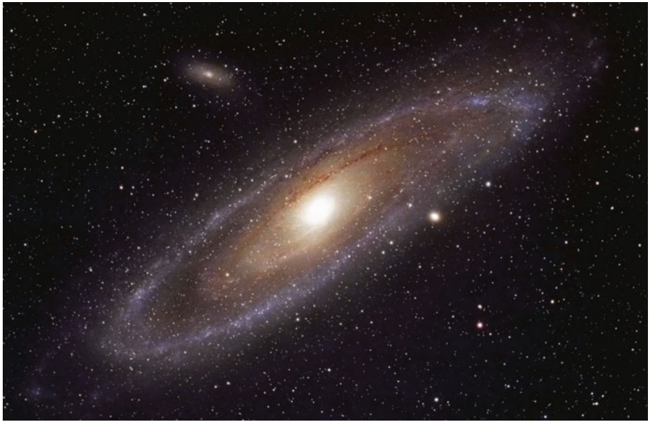

natural_image

A spiral galaxy in deep space with star clusters and dust (no text or symbols visible)

Abb. 9.1

Der Andromeda-Nebel. Sein Abstand von uns beträgt $^ { 2 , 5 \cdot 1 0 ^ { 6 } }$ Lichtjahre und er ist als einzige Galaxie gerade noch mit dem bloßen Auge zu erkennen. Dieser kosmische Nachbar sieht unserer Heimatgalaxis, der Milchstraße, sehr ähnlich [Quelle: plefevre/iStockphoto].

Halliday Physik für natur- und ingenieurwiss. Studiengänge, 3. Auflage. D. Halliday, R. Resnick und J. Walker. © 2020 WILEY-VCH Verlag GmbH & Co. KGaA. Published 2020 by WILEY-VCH Verlag GmbH & Co. KGaA.

207

---

9 Gravitation

noch weiter, prinzipiell bis ins Unendliche – und sie versucht, das Universum als solches während der kosmischen Expansion zusammenzuhalten.

Die Gravitation ist auch für einige der geheimnisvollsten Strukturen im ganzen Universum verantwortlich: die Schwarze Löcher. Wenn ein Stern, der wesentlich größer ist als unsere Sonne, seinen nuklearen Brennstoffvorrat aufgebraucht hat, kann er die Gravitationskräfte zwischen seinen Teilchen nicht mehr kompensieren, sodass er kollabiert und im Extremfall zu einem Schwarzen Loch wird. Die Gravitation an der Oberfläche eines solchen kollabierten Sterns ist so stark, dass weder Teilchen noch Licht von seiner Oberfläche entweichen können (daher der Name „Schwarzes Loch“). Jeder Stern, der einem Schwarzen Loch zu nahe kommt, wird durch die starke Gravitation auseinander gerissen und in das Loch gezogen. Dies geschieht besonders häufig im Zentrum von Sternsystemen wie unserer Milchstraßen, wo sich daher im Laufe der Zeit ein sogenanntes supermassives Schwarzes Loch herausbildet. „Unser“ eigenes Schwarzes Riesenloch im Zentrum der Milchstraße liegt im Sternbild Schütze und wird deshalb Sagittarius A\* genannt, es hat eine Masse von etwa $^ { 3 , 7 \cdot 1 0 ^ { 6 } }$ Sonnenmassen. In der Nähe dieses Schwarzen Lochs ist die Gravitation so stark, dass sie kreisende Sterne zu einer peitschenden Bewegung um das Schwarze Loch antreibt, bei der sie für einen Umlauf nur wenige Jahre brauchen (die Sonne umrundet das Milchstraßenzentrum einmal in 220 Millionen Jahren).

Obwohl die Gravitation noch immer nicht vollständig verstanden ist, wollen wir mit unseren Ausführungen bei dem Gravitationsgesetz von Isaac Newton beginnen – vielleicht sind Sie ja derjenige oder diejenige, die in einigen Jahren die letzten Rätsel der Gravitation lösen wird.

## 9.1.1 Das Newtonsche Gravitationsgesetz

Physiker untersuchen gern scheinbar unzusammenhängende Phänomene, von denen sie dann zeigen wollen, dass es bei genauerer Betrachtung eine Beziehung zwischen ihnen gibt. Diese Suche nach Vereinheitlichungen hat eine jahrhundertelange Tradition. Im Jahr 1665 zeigte der damals 23-jährige Isaac Newton, dass es sich bei der Kraft, die den Mond in seiner Umlaufbahn hält, um dieselbe Kraft handelt, die auch einen Apfel zu Boden fallen lässt. Damit legte er einen Grundstein der Physik. Für uns heute ist dieser Zusammenhang so selbstverständlich geworden, dass es uns schwerfällt, anderslautende Vorstellungen der antiken Gelehrten nachzuvollziehen. Für sie waren die Bewegungen erdgebundener Körper und die Bewegungen der Himmelskörper von grundsätzlich unterschiedlicher Art und durch unterschiedliche Gesetze zu beschreiben.

Newton zeigte nicht nur, dass die Erde einen Apfel ebenso wie den Mond anzieht, sondern er schloss auch, dass jeder Körper im Universum jeden anderen Körper anzieht. Dieses Verhalten der Körper, sich aufeinander zuzubewegen, bezeichnet man als Gravitation. Newtons Schlussfolgerung ist nicht offensichtlich, denn die vertraute und starke Anziehungskraft, welche die Erde auf Körper auf ihrer Oberfläche ausübt, lässt die minimale Anziehungskräfte durch alltägliche Körper oft vergessen. Beispielsweise zieht die Erde einen Apfel mit einer Kraft von ungefähr 0,8 N an. Auch Sie ziehen einen Apfel an (und umgekehrt er Sie), aber diese Anziehungskraft ist kleiner als das Gewicht eines Staubteilchens.

Newton formulierte ein Kraftgesetz, das wir heute als das Newtonsche Gravitationsgesetz bezeichnen: Jedes Teilchen zieht jedes andere Teilchen mit einer Gravitationskraft an, deren Betrag durch die Beziehung

$$
F = G \frac {m _ {1} m _ {2}}{r ^ {2}} \quad \text {(Newtonsches Gravitationsgesetz)} \tag {9.1}
$$

gegeben ist. Hierbei sind $m _ { 1 }$ und $m _ { 2 }$ die Massen der Teilchen, r ist ihr Abstand und G die Gravitationskonstante. Ihr Wert beträgt

$$
G = 6, 6 7 \cdot 1 0 ^ {- 1 1} \mathrm{N} \cdot \mathrm{m} ^ {2} / \mathrm{kg} ^ {2} = 6, 6 7 \cdot 1 0 ^ {- 1 1} \mathrm{m} ^ {3} / \mathrm{kg} \cdot \mathrm{s} ^ {2}. \tag {9.2}
$$

208

---

9.1 Das Newtonsche Gravitationsgesetz

9

Wie in Abb. 9.2 zu sehen ist, wird ein Teilchen $m _ { 1 }$ von einem Teilchen $m _ { 2 }$ mit einer Gravitationskraft $\vec { F }$ angezogen, die auf Teilchen $m _ { 2 }$ gerichtet ist. Umgekehrt wird $m _ { 2 }$ von $m _ { 1 }$ durch eine Gravitationskraft $- \vec { F }$ in Richtung $m _ { 1 }$ angezogen. Die Kräfte $\vec { F }$ und $- \vec { F }$ bilden ein Kräftepaar im Sinn des dritten Newtonschen Gesetzes: Ihre Beträge sind gleich, aber sie sind entgegengesetzt gerichtet. Die Stärke dieser Kraft hängt vom Abstand zwischen den beiden Teilchen ab, allerdings nicht von ihrem Ort: Die beiden Teilchen können sich tief in einer Höhle oder auch tief im Weltraum befinden. Auch das Vorhandensein anderer Körper beeinflusst die beiden Kräfte $\vec { F }$ und $- \vec { F }$ nicht, selbst wenn sich diese anderen Körper genau zwischen den beiden Teilchen befinden.

Die Stärke der Gravitationskraft – wie stark sich also zwei Teilchen mit gege benen Massen in einem gegebenen Abstand anziehen – hängt von der Gravitationskonstanten G ab. Würde G durch ein Wunder plötzlich mit einem Faktor 10 multipliziert, würden Sie durch die Anziehungskraft der Erde auf den Boden geworfen. Betrüge andererseits G auf einmal nur noch 10 % des heutigen Werts, wäre die Anziehung der Erde so schwach, dass Sie über ein Gebäude springen könnten.

Obwohl sich das Newtonsche Gravitationsgesetz streng genommen auf Punktteilchen bezieht, können wir es auch auf ausgedehnte Gegenstände anwenden, sofern die Größe dieser Gegenstände klein im Vergleich zu ihrem Abstand ist. Mond und Erde sind weit genug voneinander entfernt, sodass wir beide Objekte in guter Näherung als punktförmig annehmen können – aber wie steht es mit dem Apfel und der Erde? Vom Standpunkt des Apfels erscheint die breite ausgedehnte Erde, die sich unter dem Apfel in jede Himmelsrichtung bis zum Horizont erstreckt, alles andere als punktförmig.

Newton löste dieses Apfel-Erde-Problem durch ein sehr wichtiges Theorem, das manchmal als das Kugelschalentheorem bezeichnet wird:

Eine homogene materielle Kugelschale zieht ein Teilchen außerhalb dieser Schale mit derselben Kraft an, die auch wirken würde, wenn die gesamte Materie der Schale sich in ihrem Mittelpunkt befände.

Die Erde kann man sich als eine Verschachtelung vieler solcher Kugelschalen vorstellen, vergleichbar mit Zwiebelschalen, und jede dieser Kugelschalen zieht ein Teilchen außerhalb der Erdoberfläche mit einer Kraft an, als ob ihre Masse im Mittelpunkt dieser Schale konzentriert wäre. Auch vom Standpunkt des Apfels aus be trachtet verhält sich die Erde daher wie ein Teilchen, das sich im Erdmittelpunkt befindet und dessen Masse gleich der Erdmasse ist.

Nehmen wir an, die Erde zieht wie in Abb. 9.3 dargestellt einen Apfel mit einer Kraft vom Betrag 0,8 N nach unten. Dann muss der Apfel die Erde mit einer Kraft vom Betrag 0,8 N nach oben ziehen. Von dieser Kraft können wir uns vorstellen, dass sie im Erdmittelpunkt angreift. Obwohl die Beträge dieser beiden Kräfte gleich sind, führen sie zu unterschiedlichen Beschleunigungen, wenn der Apfel losgelassen wird. Für den Apfel beträgt die Beschleunigung ungefähr $9 { , } 8   \mathrm { m / s ^ { 2 } ] }$ , die bekannte Beschleunigung eines frei fallenden Körpers in der Nähe der Erdoberfläche. Für die Erde beträgt die Beschleunigung im Schwerpunktsystem von Apfel und Erde aufgrund ihrer gigantisch großen Masse(nträgheit) nur rund $1 \cdot 1 0 ^ { - \hat { 2 } 5 }   \mathrm { m } / \mathrm { s } ^ { 2 }$

## KONTROLLFRAGE 1

Ein Teilchen wird der Reihe nach außerhalb der folgenden vier Gegenstände plat ziert, die jeweils die Masse m haben sollen: (1) eine große homogene Vollkugel, (2) eine große homogene Kugelschale, (3) eine kleine homogene Vollkugel und (4) eine kleine homogene Kugelschale. In allen Fällen beträgt der Abstand zwischen dem Teilchen und dem Mittelpunkt des Gegenstands d. Ordnen Sie die Gegenstände nach dem Betrag der Gravitationskraft, die sie auf das Teilchen ausüben.

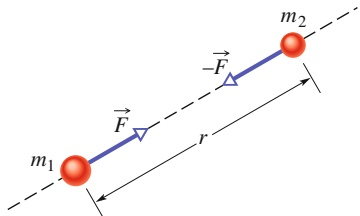

text_image

m₁
F
-F
r
m₂

Abb. 9.2

Zwei Teilchen der Massen $m _ { 1 }$ und $m _ { 2 }$ im Abstand r ziehen sich gemäß dem Newtonschen Gravitationsgesetz (Gl. 9.1) an. Die Anziehungskräfte $\vec { F }$ und $- \vec { F }$ sind vom Betrag her gleich, aber entgegengesetzt gerichtet.

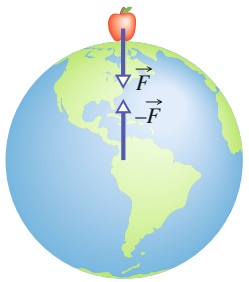

text_image

Diagram illustrating force vectors on an apple in a globe, showing positive and negative forces with arrows labeled F and -F.

Abb. 9.3

Der Apfel zieht die Erde mit derselben Kraft nach oben, mit der umgekehrt die Erde den Apfel nach unten zieht.

209

---

9 Gravitation

## 9.2 Gravitation und das Superpositionsprinzip

## Lernziele

Nach dem Durcharbeiten dieses Abschnitts sollten Sie in der Lage sein, . . .

• für Fälle, in denen mehr als eine Gravitationskraft auf ein Teilchen wirkt, ein Kräftediagramm zu zeichnen, das alle diese Kräfte zeigt, wobei die Enden aller Kraftvektoren an dem Teilchen angreifen,
• für Fälle, in denen mehr als eine Gravitationskraft auf ein Teilchen wirkt, die Gesamtkraft durch vektorielle Addition der einzelnen Kräfte zu berechnen.

## Schlüsselideen

• Gravitationskräfte gehorchen dem Superpositionsprinzip, d. h., wenn n Teilchen miteinander wechselwirken, ist die Gesamtkraft auf Teilchen 1 die Summe aller einzelnen Kräfte aufgrund von anderen Teilchen:

$$
\vec {F} _ {1, \mathrm{ges}} = \sum_ {i = 2} ^ {n} \vec {F} _ {1 i},
$$

wobei die vektorielle Summe alle Kräfte auf Teilchen 1 aufgrund von Teilchen $2 , 3 , \ldots , n$ umfasst.

• Die Gravitationskraft eines Teilchens aufgrund eines ausgedehnten Körpers kann berechnet werden, indem man den Körper in differenzielle Massenelemente dm aufteilt, die jeweils eine differenzielle Kraft $\mathrm { d } \vec { F }$ auf das Teilchen ausüben, und dann über alle diese Massenelemente integriert:

$$
\vec {F} _ {1} = \int \mathrm{d} \vec {F}.
$$

## 9.2.1 Gravitation und das Superpositionsprinzip

Für eine Gruppe aus mehreren Teilchen erhalten wir die Gesamtgravitationskraft, die auf jedes einzelne Teilchen von den anderen Teilchen ausgeübt wird, mithilfe des sogenannten Superpositionsprinzips. Hierbei handelt es sich um ein allgemeines Prinzip, wonach sich die Gesamtwirkung aus der Summe der einzelnen Wirkungen zusammensetzt. Im vorliegenden Fall bedeutet das Superpositionsprinzip, dass wir zunächst der Reihe nach die Gravitationskraft von jedem einzelnen Teilchen auf unser spezielles Teilchen berechnen können. Die Gesamtkraft erhalten wir dann, indem wir diese Kräfte vektoriell addieren.

Für n Teilchen in Wechselwirkung können wir das Superpositionsprinzip der Gravitationskraft in der folgenden Form ausdrücken:

$$
\vec {F} _ {1, \mathrm{ges}} = \vec {F} _ {1 2} + \vec {F} _ {1 3} + \vec {F} _ {1 4} + \vec {F} _ {1 5} + \dots + \vec {F} _ {1 n}. \tag {9.3}
$$

Hierbei ist $\vec { F } _ { 1 , \mathrm { g e s } }$ die Gesamtkraft auf Teilchen 1, und $\vec { \bar { F } } _ { 1 3 }$ ist z. B. die Kraft, die von Teilchen 3 auf Teilchen 1 ausgeübt wird. Wir können diese Gleichung auch etwas kompakter als Vektorsumme schreiben:

$$
\vec {F} _ {1, \text {ges}} = \sum_ {i = 2} ^ {n} \vec {F} _ {1 i}. \tag {9.4}
$$

Doch wie steht es mit der Gravitationskraft von einem wirklich ausgedehnten Kör per auf ein Teilchen? Diese Kraft erhalten wir, indem wir zunächst den Gegenstand in so kleine Teile zerlegen, dass wir diese wie Teilchen behandeln können, und anschließend nach Gl. 9.4 die vektorielle Summe aller Kräfte dieser einzelnen Teile bilden. Im Grenzfall unterteilen wir den ausgedehnten Gegenstand in infinitesimal

210

---

9.3 Die Gravitation in der Nähe der Erdoberfläche

9

kleine Teile der Masse dm, von denen jedes eine differenzielle Kraft $\mathrm { d } \vec { F }$ auf das Teilchen ausübt. In diesem Grenzfall wird aus der Summe in Gl. 9.4 ein Integral und wir erhalten

$$
\vec {F} _ {1} = \int \mathrm{d} \vec {F}. \tag {9.5}
$$

Das Integral erstreckt sich dabei über den gesamten Gegenstand und den Index $\mathbf { \nabla } _ { \mathbf { \nabla } ^ { \prime } } \mathbf { g e s } ^ { \alpha }$ haben wir weggelassen. Handelt es sich bei dem Gegenstand um eine homogene Vollkugel oder eine gleichförmige Kugelschale, können wir das Integral in Gl. 9.5 umgehen, indem wir uns die Masse des Gegenstands in seinem Mittelpunkt konzentriert denken und Gl. 9.1 anwenden.

## KONTROLLFRAGE 2

In der Abbildung erkennt man vier Anordnungen von jeweils drei Teilchen gleicher Masse. (a) Ordnen Sie die Anordnungen nach dem Betrag der Gesamtgravitationskraft (die größte zuerst) auf das mit $_ { v } m ^ { \alpha }$ gekennzeichnete Teilchen. (b) Liegt die Richtung der Gesamtkraft in Anordnung 2 näher an der Linie der Länge d oder näher an der Linie der Länge D?

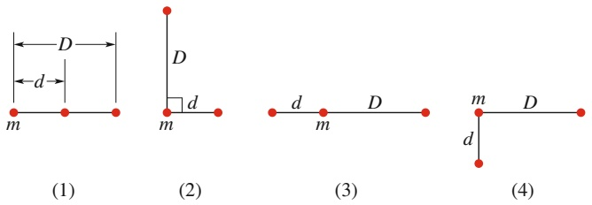

## KONTROLLFRAGE 3

In welche Richtung wirkt in der Abbildung die Gesamtgravitationskraft auf das Teilchen der Masse $m _ { 1 }$ aufgrund der anderen Teilchen, die jeweils die Masse m haben und symmetrisch relativ zur y-Achse angeordnet sein sollen?

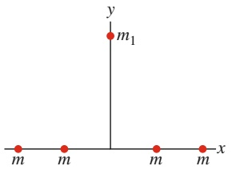

text_image

y
m₁
m
m
m
x

## LÖSUNGSSTRATEGIEN

**Strategie 1: Kräftediagramm für ein Teilchen** Wenn Sie ein Diagramm von Teilchen vor sich haben, wie beispielsweise Abb. 9.4a im Übungsbuch, und die Gesamtgravitationskraft auf eines dieser Teilchen bestimmen wollen, dann sollten Sie zunächst ein Kräftediagramm nur für dieses eine Teilchen zeichnen. In diesem Kräftediagramm sollten auch nur die Kräfte auf dieses eine Teilchen eingezeichnet sein, wie in Abb. 9.4b im Übungsbuch. Wenn Sie es jedoch vorziehen, die Kraftvektoren in dem gegebenen Diagramm direkt zu überlagern, dann sollten Sie die Vektoren mit ihren Enden oder ihren Spitzen an das Teilchen zeichnen, auf das die Kräfte wirken. Zeichnen Sie die Vektoren an anderer Stelle, kann das zu Verwirrung führen, und mit Sicherheit stiftet es Verwirrung, wenn Sie die Vektoren an die Teilchen zeichnen, welche die Kräfte auf das betreffende Teilchen verursachen.

## 9.3 Die Gravitation in der Nähe der Erdoberfläche

## Lernziele

Nach dem Durcharbeiten dieses Abschnitts sollten Sie in der Lage sein, . . .

• zwischen der Beschleunigung des freien Falls und der Gravitationsbeschleunigung zu unterscheiden,
• die Gravitationsbeschleunigung in der Nähe, aber außerhalb eines homogenen kugelförmigen astronomischen Körpers zu berechnen,
• zwischen dem gemessenen Gewicht und dem Betrag der Gravitationskraft zu unterscheiden.

211

---

9 Gravitation

## Schlüsselideen

• Die Gravitationsbeschleunigung $\alpha _ { \mathrm { G } }$ eines Teilchens der Masse m resultiert einzig aus der Schwerkraft. Wenn das Teilchen sich in einem Abstand r vom Mittelpunkt eines homogenen sphärischen Körpers der Masse M befindet, ist der Betrag F der Gravitationskraft auf das Teilchen durch Gl. 9.1 gegeben. Daher gilt nach dem zweiten Newtonschen Gesetz

$$
a _ {\mathrm{G}} = \frac {G M}{r ^ {2}}.
$$

Die Masse der Erde ist nicht homogen verteilt, weil die Erde nicht perfekt sphä- risch ist, die Erdkruste unterschiedlich dick ist und weil die Erde sich dreht. Daher unterscheidet sich die gemessene Beschleunigung $\vec { g }$ geringfügig von der Gravitationsbeschleunigung ${ \vec { a } } _ { \mathrm { G } }$ , und ebenso unterscheidet sich das Gewicht mg eines Teilchens geringfügig von der auf das Teilchen wirkenden Kraft der Gravitation.

## 9.3.1 Die Gravitation in der Nähe der Erdoberfläche

Wenn wir die Erde als eine homogene Kugel der Masse M ansehen, ist der Betrag der Gravitationskraft von der Erde auf ein Teilchen der Masse m, das sich im Abstand r vom Erdmittelpunkt über der Erdoberfläche befindet, durch Gl. 9.1 gegeben:

$$
F = G \frac {M m}{r ^ {2}}. \tag {9.6}
$$

Lässt man das Teilchen los, so fällt es aufgrund der Gravitationskraft $\vec { F }$ auf den Erdmittelpunkt zu (und dieser mit minimaler Geschwindigkeit auf das Teilchen zu!). Die Beschleunigung des Teilchens bezeichnen wir als Gravitationsbeschleunigung ${ \vec { a } } _ { \mathrm { G } }$ . Nach dem zweiten Newtonschen Gesetz hängen die Beträge F und $a _ { \mathrm { G } }$ über

$$
F = m a _ {\mathrm{G}} \tag {9.7}
$$

zusammen. Setzen wir F aus Gl. 9.6 in Gl. 9.7 ein und lösen nach $a _ { \mathrm { G } }$ auf, erhalten wir

$$
a _ {\mathrm{G}} = \frac {G M}{r ^ {2}}. \tag {9.8}
$$

Tabelle 9.1 gibt einige Werte für $a _ { \mathrm { G } }$ für verschiedene Höhen über der Erdoberflä- che an.

Seit Abschn. 2.2 haben wir angenommen, dass es sich bei der Erde um ein Iner tialsystem handelt, und ihre Eigendrehung vernachlässigt. Wegen dieser Vereinfachung konnten wir die tatsächliche Fallbeschleunigung (oder Erdbeschleunigung) $g$ eines Teilchens mit der Gravitationsbeschleunigung an der Erdoberfläche (die wir mit $x a _ { G } \; ( \mathrm { { \sf { m } } } / \mathrm { { s } } ^ { 2 } )$ bezeichnen) gleichsetzen. Außerdem haben wir angenommen,

TABELLE 9.1: Werte für $\alpha _ { \mathrm { G } }$ in Abhängigkeit von der Höhe.

| Höhe (km) | $a_{G}$ (m/s2) | Beispiel |
| --- | --- | --- |
| 0 | 9,83 | mittlere Höhe der Erdoberfläche |
| 8,8 | 9,80 | Mt. Everest |
| 36,6 | 9,71 | höchster bemannter Ballon |
| 400 | 8,70 | Bahn des Spaceshuttles |
| 35 700 | 0,225 | Nachrichtenübertragungssatelliten |

212

---

9.3 Die Gravitation in der Nähe der Erdoberfläche

9

dass g auf der gesamten Erdoberfläche den konstanten Wert $9 { , } 8   \mathrm { m / s ^ { 2 } }$ hat. Der für g gemessene Wert unterscheidet sich jedoch von dem aus Gl. 9.8 berechneten Wert $a _ { \mathrm { G } }$ aus drei Gründen: (1) Die Erde (und vor allem die Erdkruste) hat keine perfekt homogene Massenverteilung, (2) sie ist keine perfekte Kugel und (3) sie dreht sich, und zwar um eine Achse durch ihren Mittelpunkt. Da g und $a _ { \mathrm { G } }$ verschieden sind, unterscheidet sich aus denselben drei Gründen auch der Betrag des gemessenen Gewichts mg eines Teilchens von dem Betrag der Gravitationskraft nach Gl. 9.6. Diese Gründe wollen wir nun genauer untersuchen.

1. **Die Erde ist nicht homogen.** Die Dichte (Masse pro Volumen) der Erde verändert sich wie in Abb. 9.4 angegeben mit dem Radius. Außerdem ist die Dichte der Erdkruste (äußerer Bereich) an verschiedenen Orten der Erdoberfläche unterschiedlich – vergleichen Sie z. B. die Dicke der Erdkruste am Mt. Everest und am Boden des Pazifik. Daher hängt auch g vom Ort an der Erdoberfläche ab.
2. **Die Erde ist keine Kugel.** Die Erde ist näherungsweise ein Ellipsoid: abgeplattet an den Polen und etwas verdickt am Äquator. Ihr äquatorialer Radius ist um 21 km größer als ihr Radius an Nord- und Südpol. Ein Punkt am Pol ist daher dem Erdmittelpunkt näher als ein Punkt am Äquator. Das ist einer der Gründe, warum die Erdbeschleunigung g zunimmt, wenn man sich auf Meereshöhe vom Äquator zu einem der beiden Pole bewegt.
3. **Die Erde rotiert.** Die Drehachse verläuft durch Mittelpunkt, Nord- und Südpol der Erde. Ein Gegenstand irgendwo auf der Erdoberfläche (außer an den Polen selbst) muss sich auf einem Kreis um die Drehachse bewegen und daher eine Zentripetalbeschleunigung in Richtung des Kreismittelpunkts erfahren. Diese Zentripetalbeschleunigung erfordert eine ebenfalls auf diesen Mittelpunkt gerichtete Zentripetalkraft.

Zur Berechnung des Unterschieds zwischen g und $a _ { \mathrm { G } }$ aufgrund der Erdrotation untersuchen wir den einfachen Fall, in dem eine Kiste der Masse m am Äquator auf einer Waage liegt. Abbildung 9.5a zeigt diese Situation aus einem Blickwinkel weit oberhalb des Nordpols.

Abbildung 9.5b zeigt ein Kräftediagramm für die Kiste. Zwei Kräfte wirken auf die Kiste, beide entlang der radialen Achse vom Erdmittelpunkt. Die Normalkraft $\vec { N }$ von der Waage auf die Kiste ist nach außen gerichtet, entlang der positiven Richtung der r-Achse. Die Gravitationskraft, dargestellt durch $m \vec { a } _ { \mathrm { G } }$ , ist zum Erdmittelpunkt gerichtet. Da sich die Kiste mit der Erde auf einem Kreis um den Erdmittelpunkt dreht, wirkt die Zentripetalbeschleunigung nach innen. Nach Gl. 6.20 hat diese Beschleunigung die Form $\omega ^ { 2 } R ,$ wobei ω die Winkelgeschwindigkeit der Erde und R der Kreisradius (näherungsweise der Erdradius) ist. Das zweite Newtonsche Gesetz für die r-Achse $( F _ { \mathrm { g e s } , r } = m a _ { r } )$ wird damit zu

$$
N - m a _ {\mathrm{G}} = m (- \omega^ {2} R). \tag {9.9}
$$

Der Betrag N der Normalkraft ist gleich dem auf der Waage abgelesenen Gewicht mg. Ersetzen wir N in Gl. 9.9 durch mg, so erhalten wir

$$
m g = m a _ {\mathrm{G}} - m (\omega^ {2} R) \tag {9.10}
$$

beziehungsweise in Worten:

$$
\binom{\text {gemessenes}}{\text {Gewicht}} = \binom{\text {Betrag der}}{\text {Gravitationskraft}} - \binom{\text {Zentripetal-}}{\text {kraft}}.
$$

Das gemessene Gewicht ist daher wegen der Erddrehung kleiner als der Betrag der Gravitationskraft auf die Kiste.

Einen entsprechenden Ausdruck für $g$ und $\alpha _ { \mathrm { G } }$ erhalten wir, indem wir Gl. 9.10 durch m dividieren:

$$
g = a _ {\mathrm{G}} - \omega^ {2} R \tag {9.11}
$$

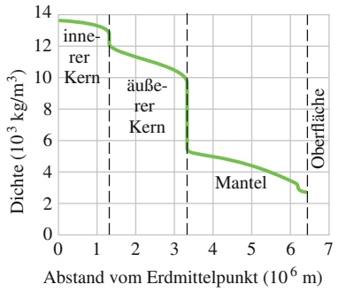

line

| Abstand vom Erdmittelpunkt (10^6 m) | Dichte (10^3 kg/m^3) |
| --- | --- |
| 0 | ~13.5 |
| 1.4 | ~12.0 |
| 3.3 | ~9.8 |
| 3.4 | ~5.3 |
| 6.4 | ~2.7 |

Abb. 9.4

Die Dichte der Erde als Funktion des Abstands von ihrem Mittelpunkt. Die Grenzen für den festen inneren Kern, den zum größten Teil flüssigen äußeren Kern und den festen Mantel sind eingetragen. Die Erdkruste ist jedoch zu dünn, um in dieser Zeichnung erkennbar zu sein.

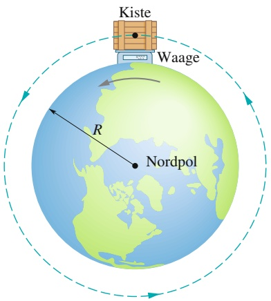

text_image

Kiste
Waage
R
Nordpol

(a)

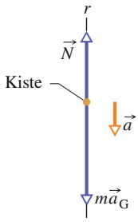

text_image

r
N
Kiste
a
maG

(b)

Abb. 9.5

(a) Eine Kiste liegt auf einer Waage am Erdäquator; die Blickrichtung verläuft entlang der Drehachse von einem Punkt oberhalb des Nordpols. (b) Ein Kräftediagramm für die Kiste mit einer radial nach außen gerichteten r-Achse. Die Gravitationskraft auf die Kiste ist durch ihr Äquivalent $m \vec { a } _ { \mathrm { G } }$ dargestellt. Die Normalkraft von der Waage auf die Kiste ist $\vec { N } .$ Wegen der Erdrotation wirkt auf die Kiste noch eine zum Erdmittelpunkt hin gerichtete Zentripetalbeschleunigung a⃗.

213

---

9 Gravitation

beziehungsweise in Worten:

$$
\binom{\text {freie Fall - }}{\text {beschleunigung}} = \binom{\text {Erd - }}{\text {beschleunigung}} - \binom{\text {Zentripetal - }}{\text {beschleunigung}}.
$$

Die gemessene freie Fallbeschleunigung ist also wegen der Erddrehung kleiner als die Erdbeschleunigung.

Der Unterschied zwischen den Beschleunigungen $g$ und $a _ { \mathrm { G } }$ beträgt $\omega ^ { 2 } R$ und ist am Äquator am größten (denn dort ist der Radius des von der Kiste durchlaufenen Kreises am größten). Zur Berechnung dieses Unterschieds verwenden wir Gl. 6.5 $\left( \omega = \Delta \theta / \Delta t \right)$ und den Erdradius $R = 6 , 3 7 \cdot 1 0 ^ { 6 }   \mathrm { m }$ . Für eine Erddrehung ist θ gleich 2π und die Zeitdauer beträgt ungefähr 24 h. Mit diesen Werten (und der Umrechnung $1   \mathrm { h } = 8 6   4 0 0   \mathrm { s } )$ erhalten wir $\operatorname { f i i r } g$ einen um $0 , 0 3 4   \mathrm { m } / \mathrm { s } ^ { 2 }$ kleineren Wert als für $a _ { \mathrm { G } } .$ Verglichen mit $9 { , } 8   \mathrm { m } / \mathrm { s } ^ { 2 }$ können wir diese Differenz zwischen g und $\alpha _ { \mathrm { G } }$ meist vernachlässigen. Aus demselben Grund ist auch der Unterschied zwischen der Gewichtskraft und dem Betrag der Gravitationskraft meist vernachlässigbar.

## 9.4 Die Gravitation innerhalb der Erde

## Lernziele

Nach dem Durcharbeiten dieses Abschnitts sollten Sie in der Lage sein, . . .

• zu verstehen, dass eine homogene Materieschale keine Gravitationskraft auf ein Teilchen ausübt, das sich in ihr befindet,
• die Gravitationskraft auf ein Teilchen zu berechnen, das sich im Inneren einer nicht rotierenden, homogenen Kugel in einem Abstand r vom Zentrum befindet.

## Schlüsselideen

• Eine homogene Schale übt keine resultierende Gravitationskraft auf ein darin befindliches Teilchen aus.
• Die Gravitationskraft auf ein Teilchen innerhalb einer homogenen Vollkugel in einem Abstand r vom Zentrum hängt nur von der Masse M in einer „inneren Kugel“ mit gerade diesem Radius r ab,

$$
M _ {\mathrm{in}} = \frac {4}{3} \pi r ^ {3} \rho = \frac {M}{R ^ {3}} r ^ {3},
$$

wobei ρ die Dichte der Vollkugel ist, R ihr Radius und M ihre Masse. Wir können diese „innere Masse“ auch gedanklich einem Teilchen im Zentrum der Vollkugel zuordnen und dann das Newtonsche Gravitationsgesetz für Teilchen anwenden. Der Betrag der auf die Masse m wirkenden Kraft ist

$$
F = \frac {g m M}{R ^ {3}} r.
$$

## 9.4.1 Die Gravitation innerhalb der Erde

Das Kugelschalentheorem von Newton lässt sich auch auf eine Situation anwenden, bei der sich ein Teilchen innerhalb einer gleichförmigen Kugelschale befindet. In diesem Fall folgt:

Eine homogene sphärische Materieschale übt auf ein Teilchen innerhalb dieser Schale keine Gesamtgravitationskraft aus.

Vorsicht: Diese Aussage bedeutet nicht, dass die Gravitationskräfte von den verschiedenen Elementen der Kugelschale auf das Teilchen auf mysteriöse Weise verschwinden. Sie besagt nur, dass die Summe aller Kraftvektoren von diesen Elementen auf das Teilchen null ist.

214

---

9.4 Die Gravitation innerhalb der Erde

9

Wäre die Dichte der Erde homogen, würde an der Erdoberfläche auf ein Teilchen die größtmögliche Gravitationskraft wirken. Bewegte sich das Teilchen vom Erdmittelpunkt weg, würde die Gravitationskraft kleiner. Bewegte sich das Teilchen zum Erdmittelpunkt hin, fällt es beispielsweise in einen tiefen Minenschacht, würde sich die Gravitationskraft ebenfalls verändern, und zwar aus zwei Gründen: (1) Sie würde zunehmen, weil sich das Teilchen näher auf den Erdmittelpunkt zubewegt, und (2) sie würde abnehmen, weil die dicker werdende Kugelschale aus Erdmaterie außerhalb der radialen Lage des Teilchens keine Gesamtkraft auf das Teilchen mehr ausübt.

Für eine homogene Erde würde der zweite Einfluss überwiegen. Die Kraft auf das Teilchen nähme immer weiter ab, wenn sich das Teilchen dem Erdmittelpunkt näherte und würde schließlich am Mittelpunkt verschwinden. Für unsere tatsächlich existierende (nicht homogene) Erde nimmt die Kraft jedoch zunächst zu, wenn sich das Teilchen von der Oberfläche nach unten bewegt. Die Kraft erreicht in einer bestimmten Tiefe ein Maximum, und erst wenn sich das Teilchen weiter auf den Erdmittelpunkt zubewegt, beginnt sie wieder abzunehmen.

Um einen Ausdruck für die Gravitationskraft im Inneren einer (homogen gedachten) Erdkugel zu bestimmen, orientieren wir uns an der Geschichte $_ { r ^ { V } }$ on Pol zu Pol“, einer frühen Science-Fiction-Erzählung von George Griffith. Hier versuchen drei Forscher, in einer Kapsel durch einen natürlich entstandenen (und natürlich fiktiven) Tunnel direkt vom Südpol zum Nordpol zu reisen. Abbildung 9.6 zeigt die Kapsel (mit der Masse m) in einem Abstand r vom Erdmittelpunkt. In diesem Moment wirkt eine resultierende Gravitationskraft auf die Kapsel, die sich aus der Masse $M _ { \mathrm { i n } }$ innerhalb der Kugel mit dem Radius r errechnet (die Masse innerhalb der gestrichelten Linie); die Masse in der äußeren Kugelschale (außerhalb der gestrichelten Linie) hat keinen Einfluss. Darüber hinaus können wir annehmen, dass die Masse $M _ { \mathrm { i n } }$ im Erdmittelpunkt konzentriert ist, und können daher Gl. 9.1 für den Betrag der Gravitationskraft auf die Kapsel verwenden; so erhalten wir

$$
F = \frac {G m M _ {\mathrm{in}}}{r ^ {2}}. \tag {9.12}
$$

Da wir von einer homogenen Dichte $\rho$ ausgehen, können wir die Masse $M _ { \mathrm { i n } }$ durch die Gesamtmasse M der Erde und ihren Radius R ausdrücken:

$$
\text {Dichte} = \frac {\text {Masse innen}}{\text {Volumen innen}} = \frac {\text {Gesamtmasse}}{\text {Gesamtvolumen}},
$$

$$
\rho = \frac {M _ {\mathrm{in}}}{\frac {4}{3} \pi r ^ {3}} = \frac {M}{\frac {4}{3} \pi R ^ {3}}.
$$

Auflösen nach $M _ { \mathrm { i n } }$ ergibt

$$
M _ {\mathrm{in}} = \frac {4}{3} \pi r ^ {3} \rho = \frac {M}{R ^ {3}} r ^ {3}. \tag {9.13}
$$

Nun setzen wir den zweiten Ausdruck für $M _ { \mathrm { i n } }$ in Gl. 9.12 ein und erhalten so den gesuchten Ausdruck für die Kraft der Gravitation auf eine Kapsel als Funktion ihres Abstands r von Erdmittelpunkt:

$$
F = \frac {G m M}{R ^ {3}} r. \tag {9.14}
$$

In der Geschichte von Griffith nimmt die Gravitationskraft auf die Forscher gefährlich zu, als sich ihre Kapsel dem Erdmittelpunkt nähert. Dann, exakt am Mittelpunkt, verschwindet die Kraft plötzlich für einen kurzen Moment. Aus Gl. 9.14 erkennen wir, dass die Kraft in Wirklichkeit linear abnimmt, während sich die Kapsel dem Erdmittelpunkt nähert und dort null wird. Wenigstens in diesem letzten Punkt hatte der Autor der Geschichte also recht.

Wir können Gl. 9.14 auch mit dem Kraftvektor $\vec { F }$ und dem Positionsvektor ⃗r der Kapsel formulieren, wenn wir $\vec { r }$ entlang der radialen Achse vom Erdmittelpunkt

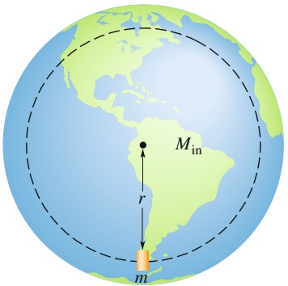

text_image

M_in
r
m

Abb. 9.6

Eine Kapsel der Masse m fällt aus dem Stillstand durch einen Tunnel, der den Nord- und Südpol der Erde miteinander verbindet. Wenn sich die Kapsel in einem Abstand r vom Erdmittelpunkt befindet, trägt von der Erdmasse nur noch der Teil $M _ { \mathrm { i n } }$ zur Gravitationskraft bei, der sich in einer Kugel innerhalb dieses Radius r befindet.

215

---

9 Gravitation

wählen. Wir bezeichnen die Konstanten aus Gl. 9.14 zusammengefasst mit K und erhalten so für Gl. 9.14 in Vektorschreibweise

$$
\vec {F} = - K \vec {r}. \tag {9.15}
$$

Hierbei haben wir ein Minuszeichen eingefügt, um anzudeuten, dass $\vec { F }$ und ⃗r in entgegengesetzte Richtungen zeigen. Gleichung 9.15 hat die Form des Hookeschen Gesetzes (Gl. 3.18). Unter den von Griffith und uns angenommenen idealisierten Bedingungen würde die Kapsel also wie ein Gewicht an einer Feder um den Erdmittelpunkt schwingen, d. h., nachdem sie vom Südpol zum Erdmittelpunkt gefallen wäre, würde sie von dort weiter zum Nordpol fliegen (wie bei Griffith beschrieben) und anschließend wieder zurück. Dieser Prozess würde sich – vermutlich sehr zum Missfallen der Forscher in der Kapsel – unendlich wiederholen. Träte noch Luftreibung hinzu (eine realistische Annahme), nähme die Schwingungsamplitude mit der Zeit immer weiter ab, bis die Kapsel schließlich im Erdmittelpunkt zur Ruhe kommt, was den Forschern möglicherweise noch mehr missfallen würde.

## 9.5 Die potenzielle Energie der Gravitation

## Lernziele

Nach dem Durcharbeiten dieses Abschnitts sollten Sie in der Lage sein, . . .

• die potenzielle Energie der Gravitation für ein System von Teilchen (oder von Kugeln, die als Teilchen behandelt werden können) zu berechnen,
zu verstehen, dass die von der Gravitation an einem Teilchen verrichtete Arbeit (und damit die Veränderung von dessen potenzieller Gravitationsenergie), wenn sich dieses von einem Anfangspunkt zu einem Endpunkt bewegt, nicht von dem Weg abhängt, den das Teilchen nimmt,
aus der Kraft der Gravitation, die in der Nähe eines astronomischen (oder eines anderen ortsfesten) Körpers auf ein Teilchen wirkt, die Arbeit zu berechnen, die diese Kraft an dem Teilchen verrichtet, wenn es sich bewegt,
• die Erhaltung der mechanischen Energie (einschließlich der Gravitationsenergie) auf ein Teilchen anzuwenden, das sich relativ zu einem astronomischen (oder sonstigen ortsfesten) Körper bewegt,
• die Energie zu berechnen, die ein Teilchen aufbringen muss, um aus dem Schwerefeld eines astronomischen Körpers (in der Regel als homogene Kugel betrachtet) zu entkommen,
• die Fluchtgeschwindigkeit eines Teilchens für das Verlassen eines astronomischen Körpers zu berechnen.

## Schlüsselideen

Die potenzielle Gravitationsenergie U(r) eines Systems von zwei Teilchen mit den Massen M und m in einem Abstand r voneinander ist das Negative der Arbeit, die die Gravitationskraft eines der beiden Teilchen an dem jeweils anderen verrichten würde, wenn man den Abstand zwischen den Teilchen von unendlich (sehr groß) auf r verringern würde. Diese Energie ist

$$
U = - \frac {G M m}{r}.
$$

• Wenn ein System aus mehr als zwei Teilchen besteht, ist seine gesamte potenzielle Gravitationsenergie U die Summe der potenziellen Energien aller Paare von Teilchen. Für drei Teilchen der Massen $m _ { 1 } , m _ { 2 }$ und $m _ { 3 }$ gilt beispielsweise

$$
U = - \left(\frac {G m _ {1} m _ {2}}{r _ {1 2}} + \frac {G m _ {1} m _ {3}}{r _ {1 3}} + \frac {G m _ {2} m _ {3}}{r _ {2 3}}\right).
$$

• Ein Objekt kann aus dem Schwerefeld eines astronomischen Körpers mit der Masse M und dem Radius R entkommen (d. h., es kann einen unendlichen

216

---

9.5 Die potenzielle Energie der Gravitation

9

Abstand von diesem Körper erreichen), wenn seine Geschwindigkeit nahe der Oberfläche des Körpers mindestens gleich der Fluchtgeschwindigkeit v ist:

$$
\nu = \sqrt {\frac {2 G M}{R}}.
$$

## 9.5.1 Die potenzielle Energie der Gravitation

In Abschn. 4.1 haben wir die potenzielle Energie der Gravitation für ein System aus einem Teilchen und der Erde behandelt. Das Teilchen befand sich in diesem Fall in der Nähe der Erdoberfläche, sodass wir die Gravitationskraft als konstant annehmen konnten. Einer sinnvoll gewählten Referenzkonfiguration dieses Systems haben wir dann den Wert null für die potenzielle Energie zugeschrieben. Meist befand sich das Teilchen in dieser ausgezeichneten Konfiguration auf der Erdoberfläche. Für ein Teilchen oberhalb der Erdoberfläche nahm die potenzielle Gravitationsenergie mit zunehmendem Abstand von der Erde zu.

Nun wollen wir unsere Einsichten vertiefen und die potenzielle Gravitationsenergie U von zwei Teilchen der Massen m und M im Abstand r bestimmen. Wiederum wählen wir eine ausgezeichnete Bezugskonfiguration, für die U verschwinden soll. Diesmal vereinfachen sich allerdings die Gleichungen, wenn wir für diese Bezugskonfiguration den Abstand zwischen den Teilchen als so groß annehmen, dass wir ihn als unendlich approximieren dürfen. Wie vorher wird die potenzielle Energie der Gravitation abnehmen, wenn der Abstand zwischen den Teilchen abnimmt. Da $U = 0$ für $r = \infty$ , ist die potenzielle Energie für jeden endlichen $\mathrm { A b } \mathrm { - }$ stand negativ, und sie wird immer negativer, je näher sich die Teilchen kommen.

Wie wir gleich beweisen werden, ist die potenzielle Energie der Gravitation für das Zweiteilchensystem unter diesen Bedingungen durch

$$
U = - \frac {G M m}{r} \quad (\text {potenzielle Energie der Gravitation}) \tag {9.16}
$$

gegeben. Man beachte, dass $U ( r )$ für r gegen unendlich gegen null geht, und dass $U ( r )$ für jeden endlichen (positiven) Wert von r negativ ist.

Die durch Gl. 9.16 gegebene potenzielle Gravitationsenergie ist eine Eigenschaft des Zweiteilchensystems, nicht der einzelnen Teilchen für sich genommen. Diese Energie lässt sich auch nicht in zwei Anteile aufspalten, die den einzelnen Teilchen getrennt zugesprochen werden könnten. Ist jedoch $M \gg m ,$ , wie es beispielsweise bei der Erde (Masse M) und einem Tennisball (Masse m) der Fall ist, so sprechen wir oft von „der potenziellen Energie des Tennisballs“. Diese Sprechweise ist zulässig, weil für einen Tennisball in der Nähe der Erdoberfläche Änderungen in der potenziellen Energie des Gesamtsystems nahezu ausschließlich zu einer Änderung der kinetischen Energie des Tennisballs führen. Die Änderungen in der kinetischen Energie der Erde sind unmessbar klein. In Abschn. 9.7 werden wir von „der potenziellen Energie eines künstlichen Satelliten“ sprechen, weil auch in diesem Fall die Masse des Satelliten sehr viel kleiner als die Erdmasse ist. Wenn wir jedoch von der potenziellen Energie von Körpern vergleichbarer Masse sprechen, müssen wir diese immer als ein zusammenhängendes System ansehen.

Enthält unser System mehr als zwei Teilchen, so betrachten wir zunächst jedes Teilchenpaar getrennt. Wir berechnen nach Gl. 9.16 die potenzielle Gravitationsenergie für dieses Teilchenpaar und tun so, als ob die anderen Teilchen nicht vorhanden wären. Schließlich addieren wir die Ergebnisse. Wenden wir beispielsweise Gl. 9.16 auf jedes der drei Teilchenpaare in Abb. 9.7 an, so erhalten wir für die potenzielle Energie des Gesamtsystems

$$
U = - \left(\frac {G m _ {1} m _ {2}}{r _ {1 2}} + \frac {G m _ {1} m _ {3}}{r _ {1 3}} + \frac {G m _ {2} m _ {3}}{r _ {2 3}}\right) \quad \binom {\text {potenzielle Energie}} {\text {der Gravitation}}. \tag {9.17}
$$

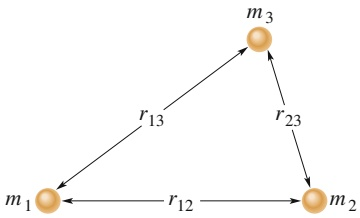

flowchart

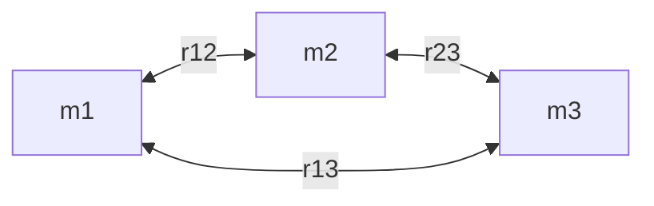

Abb. 9.7

Drei Körper bilden ein System. Der Abstand zwischen je zwei Teilchen ist durch einen Doppelindex gekennzeichnet, der sich auf die beiden Teilchen bezieht. Die potenzielle Energie der Gravitation für das System ist gleich der Summe der potenziellen Energien der drei Teilchenpaare.

217

---

9 Gravitation

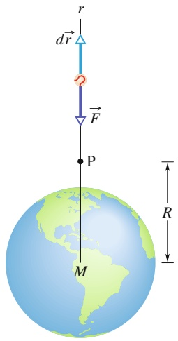

text_image

r
d⃗r
F
P
M
R

Abb. 9.8

Ein Tennisball wird radial von der Erde weg durch den Punkt P im Abstand R vom Erdmittelpunkt geworfen. In der Zeichnung wiedergegeben sind die Gravitationskraft $\vec { F }$ auf den Ball sowie ein differenzieller Verschiebungsvektor d⃗r. Beide sind entlang der radialen r-Achse gerichtet.

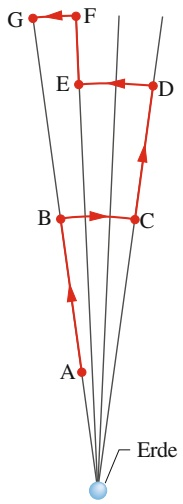

flowchart

Abb. 9.9

In der Nähe der Erde wird ein Tennisball von Punkt A nach Punkt G entlang eines Wegs aus Radialabschnitten und Kreisbögen transportiert.

## Beweis von Gl. 9.16

Wir werfen einen Tennisball entlang des in Abb. 9.8 eingezeichneten Wegs radial von der Erde weg „nach unendlich“. Unser Ziel ist es, einen Ausdruck für die potenzielle Gravitationsenergie U des Balls am Punkt P auf diesem Weg im Abstand R vom Erdmittelpunkt zu finden. Dazu berechnen wir zunächst die Arbeit $W ,$ welche die Gravitationskraft an dem Ball während seines Flugs von Punkt P zu einem Punkt in sehr großem Abstand (unendlich) von der Erde leistet. Da die Gravitationskraft $\vec { F } ( r )$ nicht konstant ist (ihr Betrag hängt von r ab), müssen wir zur Bestimmung dieser Arbeit die Methoden aus Abschn. 3.5 anwenden. In Vektorschreibweise gilt

$$
W = \int_ {R} ^ {\infty} \vec {F} (r) \cdot \mathrm{d} \vec {r}. \tag {9.18}
$$

Das Integral enthält das Skalarprodukt der Kraft $\vec { F }$ mit dem differenziellen Verschiebungsvektor $\mathrm { d } \vec { r }$ entlang des Wegs des Balls. Dieses Produkt können wir auch in der Form

$$
\vec {F} (r) \cdot \mathrm{d} \vec {r} = F (r) \mathrm{d} r \cos \varphi \tag {9.19}
$$

schreiben, wobei 𝜑 der Winkel zwischen den Richtungen von $\vec { F } ( r )$ und $\mathrm { d } \vec { r }$ ist. Dieser Winkel 𝜑 beträgt immer 180°. Ersetzen wir jetzt noch $F ( r )$ durch den Ausdruck in Gl. 9.1, so wird aus Gl. 9.19

$$
\vec {F} (r) \cdot \mathrm{d} \vec {r} = - \frac {G M m}{r ^ {2}} \mathrm{d} r,
$$

wobei wir mit M die Masse der Erde und mit m die Masse des Tennisballs bezeichnen.

Diesen Ausdruck können wir nun in Gl. 9.18 einsetzen und die Integration ausführen:

$$
\begin{array}{l} W = - G M m \int_ {R} ^ {\infty} \frac {1}{r ^ {2}} \mathrm{d} r = \left[ \frac {G M m}{r} \right] _ {R} ^ {\infty} \\ = 0 - \frac {G M m}{R} = - \frac {G M m}{R}. \tag {9.20} \\ \end{array}
$$

In dieser Gleichung ist W die erforderliche Arbeit, um den Ball von Punkt P (im Abstand R) nach $R = \infty$ zu bringen. Gleichung 4.1 $\left( \Delta U = - W \right)$ sagt uns, dass wir diese Arbeit auch durch die potenzielle Energie ausdrücken können:

$$
U _ {\infty} - U = - W.
$$

Die potenzielle Energie $U _ { \infty }$ bei unendlich ist null, und U ist die potenzielle Energie bei P. Mit dem Ausdruck für W aus Gl. 9.20 wird aus dieser Gleichung

$$
U = W = - \frac {G M m}{R}.
$$

Ersetzen wir nun noch R durch r, so erhalten wir Gl. 9.16, die wir beweisen wollten.

## Wegunabhängigkeit

In Abb. 9.9 wird ein Tennisball von Punkt A nach Punkt G entlang eines Wegs transportiert, der aus drei radialen Abschnitten und drei Kreisbogenabschnitten (deren Zentrum im Erdmittelpunkt liege) besteht. Wir interessieren uns für die

218

---

9.5 Die potenzielle Energie der Gravitation

9

Gesamtarbeit W, die von der Gravitationskraft $\vec { F }$ der Erde an dem Ball verrichtet wird, wenn sich dieser von A nach G bewegt. Die Arbeit entlang der Kreisbögen ist in allen Fällen gleich null, weil die Richtung von $\vec { F }$ an jedem Punkt senkrecht zum Kreisbogen steht. Die einzige von $\vec { F }$ verrichtete Arbeit stammt daher von den drei radialen Abschnitten, und die Gesamtarbeit ist gleich der Summe dieser Einzelarbeiten.

Nun stellen wir uns vor, die Kreisbögen würden jeweils zur Länge null zusammengeschrumpft. In diesem Fall würden wir den Ball direkt von A nach G entlang eines einzelnen radialen Abschnitts bewegen. Ändert dies die Arbeit W? Nein. Da auf den Kreisbögen keine Arbeit verrichtet wurde, ändert sich auch die Arbeit nicht, wenn wir diese Kreisbögen eliminieren. Der Weg von A nach G hat sich offensichtlich verändert, aber die von $\vec { F }$ geleistete Arbeit ist die gleiche geblieben.

In einem allgemeinen Zusammenhang haben wir ein solches Ergebnis in Abschn. 4.1 diskutiert. Die wichtige Schlussfolgerung besteht darin, dass es sich bei der Gravitationskraft um eine konservative Kraft handelt. Die von der Gravitationskraft an einem vom Anfangspunkt i zum Endpunkt f bewegten Teilchen geleistete Arbeit ist unabhängig von dem tatsächlich durchlaufenen Weg zwischen diesen beiden Punkten. Nach Gl. 4.1 ist die Änderung ΔU der potenziellen Gravitationsenergie zwischen Punkt i und Punkt f durch

$$
\Delta U = U _ {\mathrm{f}} - U _ {\mathrm{i}} = - W \tag {9.21}
$$

gegeben. Da die von einer konservativen Kraft geleistete Arbeit W unabhängig von dem tatsächlich durchlaufenen Weg ist, ist auch die Änderung ΔU der potenziellen Gravitationsenergie unabhängig von dem durchlaufenen Weg.

## Potenzielle Energie und Kraft

Für den Beweis von Gl. 9.16 haben wir die potenzielle Energie $U ( r )$ aus der Kraft $\vec { F } ( r )$ abgeleitet. Auch der umgekehrte $\mathrm { W e g }$ sollte möglich sein: Wir beginnen mit der potenziellen Energie und leiten aus ihr die Kraft ab. In Analogie zu Gl. 4.19 schreiben wir

$$
F = - \frac {\mathrm{d} U}{\mathrm{d} r} = - \frac {\mathrm{d}}{\mathrm{d} r} \left(- \frac {G M m}{r}\right) = - \frac {G M m}{r ^ {2}}. \tag {9.22}
$$

Dies ist das Newtonsche Gravitationsgesetz (Gl. 9.1). Das Minuszeichen besagt, dass die auf die Masse m wirkende Kraft radial nach innen zur Masse M gerichtet ist.

## Die Fluchtgeschwindigkeit

Wenn Sie ein Projektil senkrecht nach oben abfeuern, wird es üblicherweise langsamer, hält für einen Augenblick an und kehrt zur Erde zurück. Es gibt jedoch eine bestimmte minimale Anfangsgeschwindigkeit, bei der sich das Projektil für immer von der Erde fortbewegen wird und theoretisch wenn überhaupt, dann erst in einem unendlich großen Abstand zur Ruhe kommt. Diese Anfangsgeschwindigkeit bezeichnet man als die Fluchtgeschwindigkeit (der Erde).

Wir betrachten ein Projektil der Masse $m ,$ das die Oberfläche eines Planeten (oder eines anderen astronomischen Körpers oder Systems) mit der Fluchtgeschwindigkeit v verlässt. Seine kinetische Energie $K$ ist durch $\textstyle { \frac { 1 } { 2 } } m \nu ^ { 2 }$ gegeben und seine potenzielle Energie U nach Gl. 9.16 durch

$$
U = - \frac {G M m}{r},
$$

wobei M die Masse des Planeten und R sein Radius sind.

219

---

9 Gravitation

TABELLE 9.2:

Einige Fluchtgeschwindigkeiten.

| Körper | Masse (kg) | Radius (m) | Fluchtgeschwindigkeit (km/s) |
| --- | --- | --- | --- |
| Ceresa) | $1,17 \cdot 10^{21}$ | $3,8 \cdot 10^{5}$ | 0,64 |
| Mond | $7,36 \cdot 10^{22}$ | $1,74 \cdot 10^{6}$ | 2,38 |
| Erde | $5,98 \cdot 10^{24}$ | $6,37 \cdot 10^{6}$ | 11,2 |
| Jupiter | $1,90 \cdot 10^{27}$ | $7,15 \cdot 10^{7}$ | 59,5 |
| Sonne | $1,99 \cdot 10^{30}$ | $6,96 \cdot 10^{8}$ | 618 |
| Sirius Bb) | $2 \cdot 10^{30}$ | $1 \cdot 10^{7}$ | 5200 |
| Neutronensternc) | $2 \cdot 10^{30}$ | $1 \cdot 10^{4}$ | $2 \cdot 10^{5}$ |

a) Ein Zwergplanet im Asteroidengürtel

b) Ein Weißer Zwerg (ein Stern im Endstadium seiner Entwicklung), Begleiter von Sirius, des hellsten Sterns am Nachthimmel

c) Nach einer Supernovaexplosion eines Sterns dessen übriggebliebener Kern

Bei $R = \infty$ kommt das Projektil zur Ruhe und besitzt keine kinetische Energie mehr. Es besitzt auch keine potenzielle Energie mehr, da es sich bei der ausgezeichneten Bezugskonfiguration mit verschwindender potenzieller Energie be findet $( U _ { \infty } = 0 )$ . Seine Gesamtenergie bei unendlich ist daher null. Aufgrund der Energieerhaltung muss die Gesamtenergie auch auf der Oberfläche des Planeten null gewesen sein, d. h.

$$
K + U = \frac {1}{2} m v ^ {2} + \left(- \frac {G M m}{R}\right) = 0.
$$

Daraus folgt

$$
\nu = \sqrt {\frac {2 G M}{R}}. \tag {9.23}
$$

Die Fluchtgeschwindigkeit v hängt nicht von der Abschussrichtung des Projektils ab. Man erreicht diese Geschwindigkeit allerdings leichter, wenn die Abschussrichtung des Projektils in die Richtung zeigt, in die sich auch die Abschussrampe aufgrund der Eigenrotation des Planeten bewegt. Beispielsweise werden Raketen vom Kennedy Space Center in Florida in östlicher Richtung abgeschossen, um die nach Osten gerichtete Geschwindigkeit aufgrund der Erdrotation (rund 1500km/h) ausnutzen zu können.

Mithilfe von Gl. 9.23 können wir die Fluchtgeschwindigkeit eines Projektils von jedem astronomischen Körper bestimmen, wir setzen dazu einfach für M die Masse dieses Körpers ein und für R seinen Radius. In Tab. 9.2 sind die Fluchtgeschwin digkeiten einiger astronomischer Körper angegeben.

## KONTROLLFRAGE 4

Sie bewegen einen Ball der Masse m weg von einer Kugel der Masse M. (a) Wird die potenzielle Gravitationsenergie des Systems Ball–Kugel größer oder kleiner? (b) Leistet die Gravitationskraft zwischen dem Ball und der Kugel positive oder negative Arbeit?

## 9.6 Planeten und Satelliten: Die Keplerschen Gesetze

## Lernziele

Nach dem Durcharbeiten dieses Abschnitts sollten Sie in der Lage sein, . . .

• die drei Keplerschen Gesetze anzugeben,
• anzugeben, welches der Keplerschen Gesetze dem Drehimpulserhaltungssatz entspricht,
• auf einer Skizze einer elliptischen Bahn die große Halbachse, die Exzentrizität, das Perihel, das Aphel und die Brennpunkte zu identifizieren,

220

---

9.6 Planeten und Satelliten: Die Keplerschen Gesetze

9

• die Beziehungen zwischen der großen Halbachse, der Exzentrizität, dem Perihel und dem Aphel für eine elliptische Umlaufbahn anzugeben,
• für einen natürlichen oder künstlichen Satelliten in einer Umlaufbahn die Keplersche Beziehung zwischen seiner Bahnperiode, seinem Bahnradius und der Masse des umkreisten Himmelskörpers anzugeben.

## Schlüsselideen

• Die Bewegung von natürlichen und künstlichen Satelliten unterliegt den Keplerschen Gesetzen:

1. Gesetz der Planetenbahnen: Alle Planeten bewegen sich auf elliptischen Bahnen um die Sonne, die in einem der Brennpunkte steht.
2. Flächensatz: Die Verbindungslinie zwischen einem Planeten und der Sonne überstreicht in gleichen Zeitintervallen gleiche Flächen. (Diese Aussage ist gleichbedeutend mit der Erhaltung des Drehimpulses.)
3. Gesetz der Umlaufzeiten: Das Quadrat der Periode T eines Planeten ist proportional zur dritten Potenz der großen Halbachse a seiner Umlaufbahn. Für Kreisbahnen mit Radius r gilt

$$
T ^ {2} = \left(\frac {4 \pi^ {2}}{G M}\right) r ^ {3},
$$

wobei M die Masse des anziehenden Himmelskörpers ist (im Fall des Sonnensystems also die Sonnenmasse). Für elliptische Planetenbahnen ist die große Halbachse a anstelle von r einzusetzen.

## 9.6.1 Planeten und Satelliten: Die Keplerschen Gesetze

Die scheinbaren Bewegungen der Planeten vor dem Hintergrund der Sterne waren den Menschen seit Anbeginn der Geschichte ein Rätsel. Besonders die manchmal auftretende rückläufige Schleifenbewegung (in Abb. 9.10 dargestellt für den Mars) erschien Priestern und Naturbeobachtern seltsam. Nach lebenslanger Suche konnte Johannes Kepler (1571–1630) schließlich die empirischen Gesetze formulieren, die diese Bewegungen beschreiben. Tycho Brahe (1546–1601), der letzte große Astronom, der noch ohne die Hilfe eines Teleskops seine Beobachtungen vornahm, hatte eine riesige Datenmenge zusammengetragen, woraus Kepler die drei Gesetze der Planetenbewegung ableiten konnte, die heute seinen Namen tragen. Später zeigte Newton (1642–1727), dass sich alle drei Keplerschen Gesetze aus seinem Gravitationsgesetz herleiten lassen.

In diesem Abschnitt behandeln wir der Reihe nach jedes der Keplerschen Gesetze. Obwohl wir die Gesetze hier zunächst nur auf Planetenbahnen um die Sonne anwenden, gelten sie ebenso gut für alle natürlichen und künstlichen Satelliten, welche irgendeinen hinreichend schweren Zentralkörper umkreisen.

1. Keplersches Gesetz – Gesetz der Planetenbahnen: Alle Planeten bewegen sich auf elliptischen Bahnen um die Sonne, die sich in einem der Brennpunkte dieser Bahn befindet.

Abbildung 9.11 zeigt einen Planeten der Masse m auf einer solchen Bahn um die Sonne, deren Masse wir mit M bezeichnen. Es gelte $M \gg m ,$ sodass sich der Schwerpunkt des Systems Planet–Sonne nahe beim Sonnenzentrum befindet.

Die Bahnkurve in Abb. 9.11 kann durch die große Halbachse a und die Exzentrizität e beschrieben werden. e ist so definiert, dass ea der Abstand vom Mittelpunkt der Ellipse zu einem der Brennpunkte F bzw. $F ^ { \prime }$ ist. Eine verschwindende Exzentri zität entspricht einem Kreis, bei dem die beiden Brennpunkte zu einem zentralen Punkt verschmelzen. Die Exzentrizitäten der Planetenbahnen sind nicht groß und ihre Bahnen sehen in einer Zeichnung nahezu kreisförmig aus. Die Exzentrizität

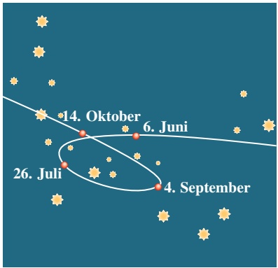

scatter

| Date | Description |
| --- | --- |
| 4. September | Cluster located near June and October |
| 6. Juni | Cluster located near October |
| 14. Oktober | Cluster located near October |
| 26. Juli | Cluster located near July |

Abb. 9.10

Die Bewegung des Planeten Mars vor dem Hintergrund des Sternzeichens Steinbock im Jahr 1971. Für vier bestimmte Tage ist seine Lage eingezeichnet. Sowohl Mars als auch die Erde bewegen sich auf Bahnen um die Sonne, und wir sehen die Position von Mars relativ zu uns. Wenn die Erde einen äußeren Planeten „innen“ überholt, resultiert daraus eine Schleife in der scheinbaren Bewegung des äußeren Planeten.

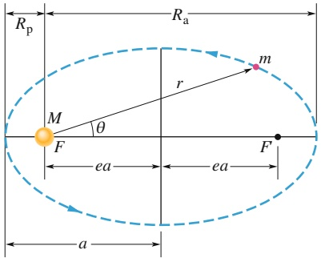

text_image

Rp
Ra
m
r
M
θ
F
ea
ea
F
a

Abb. 9.11

Ein Planet der Masse m bewegt sich auf einer elliptischen Bahn um die Sonne. Die Sonne mit Masse M befindet sich in einem der Brennpunkte F dieser Ellipse. Der andere Brennpunkt $F ^ { \prime }$ ist im leeren Raum. Jeder Brennpunkt besitzt einen Abstand ea vom Mittelpunkt der Ellipse, wobei der dimensionslose Faktor e die Exzentrizität der Ellipse ist. Die große Halbachse a der Ellipse, der Abstand $R _ { \mathrm { P } }$ des Perihels (des sonnennächsten Punkts) und der Abstand $R _ { \mathrm { A } }$ des Aphels (des sonnenfernsten Punkts) sind ebenfalls markiert.

221

---

9 Gravitation

Abb. 9.12

(a) In der Zeitspanne Δt dreht sich die Linie r zwischen dem Planeten und der Sonne (Masse M) um einen Winkel Δθ und überstreicht dabei die Fläche ΔA (getönt gezeichnet). (b) Der lineare Impuls ⃗p des Planeten und seine Komponenten.

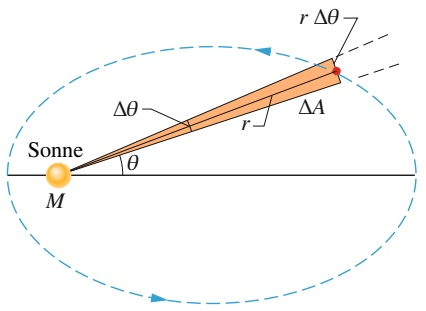

text_image

Sonne
M
Δθ
r
ΔA
r Δθ

(a)

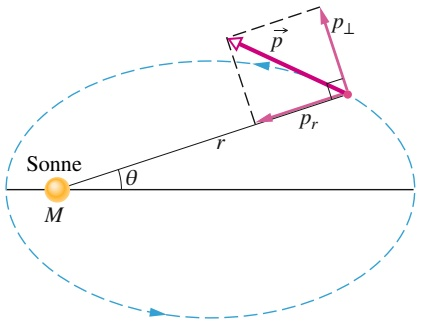

text_image

Sonne
M
θ
r
p
pr
p⊥

(b)

der in Abb. 9.11 zur Verdeutlichung übertrieben dargestellten Ellipse beträgt 0,74. Die Exzentrizität der Erdumlaufbahn ist dagegen nur 0,0167.

2. Keplersches Gesetz – Flächensatz: Die Verbindungslinie zwischen einem Planeten und der Sonne überstreicht in der Ebene der Planetenbahn in gleichen Zeiten gleiche Flächen; d. h., die Rate $\mathrm { d } A / \mathrm { d } t$ , mit der die Fläche A überstrichen wird, ist konstant.

Qualitativ besagt dieses zweite Gesetz, dass der Planet sich an der von der Sonne entferntesten Stelle seiner Bahn am langsamsten bewegt und an der sonnennächs ten Stelle am schnellsten. Das zweite Keplersche Gesetz ist äquivalent zur Drehimpulserhaltung. Das soll nun bewiesen werden.

Die getönt gezeichnete Fläche des Keils in Abb. 9.12a entspricht ziemlich genau der Fläche, die von der Verbindungslinie mit Länge r zwischen Sonne und Planeten in der Zeit Δt überstrichen wird. Diese Fläche $\Delta A$ ist gleich der Fläche eines Dreiecks mit Grundlinie rΔθ und Höhe r. Da die Dreiecksfläche gleich der Hälfte des Produkts aus Grundlinie und Höhe ist, folgt $\Delta A \approx { \textstyle { \frac { 1 } { 2 } } } r ^ { 2 } \Delta \theta$ . Dieser Ausdruck für $\Delta A$ wird umso genauer, je kleiner $\Delta t$ (und damit $\Delta \theta )$ ist. Die momentane Rate, mit der diese Fläche überstrichen wird, ist somit

$$
\frac {\mathrm{d} A}{\mathrm{d} t} = \frac {1}{2} r ^ {2} \frac {\mathrm{d} \theta}{\mathrm{d} t} = \frac {1}{2} r ^ {2} \omega , \tag {9.24}
$$

wobei $\omega$ die Winkelgeschwindigkeit der rotierenden Verbindungslinie zwischen Sonne und Planeten ist.

Abbildung 9.12b zeigt den linearen Impuls $\vec { p }$ des Planeten sowie seine radiale und die dazu senkrechte Komponente. Nach Gl. 7.18 $( L = r p _ { \perp } )$ ist der Betrag des Drehimpulses $\vec { L }$ des Planeten um die Sonne durch das Produkt aus r und der zu r senkrechten Impulskomponente $p _ { \perp }$ gegeben. Für einen Planeten der Masse m gilt somit

$$
L = r p _ {\perp} = (r) (m v _ {\perp}) = (r) (m \omega r) = m r ^ {2} \omega . \tag {9.25}
$$

Hierbei haben wir $\nu _ { \perp }$ durch den äquivalenten Ausdruck $\omega r$ (Gl. 6.15) ersetzt. In den Gln. 9.24 und 9.25 können wir nun $r ^ { 2 } ,$ ω eliminieren und erhalten

$$
\frac {\mathrm{d} A}{\mathrm{d} t} = \frac {L}{2 m}. \tag {9.26}
$$

Wenn $\mathrm { d } A / \mathrm { d } t$ konstant ist, wie es das Keplersche Gesetz besagt, dann ist nach Gl. 9.26 auch L konstant – der Drehimpuls ist erhalten. Das zweite Keplersche Gesetz ist also tatsächlich äquivalent zur Drehimpulserhaltung.

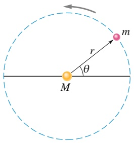

text_image

m
r
θ
M

Abb. 9.13

Ein Planet der Masse m bewegt sich auf einer kreisförmigen Umlaufbahn um die Sonne.

3. Keplersches Gesetz – Gesetz der Umlaufzeiten: Das Quadrat der Umlaufzeit eines Planeten ist proportional zur dritten Potenz der großen Halbachse seiner Umlaufbahn.

Zur Herleitung betrachten wir die kreisförmige Umlaufbahn in Abb. 9.13, deren Radius r sein soll (der Radius eines Kreises entspricht der großen Halbachse einer

222

---

9.7 Satelliten: Umlaufbahnen und Energie

9

TABELLE 9.3: Umlaufzeiten im Sonnensystem gemäß dem dritten Keplerschen Gesetz.

| Planet | Große Halbachse $a$$(10^{10} \text{ m})$ | Umlaufzeit $T$(Jahre) | $T^{2}/a^{3}$$(10^{-34} \text{ Jahr}^{2}/\text{m}^{3})$ |
| --- | --- | --- | --- |
| Merkur | 5,79 | 0,241 | 2,99 |
| Venus | 10,8 | 0,615 | 3,00 |
| Erde | 15,0 | 1,00 | 2,96 |
| Mars | 22,8 | 1,88 | 2,98 |
| Jupiter | 77,8 | 11,9 | 3,01 |
| Saturn | 143 | 29,5 | 2,98 |
| Uranus | 287 | 84,0 | 2,98 |
| Neptun | 450 | 165 | 2,99 |
| Pluto (Zwergplanet) | 590 | 248 | 2,99 |

Ellipse). Wenden wir das zweite Newtonsche Gesetz $( F = m a )$ auf den Planeten auf seiner Umlaufbahn in Abb. 9.13 an, so folgt

$$
\frac {G M m}{r ^ {2}} = (m) (\omega^ {2} r). \tag {9.27}
$$

Dabei haben wir Gl. 9.1 für den Betrag der Kraft eingesetzt und die Zentripetalbeschleunigung nach Gl. 6.20 durch $\omega ^ { \widetilde { 2 } } r$ ausgedrückt. Ersetzen wir nun noch nach Gl. 6.17 die Winkelgeschwindigkeit ω durch $\bar { 2 } \pi / T ,$ wobei T die Periodendauer der Bewegung ist, so erhalten wir bereits das dritte Keplersche Gesetz:

$$
T ^ {2} = \left(\frac {4 \pi^ {2}}{G M}\right) r ^ {3} \quad (\text {Gesetz der Umlaufzeiten}). \tag {9.28}
$$

Die Größe in der Klammer ist eine Konstante, die nur von der Masse M des Zentralkörpers abhängt, um den der Planet kreist.

Durch ausführliche Rechnung kann man zeigen, dass Gl. 9.28 auch für elliptische Bahnen gilt, wenn wir r durch die große Halbachse a der Ellipse ersetzen. Nach diesem Gesetz besitzt das Verhältnis $T ^ { 2 } / a ^ { 3 }$ im Wesentlichen denselben Wert für alle Planetenbahnen um einen gegebenen schweren Körper. Tabelle 9.3 zeigt, wie gut dieses Gesetz für die Planetenbahnen im Sonnensystem erfüllt ist.

## KONTROLLFRAGE 5

Satellit 1 und 2 befinden sich auf kreisförmigen Umlaufbahnen um einen Planeten; der Radius der Umlaufbahn von Satellit 2 sei größer. Welcher Satellit hat (a) die längere Umlaufzeit und (b) die größere Geschwindigkeit?

## 9.7 Satelliten: Umlaufbahnen und Energie

## Lernziele

Nach dem Durcharbeiten dieses Abschnitts sollten Sie in der Lage sein, . . .

• die potenzielle Energie, die kinetische Energie und die Gesamtenergie eines Satelliten in einer kreisförmigen Umlaufbahn um einen Himmelskörper zu berechnen,
• die Gesamtenergie eines Satelliten auf einer elliptischen Bahn zu berechnen.

## Schlüsselideen

• Wenn sich ein Planet oder ein Satellit mit der Masse m auf einer Kreisbahn mit dem Radius r bewegt, sind seine potenzielle Energie U und seine kinetische Energie K

$$
U = - \frac {G M m}{r} \quad \text {und} \quad K = \frac {G M m}{2 r}.
$$

223

---

9 Gravitation

Die mechanische Energie $E = K + U$ ist folglich

$$
E = - \frac {G M m}{2 r}.
$$

Für eine elliptische Bahn mit der großen Halbachse a gilt

$$
E = - \frac {G M m}{2 a}.
$$

## 9.7.1 Satelliten: Umlaufbahnen und Energie

Wenn ein Satellit auf seiner elliptischen Bahn die Erde umkreist, verändern sich sowohl seine Geschwindigkeit, durch die seine kinetische Energie K bestimmt ist, als auch sein Abstand vom Erdmittelpunkt, der seine potenzielle Energie U festlegt, periodisch. Die mechanische Energie E des Satelliten bleibt jedoch konstant. (Da die Satellitenmasse sehr viel kleiner ist als die Erdmasse, schreiben wir U und E des Systems Erde–Satellit nur dem Satelliten zu.)

Die potenzielle Energie des Systems ist durch Gl. 9.16 gegeben

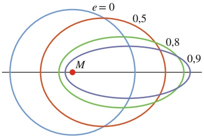

contour

| Series | Value |
| --- | --- |
| Blue | 0 |
| Red | 0.5 |
| Green | 0.8 |
| Blue (inner) | N/A |
| Red (center) | M |
| Green (outer) | 0.9 |

Abb. 9.14

Vier Umlaufbahnen um einen Gegenstand der Masse M. Alle vier Umlaufbahnen haben dieselbe große Halbachse a und entsprechen somit derselben mechanischen Gesamtenergie E. Angegeben sind ihre Exzentrizitäten e.

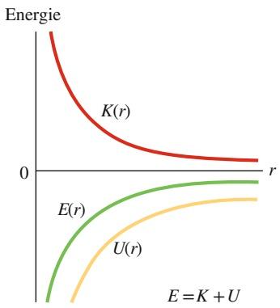

contour

| r | K(r) | E(r) | U(r) |
| --- | --- | --- | --- |
| 0 | High | Low | Low |
| >0 | Decreasing towards zero | Increasing towards zero | Increasing towards zero |

Abb. 9.15

Die Abhängigkeit der kinetischen Energie $K ,$ der potenziellen Energie U und der Gesamtenergie $E$ vom Radius r für einen Satelliten auf einer Kreisbahn. Für alle Werte von r sind U und E negativ, K ist immer positiv und es gilt: $E = - K$ Für r → ∞ nähern sich alle drei Energiekurven dem Wert null.

$$
U = - \frac {G M m}{r}
$$

(mit der Konvention $U = 0$ für einen unendlich weit entfernten Satelliten). In die sem Fall ist r der Radius der Umlaufbahn, die wir für den Moment einmal als kreisförmig annehmen, und M bzw. m sind die Massen der Erde und des Satelliten.

Die kinetische Energie des Satelliten auf einer kreisförmigen Umlaufbahn erhalten wir aus dem zweiten Newtonschen Gesetz $( F = m a )$ in der Form

$$
\frac {G M m}{r ^ {2}} = m \frac {\nu^ {2}}{r}, \tag {9.29}
$$

wobei $\nu ^ { 2 } / r$ die Zentripetalbeschleunigung des Satelliten ist. Aus dieser Gleichung ergibt sich die kinetische Energie zu

$$
K = \frac {1}{2} m v ^ {2} = \frac {G M m}{2 r}. \tag {9.30}
$$

Für einen Satelliten auf einer kreisförmigen Umlaufbahn gilt daher

$$
K = - \frac {U}{2} \quad (\text {kreisförmige   Umlaufbahn}). \tag {9.31}
$$

Die gesamte mechanische Energie des Satelliten ist

$$
E = K + U = \frac {G M m}{2 r} - \frac {G M m}{r} \tag {9.32}
$$

oder

$$
E = - \frac {G M m}{2 r} \quad (\text {kreisförmige   Umlaufbahn}). \tag {9.33}
$$

Für einen Satelliten auf einer kreisförmigen Umlaufbahn ist daher die gesamte mechanische Energie gleich dem negativen der kinetischen Energie $K ;$

$$
E = - K \quad (\text {kreisförmige   Umlaufbahn}). \tag {9.34}
$$

Befindet sich der Satellit auf einer elliptischen Umlaufbahn mit großer Halbachse $a ,$ so kann man zeigen, dass man das gleiche Ergebnis wie Gl. 9.33 erhält, wenn man den Radius r durch a ersetzt. Wir erhalten für die mechanische Energie in diesem Fall

$$
E = - \frac {G M m}{2 a} \quad \text {(elliptische Umlaufbahn)}. \tag {9.35}
$$

224

---

9.8 Einstein und die Gravitation

9

Gleichung 9.35 besagt, dass die Gesamtenergie eines Satelliten auf seiner Umlaufbahn nur von der großen Halbachse seiner Bahnkurve abhängt, nicht jedoch von der Exzentrizität e. In Abb. 9.14 sind vier Bahnkurven mit derselben großen Halb achse dargestellt. Derselbe Satellit hätte auf allen vier Bahnkurven dieselbe mechanische Gesamtenergie E. Abbildung 9.15 zeigt das Verhalten von K, U und E als Funktion von r für einen Satelliten auf einer kreisförmigen Umlaufbahn um einen schweren Zentralkörper.

## KONTROLLFRAGE 6

In der Grafik befindet sich ein Spaceshuttle ursprünglich auf einer Kreisbahn vom Radius r um die Erde. Am Punkt P zündet der Pilot kurz die nach vorn gerichteten Korrekturtriebwerke, um die kinetische Energie K und die mechanische Energie E des Shuttles zu verringern. (a) Welche der in der Abbildung gestrichelt gezeichneten elliptischen Bahnkurven wird das Shuttle einnehmen? (b) Ist die Umlaufzeit T des Shuttles (die Zeit bis zur Rückkehr zum Punkt P) jetzt größer, kleiner oder gleich der Umlaufzeit auf der Kreisbahn?

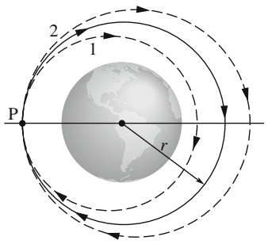

text_image

2
1
P
r

## 9.8 Einstein und die Gravitation

## Lernziele

Nach dem Durcharbeiten dieses Abschnitts sollten Sie in der Lage sein, . . .

• das Einsteinsche Äquivalenzprinzip zu erklären,
• zu verstehen, dass Einsteins Modell die Gravitation auf die Krümmung der Raumzeit zurückführt.

## Schlüsselideen

Einstein zeigte, dass Gravitation und Beschleunigung gleichwertig sind. Dieses Äquivalenzprinzip führte ihn zur heute gültigen allgemeinen Theorie der Gravitation (die Allgemeine Relativitätstheorie). Diese erklärt die Wirkung der Gravitation als eine Krümmung des Raums.

## 9.8.1 Das Äquivalenzprinzip

Albert Einstein soll einmal gesagt haben: „Ich befand mich . . . in meinem Büro im Patentamt in Bern, als mir plötzlich ein Gedanke durch den Kopf schoss: Eine Person im freien Fall spürt ihr eigenes Gewicht nicht. Ich war verblüfft. Dieser einfache Gedanke hinterließ bei mir einen tiefen Eindruck. Er führte mich auf die Theorie der Schwerkraft.“

Einstein berichtet hier über den Ursprung seiner **Allgemeinen Relativitätstheorie**. Das grundlegende Postulat dieser Theorie der Gravitation (der Anziehung zwischen Gegenständen) bezeichnet man als **Äquivalenzprinzip**, und es besagt, dass Gravitation und Beschleunigung zueinander äquivalent sind. Ein in einer Kiste eingeschlossener Physiker (vgl. Abb. 9.16) kann nicht feststellen, ob diese Kiste auf der Erdoberfläche ruht (und damit der Schwerkraft der Erde unterliegt), wie in Abb. 9.16a, oder ob sie im interstellaren Raum mit 9,8 m/s2 beschleunigt wird (und damit nur dieser die Beschleunigung verursachenden Kraft unterliegt), wie in Abb. 9.16b. In beiden Fällen spürt er dasselbe und in beiden Fällen zeigt eine Waage denselben Wert für sein Gewicht an. Beobachtet er einen frei fallenden Gegenstand, so hat dieser Gegenstand in beiden Fällen relativ zu ihm dieselbe Beschleunigung.

225

---

9 Gravitation

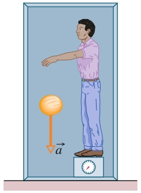

natural_image

Illustration of a person standing at a desk with a ball and an arrow indicating acceleration (no text or symbols present)

(a)

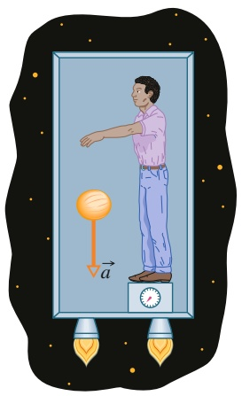

natural_image

Illustration of a person standing next to a ball with an arrow labeled 'a' and a clock on the base (no text or symbols beyond basic geometry)

(b)

Abb. 9.16

(a) Ein Physiker in einer auf der Erdoberfläche ruhenden Kammer beobachtet eine Melone, die mit einer Beschleunigung von $a = 9 , 8   \mathrm { m } / \mathrm { s } ^ { 2 }$ zu Boden fällt. (b) Würden er und die Kammer im freien Raum durch die von dem Triebwerk ausgeübte Kraft mit 9,8 m/s2 beschleunigt, hätte die Melone relativ zu ihm dieselbe Beschleunigung. Durch kein Experiment innerhalb der Kammer kann der Physiker herausfinden, in welcher der beiden Situationen er sich befindet. Auch die Waage, auf der er steht, würde in beiden Fällen denselben Wert anzeigen.

## 9.8.2 Die Krümmung des Raums

Bisher haben wir die Gravitation als eine Kraft zwischen Massen diskutiert. Einstein zeigte jedoch, dass man die Gravitation eigentlich als durch die Massen verursachte Krümmung (oder Verformung) des Raums auffassen muss. (Später in diesem Buch werden wir noch sehen, dass Raum und Zeit miteinander verwoben sind, sodass die von Einstein angesprochene Krümmung sich in Wirklichkeit auf eine Krümmung der vierdimensionalen Raumzeit unseres Universums bezieht.)

Man kann sich die Krümmung des Raums (beispielsweise im Vakuum) nur schwer vorstellen. Allerdings ist hier vielleicht eine Analogie hilfreich: Angenommen, wir beobachten aus dem Weltraum ein Rennen zwischen zwei Booten, die im Abstand von 20 km am Äquator starten und sich beide in Richtung Süden bewegen (Abb. 9.17a). Für die Seeleute bewegen sich diese Boote entlang flacher, paralleler Wege. Im Lauf der Zeit kommen die Boote einander jedoch immer näher und treffen sich schließlich am Südpol. Die Seeleute können dieses „Näherkommen“ als eine zwischen den Booten wirkende Kraft interpretieren. Für uns ist jedoch offensichtlich, dass sich die Boote einfach aufgrund der Krümmung der Erdoberfläche einander nähern. Wir können das erkennen, weil wir das Rennen „von außerhalb der Erdoberfläche beobachten und es hier um eine – uns anschaulich vorstellbare – gekrümmte Fläche und nicht um ein gekrümmtes Volumen geht.

Abbildung 9.17b zeigt eine ähnliche Form von „Rennen“: Zwei horizontal entfernte Äpfel werden aus derselben Höhe oberhalb der Erdoberfläche fallen gelassen. Obwohl die beiden Äpfel entlang paralleler Wege zu fallen scheinen, bewegen sie sich tatsächlich aufeinander zu, denn beide fallen auf den Erdmittelpunkt zu. Wir können die Bewegung der Äpfel als Ergebnis der Gravitationskraft interpretieren, welche die Erde auf die Äpfel ausübt. Wir können die Bewegung aber auch als Wirkung der Raumkrümmung in der Nähe der Erde interpretieren, her vorgerufen durch die Masse der Erde. In diesem Fall können wir die Krümmung nicht unmittelbar sehen, weil wir uns nicht „außerhalb“ des gekrümmten Raums begeben können, so wie wir das Rennen der Boote von außerhalb der gekrümmten Erdoberfläche beobachten konnten. Wir können die Krümmung jedoch in einer Zeichnung, wie in Abb. 9.17c, darstellen. In diesem Fall bewegen sich die Äpfel auf einer Fläche, die aufgrund der Erdmasse zum Erdmittelpunkt hin gekrümmt ist.

Ein an der Erde vorbeifliegender Lichtstrahl wird durch die Raumkrümmung leicht abgelenkt. Diesen Effekt bezeichnet man als „Gravitationslinseneffekt“. In der Nähe eines wesentlich massiveren Gegenstands, beispielsweise einer Galaxie oder eines Schwarzen Lochs, wird sein Weg noch stärker abgelenkt. Befindet sich ein solches Objekt zwischen uns und einem Quasar (einer außerordentlich hel-

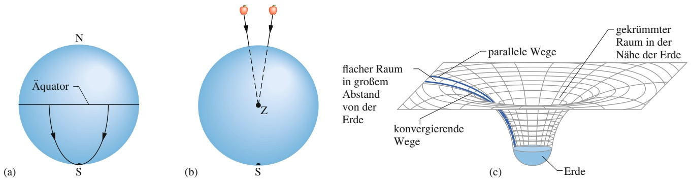

Abb. 9.17

(a) Zwei Gegenstände, die sich entlang von Längengraden in Richtung Südpol bewegen, kommen sich wegen der Krümmung der Erdoberfläche näher. (b) Zwei in der Nähe der Erde frei fallende Gegenstände bewegen sich entlang von Linien, die wegen der Raumkrümmung in Erdnähe im Erdmittelpunkt zusammentreffen. (c) In großer Entfernung von der Erde (und anderer Massen) ist der Raum flach, und parallele Wege bleiben parallel. In der Nähe der Erde beginnen parallele Linien zusammenzulaufen, weil der Raum durch die Erdmasse gekrümmt wird.

226

---

9.9 Zusammenfassung

9

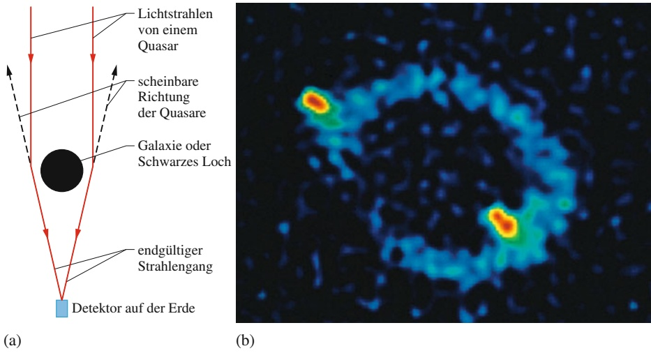

len, sehr weit entfernten Lichtquelle), dann wird das Licht von dieser massiven Struktur auf seinem Weg zu uns abgelenkt (Abb. 9.18a). Da das Licht für uns nun aus vielen, etwas verschiedenen Richtungen zu uns zu gelangen scheint, sehen wir denselben Quasar unter all diesen Richtungen. In manchen Fällen sehen wir ihn sogar in Form eines großen leuchtenden Kreises, den man auch als Einstein-Ring bezeichnet (Abb. 9.18b).

Sollen wir die Gravitation der Krümmung der Raumzeit aufgrund von Massen oder dem Vorhandensein einer Kraft zwischen diesen Massen zusprechen? Oder beruht die Gravitation auf der Wirkung eines postulierten fundamentalen Quantenteilchens namens Graviton, wie im Rahmen von Theorien zur Quantengravitation vermutet wird? Wir wissen es nicht.

## Abb. 9.18

(a) Das Licht eines entfernten Quasars wird von einer Galaxie oder einem großen Schwarzen Loch abgelenkt, weil der Raum um die große Masse der Galaxie oder des Schwarzen Lochs merklich gekrümmt wird. Wenn wir das Licht des Quasars wahrnehmen, scheint sein Ursprung in der Richtung zu liegen, aus der uns die Strahlen treffen (gestrichelte Linien). (b) Der Einstein-Ring mit der Bezeichnung MG 1131+0456 auf dem Computerbildschirm eines Teleskops. Die Lichtquelle (in Wirklichkeit eine Quelle von Radiowellen, einer besonderen Art von unsichtbarem Licht) liegt weit hinter der großen, unsichtbaren Galaxie, die diesen Ring verursacht. Ein Teil der Quelle ist in Form von zwei hellen Punkten auf dem Ring erkennbar [Quelle: NRAO/AUI].

## 9.9 Zusammenfassung

**Das Gravitationsgesetz** Jedes Teilchen im Universum zieht jedes andere Teilchen mit einer **Gravitationskraft** an, deren Betrag durch

$$
F = G \frac {m _ {1} m _ {2}}{r ^ {2}} \quad (\text {Newtonsches Gravitationsgesetz}) \tag {9.1}
$$

gegeben ist. $m _ { 1 }$ und $m _ { 2 }$ sind die Massen der beiden Teilchen und r ihr Abstand. $G \; ( = 6 { , } 6 7 \cdot 1 0 ^ { - 1 1 }   \mathrm { N } \cdot \mathrm { m } ^ { 2 } / \mathrm { k g } ^ { 2 } )$ ist die **Gravitationskonstante**.

**Gravitationskraft bei homogenen Kugelschalen** Gleichung 9.1 gilt zunächst nur für Punktteilchen. Die Gravitationskraft zwischen ausgedehnten Körpern muss im Allgemeinen durch eine Summe (bzw. ein Integral) über alle Einzelkräfte auf die einzelnen Teilchen innerhalb der Körper ermittelt werden. Handelt es sich jedoch bei den Körpern um gleichförmige Kugelschalen oder homogene kugelförmige Festkörper, so ist die resultierende Kraft auf ein äußeres Teilchen dieselbe, als ob sich die gesamte Masse der Kugelschale oder der Vollkugel in deren Mittelpunkt befände.

**Superposition** Die Gravitationskraft gehorcht dem **Superpositionsprinzip**. Wenn n Teilchen miteinander wechselwirken, dann ist die Gesamtkraft $\vec { F } _ { 1 , \mathrm { g e s } }$ auf ein Teilchen (das als Teilchen 1 bezeichnet wird) durch die Summe der von allen anderen Teilchen auf dieses eine Teilchen ausgeübten Kräfte gegeben:

$$
\vec {F} _ {1, \text {ges}} = \sum_ {i = 2} ^ {n} \vec {F} _ {1 i}, \tag {9.4}
$$

wobei die Summe als vektorielle Summe über die Kräfte $\vec { F } _ { 1 i }$ von den Teilchen $2 ,   3 ,   \ldots ,   n$ auf das Teilchen 1 zu verstehen ist. Die Gravitationskraft $\vec { F } _ { 1 1 }$ , die ein ausgedehnter Körper auf ein Teilchen ausübt, erhält man, indem man diesen Körper in infinitesimale Elemente mit den differenziellen Massen dm aufteilt, die jeweils eine differenzielle Kraft d $\vec { F }$ auf das Teilchen ausüben, und dann über alle diese Kräfte integriert:

$$
\vec {F} _ {1} = \int \mathrm{d} \vec {F}. \tag {9.5}
$$

**Gravitationsbeschleunigung** Die Gravitationsbeschleu nigung $a _ { \mathrm { G } }$ eines Teilchens der Masse m beruht ausschließ- lich auf der Gravitationskraft auf dieses Teilchen. Befindet sich das Teilchen im Abstand r vom Mittelpunkt einer homogenen Vollkugel der Masse M, dann ist der Betrag der

227

---

9 Gravitation

Gravitationskraft F auf dieses Teilchen durch Gl. 9.1 gegeben. Nach dem zweiten Newtonschen Gesetz

$$
F = m a _ {\mathrm{G}} \tag {9.7}
$$

folgt

$$
a _ {\mathrm{G}} = \frac {G M}{r ^ {2}}. \tag {9.8}
$$

**Erdbeschleunigung und Gewicht** Die tatsächliche Beschleunigung $\vec { g }$ eines Teilchens an der Erdoberfläche unterscheidet sich etwas von der Gravitationsbeschleunigung ${ \vec { a } } _ { \mathrm { G } } .$ . Ebenso unterscheidet sich das Gewicht des Teilchens (gleich mg) von dem Betrag der Gravitationskraft auf dieses Teilchen, berechnet nach Gl. 9.1. Der Grund liegt darin, dass die Erde nicht homogen und nicht kugelförmig ist und außerdem um ihre Achse rotiert.

**Die Gravitation innerhalb einer Kugelschale** Eine gleichförmige massive Kugelschale übt auf ein Teilchen innerhalb dieser Schale keine Gesamtgravitationskraft aus. Befindet sich also ein Teilchen innerhalb einer homogenen Vollkugel im Abstand r von deren Mittelpunkt, so wirkt auf dieses Teilchen nur der Massenanteil $M _ { \mathrm { i n } } ,$ der sich innerhalb einer Kugel vom Radius r befindet. Diese Masse ist durch

$$
M _ {\mathrm{in}} = \rho \frac {4 \pi r ^ {3}}{3} \tag {9.13}
$$

gegeben, wobei $\rho$ die Dichte der Kugel ist.

**Potenzielle Gravitationsenergie** Für ein System aus zwei Teilchen der Massen M und m im Abstand r ist die potenzielle Energie der Gravitation U(r) gleich der negativen Arbeit, die gegen die Gravitationskraft von einem der beiden Teilchen an dem anderen verrichtet wird, wenn der Ab stand zwischen diesen Teilchen von unendlich (bzw. sehr groß) auf r verringert wird. Diese Energie entspricht

$$
U = - \frac {G M m}{r} \quad (\text {potenzielle Energie der Gravitation}). \tag {9.16}
$$

**Fluchtgeschwindigkeit** Ein Gegenstand kann der gravitativen Anziehung eines astronomischen Körpers mit Masse M und Radius R entkommen (einen unendlichen Ab stand erreichen), wenn die Geschwindigkeit dieses Gegenstands in der Nähe der Oberfläche des Körpers mindestens gleich der durch

$$
\nu = \sqrt {\frac {2 G M}{R}} \tag {9.23}
$$

gegebenen **Fluchtgeschwindigkeit** ist.

**Die Keplerschen Gesetze** Die gravitative Anziehung hält das Sonnensystem zusammen und ermöglicht es künstlichen und natürlichen Satelliten, auf einer Umlaufbahn um die Erde zu kreisen. Solche Bewegungen werden durch die drei Keplerschen Gesetze der Planetenbewegung beschrieben, die sich alle drei aus den Newtonschen Bewegungsund Gravitationsgesetzen ableiten lassen:

## 1. Gesetz der Planetenbahnen

Alle Planeten bewegen sich auf elliptischen Bahnen um die Sonne, die sich in einem der Brennpunkte dieser Bahn befindet.

## 2. Flächensatz

Die Verbindungslinie zwischen dem Planeten und der Sonne überstreicht in gleichen Zeiten gleiche Flächen. (Diese Aussage ist äquivalent zur Drehimpulserhaltung.)

## 3. Gesetz der Umlaufzeiten

Das Quadrat der Umlaufzeit T von einem Planeten um die Sonne ist proportional zur dritten Potenz der großen Halbachse a der Planetenbahn. Für kreisförmige Umlaufbahnen vom Radius r ist die große Halbachse a durch r zu ersetzen und das Gesetz hat die Form

$$
T ^ {2} = \left(\frac {4 \pi^ {2}}{G M}\right) r ^ {3} \quad (\text {Gesetz der Umlaufzeiten}), \tag {9.28}
$$

wobei M die Masse des anziehenden Zentralkörpers ist – im Fall des Sonnensystems die Sonne. Diese Gleichung gilt auch allgemeiner für elliptische Bahnkurven, wenn man statt des Kreisradius r die große Halbachse a einsetzt.

**Energie der Planetenbewegung** Bewegt sich ein Planet oder Satellit der Masse m auf einer kreisförmigen Umlaufbahn mit Radius r, dann sind seine potenzielle Energie U und seine kinetische Energie K durch

$$
U = - \frac {G M m}{r} \quad \text {und} \quad K = \frac {G M m}{2 r} \tag {9.16,9.30}
$$

gegeben. Die mechanische Energie $E = K + U$ ist damit

$$
E = - \frac {G M m}{2 r}. \tag {9.33}
$$

Für eine elliptische Bahnkurve mit großer Halbachse a gilt entsprechend

$$
E = - \frac {G M m}{2 a}. \tag {9.35}
$$

**Die Einsteinsche Sichtweise der Gravitation** Einstein machte darauf aufmerksam, dass Gravitation und Beschleunigung äquivalent sind. Dieses **Äquivalenzprinzip** führte ihn zu einer Theorie der Gravitation (der **Allgemeinen Relativitätstheorie**), wonach die Effekte der Gravitation auf einer Krümmung des Raums beruhen.

228

---

9.10 Fragen

9

## 9.10 Fragen

**1.** In Abb. 9.F1 befinden sich zwei Teilchen der Massen m und 2m fest auf einer Achse. (a) Wo kann auf dieser Achse ein drittes Teilchen der Masse 3m platziert werden (außer bei unendlich), sodass die resultierende Gravitationskraft von den ersten beiden Teilchen auf dieses Teilchen verschwindet: zur Linken der beiden Teilchen, zur Rechten, zwischen ihnen, aber näher am schwereren Teilchen oder zwischen ihnen, aber näher am leichteren Teilchen? (b) Ändert sich die Antwort, wenn dieses dritte Teilchen stattdessen eine Masse von 16m besitzt? (c) Gibt es einen Punkt außerhalb der Achse, an dem die Gesamtkraft auf das dritte Teilchen null ist?

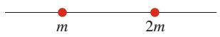

Abb. 9.F1

**2.** In Abb. 9.F2 ist ein Teilchen (in der Mitte) von zwei kreisförmigen Ringen (Radien r und $R ,$ mit $R > r )$ aus Teilchen umgeben. Alle Teilchen haben die Masse m. Wie groß ist der Betrag und was ist die Richtung der Gesamtgravitationskraft auf das zentrale Teilchen?

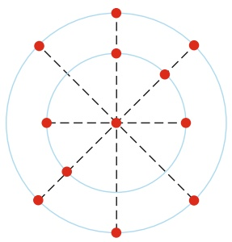

natural_image

Geometric diagram with concentric circles and radial dashed lines, no text or symbols present

Abb. 9.F2

**3.** In Abb. 9.F3 ist ein Teilchen der Masse M (in der Mitte) von einem Quadrat aus anderen Teilchen umgeben, die entweder durch einen Abstand d oder $d / 2$ entlang der Quadratseiten getrennt sind. Wie groß ist der Betrag und was ist die Richtung der Gesamtgravitationskraft auf das zentrale Teilchen?

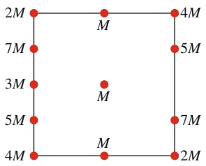

text_image

2M
7M
3M
5M
4M
M
M
M
4M
5M
7M
2M
4M

Abb. 9.F3

**4.** Abbildung 9.F4 zeigt vier Anordnungen aus jeweils einem Teilchen der Masse m und einem oder mehreren homogenen Stäben der Masse M und der Länge $L ,$ die alle einen Abstand $d$ vom zentralen Teilchen haben. Ordnen Sie diese Situationen nach dem Betrag der Gesamtgravitationskraft auf das Teilchen durch die Stäbe (der größte Wert zuerst).

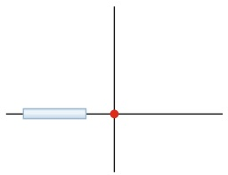

natural_image

Simple crosshair diagram with a horizontal bar and a red dot at the center (no text or symbols)

(a)

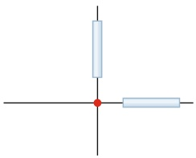

natural_image

Pure electrical circuit lines without any symbols

(b)

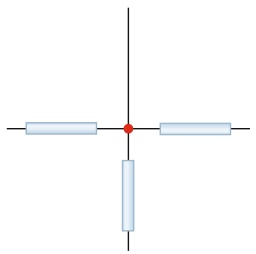

natural_image

Pure electrical circuit lines without any symbols

(c)

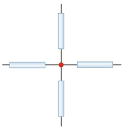

natural_image

Pure electrical circuit lines without any symbols

(d)

Abb. 9.F4

**5.** Abbildung 9.F5 zeigt die Gravitationsbeschleunigung $\alpha _ { \mathrm { G } }$ für vier Planeten als Funktion des radialen Abstands r vom Planetenmittelpunkt, beginnend jeweils an der Oberfläche des Planeten (bei Radius $R _ { 1 } ,   R _ { 2 } ,   R _ { 3 }$ bzw. $R _ { 4 } )$ . Die Kurven 1 und 2 stimmen für $r \geq R _ { 2 }$ überein; die Kurven 3 und 4 für $r \geq R _ { 4 } .$ . Ordnen Sie die vier Planeten nach (a) ihren Massen und (b) ihren Dichten (jeweils größte zuerst).

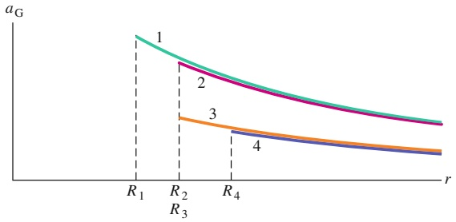

line

| Point | Curve 1 | Curve 2 | Curve 3 | Curve 4 |
| --- | --- | --- | --- | --- |
| R1 | ~High | — | — | — |
| R2 | — | ~Medium-High | ~Low-Medium | — |
| R3 | — | — | — | ~Low |
| R4 | — | — | — | ~Lowest |

Abb. 9.F5

**6.** Abbildung 9.F6 zeigt drei homogene kugelförmige Planeten von identischer Größe und Masse. Die Eigenrotationszeiten T der Planeten sind angegeben und sechs Punkte durch Buchstaben markiert. Drei dieser Punkte befinden sich am Äquator der jeweiligen Planeten und drei Punkte am Nordpol. Ordnen Sie die Punkte nach dem Wert der bei ihnen wirkenden freien Fallbeschleunigung g (größte Werte zuerst).

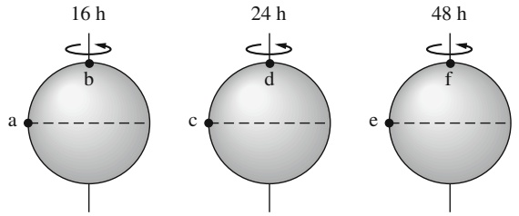

Abb. 9.F6

229

---

9 Gravitation

**7.** Aus einem Inertialsystem im freien Raum beobachten wir zwei identische homogene Vollkugeln, die aufgrund ihrer gegenseitigen Schwerkraft aufeinander zufallen. Die anfängliche Geschwindigkeit der Kugeln sei null, und $U _ { \mathrm { i } } .$ sei die anfängliche potenzielle Energie des Zweikugelsystems. Wie groß ist die kinetische Energie jeder Kugel, wenn sich der Abstand zwischen den beiden Kugeln relativ zur Anfangskonfiguration halbiert hat?
**8.** Ordnen Sie die vier Systeme aus gleichschweren Teilchen in Kontrollfrage 2 nach dem Absolutwert der potenziellen Energie der Gravitation des Systems (größter Wert zuerst).
**9.** Abbildung 9.F9 zeigt sechs verschiedene Wege, über die eine Rakete in einer Umlaufbahn um einen Mond von Punkt A nach Punkt B gelangen kann. Ordnen Sie

die Wege (a) nach der jeweiligen Änderung in der potenziellen Energie des Systems Rakete–Mond und (b) nach der Gesamtarbeit, die durch die Gravitationskraft des Monds an der Rakete verrichtet wird (größte Werte zuerst).

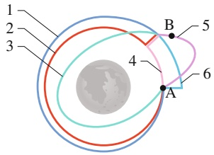

text_image

1
2
3
4
B
5
A
6

Abb. 9.F9

**10.** In Abb. 9.F10 soll ein Teilchen der Masse m (nicht eingezeichnet) von einem unendlichen Abstand zu einer der drei möglichen Positionen $\mathrm { A } ,$ B oder C gebracht werden. Zwei andere Teilchen der Massen m und 2m $U _ { \mathrm { i } }$ seien fest. Ordnen Sie die drei möglichen Positionen nach der $\mathrm { A r } -$ beit, die über die Gravitationskraft von den beiden festen Teilchen an dem bewegten Teilchen geleistet wird (größter Wert zuerst).

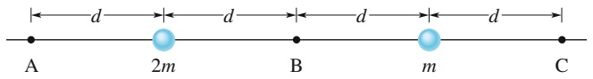

text_image

d
d
d
d
A 2m B m C

Abb. 9.F10

**11.** In Abb. 9.F11 befinde sich ein Teilchen der Masse m anfänglich am Punkt A, der einen Abstand d vom Mittelpunkt einer homogenen Kugel und einen Abstand 4d vom Mittelpunkt einer zweiten homogenen Kugel haben soll. Die beiden homogenen Kugeln haben die Massen M ≫ m. Welche der folgenden Größen ist positiv, negativ oder null, wenn das Teilchen zum Punkt D gebracht wird: (a) die Änderung in der potenziellen Energie des Teilchens, (b) die bei diesem Transport von der Gesamtgravitationskraft an dem Teilchen verrichtete Arbeit, (c) die Arbeit, die Sie durch Ihren Kraftaufwand leisten? (d) Was änderte sich an den Antworten, wenn das Teilchen stattdessen von Punkt B nach Punkt C gebracht würde?

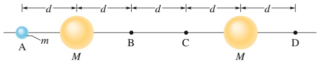

text_image

A
m
M
B
C
M
D

Abb. 9.F11

**12.** Abbildung 9.F13 zeigt die Massen und Abstände für drei Sternpaare, die jeweils ein Doppelsternsystem bilden. (a) Geben Sie den Punkt an, um den sich die Sterne in den einzelnen Fällen drehen. (b) Ordnen Sie die Paare nach dem Betrag der Zentripetalbeschleunigung der Sterne (größte zuerst).

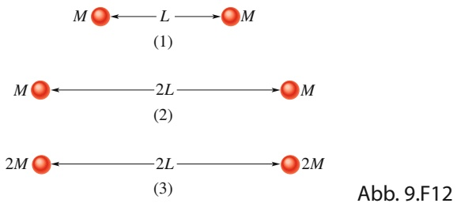

flowchart

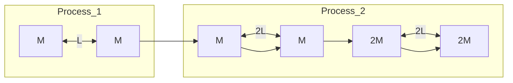

**13.** Abbildung 9.F13 zeigt drei Anordnungen derselben identischen Teilchen, von denen drei auf einem Kreis mit einem Radius von 0,20 m liegen und das vierte im Mittelpunkt des Kreises. (a) Ordnen Sie die Varianten in absteigender Reihenfolge nach dem Betrag der resultierenden Kraft der Gravitation auf das zentrale Teilchen aufgrund der anderen drei Teilchen. (b) Ordnen Sie die Varianten nach der potenziellen Energie der Gravitation des Vierteilchensystems, beginnend mit der am wenigsten negativen.

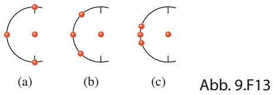

text_image

(a)
(b)
(c)
Abb. 9.F13

**14.** Abbildung 9.F14 zeigt drei Anordnungen eines punktförmigen Teilchens P mit der Masse m und einer Kugelschale mit einer homogen verteilten Masse M. Die Radien der Schalen sind gegeben. Ordnen Sie die Anordnungen in absteigender Reihenfolge nach dem Betrag der Gravitationskraft auf Teilchen P aufgrund der Kugelschale.

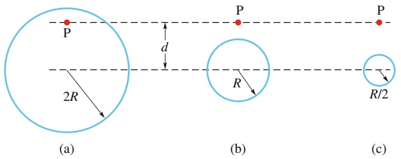

text_image

P
2R
(a)
d
P
R
(b)
R/2
(c)

Abb. 9.F14

**15.** Abbildung 9.F15 zeigt drei ortsfeste Teilchen A, B und C, wobei die Masse von B größer sein soll als die von $C .$ Kann ein viertes Teilchen D so platziert werden, dass die resultierende Gravitationskraft auf Teilchen A aufgrund der Teilchen B, C und D verschwindet? Falls ja, in welchem Quadranten und in der Nähe welcher Achse sollte es liegen?

230

---

9.10 Fragen

9

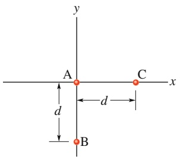

text_image

y
A
C
x
d
d
B

Abb. 9.F15

**16.** Abbildung 9.F16 zeigt drei Teilchen, deren Positionen zunächst fixiert sein sollen. B und C sind identisch und liegen symmetrisch zur y-Achse in einem Abstand d von A. (a) In welche Richtung zeigt die resultierende Gravitationskraft $\vec { F } _ { \mathrm { g e s } }$ auf A? (b) Ändert sich die Richtung von $\vec { F } _ { \mathrm { g e s } } ,$ wenn sich C in direkter Linie vom Ursprung wegbewegt? Falls ja, in welche Richtung bewegt es sich und was passiert im Grenzfall einer sehr großen Entfernung zwischen A und C?

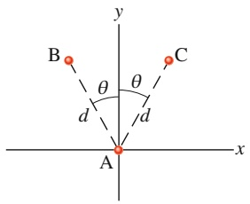

text_image

B
θ
d
A
x
y
C
θ
d

Abb. 9.F16

231

---

