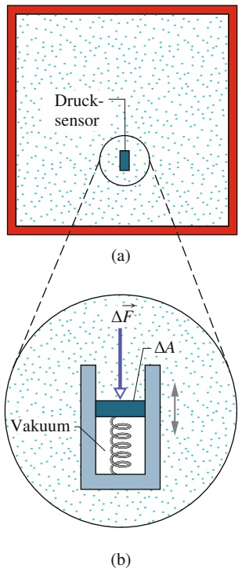
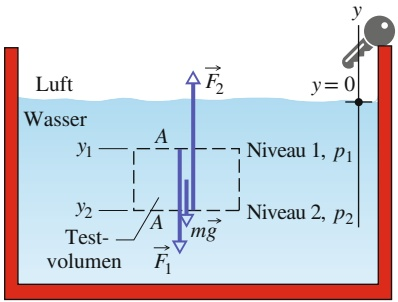
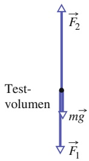
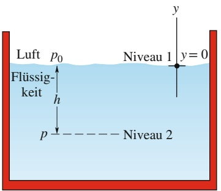
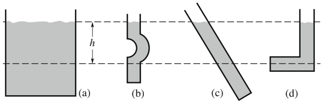
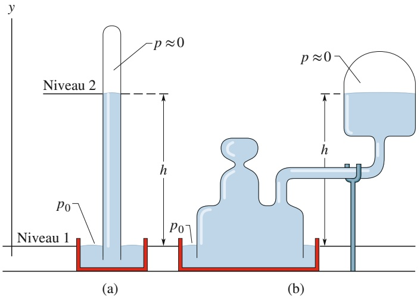
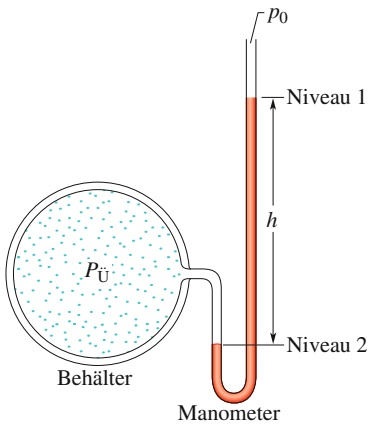
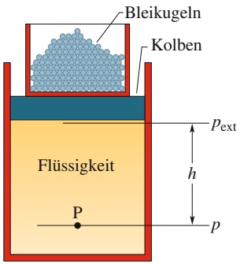
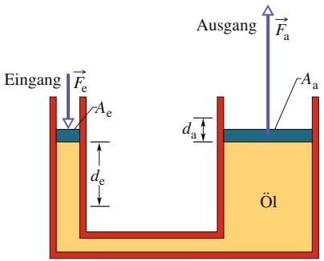
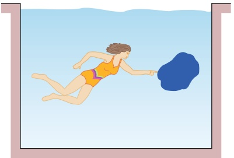

# 10 Fluide

原始 PDF 第 247–268 页。

# 10 Fluide

## 10.1 Fluide, Dichte und Druck

## Physikalische Motivation

Die Physik der Fluide ist die Grundlage des Wasserbaus, eines Zweigs des Ingenieurwesens mit zahllosen Anwendungen auf vielen Gebieten. Ein Kerntechniker wird vielleicht die Strömung von Fluiden im hydraulischen System eines alternden Kernreaktors untersuchen, während ein Medizintechniker eher an der Strömung des Bluts in den Arterien eines alternden Patienten interessiert sein dürfte. Ein Umwelttechniker studiert stattdessen die Entwässerung von Deponien oder die effiziente Bewässerung von Ackerland. Schiffsbauer analysieren die Gefahren für Tiefsee-Tauchboote oder suchen nach Möglichkeiten, Besatzungen aus gesunkenen U-Booten zu evakuieren. Luftfahrttechniker wollen mit sogenannten Winglets das Design der Tragflächen von Flugzeugen optimieren, um damit deutliche Einsparungen beim Treibstoffverbrauch der Jets zu erzielen.

Aber auch in vielen unspektakulären und für uns alltäglichen Anwendungen stehen Fluide mit ihren besonderen Eigenschaften im Mittelpunkt, beispielsweise überall dort, wo Hydrauliksysteme Kräfte übertragen. Bevor wir uns mit solchen Anwendungen der Fluide genauer beschäftigen können, müssen wir jedoch zuerst die Frage beantworten: „Was ist ein Fluid überhaupt?“

## 10.1.1 Was ist ein Fluid?

Im Gegensatz zu einem Festkörper ist ein **Fluid** eine Substanz, die strömen kann. Fluide passen sich den Begrenzungen jedes Behälters an, in die wir sie einfüllen. Der Grund hierfür liegt darin, dass ein Fluid keiner Kraft entgegenwirken kann, die tangential zu ihrer Oberfläche angreift. (In der formaleren Sprache von Abschn. 8.3 ist ein Fluid eine Substanz, die fließt oder strömt, weil sie keine Scher spannung aushalten kann. Sie kann jedoch eine Kraft senkrecht zu ihrer Oberflä- che ausüben.) Einige Stoffe, beispielsweise Pech, benötigen eine lange Zeit, bis sie sich der Form eines Behälters angepasst haben, aber letztendlich schaffen auch sie es. Daher rechnen wir auch solche Stoffe zu den Fluiden.

Es mag verwundern, warum wir Flüssigkeiten und Gase zusammenfassen und sie als Fluide bezeichnen. Schließlich (so könnte man einwerfen) unterscheidet sich flüssiges Wasser von Wasserdampf ebenso sehr wie von Eis. Doch tatsächlich ist das nicht der Fall. Eis hat, ebenso wie andere kristalline Festkörper, seine Atome in einer ziemlich starren, dreidimensionalen, regelmäßigen Struktur angeordnet, die wir als kristallines Gitter bezeichnen. Weder in Dampf noch in Wasser finden wir eine vergleichbar weitreichende regelmäßige Anordnung.

Halliday Physik für natur- und ingenieurwiss. Studiengänge, 3. Auflage. D. Halliday, R. Resnick und J. Walker. © 2020 WILEY-VCH Verlag GmbH & Co. KGaA. Published 2020 by WILEY-VCH Verlag GmbH & Co. KGaA.

233

---

10 Fluide

## 10.1.2 Dichte und Druck

Wenn wir uns mit festen Gegenständen beschäftigen, interessieren uns Materiebrocken, wie Holzscheite, Tennisbälle oder Metallstäbe. Bestimmte physikalische Größen empfinden wir für ihre Beschreibung als nützlich, und mit ihnen formulieren wir die Newtonschen Gesetze. Dazu gehören die Masse und die Kraft. Wir können beispielsweise von einem 3,6 kg schweren Holzblock sprechen, auf den eine Kraft von 25 N einwirkt.

Bei Fluiden sind wir eher an der ausgedehnten Substanz interessiert und an Eigenschaften, die an verschiedenen Punkten in der Substanz verschieden sein können. Es erweist sich als sinnvoller, statt von Masse und Kraft von **Dichte** und **Druck** zu sprechen.

## Dichte

Zur Bestimmung der Dichte eines Fluids an einem bestimmten Punkt isolieren wir ein kleines Volumenelement $\Delta V$ um diesen Punkt und messen die Masse Δm des Fluids in diesem Element. Die **Dichte** des Fluids ist dann an dieser Stelle

$$
\rho = \frac {\Delta m}{\Delta V}. \tag {10.1}
$$

Theoretisch ist die Dichte an jedem Punkt eines Fluids durch den Grenzwert dieses Verhältnisses gegeben, wenn das Volumenelement ΔV um den Punkt immer kleiner wird. In der Praxis nehmen wir meist an, dass eine Fluidprobe groß im Vergleich zu atomaren Abmessungen und daher $\mathrm { { \sf { p l a t } } ^ { \omega } }$ (von homogener Dichte) statt „klumpig“ (aus Atomen zusammengesetzt) ist. Mit dieser Annahme können wir Gl. 10.1 in der Form

$$
\rho = \frac {m}{V} \quad (\text {homogene Dichte}) \tag {10.2}
$$

schreiben, wobei m und V die Masse und das Volumen der Fluidprobe sind.

Die Dichte ist eine skalare Eigenschaft; ihre SI-Einheit ist Kilogramm pro Kubikmeter. Tabelle 10.1 gibt die Dichten einiger Substanzen und die durchschnittlichen Dichten einiger Gegenstände wieder. Man beachte, dass die Dichten von Gasen (beispielsweise der $\mathrm { { \tt { , } } { \tt { , } } { \tt { L u f t } } ^ { \omega } }$ in der Tabelle) sehr druckabhängig sind, was bei Flüssigkeiten (siehe „Wasser“) nicht der Fall ist. Gase lassen sich also im Gegensatz zu Flüssigkeiten leicht zusammendrücken oder komprimieren. Man sagt auch, Gase sind kompressibel, Flüssigkeiten dagegen inkompressibel.

text_image

Druck-
sensor
(a)
ΔF
ΔA
Vakuum
(b)

Abb. 10.1

(a) Ein mit einem Fluid gefüllter Behälter enthält einen kleinen Drucksensor, dessen Arbeitsweise in (b) vergrößert dargestellt ist. Der Druck wird durch die relative Lage des beweglichen Kolbens im Sensor angezeigt.

## Druck

Ein kleines druckempfindliches Gerät wird wie in Abb. 10.1a in einen mit einem Fluid gefüllten Behälter gebracht. Der Sensor (Abb. 10.1b) besteht aus einem Kolben der Querschnittsfläche ΔA, der in einem eng anliegenden Zylinder gegen eine Feder gedrückt wird. Abgelesen wird der Betrag, um den die (kalibrierte) Feder durch das umgebende Fluid zusammengedrückt wird, und damit indirekt der Betrag der senkrecht auf den Kolben wirkenden Kraft $\Delta F .$ Wir definieren den **Druck** des Fluids auf den Kolben als

$$
p = \frac {\Delta F}{\Delta A}. \tag {10.3}
$$

Theoretisch ist der Druck in jedem Punkt des Fluids durch den Grenzwert dieses Verhältnisses definiert, wenn die Fläche $\Delta A$ des an diesem Punkt befindlichen Kolbens immer kleiner wird. Ist die Kraft jedoch homogen über die ganze Fläche A verteilt, können wir Gl. 10.3 auch in der Form

$$
p = \frac {F}{A} \quad (\text {Druck einer homogen über die Fläche verteilten Kraft}) \tag {10.4}
$$

234

---

10.2 Ruhende Fluide

10

TABELLE 10.1: Einige Dichten.

| Material bzw. Gegenstand | Dichte (kg/m3) |
| --- | --- |
| interstellarer Raum | $10^{-20}$ |
| bestes Laborvakuum | $10^{-17}$ |
| Luft bei 20°C und 1,013 bar Druck | 1,21 |
| Luft bei 20°C und 50,66 bar Druck | 60,5 |
| Styropor | $1 \cdot 10^{2}$ |
| Eis | $0,917 \cdot 10^{3}$ |
| Wasser bei 20°C und 1,013 bar Druck | $0,998 \cdot 10^{3}$ |
| Wasser bei 20°C und 50,66 bar Druck | $1,000 \cdot 10^{3}$ |
| Meerwasser bei 20°C und 1,013 bar Druck | $1,024 \cdot 10^{3}$ |
| Blut | $1,60 \cdot 10^{3}$ |
| Eisen | $7,9 \cdot 10^{3}$ |
| Quecksilber | $13,6 \cdot 10^{3}$ |
| Erde (Mittelwert) | $5,5 \cdot 10^{3}$ |
| – Erdkern | $9,5 \cdot 10^{3}$ |
| – Erdkruste | $2,8 \cdot 10^{3}$ |
| Sonne (Mittelwert) | $1,4 \cdot 10^{3}$ |
| – Sonne (Zentrum) | $1,6 \cdot 10^{3}$ |
| Zentrum eines Weißen Zwergs | $10^{10}$ |
| Atomkern | $2-3 \cdot 10^{17}$ |
| Zentrum eines Neutronensterns | $10^{18}$ |

schreiben, wobei F der Betrag der senkrecht auf A wirkenden Kraft ist. (Wenn wir von einer homogen über eine Fläche verteilten Kraft sprechen, dann meinen wir, dass diese Kraft an jedem Punkt der Fläche denselben Wert hat.)

Experimentell findet man, dass an einem gegebenen Punkt in einem ruhenden Fluid der durch Gl. 10.3 definierte Druck denselben Wert hat, unabhängig davon, wie der Drucksensor orientiert ist. Der Druck ist eine skalare Größe ohne rich tungsspezifische Eigenschaften. Die auf den Kolben des Drucksensors wirkende Kraft ist zwar ein Vektor, aber in Gl. 10.3 geht nur der Betrag dieser Kraft ein, also eine skalare Größe.

Die SI-Einheit des Drucks ist Newton pro Quadratmeter, wofür man gewöhnlich den speziellen SI-Namen **Pascal** (Pa) verwendet. Der Reifendruck wird in Kilopascal angegeben. Neben dem Pascal gibt es noch einige andere gebräuchliche (nicht-SI-)Druckeinheiten:

$$
1 \mathrm{atm} = 1, 0 1 3 \mathrm{bar} = 1, 0 1 3 \cdot 1 0 ^ {5} \mathrm{Pa} = 1 0 1 3 \mathrm{hPa} = 7 6 0 \mathrm{Torr}.
$$

Die Atmosphäre (atm) ist, wie der Name schon andeutet, der ungefähre durch schnittliche Luftdruck auf Meereshöhe. Das Torr (nach Evangelista Torricelli, der im Jahr 1674 das Quecksilberbarometer erfand) wurde ursprünglich auch Millimeter Quecksilbersäule (mmHg) genannt. In Tab. 10.2 sind einige Drücke zusammengefasst.

## 10.2 Ruhende Fluide

## Lernziele

Nach dem Durcharbeiten dieses Abschnitts sollten Sie in der Lage sein, . . .

• die Beziehung zwischen dem hydrostatischen Druck, der Fluiddichte und der Höhe einer Fluidsäule über oder unter einer gegebenen Bezugshöhe anzugeben und anzuwenden,
• zwischen Gesamtdruck (oder absoluten Druck) und Überdruck zu unterscheiden.

235

---

10 Fluide

TABELLE 10.2: Einige Drücke.

|  | Druck (Pa) |
| --- | --- |
| Sonnenzentrum | $2 \cdot 10^{16}$ |
| Erdmittelpunkt | $4 \cdot 10^{11}$ |
| höchster im Labor erreichbarer Druck | $1,5 \cdot 10^{10}$ |
| tiefster Ozeangraben | $1,1 \cdot 10^{8}$ |
| Pfennigabsätze auf einer Tanzfläche | $1 \cdot 10^{6}$ |
| Autoreifena) | $2 \cdot 10^{5}$ |
| Atmosphäre auf Meereshöhe | $1,0 \cdot 10^{5}$ |
| normaler Blutdrucka)b) | $1,6 \cdot 10^{4}$ |
| bestes Laborvakuum | $10^{-12}$ |

text_image

Luft
Wasser
y1 — A — Niveau 1, p1
y2 — A — Niveau 2, p2
Test-
volumen
F1
mg
F2
y = 0

(a)

text_image

Test-
volumen
F₂
mg
F₁

(b)

## Abb. 10.2

(a) Ein zylinderförmiges Volumen mit horizontaler Grundfläche A in einem Wasserbecken. Die Kraft $\vec { F } _ { 1 }$ wirkt auf die obere Zylinderfläche, die Kraft $\vec { \bar { F } } _ { 2 }$ auf die untere Zylinderfläche. Die Gravitationskraft auf das Wasser im Zylinder ist durch m⃗g gegeben. (b) Ein Kräftediagramm für das Wasser im Zylinder.

a) Überdruck = Druck über Atmosphärendruck
b) systolischer Blutdruck; entspricht 120 mmHg, der von Medizinern nach wie vor verwendeten Einheit

## Schlüsselideen

• Der Druck in einem ruhenden Fluid hängt von der vertikalen Position y in dem Fluid ab. Wenn wir y nach oben positiv zählen, ist

$$
p _ {2} = p _ {1} + \rho g (y _ {1} - y _ {2}).
$$

Wenn wir die Tiefe eines Fluids unterhalb einer Bezugshöhe, auf der der Druck $p _ { 0 }$ ist, mit h bezeichnen, wird diese Gleichung zu

$$
p = p _ {0} + \rho g h;
$$

hier ist $p$ der Druck in der Tiefe h des Fluids.

• Der Druck in einem Fluid ist für alle Punkte auf derselben Höhe gleich.
• Als Überdruck bezeichnet man die Differenz zwischen dem tatsächlich herrschenden (absoluten) Druck an einem gegebenen Punkt und dem Atmosphä- rendruck.

## 10.2.1 Ruhende Fluide

Abbildung 10.2a zeigt ein mit Wasser (oder einer anderen Flüssigkeit) gefülltes Becken, das nach oben zur Atmosphäre hin geöffnet ist. Wie jeder Taucher weiß, nimmt der Druck mit der Tiefe unterhalb der Luft-Wasser-Grenze rasch zu. Der Tiefenmesser eines Tauchers ist übrigens ein Drucksensor wie in Abb. 10.1b. Wie jeder Bergsteiger weiß, nimmt der Druck mit der Höhe ab, wenn man in die Atmosphäre hinaufsteigt. Der vom Taucher und vom Bergsteiger gemessene Druck wird üblicherweise als hydrostatischer Druck bezeichnet, weil beide von ruhenden (statischen) Fluiden herrühren. Wir wollen nun einen Ausdruck für den hydrostatischen Druck als Funktion der Höhe bzw. Tiefe herleiten.

Betrachten wir zunächst die Druckzunahme mit der Tiefe unterhalb der Wasseroberfläche. Wir definieren für das Becken eine vertikale y-Achse, deren Ursprung an der Luft-Wasser-Grenze liegen soll und deren positive Richtung nach oben zeigt. Als Nächstes betrachten wir das Wasser in einem zylinderförmigen Volumen mit horizontaler Grundfläche $A ,$ sodass $y _ { 1 }$ und $y _ { 2 }$ (beides sind negative Zahlen) die jeweils von der Wasseroberfläche aus gemessenen Tiefen der oberen und unteren Zylinderflächen sind.

Abbildung 10.2b zeigt ein Kräftediagramm für das Wasser im Zylinder. Das Was ser befindet sich im statischen Gleichgewicht, d. h., es ist stationär und die auf das Wasser wirkenden Kräfte halten sich die Waage. Drei Kräfte wirken in vertikaler Richtung: Die Kraft ${ \vec { F } } _ { 1 }$ wirkt auf die obere Zylinderfläche und wird von dem Wasser oberhalb des Zylinders ausgeübt. Ähnlich wirkt die Kraft $\vec { F } _ { 2 }$ auf die Bodenfläche

236

---

10.2 Ruhende Fluide

10

des Zylinders; sie stammt von dem Wasser unterhalb des Zylinders. Die Gravitationskraft auf das Wasser im Zylinder entspricht mg⃗, wobei m die Wassermasse innerhalb des Zylinders ist. Die Ausgeglichenheit der Kräfte bedeutet:

$$
F _ {2} = F _ {1} + m g. \tag {10.5}
$$

Gleichung 10.5 soll nun in eine Gleichung umgeformt werden, in der die Drücke auftreten. Aus Gl. 10.4 wissen wir, dass

$$
F _ {1} = p _ {1} A \quad \text {und} \quad F _ {2} = p _ {2} A. \tag {10.6}
$$

Nach Gl. 10.2 ist die Masse m des Wassers im Zylinder durch $m = \rho V$ gegeben, wobei das Zylindervolumen V das Produkt aus Grundfläche A und Höhe $y _ { 1 } - y _ { 2 }$ ist. Daher ist m gleich $\rho A \; ( y _ { 1 } - y _ { 2 } )$ . Setzen wir dies sowie Gl. 10.6 in Gl. 10.5 ein, so erhalten wir

$$
p _ {2} A = p _ {1} A + \rho A g (y _ {1} - y _ {2})
$$

oder

$$
p _ {2} = p _ {1} + \rho g (y _ {1} - y _ {2}). \tag {10.7}
$$

Mithilfe dieser Gleichung können wir sowohl den Druck in einer Flüssigkeit (als Funktion der Tiefe) als auch in der Atmosphäre (als Funktion der Höhe) bestimmen. Wir wollen zunächst einen Ausdruck für den Druck $p$ im Wasser in einer Tiefe h unterhalb der Wasseroberfläche finden. Wir wählen als Niveau 1 die Oberfläche und als Niveau 2 eine Tiefe h unterhalb der Oberfläche (vgl. Abb. 10.3). $p _ { 0 }$ sei der Atmosphärendruck an der Wasseroberfläche. In Gl. 10.7 nehmen wir die folgenden Ersetzungen vor:

$$
y _ {1} = 0, p _ {1} = p _ {0}
$$

und

$$
y _ {2} = - h, p _ {2} = p
$$

und erhalten

$$
p = p _ {0} + \rho g h \quad (\text {Druck in einer Tiefe} h). \tag {10.8}
$$

Der Druck in einer Flüssigkeit in einer bestimmten Tiefe hängt nur von dieser Tiefe ab, nicht aber von irgendeiner horizontalen Abmessung.

Der Druck an einem Punkt in einem Fluid im statischen Gleichgewicht hängt von der Tiefe dieses Punkts ab, nicht jedoch von irgendeiner horizontalen Abmessung des Fluids oder des Behälters.

Gleichung 10.8 gilt daher unabhängig von der Form des Behälters. Befindet sich die Bodenfläche des Behälters in einer Tiefe h, dann liefert uns Gl. 10.8 den dortigen Druck.

Den Druck $p$ in Gl. 10.8 bezeichnet man auch als Gesamtdruck oder **absoluten Druck** auf Niveau 2. Diese Bezeichnung erklärt sich daraus, dass sich in Abb. 10.3 der Druck $p$ auf Niveau 2 aus zwei Anteilen zusammensetzt: (1) $p _ { 0 } ,$ dem Luftbzw. Atmosphärendruck, der von oben auf die Flüssigkeitsoberfläche drückt, und (2) $\rho g h ,$ dem Druck aufgrund der Flüssigkeitsmenge oberhalb von Niveau 2 (aber natürlich unterhalb der Flüssigkeitsoberfläche), die auf die Flüssigkeit in Niveau 2 drückt. Im Allgemeinen bezeichnet man die Differenz zwischen dem absoluten Druck und einem atmosphärischen Druck als **Überdruck**. Für die Situation in Abb. 10.3 ist der Überdruck durch $\rho g h$ gegeben.

text_image

Luft p0 Niveau 1 y = 0
Flüssig-
keit h
p Niveau 2

Abb. 10.3 Der Druck p nimmt mit der Tiefe h unter der Flüssigkeitsoberfläche nach Gl. 10.8 zu.

237

---

10 Fluide

Gleichung 10.7 gilt auch oberhalb der Flüssigkeitsoberfläche: Sie gibt uns den atmosphärischen Druck in einer bestimmten Höhe über Niveau 1 durch den atmosphärischen Druck $p _ { 1 }$ auf Niveau 1 an (aber nur unter der Annahme, dass die Dichte der Atmosphäre über diese Distanz konstant ist). Wenn wir beispielsweise den Atmosphärendruck in einem Abstand d oberhalb von Niveau 1 in Abb. 10.3 bestimmen möchten, setzen wir

$$
y _ {1} = 0, p _ {1} = p _ {0} \quad \text {und} \quad y _ {2} = d, p _ {2} = 0.
$$

Mit $\rho = \rho _ { \mathrm { L u f t } }   \mathrm { f o l g t } ;$

$$
p = p _ {0} - \rho_ {\mathrm{Luft}} g d.
$$

## KONTROLLFRAGE 1

Die Abbildung zeigt vier Behälter mit Olivenöl. Ordnen Sie diese Behälter in absteigender Reihenfolge nach dem Druck in der Tiefe h.

text_image

(a)
(b)
(c)
(d)

## 10.3 Druckmessung

## Lernziele

Nach dem Durcharbeiten dieses Abschnitts sollten Sie in der Lage sein, . . .

• zu beschreiben, wie die Druckmessung mit einem Barometer funktioniert,
• zu erklären, wie man mit einem offenen U-Rohr-Manometer den Überdruck eines eingeschlossenen Gases messen kann.

## Schlüsselideen

• Mit einem Quecksilbermanometer kann der Atmosphärendruck gemessen werden.
• Mit einem offenen U-Rohr-Manometer lässt sich der Überdruck eines eingeschlossenen Gases messen.

## 10.3.1 Druckmessung

## Das Quecksilberbarometer

Abbildung 10.4a zeigt das Prinzip eines Quecksilberbarometers, mit dem früher der Atmosphärendruck gemessen wurde. Eine lange Glasröhre wird mit dem unter Normalbedingungen flüssigen Schwermetall Quecksilber gefüllt und mit ihrem oberen, offenen Ende kopfüber in einen mit Quecksilber gefüllten Teller gestellt. Der Raum oberhalb der Quecksilbersäule enthält nur Quecksilberdampf, dessen Druck bei gewöhnlichen Temperaturen vernachlässigbar klein ist.

Mithilfe von Gl. 10.7 finden wir den atmosphärischen Druck $p _ { 0 }$ als Funktion der Höhe h der Quecksilbersäule. Niveau 1 in Abb. 10.2 sei nun die Grenzfläche zwischen dem Quecksilber und der Luft, und Niveau 2 sei der obere Rand der Quecksilbersäule, so wie in Abb. 10.4a angegeben. Nun ersetzen wir in Gl. 10.7

$$
y _ {1} = 0, p _ {1} = p _ {0} \quad \text {und}
$$

$$
y _ {2} = h, p _ {2} = 0
$$

und erhalten mit $\rho$ als Dichte des Quecksilbers

$$
p _ {0} = \rho g h. \tag {10.9}
$$

238

---

10.3 Druckmessung

10

text_image

y
p ≈ 0
Niveau 2
h
p₀
Niveau 1
(a)
p₀
(b)
p ≈ 0
h

Abb. 10.4

(a) Ein Quecksilberbarometer. (b) Ein anderes Quecksilberbarometer. Der Abstand h ist in beiden Fällen derselbe.

Für einen gegebenen Druck hängt die Höhe h der Quecksilbersäule nicht von der Querschnittsfläche der Röhre ab. Die Anzeige des etwas abstrusen Quecksilberbarometers aus Abb. 10.4b hat dieselbe Höhe wie die des handelsüblichen Exemplars in Abb. 10.4a – es zählt nur der vertikale Abstand zwischen den Quecksilberniveaus.

Wie aus Gl. 10.9 ersichtlich wird, hängt die Höhe der Quecksilbersäule bei einem gegebenen Druck auch noch von dem Wert für $g$ am Ort des Barometers und von der temperaturabhängigen Dichte des Quecksilbers ab. Die Säulenhöhe (in Millimeter) entspricht dem numerischen Wert des Drucks (in Torr bzw. mmHg) nur dann, wenn sich das Barometer an einem Ort befindet, an dem g den Standardwert von $9 { , } 8 0 6   6 5   \mathrm { m } / \mathrm { s } ^ { 2 }$ annimmt und wo die Temperatur des Quecksilbers $0   ^ { \circ } \mathrm { C }$ beträgt. Sind diese Bedingungen nicht erfüllt (was häufig der Fall ist), müssen kleine Korrekturen vorgenommen werden, bevor die Höhe der Quecksilbersäule in einen Druck umgerechnet werden kann.

## Das offene U-Rohr-Manometer

Ein offenes U-Rohr-Manometer (Abb. 10.5) misst den Überdruck $p _ { \mathrm { \hat { U } } }$ eines Gases. Es besteht aus einem U-Rohr, in dem sich eine Flüssigkeit befindet. Das eine Ende des Rohrs ist mit dem Gefäß verbunden, dessen Überdruck wir messen wollen, das andere Ende ist zur Atmosphäre hin offen. Mithilfe von Gl. 10.7 können wir den Überdruck als Funktion der Höhe h in Abb. 10.5 bestimmen. Die Niveaus 1 und 2 wählen wir wie in Abb. 10.5. In Gl. 10.7 setzen wir

$$
y _ {1} = 0, p _ {1} = p _ {0}
$$

und

$$
y _ {2} = - h, p _ {2} = p
$$

und erhalten

$$
p _ {\ddot {\mathrm{U}}} = p - p _ {0} = \rho g h, \tag {10.10}
$$

wobei $\rho$ die Dichte der Flüssigkeit in dem Rohr ist. Der Überdruck $p _ { \mathrm { \hat { U } } }$ ist direkt proportional zu h.

Der Überdruck kann positiv oder negativ sein, je nachdem ob $p > p _ { 0 }$ oder $p <$ $p _ { 0 } .$ In einem aufgeblasenen Reifen oder im menschlichen Blutsystem ist der (absolute) Druck größer als der Atmosphärendruck, der Überdruck ist also eine positive Größe. Wenn Sie an einem Strohhalm saugen, um ein Fluid hochzuziehen, dann ist der (absolute) Druck in Ihren Lungen kleiner als der Atmosphärendruck. Der „Überdruck“ in ihren Lungen ist also eine negative Größe, weshalb man auch meist von Unterdruck spricht.

text_image

P0
Niveau 1
h
Niveau 2
P_U
Behälter
Manometer

Abb. 10.5

Ein offenes U-Rohr-Manometer misst den Überdruck des Gases in dem Behälter zur Linken. Der rechte Arm des U-Rohrs ist zur Atmosphäre hin offen.

239

---

10 Fluide

## 10.4 Das Pascalsche Prinzip

## Lernziele

Nach dem Durcharbeiten dieses Abschnitts sollten Sie in der Lage sein, . . .

• das Pascalsche Prinzip zu verstehen,
• bei einer hydraulischen Presse die Beziehung zwischen Querschnitt und Ver schiebung des Presskolbens einerseits und Querschnitt und Verschiebung des Pumpkolbens andererseits anzugeben und anzuwenden.

## Schlüsselideen

• Das Pascalsche Prinzip besagt, dass eine Druckänderung in einem eingeschlossenen Fluid sich ohne Änderung auf alle Bereiche des Fluids und die Wände des umschließenden Behälters auswirkt.

## 10.4.1 Das Pascalsche Prinzip

Wenn Sie auf das eine Ende einer Zahnpastatube drücken, um am anderen Ende die Zahnpasta herauszupressen, sehen Sie das **Pascalsche Prinzip** in Aktion. Es ist auch die Grundlage für den Heimlich-Handgriff, bei dem ein plötzlicher Druck von unten auf das Zwerchfell ausgeübt wird. Dieser überträgt sich zur Luftröhre und kann dort eventuell festsitzende Speisereste herauspressen. Das Prinzip wurde 1652 zum ersten Mal von Blaise Pascal (nach dem auch die Einheit des Drucks benannt ist) formuliert.

text_image

Bleikugeln
Kolben
Flüssigkeit
P
pext
h
p

Abb. 10.6

Kleine Bleikugeln in einem Behälter auf einem Kolben erzeugen einen äußeren Druck $p _ { \mathrm { e x t } }$ am oberen Rand der eingeschlossenen (inkompressiblen) Flüssigkeit. Wird $p _ { \mathrm { e x t } }$ erhöht, indem beispielsweise mehr Bleikugeln in den Behälter gelegt werden, erhöht sich der Druck an allen Punkten in der Flüssigkeit um denselben Betrag.

Eine Druckänderung in einem abgeschlossenen, inkompressiblen Fluid wird unvermindert auf jeden Teil des Fluids sowie auf die Behälterwände übertragen.

## Ein Beispiel für das Pascalsche Prinzip

Als Beispiel für ein inkompressibles Fluid betrachten wir eine Flüssigkeit in einem schmalen Zylinder wie in Abb. 10.6. Der Zylinder sei oben durch einen Kolben abgeschlossen, auf dem ein Behälter mit kleinen Bleikugeln steht. Die Atmosphäre, der Behälter und die Bleikugeln üben den äußeren bzw. externen Druck $p _ { \mathrm { e x t } }$ auf den Kolben und damit auf die Flüssigkeit aus. Der Druck p an irgendeinem Punkt P in der Flüssigkeit ist dann

$$
p = p _ {\text {ext}} + \rho g h. \tag {10.11}
$$

Geben wir mehr Bleikugeln in den Behälter, so erhöht sich $p _ { \mathrm { e x t } }$ um den Betrag $\Delta p _ { \mathrm { e x t } }$ . Die Größen $\rho , g$ und h in Gl. 10.11 bleiben unverändert, daher ist auch die Druckänderung bei P durch

$$
\Delta p = \Delta p _ {\text {ext}} \tag {10.12}
$$

gegeben. Diese Druckänderung ist unabhängig von h und gilt daher für alle Punkte in der Flüssigkeit, wie es das Pascalschen Prinzip zum Ausdruck bringt.

## Die hydraulische Presse

Das Pascalsche Prinzip ist auch die Grundlage einer hydraulischen Presse bzw. eines hydraulischen Hebels (siehe Abb. 10.7). Auf den linken Kolben (den sogenannten Pumpkolben am Eingang des Systems) mit der Querschnittsfläche $A _ { e }$ wirkt eine äußere Kraft $F _ { \mathrm { e } }$ nach unten. Eine inkompressible Flüssigkeit überträgt diesen Druck und erzeugt eine nach oben gerichtete Kraft $F _ { \mathrm { a } }$ auf den rechten Kolben (den sogenannten Presskolben am Ausgang des Systems) mit der Querschnittsfläche $A _ { \mathrm { a } ^ { * } }$

240

---

10.5 Das archimedische Prinzip

10

Damit sich das System im Gleichgewicht befindet, muss auf den Presskolben eine äußere, nach unten gerichtete Kraft vom Betrag $F _ { \mathrm { a } }$ (beispielsweise in Form einer Last) wirken. Die Kraft $\vec { F } _ { \mathrm { e } }$ auf den linken Kolben und die nach unten gerichtete äußere Kraft $\vec { F } _ { \mathrm { a } }$ auf den rechten Kolben bewirken eine Druckänderung $\Delta p$ in der Flüssigkeit. Diese ist durch

$$
\Delta p = \frac {F _ {\mathrm{e}}}{A _ {\mathrm{e}}} = \frac {F _ {\mathrm{a}}}{A _ {\mathrm{a}}}
$$

gegeben. Damit folgt

$$
F _ {\mathrm{a}} = F _ {\mathrm{e}} \frac {A _ {\mathrm{a}}}{A _ {\mathrm{e}}}.\tag {10.13}
$$

Ist $A _ { \mathrm { a } } > A _ { \mathrm { e } }$ (wie in Abb. 10.7), dann ist nach Gl. 10.13 die Presskraft $F _ { \mathrm { a } }$ auf die Last größer als die Pumpkraft $F _ { e } .$

Wird der Pumpkolben um eine Strecke $d _ { \mathrm { e } }$ nach unten bewegt, bewegt sich der Presskolben um eine Strecke $d _ { \mathrm { a } }$ nach oben, sodass von der inkompressiblen Flüssigkeit dasselbe Volumen V vom einen zum anderen Kolben verschoben wird. Also gilt

$$
V = A _ {\mathrm{e}} d _ {\mathrm{e}} = A _ {\mathrm{a}} d _ {\mathrm{a}}
$$

beziehungsweise

$$
d _ {\mathrm{a}} = d _ {\mathrm{e}} \frac {A _ {\mathrm{e}}}{A _ {\mathrm{a}}}  . \tag {10.14}
$$

Ist also $A _ { \mathrm { a } } < A _ { \mathrm { e } }$ (wie in Abb. 10.7), dann bewegt sich der Presskolben um eine kürzere Strecke als der Pumpkolben.

Für die geleistete Arbeit folgt aus den Gln. 10.13 und 10.14

$$
W = F _ {\mathrm{a}} d _ {\mathrm{a}} = \left(F _ {\mathrm{e}} \frac {A _ {\mathrm{a}}}{A _ {\mathrm{e}}}\right) \left(d _ {\mathrm{e}} \frac {A _ {\mathrm{e}}}{A _ {\mathrm{a}}}\right) = F _ {\mathrm{e}} d _ {\mathrm{e}}. \tag {10.15}
$$

Die von dem Pumpkolben durch die aufgewandte Kraft geleistete Arbeit ist also gleich der vom Presskolben zum Anheben der Last verrichteten Arbeit.

Der Vorteil einer hydraulischen Presse ist:

Mit einer hydraulischen Presse kann eine gegebene Kraft, die über eine gegebene Strecke wirkt, in eine größere Kraft umgewandelt werden, die über eine kleinere Strecke wirkt.

Das Produkt aus Kraft und Strecke bleibt unverändert, es wird also dieselbe Arbeit geleistet. Oft ist es jedoch von großem Vorteil, auf diese Weise eine größere Kraft ausüben zu können. Nur die wenigsten von uns werden beim Reifenwechsel ihren Wagen ohne Hilfsmittel anheben können. Mit einem hydraulischen Wagenheber ist das jedoch kein Problem, auch wenn der Griff über eine größere Strecke gepumpt werden muss, als der Wagen angehoben wird. In diesem Fall wird die Verschiebung $d _ { \mathrm { e } }$ nicht durch eine einzelne große Bewegung ausgeführt, sondern in eine Serie von vielen kleinen Bewegungen umgewandelt.

## 10.5 Das archimedische Prinzip

## Lernziele

Nach dem Durcharbeiten dieses Abschnitts sollten Sie in der Lage sein, . . .

• das archimedische Prinzip zu beschreiben,
• die Beziehung zwischen der Auftriebskraft auf einen Körper und der Masse des von diesem Körper verdrängten Fluids anzugeben und anzuwenden,
• für einen schwimmenden Körper den Zusammenhang zwischen Auftrieb und Schwerkraft anzugeben,

text_image

Eingang
Fₑ
Aₑ
dₑ
Ausgang
Fₐ
Aₐ
dₐ
Öl

Abb. 10.7

Eine hydraulische Anordnung zur Verstärkung der am Eingang wirkenden Kraft $\vec { F } _ { \mathrm { e } } ^ { \mathrm { ~ - ~ } }$ Die jeweils geleistete Arbeit wird jedoch nicht verstärkt; sie ist für die Kräfte an Eingang und Ausgang dieselbe.

241

---

10 Fluide

• für einen schwimmenden Körper den Zusammenhang zwischen der Schwerkraft und der Masse des vom Körper verdrängten Fluids anzugeben,
• zwischen dem scheinbaren Gewicht und dem tatsächlichen Gewicht eines Körpers zu unterscheiden,
• das scheinbare Gewicht eines Körpers zu berechnen, der teilweise oder vollständig in ein Fluid eintaucht.

## Schlüsselideen

• Das archimedische Prinzip besagt, dass auf einen teilweise oder vollständig in ein Fluid eintauchenden Körper eine nach oben gerichtete Auftriebskraft mit dem Betrag

$$
F _ {\mathrm{A}} = m _ {\mathrm{F}} g
$$

wirkt, wobei $m _ { \mathrm { F } }$ die Masse des von dem (schwimmenden oder tauchenden) Körper verdrängten Fluids ist.

• Wenn ein Körper in einem Fluid schwimmt, ist der Betrag $F _ { \mathrm { A } }$ der nach oben gerichteten Auftriebskraft gleich dem Betrag $F _ { \mathrm { G } }$ der nach unten gerichteten Schwerkraft.
• Das scheinbare Gewicht $W _ { \mathrm { s c h } }$ eines Körpers, auf den eine Auftriebskraft wirkt, hängt wie folgt mit seinem tatsächlichen Gewicht W zusammen:

$$
W _ {\mathrm{sch}} = W - F _ {\mathrm{A}}.
$$

## 10.5.1 Das archimedische Prinzip

natural_image

Illustration of a person swimming in water, holding a blue object (no text or symbols)

Abb. 10.8

Eine dünnwandige, mit Wasser gefüllte Kunststofftüte befindet sich im Schwimmbecken im statischen Gleichgewicht. Die auf sie wirkende Gravitationskraft muss durch eine nach oben gerichtete Kraft des Wassers in ihrer Umgebung kompensiert werden.

In Abb. 10.8 erkennt man eine Studentin in einem Schwimmbecken mit einer Tü- te aus sehr dünnem Kunststoff (mit vernachlässigbarer Masse). Sie stellt fest, dass sich die Tüte und das in ihr enthaltene Wasser im statischen Gleichgewicht befinden und weder sinken noch aufsteigen. Die nach unten gerichtete Kraft $\vec { F } _ { \mathrm { G } }$ auf das in der Tüte enthaltene Wasser muss durch eine nach oben gerichtete Kraft des Umgebungswassers kompensiert werden.

Diese nach oben gerichtete Kraft ist die **Auftriebskraft** (oder kurz der Auftrieb) ${ \vec { F } } _ { \mathrm { A } } .$ Sie beruht auf der Zunahme des Drucks in dem umgebenden Wasser mit der Tiefe. Der Druck auf den unteren Teil der Tüte ist daher größer als der Druck am oberen Ende. Also sind auch die Beträge der Kräfte auf die Tüte unten größer als oben. Einige dieser Kräfte sind in Abb. 10.10a wiedergegeben, wobei der von der Tüte eingenommene Platz freigelassen wurde. Man beachte, dass die unteren Kräftevektoren (mit nach oben gerichteten Komponenten) länger sind als die oberen Kräftevektoren (mit nach unten gerichteten Komponenten). Bilden wir die Summe all dieser vom Umgebungswasser auf die Tüte wirkenden Kräfte, so heben sich die horizontalen Komponenten gegenseitig auf und die vertikalen Komponenten addieren sich zu der nach oben gerichteten Auftriebskraft ${ \vec { F } } _ { \mathrm { A } } .$ . (Die Kraft $\vec { F } _ { \mathrm { A } }$ ist auf der rechten Seite des Beckens in Abb. 10.10a eingezeichnet.)

Weil sich die Tüte im statischen Gleichgewicht befindet, ist der Betrag von $\vec { F } _ { \mathrm { A } }$ gleich dem Betrag m g $m _ { \mathrm { F } } g$ der Gravitationskraft $\vec { F } _ { \mathrm { G } }$ auf die mit Wasser gefüllte Tüte: $F _ { \mathrm { A } } = m _ { \mathrm { F } } g$ . (Der Index F bezieht sich auf das „Fluid“, in diesem Fall das Wasser.) Mit anderen Worten, der Betrag des Auftriebs ist gleich dem Gewicht der wassergefüllten Tüte.

Ein anderes, dramatisches Beispiel ist die Katastrophe am Nyos-See in Kamerun, als 1986 aus dem See aufsteigendes (weil dort leichteres) Kohlenstoffdioxid an der Luft (dort schwerer) eine tödliche Gasschicht bildete (Abb. 10.9).

In Abb. 10.10b haben wir die Wassertüte durch einen Stein ersetzt, der das Loch in Abb. 10.10a genau ausfüllt. Der Stein verdrängt das Wasser. Damit ist gemeint, dass der Stein einen Raum einnimmt, der anderenfalls von Wasser eingenommen würde. Wir haben an der Form des Lochs nichts geändert, die Kräfte an der Oberfläche des Lochs müssen also immer noch dieselben sein wie bei der Wassertüte.

242

---

10.5 Das archimedische Prinzip

10

(a)

(b)

## Abb. 10.9

Am späten Nachmittag des 21. August 1986 wurde der hoch gelegene See Nyos in Kamerun, der eine hohe Konzentration von gelöstem Kohlenstoffdioxid enthält, durch ein besonderes Ereignis (vermutlich ein vulkanisches Beben) gestört. Diese Störung bewirkte, dass sich in der Flüssigkeit Blasen aus Kohlenstoffdioxid bildeten. Da diese Blasen leichter waren als das Fluid der Umgebung (das Wasser), wurden sie zur Oberfläche getrieben, wo das Kohlenstoffdioxid frei wurde. Dort war das Gas schwerer als das Fluid der Umgebung (nun die Luft) und es rauschte wie ein Fluss den Abhang hinab. 1700 Menschen erstickten, ebenso eine Unzahl an Tieren. Bild (a) zeigt den See acht Tage nach dem Ausbruch. Gut zu erkennen ist der beim Ausbruch überschwemmte Uferstreifen des Sees [© United States Geological Survey]. (b) Seit 2005 sorgt ein Siphon dafür, dass die Gase gezielt entweichen können [Quelle: [http://pagesperso-orange.fr/mhalb/nyos](http://pagesperso-orange.fr/mhalb/nyos)].

Dieselbe Auftriebskraft, die vorher auf die Wassertüte wirkte, wirkt nun auf den Stein. Der Betrag $F _ { \mathrm { A } }$ des Auftriebs ist also gleich $m _ { \mathrm { F } } g ,$ dem Gewicht des von dem Stein verdrängten Wassers.

Doch anders als die wassergefüllte Tüte befindet sich der Stein nicht im statischen Gleichgewicht. Die nach unten gerichtete Gravitationskraft $\vec { F } _ { \mathrm { G } }$ auf den Stein ist vom Betrag her größer als der nach oben gerichtete Auftrieb. Dies wird in dem Kräftediagramm rechts neben dem Becken in Abb. 10.10b angedeutet. Der Stein wird daher nach unten beschleunigt und sinkt auf den Boden des Beckens.

Nun füllen wir das Loch aus Abb. 10.10a mit einem passend zurechtgefeilten Block aus leichtem (viele Luftblasen enthaltendem) Holz wie in Abb. 10.10c. Wieder hat sich an den Kräften an der Oberfläche des Lochs nichts geändert, der Betrag des Auftriebs $F _ { \mathrm { A } }$ ist daher immer noch gleich $m _ { \mathrm { F } } g ,$ dem Gewicht des verdrängten Wassers. Ebenso wie der Stein befindet sich auch der Holzblock nicht im statischen Gleichgewicht. Diesmal ist jedoch die Gravitationskraft $\vec { F } _ { \mathrm { G } }$ vom Betrag her kleiner als der Auftrieb (wie auf der rechten Seite des Beckens angedeutet). Der Block erfährt also eine nach oben gerichtete Beschleunigung und steigt zur Wasseroberfläche.

Die Ergebnisse unserer Überlegungen gelten für alle Fluide und lassen sich im **archimedischen Prinzip** zusammenfassen:

Wenn ein Körper ganz oder teilweise in ein Fluid eintaucht, wirkt auf den Körper eine Auftriebskraft $\vec { F } _ { \mathrm { A } }$ von dem umgebenden Fluid. Diese Kraft ist nach oben gerichtet und ist vom Betrag her gleich dem Gewicht $m _ { \mathrm { F } } g$ des von dem Körper verdrängten Fluids.

Die Auftriebskraft auf einen Gegenstand in einem Fluid hat den Betrag

$$
F _ {\mathrm{A}} = m _ {\mathrm{F}} g \quad (\text {Auftriebskraft}), \tag {10.16}
$$

wobei $m _ { \mathrm { F } }$ die Masse des von dem Gegenstand verdrängten Fluids ist.

## Abb. 10.10

(a) Das Wasser um das Loch herum erzeugt eine nach oben gerichtete Auftriebskraft auf jeden Gegenstand, der dieses Loch ausfüllt. (b) Bei einem Stein mit demselben Volumen wie das Loch ist der Betrag der Gravitationskraft größer als der Auftrieb. (c) Für einen Holzklotz desselben Volumens ist der Betrag der Gravitationskraft kleiner als der Auftrieb.

243

---

10 Fluide

## Schwimmen und Schweben

Wenn wir einen Klotz aus leichtem Holz gerade oberhalb einer Wasseroberfläche loslassen, sinkt er in das Wasser, weil die Gravitationskraft $\vec { F } _ { \mathrm { G } }$ ihn nach unten zieht. Je mehr Wasser von dem Klotz verdrängt wird, umso größer wird der Betrag der Auftriebskraft $F _ { \mathrm { A } }$ . An irgendeinem Punkt ist $F _ { \mathrm { A } }$ groß genug, um den Betrag $F _ { \mathrm { G } }$ der nach unten gerichteten Gravitationskraft auf den Klotz auszugleichen, und der Block kommt zur Ruhe. Er befindet sich dann im statischen Gleichgewicht und schwimmt auf dem Wasser. Ganz allgemein gilt:

Wenn ein Körper in einem Fluid schwimmt oder schwebt, so ist der Betrag $F _ { \mathrm { A } }$ der Auftriebskraft auf diesen Körper gleich dem Betrag $F _ { \mathrm { G } }$ der Schwerkraft auf diesen Körper.

Wir können diese Aussage auch in der Form

$$
F _ {\mathrm{A}} = F _ {\mathrm{G}} \quad (\text {schwimmender Körper}) \tag {10.17}
$$

schreiben. Nach Gl. 10.16 ist $F _ { \mathrm { A } } = m _ { \mathrm { F } } g$ und daraus folgt:

Wenn ein Körper in einem Fluid schwimmt oder schwebt, ist der Betrag $F _ { \mathrm { G } }$ der Gravitationskraft auf diesen Körper gleich dem Gewicht $m _ { \mathrm { F } } g$ des von dem Körper verdrängten Fluids.

Diese Aussage können wir in der folgenden Gleichung zusammenfassen:

$$
F _ {\mathrm{G}} = m _ {\mathrm{F}} g \quad (\text {schwimmender Körper}). \tag {10.18}
$$

Mit anderen Worten, schwimmende oder schwebende Körper verdrängen eine Fluidmenge, die genau ihrem eigenen Gewicht entspricht.

## Das scheinbare Gewicht in einem Fluid

Wenn wir einen Stein auf eine Waage zur Gewichtsmessung legen, entspricht die Anzeige der Waage auch dem Gewicht des Steins. Wenn wir das gleiche Experiment jedoch unter Wasser durchführen, vermindert der Auftrieb auf den Stein diese Anzeige. Sie entspricht nun dem scheinbaren Gewicht. Im Allgemeinen hängt das scheinbare Gewicht mit dem tatsächlichen Gewicht eines Körpers über folgende Beziehung zusammen:

$$
\binom{\text {scheinbares}}{\text {Gewicht}} = \binom{\text {tatsächliches}}{\text {Gewicht}} - \binom{\text {Betrag der}}{\text {Auftriebskraft}}
$$

beziehungsweise als Formel:

$$
W _ {\mathrm{sch}} = W - F _ {\mathrm{A}} \quad (\text {scheinbares Gewicht}). \tag {10.19}
$$

Sollten Sie im Rahmen irgendeines seltsamen Kräftetests einen schweren Stein hochheben müssen, so fällt Ihnen das unter Wasser leichter. Ihre Kraft muss nur das scheinbare Gewicht des Steins heben, nicht sein größeres tatsächliches Gewicht. Der nach oben gerichtete Auftrieb hilft Ihnen also bei der Bewältigung der Aufgabe.

Der Betrag der Auftriebskraft auf einen schwimmenden (oder im Wasser schwebenden) Gegenstand ist gleich dem Gewicht dieses Gegenstands. Nach Gl. 10.19 hat ein schwimmender (oder schwebender) Gegenstand das Gewicht null – das wäre auch die Anzeige auf einer Gewichtswaage. (Wenn sich Astronauten auf eine komplizierte Aufgabe im Weltraum vorbereiten, üben sie diese Aufgabe unter Wasser schwebend, weil ihr scheinbares Gewicht dort null ist – wie im Weltraum.)

244

---

10.6 Die Kontinuitätsgleichung

10

## KONTROLLFRAGE 2

Ein Pinguin schwimmt (nicht: taucht!) zunächst in einem Fluid der Dichte $\rho _ { 0 } ,$ dann in einem Fluid der Dichte $^ { 0 , 9 5 \rho _ { 0 } }$ und schließlich in einem Fluid der Dichte $^ { 1 , 1 } \rho _ { 0 } .$ (a) Ordnen Sie die Dichten nach dem Betrag der Auftriebskraft auf den Pinguin (größter Wert zuerst). (b) Ordnen Sie die Dichten in absteigender Reihenfolge nach der von dem Pinguin verdrängten Fluidmenge.

## 10.6 Die Kontinuitätsgleichung

## Lernziele

Nach dem Durcharbeiten dieses Abschnitts sollten Sie in der Lage sein, . . .

• die Begriffe gleichmäßige Strömung, inkompressible Strömung, nichtviskose Strömung und wirbelfreie Strömung zu erläutern,
• den Begriff Stromlinie zu erklären,
• die Kontinuitätsgleichung anzuwenden, um den Querschnitt und die Strö- mungsgeschwindigkeit an einer Stelle in einem durchströmten Rohr mit den jeweiligen Werten an einer anderen Stelle zu verknüpfen,
• das Konzept des Volumenstroms zu verstehen und den Volumenstrom zu berechnen,
• das Konzept des Massenstroms zu verstehen und den Massenstrom zu berechnen.

## Schlüsselideen

• Ein ideales Fluid ist nicht kompressibel und besitzt keine Viskosität; seine Strö- mung ist gleichmäßig und wirbelfrei.
• Eine Stromlinie ist der von einem einzelnen Fluidteilchen genommene Weg.
• Eine Flussröhre beschreibt ein Bündel von Stromlinien.
• Die Strömung in einer Stromröhre gehorcht der Kontinuitätsgleichung,

$$
R _ {\mathrm{V}} = A \nu = \text { const. },
$$

wobei $R _ { \mathrm { V } }$ die Volumenflussrate ist, A der Querschnitt der Stromröhre an einem gegebenen Punkt und v die Strömungsgeschwindigkeit des Fluids an diesem Punkt.

• Die Massenflussrate $R _ { M }$ ist

$$
R _ {\mathrm{M}} = \rho R _ {\mathrm{V}} = \rho A \nu = \text { const. }
$$

## 10.6.1 Ideale Fluide in Bewegung

Die Bewegung realer Fluide ist sehr kompliziert und immer noch nicht ganz verstanden. Stattdessen werden wir die Bewegung eines **idealen Fluids** untersuchen, die mathematisch einfacher zu behandeln ist und trotzdem interessante und nützliche Ergebnisse liefert. Die folgenden vier Annahmen werden wir über dieses ideale Fluid machen; sie beziehen sich alle auf die Art der Strömung:

1. **Gleichmäßige Strömung** Bei einer gleichmäßigen (oder laminaren) Strömung verändert sich die Geschwindigkeit des Fluids in einem gegebenen Punkt nicht, weder hinsichtlich ihres Betrags noch hinsichtlich ihrer Richtung. Das langsame Fließen des Wassers in der Mitte eines ruhigen Flusses ist gleichmäßig; das unregelmäßige Fließen in Stromschnellen ist nicht gleichmäßig. Abbildung 10.11 zeigt einen Übergang von einer gleichmäßigen Strömung zu einer nicht gleichmäßigen (oder turbulenten) Strömung in aufsteigendem Rauch. Die Geschwindigkeit der Rauchteilchen wird schnell größer, und bei einer kritischen Geschwindigkeit ändert sich die Strömung von einer gleichmäßigen zu

natural_image

Cigarette with smoke rising against a black background (no text or symbols)

Abb. 10.11

An einem Punkt etwas oberhalb der Zigarette ändert sich die aufwärts gerichtete Strömung aus Rauch und heißem Gas von einer gleichmäßigen zu einer turbulenten Strömung [Quelle: ConstantinosZ/Shutterstock].

245

---

10 Fluide

natural_image

Diagram showing fluid flow around a central red circle with streamlines (no text or symbols)

Abb. 10.12

Stromlinien um ein zylinderförmiges Hindernis.

einer nicht gleichmäßigen Strömung (d. h. von einer laminaren zu einer nichtlaminaren Strömung).

2. **Inkompressible Strömung** Wie schon bei den ruhenden Fluiden nehmen wir wieder an, dass unser ideales Fluid inkompressibel sei, d. h., seine Dichte hat überall denselben konstanten Wert.
3. **Nichtviskose Strömung** Grob gesprochen ist die Viskosität eines Fluids ein Maß dafür, wie sehr sich das Fluid gegen das Fließen sträubt. Honig beispielsweise fließt sehr viel schwerfälliger als Wasser, er besitzt daher eine wesentlich hö- here Viskosität als Wasser. Der Viskosität bei Fluiden entspricht die Reibung bei Festkörpern: Bei beiden Mechanismen wird die kinetische Energie des bewegten Gegenstands in thermische Energie umgewandelt. Ohne Reibung könnte ein Klotz mit konstanter Geschwindigkeit über eine horizontale Oberfläche gleiten. Ganz ähnlich könnte sich ein Gegenstand durch ein viskositätsfreies Fluid bewegen, ohne einen Widerstand zu verspüren – ohne Viskosität gäbe es keine bremsende Kraft. Der englische Wissenschaftler Lord Rayleigh bemerkte einmal, dass der Propeller eines Schiffs in einem idealen Fluid nicht funktionieren würde, allerdings würde ein Schiff (einmal in Bewegung versetzt) in einem idealen Fluid auch keinen Propeller benötigen!
4. **Wirbelfreie Strömung** Auch wenn wir davon keinen Gebrauch machen werden, nehmen wir die Strömung als wirbelfrei bzw. rotationsfrei an. Diese Eigenschaft lässt sich leicht überprüfen, indem man ein kleines Staubteilchen in das Fluid bringt. Dieses Staubteilchen darf sich zwar (muss aber nicht) entlang eines kreisförmigen Wegs bewegen, aber in einer wirbelfreien Strömung dreht sich das Staubteilchen nie um eine Achse durch seinen Schwerpunkt. Eine eher oberflächliche Analogie: Die Bewegung eines Riesenrads ist nicht wirbelfrei, die der Fahrgäste wohl.

Wir können die Strömung eines Fluids durch sogenannte Tracer sichtbar machen. Dabei kann es sich um einen Farbstoff handeln, der an mehreren Punkten in die Strömung eingespritzt wird oder um Rauchteilchen, die einer Gasströmung zugesetzt werden (Abb. 10.12 und 10.13). Jeder Teil des Tracers folgt einer Stromlinie, d. h. einem Weg, dem auch ein winziges Fluidelement in der Strömung folgen würde. Wie wir in Kapitel 1 gesehen haben, ist die Geschwindigkeit eines Teilchens immer tangential zu seiner Bahnkurve. In diesem Fall entspricht dem Teilchen das Fluidelement, und seine Geschwindigkeit v⃗ ist immer tangential zur Stromlinie (Abb. 10.14). Aus diesem Grund können sich zwei Stromlinien auch niemals schneiden. Andernfalls hätte nämlich ein Fluidelement an diesem Schnittpunkt gleichzeitig zwei verschiedene Geschwindigkeiten, was nicht möglich ist.

Abb. 10.13

Im Windkanal lassen sich die Stromlinien der Luftströmung um ein Auto durch Rauch sichtbar machen [Quelle: Viaframe/Getty Images].

text_image

Fluidelement
v
Stromlinie

Abb. 10.14

Die Bewegung eines Fluidelements P folgt einer Stromlinie. Der Geschwindigkeitsvektor des Elements ist an jedem Punkt tangential zur Stromlinie.

natural_image

Side profile of a black sports car driving against a dark, abstract background with motion blur (no text or symbols visible)

246

---

10.6 Die Kontinuitätsgleichung

10

## 10.6.2 Die Kontinuitätsgleichung

Ihnen ist sicherlich schon aufgefallen, dass Sie die Geschwindigkeit eines aus einem Gartenschlauch austretenden Wasserstrahls erhöhen können, indem Sie die Schlauchöffnung mit Ihrem Daumen teilweise abdecken. Offensichtlich hängt die Geschwindigkeit v des Wassers von der Querschnittsfläche A ab, durch die das Wasser strömt.

Im Folgenden wollen wir eine Beziehung zwischen v und A für eine laminare Strömung eines idealen Fluids herleiten, das durch ein Rohr mit variabler Querschnittsfläche fließt, wie in Abb. 10.15 skizziert. Das Fluid strömt von links nach rechts, und der wiedergegebene Rohrabschnitt (Teil eines längeren Rohrs) habe die Länge L. Die Geschwindigkeit des Fluids auf der linken Seite des Rohrabschnitts sei $\nu _ { 1 : }$ , die auf der rechten Seite sei $\nu _ { 2 } .$ . Entsprechend ist die Querschnittsfläche des Rohrs am linken Ende $A _ { 1 } ,$ die am rechten Ende $A _ { 2 } .$ Angenommen, während eines Zeitintervalls $\Delta t$ tritt auf der linken Seite ein Volumen $\Delta V _ { 1 }$ in den Rohrabschnitt ein (dieses Volumen ist in Abb. 10.15 violett wiedergegeben). Da das Fluid inkompressibel ist, muss in derselben Zeitspanne ein genauso großes Volumen $\Delta V _ { 2 }$ am rechten Ende des Rohrabschnitts wieder austreten (dieser Teil ist in Abb. 10.15 grün gezeichnet).

Über dieses gemeinsame Volumen ΔV stellen wir nun eine Beziehung zwischen den Geschwindigkeiten und den Querschnittsflächen auf. Dazu betrachten wir zunächst Abb. 10.16, in der eine Seitenansicht eines Rohrs mit gleichbleibender Querschnittsfläche A wiedergegeben ist. In Abb. 10.16a fließt ein Fluidelement e bei der gestrichelten Linie durch die entsprechende Querschnittsfläche des Rohrs. Die Geschwindigkeit des Elements sei $\nu ,$ sodass sich während des Zeitintervalls $\Delta t$ das Element in dem Rohr um eine Strecke $\Delta x = \nu \Delta t$ weiterbewegt hat. Das Fluidvolumen $\Delta V ,$ das in diesem Zeitintervall $\Delta t$ durch die gestrichelte Linie getreten ist, beträgt

$$
\Delta V = A \Delta x = A \nu \Delta t. \tag {10.20}
$$

Wenden wir diese Gleichung auf das linke und das rechte Rohrende in Abb. 10.15 an, erhalten wir

$$
\Delta V = A _ {1} \nu_ {1} \Delta t = A _ {2} \nu_ {2} \Delta t
$$

oder

$$
A _ {1} \nu_ {1} = A _ {2} \nu_ {2} \quad (\text {Kontinuitätsgleichung}). \tag {10.21}
$$

Diese Beziehung zwischen der Geschwindigkeit und der Querschnittsfläche be zeichnet man als **Kontinuitätsgleichung** für die Strömung eines idealen Fluids. Sie besagt, dass die Strömungsgeschwindigkeit zunimmt, wenn die Querschnittsfläche der Strömung kleiner wird (etwa wenn wir mit dem Daumen die Öffnung unseres Gartenschlauchs teilweise verschließen).

Gleichung 10.21 gilt nicht nur für ein tatsächlich vorhandenes Rohr, sondern auch für eine sogenannte Flussröhre. Dabei handelt es sich um eine gedachte Röhre, deren Begrenzung aus Stromlinien besteht. Eine solche Röhre wirkt wie ein richtiges Rohr, da kein Fluidelement eine Stromlinie kreuzen kann. Das in einer Flussröhre enthaltene Fluid muss also innerhalb dieser Grenzen bleiben. Abbildung 10.17 zeigt eine Flussröhre, bei der die Querschnittsfläche in Flussrichtung von $A _ { 1 }$ auf $A _ { 2 }$ zunimmt. Aus Gl. 10.21 wissen wir, dass eine Zunahme der Fläche eine Abnahme der Geschwindigkeit bedeutet, was durch den größeren Abstand zwischen den Stromlinien auf der rechten Seite von Abb. 10.17 angedeutet wird. Entsprechend erkennt man in Abb. 10.12, dass die Strömungsgeschwindigkeit direkt oberhalb und unterhalb des Zylinders am größten ist.

Wir können Gl. 10.21 auch in der Form

$$
R _ {\mathrm{V}} = A \nu = \text {const.} \quad \text {(Kontinuitätsgleichung für die Volumenflussrate)} \tag {10.22}
$$

text_image

(a) Zeit t
(b) Zeit t + Δt

## Abb. 10.15

Ein Fluid strömt von links nach rechts durch einen Rohrabschnitt der Länge L. Die Geschwindigkeit des Fluids auf der linken Seite sei $\nu _ { 1 } ,$ die auf der rechten Seite $\nu _ { 2 } .$ Die Querschnittsfläche des Rohrs auf der linken Seite sei $A _ { 1 } ,$ die auf der rechten Seite $A _ { 2 ^ { \bullet } }$ In dem Zeitintervall zwischen der Zeit t in $( \mathrm { a } )$ und der Zeit t + Δt in (b) fließt die violett gezeichnete Fluidmenge auf der linken Seite in das Rohr. Dieselbe Fluidmenge (in grün gezeichnet) fließt in dieser Zeitspanne auf der rechten Seite aus.

text_image

(a) Zeit t
(b) Zeit t + Δt

## Abb. 10.16

Ein Fluid strömt mit konstanter Geschwindigkeit v durch ein Rohr. (a) Zum Zeitpunkt t überquert das Fluidelement e die gestrichelte Linie. (b) Zum Zeitpunkt t + Δt befindet sich das Fluidelement e im Abstand $\Delta x = \nu \Delta t$ hinter der gestrichelten Linie.

text_image

A₁
A₂

## Abb. 10.17

Eine Flussröhre wird durch die Stromlinien (oder Flusslinien) definiert, die ihre Begrenzung ausmachen. Die Volumenflussrate ist für alle Querschnitte der Flussröhre dieselbe.

247

---

10 Fluide

schreiben, wobei $R _ { \mathrm { V } }$ die **Volumenflussrate** des Fluids ist (Volumen pro Zeiteinheit). Die SI-Einheit von $R _ { \mathrm { V } }$ ist Kubikmeter pro Sekunde $( \mathrm { m } ^ { 3 } / \mathrm { s } )$ . Ist die Dichte des Fluids überall gleich, können wir Gl. 10.22 mit dieser Dichte multiplizierten und erhalten so die **Massenflussrate** $R _ { M }$ (Masse pro Zeiteinheit):

$$
R _ {\mathrm{M}} = \rho R _ {\mathrm{V}} = \rho A \nu = \text {const.} \quad \text {(Massenflussrate)} \tag {10.23}
$$

Die SI-Einheit für die Massenflussrate ist Kilogramm pro Sekunde $( \mathrm { k g / s } )$ . Gleichung 10.23 besagt, dass die in einen Rohrabschnitt (Abb. 10.14) hineinfließende Masse in jedem Augenblick gleich der Masse sein muss, die diesen Rohrabschnitt verlässt.

## KONTROLLFRAGE 3

Die Abbildung zeigt ein Röhrensystem. Die Volumenflussrate (in $\mathtt { c m ^ { 3 } / s ) }$ und die Richtung der Strömung sind für alle Röhrenabschnitte außer einem angegeben. Wie groß ist die Volumenflussrate in diesem Abschnitt und in welche Richtung fließt dort die Strömung?

flowchart

## 10.7 Die Bernoulli-Gleichung

## Lernziele

Nach dem Durcharbeiten dieses Abschnitts sollten Sie in der Lage sein, . . .

text_image

y
L
v1
p1
Eingang
t
x
(a)
y
v2
p2
Ausgang
t + Δt
y2
x

(b)

Abb. 10.18

Ein Fluid strömt mit einer homogenen Rate von links nach rechts durch einen Rohrabschnitt der Länge L. Zwischen der Zeit t in (a) und der Zeit $t + \Delta t$ in (b) tritt die dunkelblau gezeichnete Fluidmenge auf der linken Seite in das Rohr, und dieselbe (grüne) Fluidmenge tritt auf der rechten Seite aus dem Rohr heraus.

• die kinetische Energiedichte aus der Dichte eines Fluids und seiner Strömungsgeschwindigkeit zu berechnen,
• den Druck in einem Fluid als eine Energiedichte aufzufassen,
• die Dichte der potenziellen Energie der Gravitation zu berechnen,
• die Bernoulli-Gleichung anzuwenden, um die Dichte der Gesamtenergie an einem Punkt einer Stromlinie mit ihrem Wert an einer anderen Stelle zu verknüpfen,
• zu verstehen, dass die Bernoulli-Gleichung eine alternative Formulierung des Energieerhaltungssatzes ist.

## Schlüsselideen

• Die Anwendung des Energieerhaltungssatzes auf die Strömung eines idealen Fluids entlang einer Stromröhre führt zur Bernoulli-Gleichung:

$$
p + \frac {1}{2} \rho v ^ {2} + \rho g y = \text {const.}
$$

## 10.7.1 Die Bernoulli-Gleichung

Abbildung 10.18 zeigt ein Rohr, durch das ein ideales Fluid mit konstanter Flussrate strömt. Angenommen, in dem Zeitintervall strömt ein Fluidvolumen $\Delta V$ auf der linken Seite in das Rohr hinein (dieses Fluidvolumen ist in Abb. 10.18 dunkelblau gezeichnet), dann strömt ein genauso großes Volumen (in Abb. 10.18 grün) im selben Zeitraum am rechten Ende heraus. Das einlaufende und das auslaufende Volumen müssen gleich sein, da das Fluid inkompressibel sein soll und eine konstante Dichte $\mathrm { ~ : ~ } \rho$ besitzt.

$y _ { 1 } ,   \nu _ { 1 }$ und $p _ { 1 }$ seien Höhe, Geschwindigkeit und Druck des einlaufenden Fluids am linken Ende, und $y _ { 2 } , \nu _ { 2 }$ und $p _ { 2 }$ seien die entsprechenden Größen auf der

248

---

10.7 Die Bernoulli-Gleichung

10

rechten Seite. Aus der Energieerhaltung für das Fluidsystem werden wir zwischen diesen Größen die folgende Beziehung herleiten:

$$
p _ {1} + \frac {1}{2} \rho v _ {1} ^ {2} + \rho g y _ {1} = p _ {2} + \frac {1}{2} \rho v _ {2} ^ {2} + \rho g y _ {2}. \tag {10.24}
$$

Wir können diesen Zusammenhang auch folgendermaßen ausdrücken:

$$
p + \frac {1}{2} \rho v ^ {2} + \rho g y = \text {const.} \quad \text {(Bernoulli - Gleichung)} \tag {10.25}
$$

Die Gln. 10.24 und 10.25 sind äquivalente Formen der **Bernoulli-Gleichung**1), benannt nach Daniel Bernoulli, der um 1700 Fluidströmungen untersuchte. Ebenso wie die Kontinuitätsgleichung (Gl. 10.22) bringt auch die Bernoulli-Gleichung kein neues Prinzip zum Ausdruck, sondern es handelt sich lediglich um eine Umformulierung eines bekannten Prinzips in eine der Fluidmechanik angemessenere Form. Als einfachen Test wenden wir die Bernoulli-Gleichung auf ein ruhendes Fluid an, indem wir in Gl. 10.24 die Geschwindigkeiten $\nu _ { 1 } = \nu _ { 2 } = 0$ setzen. Wir erhalten für diesen Fall

$$
p _ {2} = p _ {1} + \rho g (y _ {1} - y _ {2}),
$$

was Gl. 10.7 entspricht.

Eine wichtige Aussage der Bernoulli-Gleichung ergibt sich, wenn wir y als konstant annehmen $( \mathrm { z .   B .   y = 0 } )$ , die Fluidströmung also eine feste Höhe beibehält. In diesem Fall wird aus Gl. 10.24

$$
p _ {1} + \frac {1}{2} \rho v _ {1} ^ {2} = p _ {2} + \frac {1}{2} \rho v _ {2} ^ {2}. \tag {10.26}
$$

Das bedeutet:

Wenn die Geschwindigkeit eines einer horizontalen Stromlinie folgenden Fluidelements zunimmt, muss der Druck des Fluids abnehmen (und umgekehrt).

Mit anderen Worten, wo die Stromlinien vergleichsweise nahe beieinander liegen (die Geschwindigkeit also vergleichsweise groß ist), muss der Druck vergleichsweise niedrig sein und umgekehrt.

Diese Beziehung zwischen einer Geschwindigkeitsänderung und einer Druckän derung erscheint sinnvoll, wenn man sich ein Fluidelement anschaut: Nähert sich dieses Element einem engeren Bereich, wird es durch den größeren Druck hinter ihm beschleunigt, sodass es in dem engeren Bereich eine größere Geschwindigkeit besitzt. Nähert es sich umgekehrt einem breiteren Bereich, wird es durch den hö- heren Druck vor ihm abgebremst, sodass es in dem breiten Bereich eine geringere Geschwindigkeit besitzt.

Die Bernoulli-Gleichung gilt streng genommen nur für ideale Fluide. Sind Reibungskräfte vorhanden, spielt auch die thermische Energie eine Rolle. In der folgenden Herleitung werden wir diese jedoch nicht berücksichtigen.

## Beweis der Bernoulli-Gleichung

Unser System sei das gesamte Volumen des in Abb. 10.18 dargestellten (idealen) Fluids. Wir wenden das Gesetz der Energieerhaltung auf dieses System an, wie es sich von einem Anfangszustand (Abb. 10.18a) zu einem Endzustand (Abb. 10.18b) entwickelt. Das in Abb. 10.18 zwischen den beiden vertikalen Ebenen im Abstand L

1) In einer wirbelfreien Strömung (die wir hier annehmen) hat die Konstante in Gl. 10.25 an allen Punkten innerhalb einer Flussröhre denselben Wert. Die Punkte müssen dabei nicht auf derselben Stromlinie liegen. Auch die Punkte 1 und 2 in Gl. 10.24 können sich irgendwo innerhalb der Flussröhre befinden.

249

---

10 Fluide

befindliche Fluid ändert seine Eigenschaften während dieses Prozesses nicht; wir brauchen uns daher nur um die Veränderungen im Eingangs- und Ausgangsbereich der Röhre zu kümmern.

Wir wenden die Energieerhaltung in der folgenden Form an:

$$
W = \Delta K. \tag {10.27}
$$

Diese Gleichung besagt, dass die $\ddot { \mathrm { A } }$ nderung der kinetischen Energie unseres $S _ { \mathrm { { Y S } ^ { - } } }$ tems gleich der an dem System geleisteten Arbeit ist. Die Änderung in der kinetischen Energie ergibt sich aus der Änderung der Geschwindigkeit zwischen den beiden Enden der Röhre und beträgt

$$
\Delta K = \frac {1}{2} \Delta m v _ {2} ^ {2} - \frac {1}{2} \Delta m v _ {1} ^ {2} = \frac {1}{2} \rho \Delta V \left(v _ {2} ^ {2} - v _ {1} ^ {2}\right), \tag {10.28}
$$

wobei $\Delta m ( = \rho \Delta V )$ die Masse des Fluids ist, die während des kurzen Zeitintervalls $\Delta t$ am Eingang eintritt bzw. am Ende das Rohr verlässt.

Auf zwei Weisen wurde an dem System Arbeit geleistet: Gegen die Gravitationskraft $( \Delta m \vec { g } )$ wurde das Fluid der Masse Δm zwischen Anfang und Ende um eine bestimmte Höhe angehoben. Die dadurch verrichtete Arbeit $W _ { \mathrm { G } }$ ist

$$
W _ {\mathrm{G}} = - \Delta m g (y _ {2} - y _ {1}) = - \rho g \Delta V (y _ {2} - y _ {1}). \tag {10.29}
$$

Diese Arbeit ist negativ, da die Richtung des Anhebens und die Richtung der Gravitationskraft entgegengesetzt sind.

Am Eingang des Rohres wird Arbeit an dem System verrichtet, um das Fluid in das Rohr zu drücken, während am Ausgang von dem System Arbeit geleistet wird, um das vor dem herausströmenden Fluidelement befindliche Fluid nach vorne wegzudrücken. Ganz allgemein ist die von einer Kraft F (Betrag) an einem Fluid in einem Rohr mit der Querschnittsfläche A geleistete Arbeit, wenn dieses Fluid um eine Strecke $\Delta x$ vorwärts geschoben wird, gleich

$$
F \Delta x = (p A) (\Delta x) = p (A \Delta x) = p \Delta V.
$$

Die an dem System geleistete Arbeit ist somit $p _ { 1 } \Delta V ,$ die von dem System geleistete Arbeit ist $- p _ { 2 } \Delta V$ . Ihre Summe $W _ { p }$ ist

$$
W _ {p} = - p _ {2} \Delta V + p _ {1} \Delta V = - (p _ {2} - p _ {1}) \Delta V. \tag {10.30}
$$

Die Energieerhaltung in der Form von Gl. 10.27 lautet daher

$$
W = W _ {\mathrm{G}} + W _ {p} = \Delta K.
$$

Setzen wir die Ergebnisse aus Gln. 10.28–10.30 ein, so folgt

$$
- \rho g \Delta V (y _ {2} - y _ {1}) - \Delta V (p _ {2} - p _ {1}) = \frac {1}{2} \rho \Delta V \left(\nu_ {2} ^ {2} - \nu_ {1} ^ {2}\right) .
$$

Nach einer einfachen Umformung entspricht dies der Gl. 10.24, die wir beweisen wollten.

## KONTROLLFRAGE 4

Durch das Rohr in der Abbildung fließt eine laminare Wasserströmung abwärts. Ordnen Sie die vier nummerierten Rohrabschnitte nach (a) der durch sie fließenden Volumenflussrate $R _ { \mathrm { V } } ,$ (b) der Strömungsgeschwindigkeit v in ihnen und (c) dem Wasserdruck in ihnen (jeweils größte Werte zuerst).

text_image

1
Fluss
2
3
4

250

---

10.8 Zusammenfassung

10

## 10.8 Zusammenfassung

**Dichte** Die Dichte ρ eines Materials ist definiert als das Verhältnis aus Masse und Volumen:

$$
\rho = \frac {\Delta m}{\Delta V}. \tag {10.1}
$$

Ist eine homogene Substanzprobe groß im Vergleich zu atomaren Abständen, schreiben wir Gl. 10.1 gewöhnlich in der Form:

$$
\rho = \frac {m}{V}. \tag {10.2}
$$

**Fluiddruck** Ein **Fluid** ist eine fließfähige Substanz. Sie passt sich den Begrenzungen ihres Behälters an, weil es ihr nicht möglich ist, einer Scherspannung entgegenzuwirken. Sie kann jedoch eine Kraft senkrecht zu ihrer Oberfläche ausüben. Diese Kraft wird meist durch den **Druck** $p$ ausgedrückt:

$$
p = \frac {\Delta F}{\Delta A}. \tag {10.3}
$$

Hierbei ist ΔF die auf das Oberflächenelement ΔA wirkende Kraft. Ist die Kraft homogen über eine ebene Fläche verteilt, lässt sich Gl. 10.3 auch in der Form

$$
p = \frac {F}{A} \tag {10.4}
$$

schreiben.

Der von einem Fluid an einem bestimmten Punkt ausgeübte Druck hat in alle Richtungen denselben Betrag. Als Über- bzw. Unterdruck bezeichnet man die Differenz zwischen dem tatsächlichen Druck (oder absoluten Druck) an einem Punkt und dem Atmosphärendruck.

**Druckverhalten als Funktion der Höhe bzw. Tiefe** In einem ruhenden Fluid ist der Druck eine Funktion der vertikalen Position y. Wird $y$ nach oben als positiv gezählt, so gilt

$$
p _ {2} = p _ {1} + \rho g (y _ {1} - y _ {2}). \tag {10.7}
$$

An allen auf derselben Höhe liegenden Punkten ist der Druck in einem Fluid derselbe. Sei h die Tiefe einer Fluidprobe unterhalb eines Bezugsniveaus, an welchem der Druck $p _ { 0 }$ herrscht, so wird aus Gl. 10.7

$$
p = p _ {0} + \rho g h, \tag {10.8}
$$

wobei $p$ der Druck in der Fluidprobe ist.

**Das Pascalsche Prinzip** Das Pascalsche Prinzip lässt sich aus Gl. 10.7 ableiten und besagt, dass eine Druckänderung auf ein eingeschlossenes Fluid unvermindert auf jeden Teil innerhalb des Fluids sowie auf die Wände des Behälters übertragen wird.

**Das archimedische Prinzip** Taucht ein Körper ganz oder teilweise in ein Fluid ein, wirkt eine Auftriebskraft $\vec { F } _ { \mathrm { A } }$ von dem umgebenden Fluid auf diesen Körper. Die Kraft ist nach oben gerichtet und hat den Betrag

$$
F _ {\mathrm{A}} = m _ {\mathrm{F}} g, \tag {10.16}
$$

mit $m _ { \mathrm { F } }$ als der von dem Körper verdrängten Fluidmasse.

Schwimmt bzw. schwebt ein Körper in einem Fluid, so ist der Betrag $F _ { \mathrm { A } }$ des (nach oben gerichteten) Auftriebs auf den Körper gleich dem Betrag $F _ { \mathrm { G } }$ der (nach unten gerichteten) Gravitationskraft auf den Körper. Für das scheinbare Gewicht eines Körpers, auf den ein Auftrieb wirkt, und sein tatsächliches Gewicht gilt die Beziehung

$$
W _ {\mathrm{sch}} = W - F _ {\mathrm{A}}. \tag {10.19}
$$

**Strömung idealer Fluide** Ein ideales Fluid ist inkompressibel und fließt reibungsfrei (es besitzt keine Viskosität), seine Strömung ist außerdem laminar und wirbelfrei. Eine **Stromlinie** ist der von einem einzelnen Fluidteilchen durchlaufene Weg. Eine Flussröhre ist ein Bündel von Stromlinien. Die Strömung innerhalb einer Flussröhre genügt der **Kontinuitätsgleichung**:

$$
R _ {\mathrm{V}} = A \nu = \text {const.} \tag {10.22}
$$

Hierbei sind $R _ { \mathrm { V } }$ die **Volumenflussrate**, A die Querschnittsfläche der Flussröhre an irgendeinem Punkt und v die Fluidgeschwindigkeit an diesem Punkt, die entlang des Querschnitts A als konstant angenommen wird. Für die **Massenflussrate** $R _ { M }$ gilt

$$
R _ {\mathrm{M}} = \rho R _ {\mathrm{V}} = \rho A \nu = \text {const.} \tag {10.23}
$$

**Bernoulli-Gleichung** Wendet man das Prinzip der Erhaltung der mechanischen Energie auf die Strömung eines idealen Fluids an, so erhält man die Bernoulli-Gleichung:

$$
p + \frac {1}{2} \rho v ^ {2} + \rho g y = \text {const.} \tag {10.25}
$$

Diese Gleichung gilt entlang jeder Flussröhre.

251

---

10 Fluide

## 10.9 Fragen

**1.** Abbildung 10.F1 zeigt einen mit Wasser gefüllten Behälter. Fünf horizontale Böden und Decken sind markiert; sie alle haben dieselbe Fläche und befinden sich in den jeweiligen Abständen L, 2L bzw. 3L unterhalb der Obergrenze des Behälters. Ordnen Sie die Böden und Decken in absteigender Reihenfolge nach den Kräften, die das Wasser auf sie ausübt.

text_image

a
b
c
d
e

Abb. 10.F1

**2.** Der Teekannen-Effekt: Wird Wasser langsam aus einer Teekanne gegossen, kann es unterhalb des Schnabels für eine beachtliche Strecke zurücklaufen, bevor es sich löst und herabfällt. (Diese Wasserschicht wird durch den Atmosphärendruck von unten gegen den Schnabel gedrückt.) In Abb. 10.F2 sind in der Wasserschicht vier Punkte markiert: zwei Punkte innerhalb des Schnabels, davon ist Punkt (a) oben auf der Schicht und Punkt (b) am unte-

ren Rand, und zwei Punkte in der Wasserschicht unterhalb des Schnabels, (c) oben und (d) unten. Ordnen Sie diese vier Punkte in absteigender Reihenfolge nach dem Überbzw. Unterdruck im Wasser an der jeweiligen Stelle.

text_image

Schnabel
Wasserfluss
a
b
c
d

Abb. 10.F2

**3.** Abbildung 10.F3 zeigt vier Situationen, in denen sich eine rote und eine graue Flüssigkeit in einem U-Rohr befinden. In einer dieser Situationen können sich die Flüssigkeiten nicht im statischen Gleichgewicht befinden. (a) Um welche Situation handelt es sich? (b) Nehmen Sie für die anderen drei Situationen ein statisches Gleichgewicht an. Untersuchen Sie, in welchen Fällen die Dichte der roten Flüssigkeit größer, kleiner bzw. gleich der Dichte der grauen Flüssigkeit ist.

Abb. 10.F3

**4.** Drei Behälter sind mit verschiedenen Flüssigkeiten gefüllt. Abbildung 10.F4 zeigt den gemessenen Überdruck p als Funktion der Tiefe h für die drei Flüssigkeiten. In jeden Behälter wird eine starre Kunststoffperle vollständig eingetaucht. Ordnen Sie die Behälter in absteigender Reihenfolge nach dem Betrag der Auftriebskraft auf die Perle.

line

| Series | Trend |
| --- | --- |
| a | Linear increase |
| b | Linear increase |
| c | Linear increase |

Abb. 10.F4

**5.** Ein 3 kg schwerer, unregelmäßig geformter Klotz wird in ein bestimmtes Fluid voll eingetaucht. Das von dem Volumen des Klotzes verdrängte Fluid hat eine Masse von 2 kg. (a) Bewegt sich der Klotz nach oben, nach unten oder verbleibt er an der Stelle, wenn wir ihn loslassen? (b) Angenommen, wir tauchen den Klotz anschließend in ein weniger dichtes Fluid und lassen ihn wieder los. Was geschieht in diesem Fall?
**6.** Abbildung 10.F6 zeigt vier Festkörper, die in Sirup schwimmen. Ordnen Sie die vier Gegenstände in absteigender Reihenfolge nach ihrer Dichte.

text_image

(1)
(2)
(3)
(4)

Abb. 10.F6

**7.** Abbildung 10.F7 zeigt drei identische offene, bis zum Rand mit Wasser gefüllte Behälter. In zwei Behältern schwimmen Gummienten. Ordnen Sie die Behälter einschließlich ihres Inhalts in absteigender Reihenfolge nach ihrem Gewicht.

Abb. 10.F7

**8.** Ein Holzklotz schwimmt in einem Wassereimer in einem Aufzug. Liegt der Klotz tiefer im Wasser, höher im Wasser oder bleibt er auf gleicher Höhe, wenn sich der Aufzug (a) mit konstanter Geschwindigkeit nach oben bewegt, (b) mit konstanter Geschwindigkeit nach unten bewegt, (c) nach oben beschleunigt und (d) nach unten beschleu-

252

---

10.9 Fragen

10

nigt, wobei der Betrag der Beschleunigung kleiner als die Erdbeschleunigung g sein soll?

**9.** Ein Boot mit einem Anker an Bord schwimmt in einem Becken, das etwas größer als das Boot ist. Steigt der Wasserspiegel im Becken, sinkt er oder bleibt er auf gleicher Höhe, wenn der Anker (a) ins Wasser geworfen wird oder (b) auf den Boden außerhalb des Beckens geworfen wird? (c) Hebt sich der Wasserspiegel im Becken, sinkt er oder bleibt er gleich, wenn stattdessen ein Korken (der schwimmt) aus dem Boot ins Wasser geworfen wird?
**10.** Abbildung 10.F10 zeigt drei gerade, wasserdurchflossene Rohre. In der Abbildung sind die Strömungsgeschwindigkeiten und die Querschnittsflächen für jedes Rohr angegeben. Ordnen Sie die Rohre in absteigender Reihenfolge nach der Volumenflussrate pro Minute durch die Querschnittsflächen.

(a)

(b)

(c)

Abb. 10.F10

**11.** Abbildung 10.F11 zeigt vier Anordnungen von Rohren, durch die Wasser gleichmäßig nach rechts fließt. Die Radien der Rohrabschnitte sind angegeben. In welcher der Anordnungen ist die an einer Volumeneinheit Wasser auf dem Weg von ganz links nach ganz rechts verrichtete Arbeit (a) null, (b) positiv und (c) negativ?

(1)

text_image

3,00R 2,00R R

(2)

text_image

2,00R R 3,00R

(3)

text_image

R 3,00R R

(4)

Abb. 10.F11

**12.** Ein Quader wird nacheinander in drei Flüssigkeiten a, b und c gedrückt. Das scheinbare Gewicht $W _ { \mathrm { s c h } }$ des Quaders in den drei Flüssigkeiten ist in Abb. 10.F12 gegen die Eintauchtiefe h aufgetragen. Ordnen Sie die Flüssigkeiten in absteigender Reihenfolge nach ihrem Gewicht pro Volumeneinheit.

line

| Series | Trend Description |
| --- | --- |
| a | Linear decrease from top to bottom |
| b | Linear decrease from top to bottom |
| c | Linear decrease from top to bottom |

Abb. 10.F12

**13.** Wasser fließt sanft durch ein horizontales Rohr. Abbildung 10.F13 zeigt die kinetische Energie K eines Volumenelements Wasser auf seinem Weg durch das Rohr (x-Achse). Ordnen Sie die drei Abschnitte A, B und C des Rohres in absteigender Reihenfolge nach ihrem Radius.

Abb. 10.F13

253

---

