# 12 Wellen – I

原始 PDF 第 293–320 页。

# 12 Wellen – I

## 12.1 Transversalwellen

## Physikalische Motivation

Wellen sind ein zentrales Thema der klassischen wie der modernen Physik. Um zu verstehen, welche Rolle Wellen in unserem Leben spielen, betrachten Sie einfach die Musikindustrie. Jedes Musikstück, das Sie hören – ganz gleich ob von der lokalen Retro-Punk-Band auf einem kleinen Festival oder dem berühmtesten Sinfonie orchester in einer großartigen Konzerthalle –, beruht darauf, dass die Interpreten Wellen erzeugen und Ihr Gehör diese Wellen registriert. Zwischen der Erzeugung und dem Registrieren müssen die in den Wellen enthaltenen Informationen gegebenenfalls übertragen werden, auf jeden Fall als Schall durch die Luft, eventuell auch als elektromagnetische Welle zu einem Satelliten im Weltall und zurück oder auch durch ein Glasfaserkabel. Sie können auch aufgezeichnet und später wiedergegeben werden, z. B. mit einem CD- oder mp3-Spieler. Die wirtschaftliche Bedeutung dieser Wellen ist enorm, und entsprechend winken auch für Ingenieure und Wissenschaftler, die auf diesem Gebiet Neues entwickeln, außer Ruhm und Ehre nicht unerhebliche finanzielle Verlockungen.

Dieses Kapitel beschäftigt sich mit den Wellen, die sich entlang einer gespannten Saite ausbreiten, wie z. B. auf einer Gitarre. Das nächste Kapitel konzentriert sich dann auf durch Luft laufende Schallwellen, welche unter anderem von Gitarrensaite erzeugt werden. Bevor wir jedoch damit beginnen, müssen wir zuerst eine gewisse Ordnung in die Vielfalt der unterschiedlichen Wellen bringen.

## 12.1.1 Arten von Wellen

Es gibt drei grundlegende Arten von Wellen:

1. **Mechanische Wellen.** Sie sind uns vergleichsweise vertraut, da wir ihnen praktisch überall begegnen. Bekannte Beispiele sind Wasserwellen, Schallwellen und seismische Wellen. Alle diese Wellen haben bestimmte gemeinsame Eigenschaften: Sie beruhen letztendlich auf den Newtonschen Gesetzen und sind an ein materielles Medium gebunden, beispielsweise an Wasser, Luft oder Gestein.
2. **Elektromagnetische Wellen.** Diese Wellen sind zwar theoretisch etwas schwie riger zu fassen, aber auch sie sind in Natur und Technik allgegenwärtig. Beispiele sind das sichtbare Licht, das ultraviolette Licht, Radio- und Fernsehwellen, Mikrowellen, Röntgenstrahlung und Radar. Diese Wellen sind nicht an ein materielles Medium gebunden (vgl. Kapitel 29). Die Lichtwellen entfernter Sterne reisen beispielsweise durch das Vakuum des Weltraums zu uns. Alle elektromagnetischen Wellen breiten sich im Vakuum mit derselben Geschwindigkeit c aus, der Lichtgeschwindigkeit:

$$
c = 2 9 9   7 9 2   4 5 8 \mathrm{m/s} \quad (\text { Lichtgeschwindigkeit }). \tag {12.1}
$$

Halliday Physik für natur- und ingenieurwiss. Studiengänge, 3. Auflage. D. Halliday, R. Resnick und J. Walker. © 2020 WILEY-VCH Verlag GmbH & Co. KGaA. Published 2020 by WILEY-VCH Verlag GmbH & Co. KGaA.

279

---

12 Wellen – I

3. **Materiewellen.** Obwohl diese Wellen für die moderne Technologie von großer Bedeutung sind, dürften sie den meisten von uns eher fremd sein. Sie treten bei der Beschreibung von Elektronen, Protonen und anderen Elementarteilchen auf, ebenso bei Atomen und Molekülen. Da diese Partikel die mikroskopischen Bausteine der uns umgebenden Materie sind, bezeichnet man diese Wellen als Materiewellen (vgl. Kapitel 34).

Das meiste von dem, was wir in diesem Kapitel behandeln werden, gilt für alle drei Wellenformen. Trotzdem werden wir uns bei den Beispielen oft auf mechanische Wellen beziehen.

## 12.1.2 Transversal- und Longitudinalwellen

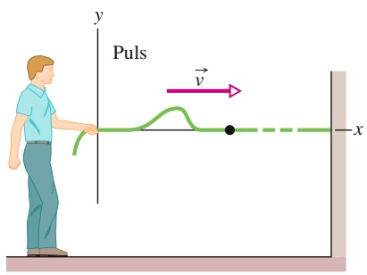

text_image

Puls
y
v
x

(a)

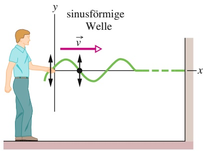

line

| Axis | Description |
| --- | --- |
| y | Y-axis variable (Horizontal) |
| x | X-axis variable (Vertical) |
| v | Amplitude (Vertical axis) |

(b)

Abb. 12.1

(a) Ein einzelner Wellenpuls breitet sich entlang eines gespannten Seils aus. Ein typisches Element des Seils (durch einen Punkt gekennzeichnet) bewegt sich einmal auf und ab, während der Puls vorbeiläuft. Die Bewegung dieses Elements verläuft senkrecht zur Ausbreitungsrichtung der Welle, daher bezeichnet man diesen Puls als transversale Welle. (b) Eine sinusförmige Welle läuft das Seil entlang. Ein typisches Element des Seils bewegt sich beim Durchgang der Welle ständig auf und ab. Auch hier handelt es sich um eine transversale Welle.

Schickt man eine Welle entlang eines straff gespannten Seils, erhält man eine sehr einfache Form einer mechanischen Welle. Wenn Sie dem einen Ende des Seils einen einzelnen kurzen „Auf-Ab“-Ruck geben, breitet sich eine Welle wie in Abb. 12.1a in Form eines einzelnen Wellenpulses das Seil entlang aus. Dieser Puls und seine Bewegung entstehen, weil das Seil einer großen Zugspannung unterliegt. Wenn Sie das eine Ende des Seils rasch nach oben bewegen, wird das benachbarte Seilelement ebenfalls nach oben gezogen, weil zwischen diesen beiden Abschnitten eine große Spannung herrscht. Wenn sich nun dieses benachbarte Element nach oben bewegt, zieht es wiederum sein Nachbarelement nach oben, und so weiter. Mittlerweile haben Sie vielleicht Ihr Ende des Seils wieder nach unten gedrückt. Während die vorderen Abschnitte sich noch nach oben bewegen, werden die hinteren bereits durch die Nachbarabschnitte auf Ihres Seite des Pulses wieder nach unten gezogen. Das Ergebnis ist eine charakteristische Verformung des Seils (der Puls), die sich mit einer Geschwindigkeit v⃗ entlang des Seils ausbreitet.

Wenn Sie Ihre Hand unablässig in einer harmonischen Bewegung auf- und abbewegen, entsteht eine kontinuierliche Welle, die sich mit der Geschwindigkeit v⃗ entlang des Seils ausbreitet. Da die Bewegung Ihrer Hand einer sinusförmigen Funktion der Zeit entspricht, hat auch die Welle zu jedem Zeitpunkt eine sinusförmige Gestalt (wie in Abb. 12.1b). Die Welle hat daher die Form einer Sinus- oder Kosinusfunktion.

Wir betrachten hier natürlich ein „ideales“ Seil ohne innere Reibungskräfte, welche die Welle bei ihrer Reise langsam abflachen lassen. Außerdem nehmen wir das Seil als ausreichend lang an, sodass wir die Reflexion der Wellen am anderen Ende nicht zu berücksichtigen brauchen.

Eine Möglichkeit, Wellen wie in Abb. 12.1 zu untersuchen, besteht in der Darstellung der **Wellenformen** (der Gestalt der Wellen), wie sie sich nach rechts ausbreiten. Wir können aber auch die Bewegung eines kurzen Seilabschnitts untersuchen, der auf- und abschwingt, während die Welle vorbeizieht. In diesem Fall würden wir finden, dass die Verschiebung jedes schwingenden Seilabschnitts senkrecht zur Ausbreitungsrichtung der Welle erfolgt, wie in Abb. 12.1 angedeutet. Diese Bewegung nennt man **transversal** und die zugehörige Welle bezeichnet man als **transversale Welle** oder **Transversalwelle**.

In Abb. 12.2 erkennt man, wie sich eine Schallwelle in einem langen, luftgefüllten Rohr erzeugen lässt. Man bewegt dazu einen Kolben an einem Ende des Rohrs ruckartig zunächst nach rechts und anschließend wieder nach links (also in Rohrrichtung vor und zurück), und schickt so einen Schallpuls entlang des Rohrs. Während der Kolben nach rechts bewegt wird, werden die Luftelemente in dem Rohr an dieser Stelle ebenfalls nach rechts geschoben und verändern dort den Luftdruck. Der erhöhte Luftdruck drückt wiederum auf die noch weiter rechts liegenden Luftelemente. Umgekehrt wird der Luftdruck rechts vom Kolben während der Linksbewegung herabgesetzt. Dadurch werden die zunächst nach rechts gedrückten Luftelemente nach links zurückgezogen. Auch diese Bewegung überträgt sich auf die weiter hinten im Rohr liegenden Luftelemente. Auf diese Weise breitet sich

280

---

12.1 Transversalwellen

12

im Rohr ein Druckunterschied (zunächst Über- dann Unterdruck) in Form eines Pulses nach rechts aus.

Wenn Sie stattdessen den Kolben harmonisch vor- und zurückschwingen lassen wie in Abb. 12.2, breitet sich eine sinusförmige Welle entlang des Rohrs aus. Da die Bewegung der Luftelemente hier parallel zur Ausbreitungsrichtung der Welle erfolgt, nennt man diese Bewegung **longitudinal** und die resultierende Welle heißt **Longitudinalwelle**. In diesem Kapitel konzentrieren wir uns auf transversale Wellen, insbesondere auf die eindimensionalen Wellen entlang eines Seils. In Kapitel 13 werden wir die longitudinalen Wellen näher untersuchen, speziell die Schallwellen.

Sowohl transversale als auch longitudinale Wellen bezeichnet man als **fortlaufende Wellen**, weil sich beide Wellenformen von einem Punkt zu einem anderen ausbreiten, beispielsweise von einem Ende des Seils zum anderen wie in Abb. 12.1 oder von einem Ende des Rohrs zum anderen wie in Abb. 12.2. Man beachte jedoch, dass sich nur die Wellen selbst ausbreiten, nicht aber das Medium selbst (Seil oder Luft), auf bzw. in dem sich die Welle ausbreitet.

Ein Sandskorpion nutzt zur Ortung seiner Beute sowohl transversale als auch longitudinale Wellen. Wenn ein Käfer auch nur leicht den Sand bewegt, breiten sich Wellenpulse entlang der Sandoberfläche aus (Abb. 12.3). Ein Teil dieser Pulse ist longitudinal und hat eine Geschwindigkeit von $\nu _ { \mathrm { l } } = 1 5 0   \mathrm { m / s } _ { \mathrm { l } }$ , der andere Teil ist transversal mit einer Geschwindigkeit von $\nu _ { \mathrm { t } } = 5 0   \mathrm { m } / \mathrm { s }$

Der Skorpion hat seine acht Beine ungefähr in einem Kreis mit einem Radius von 5 cm ausgebreitet. Er nimmt zunächst die schnelleren longitudinalen Wellen wahr und erkennt daraus die Richtung des Käfers: Es handelt sich um die Richtung, deren zugehöriges Bein den Puls zuerst wahrgenommen hat. Anschließend erspürt der Skorpion das Zeitintervall $\Delta t$ zwischen dem Eintreffen der longitudinalen Pulse und der langsameren transversalen Pulse und bestimmt daraus den Abstand d des Käfers. Für das Zeitintervall gilt nämlich

$$
\Delta t = \frac {d}{\nu_ {\mathrm{t}}} - \frac {d}{\nu_ {\mathrm{l}}}
$$

und damit berechnet sich der Abstand zu

$$
d = (7 5 \mathrm{m/s}) \Delta t.
$$

Für $\Delta t = 4 \mathrm { , } 0$ ms folgt beispielsweise $d = 3 0   \mathrm { c m }$ . Der Skorpion erhält so eine perfekte Ortsbestimmung seines potenziellen Beutetiers.

## 12.1.3 Wellenlänge und Frequenz

Zur vollständigen Beschreibung einer Seilwelle (und der Bewegung der einzelnen Seilabschnitte bzw. -elemente) benötigen wir eine Funktion, die uns die Wellenform angibt. Wir suchen also nach einer Beziehung der Form $y = y ( x , t )$ . Dabei ist $y$ die transversale Auslenkung eines Seilelements am Ort x zum Zeitpunkt t. Eine sinusförmige Welle wie in Abb. 12.1b wird – wie der Name schon sagt – mathematisch durch eine Sinus- oder Kosinusfunktion beschrieben; beide Funktionen haben im Prinzip die gleiche Gestalt, sie sind nur seitlich gegeneinander verschoben. In diesem Kapitel verwenden wir meist den Sinus.

Stellen Sie sich eine sinusförmige Welle wie in Abb. 12.1 vor, die sich entlang der positiven Richtung einer x-Achse ausbreitet. Wenn die Welle benachbarte Elemente (d. h. sehr kurze Abschnitte) erreicht, schwingen die einzelnen Elemente parallel zur y-Achse. Zum Zeitpunkt t ist die (transversale oder Quer-)Auslenkung y des Elements am Ort x durch

$$
y (x, t) = y _ {\mathrm{m}} \sin (k x - \omega t) \tag {12.2}
$$

gegeben. Da diese Gleichung die Auslenkung als Funktion des Orts x beschreibt, können wir mit ihrer Hilfe die Auslenkungen aller Elemente über die ganze Länge

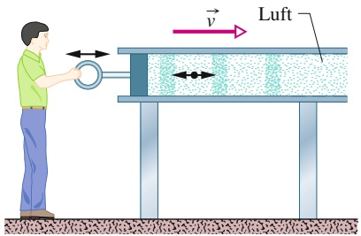

text_image

Luft
v

Abb. 12.2

In einem luftgefüllten Rohr wird eine Schallwelle erzeugt, indem ein Kolben rasch vor- und zurückbewegt wird. Da die Schwingung eines Luftelements (dargestellt durch einen Punkt) parallel zur Ausbreitungsrichtung der Welle erfolgt, handelt es sich um eine longitudinale Welle.

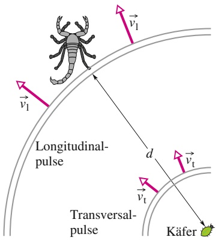

text_image

Longitudinal-
pulse
Transversal-
pulse
Käfer

Abb. 12.3

Ein krabbelnder Käfer sendet mit jedem Schrittchen schnelle longitudinale und langsamere transversale Wellen durch die Sandoberfläche. Der Sandskorpion nimmt zunächst die longitudinalen Wellenpulse wahr. In diesem Fall registriert sein rechtes Hinterbein die Pulse zuerst.

281

---

12 Wellen – I

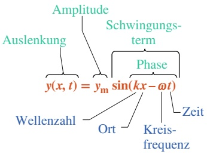

flowchart

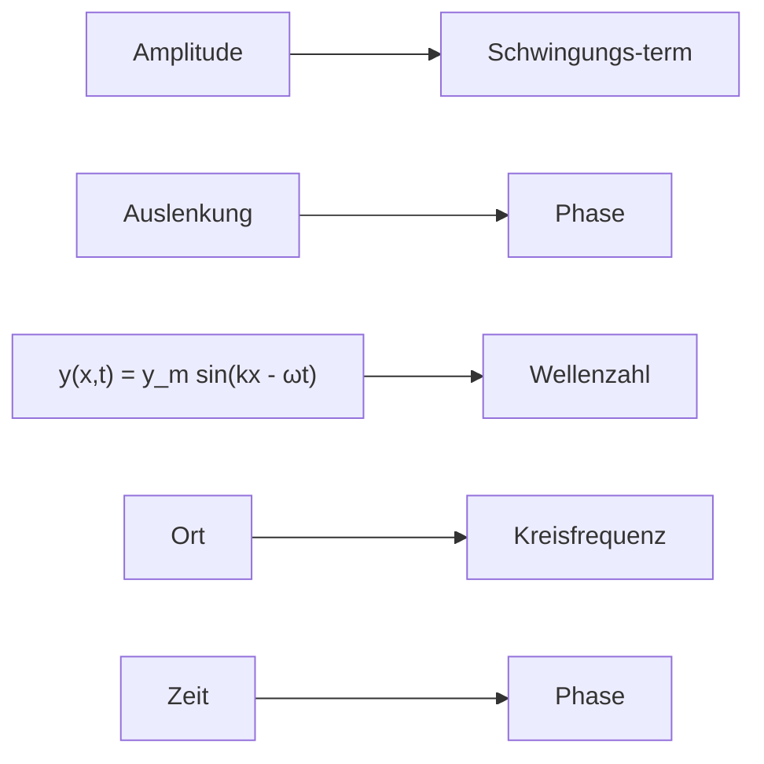

Abb. 12.4

Die Bezeichnungen der einzelnen Größen in Gl. 12.2 für eine transversale sinusförmige Welle.

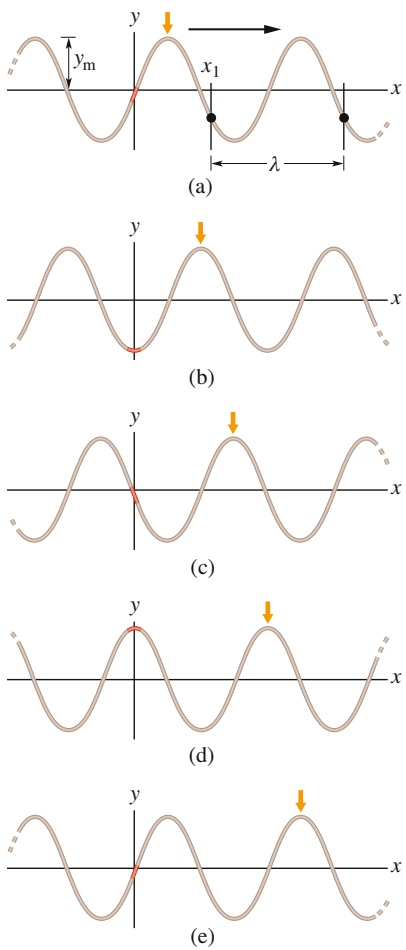

Abb. 12.5

Fünf „Momentaufnahmen“ einer Wel-$\mathrm { l e } ,$ die sich in positive x-Richtung ausbreitet. Die Amplitude $y _ { \mathrm { m } }$ ist angegeben, ebenso ist von dem beliebigen Ort $x _ { 1 }$ eine Wellenlänge λ abgetragen.

des Seils als Funktion der Zeit angeben. Diese Gleichung gibt uns also die Form der Welle zu jedem beliebigen Zeitpunkt und sagt uns gleichzeitig, wie sich diese Form verändert, wenn die Welle das Seil entlangläuft. Die Bezeichnungen der einzelnen Größen in Gl. 12.2 sind in Abb. 12.4 zusammengefasst und werden im Folgenden exakt definiert.

Bevor wir auf die physikalischen Begriffe eingehen, wollen wir uns Abb. 12.5 noch etwas genauer ansehen. Dort erkennt man fünf „Momentaufnahmen“ einer sinusförmigen Welle, die sich in positive x-Richtung ausbreitet. Die Bewegung der Welle erkennt man an dem kurzen orangefarbenen Pfeil, der auf ein Maximum der Welle deutet. Von Aufnahme zu Aufnahme bewegt sich der Pfeil mit dem Maximum nach rechts, aber das Seil bewegt sich nursenkrecht dazu, d. h. in y-Richtung. Zur Verdeutlichung verfolgen wir die Bewegung des rot eingefärbten Seilelements am Ursprung $x = 0 .$ In der ersten Momentaufnahme (Abb. 12.5a) ist seine Auslenkung $y = 0 .$ . In der nächsten Aufnahme befindet es sich bei seiner maximalen unteren Auslenkung, weil gerade ein Minimum oder Wellental vorbeizieht. Dann kommt es zurück zu $y = 0 .$ In der vierten Aufnahme befindet es sich bei seiner maximalen oberen Auslenkung, weil gerade ein Maximum bzw. Wellenberg vorbeizieht. Und schließlich ist es in der fünften Momentaufnahme wieder bei $y = 0$ und hat einen vollen Schwingungszyklus durchlaufen.

## Amplitude und Phase

Die **Amplitude** einer Welle wie in Abb. 12.5 ist gleich dem Betrag der maximalen Auslenkung der Elemente aus ihrer Gleichgewichtslage beim Durchgang der Welle. (Der Index $\mathrm { { _ { \mathrm { { \it { p } } } } m } ^ { \it { \it { \it { \it { a } } } } } }$ steht wieder für „maximal“.) Da $y _ { \mathrm { m } }$ dem Betrag einer Auslenkung entspricht, handelt es sich immer um eine positive Größe, selbst wenn sie wie in Abb. 12.5a nach unten statt nach oben gemessen würde.

Die **Phase** der Welle ist gleich dem Argument kx − ωt der Sinusfunktion in Gl. 12.2. Wenn die Welle bei einem bestimmten Element an der Stelle x vorbeiläuft, ändert sich die Phase linear in der Zeit t. Damit ändert sich auch die Sinusfunktion und oszilliert zwischen −1 und +1. Der Maximalwert +1 entspricht einem Wellenberg, der durch das Element läuft; in diesem Fall nimmt y an der Stelle x den Wert $y _ { \mathrm { m } }$ an. Der Minimalwert −1 entspricht einem Wellental, das durch das Element läuft; in diesem Fall wird y an dieser Stelle x gleich $- y _ { \mathrm { m } } ,$ Die Sinusfunktion und die zeitabhängige Phase einer Welle beschreiben somit die Schwingungen eines Seilelements, und die Amplitude der Welle gibt die Extremwerte der Auslenkung an.

## Wellenlänge und Wellenzahl

Die **Wellenlänge** λ einer Welle ist der Abstand (in Richtung der Wellenausbreitung) zwischen zwei Wiederholungen der Wellenform, siehe Abb. 12.5. Zum Zeitpunkt $t = 0$ wird die Wellenform (Gl. 12.2) durch

$$
y (x, 0) = y _ {\mathrm{m}} \sin k x \tag {12.3}
$$

beschrieben. Per definitionem ist die Verschiebung y an zwei Orten im Abstand von einer Wellenlänge – also etwa bei $x = x _ { 1 }$ und $x = x _ { 1 }   +   \lambda$ – dieselbe, d. h., es ist

$$
y _ {\mathrm{m}} \sin k x _ {1} = y _ {\mathrm{m}} \sin k (x _ {1} + \lambda) = y _ {\mathrm{m}} \sin (k x _ {1} + k \lambda). \tag {12.4}
$$

Die Sinusfunktion nimmt identische Werte an, wenn ihr Winkel bzw. Argument um 2π rad vergrößert wird. In Gl. 12.4 muss daher $k \lambda = 2 \pi$ sein oder

$$
k = \frac {2 \pi}{\lambda} \quad (\text {Wellenzahl}). \tag {12.5}
$$

282

---

12.1 Transversalwellen

12

Wir nennen k die **Wellenzahl** der Welle; ihre SI-Einheit ist Radiant pro Meter bzw. inverse Meter. (Beachten Sie, dass das Symbol k in diesem Kapitel nicht mehr für eine Federkonstante steht!)

Die Welle in Abb. 12.5 bewegt sich zwischen zwei Momentaufnahmen um $\frac { 1 } { 4 } \lambda .$ nach rechts. In der fünften Aufnahme hat sie sich daher um 1λ nach rechts bewegt.

## Periode, Kreisfrequenz und Frequenz

Abbildung 12.6 zeigt den Graphen der Auslenkung an einem bestimmten Ort des Seils (hier $x = 0 )$ als Funktion der Zeit t. Dieses einzelne Element bei $x = 0$ bewegt sich nach Gl. 12.2 in einer harmonischen Schwingung auf und ab:

$$
y (0, t) = y _ {\mathrm{m}} \sin (- \omega t) = - y _ {\mathrm{m}} \sin \omega t \quad (x = 0). \tag {12.6}
$$

Hier haben wir die Relation sin $( - \alpha ) = - \sin \alpha$ verwendet, die für jeden Winkel α gilt. Abbildung 12.6 zeigt den Graphen zu dieser Gleichung, sie zeigt nicht die Form (Gestalt) der Welle.

Wir definieren die **Periode** T einer Welle als die Zeitdauer, in der ein beliebi ges Seilelement eine volle Schwingung ausführt. Eine typische Periode ist in dem Graphen von Abb. 12.6 eingezeichnet. Wir können Gl. 12.6 auf beide Enden dieses Zeitintervalls anwenden und erhalten

$$
- y _ {\mathrm{m}} \sin \omega t _ {1} = - y _ {\mathrm{m}} \sin \omega (t _ {1} + T) = - y _ {\mathrm{m}} \sin (\omega t _ {1} + \omega T). \tag {12.7}
$$

Diese Gleichung gilt nur, wenn ω $T = 2 \pi$ ist bzw.

$$
\omega = \frac {2 \pi}{T} \quad (\text {Kreisfrequenz}). \tag {12.8}
$$

Wir nennen ω die **Kreisfrequenz** der Welle. Ihre SI-Einheit ist Radiant pro Sekunde bzw. inverse Sekunde, d. h. Hertz.

Die fünf Momentaufnahmen in Abb. 12.5 wurden jeweils im zeitlichen Abstand von $\frac { 1 } { 4 } T$ gemacht. Bei der fünften Aufnahme hat jedes der Seilelemente daher eine volle Schwingung ausgeführt.

Die **Frequenz** $f$ einer Welle ist als $1 / T$ definiert und hängt mit der Kreisfrequenz ω über die Beziehung

$$
f = \frac {1}{T} = \frac {\omega}{2 \pi} \quad \text {(Frequenz)} \tag {12.9}
$$

zusammen. Wie die Frequenz der harmonischen Schwingung in Kapitel 11 bezeichnet auch hier die Frequenz f die Anzahl der Schwingungen – in diesem Fall eines Seilelements – pro Zeiteinheit. Und wie in Kapitel 11 hat $f$ die SI-Einheit Hertz.

## KONTROLLFRAGE 1

In der Abbildung wurden drei Momentaufnahmen von Wellen entlang eines Seils übereinandergelegt. Die Phasen der Wellen sind durch $\left( \mathsf { a } \right) 2 x - 4 t ,$ (b) 4x − 8t und (c) 8x − 16t gegeben. Welche Phase entspricht in der Abbildung welcher Welle?

## 12.1.4 Die Geschwindigkeit einer fortlaufenden Welle

Abbildung 12.7 zeigt zwei Momentaufnahmen der Welle von Gl. 12.2, die im kurzen Zeitabstand Δt aufgenommen wurden. Die Welle breitet sich in positive x-Richtung aus (in Abb. 12.7 nach rechts), die gesamte Wellenform verschiebt sich innerhalb des Intervalls Δt um einen Abstand Δx in diese Richtung. Das Verhältnis $\Delta x / \Delta t$ (oder, im differenziellen Grenzfall, $\mathrm { d } x / \mathrm { d } t )$ ist die **Wellengeschwindigkeit** oder **Ausbreitungsgeschwindigkeit** der Welle $\nu .$ Wie können wir diesen Wert bestimmen?

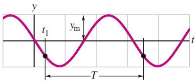

text_image

y
t₁
yₘ
T
t

Abb. 12.6

Der Graph der Auslenkung des Seilelements am Punkt $x = 0$ als Funktion der Zeit, während die sinusförmige Welle aus Abb. 12.5 vorbeiläuft. Die Amplitude $y _ { \mathrm { m } }$ ist eingezeichnet. Die Periode $T ,$ von einem beliebig gewählten Zeitpunkt $t _ { 1 }$ aus gemessen, ist ebenfalls angegeben.

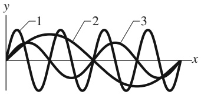

line

| Wave | Description |
| --- | --- |
| 1 | First wave with peak amplitude |
| 2 | Second wave with peak amplitude |
| 3 | Third wave with peak amplitude |

283

---

12 Wellen – I

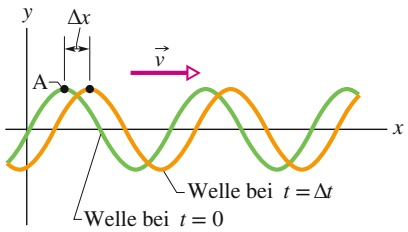

line

| Feature | Description |
| --- | --- |
| Y-axis | Displacement (y) |
| X-axis | Displacement (x) |
| Point A | Intersection of two waves |
| Vector | Direction of velocity (v) |
| Waveform Type | Waveform (Green = t = 0, Orange = \(t=\Delta t)\) |
| Key Metric | \(\Delta x\) |

Abb. 12.7

Zwei Momentaufnahmen der Welle aus Abb. 12.5 zum Zeitpunkt $t = 0$ und zum Zeitpunkt $t = \Delta t .$ Wenn sich die Welle mit der Geschwindigkeit v⃗ nach rechts ausbreitet, verschiebt sich die gesamte Kurve im Zeitintervall Δt um eine Strecke $\Delta x .$ Der Punkt A „reitet“ auf der Wellenform, die Elemente des Seils bewegen sich jedoch nur auf und ab.

Während sich die Welle in Abb. 12.7 bewegt, behält jeder Punkt der Wellenform, wie beispielsweise der Punkt A auf dem Wellenberg, seine Auslenkung y. (Die Punkte auf dem Seil verändern ihre Auslenkung, der „wandernde“ Wellenberg bleibt aber immer gleich hoch.) Da der Punkt A seine Auslenkung bei der Bewegung beibehält, muss die Phase in Gl. 12.2, die ihm diese Auslenkung gibt, konstant bleiben:

$$
k x - \omega t = \text {const.} \tag {12.10}
$$

Das Argument der Sinusfunktion bleibt zwar konstant, aber x und t verändern sich. Wenn t größer wird, muss offensichtlich auch x größer werden, damit das Argument konstant bleibt. Dies bestätigt nochmals, dass sich die Welle in positive x-Richtung ausbreitet.

Zur Berechnung der Ausbreitungsgeschwindigkeit v leiten wir Gl. 12.10 nach t ab:

$$
k \frac {\mathrm{d} x}{\mathrm{d} t} - \omega = 0
$$

oder

$$
\frac {\mathrm{d} x}{\mathrm{d} t} = \nu = \frac {\omega}{k}. \tag {12.11}
$$

Mit Gl. 12.5 $\left( k = 2 \pi / \lambda \right)$ und Gl. $1 2 . 8 \left( \omega = 2 \pi / T \right)$ können wir die Wellengeschwindigkeit auch folgendermaßen beschreiben:

$$
\nu = \frac {\omega}{k} = \frac {\lambda}{T} = \lambda f \quad (\text {Wellengeschwindigkeit}). \tag {12.12}
$$

Die Gleichung $\nu = \lambda / T$ sagt uns, dass die Wellengeschwindigkeit gleich einer Wellenlänge pro Periode ist: Die Welle bewegt sich in einer Schwingungsperiode um den Abstand einer Wellenlänge weiter.

Gleichung 12.2 beschreibt eine Welle, die sich in die positive x-Richtung ausbreitet. Wir erhalten die Gleichung für eine in die entgegengesetzte Richtung fortlaufende Welle, indem wir in Gl. 12.2 einfach t durch −t ersetzen. Dies entspricht der Bedingung

$$
k x + \omega t = \text {const.} \tag {12.13}
$$

Ein Vergleich mit Gl. 12.10 (und der anschließenden Diskussion) zeigt, dass x nun mit zunehmender Zeit kleiner werden muss. Eine sich in negative x-Richtung ausbreitende Welle wird daher durch die Gleichung

$$
y (x, t) = y _ {\mathrm{m}} \sin (k x + \omega t) \tag {12.14}
$$

beschrieben.

Für die Geschwindigkeit dieser Welle finden wir ganz ähnlich wie bei Gl. 12.2 die Beziehung:

$$
\frac {\mathrm{d} x}{\mathrm{d} t} = - \frac {\omega}{k}. \tag {12.15}
$$

Das Minuszeichen (im Vergleich zu Gl. 12.11) bestätigt, dass sich diese Welle in die negative x-Richtung ausbreitet und rechtfertigt daher unseren Wechsel im Vorzeichen der Zeitvariable.

Wir betrachten nun eine Welle beliebiger Form, die durch

$$
y (x, t) = h (k x \pm \omega t) \tag {12.16}
$$

beschrieben wird. Die Funktion h steht hier für eine beliebige Funktion, die Sinus funktion ist nur ein spezielles Beispiel. Unsere obigen Überlegungen zeigen, dass es sich bei allen Wellen, in denen die Variablen x und t in der Kombination $\omega ^ { k x \pm \omega t ^ { \alpha } }$ auftreten, um fortlaufende Wellen handelt. Außerdem müssen alle fortla<u>ufenden</u> Wellen die Form von Gl. 12.16 haben. Daher beschreibt auch $y ( x , t ) = { \sqrt { a x + b t } }$ eine mögliche (wenn auch physikalisch seltsame) fortlaufende Welle, wohingegen die Funktion $y ( x , t ) = \sin ( a x ^ { 2 } - b t )$ keiner fortlaufenden Welle entspricht.

284

---

12.2 Die Wellengeschwindigkeit eines gespannten Seils

12

## KONTROLLFRAGE 2

Die folgenden Gleichungen beschreiben drei verschiedene Wellen: (1) $y ( x , t ) =$ $2 \sin ( 4 x - 2 t ) ,   ( 2 ) y ( x , t ) = \sin ( 3 x - 4 t ) ,   ( 3 ) y ( x , t ) = 2 \sin ( 3 x - 3 t )$ . Ordnen Sie die Wellen in absteigender Reihenfolge nach (a) ihrer Ausbreitungsgeschwindigkeit und (b) der maximalen transversalen Geschwindigkeit.

## LÖSUNGSSTRATEGIEN

**Strategie 1: Der Umgang mit großen Phasen** Manchmal tauchen wie in Beispielaufgabe 12.2 im Übungsbuch Winkel auf, die sehr viel größer als 2π rad (oder 360°) sind, und Sie müssen den Sinus oder Kosinus dieser Winkel bestimmen. Addiert oder subtrahiert man ein Vielfaches von 2π rad zu solch einem Winkel, ändert sich keiner der Werte der trigonometrischen Funktionen dieser Winkel. In Beispielaufgabe 12.2 im Übungsbuch trat beispielsweise der Winkel −35,1855 rad auf. Wenn wir 6 ⋅ 2π rad = 12π rad zu diesem Winkel addieren, erhalten wir

$$
- 3 5, 1 8 5 5 \mathrm{rad} + 1 2 \pi \mathrm{rad} = 2, 5 1 3 6 1 \mathrm{rad}.
$$

Dieser Winkel ist kleiner als 2π rad und die Auswertung sämtlicher trigonometrischer Funktionen liefert für ihn denselben Wert wie für −35,1855 rad (vgl. Abb. 12.8).

Ihr Taschenrechner wird solche großen Winkel automatisch für Sie in kleinere Winkel umwandeln. Aber seien Sie vorsichtig: Runden Sie große Winkel nicht auf oder ab, wenn Sie aus ihnen den Sinus oder Kosinus berechnen wollen. Wenn Sie den Sinus eines sehr großen Winkels berechnen, bleibt der größte Teil des Winkels unberücksichtigt und nur ein kleiner Rest geht in die Berechnung der Sinusfunktion ein. Angenommen, sie hätten −35,1855 rad auf −35 rad abgerundet (eine Veränderung von 0,5 %, die normalerweise vernünftig ist), dann hätte sich der Sinus des Winkels um 27 % geändert! Die gleiche Warnung gilt, wenn Sie einen großen Winkel von Grad in Radiant umrechnen: Verwenden Sie den exakten Umrechnungsfaktor 180° = π rad und nicht eine Näherung, z. B. 57,3° ≈ 1 rad.

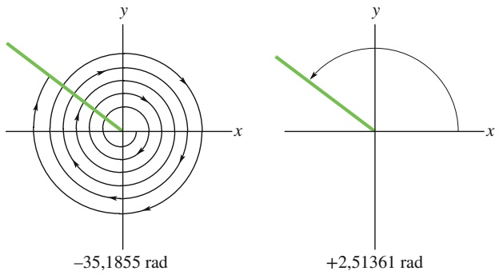

Abb. 12.8 Diese beiden Winkel sind verschieden, aber alle ihre trigonometrischen Funktionen haben identische Werte.

## 12.2 Die Wellengeschwindigkeit eines gespannten Seils

## Lernziele

Nach dem Durcharbeiten dieses Abschnitts sollten Sie in der Lage sein, . . .

• die lineare Dichte $\mu$ eines Seils aus seiner Masse und seiner Länge zu berechnen,
• den Zusammenhang zwischen Wellengeschwindigkeit $\nu ,$ Seilspannung τ und linearer Dichte $\mu$ anzugeben.

## Schlüsselideen

• Die Ausbreitungsgeschwindigkeit einer ein gespanntes Seil entlanglaufenden Welle wird durch die Eigenschaften des Seils bestimmt, nicht durch Eigenschaften der Welle wie Amplitude oder Frequenz.

285

---

12 Wellen – I

• Die Geschwindigkeit einer Seilwelle hängt von der Zugspannung τ und der linearen Dichte $\mu$ ab:

$$
\nu = \sqrt {\frac {\tau}{\mu}}.
$$

## 12.2.1 Die Wellengeschwindigkeit eines gespannten Seils

Die Geschwindigkeit einer Welle hängt über Gl. 12.12 mit Wellenlänge und Frequenz zusammen, aber letztlich sind es die Eigenschaften des Mediums, durch das sich die Welle ausbreitet, welche die Geschwindigkeit bestimmen. Wenn sich eine Welle in einem Medium wie Wasser, Luft, Stahl oder einem gespannten Seil ausbreitet, werden die Teilchen des Mediums zu Schwingungen angeregt. Damit es überhaupt zu solchen Schwingungen kommt, müssen die Teilchen des Mediums eine Masse haben (sodass es kinetische Energie gibt) und es muss gewisse Elastizitätseigenschaften geben (als Speicher für potenzielle Energie). Masse bzw. Massendichte und Elastizitätseigenschaften des Mediums legen daher die Ausbreitungsgeschwindigkeit einer Welle fest. Umgekehrt sollte sich die Wellengeschwindigkeit in dem Medium durch diese beiden Materialeigenschaften ausdrücken lassen. Für das gespannte Seil wollen wir diese Beziehung auf zwei verschiedene Weisen herleiten.

## Dimensionsbetrachtungen

Wenn wir eine Beziehung aus Dimensionsbetrachtungen herleiten wollen, müssen wir zunächst die Dimensionen bzw. Einheiten aller physikalischen Größen untersuchen, die in einer bestimmten physikalischen Situation relevant sind. Im vorliegenden Fall wollen wir die Wellengeschwindigkeit v mit Elastizitäts- und Träg heitseigenschaften des Seils in Beziehung setzen. Die gesuchte Geschwindigkeit v hat dabei die Dimension $\mathrm { L T ^ { - 1 } , d . h }$ . Länge L dividiert durch Zeit T.

Zur Charakterisierung der Trägheitseigenschaften des Seils verwenden wir die Masse eines Seilelements, die sich aus der Gesamtmasse m des Seils dividiert durch dessen Länge l berechnet. Dieses Verhältnis bezeichnen wir als längenbezogene Masse oder lineare Massendichte $\mu$ des Seils. Es gilt $\mu = m / l ,$ und die Dimension dieser Größe ist Masse durch Länge, $\mathrm { M L } ^ { - 1 }$

Entlang eines Seils, das nicht unter Spannung steht, d. h., das nicht durch Kräfte an den beiden Enden straff gespannt wird, kann sich keine Welle ausbreiten. Liegen solche Kräfte vor, ist die Zugspannung τ im Seil gleich dem (resultierenden) Betrag dieser Kräfte. Wenn sich die Welle entlang des Seils ausbreitet, bewirken die Auslenkungen eine zusätzliche Dehnung, wobei benachbarte Seilabschnitte aufgrund der Zugspannung aneinander ziehen. Die Zugspannung des Seils hängt also mit seiner elastischen Dehnung zusammen. Spannkraft und dehnende Kräfte haben beide die Dimension einer Kraft, d. h. ML $\dot { \boldsymbol { T } } ^ { - 2 }$ (vgl. das zweite Newtonsche Gesetz $F = m a )$

Unser Ziel ist es nun, eine Kombination der Größen $\mu$ (Einheit $\mathrm { M L ^ { - 1 } ) }$ und $\tau$ (Einheit $\mathrm { M L T ^ { - 2 } ) }$ zu finden, die einer Geschwindigkeit v entspricht (Einheit $\mathrm { L T ^ { - 1 } ) }$ Durch gezieltes Probieren findet man rasch

$$
\nu = C \sqrt {\frac {\tau}{\mu}}. \tag {12.17}
$$

wobei $C$ eine dimensionslose Konstante ist, die sich aus Dimensionsüberlegungen nicht herleiten lässt. Unser zweiter Weg zur Bestimmung der Wellengeschwindig keit wird zeigen, dass Gl. 12.17 tatsächlich richtig und $C = 1$ ist.

286

---

12.2 Die Wellengeschwindigkeit eines gespannten Seils

12

## Herleitung aus dem zweiten Newtonschen Gesetz

Statt einer sinusförmigen Welle wie in Abb. 12.1b betrachten wir einen einzelnen symmetrischen Wellenpuls wie in Abb. 12.9, der sich mit der Geschwindigkeit v von links nach rechts entlang des Seils ausbreitet. Der Einfachheit halber wählen wir ein Bezugssystem, in dem der Wellenpuls in Ruhe ist, d. h., wir laufen neben dem Seil her – immer auf gleicher Höhe mit dem Puls. In diesem Bezugssystem scheint sich das Seil mit der Geschwindigkeit v von rechts nach links an uns vorbeizubewegen (vgl. Abb. 12.9).

Wir betrachten ein kleines Seilelement der Länge Δl innerhalb des Pulses, das auf einem Kreisbogen mit Radius R liegt und vom Mittelpunkt dieses Kreises unter einem Winkel 2θ erscheint. An beiden Enden dieses Elements zieht tangential eine Kraft τ⃗, deren Betrag gleich der Zugspannung im Seil ist. Die horizontalen Komponenten dieser Kräfte heben sich gegenseitig auf, aber die vertikalen Komponenten addieren sich zu einer rücktreibenden radialen Kraft ${ \vec { F } } .$ Der Betrag dieser Kraft ist

$$
F = 2 (\tau \sin \theta) \approx \tau (2 \theta) = \tau \frac {\Delta l}{R} \qquad (\text {Kraft}), \tag {12.18}
$$

wobei wir für den kleinen Winkel $\theta$ in Abb. 12.9 sin θ durch $\theta$ angenähert haben. Aus dieser Abbildung lesen wir auch die Relation $2 \theta = \Delta l / R$ ab.

Die Masse des Elements ist durch

$$
\Delta m = \mu \Delta l \quad (\text {Masse}) \tag {12.19}
$$

gegeben, wobei $\mu$ die lineare Dichte des Seils ist.

In dem in Abb. 12.9 dargestellten Augenblick bewegt sich das Seilelement $\Delta l$ auf einem Kreisbogen. Daher wirkt auf dieses Element eine Zentripetalbeschleunigung in Richtung des Kreismittelpunkts von

$$
a = \frac {\nu^ {2}}{R} \quad (\text {Beschleunigung}). \tag {12.20}
$$

Die Gln. 12.18–12.20 enthalten die Bestandteile des zweiten Newtonschen Gesetzes. Die allgemeine Form

wird in diesem Fall zu

$$
\frac {\tau \Delta l}{R} = (\mu \Delta l) \frac {\nu^ {2}}{R}.
$$

Aufgelöst nach v erhalten wir

$$
\nu = \sqrt {\frac {\tau}{\mu}} \quad (\text {Geschwindigkeit}), \tag {12.21}
$$

in Übereinstimmung mit Gl. 12.17, wenn wir der Konstante C in dieser Gleichung den Wert eins geben. Gleichung 12.21 liefert uns die Geschwindigkeit des Pulses aus Abb. 12.9 sowie die Geschwindigkeit jeder anderen Welle entlang desselben Seils unter denselben Bedingungen.

Gleichung 12.21 besagt in Worten:

Die Geschwindigkeit einer Welle entlang eines straff gespannten idealen Seils hängt nur von der Spannkraft und der linearen Massendichte des Seils ab, nicht aber von der Frequenz der Welle.

Die Frequenz der Welle ist durch die Ursache gegeben, welche die Welle erzeugt (beispielsweise die Person in Abb. 12.1b). Die Wellenlänge ergibt sich dann aus $G \mathrm { l . }   1 \dot { 2 } . 1 2 \mathrm { : }   \lambda = \nu / f .$

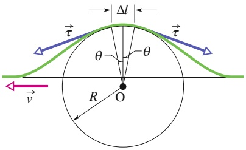

text_image

Δl
τ
θ
θ
R
O
v

Abb. 12.9

Ein symmetrischer Wellenpuls in einem Bezugssystem, in dem dieser Puls in Ruhe ist und das Seil von rechts nach links mit der Geschwindigkeit v an uns vorbeigleitet. Wir berechnen die Geschwindigkeit v aus dem zweiten Newtonschen Gesetz, angewandt auf ein Seilelement der Länge Δl an der Spitze des Pulses.

287

---

12 Wellen – I

## KONTROLLFRAGE 3

Sie erzeugen eine Welle entlang eines bestimmten Seils, indem Sie das eine Ende des Seils rasch hin und her schwingen. Wenn Sie die Frequenz Ihrer Schwingungen erhöhen, was geschieht mit (a) der Wellengeschwindigkeit und (b) der Wellenlänge: bleiben sie gleich, werden sie größer oder kleiner? Wenn Sie stattdessen die Spannung des Seils erhöhen, wie verändern sich (c) die Wellengeschwindigkeit und (d) die Wellenlänge?

## 12.3 Energie und Leistung einer sich ausbreitenden Seilwelle

## Lernziele

Nach dem Durcharbeiten dieses Abschnitts sollten Sie in der Lage sein, . . .

• die mittlere Geschwindigkeit zu berechnen, mit der eine transversale Welle Energie transportiert.

## Schlüsselideen

• Die mittlere Leistung, also die mittlere Geschwindigkeit des Energietransports einer Sinuswelle entlang eines gespannten Seils ist

$$
P _ {\mathrm{gem}} = \frac {1}{2} \mu \nu \omega^ {2} y _ {\mathrm{m}} ^ {2}.
$$

## 12.3.1 Energie und Leistung einer fortlaufenden Seilwelle

Wenn wir auf einem gespannten Seil eine Welle erzeugen, übertragen wir auf das Seil Energie für seine Bewegung. Wenn die Welle sich entlang des Seils ausbreitet, transportiert sie diese Energie sowohl in Form von kinetischer Energie als auch in Form von elastischer potenzieller Energie. Beide Energieformen wollen wir zunächst getrennt betrachten.

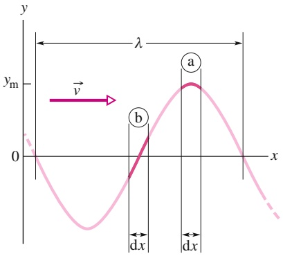

text_image

y
λ
y_m
0
b
a
x
dx
dx
v

Abb. 12.10

Eine Momentaufnahme einer ein Seil entlanglaufenden Welle zum Zeitpunkt $t = 0 .$ Das Element a befindet sich bei der Auslenkung $y = + y _ { \mathrm { m } } ,$ , Element b bei der Auslenkung $y = 0 .$ Die kinetische Energie eines Seilelements an einem bestimmten Punkt hängt von der transversalen Geschwindigkeit dieses Elements ab. Die potenzielle Energie hängt davon ab, wie weit das Seilelement gedehnt ist; sie ist also bei Element b größer als bei Element a.

## Kinetische Energie

Ein Seilelement der Masse dm, das transversal zur Wellenausbreitung eine harmo nische Schwingung ausführt, ist Träger von kinetischer Energie in Verbindung mit seiner transversalen Geschwindigkeit u⃗. Wenn dieses Element durch seine Ruhelage bei $y = 0$ schwingt (Element b in Abb. 12.10), ist seine transversale Geschwindigkeit – und damit seine kinetische Energie – am größten. Bei den Extremlagen $y = \pm y _ { \mathrm { m } }$ (Element a) ist seine transversale Geschwindigkeit – und daher auch seine kinetische Energie – gleich null.

## Elastische potenzielle Energie

Damit sich eine sinusförmige Welle entlang des Seils ausbreiten kann, muss die Welle das Seil notwendigerweise dehnen. Wenn ein Seilelement dx transversal schwingt und dabei die sinusförmige Gestalt der Welle entstehen soll, muss die Länge des Seilelements periodisch zu- und abnehmen. Die elastische potenzielle Energie hängt mit diesen Längenänderungen zusammen, ähnlich wie bei einer Feder.

Befindet sich das Seilelement bei den Extrempositionen $y = \pm y _ { \mathrm { m } }$ (z. B. Element a in Abb. 12.10), entspricht seine Länge dem normalen Wert dx, seine potenzielle Energie ist daher null. Wenn die Elemente jedoch durch ihre Ruhelage bei $y = 0$

288

---

12.3 Energie und Leistung einer sich ausbreitenden Seilwelle

12

schwingen (Element b in Abb. 12.10), werden sie maximal gedehnt, und die elastische potenzielle Energie erreicht ihr Maximum.

## Energietransport

Das schwingende Seilelement besitzt daher sowohl seine größte kinetische Energie als auch seine größte elastische potenzielle Energie bei $y = 0 .$ In der Momentaufnahme aus Abb. 12.10 tragen die Bereiche des Seils, die sich gerade bei einer maximalen Auslenkung befinden, keine Energie, während in den Bereichen bei der Auslenkung null die maximale Energie konzentriert ist. Während sich die Welle entlang des Seils ausbreitet, leisten die Spannungskräfte im Seil ständig Arbeit, um Energie aus den Bereichen mit hoher Energie in Bereiche mit niedriger Energie zu transportieren.

Angenommen, wir erzeugen eine Welle in einem entlang der x-Achse gespannten Seil, sodass Gl. 12.2 die Auslenkung des Seils beschreibt. Dies können wir beispielsweise erreichen, indem wir das eine Ende des Seils kontinuierlich auf- und abbewegen wie in Abb. 12.1b. Dabei übertragen wir von unserem Körper ständig Energie auf das Seil für dessen Bewegung und Dehnung, und da die Abschnitte des Seils senkrecht zur x-Achse schwingen, tragen sie kinetische und elastische potenzielle Energie. Wenn die Welle nun in Bereiche eindringt, die vorher in Ruhe waren, wird Energie auf diese neuen Bereiche übertragen. In diesem Sinn transportiert die Welle Energie entlang des Seils.

## Die Geschwindigkeit des Energietransports

Die kinetische Energie dK eines Seilelements der Masse dm ist durch

$$
\mathrm{d} K = \frac {1}{2} \mathrm{d} m u ^ {2} \tag {12.22}
$$

gegeben, wobei u die transversale Geschwindigkeit des schwingenden Seilelements ist. u ist die Ableitung von Gl. 12.2 nach der Zeit, wenn x konstant gehalten wird:

$$
u = \frac {\partial y}{\partial t} = - \omega y _ {\mathrm{m}} \cos (k x - \omega t). \tag {12.23}
$$

Mit dieser Beziehung und $\mathsf { d } m = \mu$ dx können wir Gl. 12.22 in der folgenden Form schreiben:

$$
\mathrm{d} K = \frac {1}{2} (\mu \mathrm{d} x) (- \omega y _ {\mathrm{m}}) ^ {2} \cos^ {2} (k x - \omega t). \tag {12.24}
$$

Dividieren wir Gl. 12.24 noch durch dt, erhalten wir die Rate, mit der sich die kinetische Energie eines Seilelements verändert und somit auch die Rate, mit welcher die Welle kinetische Energie transportiert. Das Verhältnis $\mathrm { d } x / \mathrm { d } t ,$ das in diesem Fall auf der rechten Seite von Gl. 12.24 auftritt, ist die Wellengeschwindigkeit v. Wir erhalten also:

$$
\frac {\mathrm{d} K}{\mathrm{d} t} = \frac {1}{2} \mu \nu \omega^ {2} y _ {\mathrm{m}} ^ {2} \cos^ {2} (k x - \omega t). \tag {12.25}
$$

Die gemittelte Transportrate der kinetischen Energie ist

$$
\left(\frac {\mathrm{d} K}{\mathrm{d} t}\right) _ {\mathrm{gem}} = \frac {1}{2} \mu \nu \omega^ {2} y _ {\mathrm{m}} ^ {2} [ \cos^ {2} (k x - \omega t) ] _ {\mathrm{gem}} = \frac {1}{4} \mu \nu \omega^ {2} y _ {\mathrm{m}} ^ {2}. \tag {12.26}
$$

Wir haben an dieser Stelle die Leistung über eine Wellenlänge gemittelt und dabei ausgenutzt, dass der Mittelwert des Quadrats der Kosinusfunktion über eine Periode (und damit auch über ein ganzzahliges Vielfaches einer Periode) gleich 1/2 ist.

289

---

12 Wellen – I

Auch die elastische potenzielle Energie wird von der Welle mittransportiert, und zwar mit derselben Rate wie Gl. 12.25. Dies soll hier nicht bewiesen werden, aber zur Veranschaulichung wollen wir daran erinnern, dass in einem schwingenden System (beispielsweise einem Pendel oder einem System aus einer Feder und einer Masse) die gemittelte kinetische Energie gleich der gemittelten potenziellen Energie ist.

Die **gemittelte Leistung**, d. h. die gemittelte Transportgeschwindigkeit beider Energieformen zusammengenommen, ist daher

$$
P _ {\mathrm{gem}} = 2 \left(\frac {\mathrm{d} K}{\mathrm{d} t}\right) _ {\mathrm{gem}} \tag {12.27}
$$

beziehungsweise mit Gl. 12.26

$$
P _ {\mathrm{gem}} = \frac {1}{2} \mu \nu \omega^ {2} y _ {\mathrm{m}} ^ {2} \quad \text {(mittlere Leistung)}  . \tag {12.28}
$$

Die Faktoren $. \mu$ und v in dieser Gleichung sind durch die Materialeigenschaften des Seils bestimmt. Die Faktoren ω und $y _ { \mathrm { m } }$ hängen von dem Prozess ab, der die Welle erzeugt. Die Abhängigkeit der gemittelten Leistung einer Welle vom Quadrat der Amplitude und vom Quadrat der Kreisfrequenz ist ein allgemeines Ergebnis, das für alle Arten von Wellen zutrifft.

## KONTROLLFRAGE 4

In Beispielaufgabe 12.3 im Übungsbuch haben wir für eine gegebene Seilwelle drei Parameter vorgeben: die Spannkraft innerhalb des Seils, die Frequenz der Welle und die Amplitude der Welle. Wird die gemittelte Energietransportrate entlang des Seils größer, kleiner, oder bleibt sie gleich, wenn wir (a) die Spannung, (b) die Frequenz und (c) die Amplitude vergrößern?

## 12.4 Die Wellengleichung

## Lernziele

Nach dem Durcharbeiten dieses Abschnitts sollten Sie in der Lage sein, . . .

• für eine Gleichung, die die transversale Auslenkung als Funktion der Position x und der Zeit t beschreibt, den Zusammenhang zwischen der zweiten Ableitung nach x und der zweiten Ableitung nach t anzugeben.

## Schlüsselideen

• Die Ausbreitung von transversalen Wellen aller Art wird durch eine Differenzialgleichung beschrieben, die man die allgemeine Wellengleichung nennt:

$$
\frac {\partial^ {2} y}{\partial x ^ {2}} = \frac {1}{\nu^ {2}} \frac {\partial^ {2} y}{\partial t ^ {2}}
$$

Die Welle schwingt dabei in $y -$ Richtung und breitet sich mit der Geschwindigkeit v in (positive oder negative) x-Richtung aus.

## 12.4.1 Die Wellengleichung

Wenn eine transversale Welle durch eine Position auf einer gespannten Gitarrensaite läuft, bewegt sich diese Stelle der Saite senkrecht zur Ausbreitungsrichtung der Welle (wir betrachten im Folgenden nur Transversalwellen). Durch Anwendung des zweiten Newtonschen Gesetzes auf die Bewegung der Saite können wir eine allgemeine Differenzialgleichung ableiten, die sogenannte Wellengleichung, die die Bewegung von Wellen jeder Art bestimmt.

290

---

12.4 Die Wellengleichung

12

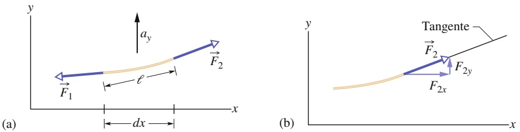

Abbildung 12.11a zeigt eine Momentaufnahme eines Abschnitts einer in horizontaler x-Richtung gespannten Gitarrensaite, auf der sich eine Welle entlangbewegt. Die Saite hat eine lineare Dichte $\mu$ und der Abschnitt besitzt die Masse dm und die Länge $\ell .$ Wir nehmen an, dass die Amplitude der Welle klein ist, sodass der Abschnitt nur sehr wenig von der x-Achse ausgelenkt wird, wenn die Welle durch ihn hindurchläuft. Der Betrag der leicht nach oben gerichteten Kraft $\vec { F } _ { 2 }$ am rechten Ende des Abschnitts ist gleich der Zugspannung τ in der Saite. Die Kraft $\vec { F } _ { 1 }$ am linken Ende des Abschnitts besitzt denselben Betrag, ist aber leicht nach unten gerichtet. Wegen der leichten Krümmung des Abschnitts zeigen die beiden Kräfte nicht einfach in entgegengesetzte Richtungen und heben sich daher nicht auf. Stattdessen addieren sie sich zu einer resultierenden Kraft, die eine aufwärts gerichtete Beschleunigung $\alpha _ { y }$ des Abschnitts bewirkt. Das zweite Newtonsche Gesetz für die y-Komponenten $( F _ { \mathrm { g e s } ,   y } = m a _ {   y } )$ ergibt dann

$$
F _ {2 y} - F _ {1 y} = \mathrm{d} m a _ {y}. \tag {12.29}
$$

Wir wollen diese Gleichung Schritt für Schritt analysieren: zunächst die Masse dm, dann die Komponente $\alpha _ { y }$ der Beschleunigung, dann die Kraftkomponenten $F _ { 2 y }$ und $F _ { 1 y }$ und schließlich die resultierende Gesamtkraft auf der linken Seite von Gl. 12.29.

## Masse

Die Masse dm des Abschnitts können wir durch die lineare Dichte $\mu$ der Saite und die Länge $\ell$ des Abschnitts in der Form $\mathsf { d } m = \mu \ell$ schreiben. Da der Abschnitt nur wenig aus der x-Achse ausgelenkt wird, ist $\ell \approx$ dx (Abb. 12.11a) und es gilt näherungsweise

$$
\mathrm{d} m = \mu \mathrm{d} x. \tag {12.30}
$$

## Beschleunigung

Die Beschleunigung $\alpha _ { y }$ in Gl. 12.29 ist die zweite Ableitung der Auslenkung nach der Zeit:

$$
a _ {y} = \frac {\mathrm{d} ^ {2} y}{\mathrm{d} t ^ {2}}. \tag {12.31}
$$

## Kräfte

Abbildung 12.11b zeigt, dass $\vec { F } _ { 2 }$ am rechten Ende des Abschnitts tangential an der Saite anliegt. Daher hängen die Komponenten der Kraft wie folgt mit der Steigung $S _ { 2 }$ der Saite am rechten Ende des Abschnitts zusammen:

$$
\frac {F _ {2 y}}{F _ {2 x}} = S _ {2}. \tag {12.32}
$$

## Abb. 12.11

(a) Ein Abschnitt einer Saite, während eine sinusförmige Transversalwelle auf der gespannten Saite durch ihn hindurchwandert. An seinem linken bzw. rechten Ende wirken die Kräfte ${ \vec { F } } _ { 1 }$ und ${ \vec { F } } _ { 2 } ,$ die eine Beschleunigung a⃗ mit einer vertikalen Komponente $\alpha _ { y }$ bewirken. (b) Die Kraft am rechten Ende des Abschnitts wirkt in Richtung der Tangente an dieser Stelle.

291

---

12 Wellen – I

Der Zusammenhang zwischen den Komponenten von $\vec { F } _ { 2 }$ und dem Betrag $F _ { 2 } ( = \tau )$ dieser Kraft lautet

$$
F _ {2} = \sqrt {F _ {2 x} ^ {2} + F _ {2 y} ^ {2}}
$$

oder

$$
\tau = \sqrt {F _ {2 x} ^ {2} + F _ {2 y} ^ {2}}. \tag {12.33}
$$

Da wir jedoch annehmen, dass der Abschnitt nur sehr wenig aus der Richtung der x-Achse ausgelenkt ist, gilt $F _ { 2 y } \ll F _ { 2 x }$ und wir können Gl. 12.33 in der Form

$$
\tau = F _ {2 x} \tag {12.34}
$$

schreiben. Wenn wir dies in Gl. 12.32 einsetzen und nach $F _ { 2 y }$ auflösen, erhalten wir

$$
F _ {2 y} = \tau S _ {2}. \tag {12.35}
$$

Eine entsprechende Analyse liefert für $F _ { 1 y }$

$$
F _ {1 y} = \tau S _ {1}. \tag {12.36}
$$

## Gesamtkraft

Nun sind wir in der Lage, die Gln. 12.30–12.31 und 12.35–12.36 in Gl. 12.29 einzusetzen; das Ergebnis ist

$$
\tau S _ {2} - \tau S _ {1} = (\mu \mathrm{d} x) \frac {\mathrm{d} ^ {2} y}{\mathrm{d} x ^ {2}}
$$

oder

$$
\frac {S _ {2} - S _ {1}}{\mathrm{d} x} = \frac {\mu}{\tau} \frac {\mathrm{d} ^ {2} y}{\mathrm{d} t ^ {2}}. \tag {12.37}
$$

Da der Abschnitt kurz ist, unterscheiden sich die Steigungen $S _ { 1 }$ und $S _ { 2 }$ am linken bzw. rechten Ende nur um einen differenziellen Betrag dS, wobei S die Steigung an einem beliebigen Punkt ist:

$$
S = \frac {\mathrm{d} y}{\mathrm{d} x}. \tag {12.38}
$$

Nun ersetzen wir zuerst $S _ { 2 } - S _ { 1 }$ in Gl. 12.37 durch dS und verwenden dann Gl. 12.38, um S durch $\mathrm { d } y / \dot { c }$ x zu ersetzen. So erhalten wir

$$
\frac {\mathrm{d} S}{\mathrm{d} x} = \frac {\mathrm{d} \left(\frac {\mathrm{d} y}{\mathrm{d} x}\right)}{\mathrm{d} x} = \frac {\mu}{\tau} \frac {\mathrm{d} ^ {2} y}{\mathrm{d} t ^ {2}},
$$

und

$$
\frac {\partial^ {2} y}{\mathrm{d} x ^ {2}} = \frac {\mu}{\tau} \frac {\partial^ {2} y}{\partial t ^ {2}}. \tag {12.39}
$$

Im letzten Schritt haben wir die Ableitungen als partielle Ableitungen geschrieben, da wir auf der linken Seite nur nach x ableiten (und t als konstant betrachten), während wir auf der rechten Seite nur nach t ableiten (und x als konstant betrachten). Schließlich setzen wir noch Gl. 12.21 $( \nu = \sqrt { \tau / \mu } )$ ein und erhalten so unser Ergebnis

$$
\frac {\partial^ {2} y}{\mathrm{d} x ^ {2}} = \frac {1}{\nu} \frac {\partial^ {2} y}{\partial t ^ {2}} \quad \text {(Wellengleichung)}. \tag {12.40}
$$

Dies ist die allgemeine Differenzialgleichung für die Ausbreitung von Wellen jeder Art.

292

---

12.5 Die Interferenz von Wellen

12

## 12.5 Die Interferenz von Wellen

## Lernziele

Nach dem Durcharbeiten dieses Abschnitts sollten Sie in der Lage sein, . . .

• das Überlagerungs- bzw. Superpositionsprinzip anzuwenden, um zu zeigen, dass zwei überlappende Wellen sich algebraisch addieren und eine resultierende (oder Gesamt-)Welle ergeben,
für zwei transversale Wellen mit gleicher Amplitude und Wellenlänge, die sich parallel zueinander ausbreiten, die Gleichung für die Auslenkung der resultie renden Welle zu bestimmen und deren Amplitude aus den Amplituden der beiden Einzelwellen und ihrer Phasendifferenz zu berechnen,
• zu beschreiben, wie die Phasendifferenz zwischen zwei transversalen Wellen (mit gleicher Amplitude und Wellenlänge) zu konstruktiver, destruktiver oder teilweiser Interferenz führen kann,
• die Art der Interferenz zweier Wellen direkt aus ihrer in Wellenlängen ausgedrückten Phasendifferenz abzulesen.

## Schlüsselideen

Wenn zwei oder mehr Wellen sich durch dasselbe Medium ausbreiten, so ist die Auslenkung jedes Teilchens in dem Medium die Summe der Auslenkungen, die die einzelnen Wellen allein hervorrufen würden. Dieser Effekt wird als Superpositionsprinzip für Wellen bezeichnet.
• Zwei sinusförmige Wellen, die sich entlang derselben Saite ausbreiten, zeigen dem Superpositionsprinzip entsprechend Interferenz, d. h., sie verstärken einander oder schwächen einander ab. Wenn beide sich in dieselbe Richtung bewe gen und die gleiche Amplitude $y _ { \mathrm { m } }$ und die gleiche Frequenz f (und demzufolge dieselbe Wellenlänge) besitzen, sich aber in der Phase um eine Phasenkonstante 𝜑 unterscheiden, ergibt sich eine einzige Welle mit derselben Frequenz:

$$
y ^ {\prime} (x, t) = [ 2 y _ {\mathrm{m}} \cos (\varphi / 2) ] \sin (k x - \omega t + \varphi / 2).
$$

Für $\varphi = 0$ sind die Wellen genau in Phase und ihre Interferenz ist konstruktiv; für $\varphi = \pi$ rad sind sie exakt außer Phase bzw. gegenphasig und ihre Interferenz ist destruktiv.

## 12.5.1 Das Superpositionsprinzip für Wellen

Oft breiten sich zwei oder mehr Wellen gleichzeitig in demselben Raumgebiet aus. Wenn wir beispielsweise einem Konzert lauschen, treffen die Schallwellen vieler Instrumente gleichzeitig auf unser Trommelfell. Die Elektronen in unseren Radiooder Fernsehantennen werden durch die Überlagerung vieler elektromagnetischer Wellen von verschiedenen Radio- bzw. Fernsehsendern in Bewegung gesetzt. Und auch die Bewegung des Wassers in einem See oder einem Hafen entsteht (unter anderem) durch die Überlagerung der Wellen hinter vielen Booten.

Angenommen, zwei Wellen breiten sich gleichzeitig entlang desselben gespannten Seils aus. $y _ { 1 } ( x , t )$ und $y _ { 2 } ( x , t )$ seien die Auslenkungen, die das Seil hätte, wenn jeweils nur eine der beiden Wellen vorhanden wäre. Die Auslenkung des Seils bei der Überlagerung beider Wellen ist dann einfach die Summe der Einzelauslenkungen:

$$
y ^ {\prime} (x, t) = y _ {1} (x, t) + y _ {2} (x, t). \tag {12.41}
$$

Diese Addition der Auslenkungen bedeutet:

Die Überlagerung von Wellen entspricht der Summe der einzelnen Wellen zu einer **resultierenden Welle** (oder **Gesamtwelle**).

293

---

12 Wellen – I

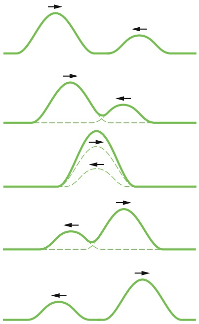

flowchart

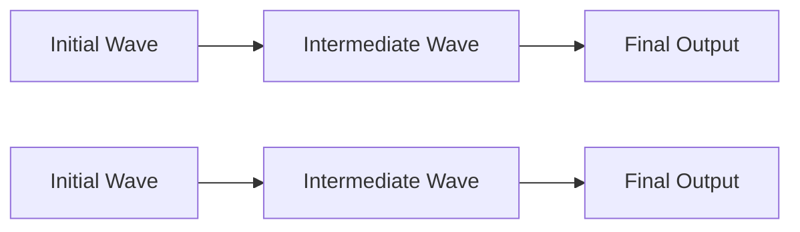

Abb. 12.12

Eine Folge von Momentaufnahmen zweier Wellenpulse, die sich entlang eines gespannten Seils aufeinander zu- und dann durcheinander hindurchbewegen. Für die Überlagerung der beiden Pulse gilt das Superpositionsprinzip.

Dies ist ein weiteres Beispiel für das **Superpositionsprinzip**, wonach der Gesamteffekt mehrerer gleichzeitig auftretender Einzeleffekte durch die Summe der Einzeleffekte gegeben ist.

Das Superpositionsprinzip gilt für alle Wellen, die durch eine lineare Wellengleichung beschrieben werden.

Abbildung 12.12 zeigt eine Folge von Momentaufnahmen zweier Wellenpulse, die sich entlang desselben Seils in entgegengesetzte Richtungen ausbreiten. Wenn sich die Pulse treffen und überlagern, entspricht der resultierende Puls der Summe der beiden Einzelpulse. Außerdem bewegt sich jeder der Pulse durch den anderen hindurch, als ob der andere nicht vorhanden wäre:

Überlappende Wellen beeinflussen einander bei ihrer Ausbreitung nicht.

## 12.5.2 Die Interferenz von Wellen

Angenommen, zwei sinusförmige Wellen derselben Wellenlänge und Amplitude breiten sich entlang desselben Seils in dieselbe Richtung aus. In diesem Fall ist das Superpositionsprinzip anwendbar. Welche Gesamtwelle folgt in diesem Fall aus dem Superpositionsprinzip für das Seil?

Die resultierende Welle hängt davon ab, welche Phasenverschiebung zwischen den beiden Wellen besteht, d. h., um welche Phase die eine Welle relativ zu der anderen Welle verschoben ist. Sind beide Wellen exakt in Phase (stimmen also die Wellenberge und Wellentäler beider Wellen genau überein), dann überlagern sich die beiden Wellen und verdoppeln die Auslenkung des Seils im Vergleich zu einer Einzelwelle. Sind beide Wellen exakt außer Phase bzw. gegenphasig (die Wellenberge der einen Welle liegen genau bei den Wellentälern der anderen Welle und umgekehrt), dann heben sich die beiden Wellen in der Überlagerung gegenseitig auf und das Seil bleibt gerade. Diese Erscheinung der Überlagerung von Wellen bezeichnen wir als **Interferenz**, und von den sich überlagernden Wellen sagen wir, dass sie **interferieren**. (Diese Begriffe beziehen sich nur auf die Auslenkungen der Wellen; die Ausbreitung der Wellen bleibt davon unberührt.)

Die Auslenkung der einen Welle entlang des Seils sei durch

$$
y _ {1} (x, t) = y _ {\mathrm{m}} \sin (k x - \omega t) \tag {12.42}
$$

gegeben, und die Auslenkung der zweiten, relativ zur ersten phasenverschobenen Welle durch

$$
y _ {2} (x, t) = y _ {\mathrm{m}} \sin (k x - \omega t + \varphi). \tag {12.43}
$$

Beide Wellen haben dieselbe Kreisfrequenz $\omega$ (und damit auch dieselbe Frequenz $f )$ , dieselbe Wellenzahl k (und damit auch dieselbe Wellenlänge λ) und dieselbe Amplitude $y _ { \mathrm { m } }$ . Beide Wellen breiten sich mit derselben Geschwindigkeit (Gl. 12.21) in die positive x-Richtung aus. Sie unterscheiden sich nur durch einen konstanten Winkel $\varphi ,$ den wir als **Phasenkonstante** bezeichnen. Man sagt auch, die beiden Wellen sind um $\varphi$ außer Phase, sie haben einen Phasenunterschied von 𝜑 oder sie sind relativ zueinander um 𝜑 phasenverschoben.

Nach dem Superpositionsprinzip (Gl. 12.41) ist die resultierende Welle gleich der Summe der beiden interferierenden Wellen. Ihre Auslenkung ist daher

$$
\begin{array}{l} y ^ {\prime} (x, t) = y _ {1} (x, t) + y _ {2} (x, t) \\ = y _ {\mathrm{m}} \sin (k x - \omega t) + y _ {\mathrm{m}} \sin (k x - \omega t + \varphi). \tag {12.44} \\ \end{array}
$$

Den trigonometrischen Gleichungen in Anhang D können wir entnehmen, dass sich die Summe zweier Sinusfunktionen von zwei Winkeln α und $\beta$ als

$$
\sin \alpha + \sin \beta = 2 \sin \left[ \frac {1}{2} (\alpha + \beta) \right] \cos \left[ \frac {1}{2} (\alpha - \beta) \right] \tag {12.45}
$$

294

---

12.5 Die Interferenz von Wellen

12

schreiben lässt. Für Gl. 12.44 folgt damit

$$
y ^ {\prime} (x, t) = [ 2 y _ {\mathrm{m}} \cos (\varphi / 2) ] \sin (k x - \omega t + \varphi / 2). \tag {12.46}
$$

Die resultierende Welle ist also wiederum eine sinusförmige Welle, die sich in positive x-Richtung ausbreitet (vgl. Abb. 12.13). Entlang des Seils beobachtet man nur diese Welle, nicht die einzelnen interferierenden Wellen aus Gl. 12.42 und Gl. 12.43.

Wenn sich zwei sinusförmige Wellen mit derselben Amplitude und Wellenlänge in dieselbe Richtung entlang eines Seils ausbreiten, führt die Interferenz beider Wellen wieder zu einer sinusförmigen Welle, die sich in dieselbe Richtung ausbreitet.

Die resultierende Welle unterscheidet sich von den interferierenden Einzelwellen in zweierlei Hinsicht: (1) Ihre Phasenkonstante ist $\varphi / 2 ,$ und (2) ihre Amplitude $y _ { \mathrm { m } } ^ { \prime }$ entspricht der Größe in den eckigen Klammern in Gl. 12.46:

$$
y _ {\mathrm{m}} ^ {\prime} = 2 y _ {\mathrm{m}} \cos (\varphi / 2) \quad \text {(Amplitude)}. \tag {12.47}
$$

Für $\varphi = 0$ sind die beiden interferierenden Wellen genau in Phase wie in Abb. 12.13a. In diesem Fall wird aus Gl. 12.46

$$
y ^ {\prime} (x, t) = 2 y _ {\mathrm{m}} \sin (k x - \omega t) \quad (\varphi = 0). \tag {12.48}
$$

Die Gesamtwelle ist in Abb. 12.14d dargestellt. Sowohl in der Abbildung als auch aus Gl. 12.48 erkennt man, dass die Amplitude der resultierenden Welle doppelt so groß ist wie die Amplitude der einzelnen interferierenden Wellen. Dies ist die größte Amplitude für die resultierende Welle überhaupt, denn der Kosinusterm in den Gln. 12.46 und 12.47 hat für $\varphi = 0$ seinen größten Wert. Interferieren zwei Wellen zu einer resultierenden Welle mit der größtmöglichen Amplitude, spricht man auch von (vollständig) konstruktiver Interferenz.

Ist $\varphi = \pi$ rad (oder 180°), so sind die beiden interferierenden Wellen exakt außer Phase wie in Abb. 12.14b. In diesem Fall wird $\cos ( \varphi / 2 )$ zu cos π $i / 2 = 0 ,$ , und die Amplitude der resultierenden Welle verschwindet nach Gl. 12.47. Für alle Werte von x und t gilt nun

$$
y ^ {\prime} (x, t) = 0 \qquad (\varphi = \pi \mathrm{rad}). \tag {12.49}
$$

Die resultierende Welle ist in Abb. 12.14e dargestellt. Obwohl sich auf dem Seil zwei Wellen überlagern, bewegt sich das Seil nicht. Diese Art von Interferenz bezeichnet man als (vollständig) destruktive Interferenz.

Da eine sinusförmige Welle ihre Form alle 2π rad wiederholt, entspricht eine Phasenverschiebung von $\varphi = 2 \tau$ rad (oder 360°) einer relativen Verschiebung von genau einer Wellenlänge zwischen den beiden Wellen. Phasenverschiebungen lassen sich daher nicht nur in Winkeln, sondern auch in Wellenlängen angeben (in diesem Fall spricht man auch vom **Gangunterschied**). So kann man von den Wellen in Abb. 12.14b auch sagen, sie haben einen Gangunterschied von einer halben Wellenlänge. Tabelle 12.1 enthält noch andere Beispiele von Phasenverschiebungen und den zugehörigen Interferenzen. Ist eine Interferenz weder konstruktiv noch destruktiv, so liegt die Amplitude der resultierenden Welle zwischen 0 und $2 y _ { \mathrm { m } }$ . Wenn beispielsweise die interferierenden Wellen eine Phasenverschiebung von 120° haben $\dot { ( \varphi = \frac { 2 } { 3 } }$ π rad oder eine Drittelwellenlänge), dann ist cos $( \varphi / 2 ) = 0 , 5$ und die resultierende Welle hat dieselbe Amplitude $2 y _ { \mathrm { m } } / 2 = y _ { \mathrm { m } }$ wie die interferierenden Wellen (siehe auch Abb. 12.14c und f ).

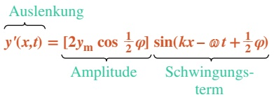

flowchart

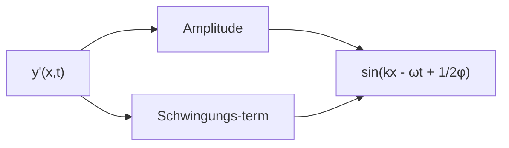

## Abb. 12.13

Die resultierende Welle aus Gl. 12.46, die sich aus der Interferenz zweier sinusförmiger transversaler Wellen ergibt, ist ebenfalls eine sinusförmige transversale Welle mit einer von der Phasenverschiebung 𝜑 abhängenden Amplitude und einem oszillierenden Term.

295

---

12 Wellen – I

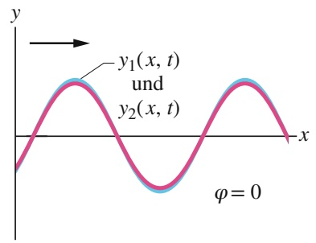

line

| X | Y (y1(x, t)) | Y (y2(x, t)) |
| --- | --- | --- |
| 0 | 0 | 0 |
| ~0.57 | ~0.8 | ~0.8 |
| ~1.14 | 0 | 0 |
| ~1.61 | ~-0.8 | ~-0.8 |
| ~2.18 | 0 | 0 |
| ~2.75 | ~0.8 | ~0.8 |
| 3 | 0 | 0 |

(a)

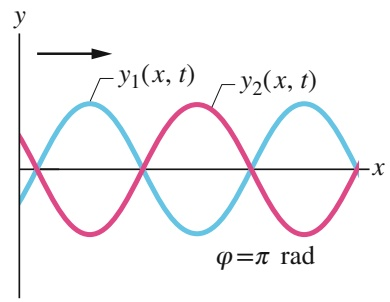

line

| X | y1(x, t) | y2(x, t) |
| --- | --- | --- |
| 0 | 0 | 0 |
| ~0.57 | ~0.87 | ~-0.87 |
| ~1.14 | 0 | 0 |
| ~1.61 | ~-0.87 | ~0.87 |
| ~2.18 | 0 | 0 |
| ~2.75 | ~0.87 | ~-0.87 |
| ~3.32 | 0 | 0 |

(b)

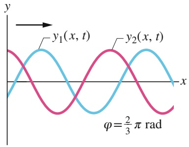

line

| Category | y1(x, t) | y2(x, t) |
| --- | --- | --- |
| Peak (x=0) | 0 | 0 |
| Trough (x=±3) | 0 | 0 |

(c)

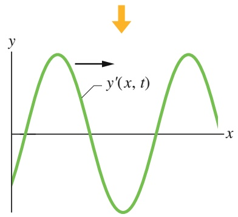

text_image

y
y'(x, t)
x

(d)

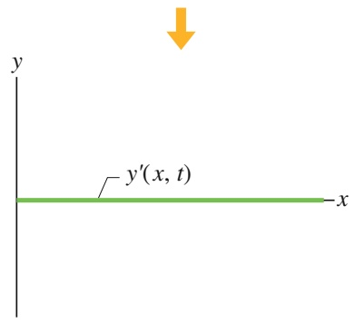

text_image

y
y'(x, t)
x

(e)

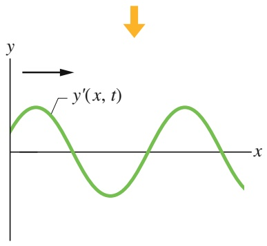

text_image

y
y'(x, t)
x

(f)

## Abb. 12.14

Zwei gleichartige sinusförmige Wellen $y _ { 1 } ( x , t )$ und $y _ { 2 } ( x , t )$ breiten sich entlang des Seils in die positive Richtung einer $x - \mathbf { A }$ chse aus. Die Interferenz zwischen diesen beiden Wellen führt zur resultierenden Welle $\bar { y ^ { \prime } ( x , t ) } .$ Tatsächlich beobachtet wird auf dem Seil nur diese resultierende Welle. Die Phasenverschiebung 𝜑 zwischen den beiden interferierenden Wellen ist (a) 0 rad oder 0°, (b) π rad oder 180° und (c) $\frac { 2 } { 3 } .$ π rad oder 120°. Die zugehörigen resultierenden Wellen sind in den Bildteilen (d), (e) und (f ) dargestellt.

TABELLE 12.1:

Phasenverschiebungen und die resultierenden Interferenzena).

| Grad | Phasenverschiebung in Radiant | Wellenlängen | Amplitude der resultierenden Welle | Art der Interferenz |
| --- | --- | --- | --- | --- |
| 0 | 0 | 0 | $2y_{\text{m}}$ | konstruktiv |
| 120 | $\frac{2}{3}\pi$ | 0,33 | $y_{\text{m}}$ | gemischt |
| 180 | $\pi$ | 0,50 | 0 | destruktiv |
| 240 | $\frac{4}{3}\pi$ | 0,67 | $y_{\text{m}}$ | gemischt |
| 360 | $2\pi$ | 1,00 | $2y_{\text{m}}$ | konstruktiv |
| 865 | 15,1 | 2,40 | $0,60y_{\text{m}}$ | gemischt |

a) Die Phasenverschiebung bezieht sich auf ansonsten gleiche Wellen mit der Amplitude $y _ { \mathrm { m } } ,$ die sich in dieselbe Richtung ausbreiten.

Zwei Wellen mit derselben Wellenlänge sind in Phase, wenn ihr Gangunterschied null oder ein ganzzahliges Vielfaches der Wellenlänge ist. Der ganzzahlige Anteil eines Gangunterschieds ausgedrückt in Wellenlängen ist daher unwesentlich. Ein Gangunterschied von $^ { 0 , 4 0 }$ Wellenlängen ist also in jeder Hinsicht äquivalent zu einem Gangunterschied von 2,40 Wellenlängen. In Rechnungen kann daher die einfachere der beiden Zahlen verwendet werden.

## KONTROLLFRAGE 5

Es sind die folgenden vier möglichen Gangunterschiede zwischen zwei identischen Wellen gegeben, ausgedrückt in Wellenlängen: 0,20; 0,45; 0,60 und 0,80. Ordnen Sie diese Gangunterschiede in absteigender Reihenfolge nach der Amplitude der resultierenden Wellen.

296

---

12.6 Darstellung von Wellen durch Zeiger

12

## 12.6 Darstellung von Wellen durch Zeiger

## Lernziele

Nach dem Durcharbeiten dieses Abschnitts sollten Sie in der Lage sein, . . .

• mithilfe von Diagrammen zu erläutern, wie ein Zeiger die Schwingungen eines Saitenabschnitts darstellen kann, während eine Welle durch ihn hindurchläuft,
• ein Zeigerdiagramm (Vektordiagramm) für zwei überlappende Wellen auf einer Saite zu skizzieren und darin Amplituden und Phasendifferenz zu kennzeichnen,
mithilfe von Zeigern die Resultierende zweier transversaler Wellen zu bestim men, die sich gemeinsam entlang einer Saite ausbreiten, ihre Amplitude und ihre Phase zu berechnen, ihre Auslenkungsgleichung zu formulieren und alle drei Zeiger in ein Zeigerdiagramm einzuzeichnen.

## Schlüsselideen

Eine Welle $y ( x , t )$ kann durch einen Zeiger dargestellt werden. Dabei handelt es sich um einen zweikomponentigen Vektor mit einem Betrag gleich der Amplitude $y _ { \mathrm { m } }$ der Welle, der mit einer Winkelgeschwindigkeit gleich der Kreisfre quenz ω der Welle um einen Ursprung rotiert. Die Projektion des rotierenden Zeigers auf eine vertikale Achse gibt die Auslenkung y eines Punkts entlang der Ausbreitungsrichtung der Welle an.

## 12.6.1 Zeiger

Die im vorhergehenden Abschnitt gezeigte Addition zweier Wellen funktioniert so nur für Wellen mit identischen Amplituden. Für diesen Spezialfall ist das Verfahren hilfreich, aber wir brauchen auch eine allgemeinere Methode, die wir auf be liebige Wellen anwenden können, unabhängig davon, ob sie dieselben Amplituden besitzen oder nicht. Eine sehr elegante Methode hierfür ist die Verwendung von Vektoren, die man in diesem Zusammenhang meist Zeiger nennt. Das Verfahren mag zunächst etwas eigenartig erscheinen, aber im Wesentlichen handelt es sich dabei einfach um eine grafische Methode, mit deren Hilfe wir das Instrumentarium der Vektoraddition aus Anhang D anstelle von mühsamen trigonometrischen Rechnungen verwenden können.

Wir stellen dabei eine beliebige Welle durch einen Zeiger dar, einen Vektor in der Ebene. Der Betrag dieses Vektors ist gleich der Amplitude der Welle, außerdem rotiert er um den Ursprung. Die Winkelgeschwindigkeit dieses Vektors ist gleich der Kreisfrequenz ω der Welle. Beispielsweise lässt sich die Welle

$$
y _ {1} (x, t) = y _ {\mathrm{m} 1} \sin (k x - \omega t) \tag {12.50}
$$

durch den Zeiger in Abb. 12.15a darstellen. Der Betrag dieses Zeigers ist gleich der Amplitude $y _ { \mathrm { m 1 } }$ der Welle. Wenn er sich mit der Winkelgeschwindigkeit ω um den Ursprung dreht, schwingt seine Projektion auf die Senkrechte sinusförmig vom Maximalwert $y _ { \mathrm { m 1 } }$ durch null zum Minimalwert $- y _ { \mathrm { m 1 } }$ und wieder zurück zu $y _ { \mathrm { m 1 } }$ Diese Schwingung entspricht der sinusförmigen Auslenkung $y _ { 1 }$ der einzelnen Seilpunkte beim Vorbeilaufen der Welle.

## Abb. 12.15

(a) Ein Zeiger mit dem Betrag $y _ { \mathrm { m 1 } } ,$ der in einer Ebene mit einer Winkelgeschwindigkeit ω um den Ursprung rotiert, repräsentiert eine sinusförmige Welle. Die Projektion $y _ { 1 }$ des Zeigers auf die vertikale Achse entspricht der Auslenkung eines Punkts, an dem die Welle vorbeiläuft. (b) Ein zweiter Zeiger mit dem Betrag $y _ { \mathrm { m } 2 }$ rotiere ebenfalls mit der Winkelgeschwindigkeit ω um den Ursprung, allerdings um einem konstanten Winkel 𝜑 hinter dem ersten Zeiger. Dieser zweite Zeiger repräsentiert eine zweite Welle mit der Phasenkonstante 𝜑. (c) Die resultierende Welle der beiden interferierenden Wellen entspricht der Summe $y _ { \mathrm { m } } ^ { \prime }$ der ursprünglichen Wellen. Die Projektion $y ^ { \prime }$ auf die vertikale Achse beschreibt die Auslenkung eines Punkts beim Vorbeilauf der resultierenden Welle.

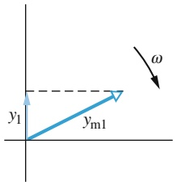

text_image

y₁
yₘ₁
ω

(a)

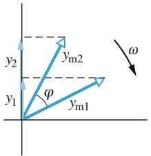

text_image

y₂
y₁
φ
yₘ₁
yₘ₂
ω

(b)

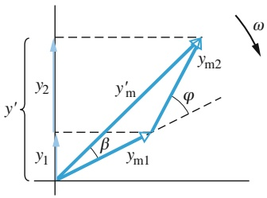

text_image

y'
y2
y'm
φ
β
y1
ym1
ym2
ω

(c)

297

---

12 Wellen – I

Wenn sich zwei Wellen entlang desselben Seils in dieselbe Richtung ausbreiten, können wir sie und die resultierende Welle in einem Zeigerdiagramm darstellen. Die Zeiger in Abb. 12.15b entsprechen der Welle aus Gl. 12.50 und einer zweiten Welle der Form

$$
y _ {2} (x, t) = y _ {\mathrm{m2}} \sin (k x - \omega t + \varphi). \tag {12.51}
$$

Diese zweite Welle ist um die Phasenkonstante 𝜑 relativ zur ersten Welle phasenverschoben. Da sich die Zeiger mit derselben Winkelgeschwindigkeit ω drehen, bleibt der Winkel zwischen diesen beiden Zeigern immer $\varphi .$ Ist $\varphi$ positiv, bleibt der Zeiger zu Welle 2 während der Rotation immer hinter dem Zeiger zu Welle 1 wie in Abb. 12.15b. Ist $\varphi$ negativ, rotiert der Zeiger zu Welle 2 vor dem Zeiger zu Welle 1.

Da die Wellen $y _ { 1 }$ und $y _ { 2 }$ dieselbe Wellenzahl k und dieselbe Kreisfrequenz ω haben, kennen wir aus Gl. 12.46 die Form der resultierenden Welle:

$$
y ^ {\prime} (x, t) = y _ {\mathrm{m}} ^ {\prime} \sin (k x - \omega t + \beta), \tag {12.52}
$$

wobei $y _ { \mathrm { m } } ^ { \prime }$ die Amplitude der resultierenden Welle ist und $\beta$ ihre Phasenkonstante. Die Werte für $y _ { \mathrm { m } } ^ { \prime }$ und $\beta$ erhalten wir ähnlich wie bei der Herleitung von Gl. 12.46 aus der Summe der beiden interferierenden Wellen.

Grafisch bestimmen wir diese Summe in dem Zeigerdiagramm, indem wir zu jedem Zeitpunkt ihrer Bewegung die beiden Zeiger vektoriell addieren. Dies ist in Abb. 12.15c wiedergegeben, wo der Zeiger $y _ { \mathrm { m 2 } }$ zur Spitze des Zeigers $y _ { \mathrm { m 1 } }$ verschoben wurde. Der Betrag der Vektorsumme ist gleich der Amplitude $y _ { \mathrm { m } } ^ { \prime }$ in Gl. 12.52. Der Winkel zwischen der Vektorsumme und dem Zeiger zu $y _ { 1 }$ ist gleich der Phasenkonstante $\beta$ in Gl. 12.52.

Man beachte jedoch, dass im Gegensatz zu dem Verfahren aus Abschn. 12.5 gilt:

Mithilfe von Zeigern können wir auch Wellen mit unterschiedlichen Amplituden überlagern.

## 12.7 Stehende Wellen und Resonanz

## Lernziele

Nach dem Durcharbeiten dieses Abschnitts sollten Sie in der Lage sein, . . .

• für zwei sich überlagernde Wellen mit gleichen Amplituden und Wellenlängen, die sich in entgegengesetzte Richtungen ausbreiten, Momentaufnahmen der resultierenden Welle zu skizzieren und deren Knoten und Schwingungsbäuche zu markieren,
• für zwei sich überlagernde Wellen mit gleichen Amplituden und Wellenlängen, die sich in entgegengesetzte Richtungen ausbreiten, die Auslenkungsgleichung der resultierenden Welle zu bestimmen und ihre Amplitude aus den Amplituden der Einzelwellen zu berechnen,
• die harmonische Bewegung eines kurzen Saitenabschnitts an einem Schwingungsbauch einer stehenden Welle zu beschreiben,
• für einen Saitenabschnitt an einem Schwingungsbauch einer stehenden Welle die Gleichungen für die Auslenkung, die transversale Geschwindigkeit und die transversale Beschleunigung als Funktion der Zeit anzugeben,
• zwischen „harten“ und „weichen“ Reflexionen von Seilwellen an einer Grenzflä- che zu unterscheiden,
• die Resonanz an einer Saite zu beschreiben, die zwischen zwei Befestigungen eingespannt ist, und stehende Wellen mit wenigen Knoten und Schwingungsbäuchen zu skizzieren,
• die Wellenlängen der ersten Harmonischen einer gespannten Saite aus der Länge der Saite zu berechnen,

298

---

12.7 Stehende Wellen und Resonanz

12

• für eine beliebige Oberschwingung die Beziehung zwischen Frequenz, Wellen geschwindigkeit und Länge der Saite anzuwenden.

## Schlüsselideen

• Die Interferenz zweier identischer sinusförmiger Wellen, die sich in entgegengesetzte Richtungen ausbreiten, erzeugt stehende Wellen. Für eine Saite mit fixierten Enden hat die stehende Welle die Gleichung

$$
y ^ {\prime} (x, t) = (2 y _ {\mathrm{m}} \sin k x) \cos \omega t.
$$

Stehende Wellen sind dadurch gekennzeichnet, dass die Positionen mit Auslenkung null (die Schwingungsknoten) ebenso fixiert sind wie die Positionen mit maximaler Auslenkung (die Schwingungsbäuche).

Im Fall einer Saite entstehen stehende Wellen durch Reflexion von fortlaufenden Wellen an den beiden Enden der Saite. Wenn ein Ende fixiert ist, muss an dieser Position ein Knoten liegen. Dies schränkt die Frequenzen ein, für die bei einer gegebenen Saite stehende Wellen möglich sind. Jede mögliche Frequenz ist eine Resonanzfrequenz, und das entsprechende Muster der stehenden Welle ist eine Schwingungsmode. Für eine gespannte Seite der Länge L mit festen Enden liegen die Resonanzfrequenzen bei

$$
f _ {n} = \frac {\nu}{\lambda_ {n}} = n \frac {\nu}{2 L} \quad \text {mit} \quad n = 1, 2, 3, \dots
$$

Die Schwingungsmode mit $n = 1$ wird als Grundschwingung oder erste Harmonische bezeichnet; die Mode mit $n = 2$ als zweite Harmonische (oder erste Oberschwingung) usw.

## 12.7.1 Stehende Wellen

Im letzten Abschnitt haben wir sinusförmige Wellen untersucht, die sich mit der selben Wellenlänge und Amplitude in dieselbe Richtung ausbreiteten. Was passiert aber, wenn sie sich in entgegengesetzte Richtungen bewegen? Auch hier erhalten wir die Antwort aus dem Superpositionsprinzip.

Abbildung 12.16 zeigt die Situation grafisch. Man erkennt zwei Wellen: Die eine breitet sich nach links aus (Abb. 12.16a), die andere nach rechts (Abb. 12.16b). Abbildung 12.16c zeigt ihre Summe, die man durch die einfache grafische Anwendung des Superpositionsprinzips erhält. Die auffallendste Eigenschaft der resultierenden Welle ist, dass es nun Stellen entlang des Seils gibt, an denen sich das Seil nie bewegt. Diese Stellen bezeichnet man als **Knoten** (oder genauer **Schwingungsknoten**); sie sind in Abb. 12.16c durch Punkte markiert. In der Mitte zwischen zwei benachbarten Knoten befinden sich die sogenannten **Schwingungsbäuche**, bei denen die Amplitude der resultierenden Welle maximal ist. Eine solche Wellenform wie in Abb. 12.16c bezeichnet man als **stehende Welle**, weil sich die Welle (ihre Amplitude und ihre Nulldurchgänge) nicht nach links oder rechts bewegt. Die Orte der Schwingungsknoten und Schwingungsbäuche verändern sich nicht.

Wenn sich zwei sinusförmige Wellen mit derselben Amplitude und derselben Wellenlänge entlang eines Seils in entgegengesetzte Richtungen ausbreiten, kann durch die Interferenz dieser beiden Wellen eine stehende Welle entstehen.

Zur mathematischen Behandlung einer stehenden Welle stellen wir die beiden interferierenden Wellen durch die Gleichungen

$$
y _ {1} (x, t) = y _ {\mathrm{m}} \sin (k x - \omega t) \tag {12.53}
$$

299

---

12 Wellen – I

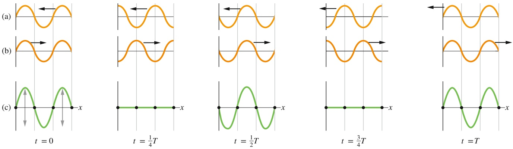

## Abb. 12.16

(a) Fünf Momentaufnahmen einer sich nach links ausbreitenden Welle. Die Zeiten sind unter Teil (c) angegeben (T ist die Schwingungsperiode). (b) Fünf Momentaufnahmen einer Welle, die sich nach rechts ausbreitet, ansonsten aber identisch zu der Welle in (a) ist (die Zeiten der Aufnahmen sind ebenfalls gleich). (c) Die entsprechenden Momentaufnahmen für die Überlagerung der beiden Wellen auf demselben Seil. Zu den Zeitpunkten $t = 0 ,   t = T / 2$ und $t = T$ tritt wegen der Übereinstimmung von Wellenbergen und Wellentälern eine konstruktive Interferenz auf. Zu den Zeitpunkten $t = T / 4$ und $t = 3 T / 4$ erkennt man eine destruktive Interferenz, da nun Wellentäler der einen Welle immer mit Wellenbergen der anderen Welle zusammenfallen. Einige Punkte (die in der Zeichnung durch einen Punkt markierten Knoten) schwingen nie. Andere Punkte (die Schwingungsbäuche) schwingen immer mit maximaler Amplitude.

und

$$
y _ {2} (x, t) = y _ {\mathrm{m}} \sin (k x + \omega t) \tag {12.54}
$$

dar. Nach dem Superpositionsprinzip erhalten wir für die Überlagerung dieser beiden Wellen

$$
y ^ {\prime} (x, t) = y _ {1} (x, t) + y _ {2} (x, t) = y _ {\mathrm{m}} \sin (k x - \omega t) + y _ {\mathrm{m}} \sin (k x + \omega t).
$$

Mithilfe der trigonometrischen Relation aus Gl. 12.45 folgt

$$
y ^ {\prime} (x, t) = (2 y _ {\mathrm{m}} \sin k x) \cos \omega t. \tag {12.55}
$$

Auslenkung

$$
\overbrace {y ^ {\prime} (x , t)} = \underbrace {(2 y _ {\mathrm{m}} \sin k x)} _ {\substack {\text {Amplitude}\\\text {am Ort} x}} \underbrace {\cos \omega t} _ {\substack {\text {Schwingungs- term}}} \right.
$$

Abb. 12.17

Die resultierende Welle aus Gl. 12.55 beschreibt eine stehende Welle. Sie entsteht durch Interferenz zweier sinusförmiger Wellen derselben Amplitude und derselben Wellenlänge, die sich in entgegengesetzte Richtungen ausbreiten.

Dieses Ergebnis ist in Abb. 12.17 nochmals wiedergegeben. Gleichung 12.55 beschreibt keine sich ausbreitende Welle, da sie nicht von der Form von Gl. 12.16 ist, sondern sie beschreibt eine stehende Welle.

Die eingeklammerte Größe $2 y _ { \mathrm { m } }$ sin kx in Gl. 12.55 kann als die Amplitude einer Schwingung des Seilelements am Ort x interpretiert werden. Da jedoch eine Amplitude immer positiv ist, sin kx jedoch auch negativ sein kann, nehmen wir den Absolutbetrag von $2 y _ { \mathrm { m } }$ sin kx als die Amplitude bei x.

Bei einer sich ausbreitenden sinusförmigen Welle ist die Wellenamplitude für alle Seilelemente dieselbe. Das gilt nicht für eine stehende Welle, bei der die Amplitude vom Ort abhängt. Bei der stehenden Welle von Gl. 12.55 beispielsweise wird die Amplitude null, wenn sin $k x = 0$ ist. Dies ist dann der Fall, wenn

$$
k x = n \pi \quad \text { für } \quad n = 0, 1, 2, 3, \dots \tag {12.56}
$$

Mit $k = 2 \pi / \lambda$ erhalten wir aus dieser Gleichung

$$
x = n \frac {\lambda}{2}, \quad \text {fur} \quad n = 0, 1, 2, 3, \dots \quad (\text {Knoten}) \tag {12.57}
$$

für die Positionen verschwindender Amplitude, also die Knoten der stehenden Welle von Gl. 12.55. Benachbarte Knoten haben offensichtlich einen Abstand von $\lambda / 2 ,$ also einer halben Wellenlänge.

300

---

12.7 Stehende Wellen und Resonanz

12

Die Amplitude der stehenden Welle von Gl. 12.55 hat einen Maximalwert von $2 y _ { \mathrm { m } } ,$ der für Werte von kx auftritt, für die | sin $| k x | = 1$ ist. Dies sind die Werte

$$
k x = \frac {1}{2} \pi , \frac {3}{2} \pi , \frac {5}{2} \pi , \dots = \left(n + \frac {1}{2}\right) \pi \quad \text {fur} \quad n = 0, 1, 2, 3, \dots \tag {12.58}
$$

Ersetzen wir in Gl. 12.58 wieder $k = 2 \pi / \lambda$ , folgt für die Orte maximaler Amplitude, d. h. die Schwingungsbäuche der stehenden Welle aus Gl. 12.55:

$$
x = \left(n + \frac {1}{2}\right) \frac {\lambda}{2} \quad \text {fur} \quad n = 0, 1, 2, 3, \dots \quad \text {(Schwingungsbäuche).} \tag {12.59}
$$

Auch benachbarte Schwingungsbäuche haben einen Abstand von $\lambda / 2 .$ Die Schwingungsbäuche befinden sich genau in der Mitte zwischen zwei Knoten.

## Reflexionen am Seilende

Wir können eine stehende Welle auf einem gespannten Seil dadurch erzeugen, dass wir die an dem Seil entlanglaufende Welle am gegenüberliegenden Seilende reflektieren und zurückkommen lassen. Die einlaufende (ursprüngliche) Welle und die reflektierte Welle können durch Gl. 12.53 und Gl. 12.54 beschrieben werden, und sie können sich zu einer stehenden Welle überlagern, da sie gleiche Wellenlänge und Amplitude haben.

Abbildung 12.18 zeigt eine solche Reflexion am Beispiel eines einzelnen Wellenpulses. In Abb. 12.18a ist das Ende des Seils an einer Wand befestigt. Erreicht der Puls dieses Ende, übt er auf die Wand eine nach oben gerichtete Kraft aus. Nach dem dritten Newtonschen Gesetz übt umgekehrt die Wand eine entgegengesetzt gerichtete Kraft vom selben Betrag auf das Seil aus. Diese zweite Kraft erzeugt an der Befestigung einen Puls, der entlang des Seils zurückläuft. Bei einer solchen „harten“ Reflexion muss sich bei der Befestigung des Seils ein Knoten befinden, da sich das Seil dort nicht bewegen kann. Der reflektierte und der einlaufende Puls müssen entgegengesetztes Vorzeichen haben, sodass sie sich an diesem Punkt aufheben können.

In Abb. 12.18b ist das linke Ende des Seils mit einem leichten Ring verbunden, der sich reibungsfrei entlang einer Stange bewegen kann. Wenn die einlaufende Welle ankommt, bewegt sich der Ring an der Stange nach oben. Dabei zieht er an dem Seil, dehnt es und erzeugt einen reflektierten Puls mit demselben Vorzeichen und derselben Amplitude wie der einlaufende Puls. Bei einer solchen „weichen“ Reflexion verstärken sich der einlaufende und der reflektierte Puls und erzeugen am Seilende einen Schwingungsbauch. Die maximale Auslenkung des Rings ist doppelt so groß wie die Amplitude der beiden Pulse.

## KONTROLLFRAGE 6

Zwei Wellen derselben Amplitude und Wellenlänge interferieren in drei verschiedenen Situationen und erzeugen dabei Wellen, die durch die folgenden Gleichun gen beschrieben werden:

(1) $y ^ { \prime } ( x , t ) = 4 \sin ( 5 x - 4 t )   ,$
(2) $y ^ { \prime } ( x , t ) = 4 \sin ( 5 x ) \cos ( 4 t )   ,$
(3) $y ^ { \prime } ( x , t ) = 4 \sin ( 5 x + 4 t )   .$

In welcher Situation breiten sich die beiden Wellen (a) in die positive x-Richtung, (b) in die negative x-Richtung und (c) in entgegengesetzte Richtungen aus?

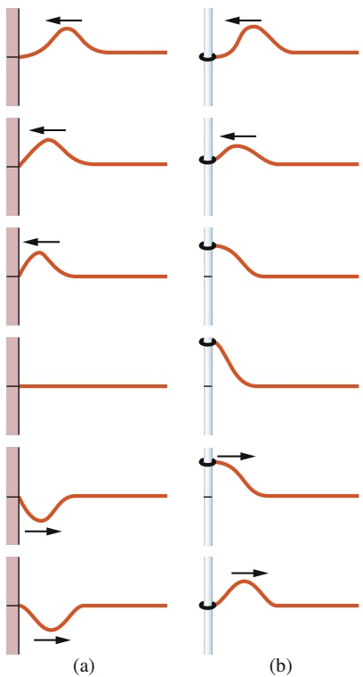

## Abb. 12.18

(a) Ein von rechts einlaufender Wellenpuls wird an der linken Seite des Seils reflektiert. An diesem Ende ist das Seil an einer Wand befestigt. Man beachte, dass der reflektierte Puls relativ zum einlaufenden Puls invertiert ist. (b) Hier ist das linke Ende des Seils mit einem Ring an einer Stange befestigt, an der es sich reibungsfrei hoch und runter bewegen kann. In diesem Fall wird der zurücklaufende Puls im Vergleich zum einlaufenden Puls durch die Reflexion nicht invertiert.

## 12.7.2 Stehende Wellen und Resonanz

Wir betrachten eine Saite, beispielsweise eine Gitarrensaite, die zwischen zwei Bünden eingespannt ist. Angenommen, wir erzeugen auf der linken Seite eine anhaltende sinusförmige Welle mit einer bestimmten Frequenz, die sich nach rechts

301

---

12 Wellen – I

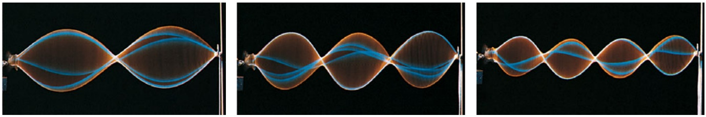

## Abb. 12.19

Stroboskopische Aufnahmen von (nicht ganz perfekten) stehenden Wellen bei einer Saite, die von einem Oszillator am linken Ende angeregt wird. Solche Muster treten nur bei bestimmten Schwingungsfrequenzen auf [Quelle: Richard Megna/Fundamental Photographs].

ausbreitet. Hat diese Welle das rechte Ende erreicht, wird sie reflektiert und breitet sich zurück nach links aus. Diese reflektierte Welle überlagert sich mit der einlaufenden Welle. Erreicht die reflektierte Welle schließlich das linke Ende, wird sie nochmals reflektiert und breitet sich wieder nach rechts aus. Nun überlagert sie sich mit der einmal reflektierten nach links laufenden Welle und mit der ursprünglichen, unreflektierten nach rechts laufenden Welle. Nach kurzer Zeit haben wir auf der Saite viele Wellen in beiden Ausbreitungsrichtungen, die alle miteinander interferieren.

Für bestimmte Frequenzen führt die Interferenz zu einer stehenden Welle (einer sogenannten **Schwingungsmode**) mit Knoten und Schwingungsbäuchen wie in Abb. 12.19. Die Frequenzen, bei denen solche **Resonanzen** auftreten können, bezeichnet man als **Resonanzfrequenzen**. Bei Anregungen mit einer anderen Frequenz entstehen im Allgemeinen keine stehenden Wellen. Die Interferenz der links- und rechtslaufenden Wellen führt dann nur zu kleinen (meist nicht wahrnehmbaren) Auslenkungen der Saite.

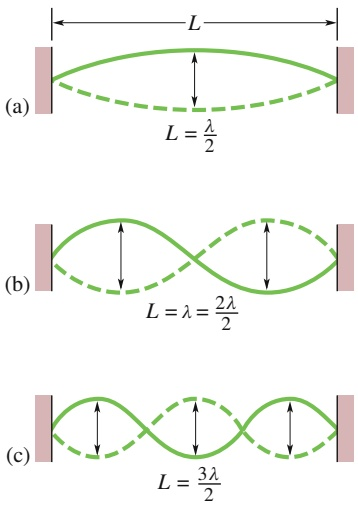

Abb. 12.20

An einer zwischen zwei festen Halterungen gespannten Saite bilden sich stehende Wellen aus. (a) Die einfachste Welle dieser Form besteht aus einem Schwingungsbauch in der Mitte zwischen den Halterungen. Dargestellt sind die beiden extremen Auslenkungen der Saite. (b) Die nächsteinfachste stehende Welle besitzt zwei Schwingungsbäuche und einen Knoten in der Mitte. (c) Die dritteinfachste Welle besitzt drei Schwingungsbäuche.

Wir nehmen nun an, die beiden Halterungen der Saite befinden sich in einem Abstand L. Unser Ziel ist es, eine Bedingung für die Resonanzfrequenzen als Funktion von L herzuleiten. Damit sich eine stehende Welle ausbilden kann, muss sich an jedem Saitenende ein Knoten befinden, da bei dieser Saite keines der Enden frei schwingen kann. Die einfachste Form der Schwingung mit dieser Eigenschaft erkennt man in Abb. 12.20a, in der die Saite in den Augenblicken ihrer maximalen Auslenkung wiedergegeben ist (als durchgehende und als gestrichelte Linie). Es gibt nur einen Schwingungsbauch, der sich in der Saitenmitte befindet. Die Saitenlänge, d. h. der Abstand $L ,$ wird von einer halben Wellenlänge eingenommen. In diesem Fall gilt also: $\lambda / 2 = L$ . Sollen daher eine links- und eine rechtslaufende Welle sich zu dieser stehenden Welle überlagern, müssen sie die Wellenlänge $\lambda = 2 L$ haben.

Die zweiteinfachste Wellenform mit der Eigenschaft, dass sich an den festen Saitenenden Knotenpunkte befinden, ist in Abb. 12.20b wiedergegeben. Diese stehende Welle besitzt drei Knoten und zwei Schwingungsbäuche. Damit die links- und rechtslaufenden Wellen sich zu einer solchen Form überlagern können, müssen sie die Wellenlänge $\lambda = L$ haben. Ein drittes Muster ist in Abb. 12.20c erkennbar. Diese Resonanzwelle besitzt vier Knotenpunkte und drei Schwingungsbäuche und die Wellenlänge ist $\lambda = 3 L / 2$ . Wir könnten in dieser Weise fortfahren und kämen zu immer komplizierteren Wellenmustern. Bei jedem Schritt enthielte das neue Muster einen Knoten und einen Schwingungsbauch mehr als das vorhergehende Muster, und ein zusätzliches $\lambda / 2$ würde in den Abstand L hineingezwängt.

Auf einer Saite der Länge $L$ können sich also stehende Wellen ausbilden, deren Wellenlänge einem der folgenden Werte entspricht:

$$
\lambda_ {n} = \frac {2 L}{n} \quad \text {mit} \quad n = 1, 2, 3, \dots \tag {12.60}
$$

Die zugehörigen Frequenzen ergeben sich aus Gl. 12.12:

$$
f _ {n} = \frac {\nu}{\lambda_ {n}} = n \frac {\nu}{2 L} \quad \text {mit} \quad n = 1, 2, 3, \dots \tag {12.61}
$$

302

---

12.7 Stehende Wellen und Resonanz

12

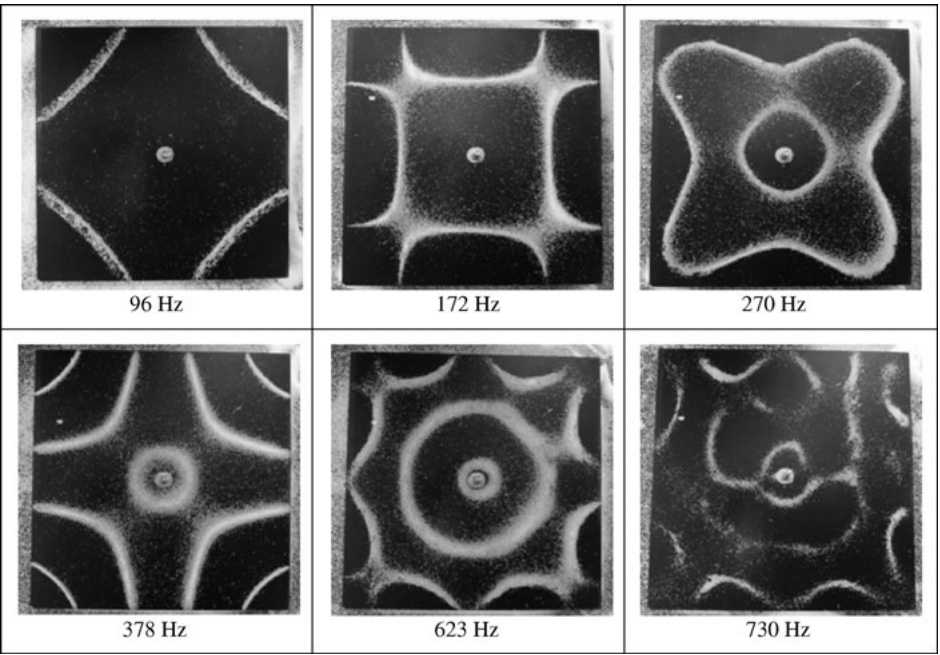

## Abb. 12.21

Chladnische Klangfiguren auf einer Metallplatte, die mit unterschiedlichen Frequenzen zwischen 96 Hz und 730 Hz angeregt wird und dabei zunehmend komplexe Schwingungsmuster zeigt [Quelle: mit freundlicher Genehmigung © 2013 Science and Education Publishing].

v ist hierbei die Wellengeschwindigkeit auf der Saite.

Aus Gl. 12.61 lernen wir, dass die Resonanzfrequenzen ganzzahlige Vielfache der niedrigsten Resonanzfrequenz $f _ { 1 } = \nu / 2 L$ sind. Die Schwingungsmode zu dieser niedrigsten Frequenz bezeichnet man als die Grundschwingung, Fundamentalschwingung oder auch die 1. Harmonische. Die erste Oberschwingung bzw. die 2. Harmonische entspricht $n = 2$ und hat die Frequenz $f _ { 2 } ,$ die 3. Harmonische hat $f _ { 3 }$ usw. Sämtliche Schwingungsmoden zusammen nennt man manchmal auch eine **harmonische Folge**, und n wird die **harmonische Zahl** der n-ten harmonischen Schwingung genannt.

Diese Form der Resonanzerscheinung findet man bei allen oszillierenden Sys temen, auch in zwei und drei Dimensionen. Abbildung 12.21 zeigt beispielsweise das Muster zu einer zweidimensionalen stehenden Welle auf einer schwingenden Metallplatte, man nennt solche Muster auch Chladnische Klangfiguren1).

## KONTROLLFRAGE 7

Bei der folgenden Folge von Resonanzfrequenzen (unter 400 Hz) fehlt eine Fre quenz: 150, 225, 300, 375 Hz. (a) Welche Frequenz fehlt? (b) Welche Frequenz hat die siebte Schwingungsmode?

## LÖSUNGSSTRATEGIEN

**Strategie 2: Die Schwingungsmoden einer Saite** Wenn Sie etwas über eine bestimmten Schwingungsmode (d. h. eine bestimmte Harmonische) auf einer Gitarrensaite oder einem beidseitig eingespannten Seil der Länge L in Erfahrung bringen wollen, zeichnen Sie diese Mode zunächst auf (wie in Abb. 12.20). Handelt es sich beispielsweise um die fünfte Schwingungsmode, müssen Sie zwischen Anfangs- und Endpunkt der Seite fünf Schwingungsbäuche unterbringen. Jeder dieser Bäuche hat die Länge $\lambda / 2 .$ Wenn sich fünf Bäuche die Länge L der Saite teilen, ist $5 ( \lambda / 2 ) = L$ bzw. $\lambda = 2 L / 5$ . Anschließend können sie aus Gl. 12.12 $\left( f = \nu / \lambda \right)$ die Frequenz dieser Schwingung bestimmen.

Denken Sie daran, dass die Wellenlänge einer Schwingungsmode nur durch die Länge L der Saite gegeben ist, die Frequenz jedoch auch noch von der Wellengeschwindigkeit v und damit über Gl. 12.21 von der Spannkraft und der linearen Massendichte der Saite abhängt.

1) Huňady R., Hagara M. und Trebuňa F. (2014). The Measurement of Standing Wave Patterns by using High-speed Digital Image Correlation. American Journal of Mechanical Engineering 2 (7): 247–251, https://doi.org/10.12691/ajme-2-7-15.

303

---

12 Wellen – I

## 12.8 Zusammenfassung

**Transversale und longitudinale Wellen** Mechanische Wellen können nur in einem materiellen Medium existieren, für das die Newtonschen Gesetze gelten. **Transversale** mechanische Wellen, beispielsweise die auf einer gespannten Saite, sind Wellen, bei denen die Teilchen des Mediums senkrecht zur Ausbreitungsrichtung der Welle schwingen. Schwingen die Teilchen des Mediums in bzw. gegen die Ausbreitungsrichtung der Welle, handelt es sich um **longitudinale** Wellen.

**Sinusförmige (harmonische) Wellen** Eine sinusförmige (oder harmonische) Welle, die sich in die positive x-Richtung ausbreitet, lässt sich durch die Gleichung

$$
y (x, t) = y _ {\mathrm{m}} \sin (k x - \omega t) \tag {12.2}
$$

beschreiben. Hierbei sind $y _ { \mathrm { m } }$ die **Amplitude** der Welle, k die **Wellenzahl**, ω **Kreisfrequenz** und $k x - \omega t$ die **Phase** der Welle. Zwischen der **Wellenlänge** λ und k besteht die Beziehung:

$$
k = \frac {2 \pi}{\lambda}. \tag {12.5}
$$

Die **Periode** $T$ und die **Frequenz** $f$ der Welle hängen mit ω über eine entsprechende Relation zusammen:

$$
\frac {\omega}{2 \pi} = f = \frac {1}{T}. \tag {12.9}
$$

Schließlich besteht zwischen der **Wellengeschwindigkeit** v und den anderen Parametern die folgenden Beziehung:

$$
\nu = \frac {\omega}{k} = \frac {\lambda}{T} = \lambda f. \tag {12.12}
$$

**Gleichung einer fortlaufenden Welle** Jede Funktion der Form

$$
y (x, t) = h (k x \pm \omega t) \tag {12.16}
$$

beschreibt eine fortlaufende Welle, die sich mit der Wellengeschwindigkeit aus Gl. 12.12 ausbreitet, und deren Form durch die mathematische Form der Funktion h bestimmt ist. Das Pluszeichen bezieht sich auf eine Welle, die sich in negative x-Richtung ausbreitet, das Minuszeichen auf eine Welle, die sich in positive x-Richtung ausbreitet.

**Wellengeschwindigkeit auf einem gespannten Seil** Die Geschwindigkeit einer Welle auf einem gespannten Seil bzw. einer gespannten Saite hängt von den Eigenschaften des Seils bzw. der Saite ab. Bei einer Spannkraft τ und einer linearen Massendichte μ gilt für die Geschwindigkeit

$$
\nu = \sqrt {\frac {\tau}{\mu}}. \tag {12.21}
$$

**Leistung** Die **gemittelte Leistung** bzw. gemittelte Energieübertragungsrate bei einer sinusförmigen Welle auf einem gespannten Seil ist durch

$$
P _ {\mathrm{gem}} = \frac {1}{2} \mu \nu \omega^ {2} y _ {\mathrm{m}} ^ {2} \tag {12.28}
$$

gegeben.

**Superposition von Wellen** Breiten sich zwei oder mehr Wellen in demselben Medium aus, ist die Auslenkung jedes Teilchens in diesem Medium gleich der Summe der Auslenkungen, welche die Einzelwellen bei diesem Teilchen hervorrufen würden.

**Interferenz von Wellen** Die Überlagerung zweier sinusförmiger Wellen auf demselben Seil führt zu einem **Interferenzmuster**, bei dem sich nach dem Superpositionsprinzip die Wellen teilweise verstärken und teilweise aufheben. Breiten sich zwei Wellen mit derselben Amplitude $y _ { \mathrm { m } }$ und derselben Frequenz (und damit derselben Wellenlänge) in dieselbe Richtung aus, unterscheiden sie sich aber in einer **Phasenkonstante** $\varphi ,$ dann ist die Überlagerung ebenfalls eine sinusförmige Welle mit derselben Frequenz:

$$
y ^ {\prime} (x, t) = [ 2 y _ {\mathrm{m}} \cos (\varphi / 2) ] \sin (k x - \omega t + \varphi / 2). \tag {12.46}
$$

Ist $\varphi = 0 ,$ so sind die beiden Wellen exakt in Phase und ihre Interferenz ist konstruktiv, ist $\varphi = \pi$ rad, sind beide Wellen außer Phase und ihre Interferenz ist destruktiv.

**Darstellung von Wellen mit Zeigern** Eine Welle $y ( x , t )$ kann durch einen hier Zeiger genannten ebenen, also zweikomponentigen Vektor dargestellt werden. Der Betrag dieses Zeigers ist gleich der Amplitude $y _ { \mathrm { m } }$ der Welle. Der Zeiger rotiert um den Ursprung mit der Kreisfrequenz ω der Welle. Die Projektion des rotierenden Zeigers auf die vertikale Achse entspricht der Verschiebung y eines Punkts entlang der Welle.

**Stehende Wellen** Die Interferenz zweier gleichartiger sinusförmiger Wellen, die sich in entgegengesetzte Richtungen ausbreiten, führt zu stehenden Wellen. Für ein Seil mit einem festen Ende ist die stehende Welle durch

$$
y ^ {\prime} (x, t) = (2 y _ {\mathrm{m}} \sin k x) \cos \omega t \tag {12.55}
$$

gegeben. Stehende Wellen zeichnen sich durch feste Punkte ohne Auslenkung aus, die sogenannten **Schwingungsknoten**, sowie durch feste Punkte maximaler Auslenkung, die sogenannten **Schwingungsbäuche**.

**Resonanz** Auf einer beidseitig eingespannten Saite können sich stehende Wellen durch Reflexion von fortlaufenden Wellen an den Enden der Saite ausbilden. Da die Enden fest sind, befinden sich dort Knotenpunkte. Dadurch werden die möglichen Frequenzen stehender Wellen auf einer Saite eingeschränkt. Jede erlaubte Frequenz ist eine **Resonanzfrequenz** und die zugehörige stehende Welle bezeichnet man als **Schwingungsmode**. Für eine beidseitig eingespannte Saite der Länge L sind die möglichen Resonanzfrequenzen

$$
f _ {n} = \frac {\nu}{\lambda_ {n}} = n \frac {\nu}{2 L} \quad \text {mit} \quad n = 1, 2, 3, \dots \tag {12.61}
$$

Die Schwingungsmode zu $n ~ = ~ 1$ bezeichnet man als Grundschwingung oder 1. Harmonische; die Mode zu $n = 2$ als erste Oberschwingung oder 2. Harmonische usw.

304

---

12.9 Fragen

12

## 12.9 Fragen

**1.** Welche Wellenlänge hat die (zugegebenermaßen etwas eigenartige) Welle in Abb. 12.F1, bei der jedes Segment die Länge d hat?

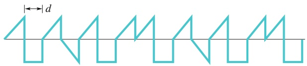

text_image

d

Abb. 12.F1

**2.** Abbildung 12.F2a zeigt eine Momentaufnahme einer in die positive x-Richtung laufenden Welle auf einem gespannten Seil. Vier Seilelemente sind durch die mit Buchstaben markierten Punkte gekennzeichnet. Geben Sie zu jedem dieser Elemente an, ob es sich zum Zeitpunkt der Aufnahme nach oben oder nach unten bewegt oder ob es momentan in Ruhe ist. Hinweis: Stellen Sie sich vor, wie sich die Welle an den vier Elementen vorbeibewegt.

Abbildung 12.F2b zeigt die Auslenkung eines Seilelements am Ort $x = 0$ als Funktion der Zeit. Bewegt sich das Seilelement zu den markierten Zeitpunkten nach oben oder nach unten oder befindet es sich gerade in Ruhe?

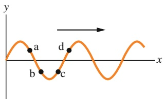

text_image

y
a
b
c
d
x

(a)

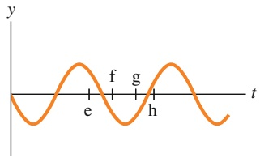

text_image

y
f
g
e
h
t

(b)

Abb. 12.F2

**3.** In Abb. 12.F3 sind auf einer Momentaufnahme einer sinusförmigen Welle fünf Punkte markiert. Welcher Phasenunterschied besteht zwischen Punkt 1 und (a) Punkt 2, (b) Punkt 3, (c) Punkt 4 und (d) Punkt 5? Geben Sie Ihre Antworten sowohl in Radiant als auch in Wellenlängen an. Die Aufnahme zeigt bei $x = 0$ einen Punkt verschwindender Auslenkung. Wann wird, ausgedrückt durch die Periode T der Welle, (e) ein Wellenberg und (f ) der nächste Punkt verschwindender Auslenkung den Punkt $x = 0$ erreichen?

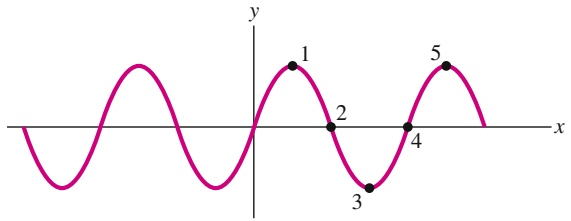

line

| Point | X | Y |
| --- | --- | --- |
| 1 | ~0.5 | ~0.8 |
| 2 | ~1.2 | ~0.1 |
| 3 | ~1.8 | ~-0.9 |
| 4 | ~2.6 | ~0.1 |
| 5 | ~3.3 | ~0.8 |

Abb. 12.F3

**4.** Die folgenden vier Wellen breiten sich entlang Seilen derselben linearen Massendichte aus (x ist in Metern und t in Sekunden angegeben). Ordnen Sie die Wellen nach (a) ihrer Wellengeschwindigkeit und (b) der Spannkraft in den Seilen, die sie entlanglaufen (größte Werte zuerst):

(1) $y _ { 1 } = ( 3   \mathrm { m m } ) \sin ( x - 3 t )   ,$
(2) $y_{2} = (6    mm ) \sin(2x - t)$
(3)
(4)

**5.** Die Welle 1 in Abb. 12.F5 besteht aus einem rechtecki gen Wellenberg der Höhe 4 (in beliebigen Einheiten) und der Breite d und einem rechteckigen Wellental der Tiefe 2 (in denselben Einheiten) und Breite d. Diese Welle breitet sich nach rechts entlang der x-Achse aus. Bei den Wellen 2, 3 und 4 handelt es sich um ähnliche Wellen mit denselben Höhen, Tiefen und Breiten, die sich entlang der x-Achse nach links ausbreiten und auf Welle 1 treffen. In welchen Fällen führt die Interferenz in einem Augenblick zu (a) dem tiefsten Wellental, (b) einer flachen Linie und (c) einem 2d breiten Wellenberg?

(1)

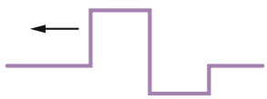

(2)

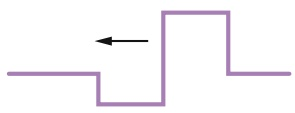

(3)

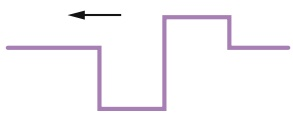

(4)

Abb. 12.F5

**6.** Angenommen, zwei sinusförmige Wellen derselben Amplitude breiten sich in Phase entlang eines Seils aus. Durch eine äußere Einwirkung wird eine der Wellen um 5,4 Wellenlängen phasenverschoben. Welche Art von Interferenz (konstruktiv, destruktiv oder gemischt) tritt auf dem Seil auf?
**7.** Die Amplituden und Phasenverschiebungen von fünf Wellenpaaren derselben Wellenlänge seien (a) 2 mm, 6 mm und π rad; (b) 3 mm, 5 mm und π rad; (c) 7 mm, 9 mm und π rad; (d) 2 mm, 2 mm und 0 rad. Jedes dieser Paare breitet sich auf demselben Seil in dieselbe Richtung aus. Ordnen Sie die vier Paare ohne explizite Berechnungen in absteigender Reihenfolge nach der Höhe der Amplitude der resultierenden Welle. Hinweis: Verwenden Sie Zeiger.
**8.** Angenommen, Sie erzeugen auf einem Seil die siebte Schwingungsmode (die 7. Harmonische). (a) Wie viele Knoten gibt es? (b) Befindet sich in der Mitte ein Knoten, ein Schwingungsbauch oder ein Zwischenzustand? (c) Wenn Sie nun die sechste Schwingungsmode erzeugen, ist die Resonanzwellenlänge größer oder kleiner als die der siebten Mode? (d) Ist die Resonanzfrequenz größer oder kleiner?

305

---

12 Wellen – I

**9.** Die Saiten A und B haben gleiche Längen und gleiche lineare Massendichten, allerdings herrscht auf Saite B eine größere Spannkraft als auf Saite A. Abbildung 12.F9 zeigt vier Situationen, (a) bis (d), in denen sich auf den Saiten stehende Wellen ausgebildet haben. In welcher dieser Situationen wäre es möglich, dass die Saiten A und B mit derselben Resonanzfrequenz schwingen?

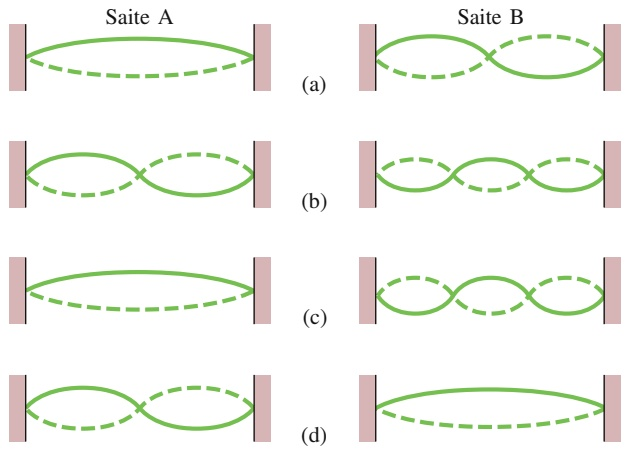

Abb. 12.F9

**10.** (a) Eine stehende Welle auf einer Saite sei durch die Gleichung

$$
y ^ {\prime} (t) = (3 \mathrm{mm}) \sin (5 x) \cos (4 t)
$$

gegeben. Gibt es bei $x = 0$ einen Schwingungsknoten oder einen Schwingungsbauch? (b) Angenommen, die stehende Welle wird durch die Gleichung

$$
y ^ {\prime} (t) = (3 \mathrm{mm}) \sin (5 x + \pi / 2) \cos (4 t)
$$

beschrieben, gibt es nun bei $x = 0$ einen Schwingungsknoten oder einen Schwingungsbauch?

**11.** Abbildung 12.F11 zeigt drei Wellen, die sich unabhängig voneinander entlang einer Saite ausbreiten, die unter einer bestimmten Zugspannung entlang einer x-Achse eingespannt ist. Ordnen Sie die Wellen in absteigender Reihenfolge (a) nach ihrer Wellenlänge, (b) nach ihrer Geschwindigkeit und (c) nach ihrer Kreisfrequenz.

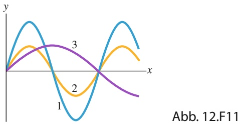

line

| Category | Curve 1 (Blue) | Curve 2 (Orange) | Curve 3 (Purple) |
| --- | --- | --- | --- |
| Peak | ~0.8 | ~0.4 | ~0.3 |
| Trough | ~-0.9 | ~-0.3 | ~0.2 |

**12.** Eine sinusförmige Welle breitet sich entlang einer gespannten Schnur aus und transportiert Energie mit der mittleren Leistung $P _ { \mathrm { g e m , 1 } }$ . Dann werden drei zu dieser ersten Welle identische Wellen mit einer Phasenverschiebung 𝜑 von 0, 0,2 und $^ { 0 , 5 }$ Wellenlängen durch die Schnur geschickt. (a) Ordnen sie diese Möglichkeiten für $\varphi$ ohne Berechnung in absteigender Reihenfolge nach ihrer mittleren Leistung. (b) Wie groß ist die mittlere Leistung für den ersten Wert für 𝜑 relativ zu $P _ { \mathrm { g e m , 1 } } ?$
**13.** Abbildung 12.F13 zeigt Zeigerdiagramme für drei Situationen, in denen zwei Wellen sich entlang derselben Saite ausbreiten; alle sechs Wellen haben dieselbe Amplitude. Ordnen Sie die Situationen in absteigender Reihenfolge nach der Amplitude der resultierenden Welle auf der Saite.

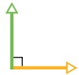

(a)

(b)

(c)

Abb. 12.F13

306
