# 13 Wellen – II

原始 PDF 第 321–346 页。

# 13 Wellen – II

## 13.1 Die Schallgeschwindigkeit

## Physikalische Motivation

Die Physik von Schallwellen ist das Thema unzähliger Arbeiten in wissenschaftlichen Zeitschriften ganz unterschiedlicher Fachgebiete. Um nur einige Beispiele zu nennen: Physiologen interessieren sich dafür, wie Sprache im Kehlkopf erzeugt und Sprachstörungen korrigiert werden können, wie Schwerhörigkeit behandelt werden kann oder wie Schnarchen entsteht. Akustikdesigner befassen sich mit der Verbesserung der Akustik von Kathedralen und Konzertsälen, mit Schallschutzmaßnahmen an Autobahnen oder bei Baustellen oder mit der möglichst perfekten Musikwiedergabe durch Lautsprechersysteme. Flugzeugbauer befassen sich mit den Stoßwellen, die Überschalljets erzeugen oder mit Maßnahmen gegen den Flug lärm in der Nähe von Flughäfen. Internisten versuchen zu verstehen, was die Geräusche aus Herz oder Lunge über die Gesundheit eines Patienten aussagen. Palä- ontologen versuchen, aus Dinosaurierknochen Aussage darüber zu treffen, welche Geräusche das betreffende Tier zu Lebzeiten hervorbringen konnte. Militäringenieure suchen nach Wegen, wie Soldaten aus dem Knall von Schüssen die Position eines Scharfschützen lokalisieren können und – ein harmloseres Beispiel zum Schluss – Biologen wollen verstehen, wie Katzen schnurren.

Bevor wir unsere Untersuchung der Physik des Schalls beginnen können, müssen wir jedoch zuerst die Frage klären: „Was sind Schallwellen überhaupt?“

## 13.1.1 Schallwellen

In Kapitel 12 hatten wir gesehen, dass mechanische Wellen immer das Vorhanden sein eines materiellen Mediums erfordern. Es gibt zwei Arten von mechanischen Wellen: Bei transversalen Wellen erfolgen die Schwingungen des Mediums senkrecht zur Ausbreitungsrichtung der Welle, bei longitudinalen Wellen schwingen die Partikel des Mediums parallel zur Ausbreitungsrichtung der Welle.

In diesem Buch verstehen wir unter einer **Schallwelle** nahezu jede Art von longi tudinaler Welle. Seismologische Forschungsteams nutzen diese Wellen zur Untersuchung der Erdkruste oder auch bei der Suche nach Ölvorkommen. Schiffe haben Schallmessgeräte (Sonargeräte) zur frühzeitigen Erkennung von Hindernissen unter Wasser. Unterseeboote verwenden Schallwellen zur Ortung anderer Unterseeboote, hauptsächlich indem sie auf die charakteristischen Geräusche der Antriebssysteme lauschen. In der Medizin wird Ultraschall zur Untersuchung von weichem Körpergewebe eingesetzt (Abb. 13.1). Wir beschränken uns in diesem Kapitel auf Schallwellen, die sich durch die Luft ausbreiten und die für die meisten Menschen hörbar sind.

Abbildung 13.2 verdeutlicht einige Begriffe, die wir bei unserer Diskussion verwenden werden. Der Punkt S stellt eine winzige Schallquelle dar, die wir idealisiert als Punktquelle bezeichnen, und die in alle Richtungen Schallwellen abstrahlt. Die

Halliday Physik für natur- und ingenieurwiss. Studiengänge, 3. Auflage. D. Halliday, R. Resnick und J. Walker. © 2020 WILEY-VCH Verlag GmbH & Co. KGaA. Published 2020 by WILEY-VCH Verlag GmbH & Co. KGaA.

307

---

13 Wellen – II

## Abb. 13.1

Ein Embryo im Bauch einer Schwangeren wird mithilfe von Ultraschallwellen untersucht und dargestellt, also mit Schallwellen, deren Frequenz oberhalb unseres Hörbereichs liegt [Quelle: Andreea Pirvu/Shutterstock].

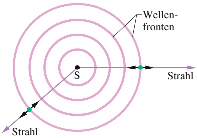

flowchart

Abb. 13.2

Eine Schallwelle breitet sich von einer Punktquelle S durch ein dreidimensionales Medium aus. Wellenfronten bilden Kugelflächen, deren Mittelpunkt in S liegt; Strahlen verlaufen radial von S weg. Die kurzen Doppelpfeile deuten an, dass die Elemente des Mediums parallel zu den Strahlen schwingen.

natural_image

Medical professional in bed with patient lying, ultrasound monitor displaying medical image (no visible text or symbols)

Wellenfronten und Strahlen kennzeichnen die Richtung der Wellenausbreitung. **Wellenfronten** sind Flächen, auf denen die Auslenkung der Luftteilchen aufgrund der Schwingungen gleiche Werte hat. Bei einer Punktquelle stellen wir solche Flä- chen in einer zweidimensionalen Zeichnung durch Kreise oder Kreisausschnitte dar. **Strahlen** sind gerichtete Linien senkrecht zu den Wellenfronten und kennzeichnen die Richtung der Wellenausbreitung. Die kurzen Doppelpfeile an den Strahlen in Abb. 13.2 sollen andeuten, dass die longitudinalen Schwingungen der Luft parallel zu den Strahlen verlaufen.

In der Nähe einer Punktquelle im Raum (vgl. Abb. 13.2) sind die Wellenfronten kugelförmig und breiten sich in alle drei Dimensionen aus. In diesem Fall spricht man von sphärischen Wellen oder auch Kugelwellen. Je weiter sich die Wellenfronten ausbreiten, umso größer werden ihre Radien und umso kleiner wird ihre Krümmung. In einem sehr großen Abstand von der Quelle können wir die Wellenfronten durch Ebenen (bzw. in zweidimensionalen Zeichnungen durch Geraden) nähern. Solche Wellen bezeichnet man als ebene Wellen oder auch planare Wellen.

## 13.1.2 Die Schallgeschwindigkeit

Die Geschwindigkeit einer mechanischen Welle hängt sowohl wie bei den trans versalen auch bei den longitudinalen Wellen einerseits von einer Trägheitseigenschaft des Mediums ab (zur Speicherung von kinetischer Energie), andererseits auch von einer elastischen Eigenschaft des Mediums (zur Speicherung von potenzieller Energie). Wir können daher Gl. 12.21, die den Zusammenhang zwischen der Geschwindigkeit einer transversalen Welle auf einem Seil mit den Eigenschaften des Seils angibt, verallgemeinern:

$$
\nu = \sqrt {\frac {\tau}{\mu}} = \sqrt {\frac {\text {elastische Eigenschaft}}{\text {Trägheitseigenschaft}}}.\tag {13.1}
$$

Bei den transversalen Wellen entsprach τ der Kraft, mit der das Seil gespannt wurde, und $\mu$ war die lineare Massendichte. Für longitudinale Wellen in Luft können wir vermuten, dass die Trägheitseigenschaft (das Analogon zu $\mu )$ durch die Volumendichte $\rho$ der Luft gegeben ist. Doch was könnte hier die passende elastische Eigenschaft sein?

Bei einem gespannten Seil hing die potenzielle Energie mit der periodischen Dehnung der Seilelemente beim Durchgang der Welle zusammen. Breitet sich eine Schallwelle in Luft aus, ist die potenzielle Energie mit den periodischen Kompressionen und Expansionen kleiner Volumenelemente der Luft verknüpft. Ein Maß für die Volumenänderung eines kleinen Elements eines Mediums unter Druck (Kraft pro Fläche) ist der **Kompressionsmodul** K, der in Gl. 12.22 definiert wurde:

$$
K = - \frac {\Delta p}{\Delta V / V} \quad (\text {Definition des Kompressionsmoduls}). \tag {13.2}
$$

308

---

13.1 Die Schallgeschwindigkeit

13

Hierbei ist $\Delta V / V$ die relative Volumenänderung, verursacht durch eine Druckänderung $\Delta p .$ Wie in Abschn. 10.1 erläutert wurde, ist die SI-Einheit des Drucks Newton pro Quadratmeter, wofür es den speziellen Namen Pascal (Pa) gibt. Aus Gl. 13.2 erkennen wir, dass die Einheit von K ebenfalls das Pascal ist. Die Vorzeichen von $\Delta p$ und $\Delta V$ sind immer entgegengesetzt: Wird der Druck auf ein Volumenelement größer $( \Delta p$ positiv), nimmt das Volumen ab $( \Delta V$ negativ). In Gl. 13.2 haben wir daher ein Minuszeichen eingefügt, damit K immer eine positive Größe ist. Ersetzen wir nun in Gl. 13.1 die Größen τ durch K und $\mu$ durch $\rho ,$ erhalten wir für die Schallgeschwindigkeit v in einem Medium mit Kompressionsmodul K und Dichte $\rho$ den Ausdruck

$$
\nu = \sqrt {\frac {K}{\rho}} \quad (\text {Schallgeschwindigkeit}). \tag {13.3}
$$

Wie wir gleich sehen werden, ist dies tatsächlich die richtige Gleichung. In Tab. 13.1 sind einige Schallgeschwindigkeiten für verschiedene Medien angegeben.

Die Dichte von Wasser ist nahezu 1000-mal größer als die Dichte von Luft. Wä- re dies der einzige relevante Faktor, würden wir nach Gl. 13.3 erwarten, dass die Schallgeschwindigkeit in Wasser wesentlich kleiner ist als die Schallgeschwindig keit in Luft. Nach Tab. 13.1 ist jedoch genau das Gegenteil der Fall. Wir können daher annehmen (nach Gl. 13.3), dass der Kompressionsmodul von Wasser mehr als 1000-mal größer ist als der von Luft. Genau das trifft auch zu, Wasser ist bei Weitem nicht so kompressibel wie Luft.

## Die formale Herleitung von Gl. 13.3

Wir wollen nun Gl. 13.3 direkt aus den Newtonschen Gesetzen herleiten. Dazu betrachten wir einen einzelnen Wellenpuls aus zusammengedrückter Luft, der sich in einem dünnen Rohr mit der Geschwindigkeit v von rechts nach links durch die Luft ausbreitet (vgl. Abb. 12.2). Wir bewegen uns mit derselben Geschwindigkeit neben dem Puls her, sodass der Puls in unserem Bezugssystem stillzustehen scheint. Abbildung 13.3a zeigt diese Situation in diesem Bezugssystem: Der Puls steht still und die Luft bewegt sich mit der Geschwindigkeit v von links nach rechts.

Der Druck der ungestörten Luft sei $p$ und der Druck innerhalb des Pulses sei $p   +   \Delta p ,$ wobei $\Delta p$ aufgrund der Kompression positiv ist. Wir betrachten eine dünne Luftscheibe der Dicke $\Delta x$ und Querschnittsfläche $A ,$ die sich mit der Geschwin digkeit v auf den Puls zubewegt. In dem Augenblick, wo dieses Luftelement in den Puls eintritt, trifft seine Vorderseite auf einen Bereich erhöhten Drucks, der die Geschwindigkeit auf $\nu + \Delta \nu$ abbremst, wobei $\Delta \nu$ negativ ist. Diese Verzögerung endet, wenn die Rückseite den Puls erreicht. Dies geschieht nach einer Zeit

$$
\Delta t = \frac {\Delta x}{\nu}. \tag {13.4}
$$

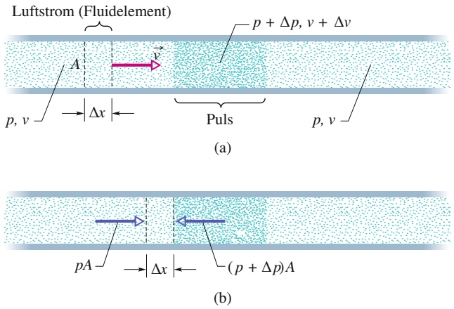

TABELLE 13.1: Schallgeschwindigkeitena).

<table><tr><td>Medium</td><td>Geschwindigkeit (m/s)</td></tr><tr><td colspan="2">Gase</td></tr><tr><td>Luft (0°C)</td><td>331</td></tr><tr><td>Luft (20°C)</td><td>343</td></tr><tr><td>Helium</td><td>965</td></tr><tr><td>Wasserstoff</td><td>1284</td></tr><tr><td colspan="2">Flüssigkeiten</td></tr><tr><td>Wasser (0°C)</td><td>1402</td></tr><tr><td>Wasser (20°C)</td><td>1482</td></tr><tr><td>Meerwasser $^{b)}$ </td><td>1522</td></tr><tr><td colspan="2">Festkörper</td></tr><tr><td>Aluminium</td><td>6420</td></tr><tr><td>Stahl</td><td>5941</td></tr><tr><td>Granit</td><td>6000</td></tr></table>

a) Wenn nicht anders angegeben, bei 0 °C und Atmosphärendruck.

b) Bei $2 0   ^ { \circ } \mathbf { C }$ und 3,5 % Salzgehalt.

Abb. 13.3 Ein Kompressionspuls breitet sich in einem langen luftgefüllten Rohr aus. Das Bezugssystem der Abbildung ist so gewählt, dass der Puls in Ruhe ist und die Luft sich von links nach rechts daran vorbeibewegt. (a) Eine dünne Luftscheibe der Breite Δx bewegt sich mit der Geschwindigkeit v auf den Puls zu. (b) Die Vorderseite der Scheibe erreicht den Puls. Die Kräfte auf Vorder- und Rückseite (aufgrund des Luftdrucks) sind wiedergegeben.

309

---

13 Wellen – II

Wir wollen nun das zweite Newtonsche Gesetz auf dieses Luftelement anwenden. Während des Zeitintervalls $\Delta t$ ist die mittlere durch den Luftdruck ausgeübte Kraft auf die Rückseite des Elements durch $p A$ gegeben, und sie wirkt nach rechts. Während desselben Zeitintervalls wirkt auf die Vorderseite des Elements die Kraft $( p   +   \Delta   p ) A$ nach links (Abb. 13.3b). Die mittlere Gesamtkraft auf das Element während des Zeitintervalls $\Delta t$ ist somit

$$
F = p A - (p + \Delta p) A = - \Delta p A \quad \text {(Gesamtkraft)}. \tag {13.5}
$$

Das Minuszeichen deutet $\mathbf { a n } ,$ dass die Gesamtkraft auf das Luftelement in Abb. 13.3b nach links gerichtet ist. Das Volumen des Fluidelements ist $A \Delta x ,$ wir können also mithilfe von Gl. 13.4 für die Masse schreiben:

$$
\Delta m = \rho A \Delta x = \rho A \nu \Delta t \quad (\text {Masse}). \tag {13.6}
$$

Die mittlere Beschleunigung dieses Elements während des Zeitintervalls $\Delta t$ ist damit

$$
a = \frac {\Delta v}{\Delta t} \quad (\text {Beschleunigung}). \tag {13.7}
$$

Nach dem zweiten Newtonschen Gesetz $( F   =   m a )$ erhalten wir aus den Gln. 13.5–13.7

$$
- \Delta p A = (\rho A \nu \Delta t) \frac {\Delta \nu}{\Delta t},
$$

was wir auch in der Form

$$
\rho \nu^ {2} = - \frac {\Delta p}{\Delta \nu / \nu} \tag {13.8}
$$

schreiben können. Wird außerhalb des Pulses von der Luft ein Volumen $V ( =$ $A \nu \Delta t )$ eingenommen, so wird dieses beim Eintritt in den Puls um $\Delta V ( = A \Delta \nu \Delta t )$ komprimiert. Das bedeutet

$$
\frac {\Delta V}{V} = \frac {A \Delta \nu \Delta t}{A \nu \Delta t} = \frac {\Delta \nu}{\nu}. \tag {13.9}
$$

Setzen wir zunächst diese Gleichung und anschließend Gl. 13.2 in Gl. 13.8 ein, so erhalten wir

$$
\rho \nu^ {2} = - \frac {\Delta p}{\Delta \nu / \nu} = - \frac {\Delta p}{\Delta V / V} = K.
$$

Diese Gleichung können wir nach v auflösen und es folgt Gl. 13.3 für die Geschwindigkeit der Luft in Abb. 13.3 nach rechts, und somit für die tatsächliche Geschwin digkeit des Pulses nach links.

## 13.2 Die Ausbreitung von Schallwellen

## Lernziele

Nach dem Durcharbeiten dieses Abschnitts sollten Sie in der Lage sein, . . .

• die Auslenkung $s ( x , t )$ eines Volumenelements Luft zu einem beliebigen Zeitpunkt und an einem beliebigen Ort zu berechnen, während eine Schallwelle durch seine Position läuft,
• aus der Auslenkungsfunktion $s ( x , t )$ einer Schallwelle die Zeit zwischen zwei gegebenen Auslenkungen zu berechnen,
• die Beziehungen zwischen der Wellengeschwindigkeit $\nu ,$ der Kreisfrequenz $\omega ,$ der Wellenzahl $k ,$ der Wellenlänge λ, der Periode $T$ und der Frequenz $f$ anzugeben,

310

---

13.2 Die Ausbreitung von Schallwellen

13

• ein Diagramm für die Auslenkung $s ( x )$ eines Volumenelements Luft als Funktion des Orts zu skizzieren und darin die Amplitude $s _ { \mathrm { m } }$ und die Wellenlänge λ anzugeben,
• die Druckänderung $\Delta p$ in einem Volumenelement Luft zu einem beliebigen Zeitpunkt und an einem beliebigen Ort zu berechnen, während eine Schallwelle durch seine Position läuft,
• ein Diagramm für die Druckänderung $\Delta p$ in einem Volumenelement Luft als Funktion des Orts zu skizzieren und darin die Amplitude $\Delta p _ { \mathrm { m } }$ und die Auslenkungsamplitude $s _ { \mathrm { m } }$ anzugeben,
• den Zusammenhang zwischen der Druckamplitude $\Delta p _ { \mathrm { m } }$ und der Auslenkungsamplitude $s _ { \mathrm { m } }$ anzugeben und anzuwenden,
• aus einer Auftragung der Position s als Funktion der Zeit für eine Schallwelle die zugehörige Auslenkungsamplitude $s _ { \mathrm { m } }$ und die Periode T zu bestimmen,
• aus einer Auftragung der Druckänderung $\Delta p$ als Funktion der Zeit für eine Schallwelle die zugehörige Druckamplitude $\Delta p _ { \mathrm { m } }$ und die Periode T zu bestimmen.

## Schlüsselideen

• Eine Schallwelle bewirkt an einem Massenelement in einem Medium eine longitudinale Auslenkung

$$
s = s _ {\mathrm{m}} \cos (k x - \omega t).
$$

Dabei ist $s _ { \mathrm { m } }$ die Auslenkungsamplitude (die maximale Auslenkung) des Massenelements aus seiner Ruhelage, und es gilt $k = 2 \pi / \lambda$ und $\omega = 2 \pi f$ , wobei λ und f die Wellenlänge bzw. die Frequenz der Schallwelle sind.

• Eine Schallwelle verursacht auch eine Druckänderung $\Delta p$ gegenüber dem Gleichgewichtsdruck in dem Medium,

$$
\Delta p = \Delta p _ {\mathrm{m}} \sin (k x - \omega t),
$$

wobei die Druckamplitude $\Delta p _ { \mathrm { m } }$ durch

$$
\Delta p = \nu \rho \omega s _ {\mathrm{m}}
$$

gegeben ist.

## 13.2.1 Die Ausbreitung von Schallwellen

Im Folgenden wollen wir die Auslenkungen und Druckschwankungen untersuchen, die mit einer sinusförmigen Schallwelle in Luft verbunden sind. Abbildung 13.4a zeigt eine solche Welle, die sich nach rechts durch ein langes luftgefülltes Rohr ausbreitet. Wie schon in Kapitel 12 erwähnt, können wir eine solche Welle erzeugen, indem wir einen Kolben am linken Rohrende mit einer sinusförmigen Bewegung hin- und herschieben (vgl. Abb. 12.2). Wird der Kolben nach rechts in das Rohr hineingeschoben, drückt er das benachbarte Luftelement zusammen. Beim Herausziehen des Kolbens nach links kann sich dieses Luftelement wieder zurückbewegen und der Druck lässt nach. Da jedes Luftelement wiederum auf die benachbarten Elemente drückt, breitet sich diese Rechts-Links-Bewegung der Luft und die damit verbundene Druckänderung im Rohr als Schallwelle aus.

Wir betrachten ein Luftelement in Form einer dünnen Scheibe der Dicke $\Delta x ,$ die sich am Punkt x des Rohrs befindet. Läuft die Welle an der Stelle x vorbei, führt das Luftelement eine harmonische Schwingung nach links und rechts um seine Gleich gewichtslage aus (Abb. 13.4b). Die Schwingungen eines solchen Luftelements aufgrund der sich ausbreitenden Schallwelle sind also vergleichbar mit den Schwingungen eines Seilelements beim Durchgang einer transversalen Welle, allerdings handelt es sich hier um eine longitudinale Schwingung. Beim Seil oszillierten die

311

---

13 Wellen – II

## Abb. 13.4

(a) Eine Schallwelle breitet sich mit der Geschwindigkeit v in einem langen luftgefüllten Rohr aus. Es handelt sich dabei um eine periodische Expansion und Kompression der Luft, die das Rohr entlangläuft. Dargestellt ist eine Momentaufnahme der Welle. (b) Ein horizontal gestrecktes Bild eines kurzen Rohrabschnitts. Beim Durchgang einer Welle oszilliert ein Fluidelement der Dicke Δx in harmonischer Schwingung um seine Gleichgewichtslage nach links und rechts. Zum abgebildeten Zeitpunkt in (b) ist das Element gerade um einen Abstand s aus seiner Gleichgewichtslage ausgelenkt. Die maximale Auslenkung nach rechts bzw. links ist die (Auslenkungs-)Amplitude $s _ { \mathrm { m } } .$

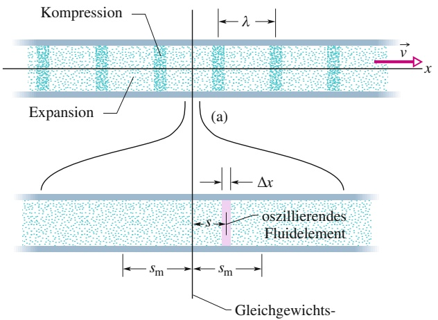

text_image

Kompression
λ
x
v
Expansion
(a)
Δx
szillierendes
Fluidelement
sm
sm
Gleichgewichts-

(b)

lage

Elemente parallel zur y-Achse, deshalb haben wir ihre Auslenkung in der Form y(x, t) geschrieben. Diese Identifikation zwischen der $y \cdot$ Koordinate und der Auslenkung war möglich, weil die Ruhelage immer dem Wert $y = 0$ entsprach. Bei den longitudinalen Wellen können wir nicht so vorgehen. Die Luftelemente schwingen zwar parallel zur x-Achse, allerdings wird die Position der Ruhelage nun durch die x-Koordinate beschrieben. Für die Auslenkung aus der Ruhelage verwenden wir hier die Bezeichnung $s ( x , t )$

Wenn wir zum Ausdruck bringen wollen, dass es sich bei der Auslenkung $s ( x , t )$ um eine sinusförmige Funktion von x und t handelt, können wir sowohl eine Sinus als auch eine Kosinusfunktion verwenden. In diesem Kapitel verwenden wir die Kosinusfunktion und schreiben

$$
s (x, t) = s _ {\mathrm{m}} \cos (k x - \omega t). \tag {13.10}
$$

(a)

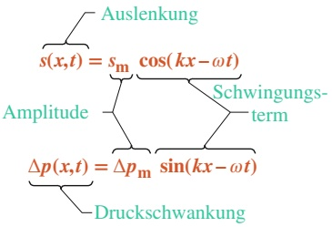

flowchart

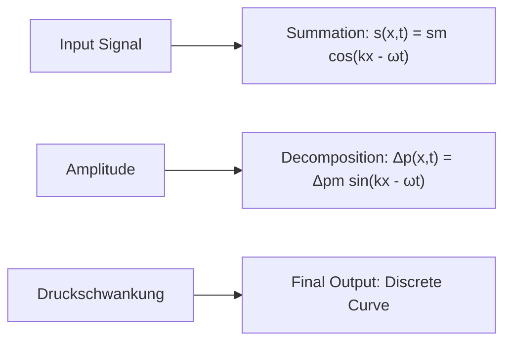

Abb. 13.5

Die (a) Auslenkung und (b) Druckänderung einer sich ausbreitenden Schallwelle werden durch Funktionen mit Amplitude und Schwingungsterm beschreiben.

Abbildung 13.5a zeigt die wesentlichen Bestandteile dieser Gleichung. Hierbei ist $s _ { \mathrm { m } }$ die **Auslenkungsamplitude**, d. h. die maximale Auslenkung eines Luftelements aus seiner Gleichgewichtslage zu einer der beiden Seiten (siehe Abb. 13.4b). Die Wellenzahl $k ,$ die Winkelgeschwindigkeit $\omega ,$ die Frequenz $f ,$ die Wellenlänge $\lambda ,$ die Wellengeschwindigkeit v und die Periode $T$ sind für eine Schallwelle (Longitudinalwelle) ebenso definiert wie bei einer Transversalwelle. Auch die Beziehungen zwischen diesen Größen sind dieselben, außer dass λ nun gleich dem Abstand ist (wiederum in Ausbreitungsrichtung der Welle), nach dem sich das Muster aus Kompression und Expansion wiederholt (siehe Abb. 13.4a). (Wir nehmen hierbei an, dass $s _ { \mathrm { m } }$ sehr viel kleiner ist als λ.)

Wie wir im folgenden Abschnitt beweisen werden, variiert der Druck an jeder Stelle x in Abb. 13.4a beim Durchgang der Welle ebenfalls sinusförmig. Diese Druckänderung schreiben wir in der Form

$$
\Delta p (x, t) = \Delta p _ {\mathrm{m}} \sin (k x - \omega t). \tag {13.11}
$$

Abbildung 13.5b verdeutlicht noch einmal die wesentlichen Begriffe dieser Glei chung. Ein negativer Wert für $\Delta p$ in Gl. 13.11 entspricht einer Ausdehnung der Luft, ein positiver Wert einer Kompression. $\Delta p _ { \mathrm { m } }$ ist in diesem Fall die Druckam**plitude**, also die maximale $\mathbf { Z u } -$ oder Abnahme des Drucks aufgrund der Welle. Gewöhnlich ist $\Delta p _ { \mathrm { m } }$ sehr viel kleiner als der ohnehin vorhandene Druck $p .$ Wie wir ebenfalls beweisen werden, hängen die Druckamplitude $\Delta p _ { \mathrm { m } }$ und die Auslen kungsamplitude $s _ { \mathrm { m } }$ in Gl. 13.10 über die folgende Beziehung zusammen:

$$
\Delta p _ {\mathrm{m}} = (\nu \rho \omega) s _ {\mathrm{m}}. \tag {13.12}
$$

312

---

13.2 Die Ausbreitung von Schallwellen

13

Abbildung 13.6 zeigt die Kurven zu den Gln. 13.10 und 13.11 zum Zeitpunkt $t   =   0$ . Im Verlauf der Zeit verschieben sich beide Kurven entlang der waagerechten Achse nach rechts. Man beachte, dass zwischen der Auslenkung und der Druckschwankung eine Phasenverschiebung von $\pi / 2$ rad (oder 90°) besteht. So verschwindet beispielsweise die Druckänderung $\Delta p$ an allen Stellen, an denen die Wellenauslenkung ein Maximum hat, und umgekehrt.

## KONTROLLFRAGE 1

Angenommen, das oszillierende Fluidelement in Abb. 13.4b bewegt sich durch seine Gleichgewichtslage nach rechts. Nimmt der Druck in diesem Element gerade ab oder zu?

## Die Herleitung der Gln. 13.11 und 13.12

Abbildung 13.4b zeigt ein oszillierendes Luftelement der Querschnittsfläche A und der Dicke $\Delta x ,$ dessen Zentrum aus seiner Gleichgewichtslage um den Abstand s ausgelenkt ist.

Nach Gl. 13.2 können wir die Druckänderung innerhalb des ausgelenkten Elements als

$$
\Delta p = - K \frac {\Delta V}{V} \tag {13.13}
$$

schreiben. In dieser Gleichung ist V das Volumen des Luftelements:

$$
V = A \Delta x. \tag {13.14}
$$

Die Größe ΔV in Gl. 13.13 entspricht der Volumenänderung bei der Auslenkung des Elements. Diese Volumenänderung beruht auf einer unterschiedlichen Auslenkung der beiden Seitenflächen, deren Positionen sich um einen Betrag Δs unterscheiden. Wir können die Volumenänderung also auch in der Form

$$
\Delta V = A \Delta s \tag {13.15}
$$

formulieren.

Setzen wir die Gln. 13.14 und 13.15 in Gl. 13.13 ein und gehen zum differenziellen Grenzwert über, so erhalten wir

$$
\Delta p = - K \frac {\Delta s}{\Delta x} = - K \frac {\partial s}{\partial x}. \tag {13.16}
$$

Das Symbol 𝜕 weist darauf hin, dass es sich bei der Ableitung in Gl. 13.16 um eine partielle Ableitung handelt, die uns sagt, wie s sich als Funktion von x verändert, wenn die Zeit t festgehalten wird. Aus Gl. 13.10 bekommen wir dann

$$
\frac {\partial s}{\partial x} = \frac {\partial}{\partial x} [ s _ {\mathrm{m}} \cos (k x - \omega t) ] = - k s _ {\mathrm{m}} \sin (k x - \omega t).
$$

Setzen wir dieses Ergebnis für die partielle Ableitung in Gl. 13.16 ein, so folgt

$$
\Delta p = K k s _ {\mathrm{m}} \sin (k x - \omega t).
$$

Mit $\Delta p _ { \mathrm { m } } = K k s _ { \mathrm { m } }$ entspricht das der Gl. 13.11, die wir beweisen wollten.

Mithilfe von Gl. 13.3 können wir die Amplitude der Druckänderung auch folgendermaßen schreiben:

$$
\Delta p _ {\mathrm{m}} = (K k) s _ {\mathrm{m}} = (\nu^ {2} \rho k) s _ {\mathrm{m}}.
$$

Gleichung 13.12, die wir ebenfalls herleiten wollten, ergibt sich, wenn wir mit Gl. 12.12 die Wellenzahl k durch ω∕v ersetzen.

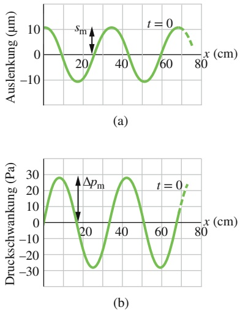

## Abb. 13.6

(a) Die Auslenkungsfunktion
(Gl. 13.10) zum Zeitpunkt $t = 0 .$
(b) Die entsprechende Kurve für die Druckschwankung (Gl. 13.11). Beide Kurven gelten für eine Schallwelle von 1000 Hz, deren Druckamplitude an der Schmerzgrenze liegt; siehe Beispielaufgabe 13.1 im Übungsbuch.

313

---

13 Wellen – II

## 13.3 Interferenz

## Lernziele

Nach dem Durcharbeiten dieses Abschnitts sollten Sie in der Lage sein, . . .

die Phasendifferenz 𝜑 zweier Wellen der Wellenlänge λ, die zunächst in Phase waren, dann aber einen gemeinsamen Punkt auf unterschiedlichen Wegen erreicht haben, an diesem Punkt aus dem Unterschied ΔL der zurückgelegten Wege zu berechnen,
• aus der Phasendifferenz zweier Schallwellen mit derselben Amplitude, Wellenlänge und Ausbreitungsrichtung zu bestimmen, welche Art von Interferenz (vollständig konstruktiv, vollständig destruktiv oder gemischt) zwischen ihnen auftritt,
• eine Phasendifferenz vom Bogenmaß in Grad oder ein Vielfaches der Wellenlänge umzurechnen.

## Schlüsselideen

Die Interferenz zwischen zwei Schallwellen mit identischen Wellenlängen an einem Punkt hängt von ihrer Phasendifferenz 𝜑 an diesem Punkt ab. Wenn die Schallwellen bei ihrer Erzeugung in Phase waren und sich in ungefähr derselben Richtung ausgebreitet haben, dann beträgt ihre Phasendifferenz

$$
\varphi = 2 \pi \frac {\Delta L}{\lambda},
$$

wobei ΔL der Unterschied der von ihnen zurückgelegten Wegstrecken ist.

• Vollständig konstruktive Interferenz tritt ein, wenn 𝜑 ein ganzzahliges Vielfaches von 2π ist, wenn also

$$
\varphi = m (2 \pi) \quad \text {mit} \quad m = 0, 1, 2, 3, \dots
$$

gilt, oder (äquivalent) wenn zwischen dem Weglängenunterschied $\Delta L$ und der Wellenlänge λ die Beziehung

$$
\frac {\Delta L}{\lambda} = 0, 1, 2, \dots
$$

erfüllt ist.

• Vollständig destruktive Interferenz tritt ein, wenn 𝜑 ein ungerades ganzzahliges Vielfaches von π ist, wenn also

$$
\varphi = (2 m + 1) \pi \quad \text {mit} \quad m = 0, 1, 2, 3, \dots
$$

oder äquivalent

$$
\frac {\Delta L}{\lambda} = \frac {1}{2}, \frac {3}{2}, \frac {5}{2}, \dots
$$

gilt.

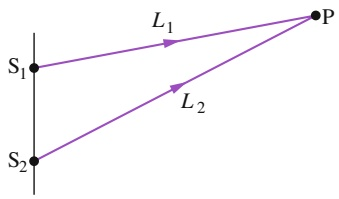

text_image

S₁
L₁
P
S₂
L₂

Abb. 13.7

Zwei Punktquellen $S _ { 1 }$ und $S _ { 2 }$ senden in Phase kugelförmige Schallwellen aus. Die Strahlen deuten an, dass beide Wellen den Punkt P erreichen.

## 13.3.1 Interferenz

Ebenso wie transversale Wellen können auch Schallwellen interferieren. Im Folgenden betrachten wir speziell die Interferenz zwischen zwei gleichartigen Schallwellen, die sich in dieselbe Richtung ausbreiten. Abbildung 13.7 zeigt, wie man eine solche Situation realisieren kann: Zwei Punktquellen $S _ { 1 }$ und $S _ { 2 }$ senden Schallwellen aus, die in Phase sind und dieselbe Wellenlänge haben. In diesem Fall spricht man auch davon, dass die Quellen selbst in Phase sind, d. h., zu gleichen Zeitpunkten haben die beiden Quellen jeweils gleiche Auslenkungen. Wir interessieren uns für die resultierende Welle bei Punkt P in Abb. 13.7. Dabei nehmen wir an, dass der

314

---

13.3 Interferenz

13

Abstand der Quellen zu P sehr viel größer ist als der Abstand zwischen den beiden Quellen untereinander. Unter dieser Annahme können wir die Ausbreitungsrichtung der Wellen bei P als gleich ansehen.

Würden die beiden Wellen gleich lange Wege bis zum Punkt P zurücklegen, wä- ren sie bei P in Phase. Wie bei transversalen Wellen bedeutet das auch bei Longitudinalwellen konstruktive Interferenz. In Abb. 13.7 ist der Weg $L _ { 2 } ,$ den die Wellen von $\mathsf { S } _ { 2 }$ bis P zurücklegen, jedoch länger als der Weg $L _ { 1 }$ der Wellen von Quelle $S _ { 1 }$ . Wegen der unterschiedlichen Weglängen sind die Wellen im Allgemeinen bei Punkt P nicht mehr in Phase. Die Phasenverschiebung 𝜑 bei P hängt von der Weglängendifferenz $\Delta L = | L _ { 2 } - L _ { 1 } |$ ab.

|  |Die Beziehung zwischen der Phasenverschiebung 𝜑 und der Weg**längendifferenz** ΔL erhalten wir aus der Überlegung, dass eine Phasenverschiebung von 2π rad ge nau einer Wellenlänge λ entspricht (siehe Abschn. 12.5). Es gilt somit die Verhältnisgleichung

$$
\frac {\varphi}{2 \pi} = \frac {\Delta L}{\lambda}, \tag {13.17}
$$

aus der für die Phasenverschiebung folgt, dass

$$
\varphi = \frac {\Delta L}{\lambda} 2 \pi . \tag {13.18}
$$

Konstruktive Interferenz gibt es für $\varphi = 0 ,   \varphi = 2 \pi$ , oder wenn $\varphi$ ein (anderes) ganzzahligen Vielfaches von 2π ist. Diese Bedingung können wir in folgender Form schreiben:

$$
\varphi = m (2 \pi) \quad \text {fur} \quad m = 0, 1, 2, \dots \tag {13.19}
$$

Nach Gl. 13.18 ist diese Bedingung für

$$
\frac {\Delta L}{\lambda} = 0, 1, 2, \dots \quad (\text {konstruktive Interferenz}) \tag {13.20}
$$

erfüllt. Ist die Weglängendifferenz $\Delta L = | L _ { 2 } { - } L _ { 1 } |$ in Abb. 13.7 beispielsweise gleich 2λ, dann ist $\Delta L / \lambda = 2$ | |und die Wellen interferieren an Punkt P konstruktiv. Die Interferenz ist (vollständig) konstruktiv, weil die Welle von $\mathsf { S } _ { 2 }$ relativ zur Welle von $S _ { 1 }$ um 2λ phasenverschoben ist, und damit die beiden Wellen bei P exakt in Phase sind.

Destruktive Interferenz tritt auf, wenn 𝜑 gleich einem ungeraden Vielfachen von π ist. Diese Bedingung können wir in der Form

$$
\varphi = (2 m + 1) \pi \quad \text {fur} \quad m = 0, 1, 2, \dots \quad (\text {destruktive Interferenz}) \tag {13.21}
$$

schreiben. Nach Gl. 13.18 ist das der Fall, wenn

$$
\frac {\Delta L}{\lambda} = \frac {1}{2}, \frac {3}{2}, \frac {5}{2}, \dots \quad (\text {destruktive Interferenz}). \tag {13.22}
$$

Ist beispielsweise die Weglängendifferenz $\Delta L = | L _ { 2 } - L _ { 1 } |$ in Abb. 13.7 gleich 2,5λ, dann ist $\Delta L / \lambda = 2 { , } 5 = 5 / 2$ |  | und die Wellen interferieren an Punkt P (vollständig) destruktiv. Die Wellenfront von $S _ { 2 }$ ist relativ zu der Wellenfront von $S _ { 1 }$ bei P um 2,5 Wellenlängen verschoben und damit exakt außer Phase.

Natürlich können auch Interferenzen zwischen den Wellen auftreten, die weder vollständig konstruktiv noch vollständig destruktiv sind, beispielsweise wenn $\Delta L / \lambda = 1 , 2 = 6 / 5$ . Dieser Fall einer gemischten Interferenz läge näher an der konstruktiven Interferenz $( \Delta L / \lambda = 1 { , } 0 )$ als an der destruktiven Interferenz $( \Delta L / \lambda =$ 1,5).

315

---

13 Wellen – II

## KONTROLLFRAGE 2

Angenommen, der Abstand D zwischen den beiden Quellen $S _ { 1 }$ und $\mathsf { S } _ { 2 }$ in Beispielaufgabe 13.2 im Übungsbuch sei 4λ. Wie groß wäre die Weglängendifferenz und welche Art von Interferenz würde (a) bei Punkt $\mathrm { P } _ { 1 }$ und (b) bei Punkt $\mathrm { P } _ { 2 }$ auftreten?

## 13.4 Schallintensität und Schallpegel

## Lernziele

Nach dem Durcharbeiten dieses Abschnitts sollten Sie in der Lage sein, . . .

• die Schallintensität I auf einer Oberfläche als Verhältnis der Leistung P zur Flä- che A zu berechnen,
• die Beziehung zwischen der Schallintensität I und der Verschiebungsamplitude $s _ { \mathrm { m } }$ der Schallwelle anzuwenden,
• zu verstehen, was eine punktförmige isotrope Schallquelle ist,
• für eine isotrope Punktschallquelle die Beziehung zwischen der Schallleistung $P _ { S } ,$ dem Abstand r zu einem Detektor und der Schallintensität I an diesem Detektor anzugeben,
• die Beziehung zwischen dem Schallpegel $\beta ,$ der Schallintensität I und der Standard-Referenzintensität $I _ { 0 }$ anzugeben,
• einen dekadischen Logarithmus $\scriptstyle \left( \log _ { 1 0 } \right.$ bzw. log) und seine Umkehrfunktion $( \log ^ { - 1 }$ bzw. 10x) zu berechnen,
• den Zusammenhang zwischen einer Veränderung des Schallpegels und der zugehörigen Veränderung der Schallintensität anzugeben.

## Schlüsselideen

• Die Intensität I einer Schallwelle an einer Oberfläche entspricht der mittleren Leistung P pro Flächeneinheit A, mit der die Schallwelle Energie auf oder durch die Oberfläche transportiert:

$$
I = \frac {P}{A}.
$$

Der Zusammenhang zwischen der Schallintensität I und der Verschiebungsamplitude $s _ { \mathrm { m } }$ der Schallwelle ist

$$
I = \frac {1}{2} \rho \nu \omega^ {2} s _ {\mathrm{m}} ^ {2}.
$$

• Die Schallintensität in einem Abstand r von einer punktförmigen Schallquelle, die Schallwellen mit einer Leistung $P _ { S }$ gleichförmig in alle Richtungen (isotrop) emittiert, beträgt

$$
I = \frac {P _ {\mathrm{S}}}{4 \pi r ^ {2}}.
$$

• Der Schallpegel $\beta$ ist durch

$$
\beta = (1 0 \mathrm{dB}) \log \frac {I}{I _ {0}}
$$

definiert (in Dezibel, dB), wobei $I _ { 0 } ( = 1 0 ^ { - 1 2 }   \mathrm { W } / \mathrm { m } ^ { 2 } )$ ein Standard-Referenzwert ist, auf den die Intensitäten bezogen werden, und log den dekadischen Logarithmus bezeichnet. Eine Zunahme der Schallintensität um einen Faktor 10 bewirkt somit eine Erhöhung des Schallpegels um 10 dB.

## 13.4.1 Schallintensität und Schallpegel

Sollten Sie jemals erlebt haben, dass in Ihrer Nähe laute Musik erklingt, während Sie schlafen wollten, dann wissen Sie aus eigener Erfahrung, dass Töne außer Frequenz, Wellenlänge und Geschwindigkeit noch die Eigenschaft der Lautstärke ha-

316

---

13.4 Schallintensität und Schallpegel

13

ben. Da der Begriff der Lautstärke als Fachbegriff jedoch uneinheitlich verwendet wird, beschränken wir uns im Folgenden auf die Definition der Begriffe Schallintensität und Schallpegel. Die **Schallintensität** I einer Schallwelle an einer Fläche ist gleich der durchschnittlichen Rate, mit der die Welle Energie durch oder auf die Fläche überträgt:

$$
I = \frac {P}{A}, \tag {13.23}
$$

wobei P die Energieübertragungsrate (die Leistung) der Schallwelle ist, und A die Fläche, auf die der Schall trifft. Wie wir noch beweisen werden, hängt die Intensität mit der Auslenkungsamplitude $s _ { \mathrm { m } }$ der Schallwelle über die Beziehung

$$
I = \frac {1}{2} \rho \nu \omega^ {2} s _ {\mathrm{m}} ^ {2} \tag {13.24}
$$

zusammen.

## Die Intensität als Funktion des Abstands

Die Abhängigkeit der Intensität als Funktion des Abstands von einer wirklichen Schallquelle ist oft kompliziert. Einige Schallquellen (beispielsweise Lautsprecher) übertragen den Schall nur in bestimmte Richtungen, außerdem erzeugt die Umgebung gewöhnlich Echos (reflektierte Schallwellen), die sich den direkt übertragenen Schallwellen überlagern. In einigen Fällen können wir jedoch solche Effekte vernachlässigen und die Schallquelle als Punktquelle ansehen, die den Schall isotrop – d. h. in alle Richtungen mit derselben Intensität – abstrahlt. Abbildung 13.8 zeigt eine Momentaufnahme der von einer solchen Punktquelle S ausgehenden Wellenfronten.

Wir nehmen im Folgenden an, dass die mechanische Energie einer Schallwelle bei ihrer Ausbreitung erhalten bleibt. Außerdem denken wir uns um die Quelle eine Kugel vom Radius r wie in Abb. 13.8. Die gesamte von der Quelle abgestrahlte Energie muss durch die Oberfläche dieser Kugel treten. Die zeitliche Rate, mit der die Energie der Schallwelle durch die Oberfläche tritt, muss also gleich der Rate sein, mit der die Energie von der Quelle abgestrahlt wird (d. h. der Leistung $P _ { S }$ der Quelle). Nach Gl. 13.23 gilt daher für die Intensität der Schallwelle bei der Kugeloberfläche

$$
I = \frac {P _ {S}}{4 \pi r ^ {2}}, \tag {13.25}
$$

wobei $4 \pi r ^ { 2 }$ der Flächeninhalt der Kugelfläche ist. Diese Gleichung besagt, dass die Intensität der Schallwelle von einer isotropen Punktquelle mit dem Quadrat des Abstands r von der Quelle abnimmt.

## KONTROLLFRAGE 3

In der nebenstehenden Abbildung erkennt man drei kleine Abschnitte – 1, 2 und 3 – auf der Oberfläche zweier gedachter Kugeln. Im Mittelpunkt der Kugeln befinde sich eine Punktquelle, die isotrop Schallwellen abstrahlt. Die Energieübertragungsrate der Schallwellen auf die drei Abschnitte sei überall gleich. Ordnen Sie die Abschnitte nach (a) der Intensität der Schallwellen auf ihnen und (b) ihrer Fläche (größte zuerst).

## Die Dezibel-Skala

Die vom menschlichen Ohr wahrnehmbare Verschiebungsamplitude bei Schall reicht von ungefähr $1 0 ^ { - 5 }$ m für die lauteste noch erträgliche Lautstärke bis zu $1 0 ^ { - 1 1 }$ m für die leiseste noch wahrnehmbare Lautstärke. Das Verhältnis dieser

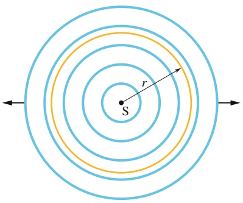

text_image

r
S

Abb. 13.8 Eine Punktquelle S strahlt in alle Richtungen gleichartige Schallwellen ab. Die Wellenfronten treten durch eine gedachte Kugelschale vom Radius r mit Mittelpunkt S.

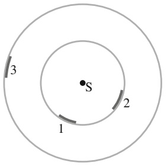

text_image

S
1
2
3

317

---

13 Wellen – II

Bereichsgrenzen entspricht $1 0 ^ { 6 }$ . Aus Gl. 13.24 wissen wir, dass die Intensität von Schallwellen eine quadratische Funktion ihrer Amplitude ist. Das Verhältnis der maximal noch erträglichen und der minimal wahrnehmbaren Intensität des menschlichen Hörsystems beträgt somit $1 0 ^ { 1 2 } !$ Der Mensch kann also Geräusche über einen riesigen Intensitätsbereich wahrnehmen.

Zur Vereinfachung des Umgangs mit einem solch großen Wertebereich verwenden wir Logarithmen. Betrachten Sie die Relation

$$
y = \log x,
$$

in der x und $y$ Variable sind und im Folgenden $\mathrm { { , } l o g } ^ { \alpha }$ immer für den dekadischen Logarithmus, also den Logarithmus zur Basis 10 steht. Zu den Eigenschaften dieser Gleichung zählt, dass y um 1 größer wird, wenn wir x mit 10 multiplizieren:

$$
y ^ {\prime} = \log (1 0 x) = \log 1 0 + \log x = 1 + y.
$$

Ganz entsprechend wächst $y$ nur um 12, wenn wir x mit $1 0 ^ { 1 2 }$ multiplizieren.

Statt von der Intensität I einer Schallwelle zu sprechen, ist es daher oft übersichtlicher, von ihrem **Schallpegel** $\beta$ zu sprechen, definiert als

$$
\beta = (1 0 \mathrm{dB}) \log \frac {I}{I _ {0}}. \tag {13.26}
$$

TABELLE 13.2: Einige Schallpegel (dB).

| Hörgrenze | 0 |
| --- | --- |
| Blätterrauschen | 10 |
| Unterhaltung | 60 |
| Rock-Konzert | 110 |
| Schmerzgrenze | 120 |
| Düsentriebwerk | 130 |

Die Abkürzung dB steht für **Dezibel**, die Einheit des Schallpegels. Mit dieser Bezeichnung soll die Arbeit von Alexander Graham Bell geehrt werden. $I _ { 0 }$ in Gl. 13.26 bezieht sich auf einen standardisierten Referenzwert für die Intensität $( = 1 0 ^ { - 1 2 }   \mathrm { W } / \mathrm { m } ^ { 2 } )$ , der in der Nähe der unteren Wahrnehmungsgrenze (Hörschwelle) des menschlichen Gehörs liegt. Für $I = I _ { 0 }$ liefert Gl. 13.26 $\beta = 1 0 \log 1 = 0$ Unser Referenzwert entspricht also null Dezibel. Der Wert für $\beta$ steigt immer um 10 dB, wenn die Schallintensität um eine Größenordnung (einen Faktor 10) zunimmt. $\beta = 4 0$ entspricht daher einer Intensität, die gleich dem $1 0 ^ { 4 }$ -Fachen der Referenzintensität ist. In Tab. 13.2 sind die Schallpegel einiger Geräusche wiedergegeben.

## Herleitung von Gl. 13.24

Wir betrachten in Abb. 13.4a eine dünne Luftscheibe der Dicke dx mit einer Seitenfläche A und der Masse dm, die beim Durchgang der Schallwelle (beschrieben durch Gl. 13.10) vor- und zurückschwingt. Die kinetische Energie dK dieser Luftscheibe beträgt

$$
\mathrm{d} K = \frac {1}{2} \mathrm{d} m v _ {\mathrm{m}} ^ {2}. \tag {13.27}
$$

Hierbei ist $\nu _ { \mathrm { m } }$ nicht die Wellengeschwindigkeit, sondern die Geschwindigkeit des oszillierenden Luftelements, die sich aus Gl. 13.10 ergibt:

$$
\nu_ {\mathrm{m}} = \frac {\partial s}{\partial t} = - \omega s _ {\mathrm{m}} \sin (k x - \omega t).
$$

Mit dieser Beziehung und d $n = \rho A$ dx können wir Gl. 13.27 umschreiben:

$$
\mathrm{d} K = \frac {1}{2} (\rho A \mathrm{d} x) (- \omega s _ {\mathrm{m}}) ^ {2} \sin^ {2} (k x - \omega t). \tag {13.28}
$$

Die Ausbreitungsrate der kinetischen Energie entlang der Welle erhalten wir, indem wir diese Gleichung durch dt dividieren. Wie wir in Kapitel 12 bei den transversalen Wellen gesehen haben, ist dx∕dt die Wellengeschwindigkeit v. Wir erhalten somit:

$$
\frac {\mathrm{d} K}{\mathrm{d} t} = \frac {1}{2} \rho A \nu \omega^ {2} s _ {\mathrm{m}} ^ {2} \sin^ {2} (k x - \omega t). \tag {13.29}
$$

318

---

13.5 Musikalische Töne

13

Die gemittelte Transportrate der kinetischen Energie ist

$$
\left(\frac {\mathrm{d} K}{\mathrm{d} t}\right) _ {\mathrm{gem}} = \frac {1}{2} \rho A \nu \omega^ {2} s _ {\mathrm{m}} ^ {2} [ \sin^ {2} (k x - \omega t) ] _ {\mathrm{gem}} = \frac {1}{4} \rho A \nu \omega^ {2} s _ {\mathrm{m}} ^ {2}. \tag {13.30}
$$

Bei dieser Gleichung haben wir ausgenutzt, dass der Mittelwert des Quadrats einer Sinus- oder Kosinusfunktion über eine Periode gleich $1 / 2$ ist.

Für die potenzielle Energie nehmen wir an, dass sie von einer Schallwelle mit der selben gemittelten Rate übertragen wird. Die Wellenintensität I, also die mittlere Übertragungsrate beider Energieformen pro Fläche, ist dann nach Gl. 13.30

$$
I = \frac {2 (\mathrm{d} K / \mathrm{d} t) _ {\mathrm{gem}}}{A} = \frac {1}{2} \rho \nu \omega^ {2} s _ {\mathrm{m}} ^ {2},
$$

was Gl. 13.24 entspricht, die wir beweisen wollten.

## 13.5 Musikalische Töne

## Lernziele

Nach dem Durcharbeiten dieses Abschnitts sollten Sie in der Lage sein, . . .

• Muster von stehenden Wellen für die ersten akustischen Harmonischen in Rohren mit einem oder zwei offenen Enden zu skizzieren,
• für stehende Schallwellen einen Zusammenhang zwischen dem Abstand der Knoten und der Wellenlänge herzustellen,
• zu verstehen, welche Rohre Harmonische mit geraden Modenzahlen besitzen,
• für beliebige Harmonische und Rohre mit einem oder zwei offenen Enden eine Beziehung zwischen der Länge L des Rohrs, der Schallgeschwindigkeit v im Rohr, der Wellenlänge λ, der Frequenz $f$ der Harmonischen und der Modenzahl n anzugeben.

## Schlüsselideen

• In Rohren können stehende Schallwellen (d. h. Resonanzen) erzeugt werden, indem Schall einer passenden Wellenlänge in das Rohr eingestrahlt wird.

• Ein an beiden Enden offenes Rohr kommt bei den Frequenzen

$$
f = \frac {\nu}{\lambda} = \frac {n \nu}{2 L} \quad \text {mit} \quad n = 1, 2, 3, \dots
$$

zur Resonanz, wenn v die Schallgeschwindigkeit in dem Rohr ist.

• Ein an nur einem Ende offenes Rohr kommt bei den Frequenzen

$$
f = \frac {\nu}{\lambda} = \frac {n \nu}{4 L} \quad \text {mit} \quad n = 1, 3, 5, \dots
$$

zur Resonanz.

natural_image

Man wearing red and white clothing, sitting on a dark surface with a long red string being held by his hand (no visible text or symbols)

## 13.5.1 Musikalische Töne

Musikalische Töne entstehen bei schwingenden Saiten (Gitarre, Klavier, Geige), Membranen (Trommeln), Luftsäulen (Flöte, Oboe, Pfeifenorgel, Alphorn oder Didgeridoo, vgl. Abb. 13.9), Holz- oder Stahlstäben (Marimba, Xylophon) und vielen anderen schwingenden Körpern. Die meisten Instrumente enthalten mehr als eine schwingende Komponente. Bei der Geige beispielsweise tragen sowohl die Saiten als auch der hölzerne Korpus des Instruments zur Erzeugung des Tons bei.

In Kapitel 12 hatten wir gesehen, dass sich auf einer gespannten, an beiden Enden fixierten Saite stehende Transversalwellen ausbilden können. Solche Wellen entstehen aus der Überlagerung von fortlaufenden Wellen und ihren Reflexionen an den beiden Saitenenden. Haben die Wellenlängen ein passendes Verhältnis zur Saitenlänge, kommt es durch die Superposition der in entgegengesetzte Richtungen fortlaufenden Wellen zu stehenden Wellen (oder Schwingungsmoden). Die

## Abb. 13.9

Beim Spiel auf dem Didgeridoo der australischen Aborigines schwingt eine Luftsäule im Instrument [Quelle: Alamy Stock Photo].

319

---

13 Wellen – II

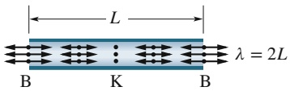

text_image

L
λ = 2L
B K B

(a)

(b)

Abb. 13.10

(a) Die einfachste stehende (longitudinale) Schallwelle in einem an beiden Enden offenen Rohr besitzt einen Schwingungsbauch B an jedem Ende und einen Knoten K in der Mitte. (Die longitudinalen Auslenkungen sind durch übertrieben große Doppelpfeile dargestellt.)

(b) Die entsprechende stehende (transversale) Welle bei einem Seil.

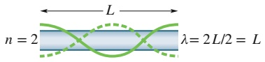

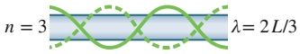

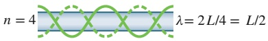

(a)

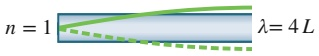

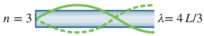

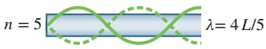

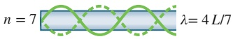

(b)

Abb. 13.11

Die stehenden Seilwellen vor den Rohren repräsentieren die stehenden Schallwellen in den Rohren. (a) In einem an beiden Enden offenen Rohr

kann jede Schwingungsmode erzeugt werden. (b) Ist das Rohr nur an einem Ende offen, können sich nur die ungeraden Moden ausbilden.

Wellenlängen müssen in diesem Fall einer Resonanzfrequenz der Saite entsprechen. Solche stehenden Wellen zeichnen sich dadurch aus, dass die Saite mit großen und lang anhaltenden Amplituden schwingt. Durch die periodischen Stöße gegen die Luft der Umgebung entsteht eine hörbare Klangwelle von derselben Frequenz wie die Schwingungen der Saite.

Auf ähnliche Weise können wir in einem luftgefüllten Rohr stehende Schallwellen erzeugen. Breiten sich die Schallwellen in dem Rohr aus, werden sie an den beiden Enden reflektiert. (Diese Reflexion tritt sogar bei einem offenen Ende auf, ist allerdings nicht so vollständig wie bei einem geschlossenen Ende.) Passen Wellenlänge und Rohrlänge zusammen, führt die Superposition der beiden entgegengesetzt fortlaufenden Wellen auch hier zu stehenden Wellen, und auch in diesem Fall muss die Wellenlänge einer Resonanzfrequenz des Rohrs entsprechen. Wiederum bildet sich eine große und anhaltende Schwingungsamplitude aus, die an jedem offenen Ende des Rohrs eine Schallwelle von derselben Frequenz wie die Schwingungen im Rohr aussendet.

Viele Erscheinungen im Zusammenhang mit stehenden Schallwellen sind mit stehenden Wellen auf gespannten Seilen vergleichbar. Beispielsweise entspricht dem geschlossenen Ende eines Rohrs das fest eingespannte Ende einer Saite. In beiden Fällen muss sich an dieser Stelle ein Knoten (keine Auslenkung) befinden. Das offene Rohrende entspricht eher dem über einen Ring an einer Stange befestigten frei beweglichen Seilende aus Abb. 12.18b. In beiden Fällen muss sich nun ein Schwingungsbauch am Ende von Rohr bzw. Seil befinden. (Tatsächlich befindet sich der Schwingungsbauch an einem offenen Rohrende etwas außerhalb des Rohrs, aber auf diese Details wollen wir hier nicht eingehen.)

Die einfachste stehende Welle in einem an beiden Enden offenen Rohr zeigt Abb. 13.10a. An jedem offenen Ende befindet sich ein Schwingungsbauch; in der Mitte des Rohrs ist ein Knoten. Die analoge transversale Welle sehen Sie in Abb. 13.10b.

Die stehende Welle in Abb. 13.10a bezeichnet man als Grundmode oder erste Schwingungsmode oder auch 1. Harmonische. Damit sich diese Mode in einem Rohr der Länge L ausbilden kann, muss die Wellenlänge $\lambda = 2 L$ betragen, also $L = \lambda / 2$ . Für weitere stehende Wellen in einem an beiden Enden offenen Rohr sind in Abb. 13.11a die analogen Transversalwellen dargestellt. Die zweite Schwingungsmode (2. Harmonische) erfordert eine Schallwelle der Wellenlänge $\lambda = L$ , die dritte Schwingungsmode die Wellenlänge $\lambda = 2 L / 3$ usw.

Ganz allgemein entsprechen die Resonanzfrequenzen eines an beiden Enden offenen Rohrs der Länge $L$ den Wellenlängen:

$$
\lambda = \frac {2 L}{n} \quad \text {mit} \quad n = 1, 2, 3, \dots \tag {13.31}
$$

n bezeichnet man auch als die Modenzahl. Die Resonanzfrequenzen für ein solches an beiden Enden offenes Rohr sind dann

$$
f = \frac {\nu}{\lambda} = \frac {n \nu}{2 L} \quad \text {mit} \quad n = 1, 2, 3, \dots \quad (\text {an beiden Enden offenes Rohr}), \tag {13.32}
$$

wobei v die Schallgeschwindigkeit ist.

In Abb. 13.11b erkennt man (in der Seilwellendarstellung) einige stehende Wellen, die sich in einem Rohr mit nur einem offenen Ende ausbilden können. Die Voraussetzung dafür ist, dass sich an dem offenen Ende ein Schwingungsbauch und an dem geschlossenen Ende ein Knoten befindet. Die einfachste Form entspricht einer Schallwelle mit der Wellenlänge $L = \lambda / 4$ bzw. $\lambda = 4 L$ . Die nächsteinfache Wellenform muss eine Wellenlänge haben, für die $L = 3 \lambda / 4$ bzw. $\lambda = 4 L / 3$ gilt, usw.

Ganz allgemein entsprechen die Resonanzfrequenzen eines an einem Ende offenen Rohrs der Länge $L$ den Wellenlängen

$$
\lambda = \frac {4 L}{n} \quad \text {mit} \quad n = 1, 3, 5, \dots , \tag {13.33}
$$

320

---

13.5 Musikalische Töne

13

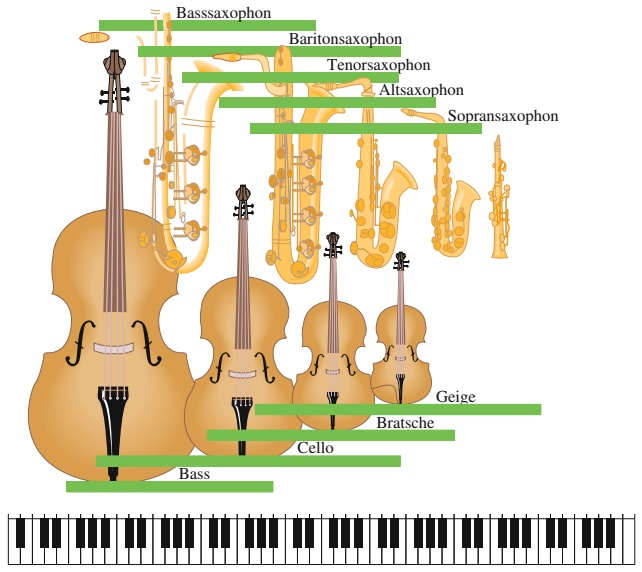

wobei die Modenzahl n eine ungerade Zahl sein muss. Die Resonanzfrequenzen sind somit

$$
f = \frac {\nu}{\lambda} = \frac {n \nu}{4 L} \quad \text {mit} \quad n = 1, 3, 5, \dots \quad (\text {an einem Ende offenes Rohr}). \tag {13.34}
$$

Wir sollten nochmals betonen, dass in einem Rohr mit nur einem offenen Ende nur ungerade Schwingungsmoden existieren können. Beispielsweise kann sich die Schwingungsmode zu $n = 2$ in einem solchen Rohr nicht ausbilden.

An der Länge eines Musikinstruments kann man schon ungefähr den Frequenzbereich ablesen, für den dieses Instrument gedacht ist – kürzere Instrumente entsprechen höheren Frequenzen. In Abb. 13.12 werden als Beispiele die Frequenzbereiche der Saxophon- und der Violinfamilie mit der Tastatur eines Klaviers verglichen. Die Frequenzbereiche der einzelnen Instrumente überschneiden sich deutlich mit denen ihrer Nachbarn.

Bei jedem schwingenden System, das musikalische Töne erzeugt, sei es eine Geigensaite oder eine Orgelpfeife, werden neben der Grundschwingung immer auch eine oder mehrere Oberschwingungen angeregt. Wir hören all diese Frequenzen gleichzeitig – als Superposition zu einer Gesamtwelle. Wenn verschiedene Instrumente dieselbe Note spielen, erzeugen sie zwar dieselbe Grundschwingung, aber jeweils ganz unterschiedliche Intensitäten der einzelnen Oberschwingungen. Die vierte Oberschwingung des mittleren C beispielsweise kann bei einem Instrument relativ laut, bei einem anderen vergleichsweise leise sein oder gar ganz fehlen. Da verschiedene Instrumente auf diese Weise verschiedene resultierende Wellen erzeugen, klingen sie für uns unterschiedlich, selbst wenn sie dieselbe Note spielen. In Abb. 13.13 erkennt man drei verschiedene Gesamtwellen, die von verschiedenen Instrumenten beim Spielen derselben Note erzeugt wurden.

## KONTROLLFRAGE 4

Rohr A der Länge L und Rohr B der Länge 2L haben beide offene Enden. Welche Schwingungsmode von Rohr B hat dieselbe Frequenz wie die Grundschwingung von Rohr A?

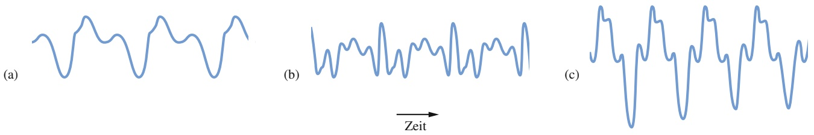

## Abb. 13.12

In der Saxophon- wie in der Violinfamilie erkennt man die Beziehung zwischen der Länge eines Instruments und seinem Frequenzbereich, der für die einzelnen Instrumente durch einen waagerechten Balken angedeutet ist. Als Vergleich der Frequenzskalen dient die Klaviertastatur unten; die niedrigen Frequenzen befinden sich auf der linken Seite, die hohen auf der rechten.

## Abb. 13.13

Die Wellenformen (a) einer Flöte, (b) einer Oboe und (c) eines Saxophons, die alle dieselbe Note mit derselben Grundschwingung spielen.

321

---

13 Wellen – II

## 13.6 Schwebungen

## Lernziele

Nach dem Durcharbeiten dieses Abschnitts sollten Sie in der Lage sein, . . .

• zu erklären, wie Schwebungen entstehen,
die Gleichungen für die Verschiebungen zweier Schallwellen mit derselben Am plitude und geringfügig unterschiedlichen Kreisfrequenzen zu addieren, um eine Gleichung für die Verschiebung der resultierenden Welle zu erhalten und daraus die zeitlich variierende Amplitude zu bestimmen,
die Beziehung zwischen der Schwebungsfrequenz und den Frequenzen der Schallwellen mit identischen Amplituden, aber geringfügig verschiedenen Frequenzen (oder äquivalent: Kreisfrequenzen) anzugeben und anzuwenden.

## Schlüsselideen

• Schwebungen entstehen, wenn sich zwei Schallwellen mit geringfügig verschiedenen Frequenzen $f _ { 1 }$ und $f _ { 2 }$ überlagern. Die Schwebungsfrequenz ist

$$
f _ {\text {Schwebung}} = f _ {1} - f _ {2}.
$$

## 13.6.1 Schwebungen

Hören wir im Abstand von einigen Minuten zwei Töne, deren Frequenzen dicht beieinander liegen, beispielsweise 552 und 564 Hz, dann nehmen die meisten von uns den Unterschied kaum wahr. Erreichen die beiden Töne unser Ohr jedoch gleichzeitig, hören wir einen Ton der Frequenz 558 Hz, also beim Mittelwert der beiden Frequenzen. Außerdem nehmen wir eine auffallende Veränderung in der Intensität des Tons wahr: Er wird mit einer Frequenz von 12 Hz (also der Differenz zwischen den beiden ursprünglichen Frequenzen) lauter und leiser. Dieses Phänomen ist in Abb. 13.14 angedeutet und wird als **Schwebung** bezeichnet.

Angenommen, die durch zwei Schallwellen erzeugten zeitabhängigen Auslenkungen der Luft an einem bestimmten Ort seien durch

$$
s _ {1} = s _ {\mathrm{m}} \cos \omega_ {1} t \quad \text {und} \quad s _ {2} = s _ {\mathrm{m}} \cos \omega_ {2} t \tag {13.35}
$$

gegeben, wobei $\omega _ { 2 } > \omega _ { 1 }$ gelten soll. Der Einfachheit halber haben wir angenommen, dass die Wellen dieselbe Amplitude haben. Nach dem Superpositionsprinzip ist die resultierende Auslenkung

$$
s = s _ {1} + s _ {2} = s _ {\mathrm{m}} (\cos \omega_ {1} t + \cos \omega_ {2} t).
$$

Mit der trigonometrischen Identität (siehe Anhang D)

$$
\cos \alpha + \cos \beta = 2 \cos \frac {1}{2} (\alpha - \beta) \cos \frac {1}{2} (\alpha + \beta)
$$

können wir für die resultierende Auslenkung auch schreiben:

$$
s = 2 s _ {\mathrm{m}} \cos \frac {1}{2} (\omega_ {1} - \omega_ {2}) t \cos \frac {1}{2} (\omega_ {1} + \omega_ {2}) t. \tag {13.36}
$$

Definieren wir noch

$$
\omega^ {\prime} = \frac {1}{2} (\omega_ {1} - \omega_ {2}) \quad \text {und} \quad \omega = \frac {1}{2} (\omega_ {1} + \omega_ {2}), \tag {13.37}
$$

Abb. 13.14 (a, b) Die Druckänderung Δp von zwei Schallwellen, wenn man sie getrennt wahrnimmt. Die Frequenzen der beiden Wellen sind fast gleich. (c) Die resultierende Druckänderung bei der Überlagerung der beiden Wellen.

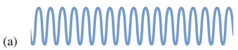

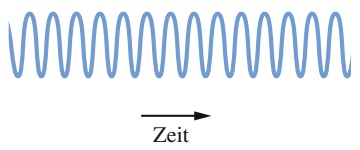

text_image

Zeit

(c)

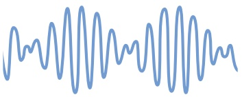

natural_image

Abstract blue wave-like pattern with no text or symbols

322

---

13.7 Der Doppler-Effekt

13

so wird aus Gl. 13.36:

$$
s (t) = \left(2 s _ {\mathrm{m}} \cos \omega^ {\prime} t\right) \cos \omega t. \tag {13.38}
$$

Wir nehmen nun an, dass die Winkelgeschwindigkeiten $\omega _ { 1 }$ und $\omega _ { 2 }$ der ursprünglichen Wellen nahezu gleich sind, was in Gl. $1 3 . 3 7   \omega \gg \omega ^ { \prime }$ bedeutet. In diesem Fall können wir Gl. 13.38 als eine Kosinusfunktion mit der Winkelgeschwindigkeit ω auffassen, deren Amplitude durch die Größe in den eckigen Klammern gegeben ist und nun nicht mehr konstant ist, sondern mit der Winkelgeschwindigkeit $\omega ^ { \prime }$ variiert.

Die maximale Amplitude tritt in Gl. 13.38 für cos $\omega ^ { \prime } t = \pm 1$ auf, was innerhalb jeder Periode der Kosinusfunktion zweimal der Fall ist. Da $\cos \omega ^ { \prime } t$ die Winkelgeschwindigkeit $\omega ^ { \prime }$ hat, ist die Winkelgeschwindigkeit $\omega _ { \mathrm { S c h w e b u n g } }$ der Schwebung durch $\omega _ { \mathrm { S c h w e b u n g } } = 2 \omega ^ { \prime }$ gegeben. Mithilfe von Gl. 13.37 folgt:

$$
\omega_ {\mathrm{Schwebung}} = 2 \omega^ {\prime} = 2 \cdot \frac {1}{2} (\omega_ {1} - \omega_ {2}) = \omega_ {1} - \omega_ {2}.
$$

Da $\omega = 2 \pi f$ , können wir dies auch folgendermaßen schreiben:

$$
f _ {\text {Schwebung}} = f _ {1} - f _ {2} \quad (\text {Schwebungsfrequenz}). \tag {13.39}
$$

Viele Musiker nutzen diese Schwebungen zum Stimmen ihrer Instrumente. Spielt ein Instrument eine Note vor dem Hintergrund einer gegebenen Standardfrequenz (beispielsweise das A der Oboe) und wird das Instrument nachgestimmt, bis die Schwebung verschwindet, dann stimmt es mit der Standardstimmung überein. In der Musikstadt Wien gibt es einen Telefonservice, über den der Kammerton A (440 Hz) von den vielen Profi- und Amateurmusikern der Stadt abgefragt werden kann.

## 13.7 Der Doppler-Effekt

## Lernziele

Nach dem Durcharbeiten dieses Abschnitts sollten Sie in der Lage sein, . . .

• zu verstehen, dass der Doppler-Effekt die durch die relative Bewegung zwischen einer Schallquelle und einem Detektor verursachte Verschiebung der detektierten gegenüber der emittierten Schallfrequenz beschreibt,
• zu verstehen, dass bei der Berechnung des Doppler-Effekts für Schallwellen die Geschwindigkeit von Quelle und Detektor stets relativ zu dem (möglicherweise bewegten) Medium gemessen wird, in dem sich der Schall ausbreitet,
die Frequenzverschiebung einer Schallwelle zu berechnen, wenn sich (a) eine Schallquelle in direkter Richtung auf einen ruhenden Detektor zu- oder von ihm wegbewegt, (b) ein Detektor sich in direkter Richtung auf eine ruhende Schallquelle zu- oder von ihr wegbewegt oder (c) sich sowohl die Schallquelle als auch der Detektor in direkter Richtung aufeinander zu- oder voneinander wegbewegen,
• zu verstehen, dass im Fall einer Relativbewegung zwischen Schallquelle und Detektor die aufeinander zu gerichtete Bewegung eine Erhöhung der beobachteten Frequenz bewirkt und die voneinander weg gerichtete Bewegung eine Verringerung der gemessenen Frequenz.

## Schlüsselideen

• Der Doppler-Effekt beschreibt die Änderung der beobachteten Frequenz einer Welle, wenn sich die Quelle oder der Detektor relativ zu dem Übertragungsmedium (wie z. B. der Luft) bewegt. Im Fall einer Schallwelle ist die beobachtete Frequenz $f ^ { \prime }$ durch

$$
f ^ {\prime} = f \frac {\nu \pm \nu_ {\mathrm{D}}}{\nu \pm \nu_ {\mathrm{Q}}}
$$

323

---

13 Wellen – II

gegeben, wenn $f$ die Frequenz der emittierten Schallwelle ist, v die Schallgeschwindigkeit in dem betrachteten Medium, $\nu _ { \mathrm { D } }$ die Geschwindigkeit des Detektors relativ zum Medium und $\nu _ { \mathrm { Q } }$ die Geschwindigkeit der Schallquelle relativ zum Medium.

• Die Vorzeichen werden so gewählt, dass $f ^ { \prime }$ größer als f ist, wenn sich Quelle und Detektor aufeinander zu bewegen und entsprechend kleiner als $f ,$ wenn sich Quelle und Detektor voneinander entfernen.

## 13.7.1 Der Doppler-Effekt

Die 1000-Hz-Sirene eines unmittelbar neben der Autobahn parkenden Polizeiautos sei eingeschaltet. Wenn Sie ebenfalls neben der Autobahn parken, hören Sie die Sirene mit genau dieser Frequenz. Wenn Sie sich jedoch relativ zur Polizei bewegen, entweder auf den Polizeiwagen zu oder von ihm weg, hören Sie jeweils eine andere Frequenz. Fahren Sie beispielsweise mit einer Geschwindigkeit von 120 km/h auf die Polizei zu, hören Sie eine höhere Frequenz (1096 Hz, also ein Zuwachs von 96 Hz). Entfernen Sie sich mit 120 km/h von der Polizei, hören Sie eine niedrigere Frequenz (904 Hz, eine Abnahme von 96 Hz).

Diese bewegungsabhängigen Frequenzänderungen sind Beispiele für den **Doppler-Effekt**. Der Effekt wurde 1842 von dem österreichischen Physiker Johann Christian Doppler vorhergesagt (allerdings nicht vollständig ausgearbeitet) und experimentell 1845 von Buys Ballot in Holland „mithilfe einer Lokomotive, die einen offenen Wagen mit mehreren Trompetern zog“ nachgewiesen.

Der Doppler-Effekt tritt nicht nur bei Schallwellen auf, sondern auch bei elektromagnetischen Wellen, einschließlich Mikrowellen, Radiowellen und sichtbarem Licht. Im Folgenden beschränken wir uns allerdings auf Schallwellen, und wir werden als Bezugssystem immer das Ruhesystem der Luft wählen, durch die sich der Schall ausbreitet. Wir messen also die Geschwindigkeit einer Quelle Q von Schallwellen und eines Detektors D für diese Schallwellen immer relativ zum Ruhesystem der Luft. (Sofern nicht explizit etwas Anderes gesagt wird, betrachten wir die Luft immer als in Ruhe relativ zum Boden, daher entsprechen die Geschwindigkeiten auch solchen relativ zum Boden.) Weiterhin werden wir annehmen, dass sich Q oder D entweder direkt aufeinander zu- oder voneinander wegbewegen und zwar mit Geschwindigkeiten, die kleiner als die Schallgeschwindigkeit sind.

Wenn sich sowohl der Detektor als auch die Quelle in Bewegung befinden, hängen die abgestrahlte und die empfangene Frequenz über folgende Beziehung miteinander zusammen:

$$
f ^ {\prime} = f \frac {\nu \pm \nu_ {\mathrm{D}}}{\nu \pm \nu_ {\mathrm{Q}}} \quad (\text {allgemeiner Doppler - Effekt}). \tag {13.40}
$$

Dabei sind v die Schallgeschwindigkeit in der Luft, $\nu _ { \mathrm { D } }$ die Geschwindigkeit des Detektors relativ zur Luft und $\nu _ { \mathrm { Q } }$ die Geschwindigkeit der Quelle relativ zur Luft. Die Wahl der Plus- oder Minuszeichen wird durch folgende Regel festgelegt:

Wenn der Abstand zwischen Detektor und Quelle bei der Bewegung kleiner wird, muss das Vorzeichen der Geschwindigkeit so gewählt werden, dass die Frequenz größer wird. Wenn der Abstand zwischen Detektor und Quelle bei der Bewegung größer wird, muss das Vorzeichen der Geschwindigkeit so gewählt werden, dass die Frequenz kleiner wird.

Kurz: Aufeinander zu bedeutet Frequenzverschiebung nach oben und voneinander weg bedeutet Frequenzverschiebung nach unten.

Es folgen einige Beispiele für diese Regel. Bewegt sich der Detektor auf die Quelle zu, verwende man das Pluszeichen im Zähler von Gl. 13.40, um die Frequenz zu erhöhen. Bewegt er sich von der Quelle weg, verwende man entsprechend das Minuszeichen zur Verminderung der Frequenz. Für einen ruhenden Detektor gilt

324

---

13.7 Der Doppler-Effekt

13

$\nu _ { \mathrm { D } } = 0$ . Bewegt sich die Quelle auf den Detektor zu, schreibe man im Nenner von Gl. 13.40 das Minuszeichen, was die Frequenz erhöht. Bewegt sich die Quelle vom Detektor weg, erhält man mit einem Pluszeichen im Nenner eine niedrigere Frequenz. Für eine ruhende Schallquelle gilt $\nu _ { \mathrm { Q } } = 0 .$

Zunächst leiten wir jetzt Gleichungen für den Doppler-Effekt für die beiden folgenden speziellen Situationen her und beweisen später Gl. 13.40 für den allgemeinen Fall.

1. Wenn sich der Detektor relativ zur Luft bewegt, die Quelle aber relativ zur Luft ruht, ändert sich durch die Bewegung die Frequenz, mit der der Detektor auf die Wellenfronten trifft.
2. Wenn sich die Quelle relativ zur Luft bewegt, der Detektor aber relativ zur Luft ruht, ändert sich durch die Bewegung die Wellenlänge der emittierten Schallwelle (und damit auch deren Frequenz).

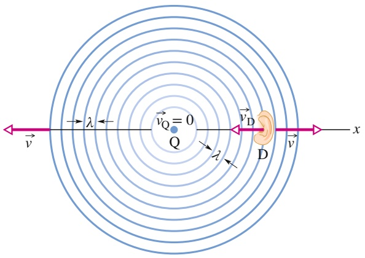

text_image

v
λ
vQ = 0
Q
λ
vD
D
v
x

## Abb. 13.15

Eine stationäre Quelle Q für Schallwellen emittiere kugelförmige Wellenfronten, die im Abstand von einer Wellenlänge wiedergegeben sind und die sich mit der Geschwindigkeit v ausbreiten. Ein Schalldetektor D, dargestellt durch ein Ohr, bewegt sich mit der Geschwindigkeit $\vec { \nu } _ { \mathrm { D } }$ auf die Quelle zu. Der Detektor nimmt wegen seiner Bewegung eine höhere Frequenz wahr.

## Ruhende Quelle und bewegter Detektor

In Abb. 13.15 bewegt sich ein Detektor D (durch ein Ohr wiedergegeben) mit der Geschwindigkeit $\nu _ { \mathrm { D } }$ auf eine stationäre Quelle Q zu, die kugelförmige Wellenfronten der Wellenlänge λ und der Frequenz f abstrahlt. Die Schallwellen breiten sich mit der Geschwindigkeit v durch die Luft aus. Die Wellenfronten sind in Abb. 13.15 im Abstand von einer Wellenlänge wiedergegeben. Die von dem Detektor D wahrgenommene Frequenz entspricht der Rate, mit der D auf die Wellenfronten (oder einzelnen Wellenlängen) trifft. Wäre D ebenfalls in Ruhe, wäre diese Rate gleich $f ,$ da sich aber D in die Wellenfronten hineinbewegt, ist die Auftreffrate größer und damit auch die wahrgenommene Frequenz $f ^ { \prime }$ im Vergleich zu $f .$

Betrachten wir für einen Augenblick den Fall, bei dem D ebenfalls ruht (Abb. 13.16). In der Zeit t bewegen sich die Wellenfronten um den Abstand vt nach rechts. Die Anzahl der Wellenlängen innerhalb dieses Abstands vt ist gleich der Anzahl der Wellenlängen, die von D in der Zeit t wahrgenommen werden. Diese Anzahl ist gleich vt∕λ. Die Rate, mit der D auf die Wellenfronten im Abstand λ trifft, d. h. die von D wahrgenommene Frequenz $f ,$ ist:

$$
f = \frac {\nu t / \lambda}{t} = \frac {\nu}{\lambda}. \tag {13.41}
$$

In dieser Situation – D ruht – gibt es keinen Doppler-Effekt: Die von D wahrgenommene Frequenz ist gleich der von Q abgestrahlten Frequenz.

Nun betrachten wir wieder den Fall, in dem D sich auf die Wellenfronten zubewegt (Abb. 13.17). Wie vorher breiten sich die Wellenfronten in dem Zeitintervall t um die Strecke vt nach rechts aus, doch nun bewegt sich D zusätzlich in demselben Zeitintervall um eine Strecke $\nu _ { \mathrm { D } } t$ nach links. Innerhalb des Zeitraums t haben sich also die Wellenfronten relativ zu D um die Strecke $\nu t + \nu _ { \mathrm { D } } t$ weiterbewegt. Die

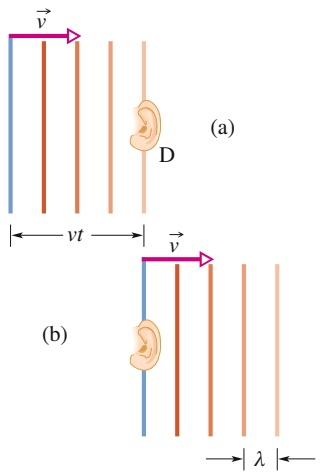

text_image

(a)
D
vt
(b)
v
λ

## Abb. 13.16

(a) Die (als eben angenommenen) Wellenfronten aus Abb. 13.15 erreichen einen stationären Detektor D.
(b) Die Wellenfronten sind an dem Detektor D vorbeigezogen. Im Zeitintervall t bewegen sie sich um den Abstand vt nach rechts.

325

---

13 Wellen – II

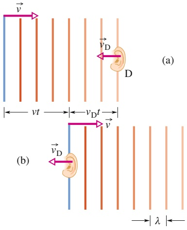

text_image

(a)
vD
D
vt
vDt
(b)
vD
λ

Abb. 13.17

Der Detektor bewegt sich auf die Wellenfronten zu. (a) Die Wellenfronten erreichen den Detektor und sind (b) an dem Detektor vorbeigezogen. In der Zeit t bewegen sich die Wellenfronten um die Strecke vt nach rechts und D bewegt sich um eine Strecke $\nu _ { \mathrm { D } } t$ nach links.

Anzahl der Wellenlängen innerhalb dieses Relativabstands $\nu t + \nu _ { \mathrm { D } } t$ ist gleich der Anzahl der Wellenlängen, auf die D innerhalb der Zeit t getroffen ist. Diese Anzahl ist gleich $( \nu t + \nu _ { \mathrm { D } } t ) / \lambda$ . Die Rate, mit der D in diesem Fall auf die Wellenfronten trifft, ist gegeben durch die Frequenz

$$
f ^ {\prime} = \frac {(\nu t + \nu_ {\mathrm{D}} t) / \lambda}{t} = \frac {\nu + \nu_ {\mathrm{D}}}{\lambda}. \tag {13.42}
$$

Nach Gl. 13.44 gilt $\lambda = \nu / f .$ Damit wird aus Gl. 13.42

$$
f ^ {\prime} = \frac {\nu + \nu_ {\mathrm{D}}}{\nu / f} = f \frac {\nu + \nu_ {\mathrm{D}}}{\nu}. \tag {13.43}
$$

Sofern $\nu _ { \mathrm { D } }$ nicht 0 ist (der Detektor also nicht ruht), muss $f ^ { \prime }$ in dieser Gleichung größer als $f$ sein. Ganz entsprechend finden wir auch die von D wahrgenommene Frequenz, wenn sich D von der Quelle entfernt. In diesem Fall bewegen sich die Wellenfronten in der Zeit t um die Strecke $\nu t - \nu _ { \mathrm { D } } t$ relativ zu $\mathrm { D } ,$ und $f ^ { \prime }$ ist durch

$$
f ^ {\prime} = f \frac {\nu - \nu_ {\mathrm{D}}}{\nu} \tag {13.44}
$$

gegeben. In Gl. 13.44 muss $f ^ { \prime }$ kleiner als $f$ sein (sofern $\nu _ { \mathrm { D } }$ nicht null ist).

Wir können die beiden Gln. 13.43 und 13.44 wie folgt zusammenfassen:

$$
f ^ {\prime} = f \frac {\nu \pm \nu_ {\mathrm{D}}}{\nu} \quad (\text {Detektor in Bewegung, Quelle stationär}). \tag {13.45}
$$

## Bewegte Quelle und ruhender Detektor

Nun ruhe der Detektor D relativ zur Luft und die Quelle Q bewege sich mit der Geschwindigkeit $\nu _ { \mathrm { Q } }$ auf den Detektor zu (Abb. 13.18). Die Bewegung der Quelle verändert die Wellenlänge der von $\mathbf { Q }$ emittierten Schallwellen und damit auch die von D wahrgenommene Frequenz.

Es sei $T ( = 1 / f )$ die Zeit zwischen der Abstrahlung zweier aufeinander folgender Wellenfronten $\mathbf { W } _ { 1 }$ und $\mathbf { W } _ { 2 } .$ In der Zeit T bewegen sich die Wellenfront $\mathbf { W } _ { 1 }$ um die Strecke vT und die Quelle Q um eine Strecke $\nu _ { \mathrm { Q } } T$ voran. Am Ende von T wird die Wellenfront $\mathbf { W } _ { 2 }$ emittiert. In Bewegungsrichtung von $\mathbf { Q }$ ist der Abstand zwischen $\mathbf { W } _ { 1 }$ und $\mathbf { W } _ { 2 1 }$ also die verkürzte Wellenlänge $\lambda ^ { \prime }$ in dieser Richtung, gleich $\nu T   -   \nu _ { \mathrm { O } } T .$ Die von D wahrgenommenen Wellen entsprechen einer Frequenz $f ^ { \prime }$ , die durch

$$
f ^ {\prime} = \frac {\nu}{\lambda^ {\prime}} = \frac {\nu}{\nu T - \nu_ {\mathrm{Q}} T} = \frac {\nu}{\nu / f - \nu_ {\mathrm{Q}} / f} = f \frac {\nu}{\nu - \nu_ {\mathrm{Q}}} \tag {13.46}
$$

gegeben ist. Ist $\nu _ { \mathrm { Q } }$ nicht gleich null, muss $f ^ { \prime }$ offensichtlich größer als $f$ sein.

Abb. 13.18

Der Detektor D sei in Ruhe und die Schallquelle Q bewege sich mit der Geschwindigkeit $\nu _ { \mathrm { Q } }$ auf den Detektor zu. Die Wellenfront $\mathbf { W } _ { 1 }$ wurde abgestrahlt, als sich die Quelle bei $\mathbf { Q } _ { 1 }$ befand, die Wellenfront $\mathbf { W } _ { 7 }$ wurde abgestrahlt, als die Quelle bei $\mathrm { Q } _ { 7 }$ war. Im Augenblick der Momentaufnahme befindet sich die Quelle bei $\mathbf { Q } .$ Der Detektor nimmt eine höhere Frequenz wahr, weil die bewegte Quelle hinter ihren eigenen Wellenfronten „herläuft“ und dadurch in Richtung ihrer Bewegung eine verkürzte Wellenlänge $\lambda ^ { \prime }$ abstrahlt.

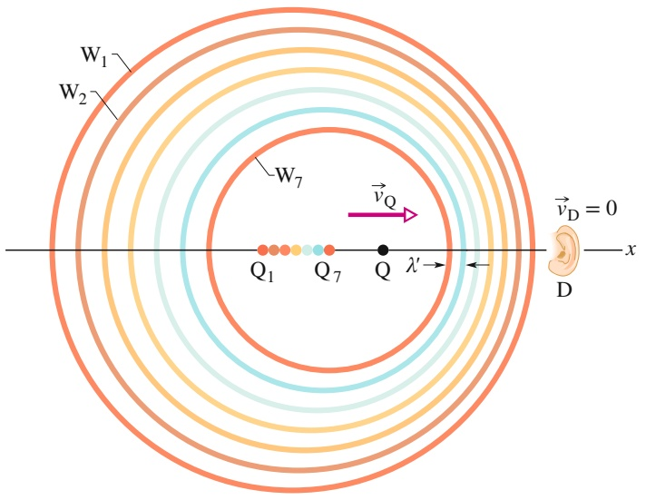

text_image

W₁
W₂
W₇
Q₁ Q₇ Q λ' D x
v_Q v_D = 0

326

---

13.7 Der Doppler-Effekt

13

In der zur Bewegungsrichtung von Q entgegengesetzten Richtung ist die Wellenlänge $\lambda ^ { \prime } = \nu T + \nu _ { \mathrm { Q } } T$ . Für diese Wellen nimmt D die Frequenz

$$
f ^ {\prime} = f \frac {\nu}{\nu + \nu_ {\mathrm{Q}}} \tag {13.47}
$$

wahr. Nun ist $f ^ { \prime }$ für $\nu _ { \mathrm { Q } } \neq 0$ kleiner als $f$ (sofern $\nu _ { \mathrm { Q } }$ nicht null ist).

Die beiden Gln. 13.46 und 13.47 können wir in der folgenden Form zusammenfassen:

$$
f ^ {\prime} = f \frac {\nu}{\nu \pm \nu_ {Q}} \quad (\text {Quelle in Bewegung, Detektor in Ruhe}). \tag {13.48}
$$

## Die allgemeine Gleichung für den Doppler-Effekt

Die Gleichung für den allgemeinen Doppler-Effekt erhalten wir aus Gl. 13.48, indem wir $f$ (die Frequenz der Quelle) durch $f ^ { \prime }$ aus Gl. 13.45 (der von einem beweg ten Detektor wahrgenommenen Frequenz) ersetzen. Das Ergebnis ist Gl. 13.40 für den allgemeinen Doppler-Effekt.

Diese allgemeine Gleichung gilt natürlich nicht nur, wenn sich sowohl die Quelle als auch der Detektor bewegen, sondern auch in den beiden gerade besprochenen speziellen Situationen. Ist der Detektor in Bewegung, aber die Quelle in Ruhe, so führt $\nu _ { \mathrm { Q } } = 0$ in Gl. 13.40 auf Gl. 13.45, die wir schon abgeleitet hatten. Befindet sich die Quelle in Bewegung, aber der Detektor in Ruhe, so führt $\nu _ { \mathrm { D } } = 0$ in Gl. 13.40 auf Gl. 13.48, die wir ebenfalls abgeleitet hatten. Man muss sich daher nur Gl. 13.40 merken.

## Die Navigation der Fledermäuse

Fledermäuse finden ihren Weg und suchen nach Beute, indem sie Ultraschallwellen aussenden und die Reflexionen dieser Wellen verarbeiten. Dabei handelt es sich um Schallwellen, deren Frequenz jenseits der menschlichen Hörgrenze liegt. Beispielsweise sendet eine Fledermaus der Gattung Hufeisennase Ultraschallwellen mit einer Frequenz von 83 kHz aus, also weit oberhalb der menschlichen Hörgrenze von 20 kHz.

Der Schall wird durch die Nasenlöcher der Fledermaus abgegeben. Wird er von einer Motte reflektiert, kann das Ohr der Fledermaus diesen reflektierten Schall, also sozusagen das Echo, wahrnehmen. Die Bewegungen von Fledermaus und Motte relativ zur Luft beeinflussen die von der Fledermaus wahrgenommene Frequenz um einige Kilohertz im Vergleich zur emittierten Frequenz. Diesen Frequenzunterschied übersetzt die Fledermaus automatisch in eine relative Geschwindigkeit zwischen ihr und der Motte, wodurch sie direkt auf die Motte zusteuern kann.

Einige Motten entgehen der tödlichen Gefahr, indem sie radial weg von der Rich tung fliegen, aus der sie Ultraschallwellen wahrnehmen. Dadurch wird der Frequenzunterschied zwischen dem, was die Fledermaus aussendet, und dem, was sie hört, kleiner, und die Fledermaus überhört das Echo leichter. Andere Motten beginnen zu Klicken und erzeugen ihre eigenen Ultraschallwellen, die das Wahrnehmungssystem der Fledermaus stören und sie verwirren.

## KONTROLLFRAGE 5

Die Abbildung zeigt sechs verschiedene Situationen für die Bewegung von Schallquellen und Detektoren in ruhender Luft. Betrachten Sie die einzelnen Situationen und entscheiden Sie, ob die detektierte Frequenz größer oder kleiner ist als die emittierte Frequenz. Gibt es Situationen, in denen Sie ohne weitere Informationen zu den tatsächlichen Geschwindigkeiten keine Aussage machen können?

|  | Quelle | Detektor |
| --- | --- | --- |
| (a) | $\longrightarrow$ | ● (in Ruhe) |
| (b) | $\longleftarrow$ | ● (in Ruhe) |
| (c) | $\longrightarrow$ | $\longrightarrow$ |
| (d) | $\longleftarrow$ | $\longleftarrow$ |
| (e) | $\longrightarrow$ | $\longleftarrow$ |
| (f) | $\longleftarrow$ | $\longrightarrow$ |

327

---

13 Wellen – II

## 13.8 Überschallgeschwindigkeit und Stoßwellen

## Lernziele

Nach dem Durcharbeiten dieses Abschnitts sollten Sie in der Lage sein, . . .

• das Zusammenlaufen der Wellenfronten zu skizzieren, wenn sich eine Schallquelle mit Schallgeschwindigkeit oder schneller bewegt,
• die Mach-Zahl für eine Schallquelle zu berechnen, die sich mit Überschallgeschwindigkeit bewegt,
für eine Schallquelle, die sich mit Überschallgeschwindigkeit bewegt, die Beziehung zwischen dem Mach-Winkel, der Schallgeschwindigkeit und der Geschwindigkeit der Schallquelle anzugeben und anzuwenden.

## Schlüsselideen

Wenn die Geschwindigkeit einer Schallquelle relativ zu dem umgebenden Me dium größer ist als die Schallgeschwindigkeit in diesem Medium, kann man die Doppler-Gleichung nicht mehr anwenden. In dieser Situation entsteht eine kegelförmige Stoßwelle. Der halbe Öffnungswinkel des Mach-Kegels ist durch

$$
\sin \theta = \frac {\nu}{\nu_ {\mathrm{Q}}}
$$

gegeben.

## Abb. 13.19

(a) Eine Schallquelle Q bewegt sich mit Schallgeschwindigkeit $\nu _ { \mathrm { Q } } = \nu .$ Sie hat daher dieselbe Geschwindigkeit wie die von ihr erzeugten Wellenfronten. (b) Die Geschwindigkeit $\nu _ { \mathrm { Q } }$ dieser Schallquelle Q ist größer als die Schallgeschwindigkeit und daher auch größer als die Ausbreitungsgeschwindigkeit der von ihr erzeugten Wellenfronten. Am Ort $\mathbf { Q } _ { 1 }$ hat die Quelle die Wellenfront $\tilde { \mathbf { W } } _ { 1 }$ erzeugt und am Ort $\mathbf { Q } _ { 6 }$ die Wellenfront $\mathbf { W } _ { 6 } .$ Alle Wellenfronten breiten sich mit der Schallgeschwindigkeit v aus. Sie addieren sich entlang der Oberfläche des sogenannten Mach-Kegels zu einer Stoßwelle. Die Mantelfläche des Kegels hat den halben Öffnungswinkel θ und ist tangential zu allen Wellenfronten.

## 13.8.1 Überschallgeschwindigkeit und Stoßwellen

Bewegt sich eine Schallquelle mit Schallgeschwindigkeit $( \nu _ { \mathrm { Q } } = \nu )$ auf einen Detektor zu, ist nach den Gln. 13.40 und 13.48 die von dem Detektor gemessene Frequenz $f ^ { \prime }$ unendlich groß. Die Quelle bewegt sich in diesem Fall genauso schnell wie ihre eigenen kugelförmigen Wellenfronten, wie man in Abb. 13.19a erkennen kann. Doch was geschieht, wenn die Geschwindigkeit der Schallquelle sogar größer ist als die Schallgeschwindigkeit?

Für solche Überschallgeschwindigkeiten lassen sich die Gln. 13.40 und 13.48 nicht mehr anwenden. In Abb. 13.19b erkennt man die kugelförmigen Wellenfronten, die an verschiedenen Orten der Quelle erzeugt wurden. Der Radius jeder der Wellenfronten ist vt, wobei v die Schallgeschwindigkeit und t die seit ihrer Erzeugung verstrichene Zeit ist. Man erkennt, dass in der zweidimensionalen Zeichnung von Abb. 13.19b sämtliche Wellenfronten entlang einer V-förmigen Einhüllenden zusammenkommen. In Wirklichkeit erstrecken sich die Wellenfronten in drei Dimensionen und die Einhüllende dieser Kugelflächen bildet einen sogenannten Mach-Kegel. Entlang der Mantelfläche dieses Kegels existiert eine Stoßwelle, denn

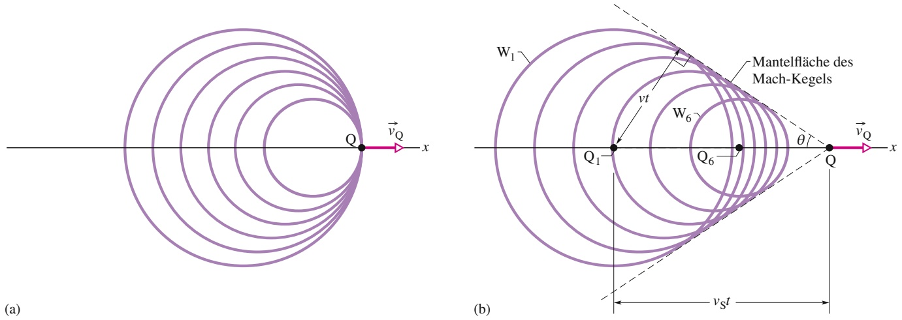

328

---

13.9 Zusammenfassung

13

durch das Zusammentreffen der Wellenfronten kommt es zu einem plötzlichen und heftigen Anstieg und anschließendem Abfall des Luftdrucks an den Punkten, durch welche diese Mantelfläche tritt. Aus Abb. 13.19b können wir für den halben Öffnungswinkel θ des Kegels, den Mach-Winkel, die folgende Beziehung ablesen:

$$
\sin \theta = \frac {\nu t}{\nu_ {\mathrm{Q}} t} = \frac {\nu}{\nu_ {\mathrm{Q}}} \quad \text {(Mach - Winkel)}. \tag {13.49}
$$

Das Verhältnis $\nu _ { \mathrm { Q } } / \nu$ bezeichnet man auch als die Mach-Zahl. Wenn sie von einem bestimmten Flugzeug hören, es sei mit Mach 2,3 geflogen, dann betrug die Geschwindigkeit des Flugzeugs das 2,3-Fache der Schallgeschwindigkeit in der Luft, durch die das Flugzeug flog. Die von einem Überschallflugzeug (Abb. 13.20) oder Projektil erzeugte Stoßwelle nimmt unser Ohr als einen lauten Knall wahr, den man den Überschallknall nennt. Ein Teil des Knalls, den man beim Abschuss eines Gewehrs hört, beruht auf dem Überschallknall der Kugel. Ein solcher Knall kann auch von einer langen, schnell geschlagenen Peitsche erzeugt werden: Das Peitschenende bewegt sich dabei kurzzeitig schneller als der Schall und erzeugt so einen leichten Überschallknall – das Schnalzen der Peitsche.

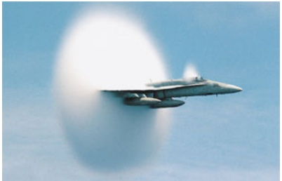

natural_image

Fighter jet in flight against a clear blue sky, creating a dynamic exhaust trail (no visible text or symbols)

Abb. 13.20

Stoßwellen hinter den Flügeln eines Düsenjägers, der gerade die Schallmauer durchbricht. Der plötzliche Druckabfall in der Stoßwelle lässt die Wassermoleküle in der Luft zu einem Nebel kondensieren und macht die Stoßwelle sichtbar [Quelle: US Navy Foto von Ensign John Gay].

## 13.9 Zusammenfassung

**Schallwellen** Schallwellen sind longitudinale mechanische Wellen, die sich durch Festkörper, Flüssigkeiten und Gase ausbreiten können. Die Geschwindigkeit v einer Schallwelle in einem Medium mit dem **Kompressionsmodul** K und der Dichte $\rho$ ist

$$
\nu = \sqrt {\frac {K}{\rho}} \quad (\text {Schallgeschwindigkeit}). \tag {13.3}
$$

In Luft bei 20 °C beträgt die Schallgeschwindigkeit 343 m/s.

Eine Schallwelle bewirkt eine longitudinale Auslenkung s eines Massenelements des Mediums von der Form

$$
s = s _ {\mathrm{m}} \cos (k x - \omega t), \tag {13.13}
$$

wobei $s _ { \mathrm { m } }$ die **Auslenkungsamplitude** (maximale Auslenkung aus der Gleichgewichtslage) ist. Außerdem gilt $k =$ $2 \pi / \lambda$ und $\omega = 2 \pi / f ,$ , mit der Wellenlänge λ und der Frequenz f der Schallwelle. Eine Schallwelle verursacht im Medium eine Druckänderung $\Delta p$ relativ zum Gleichgewichtsdruck:

$$
\Delta p = \Delta p _ {\mathrm{m}} \sin (k x - \omega t), \tag {13.14}
$$

wobei die **Druckamplitude** mit der Auslenkungsamplitude über

$$
\Delta p _ {\mathrm{m}} = (\nu \rho \omega) s _ {\mathrm{m}} \tag {13.15}
$$

zusammenhängt.

**Interferenz bei Schallwellen** Die Interferenz zweier Schallwellen mit gleichen Wellenlängen an einem gegebenen Punkt hängt von ihrer Phasenverschiebung 𝜑 an diesem Punkt ab. Werden die Schallwellen in Phase emittiert und breiten sie sich näherungsweise in dieselbe Richtung aus, so ist 𝜑 durch

$$
\varphi = \frac {\Delta L}{\lambda} 2 \pi \tag {13.21}
$$

gegeben, wobei ΔL die **Weglängendifferenz** (der Unterschied in der von den beiden Wellen bis zu diesem Punkt zurückgelegten Wegstrecke) ist. Konstruktive Interferenz tritt auf, wenn 𝜑 ein ganzzahliges Vielfaches von 2π ist:

$$
\varphi = m (2 \pi) \quad \text {mit} \quad m = 0, 1, 2, \dots , \tag {13.22}
$$

bzw. wenn das Verhältnis von $\Delta L$ zu $\lambda$ eine ganze Zahl ist:

$$
\frac {\Delta L}{\lambda} = 0, 1, 2, \dots \tag {13.23}
$$

Destruktive Interferenz tritt auf, wenn $\varphi$ ein ungerades Vielfaches von π ist:

$$
\varphi = (2 m + 1) \pi , \quad \text {mit} \quad m = 0, 1, 2, \dots , \tag {13.24}
$$

bzw. wenn das Verhältnis von $\Delta L$ zu $\lambda$ gleich

$$
\frac {\Delta L}{\lambda} = \frac {1}{2}, \frac {3}{2}, \frac {5}{2}, \dots \tag {13.25}
$$

ist.

**Schallintensität** Die **Intensität** I einer Schallwelle an einer Fläche ist gleich der mittleren Energieübertragungsrate durch oder auf diese Fläche:

$$
I = \frac {P}{A}, \tag {13.26}
$$

wobei P die Energieübertragungsrate (Leistung) der Schallwelle und A die Fläche ist, auf die der Schall trifft. Die Intensität I hängt mit der Auslenkungsamplitude $s _ { \mathrm { m } }$ der Schallwelle über die Beziehung

$$
I = \frac {1}{2} \rho \nu \omega^ {2} s _ {\mathrm{m}} ^ {2} \tag {13.27}
$$

zusammen. Die Intensität im Abstand r von einer Punktquelle, die Schallwellen der Leistung $P _ { S }$ abstrahlt, ist

$$
I = \frac {P _ {\mathrm{S}}}{4 \pi r ^ {2}}. \tag {13.28}
$$

329

---

13 Wellen – II

**Schallpegel in Dezibel** Der Schallpegel $\beta$ in Dezibel (dB) ist definiert als

$$
\beta = (1 0 \mathrm{dB}) \log_ {1 0} \frac {I}{I _ {0}} = (1 0 \mathrm{dB}) \log \frac {I}{I _ {0}}, \tag {13.29}
$$

wobei $I _ { 0 } ( = \mathrm { ~ 1 0 ^ { - 1 2 }   W / m ^ { 2 } } )$ einer Standardintensität entspricht, mit der alle Intensitäten verglichen werden. Für jede Zunahme der Intensität um einen Faktor 10 werden 10 dB zum Schallpegel addiert.

**Stehende Wellen in Rohren** In Rohren lassen sich stehende Schallwellen erzeugen. Ist ein Rohr an beiden Enden offen, können sich stehende Wellen mit den Resonanzfrequenzen

$$
f = \frac {\nu}{\lambda} = \frac {n \nu}{2 L} \quad \mathrm{mit} \quad n = 1, 2, 3, \dots \tag {13.35}
$$

ausbilden, wobei v die Schallgeschwindigkeit in der Luft des Rohrs ist. Für ein an einem Ende geschlossenes Rohr sind die Resonanzfrequenzen

$$
f = \frac {\nu}{\lambda} = \frac {n \nu}{4 L} \quad \text {mit} \quad n = 1, 3, 5, \dots \tag {13.37}
$$

**Schwebungen** Schwebungen treten auf, wenn sich die Frequenzen $f _ { 1 }$ und $f _ { 2 }$ zweier Wellen nur sehr wenig unterscheiden und die beiden Wellen sich überlagern. Die Schwebungsfrequenz ist

$$
f _ {\mathrm{Schwebung}} = f _ {1} - f _ {2}. \tag {13.42}
$$

## 13.10 Fragen

**1.** Abbildung 13.F1 zeigt zwei gleich lange Wege, die zwei gleichzeitig abgestrahlte Schallpulse durch die Luft nehmen. Der einzige Unterschied zwischen den beiden Wegen besteht darin, dass sich entlang Weg 2 ein Bereich mit heißer Luft und damit einer niedrigeren Luftdichte befindet. Welcher der beiden Pulse erreicht das Ende zuerst?

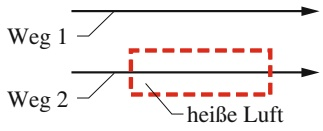

text_image

Weg 1
Weg 2
heiße Luft

Abb. 13.F1

**2.** Eine Schallwelle (Wellenlänge λ, Auslenkungsamplitude $s _ { \mathrm { m } } )$ breite sich durch einen hohlen Gang oder Kanal aus (einen Tunnel, Gehörgang oder Ähnliches). Ein kleines Gerät innerhalb dieses Gangs registriere diese Welle und sende sofort eine zweite Welle aus (einen sogenannten Anti-schall), die durch Interferenz die erste Welle aufhebt, so dass man am anderen Ende des Gangs nichts mehr hört. (a) Welche Ausbreitungsrichtung, (b) welche Wellenlänge und (c) welche Auslenkungsamplitude muss der Antischall haben, damit eine solche Nivellierung auftritt? (d) Welche Phasenverschiebung muss zwischen den beiden Wellen bestehen? Solche Antischallgeräte werden zur Eliminierung

**Doppler-Effekt** Der Doppler-Effekt besteht in einer Veränderung der beobachteten Frequenz einer Welle, wenn sich die Quelle oder der Detektor relativ zu dem übertragenden Medium (z. B. Luft) bewegen. Bei Schallwellen besteht folgende Beziehung zwischen der beobachteten Frequenz $\bar { f ^ { \prime } }$ und der von der Quelle abgestrahlten Frequenz $f ;$

$$
f ^ {\prime} = f \frac {\nu \pm \nu_ {\mathrm{D}}}{\nu \pm \nu_ {\mathrm{Q}}} \quad (\text {allgemeiner Doppler - Effekt), (13.43)}
$$

wobei $\nu _ { \mathrm { D } }$ die Geschwindigkeit des Detektors relativ zum Medium, $\nu _ { \mathrm { Q } }$ die Geschwindigkeit der Schallquelle relativ zum Medium und v die Schallgeschwindigkeit in dem Medium sind. Die Vorzeichen sind so zu wählen, dass $f ^ { \prime }$ grö- ßer als $f$ ist, wenn sich Detektor und Quelle aufeinander zubewegen, und kleiner, falls sie sich voneinander wegbewegen.

**Stoßwellen** Ist die Geschwindigkeit einer Quelle relativ zum Medium größer als die Schallgeschwindigkeit in dem Medium, lässt sich die Gleichung für den Doppler-Effekt nicht mehr anwenden. In diesem Fall entstehen Stoßwellen. Der halbe Öffnungswinkel θ des Mach-Kegels ist durch die folgende Beziehung gegeben:

$$
\sin \theta = \frac {\nu}{\nu_ {\mathrm{Q}}} \qquad (\text {Mach - Winkel}). \tag {13.49}
$$

unerwünschter Geräusche in einer lauten Umgebung eingesetzt.

**3.** Die beiden Punktquellen in Abb. 13.F3 strahlen in Phase gleichartige Schallwellen der Wellenlänge 2 m ab. Welcher Gangunterschied (ausgedrückt in Wellenlängen) besteht zwischen den beiden Wellen bei Punkt P, wenn (a) $L _ { 1 } =$ 38 m und $L _ { 2 } = 3 4   \mathrm { m }$ , und (b) $L _ { 1 } = 3 9   \mathrm { m }$ und $L _ { 2 } = 3 6   \mathrm { m } ?$ (c) Angenommen, der Abstand zwischen den beiden Quellen ist wesentlich kleiner als $L _ { 1 }$ und $L _ { 2 } .$ Welche Art von Interferenz tritt in den Situationen (a) und (b) bei P auf?

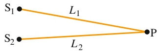

Abb. 13.F3

**4.** In Abb. 13.F4 strahlt eine Punktquelle S Schallwellen der Wellenlänge λ ab. Die Schallwellen breiten sich einmal direkt entlang Weg 1 von der Punktquelle zum Detektor aus und ein zweites Mal entlang Weg 2, wobei sie an einem Schirm reflektiert werden. Zu Beginn befindet sich der Schirm praktisch innerhalb von Weg 1 und die beiden bei D ankommenden Wellen sind nahezu in Phase. Nun zieht die Experimentatorin den Schirm wie in der Abbildung an-

330

---

13.10 Fragen

13

gedeutet von Weg 1 langsam nach hinten weg, bis die bei D ankommenden Wellen genau außer Phase sind. Welche Weglängendifferenz $\Delta L$ besteht in dann zwischen den beiden Wegen?

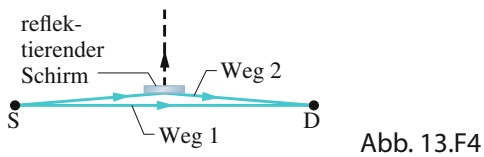

text_image

reflek-
tierender
Schirm
Weg 2
S
D
Weg 1
Abb. 13.F4

**5.** Die beiden Punktquellen $S _ { 1 }$ und $\mathsf { S } _ { 2 }$ in Abb. 13.F5 emittieren in Phase gleiche Schallwellen der Wellenlänge λ. Der Punkt P sei gleich weit von beiden Quellen entfernt. Nun wird $\mathsf { S } _ { 2 }$ um den Abstand $\lambda / 4$ radial von P weg verschoben. Sind die Wellen bei P genau in Phase, genau außer Phase oder haben sie irgendeine andere Phasenverschiebung, wenn (a) $S _ { 1 }$ um den Abstand $\lambda / 4$ direkt auf P zu bewegt wird, und (b) $S _ { 1 }$ um den Abstand 3λ∕4 direkt von P wegbewegt wird?

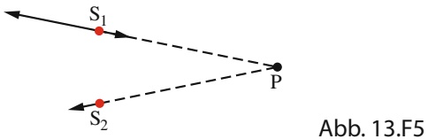

flowchart

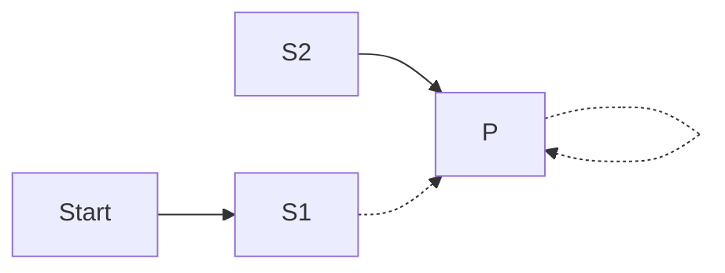

**6.** In Beispielaufgabe 13.2 im Übungsbuch und Abb. 13.8a befinden sich die an Punkt $\mathrm { P } _ { 1 }$ auf der Mittelsenkrechten zur Verbindungslinie zwischen den beiden Quellen ankommenden Wellen genau in Phase. Die Wellen von $S _ { 1 }$ und $S _ { 2 }$ bewegen ein Luftelement bei $\mathrm { P } _ { 1 }$ also immer in dieselbe Richtung. Mit $\mathrm { P } _ { 3 }$ bezeichnen wir den Schnittpunkt zwischen der Mittelsenkrechten und der Verbindungslinie von $S _ { 1 }$ und $S _ { 2 } .$ (a) Sind die beiden Wellen bei $\mathrm { P } _ { 3 }$ genau in Phase, genau außer Phase oder keins von beiden? (b) Wie lautet die Antwort, wenn wir den Abstand zwischen den Quellen auf 1,7λ erhöhen?
**7.** Eine stehende Schallwelle in einem Rohr habe fünf Knoten und fünf Bäuche. (a) Wie viele offene Enden besitzt das Rohr? (b) In welcher Schwingungsmode n befindet sich diese stehende Welle?
**8.** In einem Rohr wird die 6. Harmonische erzeugt. (a) Wie viele offene Enden besitzt das Rohr (es hat mindestens ein offenes Ende)? (b) Befindet sich in der Mitte ein Knoten, ein Bauch oder ein anderer Wellenzustand? (a) Wenn sich ein Orchester vor einem Konzert bereit macht, erwärmen die Spieler von Blasinstrumenten durch ihren Atem die Lufttemperatur in ihren Instrumenten, bis sie die Atemtemperatur angenommen hat. Dadurch nimmt die Luftdichte im Instrument ab. Werden die Resonanzfrequenzen des Instruments größer oder kleiner? (b) Wenn der Zug einer Posaune nach außen gezogen wird, werden die Resonanzfrequenzen dieses Instruments größer oder kleiner?
**9.** Für ein bestimmtes Rohr seien 300, 600, 750 und 900 Hz vier der sechs Resonanzfrequenzen unterhalb von 1000 Hz. Welche zwei Frequenzen fehlen in dieser Liste?

**10.** Rohr A habe eine Länge L und ein offenes Ende. Rohr B habe die Länge 2L und zwei offene Enden. Welche Schwingungsmoden von Rohr B haben eine Frequenz, die einer Resonanzfrequenz von Rohr A entspricht?
**11.** Abbildung 13.F11 zeigt eine gespannte Saite der Länge L sowie Rohre a, $, \mathbf { b } ,$ c und d mit den jeweiligen Längen L, 2L, $L / 2$ und $L / 2 .$ . Die Saitenspannung wird so eingestellt, dass die Geschwindigkeit der Wellen auf der Saite gleich der Geschwindigkeit der Schallwellen in der Luft ist. Auf der Saite wird nun die Grundschwingung angeregt. In welchen Rohren erzeugt der Klang der Saite eine Resonanz und welcher Schwingungsmode entspricht diese Resonanz jeweils?

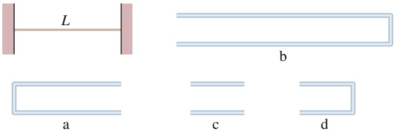

text_image

L
b
a
c
d

Abb. 13.F11

**12.** Schallwellen der Frequenz f werden von einem Fluid reflektiert, das sich durch ein enges Rohr in x-Richtung bewegt (Abb. 13.F12a). Der Innendurchmesser des Rohrs verändert sich als Funktion von x. Die Frequenzänderung $\Delta f$ des Schalls wird aufgrund des Doppler-Effekts dadurch ebenfalls x-abhängig, wie in Abb. 13.F12b wiedergegeben. Ordnen Sie die fünf markierten Bereiche nach dem Innendurchmesser der zugehörigen Rohre (größte Werte zuerst, vgl. Abschn. 10.7).

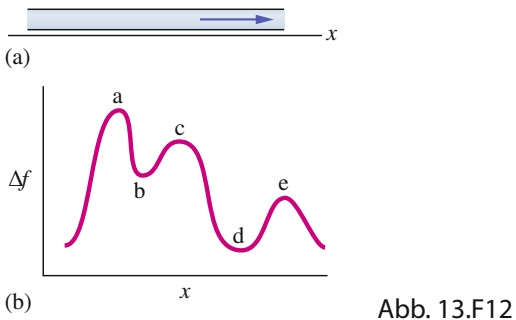

line

| Peak | Description |
| --- | --- |
| a | First peak |
| b | Second peak |
| c | Third peak |
| d | Fourth peak |
| e | Fifth peak |

**13.** Eine Bekannte von Ihnen fährt nacheinander mit drei schnellen Karussellen, wobei sie sich jeweils am äußeren Rand befindet und eine Schallquelle hält, die bei einer bestimmten Frequenz isotrop (d. h. gleichmäßig in alle Richtungen) einen Ton aussendet. Sie befinden sich in einer gewissen Entfernung von den Karussellen. Die von Ihnen wahrgenommenen Frequenzen dieses Tons sind bei den drei Fahrten Ihrer Bekannten unterschiedlich. Die Frequenzänderungen entsprechen den drei Kurven in Abb. 13.F13. Ordnen Sie die Kurven (a) nach der linearen Geschwindigkeit v der Schallquelle, (b) der Winkelgeschwindigkeit ω der Karusselle und (c) dem Radius r der Karusselle (größte Werte jeweils zuerst).

331

---

13 Wellen – II

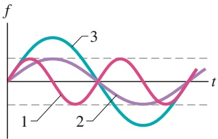

line

| Category | Value |
| --- | --- |
| 1 | ~0.5 |
| 2 | ~-0.8 |
| 3 | ~0.8 |

Abb. 13.F13

**14.** In einem Experiment wird eine sinusförmige Schallwelle durch ein langes luftgefülltes Rohr geschickt. Es transportiert dabei Energie mit einer mittlere Leistung $P _ { \mathrm { g e m , 1 } }$ . In einem zweiten Experiment werden zwei mit der ersten Welle identische Schallwellen mit einer Phasendifferenz 𝜑 von $_ { 0 ,   0 , 2 }$ oder 0,5 Wellenlängen gleichzeitig durch das Rohr geschickt. (a) Ordnen Sie diese drei Varianten für 𝜑 in absteigender Reihenfolge nach der mittleren Leistung des Energietransports – und rechnen Sie dabei im Kopf! (b) Wie groß ist die mittlere Leistung für die erste Wahl von 𝜑 bezogen auf $P _ { \mathrm { g e m , 1 } } ?$
**15.** Abbildung 13.F15 zeigt drei lange Rohre (A, B und C), die mit unterschiedlichen Gasen unter verschiedenen Drücken gefüllt sind. Das Verhältnis des Kom-

pressionsmoduls zur Dichte ist für jedes Gas in Einheiten eines gemeinsamen Bezugswerts $K _ { 0 } / \rho _ { 0 }$ angegeben. Jedes Rohr besitzt an seinem linken Ende einen beweglichen Kolben, der einen Schallpuls durch das Rohr schicken kann (wie in Abb. 12.2). Die drei Pulse werden gleichzeitig gestartet. Ordnen Sie die Rohre in aufsteigender Reihenfolge nach dem Zeitpunkt, zu dem die Schallpulse an den offenen rechten Enden der Rohre ankommen.

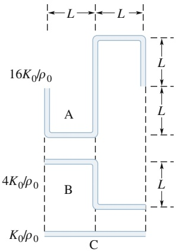

text_image

L
L
16K₀/ρ₀
A
L
L
4K₀/ρ₀
B
L
K₀/ρ₀
C

Abb. 13.F15

**16.** In einem Rohr wird die 6. Harmonische angeregt. (a) Wie viele offene Enden hat das Rohr (mindestens eines)? (b) Liegt in der Mitte des Rohrs ein Knoten, ein Schwingungsbauch oder ein anderer Wellenzustand vor?
**17.** In einem Rohr A wird durch eine kleine interne Schallquelle die 3. Harmonische angeregt (Abb. 13.F17). Der am rechten Ende austretende Schall trifft auf vier benachbarte Rohre mit jeweils einem offenen Ende (nicht maßstabsgetreu gezeichnet). In Rohr B wird die 1. Harmonische angeregt, in Rohr C die 2., in Rohr D die 3. und in Rohr E die 4. Ordnen Sie die fünf Rohre ohne Berechnung in absteigender Reihenfolge nach ihrer Länge. Es könnte helfen, wenn Sie dazu die Rohre und die sich ausbildenden stehenden Wellen maßstabsgetreu skizzieren.

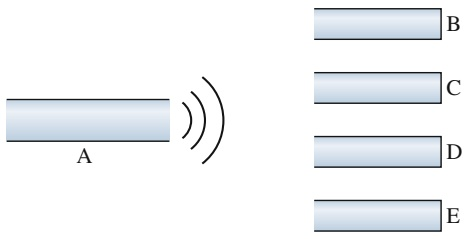

text_image

A
B
C
D
E

Abb. 13.F17

**18.** Sie erhalten vier Stimmgabeln, von denen die mit der niedrigsten Frequenz mit 500 Hz schwingt. Wenn Sie jeweils zwei Stimmgabeln anschlagen, können Sie Schwebungsfrequenzen von 1, 2, 3, 5, 7 und 8 Hz erzeugen. Was sind die möglichen Frequenzen der anderen drei Gabeln? (Es gibt zwei Sätze von Antworten.)

332
