# 16 Entropie und der zweite Hauptsatz der Thermodynamik

原始 PDF 第 411–432 页。

# 16 Entropie und der zweite Hauptsatz der Thermodynamik

## 16.1 Entropie

## Physikalische Motivation

Die Zeit hat eine Richtung – die Richtung, in der wir altern. Wir kennen viele Pro zesse, die nur in einer bestimmten Richtung ablaufen und niemals umgekehrt: Ein Ei fällt zu Boden und zerbricht, eine Pizza wird knusprig gebacken, ein Auto fährt gegen einen Laternenpfahl und bekommt eine Beule, Meereswellen erodieren eine Klippe, bis sie einstürzt – all diese Prozesse sind irreversibel, d. h., sie können nicht durch kleine Veränderungen in ihrer Umgebung umgekehrt werden.

Ein Ziel der Physik ist es, zu verstehen, warum die Zeit eine Richtung hat und warum derartige Prozesse unumkehrbar sind. Obwohl diese Fragestellungen wenig Relevanz für unseren Alltag zu haben scheinen, sind sie doch in Wirklichkeit von zentraler Bedeutung für jede Art von Maschine, etwa einen Verbrennungsmotor, weil sie bestimmen, wie effizient so eine Maschine arbeiten kann.

Um zu verstehen, warum solche Prozesse nicht rückgängig gemacht werden können, müssen wir uns mit einer eigenartigen Größe beschäftigen, die unter dem Namen Entropie bekannt ist.

## 16.1.1 Irreversible Prozesse und Entropie

Die einseitige Gerichtetheit von thermodynamischen Prozessen ist uns so vertraut, dass wir sie als selbstverständlich ansehen. Entwickelten sich diese Prozesse spontan (von selbst) in die „falsche“ Richtung, würden wir vermutlich an unserem Verstand zweifeln. Trotzdem: Keines dieser „falschen“ Ereignisse würde das Gesetz von der Energieerhaltung verletzen. Dieses Gesetz wäre etwa bei einem heißen Becher Kakao erfüllt, selbst wenn der Wärmeaustausch zwischen Ihren Händen und dem Becher in die falsche Richtung ablaufen und ihre Finger abkühlen sollte. Das Gesetz wäre ebenfalls erfüllt, wenn ein ruhender Gegenstand einen Teil seiner thermischen Energie in kinetische Energie umsetzen würde und sich plötzlich zu bewegen anfinge. Und es wäre auch erfüllt, wenn sich frei im Zimmer umherfliegende Heliumatome plötzlich wieder zu der Form ihres kurz zuvor geplatzten Ballons zusammenfinden würden.

In einem abgeschlossenen System lässt sich aus Energieänderungen keine Richtung für den Ablauf irreversibler Prozesse ablesen. Diese Richtung ist durch eine andere Eigenschaft bestimmt, mit der wir uns in diesem Kapitel beschäftigen wollen – die Änderung der Entropie ΔS eines Systems. Wir werden die Entropieänderung in einem System im folgenden Abschnitt definieren, aber an dieser Stelle wollen wir die wesentliche Eigenschaft, das Entropiepostulat, zumindest formulieren:

Findet in einem abgeschlossenen System ein irreversibler Prozess statt, so nimmt die Entropie S dieses Systems immer zu; sie nimmt niemals ab.

Halliday Physik für natur- und ingenieurwiss. Studiengänge, 3. Auflage. D. Halliday, R. Resnick und J. Walker. © 2020 WILEY-VCH Verlag GmbH & Co. KGaA. Published 2020 by WILEY-VCH Verlag GmbH & Co. KGaA.

397

---

16 Entropie und der zweite Hauptsatz der Thermodynamik

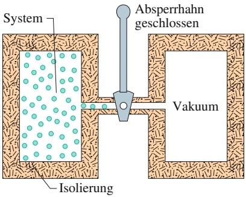

text_image

System
Absperrhahn geschlossen
Isolierung
Vakuum

(a) Anfangszustand i

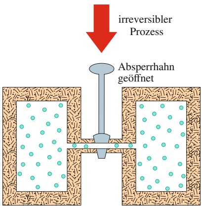

flowchart

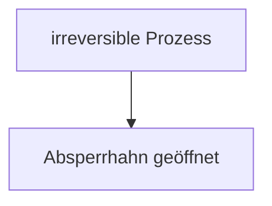

(b) Endzustand f

## Abb. 16.1

Die freie Expansion eines idealen Gases. (a) Das Gas wird durch einen Absperrhahn in der linken Hälfte eines isolierten Behälters gehalten. (b) Nachdem der Hahn geöffnet wurde, verteilt sich das Gas auf den gesamten Behälter. Dieser Prozess ist irreversibel, er läuft also nie in umgekehrter Richtung ab – die Gasmoleküle finden sich nie von selbst wieder in der linken Hälfte des Behälters zusammen.

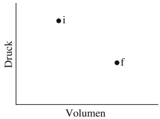

scatter

| Point | Volumen | Druck |
| --- | --- | --- |
| i | ~1.5 | ~2.8 |
| f | ~3.0 | ~1.5 |

## Abb. 16.2

In einem $p V \mathrm { { \text-- } D }$ iagramm sind der Anfangszustand i und der Endzustand f der freien Expansion aus Abb. 16.1 eingetragen. Die Zwischenzustände des Gases können hier nicht wiedergegeben werden, da sie keinen Gleichgewichtszuständen entsprechen.

Die Entropie unterscheidet sich von der Energie in der Hinsicht, dass sie keinem Erhaltungssatz genügt. Die Energie eines abgeschlossenen Systems ist immer erhalten, die Entropie eines abgeschlossenen Systems nimmt jedoch bei irreversiblen Prozessen immer zu. Wegen dieser Eigenschaft bezeichnet man die Entropieänderung auch manchmal als „den Zeitpfeil“. Zum Beispiel verbinden wir mit einem gerade zerplatzenden Ei die Vorwärtsrichtung der Zeit (erst heil, dann kaputt) und eine Zunahme der Entropie. Die umgekehrte Zeitrichtung, wie man sie in einer rückwärtslaufenden Videoaufzeichnung sehen kann, entspräche einem zerbrochenen Ei, das sich wieder zu einem ganzen Ei zusammenfindet. Dieser umgekehrte Prozess würde eine Entropieabnahme bedeuten und kann daher nie stattfinden.

Es gibt zwei äquivalente Möglichkeiten, die Entropieänderung eines Systems zu definieren: (1) durch die Temperatur des Systems und die von dem System aufge nommene oder abgegebene Wärmeenergie, und (2) durch ein Abzählen aller Möglichkeiten, in der sich die Atome oder Moleküle eines Systems anordnen können. Im folgenden Abschnitt wählen wir den ersten Weg, in Abschn. 16.4 den zweiten.

## 16.1.2 Entropieänderungen

Wir betrachten nochmals einen Prozess, den wir bereits in den Abschn. 14.5 und 15.9 untersucht haben: die freie Expansion eines idealen Gases. Abbildung 16.1a zeigt das Gas zunächst in einem anfänglichen Gleichgewichtszustand i, wo es durch einen Absperrhahn in der linken Hälfte eines Behälters eingesperrt ist. Öffnen wir den Hahn, strömt das Gas heraus und erreicht schließlich den neuen Gleichgewichtszustand f in Abb. 16.1b, wo es sich gleichmäßig im gesamten Behälter verteilt hat. Es handelt sich hierbei um einen irreversiblen Prozess, denn es werden nie sämtliche Moleküle ohne äußere Einwirkung von selbst wieder in die linke Hälfte des Behälters zurückkehren.

Im pV-Diagramm von Abb. 16.2 erkennt man die Punkte für den Druck und die Temperatur des Gases im Anfangszustand i und im Endzustand f. Druck und Volumen sind Zustandsgrößen, also Eigenschaften, die nur vom aktuellen Zustand des Gases abhängen und nicht davon, wie das Gas in diesen Zustand gelangt ist. Weitere Zustandsgrößen sind die Temperatur und die Energie. Es gibt aber noch eine weitere Zustandsgröße: die Entropie des Gases. Wir definieren die **Entropieänderung** $\Delta S = S _ { \mathrm { f } } - S _ { \mathrm { i } }$ eines Systems bei einem Prozess, der von einem Anfangszustand i zu einem Endzustand f verläuft, als

$$
\Delta S = S _ {\mathrm{f}} - S _ {\mathrm{i}} = \int_ {\mathrm{i}} ^ {\mathrm{f}} \frac {\mathrm{d} Q}{T} \quad \text {(Definition der Entropieänderung).} \tag {16.1}
$$

Q ist die vom System bei dem Prozess aufgenommene oder abgegebene Wärmeenergie und T ist die Temperatur des Systems in Kelvin. Die Entropieänderung hängt also nicht nur von der ausgetauschten Wärmeenergie ab, sondern auch von der Temperatur, bei der dieser Austausch stattfindet. T ist immer positiv, daher ist das Vorzeichen von ΔS dasselbe wie das Vorzeichen von Q. Weiterhin erkennen wir aus Gl. 16.1, dass die SI-Einheit für die Entropie bzw. die Entropieänderung Joule pro Kelvin ist.

Es gibt jedoch ein Problem, wenn wir Gl. 16.1 auf die freie Expansion aus Abb. 16.1 anwenden wollen. Während das Gas durch das Verbindungsstück in die zweite Hälfte des Behälters strömt, verändern sich der Druck, die Temperatur und das Volumen des Gases auf unbekannte Art und Weise. Mit anderen Worten, es gibt für die Zwischenzustände keine Folge von wohldefinierten Gleichgewichtswerten. Wir können daher in Abb. 16.1 für die freie Expansion auch keinen „Druck-Volumen-Pfad“ angeben. Und was noch wichtiger ist: Wir können auch keine Beziehung zwischen Q und T aufstellen, mit deren Hilfe wir Gl. 16.1 integrieren könnten.

398

---

16.1 Entropie

16

Wenn jedoch, wie oben gefordert, die Entropie eine Zustandsgröße darstellt, dann hängt die Differenz zwischen der Entropie der Zustände i und f nur von diesen beiden Zuständen ab und nicht von dem Pfad, den das System von dem einen zum anderen Zustand genommen hat. Wir können also die irreversible freie Expansion aus Abb. 16.1 durch einen reversiblen Prozess, der die Zustände i und f verbindet, ersetzen. Für einen solchen reversiblen Prozess gibt es einen Pfad im $p V \cdot$ Diagramm und wir können auch eine Beziehung zwischen $Q$ und $T$ aufstellen, die wir gemäß Gl. 16.1 integrieren können, um die Entropieänderung zu berechnen.

In Abschn. 15.9 hatten wir gesehen, dass sich die Temperatur eines idealen Gases bei einer freien Expansion nicht ändert: $T _ { \mathrm { i } } = T _ { \mathrm { f } } = T$ . Die Punkte i und f in Abb. 16.2 müssen sich also auf derselben Isothermen befinden. Eine sinnvolle Ersetzung für die freie Expansion wäre daher eine reversible isotherme Expansion vom Zustand i zum Zustand f, die tatsächlich entlang dieser Isothermen verläuft. Und da T im Verlauf einer reversiblen isothermen Expansion konstant bleibt, vereinfacht sich das Integral in Gl. 16.1 erheblich.

Abbildung 16.3 zeigt, wie sich eine solche isotherme Expansion als reversibler Prozess realisieren lässt. Das Gas befindet sich in einem geschlossenen wärmeisolierten Zylinder auf einem Wärmereservoir bei der Temperatur T. Das Gewicht auf dem beweglichen Kolben wird gerade so gewählt, dass Druck und Volumen des Gases dem Anfangszustand i aus Abb. 16.1a entsprechen. Nun entfernen wir nach und nach Bleikugeln, bis Druck und Volumen des Gases die Werte des Endzustands f in Abb. 16.1b haben. Die Temperatur des Gases ändert dabei nicht, da es in ständigem Kontakt mit dem Wärmereservoir steht.

Die reversible Expansion aus Abb. 16.3 unterscheidet sich in physikalischer Hinsicht wesentlich von der irreversiblen Expansion aus Abb. 16.1. Beide Prozesse haben jedoch denselben Anfangs- und denselben Endzustand und damit muss auch die Entropieänderung dieselbe sein. Da wir das Gewicht sehr langsam herabgesetzt haben, handelt es sich bei allen Zwischenzuständen des Gases um Gleichgewichtszustände, die wir in ein $p V \text-- \mathrm { D i }$ agramm eintragen können (Abb. 16.4).

Bei einer isothermen Expansion können wir die konstante Temperatur $T$ in Gl. 16.1 vor das Integral ziehen und erhalten

$$
\Delta S = S _ {\mathrm{f}} - S _ {\mathrm{i}} = \frac {1}{T} \int_ {\mathrm{i}} ^ {\mathrm{f}} \mathrm{d} Q.
$$

$\int \mathrm { d } Q = Q$ stellt die bei dem Prozess in Form von Wärme ausgetauschte Gesamtenergie dar, damit ist

$$
\Delta S = S _ {\mathrm{f}} - S _ {\mathrm{i}} = \frac {Q}{T} \quad \text {(Entropieänderung, isotherme Ausdehnung). (16.2)}
$$

Damit die Gastemperatur $T$ während der isothermen Expansion aus Abb. 16.3 konstant bleiben konnte, musste von dem Reservoir an das System die Wärmeenergie $Q$ übertragen werden. Q ist also positiv und die Entropie des Gases nimmt bei diesem isothermen Prozess ebenso wie bei der freien Expansion aus Abb. 16.1 zu.

Fassen wir zusammen:

Zur Bestimmung der Entropieänderung bei einem irreversiblen Prozess in einem abgeschlossenen System kann man diesen Prozess durch irgendeinen reversiblen Prozess mit demselben Anfangs- und Endzustand ersetzen und die Entropieänderung bei diesem reversiblen Prozess nach Gl. 16.1 berechnen.

Ist die Temperaturänderung $\Delta T$ eines Systems klein im Vergleich zur absoluten Temperatur (in Kelvin) vor und nach dem Prozess, so kann die Entropieänderung

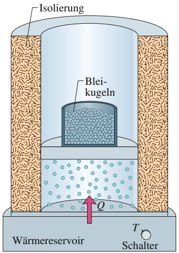

text_image

Isolierung
Blei-
kugeln
Wärmereservoir
Q
T
Schalter

(a) Anfangszustand i

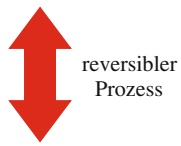

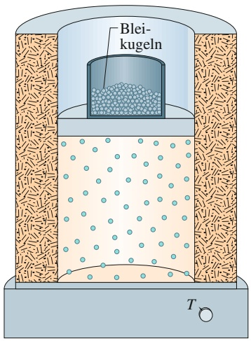

text_image

Blei-
kugeln
T

(b) Endzustand f

## Abb. 16.3

Die isotherme Expansion eines idealen Gases als reversibler Prozess. Das Gas hat denselben Anfangszustand i und denselben Endzustand f wie der irreversible Prozess aus den Abb. 16.1 und 16.2.

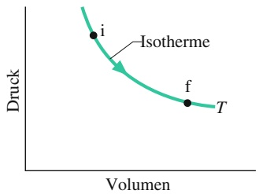

line

| Point | Volumen | Druck |
| --- | --- | --- |
| i | ~0.35 | ~0.75 |
| f | ~0.65 | ~0.45 |

## Abb. 16.4

Das $p V \cdot$ -Diagramm zu der reversiblen isothermen Expansion aus Abb. 16.3. Die Zwischenzustände sind nun Gleichgewichtszustände.

399

---

16 Entropie und der zweite Hauptsatz der Thermodynamik

auch durch

$$
\Delta S = S _ {\mathrm{f}} - S _ {\mathrm{i}} \approx \frac {Q}{T _ {\mathrm{gem}}} \tag {16.3}
$$

approximiert werden, wobei $T _ { \mathrm { g e m } }$ die mittlere Systemtemperatur (in Kelvin) bei dem Prozess ist.

## KONTROLLFRAGE 1

In einem Ofen werde Wasser erhitzt. Ordnen Sie die Entropieänderungen für das Wasser während der Temperaturzunahme (a) von $2 0   ^ { \circ } \mathrm { C }$ auf $3 0   ^ { \circ } \mathbf { C } ,$ (b) von $3 0   ^ { \circ } \mathrm { C }$ auf $3 5   ^ { \circ } \mathrm { C }$ und (c) von $8 0   ^ { \circ } \mathrm { C }$ auf $8 5   ^ { \circ } \mathrm { C }$ in absteigender Reihenfolge.

## Die Entropie als Zustandsfunktion

Wir haben bisher angenommen, dass es sich bei der Entropie, ähnlich wie bei Druck, Energie und Temperatur, um eine Zustandsgröße eines Systems handelt, die nicht davon abhängt, wie dieser Zustand erreicht wurde. Ob Entropie tatsächlich eine Zustandsfunktion ist (so bezeichnet man die Zustandsgrößen eines Systems gewöhnlich) kann nur das Experiment entscheiden. Wir können diese Aussage jedoch für den speziellen, aber wichtigen Fall beweisen, bei dem ein ideales Gas einen reversiblen Prozess durchläuft.

Ein reversibler Prozess sollte langsam und in kleinen Schritten ablaufen, sodass sich das Gas nach jedem dieser Schritte im thermischen Gleichgewicht befindet. Für jeden Schritt sei die übertragene Wärmeenergie dQ, die von dem Gas geleistete Arbeit d $W$ und die Änderung der inneren Energie $\Delta E _ { \mathrm { i n t } }$ . Diese drei Größen hängen nach der differenziellen Form des ersten Hauptsatzes der Thermodynamik (Gl. 14.22) in folgender Weise zusammen:

$$
\mathrm{d} E _ {\mathrm{int}} = \mathrm{d} Q - \mathrm{d} W.
$$

Da die einzelnen Schritte reversibel sind und das Gas sich im Gleichgewichtszustand befindet, können wir dW mit Gl. 14.19 durch $p$ dV und $\mathrm { d } E _ { \mathrm { i n t } }$ mit Gl. 15.43 durch $n C _ { V }$ d $| T |$ ersetzen. Wir lösen die Gleichung noch nach dQ auf:

$$
\mathrm{d} Q = p \mathrm{d} V + n C _ {V} \mathrm{d} T.
$$

Mithilfe des idealen Gasgesetzes können wir p in dieser Gleichung durch nRT∕V ersetzen. Wir dividieren noch die gesamte Gleichung durch T und erhalten

$$
\frac {\mathrm{d} Q}{T} = n R \frac {\mathrm{d} V}{V} + n C _ {V} \frac {\mathrm{d} T}{T}.
$$

Nun integrieren wir jeden Term in dieser Gleichung von einem beliebigen Anfangszustand i bis zu einem beliebigen Endzustand f:

$$
\int_ {\mathrm{i}} ^ {\mathrm{f}} \frac {\mathrm{d} Q}{T} = \int_ {\mathrm{i}} ^ {\mathrm{f}} n R \frac {\mathrm{d} V}{V} + \int_ {\mathrm{i}} ^ {\mathrm{f}} n C _ {V} \frac {\mathrm{d} T}{T}.
$$

Die Größe auf der linken Seite ist die Entropieänderung $\Delta S = S _ { \mathrm { f } } - S _ { \mathrm { i } }$ aus Gl. 16.1. Führen wir noch die Integrale auf der rechten Seite durch, so finden wir schließlich

$$
\Delta S = S _ {\mathrm{f}} - S _ {\mathrm{i}} = n R \ln \frac {V _ {\mathrm{f}}}{V _ {\mathrm{i}}} + n C _ {V} \ln \frac {T _ {\mathrm{f}}}{T _ {\mathrm{i}}} . \tag {16.4}
$$

Bei dieser Integration mussten wir keinen besonderen Prozess vorgeben, daher gilt das Ergebnis für alle reversiblen Prozesse, die das Gas vom Zustand i in den Zustand f überführen. Die Entropieänderung zwischen Anfangs- und Endzustand eines idealen Gases hängt daher ebenfalls nur von den Eigenschaften des Anfangszustands $( V _ { \mathrm { i } }$ und $T _ { \mathrm { i } } )$ und des Endzustands $( V _ { \mathrm { f } }$ und $T _ { \mathrm { f } } )$ ab, nicht aber von dem Weg zwischen diesen beiden Zuständen.

400

---

16.1 Entropie

16

## KONTROLLFRAGE 2

In dem pV-Diagramm habe ein ideales Gas bei dem Anfangszustand i die Tem peratur $T _ { 1 }$ . Bei den Endzuständen a und b, die entlang der eingezeichneten Pfade erreicht werden können, habe es die höhere Temperatur $T _ { 2 }$ . Ist die Entropieände rung entlang des Weges zum Zustand a größer, kleiner oder gleich der Entropieänderung entlang des Weges zum Zustand b?

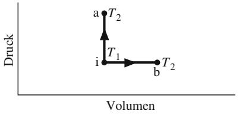

wireframe

| State | Druck | Volumen |
| --- | --- | --- |
| a | High | Low |
| i | Medium | Low |
| b | Medium | High |

## 16.1.3 Der zweite Hauptsatz der Thermodynamik

Ein kleines Rätsel: In Beispielaufgabe 16.2 im Übungsbuch haben wir gesehen, dass die Entropieänderung für das Gas (das wir als unser System ansehen) bei dem reversiblen Prozess von Abb. 16.3a nach Abb. 16.3b positiv ist. Da es sich jedoch um einen reversiblen Prozess handelt, können wir ihn ebenso gut von Abb. 16.3b nach Abb. 16.3a zurücklaufen lassen, indem wir den Kolben in Abb. 16.3b langsam mit Bleikugeln beschweren, bis das ursprüngliche Gasvolumen wieder erreicht ist. In diesem umgekehrten Prozess muss dem Gas Wärmeenergie entzogen werden, da andernfalls seine Temperatur zunähme. Also ist Q negativ und somit muss nach Gl. 16.2 die Entropie des Gases abnehmen.

Widerspricht diese Entropieabnahme des Gases nicht dem Entropiepostulat aus Abschn. 16.1, wonach die Entropie immer zunimmt? Nein, denn dieses Postulat gilt nur für irreversible Prozesse in abgeschlossenen Systemen. Der hier vorliegende Prozess erfüllt keine der beiden Bedingungen: Der Prozess ist nicht irreversibel und das System – das Gas für sich genommen – ist nicht abgeschlossen, da es Wärmeenergie an das Reservoir abgegeben hat.

Betrachten wir jedoch das Reservoir zusammen mit dem Gas als unser System, dann haben wir ein abgeschlossenes System vor uns. Wie groß ist nun die Entropieänderung in diesem erweiterten System Gas + Reservoir für den Prozess von (b) nach (a) in Abb. 16.3? Bei diesem reversiblen Prozess wird Wärmeenergie von dem Gas auf das Reservoir übertragen – d. h. von einem Teil des erweiterten Systems auf den anderen. Sei |Q| der Absolutbetrag dieser Wärme. Mit Gl. 16.2 können wir nun die Entropieänderungen für das Gas (das |Q| verliert) und das Reservoir (das |Q| hinzugewinnt) getrennt berechnen. Wir erhalten

$$
\Delta S _ {\mathrm{Gas}} = - \frac {| Q |}{T}
$$

und

$$
\Delta S _ {\mathrm{Res}} = + \frac {| Q |}{T}.
$$

Die Entropieänderung des abgeschlossenen Systems ist die Summe dieser beiden Größen, also null.

Mit diesem Ergebnis können wir unser Entropiepostulat aus Abschn. 16.1 präzisieren und sowohl reversible als auch irreversible Prozesse einschließen:

Die Entropie in einem abgeschlossenen System nimmt für irreversible Prozesse immer zu und bleibt für reversible Prozesse konstant. Sie nimmt niemals ab.

Auch wenn die Entropie in einem Teil eines abgeschlossenen Systems abnehmen kann, so gibt es doch immer einen gleich großen oder sogar größeren Entropiezuwachs in einem anderen Teil dieses Systems, sodass die Entropie des Gesamtsystems niemals abnimmt. Diese Tatsache ist eine der vielen Formulierungen des **zweiten Hauptsatzes der Thermodynamik**. Ausgedrückt in einer Formel besagt dieser Satz kurz und knapp

$$
\Delta S \geq 0 \quad (\text {zweiter Hauptsatz der Thermodynamik}). \tag {16.5}
$$

401

---

16 Entropie und der zweite Hauptsatz der Thermodynamik

Das „Größer als“-Zeichen bezieht sich auf irreversible Prozesse und das Gleichheitszeichen auf reversible Prozesse. Gleichung 16.5 gilt nur für abgeschlossene Systeme.

Reale Prozesse sind praktisch immer bis zu einem gewissen Grad irreversibel, sei es aufgrund von Reibung, Turbulenzen oder anderen Faktoren. Bei realen Prozessen in realen abgeschlossenen Systemen nimmt die Entropie immer zu. Prozesse, bei denen die Entropie eines Systems exakt konstant bleibt, sind immer eine Idealisierung.

## 16.2 Entropie in Aktion: Thermodynamische Maschinen

## Lernziele

Nach dem Durcharbeiten dieses Abschnitts sollten Sie in der Lage sein, . . .

zu verstehen, dass eine Wärmekraftmaschine eine Vorrichtung ist, die Energie in Form von Wärme aus ihrer Umgebung extrahiert und in nutzbare Arbeit umwandelt, und dass in einer idealen Wärmekraftmaschine alle Prozesse reversibel sind und ohne Energieverlust ablaufen,
ein pV-Diagramm für den Kreisprozess einer Carnot-Maschine zu skizzieren und darin die Richtung des Kreisprozesses, die Art der jeweils ablaufenden Teilprozesse, die während jedes Teilprozesses verrichtete Arbeit (einschließlich ihres Vorzeichens), die im Verlauf des Kreisprozesses insgesamt verrichtete Arbeit und die während jedes Teilprozesses übertragene Wärme (einschließlich ihres Vorzeichens) anzugeben,
• einen Carnot-Kreisprozess in einem Temperatur-Entropie-Diagramm zu skizzieren und darin die übertragenen Wärmemengen anzugeben,
• die Gesamt-Entropieänderung im Verlauf eines Carnotschen Kreisprozesses zu berechnen,
• den Wirkungsgrad $\varepsilon _ { \mathrm { C } }$ einer Carnot-Maschine aus den übertragenen Wärmemengen und den Temperaturen der Reservoirs zu berechnen,
• zu verstehen, dass es keine perfekten Maschinen gibt, welche die aus einem Reservoir bei einer hohen Temperatur entnommene Wärmeenergie Q vollständig in die von der Maschine verrichtete Arbeit W umwandeln,
ein pV-Diagramm für den Kreisprozess einer Stirling-Maschine zu skizzieren und darin die Richtung des Kreisprozesses, die Art der jeweils ablaufenden Teilprozesse, die während jedes Teilprozesses verrichtete Arbeit (einschließlich ihres Vorzeichens), die im Verlauf des Kreisprozesses insgesamt verrichtete Arbeit und die während jedes Teilprozesses übertragene Wärme (einschließlich ihres Vorzeichens) anzugeben.

## Schlüsselideen

• Eine thermodynamische Maschine ist eine Vorrichtung, die einen Kreisprozess durchläuft und dabei die Wärmeenergie $| Q _ { \mathrm { H } } |$ aus einem Reservoir mit hoher | |Temperatur entnimmt und damit eine Arbeit |W| verrichtet.Der Wirkungsgrad einer solchen Maschine ist

$$
\eta = \frac{\text{genutzte Energie}}{\text{entnommene Energie}} = \frac{|W|}{|Q_{\text{H}}|}.
$$

| |In einer idealen Maschine verlaufen alle Prozesse reversibel und es gibt keine Energieverluste, etwa durch Reibung oder Turbulenz.

• Eine Carnot-Maschine ist eine ideale Maschine, die den in Abb. 16.7 gezeigten Kreisprozess nutzt. Ihr Wirkungsgrad ist

$$
\eta = 1 - \frac {| Q _ {\mathrm{N}} |}{| Q _ {\mathrm{H}} |} = 1 - \frac {T _ {\mathrm{N}}}{T _ {\mathrm{H}}},
$$

wobei $T _ { \mathrm { H } }$ und $T _ { \mathrm { N } }$ |die Temperaturen des heißen bzw. kalten Reservoirs sind. Wirkungsgrade von realen Maschinen sind immer kleiner als der einer Carnot-

402

---

16.2 Entropie in Aktion: Thermodynamische Maschinen

16

Maschine. Auch die Wirkungsgrade anderer idealer Maschinen sind stets kleiner als der einer Carnot-Maschine.

Eine perfekte Maschine ist eine imaginäre Maschine, die die als Wärme aus dem Hochtemperaturspeicher entnommene Energie vollständig in Arbeit umwandelt. Eine solche Maschine würde gegen den zweiten Hauptsatz der Thermodynamik verstoßen, der nämlich auch so formuliert werden kann: Es ist keine Abfolge von Prozessen möglich, deren einziges Ergebnis die Entnahme von Wärmeenergie aus einem thermischen Reservoir und die vollständige Umwandlung dieser Energie in Arbeit ist.

## 16.2.1 Thermodynamische Maschinen

Eine **Wärmekraftmaschine**, oder kurz **Maschine**, ist ein Gerät, das aus seiner Umgebung Wärmeenergie aufnimmt und damit Arbeit leistet. Jede Maschine basiert auf einer Arbeitssubstanz. Bei einer Dampfmaschine handelt es sich dabei um Wasser, sowohl in Form von Dampf als auch als Flüssigkeit. In einem Automotor ist die Arbeitssubstanz ein Gemisch aus Benzin und Luft. Soll eine Maschine über einen längeren Zeitraum Arbeit leisten, muss sie auf einem Kreisprozess beruhen, d. h., die Arbeitssubstanz muss eine geschlossene Folge von thermodynamischen Prozessen durchlaufen und dabei immer wieder zu denselben Zuständen zurückkehren. Was kann uns die Thermodynamik über die Arbeitsweise von solchen Maschinen sagen?

## Eine Carnot-Maschine

Wie wir gesehen haben, konnten wir aus der Untersuchung idealer Gase, die dem einfachen Gesetz $p V = n R T$ genügen, viel über wirkliche Gase lernen. Auch wenn es in Wirklichkeit keine idealen Gase gibt, war das ein sinnvoller Zugang, denn jedes reale Gas kommt in seinem Verhalten einem idealen Gas so nah wie man möchte, wenn nur die Dichte klein genug ist. Aus einem ganz ähnlichen Grund wollen wir etwas über wirkliche Maschinen lernen, indem wir das Verhalten von **idealen Maschinen** untersuchen.

Bei einer idealen Maschine sind alle Prozesse reversibel, und es geht keine Energie durch Reibung, Turbulenzen oder Ähnliches verloren.

Wir konzentrieren uns zunächst auf eine besondere ideale Maschine, die sogenannte **Carnot-Maschine**, benannt nach dem französischen Wissenschaftler und Ingenieur N.L. Sadi Carnot, der im Jahr 1824 als Erster das Konzept dieser Maschine entwickelte. Es zeigt sich, dass diese Maschine (aus prinzipiellen Gründen) nicht zu übertreffen ist, wenn es darum geht, Wärmeenergie in nützliche Arbeit umzuwandeln. Erstaunlicherweise konnte Carnot die Arbeitsweise dieser Maschine schon beschreiben, bevor der erste Hauptsatz der Thermodynamik und das Prinzip der Entropie überhaupt entdeckt worden waren.

Abbildung 16.5 zeigt schematisch die Arbeitsweise einer Carnot-Maschine. Bei jedem Maschinenzyklus absorbiert die Arbeitssubstanz die Wärmeenergie $| Q _ { \mathrm { H } } |$ von einem Wärmereservoir bei einer konstanten hohen Temperatur $T _ { \mathrm { H } }$ | |und gibt die Wärmeenergie $| Q _ { \mathrm { N } } |$ an ein zweites Wärmereservoir mit der konstanten nied-|rigeren Temperatur $T _ { \mathrm { N } }$ |ab.

Abbildung 16.6 zeigt das pV-Diagramm eines Carnotschen Kreisprozesses der Arbeitssubstanz. Wie die Pfeile andeuten, verläuft der Kreisprozess im Uhrzeigersinn. Als Arbeitssubstanz stellen wir uns ein ideales Gas vor, das in einem wärmeisolierten Zylinder mit einem beweglichen, durch veränderbare Gewichte beschwerten Kolben eingeschlossen ist. Je nach Bedarf kann der Zylinder auf eines der beiden Wärmereservoirs, wie in Abb. 16.3, oder auch auf eine wärmeisolier-

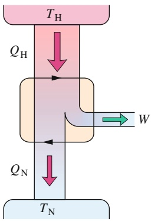

flowchart

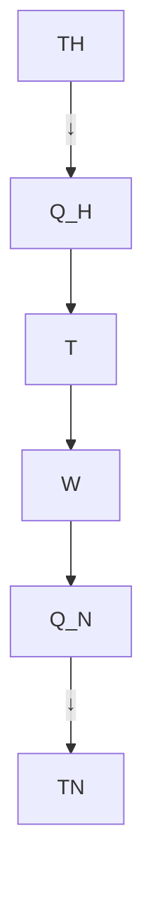

Abb. 16.5

Das Prinzip einer Carnot-Maschine. Die beiden schwarzen Pfeile sollen andeuten, dass die Arbeitssubstanz in einem Kreisprozess arbeitet, vergleichbar dem Kreisprozess in einem $p V$ -Diagramm. Die Energie $| Q _ { \mathrm { H } } |$ wird | |als Wärme von einem Wärmereservoir bei der hohen Temperatur $T _ { \mathrm { H } }$ auf die Arbeitssubstanz übertragen. Die Energie $| Q _ { \mathrm { N } } |$ wird als Wärme von der | |Arbeitssubstanz auf ein Wärmereservoir bei der niedrigeren Temperatur $T _ { \mathrm { N } }$ übertragen. Die Maschine (bzw. die Arbeitssubstanz) verrichtet an irgendetwas in der Umgebung die Arbeit W.

403

---

16 Entropie und der zweite Hauptsatz der Thermodynamik

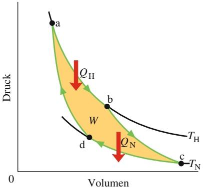

area

| Point | Volumen | Druck |
| --- | --- | --- |
| a | ~0.2 | High |
| b | ~0.5 | Medium |
| c | ~0.9 | Low |
| d | ~0.4 | Low |

Abb. 16.6

Ein pV-Diagramm des Carnotschen Kreisprozesses, den die Arbeitssubstanz der Maschine aus Abb. 16.5 durchläuft. Der Kreisprozess besteht aus zwei isothermen $( , \mathrm { a b } ^ { \alpha }$ und $\scriptstyle { \mathrm { , c d } } ^ { \mathrm { { \acute { e } } } } )$ und zwei adiabatischen Teilprozessen $( , b c ^ { \alpha }$ und $\mathbf { , } \mathrm { d } \mathbf { a } ^ { \alpha } )$ . Die von dem Kreisprozess eingeschlossene gelbe Fläche ist gleich der Arbeit $W ,$ die von der Carnot-Maschine bei jedem Zyklus geleistet wird.

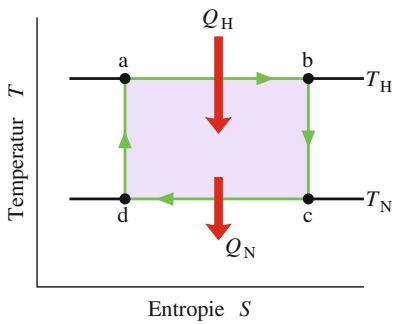

other

| State | Entropy (S) | Temperature (T) |
| --- | --- | --- |
| a | Low | High |
| b | High | High |
| c | High | Low |
| d | Low | Low |
| Q_H | Medium | High |
| Q_N | High | Low |

Abb. 16.7

Der Carnotsche Kreisprozess aus Abb. 16.7 im TS-Diagramm. Während der Teilprozesse $\mathrm { { , a b } ^ { \alpha } }$ und $\scriptstyle { \boldsymbol { \mathscr { v } } } ^ { c d ^ { \alpha } }$ bleibt die Temperatur konstant. Während der Teilprozesse $\mathbf { , } \mathbf { b } \mathbf { c } ^ { \alpha }$ und $\mathbf { , } \mathrm { d } \mathbf { a } ^ { \alpha }$ bleibt die Entropie konstant.

te Platte gestellt werden. Wir bringen den Zylinder zunächst in Kontakt mit dem Wärmereservoir bei der hohen Temperatur $T _ { \mathrm { H } }$ . Wie man in Abb. 16.6 erkennt, expandiert die Arbeitssubstanz isotherm vom Volumen $V _ { \mathrm { a } }$ zum größeren Volumen $V _ { \mathrm { b } } ,$ dabei wird ihr von dem Reservoir die Wärme $| Q _ { \mathrm { H } } |$ zugeführt. Ganz ähnlich er | |fährt die Arbeitssubstanz, wenn sie mit dem Wärmereservoir bei der niedrigeren Temperatur $T _ { \mathrm { N } }$ in Kontakt steht, eine isotherme Kompression von dem Volumen $V _ { \mathrm { c } }$ zum kleineren Volumen $V _ { \mathrm { d } } .$ Dabei gibt sie die Wärme $| Q _ { \mathrm { N } } |$ an das Reservoir ab.

| |Bei der Maschine in Abb. 16.5 nehmen wir an, dass ein Wärmeaustausch zwischen Arbeitssubstanz und Reservoir nur während der isothermen Prozesse $\mathrm { { , a b } ^ { \alpha } }$ und $\scriptstyle { \mathfrak { p } } ^ { \mathrm { c d } ^ { \mathrm { c } } }$ in Abb. 16.6 stattfindet. Daher muss es sich in dieser Abbildung bei den Prozessen $\mathbf { \nabla } _ { \mathbf { \nabla } ^ { \prime } } \mathbf { b } \mathbf { c } ^ { \prime \prime }$ und $\mathrm { { _ { \it { p } } } d a ^ { \it { a } } } _ { \it { \it { 1 } } }$ welche die beiden Isothermen bei den Temperaturen $T _ { \mathrm { H } }$ und $T _ { \mathrm { N } }$ verbinden, um (reversible) adiabatische Prozesse handeln. Bei diesen Prozessen wird also keine Wärmeenergie ausgetauscht. Um das trotz der Volumenänderung der Arbeitssubstanz zu gewährleisten, stellen wir den Zylinder bei den Prozessen $\mathbf { , } \mathbf { b } \mathbf { c } ^ { \alpha }$ und $\mathrm { { _ { \mathrm { { \it { p } } } } d a } ^ { \mathrm { { \it { a } } } } }$ auf eine wärmeisolierte Platte.

Bei den beiden Prozessen $\mathrm { { , a b } ^ { \alpha } }$ und $\mathbf { , } \mathbf { b } \mathbf { c } ^ { \alpha }$ in Abb. 16.6 dehnt sich die Arbeitssubstanz aus und leistet daher positive Arbeit, indem sie den beschwerten Kolben anhebt. Dieser Arbeit entspricht in Abb. 16.6 die Fläche unter der Kurve $\mathrm { { \tt { , } } a b c { \tt { ^ { \alpha } } } }$ Im Verlauf der beiden anschließenden Prozesse $\scriptstyle { \mathfrak { p } } ^ { \mathrm { c d } ^ { \mathrm { c } } }$ und $\mathrm { , d a } ^ { \alpha }$ wird die Arbeitssub stanz komprimiert, d. h., die Umgebung (der nach unten drückende Kolben) verrichtet an der Arbeitssubstanz Arbeit. Diese Arbeit entspricht der Fläche unter der Kurve $\mathrm { { , } c d a ^ { \alpha } } .$ Die Gesamtarbeit bei einem Durchlauf des Kreisprozesses, in Abb. 16.5 und 16.6 als W gekennzeichnet, ist die Differenz dieser zwei Flächen. Sie ist positiv und entspricht der von dem Kreisprozess „abcda“ eingeschlossenen Fläche in Abb. 16.6. Diese Arbeit W wird an irgendeinem äußeren Gegenstand verrichtet, beispielsweise einem Gewicht, das angehoben wird.

Gleichung 16.1 $( \Delta S = \int \mathrm { d } Q / T )$ besagt, dass ein Wärmefluss bzw. Wärmeaustausch auch eine Entropieänderung zur Folge hat. Zur Verdeutlichung der Entropieänderung bei einem Carnotschen Kreisprozess zeichnen wir den Carnot-Zyklus in ein Temperatur-Entropie-Diagramm (TS-Diagramm) wie in Abb. 16.7. Die markierten Punkte a, b, c und d in Abb. 16.7 entsprechen den markierten Punkten in dem $p V \text-- \mathrm { D i }$ agramm aus Abb. 16.6. Die beiden horizontalen Linien in Abb. 16.7 repräsentieren die beiden isothermen Prozesse des Zyklus (die Temperatur ist dort konstant). Der Prozess $\mathrm { { , a b } ^ { \alpha } }$ entspricht der isothermen Expansion der Arbeitssubstanz. Da diese während der Expansion bei konstanter Temperatur $T _ { \mathrm { H } }$ die $\mathbf { W \ddot { a } r }$ memenge $| Q _ { \mathrm { H } } |$ (reversibel) absorbiert, muss die Entropie zunehmen. Umgekehrt | |gibt die Arbeitssubstanz während der isothermen Kompression $\scriptstyle { \mathfrak { p } } ^ { \mathrm { c d } ^ { \mathrm { c } } }$ bei konstanter Temperatur $T _ { \mathrm { N } }$ die Wärmeenergie $| Q _ { \mathrm { N } } |$ (reversibel) ab, daher muss bei diesem | |Prozess die Entropie der Arbeitssubstanz abnehmen.

Die beiden vertikalen Linien in Abb. 16.7 entsprechen den beiden adiabatischen Prozessen des Carnot-Zyklus. Da während dieser beiden Prozesse keine Wärmeenergie übertragen wird, bleibt die Entropie der Arbeitssubstanz in diesen Teilabschnitten konstant.

Arbeit: Zur Berechnung der von der Carnot-Maschine während eines Zyklus geleisteten Gesamtarbeit wenden wir den ersten Hauptsatz der Thermodynamik (Gl. 14.21, $\Delta E _ { \mathrm { i n t } } = Q - \bar { W } )$ auf die Arbeitssubstanz an. Diese Substanz muss die Zustände des Kreisprozesses immer wieder durchlaufen. Wenn X also für irgendeine Zustandsgröße der Arbeitssubstanz steht, beispielsweise Druck, Temperatur, Volumen, innere Energie oder Entropie, dann muss für jeden Kreisprozess $\Delta X = 0$ gelten. Also muss für einen vollständigen Kreisprozess der Arbeitssubstanz auch $\Delta E _ { \mathrm { i n t } } = 0$ sein. Da es sich bei $Q$ in Gl. 14.21 um die gesamte ausgetauschte Wärmemenge handelt und bei $W$ um die gesamte geleistete Arbeit, können wir den ersten Hauptsatz der Thermodynamik für den Carnot-Prozess auch in der Form

$$
W = | Q _ {\mathrm{H}} | - | Q _ {\mathrm{N}} | \tag {16.6}
$$

schreiben.

404

---

16.2 Entropie in Aktion: Thermodynamische Maschinen

16

Entropieänderung: Bei einer Carnot-Maschine gibt es zwei (und nur zwei) reversible Wärmeübertragungen und daher auch nur zwei Änderungen in der Entropie der Arbeitssubstanz – eine bei der Temperatur $T _ { \mathrm { H } }$ und eine bei $T _ { \mathrm { N } } .$ Die gesamte Entropieänderung im Verlauf eines Zyklus ist daher

$$
\Delta S = \Delta S _ {\mathrm{H}} + \Delta S _ {\mathrm{N}} = \frac {| Q _ {\mathrm{H}} |}{T _ {\mathrm{H}}} - \frac {| Q _ {\mathrm{N}} |}{T _ {\mathrm{N}}} . \tag {16.7}
$$

$\Delta S _ { \mathrm { H } }$ ist positiv, weil bei diesem Schritt der Arbeitssubstanz die Wärme $| Q _ { \mathrm { H } } |$ zugeführt wird, und $\Delta S _ { \mathrm { N } }$ | |ist negativ, weil der Arbeitssubstanz die Wärmeenergie $| Q _ { \mathrm { N } } |$ | |entzogen wird. Da die Entropie eine Zustandsfunktion ist, muss für einen kompletten Zyklus $\Delta S = 0$ gelten. Nach Gl. 16.7 bedeutet das

$$
\frac {| Q _ {\mathrm{H}} |}{T _ {\mathrm{H}}} = \frac {| Q _ {\mathrm{N}} |}{T _ {\mathrm{N}}}  . \tag {16.8}
$$

Für die Temperaturen gilt $T _ { \mathrm { H } } > T _ { \mathrm { N } } ,$ also folgt für die Wärmemengen $Q _ { \mathrm { H } } > Q _ { \mathrm { N } }$ Dem Reservoir bei der höheren Temperatur wird also mehr Wärmeenergie entzogen, als dem Reservoir bei der niedrigeren Temperatur zugeführt wird.

Aus den Gln. 16.6 und 16.8 werden wir jetzt den Wirkungsgrad der Carnot-Maschine herleiten.

## Der Wirkungsgrad der Carnot-Maschine

Das Ziel einer Wärmekraftmaschine besteht darin, so viel Wärmeenergie $Q _ { \mathrm { H } }$ wie möglich in Arbeit umzusetzen. Die Effektivität messen wir durch den **thermischen Wirkungsgrad** $\eta ,$ definiert als die von der Maschine pro Kreisprozess geleistete Arbeit („die Energie, die wir erhalten“) dividiert durch die bei jedem Kreisprozess verbrauchte Wärme („die Energie, die wir dafür bezahlen“):

$$
\eta = \frac {\text {genutzte Energie}}{\text {entnommene Energie}} = \frac {| W |}{| Q _ {\mathrm{H}} |} \quad \text {(Wirkungsgrad einer Maschine). (16.9)}
$$

Für eine Carnot-Maschine können wir W mit Gl. 16.6 ersetzen:

$$
\eta_ {C} = \frac {| Q _ {\mathrm{H}} | - | Q _ {\mathrm{N}} |}{| Q _ {\mathrm{H}} |} = 1 - \frac {| Q _ {\mathrm{N}} |}{| Q _ {\mathrm{H}} |}. \tag {16.10}
$$

Mit Gl. 16.8 erhalten wir schließlich für den Wirkungsgrad der Carnot-Maschine

$$
\eta_ {\mathrm{C}} = 1 - \frac {T _ {\mathrm{N}}}{T _ {\mathrm{H}}} \quad (\text {Wirkungsgrad der Carnot - Maschine}), \tag {16.11}
$$

wobei die Temperaturen $T _ { \mathrm { N } }$ und $T _ { \mathrm { H } }$ in Kelvin angegeben werden müssen. Da $T _ { \mathrm { N } } < T _ { \mathrm { H } } ,$ ist der thermische Wirkungsgrad der Carnot-Maschine notwendigerweise kleiner als eins, d. h. kleiner als 100 %. Das wird auch aus Abb. 16.5 deutlich: Nur ein Teil der aus dem heißeren Reservoir stammenden Wärmeenergie kann Arbeit leisten, der Rest wird an das kältere Reservoir wieder abgegeben. In Abschn. 16.3 werden wir beweisen, dass der thermische Wirkungsgrad für keine tatsächlich existierende Maschine größer sein kann als der Wirkungsgrad der Carnot-Maschine (Gl. 16.11).

Bei der Entwicklung neuer Maschinen versucht man, den Wirkungsgrad immer weiter zu verbessern, indem man die bei jedem Zyklus „weggeworfene“ Energie $| Q _ { \mathrm { N } } |$ vermindert. Der Traum wäre die perfekte Maschine, wie sie in Abb. 16.8 dar-| |gestellt ist: Dort wäre $| Q _ { \mathrm { N } } |$ zu null reduziert und $| Q _ { \mathrm { H } } |$ würde vollständig in $\mathrm { A } \mathbf { r } -$ | | | |beit umgesetzt. Eine solche Maschine könnte beispielsweise bei einem Kreuzschiff dem Meereswasser Wärmeenergie entziehen und zum Antrieb der Schiffsschrauben umsetzen, ohne jegliche Treibstoffkosten! Ein Auto könnte mit einer solchen

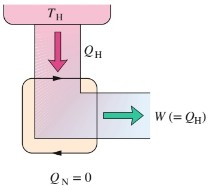

flowchart

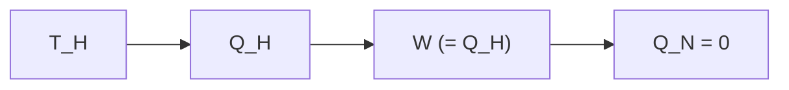

Abb. 16.8

So würde eine perfekte Maschine arbeiten, d. h. eine Maschine, bei der Wärme $Q _ { \mathrm { H } }$ aus einem Wärmereservoir zu 100 % in Arbeit W umgesetzt wird.

405

---

16 Entropie und der zweite Hauptsatz der Thermodynamik

Maschine die notwendige Wärmeenergie der Umgebungsluft entnehmen und zum Antrieb verwenden, ebenfalls ohne Treibstoffkosten. Doch die perfekte Maschine bleibt ein unerreichbarer Traum: Nach Gl. 16.11 können wir einen Wirkungsgrad von 100 % (d. h. $\eta = 1 )$ nur für $T _ { \mathrm { N } } = 0$ oder $T _ { \mathrm { H } } \rightarrow$ ∞ erreichen; beide Bedingungen sind unmöglich zu realisieren. Stattdessen haben jahrzehntelange Erfahrungen aus dem Bereich des Maschinenbaus zu der folgenden alternativen Version des zweiten Hauptsatzes geführt:

Es gibt keine Folge von Prozessen, bei denen insgesamt nur Wärmeenergie aus einem Wärmereservoir entnommen und vollständig in Arbeit umgewandelt wird.

## Kurz: Es gibt keine perfekte Maschine.

Fassen wir zusammen: Der durch Gl. 16.11 gegebene thermische Wirkungsgrad gilt nur für (ideale) Carnot-Maschinen. In Wirklichkeit bestehen die Kreisprozesse der Maschinen aus irreversiblen Teilprozessen und haben daher niedrigere Wirkungsgrade. Würde Ihr Auto von einer Carnot-Maschine angetrieben, hätte es nach Gl. 16.11 einen Wirkungsgrad von 55 %. Sein tatsächlicher Wirkungsgrad liegt eher bei 25 %. Auch ein großes Kraftwerk ist als Ganzes genommen eine Maschine. Die Wärme wird einem Brennraum oder Reaktor entnommen, Arbeit wird mithilfe von Turbinen geleistet und die verbleibende Wärmeenergie heizt die Atmosphäre oder einen benachbarten Fluss auf. Würde ein solches Kraftwerk als Carnot-Maschine arbeiten, hätte es einen Wirkungsgrad von ungefähr 40 %, sein tatsächlicher Wirkungsgrad liegt höchstens bei 30 %. Gleichgültig um welche Art von Maschinen es sich handelt, es führt einfach kein Weg an Gl. 16.11 vorbei!

## Die Stirling-Maschine

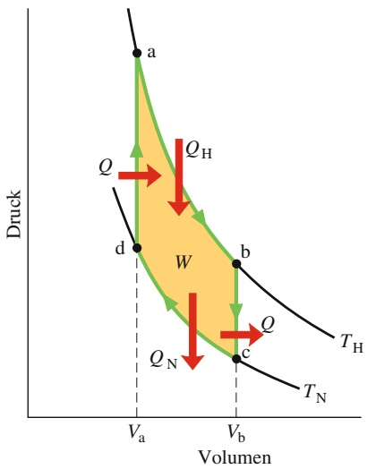

area

| Point | Volume | Druck |
| --- | --- | --- |
| a | Va | High |
| b | Vb | Medium |
| c | Vb | Low |
| d | Va | Medium |

Abb. 16.9

Ein pV-Diagramm für die Arbeitssubstanz einer idealen Stirling-Maschine, der Einfachheit halber als ideales Gas angenommen.

Gleichung 16.11 gilt nicht für beliebige Maschinen, sondern nur für solche, deren Arbeitsprinzip sich wie in Abb. 16.6 darstellen lässt, also für Carnot-Maschinen. Abbildung 16.9 gibt den Arbeitszyklus einer idealen **Stirling-Maschine** wieder. Ein Vergleich mit dem Carnot-Prozess in Abb. 16.6 zeigt, dass beide Maschinen einen isothermen Wärmeaustausch bei den Temperaturen $T _ { \mathrm { H } }$ und $T _ { \mathrm { N } }$ haben. Diese beiden Isothermen werden jedoch bei der Stirling-Maschine nicht durch adiabatische Prozesse verbunden (wie bei der Carnot-Maschine), sondern durch isochore Prozesse, also solche, bei denen das Volumen konstant bleibt (Abb. 16.9). Damit die Temperatur eines Gases bei konstantem Volumen reversibel von $T _ { \mathrm { N } }$ nach $T _ { \mathrm { H } }$ zunehmen kann (Prozess $\mathrm { , d a } ^ { \alpha }$ in Abb. 16.9), bedarf es einer Wärmezufuhr zur $\mathbf { A r } -$ beitssubstanz aus einem Wärmereservoir, dessen Temperatur langsam zwischen diesen beiden Grenzwerten verändert werden kann. Ein Wärmeaustausch in um gekehrter Richtung ist für den Prozess $\mathbf { , } \mathbf { b } \mathbf { c } ^ { \alpha }$ notwendig. Reversible Übertragungen von Wärmeenergie (und damit verbundene Entropieänderungen) findet man daher bei allen vier Teilprozessen einer Stirling-Maschine (nicht nur bei zwei Prozessen wie bei der Carnot-Maschine). Aus diesem Grund gilt die Herleitung von Gl. 16.11 auch nicht für eine ideale Stirling-Maschine. Außerdem ist für dieselben zwei Temperaturen $T _ { \mathrm { H } }$ und $T _ { \mathrm { N } }$ der Wirkungsgrad einer idealen Stirling-Maschine kleiner als der einer Carnot-Maschine. Real existierende Stirling-Maschinen haben sogar noch deutlich kleinere Wirkungsgrade.

Die Stirling-Maschine wurde im Jahr 1816 von Robert Stirling entwickelt. Dieser lange Zeit vernachlässigte Maschinentyp wird heute als Möglichkeit zur direkten Nutzung von Solarenergie oder in Raumfahrzeugen diskutiert.

## KONTROLLFRAGE 3

Drei Carnot-Maschinen arbeiten zwischen Reservoirtemperaturen von (a) 400 K und 500 K, (b) 600 K und 800 K und (c) 400 K und 600 K. Ordnen Sie die Maschinen in absteigender Reihenfolge nach ihrem thermischen Wirkungsgrad.

406

---

16.3 Kältemaschinen und reale Maschinen

16

## LÖSUNGSSTRATEGIEN

**Strategie 1: Die Sprache der Thermodynamik** In wissenschaftlichen und technischen Büchern zur Thermodynamik findet man oft eine reichhaltige, aber leider manchmal auch irreführende Sprache. Sie können dort lesen, dass Wärme zugeführt, absorbiert, addiert, subtrahiert, entzogen, abgezogen, abgegeben, aufgenommen, gewonnen, verloren, übertragen, abgestoßen, zur Verfügung gestellt oder entwendet wird, oder dass Wärme von einem Körper zu einem anderen fließt (wie eine Flüssigkeit). Manchmal findet man auch Äußerungen der Art, dass ein Körper Wärme habe (als ob ein Körper Wärme besitzen könne), oder dass die Wärme eines Körpers zu- oder abnimmt. Sie sollten sich immer vor Augen halten, was Wärme wirklich bedeutet:

Wärme ist Energie, die von einem Körper auf einen anderen Körper aufgrund eines Temperaturunterschieds zwischen den beiden Körpern übertragen wird.

Wenn wir einen der Körper als das untersuchte System ansehen, bezeichnet man jede solche Energieübertragung in das System hinein als positive Wärme +Q und jede solche Energieübertragung aus dem System heraus als negative Wärme −Q.

Auch mit dem Begriff Arbeit muss man vorsichtig sein. Sie werden vielleicht lesen, dass Arbeit erzeugt oder umgesetzt wurde oder aus Wärme entstanden sei. Unter dem Begriff Arbeit versteht man das Folgende:

Arbeit ist Energie, die von einem Körper auf einen anderen Körper mittels einer Kraft zwischen diesen beiden Körpern übertragen wird.

Betrachten wir wieder einen der Körper als das untersuchte System, dann ist jeder solche Energieübertrag aus dem System heraus entweder positive Arbeit +W, die von dem System geleistet wurde, oder negative Arbeit −W, die an dem System geleistet wurde. Jeder Energieübertrag dieser Art in ein System hinein ist von dem System geleistete negative Arbeit oder an dem System geleistete positive Arbeit. (In diesem Fall ist die verwendete Präposition von größter Wichtigkeit.) Das ist offensichtlich verwirrend, und wenn Sie den Begriff Arbeit lesen, sollten sie sorgfältig überlegen, was gemeint ist.

## 16.3 Kältemaschinen und reale Maschinen

## Lernziele

Nach dem Durcharbeiten dieses Abschnitts sollten Sie in der Lage sein, . . .

• zu verstehen, dass eine Kältemaschine eine Vorrichtung ist, die Arbeit aufwendet, um Energie von einem Tieftemperaturreservoir auf ein Hochtemperaturreservoir zu übertragen,
• zu erkennen, dass in einer idealen Kältemaschine alle Prozesse reversibel ablaufen und keine Energieverluste auftreten,
ein pV-Diagramm für den Kreisprozess einer Carnot-Kältemaschine zu skizzieren und darin die Richtung des Kreisprozesses, die Art der jeweils ablaufenden Teilprozesse, die während jedes Teilprozesses verrichtete Arbeit (einschließlich ihres Vorzeichens), die im Verlauf des Kreisprozesses insgesamt verrichtete Arbeit und die während jedes Teilprozesses übertragene Wärme (inklusive Vorzeichen) anzugeben,
• den Zusammenhang zwischen der Leistungszahl ε, den mit den Reservoirs ausgetauschten Wärmemengen und den jeweiligen Temperaturen anzuwenden,
• zu erkennen, dass es keine ideale Kältemaschine gibt, die die gesamte aus dem Niedertemperaturspeicher entnommene Energie in den Hochtemperaturspeicher übertragen kann,
• zu verstehen, dass der Wirkungsgrad einer realen Kältemaschine geringer ist als der Wirkungsgrad der idealen Carnot-Maschine.

407

---

16 Entropie und der zweite Hauptsatz der Thermodynamik

## Schlüsselideen

• Eine Kältemaschine ist eine Vorrichtung, die einen Kreisprozess nutzt, um mithilfe der an dort verrichteten Arbeit W eine Energie $| Q _ { \mathrm { N } } |$ als Wärme aus einem | |Niedertemperaturspeicher zu entnehmen, diesen also noch kälter zu machen. Die Leistungszahl ε einer Kältemaschine ist

$$
\varepsilon = \frac {\text {übertragene Wärme}}{\text {aufgewendete Arbeit}} = \frac {| Q _ {\mathrm{N}} |}{| W |}.
$$

• Eine Carnot-Kältemaschine ist eine Carnotsche Wärmekraftmaschine, die umgekehrt arbeitet. Ihre Leistungszahl ist

$$
\varepsilon = \frac {| Q _ {\mathrm{N}} |}{| Q _ {\mathrm{H}} | - | Q _ {\mathrm{N}} |} = \frac {T _ {\mathrm{N}}}{T _ {\mathrm{H}} - T _ {\mathrm{N}}}.
$$

• Eine perfekte Kältemaschine ist eine imaginäre Kältemaschine, die Energie in Form von Wärme aus einem Niedertemperaturspeicher entnimmt und sie vollständig an das Hochtemperaturreservoir abgibt, ohne dafür Arbeit aufzuwenden.
Eine perfekte Kältemaschine würde gegen den zweiten Hauptsatz der Thermodynamik verstoßen, der wie folgt formuliert werden kann: Es ist keine Abfolge von Prozessen möglich, deren einziges Ergebnis die Übertragung von Wärmeenergie von einem Reservoir bei einer gegebenen Temperatur zu einem Reservoir bei einer höheren Temperatur ist, ohne dass dafür Arbeit aufgewendet wird.

## 16.3.1 Kältemaschinen

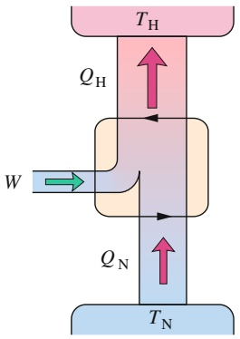

flowchart

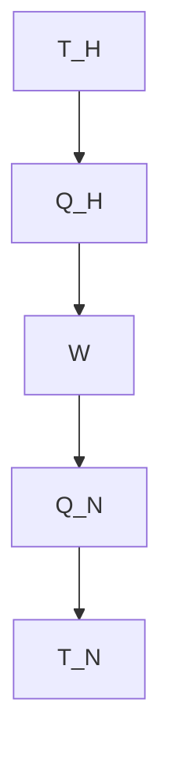

Abb. 16.10

Das Schema einer Kältemaschine. Die beiden schwarzen Pfeile in der Mitte sollen wieder andeuten, dass die Arbeitssubstanz wie in einem $p V$ -Diagramm einen Kreisprozess durchläuft, diesmal jedoch in der anderen Richtung. Energie $Q _ { \mathrm { N } }$ wird aus dem kühlen Wärmereservoir in Form von Wärme an die Arbeitssubstanz übertragen. Energie $Q _ { \mathrm { H } }$ wird von der Arbeitssubstanz in Form von Wärme an das warme Reservoir übertragen. Damit dies möglich ist, muss irgendetwas in der Umgebung an der Kältemaschine (der Arbeitssubstanz) die Arbeit W leisten.

Eine **Kältemaschine** ist ein Gerät, das mithilfe von Arbeit Wärmeenergie aus einem Wärmereservoir bei tiefer Temperatur in ein Wärmereservoir bei höherer Temperatur überträgt, also das kältere Reservoir noch kälter macht. Sie durchläuft dabei unablässig eine feste Folge thermodynamischer (Teil-)Prozesse. Bei einem gewöhnlichen Kühlschrank beispielsweise leistet ein elektrischer Kompressor Arbeit, um Energie aus dem kalten Innenraum (ein Wärmereservoir bei tiefer Temperatur) in das auf Zimmertemperatur temperierte Zimmer (ein Wärmereservoir bei höherer Temperatur) zu übertragen.

Auch eine Klimaanlage oder eine Wärmepumpe sind Kältemaschinen. Die Unterschiede liegen lediglich in der Art der kalten und warmen Wärmereservoirs. Bei einer Klimaanlage ist das kalte Wärmereservoir ein zu kühlendes Zimmer und das warme Wärmereservoir die noch wärmere Außenluft. Eine Wärmepumpe ist eine Art Klimaanlage, die umgekehrt zum Aufheizen eines Zimmers eingesetzt wird: Das Zimmer ist das lauwarme Wärmereservoir und Wärme wird von der kalten Außenluft ins Zimmer übertragen.

Wir betrachten wieder eine ideale Kältemaschine:

Bei einer idealen Kältemaschine sind alle Prozesse reversibel und es treten keine Energieverluste aufgrund von Reibung, Turbulenzen oder Ähnlichem auf.

Abbildung 16.10 zeigt das Grundprinzip einer idealen Kältemaschine. Im Wesentlichen wird dabei einfach der Carnotsche Kreisprozess aus Abb. 16.5 in umgekehrter Richtung durchlaufen. Mit anderen Worten: alle Energieübertragungen, sei es in Form von Wärme oder Arbeit, sind im Vergleich zur Carnot-Maschine umgekehrt. Eine solche ideale Kältemaschine könnte man als **Carnot-Kältemaschine** bezeichnen.

Der Konstrukteur einer Kältemaschine möchte gerne dem kühlen Wärmereservoir so viel Wärme $| Q _ { \mathrm { N } } |$ wie möglich entziehen („was wir wollen“) und dabei so wenig Arbeit $| W |$ | |wie möglich leisten („was wir bezahlen“). Ein Maß für die Effek-

408

---

16.3 Kältemaschinen und reale Maschinen

16

tivität einer Kältemaschine ist die Leistungszahl $\varepsilon ,$ definiert als

$$
\varepsilon = \frac {\text {übertragene Wärme}}{\text {aufgewendete Arbeit}} = \frac {| Q _ {\mathrm{N}} |}{| W |} (\text {Leistungszahl einer Kältemaschine}). \tag {16.12}
$$

Für eine Carnot-Kältemaschine gilt nach dem ersten Hauptsatz $| W | = | Q _ { \mathrm { H } } | -$ $| Q _ { \mathrm { N } } | ,$ , wobei $| Q _ { \mathrm { H } } |$ | |  | |der Betrag der an das warme Reservoir abgegebenen Wärme-| | | |energie ist. Gleichung 16.12 wird damit zu

$$
\varepsilon_ {\mathrm{C}} = \frac {| Q _ {\mathrm{N}} |}{| Q _ {\mathrm{H}} | - | Q _ {\mathrm{N}} |}. \tag {16.13}
$$

Da es sich bei einer Carnot-Kältemaschine um eine umgekehrt operierende Carnot-Maschine handelt, können wir Gl. 16.8 mit Gl. 16.13 verknüpfen und erhalten nach einigen Umformungen

$$
\varepsilon_ {\mathrm{C}} = \frac {T _ {\mathrm{N}}}{T _ {\mathrm{H}} - T _ {\mathrm{N}}} \quad (\text {Leistungszahl einer Carnot - Kältemaschine}). \tag {16.14}
$$

Für typische Raumklimaanlagen ist $\varepsilon   \approx   2 { , } 5 { ; }$ für gewöhnliche Kühlschränke gilt $\varepsilon \approx 5 .$ Seltsamerweise ist der Wert von ε umso höher, je kleiner der Temperaturunterschied zwischen den beiden Reservoirs ist. Daher sind Wärmepumpen auch bei gemäßigten Temperaturen effektiver als bei sehr stark schwankenden Außentemperaturen.

Es wäre natürlich schön eine Kältemaschine zu haben, in die keine Arbeit hineingesteckt werden muss – die also erst gar nicht an die Steckdose muss. Abbildung 16.11 zeigt das Prinzip eines solchen „Erfindertraums“: eine perfekte Kältemaschine, die ohne jede Arbeit eine Wärmemenge Q aus einem kalten Reservoir in ein warmes Reservoir überführt. Da eine solche Maschine auf Kreisprozessen beruht, kann sich die Entropie der Arbeitssubstanz bei einem solchen Zyklus nicht ändern. Die Entropien der beiden Reservoirs ändern sich jedoch: Die Entropieänderung für das kalte Reservoir beträgt $- | Q | / T _ { \mathrm { N } }$ und die für das warme Reservoir $+ | Q | / T _ { \mathrm { H } }$ | |. Die resultierende Entropieänderung für das Gesamtsystem ist daher

$$
\Delta S = - \frac {| Q |}{T _ {\mathrm{N}}} + \frac {| Q |}{T _ {\mathrm{H}}}.
$$

Da $T _ { \mathrm { H } } > T _ { \mathrm { N } } ,$ ist die rechte Seite dieser Gleichung negativ. Die Entropieänderung pro Zyklus ist für das abgeschlossene System Kältemaschine + zwei Reservoirs negativ. Doch weil eine solche Entropieabnahme dem zweiten Hauptsatz der Thermodynamik widerspricht (Gl. 16.5), kann es eine perfekte Kältemaschine nicht ge ben.

Dieses Ergebnis führt uns auf eine weitere (äquivalente) Formulierung des zweiten Hauptsatzes der Thermodynamik:

Es gibt keine Folge von Prozessen, deren einziges Ergebnis die Übertragung von Wärmeenergie aus einem Reservoir mit einer gegebenen Temperatur in ein Reservoir mit einer höheren Temperatur ist.

Kurz: Es gibt keine perfekte Kältemaschine.

## KONTROLLFRAGE 4

Sie möchten die Leistungszahl einer idealen Kältemaschine verändern. Dies errei chen Sie, indem Sie (a) die kalte Kammer auf eine etwas höhere Temperatur einstellen, (b) die kalte Kammer auf eine etwas niedrigere Temperatur einstellen, (c) das Gerät in einen etwas wärmeren Raum bringen oder (d) das Gerät in einen etwas kühleren Raum bringen. Die Beträge der Temperaturänderungen seien in allen vier Fällen gleich. Ordnen Sie die vier Fälle in absteigender Reihenfolge nach der neuen Leistungszahl.

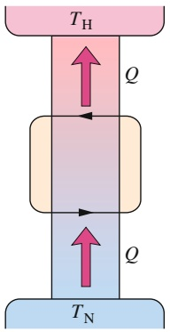

flowchart

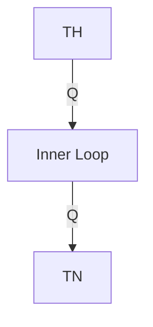

Abb. 16.11

Das Schema einer perfekten Kältemaschine, die ohne Arbeitsaufwand Energie aus einem kalten Wärmereservoir in ein warmes Reservoir überführen würde.

409

---

16 Entropie und der zweite Hauptsatz der Thermodynamik

## 16.3.2 Der Wirkungsgrad von realen Maschinen

$\eta _ { \mathrm { C } }$ sei der Wirkungsgrad einer Carnot-Maschine, die zwischen zwei gegebenen Temperaturen arbeitet. Wir wollen in diesem Abschnitt beweisen, dass keine reale Maschine, die zwischen denselben beiden Temperaturen arbeitet, einen größeren Wirkungsgrad haben kann als $\eta _ { \mathrm { C } } .$ Eine solche Maschine würde dem zweiten Hauptsatz der Thermodynamik widersprechen.

Wir stellen uns vor, ein Erfinder hätte eine Maschine $\mathrm { _ { \partial } } _ { \partial } \mathrm { X } ^ { \alpha }$ konstruiert, von der er behauptet, ihr Wirkungsgrad $\eta _ { \mathrm { X } }$ sei größer als $\eta _ { \mathrm { C } } ;$

$$
\eta_ {\mathrm{X}} > \eta_ {\mathrm{C}} \quad (\text {Behauptung}). \tag {16.15}
$$

Wir kombinieren diese Maschine X mit einer Carnot-Kältemaschine (vgl. Abb. 16.12a), sodass die für die Kältemaschine bei einem Kreisprozess erforderliche Ar beit gerade von der Maschine X während eines Kreisprozesses geliefert wird. Unser System bestehe nun aus der Kombination Maschine X + Kältemaschine aus Abb. 16.12a. Diese Kombination erfordert keine weitere (äußere) Arbeit.

Wäre Gl. 16.15 richtig, ergäbe sich aus der Definition des Wirkungsgrads (Gl. 16.9)

$$
\frac {| W |}{| Q _ {\mathrm{H}} ^ {\prime} |} > \frac {| W |}{| Q _ {\mathrm{H}} |},
$$

wobei der Strich sich auf die Maschine X bezieht und die rechte Seite dieser Ungleichung dem Wirkungsgrad einer Carnot-Kältemaschine (aufgefasst als Maschine) entspricht. Nach dieser Ungleichung muss

$$
\left| Q _ {\mathrm{H}} \right| > \left| Q _ {\mathrm{H}} ^ {\prime} \right| \tag {16.16}
$$

gelten. Die von der Maschine X geleistete Arbeit soll gleich der an der Carnot-Kältemaschine geleisteten Arbeit sein. Daher folgt aus dem ersten Hauptsatz der Thermodynamik (Gl. 16.6)

$$
| Q _ {\mathrm{H}} | - | Q _ {\mathrm{N}} | = | Q _ {\mathrm{H}} ^ {\prime} | - | Q _ {\mathrm{N}} ^ {\prime} |,
$$

was wir auch in der Form

$$
| Q _ {\mathrm{H}} | - | Q _ {\mathrm{H}} ^ {\prime} | = | Q _ {\mathrm{N}} | - | Q _ {\mathrm{N}} ^ {\prime} | = Q \tag {16.17}
$$

schreiben können. Nach Gl. 16.16 ist die Größe Q in dieser Gleichung positiv.

Ein Vergleich von Gl. 16.17 mit Abb. 16.12 zeigt, dass die kombinierte Wirkung von Maschine X und der Carnot-Kältemaschine darin besteht, ohne äußere Arbeit eine Wärmeenergie Q von einem kalten Reservoir in ein warmes Reservoir zu übertragen. Diese Kombination entspräche daher der perfekten Kältemaschine aus Abb. 16.11, deren Existenz im Widerspruch zum zweiten Hauptsatz der Thermodynamik steht.

Abb. 16.12

(a) Eine Maschine X treibt eine Carnot-Kältemaschine an. (b) Wenn, wie behauptet, die Maschine X einen grö- ßeren Wirkungsgrad als eine Carnot-Maschine hätte, wäre die in (a) gezeigte Kombination äquivalent zu einer perfekten Kältemaschine. Das widerspricht jedoch dem zweiten Hauptsatz der Thermodynamik, woraus folgt, dass die Maschine X nicht effektiver sein kann als eine Carnot-Maschine.

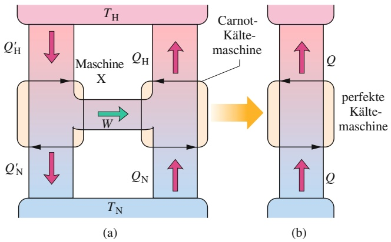

flowchart

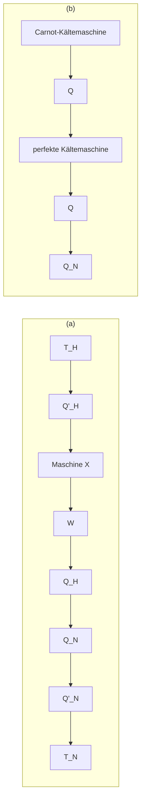

410

---

16.4 Eine statistische Interpretation der Entropie

16

Irgendeine unserer Annahmen muss falsch sein, und der Fehler kann nur in Gl. 16.15 liegen. Wir können also folgern: Keine wirkliche Maschine kann einen Wirkungsgrad haben, der größer als der Wirkungsgrad einer Carnot-Maschine ist, wenn beide Maschinen zwischen denselben beiden Temperaturen arbeiten. Bestenfalls kann diese Maschine den Wirkungsgrad einer Carnot-Maschine haben, und in diesem Fall ist Maschine X die Carnot-Maschine.

## 16.4 Eine statistische Interpretation der Entropie

## Lernziele

Nach dem Durcharbeiten dieses Abschnitts sollten Sie in der Lage sein, . . .

• zu erläutern, was man unter den Konfigurationen eines Systems versteht,
• die Multiplizität einer gegebenen Konfiguration zu berechnen,
• zu verstehen, dass alle Mikrozustände gleich wahrscheinlich sind, aber Konfigurationen mit einer größeren Zahl von Mikrozuständen wahrscheinlicher sind als andere,
• die Boltzmannsche Entropiegleichung anzuwenden, um die Entropie einer bestimmten Multiplizität zu berechnen.

## Schlüsselideen

Die Entropie eines Systems kann anhand der möglichen Verteilungen seiner Moleküle definiert werden. Für identische Moleküle wird jede mögliche Verteilung der Moleküle als Mikrozustand des Systems bezeichnet. Alle äquivalenten Mikrozustände werden zu einer Konfiguration des Systems zusammengefasst. Die Anzahl der Mikrozustände in einer Konfiguration wird als Multiplizität W der Konfiguration bezeichnet.
• Für ein System aus N Molekülen, die sich über die beiden Hälften eines Kastens verteilen, ist die Multiplizität

$$
W = \frac {N !}{n _ {1} ! n _ {2} !},
$$

wobei $n _ { 1 }$ die Zahl der Moleküle in der einen Hälfte und $n _ { 2 }$ die Zahl der Moleküle in der anderen Hälfte ist. Eine grundlegende Annahme der statistischen Mechanik ist, dass alle Mikrozustände gleich wahrscheinlich sind. Daher kommen Konfigurationen mit großer Multiplizität am häufigsten vor. Wenn N sehr groß ist (z. B. $N = 1 0 ^ { 2 2 }$ Moleküle oder mehr), liegt das System fast immer in der Konfiguration mit $n _ { 1 } = n _ { 2 }$ vor.

• Die Multiplizität W einer Konfiguration eines Systems und die Entropie S des Systems in dieser Konfiguration sind durch die Boltzmannsche Entropiegleichung verknüpft:

$$
S = k \ln W,
$$

wobei $k = 1 { , } 3 8 \cdot 1 0 ^ { - 2 3 }$ J/K die Boltzmann-Konstante ist.

• Wenn N sehr groß ist (was häufig der Fall ist), können wir die Stirling-Näherung zur Berechnung von ln N! verwenden:

$$
\ln N! \approx N \ln N - N.
$$

## 16.4.1 Eine statistische Interpretation der Entropie

In Kapitel 15 haben wir gesehen, dass sich die makroskopischen Eigenschaften eines Gases durch seine mikroskopischen bzw. molekularen Eigenschaften erklären lassen. So hatten wir beispielsweise den Druck eines Gases auf die Behälterwände

411

---

16 Entropie und der zweite Hauptsatz der Thermodynamik

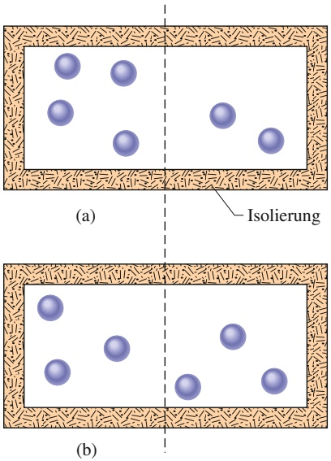

text_image

(a)
Isolierung
(b)

Abb. 16.13

Sechs Gasmoleküle in einem isolierten Kasten. Für jedes Molekül sind die Wahrscheinlichkeiten, sich in der linken bzw. rechten Hälfte des Kastens aufzuhalten, gleich. Die Anordnung (a) entspricht der Konfiguration III in Tab. 16.1, die Anordnung (b) der Konfiguration IV.

mit dem Impulsübertrag bei Stößen der Gasmoleküle gegen die Wand in Verbin dung bringen können. Diese Art von Erklärungen sind typisch für ein wichtiges Teilgebiet der Physik: die **statistische Mechanik**.

Im Folgenden richten wir unsere Aufmerksamkeit auf ein spezielles Problem, nämlich die Verteilung von Gasmolekülen zwischen den beiden Hälften eines isolierten Behälters. Dieses Problem lässt sich noch mit vergleichsweise einfachen Mitteln untersuchen, und wir können mithilfe der statistischen Mechanik die Entropieänderung bei der freien Expansion eines idealen Gases berechnen. In Beispielaufgabe 16.6 im Übungsbuch werden Sie sehen, dass die statistische Mechanik dieselbe Entropieänderung vorhersagt, wie wir sie schon in Beispielaufgabe 16.2 im Übungsbuch aus der Thermodynamik abgeleitet hatten.

Abbildung 16.13 zeigt einen Kasten mit sechs identischen, ununterscheidbaren Gasmolekülen. In jedem Augenblick befindet sich ein gegebenes Molekül entweder in der linken oder in der rechten Hälfte des Kastens. Da beide Hälften dasselbe Volumen haben, befindet sich jedes Molekül mit derselben Wahrscheinlichkeit in jeder der Hälften.

Tabelle 16.1 gibt vier der insgesamt sieben möglichen Konfigurationen der sechs Moleküle wieder, wobei jede Konfiguration mit römischen Zahlen nummeriert ist. Konfiguration I entspricht beispielsweise dem Fall, bei dem sich alle sechs Moleküle in der linken Kastenhälfte befinden $( n _ { 1 } = 6 )$ und keines der Moleküle in der rechten Kastenhälfte $( n _ { 2 } = 0 )$ . Die drei nicht wiedergegebenen Konfigurationen sind V mit einer (2, 4)-Aufteilung, VI mit einer (1, 5)-Aufteilung und VII mit einer (0, 6)-Aufteilung. Offensichtlich gibt es für eine gegebene Konfiguration viele verschiedene Möglichkeiten. Diese verschiedenen Anordnungen der Moleküle bezeichnen wir als Mikrozustände. Wir wollen nun die Anzahl der Mikrozustände zu jeder der sechs Konfiguration berechnen.

Angenommen, wir haben N Moleküle, von denen sich $n _ { 1 }$ Moleküle in der linken Kastenhälfte und $n _ { 2 }$ Moleküle in der rechten Kastenhälfte befinden $( n _ { 1 }   +   n _ { 2 } = N )$ Wir stellen uns vor, dass wir die Moleküle $\pmb { \mathscr { v } } \mathtt { O } \mathtt { h }$ Hand“, eines nach dem anderen, auf die Kastenhälften verteilen: die ersten $n _ { 1 }$ Moleküle in die linke Kastenhälfte und die restlichen $n _ { 2 }$ Moleküle in die rechte Kastenhälfte. Für $N = 6$ haben wir sechs verschiedene Möglichkeiten, das erste Molekül aus den sechs vorhandenen Molekülen auszuwählen. Für das zweite Molekül verbleiben uns noch fünf Möglichkeiten, eines der verbliebenen fünf Moleküle auszuwählen, und so weiter. Die Gesamtzahl der Möglichkeiten, mit denen wir eine Reihenfolge für alle sechs Moleküle auswählen können, ist das Produkt dieser einzelnen unabhängigen Möglichkeiten oder $6 { \cdot } 5 { \cdot } 4 { \cdot } 3 { \cdot } 2 { \cdot } 1 = 7 2 0$ . Die mathematische Schreibweise dafür ist $6 ! = 7 2 0 ,$ wobei 6! als „sechs Fakultät“ gesprochen wird. Ihr Taschenrechner hat vermutlich eine Taste für Fakultäten. Für später ist noch die Definition 0! = 1 wichtig. (Überprüfen Sie es auf Ihrem Taschenrechner.)

Für die Aufteilung der Moleküle in die beiden Kastenhälften sind diese 720 Mög lichkeiten jedoch nicht alle verschieden. Falls beispielsweise $n _ { 1 } = 4$ und $n _ { 2 } = 2$ (also Konfiguration III in Tab. 16.1), spielt die Reihenfolge, mit der Sie die ersten vier Moleküle in die linke Hälfte und die verbleibenden zwei Moleküle in die rechte Hälfte legen, keine Rolle. Im Nachhinein gibt es auch keine Möglichkeit mehr,

TABELLE 16.1:

Sechs Moleküle in einem Kasten.

<table><tr><td colspan="3">Konfiguration</td><td rowspan="2">Anzahl (Multiplizität) der Mikrozustände W</td><td rowspan="2">Berechnung von W mit Gl. 16.18</td><td rowspan="2">Entropie ( $10^{-23}$  J/K) nach Gl. 16.19</td></tr><tr><td>Nummer</td><td> $n_1$ </td><td> $n_2$ </td></tr><tr><td>I</td><td>6</td><td>0</td><td>1</td><td> $6!/(6! \cdot 0!) = 1$ </td><td>0</td></tr><tr><td>II</td><td>5</td><td>1</td><td>6</td><td> $6!/(5! \cdot 1!) = 6$ </td><td>2,47</td></tr><tr><td>III</td><td>4</td><td>2</td><td>15</td><td> $6!/(4! \cdot 2!) = 15$ </td><td>3,74</td></tr><tr><td>IV</td><td>3</td><td>3</td><td>20</td><td> $6!/(3! \cdot 3!) = 20$ </td><td>4,13</td></tr><tr><td colspan="6">Gesamtzahl der Mikrozustände einschließlich V–VII: 64</td></tr></table>

412

---

16.4 Eine statistische Interpretation der Entropie

16

diese Reihenfolge an der Konfiguration abzulesen. Die Anzahl der Möglichkeiten, mit der Sie die vier Moleküle für die linke Hälfte anordnen können, ist 4! bzw. 24. Entsprechend ist die Anzahl der Möglichkeiten, mit der Sie die zwei Moleküle in der anderen Hälfte anordnen können, einfach 2! oder 2. Die Anzahl der verschiedenen Anordnungen, die zu der (4, 2)-Aufspaltung von Konfiguration III geführt haben, erhalten wir, indem wir 720 sowohl durch 24 als auch durch 2 dividieren. Diese Größe, die gleich der Anzahl der Mikrozustände zu der gegebenen Konfiguration ist, bezeichnet man auch als Multiplizität W dieser Konfiguration. Für Konfiguration III haben wir somit

$$
W _ {\mathrm{III}} = \frac {6 !}{4 ! 2 !} = \frac {7 2 0}{2 4 \cdot 2} = 1 5.
$$

In Tab. 16.1 können wir ablesen, dass die Gesamtzahl aller Mikrozustände, d. h., die Gesamtzahl aller Möglichkeiten, sechs Moleküle auf zwei Hälften zu verteilen, 64 beträgt. Diese 64 Mikrozustände sind auf insgesamt sieben Konfigurationen verteilt.

Haben wir N Moleküle gegeben und betrachten wir die Anzahl aller Mikrozustände zu der Konfiguration $( n _ { 1 } , n _ { 2 } )$ , so gilt

$$
W = \frac {N !}{n _ {1} ! n _ {2} !} \quad (\text {Multiplizität einer Konfiguration}). \tag {16.18}
$$

Überprüfen Sie, dass Gl. 16.18 die Multiplizitäten aller in Tab. 16.1 aufgeführten Konfigurationen liefert.

Die statistische Mechanik basiert nun auf der folgenden Grundannahme:

Alle Mikrozustände sind gleich wahrscheinlich.

Was bedeutet das? Angenommen, wir machten sehr viele Momentaufnahmen der sechs Moleküle, wie sie in dem Kasten von Abb. 16.13 umherfliegen, und wir würden schließlich zählen, wie oft jeder Mikrozustand aufgetreten ist (wie viele Momentaufnahmen es von jedem Mikrozustand gibt), dann sollten wir feststellen, dass jeder der 64 Mikrozustände gleich häufig vertreten ist. Mit anderen Worten, das System wird im Mittel dieselbe Zeit in jedem der 64 Mikrozustände verbringen.

Da die Mikrozustände alle gleich wahrscheinlich sind, es aber zu jeder der verschiedenen Konfigurationen (man spricht in diesem Fall auch von Makrozuständen) eine unterschiedliche Anzahl von Mikrozuständen gibt, sind die Konfigurationen nicht gleich wahrscheinlich. In Tab. 16.1 ist die Konfiguration IV mit 20 Mikrozuständen die wahrscheinlichste Konfiguration. Sie hat die Wahrscheinlichkeit $2 0 / 6 4 = 0 { , } 3 1 3$ (daher übrigens auch das „ $, W ^ { \alpha }$ als Symbol für die Multi-plizität der Mikrozustände). Das System befindet sich also in 31,3 % der Zeit in Konfiguration IV. Die Konfigurationen I und VII, bei denen sich alle Moleküle in einer Kastenhälfte befinden, sind am unwahrscheinlichsten. Jede von ihnen hat nur die Wahrscheinlichkeit $1 / 6 4 = 0 { , } 0 1 6$ oder 1,6 %. Es wird kaum überraschen, dass die wahrscheinlichste Konfiguration gerade diejenige ist, bei der sich die Moleküle gleichermaßen auf die beiden Kastenhälften verteilen. Genau dieses Verhalten würden wir im thermischen Gleichgewicht auch erwarten. Andererseits mag es jedoch überraschen, dass es überhaupt eine (wenn auch sehr kleine) Wahrscheinlichkeit dafür gibt, alle sechs Moleküle in einer der beiden Kastenhälften anzutreffen und die andere Kastenhälfte vollkommen leer vorzufinden. In Beispielaufgabe 16.5 im Übungsbuch werden wir sehen, dass dieser Zustand nur deshalb tatsächlich auftreten kann, weil sechs Moleküle eine sehr kleine Anzahl sind.

Für große Werte von N gibt es auch eine außerordentlich große Anzahl von Mi krozuständen, doch fast alle Mikrozustände entsprechen den Konfigurationen, bei denen die Moleküle nahezu gleichmäßig zwischen den beiden Kastenhälften verteilt sind, wie in Abb. 16.14 angedeutet wird. Obwohl die gemessene Temperatur und der gemessene Druck des Gases konstant bleiben, „besucht“ das Gas in

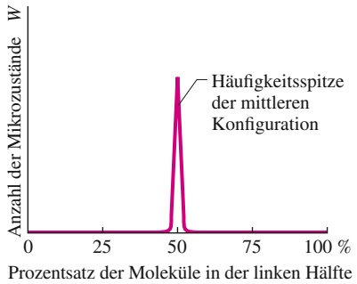

line

| Prozentsatz der Moleküle (%) | Anzahl der Mikrozustände (W) |
| --- | --- |
| ~48 | ~10 |
| 50 | ~95 |
| ~52 | ~10 |

Abb. 16.14

Die Anzahl der Mikrozustände zu verschiedenen Konfigurationen für eine sehr große Anzahl von Molekülen. Die Konfigurationen sind durch den prozentualen Anteil der Moleküle in der linken Kastenhälfte gekennzeichnet. Fast alle Mikrozustände entsprechen einer nahezu gleichen Aufteilung der Moleküle in die beiden Kastenhälften. Diese Mikrozustände bilden in dem Diagramm die scharfe Spitze in der Mitte. Für $N \approx 1 0 ^ { 2 2 }$ (ein 60stel Mol) wäre diese Spitze viel zu schmal, um in dieser Darstellung überhaupt gezeichnet werden zu können.

413

---

16 Entropie und der zweite Hauptsatz der Thermodynamik

einer rastlosen Jagd sämtliche Mikrozustände mit derselben Wahrscheinlichkeit. Doch weil nur so relativ wenige Mikrozustände außerhalb der sehr engen Spitze in Abb. 16.14 liegen, können wir ebenso gut annehmen, dass sich die Gasmoleküle immer gleichmäßig auf die beiden Hälften verteilen. Wie wir noch sehen werden, hat gerade diese Konfiguration die größte Entropie von allen.

## Wahrscheinlichkeit und Entropie

Im Jahr 1877 fand der österreichische Physiker Ludwig Boltzmann (nach dem auch die Boltzmann-Konstante k benannt ist) eine Beziehung zwischen der Entropie S einer Konfiguration von Mikrozuständen und deren Multiplizität W. Diese Beziehung lautet

$$
S = k \ln W \quad (\text {Boltzmannsche Entropiegleichung}). \tag {16.19}
$$

Diese berühmte Formel ist sogar auf Boltzmanns Grabstein zu lesen.

Dass S und W über eine Logarithmus-Funktion miteinander zusammenhängen, erscheint naheliegend: Die Gesamtentropie von zwei Systemen ist gleich der Summe der Einzelentropien. Andererseits ist die Wahrscheinlichkeit für das Auftreten zweier unabhängiger Ereignisse (z. B. zweier Mikrozustände in zwei verschiedenen Systemen) gleich dem Produkt der beiden Einzelwahrscheinlichkeiten. Da ln(ab) = ln a + ln b, scheint der Logarithmus die natürliche Funktion, diese beiden Größen miteinander in Beziehung zu setzen.

In Tab. 16.1 findet man auch die Entropien der Konfigurationen des Sechsmo lekülsystems aus Abb. 16.13, berechnet nach Gl. 16.19. Konfiguration IV hat die größte Multiplizität und damit auch die größte Entropie (der Logarithmus ist eine monotone Funktion).

Wenn Sie W mithilfe von Gl. 16.18 berechnen möchten und dabei die Fakultät von Zahlen eingeben, die größer als einige Hundert sind, zeigt Ihnen Ihr Taschenrechner möglicherweise eine Fehlermeldung, weil die auftretenden Zahlen zu groß sind. Glücklicherweise gibt es eine recht gute Näherung für ln N! (also genau das, was für Gl. 16.19 benötigt wird), die man als **Stirling-Näherung** bezeichnet. Diese Formel besagt

$$
\ln N! \approx N (\ln N) - N \quad \text {(Stirling - Näherung)} . \tag {16.20}
$$

Diese Näherung ist nach dem britischen Mathematiker James Stirling benannt, der nichts mit dem Pastor und Ingenieur Robert Stirling zu tun hat, dem wir die Stirling-Maschine und den Stirling-Motor verdanken.

## KONTROLLFRAGE 5

Ein Behälter enthalte 1 mol eines Gases. Betrachten Sie zwei Konfigurationen: (a) In jeder Hälfte des Behälters befindet sich genau die Hälfte der Moleküle, und (b) jedes Drittel des Behälters enthält jeweils ein Drittel aller Moleküle. Zu welcher dieser Konfigurationen gibt es mehr Mikrozustände?

## 16.5 Zusammenfassung

**Gerichtete Prozesse** Ein **irreversibler** Prozess lässt sich nicht durch kleine Änderungen in der Umgebung rückgängig machen. Die Richtung, in die ein irreversibler Prozess abläuft, ist durch die Entropieänderung ΔS des Systems gegeben. Die Entropie S ist eine Zustandsgröße (oder Zustandsfunktion), d. h., sie hängt nur von dem Zustand des Systems ab und nicht davon, wie das System in diesen Zustand gelangt ist. Das Entropiepostulat besagt (im Wesentlichen): Wenn in einem abgeschlossenen System ein irreversibler Prozess stattfindet, nimmt die Entropie des Systems immer zu.

**Berechnung von Entropieänderungen** Die Entropieänderung ΔS eines irreversiblen Prozesses von einem Anfangszustand i zu einem Endzustand f ist gleich der Entropieänderung ΔS eines beliebigen reversiblen Prozesses zwi-

414

---

16.5 Zusammenfassung

16

schen denselben beiden Zuständen. Die letztere (nicht die erstere) können wir nach der Formel

$$
\Delta S = S _ {\mathrm{f}} - S _ {\mathrm{i}} = \int_ {\mathrm{i}} ^ {\mathrm{f}} \frac {\mathrm{d} Q}{T} \tag {16.1}
$$

berechnen. Q ist hier die als Wärme zwischen dem System und seiner Umgebung übertragene Energie und $T$ ist die Temperatur des Systems bei diesem Prozess (in Kelvin).

Für einen reversiblen isothermen Prozess wird aus Gl. 16.1

$$
\Delta S = S _ {\mathrm{f}} - S _ {\mathrm{i}} = \frac {Q}{T}. \tag {16.2}
$$

Ist die Temperaturänderung ΔT eines Systems klein im Vergleich zur absoluten Temperatur (in Kelvin) vor und nach dem Prozess, kann man die Entropieänderung auch durch

$$
\Delta S = S _ {\mathrm{f}} - S _ {\mathrm{i}} \approx \frac {Q}{T _ {\mathrm{gem}}} . \tag {16.3}
$$

annähern, wobei $T _ { \mathrm { g e m } }$ die mittlere Temperatur des Systems bei diesem Prozess ist.

Wenn ein ideales Gas reversibel von einem Anfangszustand mit der Temperatur $T _ { \mathrm { i } }$ und dem Volumen $V _ { \mathrm { i } }$ in einen Endzustand mit der Temperatur $T _ { \mathrm { f } }$ und dem Volumen $V _ { \mathrm { f } }$ übergeht, ist die Entropieänderung des Gases durch folgende Beziehung gegeben:

$$
\Delta S = S _ {\mathrm{f}} - S _ {\mathrm{i}} = n R \ln \frac {V _ {\mathrm{f}}}{V _ {\mathrm{i}}} + n C _ {V} \ln \frac {T _ {\mathrm{f}}}{T _ {\mathrm{i}}} . \tag {16.4}
$$

**Der zweite Hauptsatz der Thermodynamik** Dieses Gesetz ist eine Erweiterung des Entropiepostulats und besagt: Für ein abgeschlossenes System nimmt die Entropie bei $i r -$ reversiblen Prozessen zu und bleibt für reversible Prozesse konstant, als Gleichung:

$$
\Delta S \geq 0. \tag {16.5}
$$

**Thermodynamische Maschinen** Eine Maschine ist eine Vorrichtung, die in einem Kreisprozess einem warmen Wärmereservoir die Energie $| Q _ { \mathrm { H } } |$ als Wärme entzieht und dabei die Arbeit $| W |$ | |leistet. Der Wirkungsgrad η einer Ma-| |schine ist definiert als:

$$
\eta = \frac {\text {erhaltene Energie}}{\text {bezahlte Energie}} = \frac {| W |}{| Q _ {\mathrm{H}} |}  . \tag {16.9}
$$

Bei einer **idealen Maschine** sind alle Prozesse reversibel und es gibt keine Energieverluste aufgrund von Reibung, Turbulenzen oder Ähnlichem. Eine **Carnot-Maschine** ist eine ideale Maschine, die dem Kreisprozess aus Abb. 16.6 folgt. Ihr Wirkungsgrad ist

$$
\eta_ {\mathrm{C}} = 1 - \frac {| Q _ {\mathrm{N}} |}{| Q _ {\mathrm{H}} |} = 1 - \frac {T _ {\mathrm{N}}}{T _ {\mathrm{H}}}, \tag {16.10,16.11}
$$

wobei $T _ { \mathrm { H } }$ und $T _ { \mathrm { N } }$ die Temperaturen des wärmeren bzw. kälteren Wärmereservoirs sind. Der Wirkungsgrad realer

Maschinen ist immer kleiner als der einer Carnot-Maschine (Gl. 16.11). Das Gleiche gilt für ideale Maschinen, die keine Carnot-Maschinen sind.

Eine perfekte Maschine ist eine imaginäre Maschine, bei der die aus dem Wärmereservoir entzogene Wärmeenergie vollständig in Arbeit umgesetzt wird. Eine solche Maschine würde dem zweiten Hauptsatz der Thermodynamik widersprechen, der sich daher auch folgendermaßen formulieren lässt: Es gibt keine Folge von Prozessen, deren einziges Ergebnis darin besteht, Wärmeenergie aus einem Wärmereservoir zu entziehen und diese vollständig in Arbeit umzusetzen.

**Kältemaschinen** Eine Kältemaschine ist ein Gerät, an dem im Rahmen eines Kreisprozesses Arbeit geleistet wird und das einem kalten Wärmereservoir die Wärmeenergie $| Q _ { \mathrm { N } } |$ entzieht. Die Leistungszahl ε einer Kältemaschine ist | |definiert als

$$
\varepsilon = \frac {\text {was wir wollen}}{\text {was wir bezahlen}} = \frac {| Q _ {\mathrm{N}} |}{| W |}  . \tag {16.12}
$$

| |Eine **Carnot-Kältemaschine** ist eine Carnot-Maschine, bei welcher der Kreisprozess in umgekehrter Richtung durchlaufen wird. Für eine Carnot-Kältemaschine wird aus Gl. 16.12

$$
\varepsilon_ {\mathrm{C}} = \frac {| Q _ {\mathrm{N}} |}{| Q _ {\mathrm{H}} | - | Q _ {\mathrm{N}} |} = \frac {T _ {\mathrm{N}}}{T _ {\mathrm{H}} - T _ {\mathrm{N}}} \tag {16.13,16.14}
$$

Eine perfekte Kältemaschine ist eine imaginäre Kältemaschine, bei der ohne jegliche Arbeit die einem kalten Wärmereservoir entzogene Wärmeenergie einem warmen Wärmereservoir zugeführt wird. Eine solche Kältemaschine würde dem zweiten Hauptsatz der Thermodynamik widersprechen, der sich auch folgendermaßen formulieren lässt: Es gibt keine Folge von Prozessen, deren einziges Ergebnis darin liegt, einem kühleren Reservoir Wärmeenergie zu entziehen und diese einem wärmeren Reservoir zuzuführen.

**Statistische Interpretation der Entropie** Die Entropie eines Systems lässt sich auch über die möglichen Verteilungen der Moleküle definieren. Für gleichartige Moleküle entspricht jede mögliche Verteilung einem **Mikrozustand** des Systems. Alle makroskopisch gleichwertigen Mikrozustände werden zu einer **Konfiguration** (bzw. einem **Makrozustand**) zusammengefasst. Die Anzahl der Mikrozustände zu einer gegebenen Konfiguration bezeichnet man als die **Multiplizität** W dieser Konfiguration.

Für ein System aus N Molekülen, die sich auf die beiden Hälften eines Kastens verteilen können, ist die Multiplizität durch

$$
W = \frac {N !}{n _ {1} ! n _ {2} !} \tag {16.18}
$$

gegeben, wobei $n _ { 1 }$ die Anzahl der Moleküle in der einen Kastenhälfte und $n _ { 2 }$ die Anzahl der Moleküle in der anderen Kastenhälfte sind. Nach einer Grundannahme der statistischen Mechanik sind alle Mikrozustände gleich wahrscheinlich. Konfigurationen mit einer großen Anzahl von

415

---

16 Entropie und der zweite Hauptsatz der Thermodynamik

Mikrozuständen treten daher häufiger auf. Ist N sehr groß (beispielsweise $N \; = \; 1 0 ^ { 2 2 }$ Moleküle oder mehr), liegen praktisch immer solche Konfigurationen vor, bei denen $n _ { 1 } \approx n _ { 2 }$

Die Multiplizität W einer Systemkonfiguration und die Entropie des Systems in dieser Konfiguration sind über die Boltzmannsche Entropiegleichung miteinander verknüpft:

$$
S = k \ln W, \tag {16.19}
$$

## 16.6 Fragen

**1.** Ein Gas in einem wärmeisolierten Behälter werde adiabatisch auf die Hälfte seines Volumens komprimiert. Nimmt die Entropie des Gases zu, ab oder bleibt sie bei diesem Prozess unverändert?
**2.** Bei vier Experimenten werden jeweils zwei Blöcke A und B, die anfänglich verschiedene Temperaturen haben, in einem wärmeisolierten Behälter zusammengebracht (wie in Beispielaufgabe 16.1 im Übungsbuch), sodass sich ihre Temperaturen angleichen. Die Entropieänderungen der Blöcke hatten in den vier Experimenten die in der Tabelle angegebenen Werte (in J/K), allerdings nicht unbedingt in der angegebenen Reihenfolge. Bestimmen Sie, welche Werte für A zu welchen Werten für B gehören.

<table><tr><td>Block</td><td colspan="4">Werte</td></tr><tr><td>A</td><td>8</td><td>5</td><td>3</td><td>9</td></tr><tr><td>B</td><td>-3</td><td>-8</td><td>-5</td><td>-2</td></tr></table>

**3.** Der Punkt i in Abb. 16.F3 stellt die initiale Konfi-

guration eines idealen Gases bei der Temperatur T dar. Ordnen Sie unter Berücksichtigung der Vorzeichen die Entropieänderungen des Gases bei reversiblen Prozessen, die von i zu den Punkten a, b, c bzw. d führen, in absteigender Reihenfolge.

**4.** Ein ideales Gas im Kontakt mit einem einstellbaren Wärmereservoir durchlaufe von einem Anfangszustand i die vier reversiblen Pfade in Abb. 16.F4. Ordnen Sie die Pfade in absteigender Reihenfolge nach der Entropieänderung (a) des Gases, (b) des Reservoirs und (c) des Systems aus Gas und Reservoir.

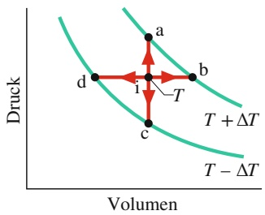

contour

| State | Description |
| --- | --- |
| a | Initial state at point (a, d) |
| b | Intermediate state at point (b, c) |
| c | Final state at point (c, d) |
| d | New state at point (d) |
| i | Process direction indicated by arrows labeled T and T+ΔT |

Abb. 16.F3

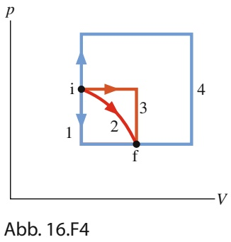

flowchart

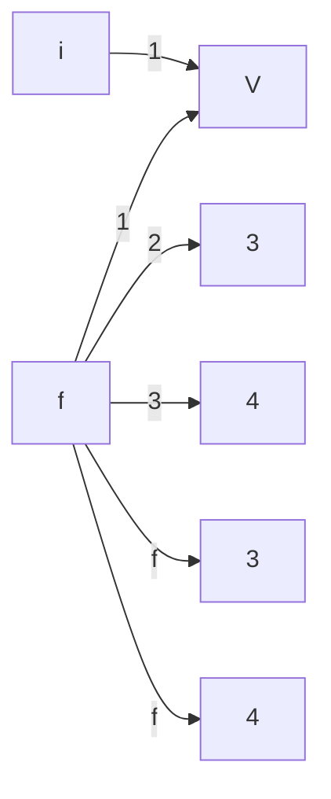

**5.** Ein Gas expandiert frei von einem Volumen V auf ein Volumen 2V. Anschließend expandiert es frei vom Voluwobei $k = 1 { , } 3 8 \cdot 1 0 ^ { - 2 3 }   \mathrm { J / K }$ die Boltzmann-Konstante ist.

Ist N sehr groß (was meist der Fall ist), können wir ln N! mithilfe der Stirling-Näherung annähern:

$$
\ln N! \approx N (\ln N) - N. \tag {16.20}
$$

men 2V auf das Volumen 3V. Ist die resultierende Entropieänderung für diese beiden Expansionen größer, kleiner oder gleich der Entropieänderung, die das Gas bei einer nicht unterbrochenen freien Expansion vom Volumen V auf das Volumen 3V hätte?

**6.** Drei Carnot-Maschinen arbeiten zwischen den Temperaturen (a) 400 K und 500 K, (b) 500 K und 600 K und (c) 400 K und 600 K. Beide Maschinen entnehmen dem wärmeren Reservoir pro Kreisprozess dieselbe Wärmemenge. Ordnen Sie die pro Kreisprozess von den Maschinen geleistete Arbeit in absteigender Reihenfolge.
**7.** Wird die Entropie der folgenden Maschinen pro Kreisprozess größer, kleiner oder bleibt sie gleich: (a) Carnot-Maschine, (b) eine reale Maschine und (c) eine perfekte Maschine (die sich natürlich nicht bauen lässt)?
**8.** Angenommen, Sie lassen die Tür Ihres Kühlschranks für einige Stunden offen. Nimmt die Temperatur in Ihrer Kü- che zu oder ab, oder bleibt sie gleich? Nehmen Sie an, Ihre Küche sei abgeschlossen und gut isoliert.
**9.** Wird die Entropie der folgenden Kältemaschinen pro Kreisprozess größer, kleiner oder bleibt sie gleich: (a) Carnot-Kältemaschine, (b) eine reale Kältemaschine und (c) eine perfekte Kältemaschine (die sich natürlich nicht bauen lässt)?
**10.** Ein Kasten enthalte 100 Atome in einer Konfiguration, bei der sich 50 Atome in jeder der beiden Hälften befinden. Angenommen, Sie könnten die verschiedenen Mikrozustände zu dieser Konfiguration mit einem Supercomputer zählen (pro Sekunde 100 Milliarden Zustände). Schätzen Sie ohne explizite Berechnung ab, wie viel Rechenzeit Sie dafür benötigten: einen Tag, ein Jahr oder viel mehr als ein Jahr.
**11.** Abbildung 16.F11 zeigt eine Momentaufnahme zum Zeitpunkt $t   =   0$ von zwei Molekülen a und b in einem Kasten (ähnlich wie in Abb. 16.13). Die Moleküle habendieselbe Masse und dieselbe Geschwindigkeit v, die Stö- ße der Moleküle mit der Wand seien elastisch. Mit welcher Wahrscheinlichkeit werden Momentaufnahmen zu den Zeitpunkten (a) $t = 0 { , } 1 0 L / \nu$ und (b) t = 10L∕v Atom a in der linken Kastenhälfte und Atom b in der rechten Kastenhälfte zeigen? (c) Mit welcher Wahrscheinlichkeit wird

416

---

16.6 Fragen

16

zu irgendeinem späteren Zeitpunkt nur die Hälfte der kinetischen Energie der Moleküle in der rechten Kastenhälfte sein?

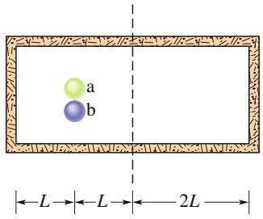

text_image

a
b
L → L → 2L →

Abb. 16.F11

**12.** In vier Versuchen expandieren jeweils 2,5 mol Was serstoff isotherm und reversibel ausgehend von demselben Volumen, aber bei unterschiedlichen Temperaturen; die entsprechenden pV-Diagramme sind in Abb. 16.F12 gezeigt. Ordnen Sie die Experimente in absteigender Reihenfolge nach der dabei auftretenden Entropieänderung.

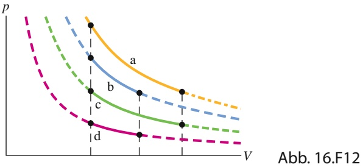

line

| Curve | Point 1 | Point 2 | Point 3 |
| --- | --- | --- | --- |
| a | High | Medium | Low |
| b | Medium | Medium-Low | Low |
| c | Low | Low | Very Low |
| d | Lowest | Lowest | Lowest |

**13.** Ein Erfinder behauptet, vier Motoren erfunden zu haben, die jeweils zwischen Reservoirs mit konstanten Temperaturen von $T _ { \mathrm { H } } = 4 0 0   \mathrm { K }$ und $T _ { \mathrm { N } } = 3 0 0$ K arbeiten sollen. Die Daten der Motoren sind (pro Arbeitszyklus): Motor A $- Q _ { \mathrm { H } } = 2 0 0   \mathrm { J } , Q _ { \mathrm { N } } = 1 7 5   \mathrm { J } , W = 4 0   \mathrm { J } ;$ Motor $\mathrm { B }   { - }   Q _ { \mathrm { H } } = 5 0 0   \mathrm { J }$ $Q_{ N } = 200  J ,   W = 400  J ;  Motor     C - Q_{ H } = 600  J ,   Q_{ N } = 200  J$ $W = 4 0 0   \mathrm { J }$ ; Motor $\mathrm { D - } Q _ { \mathrm { H } } = 1 0 0   \mathrm { J }$ $Q _ { \mathrm { N } } = 9 0   \mathrm { J } ,$ W = 10 J. Geben Sie an, ob und wenn ja welchen der beiden Hauptsätze der Thermodynamik die Motoren verletzen.

417

---

