# 17 Elektrische Ladung

原始 PDF 第 433–446 页。

# 17 Elektrische Ladung

## 17.1 Elektromagnetismus

## Physikalische Motivation

Wir alle sind von zahllosen Geräten umgeben, deren Funktion auf elektromagnetischen Effekten beruht. Unter Elektromagnetismus versteht man die Kombination von elektrischen und magnetischen Erscheinungen. Er ist die Grundlage von Computern, Fernsehen, jeglicher moderner Telekommunikation, der Beleuchtung in unseren Wohnungen und lässt sogar Frischhaltefolien quasi von allein an Behältern haften. Elektromagnetismus bewirkt auch viele Erscheinungen in der Natur: Nicht nur, dass er alle Atome und Moleküle zusammenhält, er erzeugt auch Blitze, Nordlichter und Regenbögen.

Die Erforschung des Elektromagnetismus reicht bis in die Antike zurück. Bereits den frühen griechischen Philosophen war bekannt, dass ein Stück Bernstein, auf Griechisch „élektron“, kleine Strohhalme anzieht, wenn man an ihm reibt. Wie wir heute wissen, ist die Ursache dieser Anziehung eine elektrostatische Kraft. Die alten Griechen berichten ebenfalls, dass bestimmte, unter anderem in der Nähe der kleinasiatischen Stadt „Magnesía“ vorkommende Steine Eisen anziehen konnten. Wie wir heute wissen, beruht diese Anziehung auf der magnetischen Kraft (siehe Kapitel 24).

Ausgehend von diesen einfachen Beobachtungen entwickelte sich die Erforschung von Elektrizität und Magnetismus über viele Jahrhunderte unabhängig voneinander – bis zum Jahr 1820, als Hans Christian Oersted (1777–1851) einen Zusammenhang zwischen den beiden Erscheinungen entdeckte: Ein elektrischer Strom in einer Drahtspule lenkt eine magnetische Kompassnadel ab. Oersted machte diese Entdeckung übrigens, als er einen Demonstrationsversuch für seine Physikvorlesung vorbereitete.

Von nun an arbeiteten Wissenschaftler in vielen Ländern an der Entwicklung dieses neuen Zweigs der Physik, der sich eine vereinheitlichte Beschreibung elektrischer und magnetischer Erscheinungen unter dem Begriff des Elektromagnetismus zum Ziel setzte. Einer der begabtesten war Michael Faraday (1791–1867), ein begnadeter Experimentator mit außergewöhnlicher physikalischer Intuition und der Fähigkeit zur Veranschaulichung, was sich am deutlichsten in der Tatsache zeigt, dass all seine Protokollbücherüber seine Arbeit im Labor nicht eine einzige mathematische Gleichung enthalten. Mitte des 19. Jahrhunderts schließlich fasste James Clerk Maxwell Faradays physikalische Ideen in mathematischer Form zusammen, führte zudem zahlreiche neue, eigene Konzepte ein und stellte damit den Elektromagnetismus auf eine solide theoretische Grundlage.

Unsere Diskussion des Elektromagnetismus wird sich über die nächsten 13 Kapitel erstrecken. Wir beginnen mit den elektrischen Erscheinungen und wenden uns als Erstes der Frage zu, was elektrische Ladung eigentlich ist und wie sie sich bemerkbar macht.

Halliday Physik für natur- und ingenieurwiss. Studiengänge, 3. Auflage. D. Halliday, R. Resnick und J. Walker. © 2020 WILEY-VCH Verlag GmbH & Co. KGaA. Published 2020 by WILEY-VCH Verlag GmbH & Co. KGaA.

419

---

17 Elektrische Ladung

natural_image

Close-up of a stainless steel faucet with a measuring tool applying liquid to the sink (no text or symbols visible)

Abb. 17.1

Statische Elektrizität ist die Ursache dafür, dass das elektrisch geladene Lineal den Wasserstrahl anzieht [Quelle: Bibliographisches Institut GmbH/Lernhelfer].

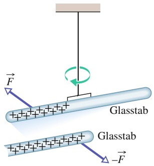

text_image

F
Glasstab
Glasstab
-F

(a)

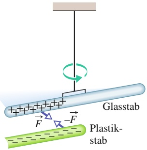

text_image

Glasstab
Plastik-
stab

(b)

Abb. 17.2

(a) Zwei gleichnamig geladene Stä- be stoßen einander ab. (b) Zwei entgegengesetzt geladene Stäbe ziehen einander an. Pluszeichen im Bild zeigen eine positive Gesamtladung an, Minuszeichen eine negative.

## 17.1.1 Elektrische Ladung

Läuft man bei trockener Witterung über einen Teppich, so kann man manchmal einen Funkenüberschlag spüren oder sogar sehen, wenn man einen Finger in die Nähe eines Türgriffs aus Metall bringt. Auch die Werbung für antistatische Produkte macht uns darauf aufmerksam, dass das elektrostatische Haften von Kleidungsstücken am Körper unerwünscht sein soll. Auch bei anderen Gelegenheiten sorgen elektrostatisch aufgeladene Gegenstände für mitunter überraschende Effekte (Abb. 17.1). Phänomene dieser Art lassen ahnen, welche Mengen elektrischer Ladung in den uns umgebenden, alltäglichen Gegenständen – und natürlich auch in unserem eigenen Körper – vorhanden sind. Die elektrische Ladung gehört zu den intrinsischen, mit den elementaren Bausteinen aller Gegenstände verbundenen Eigenschaften, sie begleitet also diese elementaren Teilchen, wo auch immer sie auftreten und in welchem Umfeld sie sich auch befinden mögen – und damit auch uns!

Das Vorhandensein riesiger Ladungsmengen in alltäglichen Gegenständen ist nicht so ohne Weiteres zu erkennen, da in einem Körper normalerweise gleiche Mengen zweier unterschiedlicher Ladungsarten vorhanden sind: positive und negative Ladung. Enthält ein Körper gleich viel an positiver und negativer Ladung, so bezeichnet man diesen Körper als elektrisch neutral und seine effektive Ladung ist null. Sind die beiden Ladungsarten dagegen nicht im Gleichgewicht, so trägt der Körper eine effektive Ladung. Sprechen wir also von einem geladenen Körper, so meinen wir damit, dass ein Ungleichgewicht der beiden Ladungsarten in diesem Körper besteht und deshalb eine effektive Ladung nach außen hin in Erscheinung tritt. Machen Sie sich klar, dass der Betrag dieses Ladungsungleichgewichts stets sehr klein ist im Vergleich zur Gesamtmenge positiver und negativer Ladung in einem Körper.

Geladene Körper wechselwirken miteinander, indem sie Kräfte aufeinander ausüben. Um diesen Effekt zu demonstrieren, laden wir zunächst einen Glasstab, indem wir eines der beiden Enden des Stabs mit einem Seidentuch reiben. An den Berührungspunkten zwischen Glas und Seide werden dabei winzige Mengen elektrischer Ladung vom einen Material auf das andere übertragen, wodurch die Ladungsneutralität beider geringfügig gestört wird. (Durch die reibende Bewegung vergrößern wir effektiv die Menge der Kontaktpunkte zwischen den beiden Stoffen und damit auch die Menge der übertragenen Ladung.)

Nun hängen wir den geladenen Glasstab an einem nichtleitenden Faden auf und isolieren ihn somit elektrisch von seiner Umgebung, sodass sich seine Ladung nicht mehr ändern kann. Bringen wir nun einen zweiten, auf gleiche Weise aufgeladenen Glasstab in die Nähe des ersten Stabs (Abb. 17.2a), so stoßen sich die beiden Stäbe ab. Jeder der beiden Stäbe erfährt somit eine Kraft, die vom jeweils anderen Stab weg gerichtet ist. Reiben wir dagegen einen Plastikstab mit einem Stück Fell und bringen wir ihn in die Nähe des frei hängenden Glasstabs (Abb. 17.2b), so ziehen sich die beiden Stäbe an. In diesem Fall erfährt also jeder der beiden Stäbe eine Kraft, die zum jeweils anderen Stab zeigt.

Man kann die Beobachtungen dieser beiden Versuche mithilfe der Begriffe positiver und negativer Ladung beschreiben: Reiben wir einen Glasstab mit einem Seidentuch, so verliert der Glasstab einen kleinen Teil seiner negativen Ladung, sodass dann ein kleiner Teil seiner positiven Ladungen nicht mehr kompensiert wird (angedeutet durch die Pluszeichen in Abb. 17.2a). Reiben wir dagegen den Plastikstab mit einem Fellstück, so erhält der Stab vom Material des Fells eine kleine Menge negativer Überschussladung, die von den positiven Ladungen des Stabs nicht kompensiert wird (angedeutet durch die Minuszeichen in Abb. 17.2b). Unsere beiden Versuche bringen uns zu der folgenden wichtigen Aussage:

Ladungen mit gleichen Vorzeichen (gleichnamige Ladungen) stoßen einander ab, Ladungen mit unterschiedlichen Vorzeichen (ungleichnamige Ladungen) ziehen einander an.

420

---

17.1 Elektromagnetismus

17

Am Ende dieses Abschnitts werden wir dies quantitativ formulieren und in die mathematische Form des Coulomb-Gesetzes der Elektrostatik (oder des Gesetzes der elektrostatischen Kraft zwischen Ladungen) bringen. Man spricht von Elektrostatik, um zu betonen, dass die Ladungen relativ zueinander ruhen oder sich nur sehr langsam bewegen.

Die Bezeichnungen positiv und negativ für die beiden Arten elektrischer Ladung sind rein willkürlich gewählt und gehen auf Benjamin Franklin (1706–1790) zurück. Ebenso gut hätte er die beiden Bezeichnungen vertauschen oder auch ein beliebiges anderes Paar von gegensätzlichen (dualen) Begriffen verwenden können, um die beiden Ladungsarten voneinander zu unterscheiden. Franklin war nicht nur Politiker, sondern auch ein Wissenschaftler von internationalem Ruf. Man sagt, dass es ihm die diplomatischen Erfolge, die er in der Zeit des amerikanischen Unabhängigkeitskriegs in Frankreich erzielte, leichter machten oder vielleicht sogar erst ermöglichten, dass man ihn als Wissenschaftler so außerordentlich schätzte.

Das Phänomen der Anziehung und Abstoßung geladener Körper findet weite technische und industrielle Anwendung, beispielsweise beim elektrostatischen Farbsprühen, bei der Pulverbeschichtung, dem Aufsammeln von Flugasche in Kaminen oder dem berührungsfreien Druck in Tintenstrahldruckern und Fotokopierern. Ein Fotokopierer erzeugt ein Bild mithilfe von winzigen Trägerpartikeln, an denen noch kleinere Tonerteilchen aus einem schwarzen pulverförmigen Farbstoff aufgrund elektrostatischer Anziehung haften. Ebenfalls durch elektrostatische Anziehung werden die negativ geladenen Tonerteilchen von den Trägerpartikeln auf eine rotierende Trommel hin abgezogen, auf welcher das Kopiergerät zuvor ein positiv geladenes Abbild der zu kopierenden Druckvorlage erzeugt hat. Ein geladenes Blatt Papier zieht schließlich die Tonerteilchen, welche nun ebenfalls auf der Trommel ein Abbild der Druckvorlage gebildet haben, von der Trommel ab, und durch Erhitzen wird der Tonerfarbstoff schließlich auf der Papierunterlage fixiert.

## 17.1.2 Leiter und Isolatoren

In einigen Stoffen, beispielsweise den Metallen, im Regenwasser oder auch im menschlichen Körper, kann sich ein Teil der enthaltenen negativen Ladung mehr oder weniger frei bewegen. Solche Stoffe bezeichnet man als **Leiter**. In anderen Stoffen, wie beispielsweise in Glas, chemisch reinem Wasser oder Plastik, ist eine solche Bewegung negativer Ladungen nicht möglich. Man bezeichnet solche Stoffe daher als **Nichtleiter** oder **Isolatoren**.

Versucht man, einen Kupferstab, den man in der Hand hält, durch Reiben mit einem Wolltuch elektrisch zu laden, so gelingt dies nicht, da sowohl das Kupfer als auch der menschliche Körper Leiter sind. Zwar erzeugt man durch das Reiben ein Ladungsungleichgewicht zwischen Stab und Tuch, doch gleicht sich die Überschussladung auf dem Stab augenblicklich über die leitende Verbindung durch Stab, Hand und Körper bis in den Erdboden aus – der Stab bleibt elektrisch neutral.

Wenn man einen Gegenstand erdet, also eine leitende Verbindung zur Erdoberfläche herstellt, kann sich eine auf dem Gegenstand vorhandene negative oder positive Überschussladung ausgleichen und man sagt, der Gegenstand werde entladen. Hält man den Kupferstab nicht unmittelbar in der Hand und verwendet stattdessen einen isolierenden Haltegriff, so besteht die leitende Verbindung zur Erde nicht mehr und es ist dann sehr wohl möglich, den Stab durch Reiben mit dem Wolltuch zu laden.

Die elektrischen Eigenschaften von Leitern und Isolatoren haben ihre Ursache in der Struktur und den elektrischen Eigenschaften der Atome. Atome sind aufgebaut aus positiv geladenen Protonen, negativ geladenen Elektronen und elektrisch neutralen Neutronen. Die Protonen und Neutronen bilden dicht gepackt den zentralen Kern eines Atoms.

421

---

17 Elektrische Ladung

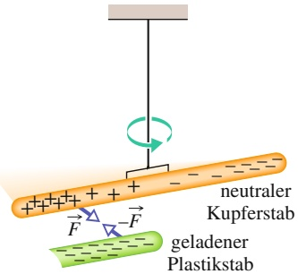

text_image

neutraler
Kupferstab
geladener
Plastikstab

Abb. 17.3

Ein neutraler Kupferstab ist an einem nichtleitenden Faden aufgehängt und dadurch elektrisch von seiner Umgebung isoliert. Ein geladener Plastikstab zieht ein Ende des Kupferstabs an. Diese Anziehung ergibt sich dadurch, dass die Leitungselektronen

im Kupferstab von den negativen Ladungen auf dem Plastikstab abgestoßen und zum abgewandten Ende des Kupferstabs hin verschoben werden. Die negativen Ladungen auf dem Kunststoffstab ziehen nun die am na-

he gelegenen Ende des Kupferstabs verbliebenen positiven Ladungen an, sodass sich der Kupferstab an seinem Faden zum Kunststoffstab hindreht.

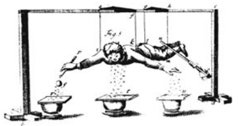

natural_image

Illustration of a person performing a physical maneuver with multiple objects on a platform (no text or symbols visible)

Die Ladungen eines einzelnen Elektrons und eines einzelnen Protons haben ex akt gleiche Beträge, aber entgegengesetzte Vorzeichen. Ein nach außen hin neutrales Atom enthält deshalb gleich viele Protonen wie Elektronen. Die negativ gelade nen Elektronen bleiben in der Nähe des Kerns, da sie von den positiv geladenen Protonen im Kern angezogen werden.

Bauen die Atome eines Leiters wie beispielsweise Kupfer einen Festkörper auf, so bleiben einige der äußeren und damit am schwächsten gebundenen Elektronen eines jeden Atoms nicht mehr an das Atom gebunden, sondern können sich frei innerhalb des Festkörpers bewegen, wobei sie positiv geladene Atome (positive Ionen) zurücklassen. Diese frei beweglichen Elektronen eines Festkörpers nennen wir die Leitungselektronen. In Nichtleitern dagegen gibt es keine oder nur sehr wenige frei bewegliche Elektronen.

Das in Abb. 17.3 skizzierte Experiment demonstriert die Beweglichkeit der Ladung in einem Leiter: Ein negativ geladener Plastikstab in der Nähe eines Endes eines isoliert aufgehängten, neutralen Kupferstabs stößt dort Leitungselektronen ab, die sich am anderen Ende des Stabs sammeln. Am näher gelegenen Ende hinterlassen sie daher unkompensierte positive Ladungen. Diese positiven Ladungen werden nun von der negativen Ladung des Plastikstabs angezogen. Der Kupferstab als Ganzes bleibt dabei elektrisch neutral. Man sagt, er trage eine induzierte Ladung: Durch den Einfluss einer nahe benachbarten Ladung wurden die positiven und negativen Ladungen des neutralen Stabs voneinander getrennt.

Bringt man entsprechend einen positiv geladenen Glasstab in die Nähe eines Endes des Kupferstabs, so werden die Leitungselektronen im Kupfer angezogen. Dadurch lädt sich das nahe Ende negativ auf, das entferntere Ende wird durch die zurückbleibenden positiven Ladungen positiv – wieder wurde eine Ladung im Kupferstab induziert. Obwohl der Kupferstab dabei neutral bleibt, wird sein negativ geladenes Ende nun vom Glasstab angezogen. (Abb. 17.4 zeigt noch ein Beispiel für das Phänomen der induzierten Ladung.)

Beachten Sie, dass sich nur die negativ geladenen Leitungselektronen im Festkörper bewegen können; die positiven Ionen sind dagegen ortsfest. Ein fester Körper kann deshalb nur durch das Entfernen von negativer Ladung positiv geladen werden.

Die sogenannten **Halbleiter**, beispielsweise die Elemente Silicium und Germanium, stehen in ihren elektrischen Eigenschaften zwischen den Leitern und den Isolatoren. Die mikroelektronische Revolution, die unser Leben und unsere Gesellschaft in so vielfältiger Weise verändert hat und noch immer verändert, wurde ermöglicht durch den Einsatz von elektronischen Bauteilen aus halbleitenden Materialien.

Schließlich kennt man die sogenannten Supraleiter, die der Bewegung elektrischer Ladung keinerlei Widerstand entgegensetzen. Man spricht von einem elektrischen Strom, wenn sich Ladung in einem Körper bewegt. Gewöhnliche Materialien, selbst gute Leiter, setzen der Bewegung von Ladungen immer einen Widerstand entgegen. In einem Supraleiter dagegen ist dieser Widerstand nicht einfach nur sehr klein – er ist exakt gleich null. Setzt man einen elektrischen Strom in einem Supraleiter in Gang, so bleibt diese Ladungsbewegung für unbegrenzte Zeit bestehen. Keine Batterie oder irgendeine äußere Energiequelle ist zur Erhaltung des Stroms erforderlich. (Halb- und Supraleiter werden in Kapitel 22 näher untersucht.)

## Abb. 17.4

Dies ist kein Stunt, sondern ein ernsthaftes Experiment, mit welchem man im Jahr 1774 zeigen konnte, dass der menschliche Körper ein elektrischer Leiter ist. Der hier wiedergegebene Stich zeigt eine Person, die frei an nichtleitenden Seilen schwebt und durch Berührung mit einem geladenen Stab elektrisch geladen wird – wobei der Stab in Wirklichkeit wohl eher die Haut der Versuchsperson berührte, und nicht, wie dargestellt, ihre Hose. Brachte die Versuchsperson nun ihr Gesicht, die linke Hand sowie auch den elektrisch leitenden Stab und die leitende Kugel in ihrer rechten Hand in die Nähe der auf den Unterlagen am Boden liegenden Papierstückchen, so wurde in diesen Ladung induziert und aufgrund der resultierenden elektrostatischen Anziehung flogen die Papierstückchen frei durch die Luft auf die Versuchsperson zu [Quelle: Johann Gabriel Doppelmayr: Neuentdeckte Phaenomena von Bewunderungswürdigen Würckungen der Natur . . . , Endter und Engelbrecht, Nürnberg 1744].

422

---

17.1 Elektromagnetismus

17

## KONTROLLFRAGE 1

Die Abbildung zeigt fünf Plattenpaare. A, B und D sind elektrisch geladene Plas tikplatten, C eine elektrisch neutrale Kupferplatte. In drei Fällen sind die elektrostatischen Kräfte zwischen den Platten eingezeichnet. Ziehen sich die Platten der übrigen beiden Paare an, oder stoßen sie sich ab?

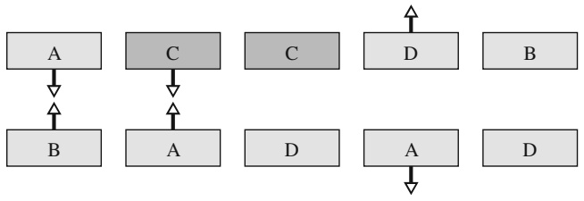

flowchart

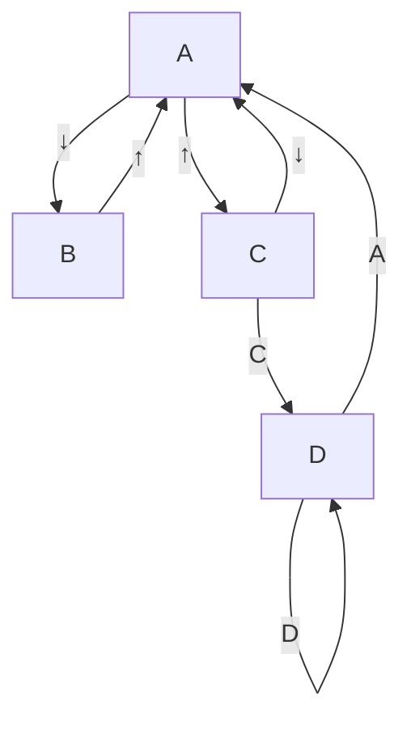

## 17.1.3 Das Coulomb-Gesetz

Zwei kleine, geladene Teilchen (Punktladungen) sollen sich im Abstand r voneinander befinden und die Ladungen $q _ { 1 }$ und $q _ { 2 }$ **t**ragen. Die elektrostatische Kraft zwischen ihnen (Anziehung oder Abstoßung) hat den Betrag

$$
F = k \frac {| q _ {1} | | q _ {2} |}{r ^ {2}}, \tag {17.1}
$$

wobei k eine Konstante ist. Jede der beiden Punktladungen übt eine Kraft von diesem Betrag auf die jeweils andere aus, Es liegt also ein Kräftepaar aus Kraft und Gegenkraft nach dem dritten Newtonschen Gesetz vor. Stoßen sich die Ladungen ab, so zeigt die Kraft auf jedes Teilchen vom jeweils anderen Teilchen weg (Abb. 17.5a und b). Ziehen sich die Ladungen dagegen an, so ist die Kraft auf jedes der Teilchen zu dem jeweils anderen Teilchen hin ausgerichtet (Abb. 17.5c).

Man bezeichnet Gl. 17.1 zu Ehren von Charles Augustin de Coulomb (1736–1806), der es im Jahr 1785 aus seinen Experimenten abgeleitet hat, als **Coulomb-Gesetz**. Es ist bemerkenswert, dass Gl. 17.1 dieselbe mathematische Form hat wie das Newtonsche Gravitationsgesetz (Gl. 9.1) für die Gravitationskraft zwischen zwei Teilchen mit den Massen $m _ { 1 }$ und $m _ { 2 } ,$ die sich im Abstand r voneinander befinden:

$$
F = G \frac {m _ {1} m _ {2}}{r ^ {2}}. \tag {17.2}
$$

In diesem Fall bezeichnet G die **Gravitationskonstante**.

Man kann die Konstante k in Gl. 17.1 in Analogie zur Gravitationskonstante G in Gl. 17.2 als elektrostatische Konstante bezeichnen. Beide Gleichungen beschreiben eine Kraft zwischen zwei miteinander wechselwirkenden Teilchen, die proportional ist zum reziproken quadratischen Abstand zwischen beiden und jeweils proportional zum Produkt der Werte einer intrinsischen Eigenschaft der Teilchen, im einen Fall ihrer Masse, im anderen Fall ihrer Ladung. Die beiden Abstandsgesetze unterscheiden sich dadurch, dass Gravitationskräfte in jedem Fall anziehend sind, da es keine negativen Massen gibt. Elektrostatische Kräfte können dagegen, abhängig von den Vorzeichen der Ladungen, entweder anziehend oder abstoßend sein. (Dies ist auch der Grund dafür, dass Gl. 17.1 Betragszeichen enthält, Gl. 17.2 dagegen nicht.)

Das Coulomb-Gesetz hat jeder experimentellen Prüfung standgehalten; niemals konnte man auch nur die geringsten Abweichungen von seiner exakten Form nachweisen. Es gilt im makroskopischen Bereich ebenso wie innerhalb von Atomen, wo es die Kraft zwischen dem positiv geladenen Kern und jedem einzelnen der negativ geladenen Elektronen korrekt beschreibt, und dies obwohl die klassische Newtonsche Mechanik in diesem mikroskopischen Bereich ihre Gültigkeit verliert und durch die Quantenmechanik ersetzt wird. Dieses einfache Gesetz beschreibt ebenso exakt die Kräfte, welche die Atome zu Molekülen binden, wie auch die Kräfte, die Atome oder Moleküle in Flüssigkeiten oder Festkörpern zusammenhalten.

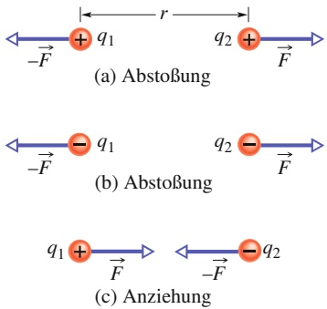

## Abb. 17.5

Zwei geladene Teilchen im Abstand r stoßen sich ab, falls ihre Ladungen (a) beide positiv oder (b) beide negativ sind. Sie ziehen sich dagegen an (c), wenn ihre Ladungen entgegengesetzte Vorzeichen haben. In jedem der drei Fälle hat die Kraft auf eines der Teilchen den gleichen Betrag wie die Kraft auf das jeweils andere Teilchen, hat aber die entgegengesetzte Richtung.

423

---

17 Elektrische Ladung

Aus praktischen Gründen im Zusammenhang mit der Messgenauigkeit leitete man lange Zeit die SI-Einheit der Ladung von der SI-Einheit des elektrischen Stroms ab, dem Ampere. Auch nachdem 2019 die Definition des Ampere auf den exakt festgelegten Wert der Elementarladung und damit auf einer Ladungsgröße zurückgeführt wurde (vgl. Anhang A), blieb das Ampere die Basisgröße, so dass ganz offiziell das **Coulomb** (C) definiert ist als die in einer Sekunde von einem Strom von einem Ampere transportierte Ladungsmenge – was einer exakt vorgegebenen Zahl an Elementarladungen entspricht, und zwar $1 / 1 { , } 6 0 2   1 7 6   6 3 4   \cdot \tilde { 1 0 ^ { - 1 9 } }$ $\bar { ( } \approx 6 ,   2 4 1   5 1 0 \cdot 1 0 ^ { 1 8 } )$

Unabhängig von dieser etwas verwirrenden Regelung können wir auf jeden Fall

$$
\mathrm{d} q = i \mathrm{d} t \tag {17.3}
$$

schreiben, wobei dq die Ladungsmenge bezeichnet, die ein Strom i im Zeitintervall dt transportiert.

Aus historischen Gründen – und auch deshalb, weil viele andere Formeln durch diese spezielle Wahl wesentlich vereinfacht werden – schreibt man die elektrostatische Konstante k in Gl. 17.1 gewöhnlich als $1 / ( 4 \pi \varepsilon _ { 0 } )$ . Damit erhält das Coulomb Gesetz die Gestalt

$$
F = \frac {1}{4 \pi \varepsilon_ {0}} \frac {| q _ {1} | | q _ {2} |}{r ^ {2}}. \tag {17.4}
$$

Die Konstante in den Gln. 17.1 und 17.4 hat den Wert

$$
k = \frac {1}{4 \pi \varepsilon_ {0}} = 8, 9 9 \cdot 1 0 ^ {9} \mathrm{N} \cdot \mathrm{m} ^ {2} / C ^ {2}. \tag {17.5}
$$

Die Größe $\varepsilon _ { 0 } ,$ die sogenannte **elektrische Feldkonstante** (früher auch als Permit tivität des Vakuums oder Dielektrizitätskonstante des Vakuums bezeichnet), erscheint in manchen Zusammenhängen auch ohne den Vorfaktor 4π und hat den Wert

$$
\varepsilon_ {0} = 8, 8 5 \cdot 1 0 ^ {- 1 2} \mathrm{C} ^ {2} / (\mathrm{N} \cdot \mathrm{m} ^ {2}). \tag {17.6}
$$

Eine weitere Parallele zwischen Gravitationskraft und elektrostatischer Kraft be steht darin, dass für beide das Superpositionsprinzip gilt: Betrachtet man n geladene Teilchen, so wechselwirken sie unabhängig voneinander paarweise miteinander, sodass die resultierende Kraft auf ein herausgegriffenes Teilchen, das wir mit dem Index 1 bezeichnen wollen, gegeben ist durch die Vektorsumme

$$
\vec {F} _ {1, \mathrm{res}} = \vec {F} _ {1 2} + \vec {F} _ {1 3} + \vec {F} _ {1 4} + \vec {F} _ {1 5} + \dots + \vec {F} _ {1 n}. \tag {17.7}
$$

Darin bezeichnet beispielsweise $\vec { F } _ { 1 4 }$ die Kraft auf das Teilchen 1 aufgrund des Vorhandenseins von Teilchen 4. Ein formal identischer Zusammenhang gilt für die Gravitationskraft.

Schließlich haben auch die beiden Kugelschalentheoreme, die wir bei unserer Untersuchung der Gravitation so nützlich fanden, ihre Entsprechungen in der Elektrostatik:

Eine homogen über eine Kugelschale verteilte Ladung wirkt auf ein geladenes Teilchen außerhalb der Schale genau so, als sei die gesamte Ladung der Schale in deren Zentrum vereinigt.

Die resultierende elektrostatische Kraft auf ein geladenes Teilchen, das sich im Inneren einer homogen geladenen Kugelschale befindet, ist null.

Anmerkung: Beim ersten Theorem nehmen wir an, dass die Ladungsmenge auf der Schale sehr viel größer ist als die Ladung des Teilchens. Nur unter dieser Annahme kann man eine Umverteilung der Ladung auf der Schale unter dem Einfluss der Ladung des Teilchens vernachlässigen.

424

---

17.1 Elektromagnetismus

17

## Leitende Kugelschalen

Bringt man eine Überschussladung auf eine leitende Kugelschale, so verteilt sich diese Ladung gleichmäßig über die äußere Oberfläche der Schale. Überschüssige Elektronen auf einer Kugelschale aus Metall beispielsweise stoßen einander ab und versuchen, sich voneinander zu entfernen. Dadurch verteilen sie sich über die gesamte zur Verfügung stehende Fläche, bis ihre Verteilung homogen ist. Eine homogene Verteilung maximiert die Abstände zwischen allen Paaren von Elektronen. Nun besagt das erste Kugelschalentheorem, dass die geladene Kugelschale auf eine äußere Probeladung genauso wirkt, als sei die gesamte Überschussladung der Schale in deren Zentrum konzentriert.

Entfernt man umgekehrt negative Ladung von einer metallenen Kugelschale, so verteilt sich auch die zurückbleibende, unkompensierte positive Ladung homogen über die Schale. Werden beispielsweise n Elektronen entnommen, so sind die verbleibenden n Plätze von Atomen, denen jeweils ein Elektron fehlt, in kürzester Zeit ebenfalls homogen über die Schalenoberfläche verteilt. Nach dem ersten Kugelschalentheorem wirkt auch diese geladene Kugelschale auf eine äußere Probeladung genauso, als sei die gesamte Überschussladung der Schale in deren Zentrum konzentriert.

## KONTROLLFRAGE 2

Zwei Protonen (Symbol p) und ein Elektron (Symbol e) seien entsprechend der Skizze linear auf einer Achse angeordnet. Welche Richtung hat (a) die elektrostatische Kraft auf das mittlere Proton aufgrund der Wechselwirkung mit dem Elektron, (b) die elektrostatische Kraft auf das mittlere Proton aufgrund der Wechselwirkung mit dem anderen Proton sowie (c) die resultierende elektrostatische Kraft auf das mittlere Proton?

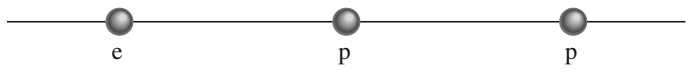

text_image

e
p
p

## KONTROLLFRAGE 3

Die Abbildung zeigt drei verschiedene Anordnungen von drei Teilchen, einem Elektron e und zwei Protonen p. (a) Ordnen Sie die linke, mittlere und rechte Anordnung nach dem Betrag der resultierenden elektrostatischen Kraft auf das Elektron. (b) Ist in der rechten Skizze der Winkel zwischen der resultierenden Kraft auf das Elektron und der mit d bezeichneten Linie kleiner oder größer als 45°?

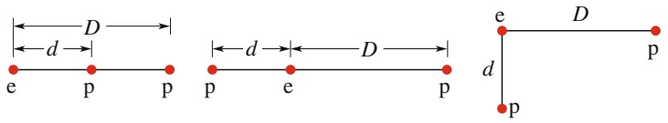

text_image

D
d
e p p
p e p
d
e D p
p

## LÖSUNGSSTRATEGIEN

**Strategie 1: Symbole zur Bezeichnung von Ladungen** Wir geben hier eine allgemeine Regel zur Wahl des Symbols für eine Ladung an. Wird das Symbol q, sei es mit oder ohne Index, ohne Angabe eines Vorzeichens verwendet, so kann die damit bezeichnete Ladung entweder positiv oder negativ sein. Manchmal wird das Vorzeichen der Ladung auch explizit angegeben: +q oder −q. Betrachtet man Anordnungen aus mehreren geladenen Objekten, so können deren jeweilige Ladungen auch als Vielfache einer gewählten Ladungseinheit angegeben sein. So bezeichnet beispielsweise +2q eine positive Ladung, deren Betrag das Doppelte einer zweckmäßig gewählten Ladungseinheit q ist, −3q eine negative Ladung vom dreifachen Betrag der Bezugsladungsmenge q.

425

---

17 Elektrische Ladung

**Strategie 2: Erstellen eines elektrostatischen Kräftediagramms** Ist eine bestimmte Anordnung geladener Teilchen gegeben, wie es beispielsweise in Abb. Ü17.1a im Übungsbuch der Fall ist, und besteht die Aufgabe darin, die resultierende elektrostatische Kraft auf eines der Teilchen zu bestimmen, so ist es in der Regel zweckmäßig, ein Kräftediagramm zu zeichnen, welches nur das zu betrachtende Teilchen und die auf dieses Teilchen wirkenden Kräfte berücksichtigt, wie beispielsweise in Abb. Ü17.1b. Sollten Sie es dagegen vorziehen, sämtliche wirkende Kräfte in einer Darstellung sämtlicher beteiligten Teilchen zu überlagern, so sollten entweder die Spitzen oder vorzugsweise die Ausgangspunkte aller Kraftvektoren auf dem zu betrachtenden Teilchen liegen. Zeichnen Sie die Vektoren dagegen an beliebigen Stellen im Diagramm, so leisten Sie Ihrer Verwirrung Vorschub – einer Verwirrung, die sich mit Sicherheit einstellen wird, sollten Sie die Kraftvektoren an diejenigen Teilchen heften, welche die Ursache sind für die auf das zu betrachtende Teilchen wirkenden Kräfte.

## 17.2 Die elektrische Ladung ist quantisiert

## Lernziele

Nach dem Durcharbeiten dieses Abschnitts sollten Sie in der Lage sein, . . .

• den Begriff der Elementarladung zu erläutern,
• zu verstehen, dass Ladungen auf einem Teilchen oder einem Gegenstand immer Vielfache der Elementarladung sein müssen.

## Schlüsselideen

• Die elektrische Ladung ist quantisiert, d. h. auf bestimmte Werte beschränkt.
• Die Ladung eines Teilchens kann in der Form ne geschrieben werden, wobei n eine positive oder negative ganze Zahl ist und e die Elementarladung, die dem Betrag nach die Ladung des Elektrons und des Protons ist $( e \approx 1 { , } 6 0 2 \cdot 1 0 ^ { - 1 9 }   \mathrm { C } )$

## 17.2.1 Ladung ist quantisiert

Zu Benjamin Franklins Tagen stellte man sich die elektrische Ladung als eine kontinuierliche Flüssigkeit vor. Diese Vorstellung erschien in vielen physikalischen Situationen vertretbar und nützlich, noch heute sagt man, dass ein elektrischer „Strom fließt“. Wie wir heute wissen, sind auch Flüssigkeiten, beispielsweise Wasser oder Luft, keine Kontinua, sondern bestehen aus einer sehr großen Anzahl von Atomen oder Molekülen – die Materie ist quantisiert. Wie weitere Experimente zeigten, ist auch die „elektrische Flüssigkeit“ keineswegs ein Kontinuum: Jede Ladung ist ein ganzzahliges Vielfaches einer minimalen Ladungseinheit. Man kann deshalb jede beliebige Ladung, positiv oder negativ, in der Form

$$
q = n e, \quad \text {mit} \quad n = \pm 1, \pm 2, \pm 3, \dots \tag {17.8}
$$

schreiben, wobei die Größe $e ,$ die **Elementarladung**, den konstanten Wert

$$
e = 1, 6 0 2 \cdot 1 0 ^ {- 1 9} \mathrm{C} \tag {17.9}
$$

TABELLE 17.1: Ladungen dreier Elementarteilchen.

| Teilchen | Symbol | Ladung |
| --- | --- | --- |
| Elektron | e oder e$^{-}$ | $-e$ |
| Proton | p | $+e$ |
| Neutron | n | 0 |

hat. Diese Elementarladung ist eine der wichtigsten Naturkonstanten. Sowohl das Elektron als auch das Proton tragen eine Ladung vom Betrag der Elementarladung e (Tab. 17.1). (Wohl haben die sogenannten Quarks als Bausteine der Protonen und Neutronen Ladungen von $\pm e / 3$ oder $\pm 2 e / 3 ,$ jedoch ist es bisher nicht gelungen, sie isoliert zu beobachten. Deshalb, und auch aus historischen Gründen, wählen wir nicht die kleinste Ladungseinheit der Quarks als Elementarladung.)

Man begegnet oft Formulierungen wie „die Ladung auf einer Kugel“, die „übertragene Ladungsmenge“ oder „die von einem Elektron getragene Ladung“, Formulierungen, die wir auch im vorliegenden Kapitel bereits verwendet haben und die

426

---

17.3 Die elektrische Ladung ist eine Erhaltungsgröße

17

uns eine Vorstellung von der elektrischen Ladung als Stoff nahelegen. Seien Sie sich dabei aber stets bewusst, dass eigentlich die Teilchen der Stoff sind, die Ladung dagegen genau wie ihre Masse eine der intrinsischen Eigenschaften dieser Teilchen ist.

Beobachtet man, dass eine physikalische Größe, beispielsweise die Ladung, nur bestimmte diskrete Werte annehmen kann – also nicht jeden beliebigen Wert –, so bezeichnet man diese Größe als **quantisiert**. Im Fall der elektrischen Ladung beobachtet man experimentell beispielsweise Teilchen mit Ladungen von 0e, +10e oder −6e, niemals jedoch eine Ladung von z. B. 3,57e.

Das Quantum der elektrischen Ladung ist sehr klein. Durch eine Glühlampe von 100 W beispielsweise fließen pro Sekunde etwa $1 0 ^ { 1 9 }$ Elementarladungen. In solch makroskopischen Situationen zeigt sich die „Körnigkeit“ der elektrischen Ladung natürlich nicht, die Lampe flackert also nicht etwa mit jedem hindurchfließenden Elektron. Ebenso wenig können Sie die einzelnen Moleküle des Wassers spüren, das durch Ihre Hand rinnt.

Dagegen ist die Körnigkeit der elektrischen Ladung die Ursache für ein geheimnisvolles blaues Leuchten, das man beobachten kann, wenn man ein Pfefferminzbonbon im Dunkeln zerdrückt: Wenn die Zuckerkristalle des Bonbons in Teile zerbrechen, so findet eine Ladungstrennung dadurch statt, dass eines von jeweils zwei Bruchstücken überschüssige Elektronen erhält, die auf dem anderen Bruchstück entsprechend fehlen, sodass dort ein Überschuss positiver Ionen besteht. Praktisch momentan gleichen sich diese Ladungsdifferenzen dadurch aus, dass Elektronen und Ionen über den noch schmalen Spalt des Bruchs springen. Dabei stoßen die Teilchen mit den Stickstoffmolekülen der in den Spalt bereits eingedrungenen Luft zusammen.

Durch diese Stöße werden die Stickstoffmoleküle angeregt und senden neben unsichtbarem ultraviolettem auch sichtbares blaues Licht aus, welches jedoch zu schwach ist, um wahrgenommen zu werden. Nun absorbiert aber das Pfefferminzöl des Bonbons das ultraviolette Licht und emittiert seinerseits genügend blaues Licht, um den kauenden Mund sichtbar zu beleuchten. Benetzt man das Bonbon jedoch vor dem Zerkauen bereits mit Speichel, so misslingt der Effekt: Der leitfähige Speichel neutralisiert die beiden Kristallbruchstücke, noch bevor der Ladungsausgleich durch die Luft stattfinden kann.

## KONTROLLFRAGE 4

Eine Kugel A trage die Ladung −50e, eine Kugel B die Ladung +20e. Die Kugeln sollen aus leitendem Material bestehen und in ihrer Größe identisch sein. Welche Ladung verbleibt auf Kugel A, wenn sich die Kugeln berühren?

## 17.3 Die elektrische Ladung ist eine Erhaltungsgröße

## Lernziele

Nach dem Durcharbeiten dieses Abschnitts sollten Sie in der Lage sein, . . .

• zu verstehen, dass sich die Gesamtladung eines Systems in keinem isolierten physikalischen Prozess ändern kann (die Gesamtladung bleibt immer erhalten),
• zu erläutern, was ein Annihilationsprozess und was eine Paarbildung von Teilchen ist,
• die Massenzahl und die Ordnungszahl von Atomen auf die Zahl der Protonen, Neutronen und Elektronen in den Atomen zurückzuführen.

## Schlüsselideen

• Die Gesamtladung eines isolierten Systems bleibt immer erhalten.
• Wenn zwei geladene Teilchen an einer Annihilation beteiligt sind oder als Folge einer Paarbildung entstehen, haben sie entgegengesetzte Ladungen.

427

---

17 Elektrische Ladung

## 17.3.1 Ladung ist eine Erhaltungsgröße

Reibt man einen Glasstab mit einem Seidentuch, so erscheint eine positive Ladung auf dem Glasstab. Man kann experimentell nachweisen, dass dabei eine betragsgleiche negative Ladung auf dem Seidentuch entsteht. Daraus lässt sich folgern, dass durch das Reiben keineswegs Ladung erzeugt, sondern bereits vorhandene Ladung vom einen Körper auf den anderen transportiert wird, was dann die elektrische Neutralität von beiden Körpern aufhebt. Diese Annahme der **Ladungserhaltung** wurde zuerst von Benjamin Franklin vorgeschlagen und hat bisher allen kritischen Untersuchungen standgehalten. Sie gilt im Bereich der makroskopischen Körper ebenso wie im mikroskopischen Bereich der Atome, Kerne und Elementarteilchen. Man konnte bisher keinerlei Ausnahmen von dieser Regel beobachten. Wir können daher die elektrische Ladung unserer Liste physikalischer Erhaltungsgrößen wie Energie, linearer Impuls und Drehimpuls hinzufügen.

Der radioaktive Zerfall, bei dem sich ein Atomkern spontan in einen anderen umwandelt, bietet zahlreiche Möglichkeiten, die Ladungserhaltung auf subatomarem Niveau zu beobachten. So zerfällt beispielsweise Uran-238 (auch 238U geschrieben), welches in natürlich vorkommendem Uranerz enthalten ist, durch Abspaltung eines Alpha-Teilchens (eines Heliumkerns, $^ 4 \mathrm { H e ) }$ in einen Kern des Elements Thorium, $^ { 2 \bar { 3 } 4 } \mathrm { T h }$

$$
^ {2 3 8} \mathrm{U} \rightarrow {} ^ {2 3 4} \mathrm{Th} + ^ {4} \mathrm{He} \quad (\text {radioaktiver Zerfall}). \tag {17.10}
$$

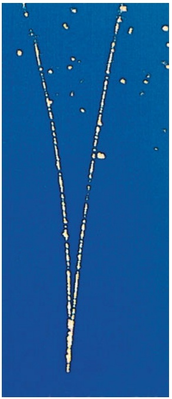

natural_image

Abstract white line drawing on a solid blue background, resembling a V-shaped curve or abstract pattern (no text or symbols)

Abb. 17.6

Die von einem durch Paarbildung entstandenen Elektron-Positron-Paar in einer Blasenkammer erzeugten Spuren bestehen aus Reihen kleiner Bläschen. Das Teilchenpaar wurde durch ein Gamma-Quant erzeugt, welches von unten in die Blasenkammer eindrang. Dies ist ein Photon und daher elektrisch neutral, es hinterlässt daher im Unterschied zu den geladenen Teilchen des Paars keine verräterische Bläschenspur in der Blasenkammer (von John Wood 1954 zuerst beobachtet; [Quelle: Lawrence Berkeley National Laboratory]).

Die Kernladungszahl des Mutterkerns 238U dieses Zerfallsprozesses ist 92, was bedeutet, dass der Kern 92 Protonen enthält und damit eine positive Ladung von 92e trägt. Das beim Zerfall ausgesandte Alpha-Teilchen hat die Kernladungszahl $Z = 2$ , der Tochterkern 234Th die Kernladungszahl $Z = 9 0$ . Daher ist die vor dem Zerfallsprozess vorhandene Ladung, 92e, gleich der Gesamtladung der Zerfalls produkte, $9 0 e + 2 e ;$ Die Ladung bleibt erhalten.

Ein weiteres Beispiel für die Ladungserhaltung ist der Prozess der Paarvernichtung oder Annihilation eines Elektrons $e ^ { - }$ mit der Ladung −e und seines Antiteilchens, des Positrons $e ^ { + }$ mit der Ladung +e, bei dem sich die beiden Teilchen in zwei Gamma-Quanten (hochenergetische Lichtquanten) umwandeln:

$$
\mathrm{e} ^ {-} + \mathrm{e} ^ {+} \rightarrow \gamma + \gamma \quad (\text {Annihilation}). \tag {17.11}
$$

Wenden wir den Satz von der Erhaltung der Ladung an, so müssen wir die Ladun gen der beiden Teilchen addieren, natürlich unter Berücksichtigung der Vorzeichen. In diesem Sinne ist die Gesamtladung bei dem Prozess in Gl. 17.11 stets null, sowohl vor als auch nach dem Ereignis: Die Ladung bleibt erhalten.

Bei der Paarbildung, dem zur Annihilation inversen Prozess, ist die Ladung ebenfalls erhalten. Bei diesem Vorgang wandelt sich ein Gamma-Quant in ein Elektron-Positron-Paar um:

$$
\gamma \rightarrow \mathrm{e} ^ {-} + \mathrm{e} ^ {+} \quad (\text {Paarbildung}). \tag {17.12}
$$

Abbildung 17.6 zeigt die Spur einer Paarbildung in einer Blasenkammer: Ein Gamma-Quant tritt von unten in die Kammer ein und wandelt sich in ein Elektron und ein Positron um. Da diese neu entstandenen Teilchen geladen sind, hinterlassen sie entlang ihrer Bahnen Reihen winziger Bläschen. Das Gamma-Quant hingegen ist elektrisch neutral und hinterlässt keine Spur. Die Teilchenbahnen sind gekrümmt, da sich die Blasenkammer in einem Magnetfeld befindet. Man erkennt unmittelbar und exakt, an welchem Punkt die Paarbildung stattgefunden hat: an der Spitze des von den Bläschenspuren gebildeten $\mathbf { , } \mathbf { V } ^ { \alpha } \mathbf { , }$ , wo die Bahnen des Elektrons und des Positrons beginnen.

428

---

17.4 Zusammenfassung

17

## 17.4 Zusammenfassung

**Elektrische Ladung** Die Stärke der elektrischen Wechselwirkung eines Körpers oder Teilchens mit der Umgebung ist durch den Betrag seiner elektrischen Ladung be stimmt, die entweder positiv oder negativ sein kann. Ladungen mit gleichen Vorzeichen stoßen sich ab, Ladungen mit unterschiedlichen Vorzeichen ziehen sich an. Ein Körper mit gleich viel positiver und negativer Ladung ist elektrisch neutral. Bei einem Ungleichgewicht der beiden Ladungsarten ist der Körper geladen.

Bei elektrischen **Leitern** ist ein wesentlicher Anteil der enthaltenen Ladungen – beispielsweise die Leitungselek tronen in Metallen – frei beweglich. In **Nichtleitern** oder **Isolatoren** dagegen gibt es keine oder nur vernachlässigbar wenige frei bewegliche Ladungen. Bewegen sich freie Ladungen durch einen Körper, so spricht man von einem elektrischen Strom.

**Coulomb und Ampere** Die SI-Einheit der elektrischen Ladung ist das Coulomb (C). Man definiert es über das Am pere (A), die SI-Einheit des elektrischen Stroms, als die Ladungsmenge, die während einer Sekunde von einem Strom von einem Ampere transportiert wird.

**Coulomb-Gesetz** Das Coulomb-Gesetz beschreibt die **elektrostatische Kraft** zwischen zwei elektrischen Punktladungen $q _ { 1 }$ und $q _ { 2 } ,$ die sich in einem Abstand r relativ zueinander in Ruhe (oder fast in Ruhe) befinden:

$$
F = \frac {1}{4 \pi \varepsilon_ {0}} \frac {| q _ {1} | | q _ {2} |}{r ^ {2}}. \tag {17.4}
$$

$\varepsilon _ { 0 }   =   8 , 8 5   \cdot   1 0 ^ { - 1 2 }   C ^ { 2 } / (  { \mathrm { N } } \cdot  { \mathrm { m } } ^ { 2 } )$ ist die elektrische Feldkonstante und $1 / ( 4 \pi \varepsilon _ { 0 } ) = k = 8 { , } 9 9 \cdot 1 0 ^ { 9 }   \mathrm { N } \cdot \mathrm { m } ^ { 2 } / \mathrm { C } ^ { 2 }$ wird als die elektrostatische Konstante bezeichnet.

## 17.5 Fragen

**1.** Gilt das Coulomb-Gesetz für beliebige geladene Körper?
**2.** Wir betrachten ein Teilchen der Ladung $q ,$ das sich außerhalb jeweils eines der folgenden vier kugelförmigen Metallkörper befinde, die jeweils homogen mit der Ladung Q geladen seien: (1) eine große, massive Kugel, (2) eine große Kugelschale, (3) eine kleine, massive Kugel, (4) eine kleine Kugelschale. Die Entfernung zwischen dem Teilchen und den Mittelpunkten der kugelförmigen Körper sei in allen vier Fällen dieselbe und die Ladung q des Teilchens sei hin reichend klein, um die Homogenität der Ladungsverteilung auf den Körpern nicht zu stören. Ordnen Sie die vier Fälle nach der Stärke der elektrostatischen Kraft auf das Teilchen.
**3.** Abbildung 17.F3 zeigt vier Anordnungen von jeweils zwei geladenen Teilchen, die ortsfest auf einer Achse sitzen. In welchem der Fälle gibt es einen Punkt auf der Achse links von beiden Teilchen, in dem sich ein Elektron im Gleichgewicht befinden würde?

Die anziehende oder abstoßende elektrostatische Kraft zwischen Punktladungen, die sich relativ zueinander in Ruhe befinden, wirkt entlang der Verbindungslinie der beiden Ladungen. Sind mehr als zwei Ladungen vorhanden, so gilt Gl. 17.4 für jedes Paar von Ladungen. Man erhält die auf eine beliebig herausgegriffene Ladung wirkende resultierende Kraft nach dem Superpositionsprinzip als Vektorsumme aller Kräfte, die von den übrigen Ladungen auf die Probeladung ausgeübt werden.

Die beiden Kugelschalentheoreme der Elektrostatik lauten:

Eine homogen über eine Kugelschale verteilte Ladung wirkt auf eine Probeladung außerhalb der Kugelschale $\mathbf { S O } ,$ als sei die Gesamtladung der Kugelschale in deren Mittelpunkt vereinigt.

Befindet sich eine Probeladung innerhalb einer homogen geladenen Kugelschale, so ist die effektiv auf sie wirkende elektrostatische Kraft null.

**Die Elementarladung** Die elektrische Ladung ist quantisiert, d. h., man kann jede beliebige Ladung in der Form ne darstellen. Dabei ist n eine positive oder negative ganze Zahl und e bezeichnet eine Naturkonstante, die Elementarladung, vom Betrag $^ { 1 , 6 0 2 \cdot 1 0 ^ { - 1 9 } \mathrm { C } }$ (gerundet). Die elektrische Ladung ist eine Erhaltungsgröße: Die Summe aller vorhandenen Ladungen eines abgeschlossenen Systems kann sich nicht ändern.

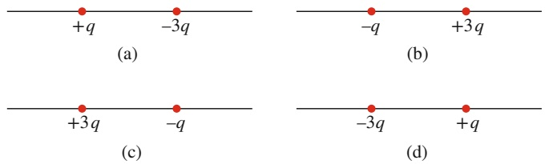

Abb. 17.F3

**4.** Abbildung 17.F4 zeigt zwei geladene Teilchen, die sich entlang einer gemeinsamen Achse frei bewegen können. Es gibt einen Punkt, an den man ein drittes geladenes Teilchen setzen könnte, sodass alle drei Teilchen im Gleichgewicht wären. (a) Liegt dieser Punkt rechts von den beiden Teilchen, links von ihnen oder dazwischen? (b) Müsste das dritte Teilchen positiv oder negativ geladen sein? (c) Wäre das Gleichgewicht stabil oder instabil?

Abb. 17.F4

429

---

17 Elektrische Ladung

**5.** Abbildung 17.F5 zeigt ein zentrales Teilchen mit der Ladung $- q ,$ das auf zwei Kreisen mit den Radien r und $R ( R > r )$ von anderen geladenen Teilchen umgeben ist. Bestimmen Sie Betrag und Richtung der resultierenden elektrostatischen Kraft auf das zentrale Teilchen.

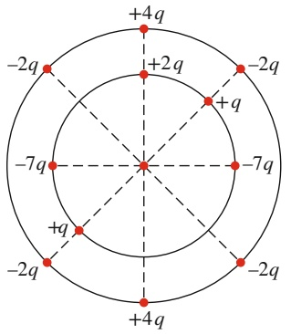

text_image

+4q
-2q
+2q
-2q
+q
-7q
-7q
+q
-2q
+4q

Abb. 17.F5

**6.** Abbildung 17.F6 zeigt vier Anordnungen geladener Teilchen. Ordnen Sie die vier Fälle entsprechend der Stärke der resultierenden elektrostatischen Kraft auf das Teilchen mit der Ladung +Q.

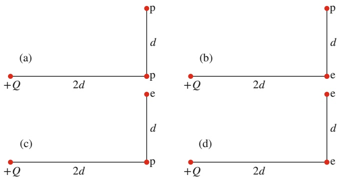

Abb. 17.F6

**7.** Abbildung 17.F7 zeigt vier Anordnungen von ortsfesten Teilchen mit den Ladungen +q oder −q. In jedem Fall sind die Teilchen auf der x-Achse gleich weit von der y-Achse entfernt. Betrachten wir zunächst das mittlere Teilchen in der Anordnung 1. Jedes der beiden übrigen Teilchen übt eine elektrostatische Kraft auf das zu betrachtende Teilchen aus. (a) Sind die Beträge F dieser beiden Kräfte einander gleich oder sind sie verschieden? (b) Ist der Betrag der resultierenden Kraft auf das mittlere Teilchen gleich 2F, grö- ßer oder kleiner? (c) Verstärken sich die x-Komponenten der beiden Kräfte oder kompensieren sie sich? (d) Verstärken sich die y-Komponenten der beiden Kräfte oder kompensieren sie sich? (e) Hat die resultierende Kraft auf das mittlere Teilchen die Richtung der sich kompensierenden Komponenten oder die Richtung der sich verstärkenden Komponenten? (f ) Welche Richtung hat die resultierende Kraft?

Betrachten wir nun die übrigen Anordnungen: Bestimmen Sie die Richtung der resultierenden Kraft auf das mittlere

Teilchen in (g) Anordnung 2, (h) Anordnung 3, (i) Anordnung 4. Untersuchen Sie in jedem der Fälle die Symmetrie der jeweiligen Ladungsverteilung und bestimmen sie die sich kompensierenden und die sich verstärkenden Kraftkomponenten.

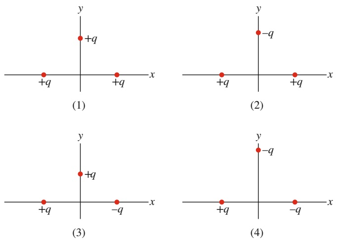

Abb. 17.F7

**8.** Eine positiv geladene Kugel wird in die Nähe eines elektrisch neutralen, isolierten Leiters gebracht. Nun wird der Leiter geerdet, während die geladene Kugel in der Nähe bleibt. Verbleibt der Leiter elektrisch neutral oder wird er positiv bzw. negativ geladen, wenn man (a) die geladene Kugel entfernt, bevor die Erdverbindung des Leiters unterbrochen wird, oder (b) die Erdverbindung zuerst unterbricht und danach die geladene Kugel entfernt?

**9.** (a) Ein positiv geladener Glasstab zieht einen Körper an, der an einem Faden isoliert aufgehängt ist. Bedeutet dies zwingend, dass der Körper am Faden negativ geladen ist, oder gibt es andere Möglichkeiten? (b) Ein positiv geladener Glasstab stößt einen anderen ebenfalls isoliert aufgehängten Körper ab. Bedeutet dies zwingend, dass der Körper am Faden positiv geladen ist, oder gibt es andere Möglichkeiten?

**10.** In der Anordnung von Abb. 17.3 werden einige der Leitungselektronen des Kupferstabs durch elektrostatische Abstoßung vom in die Nähe gehaltenen, negativ geladenen Plastikstab weg zum entfernten Ende des Kupferstabs hin verschoben. Warum kommt dieser Strom negativer Ladungen sehr rasch wieder zum Stillstand, obwohl eine sehr viel größere Zahl von Elektronen die Freiheit hätte, sich zum entfernten Ende des Kupferstabs hin zu bewegen?

**11.** Eine Person steht auf einer elektrisch isolierten Plattform und berührt einen geladenen, elektrisch isolierten, leitenden Gegenstand. Wird der Gegenstand dadurch vollständig entladen?

430

---

17.5 Fragen

17

**12.** Abbildung 17.F12 zeigt vier Situationen, in denen fünf geladene Teilchen in gleichmäßigen Abständen entlang einer Achse liegen. Die Ladungen sind angegeben, mit Ausnahme des zentralen Teilchens, das in allen vier Fällen dieselbe Ladung trägt. Ordnen Sie die Situationen in absteigender Reihenfolge nach der Größe der elektrostatischen Gesamtkraft auf das zentrale Teilchen.

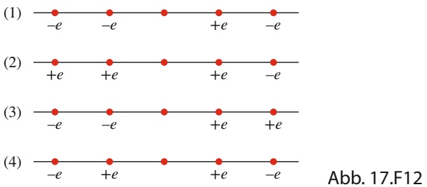

line

| Segment | Point 1 | Point 2 | Point 3 | Point 4 |
| --- | --- | --- | --- | --- |
| (1) | -e | -e | +e | -e |
| (2) | +e | +e | +e | -e |
| (3) | -e | -e | +e | +e |
| (4) | -e | +e | +e | -e |

**13.** Abbildung 17.F13 zeigt drei Paare identischer Kugeln, die in Kontakt gebracht und anschließend wieder getrennt werden sollen. Die anfänglichen Ladungen sind angegeben. Ordnen Sie die Paare in absteigender Reihenfolge (a) nach dem Betrag der während der Berührung übertragenen Ladung und (b) nach der auf der positiv geladenen Kugel verbleibenden Ladung.

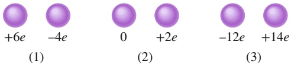

text_image

+6e
-4e
(1)
0
+2e
(2)
-12e
+14e
(3)

Abb. 17.F13

**14.** Abbildung 17.F14 zeigt drei Situationen mit einem geladenen Teilchen und einer gleichmäßig geladenen Kugelschale. Die Ladungen und die Radien der Schalen sind angegeben. Ordnen Sie die Situationen in absteigender Reihenfolge nach dem Betrag der Kraft auf das Teilchen aufgrund der Anwesenheit der Schale.

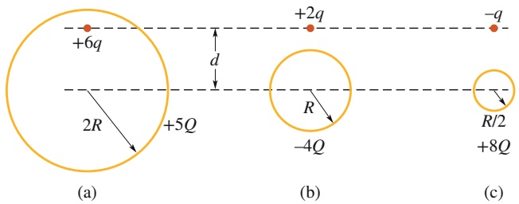

text_image

+6q
2R
+5Q
(a)
+2q
-q
R
-4Q
(b)
R/2
+8Q
(c)

Abb. 17.F14

**15.** In Abb. 17.F15 ist ein zentrales Teilchen mit der Ladung $- 2 q$ von einer quadratischen Anordnung geladener Teilchen umgeben, die in Abständen von entweder d oder $d / 2$ entlang des Umfangs des Quadrats angeordnet sind. Bestimmen Sie Betrag und Richtung der elektrostatischen Gesamtkraft auf das mittlere Teilchen aufgrund der anderen Teilchen. (Sie können sich die Arbeit erheblich vereinfachen, wenn Sie die Symmetrie des Systems beachten!)

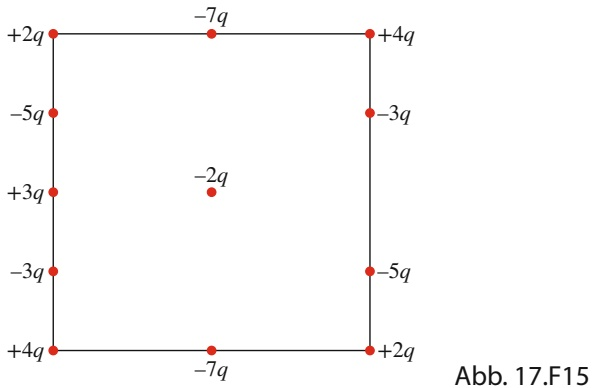

wireframe

| Position | Value |
| --- | --- |
| Top-Left | +2q |
| Top-Right | -7q |
| Top-Right | +4q |
| Top-Right | -3q |
| Bottom-Left | -5q |
| Bottom-Left | +3q |
| Bottom-Left | -3q |
| Bottom-Left | +4q |
| Bottom-Right | -2q |
| Bottom-Right | -5q |
| Bottom-Right | +2q |
| Bottom-Right | -7q |

**16.** Abbildung 17.F16 zeigt drei identische leitfähige Bläschen A, B und C, die in einem leitfähigen Behälterschwimmen, der durch einen Draht geerdet ist. Die Bläschen haben anfangs die gleiche Ladung. Bläschen A stößt gegen die Decke des Behälters und anschließend gegen Bläschen B. Dann stößt B gegen $C ,$ das danach auf den Boden des Behälters sinkt. Als Bläschen C den Boden erreicht, fließt eine Ladung von −3e durch den Draht von der Erde zu dem Behälter. (a) Welche Ladungen trugen die Bläschen zu Beginn? Welche Ladung fließt durch den Draht, wenn (b) Blase A und (c) Blase B den Boden des Behälters erreichen? (d) Welche Gesamtladung fließt im Lauf des ganzen Prozesses durch den Draht?

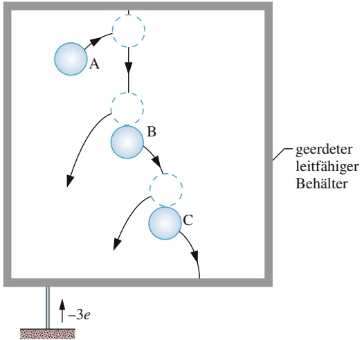

flowchart

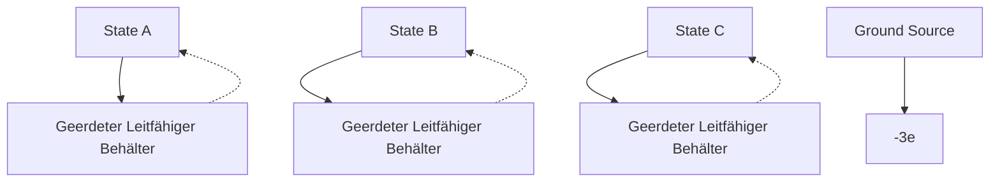

Abb. 17.F16

431

---

17 Elektrische Ladung

**17.** Abbildung 17.F17 zeigt vier Situationen, in denen ein zentrales Proton entlang eines Halbkreises von Protonen und/oder Elektronen umgeben ist. Alle Winkel θ sind identisch, ebenso alle Winkel 𝜑. (a) In welche Richtung zeigt jeweils die Gesamtkraft auf das zentrale Proton aufgrund der anderen Teilchen? (b) Ordnen Sie die vier Situationen in absteigender Reihenfolge nach dem Betrag der Gesamtkraft auf das zentrale Proton.

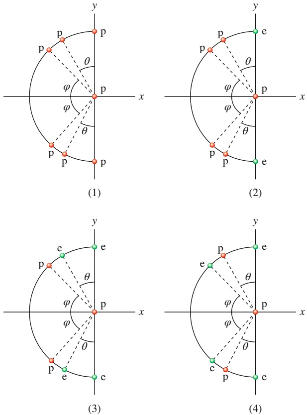

Abb. 17.F17

432
