# 19 Der Gaußsche Satz

原始 PDF 第 469–488 页。

# 19 Der Gaußsche Satz

## 19.1 Das Coulombsche Gesetz in neuem Licht

## Physikalische Motivation

Im vorigen Kapitel haben wir das elektrische Feld an Punkten untersucht, die sich in der Nähe von ausgedehnten geladenen Objekten wie z. B. Stäben befanden. Das Vorgehen war dabei recht mühselig: Wir haben die Ladungsverteilung in infinitesimal kleine Ladungselemente dq aufgeteilt, das Feld dE⃗ für ein einzelnes Ladungselement bestimmt und den Vektor in Komponenten zerlegt. Anschließend haben wir untersucht, ob sich die Feldkomponenten der einzelnen Elemente gegenseitig auslöschen oder aufaddieren. Schließlich haben wir die Beiträge aller Elemente aufsummiert bzw. integriert, wobei wir noch mehrfach die Notation anpassen mussten.

Die Physik ist aber immer auf der Suche nach möglichst einfachen Methoden, um solch eine mühselige Rechnerei vermeiden zu können. Ein besonders mächtiges Werkzeug dafür ist das Ausnutzen von Symmetrien. In diesem Kapitel lernen wir eine sehr schöne Beziehung zwischen der Ladung und dem elektrischen Feld kennen, die es uns erlaubt, in bestimmten symmetrischen Situationen das elektrische Feld eines ausgedehnten geladenen Objekts mit ein paar Zeilen Integralrechnung zu erhalten. Diese Beziehung ist der **Gaußsche Satz**, der von dem deutschen Mathematiker und Physiker Carl Friedrich Gauß formuliert wurde.

## 19.1.1 Das Coulombsche Gesetz in neuem Licht

Möchte man den Schwerpunkt einer Kartoffel bestimmen, so kann man dies entweder experimentell machen oder auf dem Weg über eine mühselige Rechnung, bei der man ein Dreifachintegral numerisch lösen muss. Sollte die Kartoffel jedoch zufällig ein Ellipsoid mit homogener Masseverteilung sein, so könnte man aus Symmetriegründen die Lage des Schwerpunkts ohne Rechnung sofort angeben – ein Beispiel für die Nützlichkeit von Symmetrieüberlegungen. Symmetrien durchziehen alle Bereiche der Physik. Man versucht immer, den Gesetzen der Physik eine Form zu geben, welche die zugrunde liegenden Symmetrien berücksichtigt.

Das Coulombsche Gesetz ist das Grundgesetz der Elektrostatik. In der uns bisher bekannten Form erleichtert es jedoch keineswegs die Arbeit in physikalischen Situationen, die sich durch besondere Symmetrien auszeichnen. Im vorliegenden Kapitel stellen wir eine andere Formulierung des Coulombschen Gesetzes vor, die von dem deutschen Mathematiker und Physiker Carl Friedrich Gauß (1777–1855) hergeleitet wurde. Mit dem **Gaußschen Satz** kann man die Vereinfachungen nutzen, die sich aus der Symmetrie bestimmter physikalischer Situationen ergeben. Im Rahmen der Elektrostatik ist der Gaußsche Satz dem Coulombschen Gesetz vollständig äquivalent. Man kann deshalb die Entscheidung darüber, welches der beiden Gesetze man in einer bestimmten physikalischen Situation anwendet, allein davon abhängig machen, welches Gesetz der jeweiligen Aufgabenstellung angemessener erscheint.

Halliday Physik für natur- und ingenieurwiss. Studiengänge, 3. Auflage. D. Halliday, R. Resnick und J. Walker. © 2020 WILEY-VCH Verlag GmbH & Co. KGaA. Published 2020 by WILEY-VCH Verlag GmbH & Co. KGaA.

455

---

19 Der Gaußsche Satz

text_image

kugelförmige
Gaußsche
Fläche
?

Abb. 19.1

Eine kugelsymmetrische Gauß- sche Fläche. Haben alle Vektoren des elektrischen Felds außerhalb der Fläche den gleichen Betrag und sind sie in allen Punkten der Flä- che radial nach außen gerichtet, so kann man daraus schließen, dass innerhalb der Fläche eine kugelsymmetrische Verteilung positiver Ladung eingeschlossen sein muss.

Der wesentliche gedankliche Schritt bei der Formulierung des Gaußschen Satzes ist die Konstruktion einer hypothetischen geschlossenen Fläche, der **Gaußschen Fläche**. Diese Fläche kann frei gewählt werden und von beliebiger Gestalt sein. Es ist jedoch am nützlichsten, eine Gaußsche Fläche mit der Symmetrie des zu untersuchenden physikalischen Problems zu wählen. Man wird deshalb in vielen Fällen als Gaußsche Fläche eine Kugel, einen Zylinder oder eine andere symmetrische Form wählen. In jedem Fall muss die Fläche aber geschlossen sein, sodass man klar unterscheiden kann, ob ein Punkt innerhalb, außerhalb oder auf der Fläche liegt.

Sei eine Gaußsche Fläche gewählt, die eine Ladungsverteilung einschließt. Der Gaußsche Satz liefert dann einen Zusammenhang zwischen dem elektrischen Feld an allen Punkten auf einer (geschlossenen) Gaußsche Fläche und der von der Fläche umschlossenen Gesamtladung.

Abbildung 19.1 zeigt eine einfache physikalische Situation, bei der man die Gauß- sche Fläche als eine Kugel wählt. Nehmen wir an, man wüsste, dass in jedem Punkt der Fläche ein elektrisches Feld existiert und dass die Feldvektoren in allen Punkten den gleichen Betrag haben und radial nach außen gerichtet sind. Ohne etwas vom Gaußschen Satz zu wissen, könnte man vermuten, dass die Gaußsche Fläche eine resultierende positive Gesamtladung einschließt. Mit Kenntnis des Gaußschen Satzes kann man auch berechnen, wie viel positive Ladung von der Fläche eingeschlossen wird. Um diese Rechnung durchführen zu können, benötigt man ein Maß dafür, „wie viel“ elektrisches Feld durch die Fläche dringt. Die Frage nach diesem „Wieviel“ führt auf den Begriff des Flusses des elektrischen Felds durch eine Fläche.

## 19.1.2 Der Fluss

Stellen Sie sich nach Abb. 19.2a vor, ein breiter Luftstrom mit der homogenen Geschwindigkeitsverteilung v⃗ treffe auf eine kleine quadratische Drahtschleife mit der Fläche A. Φ bezeichne die Durchströmungsrate (mit der Dimension Volumen pro Zeit) der Luft durch die Schleife. Der Betrag dieser Größe hängt davon ab, unter welchem Winkel die Luftströmung v⃗ auf die Ebene der Schleife trifft. Ist v⃗ senkrecht zur Fläche der Schleife, dann ist die Durchströmungsrate einfach gleich vA.

Liegt v⃗ dagegen parallel zur Ebene der Fläche, so tritt keine Luft durch die Schleife und Φ ist null. Für dazwischenliegende Winkel θ ist der Wert von Φ durch die Komponente von $\vec { \nu }$ senkrecht zur Ebene der Schleife bestimmt (Abb. 19.2b). Da diese Komponente gleich v cos θ ist, kann man für die Durchströmungsrate der Schleife schreiben

$$
\varPhi = (\nu \cos \theta) A. \tag {19.1}
$$

Diese Durchströmungsrate einer Fläche ist ein Beispiel für einen **Fluss** – in diesem Fall einen Volumenfluss. Bevor wir dieses Konzept in der Elektrostatik anwenden, müssen wir noch Gl. 19.1 in Vektorschreibweise formulieren.

Abb. 19.2

(a) Ein homogener Luftstrom trete mit der Geschwindigkeit ⃗v senkrecht durch eine ebene Fläche mit dem Flä- cheninhalt A. (b) Hier ist v cos θ die Komponente der Strömungsgeschwindigkeit ⃗v senkrecht zur Fläche A, wobei θ den Winkel zwischen ⃗v und einer Flächennormalen bezeichnet. (c) Der Oberflächenvektor $\vec { A }$ steht senkrecht auf der Fläche A und schließt mit v⃗ den Winkel θ ein. (d) Die Fläche A im Geschwindigkeitsfeld der Strömung.

456

---

19.1 Das Coulombsche Gesetz in neuem Licht

19

Wir definieren dazu einen Flächenvektor $\vec { A }$ als Vektor, der senkrecht auf einer Fläche steht und dessen Betrag gleich dem Inhalt A dieser Fläche ist (in unserem Beispiel also gleich dem Flächeninhalt der Schleife, Abb. 19.2c). Nun können wir Gl. 19.1 als Skalarprodukt des Geschwindigkeitsvektors v⃗ des Luftstroms und des Flächenvektors $\vec { A }$ der Schleife schreiben:

$$
\varPhi = \nu A \cos \theta = \vec {\nu} \cdot \vec {A}. \tag {19.2}
$$

θ bezeichnet hier den Winkel zwischen $\vec { \nu }$ und $\vec { A } .$

Man kann Gl. 19.2 auch in einem allgemeineren und abstrakteren Sinn betrachten. Dazu macht man sich zunächst klar, dass man jedem Punkt des Luftstroms durch die Schleife $A$ einen Geschwindigkeitsvektor zuordnen kann (Abb. 19.2d). Die Gesamtheit aller dieser Vektoren beschreibt ein Geschwindigkeitsfeld, sodass wir Gl. 19.2 als den Fluss des Geschwindigkeitsfelds durch die Schleife auffassen können. In diesem Sinn bedeutet der Begriff Fluss nicht mehr nur konkret die Strömung eines Kontinuums durch eine Fläche, sondern allgemeiner das Skalarprodukt einer Fläche mit einem diese Fläche durchdringenden Feld.

## 19.1.3 Der Fluss eines elektrischen Felds

Zur Definition des Flusses eines elektrischen Felds betrachten wir in Abb. 19.3 eine beliebig gewählte, asymmetrische Gaußsche Fläche in einem inhomogenen elektrischen Feld. Wir denken uns diese Fläche in kleine quadratische Teilflächen mit jeweils dem Flächeninhalt $\Delta A$ zerlegt, wobei jede der Teilflächen klein genug sei, um ihre Krümmung vernachlässigen zu können. Jede dieser Teilflächen werde dargestellt durch einen Flächenvektor $\Delta \vec { A }$ , dessen Betrag gleich dem Flächeninhalt der Fläche $\Delta A$ ist. Jeder dieser Vektoren steht senkrecht auf der Gaußschen Fläche und zeigt vom Inneren der Fläche weg nach außen.

Die quadratischen Teilflächen sollen klein genug sein, um die Stärke des elektrischen Felds $\vec { E }$ als konstant über die Fläche annehmen zu können. Die Vektoren $\Delta \vec { A }$ und $\vec { E }$ schließen dann für jede der Teilflächen einen bestimmten Winkel θ ein. Abbildung 19.3 zeigt eine vergrößerte Darstellung dreier herausgegriffener Teilflä- chen (1, 2 und 3) der Gaußschen Fläche sowie die jeweiligen Winkel $\theta .$

Eine vorläufige Definition des Flusses des elektrischen Felds durch die Gaußsche Fläche aus Abb. 19.3 ist

$$
\varPhi = \sum \vec {E} \cdot \Delta \vec {A}. \tag {19.3}
$$

Der Handlungsanweisung folgend, die durch diese Gleichung ausgedrückt wird, müssen wir für jede einzelne Teilfläche der Gaußschen Fläche das Skalarprodukt der beiden Vektoren $\vec { E }$ und $\Delta \vec { A }$ am Ort der jeweils betrachteten Fläche berechnen und die Ergebnisse über sämtliche Teilflächen algebraisch (also unter Berücksichtigung des Vorzeichens) aufsummieren. Je nach dem Wert des Skalarprodukts für eine bestimmte Teilfläche, der positiv, negativ oder null sein kann, ist der Fluss durch diese Teilfläche positiv, negativ oder null. Flächen vom Typ 1, mit nach innen gerichtetem Feldvektor $\dot { \vec { E } } _ { i }$ , liefern einen negativen Beitrag zu der Summe in Gl. 19.3. Flächen vom Typ 2, mit einem in der Fläche liegenden Vektor $\vec { E } ,$ liefern keinen Beitrag. Flächen vom Typ 3 schließlich, mit nach außen gerichtetem Feldvektor, liefern einen positiven Beitrag zur Summe.

Eine exakte Definition des Flusses eines elektrischen Felds durch eine geschlos sene Fläche erhält man dadurch, dass man sich die Teilflächen in Abb. 19.3 kleiner und kleiner denkt und sie im Grenzfall als infinitesimale bzw. differenzielle Flä- chenelemente dA behandelt. Die Flächenvektoren gehen in diesem Fall ebenfalls gegen ihren differenziellen Grenzwert $\mathrm { d } \vec { A }$ . Die Summe in Gl. 19.3 wird dann zum Integral, und wir erhalten die folgende Definition des elektrischen Flusses:

$$
\varPhi = \oint \vec {E} \cdot \mathrm{d} \vec {A}. \tag {19.4}
$$

text_image

Gaußsche
Fläche
1
2
3
1
Φ < 0
2
3
Φ > 0
ΔA
θ
E
ΔA
θ
E
ΔA
Φ = 0

Abb. 19.3

Eine Gaußsche Fläche von beliebiger Gestalt in einem elektrischen Feld. Man denke sich die gesamte Gaußsche Fläche unterteilt in kleine, quadratische Flächenelemente, jedes mit dem Flächeninhalt $\Delta A .$ Für drei repräsentativ herausgegriffene Flächenelemente 1, 2 und 3 sind die Vektoren $\vec { E }$ des elektrischen Felds sowie die Oberflä- chenvektoren $\Delta \vec { A }$ eingezeichnet.

457

---

19 Der Gaußsche Satz

Der Kreis im Integralzeichen soll darauf hinweisen, dass die Integration über die gesamte geschlossene Fläche auszuführen ist. Der Fluss des elektrischen Felds ist ein Skalar; seine SI-Einheit ist $\mathrm { N } \cdot \mathrm { m } ^ { 2 } / \mathrm { C } .$

Wir können Gl. 19.4 auch wie folgt interpretieren: Erinnern wir uns zunächst daran, dass die Dichte der elektrischen Feldlinien ein Maß für die Stärke des elektrischen Felds $\vec { E }$ ist. Genauer gesagt ist der Betrag E des Felds proportional zur Anzahl der elektrischen Feldlinien pro Einheitsfläche. Damit ist das Skalarprodukt E⃗ ⋅ dA⃗ in Gl. 19.4 proportional zur Anzahl der elektrischen Feldlinien, die durch die Fläche dA⃗ verlaufen. Da die Integration in Gl. 19.4 über eine Gaußsche Fläche ausgeführt wird, kommt man zu folgendem Schluss:

Der elektrische Fluss Φ durch eine Gaußsche Fläche ist proportional zur Anzahl der elektrischen Feldlinien durch diese Fläche.

text_image

y
A
x
E
z

## KONTROLLFRAGE 1

Die Abbildung zeigt eine würfelförmige Gaußsche Fläche in einem homogenen elektrischen Feld ${ \vec { E } } .$ Das Feld hat die Richtung der positiven z-Achse und der Inhalt einer Würfelfläche sei A. Wie groß ist der Fluss des elektrischen Felds durch (a) die vordere Fläche des Würfels (die in der xy-Ebene liegt), (b) die hintere Fläche, (c) die obere Fläche und (d) durch die gesamte Würfeloberfläche (also die vollständige, geschlossene Gaußsche Fläche)?

## 19.2 Der Gaußsche Satz

## Lernziele

Nach dem Durcharbeiten dieses Abschnitts sollten Sie in der Lage sein, . . .

• das Gaußsche Gesetz anzuwenden, um den Nettofluss Φ durch eine geschlossene Fläche mit der von ihr umschlossenen Ladung $q _ { \mathrm { i n n e n } }$ in Beziehung zu setzen,
• Bei einer Gaußschen Fläche das richtige Vorzeichen der eingeschlossenen Ladung aus der Richtung des elektrischen Flusses (in die Fläche hinein oder aus ihr heraus) abzuleiten,
• zu verstehen, warum die Ladung außerhalb einer Gaußschen Fläche nicht zum Netto-Fluss durch die geschlossene Fläche beiträgt,
• den Betrag des elektrischen Felds eines geladenen Teilchens mithilfe des Gauß schen Gesetzes zu ermitteln,
• im Fall einer Punktladung bzw. einer homogen geladenen Kugel eine konzentrische Kugeloberfläche als Gaußsche Fläche zu wählen.

## Schlüsselideen

• Der Gaußsche Satz verbindet den Nettofluss Φ durch eine geschlossene Fläche mit der innerhalb der Fläche befindlichen Nettoladung $q _ { \mathrm { i n n e n } }$

$$
\varepsilon_ {0} \varPhi = q _ {\text {innen}} \quad \text {(Gaußscher Satz)}.
$$

• Der Gaußsche Satz lässt sich auch mithilfe des Integrals über das Skalarprodukt des durch die Gaußsche Fläche tretenden elektrischen Felds und des zugehörigen Flächenvektors schreiben:

$$
\varepsilon_ {0} \oint_ {\substack {\text {Gaußsche} \\ \text {Fläche}}} \vec {E} \cdot \mathrm{d} \vec {A} = q _ {\text {innen}} \quad (\text {Gaußscher Satz}).
$$

## 19.2.1 Der Gaußsche Satz

Der Gaußsche Satz gibt einen Zusammenhang zwischen dem Gesamtfluss Φ eines elektrischen Felds durch die Oberfläche O(V) eines Volumens V und der Gesamt-

458

---

19.2 Der Gaußsche Satz

19

ladung in diesem Volumen an. Die Gesamtladung $q _ { \mathrm { i n n e n } }$ ist die gesamte Ladung, die von der Oberfläche O(V) eingeschlossen wird. Die Oberfläche $O ( V )$ ist eine geschlossene Fläche, die im Zusammenhang mit dem Gaußschen Satz auch oft als Gaußsche Fläche bezeichnet wird. Mathematisch ausgedrückt lautet der Gaußsche Satz

$$
\varepsilon_ {0} \varPhi = q _ {\text {innen}}. \tag {19.5}
$$

Setzt man in diesen Zusammenhang Gl. 19.4 ein, die Definition des Flusses, so erhält man

$$
\varepsilon_ {0} \oint \vec {E} \cdot \mathrm{d} \vec {A} = q _ {\text {innen}}. \tag {19.6}
$$

Die Gln. 19.5 und 19.6 gelten nur dann, wenn sich die Ladung im Vakuum oder – was für die meisten praktischen Belange gleichwertig ist – in Luft befindet. In Abschn. 21.6 werden wir diese Formulierung des Gaußschen Satzes so modifizieren, dass er auch für elektrische Felder in Materie gilt.

Die Gesamtladung $q _ { \mathrm { i n n e n } }$ in den Gln. 19.5 und 19.6 ist die algebraische Summe aller eingeschlossenen positiven und negativen Ladungen und kann deshalb positiv, negativ oder null sein. Man berücksichtigt auch das Vorzeichen der eingeschlossenen Ladung, da man aus dem Vorzeichen alleine schon eine Aussage über den resultierenden Fluss durch die Gaußsche Fläche treffen kann: Ist $q _ { \mathrm { i n n e n } }$ positiv, so ist der resultierende Fluss nach außen gerichtet, ist $q _ { \mathrm { i n n e n } }$ dagegen negativ, so ist der resultierende Fluss ins Innere der Gaußschen Fläche gerichtet.

Ladungen außerhalb einer geschlossenen Gaußschen Fläche tragen nicht zu dem Term $q _ { \mathrm { i n n e n } }$ im Gaußschen Satz bei, unabhängig davon, wie groß sie sind oder wie nahe sie an der Gaußschen Fläche liegen. Die genaue Lage oder Verteilung der Ladung innerhalb der Gaußschen Fläche ist ebenfalls ohne Belang für die Aussage des Gaußschen Satzes. Für die rechte Seite von Gl. 19.6 sind allein Betrag und Vorzeichen der eingeschlossenen Gesamtladung von Bedeutung. Dagegen bezeichnet E⃗ auf der linken Seite von Gl. 19.6 das von allen Ladungen erzeugte elektrische Feld, also das Feld der Ladungen innerhalb und außerhalb der Gaußschen Fläche. Diese Aussagen mögen widersprüchlich erscheinen – man erinnere sich jedoch an das Ergebnis aus Beispielaufgabe 19.1 im Übungsbuch: Das elektrische Feld einer Ladung, die sich außerhalb einer Gaußschen Fläche befindet, liefert keinen Beitrag zum resultierenden Fluss durch diese Fläche, da genauso viele Feldlinien dieses Felds durch die geschlossene Fläche ein- wie an anderen Stellen austreten.

Wir wollen diese Überlegungen auf die Ladungsanordnung in Abb. 19.4 anwenden: Die Abbildung zeigt zwei Punktladungen mit gleichem Betrag, aber entgegengesetztem Vorzeichen sowie die Feldlinien des von dieser Ladungsanordnung erzeugten elektrischen Felds im umgebenden Raum. Die Querschnitte von vier Gaußschen Flächen sind farbig schattiert eingezeichnet. Betrachten wir diese vier Flächen im Einzelnen:

1. Fläche $S _ { 1 }$ Das elektrische Feld ist in allen Punkten dieser Fläche nach außen gerichtet. Somit ist der resultierende Fluss des elektrischen Felds durch diese Fläche positiv, und dasselbe gilt nach dem Gaußschen Satz auch für die von $S _ { 1 }$ eingeschlossene Gesamtladung. (Φ in Gl. 19.5 ist positiv, deshalb muss auch $q _ { \mathrm { i n n e n } }$ positiv sein.)
2. Fläche $S _ { 2 }$ In allen Punkten dieser Fläche ist das elektrische Feld nach innen gerichtet. Der Fluss des elektrischen Felds durch diese Fläche ist deshalb negativ und – nach dem Gaußschen Satz – ebenso die eingeschlossene Ladung.
3. Fläche $S _ { 3 }$ Diese Fläche umschließt keine Ladung: $q _ { \mathrm { i n n e n } } = 0 .$ . Der Gaußsche Satz (Gl. 19.5) erfordert deshalb, dass der resultierende Fluss des elektrischen Felds durch diese Fläche null ist. Anschaulich ist dies nachvollziehbar, da sämtliche Feldlinien die Fläche $S _ { 3 }$ vollständig durchdringen: Sie treten oben ein und verlassen die Fläche unten wieder.

text_image

S₁
S₄
S₃
S₂

Abb. 19.4

Zwei gleich große Punktladungen mit entgegengesetzten Vorzeichen zusammen mit den Feldlinien des resultierenden elektrischen Felds beider Ladungen. Die farbigen Flächen seien die Querschnitte von vier ausgewählten Gaußschen Flächen: Die Fläche $S _ { 1 }$ umschließt die positive Ladung, $S _ { 2 }$ die negative. Die Fläche $S _ { 3 }$ schließt keine Ladung ein, die Fläche $S _ { 4 }$ dagegen beide Ladungen, also eine Gesamtladung null.

459

---

19 Der Gaußsche Satz

4. Fläche $S _ { 4 }$ Diese Fläche umschließt ebenfalls eine resultierende Ladung null, da die innerhalb der Fläche vorhandene positiven und negativen Ladungen denselben Betrag besitzen. Nach dem Gaußschen Satz muss der resultierende Fluss des elektrischen Felds durch die Fläche deshalb null sein. Auch dies ist anschaulich $\mathrm { k l a r } ,$ da ebenso viele Feldlinien in die Fläche $S _ { 4 }$ hineinführen wie aus ihr heraus.

Was würde sich an der beschriebenen Situation ändern, wenn man eine große Ladung Q in die unmittelbare Nähe der Fläche $S _ { 4 }$ brächte? Zwar würde sich das Muster der Feldlinien sehr deutlich ändern, doch der resultierende Fluss des elektrischen Felds durch jede der vier Gaußschen Flächen bliebe davon unbeeinflusst. Auch diese Aussage ist intuitiv nachzuvollziehen, da die Feldlinien der neu hinzugefügten Ladung Q alle vier Gaußschen Flächen vollständig durchsetzen und damit in keinem der vier Fälle einen Beitrag zum resultierenden Fluss liefern würden. Der Wert von Q ginge in keiner Weise in den Gaußschen Satz ein, da Q außerhalb aller vier Flächen läge.

## KONTROLLFRAGE 2

Die Abbildung zeigt drei würfelförmige Gaußsche Flächen, die von einem elektrischen Feld durchsetzt werden. Die Pfeile und Zahlen geben jeweils die Richtungen der Feldlinien und die Beträge des elektrischen Flusses (in Einheiten von $\mathrm { N } \cdot \mathrm { m } ^ { 2 } / \mathrm { C } )$ durch die Würfelflächen an. (Die heller gezeichneten Pfeile gelten für verdeckte Flächen.) In welchen Fällen schließt der Würfel (a) eine positive Gesamtladung, (b) eine negative Gesamtladung, (c) die Gesamtladung null ein?

text_image

5
3
7
2
4
7

(1)

text_image

10
3
3
5
4
6

(2)

text_image

2
6
8
7
5
5

(3)

## 19.2.2 Gaußscher Satz und Coulombsches Gesetz

Wenn der Gaußsche Satz und das Coulombsche Gesetz tatsächlich äquivalent sind, so sollten wir eines aus dem anderen ableiten können. Wir wollen hier das Coulombsche Gesetz aus dem Gaußschen Satz sowie einigen Symmetrieannahmen herleiten.

Abbildung 19.5 zeigt eine positive Punktladung $q ,$ die konzentrisch von einer kugelförmigen Gaußschen Fläche mit dem Radius r umschlossen wird. Wir denken uns diese Fläche in differenzielle Flächenelemente mit dem Flächeninhalt dA zerlegt. Nach Definition ist der Flächenvektor d $\vec { \cal M }$ in jedem Punkt senkrecht zur Fläche und nach außen gerichtet. Aufgrund der Kugelsymmetrie ist offensichtlich auch das elektrische Feld $\vec { E }$ der Ladung in jedem Punkt der Fläche senkrecht zu ihr und, da es sich um eine positive Ladung handelt, nach außen gerichtet. Somit ist der Winkel θ zwischen $\vec { E }$ und $\mathrm { d } \vec { A }$ überall null und man kann den Gaußschen Satz (Gl. 19.6) auf die Form

$$
\varepsilon_ {0} \oint \vec {E} \cdot \mathrm{d} \vec {A} = \varepsilon_ {0} \oint E \mathrm{d} A = q _ {\text {innen}} \tag {19.7}
$$

bringen. Dabei ist $q _ { \mathrm { i n n e n } } = q .$ Das elektrische Feld ändert sich nur mit dem Abstand von der Ladung und hat deshalb in jedem Punkt der Kugelfläche denselben Betrag.

Abb. 19.5 Eine kugelsymmetrische Gauß- sche Fläche um eine Punktladung q als Mittelpunkt.

text_image

Gaußsche
Fläche
r
q
E

460

---

19.2 Der Gaußsche Satz

19

Das Integral in Gl. 19.7 wird nun über diese Kugelfläche berechnet, sodass man E bei der Integration als eine Konstante betrachten und vor das Integral ziehen kann. Auf diese Weise erhält man

$$
\varepsilon_ {0} E \oint \mathrm{d} A = q. \tag {19.8}
$$

Das verbleibende Integral ist nun einfach die Summe aller differenziellen Flächenelemente dA auf der Kugel und somit gleich 4πr2. Aus Gl. 19.8 folgt damit

$$
\varepsilon_ {0} E (4 \pi r ^ {2}) = q
$$

oder

$$
E = \frac {1}{4 \pi \varepsilon_ {0}} \frac {q}{r ^ {2}}. \tag {19.9}
$$

Dieser Ausdruck ist identisch mit Gl. 18.3, dem Coulombschen Gesetz für das elektrische Feld einer Punktladung. Damit haben wir gezeigt, dass das Coulombsche Gesetz aus dem Gaußschen Satz folgt.

## KONTROLLFRAGE 3

Der Gesamtfluss durch eine kugelförmige Gaußsche Fläche mit dem Radius $r ,$ die ein isoliertes geladenes Teilchen umschließt, sei $\Phi _ { \mathrm { i } }$ . Nehmen Sie an, die Gaußsche Fläche werde (a) vergrößert, (b) in eine würfelförmige Gaußsche Fläche mit der Kantenlänge r oder (c) der Kantenlänge 2r umgewandelt. Ist der Gesamtfluss durch die neue Gaußsche Fläche jeweils größer, kleiner oder gleich $\Phi _ { \mathrm { i } } { } ^ { , } { } ^ { ? }$

## LÖSUNGSSTRATEGIEN

**Strategie 1: Wahl der Gaußschen Fläche** Die Herleitung von Gl. 19.9 aus dem Gaußschen Satz ist eine Aufwärmübung für die Berechnung elektrischer Felder anderer Ladungsverteilungen, sodass es nützlich erscheint, sich die einzelnen Schritte noch einmal genauer anzusehen. Wir gingen von einer positiven Punktladung q aus. Wie wir wissen, verlaufen die Feldlinien des elektrischen Felds der Punktladung in einem kugelsymmetrischen Muster radial nach außen.

Um den Betrag E des elektrischen Felds in einer Entfernung r von der Ladung mithilfe des Gaußschen Satzes (Gl. 19.6) zu bestimmen, mussten wir gedanklich eine geschlossene Gaußsche Fläche um q legen, durch einen Punkt, der einen Abstand r von der Ladung hat. Danach hatten wir durch Integration die Werte E⃗ ⋅ dA⃗ über die gesamte Gaußsche Fläche zu summieren. Um diese Integration so einfach wie möglich zu machen, wählten wir eine kugelförmige Gaußsche Fläche mit der gleichen Symmetrie wie das elektrische Feld. Durch diese Wahl ergaben sich drei Vereinfachungen: (1) Das Skalarprodukt $\vec { E } \cdot \mathrm { d } \vec { A }$ wurde vereinfacht, da der Winkel zwischen $\vec { E }$ und dA⃗ in allen Punkten der Gaußschen Fläche null ist, sodass in jedem Fall ${ \vec { E } } \cdot \mathbf { d } { \vec { A } } = E \mathbf { d } A$ gilt. (2) Der Betrag E des elektrischen Felds war in allen Punkten der kugelförmigen Gaußschen Fläche gleich, sodass E bezüglich der Integration eine Konstante war und vor das Integral gezogen werden konnte. (3) Durch diese Vereinfachungen wurde die Integration sehr leicht durchführbar: Sie reduzierte sich auf die Summation aller differenziellen Flächenelemente der Kugel mit dem bekannten Ergebnis 4πr2.

Machen Sie sich noch einmal klar, dass der Gaußsche Satz nicht von der Gestalt der Gaußschen Fläche abhängt, die man um die Ladung $q _ { \mathrm { i n n e n } }$ legt. Hätten wir jedoch z. B. eine würfelförmige Gaußsche Fläche gewählt, so wären die Vereinfachungen weggefallen und die Integration von $\vec { E } \cdot \mathrm { d } \vec { A }$ über die Würfeloberfläche wäre sehr schwierig geworden. Wir lernen daraus, dass man die Gaußsche Flä- che so wählen sollte, dass die Integration im Gaußschen Satz möglichst einfach wird.

461

---

19 Der Gaußsche Satz

## 19.3 Eigenschaften eines geladenen, isolierten Leiters

## Lernziele

Nach dem Durcharbeiten dieses Abschnitts sollten Sie in der Lage sein, . . .

• die Beziehung zwischen der Flächenladungsdichte σ und der Fläche anzuwenden, über welche die Ladung homogen verteilt ist,
• zu verstehen, dass wenn zusätzliche Ladungen (positive oder negative) auf einen isolierten Leiter aufgebracht werden, diese Ladungen sich auf dessen Oberfläche verteilen und nicht in seinem Inneren,
• den Wert des elektrischen Felds innerhalb eines isolierten Leiters anzugeben,
• für einen Leiter mit Hohlraum, in dem sich ein geladenes Objekt befindet, die Ladung auf der inneren Wand des Hohlraums sowie der äußeren Oberfläche zu bestimmen,
• zu erklären, wie man mit dem Gaußschen Satz die Stärke E des elektrischen Felds in der Nähe einer isolierten leitenden Oberfläche mit einer homogenen Flächenladungsdichte σ berechnen kann,
auf einer homogen geladenen leitenden Oberfläche die Beziehung zwischen der Ladungsdichte σ und der elektrischen Feldstärke E an Punkten in der Nähe des Leiters anzuwenden und die Richtung des Feldvektors anzugeben.

## Schlüsselideen

• Eine zusätzliche Ladung verteilt sich in einem isolierten Leiter ausschließlich auf dessen Oberfläche.
• Das elektrische Feld im Inneren eines geladenen, isolierten Leiters ist null und das äußere Feld steht (in der Nähe des Leiters) senkrecht auf dessen Oberfläche; der Betrag der Feldstärke hängt von der Flächenladungsdichte σ ab:

text_image

Kupfer-
oberfläche
Gaußsche
Fläche

(a)

$$
E = \frac {\sigma}{\varepsilon_ {0}}.
$$

## 19.3.1 Geladene isolierte Leiter

Mithilfe des Gaußschen Satzes lässt sich eine wichtige Aussage über isolierte Leiter beweisen:

text_image

Gaußene Fläche
Kupfer-
oberfläche

(b)

Bringt man eine Überschussladung auf einen isolierten, leitenden Körper, so verteilt sich die Ladung gleichmäßig über die gesamte Oberfläche des Leiters. Kein Anteil der Ladung befindet sich im Inneren des Körpers.

Diese Aussage erscheint plausibel, wenn man bedenkt, dass gleichnamige Ladun gen einander abstoßen: Die überschüssigen Ladungen haben sich so weit wie möglich voneinander entfernt und sich deshalb gleichmäßig über die Oberfläche des Körpers verteilt. Wir wollen diese Vermutung mithilfe des Gaußschen Satzes beweisen.

Abbildung 19.6a zeigt einen Querschnitt durch einen massiven Kupferblock, der von der Umgebung isoliert an einem nichtleitenden Faden hängt und eine Überschussladung q trägt. Wir legen eine Gaußsche Fläche in das Innere des Kupferkörpers, dicht unterhalb seiner Oberfläche.

Das elektrische Feld im Inneren des Körpers muss null sein. Wäre dies nicht der Fall, so würde ein von null verschiedenes elektrisches Feld Kräfte auf die in einem Leiter immer vorhandenen freien Elektronen (die Leitungselektronen) ausüben, sodass ein permanenter elektrischer Strom innerhalb des Körpers flösse – was bedeuten würde, dass sich Ladung innerhalb des Körpers hin- und herbewegten. Offensichtlich beobachtet man keine permanenten Ladungsverschiebungen dieser Art in einem isolierten Leiter, woraus man schließen muss, dass das elektrische Feld tatsächlich null ist.

(a) Ein massives Stück Kupfer hänge elektrisch isoliert an einem Faden und trage eine Ladung q. Eine Gauß- sche Fläche liege vollständig innerhalb des Kupferstücks, unmittelbar an der Innenseite der Kupferoberflä- che. (b) Innerhalb des Kupferstücks befinde sich nun ein Hohlraum. Eine Gaußsche Fläche liege innerhalb des Metalls in unmittelbarer Nä- he der Oberfläche des Hohlraums.

462

---

19.3 Eigenschaften eines geladenen, isolierten Leiters

19

(Wohl tritt ein elektrisches Feld im Inneren eines leitenden Körpers kurzzeitig auf, sobald der Körper geladen wird. Die Überschussladung verteilt sich jedoch sehr rasch so, dass das resultierende elektrische Feld im Inneren des Körpers – also die Vektorsumme der elektrischen Felder sämtlicher Ladungen innerhalb und auf der Oberfläche des Körpers – verschwindet. Ist dieser Zustand erreicht, endet die Ladungsbewegung, da die resultierende Kraft auf jede Ladung des Körpers null ist. Man bezeichnet diesen Zustand als elektrostatisches Gleichgewicht.)

Hat das Feld E⃗ überall innerhalb des Kupferblocks den Wert null, so gilt dies auch für alle Punkte der gewählten Gaußschen Fläche, die, obwohl nahe der Oberfläche, immer noch vollständig innerhalb des Körpers liegt – was bedeutet, dass der Fluss des elektrischen Felds durch die Gaußsche Fläche null ist. Daraus folgt nach dem Gaußschen Satz, dass die Gesamtladung innerhalb der Gaußschen Fläche ebenfalls null sein muss. Da jedoch definitiv eine Überschussladung auf dem Körper vorhanden ist, die nicht innerhalb der Gaußschen Fläche liegen kann, so muss diese Ladung außerhalb der Fläche liegen – was bedeutet, dass sie sich tatsächlich auf der physischen Oberfläche des Körpers befindet.

## 19.3.2 Ein isolierter Leiter mit einem Hohlraum

Abbildung 19.6b zeigt einen isoliert aufgehängten leitenden Körper, der nun jedoch einen vollständig im Inneren liegenden Hohlraum aufweist. Denkt man sich den Körper mit Hohlraum in Abb. 19.6b aus dem Körper ohne Hohlraum in Abb. 19.6a durch Entfernen von elektrisch neutralem Material aus dem Inneren des Körpers hergestellt, so erscheint die Annahme plausibel, dass sich dadurch weder die Ladungsverteilung auf der Oberfläche des Körpers noch das von dieser Ladungsverteilung erzeugte elektrische Feld ändert. Mithilfe des Gaußschen Satzes können wir diese qualitative Argumentation formal beweisen.

Dazu denken wir uns eine Gaußsche Fläche um den Hohlraum gelegt, die unmittelbar an der Grenzfläche zum Hohlraum anliegt, sich jedoch noch vollständig innerhalb des Körpers befindet. Da das elektrische Feld innerhalb des leitenden Körpers null ist, kann es keinen Fluss durch diese Gaußsche Fläche geben. Nach dem Gaußschen Satz ist deshalb auch keine Ladung innerhalb der Gauß- schen Fläche vorhanden, sodass sich insbesondere auch auf der Grenzfläche zwischen Körper und Hohlraum keine Ladung befinden kann. Folglich muss die gesamte Überschussladung des Körpers auch weiterhin, wie im Fall von Abb. 19.6a, auf der äußeren Oberfläche des Körpers sitzen.

## 19.3.3 Der Grenzfall eines nicht existierenden Körpers

Stellen wir uns vor, man könnte die auf der Oberfläche des Körpers vorhandenen Ladungen in ihren Positionen festhalten, beispielsweise durch Einbetten in eine sehr dünne Plastikfolie, und dann den Körper darunter entfernen. Äquivalent dazu könnte man sich vorstellen, der Hohlraum innerhalb des Körpers werde so weit vergrößert, bis er den gesamten Körper einnehmen würde und nur die Oberflä- chenladungen übrig blieben. Das elektrische Feld der Anordnung wäre davon vollständig unbeeinflusst: Es hätte innerhalb der dünnen Schale aus Ladung weiterhin den Wert null und bliebe in allen äußeren Punkten unverändert. Wir erkennen an diesem konstruierten Beispiel, dass allein die Ladungsverteilung das elektrische Feld bestimmt, ganz unabhängig von dem Körper, der die Ladungen trägt. Der leitende Körper bietet den Ladungen lediglich die Möglichkeit, sich zu verteilen und stabil in ihren Endpositionen zu sitzen.

463

---

19 Der Gaußsche Satz

text_image

(a)

text_image

E = 0
A
E
(b)

Abb. 19.7

Perspektivische Ansicht (a) sowie Seitenansicht (b) eines kleinen Bereichs eines ausgedehnten, elektrisch gegen seine Umgebung isolierten Leiters, der eine positive Überschussladung auf seiner Oberfläche trage. Eine zylindrische geschlossene Gaußsche Fläche liege teilweise innerhalb des Leiters und senkrecht zu dessen Oberfläche und umschließe einen kleinen Teil der Oberflächenladung. Elektrische Feldlinien treten durch die außerhalb des Leiters liegende Endfläche des $\mathrm { Z y } -$ linders hindurch, nicht jedoch durch die innen liegende Endfläche. Die außerhalb liegende Endfläche habe den Flächeninhalt A und werde durch den Oberflächenvektor $\vec { A }$ repräsentiert.

## 19.3.4 Das äußere elektrische Feld

Wie wir gesehen haben, sammelt sich die Überschussladung auf einem von der Umgebung isolierten, leitenden Körper vollständig auf dessen äußerer Oberfläche. Die sich innerhalb kurzer Zeit einstellende, zeitlich stabile Ladungsverteilung auf der Oberfläche des Körpers ist jedoch außer im Fall einer Kugel nicht homogen. Anders formuliert ist die Flächenladungsdichte $\sigma$ (Ladung pro Einheitsfläche) bei jedem nicht kugelförmigen Leiter über die Oberfläche veränderlich. Dadurch ist im Allgemeinen die Berechnung des von der Oberflächenladung erzeugten elektrischen Felds eine schwierige Aufgabe.

Mithilfe des Gaußschen Satzes kann man jedoch das elektrische Feld in unmittelbarer Nähe der Oberfläche eines leitenden Körpers auf einfache Weise bestimmen. Dazu greifen wir einen Teil der Oberfläche heraus, der hinreichend klein ist, um seine Krümmung vernachlässigen zu können, d. h., ihn als eben zu betrachten. Wir denken uns nun eine kleine, zylindrische Gaußsche Fläche, die, wie in Abb. 19.7 dargestellt, das herausgegriffene Oberflächenelement schneidet: Die eine der beiden Endflächen des Zylinders liegt vollständig innerhalb des Leiters, die andere vollständig außerhalb, und der Zylinder ist senkrecht zur Leiteroberfläche orientiert.

Das elektrische Feld $\vec { E }$ in der Oberfläche des Leiters und unmittelbar außerhalb von ihr muss ebenfalls senkrecht zur Oberfläche sein; denn wäre es nicht senkrecht, so hätte es eine Komponente parallel zur Oberfläche des Leiters, sodass Kräfte auf die Oberflächenladungen wirken und sie verschieben würden. Eine solche Verschiebung von Ladung wäre jedoch nicht mit unserer Voraussetzung zu vereinbaren, dass elektrostatisches Gleichgewicht besteht. Somit ist $\vec { E }$ senkrecht zur Oberfläche des Leiters.

Nun summieren wir die Beiträge zum Fluss des elektrischen Felds durch die Gaußsche Fläche. Der Fluss durch die innere Endfläche des Zylinders ist null, da das Feld im Inneren des Leiters verschwindet. Der Fluss durch die Zylinderfläche ist ebenfalls null, da innerhalb des Leiters das elektrische Feld verschwindet, außerhalb dagegen parallel zum zylindrischen Teil der Gaußschen Fläche ist. Der einzige von null verschiedene Beitrag zum Gesamtfluss ist daher der Fluss durch die äußere Endfläche des $\mathrm { Z y }$ linders, durch die das Feld senkrecht hindurchtritt. Nehmen wir an, dass der Inhalt A der Endfläche hinreichend klein sei, sodass man den Betrag E des Felds als konstant über die Fläche betrachten kann, so beträgt der Fluss durch diese Endfläche EA. Dies ist auch der Gesamtfluss $\varPhi$ durch die Gaußsche Fläche.

Die von der Gaußschen Fläche eingeschlossene Ladung $q _ { \mathrm { i n n e n } }$ liegt auf der Oberfläche des Leiters innerhalb einer Fläche A. Wenn σ die Ladung pro Flächeneinheit bezeichnet, so ist $q _ { \mathrm { i n n e n } }$ gleich σA. Setzen wir nun σA für $q _ { \mathrm { i n n e n } }$ sowie EA für $\varPhi$ in den Gaußschen Satz (Gl. 19.5) ein, so erhalten wir

$$
\varepsilon_ {0} E A = \sigma A
$$

oder

$$
E = \frac {\sigma}{\varepsilon_ {0}}. \tag {19.10}
$$

Der Betrag des elektrischen Felds in einem Punkt unmittelbar außerhalb eines leitenden Körpers ist proportional zur Flächenladungsdichte an dieser Stelle der Oberfläche des Körpers. Ist die Ladung des Leiters positiv, so ist das elektrische Feld von ihm weg gerichtet und umgekehrt.

Die Feldlinien in Abb. 19.7 enden auf negativen Ladungen, die irgendwo in der Umgebung vorhanden sind. Nähern wir diese Ladungen dem Leiter, so verändert sich die Ladungsdichte auf der Leiteroberfläche und folglich ändert sich auch der Betrag des von der Oberflächenladung erzeugten elektrischen Felds. Der Zusammenhang zwischen σ und E ist jedoch unabhängig davon durch Gl. 19.10 gegeben.

464

---

19.4 Eine Anwendung des Gaußschen Satzes: Zylindersymmetrie

19

## KONTROLLFRAGE 4

Eine Kugel mit der Ladung −50e befindet sich im Zentrum einer metallenen Kugelschale, die selbst eine Ladung −100e trägt. Wie groß ist die Ladung (a) auf der inneren Oberfläche, (b) auf der äußeren Oberfläche der Kugelschale?

## 19.4 Eine Anwendung des Gaußschen Satzes: Zylindersymmetrie

## Lernziele

Nach dem Durcharbeiten dieses Abschnitts sollten Sie in der Lage sein, . . .

zu erklären, wie man mit dem Gaußschen Gesetz den Betrag des elektrischen Felds außerhalb eines geladenen Drahts oder einer geladenen zylindrischen Oberfläche (etwa eines Plastikstabs) berechnen kann, sofern sie eine homogene lineare Ladungsdichte λ haben,
• die Beziehung zwischen der linearen Ladungsdichte λ auf einer Zylinderoberfläche und der elektrischen Feldstärke E in einem radialen Abstand r von der Zylinderachse anzuwenden,
zu erklären, wie sich das Gaußsche Gesetz nutzen lässt, um das elektrische Feld innerhalb einer zylindrischen nichtleitenden Oberfläche (etwa in einem Plastikstab) zu bestimmen, wenn dort eine homogene Raumladungsdichte ρ herrscht.

## Schlüsselideen

• Das elektrische Feld an einem Punkt in der Nähe einer unendlich langen geradlinigen Ladungsverteilung (oder eines geladenen Zylinderstabs) mit homogener linear Ladungsdichte λ steht senkrecht auf der Gerade bzw. der Zylinderachse und hat die Stärke

$$
E = \frac {\lambda}{2 \pi \varepsilon_ {0} r} \quad \text {(lineare Ladungsverteilung)},
$$

wobei r der senkrechte Abstand zwischen der Zylinderachse und dem betrachteten Punkt ist.

## 19.4.1 Eine Anwendung des Gaußschen Satzes: Zylindersymmetrie

Abbildung 19.8 zeigt einen Abschnitt eines unendlich langen, zylindrischen Plastikstabs, der mit einer homogenen, positiven linearen Ladungsdichte λ geladen ist. Wir wollen einen Ausdruck für den Betrag des elektrischen Felds E⃗ an einem Punkt im Abstand r von der Zylinderachse herleiten.

Die auszuwählende Gaußsche Fläche sollte die Symmetrie des Problems widerspiegeln, also zylindersymmetrisch sein. Wir wählen deshalb als Gaußsche Fläche einen mit dem Stab koaxialen Kreiszylinder mit dem Radius r und der Länge h. Da die Gaußsche Fläche geschlossen sein muss, nehmen wir die beiden Endflächen hinzu.

Stellen Sie sich nun vor, jemand dreht in ihrer Abwesenheit den Plastikstab um seine Längsachse oder kehrt ihn um. Wenn Sie danach wieder auf den Stab blicken, können Sie keinerlei Veränderung feststellen. Aus dieser Symmetrie schließen wir, dass die einzige physikalisch bedeutsame Richtung in der vorliegenden Situation die axiale ist. Dies bedeutet insbesondere, dass der Betrag E des von der Ladung auf dem Stab erzeugten elektrischen Felds in jedem Punkt des zylindrischen Teils der Gaußschen Fläche gleich groß sein muss. Bei einem positiv geladenen Stab ist dieses Feld in jedem Punkt radial nach außen gerichtet.

Der Umfang der Gaußschen Fläche ist 2πr, ihre Höhe ist h und der Flächenin halt A des Zylindermantels ist folglich 2πrh. Daher ist der Fluss des elektrischen

text_image

2πr
Gaußsche
Fläche
h
λ
r
E

Abb. 19.8

Eine Gaußsche Fläche in Form eines geschlossenen Zylinders umschließt einen Abschnitt eines sehr langen, homogen geladenen Kunststoffstabs mit ebenfalls zylindrischem Querschnitt.

465

---

19 Der Gaußsche Satz

Felds durch die Mantelfläche

$$
\Phi = E A \cos \theta = E (2 \pi r h) \cos 0 = E (2 \pi r h).
$$

Der Fluss durch die beiden Endflächen des Zylinders verschwindet, da das radial nach außen gerichtete Feld in jedem Punkt der Endflächen parallel zu diesen ist.

Die von der Gaußschen Fläche eingeschlossene Ladung beträgt λh, sodass der Gaußsche Satz

$$
\varepsilon_ {0} \varPhi = q _ {\mathrm{innen}}
$$

oder

$$
\varepsilon_ {0} E (2 \pi r h) = \lambda h
$$

lautet; daraus ergibt sich

$$
E = \frac {\lambda}{2 \pi \varepsilon_ {0} r} \quad (\text {lineare Ladungsverteilung}). \tag {19.11}
$$

Dies ist der Ausdruck für das elektrische Feld einer unendlich langen, geraden linearen Ladungsverteilung an einem Punkt in einem radialen Abstand r von der Ladungsverteilung. Das Feld ist radial nach außen gerichtet, falls der Stab positiv geladen ist, anderenfalls radial nach innen. Gleichung 19.11 beschreibt näherungsweise auch das Feld einer endlich langen linearen Ladungsverteilung an Punkten, die im Vergleich zur Gesamtlänge der Ladungsverteilung nicht zu nahe an den Endpunkten liegen.

## 19.5 Eine Anwendung des Gaußschen Satzes: Ebene Symmetrie

## Lernziele

Nach dem Durcharbeiten dieses Abschnitts sollten Sie in der Lage sein, . . .

• mit dem Gaußschen Gesetz das elektrische Feld in der Nähe einer großen, flachen nichtleitenden Fläche mit einer homogenen Flächenladungsdichte σ herzuleiten,
• bei Punkten in der Nähe einer großen, flachen nichtleitenden Fläche mit ho mogener Flächenladungsdichte σ die Beziehung zwischen Ladungsdichte und elektrischer Feldstärke anzuwenden und auch die Feldrichtung zu bestimmen,
• bei Punkten in der Nähe von zwei großen, flachen leitenden Flächen mit jeweils homogener Flächenladungsdichte σ die Beziehung zwischen Ladungsdichte und elektrischer Feldstärke anzuwenden und auch hier die Feldrichtung zu bestimmen.

## Schlüsselideen

• Das elektrische Feld einer unendlich ausgedehnten nichtleitenden Fläche mit homogener Flächenladungsdichte σ steht senkrecht auf der die Fläche beschreibenden Ebene und hat den Betrag

$$
E = \frac {\sigma}{2 \varepsilon_ {0}} \quad \text {(nichtleitende Flächenladungsverteilung)}.
$$

• Das elektrische Feld unmittelbar außerhalb der Oberfläche eines isolierten, geladenen Leiters mit der Flächenladungsdichte σ steht senkrecht auf der Oberfläche und hat den Betrag

$$
E = \frac {\sigma}{\varepsilon_ {0}} \quad \text {(Feld außerhalb eines geladenen Leiters)}.
$$

Innerhalb des Leiters ist das elektrische Feld null.

466

---

19.5 Eine Anwendung des Gaußschen Satzes: Ebene Symmetrie

19

## 19.5.1 Eine Anwendung des Gaußschen Satzes: Ebene Symmetrie

## Nichtleitende Folie

Abbildung 19.9 zeigt einen Ausschnitt aus einer dünnen, unendlich ausgedehnten nichtleitenden Folie mit einer homogenen positiven Flächenladungsdichte σ. Als konkretes Beispiel für eine solche Situation kann man sich ein großes Stück dünner Plastikfolie vorstellen, die auf einer Seite homogen geladen ist. Wir wollen das elektrische Feld $\vec { E }$ in einem Punkt im Abstand r vor der Folie berechnen.

Eine der Situation angemessene Gaußsche Fläche ist ein geschlossener Zylinder mit Endflächen des Flächeninhalts A, der die Folie senkrecht durchdringt wie in Abb. 19.9 dargestellt. Aus Symmetriegründen muss $\vec { E }$ senkrecht zur Folie und damit auch zu den Endflächen des Zylinders sein. Da die Ladung auf der Folie positives Vorzeichen hat, ist das elektrische Feld von der Folie ausgehend nach außen gerichtet und durchsetzt die beiden Endflächen des Gaußschen Zylinders in beiden Fällen in Richtung von der Folie weg. Die Feldlinien schneiden den Zylindermantel nicht, sodass der Feldfluss durch diesen Teil der Gaußschen Fläche null ist. Das Skalarprodukt $\vec { E } \cdot \mathsf { d } \vec { A }$ wird dann einfach zu E dA und der Gaußsche Satz lautet

$$
\varepsilon_ {0} \oint \vec {E} \cdot \mathrm{d} \vec {A} = q _ {\text {innen}}
$$

oder

$$
\varepsilon_ {0} (E A + E A) = \sigma A.
$$

Dabei ist σA die von der Gaußschen Fläche eingeschlossene Ladung. Hieraus folgt

$$
E = \frac {\sigma}{2 \varepsilon_ {0}} \quad (\text {ebene Ladungsverteilung}). \tag {19.12}
$$

Da wir eine unendlich ausgedehnte, ebene Ladungsverteilung mit einer homogenen Flächenladungsdichte betrachtet haben, gilt dieses Ergebnis für einen beliebigen Punkt in einer endlichen Entfernung vor der Fläche. Gleichung 19.12 ist identisch mit Gl. 18.23, welche wir durch Integration von Feldbeiträgen der einzelnen Ladungselemente erhalten hatten. (Sehen Sie sich diese zeitraubende und schwierige Integration noch einmal an und beachten Sie, um wie viel einfacher wir hier dasselbe Ergebnis durch Anwendung des Gaußschen Satzes erhalten konnten. Dies ist ein Grund dafür, weshalb wir hier dem Gaußschen Satz ein ganzes Kapitel gewidmet haben: Zur Berechnung des elektrischen Felds von Ladungsanordnungen mit bestimmten Symmetrien ist es wesentlich einfacher, diesen grundlegenden Zusammenhang anzuwenden, als die Feldbeiträge einzelner Ladungselemente zu integrieren.)

## Zwei leitende Platten

Abbildung 19.10a zeigt einen Schnitt durch eine dünne, unendlich ausgedehnte leitende Platte mit einer positiven Überschussladung. Aus Abschn. 19.3 wissen wir, dass diese Ladung auf der Oberfläche der Platte liegen muss. Da die Platte dünn und sehr groß ist, können wir annehmen, dass sich der bei weitem überwiegende Teil der Ladung auf den beiden großen Flächen der Platte befindet.

Soweit kein äußeres elektrisches Feld auf die Ladung der Platte wirkt, verteilt sie sich gleichmäßig über die beiden Oberflächen und bildet eine homogene Flächenladungsdichte $\sigma _ { 1 }$ . Aus Gl. 19.10 wissen wir, dass eine solche Ladungsverteilung in unmittelbarer Nähe der Oberfläche ein elektrisches Feld vom Betrag $E = \sigma _ { \mathrm { 1 } } / \varepsilon _ { 0 }$ erzeugt. Da es sich um eine positive Ladung handelt, ist das elektrische Feld von der Platte weg gerichtet.

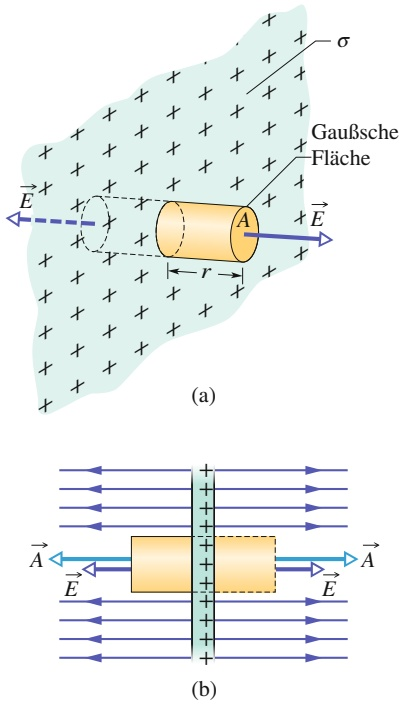

## Abb. 19.9

(a) Perspektivische Ansicht und
(b) Seitenansicht eines kleinen Be-
reichs einer sehr großen, dünnen
Kunststofffolie, die auf ihrer einen
Seite eine Ladung mit der Flächenla-
dungsdichte σ trägt. Eine geschlossene
zylindrische Gaußsche Fläche durch
dringt die Folie und steht senkrecht
auf ihr.

467

---

19 Der Gaußsche Satz

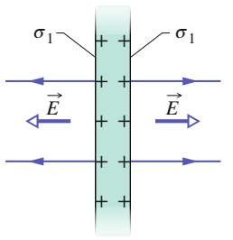

text_image

σ₁
σ₁
→ E →
→ E →
→ + + + + + + + + + + + + + + + + + + + + + + + + + + + + + + + + + + + + + + + + + + + + + + + + + + + + + + + + + + + + + + + + + + + + + + + + + + + + + + + + + + + + + + + + + + + + + + + + + + + +
←
←
←
←
←
←
←
←
←
←
←
←
←
←
←
←
←
←
←
←
←
←
←
←
←
←
←
←
←
←
←
←
←
←
←
←
←
←
←
←
←
←
←
←
←
←
←
←
←
←
←

(a)

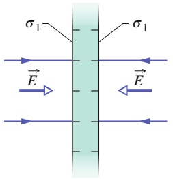

text_image

σ₁
σ₁
→ E →
→ E →

(b)

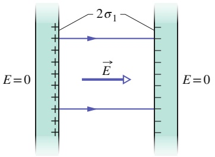

text_image

E=0
+
+
+
+
+
+
+
-
2σ₁
→
→
→
→
→
E=0

(c)

Abb. 19.10

(a) Eine dünne, sehr große leitende Platte mit positiver Überschussladung. (b) Eine identische Platte mit negativer Überschussladung. (c) Die beiden Platten liegen in geringem Abstand parallel zueinander.

Abbildung 19.10b zeigt eine identische Platte, nun mit einer negativen Überschussladung vom gleichen Betrag und mit der gleichen Flächenladungsdichte $\sigma _ { 1 }$ Das Feld zeigt in diesem Fall zur Platte hin.

Wie in Abb. 19.10c dargestellt, werden die beiden Platten einander in geringer Entfernung parallel gegenübergestellt. Bringt man die Platten zusammen, so ziehen sich die ungleichnamigen Ladungen an. Da die Platten leitend sind, sammelt sich die gesamte Ladung jeder Platte auf der innen liegenden Oberfläche der Anordnung. Damit befindet sich nun jeweils die doppelte Ladung auf der Innenflä- che jeder Platte und die Flächenladungsdichte verdoppelt sich folglich von $\sigma _ { 1 }$ auf $\sigma = 2 \sigma _ { 1 }$ . Das elektrische Feld hat daher nach Gl. 19.10 in jedem Punkt zwischen den Platten den Betrag

$$
E = \frac {2 \sigma_ {1}}{\varepsilon_ {0}} = \frac {\sigma}{\varepsilon_ {0}}. \tag {19.13}
$$

Dieses Feld ist von der positiv geladenen Platte zur negativ geladenen hin gerichtet. Da auf den äußeren Oberflächen der Platten keine Ladung zurückbleibt, ist das Feld im Raum links und rechts von den Platten null.

Beim Zusammenbringen der beiden geladenen Platten wird Ladung bewegt, sodass sich die Ladungsverteilung des in Abb. 19.10c dargestellten Systems aus zwei Platten nicht als einfache Summe der Ladungsverteilungen auf den einzelnen Platten nach Abb. 19.10a und b ergibt.

Vielleicht fragen Sie sich, warum wir hier die elektrischen Felder scheinbar unrealistischer Ladungsverteilungen diskutieren, wie beispielsweise einer unendlich langen, linearen Ladungsverteilung, einer unendlich ausgedehnten Flächenladung oder schließlich eines Paars unendlich ausgedehnter geladener Platten. Ein Grund dafür ist sicherlich die Einfachheit, mit der diese Situationen mithilfe des Gauß- schen Satzes analysiert werden können. Noch wichtiger ist jedoch, dass die Ergebnisse aus der Analyse dieser einfach zu behandelnden Aufgaben mit unendlich ausgedehnten Ladungsanordnungen gute Näherungen für die Lösung vieler realer Aufgabenstellungen liefern. So gilt beispielsweise Gl. 19.12 in guter Näherung auch für das Feld einer nur endlich ausgedehnten, nichtleitenden Folie, solange man nur Punkte betrachtet, die hinreichend nahe an der Folie liegen und weit genug von ihren Rändern entfernt sind. Gleichung 19.13 gilt in guter Näherung auch für ein Paar endlich ausgedehnter leitender Platten, solange wir Punkte betrachten, die nicht zu nahe an ihren Rändern liegen.

Das Problem mit den Rändern einer geladenen Folie oder Platte – dem wir hier aus dem Weg gehen – besteht darin, dass in den Randbereichen die ebene Symmetrie nicht mehr gegeben ist, die wir in allen bisherigen Fällen ausnutzen konnten, um Ausdrücke zur Beschreibung des elektrischen Felds herzuleiten. Die Feldlinien sind in diesen Bereichen gekrümmt – man spricht von Kanteneffekten, Randeffekten oder Spitzeneffekten – und es kann sehr schwierig sein, den Feldverlauf algebraisch zu beschreiben.

468

---

19.6 Eine Anwendung des Gaußschen Satzes: Kugelsymmetrie

19

## 19.6 Eine Anwendung des Gaußschen Satzes: Kugelsymmetrie

## Lernziele

Nach dem Durcharbeiten dieses Abschnitts sollten Sie in der Lage sein, . . .

• zu verstehen, dass eine homogen geladene Kugelschale ein geladenes Teilchen außerhalb der Schale genauso anzieht oder abstößt, als wäre die gesamte Ladung im Mittelpunkt der Schale konzentriert,
• zu verstehen, dass auf ein geladenes Teilchen innerhalb einer homogen gelade nen Schale keine elektrostatischen Kräfte von der Schale wirken,
an einem Punkt außerhalb einer Kugelschale mit homogener Ladung die Beziehung zwischen dem elektrischen Feld $E ,$ der Ladung q der Schale und dem Abstand r vom Kugelmittelpunkt anzuwenden,
• den Betrag der elektrischen Feldstärke an Punkten innerhalb einer homogen geladenen Kugelschale zu kennen,
• Betrag und Richtung des elektrischen Felds innerhalb und außerhalb einer homogenen sphärischen Ladungsverteilung (einer homogen geladenen Kugel) zu bestimmen.

## Schlüsselideen

• Außerhalb einer Kugelschale mit homogener Ladung q ist das von ihr erzeugte elektrische Feld radial gerichtet (ob nach innen oder außen, hängt vom Vorzeichen der Ladung ab) und hat den Betrag

$$
E = \frac {1}{4 \pi \varepsilon_ {0}} \frac {q}{r ^ {2}} \quad \text {(außerhalb einer Kugelschale)},
$$

wobei r den Abstand des Messpunkts vom Kugelmittelpunkt bezeichnet. Das Feld ist identisch mit dem einer Punktladung q im Kugelmittelpunkt.

• In ihrem Inneren ist die Schale feldfrei (E = 0).
• Innerhalb einer homogen geladenen Kugel ist das Feld radial gerichtet und hat den Betrag

$$
E = \frac {1}{4 \pi \varepsilon_ {0}} \frac {q}{R ^ {2}} r \quad \text {(innerhalb geladener Kugel)},
$$

wobei $q$ die Gesamtladung, R den Radius der Kugel und r den radialen Abstand zwischen Kugelmittelpunkt und Messpunkt bezeichnen.

Wir wollen hier den Gaußschen Satz zum Beweis der beiden Kugelschalentheoreme verwenden, die wir in Abschn. 17.1 ohne Beweis angenommen haben:

Eine homogen geladene Kugelschale wirkt auf ein geladenes Teilchen, das sich außerhalb von ihr befindet, als sei die Gesamtladung der Schale in ihrem Zentrum vereinigt.

Die elektrostatische Kraft einer homogen geladenen Kugelschale auf ein geladenes Teilchen in ihrem Inneren ist null.

## 19.6.1 Eine Anwendung des Gaußschen Satzes: Kugelsymmetrie

Abbildung 19.11 zeigt eine geladene Kugelschale mit der Gesamtladung q und dem Radius R sowie zwei konzentrische kugelförmige Gaußsche Flächen $S _ { 1 }$ und $S _ { 2 } .$ Wir gehen wie in Abschn. 19.2 vor und wenden den Gaußschen Satz auf die Fläche $S _ { 2 }$

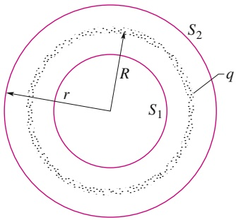

text_image

S₂
R
q
r
S₁

Abb. 19.11

Querschnitt durch eine dünne, homogen mit einer Gesamtladung q belegte Kugelschale. Die farbigen Linien deuten zwei Gaußsche Flächen $S _ { 1 }$ und $S _ { 2 }$ im Querschnitt an: Fläche $S _ { 2 }$ schließt die geladene Kugelschale ein, $S _ { 1 }$ lediglich das leere Innere der Schale.

469

---

19 Der Gaußsche Satz

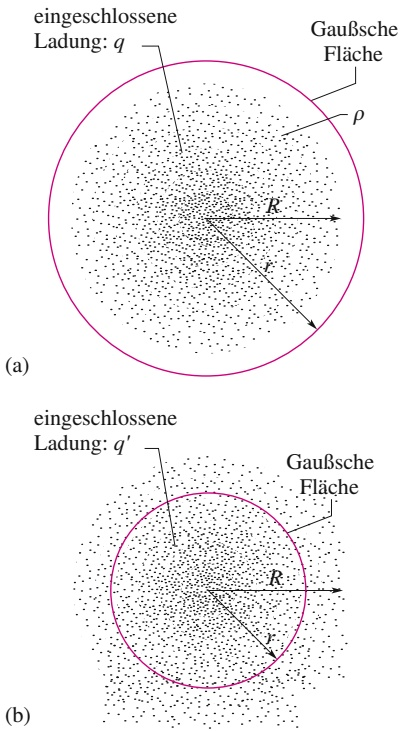

Abb. 19.12

Die Punkte sollen eine kugelsymmetrische Ladungsverteilung mit einem Radius R andeuten, deren Volumenladungsdichte $\rho$ ausschließlich eine Funktion des Abstands vom Zentrum der Verteilung ist. Der durch diese Verteilung dargestellte geladene Körper soll ein Nichtleiter sein, sodass man die Ladungen als ortsfest ansehen kann. In (a) ist eine konzentrische, kugelsymmetrische Gaußsche Fläche mit einem Radius $r > R$ eingezeichnet, in (b) gilt dagegen $r < R .$

mit $r > R$ an; wir erhalten auf diese Weise

$$
E = \frac {1}{4 \pi \varepsilon_ {0}} \frac {q}{r ^ {2}}. \tag {19.14}
$$

Dieses Feld ist identisch mit dem Feld einer Punktladung $q$ im Zentrum der Kugel schale. Dies bedeutet insbesondere, dass auch die Kraftwirkung der Kugelschale auf ein geladenes Teilchen außerhalb von ihr mit der Kraftwirkung der Punktladung identisch ist. Damit ist das erste Kugelschalentheorem bewiesen.

Die Anwendung des Gaußschen Satzes auf die Fläche $S _ { 1 }$ mit $r < R$ < R ergibt unmittelbar:

$$
E = 0, \tag {19.15}
$$

da diese Gaußsche Fläche keine Ladung einschließt. Befände sich also ein geladenes Teilchen innerhalb der Kugelschale, so wäre die resultierende elektrostatische Kraft auf ein solches Teilchen null. Damit ist auch das zweite Kugelschalentheorem bewiesen.

Man kann sich jede kugelsymmetrische Ladungsverteilung, wie beispielsweise die in Abb. 19.12 skizzierte Verteilung, aus ineinander geschachtelten, konzentrischen geladenen Kugelschalen aufgebaut denken. Um die beiden Kugelschalentheoreme anwenden zu können, muss die Volumen- oder Raumladungsdichte $\rho$ auf einer herausgegriffenen Schale konstant sein, sie kann jedoch von Schale zu Schale variieren. Betrachtet man also die Ladungsverteilung als Ganze, darf die Raumladungsdichte nur eine Funktion des Abstands r vom Mittelpunkt der Kugelschale sein, wenn man die Kugelschalentheoreme anwenden möchte. Unter diesen Voraussetzungen können wir nun die Wirkung der Ladungsverteilung Schale für Schale betrachten.

In Abb. 19.12a liegt die gesamte Ladung innerhalb einer Gaußschen Fläche mit einem Radius $r > R .$ Das von der Ladungsverteilung auf der Gaußschen Fläche erzeugte elektrische Feld ist identisch mit dem Feld, das eine im Zentrum befindliche Punktladung vom Betrag der Gesamtladung der Ladungsverteilung erzeugen würde, und es gilt Gl. 19.14.

Abbildung 19.12b zeigt eine Gaußsche Fläche mit $r < R$ . Um das elektrische Feld auf dieser Fläche zu bestimmen, denken wir uns zwei unterschiedliche Gruppen geladener Kugelschalen, eine Gruppe innerhalb und eine außerhalb der Gaußschen Fläche. Gleichung 19.15 besagt, dass die außerhalb der Gaußschen Fläche liegende Ladung kein elektrisches Feld auf der Fläche erzeugt. Andererseits schließt man aus Gl. 19.14, dass das von der Ladung innerhalb der Gaußschen Fläche erzeugte elektrische Feld identisch ist mit dem Feld, das dieselbe Ladung erzeugen würde, wäre sie im Mittelpunkt der Fläche konzentriert. Bezeichnen wir diese eingeschlossene Ladung mit $q ^ { \prime } .$ , so erhalten wir Gl. 19.14 in der Form

$$
E = \frac {1}{4 \pi \varepsilon_ {0}} \frac {q ^ {\prime}}{r ^ {2}}. \tag {19.16}
$$

Ist die innerhalb des Radius R eingeschlossene Gesamtladung q homogen verteilt, so ist die innerhalb des Radius r eingeschlossene Ladung $q ^ { \prime }$ (Abb. 19.12b) proportional zu q:

$$
\frac {\text {Ladung innerhalb} r}{\text {Volumen innerhalb} r} = \frac {\text {Gesamtladung}}{\text {Gesamtvolumen}}
$$

oder

$$
\frac {q ^ {\prime}}{\frac {4}{3} \pi r ^ {3}} = \frac {q}{\frac {4}{3} \pi R ^ {3}}. \tag {19.17}
$$

Daraus folgt

$$
q ^ {\prime} = q \frac {r ^ {3}}{R ^ {3}}. \tag {19.18}
$$

470

---

19.7 Zusammenfassung

19

Setzen wir diesen Ausdruck in Gl. 19.16 ein, so erhalten wir

$$
E = \left(\frac {q}{4 \pi \varepsilon_ {0} R ^ {3}}\right) r. \tag {19.19}
$$

## KONTROLLFRAGE 5

Die Abbildung zeigt zwei großflächige, parallele nichtleitende Folien mit identischen, positiven, homogenen Flächenladungsdichten sowie eine Kugel mit einer homogenen positiven Raumladungsdichte. Ordnen Sie die vier eingezeichneten Punkte nach dem Betrag des dort herrschenden resultierenden elektrischen Felds.

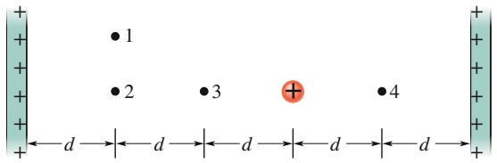

text_image

1
2 3 + 4
+← d→← d→← d→← d→← d→

## 19.7 Zusammenfassung

**Gaußscher Satz** Der Gaußsche Satz und das Coulombsche Gesetz sind äquivalente Formulierungen zur Beschreibung des Zusammenhangs zwischen einer Ladungsverteilung und dem von ihr erzeugten elektrischen Feld in statischen Situationen, obwohl sie formal verschieden zu sein scheinen. Der Gaußsche Satz lautet:

$$
\varepsilon_ {0} \varPhi = q _ {\mathrm{innen}}. \tag {19.5}
$$

Dabei bezeichnet $q _ { \mathrm { i n n e n } }$ die Gesamtladung innerhalb einer gedachten geschlossenen Fläche, der Gaußschen Flä- che, und Φ ist der Gesamtfluss des elektrischen Felds durch diese Fläche:

$$
\varPhi = \oint \vec {E} \cdot \vec {A}. \tag {19.4}
$$

Man kann das Coulombsche Gesetz unmittelbar aus dem Gaußschen Satz herleiten.

**Anwendungen des Gaußschen Satzes** Mithilfe des Gaußschen Satzes und gegebenenfalls zusätzlichen Symmetrieargumenten lassen sich einige wichtige Aussagen der Elektrostatik herleiten:

1. Eine Überschussladung auf einem leitenden Körper befindet sich ausschließlich auf dessen äußerer Oberfläche.
2. Das elektrische Feld außerhalb eines leitenden Körpers ist hinreichend nahe an seiner Oberfläche senkrecht zu ihr und hat den Betrag

$$
E = \frac {\sigma}{\varepsilon_ {0}}. \tag {19.10}
$$

Innerhalb eines leitenden Körpers gilt $E = 0 .$

3. Das elektrische Feld einer unendlich langen linearen Ladungsverteilung mit einer homogenen, linearen Ladungsdichte λ ist in jedem Punkt senkrecht zur Linie

und hat den Betrag

$$
E = \frac {\lambda}{2 \pi \varepsilon_ {0} r}. \tag {19.11}
$$

r bezeichnet den senkrecht zur Linie gemessenen Abstand des betrachteten Punkts von der Linie.

4. Das elektrische Feld einer unendlich ausgedehnten, nichtleitenden, ebenen Folie mit einer homogenen Flä- chenladungsdichte σ ist senkrecht zur Ebene der Folie und hat den Betrag

$$
E = \frac {\sigma}{2 \varepsilon_ {0}}. \tag {19.12}
$$

5. Das elektrische Feld außerhalb einer geladenen Kugelschale mit dem Radius R und der Gesamtladung q ist in einem beliebigen Punkt, der im Abstand r vom Mittelpunkt der Schale liegt, radial gerichtet und hat den Betrag

$$
E = \frac {1}{4 \pi \varepsilon_ {0}} \frac {q}{r ^ {2}}. \tag {19.14}
$$

(Vom umgebenden Raum her betrachtet wirkt die Ladung der Kugelschale so, als sei sie im Mittelpunkt der Schale konzentriert.) Das Feld innerhalb einer homogen geladenen Kugelschale ist exakt gleich null:

$$
E = 0. \tag {19.15}
$$

6. Das elektrische Feld innerhalb einer homogenen kugelsymmetrischen Ladungsverteilung ist radial gerichtet und hat den Betrag

$$
E = \left(\frac {q}{4 \pi \varepsilon_ {0} R ^ {3}}\right) r. \tag {19.19}
$$

471

---

19 Der Gaußsche Satz

## 19.8 Fragen

**1.** Der Flächenvektor einer Fläche sei $\vec { A } = ( 2 \vec { e } _ { x } + 3 \vec { e } _ { y } ) \mathrm { m } ^ { 2 }$ Wie groß ist der Fluss der elektrischen Felder (a) ${ \vec { E } } =$ $4 \vec { e } _ { x }   \mathrm { N } / \mathrm { C }$ und (b) $\vec { E } = 4 \vec { e } _ { z }$ N/C durch die Fläche?
**2.** Welche Bedeutung hat ∫ dA im Fall (a) eines Quadrats mit der Kantenlänge a, (b) eines Kreises mit dem Radius r und (c) der Mantelfläche eines Kreiszylinders mit dem Radius r und der Höhe h?
**3.** Wie in Abb. 19.F3 dargestellt, umschließe eine Gauß- sche Fläche zwei von insgesamt vier positiv geladenen Teilchen. (a) Welche der Teilchen tragen zum elektrischen Feld im Punkt P der Gaußschen Fläche bei? (b) Welcher resultierende elektrische Fluss durch die Gaußsche Fläche ist grö- ßer (falls es einen größeren gibt): der von den Ladungen q1 und $q _ { 2 }$ oder der von allen vier Teilchen erzeugte Fluss?

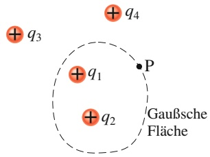

text_image

+ q₃
+ q₁
+ q₂
+ q₄
P
Gaußsche
Fläche

Abb. 19.F3

**4.** Abbildung 19.F4 zeigt einen Querschnitt durch eine Anordnung aus einer Metallkugel im Zentrum, zweikonzentrischen metallenen Kugelschalen sowie drei konzentrischen kugelförmigen Gaußschen Flächen mit den Radien R, 2R und 3R. Die homogen verteilten Ladungen der drei Körper seien Q auf der Kugel, 3Q auf der kleineren sowie 5Q auf der größeren Kugelschale. Ordnen Sie die drei Gaußschen Flächen nach dem Betrag des auf ihnen jeweils herrschenden elektrischen Felds.

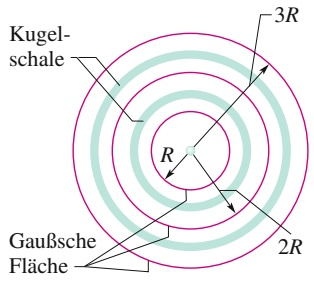

text_image

Kugelschale
Gaußsche Fläche
R
2R
3R

Abb. 19.F4

**5.** Abbildung 19.F5 zeigt drei Gaußsche Flächen, die jeweils zur Hälfte innerhalb einer ausgedehnten, dicken Metallplatte mit einer homogenen elektrischen Flächenladungsdichte liegen.

Die Fläche $S _ { 1 }$ hat die größte Höhe und die kleinsten quadratischen Endflächen, $S _ { 3 }$ hat die geringste Höhe und die größten quadratischen Endflächen; die Werte für die Flä- che $S _ { 2 }$ liegen jeweils zwischen den beiden Extremwerten. Ordnen Sie die drei Gaußschen Flächen nach (a) dem Betrag der eingeschlossenen Ladung, (b) dem Betrag des elektrischen Felds auf ihren oberen Endflächen, (c) dem resultierenden elektrischen Fluss durch die oberen Endflächen sowie (d) dem elektrischen Fluss durch ihre unteren Endflächen.

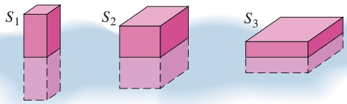

Abb. 19.F5

**6.** Abbildung 19.F6 zeigt Querschnitte durch drei homogen geladene Zylinder mit unterschiedlichen Radien und jeweils der Ladung Q. Drei konzentrische zylindrische Gaußsche Flächen sind eingezeichnet, welche die geladenen Zylinder umschließen und alle den gleichen Radius haben. Ordnen Sie die drei Fälle nach dem Betrag des elektrischen Felds auf den Gaußschen Flächen.

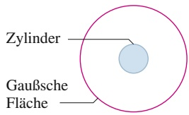

text_image

Zylinder
Gaußsche Fläche

(a)

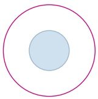

(b)

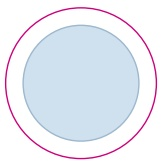

(c)

Abb. 19.F6

**7.** Drei unendlich ausgedehnte, ebene nichtleitende Folien mit den homogenen Flächenladungsdichten σ, 2σ und 3σ werden wie in Abb. Ü19.6a im Übungsbuch parallel zueinander angeordnet. In welcher Reihenfolge müssen sie stehen, damit das elektrische Feld E⃗ in einem der Zwischenräume den Betrag $E = 0$ und im anderen den Betrag $E =$ $2 \sigma / \varepsilon _ { 0 }$ hat?
**8.** Ein kleiner geladener Ball liegt im Inneren einer Kugelschale aus Metall mit dem Radius R. Betrachten Sie die folgenden drei Situationen, wobei die Gesamtladungen von Ball und Kugelschale, in dieser Reihenfolge, gegeben seien durch $(1) $+ 4 q ,$ $0 ;$ (2) $- 6 q ,$ $+ 1 0 q ;$ (3) $+ 1 6 q , - 1 2 q$$ . Ordnen Sie die drei Fälle nach der Ladung (mit Vorzeichen) (a) auf der inneren Oberfläche der Kugelschale, (b) auf der äußeren Oberfläche der Kugelschale.
**9.** Ordnen Sie die drei Fälle aus Frage 8 nach dem Betrag des elektrischen Felds (a) in der Mitte der Schalenwand, also zwischen innerer und äußerer Oberfläche, (b) in einem Punkt im Abstand 2R vom Mittelpunkt der Kugelschale.
**10.** Abbildung 19.F10 zeigt vier massive Kugeln, deren jede mit einer homogen über das gesamte Volumen verteilten Ladung Q geladen ist. (a) Ordnen Sie die Kugeln nach ihrer Raumladungsdichte. Der eingezeichnete Punkt P habe in jedem der vier Fälle den gleichen Abstand vom Mittelpunkt der Kugel. (b) Ordnen Sie die vier Kugeln nach dem Betrag des elektrischen Felds im Punkt P.

472

---

19.8 Fragen

19

(a)

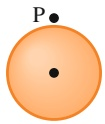

(b)

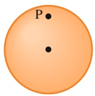

(c)

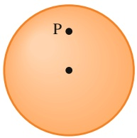

(d)

Abb. 19.F10

**11.** Abbildung 19.F11 zeigt den Querschnitt von zwei Gaußschen Kugeln und zwei Gaußschen Würfeln, in deren gemeinsamen Mittelpunkt sich ein positiv geladenes Teilchen befindet. (a) Ordnen Sie den elektrischen Nettofluss durch die vier Gaußschen Flächen, den größten Wert zuerst. (b) Ordnen Sie die Beträge der elektrische Felder auf den Flächen, den größten Wert zuerst, und geben Sie an, ob die Feldstärken homogen oder variabel auf den jeweiligen Flächen sind.

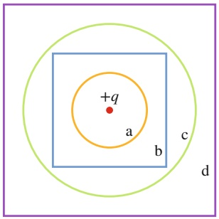

text_image

+q
a
b
c
d

Abb. 19.F11

**12.** In Abb. 19.F12 wird ein Elektron zwischen zwei unendlich ausgedehnten nichtleitenden Platten freigesetzt. Die Flächen sind horizontal und haben homogene Flächenladungsdichten $\sigma _ { ( + ) }$ und $\sigma _ { ( - ) } .$ Das Elektron wird den drei in der Tabelle angegebenen Situationen (d. h. Flächenladungsdichten und Plattenabständen) ausgesetzt. Ordnen Sie die Situationen nach dem jeweiligen Betrag der Elektronenbeschleunigung, den größten zuerst.

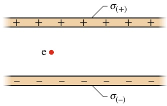

text_image

σ(+)
+ + + + + + +
e
- - - - - - -
σ(-)

Abb. 19.F12

| Situation | $\sigma_{(+)}$ | $\sigma_{(-)}$ | Plattenabstand |
| --- | --- | --- | --- |
| 1 | +4σ | -4σ | d |
| 2 | +7σ | -σ | 4d |
| 3 | +3σ | -5σ | 9d |

**13.** Abbildung 19.F13 zeigt einen Abschnitt von drei langen geladenen Zylindern mit jeweils der gleichen Achse. Der mittlere $\mathrm { Z y }$ linder A trägt eine homogene Ladung $q _ { \mathrm { A } } =$ $+ 3 q _ { 0 }$ . Welche homogenen Ladungen $q _ { \mathrm { B } }$ und $q _ { \mathrm { C } }$ sollten sich auf Zylinder B bzw. C befinden, damit das resultierende elektrische Feld (wenn möglich!) bei (a) Punkt 1, (b) Punkt 2 und (c) Punkt 3 null wird?

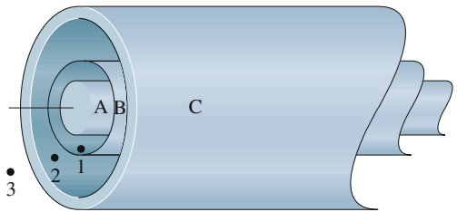

text_image

A B C
1
2
3

Abb. 19.F13

**14.** Abbildung 19.F14 zeigt vier Gaußsche Flächen, die in der Mitte identische Zylindermäntel sind, aber jeweils unterschiedliche „Endkappen“ tragen. Die Flächen befinden sich in einem homogenen elektrischen Feld parallel zur $\mathrm { Z y }$ linderachse des jeweiligen Mittelabschnitts. Die Endkappen haben die folgende Gestalt: $S _ { 1 } !$ : konvexe Halbkugeln; $S _ { 2 } ;$ konkave Halbkugeln; $S _ { 3 } ;$ Kegel; $S _ { 4 } ;$ flache Scheiben. Ordnen Sie die vier Flächen in absteigender Reihenfolge nach (a) dem elektrischen Nettofluss durch die Flächen und (b) dem elektrischen Fluss durch die obere Endkappe.

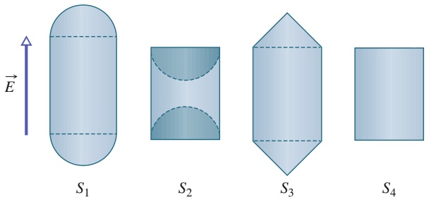

text_image

E
S₁
S₂
S₃
S₄

Abb. 19.F14

**15.** Abbildung 19.F15 zeigt vier Situationen, in denen vier sehr lange homogen geladene Stäbe senkrecht auf der Papierebene stehen (wir sehen also nur die Querschnitte als kleine gelbe Kreise). Die Zahl unter jedem Querschnitt gibt die jeweilige lineare Ladungsdichte in Mikrocoulomb pro Meter an. Die Stäbe stehen entweder im Abstand d oder 2d und die kleinen schwarzen Kreise geben jeweils die Mitte zwischen den inneren Stäben an. Ordnen Sie die vier Situationen in absteigender Reihenfolge nach dem Betrag des resultierenden elektrischen Felds an diesem zentralen Punkt.

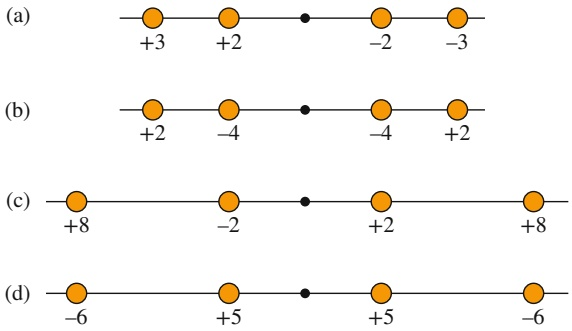

text_image

(a)
+3 +2 -2 -3
(b)
+2 -4 -4 +2
(c)
+8 -2 +2 +8
(d)
-6 +5 +5 -6

Abb. 19.F15

473

---

