# 21 Kapazität

原始 PDF 第 513–536 页。

# 21 Kapazität

## 21.1 Kondensatoren und ihre Anwendungen

## Physikalische Motivation

Ein großes Ziel der Physik ist es, die physikalischen Grundlagen für nützliche, von Ingenieuren ersonnene Geräte zu liefern. Der Fokus dieses Kapitels ist ein äußerst weit verbreitetesBeispiel – der Kondensator, mit dem sich elektrische Energie speichern lässt. Beispielsweile ist im Kondensator Ihres Kamerablitzes Energie gespeichert, die bei Bedarf blitzschnell in Licht verwandelt werden kann. Im Gegensatz dazu können die Batterien der Kamera ihre (elektrochemisch) gespeicherte Energie nur relativ langsam abgeben, weshalb sie nicht direkt in der Lage wären, einen Lichtblitz zu erzeugen.

Die Physik des Kondensators lässt sich auf andere Schaltungen und Situationen verallgemeinern, in denen elektrische Felder eine Rolle spielen. So wird die Erdatmosphäre von Meteorologen als riesiger sphärischer Kondensator beschrieben, dessen Entladungen in Gewittern wir als Blitze wahrnehmen. Beim Skifahren akkumuliert sich elektrische Ladung auf den Skiern, die daher ebenfalls als Kondensatoren beschrieben werden können; ihre Entladungen lassen sich nachts und auf trockenem Schnee tatsächlich in Form von kleinen Funken beobachten.

Der erste Schritt in unserer Diskussion des Kondensators besteht darin, seine „elektrische Zuladung“ bzw. sein Speichervermögen zu bestimmen, das in diesem Fall **Kapazität** genannt wird.

Energie lässt sich bekanntlich in Form potenzieller Energie speichern, beispielsweise durch Spannen eines Bogens, Zusammendrücken einer Feder, Kompression eines Gases – oder Anheben dieses Buchs. Auch in einem elektrischen Feld kann potenzielle Energie gespeichert werden: Ein **Kondensator** ist ein elektrisches Bauteil, das genau diese Funktion erfüllt.

Im Zeitalter der Elektronik und Mikroelektronik finden Kondensatoren heute zahlreiche Anwendungen, die weit über das einfache Speichern von potenzieller Energie hinausgehen. Kondensatoren sind z. B. unverzichtbare Bauelemente in den Stromkreisen von Radio- und Fernsehempfängern, die das Abstimmen der Gerä- te auf bestimmte Sendefrequenzen gestatten. Als weiteres Beispiel seien die Permanentspeicher von Computern genannt, die aus mikroskopisch kleinen Kondensatoren aufgebaut sind. Solche winzigen Bauelemente sind weniger wegen der in ihnen gespeicherten elektrischen Energie von Bedeutung als vielmehr durch die digitale Information, die sie dadurch repräsentieren, dass ihr elektrisches Feld vorhanden sein kann oder auch nicht.

## 21.1.1 Kapazität

Abbildung 21.1 zeigt einige Beispiele von Kondensatoren, die in sehr vielen Größen und Bauformen erhältlich sind. Die Grundelemente eines jeden Kondensators sind in Abb. 21.2 dargestellt: zwei voneinander isolierte Leiter beliebiger Form. Diese

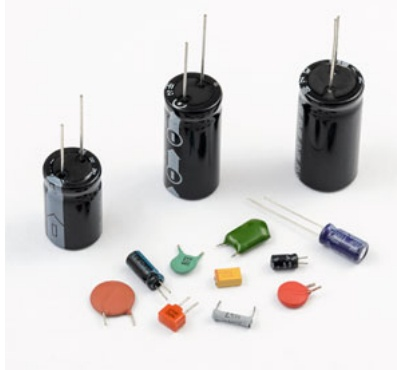

natural_image

Collection of various electronic components including capacitors, resistors, and connectors (no text or symbols visible)

Abb. 21.1

Verschiedene Kondensatoren

[Quelle: yurazaga/Shutterstock].

Halliday Physik für natur- und ingenieurwiss. Studiengänge, 3. Auflage. D. Halliday, R. Resnick und J. Walker. © 2020 WILEY-VCH Verlag GmbH & Co. KGaA. Published 2020 by WILEY-VCH Verlag GmbH & Co. KGaA.

499

---

21 Kapazität

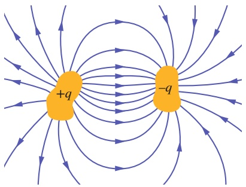

flowchart

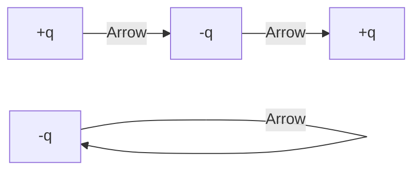

Abb. 21.2

Zwei elektrische Leiter, die voneinander und von ihrer Umgebung isoliert sind, bilden einen Kondensator. Wird eine solche Anordnung geladen, so tragen die beiden Leiter gleich große, entgegengesetzte Ladungen. Bei den technischen Ausführungen von Kondensatoren haben die beiden Leiter meist die Gestalt von Platten oder Folien, weshalb wir die beiden Leiter meist als Kondensatorplatten bezeichnen.

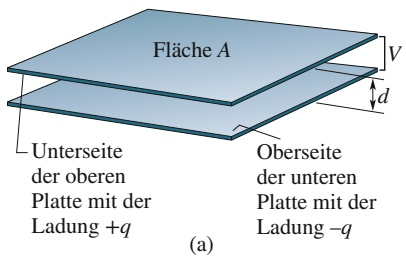

text_image

Fläche A
V
d
Unterseite
der oberen
Platte mit der
Ladung +q
Oberseite
der unteren
Platte mit der
Ladung -q
(a)

elektrische Feldlinien

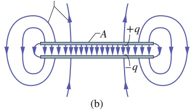

text_image

-A
+q
-q
(b)

Abb. 21.3

(a) Ein Plattenkondensator besteht aus zwei leitenden Platten der Flä- che A im Abstand d. Die Platten tragen gleich große, entgegengesetzte Ladungen q auf den beiden einander zugewandten Seiten. (b) Am parallelen Verlauf der Feldlinien im Raum zwischen den Platten erkennt man, dass das elektrische Feld dort homogen ist. Dagegen wird das Feld zum Plattenrand hin inhomogen, wodurch die Feldlinien dort mehr und mehr nach außen gebogen erscheinen.

beiden Leiter nennen wir die Platten des Kondensators, unabhängig davon, welche Gestalt sie im Einzelfall haben.

Abbildung 21.3a zeigt einen Plattenkondensator, der aus zwei ebenen, parallelen, leitenden Platten der Fläche A besteht, die sich im Abstand d gegenüberstehen. Das Symbol ⊣⊢ für einen Kondensator bezieht sich auf diese spezielle Bauform des Plattenkondensators; wir werden es jedoch für Kondensatoren jeglicher Geometrie und Struktur verwenden. Wir nehmen zunächst an, dass der Raum zwischen den Kondensatorplatten leer, also nicht mit einem isolierenden Stoff wie beispielsweise Glas oder Kunststoff gefüllt ist. In Abschn. 21.5 werden wir diese Einschränkung aufheben.

Wird ein Kondensator geladen, so erhalten seine beiden Platten betragsgleiche, entgegengesetzte Ladungen +q und $- q .$ Wir werden jedoch immer $q ,$ den Betrag der beiden Ladungen auf den Platten, als die Ladung eines Kondensators bezeichnen. (Beachten Sie, dass $q$ nicht die Gesamtladung des Kondensators bezeichnet: Seine Gesamtladung ist null.)

Als Leiter sind die Platten des Kondensators Äquipotenzialflächen: Alle Punkte einer Platte liegen auf dem gleichen elektrischen Potenzial. Zwischen den beiden Platten besteht dagegen eine Potenzialdifferenz. Aus historischen Gründen bezeichnen wir den Betrag dieser Potenzialdifferenz nicht wie in den vorangegangenen Abschnitten mit ΔV, sondern mit V.

Die Ladung q eines Kondensators und die Potenzialdifferenz V zwischen seinen Platten sind zueinander proportional:

$$
q = C V. \tag {21.1}
$$

Man bezeichnet die Proportionalitätskonstante C als die **Kapazität** des Kondensators. Ihr Wert ist ausschließlich durch die Geometrie des Plattensystems bestimmt und hängt nicht von der Ladung oder der Potenzialdifferenz des Kondensators ab. Die Kapazität ist ein Maß dafür, wie viel Ladung auf den Kondensator gebracht werden muss, um eine bestimmte Potenzialdifferenz zwischen seinen Platten zu erzeugen: Je größer die Kapazität des Kondensators, desto mehr Ladung ist erforderlich, um eine bestimmte Potenzialdifferenz zu erzeugen.

Nach Gl. 21.1 ist die SI-Einheit der Kapazität Coulomb pro Volt. Diese Kombination von Einheiten tritt so häufig auf, dass man ihr den Namen Farad (F, nach Michael Faraday) gegeben hat:

$$
1 \text { Farad } = 1 \mathrm{F} = 1 \text { Coulomb   pro   Volt } = 1 \mathrm{C/V}. \tag {21.2}
$$

Wie Sie im Laufe des Kapitels erkennen werden, ist das Farad eine sehr große Einheit. In der Praxis sind Bruchteile wie Mikrofarad $( 1   \mu \mathrm { F } = 1 0 ^ { - 6 }   \mathrm { F } )$ und sogar Picofarad $( 1   \mathrm { p F } = 1 0 ^ { - 1 2 }   \mathrm { I }$ F) gebräuchlicher.

## Laden eines Kondensators

Man kann einen Kondensator laden, indem man ihn in einem Stromkreis mit einer Batterie verbindet. Ein Stromkreis ist ein (geschlossener) Weg, in dem Strom fließen kann. Eine Batterie ist ein System, das zwischen seinen Klemmen oder Polen (Punkten, an welchen Ladung die Batterie verlassen kann oder in sie aufgenommen wird) eine bestimmte Potenzialdifferenz aufrechterhalten kann. Diese Potenzialdifferenz entsteht bei den meisten der heute gebräuchlichen Batterien durch eine elektrochemische Reaktion im Inneren der Batterie, wobei die in der Batterie vorhandene Ladung durch elektrische Kräfte bewegt wird.

Abbildung 21.4a zeigt eine Batterie $B ,$ einen Schalter S sowie einen ungeladenen Kondensator C, die mit Verbindungsdrähten zu einem Stromkreis verbunden sind. Das Prinzipschaltbild in Abb. 21.4b stellt denselben Stromkreis dar, wobei die Ele mente des Kreises – Batterie, Schalter und Kondensator – nun durch die entsprechenden Symbole dargestellt werden. Die Batterie erhält eine Potenzialdifferenz V

500

---

21.1 Kondensatoren und ihre Anwendungen

21

zwischen ihren Klemmen aufrecht. Man bezeichnet die Klemme mit dem höheren Potenzial als positive Klemme (Symbol +), die Klemme mit dem niedrigeren Potenzial als negative Klemme (Symbol −).

Der in Abb. 21.4a und b gezeigte Stromkreis ist offen, da der Schalter S geöffnet ist, die angeschlossenen Drähte also elektrisch nicht miteinander verbunden sind. Wird der Schalter geschlossen, sind die angeschlossenen Drähte also elektrisch miteinander verbunden, so ist der Stromkreis geschlossen und Ladung kann durch den Schalter, die Drähte und die übrigen Elemente des Kreises fließen. Wie wir aus Kap. 17 wissen, ist der Ladungstransport in einem Leiter ein Strom von Elektronen. Schließt man den Stromkreis in Abb. 21.4, so setzt das von der Batterie entlang der Drähte erzeugte elektrische Feld die freien Elektronen in Bewegung. Das Feld treibt die Elektronen von der Kondensatorplatte h zum positiven Pol der Batterie. Dadurch verliert die Platte h Ladung und wird positiv geladen. Die Batterie schiebt dabei ebenso viel Ladung von ihrem negativen Pol auf die Kondensatorplatte l; die Anzahl der Elektronen auf dieser Platte wird somit größer und die Platte um den gleichen Betrag negativ geladen, wie die Platte h durch Verlust von Elektronen positiv geladen wird.

Zu Beginn des Ladevorgangs, wenn die Platten noch ungeladen sind, ist die Potenzialdifferenz zwischen ihnen null. Während dann Ladung auf die Platten fließt, erhöht sich die Potenzialdifferenz zwischen ihnen, bis sie schließlich gleich der Potenzialdifferenz zwischen den Polen der Batterie ist. Nun liegen die Platte h und der positive Pol der Batterie auf demselben Potenzial und das elektrische Feld im Verbindungsdraht zwischen ihnen ist null. Entsprechend gleichen sich die Potenziale der Platte l und des negativen Pols der Batterie einander an, bis das elektrische Feld im Verbindungsdraht zwischen beiden null ist. Im nunmehr erreichten Zustand ist das elektrische Feld in sämtlichen Verbindungsdrähten null und es findet keine Ladungsverschiebung mehr statt: Der Kondensator ist nun vollständig geladen, wobei die Potenzialdifferenz V zwischen den Platten und die Ladung q des Kondensators durch Gl. 21.1 miteinander verknüpft sind.

Wir wollen hier und im Folgenden immer annehmen, dass weder während des Ladevorgangs noch danach ein Ladungsaustausch über den Raum zwischen den Platten hinweg stattfindet. Weiterhin gehen wir immer davon aus, dass ein Kondensator seine Ladung unendlich lange speichert, es sei denn, man bringt ihn in einen Stromkreis, durch welchen er entladen werden kann.

## KONTROLLFRAGE 1

Nimmt die Kapazität C eines Kondensators zu, ab oder bleibt sie unverändert, wenn man (a) die Ladung q des Kondensators verdoppelt, (b) die Potenzialdifferenz zwischen seinen Platten verdreifacht?

## LÖSUNGSSTRATEGIEN

**Strategie 1: Das Symbol V und die Potenzialdifferenz** In vorangegangenen Kapiteln bezeichneten wir mit V ein elektrisches Potenzial in einem Raumpunkt oder auf einer Äquipotenzialfläche. Im Zusammenhang mit elektronischen Bauelementen jedoch verwendet man den Buchstaben V oft für Potenzialdifferenzen zwischen zwei Punkten oder zwei Äquipotenzialflächen: Gleichung 21.1 ist ein Beispiel für diese zweite Art des Gebrauchs von V. In Abschn. 21.2 werden wir sogar eine Mischung der beiden Bedeutungen des Symbols kennen lernen. Spätestens von diesem Abschnitt an sollten Sie sich stets über die jeweilige Bedeutung der mit V bezeichneten Größe Klarheit verschaffen.

Weiterhin in diesem Buch, und ebenso in der übrigen Literatur, wird Ihnen eine Vielzahl von Formulierungen begegnen, die den Begriff der Potenzialdifferenz auf unterschiedliche Arten verwenden: Eine Potenzialdifferenz – ein Potenzial, eine Spannung – kann an einem Gerät oder Bauteil angelegt werden, oder über das Gerät oder Bauteil bestehen. Ein Kondensator kann auf eine bestimmte Potenzialdifferenz aufgeladen werden, wie es beispielsweise die Aussage „Ein Kondensator wird auf eine Spannung von 12 V geladen“ ausdrücken soll. Eine Batterie kann durch die

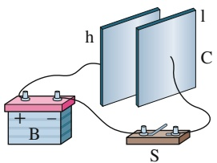

text_image

h
l
C
S
B

(a)

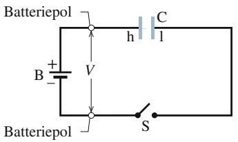

text_image

Batteriepol
+
-
B
V
h
C
l
S
Batteriepol

(b)

## Abb. 21.4

(a) Batterie B, Schalter S und Platten h und l eines Kondensators C in einem Stromkreis. (b) Schaltbild des Stromkreises, bei dem die einzelnen Elemente des Kreises durch ihre elektrotechnischen Symbole dargestellt wurden.

501

---

21 Kapazität

über sie anliegende Potenzialdifferenz charakterisiert werden, wie es in der Formulierung „. . . eine 12-V-Batterie . . . “ zum Ausdruck kommen soll. Machen Sie sich stets klar, was physikalisch mit solchen Redeweisen gemeint ist: Zwischen zwei Punkten innerhalb eines Stromkreises, zwischen den Anschlüssen eines Geräts, eines Bauteils oder einer Batterie, besteht eine Potenzialdifferenz.

## 21.2 Die Berechnung der Kapazität

## Lernziele

Nach dem Durcharbeiten dieses Abschnitts sollten Sie in der Lage sein, . . .

• die Kapazität eines Plattenkondensators mithilfe des Gaußschen Gesetzes auszurechnen,
• die Kapazitäten von Plattenkondensatoren, Zylinderkondensatoren und Kugelkondensatoren sowie von isolierten Kugeln zu bestimmen.

## Schlüsselideen

Ganz allgemein ermitteln wir die Kapazität eines gegebenen Kondensators, indem wir (1) eine Ladung q auf den Kondensatorbelägen annehmen, (2) das davon verursachte elektrische Feld bestimmen, (3) die Potenzialdifferenz zwischen den beiden Seiten des Kondensators berechnen und (4) die Kapazität über $q = C V$ ausrechnen. Einige häufig auftretende Fälle sind im Folgenden angegeben.
• Ein Plattenkondensator mit parallelen ebenen Platten der Fläche A im Abstand d hat die Kapazität

$$
C = \frac {\varepsilon_ {0} A}{d}.
$$

• Ein Zylinderkondensator (zwei lange koaxiale Zylinder) der Länge L mit den Radien a und b hat die Kapazität

$$
C = 2 \pi \varepsilon_ {0} \frac {L}{\ln (b / a)}.
$$

• Ein Kugelkondensator aus zwei konzentrischen Kugelschalen mit den Radien a und b hat die Kapazität

$$
C = 4 \pi \varepsilon_ {0} \frac {a b}{b - a}.
$$

• Eine isolierte Kugel mit Radius R hat die Kapazität

$$
C = 4 \pi \varepsilon_ {0} R.
$$

## 21.2.1 Kapazität typischer Kondensatoren

In diesem Abschnitt ist es unser Ziel, die Kapazität eines Kondensators zu berechnen, wenn wir seine Gestalt kennen. Da wir Kondensatoren unterschiedlicher Bauformen betrachten werden, wollen wir dabei immer nach dem folgenden allgemeinen Schema vorgehen: (1) Eine bestimmte Ladung q befinde sich auf den Platten des Kondensators. (2) Mithilfe des Gaußschen Satzes berechnen wir das von dieser Ladung zwischen den Platten erzeugte elektrische Feld E⃗. (3) Aus E⃗ bestimmen wir anhand von Gl. 20.18 die Potenzialdifferenz zwischen den Platten. (4) Die Kapazität C ergibt sich nun nach Gl. 21.1 aus V.

Die Berechnungen des Felds und des Potenzials lassen sich, wie wir im Folgenden sehen werden, unter bestimmten Annahmen vereinfachen.

502

---

21.2 Die Berechnung der Kapazität

21

## Die Berechnung des elektrischen Felds

Der Gaußsche Satz verknüpft die Ladung auf jeder der Platten eines Kondensators mit dem elektrischen Feld $\vec { \overline { { E } } }$ im Raum zwischen den Platten:

$$
\varepsilon_ {0} \oint \vec {E} \cdot \mathrm{d} \vec {A} = q. \tag {21.3}
$$

Dabei bezeichnet $q$ die von einer Gaußschen Fläche eingeschlossene Ladung und $\oint { \vec { E } } \cdot \mathbf { d } { \vec { A } }$ ist der resultierende elektrische Fluss durch diese Fläche. In allen Fällen, die wir hier und im Folgenden betrachten, wird die Gaußsche Fläche so gewählt sein, dass der Betrag des elektrischen Felds über die Fläche homogen ist und das Feld senkrecht durch die Fläche tritt, die Vektoren $\vec { E }$ und $\mathrm { d } \vec { A }$ also parallel sind. Gleichung 21.3 vereinfacht sich unter diesen Voraussetzungen zu

$$
q = \varepsilon_ {0} E A \quad (\text {Sonderfall von Gl. 21.3}). \tag {21.4}
$$

Hier bezeichnet A den Inhalt desjenigen Teils der Gaußschen Fläche, der von dem Fluss durchsetzt wird. Der Einfachheit halber wählen wir die Gaußsche Fläche stets $\mathbf { s o } ,$ dass sie die Ladung der positiven Platte vollständig einschließt (siehe das Beispiel in Abb. 21.5).

## Berechnung der Potenzialdifferenz

In der Notation von Kapitel 20 (siehe Gl. 20.18) hängt die Potenzialdifferenz zwischen den Kondensatorplatten mit dem elektrischen Feld im Raum zwischen ihnen über die Beziehung

$$
V _ {\mathrm{f}} - V _ {\mathrm{i}} = - \int_ {\mathrm{i}} ^ {\mathrm{f}} \vec {E} \cdot \mathrm{d} \vec {s} \tag {21.5}
$$

zusammen, wobei das Integral entlang eines beliebigen Wegs zu berechnen ist, der auf der Oberfläche der einen Platte beginnt und auf der Oberfläche der anderen Platte endet. Wir werden diesen Weg immer entlang einer elektrischen Feldlinie wählen, die auf der negativen Platte beginnt und auf der positiven Platte endet. Auf einem solchen Weg sind die Vektoren $\tilde { \bar { E } }$ und d⃗s einander entgegengesetzt gerichtet, sodass das Skalarprodukt $\vec { E } \cdot \mathrm { d } \vec { s }$ den Wert −E ds hat. Die rechte Seite von Gl. 21.5 ist deshalb positiv. Wenn wir die Differenz $V _ { \mathrm { f } } - V _ { \mathrm { i } }$ mit $V$ bezeichnen, können wir Gl. 21.5 in die Form

$$
V = \int_ {-} ^ {+} E \mathrm{d} s \qquad (\text {Sonderfall von Gl. 21.5}) \tag {21.6}
$$

bringen, wobei die symbolischen Integrationsgrenzen ${ { } _ { p } + { } ^ { a } }$ und ${ { \bf \Phi } _ { p } } ^ { - } { } ^ { ^ { \alpha } }$ andeuten sollen, dass der Integrationsweg auf der negativen Platte des Kondensators beginnt und auf der positiven Platte endet.

Wir werden nun die Gln. 21.4 und 21.6 auf einige Spezialfälle anwenden.

## Plattenkondensator

Wie in Abb. 21.5 angedeutet nehmen wir an, dass die Platten des Kondensators hin reichend groß und nahe benachbart sind, sodass wir Kanteneffekte an den Plattenrändern vernachlässigen und ein homogenes Feld $\vec { E }$ im gesamten Plattenzwischenraum voraussetzen können.

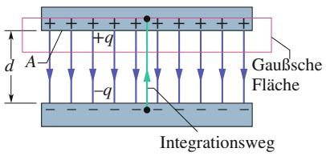

text_image

+q
d A
-q
Gaußsche Fläche
Integrationsweg

## Abb. 21.5

Ein geladener Plattenkondensator. Eine Gaußsche Fläche umschließe die Ladung der positiven Platte. Wir integrieren Gl. 21.6 entlang einer direkten Verbindungslinie von der positiven zur negativen Platte.

503

---

21 Kapazität

Die Gaußsche Fläche sei nach Abb. 21.5 so gewählt, dass sie die Ladung q der positiven Platte gerade vollständig umschließt. Mithilfe von Gl. 21.4 kann man nun schreiben

$$
q = \varepsilon_ {0} E A, \tag {21.7}
$$

wobei A den Flächeninhalt der Platte bezeichnet. Gleichung 21.6 ergibt dann

$$
V = \int_ {-} ^ {+} E \mathrm{d} s = E \int_ {0} ^ {d} \mathrm{d} s = E d. \tag {21.8}
$$

Der Feldbetrag $E$ in Gl. 21.8 ist nach Voraussetzung eine Konstante, sodass man ihn vor das Integral ziehen kann. Das verbleibende Integral ist dann einfach gleich dem Plattenabstand $d .$

Setzen wir nun $q$ aus Gl. 21.7 sowie V aus Gl. 21.8 in die Beziehung $q = C V$ (Gl. 21.1) ein, so erhalten wir

$$
C = \frac {\varepsilon_ {0} A}{d} \quad (\text {Plattenkondensator}). \tag {21.9}
$$

Die Kapazität des Plattenkondensators hängt somit ausschließlich von geometrischen Faktoren ab: dem Plattenabstand d und der Plattenfläche A. Beachten Sie, dass die Kapazität des Kondensators mit zunehmender Plattenfläche sowie mit abnehmendem Plattenabstand zunimmt.

Nebenbei möchten wir hier anmerken, dass man in Gl. 21.9 einen Grund dafür erkennen kann, dass man die elektrostatische Konstante im Coulombschen Gesetz in der Form $1 / ( 4 \pi \varepsilon _ { 0 } )$ schreibt: Würde man eine andere Form für die elektrostatische Konstante wählen, so hätte Gl. 21.9 – die in der Praxis von wesentlich grö- ßerer Bedeutung ist als das Coulombsche Gesetz – eine weniger einfache Form. Gleichung 21.9 gestattet es uns weiterhin, die elektrische Feldkonstante $\varepsilon _ { 0 }$ in einer Einheit auszudrücken, die sich bei der Behandlung von Kondensatoren als wesentlich praktischer erweist:

$$
\varepsilon_ {0} = 8, 8 5 \cdot 1 0 ^ {- 1 2} \mathrm{F/m} = 8, 8 5 \mathrm{pF/m}. \tag {21.10}
$$

Bisher hatten wir diese Konstante in der Form

$$
\varepsilon_ {0} = 8, 8 5 \cdot 1 0 ^ {- 1 2} \mathrm{C} ^ {2} / (\mathrm{N} \cdot \mathrm{m} ^ {2}) \tag {21.11}
$$

geschrieben.

## Zylinderkondensator

Abbildung 21.6 zeigt den Querschnitt eines Zylinderkondensators der Länge L, der aus zwei koaxialen Zylindern mit den Radien a und b besteht. Wenn wir L ≫ b annehmen, können wir Randeffekte vernachlässigen, die das elektrische Feld an den Enden der Zylinder verzerren. Jede Platte (bzw. in diesem Fall jeder Zylinder) des Zylinderkondensators trägt eine Ladung vom Betrag q.

Als Gaußsche Fläche wählen wir einen Zylinder der Länge L mit dem Radius $r ,$ der mit Endflächen abgeschlossen ist und wie in Abb. 21.6 dargestellt im Zylinder kondensator liegt. Nach Gl. 21.4 folgt dann

$$
q = \varepsilon_ {0} E A = \varepsilon_ {0} E (2 \pi r L),
$$

wobei 2πrL der Flächeninhalt des gekrümmten Teils der Gaußschen Fläche ist. Durch die beiden Endflächen der zylindrischen Gaußschen Fläche tritt kein Fluss. Löst man nach E auf, so erhält man

$$
E = \frac {q}{2 \pi \varepsilon_ {0} L r}. \tag {21.12}
$$

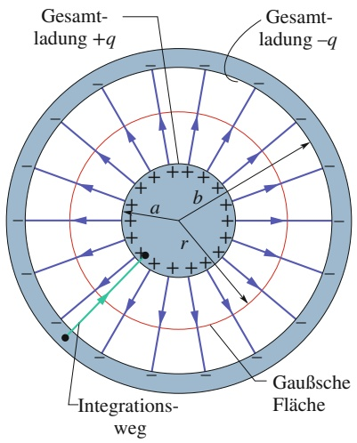

text_image

Gesamt-
ladung +q
Gesamt-
ladung -q
a
b
r
Integrations-
weg
Gaußsche
Fläche

Abb. 21.6

Querschnitt durch einen langen, zylindrischen Kondensator. Eine $\mathbf { Z } \mathbf { y } -$ lindrische Gaußsche Fläche mit Radius r (welche die positive „Platte des Kondensators umschließt) sowie ein radialer Integrationsweg sind eingezeichnet; entlang dieses Integrationswegs berechnen wir Gl. 21.6. Die Skizze ist ebenso auf einen Kugelkondensator anwendbar, wobei der Querschnitt durch den Mittelpunkt der Kugel verläuft.

504

---

21.2 Die Berechnung der Kapazität

21

Setzt man diesen Ausdruck in Gl. 21.6 ein, so ergibt sich für die Potenzialdifferenz:

$$
V = \int_ {-} ^ {+} E \mathrm{d} s = - \frac {q}{2 \pi \varepsilon_ {0} L} \int_ {b} ^ {a} \frac {\mathrm{d} r}{r} = \frac {q}{2 \pi \varepsilon_ {0} L} \ln \left(\frac {b}{a}\right), \tag {21.13}
$$

wobei wir von der Tatsache Gebrauch gemacht haben, dass bei der Integration von außen nach innen auf einem radial orientierten Integrationsweg ds = − dr gilt. Mithilfe der Beziehung $C = q / V$ erhält man schließlich

$$
C = 2 \pi \varepsilon_ {0} \frac {L}{\ln (b / a)} \quad (\text {Zylinderkondensator}). \tag {21.14}
$$

Die Kapazität eines Zylinderkondensators hängt demnach ebenso wie die Kapazi tät des Plattenkondensators nur von geometrischen Faktoren der Plattenkonfiguration ab – in diesem Falle von der Zylinderlänge L sowie den Radien a und b der inneren und äußeren „Platten“.

## Kugelkondensator

Man kann Abb. 21.6 auch als Querschnitt durch den Mittelpunkt eines Kondensators auffassen, der aus zwei konzentrischen Kugelschalen mit den Radien a und b besteht. Als Gaußsche Fläche wählen wir in diesem Fall eine Kugel mit dem Radius $r ,$ die konzentrisch zu den beiden Kugelschalen liegt. Gleichung 21.4 liefert dann

$$
q = \varepsilon_ {0} E A = \varepsilon_ {0} E (4 \pi r ^ {2}),
$$

wobei $4 \pi r ^ { 2 }$ der Inhalt der Gaußschen Fläche ist. Löst man diese Gleichung nach E auf, so erhält man mit

$$
E = \frac {1}{4 \pi \varepsilon_ {0}} \frac {q}{r ^ {2}} \tag {21.15}
$$

einen Ausdruck, der formal mit dem Ausdruck für das elektrische Feld einer homogenen, kugelförmigen Ladungsverteilung identisch ist (vgl. Gl. 19.14).

Setzt man Gl. 21.15 in Gl. 21.6 ein, so folgt

$$
\begin{array}{l} V = \int_ {-} ^ {+} E \mathrm{d} s = - \frac {q}{4 \pi \varepsilon_ {0}} \int_ {b} ^ {a} \frac {\mathrm{d} r}{r ^ {2}} \\ = \frac {q}{4 \pi \varepsilon_ {0}} \left(\frac {1}{a} - \frac {1}{b}\right) = \frac {q}{4 \pi \varepsilon_ {0}} \frac {b - a}{a b}, \tag {21.16} \\ \end{array}
$$

wobei wir wiederum ds durch − dr ersetzt haben. Setzt man schließlich die Gl. 21.16 in Gl. 21.1 ein und löst nach C auf, so ergibt sich die Kapazität des Kugelkondensators zu

$$
C = 4 \pi \varepsilon_ {0} \frac {a b}{b - a} \quad (\text {Kugelkondensator}). \tag {21.17}
$$

## Kapazität einer isolierten Kugel

Man kann auch einer einzelnen, leitenden Kugel mit dem Radius R eine Kapazi tät zuordnen, wenn man annimmt, dass die fehlende „zweite Platte“ des imaginä- ren Kondensators eine leitende Kugelschale mit dem Radius unendlich ist. Die von der Oberfläche eines positiv geladenen, isolierten, leitenden Körpers ausgehenden Feldlinien müssen irgendwo enden: Beispielsweise könne die Wände des Raums, in

505

---

21 Kapazität

welchem sich der Körper befindet, die Rolle einer Kugelschale mit effektiv unendlichem Radius übernehmen.

Um die Kapazität eines isolierten, leitenden Körpers zu berechnen, schreiben wir zunächst Gl. 21.17 in der Form

$$
C = 4 \pi \varepsilon_ {0} \frac {a}{1 - a / b}.
$$

Ersetzt man nun a durch R und führt einen Grenzübergang b → ∞ durch, so erhält man

$$
C = 4 \pi \varepsilon_ {0} R \quad (\text {isolierte Kugel}). \tag {21.18}
$$

Beachten Sie, dass dieser Ausdruck ebenso wie die Gln. 21.9, 21.14 und 21.17, die wir für die Kapazitäten verschiedener einfacher Kondensatoranordnungen hergeleitet haben, das Produkt aus der elektrischen Feldkonstante $\varepsilon _ { 0 }$ und einer Größe mit der Dimension einer Länge enthält.

## KONTROLLFRAGE 2

Verschiedene Kondensatoren werden von derselben Batterie geladen. Nimmt die von dem Kondensator gespeicherte Ladung ab, zu oder bleibt sie gleich, wenn man (a) den Plattenabstand eines Plattenkondensators vergrößert, (b) den Radius des inneren Zylinders eines Zylinderkondensators vergrößert oder (c) den Radius der äußeren Kugelschale eines Kugelkondensators vergrößert?

## 21.3 Parallel- und Reihenschaltung von Kondensatoren

## Lernziele

Nach dem Durcharbeiten dieses Abschnitts sollten Sie in der Lage sein, . . .

• einen Stromkreis mit einer Batterie und drei Kondensatoren zu zeichnen, die (a) parallel und (b) in Reihe geschaltet sind,
• zu verstehen, warum parallel geschaltete Kondensatoren gleiche Potenzialdifferenzen haben und auch der Kondensator im Ersatzschaltbild dieselbe Potenzialdifferenz besitzt,
• den zu mehreren parallel geschalteten Kondensatoren äquivalenten Kondensator im Ersatzschaltbild zu ermitteln,
• zu erkennen, dass die auf mehreren parallelen Kondensatoren gespeicherte Gesamtladung die Summe der Einzelladungen ist,
• zu verstehen, warum in Reihe geschaltete Kondensatoren gleiche Ladungen tragen und auch der Kondensator im Ersatzschaltbild dieselbe Ladungsmenge speichert,
• den zu mehreren in Reihe geschalteten Kondensatoren äquivalenten Kondensator im Ersatzschaltbild zu ermitteln,
• zu erkennen, dass die über mehrere in Reihe geschaltete Kondensatoren abfallende Potenzialdifferenz die Summe der Potenzialdifferenzen an den einzelnen Kondensatoren ist,
einen komplizierten Stromkreis mit Batterie und mehreren parallelen und in Reihe geschalteten Kondensatoren zu vereinfachen, indem Sie schrittweise Kondensatoren zu Ersatzschaltbildern zusammenfassen, bis Sie den äquivalenten Kondensator der Gesamtschaltung haben – und dann die Schritte umzukehren, um Ladung und Potenzial an den Einzelkondensatoren zu erhalten,
• in einem Stromkreis mit einer Batterie, einem offenen Schalter und einem oder mehreren ungeladenen Kondensatoren vorauszusagen, was passiert, wenn der Schalter geschlossen wird,
• Ladung und Potenzialdifferenz an zwei Kondensatoren zu bestimmen, wenn sie zunächst isoliert sind und nur einer von ihnen geladen ist und dann durch Schließen eines Schalters ein Ladungsausgleich erfolgt.

506

---

21.3 Parallel- und Reihenschaltung von Kondensatoren

21

## Schlüsselideen

• Die äquivalente „Ersatz“-Kapazität $C _ { \mathrm { E r s } }$ einer Kombination von n parallel bzw. in Reihe geschalteten Kondensatoren berechnet sich zu

$$
C _ {\mathrm{Ers}} = \sum_ {j = 1} ^ {n} C _ {j} \qquad (\text {parallel})
$$

bzw.

$$
\frac {1}{C _ {\mathrm{Ers}}} = \sum_ {j = 1} ^ {n} \frac {1}{C _ {j}} \quad (\text {Reihe}).
$$

Ersatzkapazitäten erlauben es, die Kapazitäten auch von komplizierteren Schaltungen zu berechnen.

## 21.3.1 Parallel- und Reihenschaltung von Kondensatoren

Werden mehrere Kondensatoren in einem Stromkreis zusammengeschaltet, so kann man eine solche Kombination oft formal durch einen Ersatzkondensator oder äquivalenten Kondensator ersetzen, eine einzelne Kapazität also, deren elektrische Eigenschaften im Stromkreis identisch sind mit den Eigenschaften der Kombination. Eine solche formale Ersetzung vereinfacht den Stromkreis und erleichtert die Berechnung unbekannter Größen des Kreises. Wir diskutieren hier die zwei grundlegenden Schaltungsarten von Kondensatoren, die eine solche Ersetzung gestatten: Parallelschaltung und Reihenschaltung.

## Parallelschaltung von Kondensatoren

Abbildung 21.7a zeigt einen elektrischen Stromkreis mit drei parallel geschalteten Kondensatoren, die mit einer Batterie B verbunden sind. Parallelschaltung bedeutet, dass die Hälfte aller Kondensatorplatten leitend miteinander und mit einem Pol der Batterie verbunden ist, während die andere Hälfte der Platten ebenfalls miteinander, aber mit dem anderen Pol der Batterie verbunden ist. Die Potenzialdifferenz V der Batterie besteht somit zwischen den beiden Gruppen von Kondensatorplatten; alle Platten einer Gruppe liegen auf dem gleichen Potenzial. Insbesondere ist die Potenzialdifferenz über jeden der parallel geschalteten Kondensatoren gleich V. (In der Schaltung von Abb. 21.7a wird diese Potenzialdifferenz von der Batterie aufrechterhalten.) Allgemein gilt:

Legt man eine Potenzialdifferenz V an eine Gruppe parallel geschalteter Kondensatoren an, so liegt diese Potenzialdifferenz an jedem einzelnen Kondensator der Gruppe an. Die gesamte von der Kondensatorgruppe gespeicherte Ladung $q$ ist die Summe aller in den einzelnen Kondensatoren gespeicherten Ladungen.

Die Beschreibung einer Gruppe parallel geschalteter Kondensatoren lässt sich nun durch den folgenden Satz formal vereinfachen:

Eine Gruppe parallel geschalteter Kondensatoren kann durch einen einzigen, äquivalenten Kondensator ersetzt werden, dessen Ladung gleich der Gesamtladung $q$ der Gruppe ist und an dem die gleiche Potenzialdifferenz V anliegt.

Abbildung 21.7b zeigt das Schaltbild dieses äquivalenten Kondensators mit der Ersatzkapazität $C _ { \mathrm { E r s } } ,$ der die Kombination der drei Kondensatoren mit den Kapazitäten $C _ { 1 } , C _ { 2 }$ und $C _ { 3 }$ aus Abb. 21.7a ersetzt.

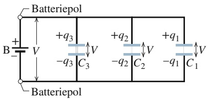

chemical

Simple electrochemical cell diagram with battery electrodes and charge distribution labels

(a)

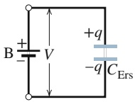

(b)

## Abb. 21.7

(a) Drei Kondensatoren sind in Parallelschaltung mit einer Batterie B verbunden. Die Batterie erhält eine Potenzialdifferenz V über ihre Anschlussklemmen und damit auch über jeden der drei Kondensatoren aufrecht. (b) Die drei Kondensatoren werden durch einen äquivalenten Kondensator ersetzt, dessen Kapazität $C _ { \mathrm { E r s } }$ der Kapazität der Anordnung aus drei Kondensatoren gleich ist.

507

---

21 Kapazität

Zur Herleitung eines Ausdrucks für die Kapazität $C _ { \mathrm { E r s } }$ des äquivalenten Kondensators in Abb. 21.7b berechnen wir zunächst mithilfe von Gl. 21.1 die Ladung auf jedem Kondensator der Gruppe:

$$
q _ {1} = C _ {1} V, \quad q _ {2} = C _ {2} V \quad \text {und} \quad q _ {3} = C _ {3} V.
$$

Die Gesamtladung q der Gruppe von Kondensatoren in Abb. 21.7a ist dann

$$
q = q _ {1} + q _ {2} + q _ {3} = (C _ {1} + C _ {2} + C _ {3}) V.
$$

Daraus erhält man für die Ersatzkapazität eines gedachten Kondensators mit derselben Gesamtladung q und derselben Potenzialdifferenz $V ,$ die auch an allen Kondensatoren der Gruppe anliegt,

$$
C _ {\mathrm{Ers}} = \frac {q}{V} = C _ {1} + C _ {2} + C _ {3}.
$$

Dieses Ergebnis lässt sich leicht auf eine beliebige Anzahl n von parallel geschalteten Kondensatoren verallgemeinern:

$$
C _ {\mathrm{Ers}} = \sum_ {j = 1} ^ {n} C _ {j} \quad (n \text {parallele Kondensatoren}). \tag {21.19}
$$

Die Ersatzkapazität einer Gruppe parallel geschalteter Kondensatoren ergibt sich somit einfach als Summe der Kapazitäten aller beteiligten Kondensatoren.

## Reihenschaltung von Kondensatoren

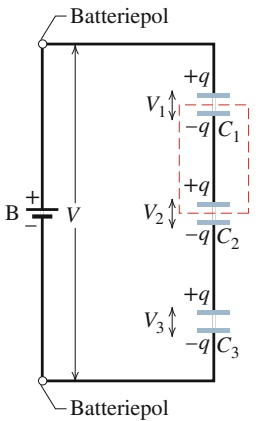

chemical

Diagram of a battery electrode structure showing charge and voltage labels for three different configurations

(a)

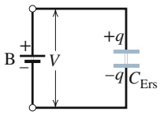

(b)

Abbildung 21.8a zeigt drei Kondensatoren, die in Reihe mit einer Batterie B verbunden sind. Reihenschaltung bedeutet, dass mehrere Kondensatoren hintereinandergeschaltet sind, sodass jeweils eine Platte eines Kondensators der Gruppe mit einer Platte eines anderen Kondensators der Gruppe leitend verbunden ist. Die $\mathrm { P o } \cdot$ tenzialdifferenz V liegt zwischen den beiden Enden der gesamten Kondensatorreihe an. (In der Schaltung von Abb. 21.8a wird diese Potenzialdifferenz von der Batterie B aufrechterhalten.) Die Potenzialdifferenzen, die nun an den einzelnen Kondensatoren der Reihe anliegen, erzeugen jeweils gleiche Ladungen $q$ auf den einzelnen Kondensatoren; es gilt daher:

Liegt eine Potenzialdifferenz V an einer Gruppe in Reihe geschalteter Kondensatoren an, so tragen alle Kondensatoren der Gruppe dieselbe Ladung q. Die Summe aller Potenzialdifferenzen über die Kondensatoren der Reihenschaltung ist gleich der an den beiden Enden der Gruppe anliegenden Potenzialdifferenz.

Abb. 21.8 (a) Drei Kondensatoren $C _ { 1 } , C _ { 2 }$ und $C _ { 3 }$ sind mit einer Batterie B in Reihe geschaltet. Die Batterie erhält eine Potenzialdifferenz $V$ zwischen der oberen Platte des Kondensators $C _ { 1 }$ und der unteren Platte des Kondensators $C _ { 3 }$ aufrecht. (b) Die drei Kondensatoren sind durch einen äquivalenten Kondensator ersetzt, dessen Kapazität $C _ { \mathrm { E r s } }$ gleich der Kapazität der in Reihe geschalteten Kondensatoren ist.

Wir können uns die Aussage, dass jeder Kondensator der Reihenschaltung dieselbe Ladung trägt, physikalisch veranschaulichen, wenn wir uns den Ladevorgang der Reihenschaltung in eine Abfolge einzelner Schritte zerlegt denken, bei welcher die Ladung eines Kondensators der Gruppe die Ladung des nächsten Kondensators der Reihe verursacht. Beginnen wir mit Kondensator $C _ { 3 }$ und arbeiten uns zu $C _ { 1 }$ vor. Wird die Batterie mit der Kondensatorreihe verbunden, so erzeugt sie eine Ladung $- q$ auf der unteren Platte des Kondensators $C _ { 3 }$ . Diese Ladung stößt frei bewegliche negative Ladungen (Elektronen) $\mathrm { a b } ,$ die sich auf der oberen Platte des Kondensators befinden, und gibt dieser Platte eine positive Ladung $+ q .$ Die abgestoßenen negativen Ladungen bewegen sich zur unteren Platte von Kondensator $C _ { 2 }$ und geben ihr die Ladung −q. Nun schiebt diese negative Ladung negative Ladungen von der oberen Platte des Kondensators $C _ { 2 }$ (die dadurch auf eine Ladung $+ q$ gebracht wird) auf die untere Platte des Kondensators $C _ { 1 } ,$ die sich dadurch auf $- q$ auflädt. Endlich verschiebt die Ladung auf der unteren Platte von $C _ { 1 }$ negative

508

---

21.3 Parallel- und Reihenschaltung von Kondensatoren

21

Ladung von der oberen Platte des Kondensators zur Batterie, wodurch sich diese obere Platte positiv mit der Ladung +q auflädt.

Zwei wesentliche Aussagen über Reihenschaltungen von Kondensatoren sind:

1. Wenn Ladung von einem Kondensator einer Reihenschaltung zu einem anderen verschoben wird, so kann sie sich hierbei nur auf einem einzigen Pfad bewegen – beispielsweise auf der leitenden Verbindung zwischen Kondensator 3 und Kondensator 2 in Abb. 21.8a. Wenn weitere mögliche Wege existieren, handelt es sich nicht um eine Reihenschaltung; in Beispielaufgabe 21.2 im Übungsbuch werden wir ein Beispiel hierfür kennenlernen.
2. Die Batterie wirkt direkt nur auf die beiden Platten, mit denen sie leitend verbunden ist – in Abb. 21.8a sind dies die untere Platte von Kondensator 3 sowie die obere Platte von Kondensator 1. Die Ladungen auf allen übrigen Platten entstehen nur durch Verschieben von Ladungsträgern, die sich bereits auf diesen beiden Platten befinden. So ist beispielsweise der rot gestrichelt eingerahmte Abschnitt der Reihenschaltung in Abb. 21.8 vom restlichen Teil des Stromkreises vollständig elektrisch isoliert. Die Gesamtladung dieses Abschnitts kann durch die Batterie nicht verändert, sondern nur umverteilt werden.

Die Beschreibung einer Anzahl von in Reihe geschalteten Kondensatoren lässt sich nun durch den folgenden Satz formal vereinfachen:

Mehrere in Reihe geschaltete Kondensatoren können formal durch einen einzigen, äquivalenten (oder Ersatz-)Kondensator ersetzt werden, der die gleiche Ladung wie die einzelnen Kondensatoren der Reihe trägt und an welchem die gleiche Gesamtpotenzialdifferenz V anliegt wie zwischen den beiden Enden der Reihe.

Abbildung 21.8b zeigt diesen Kondensator mit der Ersatzkapazität $C _ { \mathrm { E r s } } ,$ der die drei Kapazitäten $C _ { 1 } , C _ { 2 }$ und $C _ { 3 }$ der Reihenschaltung von Abb. 21.8a ersetzt.

Zur Herleitung eines Ausdrucks für $C _ { \mathrm { E r s } }$ in Abb. 21.8b nehmen wir zunächst Gl. 21.1 zu Hilfe, um die an jedem Kondensator der Reihe anliegenden Potenzialdifferenzen zu berechnen:

$$
V _ {1} = \frac {q}{C _ {1}}, \quad V _ {2} = \frac {q}{C _ {2}} \quad \text {und} \quad V _ {3} = \frac {q}{C _ {3}}.
$$

Die von der Batterie erzeugte Potenzialdifferenz V ist gleich der Summe dieser drei Potenzialdifferenzen:

$$
V = V _ {1} + V _ {2} + V _ {3} = q \left(\frac {1}{C _ {1}} + \frac {1}{C _ {2}} + \frac {1}{C _ {3}}\right)  .
$$

Daraus erhält man die Ersatzkapazität zu:

$$
C _ {\mathrm{Ers}} = \frac {q}{V} = \frac {1}{1 / C _ {1} + 1 / C _ {2} + 1 / C _ {3}}
$$

oder

$$
\frac {1}{C _ {\mathrm{Ers}}} = \frac {1}{C _ {1}} + \frac {1}{C _ {2}} + \frac {1}{C _ {3}}.
$$

Man verallgemeinert dieses Ergebnis leicht auf eine beliebige Anzahl n von in Reihe geschalteten Kondensatoren:

$$
\frac {1}{C _ {\mathrm{Ers}}} = \sum_ {j = 1} ^ {n} \frac {1}{C _ {j}} \quad (n \text {Kondensatoren in Reihe}). \tag {21.20}
$$

Aus Gl. 21.20 kann man die interessante Folgerung ableiten, dass die Ersatzkapazität einer Reihenschaltung von Kondensatoren immer kleiner ist als die kleinste Einzelkapazität der Reihe.

509

---

21 Kapazität

## KONTROLLFRAGE 3

Eine Batterie erzeuge die Potenzialdifferenz V und speichere die Ladung $q$ in einer Kombination zweier identischer Kondensatoren. Wie groß sind die an den einzelnen Kondensatoren anliegenden Potenzialdifferenzen sowie die auf jedem Kondensator gespeicherten Ladungen, falls die Kondensatoren (a) parallel, (b) in Reihe geschaltet sind?

## KONTROLLFRAGE 4

Ersetzen Sie in Beispielaufgabe 21.3 im Übungsbuch den Kondensator $C _ { 2 }$ durch eine Reihenschaltung von Kondensatoren $C _ { 3 }$ und $C _ { 4 ^ { \circ } } ( \mathtt { a } )$ Welche Beziehung besteht zwischen der anfänglichen Ladung $q _ { 0 } ,$ der Ladung $q _ { 1 }$ auf $C _ { 1 }$ und der Ladung $q _ { 3 4 }$ auf dem äquivalenten Kondensator $C _ { 3 4 } ,$ nachdem der Schalter geschlossen wurde und sich ein Gleichgewicht eingestellt hat? (b) Es sei $C _ { 3 } > C _ { 4 } .$ Ist die Ladung $q _ { 3 }$ auf $C _ { 3 }$ größer, kleiner oder gleich der Ladung $q _ { 4 }$ auf $C _ { 4 } ?$

## LÖSUNGSSTRATEGIEN

**Strategie 2: Stromkreise mit vielen Kondensatoren** Wir wollen die Vorgehensweise zur Lösung von Beispielaufgabe 21.2 im Übungsbuch noch einmal betrachten, wo wir eine Anordnung mehrerer Kondensatoren mit einer Batterie verbunden hatten. Um die Kapazität eines einzelnen Ersatzkondensators für die gesamte Anordnung zu ermitteln, vereinfachen wir die gegebene Schaltung stufenweise, indem wir Kondensatoren, die wir als parallel oder in Reihe geschaltet identifizieren können, jeweils mittels Gl. 21.19 oder 21.20 durch ihre Ersatzkapazitäten ersetzen. Schließlich berechnen wir die Ladung auf dem Ersatzkondensator der gesamten Schaltung mithilfe von Gl. 21.1 unter Verwendung der von der Batterie erzeugten Potenzialdifferenz V.

Damit können wir die auf der gegebenen Anordnung von Kondensatoren gespeicherte Gesamtladung berechnen. Um jedoch die Spannung über einen einzelnen Kondensator der Anordnung sowie die auf ihm gespeicherte Ladung zu ermitteln, müssen wir unser Vereinfachungsverfahrenin umgekehrter Richtung durchlaufen. Dabei gelten folgende Regeln: Wenn Kondensatoren parallel geschaltet sind, liegt an ihnen dieselbe Potenzialdifferenz an wie an ihrem äquivalenten Kondensator und wir können Gl. 21.1 verwenden, um die Ladung auf jedem der Kondensatoren zu berechnen. Sind die Kondensatoren dagegen in Reihe geschaltet, so tragen sie dieselbe Ladung wie ihr äquivalenter Kondensator und wir berechnen mittels Gl. 21.1 die Potenzialdifferenz an jedem der Kondensatoren.

**Strategie 3: Batterien und Kondensatoren** Eine Batterie erhält eine bestimmte Potenzialdifferenz zwischen ihren Polen aufrecht. Verbindet man beispielsweise den Kondensator 1 in Beispielaufgabe 21.3 im Übungsbuch mit der Batterie, so fließt so lange Ladung zwischen der Batterie und dem Kondensator, bis die Potenzialdifferenz über den Kondensator gleich der Batteriespannung ist.

Ein Kondensator unterscheidet sich von einer Batterie insofern, als er zwar Ladung speichern kann, in seinem Inneren jedoch nicht wie im Fall einer Batterie elektrochemische Reaktionen wirken, die geladene Teilchen (Elektronen) aus vorhandenen Atomen oder Molekülen freisetzen können. Trennt man, wie in Beispielaufgabe 21.3 im Übungsbuch beschrieben, den geladenen Kondensator 1 von der Batterie und verbindet ihn mit dem ungeladenen Kondensator $2 ,$ so bleibt die Potenzialdifferenz über $C _ { 1 }$ nicht erhalten. Eine Größe, die beim Ladungsaustausch zwischen den beiden Kondensatoren erhalten bleibt, ist die Ladung $q _ { 0 }$ des Systems aus beiden Kondensatoren: Für die Ladung gilt ein Erhaltungssatz, nicht aber für das elektrische Potenzial.

510

---

21.4 In einem elektrischen Feld gespeicherte Energie

21

## 21.4 In einem elektrischen Feld gespeicherte Energie

## Lernziele

Nach dem Durcharbeiten dieses Abschnitts sollten Sie in der Lage sein, . . .

• zu erklären, wie die Arbeit beim Laden eines Kondensators dessen potenzielle Energie ergibt,
• die Beziehung zwischen potenzieller Energie U, Kapazität C und Potenzialdifferenz V eines Kondensators anzuwenden,
• bei einem Kondensator die Beziehung zwischen potenzieller Energie, innerem Volumen und innerer Energiedichte anzuwenden,
• die Beziehung zwischen potenzieller Energiedichte u im Feld und Feldstärke E bei beliebigen elektrischen Feldern anzuwenden,
• die Gefahren von Funken in Schwebstaub zu erklären (und zu meiden!).

## Schlüsselideen

• Die elektrische potenzielle Energie U eines geladenen Kondensators,

$$
U = \frac {q ^ {2}}{2 C} = \frac {1}{2} C V,
$$

ist die Arbeit, die verrichtet werden muss, um die Ladung auf den Belägen des Kondensators zu platzieren. Diese Energie kann auch mit dem elektrischen Feld $\vec { E }$ im Kondensator in Beziehung gesetzt werden.

• Jedes elektrische Feld, in einem Kondensator oder wo auch immer, speichert eine gewisse Menge an elektrischer Energie. Im Vakuum beträgt diese sogenannte Feldenergie

$$
u = \frac {1}{2} \varepsilon_ {0} E ^ {2}.
$$

## 21.4.1 In einem elektrischen Feld gespeicherte Energie

Um einen ungeladenen Kondensator aufzuladen, muss eine äußere Spannungsquelle Arbeit verrichten. Stellen Sie sich vor, man könnte Elektronen von einer Platte eines ungeladenen Kondensators eines nach dem anderen entfernen und auf die andere Platte bringen. Das elektrische Feld, das sich dabei im Raum zwischen den Platten aufbaut, ist so gerichtet, dass es einem weiteren Ladungstransfer entgegenwirkt. Indem sich Ladung auf den Kondensatorplatten ansammelt, wird es zunehmend schwerer, weitere Elektronen von der einen zur anderen Platte zu übertragen. Die Batterie bringt die dazu notwendige Arbeit aus ihrem Vorrat an chemischer Energie auf.

Diese zum Laden des Kondensators erforderliche Arbeit speichert der Kondensator in Form **elektrischer potenzieller Energie** U im elektrischen Feld zwischen den Kondensatorplatten. Man kann die gespeicherte Energie aus dem Kondensator wieder entnehmen, indem man ihn in einen Stromkreis einbindet und entlädt – ebenso, wie man die in einem gespannten Bogen als mechanische potenzielle Energie gespeicherte mechanische Arbeit durch Loslassen der Bogensaite als kinetische Energie auf einen Pfeil überträgt.

Nehmen wir an, zu einem gewissen Zeitpunkt sei bereits eine Ladungsmenge $q ^ { \prime }$ von einer Platte des Kondensators zur anderen gebracht worden. Die Potenzialdifferenz $V ^ { \prime }$ zwischen den Platten beträgt zu diesem Zeitpunkt folglich $q ^ { \prime } / C .$ Wird nun ein weiterer, differenzieller Ladungsbetrag $\mathrm { d } \boldsymbol { q } ^ { \prime }$ auf die andere Platte übertragen, so ist dazu nach Gl. 20.6 eine Arbeit vom Betrag

$$
\mathrm{d} W = V ^ {\prime} \mathrm{d} q ^ {\prime} = \frac {q ^ {\prime}}{C} \mathrm{d} q ^ {\prime}
$$

511

---

21 Kapazität

erforderlich. Um die Kondensatorladung schließlich auf einen Endwert q zu bringen, ist die Arbeit

$$
W = \int \mathrm{d} W = \frac {1}{C} \int_ {0} ^ {q} q ^ {\prime} \mathrm{d} q ^ {\prime} = \frac {q ^ {2}}{2 C}
$$

aufzubringen. Diese Arbeit ist als elektrische potenzielle Energie U im Kondensator gespeichert:

$$
U = \frac {q ^ {2}}{2 C} \quad (\text {potenzielle Energie}). \tag {21.21}
$$

Mit Gl. 21.1 können wir dafür auch schreiben

$$
U = \frac {1}{2} C V ^ {2} \quad (\text {potenzielle Energie}). \tag {21.22}
$$

Die beiden Beziehungen Gl. 21.21 und Gl. 21.22 gelten unabhängig von der speziellen Geometrie und Bauform eines Kondensators.

Um ein wenig Einsicht in den physikalischen Hintergrund der Speicherung elektrischer Energie zu gewinnen, betrachten wir zwei Plattenkondensatoren, die sich nur dadurch unterscheiden, dass der Plattenabstand von Kondensator 1 doppelt so groß sei wie der Plattenabstand von Kondensator 2. Kondensator 1 schließt folglich auch das doppelte Volumen zwischen seinen Platten ein und hat nach Gl. 21.9 die Hälfte der Kapazität von Kondensator 2. Aus Gl. 21.4 schließen wir, dass das elektrische Feld zwischen den Platten beider Kondensatoren identisch ist, sofern beide die gleiche Ladung q tragen. Gleichung 21.21 schließlich besagt, dass Kondensator 1 unter diesen Bedingungen im Vergleich zu Kondensator 2 das Doppelte an elektrischer potenzieller Energie enthält. Von zwei bis auf den Plattenabstand identischen Kondensatoren mit gleicher Ladung und damit identischem elektrischen Feld zwischen den Platten enthält also der Kondensator mit dem Doppelten zwischen den Platten eingeschlossenen Volumen auch das Doppelte an elektrischer potenzieller Energie. Argumentationen wie diese deuten darauf hin, dass eine von uns bereits früher gemachte Annahme richtig ist:

Die elektrische potenzielle Energie eines geladenen Kondensators ist im elektrischen Feld zwischen seinen Platten gespeichert.

## Medizinische Geräte zur Elektroschocktherapie

Auf der Eigenschaft eines Kondensators, elektrische Energie speichern zu können, beruhen beispielsweise auch Geräte zur Elektroschocktherapie (Defibrillation), die Notärzte zur Behandlung von Patienten mit Kammerflimmern oder Herzstillstand einsetzen. Bei diesen tragbaren Geräten lädt eine Batterie einen Kondensator auf eine hohe Spannung auf, sodass nach weniger als einer Minute eine große Menge an elektrischer Energie im Kondensator gespeichert zur Verfügung steht. Die Batterie selbst stellt dabei nur eine mäßig große Spannung zur Verfügung; eine elektronische Schaltung erzeugt aus dieser niedrigen Potenzialdifferenz kurzzeitig und periodisch eine hohe, mit welcher der Kondensator auf eine hohe Potenzialdifferenz geladen wird. Die bei diesem Vorgang von der Batterie zu erbringende Leistung ist ebenfalls nur mäßig groß.

Bei der Behandlung werden zwei flexible Elektroden auf die Brust des Patienten gepresst, sodass auf ein Schaltsignal hin ein Teil der im Kondensator gespeicherten elektrischen Energie durch die Brust des Patienten von Elektrode zu Elektrode flie ßen kann. Ein typischer Wert für die Kapazität des Kondensators in einem Gerät zur Elektroschocktherapie ist beispielsweise $7 0   \mu \mathrm { F }$ . Wird dieser Kondensator auf eine Potenzialdifferenz von 5000 V aufgeladen, so ist in ihm nach Gl. 21.22 eine

512

---

21.5 Kondensator mit Dielektrikum

21

elektrische Energie

$$
U = \frac {1}{2} C V ^ {2} = \frac {1}{2} (7 0 \cdot 1 0 ^ {- 6} \mathrm{F}) (5 0 0 0 \mathrm{V}) ^ {2} = 8 7 5 \mathrm{J}
$$

gespeichert. Während eines Entladungspulses von typischerweise 2,0 ms Dauer wird eine Energie von 200 J in der Brust des Patienten deponiert. Die elektrische Leistung eines solchen Pulses beträgt demzufolge

$$
P = \frac {U}{t} = \frac {2 0 0 \mathrm{J}}{2 , 0 \cdot 1 0 ^ {- 3} \mathrm{s}} = 1 0 0 \mathrm{kW},
$$

eine Leistung, welche die maximale Leistung der Batterie bei weitem übersteigt. Bei der Blitzlicht- und der Stroboskop-Fotografie kommt die gleiche Technik zur Anwendung: Ein Kondensator wird in einem vergleichsweise langen Zeitraum mittels einer Batterie geladen und danach in einem relativ kurzen Puls über eine Blitzlampe entladen, wobei man kurzzeitig eine hohe elektrische Leistung erreicht.

## Energiedichte

In allen Punkten des Raums zwischen den Platten eines Plattenkondensators hat das elektrische Feld – von Randeffekten abgesehen – die gleiche Richtung und den gleichen Betrag. Daher sollte auch die **elektrische Energiedichte** $u - \mathsf { d } .$ h. die elektrische potenzielle Energie pro Einheitsvolumen – innerhalb des Plattenzwischenraums homogen sein. Man berechnet die Energiedichte u als Quotienten aus der gesamten potenziellen Energie des Kondensators und dem Volumen Ad des Plattenzwischenraums. Gleichung 21.22 liefert

$$
u = \frac {U}{A d} = \frac {C V ^ {2}}{2 A d}.
$$

Mithilfe von Gl. 21.9 folgt hieraus

$$
u = \frac {1}{2} \varepsilon_ {0} \left(\frac {V}{d}\right) ^ {2}.
$$

Nach Gl. 20.40 ist $V / d$ gleich dem Betrag E des elektrischen Felds im Plattenzwischenraum, sodass man für die Energiedichte u schließlich schreiben kann:

$$
u = \frac {1}{2} \varepsilon_ {0} E ^ {2} \quad (\text {Energiedichte}). \tag {21.23}
$$

Obwohl wir dieses Ergebnis für den speziellen Fall des Plattenkondensators her geleitet haben, gilt es auch ganz allgemein für die Energiedichte eines beliebigen elektrischen Felds. Besteht in einem Raumbereich ein elektrisches Feld $\vec { E } ,$ so kann man diesem Raumbereich eine elektrische potenzielle Energie zuordnen, deren Betrag pro Einheitsvolumen durch den Ausdruck in Gl. 21.23 gegeben ist.

## 21.5 Kondensator mit Dielektrikum

## Lernziele

Nach dem Durcharbeiten dieses Abschnitts sollten Sie in der Lage sein, . . .

• zu verstehen, dass die Kapazität eines Kondensators zunimmt, wenn der Raum zwischen den Kondensatorplatten mit einem dielektrischen Material gefüllt wird,
• die Kapazität eines Kondensators mit und ohne Dielektrikum zu berechnen,
• zu sehen, dass in einem Dielektrikum mit Dielektrizitätszahl κ in allen elektrostatischen Gleichungen die elektrische Feldkonstante $\varepsilon _ { 0 }$ durch das Produkt $\kappa \varepsilon _ { 0 }$ ersetzt wird,

513

---

21 Kapazität

• einige bekannte Dielektrika aufzuzählen,
• den Unterschied zwischen dem Verhalten (a) eines mit einer Batterie verbunde nen geladenen Kondensators und (b) eines geladenen Kondensators ohne Batterie beim Einbringen eines Dielektrikums zu verstehen,
• polare von unpolaren Dielektrika zu unterscheiden,
• zu erklären, was auf atomarer Ebene mit dem elektrischen Feld passiert, wenn ein Dielektrikum in einen Kondensator gebracht wird.

## Schlüsselideen

Wenn der Raum zwischen den Platten eines Kondensators vollständig mit einem dielektrischen Material ausgefüllt wird, multipliziert sich dessen Kapazität im Vakuum (oder, in sehr guter Näherung, in Luft) mit der Dielektrizitätszahl $K ,$ einer dimensionslosen Zahl größer als 1.
Wenn ein Raumgebiet vollständig von einem Dielektrikum mit Dielektrizitäts zahl κ ausgefüllt wird, muss man in allen elektrostatischen Gleichungen für dieses Raumgebiet die elektrische Feldkonstante $\varepsilon _ { 0 }$ durch das Produkt $\kappa \varepsilon _ { 0 }$ ersetzen.
• Wird ein dielektrisches Material in ein äußeres elektrisches Feld gebracht, bildet es ein inneres elektrisches Feld aus, das dem äußeren Feld entgegenwirkt und damit die elektrische Feldstärke im Material reduziert.
• Platziert man ein dielektrisches Material in einem Kondensator mit gegebener Ladungsmenge, dann schwächt sich dadurch das elektrische Feld zwischen den Platten ab.

## 21.5.1 Kondensator mit Dielektrikum

natural_image

Collection of vintage scientific instruments on a wooden surface, including domes and lenses, displayed in a glass case with a blurred background (no visible text or symbols)

Abb. 21.9

Historische Kugelkondensatoren von Michael Faraday (ca. 1837, [Quelle: The Royal Institution, London, UK/Bridgeman Images]).

Wie ändert sich die Kapazität eines Kondensators, wenn man den Raum zwischen den Platten mit einem Dielektrikum füllt, einem elektrisch isolierenden Material wie beispielsweise Öl oder Kunststoff? Michael Faraday – auf den das physikalische Konzept der Kapazität zurückgeht und nach dem deshalb auch die SI-Einheit der Kapazität, das Farad, benannt wurde – beschäftigte sich im Jahr 1837 zum ersten Mal mit dieser Frage. Mit den ihm zur Verfügung stehenden, sehr einfachen experimentellen Mitteln, die im Wesentlichen aus Geräten der in Abb. 21.9 gezeigten Bauart bestanden, konnte er zeigen, dass die Kapazität eines Kondensators beim Einbringen eines Dielektrikums in den Plattenzwischenraum um einen numerischen Faktor κ vergrößert wird, den er als **Dielektrizitätszahl** des Dielektrikums bezeichnete. Heute ist diese Materialkonstante auch unter den Bezeichnungen relative Permittivität oder relative Dielektrizitätskonstante bekannt. In Tab. 21.1 sind einige Dielektrika mit ihren jeweiligen Dielektrizitätszahlen zusammengefasst. Die Dielektrizitätszahl des Vakuums ist per definitionem gleich 1. Da Luft zum größten Teil aus leerem Raum besteht, ist ihre gemessene Dielektrizitätszahl nur wenig größer als 1 (vgl. Tab. 21.1).

Ein weiterer, oft unerwünschter Effekt des Vorhandenseins eines Dielektrikums in einem Kondensator ist die Einschränkung der möglichen Potenzialdifferenz zwischen den Platten auf einen gewissen Maximalwert $V _ { \mathrm { m a x } } ,$ die sogenannte Durchschlagsspannung. Wird diese Potenzialdifferenz zwischen den Kondensatorplatten wesentlich überschritten, so erfolgt elektrischer Durchschlag und es bildet sich ein elektrisch leitender Kanal zwischen den Platten aus. Jedes dielektrische Material hat eine charakteristische Durchschlagsfestigkeit. Dieser Zahlenwert gibt die maximale elektrische Feldstärke an, die das Material ohne Durchschlag übersteht. Einige Werte dieser Größe wurden ebenfalls in Tab. 21.1 aufgenommen.

Wie wir bereits in Abschn. 21.2 gesehen haben, lässt sich die Kapazität eines beliebigen Kondensators in der Form

$$
C = \varepsilon_ {0} L \tag {21.24}
$$

514

---

21.5 Kondensator mit Dielektrikum

21

TABELLE 21.1:

Einige Eigenschaften von Dielektrika, gemessen bei Zimmertemperatur (außer für Wasser). Für Vakuum ist $\kappa = 1$

| Material | Dielektrizitätszahl κ | Durchschlagsfestigkeit (kV/mm) |
| --- | --- | --- |
| Luft (1 atm) | 1,000 54 | 3 |
| Polystyrol | 2,6 | 24 |
| Papier | 3,5 | 16 |
| Transformatoröl | 4,5 |  |
| Borosilicatglas | 4,7 | 14 |
| Rubinglimmer | 5,4 |  |
| Porzellan | 6,5 |  |
| Silicium | 12 |  |
| Germanium | 16 |  |
| Ethanol | 25 |  |
| Wasser (20 °C) | 80,4 |  |
| Wasser (25 °C) | 78,5 |  |
| Titandioxid-Keramik | 130 |  |
| Strontiumtitanat | 310 | 8 |

darstellen, wobei L die Dimension einer Länge hat. Beispielsweise ist bei einem Plattenkondensator $L = A / d .$ Faraday erkannte, dass Gl. 21.24 die Form

$$
C = \kappa \varepsilon_ {0} L = \kappa C _ {\text {Luft}} \tag {21.25}
$$

annimmt, sofern das Dielektrikum mit der Dielektrizitätszahl κ den Plattenzwischenraum vollständig ausfüllt. $C _ { \mathrm { L u f t } }$ ist die Kapazität des Kondensators, wenn sich nur Luft im Plattenzwischenraum befindet.

Abbildung 21.10 zeigt ein Experiment von der Art, wie Faraday es durchführte. Die Batterie in Abb. 21.10a hält die Potenzialdifferenz V zwischen den Platten des Kondensators konstant. Füllt man den Raum zwischen den Platten mit einem Dielektrikum, so nimmt die Ladung auf dem Kondensator um einen Faktor κ zu; diese zusätzliche Ladung wird von der Batterie zur Verfügung gestellt. In Abb. 21.10b wurde der Kondensator geladen und danach die Batterie entfernt. Bringt man nun das Dielektrikum in den Plattenzwischenraum, so muss dabei die Ladung des Kondensators unverändert bleiben, da keine Batterie vorhanden ist, die zusätzliche Ladung liefern könnte. Deshalb nimmt die Potenzialdifferenz V zwischen den Platten des Kondensators um einen Faktor κ ab. Beide Beobachtungen sind – über die Beziehung $q = C V -$ konsistent mit einer Zunahme der Kapazität des Kondensators beim Einbringen des Dielektrikums.

Ein Vergleich der Gln. 21.24 und 21.25 legt es nahe, die Wirkung eines Dielektrikums allgemeiner zu beschreiben:

Die elektrostatischen Gleichungen in einem Raumbereich, der vollständig mit einem Dielektrikum der Dielektrizitätszahl κ gefüllt ist, sind dahingehend zu modifizieren, dass die elektrische Feldkonstante $\varepsilon _ { 0 }$ durch das Produkt $\kappa \varepsilon _ { 0 }$ ersetzt wird.

Eine Punktladung, die sich in einem Dielektrikum befindet, erzeugt demnach ein elektrisches Feld, dessen Betrag nach dem Coulombschen Gesetz gegeben ist durch:

$$
E = \frac {1}{4 \pi \kappa \varepsilon_ {0}} \frac {q}{r ^ {2}}. \tag {21.26}
$$

Der Ausdruck für das elektrische Feld unmittelbar über der äußeren Oberfläche eines isolierten, leitenden Körpers, der sich in einem Dielektrikum befindet, ist

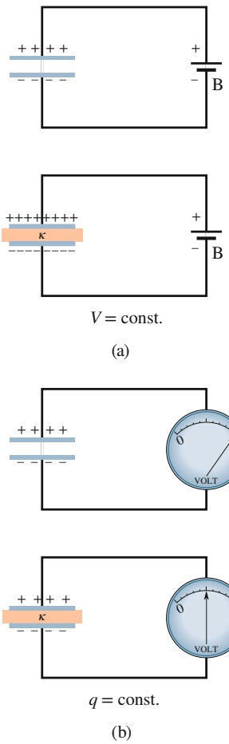

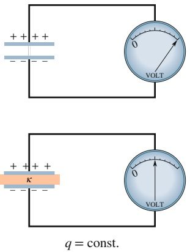

## Abb. 21.10

(a) Wird die Spannung zwischen den Platten eines Kondensators konstant gehalten, wie es hier im Modell durch die Batterie B geschieht, so bewirkt das Einbringen eines Dielektrikums zwischen die Platten eine Vergrößerung der Ladungsmenge auf den Platten. Bleibt wie in Anordnung (b) die Ladung auf den Kondensatorplatten konstant, so bewirkt das Einbringen eines Dielektrikums eine Verringerung der Potenzialdifferenz zwischen den Platten. Das Messgerät in (b) ist ein sogenanntes Galvanometer, ein Gerät, das Potenzialdifferenzen misst, in diesem Fall die Potenzialdifferenz zwischen den Kondensatorplatten. Ein Kondensator kann sich durch das Galvanometer hindurch nicht entladen.

515

---

21 Kapazität

durch die entsprechend modifizierte Gl. 19.10 gegeben:

$$
E = \frac {\sigma}{\kappa \varepsilon_ {0}}. \tag {21.27}
$$

Beide Gleichungen zeigen, dass durch die Wirkung eines Dielektrikums das elektrische Feld einer gegebenen Ladungsverteilung abgeschwächt wird.

## KONTROLLFRAGE 5

Nehmen Sie an, die Batterie bliebe im obigen Beispiel mit dem Kondensator verbunden. Würden dann die folgenden Größen beim Einbringen des Dielektrikums abnehmen, zunehmen oder konstant bleiben: (a) die Potenzialdifferenz zwischen den Kondensatorplatten, (b) die Kapazität des Kondensators, (c) die Ladung des Kondensators, (d) die elektrische potenzielle Energie der Anordnung, (e) das elektrische Feld zwischen den Platten? (Hinweis: Beachten Sie, dass die Ladung im Fall (e) nicht konstant ist.)

## 21.5.2 Dielektrika – auf atomarem Niveau betrachtet

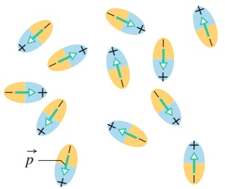

text_image

Diagram showing multiple elliptical objects with directional arrows and a labeled point 'p' indicating a vector or force.

(a)

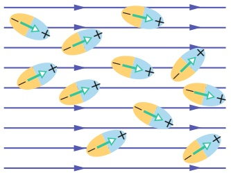

flowchart

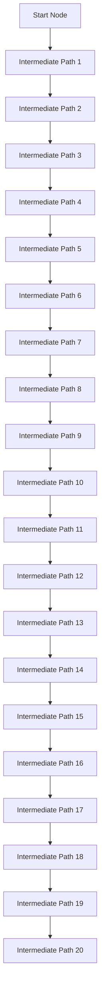

(b)

## Abb. 21.11

(a) Ohne äußeres elektrisches Feld sind diese Moleküle, die ein permanentes elektrisches Dipolmoment besitzen, ungeordnet orientiert. (b) Wird ein äußeres elektrisches Feld angelegt, so richten sich die Dipole zum Teil in Feldrichtung aus; die thermische Bewegung der Teilchen verhindert jedoch eine perfekte Ausrichtung.

Was geschieht auf atomarem oder molekularem Niveau in einem Dielektrikum, wenn es in ein elektrisches Feld gebracht wird? Zwei unterschiedliche Verhaltensweisen sind möglich, abhängig von den spezifischen Eigenschaften der jeweiligen Atome oder Moleküle des Dielektrikums:

1. **Polare Dielektrika:** Die Moleküle einiger Dielektrika wie beispielsweise Wasser besitzen ein permanentes elektrisches Dipolmoment. In solchen Stoffen, die man als polare Dielektrika bezeichnet, haben die molekularen Dipole wie in Abb. 21.11 dargestellt die Tendenz, sich in Richtung des äußeren elektrischen Felds auszurichten. Diese Ausrichtung ist niemals perfekt, da sich die Molekü- le in dauernder Wärmebewegung befinden, sie wird jedoch vollständiger, wenn man die Feldstärke vergrößert oder die Temperatur – und damit die mittlere Energie der molekularen Wärmebewegung – verringert. Die (teilweise) ausgerichteten Dipole erzeugen ein elektrisches Feld, das dem äußeren Feld entgegengesetzt gerichtet und dessen Stärke geringer ist.
2. **Unpolare Dielektrika:** Ganz unabhängig davon, ob sie selbst permanente Dipolmomente besitzen, werden Dipolmomente in Molekülen induziert, wenn sie sich in einem äußeren elektrischen Feld befinden. Wie wir in Abschn. 20.4 (Abb. 20.10) gesehen hatten, geschieht dies deshalb, weil die Moleküle in einem äußeren Feld „verzerrt“, die Schwerpunkte der positiven und negativen Ladung in ihnen also geringfügig voneinander getrennt werden.

Abbildung 21.12a zeigt ein unpolares Dielektrikum ohne äußeres elektrisches Feld. In Abb. 21.12b befindet sich das Dielektrikum im Feld $\vec { \bar { E } } _ { 0 }$ eines Plattenkondensators. Durch die Wirkung des Felds werden die Schwerpunkte der Verteilungen negativer und positiver Ladung im Dielektrikum geringfügig voneinander getrennt, sodass wie dargestellt eine resultierende positive Ladung auf einer der Oberflächen des Objekts entsteht (zu der die positiven Enden der molekularen Dipole zeigen) sowie ganz entsprechend eine negative Ladung auf der anderen Oberfläche. Das Objekt als Ganzes bleibt dabei elektrisch neutral und in seinem Inneren existiert in keinem Volumenbereich eine Überschussladung.

Abbildung 21.12c zeigt, dass die auf den Oberflächen des Dielektrikums induzierten Oberflächenladungen ein elektrisches Feld ${ \vec { E } } ^ { \prime }$ erzeugen, das dem äußeren Feld $\vec { E } _ { 0 }$ entgegengesetzt ist. Das resultierende elektrische Feld $\vec { E }$ im Inneren des Dielektrikums – die Vektorsumme der Felder $\vec { \bar { E } } _ { 0 }$ und $\vec { E } ^ { \prime } -$ hat dieselbe Richtung wie ${ \vec { E } } _ { 0 } ,$ sein Betrag ist jedoch geringer.

Das von den induzierten Oberflächenladungen nach Abb. 21.12c erzeugte elektrische Feld ${ \vec { E } } ^ { \prime }$ wirkt ebenso wie das Feld der permanenten molekularen Dipolmo mente nach Abb. 21.11 dem äußeren elektrischen Feld $\vec { \bar { E } } _ { 0 }$ entgegen. Daher schwä- chen sowohl polare als auch unpolare Dielektrika ein äußeres elektrisches Feld, in

516

---

21.6 Dielektrika und Gaußscher Satz

21

(a)

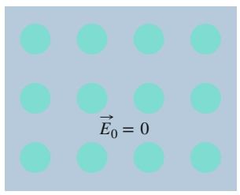

text_image

E₀ = 0

(b)

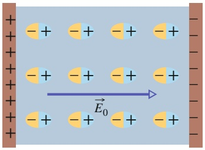

text_image

E₀

(c)

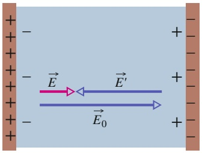

text_image

Diagram showing electric field vectors E, E', and E0 along a positive and negative axis, with arrows indicating direction of flow.

## Abb. 21.12

(a) Ein unpolares dielektrisches Material. Die farbigen Kreise symbolisieren die elektrisch neutralen Atome des Stoffs. (b) Das Dielektrikum wird zwischen geladene Kondensatorplatten gebracht, wo es sich in einem elektrischen Feld befindet. Das Feld bewirkt eine geringfügige Verzerrung der Atome, wobei die Ladungsschwerpunkte der positiven und negativen Ladung in den Atomen voneinander getrennt werden. (c) Durch diese Ladungstrennung bilden sich Oberflächenladungen auf den Endflächen des Dielektrikums, die ihrerseits ein elektrisches Feld E⃗′ erzeugen, welches dem äußeren Feld $\vec { \bar { E } } _ { 0 }$ entgegengesetzt ist. Das resultierende Feld E⃗ im Inneren des Dielektrikums (also die Vektorsumme von $\vec { E } _ { 0 }$ und $\vec { E } ^ { \prime } )$ ist dem äußeren Feld $\vec { \bar { E } } _ { 0 }$ gleichgerichtet, hat jedoch einen geringeren Betrag.

dem sie sich befinden (beispielsweise das Feld eines Kondensators, dessen Plattenzwischenraum sie ausfüllen) in ihrem Inneren ab.

Wir verstehen nun, weshalb die dielektrische Porzellanplatte aus Beispielaufgabe 21.5 im Übungsbuch in den Kondensator hineingezogen wird: Wenn sie in das elektrische Feld zwischen den Platten eindringt, werden Ladungen auf ihren Oberflächen induziert, die den Ladungen der Kondensatorplatten entgegengesetzt sind, sodass Dielektrikum und Kondensatorplatten einander anziehen.

## 21.6 Dielektrika und Gaußscher Satz

## Lernziele

Nach dem Durcharbeiten dieses Abschnitts sollten Sie in der Lage sein, . . .

• in einem Kondensator mit Dielektrikum zwischen freien und induzierten Ladungen zu unterscheiden,
in einem Kondensator, der teilweise oder ganz von einem Dielektrikum ausge füllt wird, die freie Ladung, die induzierte Ladung, das elektrische Feld zwischen den Platten (wenn es eine Lücke gibt, gibt es mehr als einen Feldwert!) und das elektrische Potenzial zwischen den Platten zu bestimmen.

## Schlüsselideen

• Das Einfügen eines Dielektrikums in einen Kondensator induziert Ladungen an der Oberfläche des Dielektrikums und schwächt dadurch das elektrische Feld zwischen den Platten ab.
• Die induzierte Ladung ist kleiner als die freien Ladungen an den Platten.
• In Anwesenheit eines Dielektrikums muss man das Gaußsche Gesetz zu

$$
\varepsilon_ {0} \oint \kappa \vec {E} \cdot \mathrm{d} \vec {A} = q
$$

verallgemeinern. Dabei ist $q$ die freie Ladung. Der Einfluss aller induzierten Oberflächenladungen steckt in der Dielektrizitätszahl κ.

## 21.6.1 Dielektrika und Gaußscher Satz

Bei unserer Behandlung des Gaußschen Satzes in Kap. 19 sind wir immer davon ausgegangen, dass sich die elektrischen Ladungen im Vakuum befinden. In diesem Abschnitt werden wir sehen, auf welche Weise der Gaußsche Satz zu modifizieren

517

---

21 Kapazität

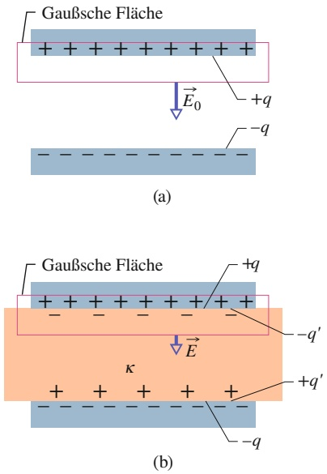

Abb. 21.13

Ein Plattenkondensator (a) mit und (b) ohne Dielektrikum im Plattenzwischenraum. Die Ladung q auf den Platten soll in beiden Fällen die gleiche sein.

und zu verallgemeinern ist, wenn dielektrische Stoffe wie die in Tab. 21.1 aufgelisteten vorhanden sind. Die Plattenfläche des in Abb. 21.13 einmal mit und einmal ohne Dielektrikum dargestellten Plattenkondensators sei A. In beiden Fällen sei die Ladung $q$ der Platten gleich. Das elektrische Feld zwischen den Platten induziert nach Abschn. 21.5 Ladungen auf den Oberflächen des Dielektrikums.

In der Situation von Abb. 21.13a ermittelt man das Feld $\vec { E } _ { 0 }$ zwischen den Platten nach der Methode aus Abb. 21.5: Man umschließt beispielsweise die Ladung +q der oberen Platte mit einer Gaußschen Fläche und wendet den Gaußschen Satz an. Auf diese Weise erhält man für den Feldbetrag $E _ { 0 }$

$$
\varepsilon_ {0} \oint \vec {E} \cdot \mathrm{d} \vec {A} = \varepsilon_ {0} E _ {0} A = q \tag {21.28}
$$

oder

$$
E _ {0} = \frac {q}{\varepsilon_ {0} A}. \tag {21.29}
$$

Auch in der Situation von Abb. 21.13b, im Fall eines Kondensators mit Dielektrikum, können wir zur Berechnung des elektrischen Felds zwischen den Platten – und damit innerhalb des Dielektrikums – dieselbe Gaußsche Fläche verwenden; sie umschließt nun jedoch Ladungen unterschiedlichen Typs: Zur Ladung +q der oberen Kondensatorplatte tritt nun die induzierte Ladung $- q ^ { \prime }$ auf der oberen Flä- che des Dielektrikums hinzu. Die Ladung der Kondensatorplatte ist freie Ladung in dem Sinne, dass sie sich bewegen kann, wenn man das elektrische Potenzial der Platte ändert. Im Gegensatz dazu ist die Ladung auf der Oberfläche des Dielektrikums nicht frei, da sie sich nicht von der Oberfläche weg bewegen kann.

Die resultierende, von der Gaußschen Fläche in Abb. 21.13b eingeschlossene Ladung ergibt sich als Summe $q - q ^ { \prime }$ der beiden Ladungsarten, sodass nach dem Gaußschen Satz folgt

$$
\varepsilon_ {0} \oint \vec {E} \cdot \mathrm{d} \vec {A} = \varepsilon_ {0} E A = q - q ^ {\prime} \tag {21.30}
$$

oder

$$
E = \frac {q - q ^ {\prime}}{\varepsilon_ {0} A}. \tag {21.31}
$$

Wie wir im vorigen Abschnitt sahen, besteht die Wirkung eines Dielektrikums dar in, ein äußeres Feld $E _ { 0 }$ um einen Faktor κ zu schwächen, weshalb man schreiben kann:

$$
E = \frac {E _ {0}}{\kappa} = \frac {q}{\kappa \varepsilon_ {0} A}. \tag {21.32}
$$

Der Vergleich von Gln. 21.31 und 21.32 ergibt

$$
q - q ^ {\prime} = \frac {q}{\kappa}. \tag {21.33}
$$

Diese Gleichung bringt korrekterweise zum Ausdruck, dass der Betrag $q ^ { \prime }$ der induzierten Oberflächenladung geringer ist als der Betrag der freien Ladung q auf einer Kondensatorplatte; $q ^ { \prime }$ wird null, falls kein Dielektrikum vorhanden ist $( \kappa = 1$ in Gl. 21.33).

Setzt man $q - q ^ { \prime }$ aus Gl. 21.33 in Gl. 21.30 ein, so erhält man den Gaußschen Satz in der Form

$$
\varepsilon_ {0} \oint \kappa \vec {E} \cdot \mathrm{d} \vec {A} = q \quad (\text {Gaußscher Satz mit Dielektrikum}). \tag {21.34}
$$

Dieser wesentliche Zusammenhang, den wir hier für den speziellen Fall des Plattenkondensators hergeleitet haben, besitzt allgemeine Gültigkeit und ist die allge meinste Form des Gaußschen Satzes. Beachten Sie die folgenden Punkte:

518

---

21.7 Zusammenfassung

21

1. Unter dem Integral zur Berechnung des elektrischen Flusses erscheint anstelle von $\vec { E }$ nun das Produkt $\kappa { \vec { E } } .$ Bisweilen bezeichnet man den Vektor $\varepsilon _ { 0 } \kappa \vec { E }$ als dielektrische Verschiebung ${ \vec { D } } .$ Mit dieser Festlegung erhält man Gl. 21.34 in der Form ∮ ${ \vec { D } } \cdot \mathrm { d } { \vec { A } } = q .$
2. Als von der Gaußschen Fläche eingeschlossene Ladung q nimmt man nun ausschließlich die freie Ladung. Die induzierte Oberflächenladung des Dielektri kums geht daher in die rechte Seite von Gl. 21.34 nicht ein, da ihr Vorhanden sein bereits durch Einführen der Dielektrizitätszahl κ auf der linken Seite der Gleichung berücksichtigt wurde.
3. Gleichung 21.34 unterscheidet sich von unserer ursprünglichen Formulierung des Gaußschen Satzes (Gl. 19.6) nur dadurch, dass die elektrische Feldkonstante $\varepsilon _ { 0 }$ in Gl. 19.6 jetzt durch das Produkt $\kappa \varepsilon _ { 0 }$ ersetzt wurde. Wir schreiben die Konstante κ auch weiterhin unter das Integral von Gl. 21.34, um später auch Fälle behandeln zu können, bei denen κ über die Gaußsche Fläche nicht konstant ist.

## KONTROLLFRAGE 6

Wie verändern sich die folgenden Größen, wenn man in der Situation der vorangegangenen Beispielaufgabe die Dicke b des Dielektrikums vergrößert: (a) Das elektrische Feld $E _ { 1 }$ , (b) die Potenzialdifferenz V zwischen den Kondensatorplatten, (c) die Kapazität des Kondensators?

## 21.7 Zusammenfassung

**Kondensator, Kapazität** Ein Kondensator besteht aus zwei voneinander isolierten, leitenden Platten (den Kondensatorplatten), die betragsgleiche, entgegengesetzte Ladungen +q und −q tragen. Die Kapazität C des Kondensators ist definiert durch

$$
q = C V, \tag {21.1}
$$

wobei V die Potenzialdifferenz zwischen den Platten bezeichnet. Die SI-Einheit der Kapazität ist das Farad (1 Farad = 1 F = 1 Coulomb∕Volt).

**Bestimmung der Kapazität** Ein allgemeines Verfahren zur Bestimmung der Kapazität einer gegebenen Kondensatoranordnung ist das folgende: (1) Man nehme an, die Anordnung werde auf eine Ladung q geladen. (2) Man berechne das von dieser Ladung zwischen den Platten erzeugte elektrische Feld E⃗. (3) Man ermittle die Potenzialdifferenz V zwischen den Platten und berechne schließlich (4) die Kapazität C der Anordnung mithilfe von Gl. 21.1.

Ein Plattenkondensator, bestehend aus zwei planparallelen Platten der Fläche A im Abstand $d ,$ hat die Kapazität

$$
C = \frac {\varepsilon_ {0} A}{d}. \tag {21.9}
$$

Ein Zylinderkondensator der Länge L, bestehend aus zwei koaxialen Hohlzylindern mit den Radien a und $b ,$ hat die Kapazität

$$
C = 2 \pi \varepsilon_ {0} \frac {L}{\ln (b / a)}. \tag {21.14}
$$

Ein Kugelkondensator, bestehend aus zwei konzentrischen Kugelschalen mit den Radien a und $b ,$ hat die Kapazität

$$
C = 4 \pi \varepsilon_ {0} \frac {a b}{b - a}. \tag {21.17}
$$

Setzt man $\alpha = R$ in Gl. 21.17 ein und betrachtet den Grenzfall $b \to \infty ,$ so erhält man die Kapazität einer einzelnen, isolierten Kugel mit dem Radius R:

$$
C = 4 \pi \varepsilon_ {0} R. \tag {21.18}
$$

**Parallel- und Reihenschaltung von Kondensatoren** Die Ersatzkapazitäten $C _ { \mathrm { E r s } }$ von Parallel- und Reihenschaltungen einzelner Kondensatoren sind

$$
C _ {\mathrm{Ers}} = \sum_ {j = 1} ^ {n} C _ {j} \quad (n \text {Kondensatoren parallel}) \tag {21.19}
$$

und

$$
\frac {1}{C _ {\mathrm{Ers}}} = \sum_ {j = 1} ^ {n} \frac {1}{C _ {j}} \quad (n \text {Kondensatoren in Reihe}). \tag {21.20}
$$

Mithilfe des Konzepts der Ersatzkapazitäten lässt sich die effektive Kapazität komplexer Netze aus einzelnen Kondensatoren einfach ermitteln.

**Potenzielle Energie und Energiedichte** Die elektrische potenzielle Energie

$$
U = \frac {q ^ {2}}{2 C} = \frac {1}{2} C V ^ {2}, \tag {21.21,21.22}
$$

eines geladenen Kondensators ist gleich der Arbeit, die erforderlich ist, um den Kondensator zu laden. Man kann diese potenzielle Energie dem elektrischen Feld E⃗ des Kondensators zuordnen. Allgemein ist in einem elektrischen Feld Energie gespeichert. Im Vakuum ist die Energiedichte $u ,$ also die elektrische potenzielle Energie pro Einheitsvolumen in einem elektrischen Feld der Stärke E, gegeben durch:

$$
u = \frac {1}{2} \varepsilon_ {0} E ^ {2}. \tag {21.23}
$$

519

---

21 Kapazität

**Kapazität eines Kondensators mit Dielektrikum** Wird der Plattenzwischenraum eines Kondensators vollständig von einem Dielektrikum ausgefüllt, so erhöht sich seine Kapazität um einen Faktor $K ,$ die Dielektrizitätszahl oder relative Permittivität, die für das dielektrische Material charakteristisch ist. In den elektrostatischen Gleichungen für einen vollständig von einem Dielektrikum ausgefüllten Raumbereich ist die elektrische Feldkonstante $\varepsilon _ { 0 }$ durch das Produkt $\kappa \varepsilon _ { 0 }$ zu ersetzen.

Man kann den Einfluss eines Dielektrikums verstehen, wenn man die Wirkung des elektrischen Felds auf permanente oder induzierte elektrische Dipole im Dielektrikum betrachtet. Durch die Polarisierung des Materials bilden sich induzierte Ladungen auf den Oberflächen des Dielektrikums aus, deren elektrisches Feld dem äußeren Feld entgegengesetzt gerichtet ist, sodass das Feld im Inneren des Dielektrikums bei unveränderter freier Ladung auf den Kondensatorplatten abgeschwächt wird.

**Gaußscher Satz mit Dielektrikum** In einem Raumbereich, der von einem Dielektrikum ausgefüllt wird, gilt der Gaußsche Satz in der Form

$$
\varepsilon_ {0} \oint \kappa \vec {E} \cdot \mathrm{d} \vec {A} = q. \tag {21.34}
$$

In $q$ gehen dabei ausschließlich freie Ladungen ein; induzierte Oberflächenladungen werden durch die Dielektrizitätszahl κ unter dem Integral berücksichtigt.

## 21.8 Fragen

**1.** In Abb. 21.F1 ist für drei verschiedene Plattenkondensatoren, deren Plattenflächen A und Plattenabstände d in der nachfolgenden Tabelle zusammengefasst sind, die Ladung gegen die Potenzialdifferenz aufgetragen. Welche Kurve gehört zu welchem Kondensator?

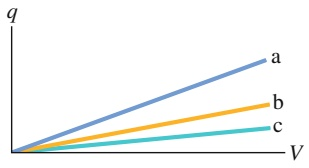

line

| Series | Trend |
| --- | --- |
| a | Linear increase |
| b | Linear increase |
| c | Linear increase |

|  | Fläche | Abstand |
| --- | --- | --- |
| 1 | A | d |
| 2 | 2A | d |
| 3 | A | 2d |

Abb. 21.F1

**2.** Der in Abb. 21.F2 gezeigte Stromkreis enthält eine Batterie mit der Potenzialdifferenz $V ,$ ein Strommessgerät $\mathrm { A } ,$ einen noch offenen Schalter sowie drei identische, ungeladene Kondensatoren mit der Kapazität C. Der Schalter werde nun geschlossen und die Einstellung des Gleichgewichts abgewartet. Wie groß sind dann (a) die Potenzialdifferenz an jedem der Kondensatoren und (b) die Ladung auf der linken Platte jedes Kondensators? (c) Wie groß ist die Gesamtladung, die während des Ladevorgangs durch das Strommessgerät fließt?

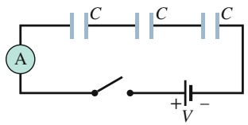

text_image

A
C
C
C
+
V
-

Abb. 21.F2

**3.** Sind die Kondensatoren in den Stromkreisen der Abb. 21.F3 parallel, in Reihe oder auch in keiner der beiden Arten geschaltet?

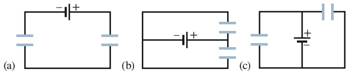

Abb. 21.F3

**4.** (a) Sind die Kondensatoren $C _ { 1 }$ und $C _ { 3 }$ in Abb. 21.F4 in Reihe geschaltet? (b) Sind die Kondensatoren $C _ { 1 }$ und $C _ { 2 }$ in derselben Abbildung parallel geschaltet? (c) Ordnen Sie die Stromkreise in Abb. 21.F4 in absteigender Reihenfolge nach der Ersatzkapazität der Kondensatorschaltung.

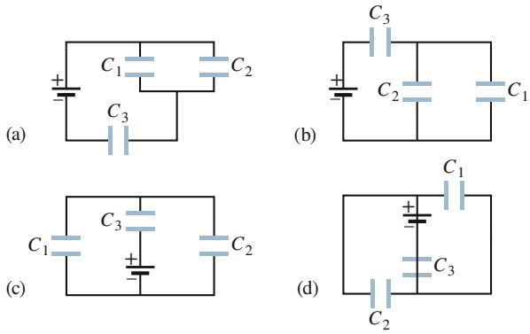

Abb. 21.F4

**5.** Wie groß ist die Ersatzkapazität dreier identischer Kondensatoren mit der Kapazität $C ,$ die mit einer Batterie (a) in Reihe, (b) parallel geschaltet sind? (c) In welcher der beiden Schaltungsarten befindet sich mehr Ladung auf dem Ersatzkondensator?
**6.** Die Kondensatoren $C _ { 1 }$ und $C _ { 2 } \left( C _ { 1 } > C _ { 2 } \right)$ sollen mit einer Batterie verbunden werden, zunächst einzeln, dann in Reihe, dann parallel. Ordnen Sie die vier Schaltungsarten in absteigender Reihenfolge nach dem Betrag der gespeicherten Ladung.
**7.** Ein Kondensator mit der Kapazität $C _ { 1 }$ werde mit einer Batterie verbunden und dann ein zweiter Kondensator mit der Kapazität $C _ { 2 }$ in Parallelschaltung hinzugefügt. Sind (a) die Potenzialdifferenz an $C _ { 1 } , ( \mathsf { b } )$ die Ladung $q _ { 1 }$ auf $C _ { 1 }$ nun größer oder kleiner als zu Beginn oder ändern sich diese Größen beim Zuschalten des zweiten Kondensators nicht? (c) Ist die Ersatzkapazität $C _ { 1 2 }$ der beiden Kondensatoren kleiner als, größer als oder gleich $C_{1}  \text{? } ( d )$ Ist die auf den beiden Kondensatoren gespeicherte Gesamtladung

520

---

21.8 Fragen

21

größer als, kleiner als oder gleich der Ladung, die zu Beginn auf $C _ { 1 }$ allein gespeichert war?

**8.** Der zweite Kondensator aus Frage 7 werde dem ersten Kondensator in Reihenschaltung hinzugefügt. Betrachten Sie die Teilfragen (a) bis (d) unter diesen Bedingungen erneut.
**9.** Abbildung 21.F9 zeigt drei Stromkreise bestehend aus jeweils zwei Kondensatoren mit den angegebenen Anfangsladungen. In welchem Fall wird die Ladung auf dem linken Kondensator beim Schließen des Schalters (a) zunehmen, (b) abnehmen, (c) gleich bleiben?

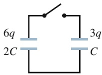

(1)

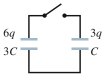

(2)

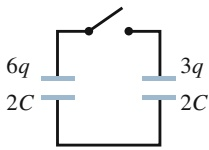

(3)

Abb. 21.F9

**10.** Zwei isolierte Metallkugeln A und B mit den Radien R und 2R tragen dieselbe Ladung q. (a) Ist die Kapazität der Kugel A größer, kleiner oder gleich der Kapazität von Kugel B? (b) Ist die Energiedichte des elektrischen Felds unmittelbar über der Oberfläche der Kugel A größer, kleiner oder gleich der Energiedichte über der Kugel B? (c) Ist die Energiedichte in einer Entfernung 3R vom Mittelpunkt der Kugel A größer, kleiner oder gleich der Energiedichte in derselben Entfernung vom Mittelpunkt der Kugel B? (d) Ist die gesamte, im elektrischen Feld der Kugel A enthaltene elektrische potenzielle Energie größer, kleiner oder gleich der Energie im Feld der Kugel B?

**11.** Man bringt in den Plattenzwischenraum eines der beiden identischen Kondensatoren im Stromkreis von Abb. 21.F11 ein Dielektrikum der Dielektrizitätszahl κ. Nehmen dabei die folgenden Größen desselben Kondensators zu, nehmen sie ab oder bleiben sie unverändert: (a) seine Kapazität, (b) seine Ladung, (c) seine Potenzialdifferenz, (d) seine potenzielle Energie? (e) Wie verhalten sich dieselben Größen des anderen Kondensators?

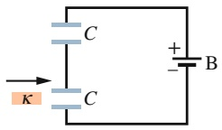

Abb. 21.F11

**12.** Was ist $C _ { \mathrm { E r s } }$ für drei Kondensatoren jeweils mit der Kapazität $C ,$ wenn sie miteinander (a) in Reihe und (b) parallel geschaltet mit einer Batterie verbunden sind? (c) Bei welcher Anordnung trägt der Ersatzkondensator mehr Ladung?
**13.** Ein Plattenkondensator wird mit einer Batterie verbunden, die eine elektrische Potenzialdifferenz V haben möge. Was geschieht mit den folgenden Größen, wenn man den Plattenabstand verringert – nehmen sie ab, nehmen sie zu oder bleiben sie gleich groß? (a) Kapazität des Kondensators, (b) Potenzialdifferenz über den Kondensator, (c) auf dem Kondensator gespeicherte Ladung, (d) im Kondensator gespeicherte Energie, (e) Größe des elektrischen Felds zwischen den Platten, (f ) Energiedichte des elektrischen Felds?

521

---

