# 22 Elektrischer Strom und Widerstand

原始 PDF 第 537–558 页。

# 22 Elektrischer Strom und Widerstand

## 22.1 Ladung in Bewegung: Elektrischer Strom

## Physikalische Motivation

In den letzten fünf Kapiteln haben wir die Elektrostatik behandelt – die Physik ruhender Ladungen. In diesem und dem nächsten Kapitel diskutieren wir die Physik von elektrischen Strömen, d. h. bewegten Ladungen. Beispiele für elektrischen Strom umgeben uns allerorten und betreffen eine Vielzahl von Berufen. Meteorologen beschäftigen sich mit Blitzen und dem weniger dramatischen langsamen Fluss von Ladung durch die Atmosphäre. Biologen, Physiologen und Medizintechniker arbeiten mit den Strömen in Nerven und Muskeln – insbesondere versuchen sie, solche Leitungsbahnen nach Verletzungen des Rückenmarks wiederherzustellen. Elektrotechniker ersinnen elektrische Schaltungen, etwa in der Stromversorgung, beim Schutz vor Blitzen und anderen Spannungsspitzen, in der Informationstechnik oder der elektronischen Musik. Raumfahrtspezialisten überwachen den Fluss geladener Partikel von der Sonne, welche unseren satellitengestützten Kommunikationssystemen ebenso wie der irdischen Stromversorgung gefährlich werden können. Aber auch abgesehen von solchen wissenschaftlichen Anwendungen hängt fast jeder Aspekt unseres Alltagslebens von Strömen und elektrisch übertragenen Informationen ab – vom Aktienhandel über Online-Banking und Videokonferenzen bis hin zu den sozialen Netzwerken. In diesem Kapitel werden wir die physikalischen Grundlagen des elektrischen Stroms diskutieren, insbesondere die Frage, warum er in manchen Materialien auftritt und in anderen nicht. Wir beginnen mit der Bedeutung des Begriffs „elektrischer Strom“.

## 22.1.1 Elektrischer Strom

Jeder elektrische Strom ist bewegte Ladung. Umgekehrt jedoch bedeutet nicht jede Ladungsbewegung automatisch auch einen elektrischen Strom: Von einem elektrischen Strom durch eine gegebene Fläche kann man nur dann sprechen, wenn effektiv ein **Ladungstransport** durch diese Fläche hindurch stattfindet. Zwei Beispiele sollen dies verdeutlichen:

1. Die freien Elektronen (die Leitungselektronen) in einem Stück isolierten Kup ferdrahts bewegen sich ungeordnet mit Geschwindigkeiten in der Größenordnung von $1 0 ^ { 6 }$ m/s. Denkt man sich eine Querschnittsebene durch diesen Draht gelegt, so treten pro Sekunde in beiden Richtungen Milliarden von Leitungselektronen durch die Fläche hindurch – diese zufälligen Bewegungen bedeuten jedoch effektiv keinen Ladungstransport, es fließt kein Strom im Draht.
2. Der Fluss von Wasser durch einen Gartenschlauch ist gleichbedeutend mit einer gerichteten Strömung positiver Ladung – der Protonen in den Wassermolekü- len – mit einer Rate von einigen Millionen Coulomb pro Sekunde. Effektiv wird dabei jedoch keine Ladung transportiert, da es eine exakt parallele Verschiebung

Halliday Physik für natur- und ingenieurwiss. Studiengänge, 3. Auflage. D. Halliday, R. Resnick und J. Walker. © 2020 WILEY-VCH Verlag GmbH & Co. KGaA. Published 2020 by WILEY-VCH Verlag GmbH & Co. KGaA.

523

---

22 Elektrischer Strom und Widerstand

natural_image

Simple orange rounded rectangle outline on white background (no text or symbols)

(a)

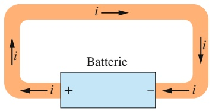

text_image

i
Batterie
i
+
-
i

(b)

## Abb. 22.1

(a) Eine Leiterschleife aus Kupfer im elektrostatischen Gleichgewicht: Alle Punkte der Schleife liegen auf dem gleichen Potenzial und das elektrische Feld ist in allen Punkten innerhalb des Kupfers gleich null. (b) Legt man eine Batterie in den Kreis, so ruft diese eine

Potenzialdifferenz zwischen den mit den Polklemmen der Batterie verbundenen Enden der Leiterschleife hervor.

Innerhalb der Leiterschleife besteht nun ein elektrisches Feld zwischen

den beiden Anschlüssen, und die freien Ladungen im Kupfer bewegen sich unter dem Einfluss dieses Felds:

Es fließt ein elektrischer Strom i.

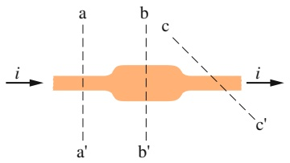

text_image

i
a
b
c
a'
b'
i
c'

Abb. 22.2

In einem Leiter fließt ein elektrischer Strom i. Durch jede der eingezeichneten Ebenen tritt der gleiche Strom hindurch.

negativer Ladung mit exakt derselben zeitlichen Rate gibt – die Strömung der Elektronen in den Wassermolekülen.

In diesem Kapitel werden wir uns – im Rahmen der klassischen Physik – im Wesentlichen auf die Untersuchung zeitlich unveränderlicher Ströme der Leitungselektronen in Metallen beschränken, beispielsweise in Kupferdrähten.

Die in Abb. 22.1a dargestellte Leiterschleife soll daran erinnern, dass sich alle Bereiche eines isolierten, leitenden Körpers auf demselben elektrischen Potenzial befinden – unabhängig davon, ob eine Überschussladung auf dem Körper vorhanden ist oder nicht. Im Inneren oder auf der Oberfläche eines solchen Körpers kann kein elektrisches Feld existieren. Obwohl frei bewegliche Leitungselektronen vorhanden sind, fließt kein elektrischer Strom, da keine Kraft auf die Ladungsträger wirkt.

Schaltet man, wie in Abb. 22.1b dargestellt, eine Batterie in den Kreis, so wird das Potenzialgleichgewicht gestört: Innerhalb des Materials der Schleife wirkt nun ein elektrisches Feld und übt Kräfte auf die Leitungselektronen aus, die sich bewegen und einen elektrischen Strom bilden. Nach sehr kurzer Zeit erreicht der Elektronenfluss einen stabilen Wert, ein konstanter Strom fließt.

Abbildung 22.2 zeigt einen Abschnitt eines Leiters, durch den ein elektrischer Strom fließt. Tritt eine Ladungsmenge dq während der Zeit dt durch eine gedachte Querschnittsebene aa′, so definiert man den Strom i durch diese Ebene als:

$$
i = \frac {\mathrm{d} q}{\mathrm{d} t} \quad (\text {Definition des Stroms}). \tag {22.1}
$$

Im Zeitraum zwischen 0 und t tritt durch die Querschnittsebene eine Ladungsmenge $q$ hindurch, die man durch Integration zu

$$
q = \int \mathrm{d} q = \int_ {0} ^ {t} i \mathrm{d} t \tag {22.2}
$$

berechnet, wobei der Strom i zeitlich veränderlich (also eine Funktion der Zeit t) sein kann.

Im stationären Zustand ist der Wert dieses Stroms für alle Querschnittsflächen des Leiters, wie etwa aa′, $\mathrm { b b ^ { \prime } }$ oder $c c ^ { \prime }$ , gleich – unabhängig von deren Lage oder Orientierung. Diese Aussage ist einfach eine unmittelbare Folge der Ladungserhaltung. Unter den zeitlich stabilen Bedingungen, die wir hier immer voraussetzen wollen, muss beispielsweise für jedes Elektron, das sich durch die Ebene $\mathrm { c c } ^ { \prime }$ hindurchbewegt, ein Elektron die Ebene $\mathbf { a a ^ { \prime } }$ durchqueren. Ganz entsprechend muss im Bild des Gartenschlauchs für jeden Tropfen, der den Schlauch durch die Düse verlässt, ein Tropfen aus dem Wasserhahn in den Schlauch eintreten: Die Gesamtmenge des Wassers im Schlauch bleibt erhalten.

Die SI-Einheit des elektrischen Stroms ist Coulomb pro Sekunde, wofür man meist den Namen Ampere (A) verwendet:

$$
1 \text {Ampere} = 1 \mathrm{A} = 1 \text {Coulomb pro Sekunde} = 1 \mathrm{C/s}.
$$

Das Ampere ist eine der Grundeinheiten des SI-Systems: Die Ladungsmenge Coulomb ist als abgeleitete Einheit durch das Ampere definiert (vgl. Kapitel 17 und Anhang A) und ergibt sich dann als Vielfaches der Elementarladung e (und zwar das $1 / \overset { \circ } { 1 } , 6 0 2   1 7 6   6 3 4 \cdot 1 0 ^ { - 1 9 }$ -Fache, das sind ungefähr $6 { , } 2 4 1   5 1 0 \cdot 1 0 ^ { 1 8 }$ Elementarladungen).

Der durch Gl. 22.1 definierte elektrische Strom ist eine skalare Größe, da sowohl Ladung als auch Zeit Skalare sind. Dennoch stellen wir wie in Abb. 22.1b einen Strom oft durch einen Pfeil dar, um dadurch anzuzeigen, dass sich Ladung gerichtet bewegt. Diese Pfeile stellen keine Vektoren dar; insbesondere können sie nicht vektoriell addiert werden. Abbildung 22.3a zeigt ein Beispiel für einen Strom $i _ { 0 } ,$ der sich an einer Verzweigung des Leiters in die beiden Teilströme $i _ { 1 }$ und $i _ { 2 }$ aufspaltet.

524

---

22.2 Die Stromdichte

22

Da die elektrische Ladung erhalten ist, muss der Gesamtstrom $i _ { 0 }$ die Summe der beiden Teilströme sein:

$$
i _ {0} = i _ {1} + i _ {2}. \tag {22.3}
$$

Wie Abb. 22.3b verdeutlicht, wird die Gültigkeit von Gl. 22.3 durch Verbiegen der Drähte in keiner Weise beeinträchtigt: Strompfeile an Leitern zeigen lediglich die Orientierung der Strömung im Leiter an, nicht die Richtung des Stroms im Raum.

## Die Stromrichtung

In Abb. 22.1b hatten wir die Strompfeile in der Transportrichtung von positiv geladenen Teilchen in dem elektrischen Feld entlang der Leiterschleife eingezeichnet. Solche positiven Ladungsträger, wie man sie im Allgemeinen nennt, bewegen sich vom positiven Pol der Batterie weg und auf den negativen Pol zu. Tatsächlich sind die Ladungsträger in der Leiterschleife von Abb. 22.1b jedoch Elektronen und damit negativ geladen. Im elektrischen Feld bewegen sie sich daher entgegen der von den Strompfeilen festgelegten Richtung vom negativen zum positiven Batteriepol hin. Aus historischen Gründen gilt dennoch die folgende Festlegung der sogenannten konventionellen Stromrichtung:

Strompfeile zeigen immer in die Richtung, in die sich positive Ladungsträger bewegen würden, und dies auch dann, wenn die Ladungsträger in Wirklichkeit negativ geladen sind und sich in die entgegengesetzte Richtung bewegen.

In den meisten Fällen kann man sich an diese Konvention halten, da die angenommene Bewegung positiver Ladungsträger in eine bestimmte Richtung effektiv gleichbedeutend ist mit der tatsächlichen Bewegung negativer Ladungsträger in die entgegengesetzte Richtung. Sollte dies einmal nicht der Fall sein, so werden wir die Konvention natürlich fallen lassen und die tatsächliche Bewegung der Ladungsträger betrachten.

## KONTROLLFRAGE 1

Die Abbildung zeigt einen Ausschnitt aus einem verzweigten Stromkreis. Bestimmen Sie Betrag und Richtung des Stroms i in dem Draht unten rechts.

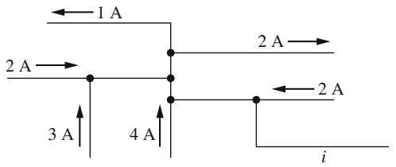

text_image

1 A
2 A →
3 A ↑
4 A ↑
2 A →
2 A ←
i

## 22.2 Die Stromdichte

## Lernziele

Nach dem Durcharbeiten dieses Abschnitts sollten Sie in der Lage sein, . . .

• das Konzept der Stromdichte und den Stromdichtevektor zu verstehen,
• im Fall eines Stroms durch ein Flächenelement eines Leiterquerschnitts (etwa eines Drahts) mit dem Flächenelementvektor dA⃗ umzugehen,
• den Strom durch einen Leiterquerschnitt durch Integration des Skalarprodukts aus Stromdichtevektor $\vec { J }$ und Flächenelementvektor dA⃗ zu berechnen,
• für einen homogen über den Leiterquerschnitt verteilten Strom die Beziehung zwischen Strom i, Stromdichte J und Querschnittsfläche A anzuwenden,
• Stromlinien zu identifizieren,

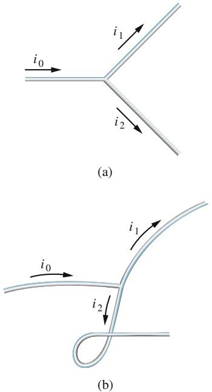

## Abb. 22.3

An der Verzweigung eines Leiters gilt die Relation $i _ { 0 } = i _ { 1 } + i _ { 2 }$ für die Teilströme unabhängig von der relativen räumlichen Orientierung der einzelnen Drähte: Der elektrische Strom ist ein Skalar, kein Vektor.

525

---

22 Elektrischer Strom und Widerstand

• die Bewegung von Leitungselektronen mithilfe ihrer Driftgeschwindigkeit zu erklären,
• die Driftgeschwindigkeit der Leitungselektronen von ihrer rein zufallsgetriebenen Bewegung zu unterscheiden, und zwar in Betrag und Richtung,
• mit der Ladungsträgerdichte n umzugehen,
• die Beziehung zwischen Stromdichte $J ,$ Ladungsträgerdichte n und Ladungsträger-Driftgeschwindigkeit $\nu _ { \mathrm { D } }$ anzuwenden.

## Schlüsselideen

• Die skalare Stromstärke i hängt mit dem Stromdichtevektor $i \vec { J }$ gemäß

$$
i = \int \vec {J} \cdot \mathrm{d} \vec {A}
$$

zusammen, wobei der Vektor $\mathrm { d } \vec { A }$ senkrecht auf dem Flächenelement dA steht und das Integral über eine beliebige Querschnittsfläche des Leiters berechnet wird. Die Stromdichte hat dieselbe Richtung wie die Geschwindigkeit der bewegten Ladungen, wenn diese positiv sind, und die entgegengesetzte Richtung, wenn sie negativ sind.

• Wenn in einem Leiter ein elektrisches Feld $\vec { E }$ besteht, werden die (positiv angenommenen) Ladungsträger in Richtung von $\vec { E }$ beschleunigt, erhalten also eine Driftgeschwindigkeit $\nu _ { \mathrm { D } }$
• Die Driftgeschwindigkeit hängt mit der Stromdichte über

$$
\vec {J} = (n e) \vec {\nu} _ {\mathrm{D}}
$$

zusammen, wobei ne die Ladungsdichte (Ladungsträgerdichte mal Elementarladung) darstellt.

## 22.2.1 Die Stromdichte

In vielen Fällen ist der Strom i durch einen Leiter von Interesse, in manchen Situationen betrachten wir den Strom jedoch auch von einem lokalen Standpunkt aus und untersuchen den Fluss von Ladung durch eine Querschnittsebene des Leiters an einem bestimmten Punkt. Zur Beschreibung dieses Flusses definiert man die Stromdichte ${ \vec { J } } .$ Diese vektorielle Größe ist parallel zur Geschwindigkeit der bewegten Ladungen, wenn diese positiv sind, beziehungsweise antiparallel, falls es sich um negative Ladungen handelt. Für ein beliebig herausgegriffenes, differenzielles Element einer Querschnittsfläche des Leiters ist der Betrag J gleich dem Strom pro Einheitsfläche durch dieses Flächenelement. Unter Verwendung der Stromdichte kann man den Strom durch ein Flächenelement $\mathrm { d } \vec { A }$ als Skalarprodukt $\vec { J }   \cdot   \mathrm { d } \vec { A }$ schreiben, wobei $\mathsf { d } \vec { A }$ den zu dem Flächenelement senkrechten Oberflächenvektor bezeichnet. Den Gesamtstrom i durch die Querschnittsfläche erhält man dann durch Integration:

$$
i = \int \vec {J} \cdot \mathrm{d} \vec {A}. \tag {22.4}
$$

Wenn die Stromverteilung über die Querschnittsfläche homogen und $\mathrm { d } \vec { A }$ parallel zum Strom ist, so ist auch die Stromdichte $\vec { J }$ homogen und parallel zu $\vec { \mathrm { d } A }$ . In diesem Fall vereinfacht sich Gl. 22.4 zu

$$
i = \int J \mathrm{d} A = J \int \mathrm{d} A = J A
$$

oder

$$
J = \frac {i}{A}, \tag {22.5}
$$

526

---

22.2 Die Stromdichte

22

wobei A die gesamte Querschnittsfläche bezeichnet. Aus einer der Gln. 22.4 oder 22.5 leitet man die SI-Einheit der Stromdichte als Ampere pro Quadratmeter $( \mathrm { A } / \mathrm { m } ^ { 2 } )$ ab.

In Kapitel 18 hatten wir gesehen, dass man den räumlichen Verlauf eines elektrischen Felds mithilfe von Feldlinien darstellen kann. Abbildung 22.4 zeigt, wie man die räumliche Verteilung einer Stromdichte auf ganz entsprechende Weise veranschaulichen kann, wobei man in diesem Fall von Stromlinien spricht. Der Strom ist in Abb. 22.4 von links nach rechts gerichtet und tritt aus einem Leiterabschnitt mit größerem Querschnitt (links) in einen Bereich mit geringerem Querschnitt (rechts) über. Da die Ladung eine Erhaltungsgröße ist, kann sich die Menge der transportierten Ladung und deshalb der Betrag des Stroms bei einem solchen Übergang nicht ändern; wohl ändert sich aber die Stromdichte: sie ist im Abschnitt mit geringerem Querschnitt größer. Die Abstände der Stromlinien verdeutlichen diese Zunahme der Stromdichte: enger liegende Stromlinien bedeuten eine größere Stromdichte.

## Die Driftgeschwindigkeit

Wirkt in einem elektrischen Leiter kein äußeres elektrisches Feld, so bewegen sich seine Leitungselektronen mit zufällig im Raum orientierten Geschwindigkeiten, sodass effektiv kein Ladungstransport in eine bestimmte Raumrichtung stattfindet. Auch wenn durch die Wirkung eines äußeren elektrischen Felds ein Strom in dem Leiter in Gang gesetzt wird, bewegen sich die Elektronen weiterhin ungeordnet. Dieser ungeordneten Bewegung ist nun jedoch eine Driftgeschwindigkeit $\nu _ { \mathrm { D } }$ überlagert, die dem äußeren Feld entgegengesetzt ist. Der Betrag dieser Driftgeschwindigkeit ist sehr klein im Vergleich zur Geschwindigkeit der ungeordneten (thermischen) Bewegung der Elektronen. So liegen typische Werte der Driftge schwindigkeit von Elektronen in den Anschlussleitungen von Haushaltsgeräten im Bereich $\widetilde { 1 0 ^ { - 5 } }$ bis $1 0 ^ { - 4 }$ m/s, während die Elektronen bei ihrer ungeordneten, thermischen Bewegung Geschwindigkeiten der Größenordnung $1 0 ^ { 6 }   \mathrm { { m / s } }$ erreichen.

Abbildung 22.5 zeigt, auf welche Weise wir die Driftgeschwindigkeit $\nu _ { \mathrm { D } }$ der in einem Leiter strömenden Leitungselektronen mit dem Betrag der Stromdichte in diesem Leiter verknüpfen können. Der Einfachheit halber ist in Abb. 22.5 die äquivalente Driftbewegung hypothetischer positiver Ladungsträger in Richtung des äußeren elektrischen Felds $\vec { E }$ dargestellt. Wir nehmen an, dass sich die Ladungsträger alle mit der gleichen Driftgeschwindigkeit $\nu _ { \mathrm { D } }$ bewegen und dass die Verteilung der Stromdichte J über die gesamte Querschnittsfläche A des Leiters homogen ist. Die Zahl der Ladungsträger in einem Abschnitt des Leiters mit der Länge L ist nAL, wenn n die Anzahl von Ladungsträgern pro Volumeneinheit bezeichnet. Damit ist die Gesamtladung der in einem Abschnitt der Länge L enthaltenen Ladungsträger

$$
q = (n A L) e,
$$

wobei wir für jeden Ladungsträger die Ladung e annehmen. Da sich die Ladungs träger kollektiv mit der Driftgeschwindigkeit $\nu _ { \mathrm { D } }$ bewegen, wird in einem gegebenen Zeitintervall

$$
t = \frac {L}{\nu_ {\mathrm{D}}}
$$

gerade diese Ladung durch jeden Querschnitt des Leiters transportiert. Nach Gl. 22.1 ist der elektrische Strom i (oder die elektrische Stromstärke) gleich der Transportrate von Ladung durch eine Fläche, also in diesem Fall

$$
i = \frac {q}{t} = \frac {n A L e}{L / \nu_ {\mathrm{D}}} = n A e \nu_ {\mathrm{D}}. \tag {22.6}
$$

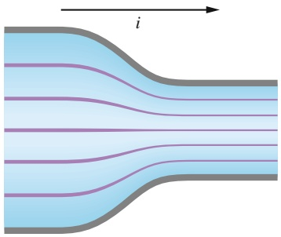

natural_image

Diagram of parallel wavy lines inside a channel with an arrow labeled 'i' indicating direction (no text or symbols beyond label)

Abb. 22.4

Stromlinien verdeutlichen die Stromdichte des Ladungsflusses durch einen Leiter, dessen Querschnitt an einer Stelle kleiner wird.

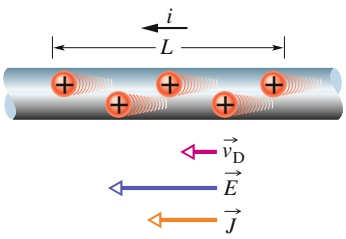

text_image

i
L
→
vD
→
E
→
J

Abb. 22.5

Positive Ladungsträger driften mit einer Geschwindigkeit $\nu _ { \mathrm { D } }$ in Richtung eines äußeren elektrischen Felds E⃗. Per Konvention wählt man die Vektoren ⃗J der Stromdichte sowie die Stromrichtung parallel zur Driftgeschwindigkeit.

527

---

22 Elektrischer Strom und Widerstand

Löst man diese Gleichung nach $\nu _ { \mathrm { D } }$ auf und verwendet die Beziehung $J = i / A$ (Gl. 22.5), so erhält man

$$
\nu_ {\mathrm{D}} = \frac {i}{n A e} = \frac {J}{n e}
$$

oder in Vektorform

$$
\vec {J} = (n e) \vec {\nu} _ {\mathrm{D}}. \tag {22.7}
$$

Das Produkt ne mit der SI-Einheit Coulomb pro Kubikmeter $( \mathrm { C } / \mathrm { m } ^ { 3 } )$ ist die Ladungsträgerdichte. Für positive Ladungsträger ist ne positiv und aus Gl. 22.7 folgt, dass $\vec { J }$ und $\vec { \nu } _ { \mathrm { D } }$ die gleiche Richtung haben. Für negative Ladungsträger folgt entsprechend, dass $\vec { J }$ und $\vec { \nu } _ { \mathrm { D } }$ einander entgegengesetzt gerichtet (antiparallel) sind.

## KONTROLLFRAGE 2

Die Abbildung zeigt Leitungselektronen, die sich von rechts nach links durch einen Draht bewegen. Welche Richtung haben (a) der Strom i, (b) die Stromdichte ⃗J und (c) das elektrische Feld $\vec { E }$ innerhalb des Drahts?

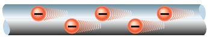

## 22.3 Widerstand und spezifischer Widerstand

## Lernziele

Nach dem Durcharbeiten dieses Abschnitts sollten Sie in der Lage sein, . . .

• die Beziehung zwischen der Potenzialdifferenz V über ein Objekt, dem Wider stand R des Objekts und dem durch das Objekt fließenden Strom i anzuwenden,
• einen Widerstand als solchen zu erkennen,
• die Beziehung zwischen der elektrischen Feldstärke E an einem Punkt in einem gegebenen Material, dessen spezifischem Widerstand $\rho$ und der zugehörigen Stromdichte J an diesem Punkt zu beherrschen,
• im Fall eines homogenen elektrischen Felds in einem Draht die Beziehung zwischen elektrischer Feldstärke $E ,$ Potenzialdifferenz V zwischen den Drahtenden und Länge L des Drahts anzuwenden,
• den Zusammenhang zwischen spezifischem Widerstand $\rho$ und elektrischer Leitfähigkeit σ zu kennen,
• die Beziehung zwischen dem Widerstand R eines Objekts, seinem spezifischem Widerstand $\rho ,$ seiner Länge L und seiner Querschnittsfläche A anzuwenden,
• die Gleichung anzuwenden, die (näherungsweise) das Temperaturverhalten des spezifischen Widerstands $\rho$ eines Leiters angibt,
• den Verlauf des spezifischen Widerstands ρ als Funktion der Temperatur für ein Metall zu skizzieren.

## Schlüsselideen

• Der Widerstand R eines Leiters ist das Verhältnis

$$
R = \frac {V}{i},
$$

wobei V die Potenzialdifferenz über den Leiter und i die Stromstärke angibt.

• Der spezifische Widerstand $\rho$ und die elektrische Leitfähigkeit σ eines Materials sind Kehrwerte voneinander; es gilt

$$
\rho = \frac {1}{\sigma} = \frac {E}{J},
$$

wenn E die elektrische Feldstärke und J die Stromdichte bezeichnen.

• Das elektrische Feld und die Stromdichte hängen vektoriell über den spezifischen Widerstand zusammen:

$$
\vec {E} = \rho \vec {J}.
$$

528

---

22.3 Widerstand und spezifischer Widerstand

22

• Der Widerstand R eines leitenden Drahts der Länge L mit homogenem Querschnitt A ist
• Der spezifische Widerstand $\rho$ ändert sich bei den meisten Materialien mit der Temperatur. In vielen Fällen, insbesondere bei Metallen, gilt näherungsweise

$$
R = \rho \frac {L}{A}.
$$

$$
\rho - \rho_ {0} = \rho_ {0} \alpha (T - T _ {0}).
$$

Dabei sind $T _ { 0 }$ eine Referenztemperatur, $\rho _ { 0 }$ der spezifische Widerstand bei $T _ { 0 }$ und α der Temperaturkoeffizient des spezifischen Widerstands in diesem Material.

## 22.3.1 Widerstand und spezifischer Widerstand

Legen wir zwischen den Enden zweier von ihrer Gestalt her identischer Stäbe aus Kupfer und Glas dieselbe Potenzialdifferenz an, so fließen in beiden sehr unterschiedliche Ströme. Man beschreibt diese unterschiedliche Verhaltensweise der verschiedenen Körper durch ihren **elektrischen Widerstand**. Den Widerstand zwischen zwei beliebigen Punkten eines Leiters bestimmt man, indem man eine Potenzialdifferenz V zwischen den Punkten anlegt und den resultierenden elektrischen Strom i misst. Der Widerstand R ist dann definiert als

$$
R = \frac {V}{i} \quad (\text {Definition von} R)  . \tag {22.8}
$$

Die SI-Einheit des Widerstands bestimmt man aus Gl. 22.8 zu Volt pro Ampere (V/A). Diese Kombination von Grundeinheiten tritt so häufig auf, dass man ihr einen eigenen Namen gegeben hat: **Ohm** (Symbol Ω). Es gilt

$$
= 1 \mathrm{V/A}. \tag {22.9}
$$

Ein elektronisches Bauelement, dessen Funktion in einem Schaltkreis gerade darin besteht, einen wohldefinierten elektrischen Widerstand zur Verfügung zu stellen, bezeichnet man ebenfalls als Widerstand (Abb. 22.6). In einem Schaltbild stellt man einen Widerstand durch das Symbol dar. Schreibt man Gl. 22.8 in der Form

$$
i = \frac {V}{R},
$$

so erkennt man, dass die Bezeichnung „Widerstand“ den physikalischen Sachverhalt treffend beschreibt: Für eine gegebene Potenzialdifferenz V ist der Strom i durch einen Leiter umso kleiner, je größer sein Widerstand R ist.

Der Widerstand eines gegebenen, elektrisch leitenden Gegenstands hängt davon ab, auf welche Weise man die Potenzialdifferenz anlegt. Abbildung 22.7 zeigt als Beispiel zwei identische, elektrisch leitende Stäbe (gelb), die auf zwei geometrisch unterschiedliche Arten mit derselben Potenzialdifferenz verbunden sind. Wie durch den Verlauf der in beiden Fällen eingezeichneten Stromlinien – und damit der Stromdichte – deutlich wird, sind die Ströme durch die Stäbe – und damit auch ihre gemessenen Widerstände – verschieden. Wir wollen im Allgemeinen davon ausgehen, dass eine gegebene Potenzialdifferenz in der Art von Abb. 22.7b an einen Leiter angelegt wird.

Wie wir es bereits des Öfteren in anderem Zusammenhang getan haben, möchten wir auch hier zu einer allgemeineren Sichtweise gelangen und den Widerstand nicht als Eigenschaft eines bestimmten Objekts, sondern als Materialeigenschaft auffassen. Dazu betrachten wir nicht mehr die Potenzialdifferenz V über einen be stimmten Widerstand, sondern das elektrische Feld $\vec { E }$ an einem bestimmten Punkt

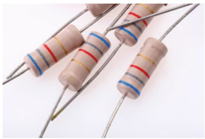

natural_image

Close-up of several resistors with colored markings, arranged diagonally on wires (no text or symbols visible)

Abb. 22.6

Widerstände als elektronische Bauelemente. Der jeweilige Widerstandswert ist in einer Abfolge farbiger Ringe codiert [Quelle: Vladimir A. Veljanovski/Shutterstock].

(a)

(b)

## Abb. 22.7

Verschiedene Arten, eine Potenzialdifferenz an einen Leiter anzulegen. Die grau gezeichneten Anschlüsse sollen einen vernachlässigbar geringen Widerstand besitzen. Erfolgt der Anschluss wie in (a) dargestellt, so ist der gemessene Widerstand größer als bei der Anschlussart (b).

529

---

22 Elektrischer Strom und Widerstand

innerhalb des Materials, aus dem der Widerstand besteht. Entsprechend ersetzen wir den Strom i im Widerstand durch die Stromdichte ⃗J an diesem Punkt. Die dem Widerstand R eines bestimmten Körpers entsprechende, verallgemeinerte Größe bezeichnen wir als den **spezifischen Widerstand** $\rho$ des Stoffs:

$$
\rho = \frac {E}{J} \quad (\text {Definition von} \rho). \tag {22.10}
$$

(Vergleichen Sie diesen Ausdruck mit Gl. 22.8.)

Kombinieren wir die SI-Einheiten des elektrischen Felds E und der Stromdichte J entsprechend Gl. 22.10, so erhalten wir als Einheit des spezifischen Widerstands Ohm mal Meter (Ω ⋅ m):

$$
\frac {\mathrm{Einheit} (E)}{\mathrm{Einheit} (J)} = \frac {\mathrm{V/m}}{\mathrm {A/ m^2}} = \frac {\mathrm{V}}{\mathrm{A}} \mathrm{m} = \Omega \cdot \mathrm{m}.
$$

Tabelle 22.1 fasst die spezifischen Widerstände einiger Substanzen zusammen. Gleichung 22.10 lautet in Vektorform:

$$
\vec {E} = \rho \vec {J}. \tag {22.11}
$$

Die Gln. 22.10 und 22.11 gelten in dieser Form nur für isotrope Materialien, deren elektrische Eigenschaften in alle Raumrichtungen identisch sind.

Man spricht auch oft von der **Leitfähigkeit** eines Stoffs. Diese Größe ist einfach der Kehrwert des spezifischen Widerstands:

$$
\sigma = \frac {1}{\rho} \quad (\text {Definition von} \sigma). \tag {22.12}
$$

Die SI-Einheit der Leitfähigkeit ist entsprechend der Kehrwert von Ohm mal Meter, also $( \Omega   \cdot   \mathbf { m } ) ^ { - 1 }$ . Mit der Definition der Leitfähigkeit (Gl. 22.12) erhält man Gl. 22.11 in der äquivalenten Form

$$
\vec {J} = \sigma \vec {E}. \tag {22.13}
$$

TABELLE 22.1: Spezifischer Widerstand einiger Stoffe bei Zimmertemperatur $( 2 0   ^ { \circ } \mathrm { C } )$

<table><tr><td>Stoff</td><td>Spezifischer Widerstand  $\rho$  ( $\Omega \cdot m$ )</td><td>Temperaturkoeffizient  $\alpha$  des spezifischen Widerstands ( $K^{-1}$ )</td></tr><tr><td colspan="3">Typische Metalle</td></tr><tr><td>Silber</td><td> $1,62 \cdot 10^{-8}$ </td><td> $4,1 \cdot 10^{-3}$ </td></tr><tr><td>Kupfer</td><td> $1,69 \cdot 10^{-8}$ </td><td> $4,3 \cdot 10^{-3}$ </td></tr><tr><td>Aluminium</td><td> $2,75 \cdot 10^{-8}$ </td><td> $4,4 \cdot 10^{-3}$ </td></tr><tr><td>Wolfram</td><td> $5,25 \cdot 10^{-8}$ </td><td> $4,5 \cdot 10^{-3}$ </td></tr><tr><td>Eisen</td><td> $9,68 \cdot 10^{-8}$ </td><td> $6,5 \cdot 10^{-3}$ </td></tr><tr><td>Platin</td><td> $10,6 \cdot 10^{-8}$ </td><td> $3,9 \cdot 10^{-3}$ </td></tr><tr><td>Manganina)</td><td> $4,82 \cdot 10^{-8}$ </td><td> $0,002 \cdot 10^{-3}$ </td></tr><tr><td colspan="3">Typische Halbleiter</td></tr><tr><td>Silicium, rein</td><td> $2,5 \cdot 10^{3}$ </td><td> $-70 \cdot 10^{-3}$ </td></tr><tr><td>Silicium, n-leitendb)</td><td> $8,7 \cdot 10^{-4}$ </td><td></td></tr><tr><td>Silicium, p-leitendc)</td><td> $2,8 \cdot 10^{-3}$ </td><td></td></tr><tr><td colspan="3">Typische Isolatoren</td></tr><tr><td>Glas</td><td> $10^{10} - 10^{14}$ </td><td></td></tr><tr><td>Quarzkristall</td><td> $\approx 10^{16}$ </td><td></td></tr></table>

a) Eine Legierung mit einem besonders kleinen Wert von α.

b) Reines Silicium, mit Phosphor bis zu einer Ladungsträgerdichte von $1 0 ^ { 2 3 }   \mathrm { m } ^ { - 3 }$ dotiert.

c) Reines Silicium, mit Aluminium bis zu einer Ladungsträgerdichte von $1 0 ^ { 2 3 }   \mathrm { m } ^ { - 3 }$ dotiert.

530

---

22.3 Widerstand und spezifischer Widerstand

22

## Die Berechnung des Widerstands aus dem spezifischen Widerstand

Wir haben im letzten Abschnitt eine wesentliche Unterscheidung getroffen:

Der Widerstand ist eine Eigenschaft eines bestimmten Objekts; der spezifische Widerstand ist eine Materialeigenschaft.

Ist der spezifische Widerstand eines Materials bekannt, so kann man den Wider stand eines Stücks Draht aus diesem Material berechnen. Es seien A der Querschnitt des Drahts, L seine Länge und V die Potenzialdifferenz zwischen seinen beiden Enden (Abb. 22.8). Wenn die Stromverteilung innerhalb des Leiters homogen ist, so sind die Stromdichte und das elektrische Feld an allen Punkten in dem Leiter konstant und nach Gl. 20.40 und Gl. 22.5 gilt

$$
E = V / L \quad \text {und} \quad J = i / A. \tag {22.14}
$$

Durch Kombination von Gln. 22.10 und 22.14 erhalten wir

$$
\rho = \frac {E}{J} = \frac {V / L}{i / A}. \tag {22.15}
$$

Der Quotient $V / i$ ist der Widerstand R, sodass man Gl. 22.15 auf die Form

$$
R = \rho \frac {L}{A} \tag {22.16}
$$

bringen kann. Diese Gleichung gilt nur für homogene, isotrope Leiter mit konstantem Querschnitt $A ,$ wenn die Potenzialdifferenz so wie in Abb. 22.7b dargestellt angelegt wird.

Die makroskopischen Größen V, i und R sind immer dann von Interesse, wenn man konkrete Messungen an leitenden Objekten durchführt. Es sind diese makroskopischen Größen, deren Werte man von Messgeräten abliest. Beschäftigt man sich dagegen mit den grundlegenden elektrischen Eigenschaften der Stoffe, so verwendet man zweckmäßig die mikroskopischen Größen E, J und $\rho .$

## KONTROLLFRAGE 3

Die Abbildung zeigt drei zylinderförmige Leiter aus Kupfer mit ihren jeweiligen Längen und den Flächeninhalten der Stirnseiten. Zwischen den Stirnseiten werde jeweils die gleiche Potenzialdifferenz V angelegt. Ordnen Sie die drei Leiter in absteigender Reihenfolge nach dem durch sie fließenden Strom.

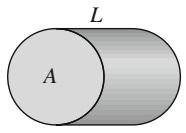

(a)

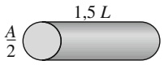

(b)

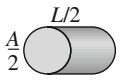

(c)

## Die Temperaturabhängigkeit des spezifischen Widerstands

Wie die meisten physikalischen Eigenschaften ändert sich auch der spezifische Widerstand mit der Temperatur. Als Beispiel zeigt Abb. 22.9 die Abhängigkeit des spezifischen Widerstands von Kupfer mit der Temperatur über einen weiten Temperaturbereich. Die Temperaturabhängigkeit des spezifischen Widerstands von Kupfer ist – wie bei Metallen im Allgemeinen – über einen recht großen Temperaturbereich ziemlich linear. Einen solchen nahezu linearen Verlauf kann man durch eine empirische Beziehung wiedergeben, die die Temperaturabhängigkeit für viele Anwendungen ausreichend genau beschreibt:

$$
\rho - \rho_ {0} = \rho_ {0} \alpha (T - T _ {0}). \tag {22.17}
$$

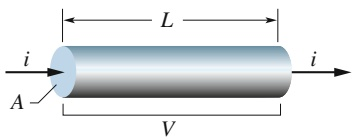

text_image

L
i
A
V
i

Abb. 22.8

Eine Potenzialdifferenz V wird zwischen den Enden eines Drahts mit Querschnitt A und Länge L angelegt und bewirkt einen Strom i in dem Draht.

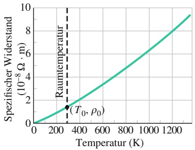

line

| Temperatur (K) | Spezifischer Widerstand \((10^{-8}\) \(\Omega\) \(\cdot\) m) |
| --- | --- |
| 0 | 0 |
| ~280 | ~1.4 |
| ~1350 | ~9.4 |

Abb. 22.9

Spezifischer Widerstand von Kupfer als Funktion der Temperatur. Zur Orientierung ist derjenige Punkt der Kurve eingezeichnet, welcher der Zimmertemperatur $\left( T _ { 0 } = 2 9 3   \mathrm { K } \right)$ entspricht. Der spezifische Widerstand von Kupfer beträgt bei dieser Temperatur $\rho _ { 0 } ^ { \mathrm { ~ \scriptsize ~ } } = 1 , 6 9 \cdot \bar { 1 } 0 ^ { - 8 }   \Omega$ ⋅ m.

531

---

22 Elektrischer Strom und Widerstand

Hier ist $T _ { 0 }$ eine frei wählbare Referenztemperatur und $\rho _ { 0 }$ bezeichnet den spezi fischen Widerstand bei dieser Temperatur. Normalerweise setzt man $T _ { 0 } = 2 9 3   \mathrm { K }$ (Zimmertemperatur); bei dieser Temperatur ist für Kupfer $\rho _ { 0 } = 1 { , } 6 9 \cdot 1 0 ^ { - 8 }   \Omega \cdot \mathrm { m }$

Da die Temperatur in Gl. 22.17 lediglich als Differenz eingeht, ist die verwendete Temperatureinheit ohne Bedeutung für das Ergebnis, sofern die Einteilung der beiden Temperaturskalen wie bei $^ \circ \mathrm { C }$ und K gleich ist. Die Konstante α in Gl. 22.17 ist der Temperaturkoeffizient des spezifischen Widerstands. Man wählt seinen Wert empirisch so, dass das mit Gl. 22.17 im betrachteten Temperaturbereich berechnete Verhalten der spezifischen Wärme gut mit dem beobachteten Verlauf übereinstimmt. In Tab. 22.1 sind einige Werte von α für Metalle angegeben.

## Die Hindenburg-Katastrophe

Als der Zeppelin Hindenburg am 6. Mai 1937 in Lakehurst (New Jersey) zur Landung bereit war, wurden die Leinen zu der am Boden wartenden Crew hinuntergelassen. Im Regensturm wurden die Leinen nass und damit zu guten elektrischen Leitern. In diesem Zustand wirkten sie als gute Erdverbindung für das Metallgerippe des Zeppelins, mit dem sie verbunden waren, und brachten das Metallgerippe auf Erdpotenzial. Dadurch wäre normalerweise auch das nasse Gewebe der äußeren Zeppelinhülle geerdet worden, wenn die Hindenburg nicht der erste Zeppelin gewesen wäre, dessen Hüllmaterial mit einer Schutzfarbe mit einem hohen elektrischen Widerstand behandelt wurde. Die Hülle blieb deshalb auf dem elektrischen Potenzial der Atmosphäre in der Flughöhe des Zeppelins von ungefähr 43 m. Aufgrund des starken Regens unterschied sich dieses Potenzial stark vom Potenzial der Erde.

Wahrscheinlich verletzten die Halteleinen dann eine der Wasserstoffzellen des Zeppelins, sodass im Raum zwischen den Zellen und der äußeren Hülle Wasserstoffgas freigesetzt wurde; eine solche Beschädigung einer Wasserstoffzelle wäre auch eine Erklärung für die von Augenzeugen beobachtete Wellung der äußeren Hülle. So entstand eine kritische Situation: Die Hülle, von außen mit leitfähigem Regenwasser durchnässt, lag auf einem elektrischen Potenzial, das sich stark vom Potenzial des Metallgerippes unterschied. Offensichtlich floss nun die auf der äußeren Hülle vorhandene Ladung über die nasse Oberfläche der Hülle auf das Metallgerippe ab, und der Funke entzündete das ausgetretene Wasserstoffgas. Der Brand griff rasch auf die übrigen Wasserstoffzellen des Zeppelins über und brachte das Luftschiff in kurzer Zeit zum Absturz. Hätte man zum Schutz der Zeppelinhülle einen Anstrich mit einem kleineren elektrischen Widerstand verwendet, wie es bei früheren und späteren Luftschiffen auch der Fall war, hätte sich die Katastrophe der Hindenburg wahrscheinlich nicht ereignet.

## 22.4 Das Ohmsche Gesetz

## Lernziele

Nach dem Durcharbeiten dieses Abschnitts sollten Sie in der Lage sein, . . .

• zwischen Objekten zu unterscheiden, die das Ohmsche Gesetz befolgen („Ohmschen Widerständen“), und solchen, die dies nicht tun,
• zwischen Materialien zu unterscheiden, die das Ohmsche Gesetz befolgen, und solchen, die dies nicht tun,
• die generelle Bewegung der Leitungselektronen zu beschreiben, wenn ein Strom durch einen Leiter fließt,
• für die Leitungselektronen in einem Leiter die Beziehung zwischen der mittleren freien Flugzeit (Stoßzeit) $\tau ,$ ihrer effektiven Geschwindigkeit und ihrer thermischen Zufallsbewegung zu erklären,
• die Beziehung zwischen dem spezifischen Widerstand $\rho ,$ der Anzahldichte n der Leitungselektronen und der mittleren freien Flugzeit (Stoßzeit) τ der Elektronen anzuwenden.

532

---

22.4 Das Ohmsche Gesetz

22

## Schlüsselideen

• Ein gegebenes Schaltelement (Leiter, Widerstand, . . . ) gehorcht dem Ohmschen Gesetz, wenn sein Widerstand $R = V / i$ nicht von der anliegenden Potenzialdifferenz V abhängt.
• Ein gegebenes Material gehorcht dem Ohmschen Gesetz, wenn sein spezifischer Widerstand $\rho \left( = E / J \right)$ nicht von der elektrischen Feldstärke abhängt.
• Die Annahme, dass sich die Leitungselektronen in einem Metall als freie Teilchen wie die Moleküle eines Gases bewegen, führt zu folgendem Ausdruck für den spezifischen Widerstand eines Metalls:

$$
\rho = \frac {m}{e ^ {2} n \pi}.
$$

Dabei sind m die Elektronenmasse, n die Anzahldichte der freien Elektronen und τ die mittlere freie Flugzeit (Stoßzeit) zwischen Kollisionen der freien Elektronen mit den Atomen des Metalls.

• Metalle gehorchen dem Ohmschen Gesetz, weil die mittlere freie Flugzeit τ der Leitungselektronen annähernd unabhängig von der elektrischen Feldstärke in einem metallischen Leiter ist.

## 22.4.1 Das Ohmsche Gesetz

Wie wir in Abschn. 22.3 sahen, ist ein Widerstand ein elektrischer Leiter, der dem Stromfluss durch ihn einen definierten Widerstand entgegensetzt. Der gemessene Widerstand eines Leiters ist unabhängig von Betrag und Richtung (Polarität) der angelegten Potenzialdifferenz. Der Widerstand anderer elektronischer Bauelemente kann jedoch durchaus von der angelegten Potenzialdifferenz abhängen.

Mit welcher Art von Leiter man es im konkreten Fall zu tun hat, kann man aus der Strom-Spannungs-Kennlinie eines leitfähigen Objekts ablesen. Abbildung 22.10a zeigt eine Anordnung zur Messung dieser Kennlinie: Über das unbekannte Bauelement wird eine Potenzialdifferenz V angelegt und der durch das Bauelement fließende Strom i in Abhängigkeit von Betrag und Polarität der Potenzialdifferenz V gemessen. Dabei legt man die Polarität von V willkürlich als positiv fest, wenn sich die linke Klemme des Bauteils auf einem höheren elektrischen Potenzial befindet als die rechte Klemme. Dem in diesem Fall von links nach rechts durch das Bauelement fließenden Strom wird dabei ebenfalls willkürlich ein positives Vorzeichen zugeordnet. Umgekehrt bezeichnet man die Polarität von V als negativ, wenn die rechte Anschlussklemme des Bauteils auf dem höheren Potenzial liegt. Der resultierende Strom erhält entsprechend ein negatives Vorzeichen.

Abbildung 22.10b zeigt als Beispiel für eine solche Kennlinie die Abhängigkeit des Stroms i durch ein elektronisches Bauelement von der angelegten Potenzialdifferenz V. Diese Kennlinie ist eine durch den Ursprung verlaufende Gerade, deren Steigung, also das Verhältnis $i / V ,$ für alle V konstant ist. Dies bedeutet aber, dass der Widerstand $R = V / i$ des Bauteils nicht von Betrag und Polarität der angelegten Potenzialdifferenz V abhängt.

Ein anderes Beispiel einer Strom-Spannungs-Kennlinie ist in Abb. 22.10c dargestellt. Die Kennlinie zeigt, dass durch dieses Bauelement nur dann ein Strom fließt, wenn die Polarität der Potenzialdifferenz positiv und ihr Betrag größer als ungefähr 1,5 V ist. Sobald ein Strom fließt, ist der Zusammenhang zwischen Strom und Potenzialdifferenz nichtlinear, was bedeutet, dass der Verlauf der Kennlinie vom Betrag der angelegten Potenzialdifferenz V abhängt.

Man unterscheidet zwischen diesen beiden charakteristischen Arten des Verhaltens von Leitern, indem man sagt, ein Leiter mit einer Kennlinie nach Abb. 22.10b befolge das **Ohmsche Gesetz**, ein Leiter mit einer Kennlinie wie in Abb. 22.10c jedoch nicht:

Ein Leiter gehorcht dem **Ohmschen Gesetz**, wenn ein durch ihn fließender Strom immer direkt proportional zur angelegten Potenzialdifferenz ist.

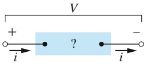

(a)

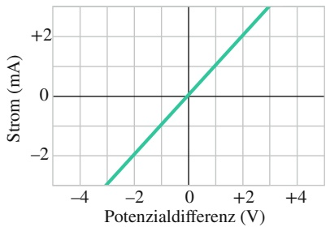

line

| Potenzialdifferenz (V) | Strom (mA) |
| --- | --- |
| -3 | -3 |
| 0 | 0 |
| +3 | +3 |

(b)

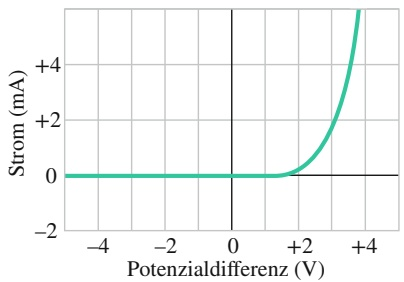

line

| Potenzialdifferenz (V) | Strom (mA) |
| --- | --- |
| -5 | 0 |
| -4 | 0 |
| -3 | 0 |
| -2 | 0 |
| -1 | 0 |
| 0 | 0 |
| +1 | ~0.1 |
| +2 | ~0.6 |
| +3 | ~2.2 |
| +4 | >5 |

(c)

## Abb. 22.10

(a) Eine Spannung V wird zwischen den Enden eines elektronischen Bauelements angelegt und bewirkt einen Strom i. (b) Die beobachtete Abhängigkeit des Stroms i von der Potenzialdifferenz V für einen Ohmschen Widerstand von 1000 Ω. (c) Strom-Spannungs-Verlauf für eine Halbleiterdiode (einen pn-Übergang).

533

---

22 Elektrischer Strom und Widerstand

Man spricht aus historischen Gründen von einem „Gesetz“, obwohl die Proportio nalität von Strom und Potenzialdifferenz durchaus ein spezielles Verhalten eines Leiters oder Bauteils und nicht allgemeingültig ist. Das Bauelement mit der Kennlinie von Abb. 22.10b ist ein Widerstand von 1000 Ω und verhält sich entsprechend dem Ohmschen Gesetz, das Bauelement von Abb. 22.10c – eine sogenannte pn-Diode – dagegen nicht.

Ein elektronisches Bauelement befolgt das Ohmsche Gesetz, wenn sein Widerstand nicht von Betrag und Polarität der angelegten Potenzialdifferenz abhängt.

Die moderne Mikroelektronik, die den Charakter unserer gegenwärtigen, technologisch orientierten Zivilisation ganz wesentlich geprägt hat und weiterhin prägt, beruht fast vollständig auf der Verwendung von Bauelementen, die dem Ohmschen Gesetz nicht gehorchen. Ihr Taschenrechner und Ihr Handy stecken beispielsweise voller solcher nichtlinearer Bauelemente.

Oft wird behauptet, die Beziehung $V = i R$ sei eine Folgerung aus dem Ohmschen Gesetz oder überhaupt eine Formulierung des Ohmschen Gesetzes. Das trifft jedoch nicht zu. Vielmehr handelt es sich bei diesem Zusammenhang einfach um die Definition des Widerstands R, die für alle elektrisch leitenden Objekte zutrifft, unabhängig davon, ob sie dem Ohmschen Gesetz genügen: Wenn wir die an einem Bauelement, beispielsweise einer pn-Diode, anliegende Potenzialdifferenz V sowie den durch diese Potenzialdifferenz erzeugten Strom i durch das betreffende Bauelement messen, so ist dadurch mit $R = V / i$ ein Widerstand bei diesem bestimmten Wert von V definiert. Die Aussage des Ohmschen Gesetzes ist demgegenüber, dass der Zusammenhang zwischen dem Strom i und der Potenzialdifferenz V linear ist, d. h., der Widerstand R nicht von V abhängt!

Man kann das Ohmsche Gesetz allgemeiner formulieren, wenn man leitende Stoffe betrachtet und nicht spezielle elektronische Bauelemente; das Ohmsche Gesetz lautet dann $\vec { E } = \rho \vec { J }$ (Gl. 22.11), in Analogie zu $V = i R$

Ein leitfähiges Material verhält sich gemäß dem Ohmschen Gesetz, falls sein spezifischer Widerstand nicht von Betrag und Richtung des angelegten elektrischen Felds abhängt.

Alle homogenen Stoffe, seien sie Leiter wie Kupfer oder auch Halbleiter wie reines oder mit bestimmten Verunreinigungen dotiertes Silicium, befolgen das Ohmsche Gesetz, zumindest innerhalb eines gewissen Bereichs der elektrischen Feldstärke. Wird das elektrische Feld hinreichend stark, so beobachtet man in jedem Fall Abweichungen vom Ohmschen Gesetz.

## KONTROLLFRAGE 4

Die Tabelle gibt den Strom i (in Ampere) durch die elektronischen Bauelemente 1 und 2 für einige Werte der angelegten Potenzialdifferenz V (in Volt) an. Welches der Bauelemente befolgt das Ohmsche Gesetz nicht?

## 22.4.2 Das Ohmsche Gesetz – mikroskopisch betrachtet

Um zu verstehen, warum bestimmte Stoffe das Ohmsche Gesetz befolgen, müssen wir den Prozess der Leitung des elektrischen Stroms auf atomarem Niveau untersuchen. Wir wollen uns hier nur mit der Leitung in Metallen wie beispielsweise Kupfer befassen. Dabei legen wir das Modell freier Elektronen zugrunde, wonach sich die Leitungselektronen eines Metalls wie die Moleküle eines Gases in einem geschlossenen Behälter frei innerhalb des Metallvolumens bewegen können. Außerdem setzen wir voraus, dass keine Stöße der Elektronen untereinander vorkommen, sondern nur Stöße zwischen Elektronen und den Atomen des Metalls.

<table><tr><td colspan="2">Bauelement 1</td><td colspan="2">Bauelement 2</td></tr><tr><td>V</td><td>i</td><td>V</td><td>i</td></tr><tr><td>2,00</td><td>4,50</td><td>2,00</td><td>1,50</td></tr><tr><td>3,00</td><td>6,75</td><td>3,00</td><td>2,20</td></tr><tr><td>4,00</td><td>9,00</td><td>4,00</td><td>2,80</td></tr></table>

534

---

22.4 Das Ohmsche Gesetz

22

Nach der klassischen Physik sollte man eine Maxwellsche Geschwindigkeitsverteilung für die Elektronen erwarten, analog zu der Geschwindigkeitsverteilung der Moleküle eines Gases. Bei einer solchen Verteilung (siehe Abschn. 15.6) sollte die mittlere Elektronengeschwindigkeit proportional zur Quadratwurzel der absoluten Temperatur sein. Die Bewegung der Elektronen in einem Festkörper unterliegt jedoch nicht den Regeln der klassischen Physik, sondern wird durch die Quantenphysik beschrieben. Wie sich bei näherer Untersuchung zeigt, ist es eine gute Annäherung an die Realität der $_ { p } \mathrm { Q }$ uantenwelt“ in einem Festkörper, wenn man annimmt, dass sich die Leitungselektronen in einem Metall alle mit einer (im Wesentlichen) temperaturunabhängigen effektiven Geschwindigkeit $\nu _ { \mathrm { e f f } }$ bewegen. Diese Geschwindigkeit hat für Kupfer den Wert $\nu _ { \mathrm { e f f } } \approx 1 { , } 6 \cdot 1 0 ^ { 6 }   \mathrm { m / s } .$

Wenn man ein äußeres elektrisches Feld an ein Metallstück anlegt, wird die ungeordnete Bewegung der Elektronen gestört und sie driften langsam mit einer mittleren Geschwindigkeit $\nu _ { \mathrm { D } }$ in die dem Feld entgegengesetzte Richtung. Wie wir in Beispielaufgabe 22.3 im Übungsbuch sehen, beträgt diese Driftgeschwindigkeit in typischen Metallen etwa $5 \cdot \bar { 1 0 ^ { - 7 } }$ m/s und ist damit um viele Größenordnungen kleiner als die effektive Geschwindigkeit $\nu _ { \mathrm { e f f } } = 1 { , } 6 \cdot 1 0 ^ { 6 }$ m/s. Abbildung 22.11 soll eine Vorstellung von diesen beiden Bewegungsarten der Elektronen vermitteln. Die grau gestrichelten Linien zeigen eine mögliche Bahnkurve des Elektrons im Zuge seiner ungeordneten Bewegung ohne äußeres elektrisches Feld: Das Elektron bewegt sich von $\mathrm { A }$ nach $\mathrm { B } ,$ wobei es auf seinem Wege sechsmal mit Metallatomen zusammenstößt. Die grün gestrichelten Linien zeigen eine mögliche Bahnkurve des Elektrons bei einer analogen Bewegung unter der Wirkung eines äußeren elektrischen Felds ${ \vec { E } } .$ Ausgehend von demselben Ausgangspunkt driftet das Elektron im Laufe seiner Bewegung nach rechts und kommt schließlich im Punkt $\mathrm { B ^ { \prime } }$ an, nicht im Punkt B wie zuvor. Abbildung 22.11 wurde unter der Annahme $\nu _ { \mathrm { D } } \approx 0 { , } 0 2 \nu _ { \mathrm { e f f } }$ gezeichnet. Da in Wirklichkeit aber eher $\nu _ { \mathrm { D } } \approx 1 0 ^ { - 1 3 } \nu _ { \mathrm { e f f } }$ gilt, ist die Driftbewegung in der Abbildung extrem übertrieben dargestellt.

Die Bewegung der Leitungselektronen in einem äußeren elektrischen Feld $\vec { E }$ ergibt sich demnach als Überlagerung der ungeordneten, thermischen Bewegung der Elektronen und einer Driftbewegung unter der Wirkung des äußeren elektrischen Felds. Betrachten wir die Gesamtheit der Elektronen, so mitteln sich ihre ungeordneten Bewegungen zu einer Nettogeschwindigkeit von null; sie tragen daher nicht zur Driftbewegung bei. Die Driftbewegung der Elektronen geht demzufolge ausschließlich auf die Wirkung des elektrischen Felds zurück.

Ein Elektron der Masse m erfährt in einem elektrischen Feld vom Betrag E eine Beschleunigung, die durch das zweite Newtonsche Gesetz gegeben ist:

$$
a = \frac {F}{m} = \frac {e E}{m}. \tag {22.18}
$$

Bei einem typischen Stoß eines Leitungselektrons mit einem Metallatom verliert das Elektron sozusagen vollständig die „Erinnerung“ an seine Driftgeschwindigkeit vor dem Stoß. Nach jedem Stoß bewegt sich ein Elektron daher wieder in eine zufällige Richtung. Während der mittleren Zeit τ zwischen zwei Stößen wird ein Elektron vom Feld im Mittel auf eine Driftgeschwindigkeit $\nu _ { \mathrm { D } } = \alpha \tau$ beschleunigt. Dies gilt für alle Elektronen, wir können daher mit Gl. 22.18 schreiben

$$
\nu_ {\mathrm{D}} = a \tau = \frac {e E \tau}{m}. \tag {22.19}
$$

Kombinieren wir diesen Ausdruck mit Gl. 22.7 $( \vec { J } = n e \vec { \nu } _ { \mathrm { D } } )$ in Betragsform, so erhalten wir

$$
\nu_ {\mathrm{D}} = \frac {J}{n e} = \frac {e E \tau}{m}
$$

oder

$$
E = \left(\frac {m}{e ^ {2} n \tau}\right) J.
$$

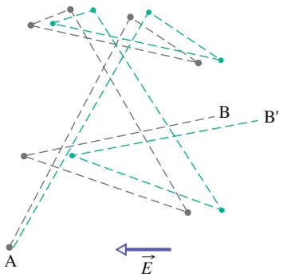

text_image

A
B
B'
E

Abb. 22.11

Die grauen Linien zeigen die Flugbahn eines Elektrons, das auf seinem Weg von A nach B sechs Stöße erfährt. Grün gezeichnet ist eine mögliche Flugbahn desselben Elektrons unter dem Einfluss eines äußeren elektrischen Felds ${ \vec { E } } .$ Beachten Sie in diesem Fall die kontinuierliche Driftbewegung des Elektrons in Richtung von $\stackrel { - } { - \vec { E } } .$ (Noch genauer wäre es gewesen, wenn man die grünen Linien leicht gekrümmt gezeichnet hätte, um die Parabelbahnen darzustellen, die das Elektron zwischen den Stößen unter dem Einfluss des äußeren elektrischen Felds durchläuft.)

535

---

22 Elektrischer Strom und Widerstand

Wenn wir diesen Ausdruck mit Gl. 22.11 $( \vec { E } = \rho \vec { J } )$ – ebenfalls in Betragsform – vergleichen, so erhalten wir schließlich

$$
\rho = \frac {m}{e ^ {2} n \tau}. \tag {22.20}
$$

Man kann Gl. 22.20 so interpretieren, dass Metalle das Ohmsche Gesetz befolgen, sofern ihr spezifischer Widerstand konstant ist und nicht vom Betrag des äußeren elektrischen Felds $\vec { E }$ abhängt. Da $n ,$ m und e konstant sind, reduziert sich dieser Nachweis darauf zu zeigen, dass die mittlere Zeit τ zwischen zwei Stößen (die mittlere Stoßzeit) konstant ist und nicht von der Feldstärke des äußeren elektrischen Felds abhängt. In der Tat kann man τ in guter Näherung als konstant annehmen, da die Driftgeschwindigkeit im äußeren elektrischen Feld so viel kleiner ist als die effektive Geschwindigkeit $\nu _ { \mathrm { e f f } }$ der Elektronen, dass die Elektronengeschwindigkeit insgesamt – und damit auch τ – durch das Feld kaum beeinflusst wird.

## 22.5 Elektrische Leistung in Stromkreisen

## Lernziele

Nach dem Durcharbeiten dieses Abschnitts sollten Sie in der Lage sein, . . .

• zu erklären, wie die Leitungselektronen in einem Stromkreis aufgrund des Widerstands der Schaltelemente Energie verlieren,
• zu verstehen, dass Leistung die Rate ist, mit der Energie aus einer Form in eine andere überführt wird,
• für einen Widerstand die Beziehung zwischen Leistung $P ,$ Stromstärke i, Spannung V und Widerstand R anzuwenden,
• bei einer Batterie die Beziehung zwischen Leistung $P ,$ Stromstärke i und Potenzialdifferenz V zu verwenden,
• die Energieerhaltung auf einen Stromkreis mit einer Batterie und einem Widerstand anzuwenden, um die Energieumwandlungen im Stromkreis zu erklären,
• die Unterschiede zwischen Leitern, Halbleitern und Supraleitern zu kennen.

## Schlüsselideen

• Die Leistung bzw. Energieumwandlungsrate $P$ in einem elektrischen Schaltelement, an dem eine Potenzialdifferenz $V$ anliegt und durch das ein Strom i fließt, ist gegeben durch

$$
P = i V.
$$

• Für Widerstände kann man die Leistung auch in der Form

$$
P = i ^ {2} R = \frac {V ^ {2}}{R}
$$

schreiben.

• In einem Widerstand wird elektrische potenzielle Energie durch Stöße zwischen Ladungsträgern und Atomen in innere thermische Energie umgewandelt.
• Halbleiter sind Materialien, die nur wenige Leitungselektronen enthalten, aber durch Dotierung mit Fremdatomen, die Ladungsträger beisteuern, oder durch thermische Anregung elektrisch leitend werden können.
• Supraleiter sind Materialien, die unterhalb einer Schwellentemperatur jeglichen elektrischen Widerstand verlieren. Bei den meisten Materialien liegt diese Temperatur sehr tief, es gibt jedoch auch Stoffe, die bereits fast bei Zimmertemperatur supraleitend werden.

536

---

22.5 Elektrische Leistung in Stromkreisen

22

## 22.5.1 Elektrische Leistung in Stromkreisen

Im Stromkreis von Abb. 22.12 ist eine Batterie B mit Drähten, deren Widerstand vernachlässigbar gering sei, mit einem nicht näher bekannten leitenden Bauelement verbunden. Dieses Bauelement kann beispielsweise ein Widerstand sein, ein Akku, ein Elektromotor oder auch ein anderes elektrisches Gerät. Die Batterie erhält eine Potenzialdifferenz V zwischen ihren beiden Anschlüssen aufrecht und damit auch – über die Verbindungsdrähte – zwischen den Anschlussklemmen des Bauteils, wobei das elektrische Potenzial an Klemme a des Bauteils größer ist als an Klemme b.

Zwischen den Anschlussklemmen der Batterie besteht somit eine leitende Verbindung, die Batterie hält die Potenzialdifferenzen innerhalb des Kreises aufrecht, sodass ein konstanter, von Klemme a zu Klemme b des Bauteils gerichteter Strom fließt. Die im infinitesimalen Zeitintervall dt zwischen den Anschlussklemmen des Bauteils transportierte Ladung dq ist i dt. Diese Ladungsmenge durchläuft einen Potenzialabfall vom Betrag $V ,$ sodass ihre elektrische potenzielle Energie um einen Betrag

$$
\mathrm{d} U = V \mathrm{d} q = i V \mathrm{d} t
$$

abnimmt. Nach dem Energieerhaltungssatz muss diese elektrische potenzielle Energie in eine andere Energieform umgewandelt werden. Man kann die Leistung, mit der diese Umwandlung vor sich geht, als Umwandlungsrate d $. U / \mathrm { d } t$ schreiben; für sie gilt

$$
P = i V \quad (\text {Umwandlungsrate}). \tag {22.21}
$$

Diese Leistung P ist auch gleich der zeitlichen Rate, mit welcher Energie von der Batterie in das Bauelement übertragen wird. Handelt es sich bei dem Bauelement beispielsweise um einen Elektromotor, der eine mechanische Arbeit verrichtet, so wird die Energie der Batterie – zumindest teilweise – in mechanische Arbeit umgewandelt, handelt es sich um einen Akku, in chemische Energie des Akkus. Ist das Bauelement ein Widerstand, so wird die Energie der Batterie in Wärme umgewandelt und erhöht die Temperatur des Widerstands.

Nach Gl. 22.21 ist die Einheit der elektrischen Leistung P das Produkt Volt mal Ampere $( \mathrm { V } \cdot \mathrm { A } )$ . Diese Einheit können wir umschreiben zu

$$
1 \mathrm{V} \cdot \mathrm{A} = 1 \frac {\mathrm{J}}{\mathrm{C}} \cdot 1 \frac {\mathrm{C}}{\mathrm{s}} = 1 \frac {\mathrm{J}}{\mathrm{s}} = 1 \mathrm{W}.
$$

Die Bewegung eines Elektrons, das sich mit einer konstanten Driftgeschwindigkeit durch einen Widerstand bewegt, ähnelt der Bewegung eines Steins, der in Wasser unter dem Einfluss der Schwerkraft schließlich mit einer konstanten Geschwindigkeit fällt. Die mittlere kinetische Energie des Elektrons bleibt bei dieser Bewegung konstant und sein Verlust an elektrischer potenzieller Energie erscheint wieder als Wärmeenergie des Widerstands. Mikroskopisch betrachtet wird diese Energieübertragung durch Stöße zwischen den Elektronen und den Molekülen oder Atomen des Widerstandsmaterials vermittelt, wodurch die Temperatur des Kristallgitters des Widerstandsmaterials zunimmt. Die mechanische Energie, die auf diese Weise in Wärmeenergie umgewandelt oder dissipiert wird, ist als nutzbare Arbeit verloren, da die Umwandlung irreversibel ist, also nicht mehr rückgängig gemacht werden kann.

Zur Beschreibung der Energiedissipation in einem Widerstand R oder einem anderen elektronischen Bauelement mit Ohmschem Widerstand kann man die Gln. $2 2 . 8 \: ( R = V / i )$ und 22.21 kombinieren und erhält so

$$
P = i ^ {2} R \quad (\text {Dissipation in einem Widerstand}) \tag {22.22}
$$

oder

$$
P = \frac {V ^ {2}}{R} \quad (\text {Dissipation in einem Widerstand}). \tag {22.23}
$$

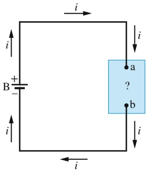

text_image

i
B +
-
i
i
a
?
b
i
i

Abb. 22.12

Eine Batterie B setzt einen elektrischen Strom i in einem Stromkreis in Gang, der ein unbekanntes, leitendes Bauelement enthält.

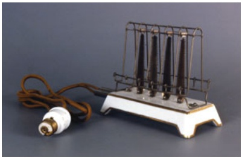

natural_image

Exterior view of a vintage electrical switch with metal frame and copper wire (no text or symbols visible)

Abb. 22.13

Das Bild zeigt einen Toaster von 1909, der über eine Glühbirnenfassung mit dem Stromnetz verbunden werden konnte. Damals war in manchen Gegenden der Strom für die Beleuchtung billiger als für andere Geräte [Quelle: Eric Norcross/CC-3.0].

537

---

22 Elektrischer Strom und Widerstand

Hinweis: Beachten Sie den Unterschied zwischen diesen beiden Beziehungen und Gl. 22.21: $P = i V$ beschreibt alle Arten der Umwandlung elektrischer Energie, während die Beziehungen $P = i ^ { 2 } R$ und $P = V ^ { 2 } / R$ ausschließlich für die Umwandlung elektrischer potenzieller Energie in Wärmeenergie in einem Bauelement mit einem Ohmschen Widerstand R gelten.

## KONTROLLFRAGE 5

Eine Potenzialdifferenz V wird an ein Bauelement mit dem Ohmschen Wider stand R angelegt und erzeugt einen Strom i. Ordnen Sie die folgenden Änderungen der Bestimmungsgrößen i, V und R in absteigender Reihenfolge nach der Änderung der Rate, mit der elektrische Energie am Widerstand R in Wärmeenergie umgesetzt wird: (a) V wird verdoppelt, R bleibt unverändert, (b) i wird verdoppelt, R bleibt unverändert, (c) R wird verdoppelt, V bleibt unverändert, (d) R wird verdoppelt, i bleibt unverändert.

## 22.5.2 Halbleiter

Die Entwicklung von Halbleiterbauelementen bildete die Grundlage der mikroelektronischen Revolution, die unsere Gesellschaft ab Mitte des 20. Jahrhunderts ins Informationszeitalter katapultiert hat. In Tab. 22.2 sind die Eigenschaften von Silicium – einem typischen Halbleiter – und Kupfer – einem typischen metallischen Leiter – einander gegenübergestellt. Man erkennt, dass das Silicium wesentlich weniger Ladungsträger enthält als das Metall und einen sehr viel höheren Widerstand sowie einen großen und vor allem negativen Temperaturkoeffizienten des spezifischen Widerstands aufweist: Während der spezifische Widerstand von Kupfer mit zunehmender Temperatur ansteigt, nimmt der von reinem Silicium ab.

Der spezifische Widerstand von reinem Silicium ist so hoch, dass man es praktisch als Isolator betrachten kann, was die Möglichkeiten eines direkten Einsatzes in elektronischen Schaltkreisen stark einschränkt. Man kann den spezifischen Widerstand von reinem Silicium jedoch durch kontrollierten Einbau kleiner Mengen bestimmter „Verunreinigungsatome“ in das Kristallgitter des Elements gezielt beeinflussen und sehr stark verringern. Diesen Prozess des kontrollierten Einbringens von Verunreinigungen bezeichnet man als Dotieren. Tabelle 22.1 zeigt einige typische Werte des spezifischen Widerstands von Silicium vor und nach dem Dotieren mit zwei verschiedenen Elementen an.

Eine einfache Erklärung für die großen Unterschiede im spezifischen Widerstand (und damit in der Leitfähigkeit) von Halbleitern, Isolatoren und Metallen kann man sich folgendermaßen zurechtlegen (ein detailliertes Verständnis der Zusammenhänge ist nur mithilfe der Quantenmechanik möglich): In einem metallischen Leiter wie Kupfer sind die meisten Elektronen ortsfest in den Atomen gebunden. Um diese Elektronen aus ihren Bindungen zu befreien und beweglich zu machen, sodass sie einen elektrischen Strom bilden könnten, wäre viel Energie nötig. Einige der Elektronen jedoch sind nur schwach an die Atome des Kristallgitters gebunden und können mit einem sehr geringen Energieaufwand freigesetzt und damit beweglich gemacht werden. Hierzu reicht die Wärmeenergie oder auch ein äußeres

TABELLE 22.2: Einige elektrische Eigenschaften von Kupfer und Silicium.a)

| Eigenschaft | Kupfer | Silicium |
| --- | --- | --- |
| Materialklasse | Metall | Halbleiter |
| Ladungsträgerkonzentration ($m^{-3}$) | $9 \cdot 10^{28}$ | $1 \cdot 10^{16}$ |
| spezifischer Widerstand ($\Omega \cdot m$) | $2 \cdot 10^{-8}$ | $3 \cdot 10^{3}$ |
| Temperaturkoeffizient des spezifischen Widerstands ($K^{-1}$) | $+4 \cdot 10^{-3}$ | $-70 \cdot 10^{-3}$ |

a) Zum Vergleich auf eine signifikante Stelle gerundet.

538

---

22.5 Elektrische Leistung in Stromkreisen

22

elektrisches Feld, das man entlang eines Stücks Metall anlegt. Ein elektrisches Feld befreit nicht nur die Elektronen aus ihren schwachen Bindungen, sondern setzt sie auch als elektrischen Strom in Bewegung; es verursacht auf diese Weise einen elektrischen Strom in einem Leiter.

Um Elektronen der Atome eines Isolators aus ihren Bindungen zu befreien, sodass sie sich in einem äußeren elektrischen Feld als Strom in Bewegung setzen könnten, ist eine wesentlich größere Energie erforderlich; hierzu reichen weder die Wärmeenergie aus noch normalerweise erreichbare elektrische Feldstärken. Daher stehen unter normalen Bedingungen in einem Isolator keine freien Elektronen zur Verfügung, die sich unter dem Einfluss eines äußeren elektrischen Felds als elektrischer Strom durch das Kristallgitter bewegen könnten.

Ein Halbleiter verhält sich ähnlich einem Isolator, aber mit der wesentlichen Ausnahme, dass man mit einem relativ geringen Energieaufwand einige wenige Elektronen aus ihren Bindungen befreien kann. Darüber hinaus kann man, wie gesagt, durch Einbau von Fremdatomen (Dotieren) Elektronen oder auch positive Ladungsträger im Material zur Verfügung stellen, die nur sehr schwach gebunden und daher leicht in Bewegung zu setzen sind. Durch gezieltes Dotieren eines Halbleiters ist es möglich, die Dichte von Ladungsträgern, die an einem elektrischen Strom teilnehmen können, in weiten Grenzen zu kontrollieren und damit auch die elektrischen Eigenschaften des Halbleitermaterials zu beeinflussen. Die meisten der gebräuchlichen Halbleiterbauelemente wie Transistoren und Dioden stellt man durch selektives Dotieren bestimmter Bereiche von Silicium-Einkristallen mit verschiedenen Fremdatomen her.

Betrachten wir erneut Gl. 22.20 für den spezifischen Widerstand eines Leiters:

$$
\rho = \frac {m}{e ^ {2} n \tau}, \tag {22.24}
$$

wobei n die Ladungsträgerkonzentration (Anzahl von Ladungsträgern pro Einheitsvolumen) und τ die mittlere Stoßzeit (die mittlere Zeit zwischen zwei aufeinanderfolgenden Stößen) der Ladungsträger bezeichnen. Obwohl wir die Gültigkeit dieser Beziehung nur für Leiter gezeigt haben, gilt sie gleichermaßen für Halbleiter. Wir wollen nun untersuchen, wie sich die Größen n und τ mit steigender Temperatur ändern.

In einem Leiter ist n groß und nur schwach temperaturabhängig. Der beobachtete Anstieg des spezifischen Widerstands von Metallen mit der Temperatur (Abb. 22.9) geht auf eine zunehmende Stoßrate von Ladungsträgern mit Gitteratomen zurück und geht in Gl. 22.24 durch eine Verringerung von τ ein, der mittleren Zeit zwischen zwei aufeinanderfolgenden Stößen.

Bei einem Halbleiter ist n dagegen klein, wird jedoch mit zunehmender Temperatur sehr rasch größer, da durch die höhere Wärmeenergie mehr Ladungsträger freigesetzt werden. Dadurch nimmt der spezifische Widerstand eines Halbleiters mit zunehmender Temperatur ab, was in dem negativen Temperaturkoeffizienten des spezifischen Widerstands von Silicium (siehe Tab. 22.2) zum Ausdruck kommt. Wie in den Metallen nimmt auch in Halbleitern die Stoßrate der Ladungsträger mit der Temperatur zu, doch wird dieser Effekt vom rapiden Anstieg der Ladungsträ- gerkonzentration verdeckt. Mehr Details und weitere wichtige physikalische Eigenschaften von Halbleitern diskutieren wir in Kapitel 37.

## 22.5.3 Supraleiter

Im Jahr 1911 beobachtete der holländische Physiker Heike Kamerlingh Onnes, dass der spezifische Widerstand von Quecksilber bei Temperaturen unterhalb der sogenannten **kritischen Temperatur** $T _ { \mathrm { c } }   =   4 { , } 2 6   \mathrm { K }$ unmessbar klein wurde (Abb. 22.14). Dieses Phänomen, die sogenannte **Supraleitung**, ist nicht nur in der Grundlagenphysik von großem Interesse, sondern birgt auch ein enormes technisches Potenzial: In einem Material, das sich in diesem supraleitenden Zustand

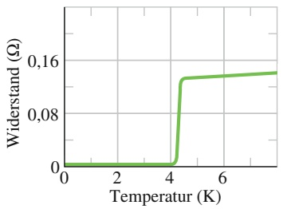

line

| Temperatur (K) | Widerstand \((\Omega)\) |
| --- | --- |
| 0 | ~0.01 |
| 2 | ~0.01 |
| 4 | ~0.01 |
| 4.3 | ~0.13 |
| 6 | ~0.14 |
| 7.5 | ~0.15 |

Abb. 22.14 Der Widerstand von Quecksilber fällt bei einer Temperatur von etwa 4 K abrupt auf null.

539

---

22 Elektrischer Strom und Widerstand

befindet, kann ein Strom ohne thermische Energieverluste fließen und damit Ladung verlustlos transportiert werden. Man hat in supraleitenden Ringen Ströme in Gang gesetzt, die noch nach Jahren ohne jegliche messbare Abschwächung flossen (sogenannte Dauerströme). Wohl ist ein gewisser Energieaufwand erforderlich, um die Elektronen als Dauerstrom in Bewegung zu setzen; dann jedoch fließt dieser Strom ohne jegliche Energiezufuhr weiter.

In den Jahren vor 1986 wurde die technische Anwendung der Supraleitung unter anderem auch durch die hohen Kosten behindert, die mit der Erzeugung der erforderlichen extrem tiefen Temperaturen verbunden sind. Im Jahr 1986 jedoch entdeckte man, dass bestimmte keramische Stoffe bereits bei wesentlich höheren, leichter und billiger zu erzeugenden Temperaturen supraleitend wurden. Die Untersuchung dieser sogenannten Hochtemperatur-Supraleiter trug und trägt auch weiterhin zum besseren Verständnis des Phänomens der Supraleitung bei und es besteht eine gewisse Hoffnung, dass man in nicht zu ferner Zukunft supraleitende Bauelemente entwickeln wird, die bei Zimmertemperatur arbeiten.

Das Phänomen der Supraleitung unterscheidet sich grundlegend von der „normalen“ elektrischen Leitung: Die besten Normalleiter wie Silber und Kupfer werden auch bei den tiefsten erreichbaren Temperaturen nicht supraleitend. Dahingegen sind die neuen, keramischen Hochtemperatur-Supraleiter bei höheren Temperaturen, bei welchen sie sich noch nicht im supraleitenden Zustand befinden, gute Isolatoren.

Der tatsächliche Wert der kritischen Temperatur hängt nicht nur von dem supraleitenden Material ab, sondern auch von anderen physikalischen Parametern. Zum Beispiel kann die Supraleitung durch ein hinreichend starkes Magnetfeld zerstört werden. Es gibt für jede Temperatur $T   <   T _ { \mathrm { c } }$ ein **kritisches Magnetfeld** $B _ { \mathrm { c } } ( T ) ,$ oberhalb dessen sich das Material im normalleitenden Zustand befindet. Oft gilt der Zusammenhang

$$
B _ {\mathrm{c}} (T) = B _ {0} \left[ 1 - \left(\frac {T}{T _ {\mathrm{c}}}\right) ^ {2} \right], \tag {22.25}
$$

wobei $B _ { 0 }$ und $T _ { \mathrm { c } }$ materialspezifische Konstanten sind.

Basierend auf dem Verhalten für $B > B _ { \mathrm { c } }$ kann man verschiedene Typen von $\mathbf { \mathit { S } } \mathbf { u } -$ praleitern unterscheiden. Bei Typ-I-Supraleitern bricht hier der supraleitende $\mathbf { Z u } \cdot$ stand vollständig zusammen. Bei den Typ-II-Supraleitern gibt es dagegen zwei kritische Magnetfeldstärken $B _ { \mathrm { c , 1 } } ( T )$ und $B _ { \mathrm { c } , 2 } ( T )$ . Wenn das äußere Magnetfeld für $T < T _ { \mathrm { c } }$ den Wert $B _ { \mathrm { c } , 1 }$ erreicht, treten normalleitende Flusslinien in dem Material auf. Erst bei $B _ { c , 2 }$ wird das Gesamtsystem normalleitend. Da oft $B _ { \mathrm { c } , 2 } \gg B _ { \mathrm { c } , 1 }$ ist, sind Typ-II-Supraleiter auch industriell sehr interessant. In den Typ-II-Supraleitern spielen Versetzungen, d. h. Gitterfehler eine wichtige Rolle. Durch das Verankern der Flusslinien an diesen Gitterfehlern wird das für den Übergang in den normalleitenden Zustand notwendige kritische Feld erhöht.

Eine wichtige experimentelle Beobachtung gelang dem Physiker Walther Meiß- ner und seinem Doktoranden Robert Ochsenfeld im Jahr 1933. Der nach ihnen benannte **Meißner-Ochsenfeld-Effekt** bezieht sich auf die Eigenschaft von Supraleitern, ein angelegtes Magnetfeld für $T < T _ { \mathrm { c } }$ und $B < B _ { \mathrm { c } }$ komplett aus ihrem Inneren zu verdrängen. Der Supraleiter ist in diesem Zustand ein idealer Diamagnet (vgl. Abschn. 28.6).

Seit seiner Entdeckung hat das Phänomen der Supraleitung auch das Interesse vieler theoretisch arbeitender Physiker gefunden; dennoch gibt es bis heute keine allumfassende Theorie. Eine wichtige Erklärung für das Phänomen in vielen, aber nicht allen Supraleitern gaben Bardeen, Cooper und Schrieffer mit der nach ihnen benannten BCS-Theorie, die von der Vorstellung ausgeht, dass die einen Suprastrom bildenden Elektronen eines Stoffs sich in koordinierten Paaren, den **Cooper-Paaren**, durch das Kristallgitter bewegen. Man stellt sich vor, dass eines der Elektronen eines Paars die elektronische Struktur des supraleitenden Materials stört und in seiner unmittelbaren Umgebung kurzzeitig eine erhöhte Konzentrati-

540

---

22.6 Zusammenfassung

22

on positiver Ladung erzeugt. Das andere Elektron eines solchen Paars wird dann von dieser erhöhten positiven Ladungskonzentration angezogen und es bildet sich ein gebundener Zustand der beiden Elektronen.

Die effektive, durch die Beteiligung des Kristallgitters vermittelte attraktive Wechselwirkung zwischen den Elektronen kann in der BCS-Theorie zur Ausbildung eines elektronischen Grundzustands führen, der durch eine Energielücke von den angeregten Zuständen getrennt ist. Die Größe dieser Energielücke ist abhängig von den speziellen Materialeigenschaften. Da hier die Wechselwirkung mit dem Kristallgitter eine wichtige Rolle spielt, ist es leicht einzusehen, dass die Masse der Gitterionen als Parameter in die Theorie eingeht.

Das Auftreten der Energielücke, das die mikroskopische Ursache für die Stabilität des supraleitenden Zustands liefert, erklärt z. B. auch das endliche kritische Magnetfeld $B _ { \mathrm { c } } ( T ) ,$ , das notwendig ist, um diesen Zustand zu zerstören. Die Abhängigkeit der Lücke von der Ionenmasse erklärt zudem den sogenannten **Isotopeneffekt**. Hierbei handelt es sich um die experimentelle Beobachtung, dass sich die kritische Temperatur ändert, sobald man verschiedene Proben des gleichen Materials analysiert, in denen unterschiedliche Isotope des gleichen chemischen Elements auftreten.

Darüber hinaus liefert die BCS-Theorie auch den mikroskopischen Hintergrund zur Erklärung des Meißner-Ochsenfeld-Effekts, da sie eine endliche Eindringtiefe $\lambda _ { \mathrm { c } }$ für Magnetfelder vorhersagt. Im Rahmen eines stärker phänomenologischen Zugangs hatten die Brüder Fritz und Heinz London bereits im Jahr 1935 gefunden, dass ein äußeres Magnetfeld in einem Supraleiter einen Oberflächenstrom induziert, der ins Innere mit $\lambda _ { \mathrm { c } }$ exponentiell abfällt. Daher ist das Innere des Materials feldfrei und der gesamte Supraleiter wirkt wie ein effektiver Elektromagnet, der andere Magneten abstoßen kann. Ein Beispiel dafür sieht man in Abb. 22.15, in der ein Supraleiter frei über einem Permanentmagneten schwebt.

Aufgrund des überwältigenden Erfolgs der BCS-Theorie erhielten Bardeen, Cooper und Schrieffer den Physik-Nobelpreis des Jahres 1972. In der Tat bot diese Theorie eine zufriedenstellende Erklärung der bis dahin bekannten Supraleitung bei sehr niedrigen Temperaturen. Zur Deutung der 1986 entdeckten Supraleitung bei höheren Temperaturen scheinen jedoch andere theoretische Ansätze erforderlich zu sein.

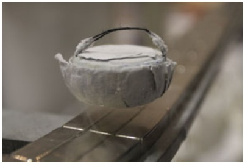

natural_image

Close-up of a metallic object with a curved, textured surface mounted on a metal stand (no visible text or symbols)

Abb. 22.15

Ein stickstoffgekühlter Supraleiter schwebt über einem Permanentmagneten [Quelle: TU Dresden, Henry Mühlpfordt/CC-SA-3.0].

## 22.6 Zusammenfassung

**Elektrischer Strom** Ein elektrischer Strom in einem Leiter ist definiert durch

$$
i = \frac {\mathrm{d} q}{\mathrm{d} t}. \tag {22.1}
$$

Dabei bezeichnet dq die Menge positiver Ladung, die sich im Zeitintervall dt durch eine gedachte Querschnittsfläche des Leiters bewegt. Nach Konvention legt man als Stromrichtung diejenige Richtung fest, in die sich positive Ladungsträger bewegen würden. Die SI-Einheit des elektrischen Stroms ist das **Ampere** (A): 1 A = 1 C/s.

Stromdichte $\mathrm { Z u }$ der skalaren Größe des Stroms i definiert man den Vektor $\vec { J }$ der Stromdichte gemäß

$$
i = \int \vec {J} \cdot \mathrm{d} \vec {A}. \tag {22.4}
$$

Dabei ist d $\vec { A }$ ein Vektor, der senkrecht auf dem Flächenelement mit dem Inhalt dA steht, und das Integral wird über eine beliebige Querschnittsfläche des Leiters berechnet, in welchem der Strom fließt. $\vec { J }$ hat die gleiche Richtung wie die Geschwindigkeit der Ladungsträger, wenn diese positiv sind, und entsprechend die entgegengesetzte Richtung, wenn sie negativ sind.

**Driftgeschwindigkeit der Ladungsträger** Legt man ein äußeres elektrisches Feld $\vec { E }$ an einen Leiter an, so erhalten die Ladungsträger (hier als positiv angenommen) eine Driftgeschwindigkeit $\nu _ { \mathrm { D } }$ in Richtung von ${ \vec { E } } .$ Diese Geschwindigkeit hängt mit der Stromdichte ⃗J über die Beziehung

$$
\vec {J} = (n e) \vec {\nu} _ {\mathrm{D}} \tag {22.7}
$$

zusammen, wobei das Produkt $n e$ die Bedeutung der Ladungsträgerkonzentration hat.

**Widerstand eines Leiters** Der Widerstand R eines Leiters ist definiert durch

$$
R = \frac {V}{i}, \tag {22.8}
$$

541

---

22 Elektrischer Strom und Widerstand

wobei V die Potenzialdifferenz über den Leiter und i den durch ihn fließenden Strom bezeichnen. Die SI-Einheit des Widerstands ist das **Ohm** $( \Omega ) { : } 1   \Omega   =   1   \mathrm { V / A }$ . In ähnlicher Weise definiert man den spezifischen Widerstand $\rho$ sowie die Leitfähigkeit σ eines Stoffs:

$$
\rho = \frac {1}{\sigma} = \frac {E}{J}, \tag {22.10-22.12}
$$

worin E den Betrag des äußeren elektrischen Felds bezeichnet. Die SI-Einheit des spezifischen Widerstands ist Ohm mal Meter (Ω ⋅ m). In Vektorform lautet Gl. 22.10

$$
\vec {E} = \rho \vec {J}. \tag {22.11}
$$

Der Widerstand R eines leitenden Drahts mit konstantem Querschnitt und der Länge L ist

$$
R = \rho \frac {L}{A}, \tag {22.16}
$$

wobei A die Querschnittsfläche ist.

**Temperaturabhängigkeit des spezifischen Widerstands ρ** Der spezifische Widerstand der meisten Stoffe ändert sich mit der Temperatur. Für zahlreiche Materialien, einschließ- lich der Metalle, kann man die Abhängigkeit des spezifischen Widerstands ρ von der Temperatur T näherungsweise durch eine Beziehung der Form

$$
\rho - \rho_ {0} = \rho_ {0} \alpha (T - T _ {0}) \tag {22.17}
$$

beschreiben. Darin bezeichnen $T _ { 0 }$ eine frei wählbare Referenztemperatur, $\rho _ { 0 }$ den spezifischen Widerstand bei dieser Temperatur und α den sogenannten Temperaturkoeffizienten des spezifischen Widerstands des betrachteten Stoffs.

**Ohmsches Gesetz** Man sagt, ein gegebenes elektronisches Bauteil (beispielsweise ein Leiter, ein Widerstand oder ein elektrisches Gerät) verhalte sich entsprechend dem Ohmschen Gesetz, wenn sein Widerstand, definiert durch Gl. 22.8 als $V / i ,$ unabhängig von der angelegten Potenzialdifferenz V ist. Allgemeiner gesprochen folgt ein gegebener Stoff dem Ohmschen Gesetz, falls sein spezifischer Widerstand, definiert durch Gl. 22.10, unabhängig ist von Betrag und Richtung des äußeren elektrischen Felds ${ \vec { E } } .$

**Spezifischer Widerstand eines Metalls** Unter der Annahme, dass sich die Leitungselektronen eines Metalls frei

## 22.7 Fragen

**1.** Abbildung 22.F1 zeigt Darstellungen des zeitlichen Verlaufs des Stroms i durch einen bestimmten Querschnitt eines Drahts während vierer verschiedener Zeiträume. Ordnen Sie die Fälle in absteigender Reihenfolge nach der Nettoladung, die dabei jeweils durch den Leiterquerschnitt transportiert wird.

im Kristallgitter bewegen können (wie die Moleküle eines Gases in einem Behälter), kann man den folgenden Ausdruck für den spezifischen Widerstand eines Metalls herleiten:

$$
\rho = \frac {m}{e ^ {2} n \tau}. \tag {22.20}
$$

n ist die Anzahl freier Elektronen pro Volumeneinheit (die Ladungsträgerdichte) und die Stoßzeit τ bezeichnet die mittlere Zeit zwischen zwei aufeinanderfolgenden Stößen eines Leitungselektrons mit einem Metallatom. Eine Erklä- rung dafür, warum Metalle das Ohmsche Gesetz befolgen, liefert die Tatsache, dass die Stoßzeit τ in Metallen im Wesentlichen nicht von der Feldstärke E eines von außen angelegten elektrischen Felds abhängt.

**Elektrische Leistung** Die elektrische Leistung oder Energieübertragungsrate P in einem elektrischen Bauteil, über dem eine Potenzialdifferenz V aufrechterhalten wird, ist gegeben durch

$$
P = i V. \tag {22.21}
$$

**Energiedissipation in einem Ohmschen Widerstand** Ist das elektrische Bauteil ein Ohmscher Widerstand, so kann man Gl. 22.21 in der Form

$$
P = i ^ {2} R = \frac {V ^ {2}}{R}, \tag {22.22,22.23}
$$

schreiben. In einem Ohmschen Widerstand wird elektrische potenzielle Energie der Ladungsträger durch Stöße zwischen den bewegten Ladungsträgern und den Atomen des Widerstandsmaterials in Wärmeenergie umgesetzt.

**Halbleiter** Halbleiter sind Stoffe, die nur wenige freie Ladungsträger enthalten, deren Ladungsträgerdichte jedoch durch Erhöhen der Temperatur oder durch gezieltes $\mathrm { v e r } -$ unreinigen“ (Dotieren) mit bestimmten Fremdatomen sehr stark erhöht werden kann, sodass sie effektiv zu Leitern werden.

**Supraleiter** Supraleiter sind Stoffe, deren elektrischer Widerstand bei hinreichend tiefen Temperaturen null wird. Man erforscht seit 1986 keramische Materialien, die sogenannten Hochtemperatur-Supraleiter, bei denen die Supraleitung schon bei relativ hohen Temperaturen einsetzt.

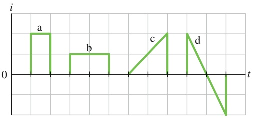

line

| Segment | Description |
| --- | --- |
| a | First segment of the graph |
| b | Second segment of the graph |
| c | Third segment of the graph |
| d | Fourth segment of the graph |

Abb. 22.F1

542

---

22.7 Fragen

22

**2.** In Abb. 22.F2 sind vier verschiedene Situationen dargestellt, bei denen sich positive und negative Ladungen in einem gewissen Raumbereich horizontal bewegen. In jedem Fall ist die zeitliche Rate des Ladungstransports angegeben. Ordnen Sie die Situationen in absteigender Reihenfolge nach dem effektiven Strom, den die Ladungsbewegungen im jeweiligen Raumbereich darstellen.

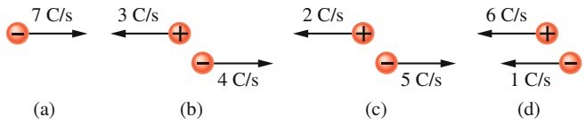

flowchart

Abb. 22.F2

**3.** Abbildung 22.F3 zeigt die rechteckigen Querschnitte dreier verschiedener Drähte gleicher Länge, die aus dem gleichen Material hergestellt sind. Ebenfalls angegeben sind die jeweiligen Kantenlängen in mm. Ordnen Sie die Drähte in absteigender Reihenfolge nach ihrem Widerstand zwischen den Drahtenden.

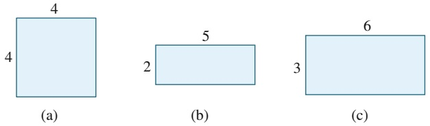

Abb. 22.F3

**4.** Nehmen Sie an, sie dehnen einen Draht mit zylindrischem Querschnitt; der Querschnitt soll auch nach dem Dehnen zylindrisch bleiben. Nimmt der Widerstand des Drahts zwischen seinen beiden Enden dabei zu, ab, oder bleibt er unverändert?
**5.** Abbildung 22.F5 zeigt die quadratischen Querschnitte dreier Leiter derselben (großen) Länge, gefertigt aus demselben Material, mit den jeweiligen Seitenlängen. Leiter B passe spielfrei in Leiter A, Leiter C entsprechend spielfrei in Leiter B. Ordnen Sie die folgenden Leiter in absteigender Reihenfolge nach ihrem Widerstand zwischen ihren beiden Enden: (a) die einzelnen Drähte A, B und C, (b) die Kombinationen $\mathrm { A } + \mathrm { B } , \mathrm { B } + \mathrm { C }$ sowie $\mathrm { A } + \mathrm { B } + \mathrm { C } ,$

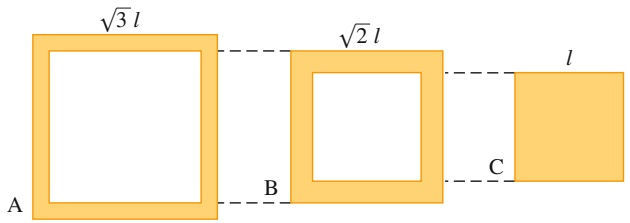

text_image

A
√3 l
B
√2 l
C
l

Abb. 22.F5

**6.** Abbildung 22.F6 zeigt einen massiven, leitenden Körper in Form eines Quaders mit den Kantenlängen L, 2L und 3L. Eine Potenzialdifferenz V wird entsprechend Abb. 22.7b an jeweils zwei gegenüberliegenden Seiten angelegt: links/ rechts, oben/unten, vorne/hinten. Ordnen Sie diese drei Fälle in absteigender Reihenfolge nach (a) dem Betrag des elektrischen Felds innerhalb des Leiters, (b) der Stromdichte innerhalb des Leiters, (c) dem Strom durch den Leiter, (d) der Driftgeschwindigkeit der Elektronen im Leiter.

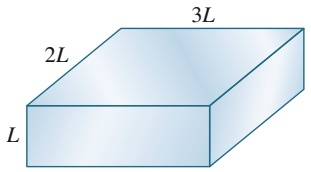

text_image

2L
3L
L

Abb. 22.F6

**7.** Die folgende Tabelle zeigt die Längen und Durchmesser dreier Kupferstäbe sowie die jeweilige Potenzialdifferenz zwischen ihren Enden. Ordnen Sie die drei Stäbe in absteigender Reihenfolge nach (a) dem Betrag des elektrischen Felds in ihrem Inneren, (b) der Stromdichte und (c) der Driftgeschwindigkeit der Elektronen in ihnen.

| Stab | Länge | Durchmesser | Potenzialdifferenz |
| --- | --- | --- | --- |
| 1 | L | 3d | V |
| 2 | 2L | d | 2V |
| 3 | 3L | 2d | 2V |

**8.** Die folgende Tabelle zeigt die Leitfähigkeiten sowie die Konzentrationen der Leitungselektronen für vier Substanzen A, B, C und D. Ordnen Sie die Materialien in absteigender Reihenfolge nach der mittleren Stoßzeit der Leitungselektronen.

|  | A | B | C | D |
| --- | --- | --- | --- | --- |
| Leitfähigkeit | $\sigma$ | $2\sigma$ | $2\sigma$ | $\sigma$ |
| Leitungselektronen/$m^{3}$ | $n$ | $2n$ | $n$ | $2n$ |

**9.** Drei Drähte vom gleichen Durchmesser werden nacheinander mit zwei Polklemmen verbunden, zwischen denen eine konstante Potenzialdifferenz besteht. Die spezifi schen Widerstände sowie die Längen der Drähte seien wie folgt gegeben: ρ und L (Draht A), 1,2ρ und 1,2L (Draht B), 0,9ρ und L (Draht C). Ordnen Sie die drei Drähte in absteigender Reihenfolge nach dem Grad der Dissipation elektrischer Energie.
**10.** Abbildung 22.F10 zeigt den Temperaturverlauf des spezifischen Widerstands für vier verschiedene Materialien. (a) Welche der Materialien sind Leiter, welche Halbleiter? Bei welchen Materialien bewirkt eine Erhöhung der Temperatur (b) eine Zunahme der Anzahl von Leitungselektronen pro Einheitsvolumen, (c) eine Zunahme der Stoßrate der Leitungselektronen?

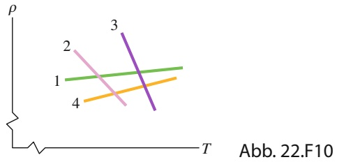

line

| Line | Trend Description |
| --- | --- |
| 1 | Horizontal line with slight upward slope |
| 2 | Downward sloping line |
| 3 | Downward sloping line |
| 4 | Upward sloping line |

**11.** In Abb. 22.F11 sehen Sie einen stromdurchflossenen Draht mit drei verschiedenen Querschnitten. Ordnen Sie die drei Abschnitte in absteigender Reihenfolge nach (a) der

543

---

22 Elektrischer Strom und Widerstand

Stromstärke, (b) dem Betrag der Stromdichte und (c) dem Betrag der elektrischen Feldstärke.

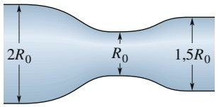

text_image

2R₀
R₀
1,5R₀

A

B

C

Abb. 22.F11

**12.** Abbildung 22.F12 stellt das elektrische Potenzial $V ( x )$ in Abhängigkeit von der Position x auf einem stromdurchflossenen Kupferdraht dar. Der Draht besteht aus drei Abschnitten mit unterschiedlichen Radien. Ordnen Sie die drei Abschnitte in absteigender Reihenfolge nach dem Betrag (a) des elektrischen Felds und (b) der Stromdichte.

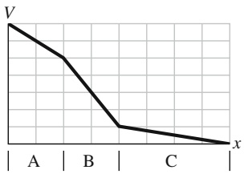

line

| Category | Value |
| --- | --- |
| Start | V |
| B | ~0.6 |
| C | ~0.15 |
| End | 0 |

Abb. 22.F12

**13.** Abbildung 22.F13 zeigt die Driftgeschwindigkeit $\nu _ { \mathrm { D } }$ von Leitungselektronen in einem Kupferdraht in Abhängigkeit von der Position x auf dem Draht. Der Draht besteht aus drei Abschnitten mit unterschiedlichen Radien. Ordnen Sie die drei Abschnitte in absteigender Reihenfolge nach (a) dem Radius, (b) der Anzahl der Leitungselektronen pro Kubikmeter, (c) dem Betrag der elektrischen Feldstärke und (d) der elektrischen Leitfähigkeit.

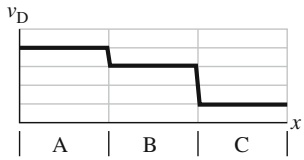

line

| X | vD |
| --- | --- |
| A | High |
| B | Medium |
| C | Low |

Abb. 22.F13

**14.** In Abb. 22.F14 sehen Sie für drei Drähte mit dem Radius R die Stromdichte J(r) als Funktion der Entfernung r vom Mittelpunkt des kreisförmigen Drahtquerschnitts. Die Drähte bestehen alle aus demselben Material. Ordnen Sie die Drähte in absteigender Reihenfolge nach dem Betrag des elektrischen Felds (a) im Mittelpunkt, (b) beim halben Radius und (c) an der Oberfläche.

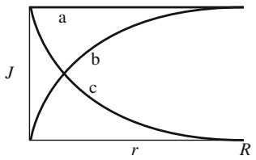

text_image

a
J
b
c
r
R

Abb. 22.F14

544
