# 23 Stromkreise

原始 PDF 第 559–580 页。

## 23 Stromkreise

## 23.1 Unverzweigte Stromkreise

## Physikalische Motivation

Wir alle sind buchstäblich umgeben von elektrischen Stromkreisen. Möglicherweise sind Sie stolz auf ihre vielen elektrischen Geräte und haben vielleicht sogar eine Wunschliste mit Geräten, die Sie gerne auch noch besitzen würden. Jedes einzelne dieser Geräte beruht ebenso wie die gesamte Stromversorgung von Haushal ten und Industrie auf den Errungenschaften der modernen Elektrotechnik. Deren wirtschaftliche Bedeutung lässt sich zwar nicht leicht in Zahlen bemessen, doch wir können davon ausgehen, dass sie Jahr für Jahr zunimmt, da die Zahl der elektrisch erledigten und gesteuerten Arbeiten nach wie vor rapide ansteigt. Heutige Radiosender werden nicht mehr mit einem Drehknopf, sondern elektronisch eingestellt. Nachrichten werden als E-Mail und nicht mehr per Post gesendet. Wissenschaftliche Zeitschriften werden am Computer und nicht mehr im Lesesaal einer Bibliothek gelesen, und anschließend werden die Artikel elektronisch archiviert und nicht mehr fotokopiert und in überquellenden Büroschränken verstaut. Vielleicht lesen Sie sogar selbst gerade dieses Buch auf einem E-Book-Reader.

Die wissenschaftliche Grundlage aller Elektrotechnik ist die Physik. In diesem Kapitel behandeln wir die Physik von elektrischen Stromkreisen, die aus Kombinationen von Widerständen und Batterien bestehen (sowie, in Abschn. 23.4, Kondensatoren). Wir beschränken unsere Diskussion hier zunächst auf Stromkreise, in welchen die Ladung immer in dieselbe Richtung fließt, also Gleichstromkreise (engl. „direct current“ bzw. „DC“). Wir beginnen mit der Frage: Wie bringt man Ladungen zum Fließen?

## 23.1.1 Ladungen „pumpen“

Wenn man Ladungsträger dazu bringen möchte, dass sie durch einen Widerstand fließen, muss man zwischen den beiden Enden des Widerstands eine Potenzialdifferenz herstellen. Man könnte dazu beispielsweise die Anschlüsse des Widerstands mit den Platten eines geladenen Kondensators verbinden. Der Stromfluss käme in diesem Fall jedoch mehr oder weniger rasch zum Erliegen, da der Strom durch den Widerstand den Kondensator entladen, also seine beiden Platten auf das gleiche Potenzial bringen würde. Sobald dies der Fall wäre, bestände über den Widerstand kein elektrisches Feld mehr und der Ladungstransport wäre beendet.

Um einen konstanten Strom von Ladungen aufrechtzuerhalten, ist eine Ladungspumpe erforderlich, eine Vorrichtung, die eine gewisse Potenzialdifferenz zwischen einem Paar von Anschlussklemmen erzeugt und konstant hält, indem sie Arbeit an den Ladungsträgern verrichtet. Eine derartige Vorrichtung bezeichnen wir als **Spannungsquelle**: Sie stellt durch Verrichten von Arbeit an den Ladungsträgern eine **Spannung** zur Verfügung.

Halliday Physik für natur- und ingenieurwiss. Studiengänge, 3. Auflage. D. Halliday, R. Resnick und J. Walker. © 2020 WILEY-VCH Verlag GmbH & Co. KGaA. Published 2020 by WILEY-VCH Verlag GmbH & Co. KGaA.

545

---

23 Stromkreise

In Kapitel 22 hatten wir die durch ein elektrisches Feld induzierte Bewegung von Ladungsträgern in einem Stromkreis betrachtet: Die Ladungsträger wurden dort durch Kräfte bewegt, die in diesem Feld auf sie wirkten. Im vorliegenden Kapitel dagegen untersuchen wir die Bewegung der Ladungsträger unter einem anderen Aspekt: Wir betrachten die Energie, die erforderlich ist, um einen Strom aufrechtzuerhalten. Eine Spannungsquelle stellt die notwendige Energie als Arbeit zur Verfügung, die sie an den Ladungsträgern verrichtet.

Zu den häufigsten Spannungsquellen zählen sicher **Batterien**, mit deren Hilfe zahlreiche elektrische Geräte – von der Armbanduhr bis hin zu U-Booten – betrieben werden. Die Spannungsquelle, die unser tägliches Leben am stärksten beeinflusst, ist jedoch der **Generator:** Die von Generatoren erzeugten Potenzialdifferenzen werden über weit verzweigte Netze in unsere Häuser und an unsere Arbeitsplätze gebracht. **Solarzellen** als Spannungsquellen sind uns als „Sonnensegel“ der Satelliten bekannt und finden auch immer mehr Anwendungen in Haushalten. Etwas weniger vertraut sind uns **Brennstoffzellen**, die beispielsweise die Stromversorgung der Spaceshuttles gewährleisten, oder **Thermosäulen**, die an Bord einiger Raumschiffe oder in entlegenen Forschungsstationen in der Antarktis als Spannungsquellen Verwendung finden. Auch lebende Systeme, vom Zitteraal über den Menschen bis hin zu Pflanzen, können Potenzialdifferenzen erzeugen und als Spannungsquellen wirken.

Obwohl sich die Wirkungsmechanismen der als Beispiele angeführten Spannungsquellen wesentlich voneinander unterscheiden, so ist doch ihre Funktion grundsätzlich die gleiche: Sie verrichten Arbeit an Ladungsträgern und erhalten dadurch eine bestimmte Potenzialdifferenz zwischen ihren Anschlüssen aufrecht.

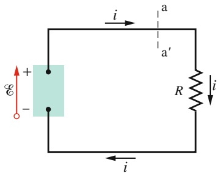

text_image

i
a
a'
R
i
E
+

Abb. 23.1

Ein unverzweigter elektrischer Schaltkreis, in welchem ein Bauelement mit der Spannung  Arbeit an den Ladungsträgern verrichtet und dadurch den konstanten Strom i durch einen Widerstand R aufrechterhält.

## 23.1.2 Arbeit, Energie und Spannung

Abbildung 23.1 zeigt eine Spannungsquelle, beispielsweise eine Batterie, als Teil eines einfachen Stromkreises, der außer der Spannungsquelle nur einen einzelnen Widerstand R enthält ( ist das Symbol für einen Widerstand). Eine Spannungsquelle hält den einen ihrer beiden Anschlüsse – den positiven Anschluss (mit + bezeichnet) – auf einem höheren elektrischen Potenzial als den anderen – den negativen Anschluss (mit − bezeichnet). Man kann eine Spannungsquelle in einem Schaltbild durch einen Pfeil symbolisieren, der vom negativen zum positiven Anschluss zeigt (Abb. 23.1). Ein kleiner Kreis am Pfeilende identifiziert den Pfeil als Symbol für eine Spannungsquelle und unterscheidet ihn so von Pfeilen, welche die Stromrichtung andeuten sollen.

Sind die beiden Anschlüsse einer Spannungsquelle nicht über einen geschlossenen Stromkreis miteinander verbunden, so fließt keine Ladung. Werden die beiden Anschlüsse (Pole) der Spannungsquelle jedoch wie in Abb. 23.1 dargestellt über einen Stromkreis miteinander verbunden, so setzt der jeweilige innere Mechanismus der Quelle einen Strom positiver Ladungsträger in Gang, der in Richtung des Spannungspfeils der Quelle vom negativen zum positiven Pol hin gerichtet ist. Damit fließt im Stromkreis ein Strom in Richtung des Spannungspfeils (im Uhrzeigersinn in Abb. 23.1).

Innerhalb der Spannungsquelle bewegen sich positive Ladungsträger aus einem Bereich mit niedrigem elektrischen Potenzial und damit geringer elektrischer potenzieller Energie (am negativen Pol) heraus in einen Bereich mit höherem elektrischem Potenzial und damit auch höherer elektrischer potenzieller Energie (am positiven Pol). Die Ladungsträger wandern dort somit entgegengesetzt zu der Richtung, in die sie sich unter der Wirkung des elektrischen Felds zwischen den Polen der Spannungsquelle – welches vom positiven zum negativen Pol zeigt – bewegen würden.

Es muss deshalb eine Energiequelle in der Spannungsquelle vorhanden sein, die Arbeit an den Ladungsträgern verrichtet, sodass diese sich in der beschriebenen Art bewegen können. Diese interne Energiequelle kann chemischer Natur sein wie

546

---

23.1 Unverzweigte Stromkreise

23

in einer gewöhnlichen Batterie oder einer Brennstoffzelle; sie kann aber wie im Fall eines Generators auch mechanisch sein. Auch Temperaturdifferenzen zwischen verschiedenen Wärmereservoirs können die Ursache für das Vorhandensein nutzbarer Energie sein (wie in Thermosäulen), oder die Energie kann direkt von der Sonne geliefert werden, wie es bei den Solarzellen der Fall ist.

Analysieren wir nun den Stromkreis von Abb. 23.1 unter dem Aspekt des Transfers von Arbeit und Energie. In jedem differenziellen Zeitintervall dt bewegt sich eine differenzielle Ladung dq durch einen beliebigen Querschnitt des Stromkreises, beispielsweise durch die Ebene aa′. Exakt diese Ladungsmenge muss auf der Seite mit niedrigem Potenzial in die Spannungsquelle eintreten und sie auf der Seite mit hohem Potenzial wieder verlassen. Dabei muss die Spannungsquelle an der Ladungsmenge dq eine Arbeit dW verrichten, um sie zu dieser Bewegung gegen die im elektrischen Feld zwischen den Polen auf sie wirkenden Kräfte zu „zwingen“. Wir definieren nun die von der Spannungsquelle zur Verfügung gestellte Spannung durch diese Arbeit dW:

$$
\mathcal {E} = \frac {\mathrm{d} W}{\mathrm{d} q} \quad (\text {Definition von} \mathcal {E}). \tag {23.1}
$$

In Worten ist die Spannung einer Spannungsquelle gleich der Arbeit, die von der Quelle an einer Ladungseinheit zu verrichten ist, um sie von dem Pol mit niedrigem Potenzial zu dem Pol mit hohem Potenzial zu transportieren. Die SI-Einheit der Spannung ist Joule pro Coulomb. In Kapitel 20 nannten wir diese Einheit Volt.

Eine **ideale Spannungsquelle** setzt der Bewegung der Ladung von Pol zu Pol innerhalb der Spannungsquelle keinen Widerstand entgegen. Bei einer idealen Spannungsquelle ist die Potenzialdifferenz zwischen ihren Polen gleich der Spannung der Quelle; so liegt bei einer idealen Batterie mit einer Spannung von 12,0 V immer auch eine Potenzialdifferenz von 12,0 V zwischen ihren Polen an.

Eine **reale Spannungsquelle** – beispielsweise jede käufliche Batterie – setzt der Bewegung der Ladungsträger in ihrem Inneren einen Widerstand entgegen, den Innenwiderstand. Wenn die Anschlüsse einer realen Spannungsquelle offen sind, sie also nicht in einen Stromkreis eingebunden und von einem Strom durchflossen wird, so ist die Potenzialdifferenz zwischen den Anschlüssen gleich ihrer Nennoder Leerlaufspannung. Fließt dagegen ein Strom durch einen angeschlossenen Stromkreis, so unterscheidet sich die Potenzialdifferenz zwischen den Anschlüssen einer realen Spannungsquelle von ihrer Nennspannung. Wir werden das Verhalten realer Batterien in Abschn. 23.4 untersuchen.

Wird eine Spannungsquelle in einen Stromkreis eingebunden und von einem Strom durchflossen, so überträgt sie Energie auf die durchfließenden Ladungsträ- ger. Die Ladungsträger können diese Energie ihrerseits an weitere im Stromkreis vorhandene Bauelemente oder elektrische Geräte weitergeben, beispielsweise an eine Glühlampe, die sie zum Leuchten bringen. Abbildung 23.2a zeigt einen Stromkreis mit zwei idealen, wiederaufladbaren Batterien (Akkumulatoren oder kurz Akkus) A und B, einem Widerstand R sowie einem Elektromotor M, der einen Körper der Masse m hebt, indem er die Energie der Ladungsträger in mechanische Arbeit umsetzt. Beachten Sie dabei, dass die Batterien gegeneinander geschaltet sind und die Ladungsträger im Stromkreis daher in einander entgegengesetzte Richtungen antreiben. Die Richtung des resultierenden Stroms innerhalb des Kreises wird durch die Batterie mit der höheren Spannung bestimmt, in diesem Falle die Batterie B. Die in dieser Batterie gespeicherte chemische Energie nimmt daher ab und wird auf die hindurchfließenden Ladungsträger übertragen. Die chemische Energie der Batterie A dagegen nimmt zu, da der durch sie hindurchfließende Strom vom positiven zum negativen Pol hin gerichtet ist: Batterie B lädt Batterie A. Batterie B liefert außerdem auch dem Elektromotor M Energie, die dieser in mechanische Arbeit umsetzt, und schließlich wird im Widerstand R elektrische Energie in Wärme umgewandelt (dissipiert). Abbildung 23.2b stellt diese drei Arten der Energieumwandlung schematisch dar: Durch jeden der Prozesse verliert die Batterie B chemische Energie.

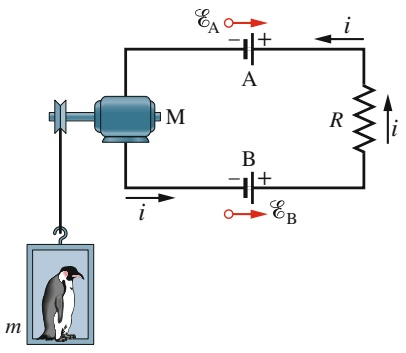

text_image

E_A
A
i
M
R
i
B
i
E_B
m

(a)

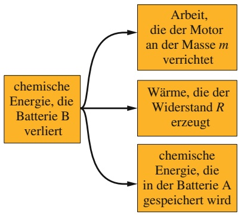

flowchart

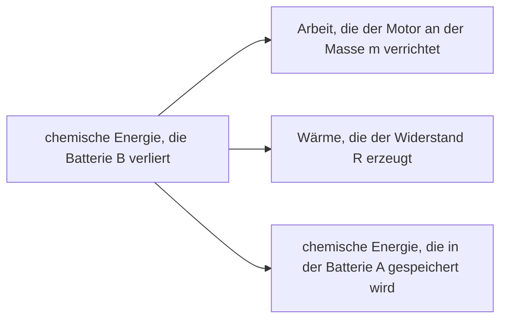

(b)

## Abb. 23.2

(a) Im dargestellten Stromkreis gilt $\mathcal { E } _ { \mathrm { B } } > \mathcal { E } _ { \mathrm { A } }$ , sodass die Batterie B die Richtung des Stroms bestimmt.
(b) Verschiedene Arten der Energieumwandlung im Stromkreis (a) unter der Annahme, dass im Motor keine thermische Dissipation von elektrischer Energie stattfindet.

547

---

23 Stromkreise

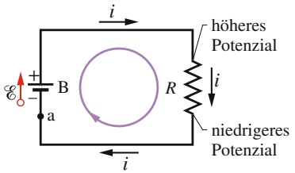

text_image

i
+ B R
- a
i
höheres Potenzial
i
niedrigeres Potenzial

Abb. 23.3

Ein unverzweigter Stromkreis, bei dem ein Widerstand R an eine ideale Batterie B mit der Spannung  angeschlossen ist. Der von der Batterie aufrechterhaltene Strom ist überall im Stromkreis gleich groß.

## 23.1.3 Berechnung des Stroms in einem unverzweigten. Stromkreis

Wir betrachten hier zwei äquivalente Arten, den Strom in einem einfachen, unverzweigten Stromkreis wie in Abb. 23.3 zu berechnen. Eine der beiden Methoden nutzt die Tatsache der Energieerhaltung, die andere arbeitet mit dem Konzept des elektrischen Potenzials. Der Stromkreis enthält eine ideale Batterie B mit der Spannung $\mathcal { E } ,$ einen Widerstand R sowie die beiden Verbindungskabel. (Wir setzen im Allgemeinen voraus, dass der Widerstand von Verbindungskabeln vernachlässigbar gering ist. Ihre Funktion besteht ausschließlich darin, die Elemente eines Stromkreises leitend miteinander zu verbinden.)

## Energiebetrachtung

Nach Gl. 22.22 $( P = i ^ { 2 } R )$ wird in dem Widerstand aus Abb. 23.3 in jedem Zeitintervall dt eine Energiemenge $i ^ { 2 } R$ dt in Wärme umgesetzt. (Da wir einen vernachlässigbar geringen Widerstand der Zuleitungen voraussetzen, erzeugen diese keine Wärme.) Während desselben Zeitintervalls bewegt sich eine Ladung dq = i dt durch die Batterie B und die Batterie verrichtet dabei nach Gl. 23.1 die Arbeit

$$
\mathrm{d} W = \mathcal {E} \mathrm{d} q = \mathcal {E} i \mathrm{d} t
$$

an der Ladung. Aus der Energieerhaltung folgt, dass diese von der (idealen) Batterie verrichtete Arbeit gleich der im Widerstand erzeugten Wärmemenge sein muss:

$$
\mathcal {E} i \mathrm{d} t = i ^ {2} R \mathrm{d} t.
$$

Daraus folgt

$$
\mathcal {E} = i R.
$$

Die Spannung  gibt die Energie pro Einheitsladung an, die die Batterie auf die durch sie hindurchbewegten Ladungsträger überträgt. Das Produkt iR gibt die Energie pro Einheitsladung an, die von den bewegten Ladungsträgern im Widerstand in Wärmeenergie umgewandelt wird. Die obige Gleichung besagt somit, dass die Energie, die in der Batterie auf die Ladungsträger übertragen wird, gleich der Energie ist, die ihnen im Widerstand wieder abgenommen und in Wärme umgesetzt wird. Lösen wir die Gleichung nach i auf, so erhalten wir

$$
i = \frac {\mathcal {E}}{R}. \tag {23.2}
$$

## Potenzialbetrachtung

Wir wählen einen beliebigen Punkt in dem Stromkreis aus Abb. 23.3 und stellen uns vor, wir würden den Kreis in einer beliebigen Richtung vollständig durchlaufen und dabei die algebraische Summe aller Potenzialdifferenzen bilden, die wir auf unserem Weg antreffen. Nachdem wir wieder an unserem Ausgangspunkt angelangt wären, müsste logischerweise auch das Potenzial wieder seinen ursprünglichen Wert haben. Bevor wir diesen Weg tatsächlich nachvollziehen, formulieren wir diesen Gedanken in einem Satz, der – wie wir in Abschn. 23.2 zeigen werden – nicht nur für unverzweigte Stromkreise wie den in Abb. 23.3 dargestellten gilt, sondern ganz allgemein für jeden geschlossenen Weg in einem beliebigen Stromkreis.

**Maschenregel:** Die algebraische Summe aller Potenzialänderungen beim vollständigen Durchlaufen eines beliebigen, geschlossenen Wegs (d. h. einer geschlossenen Schleife oder einer Masche) in einem Stromkreis ist null.

548

---

23.1 Unverzweigte Stromkreise

23

Zu Ehren des deutschen Physikers Gustav Robert Kirchhoff bezeichnet man diesen Satz oft als Kirchhoffsche Maschenregel Diese Regel entspricht der Aussage, dass jeder Punkt auf einem Berg nur eine einzige Höhe über dem Meeresniveau haben kann: Beginnt man eine Wanderung an einer beliebigen Stelle auf dem Berg und kehrt schließlich zu diesem Punkt zurück, nachdem man einen beliebigen Weg auf dem Berg durchschritten hat, so muss die algebraische Summe aller Höhenänderungen, die man auf diesem Weg überwunden hat, null sein.

Durchlaufen wir also den Stromkreis von Abb. 23.3, beginnend im Punkt a mit dem Potenzial $V _ { \mathrm { a } } ,$ im Uhrzeigersinn vollständig, bis wir wieder den Punkt a erreichen, und beachten wir dabei die Potenzialänderungen, die uns auf diesem Weg „begegnen“. Unser Ausgangspunkt a ist der Batteriepol mit dem niedrigeren Potenzial. Da es sich nach Voraussetzung um eine ideale Batterie handelt, ist die Potenzialdifferenz zwischen den Batteriepolen gleich der Batteriespannung V. Wir stellen uns vor, dass wir die Batterie zu der Seite mit höherem Potenzial durchqueren; die Potenzialänderung ist hierbei +.

Auf dem Weg entlang der Verbindungsleitung zum Widerstand ändert sich das Potenzial nicht, da die Verbindungsleitung nach Voraussetzung einen vernachlässigbar kleinen Widerstand hat: Der obere Anschluss des Widerstands liegt deshalb ebenfalls auf dem gleichen Potenzial wie der Batteriepol mit dem höheren Potenzial. Auf dem Weg durch den Widerstand ändert sich nun das Potenzial entsprechend Gl. 22.8, wie man leicht erkennt, wenn man sie in der Form V = iR schreibt. Das Potenzial muss dabei abnehmen, da wir uns von der Seite mit höherem Potenzial zur Seite mit niedrigerem Potenzial bewegen. Somit ist die Potenzialänderung beim Durchlaufen des Widerstands gleich −iR.

Schließlich kehren wir entlang der unteren Verbindungsleitung zum Punkt a zurück, wobei sich das Potenzial wieder nicht ändert, da der Widerstand der Leitung vernachlässigbar gering ist. Im Punkt a beträgt das Potenzial nun wieder $V _ { \mathrm { a } } ,$ Da wir einen geschlossenen Weg durchlaufen haben, muss das Potenzial am Ende des Wegs gleich dem Anfangspotenzial plus der Summe der entlang des Wegs aufge tretenen Potenzialänderungen sein; mathematisch heißt das

$$
V _ {\mathrm{a}} + \mathcal {E} - i R = V _ {\mathrm{a}}.
$$

Der Anfangswert $V _ { \mathrm { a } }$ hebt sich in dieser Gleichung heraus, es folgt daher

$$
\mathcal {E} - i R = 0.
$$

Löst man diese Gleichung nach i auf, so erhält man dasselbe Ergebnis $i = \mathcal { E } / R ,$ , das auch die Energiebetrachtung weiter oben ergeben hatte (Gl. 23.2).

Wenden wir die Maschenregel auf einen Durchlauf im Gegenuhrzeigersinn an, so erhalten wir ganz entsprechend

$$
- \mathcal {E} + i R = 0,
$$

was uns erneut zu dem Ergebnis $i = \mathcal { E } / R$ führt. Für das Ergebnis der Anwendung der Maschenregel ist es somit ohne Bedeutung, in welcher Richtung man einen Stromkreis durchläuft.

Zur Vorbereitung von Anwendungen der Maschenregel auf Stromkreise, die komplexer sind als der aus Abb. 23.3, formulieren wir noch zwei allgemeine Regeln, die sich zum Ermitteln von Potenzialdifferenzen beim Durchlaufen von Stromkreisen als nützlich erweisen.

**Widerstandsregel:** Durchläuft man einen Widerstand in Stromrichtung, so ändert sich das Potenzial um $- i R ;$ durchläuft man ihn entgegen der Stromrichtung, so ist die Änderung gleich +iR.

**Spannungsregel:** Bewegt man sich in Richtung des Spannungspfeils durch eine ideale Spannungsquelle, so ist die Potenzialänderung gleich +, in Gegenrichtung ist sie gleich −.

549

---

23 Stromkreise

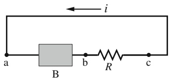

text_image

i
a
B
b
R
c

## KONTROLLFRAGE 1

Die Abbildung zeigt einen unverzweigten Stromkreis, in dem ein Strom i fließt. Der Kreis besteht aus einer Batterie B, einem Widerstand R sowie Verbindungsleitungen mit vernachlässigbarem Widerstand. (a) Ist der Spannungspfeil an der Batterie nach links oder nach rechts weisend zu zeichnen? Ordnen sie die drei Punkte ${ \tt a } ,$ b und c in absteigender Reihenfolge nach (b) dem Betrag des dort fließenden Stroms, (c) dem Betrag des elektrischen Potenzials, (d) der elektrischen potenziellen Energie der Ladungsträger.

## 23.1.4 Weitere unverzweigte Stromkreise

In diesem Abschnitt erweitern wir den einfachen Stromkreis aus Abb. 23.3 in zweierlei Hinsicht.

## Innenwiderstand

Abbildung 23.4a zeigt eine reale Batterie mit dem Innenwiderstand $r ,$ die mit einem externen Widerstand R verbunden ist. Der Innenwiderstand einer Batterie ist der Widerstand der in der Batterie verwendeten leitenden Materialien und somit untrennbar mit ihr verbunden. Im Ersatzschaltbild in Abb. 23.4a ist die Batterie dagegen so dargestellt, als könnte man den Innenwiderstand von der Batterie trennen und die reale Batterie als Reihenschaltung aus einer idealen Batterie mit der Spannung $\varepsilon$ und einem separaten Widerstand r betrachten. Die Reihenfolge dieser beiden „Teile“ der realen Batterie spielt dabei keine Rolle.

Wenden wir die Maschenregel im Uhrzeigersinn an, beginnend im Punkt a, so summieren sich die Potenzialänderungen auf einem vollständigen Durchlauf zu

$$
\mathcal {E} - i r - i R = 0. \tag {23.3}
$$

Auflösen nach dem Strom ergibt

$$
i = \frac {\mathcal {E}}{R + r}. \tag {23.4}
$$

Diese Beziehung reduziert sich für $r = 0$ auf Gl. 23.2, falls es sich also um eine ideale Batterie handelt.

In Abb. 23.4b sind die beim Durchlaufen dieses Stromkreises auftretenden Po tenzialänderungen grafisch dargestellt. (Man erkennt den Zusammenhang dieser

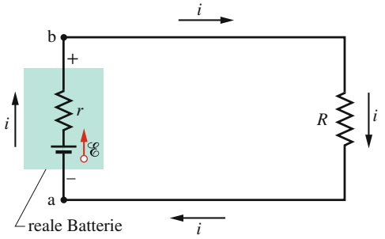

text_image

b
+
r
E
-
a
reale Batterie
i
i
R
i
i

(a)

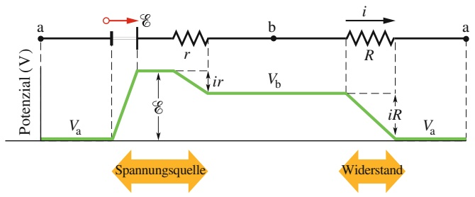

(b)

## Abb. 23.4

(a) Ein unverzweigter Stromkreis aus einem Widerstand R und einer realen Batterie mit dem Innenwiderstand r und der Spannung . (b) Der Stromkreis (a) ist hier linear dargestellt und mit dem grün gezeichneten Potenzialverlauf unterlegt. Dabei werde der Kreis vom Punkt a ausgehend im Uhrzeigersinn durchlaufen. Der Wert des Potenzials $V _ { \mathrm { a } }$ im Punkt a wurde willkürlich gleich null gesetzt, sodass die von $V _ { \mathrm { a } }$ abweichenden Potenzialwerte relativ zu diesem Nullpunkt aufgetragen sind.

550

---

23.1 Unverzweigte Stromkreise

23

Grafik mit dem geschlossenen Stromkreis in Abb. 23.4a leicht, wenn man sich die Darstellung des Potenzialverlaufs so aufgerollt denkt, dass die beiden Punkte a am linken und rechten Ende der Darstellung überlappen.) Beachten Sie, dass ein vollständiger Durchlauf des Stromkreises dem Umwandern eines „Potenzialbergs entspricht, wobei man schließlich wieder am Ausgangspunkt und auf der gleichen Höhe anlangt.

Wenn wir in diesem Buch eine Batterie nicht explizit als real kennzeichnen oder ihren Innenwiderstand explizit angeben, gehen wir implizit immer davon aus, dass Batterien ideal sind – obwohl natürlich alle existierenden Batterien real sind und einen Innenwiderstand besitzen.

## Reihenschaltungen von Widerständen

Abbildung 23.5a zeigt drei Widerstände, die mit einer idealen Batterie der Spannung  in Reihe geschaltet sind. „In Reihe“ bedeutet dabei, dass die beiden Anschlüsse jedes der Widerstände nur mit jeweils einem der beiden Nachbarwiderstände verbunden sind und die Potenzialdifferenz  zwischen den beiden freien Anschlüssen der Widerstandsreihe anliegt. In Abb. 23.5a sind die Widerstände zwischen den Punkten a und b in Reihe geschaltet und die Potenzialdifferenz der Batterie liegt zwischen diesen beiden Punkten an. Die Potenzialdifferenzen, die nun über jedem Widerstand der Reihenschaltung anliegen, erzeugen jeweils gleiche Ströme i durch die Widerstände. Im Allgemeinen gilt:

Legt man eine Potenzialdifferenz V an eine Reihenschaltung von Widerständen, so fließt durch jeden Widerstand der gleiche Strom i. Die Potenzialdifferenzen über die einzelnen Widerstände summieren sich zu der über die gesamte Widerstandsreihe anliegenden Potenzialdifferenz V.

Beachten Sie dabei, dass es für die Ladung, die durch eine Reihenschaltung von Widerständen fließt, nur einen einzigen möglichen Weg gibt. Wenn weitere Wege existieren, sodass durch verschiedene Widerstände auch verschiedene Ströme fließen können, so handelt es sich nicht um eine Reihenschaltung.

Man kann eine Reihenschaltung von Widerständen durch einen äquivalenten Ersatzwiderstand $R _ { \mathrm { E r s } }$ ersetzen, durch den ein Strom derselben Stärke i fließt und an dem dieselbe Potenzialdifferenz V anliegt wie an der Reihenschaltung als ganzer.

In Abb. 23.5b wurden die drei Widerstände aus Abb. 23.5a durch ihren äquivalenten Ersatzwiderstand $R _ { \mathrm { E r s } }$ ersetzt.

Um einen Ausdruck für $R _ { \mathrm { E r s } }$ in Abb. 23.5b herzuleiten, wenden wir die Maschenregel auf beide Stromkreise an. Wählen wir im Stromkreis von Abb. 23.5a den Batteriepol a als Ausgangspunkt und durchlaufen den Kreis vollständig im Uhrzeigersinn, so ergeben sich auf diesem Weg die folgenden Potenzialänderungen:

$$
\mathcal {E} - i R _ {1} - i R _ {2} - i R _ {3} = 0
$$

oder

$$
i = \frac {\mathcal {E}}{R _ {1} + R _ {2} + R _ {3}}. \tag {23.5}
$$

Für den Kreis von Abb. 23.5b mit dem äquivalenten Ersatzwiderstand $R _ { \mathrm { E r s } }$ erhalten wir ganz entsprechend

$$
\mathcal {E} - i R _ {\mathrm{Ers}} = 0
$$

oder

$$
i = \frac {\mathcal {E}}{R _ {\mathrm{Ers}}}. \tag {23.6}
$$

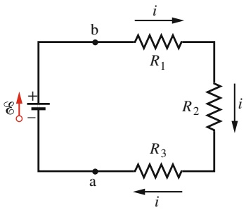

text_image

E₁
+
-
b
R₁
i
R₂
i
a
R₃
i

(a)

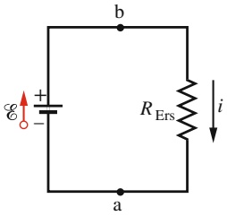

text_image

b
+
E
-
R
Ers
i
a

(b)

## Abb. 23.5

(a) Drei Widerstände sind zwischen den Punkten a und b in Reihe geschaltet. (b) Ein Ersatzschaltbild der Reihenschaltung aus (a), in dem der äquivalente Ersatzwiderstand $R _ { \mathrm { E r s } }$ die drei Einzelwiderstände ersetzt.

551

---

23 Stromkreise

Ein Vergleich der Gln. 23.5 und 23.6 liefert

$$
R _ {\mathrm{Ers}} = R _ {1} + R _ {2} + R _ {3}.
$$

Die Erweiterung auf eine Reihenschaltung von n Widerständen liegt auf der Hand:

$$
R _ {\mathrm{Ers}} = \sum_ {j = 1} ^ {n} R _ {j} \quad (n \text {Widerstände in Reihe}). \tag {23.7}
$$

Beachten Sie, dass der äquivalente Ersatzwiderstand einer Reihenschaltung von Widerständen immer größer ist als jeder einzelne der beteiligten Widerstände.

## KONTROLLFRAGE 2

In Abb. 23.5a gelte $R _ { 1 } > R _ { 2 } > R _ { 3 }$ . Ordnen Sie die drei Widerstände in absteigender Reihenfolge nach (a) dem durch sie fließenden Strom und (b) den an ihnen anliegenden Potenzialdifferenzen.

## 23.1.5 Potenzialdifferenzen

Oft ist es notwendig, die Potenzialdifferenz zwischen zwei herausgegriffenen Punkten eines Stromkreises zu bestimmen. Wie groß ist beispielsweise im Stromkreis von Abb. 23.4a die Potenzialdifferenz zwischen den Punkten b und a? Zur Bestimmung dieser Potenzialdifferenz beginnen wir im Punkt b und durchlaufen den Kreis im Uhrzeigersinn bis zum Punkt a, wobei wir den Widerstand R passieren. Wenn $V _ { \mathrm { a } }$ und $V _ { \mathrm { b } }$ die Werte des Potenzials in den Punkten a bzw. b bezeichnen, so gilt

$$
V _ {\mathrm{b}} - i R = V _ {\mathrm{a}},
$$

da nach der Widerstandsregel das Potenzial abnimmt, wenn man den Widerstand in Stromrichtung durchläuft. Diese Gleichung kann man umschreiben zu

$$
V _ {\mathrm{b}} - V _ {\mathrm{a}} = + i R, \tag {23.8}
$$

woraus man schließt, dass das Potenzial im Punkt b höher ist als im Punkt a. Kombiniert man Gln. 23.8 und 23.4, so erhält man

$$
V _ {\mathrm{b}} - V _ {\mathrm{a}} = \mathcal {E} \frac {R}{R + r}, \tag {23.9}
$$

wobei r wieder den Innenwiderstand der Spannungsquelle bezeichnet.

Zur Bestimmung der Potenzialdifferenz zwischen zwei beliebigen Punkten eines Stromkreises beginnt man bei einem der Punkte, durchläuft den Kreis in beliebiger Richtung bis zu dem anderen Punkt und addiert dabei die Potenzialänderungen, die sich auf dem Weg ergeben.

Wir wollen noch einmal die Potenzialdifferenz $V _ { \mathrm { b } } - V _ { \mathrm { a } }$ bestimmen, wobei wir wie der im Punkt b beginnen, nun aber den Stromkreis im Gegenuhrzeigersinn durch die Batterie hindurch bis zu Punkt a durchlaufen. Auf diesem Weg erhalten wir

$$
V _ {\mathrm{b}} + i r - \mathcal {E} = V _ {\mathrm{a}}
$$

oder

$$
V _ {\mathrm{b}} - V _ {\mathrm{a}} = \mathcal {E} - i r. \tag {23.10}
$$

Vergleicht man diesen Ausdruck mit Gl. 23.4, so gelangt man wieder zu Gl. 23.9.

Die Größe $V _ { \mathrm { b } } -   V _ { \mathrm { a } }$ ist im Stromkreis von Abb. 23.4 die von der Batterie zwischen ihren beiden Polen aufgebaute Potenzialdifferenz. Wie wir bereits oben feststellten, ist diese Potenzialdifferenz nur dann gleich der Batteriespannung V, wenn

552

---

23.1 Unverzweigte Stromkreise

23

die Batterie entweder keinen Innenwiderstand besitzt $( r = 0$ in Gl. 23.9) oder der Stromkreis offen ist $( i = 0$ in Gl. 23.10).

Im Kreis von Abb. 23.4 seien $\mathcal { E } = 1 2   \mathrm { V } , R = 1 0   \Omega$ und $r = 2 { , } 0   \Omega$ . Dann folgt nach Gl. 23.9 für die Potenzialdifferenz zwischen den Batteriepolen

$$
V _ {\mathrm{b}} - V _ {\mathrm{a}} = (1 2 \mathrm{V}) \frac {1 0 \Omega}{1 0 \Omega + 2 , 0 \Omega} = 1 0 \mathrm{V}.
$$

Indem Sie (gegen ihren Innenwiderstand) Ladung durch sich selbst $\mathrm { { \tt { , } } p u m p t } ,$ verrichtet die Batterie eine Arbeit pro Einheitsladung von $\mathcal { E } = 1 2   \mathrm { J } / \mathrm { C }$ oder 12 V. Aufgrund ihres Innenwiderstands erzeugt sie dabei jedoch lediglich eine Potenzialdifferenz von 10 J/C oder 10 V zwischen ihren beiden Polen.

## Leistung, Potenzial und Spannung

Wenn eine Batterie oder eine andere Spannungsquelle Arbeit an den Ladungsträ- gern verrichtet und dadurch einen Strom i aufrechterhält, überträgt sie Energie von ihrer inneren Energiequelle – im Fall einer Batterie chemische Energie – auf die Ladungsträger. In einer realen Spannungsquelle, die einen von null verschiedenen Innenwiderstand r hat, wird jedoch wie in Abschn. 22.5 erläutert immer auch ein Teil der gespeicherten Energie dissipiert, also in Wärmeenergie umgewandelt. Wir wollen im Folgenden untersuchen, in welchem Verhältnis diese beiden Arten des Energietransfers zueinander stehen.

Die Rate $P ,$ mit der die Spannungsquelle Energie auf die Ladungsträger überträgt, ist nach Gl. 22.21

$$
P = i V, \tag {23.11}
$$

wobei V die Potenzialdifferenz zwischen den Polen der Spannungsquelle bezeichnet. Nach Gl. 23.10 können wir diese Potenzialdifferenz durch $V = \mathcal { E } - i r$ ersetzen und erhalten

$$
P = i (\mathcal {E} - i r) = i \mathcal {E} - i ^ {2} r. \tag {23.12}
$$

Der Term $i ^ { 2 } r$ in Gl. 23.12 ist die Übertragungsrate $P _ { \mathrm { D } }$ von elektrischer Energie in Wärme innerhalb der Spannungsquelle:

$$
P _ {\mathrm{D}} = i ^ {2} r \quad \text {(innere Dissipationsrate)}  . \tag {23.13}
$$

Der Term $i \mathcal { E }$ in Gl. 23.12 beschreibt die Rate $P _ { \mathrm { B } } ,$ mit der die Spannungsquelle Energie sowohl in Energie der Ladungsträger als auch in Wärmeenergie umsetzt:

$$
P _ {\mathrm{B}} = i \mathcal {E} \quad (\text {Leistung einer Spannungsquelle}). \tag {23.14}
$$

Wird eine Batterie oder ein Akku wieder aufgeladen, indem man einen Stromfluss entgegen der Richtung des spontanen Entladungsstroms erzwingt, so wird die Energie der Ladungsträger sowohl in innere (chemische) Energie der Batterie, als auch – durch Dissipation am inneren Widerstand r – in Wärmeenergie umgewandelt. Gleichung 23.14 beschreibt die Rate der Umwandlung in innere (chemische) Energie, Gl. 23.13 dagegen die Rate der Energiedissipation in Wärmeenergie. Gleichung 23.11 beschreibt schließlich die Rate, mit der die Ladungsträger Energie herantransportieren.

## KONTROLLFRAGE 3

Eine Batterie liefert eine Spannung von 12 V und hat einen Innenwiderstand von 2 Ω. Ist die Potenzialdifferenz zwischen ihren Polen größer, kleiner oder gleich 12 V, wenn der Strom durch die Batterie (a) vom negativen zum positiven Pol, (b) vom positiven zum negativen Pol fließt bzw. (c) null ist?

553

---

23 Stromkreise

## LÖSUNGSSTRATEGIEN

**Strategie 1: Vermuten der Stromrichtung** Bei der Untersuchung der Eigenschaften von Stromkreisen ist es nicht erforderlich, die Stromrichtung bereits zu Beginn der Überlegungen zu kennen. Sie können stattdessen die Stromrichtung einfach vermuten – was natürlich ein wenig physikalische Courage voraussetzt. Zur Erläuterung dieser Aussage nehmen wir einmal an, der Strom im Kreis von Abb. Ü23.1 im Übungsbuch fließe entgegen dem Uhrzeigersinn, also entgegen der Richtung der gezeichneten Strompfeile. Wendet man die Maschenregel im Gegenuhrzeigersinn an, beginnend im Punkt a, so erhält man

$$
- \mathcal {E} _ {1} - i r _ {1} - i R - i r _ {2} + \mathcal {E} _ {2} = 0
$$

oder

$$
i = - \frac {\mathcal {E} _ {1} - \mathcal {E} _ {2}}{R + r _ {1} + r _ {2}}.
$$

Setzt man die Zahlenwerte aus Beispielaufgabe 23.1 im Übungsbuch ein, so ergibt sich ein Strom $i = - 2 4 0   \mathrm { m A }$ . Das Minuszeichen weist darauf hin, dass die tatsächliche Stromrichtung der zunächst angenommenen entgegengesetzt ist.

## 23.2 Verzweigte Stromkreise

## Lernziele

Nach dem Durcharbeiten dieses Abschnitts sollten Sie in der Lage sein, . . .

• die Verzweigungsregel (Knotenregel) anzuwenden,
einen Schaltkreis mit einer Batterie und drei parallel geschalteten Widerstände zu zeichnen und diesen von einem Kreis mit einer Batterie und drei in Reihe geschalteten Widerständen zu unterscheiden,
• zu verstehen, dass an parallel geschalteten Widerständen dieselbe Potenzialdifferenz anliegt (die auch dieselbe ist, die an dem zugehörigen äquivalenten Ersatzwiderstand anliegt),
• den äquivalenten Ersatzwiderstand mehrerer parallel geschalteter Widerstände zu bestimmen,
• zu verstehen, dass der Gesamtstrom durch parallel geschaltete Widerstände gleich der Summe der Einzelströme ist,
einen Stromkreis mit Batterie und mehreren parallel und in Reihe geschalteten Widerständen zu vereinfachen, indem Sie schrittweise äquivalente Ersatzwiderstände einführen, bis Sie den Strom durch die Batterie bestimmen können, und dann das Vorgehen umkehren, bis Sie die Ströme und Potenzialdifferenzen an den Einzelwiderständen erhalten,
in einem Stromkreis, der sich nicht mit äquivalenten Ersatzwiderständen vereinfachen lässt, die einzelnen Maschen des Kreises zu identifizieren, die Richtungen der Ströme in den Zweigen zu wählen und dann daraus ein Gleichungssystem für die Ströme aufzustellen, das Sie nach den unbekannten Stromstärken auflösen,
• in einem Stromkreis mit mehreren in Reihe geschalteten realen Batterien diese durch eine einzige ideale Batterie und einen einzigen (Ersatz-)Widerstand zu ersetzen,
• in einem Stromkreis mit mehreren parallel geschalteten realen Batterien diese durch eine einzige ideale Batterie und einen einzigen (Ersatz-)Widerstand zu ersetzen.

## Schlüsselideen

• An parallel geschalteten Widerständen liegt dieselbe Potenzialdifferenz an. Der äquivalente Ersatzwiderstand für n parallele Widerstände ergibt sich aus

$$
\frac {1}{R _ {\mathrm{Ers}}} = \sum_ {j = 1} ^ {n} \frac {1}{R _ {j}}.
$$

554

---

23.2 Verzweigte Stromkreise

23

## 23.2.1 Verzweigte Stromkreise

Abbildung 23.6 zeigt einen verzweigten Stromkreis mit mehr als einer Schleife. Der Einfachheit halber nehmen wir auch hier die Batterien wieder als ideal an. Es gibt zwei Verzweigungspunkte oder Knoten in diesem Stromkreis, und drei Zweige verbinden diese beiden Punkte. Diese Zweige sind der linke (bad), der rechte (bcd) und der mittlere Zweig (bd). Welche Ströme fließen in diesen Zweigen?

Wir wollen diese drei Ströme unterscheiden, indem wir für jeden Zweig dem Stromsymbol i einen eigenen Index beifügen: So hat der Strom $i _ { 1 }$ in jedem Punkt des Zweigs ‚bad‘ den gleichen Wert; für $i _ { 2 }$ und $i _ { 3 }$ gilt entsprechendes in den Zweigen ‚bcd‘ bzw. ‚bd‘. Die jeweiligen Stromrichtungen werden zunächst willkürlich angenommen.

Betrachten wir den Verzweigungspunkt d: Mit den Strömen $i _ { 1 }$ und $i _ { 3 }$ kommt Ladung an diesem Punkt an und verlässt ihn wieder im Strom $i _ { 2 } .$ Da die Ladung erhalten bleibt, muss der gesamte im Punkt d eingehende Strom gleich dem gesamten ausgehenden Strom sein:

$$
i _ {1} + i _ {3} = i _ {2}. \tag {23.15}
$$

Man überzeugt sich leicht davon, dass die Anwendung dieser Bedingung auf den Verzweigungspunkt b zu demselben Ergebnis führt. Als Verallgemeinerung von Gl. 23.15 kann man eine allgemeingültige Regel formulieren:

**Verzweigungsregel:** In einem Verzweigungspunkt oder Knoten eines Stromkreises ist die Summe aller eingehenden Ströme gleich der Summe aller ausgehenden Ströme.

Dieser Satz heißt auch Kirchhoffsche Knotenregel. Er ist nichts anderes als eine Formulierung des Satzes von der Ladungserhaltung für ein System, in dem Ladung fließt: An einem Verzweigungspunkt sammelt sich keine Ladung an und es verschwindet auch keine Ladung. Damit haben wir die wesentlichen Werkzeuge zur Analyse verzweigter Stromkreise in der Hand: die Maschenregel als Konsequenz der Energieerhaltung sowie die Verzweigungsregel als Konsequenz der Ladungserhaltung.

Gleichung 23.15 ist eine Gleichung mit drei Unbekannten. Um sie zu lösen und damit den Stromkreis vollständig zu analysieren, d. h. alle drei Ströme zu kennen, benötigen wir zwei weitere Gleichungen mit denselben Unbekannten. Wir erhalten diese, indem wir zweimal die Maschenregel anwenden. In dem Stromkreis aus Abb. 23.6 stehen dafür drei Schleifen zur Wahl: die linke Schleife badb, die rechte Schleife bcdb sowie die große Schleife badcb. Welche zwei Schleifen wir wählen, ist ohne Bedeutung; wir wählen im Folgenden die linke und die rechte.

Wenn wir die linke Schleife beginnend im Punkt b im Gegenuhrzeigersinn durchlaufen, so ergibt die Maschenregel

$$
\mathcal {E} _ {1} - i _ {1} R _ {1} + i _ {3} R _ {3} = 0. \tag {23.16}
$$

Durchlaufen wir die rechte Schleife beginnend im Punkt b im Uhrzeigersinn, so folgt entsprechend

$$
- i _ {3} R _ {3} - i _ {2} R _ {2} - \mathcal {E} _ {2} = 0. \tag {23.17}
$$

Wir haben nun drei Gleichungen (Gln. 23.15–23.17) mit denselben drei Unbekannten; dieses Gleichungssystem können wir mit den üblichen Verfahren lösen.

Wenden wir die Maschenregel auf die große Schleife an, so erhalten wir bei einem Durchlauf im Gegenuhrzeigersinn, beginnend im Punkt b,

$$
\mathcal {E} _ {1} - i _ {1} R _ {1} - i _ {2} R _ {2} - \mathcal {E} _ {2} = 0.
$$

Auf den ersten Blick scheint dieser Ausdruck neue Informationen zu enthalten, er ist jedoch einfach nur die Summe der Gln. 23.16 und 23.17. (Er würde natürlich dennoch zum korrekten Ergebnis führen, wenn man ihn mit Gl. 23.15 sowie einer der Gln. 23.16 und 23.17 kombinieren würde.)

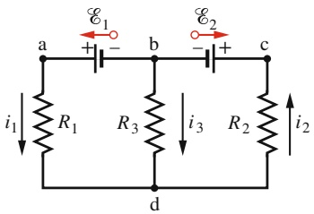

text_image

a
E₁
+
-
b
E₂
+
-
c
i₁
R₁
R₃
i₃
R₂
i₂
d

Abb. 23.6

Ein verzweigter Stromkreis, bestehend aus drei Zweigen: dem linken (bad) dem rechten (bcd) und dem mittleren (bd). Man kann sich den Stromkreis auch aus drei Schleifen zusammengesetzt denken – der linken Schleife badb, der rechten Schleife bcdb sowie der großen Schleife badcb.

555

---

23 Stromkreise

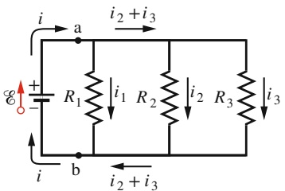

text_image

i
a
i2 + i3
R1
i1 R2
i2 R3
i3
E
+
-
b
i
i2 + i3

(a)

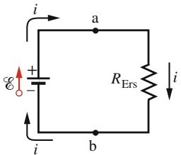

text_image

i
a
R_Ers
i
b

(b)

## Abb. 23.7

(a) Drei Widerstände sind zwischen den Punkten a und b parallel geschaltet. (b) Ein äquivalenter Stromkreis, bei dem die drei Widerstände aus
(a) durch einen einzigen, äquivalenten Ersatzwiderstand $R _ { \mathrm { E r s } }$ ersetzt sind.

## Parallelschaltung von Widerständen

Abbildung 23.7a zeigt drei Widerstände, die in Parallelschaltung mit einer idealen Batterie der Spannung  verbunden sind. Parallelschaltung von Widerständen bedeutet, dass die Anschlüsse auf der einen Seite aller Widerstände leitend miteinander verbunden sind und die Anschlüsse auf der anderen Seite der Widerstände ebenfalls leitend verbunden sind. Die Potenzialdifferenz V liegt zwischen diesen beiden Gruppen zusammengeschalteter Anschlüsse an. An allen Widerständen einer Parallelschaltung liegt somit dieselbe Potenzialdifferenz an. In unserem Beispiel (Abb. 23.7) besteht über allen drei Widerständen die gleiche Potenzialdifferenz und verursacht jeweils einen Strom durch den Widerstand. Im Allgemeinen gilt:

Legt man eine Potenzialdifferenz V an eine Parallelschaltung von mehreren Widerständen an, so liegt an jedem der Widerstände dieselbe Potenzialdifferenz an.

In dem Stromkreis aus Abb. 23.7a wird diese äußere Potenzialdifferenz V von der Batterie aufrechterhalten. In Abb. 23.7b sind die drei parallel geschalteten Widerstände durch ihren äquivalenten Ersatzwiderstand $R _ { \mathrm { E r s } }$ ersetzt.

Eine Parallelschaltung von Widerständen kann man durch einen äquivalenten Ersatzwiderstand $R _ { \mathrm { E r s } }$ ersetzen, an dem die gleiche Potenzialdifferenz V anliegt und durch den ein Strom fließt, der gleich dem Gesamtstrom durch alle parallel geschalteten Widerstände ist.

Zur Herleitung eines Ausdrucks für $R _ { \mathrm { E r s } }$ für den Stromkreis in Abb. 23.7b schreiben wir zunächst für die Ströme durch jeden der drei Widerstände

$$
i _ {1} = \frac {V}{R _ {1}}, \quad i _ {2} = \frac {V}{R _ {2}} \quad \text {und} \quad i _ {3} = \frac {V}{R _ {3}}.
$$

Dabei bezeichnet V die Potenzialdifferenz zwischen a und b. Wenden wir die Ver zweigungsregel im Punkt a des Stromkreises aus Abb. 23.7a an und setzen dann die Ausdrücke für die drei Ströme ein, so erhalten wir:

$$
i = i _ {1} + i _ {2} + i _ {3} = V \left(\frac {1}{R _ {1}} + \frac {1}{R _ {2}} + \frac {1}{R _ {3}}\right). \tag {23.18}
$$

Nun ersetzen wir die Parallelschaltung durch ihren äquivalenten Ersatzwiderstand $R _ { \mathrm { E r s } }$ (Abb. 23.7b) und erhalten

$$
i = \frac {V}{R _ {\mathrm{Ers}}} . \tag {23.19}
$$

Ein Vergleich der beiden letzten Gleichungen ergibt schließlich

$$
\frac {1}{R _ {\mathrm{Ers}}} = \frac {1}{R _ {1}} + \frac {1}{R _ {2}} + \frac {1}{R _ {3}}. \tag {23.20}
$$

Die Verallgemeinerung auf n parallel geschaltete Widerstände lautet

$$
\frac {1}{R _ {\mathrm{Ers}}} = \sum_ {j = 1} ^ {n} \frac {1}{R _ {j}} \quad (n \text {parallelle Widerstände}). \tag {23.21}
$$

Insbesondere ist der äquivalente Ersatzwiderstand zweier parallel geschalteter Widerstände gleich dem Quotienten aus dem Produkt der beiden Widerstandswerte und ihrer Summe:

$$
R _ {\mathrm{Ers}} = \frac {R _ {1} R _ {2}}{R _ {1} + R _ {2}}. \tag {23.22}
$$

556

---

23.2 Verzweigte Stromkreise

23

TABELLE 23.1:

Reihen- und Parallelschaltung von Widerständen und Kondensatoren.

| Reihenschaltung | Parallelschaltung |
| --- | --- |
| Widerstände$R_{\text{Ers}} = \sum_{j=1}^{n} R_j$ (Gl. 23.7) | $\frac{1}{R_{\text{Ers}}} = \sum_{j=1}^{n} \frac{1}{R_j}$ (Gl. 23.21) |
| gleicher Strom durch alle Widerstände | gleiche Potenzialdifferenz an allen Widerständen |
| Kondensatoren$\frac{1}{C_{\text{Ers}}} = \sum_{j=1}^{n} \frac{1}{C_j}$ (Gl. 21.20) | $C_{\text{Ers}} = \sum_{j=1}^{n} C_j$ (Gl. 21.19) |
| gleiche Ladung auf allen Kondensatoren | gleiche Potenzialdifferenz an allen Kondensatoren |

Wenn man bei der Berechnung des äquivalenten Ersatzwiderstands versehentlich die Summe der Widerstandswerte durch ihre Produkte dividiert, kann man den Fehler sofort daran erkennen, dass das Ergebnis die falsche Dimension besitzt.

Beachten Sie, dass der Ersatzwiderstand einer Parallelschaltung von Widerständen stets kleiner ist als jeder einzelne Widerstandswert. Tabelle 23.1 fasst die Be ziehungen zur Berechnung der äquivalenten Größen bei der Parallel- und Reihenschaltung von Widerständen und Kondensatoren zusammen.

## KONTROLLFRAGE 4

Eine Batterie, die eine Potenzialdifferenz V zwischen ihren Anschlüssen erzeugt, wird mit einer Kombination zweier identischer Widerstände verbunden. Durch die Kombination fließt ein Strom i. Wie groß sind die Potenzialdifferenzen über die Widerstände sowie die durch sie fließenden Ströme, wenn die Widerstände (a) in Reihe und (b) parallel geschaltet sind?

## LÖSUNGSSTRATEGIEN

**Strategie 2: Systematische Analyse von Stromkreisen mit Batterien und Widerständen** Wir geben hier zwei Techniken an, um Ströme oder Potenzialdifferenzen in verzweigten Stromkreisen zu ermitteln.

1. Sind Gruppen von Widerständen in Reihe oder parallel geschaltet, so vereinfachen Sie den Stromkreis, indem Sie die Gruppen durch ihre äquivalenten Ersatzwiderstände ersetzen. Gelingt es dadurch, den Stromkreis auf einen äquivalenten unverzweigten Kreis zu reduzieren, so kann man wie in Beispielaufgabe 23.2a im Übungsbuch den Strom durch die Batterie bestimmen. Nun kann man sich gegebenenfalls „zurückarbeiten“, indem man wie in Beispielaufgabe 23.2b im Übungsbuch die Ersetzungen der Widerstandskombinationen sukzessive rückgängig macht und jeweils die Ströme durch jeden einzelnen Widerstand sowie die jeweils an den Widerständen anliegenden Potenzialdifferenzen bestimmt.
2. Gelingt es nicht, den verzweigten Stromkreis auf einen unverzweigten zu reduzieren, so stellen Sie durch Anwendung der Verzweigungsregel und der Maschenregel ein System von gekoppelten Gleichungen auf, wie wir es in Beispielaufgabe 23.4 im Übungsbuch gezeigt haben. Sie benötigen nicht mehr voneinander unabhängige Gleichungen, als unbekannte Größen in den Gleichungen vorkommen. Sind Sie an Strom und Potenzialdifferenz für einen ganz bestimmten Widerstand interessiert, so stellen Sie sicher, dass diese beiden Größen in Ihren Gleichungen vorkommen, indem Sie mindestens eine Schleife so wählen, dass sie diesen Widerstand enthält.

## Strategie 3: Willkürliche Festlegungen bei der Analyse komplexer Stromkreise

In Beispielaufgabe 23.4 im Übungsbuch haben wir einige Parameter zu Beginn der Analyse willkürlich festgelegt: (1) Wir haben willkürliche Richtungen der im Kreis

557

---

23 Stromkreise

von Abb. Ü23.3 im Übungsbuch fließenden Ströme angenommen. (2) Wir haben willkürlich festgelegt, anhand welcher der drei möglichen Zweige des Stromkreises wir das Gleichungssystem aufstellen. (3) Wir haben die Durchlaufrichtung jedes dieser Zweige willkürlich gewählt. (4) Wir haben die Anfangs- und Endpunkte der Durchläufe willkürlich gewählt.

Solche Beliebigkeiten pflegen den Anfänger zu verwirren; wenn man jedoch Übung in der Analyse komplexer Stromkreise gewinnt, so gewöhnt man sich daran, willkürliche Festlegungen zu Beginn der Analyse, die ohne Bedeutung für das Ergebnis sind, als natürlich und notwendig zu akzeptieren. Befolgen Sie dabei nur stets die folgenden beiden Regeln: (1) Stellen Sie sicher, dass jeder gewählte Zweig vollständig durchlaufen wird. (2) Haben Sie sich einmal für die Richtung eines bestimmten Stroms entschieden, so halten sie so lange an dieser Festlegung fest, bis die numerischen Werte aller Ströme vorliegen. War ihre anfängliche Festlegung falsch, so erkennen Sie dies am Minuszeichen des Ergebnisses. Lassen Sie in diesem Fall einfach das Minuszeichen weg und korrigieren Sie die Richtung des Strompfeils im Schaltbild des Stromkreises. Führen Sie diese Korrektur aber niemals durch, bevor die Berechnungen sämtlicher gesuchter Größen des Stromkreises abgeschlossen sind! (Beispielaufgabe 23.4 im Übungsbuch)

## 23.3 Amperemeter und Voltmeter

## Lernziele

Nach dem Durcharbeiten dieses Abschnitts sollten Sie in der Lage sein, . . .

• die Funktionsweise und Verwendung von Amperemetern und Voltmetern zu erklären, einschließlich ihrer Innenwiderstände, die verhindern, dass die gemessenen Größen von der Messung beeinflusst werden.

## Schlüsselideen

• Es gibt drei Messinstrumente, die im Zusammenhang mit Stromkreisen Ver wendung finden. Ein Amperemeter misst die elektrische Stromstärke. Ein Voltmeter misst Spannungen (Potenzialdifferenzen). Ein Multimeter kann sowohl Stromstärken und Spannungen als auch Widerstände (und oft noch weitere Größen) messen.

## 23.3.1 Amperemeter und Voltmeter

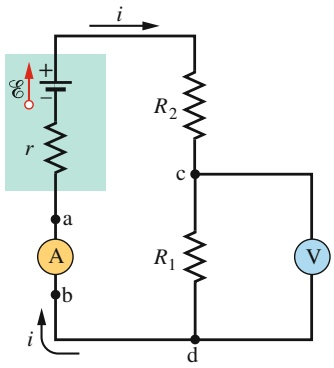

text_image

i
R2
c
R1
V
a
A
b
d
i

Abb. 23.8

Anschlussarten eines Amperemeters (A) und eines Voltmeters (V) in einem einfachen Stromkreis.

Ein Instrument zur Messung von Strömen bezeichnet man als Amperemeter. Um den in einer Leitung fließenden Strom zu messen, ist es normalerweise erforder lich, die Leitung zu unterbrechen und das Amperemeter in die Leitung einzuschleifen, sodass der zu messende Strom durch das Messgerät fließt. (Im Stromkreis von Abb. 23.8 ist das Amperemeter A zur Messung des Stroms i in den Stromkreis geschaltet.)

Dabei ist es entscheidend, dass der Innenwiderstand $R _ { \mathrm { A } }$ des Amperemeters im Vergleich zu den anderen Widerständen im Stromkreis sehr klein ist. Ist dies nicht der Fall, so wird der zu messende Strom durch das Vorhandensein des Instruments in nicht vernachlässigbarer Weise beeinflusst – der gemessene Strom entspricht also nicht mehr dem Strom, der in dem Stromkreis fließt, wenn das Amperemeter nicht vorhanden ist.

Ein Messgerät zur Bestimmung von Potenzialdifferenzen heißt Voltmeter. Um die Potenzialdifferenz zwischen zwei beliebigen Punkten eines Stromkreises zu messen, schaltet man das Instrument zwischen diese beiden Punkte, ohne dazu den Stromkreis unterbrechen zu müssen. (Im Stromkreis von Abb. 23.8 misst das Voltmeter V die über den Widerstand $R _ { 1 }$ abfallende Potenzialdifferenz.)

558

---

23.4 RC-Kreise

23

Dabei ist es entscheidend, dass der Innenwiderstand $R _ { \mathrm { V } }$ des Voltmeters viel grö ßer ist als der Widerstand des Teils des Stromkreises, zwischen dessen Anschlüssen die Potenzialdifferenz gemessen werden soll. Ist diese Bedingung nicht erfüllt, so wirkt das Messgerät selbst als nicht vernachlässigbares Element des Stromkreises und verändert die zu messende Potenzialdifferenz.

Oft verwendet man Messgeräte, die sogenannten Multimeter, die intern so verschaltet sind, dass man sie durch einfaches Umschalten sowohl als Amperemeter wie auch als Voltmeter – und meist sogar als Ohmmeter – verwenden kann. Ein Ohmmeter misst den Widerstand eines mit seinen beiden Anschlüssen verbundenen leitenden Bauteils.

## 23.4 RC-Kreise

## Lernziele

Nach dem Durcharbeiten dieses Abschnitts sollten Sie in der Lage sein, . . .

• schematische Diagramme von Lade- und Entladevorgängen in RC-Kreisen zu zeichnen,
• die Differenzialgleichung für einen sich aufladenden RC-Kreis aufzustellen,
• die Differenzialgleichung für einen sich entladenden RC-Kreis aufzustellen,
• die Ladung eines Kondensators in einem sich auf- oder entladenden RC-Kreis als Funktion der Zeit anzugeben,
• aus der Funktion q(t) für den zeitlichen Verlauf der Ladung eines Kondensators in einem sich auf- oder entladenden RC-Kreis dessen Potenzialdifferenz als Funktion der Zeit zu ermitteln,
• Strom und Potenzialdifferenz in einem sich auf- oder entladenden RC-Kreis als Funktionen der Zeit anzugeben,
• die kapazitive Zeitkonstante τ zu bestimmen,
• die Ladung auf und die Potenzialdifferenz an einem Kondensator in einem sich auf- oder entladenden RC-Kreis zu Beginn des Prozesses sowie nach einer langen Zeit zu bestimmen.

## Schlüsselideen

• Wenn eine Spannung  an einen Widerstand R und eine mit diesem in Reihe geschaltete Kapazität C angelegt wird, nimmt die Ladung am Kondensator gemäß

$$
q = C \mathcal {E} (1 - \mathrm{e} ^ {- t / (R C)}) \quad \text {(Aufladen des Kondensators)}
$$

zu, wobei $C \mathcal { E } = q _ { 0 }$ der Gleichgewichtswert (Langzeitlimes) der Ladung ist und $R C = \tau$ die kapazitive Zeitkonstante des Stromkreises.

• Während des Aufladens gilt für die Stromstärke

$$
i = \frac {\mathrm{d} q}{\mathrm{d} t} = \left(\frac {\mathcal {E}}{R}\right) \mathrm{e} ^ {- t / (R C)} \quad \text {(Aufladen des Kondensators)}.
$$

• Wenn sich ein Kondensator über einen Widerstand R entlädt, gilt für die Ladung auf dem Kondensator

$$
q = q _ {0} \mathrm{e} ^ {- t / (R C)} \quad \text {(Entladen des Kondensators)}.
$$

• Während des Entladens gilt für die Stromstärke

$$
i = \frac {\mathrm{d} q}{\mathrm{d} t} = - \left(\frac {q _ {0}}{R C}\right) \mathrm{e} ^ {- t / (R C)} \quad \text {(Entladen des Kondensators)}.
$$

559

---

23 Stromkreise

## 23.4.1 RC-Kreise

In den vorangegangenen Abschnitten haben wir uns ausschließlich mit Stromkreisen befasst, in denen zeitlich konstante Ströme flossen. Wir beginnen nun mit der Betrachtung zeitabhängiger Ströme in Stromkreisen.

## Aufladen eines Kondensators

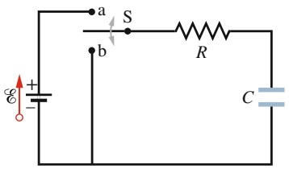

text_image

a
S
b
R
C

Abb. 23.9

Wird der Schalter S in Stellung a geschlossen, so lädt die Batterie den Kondensator über den Widerstand R. Legt man den Schalter anschließend in Stellung b um, so entlädt sich der Kondensator C über den Widerstand.

Der Kondensator mit der Kapazität C in dem Stromkreis in Abb. 23.9 sei anfänglich ungeladen. Um ihn zu laden, legt man den Schalter S auf Stellung a. Dadurch schließt man einen sogenannten RC-Reihenkreis, der aus dem Kondensator, der als ideal angenommenen Batterie mit der Spannung $\varepsilon$ sowie dem Widerstand R besteht.

Aus Abschn. 21.1 wissen wir, dass Ladung als elektrischer Strom zwischen den Batteriepolen und den beiden Kondensatorplatten zu fließen beginnt, sobald der Kreis geschlossen ist. Dieser Strom erhöht die Ladung auf den Kondensatorplatten und damit die über den Kondensator bestehende Potenzialdifferenz $V _ { C } = q / C .$ Sobald diese Potenzialdifferenz sich der Potenzialdifferenz zwischen den Polen der Batterie (die im Fall einer idealen Batterie gleich der Batteriespannung  ist) angeglichen hat, wird der Strom null. Nach Gl. 21.1 $( q = C V )$ ist die Ladung auf dem vollständig geladenen, mit der Batterie im Gleichgewicht befindlichen Kondensator gleich C.

Wir wollen nun den Ladevorgang näher betrachten. Genauer gesagt wollen wir untersuchen, wie die Ladung $q ( t )$ auf den Kondensatorplatten, die Potenzialdifferenz $V _ { C } ( t )$ über den Kondensator sowie der Strom $i ( t )$ im Ladestromkreis während des Ladevorgangs von der Zeit anhängen. Dazu wenden wir zunächst die Maschenregel auf unseren Stromkreis an, indem wir ihn, beginnend am negativen Pol der Batterie, im Uhrzeigersinn durchlaufen. Wir erhalten damit

$$
\mathcal {E} - i R - \frac {q}{C} = 0. \tag {23.23}
$$

Der letzte Term auf der rechten Seite dieser Gleichung beschreibt die Potenzialdifferenz über den Kondensator. Dieser Term hat ein negatives Vorzeichen, da die mit dem positiven Batteriepol verbundene obere Kondensatorplatte auf einem höheren elektrischen Potenzial liegt als die untere Platte. Dies bedeutet, dass man einen Abfall des elektrischen Potenzials wahrnimmt, wenn man den Kondensator von oben nach unten durchläuft.

Gleichung 23.23 ist nicht direkt lösbar, da sie noch zwei Unbekannte enthält: i und $q .$ Diese beiden Größen sind jedoch nicht unabhängig voneinander, sondern gekoppelt über die Beziehung

$$
i = \frac {\mathrm{d} q}{\mathrm{d} t}. \tag {23.24}
$$

Setzt man diesen Ausdruck für i in Gl. 23.23 ein, so erhält man nach Umstellen

$$
R \frac {\mathrm{d} q}{\mathrm{d} t} + \frac {q}{C} = \mathcal {E} \quad \text {(Ladungsgleichung)}. \tag {23.25}
$$

Diese Differenzialgleichung beschreibt die Zeitabhängigkeit der Ladung q des Kondensators im Stromkreis von Abb. 23.9. Um diese Gleichung zu lösen, müssen wir eine Funktion $q ( t )$ suchen, welche die Differenzialgleichung und gleichzeitig die Bedingung erfüllt, dass der Kondensator zu Beginn ungeladen ist: Zum Zeitpunkt $t = 0$ muss $q ( t ) = 0$ gelten, also $q ( 0 ) = 0$

Wir werden weiter unten zeigen, dass die Funktion

$$
q = C \mathcal {E} (1 - \mathrm{e} ^ {- t / (R C)}) \quad \text {(Laden eines Kondensators)} \tag {23.26}
$$

die Differenzialgleichung Gl. 23.25 löst. (e bezeichnet hier die Basis der Exponentialfunktion, die Eulersche Konstante $\mathsf { e }   =   2 { , } 7 1 8 \ldots ,$ nicht die Elementarladung.)

560

---

23.4 RC-Kreise

23

Beachten Sie, dass Gl. 23.26 auch die oben formulierte Anfangsbedingung erfüllt, da der Term $\mathrm { e } ^ { - t / ( R C ) }$ für $t = 0$ gleich eins wird, sodass die Funktion den Wert $q = 0$ hat. Beachten Sie weiterhin, dass der Term $\mathrm { e } ^ { - t / ( R C ) }$ für große Werte von $t \left( t \to \infty \right)$ gegen null geht, sodass die Funktion den richtigen Wert für die Ladung des vollständig geladenen Kondensators (im Gleichgewicht) liefert: $q = C \mathcal { E }$ . Abbildung 23.10a zeigt eine Darstellung der Funktion $q ( t )$ für den Ladevorgang.

Der Ladestrom $i ( t )$ (t) des Kondensators ergibt sich als Ableitung der Funktion $q ( t )$ nach der Zeit t:

$$
i = \frac {\mathrm{d} q}{\mathrm{d} t} = \left(\frac {\mathcal {E}}{R}\right) \mathrm{e} ^ {- t / (R C)} \quad \text {(Laden eines Kondensators)}. \tag {23.27}
$$

Abbildung 23.10b zeigt eine Darstellung des Ladestroms $i ( t )$ als Funktion der Zeit während des Ladevorgangs. Beachten Sie, dass der Ladestrom vom Anfangswert $\mathcal { E } / R$ auf null gesunken ist, sobald der Kondensator vollständig geladen ist.

Ein ungeladener Kondensator verhält sich für den ladenden Stromkreis zu Beginn des Ladevorgangs wie eine leitende Verbindung (wie ein Kurzschluss). Längere Zeit später, nachdem er vollständig geladen ist, wirkt er als Unterbrechung des Kreises.

Kombiniert man Gl. 21.1 $( q = C V )$ und Gl. 23.26, so erhält man für die Potenzialdifferenz $V _ { C } ( t )$ am Kondensator während des Ladevorgangs

$$
V _ {C} = \frac {q}{C} = \mathcal {E} (1 - \mathrm{e} ^ {- t / (R C)}) \quad \text {(Laden eines Kondensators)}. \tag {23.28}
$$

Man schließt daraus: Es gilt $V _ { C } = 0$ für den vollständig entladenen Kondensator bei $t = 0$ und $V _ { C } = \mathcal { E }$ für den vollständig geladenen Kondensator bei $t \to \infty$

## Die Zeitkonstante

Das Produkt $R C$ in den Gln. 23.26–23.28 hat die Dimension einer Zeit – sowohl deshalb, weil das Argument einer Exponentialfunktion dimensionslos sein muss, als auch deshalb, weil $( 1 { , } 0   \Omega ) \cdot ( 1 { , } 0   \mathtt { F } ) = 1 { , } 0   \colon$ s ist. Man nennt diese Größe die ka**pazitive Zeitkonstante** des Stromkreises und bezeichnet sie mit τ:

$$
\tau = R C \quad (\text {Zeitkonstante}). \tag {23.29}
$$

Aus Gl. 23.26 ersehen wir, dass die Ladung des anfänglich ungeladenen Kondensators im Stromkreis von Abb. 23.9 zur Zeit $t = \tau = R C$ von null auf den Wert

$$
q = C \mathcal {E} (1 - \mathrm{e} ^ {- 1}) = 0, 6 3 C \mathcal {E} \tag {23.30}
$$

zugenommen hat: Während der ersten Zeitkonstante τ nimmt die Ladung des Kondensators von null auf 63 % ihres Endwerts $C \mathcal { E } \mathrm {  ~ z u . ~ }$ In Abb. 23.10 markieren die kleinen Dreiecke an der Zeitachse jeweils den Ablauf einer Zeitkonstante während des Ladevorgangs. Man gibt die Ladedauern von RC-Kreisen oft in Vielfachen der Zeitkonstante τ an: je größer τ ist, desto größer wird auch die Ladedauer.

## Entladen eines Kondensators

Nehmen wir nun an, der Kondensator in dem Stromkreis aus Abb. 23.9 sei vollständig auf ein Potenzial $V _ { 0 }$ geladen, das gleich der Batteriespannung  ist. Zu einem neuen Zeitpunkt $t = 0$ wird nun der Schalter S aus der Stellung a in die Stellung b umgelegt, sodass sich der Kondensator über den Widerstand R entladen kann. Wie ändern sich nun die Ladung $q ( t )$ des Kondensators sowie der Entladestrom $i ( t )$ durch den Widerstand R als Funktion der Zeit?

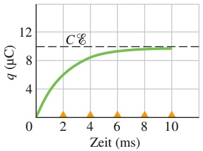

line

| Zeit (ms) | \(q (\mu C)\) |
| --- | --- |
| 0 | 0 |
| ~2 | ~6.5 |
| ~4 | ~8.5 |
| ~6 | ~9.2 |
| ~8 | ~9.5 |
| 10 | ~9.7 |

(a)

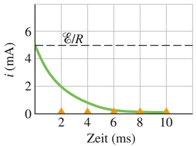

line

| Zeit (ms) | i (mA) |
| --- | --- |
| 0 | 5 |
| 2 | ~2.1 |
| 4 | ~0.8 |
| 6 | ~0.3 |
| 8 | ~0.1 |
| 10 | ~0.1 |

(b)

## Abb. 23.10

(a) Grafische Darstellung der Funktion aus Gl. 23.26. Der Kurvenverlauf zeigt den Aufbau von Ladung auf dem Kondensator aus Abb. 23.9 beim Laden.
(b) Grafische Darstellung der Funktion aus Gl. 23.27. Man erkennt die zeitliche Abnahme des Ladestroms beim Laden des Kondensators im Stromkreis aus Abb. 23.9. Zugrunde liegen Werte von $R = 2 0 0 0   \Omega ,   C = 1$ μF und $\mathcal { E } = 1 0   \mathrm { V }$ für Widerstand, Kapazität und Spannung. Die kleinen Dreiecke kennzeichnen aufeinanderfolgende Zeitintervalle von der Länge der Zeitkonstante τ.

561

---

23 Stromkreise

Die Differenzialgleichung, deren Lösung die gesuchte Funktion $q ( t )$ ist, ähnelt formal Gl. 23.25, nur dass sich im Entladekreis keine Batterie befindet, sodass $\mathcal { E } = 0$ ist. Somit gilt

$$
R \frac {\mathrm{d} q}{\mathrm{d} t} + \frac {q}{C} = 0 \quad (\text {Entladungsgleichung}). \tag {23.31}
$$

Die Lösung dieser Differenzialgleichung ist

$$
q = q _ {0} \mathrm{e} ^ {- t / (R C)} \quad \text {(Entladen eines Kondensators)}, \tag {23.32}
$$

wobei $q _ { 0 } = C V _ { 0 }$ die anfängliche Ladung des Kondensators bezeichnet. Durch Einsetzen lässt sich einfach verifizieren, dass Gl. 23.32 tatsächlich Gl. 23.31 löst.

Gleichung 23.32 besagt, dass die Ladung q des Kondensators exponentiell mit der Zeit abnimmt, und dies mit einer zeitlichen Rate, die durch die kapazitive Zeitkonstante $\tau = R C$ charakterisiert wird. Nach Ablauf der Zeit $t = \tau$ (also nach Ablauf der ersten Zeitkonstante) hat die Ladung des Kondensators auf einen Bruchteil $q _ { 0 } \mathrm { e } ^ { - 1 }$ oder ungefähr 37 % ihres anfänglichen Werts abgenommen. Beachten Sie, dass ein größerer Wert der Zeitkonstante τ eine längere Entladezeit bedeutet.

Leitet man Gl. 23.32 nach der Zeit t ab, so erhält man für den Entladestrom i(t)

$$
i = \frac {\mathrm{d} q}{\mathrm{d} t} = - \left(\frac {q _ {0}}{R C}\right) \mathrm{e} ^ {- t / (R C)} \quad \text {(Entladen eines Kondensators)}. \tag {23.33}
$$

Der Entladestrom eines Kondensators nimmt demzufolge ebenfalls exponentiell mit der Zeit ab, wobei die Rate wiederum durch die kapazitive Zeitkonstante τ bestimmt wird. Der anfängliche Entladestrom $i _ { 0 }$ ist durch $q _ { 0 } / ( R C )$ gegeben. Beachten Sie, dass man den Strom $i _ { 0 }$ einfach durch Anwendung der Maschenregel auf den Entladestromkreis zur $\mathrm { Z e i t } \; t = 0$ ermitteln kann. In diesem Moment liegt die anfängliche Potenzialdifferenz $V _ { 0 }$ über dem Widerstand $R$ an, sodass ein Strom der Stärke $i _ { 0 } = V _ { 0 } / R = ( q _ { 0 } / C ) / R = q _ { 0 } / ( R C )$ fließt. Das Minuszeichen in Gl. 23.33 kann vernachlässigt werden; es zeigt lediglich an, dass die Ladung $q$ des Kondensators abnimmt.

## Herleitung von Gleichung 23.26

Um Gl. 23.25 zu lösen, schreiben wir sie zunächst in der Form

$$
\frac {\mathrm{d} q}{\mathrm{d} t} + \frac {q}{R C} = \frac {\mathcal {E}}{R}. \tag {23.34}
$$

Die allgemeine Lösung dieser Differenzialgleichung hat die Gestalt

$$
q = q _ {\mathrm{p}} + K \mathrm{e} ^ {- a t}, \tag {23.35}
$$

wobei $q _ { \mathrm { p } }$ eine spezielle Lösung der Differenzialgleichung und K eine durch Anwendung der Anfangsbedingungen zu bestimmende Konstante bezeichnet. $a =$ $1 / ( R C )$ ist der Koeffizient von $q$ in Gl. 23.34. Zur Bestimmung von $q _ { \mathrm { p } }$ setzen wir in Gl. 23.34 d $\mathsf { l } q / \mathsf { d } t = 0$ (entsprechend der Endbedingung, dass der Ladestrom null ist) und $q = q _ { \mathrm { p } } ,$ lösen nach $q _ { \mathrm { p } }$ auf und erhalten

$$
q _ {\mathrm{p}} = C \mathcal {E}. \tag {23.36}
$$

Um $K$ zu berechnen, setzen wir zunächst Gl. 23.36 in Gl. 23.35 ein:

$$
q = C \mathcal {E} + K \mathrm{e} ^ {- a t}.
$$

Mit den Anfangsbedingungen $q = 0$ und $t = 0$ erhält man

$$
0 = C \mathcal {E} + K
$$

562

---

23.5 Zusammenfassung

23

oder $K = - C { \mathcal { E } } .$ . Setzt man schließlich die Werte von $q _ { \mathrm { p } } ,$ a und K in Gl. 23.35 ein, so ergibt sich

$$
q = C \mathcal {E} - C \mathcal {E} \mathrm{e} ^ {- t / (R C)}
$$

und damit Gl. 23.26.

## KONTROLLFRAGE 5

Die Tabelle gibt fünf Kombinationen von Werten für die Elemente des Stromkreises aus Abb. 23.9 an. Ordnen Sie die Kombinationen in absteigender Reihenfolge nach (a) der Stärke des Anfangsstroms (zu dem Zeitpunkt, an dem der Schalter in Stellung a gebracht wird), (b) der Zeit, die verstreicht, bis der Anfangsstrom auf die Hälfte seines Werts gefallen ist.

| Größe | 1 | 2 | 3 | 4 |
| --- | --- | --- | --- | --- |
| $\mathcal{E}(\text{V})$ | 12 | 12 | 10 | 10 |
| $R(\Omega)$ | 2 | 3 | 10 | 5 |
| $C(\mu\text{F})$ | 3 | 2 | 0,5 | 2 |

## 23.5 Zusammenfassung

**Spannung** Eine **Spannungsquelle** verrichtet Arbeit an den Ladungsträgern und erhält so eine Potenzialdifferenz zwischen ihren beiden Polen aufrecht. Wenn dW die Arbeit bezeichnet, welche die Spannungsquelle an der positiven Ladung dq verrichten muss, um sie von ihrem negativen zu ihrem positiven Pol zu transportieren, dann ist die Spannung (Arbeit pro Einheitsladung) der Spannungsquelle gegeben als

$$
\mathcal {E} = \frac {\mathrm{d} W}{\mathrm{d} q}. \tag {23.1}
$$

Das Volt ist die SI-Einheit sowohl der Spannung als auch der Potenzialdifferenz. Der Innenwiderstand einer **idealen Spannungsquelle** ist null; die Potenzialdifferenz zwischen ihren beiden Polen ist gleich ihrer Spannung. Eine **reale Spannungsquelle** hat einen von null verschiedenen Innenwiderstand. Die Potenzialdifferenz zwischen ihren Polen ist nur dann gleich ihrer Spannung, wenn die Spannungsquelle offen ist, also kein Strom durch sie fließt.

**Analyse von Stromkreisen** Die Potenzialänderung über einen Widerstand R, den man in Stromrichtung durchläuft, ist −iR; entgegen der Stromrichtung ist sie +iR. Die Potenzialänderung über eine ideale Spannungsquelle, die man in Richtung des Spannungspfeils durchläuft, ist +, in der Gegenrichtung ist sie −. Eine Folgerung aus der Energieerhaltung ist die **Maschenregel:** Die algebraische Summe aller Potenzialänderungen bei einem vollständigen Durchlauf durch eine beliebige Schleife eines (verzweigten) Stromkreises ist null.

Aus der Ladungserhaltung folgt die **Verzweigungsregel** (Knotenregel): An jedem Verzweigungspunkt in einem komplexen Stromkreis ist die Summe aller eingehenden Ströme gleich der Summe aller ausgehenden Ströme.

**Unverzweigte Stromkreise** Der Strom in einem unverzweigten Stromkreis, der einen einzelnen Widerstand R und eine Spannungsquelle mit der Spannung  und dem Innenwiderstand r enthält, beträgt

$$
i = \frac {\mathcal {E}}{R + r}. \tag {23.4}
$$

Für eine ideale Spannungsquelle mit dem Innenwiderstand $r = 0$ reduziert sich dieser Ausdruck auf $i = \mathcal { E } / R .$

**Leistung** Erhält eine reale Batterie mit der Spannung  und dem Innenwiderstand r einen Strom i durch sich aufrecht, indem sie Arbeit an den Ladungsträgern verrichtet, so ist die Rate, mit der sie Energie auf die Ladungsträger überträgt,

$$
P = i V. \tag {23.11}
$$

Dabei bezeichnet V die Potenzialdifferenz zwischen den beiden Polen der Batterie. Die Rate der Erzeugung von Wärme innerhalb der Batterie ist

$$
P _ {\mathrm{D}} = i ^ {2} r. \tag {23.13}
$$

Die Rate, mit der sich dabei die als chemische Energie gespeicherte innere Energie der Batterie ändert, ist

$$
P _ {\mathrm{B}} = i \mathcal {E}. \tag {23.14}
$$

**Reihenschaltung von Widerständen** Durch mehrere in Reihe geschaltete Widerstände fließt jeweils derselbe Strom. Der äquivalente Ersatzwiderstand $R _ { \mathrm { E r s } }$ einer Reihenschaltung von Widerständen ist

$$
R _ {\mathrm{Ers}} = \sum_ {j = 1} ^ {n} R _ {j}. \tag {23.7}
$$

**Parallelschaltung von Widerständen** Sind mehrere Widerstände parallel geschaltet, so liegt an jedem Widerstand dieselbe Potenzialdifferenz an. Der äquivalente Ersatzwiderstand einer Parallelschaltung von Widerständen ergibt sich aus

$$
\frac {1}{R _ {\mathrm{Ers}}} = \sum_ {j = 1} ^ {n} \frac {1}{R _ {j}}. \tag {23.21}
$$

**RC-Kreise** Legt man eine Spannung  an die Reihenschaltung eines Kondensators C und eines Widerstands R an (Schalterstellung a in Abb. 23.9), so erhöht sich die Ladung des Kondensators gemäß

$$
q = C \mathcal {E} (1 - \mathrm{e} ^ {- t / (R C)}). \tag {23.26}
$$

563

---

23 Stromkreise

Dabei ist $C \mathcal { E }   =   q _ { 0 }$ die nach hinreichend langer Zeit erreichte Ladung des Kondensators im Gleichgewicht, und $R C = \tau$ ist die **kapazitive Zeitkonstante** des Stromkreises. Der Strom i während des Ladevorgangs ergibt sich aus der Beziehung

$$
i = \frac {\mathrm{d} q}{\mathrm{d} t} = \left(\frac {\mathcal {E}}{R}\right) \mathrm{e} ^ {- t / (R C)}. \tag {23.27}
$$

## 23.6 Fragen

**1.** In Abb. 23.F1 fließt ein Strom i durch eine Batterie. Die folgende Tabelle enthält vier Sätze von Werten für den Strom i, die Batteriespannung , ihren Innenwiderstand r sowie die Polung der Batterie. Ordnen Sie die vier Fälle in absteigender Reihenfolge nach der Rate, mit welcher Energie zwischen Batterie und Ladungsträgern übertragen wird. Beachten Sie dabei, dass die Energieübertragung in beide Richtungen stattfinden kann.

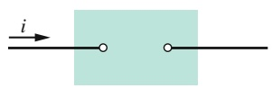

Abb. 23.F1

|  | $\mathcal{E}$ | $r$ | $i$ | Polung |
| --- | --- | --- | --- | --- |
| (1) | $15\mathcal{E}_{1}$ | 0 | $i_{1}$ | +links |
| (2) | $10\mathcal{E}_{1}$ | 0 | $2i_{1}$ | +links |
| (3) | $10\mathcal{E}_{1}$ | 0 | $2i_{1}$ | -links |
| (4) | $10\mathcal{E}_{1}$ | $r_{1}$ | $2i_{1}$ | -links |

**2.** Sind die Widerstände in den Stromkreisen von Abb. 23.F2 jeweils parallel geschaltet, in Reihe oder keines von beiden?

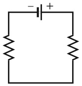

(a)

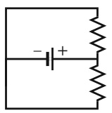

(b)

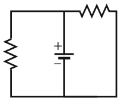

(c)

Abb. 23.F2

**3.** (a) Sind die Widerstände $R _ { 1 }$ und $R _ { 3 }$ im Stromkreis von Abb. 23.F3a in Reihe geschaltet? (b) Sind die Widerstände $R _ { 1 }$ und $R _ { 2 }$ parallel geschaltet? (c) Ordnen Sie die vier Stromkreise aus Abb. 23.F3 in absteigender Reihenfolge nach den äquivalenten Ersatzwiderständen der Widerstandsschaltungen.

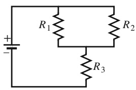

text_image

+
-
R₁
R₂
R₃

(a)

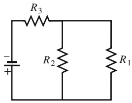

chemical

Simple RC circuit diagram with three resistors R1, R2, and R3 in series and parallel configuration

(b)

Abb. 23.F3

Fragen 3 und 4.

Wenn sich ein Kondensator über einen Widerstand R entlädt, so nimmt seine Ladung gemäß

$$
q = q _ {0} \mathrm{e} ^ {- t / (R C)} \tag {23.32}
$$

mit der Zeit ab. Der Entladestrom ist dabei

$$
i = \frac {\mathrm{d} q}{\mathrm{d} t} = - \left(\frac {q _ {0}}{R C}\right) \mathrm{e} ^ {- t / (R C)}. \tag {23.33}
$$

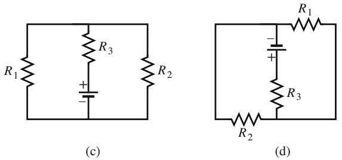

## Abb. 23.F3

Fragen 3 und 4 (Fortsetzung).

**4.** In dem Stromkreis von Abb. 23.F3a sei $R _ { 1 } > R _ { 2 } . \; ( \mathsf { a } )$ Ist die Potenzialdifferenz über $R _ { 1 }$ größer, kleiner oder gleich der Potenzialdifferenz über $R _ { 2 ^ { \ddag } }$ (b) Ist der Strom durch den Widerstand $R _ { 2 }$ größer, kleiner oder gleich dem Strom durch $R _ { 1 } ?$
**5.** Zwei Widerstände $R _ { 1 }$ und $R _ { 2 }$ mit $R _ { 1 } > R _ { 2 }$ werden mit einer Batterie verbunden, zunächst jeweils einzeln, dann in Reihe, dann parallel. Orden Sie diese vier Schaltungen in absteigender Reihenfolge nach dem Betrag des Stroms durch die Batterie.
**6.** Widerstands-Monsternetz. Die Widerstände des in Abb. 23.F6 dargestellten Netzes aus Widerständen und Batterien haben alle denselben Wert von 4,0 Ω, sämtliche als ideal angenommenen Batterien liefern dieselbe Spannung von $^ { 4 , 0 }$ V. Wie groß ist der Strom durch den Widerstand R? (Hinweis: Sobald Sie die geeignete Schleife in diesem Netz gefunden haben, können Sie die Frage in ein paar Sekunden aus dem Kopf beantworten . . . ).

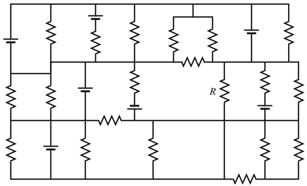

natural_image

Pure electrical circuit lines without any symbols

Abb. 23.F6

564

---

23.6 Fragen

23

**7.** Zunächst sei ein einzelner Widerstand $R _ { 1 }$ mit einer Batterie verbunden, dann werde ein zweiter Widerstand $R _ { 2 }$ parallel dazu geschaltet. Sind (a) die Potenzialdifferenz über den Widerstand $R _ { 1 }$ und (b) der Strom $i _ { 1 }$ durch $R _ { 1 }$ nun größer, kleiner oder genauso groß wie vorher? (c) Ist der zu den beiden Widerständen $R _ { 1 }$ und $R _ { 2 }$ äquivalente Ersatzwiderstand $R _ { 1 2 }$ kleiner, größer oder gleich $R _ { 1 } ?$ (d) Ist der Gesamtstrom durch beide Widerstände größer als, kleiner als oder gleich dem anfänglichen Strom durch $R _ { 1 } ?$
**8.** Kondensator-Monsternetz. Im Netz von Abb. 23.F8 beträgt die Kapazität aller Kondensatoren $6 { , } 0   \mu \mathrm { F }$ und die Spannung sämtlicher Batterien 10 V. Wie groß ist die Kapazität des Kondensators C? (Hinweis: Sobald Sie die geeignete Schleife in diesem Netz gefunden haben, können Sie die Frage in ein paar Sekunden aus dem Kopf beantworten . . . )

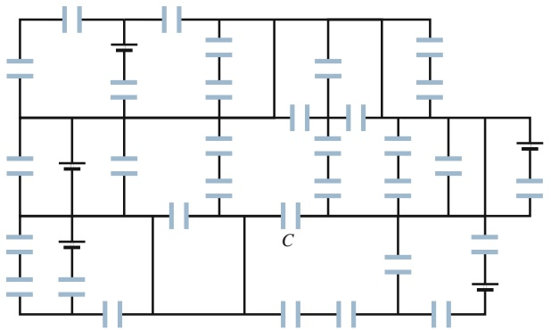

natural_image

Pure electrical circuit lines without any symbols

Abb. 23.F8

**9.** Zunächst sei ein einzelner Widerstand $R _ { 1 }$ mit einer Batterie verbunden, dann werde ein zweiter Widerstand $R _ { 2 }$ in Reihe dazu geschaltet. Sind (a) die Potenzialdifferenz über $R _ { 1 }$ und (b) der Strom $i _ { 1 }$ durch $R _ { 1 }$ nun größer, kleiner oder genauso groß wie anfänglich? (c) Ist der zu den beiden Widerständen $R _ { 1 }$ und $R _ { 2 }$ äquivalente Ersatzwiderstand $R _ { 1 2 }$ kleiner, größer oder gleich $R _ { 1 } ?$
**10.** Abbildung 23.F10 zeigt drei unvollständige Stromkreise, die über einen Schalter nacheinander mit derselben Batterie verbunden werden sollen. Sämtliche Widerstände seien ebenso wie sämtliche Kondensatoren untereinander identisch. Ordnen Sie die drei Fälle in absteigender Reihenfolge nach (a) der (nach einer hinreichend langen Zeit erreichten) Gleichgewichtsladung des Kondensators, (b) der Zeit, nach welcher der Kondensator 50 % seiner Endladung erreicht hat.

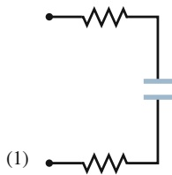

natural_image

Pure electrical circuit lines without any symbols

(2)

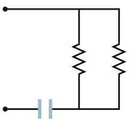

natural_image

Pure electrical circuit lines without any symbols

(3)

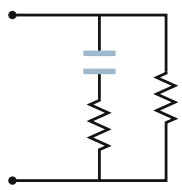

Abb. 23.F10

**11.** Drei Kondensatoren werden nacheinander über denselben Widerstand entladen; Abb. 23.F11 zeigt die jeweiligen zeitlichen Verläufe der Potenzialdifferenz $V ( t )$ über die

Kondensatoren. Ordnen Sie die drei Fälle in absteigender Reihenfolge nach der Kapazität der Kondensatoren.

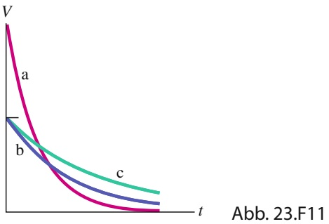

line

| Curve | Trend |
| --- | --- |
| a | Rapidly decaying curve starting from high value |
| b | Moderate decay curve starting from a baseline |
| c | Slowly decaying curve starting from a baseline |

**12.** Abbildung 23.F12 zeigt einen Stromkreis mit einer Batterie und zwei Widerständen. Die Strecke entlang der $x -$ Achse ist in fünf gleich lange Abschnitte a bis e eingeteilt. (a) Nehmen Sie $R _ { 1 } = R _ { 2 }$ an und ordnen Sie die Abschnitte in absteigender Reihenfolge nach dem Betrag des mittleren elektrischen Felds in ihnen. (b) Nehmen Sie jetzt $R _ { 1 } > R _ { 2 }$ an und ordnen Sie die Abschnitte erneut. (c) In welche Richtung zeigt das elektrische Feld auf der x-Achse?

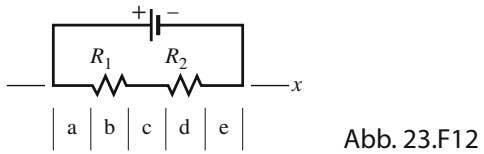

text_image

+
-
R₁ R₂
a b c d e
x
Abb. 23.F12

**13.** Was ist der äquivalente Ersatzwiderstand von drei gleich großen, mit einer idealen Batterie verbundenen Widerständen $R ,$ wenn sie (a) in Reihe und (b) parallel geschaltet sind? (c) Ist die Potenzialdifferenz über die Reihenschaltung größer als, kleiner als oder gleich derjenigen bei Parallelschaltung?
**14.** Zwei Widerstände werden an eine Batterie angeschlossen. (a) In welcher Schaltung (parallel oder in Reihe) sind die Potenzialdifferenzen über jeden Widerstand und den äquivalenten Ersatzwiderstand gleich? (b) In welcher Schaltung sind die Ströme durch jeden Widerstand und durch den äquivalenten Ersatzwiderstand gleich?
**15.** Nachdem der Schalter in Abb. 23.9 in Stellung a geschlossen worden ist, fließt ein Strom i durch den Widerstand R. Abbildung 23.F15 zeigt die zeitliche Entwicklung des Stroms i(t) für die folgenden fünf Wertepaare von R und C: (1) $R _ { 0 }$ und $C _ { 0 } ,   ( 2 )     2 R _ { 0 }$ und $C _ { 0 } ,   ( 3 )     R _ { 0 }$ und $2 C _ { 0 } ,$ (4) $2 R _ { 0 }$ und $2 C _ { 0 }$ . Welches Wertepaar gehört zu welcher Kurve?

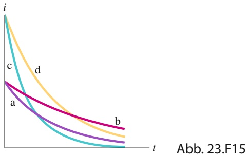

line

| Curve | Description |
| --- | --- |
| a | Lower curve with slowest decay |
| b | Moderate curve with moderate decay |
| c | High initial value that decays rapidly |
| d | Highest initial value that decays more slowly |

565

---

