# 24 Magnetfelder

原始 PDF 第 581–606 页。

# 24 Magnetfelder

## 24.1 Magnetfelder und die Definition von $\vec { B }$

## Physikalische Motivation

Wie wir bereits diskutiert haben, ist es eine wichtige Aufgabe der Physik, die Wir kung eines elektrischen Felds auf ein geladenes Objekt zu untersuchen. Eng damit zusammen hängt die Untersuchung der Frage, wie ein magnetisches Feld eine magnetische Kraft auf eine (bewegte) Ladung hervorruft – oder auf ein magnetisches Objekt, etwa einen Permanentmagneten. Sie haben vielleicht schon eine Ahnung, was da vor sich geht, wenn Sie Kühlschrankmagnete sammeln oder versehentlich Ihre Geldkarte mit einem kräftigen Magneten gelöscht haben.

Die Anwendungen von magnetischen Felder und Kräften sind zahllos und entwickeln sich von Jahr zu Jahr stürmisch weiter. Nur ein paar Beispiele: Jahrzehntelang verwendete die Musikindustrie magnetische Klangaufzeichnung auf Tonbändern oder Musikcassetten. Obwohl dies mittlerweile von der optischen Datenspeicherung auf CDs, DVDs oder Blu-Rays abgelöst wurde, finden Sie auch in CD-Spielern und den Leseköpfen von Computerfestplatten Magnete. Magnete steuern ebenso die schwingenden Membranen in Kopfhörern, Telefonen und den verschiedensten anderen Formen von Lautersprechern. In einem modernen Auto finden sich Dutzende von Magneten, etwa in den Zündkerzen, den automatischen Fensterhebern oder in der Steuerung des Scheibenwischers. Und dass der Elektromotor Ihres repräsentativen neuen E-Mobils ohne (Elektro-)Magnete nicht sehr weit käme, versteht sich fast von selbst. Auch die meisten Alarmanlagen, Türklingeln oder automatischen Türöffner brauchen Magnete. Kurz und gut – Sie sind von Magneten umzingelt!

Die Wissenschaft der magnetischen Felder ist die Physik; ihre Anwendung ist Ingenieurskunst. Beiden liegt die zentrale Frage zugrunde: „Wie entsteht ein magnetisches Feld?“

## 24.1.1 Wie entsteht ein magnetisches Feld?

Da ein elektrisches Feld von einer elektrischen Ladung erzeugt wird, liegt der Verdacht nahe, dass ein Magnetfeld von einer Art „magnetischer Ladung“ hervorgerufen werden müsste. Obwohl solche individuellen magnetischen Ladungen (sogenannte magnetische Monopole) von manchen Theorien vorhergesagt werden, konnte ihre Existenz bisher aber noch nie nachgewiesen werden. Wie entstehen magnetische Felder dann? Es gibt dafür zwei Möglichkeiten.

Eine Methode besteht darin, mithilfe von bewegten elektrisch geladenen Teilchen, etwa den Leitungselektronen in einem stromführenden Draht, einen Elektro magneten zu bilden. Der Strom erzeugt ein Magnetfeld, mit dem man beispielsweise eine Computerfestplatte beschreiben bzw. auslesen oder auch, auf etwas größerem Maßstab, Altmetall sortieren kann (Abb. 24.1). Solche von Strömen hervorgerufene magnetische Felder werden wir in Kap. 29 behandeln.

natural_image

Large industrial turbine with thick black blades pouring into a pile of dark material inside a warehouse (no visible text or symbols)

Abb. 24.1 Ein Elektromagnet hebt und transportiert Metallschrott [Quelle: Digital Vision/Getty Images, Inc.].

Halliday Physik für natur- und ingenieurwiss. Studiengänge, 3. Auflage. D. Halliday, R. Resnick und J. Walker. © 2020 WILEY-VCH Verlag GmbH & Co. KGaA. Published 2020 by WILEY-VCH Verlag GmbH & Co. KGaA.

567

---

24 Magnetfelder

Der andere Weg, ein magnetisches Feld zu erzeugen, nutzt Elementarteilchen wie etwa Elektronen, da diese Teilchen ein intrinsisches („eingebautes“) magnetisches Feld besitzen. Das heißt, das magnetische Feld ist genau wie Masse und elektrische Ladung (oder deren Abwesenheit) eine charakteristische Eigenschaft solcher Teilchen. Wie wir in Kap. 28 sehen werden, können sich die magnetischen Felder der Elektronen in bestimmten Materialien addieren und so ein messbares Magnetfeld in der Umgebung des Materials erzeugen. Dies ist die Grundlage des Magnetismus von Permanentmagneten, etwa an Ihrer Kühlschranktür. In anderen Materialien heben sich die Magnetfelder der Elektronen gegenseitig auf, sodass außerhalb des Materials kein magnetisches Feld wahrgenommen werden kann. Dies ist der Grund, warum z. B. Ihr Körper kein permanentes Magnetfeld besitzt, was gut ist, da Sie sonst Ihre Zeit an der Kühlschranktür neben den ganzen lustigen magnetischen Objekten verbringen müssten.

Unsere erste Aufgabe ist es in diesem Kapitel, das magnetische Feld zu definieren. Dies tun wir auf Grundlage der experimentellen Erfahrungstatsache, dass ein geladenes Teilchen, das sich durch ein Magnetfeld bewegt, eine magnetische Kraftwirkung erfährt.

## 24.1.2 Die Definition von $\vec { B }$

Wir definierten das elektrische Feld $\vec { E }$ in einem Raumpunkt über die Kraft $\vec { F } _ { E }$ auf eine Probeladungq als

$$
\vec {E} = \frac {\vec {F} _ {E}}{q}. \tag {24.1}
$$

Gäbe es magnetische Monopole, so könnten wir das Magnetfeld $\vec { B }$ ganz entsprechend definieren. Da es jedoch bisher keinerlei Anhaltspunkte für die Existenz dieser Monopole gibt, definiert man das Magnetfeld $\vec { B }$ über die Kraft $\vec { F } _ { B } ,$ die auf ein geladenes Probeteilchen wirkt, wenn es sich in einem Magnetfeld bewegt.

Zur experimentellen Umsetzung dieser Definition könnte man ein geladenes Probeteilchen unter verschiedenen Richtungen und mit verschiedenen Geschwindigkeiten durch den Raumpunkt schießen, in welchem man das Feld B⃗ bestimmen möchte, und jeweils die Kraft $\vec { F } _ { B }$ messen, die auf das Teilchen im fraglichen Punkt wirkt. Nach vielen Versuchen dieser Art würde man schließlich feststellen, dass die Kraft $\vec { F } _ { B }$ auf das Teilchen immer dann null ist, wenn sein Geschwindigkeitsvektor $\vec { \nu }$ in einer bestimmten, durch den Punkt verlaufenden Achse im Raum liegt. Für alle übrigen Richtungen von $\vec { \nu }$ ist der Betrag der Kraft $\vec { F } _ { B }$ proportional zuv sin𝜑, wobei 𝜑 den Winkel zwischen dem Geschwindigkeitsvektor $\vec { \vec { \nu } }$ und der Achse bezeichnet, entlang derer die Kraft null ist. Die Richtung von $\vec { F } _ { B }$ ist in jedem Fall senkrecht zu ⃗v. Diese Beobachtungen in ihrer Gesamtheit legen nahe, dass der Zusammenhang zwischen $\vec { \nu }$ und $\vec { F } _ { B }$ die mathematische Form eines Vektorprodukts (Kreuzprodukts) hat.

Nach unseren Beobachtungen können wir daher das Magnetfeld $\vec { B }$ als eine Vektorgröße beschreiben, die parallel zu der Achse gerichtet ist, auf der keine Kraft auf ein geladenes Probeteilchen wirkt. Als Nächstes messen wir den Betrag der Kraft $\vec { F } _ { B }$ für verschiedene Geschwindigkeitsvektoren $\vec { \nu } ,$ die senkrecht zur Feldachse liegen, und definieren den Betrag B des Felds $\vec { B }$ über den Betrag $F _ { B }$ der Kraft $\vec { F } _ { B }$ als

$$
B = \frac {F _ {B}}{| q | \nu},
$$

wobei $q$ die Ladung des Probeteilchens bezeichnet.

Alle beschriebenen Beobachtungen kann man in der folgenden Vektorgleichung zusammenfassen:

$$
\vec {F} _ {B} = q \vec {\nu} \times \vec {B}. \tag {24.2}
$$

568

---

24.1 Magnetfelder und die Definition von B⃗

24

Diese Gleichung besagt, dass die Kraft $\vec { F } _ { B }$ auf ein Teilchen der Ladung $q ,$ das sich mit der Geschwindigkeit v⃗ in einem Magnetfeld $\vec { B }$ bewegt, durch das Produkt aus der Ladung q des Teilchens und dem Vektorprodukt seiner Geschwindigkeit ⃗v mit dem Feldvektor $\vec { B }$ (gemessen in demselben Bezugssystem) gegeben ist. Schreibt man den Betrag des Vektorprodukts nach den Regeln der Vektorrechnung (vgl. Anhang D), so erhält man für den Betrag von $\vec { \bar { F } } _ { B }$

$$
F _ {B} = | q | \nu B \sin \varphi , \tag {24.3}
$$

wobei 𝜑 den Winkel zwischen den Richtungen der Vektoren v⃗ und $\vec { B }$ bezeichnet.

## Die magnetische Kraft auf ein Teilchen

Nach Gl. 24.3 ist der Betrag der Kraft $\vec { F } _ { B } ,$ die auf ein Teilchen mit der Ladung q und der Geschwindigkeit v⃗ in einem Magnetfeld wirkt, proportional zur dieser Ladung q sowie zur Geschwindigkeit v des Teilchens. Diese Kraft ist folglich null, wenn entweder die Ladung des Teilchens null ist oder das Teilchen sich in Ruhe befindet. Aus Gl. 24.3 liest man außerdem ab, dass die Kraft $F _ { B }$ auch dann null sein muss, wenn die Vektoren v⃗ und $\vec { B }$ entweder parallel $( \varphi = 0 ^ { \circ } )$ oder antiparallel $\left( \varphi = 1 8 0 ^ { \circ } \right)$ zueinander gerichtet sind. Dagegen wird die Kraft maximal, wenn die beiden Vektoren senkrecht aufeinander stehen.

Gleichung 24.2 fasst alle diese Eigenschaften zusammen und gibt darüber hinaus auch die Richtung des Vektors $\vec { F } _ { B }$ an: Aus der Vektorrechnung (vgl. Anhang D) wissen wir, dass das in Gl. 24.2 auftretende Vektorprodukt $\vec { \nu } \times \vec { B }$ selbst ein Vektor ist, der zu beiden Faktoren v⃗ und $\vec { B }$ des Produkts senkrecht steht. Die Rechte-Hand-Regel für Vektorprodukte (Abb. 24.2a) besagt, dass der Daumen der rechten Hand in die Richtung von $\vec { \nu } \times \vec { B }$ zeigt, wenn die Finger dieser Hand den Vektor v⃗ zum Vektor B⃗ hin drehen. Ist die Ladung q positiv, so hat die Kraft $\vec { F } _ { B }$ nach Gl. 24.2 das gleiche Vorzeichen wie das Vektorprodukt $\vec { \nu } \times \vec { B }$ und deshalb auch die gleiche Richtung. Für positive q zeigt die Kraft $\stackrel { \rightarrow } { \overleftrightarrow { F } } _ { B }$ daher in Richtung des Daumens (Abb. 24.2b). Ist $q$ dagegen negativ, so haben die Kraft $\vec { F } _ { B }$ und das Vektorprodukt $\vec { \nu } \times \vec { B }$ unterschiedliche Vorzeichen und sind folglich einander entgegengesetzt gerichtet: Die Richtung von $\vec { \bar { F } } _ { B }$ ist der Richtung des Daumens in Abb. 24.2c entgegengesetzt. Unabhängig vom Vorzeichen der Probeladung gilt:

Die Kraft $\vec { \bar { F } } _ { B }$ auf ein geladenes Teilchen, das sich mit der Geschwindigkeit ⃗v durch ein Magnetfeld B⃗ bewegt, steht immer sowohl auf v⃗ als auch auf $\vec { B }$ senkrecht.

Insbesondere schließt man aus diesem Satz, dass $\vec { F } _ { B }$ keine Komponente parallel zu ⃗v haben kann. Dies bedeutet aber, dass die Kraft $\vec { F } _ { B }$ den Betrag v der Geschwindig keit des Teilchens und damit auch dessen kinetische Energie niemals ändern kann. Diese Kraft kann ausschließlich die Richtung des Vektors v⃗ ändern, also die Bewegungsrichtung des Teilchens – nur in diesem Sinn kann die Kraft $\dot { \vec { F } } _ { B }$ das Teilchen beschleunigen.

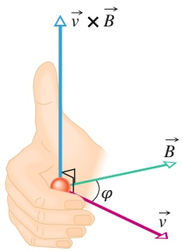

text_image

v × B
φ
B
v

(a)

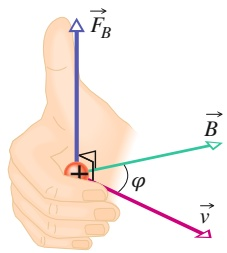

text_image

F_B
B
φ
v

(b)

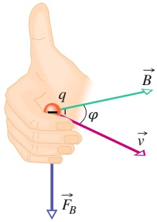

text_image

q
φ
B
v
F_B

(c)

## Abb. 24.2

(a) Die Rechte-Hand-Regel: Dreht man den Vektor ⃗v durch den kleineren Winkel 𝜑 zwischen beiden zum Vektor B⃗ hin (also in Richtung der Finger), so zeigt der Daumen in Richtung des Vektorprodukts $\vec { \nu } \times \vec { B } .$ (b) Ist q positiv, so zeigt die Kraft $\vec { F } _ { B } = q \vec { \nu } \times \vec { B }$ in Richtung von v⃗ × B⃗ . (c) Ist q negativ, so sind $\vec { \bar { F } } _ { B }$ und $\vec { \nu } \times \vec { B }$ antiparallel.

569

---

24 Magnetfelder

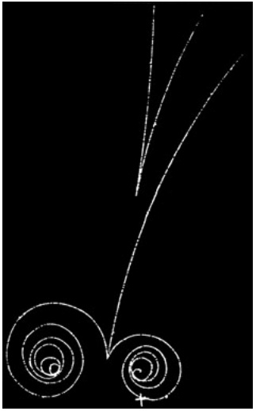

natural_image

Abstract diagram with two spiral shapes and curved lines against a black background (no text or symbols)

Abb. 24.3

Eine Blasenkammer kann Teilchenspuren unmittelbar sichtbar machen. Steht ein Magnetfeld senkrecht auf der Bildebene, sind die Bahnen von geladenen Teilchen gekrümmt [Quelle: LBNL/Science Source].

Eine anschauliche Vorstellung der praktischen Konsequenzen von Gl. 24.2 vermittelt Abb. 24.3: Man sieht hier die „Spuren“ hochenergetischer Elektronen und Positronen, die diese Teilchen beim Durchfliegen einer sogenannten Blasenkammer am Lawrence Berkeley Laboratory hinterlassen haben. Die Blasenkammer ist mit flüssigem Wasserstoff gefüllt und befindet sich in einem starken, homogenen Magnetfeld. Ein von oben einfallendes Gamma-Quant, das selbst ungeladen ist und deshalb keine Spur hinterlässt, wandelt sich in ein Elektron und ein Positron um, die an ihren entgegengesetzt gekrümmten Spiralbahnen zu erkennen sind. Außerdem wird dabei ein weiteres Elektron (schwach gekrümmte Bahn) aus einem Wasserstoffatom herausgeschlagen. Die Spuren im oberen Bildteil stammen aus einem anderen Prozess.

Für die SI-Einheit des Magnetfelds $\vec { B }$ erhält man aus den Gln. 24.2 und 24.3 Newton pro Coulomb und Meter pro Sekunde; sie wird als **Tesla** (T) bezeichnet:

$$
1 \text {Tesla} = 1 \mathrm{T} = 1 \frac {\text {Newton}}{(\text {Coulomb}) (\text {Meter / Sekunde})}.
$$

Wir erinnern uns, dass ein Coulomb pro Sekunde gerade ein Ampere ist, daher ist

$$
1 \mathrm{T} = 1 \frac {\text {Newton}}{(\text {Coulomb / Sekunde}) (\text {Meter})} = 1 \frac {\mathrm{N}}{\mathrm{A} \cdot \mathrm{m}}. \tag {24.4}
$$

Eine andere (Nicht-SI-)Einheit für $\vec { B }$ ist das noch immer gelegentlich, vor allem von Theoretikern verwendete Gauß (G):

$$
1 \text {Tesla} = 1 0 ^ {4} \text {Gauß}. \tag {24.5}
$$

Tabelle 24.1 zeigt typische Größenordnungen einer Reihe von natürlichen und technischen Magnetfeldern. Das Magnetfeld der Erde beträgt an ihrer Oberfläche ungefähr $1 0 ^ { - 4 }   \mathrm { T }   \mathrm { \widetilde { ( = 1 0 0   \mu T } }$ oder 1 G).

TABELLE 24.1:

Typische Größenordnungen einiger Magnetfelder.

| Ort | Feldstärke (T) |
| --- | --- |
| an der Oberfläche eines Neutronensterns | $10^{8}$ |
| in der Nähe eines großen Elektromagneten | 1,5 |
| in der Nähe eines kleinen Stabmagneten | $10^{-2}$ |
| an der Erdoberfläche | $10^{-4}$ |
| im interstellaren Raum | $10^{-10}$ |
| kleinster Wert in einem magnetisch abgeschirmten Raum | $10^{-14}$ |

## KONTROLLFRAGE 1

Die Abbildung zeigt drei Situationen, in denen sich ein geladenes Teilchen mit der Geschwindigkeit v⃗ durch ein homogenes Magnetfeld $\vec { B }$ bewegt. Welche Richtung hat jeweils die auf das Teilchen wirkende Kraft $\vec { F } _ { B } { } _ { \bullet } ^ { 2 }$

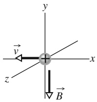

text_image

y
→
v
x
z
B

(a)

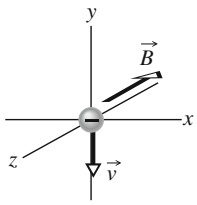

text_image

y
B
x
z
v

(b)

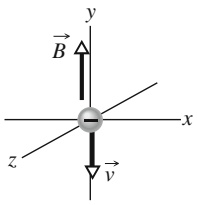

text_image

y
B
-
x
z
v

(c)

570

---

24.1 Magnetfelder und die Definition von B⃗

24

## Magnetische Feldlinien

Genau wie bei den elektrischen Feldern können wir auch den räumlichen Verlauf von Magnetfeldern anschaulich durch Feldlinien darstellen. Die Regeln dafür sind ganz entsprechend: (1) Die Richtung des Felds B⃗ ist in jedem Raumpunkt durch die Richtung der Tangente an die Feldlinie gegeben, die durch diesen Punkt verläuft. (2) Der lokale Abstand der Feldlinien ist proportional zum Betrag des Felds B⃗ in diesem Raumbereich: Das Feld ist umso stärker, je dichter die Feldlinien liegen.

Abbildung 24.4 zeigt ein Beispiel, wie man das Magnetfeld in der Umgebung eines Stabmagneten (eines Permanentmagneten in Form eines länglichen Quaders) durch magnetische Feldlinien darstellen kann. Beachten Sie, dass alle Feldlinien durch den Körper des Magneten hindurchtreten und immer geschlossen sind – auch jene Linien, die in der Zeichnung nicht vollständig dargestellt werden können. Die magnetischen Kraftwirkungen eines Stabmagneten im umgebenden Raum sind in der Nähe seiner beiden Enden am stärksten; entsprechend liegen die Feldlinien in diesen Bereichen am dichtesten.

Die geschlossenen magnetischen Feldlinien treten an einem Ende des Stabmagneten ein und verlassen ihn am anderen Ende wieder. Das Ende des Magneten, an dem die Feldlinien austreten, bezeichnet man als seinen Nordpol; das entgegengesetzte Ende, an dem die Feldlinien wieder in den Körper des Magneten eintreten, ist der Südpol. Die Magnete, die man gewöhnlich verwendet, um Notizzettel an Kühlschranktüren zu befestigen, sind sehr flache Stabmagnete. Abbildung 24.5 zeigt zwei andere weit verbreitete Formen von Magneten: einen Hufeisenmagneten sowie einen Magneten, dessen Körper in Form des Buchstaben C gebogen ist, sodass seine beiden Polschuhe einander gegenüberliegen. (Das Feld zwischen diesen eng beisammen liegenden Polschuhen ist annähernd homogen.) Unabhängig von der jeweiligen Form der Magnete machen wir die folgende Beobachtung, wenn wir zwei von ihnen einander nähern:

Ungleichnamige magnetische Pole ziehen einander an, gleichnamige stoßen einander ab.

Die Erde besitzt ein Magnetfeld, das im zähflüssigen Eisenkern des Planeten durch einen noch immer nicht völlig verstandenen Mechanismus entsteht. Auf der Oberfläche der Erde kann man dieses Feld mit einem Kompass nachweisen, der im Wesentlichen nichts anderes als ein kleiner, leichter Stabmagnet ist, der auf einer Spitze leicht beweglich gelagert ist. Diese Kompassnadel richtet sich aus, da ihr Nordpol vom magnetischen Südpol der Erde, der in der arktischen Region Kanadas liegt, angezogen wird. Es wäre folgerichtig, diesen Pol der Erde als ihren Südpol zu bezeichnen. Da man aber aus historischen Gründen diese Richtung auf der Erdoberfläche als Norden bezeichnet, liegt somit der magnetische Südpol der Erde in der Nähe ihres geografischen Nordpols.

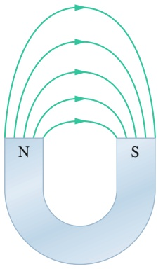

text_image

N
S

(a)

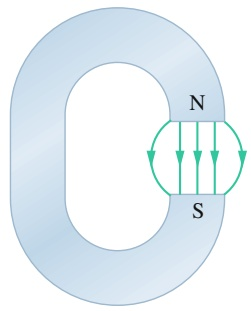

text_image

N
S

(b)

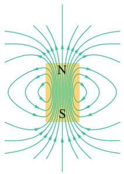

text_image

N
S

Abb. 24.4

Die magnetischen Feldlinien eines Stabmagneten.

(a) Ein Hufeisenmagnet.

(b) Ein offener Ringmagnet.

(In beiden Fällen sind nur einige der Feldlinien eingezeichnet.)

Abb. 24.5

571

---

24 Magnetfelder

## 24.2 Gekreuzte Felder: Die Entdeckung des Elektrons

## Lernziele

Nach dem Durcharbeiten dieses Abschnitts sollten Sie in der Lage sein, . . .

• J.J. Thomsons Experiment mit gekreuzten Feldern zu beschreiben,
• die resultierende Kraft auf ein geladenes Teilchen, das sich gleichzeitig durch ein magnetisches und ein elektrisches Feld bewegt, sowohl in Einheitsvektorenals auch in Betrag-Winkel-Notation anzugeben,
• in Situationen, in denen die magnetische und die elektrische Kraft auf ein Teil chen in entgegengesetzte Richtungen zeigen, heraufzufinden, für welche Geschwindigkeiten die Kräfte einander aufheben bzw. die magnetische oder elektrische Kraft über die jeweils andere dominiert.

## Schlüsselideen

• Wenn sich ein geladenes Teilchen durch ein Gebiet bewegt, wo sowohl ein elektrisches als auch ein magnetisches Feld besteht, spürt es Kräfte aufgrund von beiden Feldern.
• Wenn die beiden Felder senkrecht aufeinander stehen, spricht man von gekreuzten Feldern.
• Wenn die Kräfte in entgegengesetzte Richtungen zeigen, existiert eine Geschwindigkeit, für die das Teilchen nicht abgelenkt wird.

## 24.2.1 Gekreuzte Felder: Die Entdeckung des Elektrons

Sowohl ein elektrisches Feld $\vec { E }$ als auch ein Magnetfeld $\vec { B }$ können eine Kraft auf ein geladenes Teilchen ausüben. Überlagert man beide Feldarten senkrecht zueinander, so spricht man von gekreuzten Feldern. In diesem Abschnitt untersuchen wir das Verhalten geladener Teilchen, insbesondere von Elektronen, die sich in einem Raumbereich mit gekreuzten Feldern bewegen. Als Beispiel betrachten wir die experimentelle Anordnung, mit der J.J. Thomson im Jahr 1897 in Cambridge das Elektron entdeckte.

Abbildung 24.6 zeigt eine moderne, auf das Wesentliche reduzierte Version von Thomsons Anordnung: eine Kathodenstrahlröhre ähnlich der Bildröhre eines alten Fernsehgeräts. Geladene Teilchen (die wir heute als Elektronen kennen) werden aus einem glühenden Draht am linken Ende der evakuierten Glasröhre emittiert und durch eine von außen angelegte Potenzialdifferenz V beschleunigt. Durch eine kleine Öffnung im Schirm C tritt ein schmaler Elektronenstrahl in den rechten Teil der Röhre. Er durchquert dort einen Raumbereich mit gekreuzten Feldern E⃗ und $\vec { B }$ und trifft schließlich auf den Leuchtschirm ${ \sf S } ,$ wo er einen kleinen Lichtfleck erzeugt. (Das Bild auf den Bildschirmen alter Fernseher oder Computermonitore war aus vielen solchen Lichtflecken aufgebaut.) Im Bereich der gekreuzten Felder wirken Kräfte auf die Elektronen, die den Elektronenstrahl aus dem Zentrum des Schirms heraus ablenken. Durch Verändern von Richtung und Stärke dieser Felder kann man daher den Auftreffpunkt des Elektronenstrahls auf dem Schirm in weiten Grenzen verschieben. Wir erinnern uns, dass die Kraft auf ein negativ geladenes Teilchen in einem elektrischen Feld dem Feld entgegen gerichtet ist. Wenn die beiden Felder wie in Abb. 24.6 dargestellt angeordnet sind, werden die Elektronen von dem elektrischen Feld E⃗ in der Papierebene nach oben abgelenkt, von dem Magnetfeld B⃗ dagegen in der Papierebene nach unten: Die Ablenkkräfte des elektrischen und des Magnetfelds wirken einander entgegen. Thomson ging bei seinen Experimenten wie folgt vor:

1. Er wählte $E = 0$ und $B = 0$ und markierte die Position des Lichtflecks, den der nicht abgelenkte Elektronenstrahl auf dem Leuchtschirm S erzeugte.
2. Als Nächstes stellte er einen von null verschiedenen Wert des elektrischen Felds $\vec { E }$ ein und maß die sich ergebende Ablenkung des Lichtflecks.

572

---

24.2 Gekreuzte Felder: Die Entdeckung des Elektrons

24

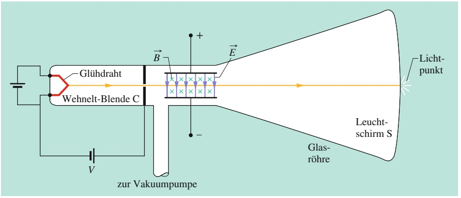

flowchart

3. Bei konstantem $\vec { E }$ regelte er nun die Stärke des Magnetfelds $\vec { B } \: { \mathrm { s o } } ,$ dass der Lichtfleck zu seiner ursprünglichen Position zurückkehrte. (Da die elektrischen und magnetischen Kräfte einander entgegengesetzt sind, kann man die resultierende Kraft zum Verschwinden bringen.)

Bereits in Beispielaufgabe 18.4 im Übungsbuch hatten wir die Ablenkung eines geladenen Teilchens untersucht, das sich im elektrischen Feld $\vec { E }$ zwischen zwei geladenen Platten bewegt (in unserem Beispiel Schritt 2). Für die Ablenkung $y$ des Teilchens nach vollständigem Durchlaufen des Plattenzwischenraums der Länge L hatten wir dort erhalten

$$
y = \frac {q E L ^ {2}}{2 m v ^ {2}}, \tag {24.6}
$$

wobei $\nu$ die Geschwindigkeit des Teilchens, m seine Masse und $q$ seine Ladung bezeichnen. Wir können diesen Zusammenhang nun auf die Ablenkung des Elektronenstrahls in der Kathodenstrahlröhre aus Abb. 24.6 anwenden; aus der gemessenen Ablenkung des Lichtflecks auf dem Leuchtschirm kann man über einfache geometrische Überlegungen auf die Ablenkung y der Elektronen beim Verlassen des Plattenzwischenraums schließen. (Da die Richtung der Ablenkung vom Vorzeichen der Ladung des Teilchens abhängt, konnte Thomson zeigen, dass die Teilchen, die den Lichtfleck auf dem Schirm erzeugen, negativ geladen sein müssen.)

Regelt man die jeweiligen Feldstärken in Abb. 24.6 so, dass die beiden Ablenkkräfte einander kompensieren (Schritt 3), so erhält man durch Gleichsetzen der Gln. 24.1 und 24.3 für die elektrische und die magnetische Kraft

$$
| q | E = | q | \nu B \sin (9 0 ^ {\circ}) = | q | \nu B
$$

oder

$$
\nu = \frac {E}{B}. \tag {24.7}
$$

Die Anordnung der gekreuzten Felder gestattet somit die Messung der Geschwindigkeit v eines geladenen Teilchens, das sich durch diese Felder bewegt. Setzt man Gl. 24.7 für v in Gl. 24.6 ein und ordnet um, so erhält man

$$
\frac {m}{q} = \frac {B ^ {2} L ^ {2}}{2 y E}. \tag {24.8}
$$

Alle Größen auf der rechten Seite dieser Gleichung können gemessen werden. Die Anordnung der gekreuzten Felder gestattet somit die Messung des Verhältnisses $m / q$ für Teilchen, die sich durch diese Feldanordnung bewegen. Gleichung 24.8 gilt jedoch nur, wenn die Vektoren so gerichtet sind, dass die elektrische und die magnetische Kraft einander entgegenwirken – in den Aufgaben am Ende des Kapitels werden Sie auch andere Situationen antreffen!

## Abb. 24.6

Eine moderne Version der von J.J. Thomson zur Messung des Verhältnisses von Ladung und Masse des Elektrons entworfenen Versuchsanordnung. Eine mit den Ablenkplatten zu verbindende Batterie erzeugt ein elektrisches Feld E⃗ zwischen den Platten (blaue Pfeile), ein Magnetfeld B⃗ (grüne Kreuze) wird durch stromdurchflossene Spulen erzeugt, die der Übersichtlichkeit wegen hier nicht gezeigt sind. In der dargestellten Anordnung zeigt das Magnetfeld senkrecht in die Papierebene hinein, was durch das Gitter von Kreuzen symbolisiert wird, die man sich als die gefiederten Enden von wegfliegenden (Vektor-)- Pfeilen vorstellen kann.

573

---

24 Magnetfelder

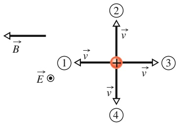

text_image

B
E ⊙
① ← v
② → v
③ → v
④ → v

Thomson vermutete, dass die Teilchen, die er entdeckt hatte, in jeder Art von Materie vorkämen. Er vermutete weiterhin, dass sie um einen Faktor von mehr als 1000 leichter seien als das leichteste bekannte Atom, das Wasserstoffatom – ein Massenverhältnis, das später zu 1836,15 gemessen wurde. Thomsons Messung des Verhältnisses $m / q$ führte zusammen mit der Treffsicherheit seiner beiden Vermutungen dazu, dass er heute als „Entdecker des Elektrons“ gilt.

## KONTROLLFRAGE 2

Die Abbildung zeigt vier Richtungen des Geschwindigkeitsvektors $\vec { \nu }$ eines positiv geladenen Teilchens, das sich durch ein homogenes elektrisches Feld $\vec { E }$ bewegt, das aus der Papierebene herauszeigt und in der Skizze durch den eingekreisten Punkt angedeutet wird und dem ein homogenes Magnetfeld $\vec { B }$ überlagert ist. (a) Ordnen Sie die Richtungen 1, 2 und 3 in absteigender Reihenfolge nach dem Betrag der resultierenden Kraft auf das Teilchen. (b) Für welche der vier Richtungen könnte die resultierende Kraft null werden?

## 24.3 Gekreuzte Felder: Der Hall-Effekt

## Lernziele

Nach dem Durcharbeiten dieses Abschnitts sollten Sie in der Lage sein, . . .

• den Hall-Effekt in einem stromdurchflossenen Metallstreifen zu beschreiben und zu erklären, wie das elektrische Feld entsteht und was seinen Betrag begrenzt,
• die Vektoren des magnetischen und des elektrischen Felds, die Geschwindigkeitsvektoren der Leitungselektronen sowie die Vektoren der auf diese wirkenden magnetischen und elektrischen Kräfte in eine Versuchsskizze des Hall-Effekts einzuzeichnen,
• die Beziehung zwischen der Hall-Spannung $V ,$ der elektrischen Feldstärke E und der Streifenbreite d anzuwenden,
• die Beziehung zwischen der Ladungsträger-Anzahldichte $n ,$ der magnetischen Feldstärke B, der Stromstärke i und der Hall-Spannung $V$ anzuwenden,
die Ergebnisse des Hall-Versuchs auf ein leitendes Objekt zu übertragen, das sich durch ein homogenes Magnetfeld bewegt, und dabei die „Streifenbreite“, über welche die Hall-Spannung abfällt, zu identifizieren sowie diese Spannung zu berechnen.

## Schlüsselideen

• Wenn ein homogenes Magnetfeld $\vec { B }$ auf einen von einem Strom i durchflossenen leitfähigen Streifen wirkt und das Feld senkrecht auf der Stromrichtung steht, wird eine Hall-Spannung (Potenzialdifferenz) V über die Streifenbreite induziert.
• Die elektrische Kraft $\vec { F } _ { E }$ auf die Ladungsträger steht dann im Kräftegleichgewicht mit der auf sie wirkenden magnetischen Kraft $\vec { F } _ { B }$
• Die Anzahldichte n der Ladungsträger ist

$$
n = \frac {B i}{V l e},
$$

wobei l die Dicke des Streifens (parallel zu $\vec { B } )$ ist.

• Bewegt sich ein Leiter mit dem Geschwindigkeitsbetrag v durch ein homogenes Magnetfeld ${ \vec { B } } ,$ ist die Hall-Spannung

$$
V = \nu B d,
$$

wenn d die Breite senkrecht sowohl zu $\vec { \nu }$ als auch zu $\vec { B }$ ist.

574

---

24.3 Gekreuzte Felder: Der Hall-Effekt

24

## 24.3.1 Gekreuzte Felder: Der Hall-Effekt

Wie wir gesehen haben, wird ein Strahl von Elektronen, die sich im Vakuum ausbreiten, durch ein Magnetfeld abgelenkt. Gilt Entsprechendes auch für die Leitungselektronen, die in einem Leiter driften, durch den ein elektrischer Strom fließt? Im Jahr 1879 demonstrierte Edwin H. Hall, damals ein 24 Jahre alter Student an der Johns Hopkins University in Baltimore, dass auch Elektronenströme in elektrischen Leitern durch Magnetfelder abgelenkt werden können. Dieses nach seinem Entdecker als Hall-Effekt benannte Phänomen gestattet es zu entscheiden, ob die Ladungsträger in einem Leiter positiv oder negativ geladen sind. Darüber hinaus kann man mithilfe dieses Effekts die Ladungsträgerkonzentration in einem Leiter messen, also die Anzahl von Ladungsträgern pro Volumeneinheit.

Abbildung 24.7a zeigt ein Kupferband der Breite $d ,$ in dem ein Strom i fließt, dessen konventionelle Stromrichtung von oben nach unten durch den Strompfeil angedeutet ist. Die Ladungsträger im Kupfer sind Elektronen, und sie driften, wie wir bereits wissen, mit der Driftgeschwindigkeit $\nu _ { \mathrm { D } }$ entgegen der konventionellen Stromrichtung von unten nach oben. Abbildung 24.7a zeigt das Kupferband, unmittelbar nachdem ein externes Magnetfeld $\vec { B }$ eingeschaltet wurde, das senkrecht in die Papierebene hineinzeigt. Nach Gl. 24.2 wirkt auf jedes einzelne der driftenden Elektronen eine Kraft $\vec { F } _ { B } ,$ die es zum rechten Rand des Kupferstreifens hin ablenkt.

Mit der Zeit sammeln sich daher Elektronen am rechten Rand des Streifens und hinterlassen am linken Rand unkompensierte, ortsfeste positive Ladungen. Durch diese Ladungstrennung baut sich ein elektrisches Feld $\vec { E }$ innerhalb des Kupferstreifens auf, das wie in Abb. 24.7b dargestellt von links nach rechts gerichtet ist. Die in diesem Feld auf jedes Elektron wirkende elektrische Kraft $\vec { F } _ { E }$ zieht die Elektronen nach links.

Im Gleichgewicht, das sich rasch einstellt, kompensiert die elektrische Kraft auf ein Elektron die auf das Teilchen wirkende magnetische Kraft. Die von den Feldern $\vec { E }$ und $\vec { B }$ verursachten Kräfte sind nun, wie in Abb. 24.7b verdeutlicht, miteinander im Gleichgewicht. Die Elektronen driften mit der Geschwindigkeit $\vec { \nu } _ { \mathrm { D } }$ von unten nach oben durch den Kupferstreifen. An der rechten Kante des Streifens sammeln sich im Folgenden keine weiteren Ladungsträger mehr an und das elektrische Feld $\vec { E }$ bleibt konstant.

Mit dem elektrischen Feld über den Streifen der Breite d ist eine Potenzialdifferenz (oft Hall-Spannung genannt) verbunden. Nach Gl. 20.40 ist der Betrag dieser Potenzialdifferenz

$$
V = E d. \tag {24.9}
$$

Verbinden wir ein Voltmeter mit den beiden Kanten des Kupferbands, so können wir diese Potenzialdifferenz messen. Darüber hinaus kann man mithilfe des Volt meters feststellen, welche der beiden Kanten auf dem höheren Potenzial liegt. In der Anordnung von Abb. 24.7a würden wir beobachten, dass die linke Kante des Bands auf dem höheren Potenzial liegt, im Einklang mit unserer Annahme, dass die Ladungsträger (die Leitungselektronen des Kupfers) negativ geladen sind.

Nehmen wir probeweise an, die Ladungsträger, die den Strom i ausmachen, seien positiv geladen (Abb. 24.7c). Überzeugen Sie sich davon, dass positive Ladungsträ- ger, wenn sie sich im Kupferband von oben nach unten bewegen, durch die magnetische Kraft $\vec { F } _ { B }$ nach rechts getrieben werden, sodass folglich die rechte Kante des Bands auf dem höheren Potenzial liegen würde. Da das Ergebnis einer Messung mit dem Voltmeter dem widerspricht, müssen die Ladungsträger im Kupferband negativ geladen sein.

Betrachten wir nun die Situation quantitativ. Wenn die elektrischen und magnetischen Kräfte einander ausgleichen (Abb. 24.7b), erhalten wir durch Gleichsetzen der Gln. 24.1 und 24.3

$$
e E = e \nu_ {\mathrm{D}} B. \tag {24.10}
$$

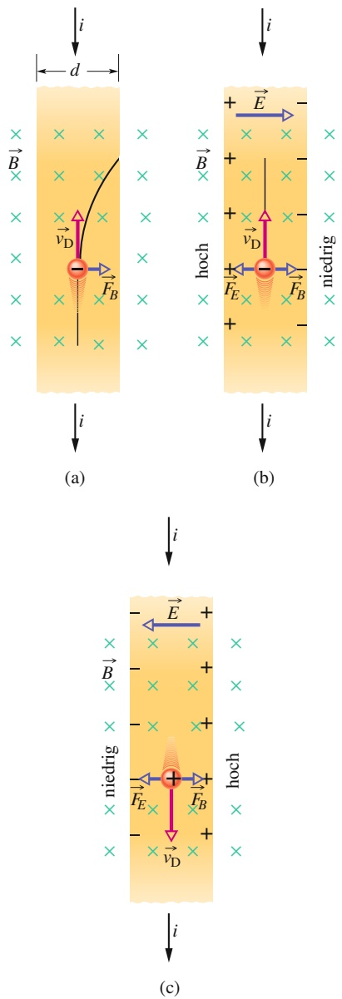

Abb. 24.7

Ein Kupferstreifen, in dem ein elektrischer Strom i fließt, befindet sich in einem Magnetfeld B⃗ . (a) Die Situation unmittelbar nach dem Einschalten des Magnetfelds. Die gekrümmte Flugbahn eines Elektrons im Magnetfeld ist angedeutet. (b) Der sich rasch einstellende Gleichgewichtszustand: Negative Ladungsträger häufen sich an der rechten Seite des Kupferstreifens an, sodass unkompensierte positive Ladungen an der linken Seite zurückbleiben. Das elektrische Potenzial der linken Seite ist nun höher als das Potenzial der rechten Seite. (c) Wären die Ladungsträger bei gleicher Stromrichtung positiv geladen, so würden sich diese positiven Ladungsträger an der rechten Seite anhäufen, und die Potenzialverhältnisse wären umgekehrt.

575

---

24 Magnetfelder

Nach Gl. 22.7 ist die Driftgeschwindigkeit der Ladungsträger

$$
\nu_ {\mathrm{D}} = \frac {J}{n e} = \frac {i}{n e A}, \tag {24.11}
$$

worin $J   =   i / A$ die Stromdichte im Kupferband, A die Querschnittsfläche des Bands sowie n die Anzahldichte der Ladungsträger (ihre Anzahl pro Volumeneinheit) bezeichnen.

Nun ersetzen wir $E$ in Gl. 24.10 durch Gl. 24.9 sowie $\nu _ { \mathrm { D } }$ durch Gl. 24.11 und erhalten so

$$
n = \frac {B i}{V l e}, \tag {24.12}
$$

wobei $l = A / d$ die Dicke des Bands bezeichnet. Diese Gleichung drückt n durch messbare Größen aus.

Mithilfe des Hall-Effekts kann man die Driftgeschwindigkeit $\nu _ { \mathrm { D } }$ der Ladungsträger messen, die, wie wir uns erinnern, von der Größenordnung Zentimeter pro Stunde ist. Bei diesem geschickten Experiment bewegt man das Kupferband mechanisch durch das Magnetfeld in eine Richtung, die der Driftrichtung der Ladungsträger entgegengesetzt ist. Man justiert dabei die Geschwindigkeit des Bands $\mathbf { s o } ,$ dass die Potenzialdifferenz des Hall-Effekts null wird. Ist diese Bedingung erfüllt, so muss die Geschwindigkeit der Ladungsträger relativ zum Laborsystem null sein und die Geschwindigkeit des Kupferbands muss gleich der Driftgeschwindigkeit der negativen Ladungsträger (ihr aber entgegengesetzt) sein.

## KONTROLLFRAGE 3

Die Abbildung zeigt einen quaderförmigen Körper aus Metall, der sich mit einer Geschwindigkeit ⃗v durch ein homogenes Magnetfeld $\vec { B }$ bewegt. Seine Abmessungen sind die in der Skizze angegebenen Vielfachen einer Länge d. Der Körper habe sechs mögliche Bewegungsrichtungen: parallel zu den Koordinatenachsen $x ,   y$ und z jeweils in die positive oder negative Richtung. (a) Ordnen Sie die sechs Bewegungsmöglichkeiten in absteigender Reihenfolge nach der Potenzialdifferenz, die sich dabei zwischen jeweils zwei einander gegenüberliegenden Flächen des Körpers einstellt. (b) Bei welcher der Bewegungsarten liegt die Frontfläche auf dem niedrigeren Potenzial?

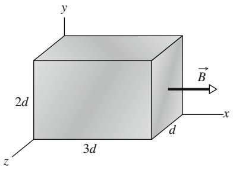

text_image

y
2d
z
3d
x
d
B

## 24.4 Geladene Teilchen auf einer Kreisbahn

## Lernziele

Nach dem Durcharbeiten dieses Abschnitts sollten Sie in der Lage sein $1 , \ldots .$

• anzugeben, unter welchen Bedingungen sich ein geladenes Teilchen durch ein homogenes Magnetfeld geradlinig, auf einer Kreisbahn oder auf einer Schraubenbahn bewegt,
den Radius r der Kreisbahn eines (gleichförmig rotierenden) geladenen Teilchen in einem Magnetfeld zu berechnen, indem Sie mithilfe des zweiten Newtonschen Gesetzes einen Ausdruck für r als Funktion der Feldstärke $B ,$ der Teilchenmasse m sowie der Beträge q und v von Ladung und Geschwindigkeit her leiten,
Geschwindigkeit, Zentripetalkraft, Zentripetalbeschleunigung, Bahnradius, Periode, Frequenz und Winkelgeschwindigkeit der Bewegung eines geladenen Teilchens auf einer Kreisbahn in einem homogenen magnetischen Feld zu berechnen, Beziehungen zwischen diesen Größen anzugeben und zu erkennen, welche dieser Größen von der Geschwindigkeit abhängen und welche nicht,
• die Vektoren von Magnetfeld und Geschwindigkeit, deren Vektor- bzw. Kreuzprodukt und den magnetischen Kraftvektor für positiv und negativ geladene Teilchen auf einer Kreisbahn im homogenen Magnetfeld zu skizzieren,

576

---

24.4 Geladene Teilchen auf einer Kreisbahn

24

den Weg eines geladenen Teilchens auf einer helikalen Bahn (Schraubenlinie) durch ein magnetisches Feld zu skizzieren, einschließlich des Magnetfeldvek tors, der Steigung (Ganghöhe) der Bahn, des Krümmungsradius und der zum Magnetfeld parallelen und senkrechten Komponente der Teilchengeschwindig keit,
• für eine helikale Bewegung durch ein magnetisches Feld die Beziehung zwischen dem Krümmungsradius der Bahn und einer der Geschwindigkeitskomponenten anzuwenden,
• für eine helikale Bewegung durch ein magnetisches Feld die Steigung (Ganghö- he) p der Bahn zu identifizieren und mit einer der Geschwindigkeitskomponenten zu verknüpfen.

## Schlüsselideen

Ein geladenes Teilchen mit der Masse m und dem Ladungsbetrag |q|, das sich mit der Geschwindigkeit v⃗ senkrecht zu einem homogenen Magnetfeld bewegt, folgt einer Kreisbahn.
• Wendet man das zweite Newtonsche Gesetz auf diese Kreisbewegung an, erhält man

$$
| q | \nu B = \frac {m v ^ {2}}{r}
$$

bzw. für den Radius der Kreisbahn

$$
r = \frac {m v}{| q | B}.
$$

• Die Rotationsfrequenz $f ,$ die Winkelgeschwindigkeit ω und die Periode T der Kreisbewegung ergeben sich aus

$$
f = \frac {\omega}{2 \pi} = \frac {1}{T} = \frac {| q | B}{2 \pi m}.
$$

• Wenn die Geschwindigkeit des Teilchens eine Komponente parallel zum Magnetfeld besitzt, bewegt sich das Teilchen auf einer helikalen Bahn (einer Schraubenlinie) mit einer Achse parallel zu ${ \vec { B } } .$

## 24.4.1 Geladene Teilchen auf einer Kreisbahn

Bewegt sich ein Teilchen mit konstanter Geschwindigkeit auf einer Kreisbahn, so wissen wir, dass dabei der Betrag der resultierenden Kraft auf das Teilchen konstant ist, der Kraftvektor immer zum Mittelpunkt der Kreisbahn zeigt und in je dem Bahnpunkt senkrecht zum Vektor der Bahngeschwindigkeit des Teilchens ist. Beispiele für diese Bewegungsart sind ein an einer Schnur befestigter Stein, den man auf einer glatten, horizontalen Fläche kreisen lässt, aber auch ein Satellit, der sich auf einer kreisförmigen Bahn um die Erde bewegt. Im ersten Beispiel übt die gespannte Schnur die nötige Zentripetalkraft auf den Stein aus, im zweiten Beispiel ist es die Gravitationsanziehung zwischen Erde und Satellit, die den Flugkörper auf seiner Bahn hält.

Aber auch ein Magnetfeld kann für die Zentripetalkraft sorgen, die ein Objekt auf einer Kreisbahn hält. Wenn beispielsweise Elektronen aus einer Quelle in einen Raumbereich eintreten, in dem ein homogenes, senkrecht zu ihrem Geschwindigkeitsvektor liegendes Magnetfeld B⃗ besteht, lenkt die magnetische Kraft $\vec { F } _ { B } =$ $q \vec { \nu } \times \vec { B }$ die Elektronen aus ihrer geradlinigen Bewegung ab, und da die Vektoren v⃗ und B⃗ dabei immer senkrecht zueinander bleiben, durchlaufen die Elektronen eine kreisförmige Bahn, auf der $\vec { F } _ { B }$ immer radial zum Kreismittelpunkt zeigt.

Wir wollen die Parameter dieser kreisförmigen Bewegung der Elektronen im Magnetfeld bestimmen – oder allgemeiner der Bahnkurve eines beliebigen Teilchens

577

---

24 Magnetfelder

mit der Ladung $q$ und der Masse $m ,$ das sich mit einer Geschwindigkeit $\vec { \nu }$ senkrecht zu einem homogenen Magnetfeld $\vec { B }$ bewegt. Nach Gl. 24.3 hat die Kraft, die bei dieser Bewegung auf das Teilchen wirkt, den Betrag $| q | \nu B .$ Wendet man das zweite Newtonsche Gesetz $( \vec { F } = m \vec { \alpha } )$ | |auf eine gleichförmige Kreisbewegung unter dem Einfluss einer Zentripetalkraft vom Betrag

$$
F = m \frac {\nu^ {2}}{r} \tag {24.13}
$$

an (siehe Gl. 2.17), so folgt

$$
| q | \nu B = \frac {m v ^ {2}}{r}. \tag {24.14}
$$

Diesen Ausdruck lösen wir nach r auf und erhalten so für den Radius der Kreisbahn

$$
r = \frac {m v}{| q | B} \qquad (\text {Radius}). \tag {24.15}
$$

Die Periodendauer $T$ dieser periodischen Bewegung (die Dauer eines vollständigen Umlaufs) ergibt sich als Quotient aus Umfang und Bahngeschwindigkeit:

$$
T = \frac {2 \pi r}{\nu} = \frac {2 \pi}{\nu} \frac {m \nu}{| q | B} = \frac {2 \pi m}{| q | B} \quad \text {(Periodendauer)}. \tag {24.16}
$$

Die Frequenz der Kreisbewegung (Anzahl von Umläufen pro Zeiteinheit) ist der Kehrwert der Periodendauer $T ,$

$$
f = \frac {1}{T} = \frac {| q | B}{2 \pi m} \qquad (\text {Frequenz}), \tag {24.17}
$$

und für die Kreisfrequenz ω der Bewegung folgt

$$
\omega = 2 \pi f = \frac {| q | B}{m} \quad (\text {Kreisfrequenz}). \tag {24.18}
$$

Die Größen $T ,$ $f$ und ω hängen nicht von der Geschwindigkeit des Teilchens ab, sofern diese viel kleiner als die Lichtgeschwindigkeit ist. Schnelle Teilchen bewegen sich auf großen Kreisen, langsame Teilchen auf kleinen Kreisen, aber alle Teilchen mit dem gleichen Verhältnis $q / m$ von Ladung zu Masse benötigen dieselbe Zeit $T$ (die Periodendauer) für einen vollständigen Umlauf. Gleichung 24.2 zeigt, dass positiv geladene Teilchen ihre Kreisbahn im Gegenuhrzeigersinn durchlaufen, negativ geladene Teilchen dagegen im Uhrzeigersinn, wenn man in die Richtung von B⃗ blickt.

## Schraubenbahnen

Hat die Geschwindigkeit des Teilchens eine Komponente parallel zu dem als homogen angenommenen Magnetfeld, so bewegt es sich auf einer Schraubenbahn (Helix) um die Richtung des Feldvektors. Abbildung 24.8a zeigt die Zerlegung des Geschwindigkeitsvektors eines Teilchens in zwei Komponenten parallel bzw. senkrecht zum Feld $\vec { B } ;$

$$
\nu_ {| |} = \nu \cos \varphi \quad \text {und} \quad \nu_ {\perp} = \nu \sin \varphi . \tag {24.19}
$$

Die parallele Komponente bestimmt die Steigung (Ganghöhe) $p$ der Helix, also den Abstand zwischen zwei aufeinander folgenden Umdrehungen (Abb. 24.8b); die senkrechte Komponente bestimmt den Radius der Helix und ist die Größe, die als v in Gl. 24.15 eingeht.

Abbildung 24.8c zeigt die Schraubenbahn eines geladenen Teilchens in einem inhomogenen Magnetfeld. Die dichter liegenden Feldlinien links und rechts in der

578

---

24.4 Geladene Teilchen auf einer Kreisbahn

24

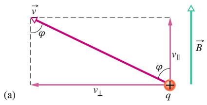

text_image

v
φ
v⊥
φ
q
v∥
B
(a)

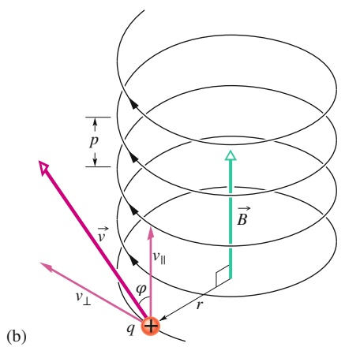

text_image

p
B
v
v⊥
φ
r
q
(b)

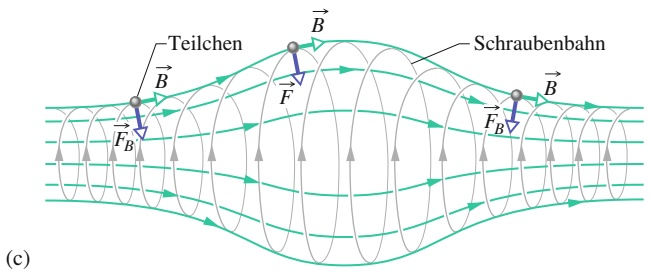

text_image

Teilchen
F_B
B
F
B
Schraubenbahn
(c)

## Abb. 24.8

(a) Ein geladenes Teilchen bewegt sich in einem homogenen Magnetfeld B⃗ mit einer Geschwindigkeit v⃗, die einen Winkel 𝜑 mit der Feldrichtung einschließt. (b) Das Teilchen fliegt auf einer Schraubenbahn mit einem Radius r und einer Steigung bzw. Ganghöhe p. (c) Ein geladenes Teilchen auf einer Schraubenbahn in einem inhomogenen Magnetfeld. In diesem Falle kann das Teilchen in der Feldkonfiguration eingeschlossen werden, wobei es zwischen den Bereichen hoher Feldstärke an den beiden Enden seiner Schraubenbahn hin- und herfliegt. Beachten Sie, dass die Vektoren der vom Magnetfeld ausgeübten Kraft auf das Teilchen zu den Seiten hin Komponenten entwickeln, die in Richtung auf das Zentrum zeigen.

Skizze deuten an, dass die magnetische Feldstärke in diesen Bereichen größer ist als im Zentrum. Bei hinreichend großer Feldstärke in diesen Bereichen wird das geladene Teilchen jeweils ins Zentrum zurückreflektiert. Man sagt, es sei in einer magnetischen Flasche eingefangen.

Auf diese Weise werden Elektronen und Protonen des Sonnenwinds im Erdma gnetfeld festgehalten und bilden die sogenannten Van-Allen-Strahlungsgürtel, die sich in großer Höhe über der Atmosphäre um die geomagnetischen Pole der Erde ziehen. Diese hochenergetischen Teilchen bewegen sich innerhalb von wenigen Sekunden in ihrer „magnetischen Flasche“ hin und her.

Wenn eine starke Protuberanz der Sonne von Zeit zu Zeit zusätzliche hochenergetische Elektronen und Protonen in die Strahlungsgürtel „schiebt“, baut sich in den Gebieten, wo die Teilchen im Normalfall reflektiert werden, ein elektrisches Feld auf. Dieses Feld kann die Reflexion der Teilchen verhindern und sie in die tiefere Atmosphäre treiben, wo sie mit Atomen und Molekülen der Gashülle zusammenstoßen und sie zur Emission von Licht anregen. So entsteht das Polarlicht (die Aurora), ein „Vorhang“ aus leuchtenden Molekülen in einer Höhe von etwa 100 km über der Erdoberfläche. Angeregte Sauerstoffatome emittieren grünes, Stickstoffmoleküle rötliches Licht. Oft ist die Leuchterscheinung jedoch so schwach, dass das menschliche Auge nur weiß wahrnimmt.

Die Aurora spannt sich in einem Bogen über die Erde und kann in einem be stimmten Bereich hoher nördlicher und südlicher Breiten, dem sogenannten Auroragürtel, von der Erde aus beobachtet werden. Abbildung 24.9 stellt die Entste hung der Aurora schematisch dar. Das leuchtende Band der Aurora kann sehr lang werden (viele tausend Kilometer), ist jedoch in Nord-Süd-Richtung nur weniger als einen Kilometer dick, da die Bewegung der Elektronen an die über den geomagnetischen Polen konvergierenden magnetischen Feldlinien gebunden ist (Abb. 24.9).

## KONTROLLFRAGE 4

Die Abbildung zeigt die Kreisbahnen zweier Teilchen, die sich mit der gleichen Geschwindigkeit in einem homogenen Magnetfeld B⃗ bewegen, das senkrecht in die Papierebene hinein gerichtet ist. Eines der Teilchen ist ein Proton, das andere ein Elektron (mit einer wesentlich geringeren Masse). (a) Welches der beiden Teilchen durchläuft die Kreisbahn mit dem kleineren Durchmesser? (b) Bewegt sich dieses Teilchen im oder gegen den Uhrzeigersinn?

B

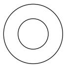

579

---

24 Magnetfelder

## Abb. 24  .9

Der Polarlichtgürtel, der den in der kanadischen Arktis gelegenen magnetischen Südpol (vgl. Abschn. 24.1) der Erde umgibt. Die Feldlinien des Magnetfelds der Erde laufen in diesem Punkt zusammen. Elektronen, die sich auf die Erde zu bewegen, werden eingefangen und fliegen auf Schraubenbahnen um die Feldlinien des Erdfelds. Treten sie bei großen geografischen Höhen in die Erdatmosphäre ein, so erzeugen sie durch Stöße mit den Gasteilchen der Atmosphäre das gezeigte Polarlichtoval.

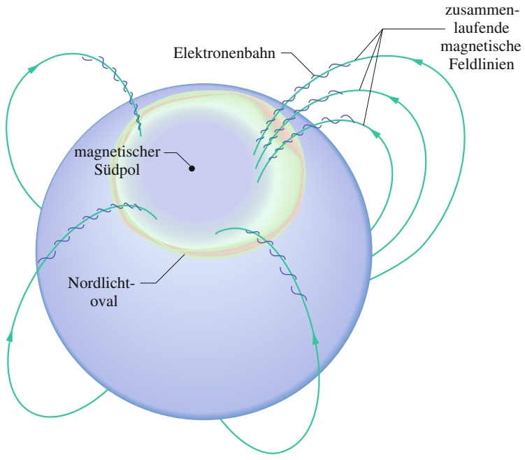

flowchart

This diagram illustrates the electromagnetic field distribution and signal flow between a magnetischer Südpol and a Nordlicht-oval, showing electron beam paths and magnetic field lines.

## 24.5 Zyklotron und Synchrotron

## Lernziele

Nach dem Durcharbeiten dieses Abschnitts sollten Sie in der Lage sein, . . .

• zu beschreiben, wie ein Zyklotron funktioniert, und den Weg eines Teilchens durch das Zyklotron zu skizzieren und dabei die Stellen hervorzuheben, an denen seine kinetische Energie zunimmt,
• die Resonanzbedingung zu verstehen,
• die Beziehung zwischen Teilchenmasse und -ladung, Magnetfeld und Umlauffrequenz in einem Zyklotron anzuwenden,
• zwischen einem Zyklotron und einem Synchrotron zu unterscheiden.

## Schlüsselideen

• In einem Zyklotron werden geladene Teilchen durch elektrische Kräfte beschleunigt, während sie in einem magnetischen Feld kreisen.
• Ein Synchrotron ist ein Zyklotron, in dem Geschwindigkeiten nahe der Lichtgeschwindigkeit erreicht und daher relativistische Effekte wichtig werden.

## 24.5.1 Zyklotron und Synchrotron

Welche Struktur hat Materie in ihrem Innersten? Diese Frage treibt Physiker seit jeher um. Anhaltspunkte für eine Antwort kann man gewinnen, indem man einen Strahl energiereicher, geladener Teilchen (beispielsweise Protonen) auf einen Festkörper treffen lässt. Oder noch besser und übersichtlicher – man sorgt für einen Frontalzusammenstoß zweier hochenergetischer Protonen. Aus einer Analyse der „Trümmer“ solcher Stöße lassen sich Hinweise auf die Eigenschaften der subatomaren Struktur der Materie ableiten. Die Nobelpreise für Physik der Jahre 1976 und 1984 wurden für derartige Arbeiten vergeben.

Wie verleiht man einem Proton die für ein derartiges Experiment erforderliche hohe Energie? Der einfachste experimentelle Ansatz besteht darin, das geladene Teilchen durch eine Potenzialdifferenz V „fallen zu lassen“ und dadurch seine kinetische Energie um einen Betrag eV zu erhöhen. Wenn man mit dieser Methode extrem hohe Energien erreichen möchte, wird es experimentell jedoch immer schwieriger, die notwendigen großen Potenzialdifferenzen zu erzeugen und zu beherrschen.

580

---

24.5 Zyklotron und Synchrotron

24

Bei einer wirkungsvolleren experimentellen Methode lässt man das Proton in einem Magnetfeld kreisen und versetzt ihm bei jedem Umlauf einen mäßigen elektrischen $\scriptstyle { \mathrm { , } } { \mathrm { S t o } } { \mathrm { \textbar { S } } } ^ { a }$ “. Läuft ein Proton beispielsweise in einem Magnetfeld auf einer Kreisbahn um und erhält bei jedem Umlauf eine zusätzliche Energie von 100 keV, so hat es nach 100 Umläufen eine Energie von $( 1 0 0 ) ( 1 0 0   \mathrm { k e V } ) = 1 0   \mathrm { M e V }$ erreicht. Zwei sehr effektive und nützliche Methoden zur Beschleunigung geladener Teilchen beruhen auf diesem Prinzip.

## Das Zyklotron

Abbildung 24.10 zeigt den Bereich eines Zyklotrons, in dem die zu beschleunigenden, geladenen Teilchen (beispielsweise Protonen) kreisen, in der Draufsicht. Die beiden D-förmigen, entlang ihrer geraden Seite offenen Hohlkörper sind aus Kupferblech gefertigt. Diese D-Elektroden (im Englischen Dees genannt) sind Teil eines elektrischen Schwingkreises, der die elektrische Potenzialdifferenz zwischen ihnen periodisch umkehrt. Damit ändert auch das elektrische Feld im Be reich zwischen den beiden Elektroden periodisch seine Richtung. Die Anordnung der D-Elektroden befindet sich in einem starken Magnetfeld (typischerweise $B = 1 { , } 5   \mathrm { T ) }$ , das von einem großen Elektromagneten erzeugt wird und in unserer Zeichnung senkrecht aus der Papierebene herauszeigt.

Nachdem ein Proton die Protonenquelle S im Zentrum der Anordnung in Abb. 24.10 verlassen hat, bewegt es sich zunächst auf die in diesem Moment negativ geladene der beiden Elektroden zu. Es wird in Richtung der Hohlelektrode beschleunigt und fliegt in den Hohlraum hinein. Im Inneren der Elektrode ist es durch die metallenen Wände von elektrischen Feldern abgeschirmt; hier ist das elektrische Feld null. Das Magnetfeld schirmen die Bleche aus nichtmagnetischem Kupfer jedoch nicht ab, sodass es auch im Inneren der Elektrode wirkt und das Proton auf eine Kreisbahn zwingt, deren Radius als Funktion der Geschwindigkeit des Teilchens durch Gl. 24.15 $( r = m \nu / ( q B ) )$ gegeben ist.

Nehmen wir nun an, die Richtung des elektrischen Felds zwischen den beiden Elektroden kehre sich genau in dem Moment um, in dem das Proton das Innere der zuerst betrachteten Elektrode verlässt und in den Zwischenraum zwischen den Elektroden fliegt. Nun „sieht“ das Teilchen erneut eine negativ geladene Elektrode vor sich und beschleunigt auf diese hin. Dieser Prozess setzt sich fort, bis das Proton, dessen Bahnradius mit seiner Energie stetig zunimmt, die Elektrodenanordnung wie in Abb. 24.10 angedeutet seitlich verlässt und durch eine Ablenkplatte zu einer Anwendung gelenkt wird.

Für das Funktionieren dieses Beschleunigungskonzepts ist es entscheidend, dass die Umlauffrequenz f des Teilchens im Magnetfeld – die wohlgemerkt nicht von dessen Geschwindigkeit abhängt – gleich der festen Frequenz $f _ { \mathrm { O s z } }$ des elektrischen Schwingkreises sein muss:

$$
f = f _ {\mathrm{Osz}} \quad (\text {Bedingung für Zyklotronresonanz}). \tag {24.20}
$$

Diese Resonanzbedingung besagt, dass die Energie zur Beschleunigung des im Magnetfeld umlaufenden Teilchens mit einer Frequenz $f _ { \mathrm { O s z } }$ zugeführt werden muss, die gleich der „natürlichen“ Umlauffrequenz des geladenen Teilchens im Magnetfeld ist.

Kombiniert man die Gln. 24.17 und 24.20, so kann man die Resonanzbedingung in der Form

$$
q B = 2 \pi m f _ {\mathrm{Osz}} \tag {24.21}
$$

schreiben. Die Ladung $q$ sowie die Masse m eines Protons sind intrinsische Ei genschaften des Teilchens und liegen fest, der Schwingkreis soll bei einer festen Frequenz $f _ { \mathrm { O s z } }$ arbeiten. Somit kann die Abstimmung des Zyklotrons auf maximale Energieübertragung auf das zu beschleunigende Proton nur durch Verändern

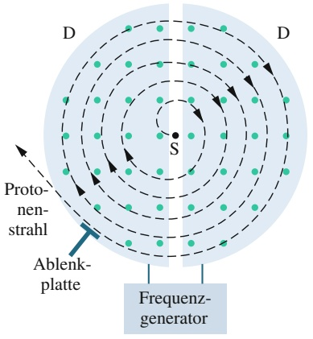

text_image

D
S
D
Protonenstrahl
Ablenkplatte
Frequenzgenerator

Abb. 24.10

Schematischer Aufbau eines Zyklotrons bestehend aus einer Teilchenquelle S und den beiden D-Elektroden (D) – flachen, hohlen, dünnwandigen und offenen Halbzylindern aus Metall. Die D-Elektroden befinden sich in einem homogenen, senkrecht aus der Papierebene herauszeigenden Magnetfeld. Protonen aus der Quelle S bewegen sich innerhalb der hohlen D-Elektroden auf Spiralbahnen nach außen, wobei sie bei jedem Überqueren des Zwischenraums zwischen den D-Elektroden Energie hinzugewinnen.

581

---

24 Magnetfelder

der Magnetfeldstärke B geschehen. Stimmt man das Zyklotron auf diese Weise ab, bis Gl. 24.21 erfüllt ist, so kann man mit dieser Anordnung quasi kontinuierlich Protonen beschleunigen und einen Strahl hochenergetischer Protonen erzeugen.

## Das Protonensynchrotron

Bei Protonenenergien ab etwa 50 MeV beginnt das oben betrachtete, einfache $\mathrm { Z y } .$ klotron zu versagen, da eines seiner entscheidenden Funktionsprinzipien, die Unabhängigkeit der Umlauffrequenz eines geladenen Teilchens in einem Magnetfeld von seiner Geschwindigkeit, nur dann gewährleistet ist, wenn diese Geschwindigkeit wesentlich kleiner ist als die Lichtgeschwindigkeit. Bei Geschwindigkeiten oberhalb von etwa 10 % der Lichtgeschwindigkeit muss man das Prinzip des $\mathrm { Z y } .$ klotrons unter relativistischen Gesichtspunkten neu überdenken. Aus der Relativitätstheorie folgt, dass die Umlauffrequenz eines Teilchens sinkt, wenn seine Geschwindigkeit sich der Lichtgeschwindigkeit nähert. Deshalb geraten das kreisende Proton und der Schwingkreis, der die Beschleunigungsenergie liefert, bei höheren Protonengeschwindigkeiten aus dem Takt, die Energieübertragung auf das Proton wird geringer und die Energie des Teilchens nimmt nicht mehr weiter zu.

Dazu kommt noch ein weiteres Problem: In einem Magnetfeld von 1,5T hätte die Kreisbahn eines Protons mit einer Energie von 500 GeV einen Radius von 1,1 km. Einen entsprechenden Elektromagneten für ein konventionelles $\mathrm { Z y }$ klotron zu bauen, wäre ein unrealistisches Unterfangen – die Fläche seiner Polschuhe müsste etwa $4 \cdot 1 0 ^ { 6 }   \mathrm { m } ^ { 2 }$ betragen.

Die Lösung für beide Probleme ist das Synchrotron: Hier sind das Magnetfeld und die Frequenz $f _ { \mathrm { O s z } }$ des Schwingkreises nicht mehr konstant wie bei einem konventionellen Zyklotron, sondern werden während des Beschleunigungsprozesses kontinuierlich verändert. Man erreicht dadurch, dass (1) die Umlauffrequenz der Protonen jederzeit synchron mit der Frequenz des beschleunigenden Felds bleibt und (2) die Teilchen auf einer Kreisbahn und nicht auf einer Spiralbahn umlaufen. Auf diese Weise kann man die Abmessungen des Magneten klein halten. Dennoch muss der Radius der Kreisbahn groß sein, wenn man sehr hohe Energien erreichen will: Das Protonensynchrotron am Fermi National Accelerator Laboratory (Fermilab) in Illinois hat beispielsweise einen Umfang von 6,3 km und kann Protonen mit Energien bis zu $1 \; \mathrm { T e V }   ( = 1 0 ^ { 1 2 }   \mathrm { e V } )$ erzeugen.

## 24.6 Die magnetische Kraft auf einen stromdurchflossenen Draht

## Lernziele

Nach dem Durcharbeiten dieses Abschnitts sollten Sie in der Lage sei $\mathbf { 1 } , \ldots .$

• Strom, Magnetfeld und Richtung der magnetischen Kraftwirkung auf einen stromdurchflossenen Draht zu skizzieren, wenn Stromrichtung und Magnetfeld senkrecht aufeinander stehen,
• die Beziehung zwischen magnetischer Kraft $F _ { B } ,$ Stromstärke $i ,$ Drahtlänge L und Winkel 𝜑 zwischen Längenvektor $\vec { L }$ und Feldvektor $\vec { B }$ für einen stromdurchflossenen Draht in einem Magnetfeld anzuwenden,
• die Richtung der magnetischen Kraft auf einen Strom in einem Magnetfeld mithilfe der Rechte-Hand-Regel für Vektor- bzw. Kreuzprodukte zu bestimmen,
• die magnetische Kraft $\vec { F } _ { B }$ auf einen Strom in einem Magnetfeld aus dem Vektorprodukt des Längenvektors und des Feldvektors in Einheitsvektoren- und Betrag-Winkel-Notation zu berechnen,
• zu beschreiben, wie man die Kraft auf einen stromdurchflossenen Leiter in einem Magnetfeld berechnen kann, wenn der Draht nicht gerade und/oder das Feld nicht homogen ist.

582

---

24.6 Die magnetische Kraft auf einen stromdurchflossenen Draht

24

## Schlüsselideen

• Auf einen geraden Draht, durch den ein Strom i fließt, wirkt in einem homogenen magnetischen Feld eine seitwärts gerichtete Kraft

$$
\vec {F} _ {B} = i \vec {L} \times \vec {B}.
$$

• Die Kraft auf ein (infinitesimales) Stromelement $i   \mathrm { d } \vec { L }$ in einem magnetischen Feld ist

$$
\mathrm{d} \vec {F} _ {B} = i \mathrm{d} \vec {L} \times \vec {B}.
$$

• Die Richtung des Längenvektors $\vec { L }$ bzw. $\mathrm { d } \vec { L }$ ist die des Stroms i.

## Die magnetische Kraft auf einen stromdurchflossenen Draht

Wir hatten bereits bei der Besprechung des Hall-Effekts gesehen, dass ein Magnetfeld eine seitlich gerichtete Kraft auf die Leitungselektronen in einem stromdurchflossenen Draht ausübt. Da die Leitungselektronen in das Metall eingebunden sind und den Draht nicht seitlich verlassen können, muss diese Kraft auch auf den Draht selbst wirken.

Abbildung 24.11a zeigt einen vertikal zwischen den Polschuhen eines Magneten eingespannten Draht, durch den kein Strom fließt. Das Magnetfeld zeigt, wie in der Zeichnung durch die Punkte angedeutet, senkrecht aus der Papierebene heraus. Abbildung 24.11b zeigt die Situation, wenn in dem Draht ein nach oben gerichte ter Strom fließt: Der Draht wird nach rechts ausgelenkt. In Abb. 24.11c fließt der Strom von oben nach unten; der Draht wird entsprechend nach links ausgelenkt.

Abbildung 24.12 zeigt das Innere des Drahts aus Abb. 24.11: Wir sehen eines der Leitungselektronen, das mit der Geschwindigkeit $\nu _ { \mathrm { D } }$ nach unten driftet. Nach Gl. 24.3 (mit $\varphi = 9 0 ^ { \circ } )$ wirkt eine Kraft $\vec { F } _ { B }$ mit dem Betrag $e \nu _ { \mathrm { D } } B$ auf das Elektron. Aus Gl. 24.2 folgt, dass diese Kraft nach rechts gerichtet sein muss. Daher ist zu erwarteten, dass der Draht als Ganzes wie in Abb. 24.11b dargestellt eine nach rechts gerichtete Kraft erfährt.

Wenn wir in Abb. 24.12 entweder die Feldrichtung oder die Stromrichtung umkehren, kehrt sich auch die Kraft auf den Draht um und zeigt dann nach links. Beachten Sie insbesondere, dass es für den makroskopischen Effekt keine Rolle spielt, ob man negative Ladungsträger annimmt, die nach unten driften (wie es tatsächlich der Fall ist), oder positive Ladungsträger, die sich in die entgegengesetzte Richtung (also nach oben) bewegen: Die Richtung der auf den Draht wirkenden Kraft ist in beiden Fällen gleich. Wir können demnach ohne Weiteres von einem Strom positiver Ladung ausgehen.

Nun wollen wir in Abb. 24.12 einen Drahtabschnitt mit der Länge L betrachten. Alle Leitungselektronen in diesem Abschnitt durchqueren in der Zeit $t = L / \nu _ { \mathrm { D } }$ die Ebene $\mathbf { x x } ^ { \prime }$ . Während dieses Zeitraums bewegt sich demnach eine Ladung

$$
q = i t = i \frac {L}{\nu_ {\mathrm{D}}}
$$

durch diese Ebene. Setzt man diesen Ausdruck für $q$ in Gl. 24.3 ein, so erhält man

$$
F _ {B} = q \nu_ {\mathrm{D}} B \sin \varphi = \frac {i L}{\nu_ {\mathrm{D}}} \nu_ {\mathrm{D}} B \sin 9 0 ^ {\circ}
$$

oder

$$
F _ {B} = i L B. \tag {24.22}
$$

Diese Gleichung beschreibt die magnetische Kraft auf einen geraden Drahtabschnitt der Länge $L ,$ der sich in einem senkrecht zum Draht orientierten Magnetfeld $\vec { B }$ befindet und in dem ein Strom i fließt.

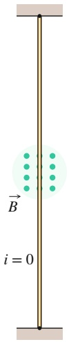

text_image

B
i = 0

(a)

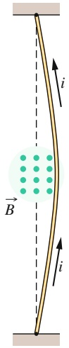

text_image

i
B
i

(b)

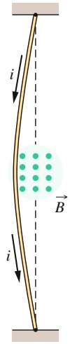

text_image

i
B
i

(c)

## Abb. 24.11

Ein flexibler Draht ist locker zwischen den Polschuhen eines Magneten eingespannt. (a) Fließt kein Strom in dem Draht, so hängt er gerade. (b) Wird er von einem nach oben gerichteten Strom durchflossen, so biegt er sich nach rechts durch. (c) Kehrt man die Stromrichtung um, so erfolgt die Auslenkung in die entgegengesetzte Richtung. (Die elektrischen Anschlüsse an den Enden des Drahts sind nicht dargestellt.).

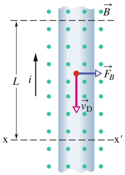

text_image

L
i
x
B
F_B
v_D
x'

Abb. 24.12

Stark vergrößerte Ansicht eines Abschnitts des Drahts aus Abb. 24.11b. Der Strom ist nach oben gerichtet, was bedeutet, dass die Elektronen im Draht nach unten driften. Das senkrecht aus der Papierebene heraus orientierte Magnetfeld lenkt die Elektronen nach rechts ab und biegt damit auch den Draht nach rechts.

583

---

24 Magnetfelder

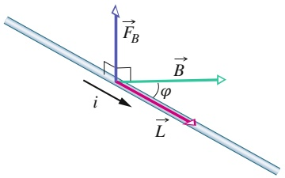

text_image

F_B
B
φ
i
L

Abb. 24.13

Ein gerader Draht, in dem ein Strom i fließt, liegt im Winkel 𝜑 zu einem homogenen Magnetfeld ${ \vec { B } } .$ Ein Abschnitt der Länge L (dem man den Längenvektor $\vec { L }$ in Stromrichtung zuordnen kann) befinde sich im Magnetfeld. Dann wirkt eine Kraft $\vec { F } _ { B } = \vec { i L } \times \vec { B }$ auf den Drahtabschnitt.

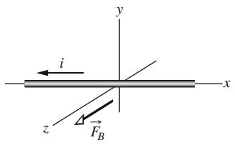

text_image

y
i
z
F_B
x

Liegt das Magnetfeld, wie in Abb. 24.13 dargestellt, nicht senkrecht zu dem Draht, so ist der Vektor der magnetischen Kraft auf den Drahtabschnitt in Verallgemeinerung von Gl. 24.22

$$
\vec {F} _ {B} = i \vec {L} \times \vec {B} \quad (\text {Kraft auf einen Strom}). \tag {24.23}
$$

L⃗ bezeichnet darin einen Längenvektor mit dem Betrag L parallel zu dem betrachteten Drahtabschnitt, dessen Orientierung durch die konventionelle Stromrichtung gegeben ist. Der Betrag $F _ { B }$ der Kraft ist

$$
F _ {B} = i L B \sin \varphi , \tag {24.24}
$$

wobei $\varphi$ der Winkel zwischen den Vektoren $\vec { L }$ und $\vec { B }$ ist. Die Richtung von $\vec { \bar { F } } _ { B }$ ergibt sich aus der Richtung des Vektorprodukts $\vec { L }   \times   \vec { B } _ { i }$ , da wir den Strom i als eine positive Größe annehmen. Aus Gl. 24.23 folgt, dass die Kraft $\vec { F } _ { B }$ immer senkrecht auf der von den beiden Vektoren $\vec { L }$ und $\vec { B }$ aufgespannten Ebene steht (Abb. 24.13).

Gleichung 24.23 ist insofern äquivalent zu Gl. 24.2, als man beide als Definitions gleichungen für das Magnetfeld $\vec { B }$ auffassen kann. In der Praxis definiert man $\vec { B }$ jedoch ausschließlich über Gl. 24.23, da es wesentlich einfacher ist, die Kraftwir kung auf einen stromdurchflossenen Draht zu messen als auf eine einzelne bewegte Ladung.

Ist der Draht nicht gerade oder das Magnetfeld nicht homogen, so können wir uns den Draht in gerade Segmente der differenziellen Länge dL aufgeteilt denken und Gl. 24.23 auf jedes einzelne dieser Segmente anwenden. Die resultierende Kraft auf den Draht ergibt sich dann als Vektorsumme der Kräfte auf die einzelnen Segmente. In diesem Sinn schreibt man

$$
\mathrm{d} \vec {F} _ {B} = i \mathrm{d} \vec {L} \times \vec {B} \tag {24.25}
$$

und berechnet die resultierende Kraft auf eine beliebige räumliche Verteilung von Strömen durch Integration von Gl. 24.25 über die gegebene Stromverteilung.

Wenn Sie Gl. 24.25 anwenden, so denken Sie immer daran, dass ein isoliertes stromdurchflossenes Leitersegment der differenziellen Länge dL eine Idealisierung ist – es muss immer eine Zuleitung und eine Ableitung des Stroms geben.

## KONTROLLFRAGE 5

Die Abbildung zeigt einen von einem Strom i durchflossenen Draht, der sich in einem homogenen Magnetfeld $\vec { B }$ befindet, sowie die auf den Draht wirkende magnetische Kraft $\vec { F } _ { B }$ . Der Draht ist relativ zur Feldrichtung so orientiert, dass der Betrag der Kraft maximal ist. In welche Richtung zeigt das Feld?

## 24.7 Das Drehmoment auf eine stromdurchflossene Drahtschleife

## Lernziele

Nach dem Durcharbeiten dieses Abschnitts sollten Sie in der Lage sein, . . .

eine rechteckige stromdurchflossene Leiterschleife in einem Magnetfeld einschließlich der magnetischen Kräfte auf die vier Seiten, der Stromrichtung, des Normalenvektors $\widetilde { \vec { n } }$ und der Richtung, in die ein von den Kräften erzeugtes Drehmoment die Schleife zu drehen versucht, zu skizzieren,
für eine stromdurchflossene Spule in einem Magnetfeld die Beziehung zwischen dem Betrag τ des Drehmoments, ihrer Windungszahl N und Querschnittsflä- che $A ,$ der Stromstärke $i ,$ der magnetischen Feldstärke B und dem Winkel θ zwischen dem Normalenvektor n⃗ und dem Feldvektor $\vec { B }$ anzuwenden.

584

---

24.7 Das Drehmoment auf eine stromdurchflossene Drahtschleife

24

## Schlüsselideen

• Auf die Abschnitte einer stromdurchflossenen Spule in einem homogenen äußeren Magnetfeld wirkt eine Vielzahl von magnetischen Kräften; die resultierende Kraft ist jedoch null.
• Das resultierende Drehmoment auf die Spule hat den Betrag

$$
\tau = N i A B \sin \theta ,
$$

wobei N die Windungszahl der Spule ist, A die Querschnittsfläche der Windungen, i die Stromstärke, B die Feldstärke und θ der Winkel zwischen dem Magnetfeld und dem Normalenvektor n⃗ der Spule.

## 24.7.1 Das Drehmoment auf eine stromdurchflossene Drahtschleife

Ein großer Teil der Arbeit auf unserem Planeten wird von Elektromotoren verrichtet. Die Kräfte, die in Elektromotoren wirken, sind genau die magnetischen Kräfte, die wir im vorangegangenen Abschnitt untersucht haben, also die Kräfte auf einen stromdurchflossenen Draht in einem Magnetfeld B⃗.

Abbildung 24.14 zeigt einen einfachen Elektromotor aus einer einzelnen stromdurchflossenen Drahtschleife im Feld B⃗ eines Permanentmagneten. Die beiden betragsgleichen, einander entgegengesetzten magnetischen Kräfte $\vec { F }$ und $- \vec { F }$ erzeugen ein Drehmoment, das die Schleife um die eingezeichnete Achse rotieren lässt. Obwohl wir in der Skizze von Abb. 24.14 viele wesentliche konstruktive Details weggelassen haben, wird dennoch deutlich, wie die Kraftwirkung eines Magnetfelds auf eine stromdurchflossene Leiterschleife eine Drehbewegung bewirken kann. Diesen Mechanismus wollen wir nun genauer betrachten.

Abbildung 24.15a zeigt eine rechteckige Leiterschleife mit den Seitenlängen a und $b ,$ die von einem Strom i durchflossen wird und sich in einem homogenen Magnetfeld B⃗ befindet. Wir haben die Schleife so in das Feld gelegt, dass ihre mit 1 und 3 bezeichneten langen Seiten unabhängig von der Orientierung der Schleife um ihre Drehachse immer senkrecht zum Feld (das senkrecht in die Papierebene hineinzeigt) verlaufen, während ihre kurzen Seiten 2 und 4 ihre Lage relativ zur Feldrichtung bei der Rotation der Schleife verändern. Die Drähte, die notwendig sind, um den Strom in die Drahtschleife und wieder zurück zu leiten, sind der Einfachheit halber nicht eingezeichnet.

Um die Orientierung der Drahtschleife im Feld beschreiben zu können, de finieren wir einen Normalenvektor $\vec { n }$ senkrecht zur Ebene der Schleife. Abbil dung 24.15b zeigt, wie die Orientierung des Normalenvektors über die Rechte Hand-Regel mit der Stromrichtung in der Schleife zusammenhängt: Die Finger der rechten Hand krümmen sich an einem beliebigen Punkt der Schleife in Stromrich

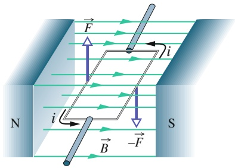

text_image

N
S
i
B
-F
F

Abb. 24.14

Das Funktionsprinzip eines Elektromotors. Eine rechteckige, um eine Achse drehbar gelagerte stromdurchflossene Leiterschleife befindet sich in einem Magnetfeld. Die magnetischen Kräfte auf den Strom in der Drahtschleife bewirken ein Drehmoment auf die Schleife. Ein sogenannter Kommutator (nicht eingezeichnet) kehrt die Feldrichtung nach jeder halben Umdrehung der Schleife um, sodass das Drehmoment immer in dieselbe Richtung wirkt.

Eine rechteckige Leiterschleife mit den Kantenlängen a und b befindet sich in einem homogenen Magnetfeld B⃗ und wird von einem Strom i durchflossen. Das Drehmoment τ⃗ versucht, den Normalenvektor n⃗ der Leiterschleife in Feldrichtung auszurichten. (a) Projektion der Leiterschleife in Feldrichtung. (b) Perspektivische Ansicht der Leiterschleife. Bestimmung der Orientierung des zur Fläche der Schleife senkrechten Vektors n⃗ mithilfe der Rechte-Hand-Regel. (c) Seitenansicht der Schleife mit Blick auf Seite 2. Die Schleife dreht sich in dem durch die Pfeile angedeuteten Drehsinn.

Abb. 24.15

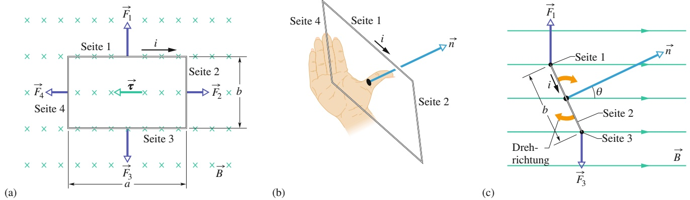

585

---

24 Magnetfelder

tung; der ausgestreckte Daumen gibt dann die Orientierung des Normalenvektors $\vec { n }$ an.

Abbildung 24.15c zeigt die Drahtschleife von der Seite gesehen in einer durch den Winkel θ festgelegten Orientierung zur Richtung des Magnetfelds ${ \vec { B } } .$ Wir wollen die resultierende Kraft sowie das resultierende Drehmoment auf die Schleife in dieser Lage bestimmen.

Die resultierende Kraft auf die Schleife ergibt sich als Vektorsumme der Kräfte, die auf die vier Seiten der Schleife wirken. Im Fall von Seite 2 zeigt der Vektor L⃗ aus Gl. 24.23 in Stromrichtung und hat den Betrag b. Der Winkel zwischen $\vec { L }$ und B⃗ beträgt $9 0 ^ { \circ }   -   \theta$ (Abb. 24.15c). Damit ist der Betrag $F _ { 2 }$ der magnetischen Kraft auf diese Seite

$$
F _ {2} = i b B \sin (9 0 ^ {\circ} - \theta) = i b B \cos \theta . \tag {24.26}
$$

Ganz entsprechend kann man zeigen, dass die Kraft $\vec { F } _ { 4 }$ auf Seite 4 den gleichen Betrag wie ${ \vec { F } } _ { 2 }$ hat, ihr aber entgegengesetzt ist: Die beiden Kräfte kompensieren sich, ihre Resultierende ist null, und da ihre gemeinsame Wirkungslinie durch die Mittelachse der Schleife verläuft, ist auch ihr resultierendes Drehmoment null.

Für die Seiten 1 und 3 ist die Situation eine andere. Für sie steht L⃗ senkrecht auf ${ \vec { B } } ,$ sodass die Kräfte $\vec { F } _ { 1 }$ und $\vec { F } _ { 3 }$ denselben Betrag iaB haben. Da die beiden Kräfte aber entgegengesetzt gerichtet sind, bewegen sie die Drahtschleife nicht als Ganzes nach oben oder unten. Wie Abb. 24.15c zeigt, haben sie jedoch keine gemeinsame Wirkungslinie und erzeugen deshalb ein resultierendes Drehmoment. Dieses Drehmoment „versucht“ die Drahtschleife so auszurichten, dass ihr Normalenvektor n⃗ in die Richtung des Magnetfelds $\vec { B }$ zeigt. Der Hebelarm dieses Drehmoments für eine Drehung um die Mittelachse der Schleife hat die Länge $( b / 2 )$ sin $\theta ,$ sodass für den Betrag $\tau ^ { \prime }$ des von den Kräften ${ \vec { F } } _ { 1 }$ und $\vec { F } _ { 3 }$ bewirkten Drehmoments gilt (Abb. 24.15c)

$$
\tau^ {\prime} = \left(i a B \frac {b}{2} \sin \theta\right) + \left(i a B \frac {b}{2} \sin \theta\right) = i a b B \sin \theta . \tag {24.27}
$$

Nun denken wir uns die einzelne Drahtschleife durch eine Spule mit N Windungen ersetzt. Die Spule soll so eng gewickelt sein, dass wir in guter Näherung davon ausgehen können, dass alle ihrer Windungen dieselben Abmessungen haben und in derselben Ebene liegen. Die Windungen bilden unter diesen Voraussetzungen eine ebene Spule und auf jede einzelne ihrer Windungen wirkt ein Drehmoment $\tau ^ { \prime }$ gemäß Gl. 24.27. Das resultierende Drehmoment auf die Spule ist demzufolge

$$
\tau = N \tau^ {\prime} = N i a b B \sin \theta = (N i A) B \sin \theta , \tag {24.28}
$$

wobei $A = a b$ die von den Windungen umschlossene Fläche bezeichnet. Wir haben die Größen $N ,$ i und A in Klammern zusammengefasst, da sie allesamt Eigenschaften der Spule beschreiben: die Anzahl N ihrer Windungen, den durch sie fließenden Strom i sowie ihre Fläche A. Gleichung 24.28 gilt für jede ebene Spule, unabhängig von der Gestalt ihrer Fläche, sofern sie sich nur in einem homogenen Magnetfeld befindet. Für eine gewöhnliche runde Spule mit dem Radius r gilt beispielsweise

$$
\tau = (N i \pi r ^ {2}) B \sin \theta . \tag {24.29}
$$

Anstatt die Bewegung der Spule im Detail zu untersuchen, kann man sich einfacher auf das Verhalten des zur Fläche der Spule senkrechten Normalenvektors n⃗ konzentrieren. Aus Gl. 24.28 erkennt man, dass sich eine stromdurchflossene, ebene Spule in einem Magnetfeld so ausrichtet, dass dieser Normalenvektor dieselbe Richtung hat wie das Feld ${ \vec { B } } .$

In einem Elektromotor wird der durch die Spule fließende Strom umgekehrt, sobald sich die Richtung des Normalenvektors der Feldrichtung annähert, sodass auch weiterhin ein Drehmoment auf die Spule wirkt. Diese Stromumkehr erreicht

586

---

24.8 Das magnetische Dipolmoment

24

man automatisch durch einen sogenannten Kommutator, eine Anordnung von stationären Schleifkontakten, über welche die rotierende Spule alternierend mit der äußeren Stromversorgung verbunden wird.

## 24.8 Das magnetische Dipolmoment

## Lernziele

Nach dem Durcharbeiten dieses Abschnitts sollten Sie in der Lage sein, . . .

• zu verstehen, dass eine stromdurchflossene Spule ein magnetischer Dipol ist, dessen Dipolmoment $i \vec { \mu }$ die Richtung des Normalenvektors n⃗ hat (entsprechend der Rechte-Hand-Regel),
• für eine stromdurchflossene Spule die Beziehung zwischen dem Betrag μ ihres magnetischen Dipolmoments, ihrer Windungszahl N, ihrer Querschnittsfläche A und der Stromstärke i anzuwenden,
• in die Skizze einer stromdurchflossenen Spule die Stromrichtung einzutragen und dann mithilfe der Rechte-Hand-Regel die Richtung des magnetischen Dipolmomentvektors μ⃗ zu ermitteln,
• für einen magnetischen Dipol in einem äußeren Magnetfeld die Beziehung zwischen dem Betrag τ des Drehmoments, dem Betrag μ des Dipolmoments, der Feldstärke B des Magnetfelds und dem Winkel θ zwischen Dipolmoment- und magnetischem Feldvektor anzuwenden,
• die Vorzeichenkonvention für Drehmomente und Drehrichtung sicher zu beherrschen,
• das Drehmoment auf einen magnetischen Dipol auszurechnen, indem Sie das Vektor- bzw. Kreuzprodukt von Dipolmomentvektor μ⃗ und äußerem Feldvektor B⃗ in Einheitsvektoren- oder Betrag-Winkel-Notation berechnen,
• die Orientierung eines magnetischen Dipols in einem äußeren Magnetfeld anzugeben, bei welcher der Betrag des Drehmoments maximal (oder minimal) wird,
• für einen magnetischen Dipol in einem äußeren Magnetfeld die Beziehung zwischen der magnetischen „Orientierungs-“Energie U, dem Betrag μ des Dipol moments, der Feldstärke B des äußeren Magnetfelds und dem Winkel θ zwischen Dipolmoment- und äußerem Feldvektor anzuwenden,
• die magnetische Orientierungsenergie zu berechnen, indem Sie das Skalarprodukt von Dipolmomentvektor $\vec { \mu }$ und äußerem magnetischem Feldvektor B⃗ bilden, und zwar in Einheitsvektoren- und Betrag-Winkel-Notation,
• die Orientierung eines magnetischen Dipols in einem äußeren Magnetfeld zu finden, die zu einer minimalen bzw. maximalen Orientierungsenergie führt,
• die Orientierungsenergie U eines magnetischen Dipols in einem magnetischen Feld mit der Arbeit $W _ { \mathrm { a } }$ zu verknüpfen, die von einem äußeren Drehmoment bei der Rotation des Dipols im Magnetfeld verrichtet wird.

## Schlüsselideen

• Eine Spule (Querschnittsfläche A, Windungszahl N, Stromstärke i) erfährt in einem homogenen Magnetfeld ein Drehmoment

$$
\vec {\tau} = \vec {\mu} \times \vec {B}.
$$

Hier ist $\vec { \mu }$ das magnetische Dipolmoment der Spule, dessen Betrag μ = NiA ist und dessen Richtung durch die Rechte-Hand-Regel gegeben ist.

• Die Orientierungsenergie eines magnetischen Dipols in einem Magnetfeld ist

$$
U (\theta) = - \vec {\mu} \cdot \vec {B}.
$$

• Wenn ein äußeres Drehmoment einen magnetischen Dipol von einer anfänglichen Orientierung $\theta _ { \mathrm { i } }$ in eine andere Orientierung $\theta _ { \mathrm { f } }$ dreht und der Dipol sowohl

587

---

24 Magnetfelder

zu Beginn als auch am Ende ruht, verrichtet das Drehmoment an dem Dipol die Arbeit

$$
W _ {\mathrm{a}} = \Delta U = U _ {\mathrm{f}} - U _ {\mathrm{i}}.
$$

## 24.8.1 Das magnetische Dipolmoment

Man kann eine stromdurchflossene Spule, wie wir sie im vorangegangenen Abschnitt betrachtet haben, durch einen Vektor μ⃗ beschreiben, das **magnetische Dipolmoment**. Die Richtung von $\vec { \mu }$ ist gleich der Richtung des Normalenvektors n⃗ zur Spulenfläche, wie wir ihn in Abb. 24.15c festgelegt haben. Für den Betrag $\mu$ des magnetischen Dipolmoments oder kurz magnetischen Moments gilt

$$
\mu = N i A \quad (\text {magnetisches Moment}), \tag {24.30}
$$

worin N die Windungszahl der Spule, i den Strom durch die Spule sowie A die von jeder Windung der Spule umschlossene Fläche bezeichnen. Aus Gl. 24.30 liest man für die Einheit des magnetischen Moments μ⃗ Ampere mal Quadratmeter ab. Unter Verwendung des Vektors $\vec { \mu }$ können wir Gl. 24.28 für das Drehmoment auf eine Spule in einem Magnetfeld in der Form

$$
\tau = \mu B \sin \theta \tag {24.31}
$$

schreiben, wobei θ der von den Vektoren $\vec { \mu }$ und $\vec { B }$ eingeschlossene Winkel ist. Diesem Zusammenhang zwischen den Beträgen entspricht in Vektorschreibweise die allgemeinere Beziehung

$$
\vec {\tau} = \vec {\mu} \times \vec {B}. \tag {24.32}
$$

Diese Beziehung hat die gleiche Form wie Gl. 18.28 für das auf einen elektrischen Dipol im elektrischen Feld wirkende Drehmoment:

$$
\vec {\tau} = \vec {p} \times \vec {E}.
$$

In beiden Fällen ergibt sich das von dem Feld bewirkte Drehmoment als Vektorprodukt aus dem jeweiligen Dipolmoment und dem Feldvektor.

Ein magnetischer Dipol hat in einem äußeren Magnetfeld eine **magnetische potenzielle Energie**, die von der Orientierung des Dipols relativ zum Feld abhängt. Für die entsprechende Energie eines elektrischen Dipols in einem elektrischen Feld galt (Gl. 18.32)

$$
U (\theta) = - \vec {p} \cdot \vec {E}.
$$

Analog dazu kann man die magnetische potenzielle Energie in der Form

$$
U (\theta) = - \vec {\mu} \cdot \vec {B} \tag {24.33}
$$

schreiben. Ein magnetischer Dipol in einem Magnetfeld hat die kleinste potenzielle Energie $( = - \mu B \sin 0 = - \mu B )$ , wenn sein Dipolmoment $\vec { \mu }$ parallel zur Feldrichtung liegt (Abb. 24.16); die Energie ist am größten $( = - \mu B \cos 1 8 0 ^ { \circ } = + \mu B )$ , wenn $1 \vec { \mu }$ dem Feld entgegen gerichtet ist.

Wenn sich ein magnetischer Dipol aus einer anfänglichen Orientierung $\theta _ { \mathrm { i } }$ relativ zur Feldrichtung in eine finale Orientierung $\theta _ { \mathrm { f } }$ dreht, verrichtet das Feld an ihm eine Arbeit

$$
W = - \Delta U = - (U _ {\mathrm{f}} - U _ {\mathrm{i}}), \tag {24.34}
$$

wobei die beiden Energien $U _ { \mathrm { f } }$ und $U _ { \mathrm { i } }$ durch Gl. 24.33 gegeben sind. Wirkt während der Drehung zusätzlich ein äußeres Drehmoment auf den magnetischen Dipol, so

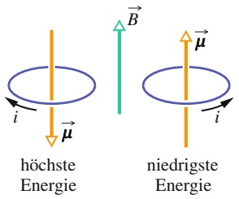

text_image

höchste
Energie
i
μ
B
niedrigste
Energie
i
μ

Abb. 24.16

Die Orientierungen größter und kleinster potenzieller Energie eines magnetischen Dipols (beispielsweise einer Spule, in der ein Strom fließt) in einem äußeren Magnetfeld ${ \vec { B } } .$ Durch die Orientierung des Stroms i ist auch die Orientierung des magnetischen Dipolmoments μ⃗ durch die Rechte-Hand-Regel festgelegt, deren Anwendung in Abb. 24.15b bei der Bestimmung des Vektors n⃗ demonstriert wurde.

588

---

24.9 Zusammenfassung

24

verrichtet dieses äußere Moment eine Arbeit $W _ { \mathrm { a } } ,$ . Unter der Voraussetzung, dass sich der Dipol sowohl vor als auch nach der Drehung relativ zum Feld in Ruhe befindet, ist diese Arbeit gleich dem Negativen der Arbeit, die das Feld an dem Dipol verrichtet:

$$
W _ {\mathrm{a}} = - W = U _ {\mathrm{f}} - U _ {\mathrm{i}}. \tag {24.35}
$$

Bisher haben wir als Beispiele für magnetische Dipole nur stromdurchflossene Drahtspulen betrachtet. Auch ein einfacher Stabmagnet ist jedoch ein magnetischer Dipol, ebenso wie eine rotierende, geladene Kugel. Auch die Erde selbst ist (näherungsweise) ein magnetischer Dipol. Schließlich besitzen auch die meisten subatomaren Teilchen, darunter Elektron, Proton und Neutron, magnetische Dipolmomente. Wie wir in Kap. 28 sehen werden, kann man alle diese magnetischen Momente als Kreisströme auffassen. Eine Vorstellung von der Größenordnung einiger magnetischer Momente vermittelt Tab. 24.2.

## KONTROLLFRAGE 6

Die Abbildung zeigt einen magnetischen Dipol $\vec { \mu }$ in vier verschiedenen Orientierungen θ relativ zu einem Magnetfeld B⃗. Ordnen Sie die vier Fälle in absteigender Reihenfolge nach (a) dem Betrag des auf den Dipol wirkenden Drehmoments, (b) der potenziellen Energie des Dipols im Feld.

TABELLE 24.2:

Einige Werte magnetischer Dipolmomente.

| Objekt | Dipolmoment (J/T) |
| --- | --- |
| kleiner Stab-magnet | 5 |
| Erde | $8,0 \cdot 10^{22}$ |
| Proton | $1,4 \cdot 10^{-26}$ |
| Elektron | $9,3 \cdot 10^{-24}$ |

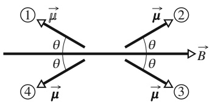

text_image

①
θ
θ
④
μ
θ
θ
②
B
③
μ

## 24.9 Zusammenfassung

**Magnetfeld** $\vec { B }$ Man definiert ein Magnetfeld $\vec { B }$ durch die Kraft $\vec { F } _ { B } ,$ die das Feld auf ein Teilchen mit der Ladung $q$ ausübt, das sich mit einer Geschwindigkeit v⃗ relativ zum Feld bewegt:

$$
\vec {F} _ {B} = q \vec {\nu} \times \vec {B}. \tag {24.2}
$$

Die SI-Einheit des Magnetfelds ist das **Tesla** (T), es ist 1 $\mathrm { T } =$ $1   \mathrm { N } / ( \mathrm { A } \cdot \mathrm { m } ) = 1 0 ^ { 4 }$ Gauß.

**Hall-Effekt** Bringt man einen stromdurchflossenen Leiter, beispielsweise ein Band der Dicke $l ,$ durch das ein Strom i fließt, in ein homogenes Magnetfeld ${ \vec { B } } ,$ so sammelt sich ein gewisser Anteil der Ladungsträger (mit der Ladung e) an der seitlichen Kante des Bands und erzeugt dadurch eine Potenzialdifferenz $V$ quer zu dem Band. Aus den sich einstellenden Polaritäten der Überschussladung an den Kanten des Streifens kann man auf das Vorzeichen der Ladungsträger schließen. Die Ladungsträgerdichte in dem Leiter ist

$$
n = \frac {B i}{V l e}. \tag {24.12}
$$

**Kreisbewegung eines geladenen Teilchens im Magnetfeld** Ein geladenes Teilchen mit der Masse m und einer Ladung vom Betrag $q ,$ das sich mit der Geschwindigkeit $\vec { \nu }$ senkrecht zu einem homogenen Magnetfeld $\vec { B }$ bewegt, durchläuft eine kreisförmige Bahn. Nach dem zweiten Newtonschen Gesetz gilt für diese Kreisbewegung das Kräftegleichgewicht

$$
| q | \nu B = \frac {m v ^ {2}}{r}, \tag {24.14}
$$

woraus man den Radius r der Kreisbewegung zu

$$
r = \frac {m v}{| q | B} \tag {24.15}
$$

bestimmt. Für die Frequenz $f$ der periodischen Kreisbewegung, ihre Kreisfrequenz ω sowie die Periodendauer $T$ gilt

$$
f = \frac {\omega}{2 \pi} = \frac {1}{T} = \frac {| q | B}{2 \pi m}. \tag {24.16,24.17,24.18}
$$

**Zyklotron und Synchrotron** Ein Zyklotron ist ein Teilchenbeschleuniger, der das zu beschleunigende geladene Teilchen mithilfe eines Magnetfelds auf einer Kreisbahn hält, deren Radius mit zunehmender Energie des Teilchens größer wird. Das Teilchen durchläuft bei seiner Kreisbewegung wiederholt die gleiche, mäßig hohe Potenzialdifferenz und wird dadurch auf hohe kinetische Energien beschleunigt. Die mit einem Zyklotron erreichbare maximale Teilchenenergie ist begrenzt, da die Rotationsfrequenz des Teilchens bei Geschwindigkeiten, die sich der Lichtgeschwindigkeit annähern, von der konstanten Frequenz des elektrischen Schwingkreises, der die Beschleunigungsspannung liefert, abzuweichen beginnt. Das Synchrotron vermeidet dieses Problem: Sowohl die Stärke B des Magnetfelds als auch die Oszillationsfrequenz $f _ { \mathrm { O s z } }$ werden zyklisch entsprechend der zunehmenden Energie einer Gruppe von Teilchen verändert, sodass die Teilchen nicht nur in Resonanz mit der Beschleunigungsspannung bleiben, sondern dabei auch auf einem Kreis mit konstantem Radius umlaufen.

## Magnetische Kraft auf einen stromdurchflossenen Draht

Auf einen geraden, von einem Strom i durchflossenen Draht wirkt in einem homogenen Magnetfeld $\vec { B }$ eine seitliche Kraft

$$
\vec {F} _ {B} = i \vec {L} \times \vec {B}. \tag {24.23}
$$

589

---

24 Magnetfelder

Die differenzielle Kraft auf ein Stromelement $i   \mathrm { d } \vec { L }$ in einem homogenen Magnetfeld ist

$$
\mathrm{d} \vec {F} _ {B} = i \mathrm{d} \vec {L} \times \vec {B}. \tag {24.25}
$$

Die Richtung des Längenvektors $\vec { L }$ oder dL⃗ stimmt mit der Stromrichtung überein.

**Drehmoment auf eine stromdurchflossene Spule** Auf eine von einem Strom i durchflossene Drahtspule mit N Windungen und der Querschnittsfläche A wirkt in einem homogenen Magnetfeld $\vec { B }$ ein Drehmoment

$$
\vec {\tau} = \vec {\mu} \times \vec {B}. \tag {24.32}
$$

Der Vektor $\vec { \mu } ,$ das **magnetische Dipolmoment** der Spule, hat den Betrag $\mu = N i A$ ; seine Orientierung ergibt sich durch die Rechte-Hand-Regel aus der Richtung des Stroms durch die Spule.

**Orientierungsenergie eines magnetischen Dipols** Die **magnetische potenzielle Energie** eines magnetischen Dipols in einem Magnetfeld ist

$$
U (\theta) = - \vec {\mu} \cdot \vec {B}. \tag {24.33}
$$

Dreht sich ein magnetischer Dipol von einer anfänglichen Orientierung $\theta _ { \mathrm { i } }$ relativ zum Magnetfeld in eine Orientierung $\theta _ { \mathrm { f } } ,$ so verrichtet das Feld dabei eine Arbeit

$$
W = - \Delta U = - (U _ {\mathrm{f}} - U _ {\mathrm{i}}) \tag {24.34}
$$

an ihm.

## 24.10 Fragen

**1.** Abbildung 24.F1 zeigt drei Situationen, in denen sich ein positiv geladenes Teilchen mit der Geschwindigkeit ⃗v durch ein homogenes Magnetfeld $\vec { B }$ bewegt und dabei eine Kraft $\vec { F } _ { B }$ erfährt. Geben Sie an, ob die gezeichneten Orientierungen der Vektoren physikalisch sinnvoll sind.

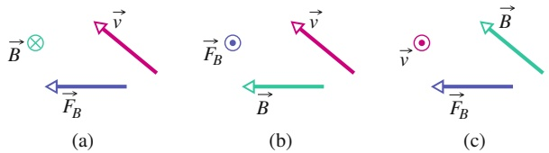

Abb. 24.F1

**2.** Betrachten Sie die folgenden vier Situationen, in denen sich ein Proton zu einem bestimmten Zeitpunkt mit der jeweils angegebenen Geschwindigkeit v⃗ durch das angegebene homogene Magnetfeld $\vec { B }$ bewegt:

Ordnen Sie die vier Situationen ohne schriftliche Rechnung in absteigender Reihenfolge nach dem Betrag der auf das Proton wirkenden magnetischen Kraft.

**3.** In Abschn. 24.2 haben wir die Bewegung eines geladenen Teilchens durch gekreuzte Felder betrachtet, wobei die Kräfte $\vec { F } _ { E }$ und $\vec { F } _ { B }$ einander entgegen gerichtet waren. Wir haben dort gesehen, dass sich das Teilchen auf einer geraden Linie bewegt, die resultierende Kraft also verschwindet, wenn seine Geschwindigkeit durch Gl. 24.7 $( \nu = E / B )$ gegeben ist. Welche der beiden Kräfte dominiert die Bewegung des Teilchens, wenn für seine Geschwindigkeit stattdessen (a) $\nu < E / B$ oder (b) v > E∕B gilt?

**4.** Abbildung 24.F4 zeigt die momentanen Geschwindigkeitsvektoren von 10 geladenen Teilchen, die sich in gekreuzten, homogenen Feldern $\vec { E }$ und $\vec { B }$ bewegen; die Geschwindigkeitsvektoren sind nicht maßstäblich gezeichnet. Die Tabelle gibt die Ladungen der Teilchen an und beschreibt ihre Geschwindigkeiten als jeweils größer oder kleiner im Vergleich zu $E / B$ (siehe Frage 3). Welche der Teilchen werden sich aus der Papierebene heraus auf Sie zu bewegen?

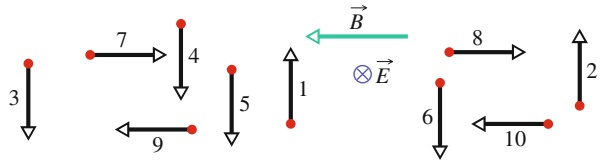

flowchart

Abb. 24.F4

| Teilchen | Ladung | Geschwindigkeit |
| --- | --- | --- |
| 1 | + | kleiner |
| 2 | + | größer |
| 3 | + | kleiner |
| 4 | + | größer |
| 5 | - | kleiner |
| 6 | - | größer |
| 7 | + | kleiner |
| 8 | + | größer |
| 9 | - | kleiner |
| 10 | - | größer |

**5.** Abbildung 24.F5 zeigt die Flugbahn eines geladenen Teilchens, das von rechts kommend mit einer Geschwindigkeit $\nu _ { 0 }$ in den Bereich eines homogenen Magnetfelds B⃗ eintritt, innerhalb der Zeit $T _ { 0 }$ einen Halbkreis durchläuft, und den Feldbereich danach wieder verlässt. (a) Ist die Ladung des Teilchens positiv oder negativ? (b) Ist die Geschwindigkeit des Teilchens nach Verlassen des Felds grö ßer als, kleiner als oder gleich $\nu _ { 0 } \hat { \tau }$ (c) Nehmen Sie an, die

590

---

24.10 Fragen

24

Anfangsgeschwindigkeit des Teilchens werde auf die Hälfte reduziert. Wäre nun seine Aufenthaltsdauer im Magnetfeld größer als, kleiner als oder gleich $T _ { 0 } ?$ (d) Wäre seine Bahn in diesem Fall noch immer ein vollständiger Halbkreis, mehr oder weniger als ein Halbkreis?

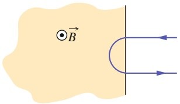

text_image

B⃗

Abb. 24.F5

**6.** Abbildung 24.F6 zeigt die Bahnkurve eines Teilchens, das nacheinander sechs Raumbereiche durchläuft, in denen jeweils ein homogenes Magnetfeld herrscht. In den Feldbereichen bewegt sich das Teilchen jeweils entweder auf einem Halb- oder einem Viertelkreis. Nachdem es den letzten Bereich f verlassen hat, durchquert das Teilchen den Raum zwischen zwei geladenen, planparallelen Platten und wird dabei zur Platte mit dem höheren elektrischen Potenzial hin abgelenkt. Welche Richtungen haben die Magnetfelder in den Bereichen a bis f?

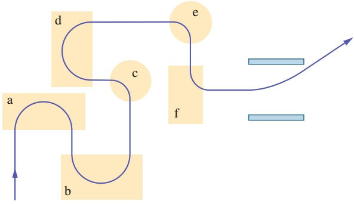

flowchart

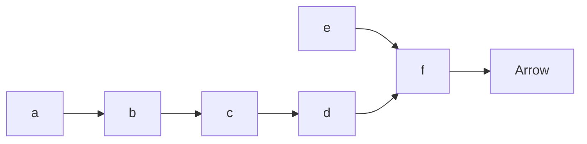

Abb. 24.F6

**7.** Abbildung 24.F7 zeigt die Bahnkurve eines Elektrons, das sich nacheinander durch zwei Raumbereiche mit den homogenen Magnetfeldern $B _ { 1 }$ und $B _ { 2 }$ bewegt. In jedem der beiden Feldbereiche durchläuft das Elektron einen Halbkreis. (a) Welches der beiden Magnetfelder ist stärker? (b) Wie sind die Felder gerichtet? (c) Ist die Aufenthaltsdauer des Elektrons im Bereich des Felds ${ \vec { B } } _ { 1 }$ größer oder kleiner als seine Aufenthaltsdauer im Feld ${ \vec { B } } _ { 2 } ,$ oder sind beide gleich?

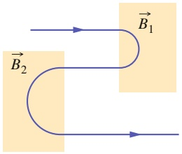

flowchart

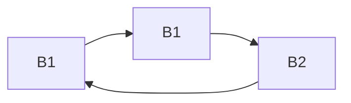

Abb. 24.F7

**8.** Abbildung 24.F8 zeigt elf verschiedene Bahnkurven von Teilchen im Bereich eines homogenen Magnetfelds. Eine der Bahnen ist geradlinig, die übrigen sind Halbkreise. Die Tabelle gibt die Massen, Ladungen und Geschwindigkeiten von 11 Teilchen an, die jeweils eine der Bahnkurven in der jeweils angegebenen Richtung durchlaufen. Ordnen Sie jedem der Teilchen seine Bahnkurve zu.

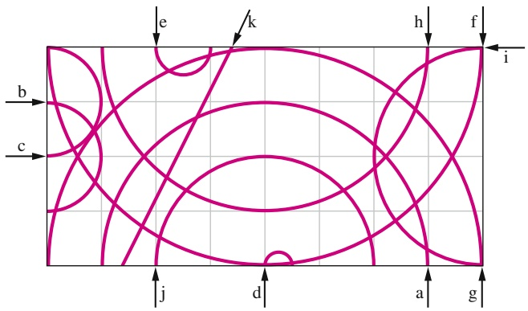

text_image

b
c
e
k
h
f
i
j
d
a
g

Abb. 24.F8

| Teilchen | Masse | Ladung | Geschwindigkeit |
| --- | --- | --- | --- |
| 1 | 2m | q | ν |
| 2 | m | 2q | ν |
| 3 | m/2 | q | 2ν |
| 4 | 3m | 3q | 3ν |
| 5 | 2m | q | 2ν |
| 6 | m | -q | 2ν |
| 7 | m | -4q | ν |
| 8 | m | -q | ν |
| 9 | 2m | -2q | 8ν |
| 10 | m | -2q | 8ν |
| 11 | 3m | 0 | 3ν |

**9.** Abbildung 24.F9 zeigt acht Drähte, die von gleichen Strömen durchflossen werden und sich in demselben, senkrecht in die Papierebene hineinzeigenden Magnetfeld befinden. Jeder der Drähte hat zwei gerade Abschnitte, die jeweils die Länge L haben und entweder parallel oder senkrecht zu den eingezeichneten Koordinatenachsen verlaufen, sowie einen gekrümmten Abschnitt mit dem Krümmungsradius R. Die Stromrichtungen sind durch Pfeile angegeben. (a) Geben Sie für jeden Fall die Richtung der resultierenden magnetischen Kraft auf den Draht an (messen Sie den Winkel dabei im Gegenuhrzeigersinn von der positiven x-Richtung aus). (b) Ordnen Sie die Drähte 1–4 in absteigender Reihenfolge nach dem Betrag der auf sie wirkenden resultierenden magnetischen Kraft. (c) Ordnen Sie in gleicher Weise die Drähte 5–8.

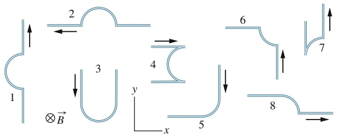

flowchart

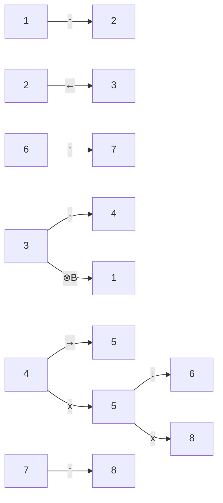

Abb. 24.F9

591

---

24 Magnetfelder

**10.** (a) Betrachten Sie erneut die Situation in Kontrollfrage 6. Ist die vom Magnetfeld am Dipol verrichtete Arbeit positiv, negativ oder null, wenn sich das Dipolmoment $\vec { \mu }$ aus Position 1 in Position 2 dreht? Ordnen Sie die Drehungen des Dipols aus Position 1 in (1) Position 2, (2) Position 3, (3) Position 4 in absteigender Reihenfolge nach dem Betrag der von dem Magnetfeld am Dipol verrichteten Arbeit.
**11.** Abbildung 24.F11 zeigt einen Draht, durch den ein Strom nach rechts durch ein homogenes magnetisches Feld fließt. Sie zeigt außerdem vier Möglichkeiten für die Magnetfeldrichtung. (a) Ordnen Sie die vier Möglichkeiten in absteigender Reihenfolge nach dem Betrag der elektrischen Potenzialdifferenz, die über die Breite des Drahts abfallen würde. (b) Bei welcher der vier Möglichkeiten liegt die Oberseite des Drahts auf einem höheren Potenzial als die Unterseite?

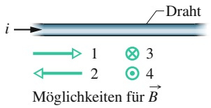

flowchart

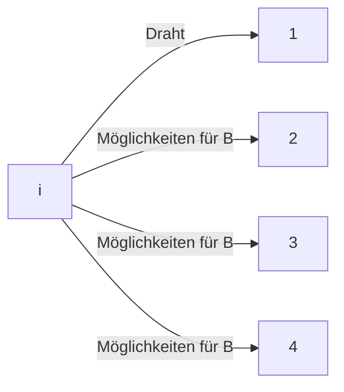

Abb. 24.F11

**12.** Abbildung 24.F12 zeigt einen metallischen, rechteckigen Festkörper, der sich mit einem Geschwindigkeitsbetrag v durch ein homogenes magnetisches Feld B⃗ bewegt. Die Abmessungen des Quaders sind Vielfache von d wie angegeben. Sie haben sechs Möglichkeiten für die Richtung der Geschwindigkeit: parallel zu x, y oder z jeweils in positive oder negative Richtung. (a) Ordnen Sie die sechs Möglichkeiten in absteigender Reihenfolge nach der Potenzialdifferenz, die über den Körper abfällt. (b) Bei welcher der Möglichkeiten liegt die Vorderseite auf einem niedrigeren Potenzial?

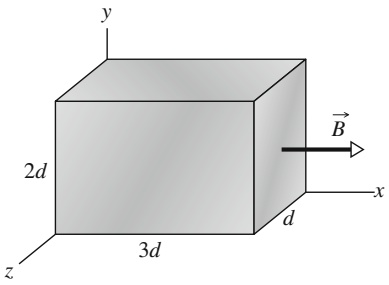

text_image

y
2d
B
x
3d
z
d

Abb. 24.F12

**13.** Abbildung 24.F13 zeigt den Weg eines Elektrons in einem homogenen Magnetfeld. Der Weg setzt sich aus zwei geraden Abschnitten, die jeweils zwischen einem Paar von homogen geladenen Platten verlaufen, und zwei Halbkreisen zusammen. Welche Platte liegt (a) im oberen Plattenpaar und (b) im unteren Paar auf dem höheren elektrischen Potenzial? (c) Welche Richtung hat das magnetische Feld?

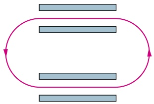

flowchart

Abb. 24.F13

**14.** Abbildung 24.F14 zeigt drei Momentaufnahmen von Situationen, in denen ein positiv geladenes Teilchen durch ein homogenes Magnetfeld B⃗ fliegt. Die Teilchengeschwindigkeit hat in den drei Situationen jeweils eine andere Richtung, aber immer den gleichen Betrag. Ordnen Sie die drei Bilder in absteigender Reihenfolge nach (a) der Periode, (b) der Frequenz und (c) der Steigung der Teilchenbewegung.

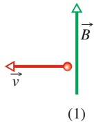

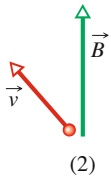

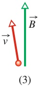

Abb. 24.F14

592
