# 25 Magnetfelder aufgrund von Strömen

原始 PDF 第 607–626 页。

# 25 Magnetfelder aufgrund von Strömen

## 25.1 Das Magnetfeld um einen Strom

## Physikalische Motivation

Es ist eine grundlegende Erfahrungstatsache der Physik, dass ein sich bewegendes geladenes Teilchen ein magnetisches Feld um sich erzeugt. Daher ruft ein elektrischer Strom ein Magnetfeld um diesen Strom hervor. Diese Verbindung von Elektrizität und Magnetismus zum „Elektromagnetismus“ war eine große Überraschung, als sie in der ersten Hälfte des 19. Jahrhunderts entdeckt wurde. Heute ist sie dagegen nicht nur Alltagswissen jedes Physikers, sondern hat auch eine immense Bedeutung für Industrie, Technik und unser tägliches Leben, denn buchstäblich überall begegnet man elektromagnetischen Geräten. So finden sich Elektromagnete in den Motoren von Spielzeugeisenbahnen und Elektroautos, in Hubmagneten und Schweißgeräten.

Unser erster Schritt in diesem Kapitel wird sein, das magnetische Feld zu ermitteln, das von einem kleinen Stück eines stromdurchflossenen Drahts hervorgerufen wird. Darauf aufbauend können wir das Feld des ganzen Drahts bestimmen – in einer Vielzahl unterschiedlicher Arrangements von Leiterabschnitten.

## 25.1.1 Das Magnetfeld um einen Strom

Wie wir in Kapitel 24 gesehen hatten, sind bewegte Ladungen – Ströme – eine der möglichen Ursachen für Magnetfelder. In diesem Kapitel wollen wir die Magnetfelder berechnen, die von einer gegebenen Verteilung von Strömen hervorgerufen werden. Dazu werden wir im Prinzip dasselbe Verfahren verwenden wie in Kapitel 18, wo wir das elektrische Feld einer gegebenen Ladungsverteilung berechnet hatten.

Dieses Verfahren wollen wir uns kurz in Erinnerung rufen. Zuerst teilen wir die Ladungsverteilung in Gedanken in differenzielle Ladungselemente dq auf, wie es für eine beliebige Ladungsverteilung in Abb. 25.1a gezeigt ist. Dann berechnen wir das Feld $\mathrm { d } { \vec { E } } ,$ das von einem solchen Ladungselement an einem Punkt P erzeugt wird. Das elektrische Feld vieler Ladungselemente können wir daraus durch Su perposition konstruieren, d. h., wir berechnen das Gesamtfeld E⃗ am Punkt P durch Summation bzw. Integration der Feldbeiträge dE⃗ über alle Ladungselemente.

Die Feldstärke dE am Punkt P lässt sich als

$$
\mathrm{d} E = \frac {1}{4 \pi \varepsilon_ {0}} \frac {\mathrm{d} q}{r ^ {2}} \tag {25.1}
$$

schreiben, wenn $r$ der Abstand zwischen dem Ladungselement $\mathrm { d } q$ und dem Punkt P ist. Für ein positiv geladenes Ladungselement dq zeigt der Feldbeitrag $\mathrm { d } \vec { E }$ in Richtung von $\vec { r } ,$ wenn $\vec { r }$ von dem Ladungselement dq zum Punkt P zeigt. Mithilfe von $\vec { r }$ können wir Gl. 25.1 auch als vektorielle Gleichung schreiben:

$$
\mathrm{d} \vec {E} = \frac {1}{4 \pi \varepsilon_ {0}} \frac {\mathrm{d} q}{r ^ {3}} \vec {r}. \tag {25.2}
$$

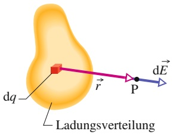

flowchart

(a)

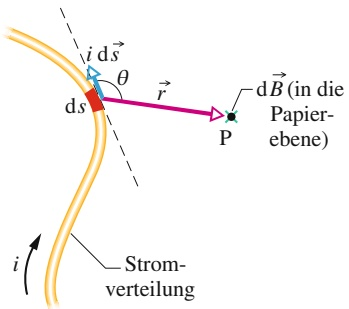

text_image

i ds
θ
ds
r
P
dB (in die Papier-
ebene)
i
Strom-
verteilung

(b)

## Abb. 25.1

(a) Ein Ladungselement dq erzeugt am Punkt P ein differenzielles elektrisches Feld dE⃗. (b) Ein Strom-Längen-Element i d⃗s erzeugt ein differenzielles Magnetfeld dB⃗ am Punkt P. Das grüne × am Punkt P zeigt an, dass das Magnetfeld dB⃗ hier in die Papierebene hinein zeigt.

Halliday Physik für natur- und ingenieurwiss. Studiengänge, 3. Auflage. D. Halliday, R. Resnick und J. Walker. © 2020 WILEY-VCH Verlag GmbH & Co. KGaA. Published 2020 by WILEY-VCH Verlag GmbH & Co. KGaA.

593

---

25 Magnetfelder aufgrund von Strömen

Diese Schreibweise macht deutlich, dass die Richtung des Vektors $\mathrm { d } \vec { E }$ für ein positives Ladungselement gleich der Richtung des Vektors ⃗r ist. Trotz des Exponenten $_ { p } 3 ^ { \alpha }$ im Nenner von Gl. 25.2 ist die Abhängigkeit des Felds von der Ladung ein $1 / r ^ { 2 } .$ -Gesetz; im Nenner erscheint nur deshalb die dritte Potenz, weil wir einen weiteren Faktor mit Betrag r (den Vektor ⃗r) im Zähler hinzugefügt haben.

Dasselbe Verfahren wollen wir nun auf die Berechnung des Magnetfelds eines Stroms anwenden. Abbildung 25.1b zeigt einen beliebig geformten Leiter, der einen Strom i führt. Wir suchen das Feld $\overrightarrow { B }$ an einem Punkt P in der Nähe des Leiters. Dazu unterteilen wir zunächst den Leiter in differenzielle Längenelemente ds und definieren für jedes Längenelement einen Vektor d⃗s mit dem Betrag ds, der in die Richtung des Stroms i in diesem Längenelement zeigt. Dann definieren wir ein differenzielles Strom-Längen-Element i d⃗s und berechnen das Magnetfeld am Punkt P, das von einem solchen Strom-Längen-Element hervorgerufen wird. Experimente zeigen, dass Magnetfelder genau wie elektrische Felder durch Superposition aufgebaut werden können. Also können wir das Gesamtfeld am Punkt P durch Summation bzw. Integration der Beiträge dB⃗ aller differenziellen Strom-Längen-Elemente erhalten. Diese Summation ist jedoch etwas schwieriger als im Fall des elektrischen Felds: Während das Ladungselement dq, das einen differenziellen Beitrag zum elektrischen Feld liefert, ein Skalar ist, ist das Strom-Längen-Element i d⃗s ein Produkt aus einem Skalar und einem Vektor (insgesamt also eine Vektorgröße).

Die Feldstärke dB des Magnetfelds am Punkt P aufgrund eines Strom-Längen-Elements i d⃗s ist

$$
\mathrm{d} B = \frac {\mu_ {0}}{4 \pi} \frac {i \mathrm{d} s \sin \theta}{r ^ {2}}, \tag {25.3}
$$

wobei $\theta$ der Winkel zwischen den Richtungen von d⃗s und ⃗r ist. Das Symbol $\mu _ { 0 }$ bezeichnet eine Naturkonstante, die magnetische Feldkonstante (auch Vakuumpermeabilität genannt), deren Wert per definitionem genau gleich

$$
\mu_ {0} = 4 \pi \cdot 1 0 ^ {- 7} \mathrm{T} \cdot \mathrm{m/A} \approx 1, 2 6 \cdot 1 0 ^ {- 6} \mathrm{T} \cdot \mathrm{m/A} \tag {25.4}
$$

ist. Die Richtung von $\mathrm { d } \vec { B }$ (in Abb. 25.1b in die Papierebene hinein) ergibt sich aus dem Vektorprodukt d⃗s $\left[ \right. \times \vec { r } .$ Damit lautet Gl. 25.3 in Vektorschreibweise

$$
\mathrm{d} \vec {B} = \frac {\mu_ {0}}{4 \pi} \frac {i \mathrm{d} \vec {s} \times \vec {r}}{r ^ {3}} \quad \text {(Biot - Savartsches Gesetz)}. \tag {25.5}
$$

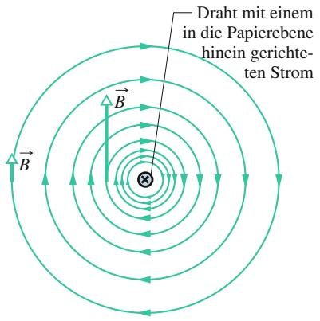

text_image

Draht mit einem
in die Papierebene
hinein gerichteten
Strom

Abb. 25.2

Die magnetischen Feldlinien, die von einem elektrischen Strom in einem langen geraden Leiter erzeugt werden, sind konzentrische Kreise um den Leiter. Das × in der Mitte zeigt an, dass der Strom in diesem Fall in die Papierebene hineinzeigt.

Diese Gleichung (bzw. ihre skalare Variante Gl. 25.3) ist unter dem Namen **Biot-Savartsches Gesetz** bekannt. Dieses zunächst experimentell abgeleitete Gesetz beschreibt eine $1 / r ^ { 2 } .$ -Abhängigkeit des Magnetfelds vom Abstand (im Nenner taucht nur deshalb der Exponent 3 auf, weil der Faktor ⃗r auch noch einmal im Zähler steht). Mithilfe dieses Gesetzes werden wir das Magnetfeld verschiedener Stromverteilungen an beliebigen Punkten im Raum berechnen.

## Das Magnetfeld eines Stroms in einem langen geraden Leiter

In einem der nächsten Abschnitte werden wir mithilfe des Biot-Savartschen Gesetzes zeigen, dass die magnetische Feldstärke in einem Abstand R von einem unendlich langen geraden Leiter, in dem ein Strom i fließt, durch

$$
B = \frac {\mu_ {0} i}{2 \pi R} \tag {25.6}
$$

gegeben ist.

Die Feldstärke B in Gl. 25.6 hängt nur von dem Strom i und dem Abstand R zu dem Leiter ab. In unserer Herleitung werden wir zeigen, dass die Feldlinien von B konzentrische Kreise um den Leiter sind, wie in Abb. 25.2 schematisch dargestellt

594

---

25.1 Das Magnetfeld um einen Strom

25

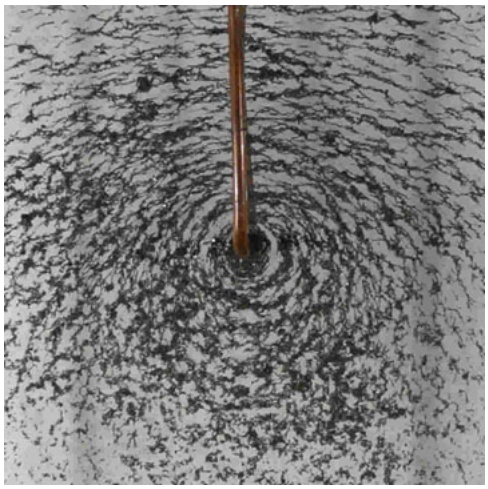

natural_image

Close-up of a wooden rod stirring a large, swirling liquid (no text or symbols visible)

Abb. 25.3

Die Eisenfeilspäne auf der blauen Fläche ordnen sich in konzentrischen Kreisen an, wenn ein Strom durch den Draht in der Mitte fließt. Sie folgen damit den magnetischen Feldlinien, die der Strom erzeugt [Quelle: Richard Megna/Fundamental Photographs].

und in Abb. 25.3 an einem realen Beispiel durch Eisenfeilspäne sichtbar gemacht ist. Der zunehmende Abstand zwischen den Feldlinien in Abb. 25.2 mit wachsendem Abstand von dem Leiter zeigt die 1∕R-Abhängigkeit des Felds, die von Gl. 25.6 vorhergesagt wird. Auch die Längen der beiden eingezeichneten Vektoren B⃗ zeigen diese Abnahme der Feldstärke.

Um die Richtung des Magnetfelds zu bestimmen, das von einem Strom-Längen-Element erzeugt wird, greifen wir auf eine einfache Rechte-Hand-Regel zurück:

**Rechte-Hand-Regel** für das Magnetfeld eines Leiters: Wir greifen das Strom-Längen-Element mit unserer rechten Hand, sodass der Daumen in Stromrichtung zeigt. Unsere Finger zeigen dann automatisch in die Richtung des von diesem Strom erzeugten Magnetfelds.

Die Anwendung dieser Rechte-Hand-Regel auf die Situation aus Abb. 25.2 (Strom in einem langen geraden Draht) ist in Abb. 25.4 zu sehen. Um die Richtung des von dem Strom erzeugten Magnetfelds B⃗ zu bestimmen, legen wir in Gedanken unsere rechte Hand so um den Leiter, dass der Daumen in Stromrichtung zeigt; die gekrümmten Finger zeigen dann die Richtung des Felds an. In der Ansicht aus Abb. 25.2 liegt das Feld $\vec { B }$ an jedem Punkt tangential an den magnetischen Feldlinien an; in der Ansicht aus Abb. 25.4 steht es senkrecht auf der radialen Verbindungslinie zwischen dem betrachteten Punkt und dem Strom.

## Der Beweis von Gleichung 25.6

Zur Illustration der Aufgabe, die wir uns nun vorgenommen haben, betrachten wir Abb. 25.5, die weitgehend Abb. 25.1b entspricht, nur dass der Leiter jetzt gerade und unendlich lang ist: Wir suchen das Feld $\vec { B }$ an einem Punkt P im Abstand R von dem Leiter. Die differenzielle Feldstärke dB, die durch das differenzielle Strom-Längen-Element i ds am Punkt P erzeugt wird, ist gleich

$$
\mathrm{d} B = \frac {\mu_ {0}}{4 \pi} \frac {i \mathrm{d} s \sin \theta}{r ^ {2}}.
$$

Die Richtung von d $\vec { B }$ in Abb. 25.5 ist die des Vektors d⃗s $\times \vec { r } ,$ d. h. senkrecht in die Papierebene hinein.

An jedem Punkt P haben die Beiträge aller Strom-Längen-Elemente des Leiters dieselbe Richtung. Zur Berechnung der Feldstärke, die von allen Strom-Längen-Elementen in der oberen Hälfte des Leiters am Punkt P hervorgerufen wird, müssen wir daher nur Gl. 25.3 von null bis unendlich integrieren.

Nun betrachten wir ein Strom-Längen-Element in der unteren Hälfte des Leiters in Abb. 25.5, das ebenso weit unterhalb von P liegen soll wie d⃗s oberhalb von P.

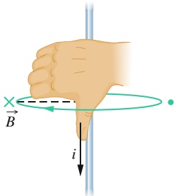

text_image

B
i

(a)

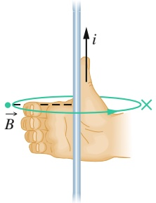

text_image

B
i

(b)

## Abb. 25.4

Die Rechte-Hand-Regel zur Bestimmung der Richtung des Magnetfelds eines Stroms. (a) Die Situation aus Abb. 25.2 von der Seite gesehen. Das Magnetfeld an einem Punkt links von dem stromführenden Leiter steht senkrecht auf der gestrichelten radialen Linie und zeigt in die Papierebene hinein, in Richtung der Fingerspitzen (durch das × angedeutet). (b) Wenn sich die Stromrichtung umkehrt, ist $\vec { B }$ an demselben Punkt immer noch senkrecht zu der gestrichelten Linie, zeigt nun aber aus der Papierebene heraus (durch den • angedeutet).

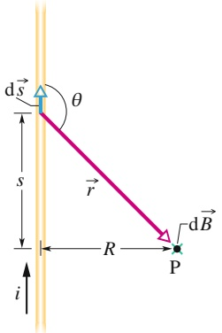

text_image

d⃗
s
i
θ
r
R
P
d⃗B

## Abb. 25.5

Die Berechnung des Magnetfelds eines Stroms i in einem langen geraden Leiter. Das von dem Strom-Längen-Element i d⃗s am Punkt P hervorgerufene Feld dB⃗ zeigt in die Papierebene hinein.

595

---

25 Magnetfelder aufgrund von Strömen

Nach Gl. 25.5 besitzt das Magnetfeld dieses Strom-Längen-Elements am Punkt P denselben Betrag und dieselbe Richtung wie das von i d⃗s hervorgerufene. Mit der gleichen Argumentation können wir zeigen, dass die gesamte untere Hälfte des Leiters genau dasselbe Magnetfeld an P erzeugt wie die obere Hälfte. Um das gesamte Magnetfeld zu bekommen, müssen wir daher nur das Resultat unserer Integration mit dem Faktor zwei multiplizieren:

$$
B = 2 \int_ {0} ^ {\infty} \mathrm{d} B = \frac {\mu_ {0} i}{2 \pi} \int_ {0} ^ {\infty} \frac {\sin \theta \mathrm{d} s}{r ^ {2}}. \tag {25.7}
$$

Die Variablen $\theta ,$ s und r in dieser Gleichung sind nicht unabhängig; sie sind durch

$$
r = \sqrt {s ^ {2} + R ^ {2}}
$$

und

$$
\sin \theta = \sin (\pi - \theta) = \frac {R}{\sqrt {s ^ {2} + R ^ {2}}}
$$

miteinander verknüpft. Mit diesen Substitutionen und Integral 19 aus Anhang D bekommen wir aus Gl. 25.7

$$
B = \frac {\mu_ {0} i}{2 \pi} \int_ {0} ^ {\infty} \frac {R \mathrm{d} s}{(s ^ {2} + R ^ {2}) ^ {3 / 2}} = \frac {\mu_ {0} i}{2 \pi R} \left[ \frac {s}{(s ^ {2} + R ^ {2}) ^ {1 / 2}} \right] _ {0} ^ {\infty} = \frac {\mu_ {0} i}{2 \pi R}. \tag {25.8}
$$

Damit haben wir genau die Gleichung erhalten, die wir beweisen wollten. Das Magnetfeld, das nur von der unteren bzw. nur von der oberen Hälfte des unendlich langen Leiters in Abb. 25.5 erzeugt wird, entspricht genau der Hälfte dieses Werts, also:

$$
B _ {\mathrm{o/u}} = \frac {\mu_ {0} i}{4 \pi R}. \tag {25.9}
$$

## Das Magnetfeld eines Stroms in einem Kreisbogen

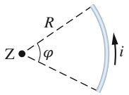

(a)

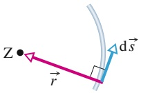

(b)

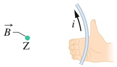

(c)

Abb. 25.6

(a) Ein Leiter in Form eines Kreisbogens um ein Zentrum Z führt einen Strom i. (b) Der Winkel zwischen d⃗s und ⃗r ist an allen Punkten auf dem Kreisbogen 90°. (c) Die Bestimmung der Feldrichtung im Zentrum Z aufgrund des Stroms im Kreisbogen: Das Feld zeigt aus der Papierebene heraus in Richtung der Fingerspitzen, wie durch den grü- nen Punkt am Punkt Z angedeutet.

Um das Magnetfeld eines Stroms in einem gebogenen Leiter zu berechnen, verwenden wir wieder Gl. 25.3 für den Beitrag eines einzelnen Strom-Längen-Elements und integrieren dann, um das Gesamtfeld aus den Beiträgen aller Strom-Längen-Elemente zu ermitteln. Je nach der genauen Form des Leiters kann diese Integration recht schwierig werden; einfach wird sie dann, wenn der Leiter die Form eines Kreisbogens hat und wir uns nur für das Feld in seinem Krümmungsmittelpunkt interessieren.

Abbildung 25.6a zeigt einen derartigen Leiter mit dem Winkel $\varphi$ um das Zen trum Z und einem Radius $R ,$ in dem ein Strom i fließt. Am Punkt Z erzeugt jedes Strom-Längen-Element i d⃗s des Leiters eine Feldstärke dB gemäß Gl. 25.3. Wie Abb. 25.6b zeigt, ist der Winkel θ zwischen den Vektoren d⃗s und ⃗r immer 90°, egal wo sich das Längenelement d⃗s auf dem Kreisbogen befindet; außerdem ist stets $r = R$ . Wir setzen in Gl. 25.3 $r = R$ und $\theta = 9 0 ^ { \circ }$ ein und erhalten so

$$
\mathrm{d} B = \frac {\mu_ {0}}{4 \pi} \frac {i \mathrm{d} s \sin 9 0 ^ {\circ}}{R ^ {2}} = \frac {\mu_ {0}}{4 \pi} \frac {i \mathrm{d} s}{R ^ {2}}. \tag {25.10}
$$

Dies ist die magnetische Feldstärke am Punkt Z aufgrund eines einzelnen Strom-Längen-Elements des Kreisbogens.

Die Anwendung der Rechte-Hand-Regel an einem beliebigen Punkt des Kreis bogens (wie in Abb. 25.6c) zeigt, dass alle differenziellen Felder am Punkt Z in dieselbe Richtung zeigen – in diesem Fall senkrecht aus der Papierebene heraus. Also

596

---

25.1 Das Magnetfeld um einen Strom

25

ist das Gesamtfeld bei $Z$ einfach die Summe bzw. das Integral der Beiträge $\mathrm { d } \vec { B }$ aller Strom-Längen-Elemente. Um die Integrationsvariable zu wechseln, verwenden wir die Identität $\mathrm { d } s = R   \mathrm { d } \varphi$ und erhalten aus Gl. 25.10

$$
B = \int \mathrm{d} B = \int_ {0} ^ {\varphi} \frac {\mu_ {0}}{4 \pi} \frac {i R \mathrm{d} \varphi}{R ^ {2}} = \frac {\mu_ {0} i}{4 \pi R} \int_ {0} ^ {\varphi} \mathrm{d} \varphi .
$$

Die Integration ergibt

$$
B = \frac {\mu_ {0} i \varphi}{4 \pi R} \quad (\text {im Zentrum eines Kreisbogens}). \tag {25.11}
$$

Diese Gleichung gilt nur für das Feld im Krümmungszentrum eines stromführenden Kreisbogens. Beim Einsetzen von Werten in die Gleichung müssen wir darauf achten, 𝜑 im Bogenmaß und nicht in Winkelgrad anzugeben. Zum Beispiel setzen wir für einen Vollkreis $\varphi = 2 \pi$ in Gl. 25.11 ein und erhalten für das Feld in der Mitte eines kreisförmigen Stroms:

$$
B = \frac {\mu_ {0} i 2 \pi}{4 \pi R} = \frac {\mu_ {0} i}{2 R} \quad (\text {im Zentrum eines Vollkreises}). \tag {25.12}
$$

## KONTROLLFRAGE 1

Die Abbildung zeigt drei Stromkreise aus konzentrischen Kreisbögen (Halb- oder Viertelkreise mit den Radien $r ,$ 2r oder 3r) und radialen Abschnitten. In den drei Stromkreisen fließt der gleiche Strom. Ordnen Sie sie in absteigender Reihenfolge nach dem Betrag des Magnetfelds im Zentrum der Kreisbögen.

(a)

(b)

(c)

## LÖSUNGSSTRATEGIEN

**Strategie 1: Rechte-Hand-Regeln** Um Klarheit über die bisher verwendeten Rechte-Hand-Regeln zu bekommen, wollen wir sie kurz gegenüberstellen.

**Rechte-Hand-Regel für Vektorprodukte** Diese Regel hilft dabei, die Richtung eines Vektorprodukts zu bestimmen (vgl. Abb. 6.5c, Abb. 24.2 und Anhang D). Dazu umfassen wir die beiden Vektoren so, dass wir den ersten Vektor mit den Fingern auf den zweiten schieben können (über den kleineren der beiden von den Vektoren eingeschlossenen Winkel). Der ausgestreckte Daumen zeigt dabei in die Richtung des Vektorprodukts der beiden Vektoren. Diese Regel hatten wir in Kapitel 7 verwendet, um die Richtung von Drehmoment- und Drehimpulsvektoren zu bestimmen. In Kapitel 24 haben wir damit die Richtung der Kraft auf einen stromdurchflossenen Leiter in einem Magnetfeld ermittelt.

**Rechte-Hand-Regel für elektrische Leiter** Im Zusammenhang mit Magnetismus sind wir oft in der Situation, ein „gekrümmtes“ und ein „gerades“ Element miteinander in Beziehung zu setzen. Das können wir mit den gekrümmten Fingern und dem geraden (ausgestreckten) Daumen der rechten Hand tun. Ein Beispiel hatten wir bereits in Abschn. 24.7 kennengelernt, als wir den Strom in einer Leiterschleife (gekrümmtes Element) mit dem Normalenvektor n⃗ (gerades Element) der Schleife in Beziehung gesetzt hatten: Wir hatten dazu die Finger unserer rechten Hand in die Richtung des Stroms in der Schleife gekrümmt, der ausgestreckte Daumen zeigte dann die Richtung von $\vec { n }$ an. Dies war gleichzeitig die Richtung des magnetischen Dipolmoments $\vec { \mu }$ der Schleife.

Nun haben wir eine weitere Anwendung dieser zweiten Rechte-Hand-Regel ken nengelernt: Um die Richtung der magnetischen Feldlinien um ein Strom-Längen-Element zu bestimmen, zeigen wir mit dem ausgestreckten Daumen unserer rechten Hand in Richtung des Stroms. Die gekrümmten Finger weisen dann in Richtung der Feldlinien um das stromführende Längenelement.

597

---

25 Magnetfelder aufgrund von Strömen

## 25.2 Die Kraft zwischen parallelen Strömen

## Lernziele

Nach dem Durcharbeiten dieses Abschnitts sollten Sie in der Lage sein, . . .

• im Fall von zwei parallelen bzw. antiparallelen Strömen das Magnetfeld zu berechnen, das der erste Strom am Ort des zweiten erzeugt und die zugehörige magnetische Kraft auf diesen zweiten Strom anzugeben,
• zu verstehen, warum zwei parallele Ströme einander anziehen und zwei anti-parallele Ströme einander abstoßen,
• die Funktionsweise einer elektromagnetischen Kanone zu beschreiben.

## Schlüsselideen

• Parallele stromführende Drähte ziehen einander an, wenn die Ströme in die gleiche Richtung fließen, andernfalls stoßen sie sich ab. Der Betrag der Kraft auf ein Drahtstück der Länge L ist

$$
F _ {\mathrm{ba}} = i _ {\mathrm{b}} L B _ {\mathrm{a}} \sin 9 0 ^ {\circ} = \frac {\mu_ {0} L i _ {\mathrm{a}} i _ {\mathrm{b}}}{2 \pi d};
$$

dabei bezeichnen d den Abstand der Drähte und $i _ { \mathrm { a } }$ und $i _ { \mathrm { b } }$ die Stromstärken in den Drähten.

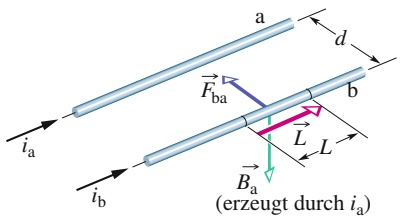

text_image

a
d
Fba
b
L
L
i_a
i_b
Ba
(erzeugt durch i_a)

Abb. 25.7

Zwei parallele Drähte, die Strö- me in derselben Richtung führen, ziehen einander an. $\vec { B } _ { \mathrm { a } }$ ist das Feld am Ort von Leiter b aufgrund des Stroms in Leiter a. $\vec { \bar { F } } _ { \mathrm { b a } }$ ist die Kraft, die auf Leiter b wirkt, weil durch ihn im Magnetfeld $\vec { B } _ { \mathrm { a } }$ ein Strom fließt.

## 25.2.1 Die Kraft zwischen parallelen Strömen

Zwei lange, parallele, stromdurchflossene Drähte üben eine Kraft aufeinander aus. Abbildung 25.7 zeigt zwei solche Drähte in einem Abstand d voneinander, die die Ströme $i _ { \mathrm { a } }$ und $i _ { \mathrm { b } }$ führen. Wir wollen nun die Kräfte berechnen, die die beiden Drähte aufgrund der Ströme aufeinander ausüben.

Zuerst berechnen wir die Kraft auf Leiter b in Abb. 25.7 aufgrund des Stroms in Leiter a. Der Strom erzeugt ein Magnetfeld d $\begin{array} { r } { \mathrm { 1 } \vec { B } _ { \mathrm { a } } , } \end{array}$ das für die beobachtete Kraft verantwortlich ist. Um die Kraft zu berechnen, brauchen wir die Feldstärke und die Richtung von $\vec { B } _ { \mathrm { a } }$ am Ort des Leiters b. Für die Feldstärke gilt nach Gl. 25.6

$$
B _ {\mathrm{a}} = \frac {\mu_ {0} i _ {\mathrm{a}}}{2 \pi d}. \tag {25.13}
$$

Die Rechte-Hand-Regel sagt uns, dass $\vec { B } _ { \mathrm { a } }$ am Ort von Leiter b nach unten zeigt, wie in Abb. 25.7 dargestellt.

Nachdem wir nun das Feld des Stroms a kennen, können wir die Kraft ausrech nen, die dieses Feld auf Leiter b ausübt. Aus Gl. 24.23 wissen wir, dass die Kraft $\vec { F } _ { \mathrm { b a } }$ auf einen Abschnitt der Länge L eines Leiters b aufgrund eines Felds $\vec { B } _ { \mathrm { a } }$ durch

$$
\vec {F} _ {\mathrm{ba}} = i _ {\mathrm{b}} \vec {L} \times \vec {B} _ {\mathrm{a}} \tag {25.14}
$$

gegeben ist, wobei $\vec { L }$ der Längenvektor des Leiters b ist. In Abb. 25.7 stehen $\vec { L }$ und ${ \vec { B } } _ { \mathrm { a } }$ senkrecht aufeinander, sodass aus Gl. 25.13 folgt

$$
F _ {\mathrm{ba}} = i _ {\mathrm{b}} L B _ {\mathrm{a}} \sin 9 0 ^ {\circ} = \frac {\mu_ {0} L i _ {\mathrm{a}} i _ {\mathrm{b}}}{2 \pi d}. \tag {25.15}
$$

$\vec { F } _ { \mathrm { b a } }$ zeigt in die Richtung des Vektorprodukts $\vec { L } \times \vec { B } _ { \mathrm { a } }$ . Die Rechte-Hand-Regel für Vektorprodukte ergibt, dass $\vec { F } _ { \mathrm { b a } }$ in Abb. 25.7 senkrecht von Leiter b zu Leiter a zeigt.

Allgemein können wir die Kraft auf einen stromführenden Leiter mit folgender Methode finden:

Um die Kraft auf einen stromdurchflossenen Leiter aufgrund eines zweiten stromdurchflossenen Leiters zu finden, berechnen wir zuerst das Feld des zweiten am Ort des ersten Leiters. Danach berechnen wir die Kraft, die dieses Feld auf den Leiter ausübt.

598

---

25.3 Das Ampèresche Gesetz

25

Mit dieser Methode können wir nun auch die Kraft auf Leiter a aufgrund des Stroms in Leiter b berechnen. Wir finden dabei, dass die Kraft senkrecht von Leiter a zu Leiter b zeigt. Mit anderen Worten: Die beiden Drähte ziehen einander an, wenn sie von parallelen Strömen durchflossen werden. Wenn die Ströme in den Drähten in entgegengesetzte Richtungen fließen würden, würden wir feststellen, dass die beiden Drähte einander abstoßen. Es gilt also:

Parallele Ströme ziehen einander an; antiparallele Ströme stoßen einander ab.

Die Kraft zwischen zwei Strömen in parallelen Leitern war übrigens bis 2019 die Grundlage für die Definition der SI-Einheit der Stromstärke, des Ampere. Der 1946 verabschiedeten Definition zufolge war ein Ampere die Stromstärke, die in zwei parallelen, unendlich langen Drähten von vernachlässigbarer Dicke, die in einem Abstand von einem Meter im Vakuum gespannt sind, eine Kraft von $2 \cdot 1 0 ^ { - 7 }$ N/m hervorruft. Heute sind die Einheiten Ampere und Coulomb über den exakt festgelegten Wert der Elementarladung sowie die Einheit Sekunde definiert (siehe Anhang A).

## Die elektromagnetische Kanone

Eine elektromagnetische Kanone (auch im Deutschen oft als Rail Gun oder manchmal auch als Schienenkanone bezeichnet) ist eine Vorrichtung, in der eine magnetische Kraft ein Projektil in sehr kurzer Zeit auf sehr hohe Geschwindigkeit beschleunigt. Das Funktionsprinzip ist in Abb. 25.8a dargestellt. Durch eine der parallelen leitenden Schienen fließt ein sehr großer Strom über eine Schmelzsicherung (z. B. ein dünnes Kupferstück) zu der anderen Schiene und zur Stromquelle zurück. Das abzufeuernde Projektil liegt hinter der Sicherung und kann zwischen den Schienen gleiten. Durch den starken Strom schmilzt und verdampft die Sicherung sofort, wobei ein leitfähiges Gas an der Stelle entsteht, wo sich zuvor die Sicherung befand.

Die Rechte-Hand-Regel aus Abb. 25.4 zeigt, dass der Strom in den Schienen aus Abb. 25.8a ein Magnetfeld erzeugt, das zwischen den Schienen nach unten zeigt. Dieses Feld B⃗ übt eine Kraft $\vec { F }$ auf das stromdurchflossene Gas aus (Abb. 25.8b). Mithilfe von Gl. 25.14 und der Rechte-Hand-Regel für Vektorprodukte erkennen wir, dass diese Kraft $\vec { F }$ entlang der Schienen nach außen (vorne) zeigt. Das Gas wird von dieser Kraft nach außen getrieben und schiebt dabei das Projektil vor sich her. So werden Beschleunigungen von bis zu $5 \cdot 1 0 ^ { 6 } g$ erreicht, sodass das Projektil innerhalb einer Millisekunde auf eine Geschwindigkeit von ca. 10 km/s beschleunigt werden kann.

## KONTROLLFRAGE 2

Die Abbildung zeigt drei lange, gerade, parallele und äquidistante Drähte, in denen identische Ströme entweder in die Papierebene hinein oder aus ihr herausfließen. Ordnen Sie die Drähte in absteigender Reihenfolge nach dem Betrag der Kraft auf sie aufgrund der Ströme in den anderen beiden Drähten.

## 25.3 Das Ampèresche Gesetz

## Lernziele

Nach dem Durcharbeiten dieses Abschnitts sollten Sie in der Lage sein, . . .

• das Ampèresche Gesetz auf einen geschlossenen Weg (eine „Schleife“) anzuwenden, der um einen Strom verläuft,
• mit dem Ampèreschen Gesetz und der Rechte-Hand-Regel das Vorzeichen des umlaufenen Stroms zu bestimmen,

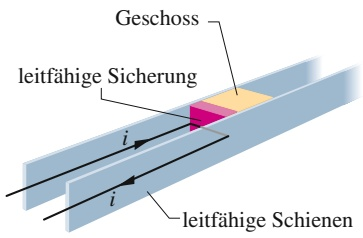

text_image

Geschoss
leitfähige Sicherung
i
i
leitfähige Schienen

(a)

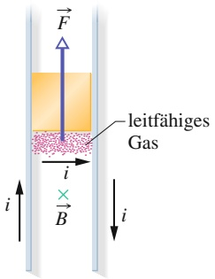

text_image

F
leitfähiges
Gas
i
×
B
i

(b)

## Abb. 25.8

(a) In einer elektromagnetischen Kanone wird ein Strom i erzeugt. Der Strom bewirkt das Schmelzen der leitenden Sicherung. (b) Der Strom erzeugt ein Magnetfeld B⃗ zwischen den Schienen, das eine Kraft F⃗ auf das stromdurchflossene Gas ausübt. Das Gas beschleunigt das Projektil entlang der Schienen.

599

---

25 Magnetfelder aufgrund von Strömen

• für den Fall mehrerer Ströme innerhalb der Ampèreschen Schleife den relevanten Nettostrom anzugeben,
das Ampèresche Gesetz auf einen langen, geraden, stromdurchflossenen Draht anzuwenden, um den Betrag des Magnetfelds innerhalb und außerhalb des Drahts zu bestimmen, und zu verstehen, dass es dabei nur auf den Strom innerhalb der Ampèreschen Schleife ankommt.

## Schlüsselideen

• Das Ampèresche Gesetz lautet

$$
\oint \vec {B} \cdot \mathrm{d} \vec {s} = \mu_ {0} i _ {\mathrm{um}} \quad (\text {Amperèsches Gesetz}).
$$

Das Kurvenintegral in dieser Gleichung wird dabei über einen geschlossenen Weg berechnet, eine sogenannte Ampèresche Schleife. Der Strom i auf der rechten Seite der Gleichung ist der von der Schleife umschlossene Nettostrom.

## 25.3.1 Das Ampèresche Gesetz

Wir können das resultierende elektrische Feld einer beliebigen Ladungsverteilung mithilfe des $1 / R ^ { 2 } .$ -Gesetzes für das differenzielle elektrische Feld dE⃗ aus Gl. 25.2 berechnen. Wenn die Ladungsverteilung kompliziert ist, müssen wir dazu allerdings unter Umständen Computer und numerische Verfahren einsetzen. Wir wissen aber auch, dass wir die Lösung dieser Aufgabe mithilfe des Gaußschen Satzes wesentlich vereinfachen können, wenn die Situation planare, Zylinder- oder Kugelsymmetrie besitzt.

Analog können wir auch das resultierende Magnetfeld einer beliebigen Stromverteilung mithilfe des $1 / R ^ { 2 }$ -Gesetzes für das differenzielle magnetische Feld dB⃗ aus Gl. 25.5 berechnen, aber auch hier müssen wir unter Umständen Computer einsetzen, wenn die Stromverteilung kompliziert ist. Wenn die gegebene Situation Symmetrie besitzt, können wir aber unter Umständen das **Ampèresche Gesetz** anwenden, um das Magnetfeld mit wesentlich weniger Aufwand zu erhalten. Dieses Gesetz, das aus dem Biot-Savartschen Gesetz abgeleitet werden kann, wird üblicherweise André-Marie Ampère (1775–1836) zugeschrieben, nach dem die SI-Einheit des Stroms benannt ist; der schottische Physiker James Clerk Maxwell erweiterte es später und nahm es in seine Grundgleichungen des Elektromagnetismus auf (Kapitel 28).

Das Ampèresche Gesetz lautet

$$
\oint \vec {B} \cdot \mathrm{d} \vec {s} = \mu_ {0} i _ {\mathrm{um}}. \tag {25.16}
$$

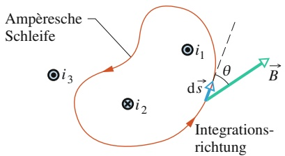

flowchart

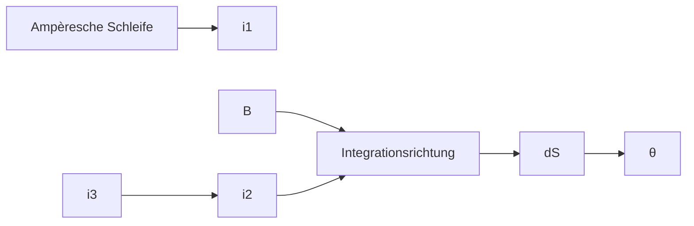

Abb. 25.9

Das Ampèresche Gesetz auf eine willkürliche Schleife angewendet, die zwei von drei stromdurchflossenen Leitern umschließt. Der Strom $i _ { 2 }$ zeigt in die Papierebene hinein; $i _ { 1 }$ und $i _ { 3 }$ zeigen aus der Papierebene heraus.

Der Kreis an dem Integralzeichen bedeutet, dass das Skalarprodukt $\vec { B } \cdot \mathsf { d } \vec { s }$ entlang einer geschlossenen Schleife zu berechnen ist. Der Strom $i _ { \mathrm { u m } }$ ist der von dieser Schleife umschlossene Strom.

Um die Bedeutung des Skalarprodukts $\vec { B }$ ⋅ d⃗s und des Integrals über diese Grö- ße zu verstehen, wenden wir das Ampèresche Gesetz zunächst auf die Situation in Abb. 25.9 an. Die Abbildung zeigt drei lange Drähte im Querschnitt, die Ströme $i _ { 1 }$ $i _ { 2 }$ und $i _ { 3 }$ fließen entweder in die Papierebene hinein oder aus ihr heraus. Ein willkürlicher Integrationsweg umschließt zwei der Leiter, aber nicht den dritten. Die Richtung der Integration entlang dieser Schleife ist ebenfalls willkürlich gewählt; wie die Pfeile zeigen, soll sie im Gegenuhrzeigersinn ausgeführt werden.

Um das Ampèresche Gesetz anzuwenden, unterteilen wir die Schleife gedanklich in differenzielle Längenelemente d⃗s, die an jeder Stelle tangential an der Schleife liegen und in Integrationsrichtung zeigen. An der Stelle des in der Abbildung gezeigten Längenelements d⃗s soll das resultierende Magnetfeld aufgrund der drei Ströme $\vec { B }$ betragen. Da die Leiter senkrecht auf der Papierebene stehen, müssen die Felder aller drei Ströme an allen Punkten in Abb. 25.9 in der Papierebene lie-

600

---

25.3 Das Ampèresche Gesetz

25

gen; folglich gilt das auch für das resultierende Feld ${ \vec { B } } .$ Wir wissen jedoch nichts über die Richtung von $\vec { B }$ in der Ebene; in der Abbildung ist $\vec { B }$ in einem willkürlichen Winkel θ zu d⃗s eingezeichnet.

Das Skalarprodukt $\vec { B }$ ⋅ d⃗s auf der linken Seite von Gl. 25.16 ist dann gleich B cos $\theta$ ds. Damit lautet das Ampèresche Gesetz

$$
\oint \vec {B} \cdot \mathrm{d} \vec {s} = \oint B \cos \theta \mathrm{d} s = \mu_ {0} i _ {\mathrm{um}}. \tag {25.17}
$$

Wir können das Skalarprodukt $\vec { B } \cdot \mathrm { d } \vec { s }$ nun als Produkt aus einem Längenelement ds der Schleife und der Feldkomponente B cos θ interpretieren, die an der Stelle ds tangential an der Schleife anliegt. Die Integration können wir dann als Summation all dieser Produkte entlang der Schleife auffassen.

Zur Durchführung der Integration brauchen wir die Richtung von $\vec { B }$ nicht zu kennen. Stattdessen nehmen wir willkürlich an, dass $\vec { B }$ (wie in Abb. 25.9) grundsätzlich in Integrationsrichtung zeigt. Mithilfe der folgenden Rechte-Hand-Regel weisen wir dann den einzelnen Strömen, die zu dem umschlossenen Strom $i _ { \mathrm { u m } }$ beitragen, ein Plus- oder Minuszeichen zu:

Wir umschließen den Integrationsweg mit unserer rechten Hand, sodass die Finger in Integrationsrichtung zeigen. Einem Strom, der in die Richtung unseres ausgestreckten Daumens zeigt, weisen wir ein Pluszeichen zu, einem entgegengesetzten Strom ein Minuszeichen.

Dann lösen wir Gl. 25.17 und berechnen die Feldstärke B. Wenn B positiv ist, ist unsere willkürlich zugewiesene Richtung von $\vec { B }$ korrekt. Wenn B negativ ist, ignorieren wir das Minuszeichen und zeichnen $\vec { B }$ in die entgegengesetzte Richtung.

Abbildung 25.10 zeigt die Anwendung der Rechte-Hand-Regel auf die Situation aus Abb. 25.9. Mit der eingezeichneten Integration im Gegenuhrzeigersinn erhalten wir für den umschlossenen Strom

$$
i _ {\mathrm{um}} = i _ {1} - i _ {2}.
$$

(Strom 3 wird nicht von der Schleife umschlossen.) Damit erhalten wir Gl. 25.17 in der Form

$$
\oint B \cos \theta \mathrm{d} s = \mu_ {0} (i _ {1} - i _ {2}). \tag {25.18}
$$

Wir können uns fragen, weshalb der Strom $i _ { 3 }$ auf der rechten Seite von Gl. 25.18 nicht benötigt wird, obwohl er doch zu der Feldstärke B auf der linken Seite beiträgt. Die Antwort ist, dass sich die Beiträge von $i _ { 3 }$ zu B⃗ bei der Integration herausheben, da die Integration in Gl. 25.18 um die komplette geschlossene Schleife erfolgt. Im Gegensatz dazu heben sich die Beiträge der Ströme innerhalb der Schleife nicht heraus.

Wir können die Feldstärke B nicht aus Gl. 25.18 berechnen, da wir für die Situation aus Abb. 25.9 nicht genügend Informationen haben, um das Integral vereinfachen und berechnen zu können. Wir kennen aber das Ergebnis der Integration – es ist gleich $\mu _ { 0 } ( i _ { 1 } - i _ { 2 } )$ , wird also durch den resultierenden Strom durch die Schleife bestimmt.

Als Nächstes wenden wir das Ampèresche Gesetz auf zwei Situationen an, in denen wir durch Ausnutzen der Symmetrie das Integral in Gl. 25.18 vereinfachen und lösen können, sodass sich das Magnetfeld berechnen lässt.

## Das Magnetfeld um einen langen stromführenden Leiter

Abbildung 25.11 zeigt einen langen geraden Leiter, durch den ein Strom i aus der Papierebene herausfließt. Gleichung 25.6 sagt uns, dass die Feldstärke des von i erzeugten Magnetfelds an allen Punkten mit gleichem Abstand r von dem Leiter

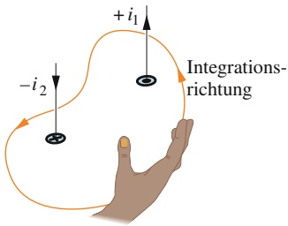

flowchart

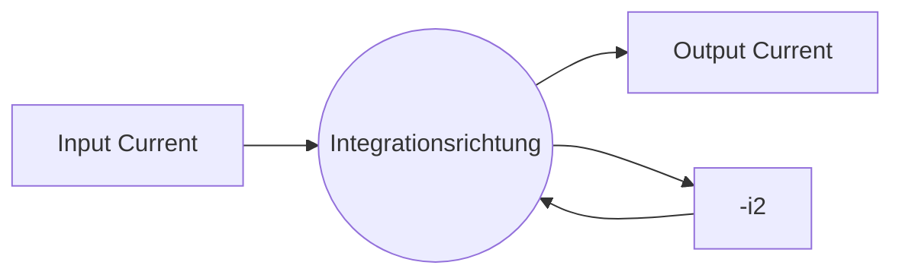

Abb. 25.10

Die Rechte-Hand-Regel für das Ampèresche Gesetz zur Bestimmung der Vorzeichen der von der Schleife umschlossenen Ströme. Die Situation entspricht Abb. 25.9.

601

---

25 Magnetfelder aufgrund von Strömen

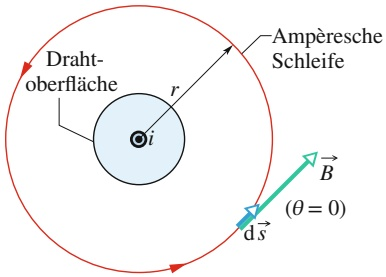

flowchart

Abb. 25.11

Das Ampèresche Gesetz hilft uns, das Magnetfeld $\vec { B }$ um einen stromdurchflossenen Leiter zu bestimmen. Die Schleife ist kreisförmig und liegt konzentrisch zu dem Leiter und außerhalb von ihm.

denselben Wert hat; das Magnetfeld $\vec { B }$ ist also zylindersymmetrisch um den Leiter. Wir legen wie in Abb. 25.11 gezeigt eine kreisförmige Schleife konzentrisch um den Leiter, um das Integral im Ampèreschen Gesetz durch Ausnutzen der Zylindersymmetrie zu vereinfachen. Das Magnetfeld $\vec { B }$ besitzt dann an allen Punkten entlang der Schleife denselben Betrag B. Wir integrieren im Gegenuhrzeigersinn, sodass d⃗s in die in Abb. 25.11 dargestellte Richtung zeigt.

Die Größe B cos $\theta$ in Gl. 25.17 können wir vereinfachen, da $\vec { B }$ ebenso wie d⃗s an allen Punkten entlang der Schleife tangential an dieser anliegt. $\vec { B }$ und d⃗s sind also immer entweder parallel oder antiparallel, wobei wir willkürlich eine parallele Ausrichtung annehmen können. Damit ist der Winkel $\theta$ zwischen $\vec { B }$ und d⃗s überall null und es gilt cos $\theta = \cos 0 ^ { \circ } = 1$ . Somit wird aus dem Integral in Gl. 25.17

$$
\oint \vec {B} \cdot \mathrm{d} \vec {s} = \oint B \cos \theta   \mathrm{d} s = B \oint \mathrm{d} s = 2 \pi r B.
$$

Das Integral $\int$ ds beschreibt einfach die Summation aller Längenelemente ds entlang der gesamten kreisförmigen Schleife; es ergibt daher gerade den Umfang 2πr der Schleife.

Die Rechte-Hand-Regel liefert uns ein positives Vorzeichen für den Strom in Abb. 25.11. Damit ist die rechte Seite im Ampèreschen Gesetz gleich $+ \mu _ { 0 } i$ und wir erhalten

$$
2 \pi r B = \mu_ {0} i
$$

oder

$$
B = \frac {\mu_ {0} i}{2 \pi r}. \tag {25.19}
$$

Bis auf eine kleine Änderung in der Bezeichnung der Variablen ist das genau Gl. $2 5 . 6 ,$ die wir zuvor – mit erheblich größerem Aufwand – aus dem Biot-Savartschen Gesetz hergeleitet hatten. Da wir eine positive Feldstärke B erhalten haben, wissen wir außerdem, dass unsere Annahme aus Abb. 25.11 für die Richtung von $\vec { B }$ korrekt war.

## Das Magnetfeld im Inneren eines langen stromführenden Leiters

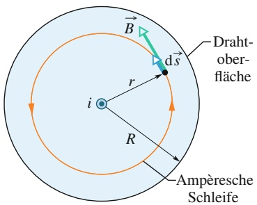

text_image

B
Draht-
ober-
fläche
ds
r
i
R
Ampèresche
Schleife

Abb. 25.12

Die Anwendung des Ampèreschen Gesetzes zur Bestimmung des Magnetfelds im Inneren eines runden Leiters aufgrund eines Stroms i. Der Strom ist homogen über den Querschnitt des Leiters verteilt und zeigt aus der Papierebene heraus. Die kreisförmige Integrationsschleife verläuft im Inneren des Leiters.

Abbildung 25.12 zeigt den Querschnitt eines langen geraden Leiters mit dem Radius R, in dem ein Strom i aus der Papierebene herausfließt. Da der Strom homogen über die Querschnittsfläche verteilt ist, muss das von ihm erzeugte Magnetfeld B⃗ zylindersymmetrisch sein. Um das Magnetfeld in dem Leiter zu berechnen, verwenden wir deshalb wieder eine konzentrisch angeordnete kreisförmige Schleife, nur dieses Mal mit einem Radius $r < R$ (Abb. 25.12). Die Symmetrie führt uns wieder zu der Schlussfolgerung, dass $\vec { B }$ tangential an der Schleife anliegt, sodass wir aus der linken Seite des Ampèreschen Gesetzes auch hier

$$
\oint \vec {B} \cdot \mathrm{d} \vec {s} = B \oint \mathrm{d} s = 2 \pi r B \tag {25.20}
$$

erhalten.

Um die rechte Seite des Ampèreschen Gesetzes auszuwerten, müssen wir beachten, dass der von der Schleife umschlossene Strom $i _ { \mathrm { u m } }$ nun proportional zur Fläche der Schleife ist:

$$
i _ {\mathrm{um}} = i \frac {\pi r ^ {2}}{\pi R ^ {2}}. \tag {25.21}
$$

Die Rechte-Hand-Regel sagt uns, dass $i _ { \mathrm { u m } }$ ein positives Vorzeichen erhält. Damit bekommen wir aus dem Ampèreschen Gesetz

$$
2 \pi r B = \mu_ {0} i \frac {\pi r ^ {2}}{\pi R ^ {2}}
$$

602

---

25.4 Zylinder- und Ringspulen

25

oder

$$
B = \left(\frac {\mu_ {0} i}{2 \pi R ^ {2}}\right) r. \tag {25.22}
$$

Innerhalb des Leiters ist die Feldstärke also proportional zu $r ;$ sie ist im Zentrum null und wird an der Oberfläche des Leiters (für $r = R )$ maximal. Die Gln. 25.19 und 25.22 ergeben für $r = R$ dasselbe Resultat; die Ausdrücke für die Feldstärke im Leiter und außerhalb des Leiters stimmen an seiner Oberfläche also überein.

## KONTROLLFRAGE 3

Die Abbildung zeigt drei gleiche Ströme i (zwei von ihnen parallel, der dritte anti-parallel) und vier Schleifen. Ordnen Sie die Schleifen in absteigender Reihenfolge nach dem Wert des Integrals ∮ ${ \vec { B } } \cdot \mathsf { d } { \vec { s } } .$

## 25.4 Zylinder- und Ringspulen

## Lernziele

Nach dem Durcharbeiten dieses Abschnitts sollten Sie in der Lage sein, . . .

• ein Solenoid (eine Zylinderspule) und ein Toroid (eine Ringspule) sowie die jeweiligen magnetischen Feldlinien zu beschreiben,
• zu erklären, wie man mit dem Ampèreschen Gesetz das Magnetfeld im Inneren einer Zylinderspule berechnet,
• die Beziehung zwischen dem Magnetfeld B im Inneren einer Zylinderspule, der Stromstärke i und ihrer Windungszahl n (pro Längeneinheit) anzuwenden,
• zu erklären, wie man mit dem Ampèreschen Gesetz das Magnetfeld im Inneren einer Ringspule berechnet,
• die Beziehung zwischen dem Magnetfeld B im Inneren einer Ringspule, der Stromstärke $i ,$ ihrem Radius r und ihrer (absoluten) Windungszahl N anzuwenden.

## Schlüsselideen

• Im Inneren einer langen, von einem Strom i durchflossenen Zylinderspule beträgt das Magnetfeld B (an Punkten, die nicht zu nahe an den Enden der Spule liegen)

$$
B = \mu_ {0} i n \quad \text {(ideale Zylinderspule)},
$$

wobei n die Anzahl der Windungen pro Längeneinheit angibt.

• Im Inneren einer von einem Strom i durchflossenen Ringspule beträgt das Magnetfeld

$$
B = \frac {\mu_ {0} i N}{2 \pi} \frac {1}{r} \quad (\text {Ringspule}),
$$

wobei r den Abstand zwischen dem Messpunkt und dem Mittelpunkt der Spule bezeichnet.

## 25.4.1 Zylinder- und Ringspulen

## Das Magnetfeld einer Zylinderspule

Wir wenden uns nun einer anderen Situation zu, in der das Ampèresche Gesetz nützlich ist. Es handelt sich dabei um das Magnetfeld im Inneren einer langen, spiralförmig gewickelten Spule. Eine solche Spule nennen wir **Zylinderspule** oder **Solenoid** (Abb. 25.13). Wir nehmen im Folgenden an, dass die Länge der Zylinder spule viel größer ist als ihr Durchmesser.

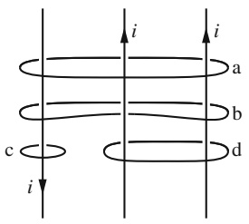

text_image

i
a
b
c
i
d

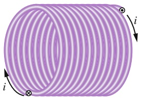

natural_image

Purple helical coil diagram with current direction arrows (no text or symbols)

Abb. 25.13

Eine Zylinderspule, in der ein Strom i fließt.

603

---

25 Magnetfelder aufgrund von Strömen

## Abb. 25.14

Ein Längsschnitt durch eine „gestreck-$\mathbf { t e } ^ { a }$ Zylinderspule. Gezeigt sind die rückwärtigen Teile von fünf Windungen zusammen mit dem Magnetfeld, das der durch sie fließende Strom erzeugt. Um jede Windung verlaufen in ihrer unmittelbaren Nähe kreisförmige magnetische Feldlinien. In der Nähe der Zylinderachse addieren sich die Beiträge vieler Windungen zu einem Gesamtfeld, das entlang der Zylinderachse zeigt. Die dicht zusammenliegenden Feldlinien in diesem Gebiet zeigen, dass das Feld hier sehr stark ist. Außerhalb der Spule sind die Abstände zwischen den Feldlinien groß; hier ist das Feld schwach.

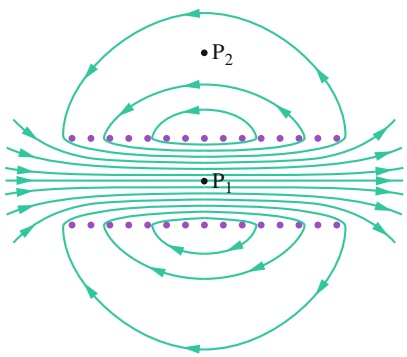

text_image

•P₂
•P₁

## Abb. 25.15

Magnetfeldlinien einer realen $\mathrm { Z y } -$ linderspule mit endlicher Länge. An Punkten wie $\mathrm { P } _ { 1 }$ im Inneren der Spule ist das Feld stark und annähernd homogen; an Punkten wie $\mathrm { P } _ { 2 }$ außerhalb der Spule ist das Feld schwach.

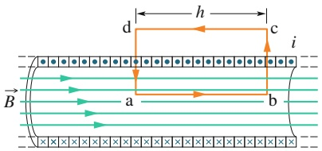

text_image

d
h
c
i
B
a
b

## Abb. 25.16

Die Anwendung des Ampèreschen Gesetzes auf einen Abschnitt einer idealen Zylinderspule, in der ein Strom i fließt. Der Integrationsweg ist das Rechteck abcda.

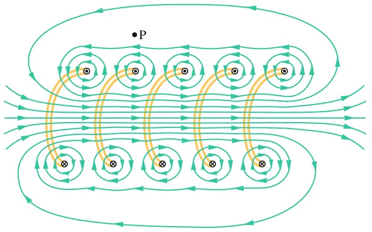

flowchart

This diagram illustrates a magnetic field or current flow pattern, showing multiple parallel loops with alternating positive and negative values, indicating periodic or quasi-periodic interactions.

Abbildung 25.14 zeigt einen Ausschnitt aus einer „gestreckten“ Zylinderspule. Das Gesamtfeld der Zylinderspule ist die vektorielle Summe der Felder, die durch die einzelnen Windungen der Spule verursacht werden. Für Punkte in der unmittelbaren Umgebung einer Windung verhält sich der Leiter fast wie ein gerader Leiter, sodass die Feldlinien von B dort nahezu konzentrische Kreise sind. Aus Abb. 25.14 können wir schon erahnen, dass die Felder einander zwischen den Windungen aufheben. Außerdem sehen wir, dass das Feld im Inneren der Zylinderspule und hinreichend weit von den Windungen entfernt näherungsweise parallel zur Zylinderachse ist. Im Grenzfall einer idealen Zylinderspule, die unendlich lang ist und aus dicht gepackten Windungen eines Leiters mit quadratischem Querschnitt besteht, ist das Feld im Inneren der Spule homogen und parallel zur Zylinderachse.

An Punkten oberhalb der Zylinderspule wie z. B. P in Abb. 25.14 trifft das nach links gerichtete Feld, das von den oberen Abschnitten der Windungen verursacht wird (durch ⊙ markiert), auf das nach rechts gerichtete Feld, das von den unteren Abschnitten der Windungen erzeugt wird (durch ⊗ markiert). Die beiden Beiträge gleichen einander in einer idealen Zylinderspule exakt, in einer realen immerhin noch annähernd aus. Die Näherung, dass das Feld außerhalb der Spule null ist, ist für eine reale Zylinderspule immer dann sehr gut erfüllt, wenn ihre Länge viel grö- ßer ist als ihr Durchmesser und wir keine Punkte in der Nähe der Spulenenden be trachten. Die Richtung des Magnetfelds entlang der Zylinderachse wird durch eine Rechte-Hand-Regel beschrieben: Wir fassen die $\mathrm { Z y }$ linderspule mit unserer rechten Hand, sodass unsere Finger der Richtung des Stroms in den Windungen folgen. Dann zeigt unser ausgestreckter Daumen in die Richtung des Magnetfelds in der Spule.

Abbildung 25.15 zeigt die Feldlinien des Magnetfelds $\vec { B }$ in einer realen Zylinder spule. Die Abstände der Linien im Inneren der Spule zeigen, dass das Feld dort sehr stark und näherungsweise homogen ist. Das äußere Feld ist sehr schwach.

Nun wenden wir das Ampèresche Gesetz

$$
\oint \vec {B} \cdot \mathrm{d} \vec {s} = \mu_ {0} i _ {\mathrm{um}} \tag {25.23}
$$

auf die ideale Zylinderspule aus Abb. 25.16 an. Wir benutzen die rechteckige Schleife abcda und verwenden die Tatsache, dass das Feld im Inneren der Spule homogen ist und außerhalb der Spule verschwindet. Wir schreiben das Integral ∮ B⃗ ⋅ d⃗s dazu als Summe von vier Integralen für die einzelnen Teilwege:

$$
\oint \vec {B} \cdot \mathrm{d} \vec {s} = \int_ {\mathrm{a}} ^ {\mathrm{b}} \vec {B} \cdot \mathrm{d} \vec {s} + \int_ {\mathrm{b}} ^ {\mathrm{c}} \vec {B} \cdot \mathrm{d} \vec {s} + \int_ {\mathrm{c}} ^ {\mathrm{d}} \vec {B} \cdot \mathrm{d} \vec {s} + \int_ {\mathrm{d}} ^ {\mathrm{a}} \vec {B} \cdot \mathrm{d} \vec {s}. \tag {25.24}
$$

Das erste Integral auf der rechten Seite von Gl. 25.24 ist gleich $B h ,$ wobei $B$ die Feldstärke des homogenen Felds $\vec { B }$ im Inneren der Spule und h die (willkürliche) Länge des Segments ab ist. Das zweite und das vierte Integral sind null, da das Feld $\vec { B }$ für jedes Längenelement d⃗s dieser Abschnitte entweder senkrecht auf dem Längenelement steht oder null ist, das Skalarprodukt ${ \vec { B } }   .$ d⃗s also überall null ist. Das

604

---

25.4 Zylinder- und Ringspulen

25

dritte Integral wird über einen Abschnitt berechnet, der vollständig außerhalb der Spule liegt (wo B⃗ überall null ist); es ist deshalb ebenfalls null. Somit ist das Integral $\oint \vec { B }$ ⋅ d⃗s entlang des geschlossenen rechteckigen Wegs in Abb. 25.16 gleich Bh.

Der von der Schleife in Abb. 25.16 umschlossene Gesamtstrom $i _ { \mathrm { u m } }$ im Sinn des Ampèreschen Gesetzes ist nicht gleich dem Strom i durch die Windungen der Spule, da die Windungen mehrmals durch die Fläche der Schleife hindurchtreten. Wenn n die Zahl der Windungen der Zylinderspule pro Längeneinheit bezeichnet, umschließt die Schleife nh Windungen der Spule und demzufolge ist

$$
i _ {\mathrm{um}} = i n h.
$$

Das Ampèresche Gesetz liefert uns dann

$$
B h = \mu_ {0} i n h
$$

oder

$$
B = \mu_ {0} i n \quad (\text {ideale Zylinderspule}). \tag {25.25}
$$

Obwohl wir Gl. 25.25 für eine unendlich lange ideale Zylinderspule hergeleitet haben, gilt sie in guter Näherung auch für reale Zylinderspulen, solange wir sie nur auf Punkte im Inneren der Spule anwenden, die weit genug von deren Enden entfernt sind. Gleichung 25.25 steht im Einklang mit dem experimentellen Befund, dass die Feldstärke im Inneren einer Zylinderspule nicht von Durchmesser oder Länge der Spule abhängt und dass B über den Querschnitt der Spule homogen ist. Somit ist eine Zylinderspule eine geeignete Vorrichtung, um ein definiertes homogenes Magnetfeld für Experimente zu erzeugen, genau wie ein Plattenkondensator ein geeignetes Mittel ist, um ein definiertes homogenes elektrisches Feld zu erzeugen.

## Das Magnetfeld einer Ringspule

Abbildung 25.17a zeigt eine **Ringspule** (ein Toroid), die wir uns als Zylinderspule denken können, deren Enden zu einem schwimmringähnlichen Gebilde namens Torus zusammengebogen sind. Welches Magnetfeld entsteht in ihrem Inneren, d. h. im Inneren des Schwimmrings? Auch das können wir unter Ausnutzung der Symmetrie des Systems mithilfe des Ampèreschen Gesetzes herausfinden.

Aus der Symmetrie des Systems erkennen wir, dass die magnetischen Feldlinien konzentrische Kreise innerhalb des Torus bilden; ihre Richtung ist in Abb. 25.17b gezeigt. Wir wählen einen konzentrischen Kreis mit Radius r als Schleife, entlang derer wir im Uhrzeigersinn integrieren. Das Ampèresche Gesetz (Gl. 25.16) ergibt in diesem Fall

$$
B \cdot 2 \pi r = \mu_ {0} i N,
$$

wobei i der Strom in der Ringspule ist (der für die von der Schleife umschlossenen Windungen positiv gezählt wird) und N die Gesamtzahl der Windungen bezeichnet. Damit ist für die Ringspule

$$
B = \frac {\mu_ {0} i N}{2 \pi} \frac {1}{r}. \tag {25.26}
$$

Im Gegensatz zur Zylinderspule ist das Magnetfeld über den Querschnitt einer Ringspule nicht homogen. Mithilfe des Ampèreschen Gesetzes können wir leicht zeigen, dass außerhalb einer idealen Ringspule B = 0 ist (als ob die Ringspule aus einer idealen Zylinderspule zurechtgebogen worden sei).

Die Richtung des Magnetfelds innerhalb der Ringspule folgt erneut aus der Rechte-Hand-Regel: Wir greifen die Spule mit unserer rechten Hand, sodass die Fingerspitzen der Richtung des Stroms in den Windungen der Spule folgen; der ausgestreckte Daumen zeigt dann wieder in Richtung des Magnetfelds im Inneren der Spule.

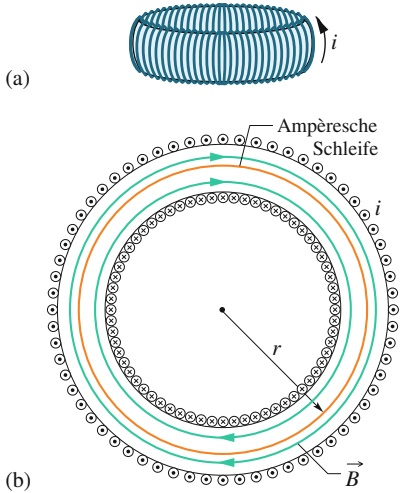

text_image

(a)
Ampèresche
Schleife
i
r
B
(b)

Abb. 25.17

(a) Eine Ringspule, in der ein Strom i fließt. (b) Ein horizontaler Schnitt durch die Ringspule. Das Magnetfeld im Inneren (in der schwimmringförmigen Röhre) können wir mithilfe des Ampèreschen Gesetzes bestimmen.

605

---

25 Magnetfelder aufgrund von Strömen

## 25.5 Eine stromführende Spule als magnetischer Dipol

## Lernziele

Nach dem Durcharbeiten dieses Abschnitts sollten Sie in der Lage sein, . . .

• die magnetischen Feldlinien einer flachen stromdurchflossenen Spule zu skizzieren,
• für eine stromdurchflossene Spule die Beziehung zwischen dem Betrag $\mu$ ihres Dipolmoments, dem Strom $i ,$ der Windungszahl N und der Querschnittsflä- che A anzuwenden,
• an einem Punkt auf der Spulenlängsachse die Beziehung zwischen dem Betrag B des Magnetfelds, dem magnetischen Moment $\mu$ und dem Abstand z vom Mittelpunkt der Spule anzuwenden.

## Schlüsselideen

• Das Magnetfeld einer stromdurchflossenen Spule (die sich als magnetischer Di pol auffassen lässt) an einem Punkt P auf der Längsachse der Spule im Abstand z von ihrem Mittelpunkt ist parallel zu dieser Achse und gleich

$$
\vec {B} (z) = \frac {\mu_ {0}}{2 \pi} \frac {\vec {\mu}}{z ^ {3}},
$$

wobei $\vec { \mu }$ das magnetische Dipolmoment der Spule ist. Diese Gleichung gilt nur, solange z viel größer als die Abmessungen der Spule ist.

## 25.5.1 Eine stromführende Spule als magnetischer Dipol

Bisher haben wir die Magnetfelder des Stroms in einem langen geraden Leiter, einer Zylinderspule und einer Ringspule betrachtet. Jetzt wenden wir uns dem Feld einer einfachen stromdurchflossenen Spule zu. Wir hatten in Abschn. 24.8 gesehen, dass eine solche Spule sich wie ein magnetischer Dipol verhält, d. h., auf sie wirkt ein Drehmoment $\vec { \tau } ,$ wenn wir sie in ein äußeres Magnetfeld $\vec { B }$ bringen:

$$
\vec {\tau} = \vec {\mu} \times \vec {B}. \tag {25.27}
$$

Dabei ist $\vec { \mu }$ das magnetische Dipolmoment der Spule, das durch NiA gegeben ist, wenn N die Zahl der Windungen der Spule, i der Strom in jeder Windung und A die von jeder Windung umschlossene Fläche sind.

Wir erinnern uns, dass die Richtung von $\vec { \mu }$ durch die Rechte-Hand-Regel gegeben ist: Wir fassen die Spule so mit unserer rechten Hand, dass die Finger sich entlang der Richtung des Stroms in den Windungen krümmen. Der ausgestreckte rechte Daumen zeigt dann in die Richtung des magnetischen Dipolmoments $\vec { \mu } .$

## Das Magnetfeld einer Spule

Nun wenden wir uns einem anderen Aspekt des magnetischen Dipols „Spule“ zu. Wir fragen uns, welches Magnetfeld dieser Dipol an einem Punkt im Raum erzeugt. Diese Fragestellung enthält nicht genügend $\mathrm { S y }$ mmetrie, um das Ampèresche Gesetz sinnvoll einsetzen zu können, also müssen wir es mit dem Biot-Savartschen Gesetz versuchen. Der Einfachheit halber betrachten wir zunächst nur eine Spule mit einer einzigen kreisförmigen Windung und beschränken uns auf Punkte entlang ihrer zentralen Achse, die wir als z-Achse wählen. Wir werden zeigen, dass für die Feldstärke des Magnetfelds an diesen Punkten

$$
B (z) = \frac {\mu_ {0} i R ^ {2}}{2 (R ^ {2} + z ^ {2}) ^ {3 / 2}} \tag {25.28}
$$

gilt, wobei $R$ der Radius der Windung ist und $z$ der Abstand des betrachteten Punkts vom Mittelpunkt der Spule. Das Feld $\vec { B }$ zeigt in dieselbe Richtung wie der magnetische Dipol $\vec { \mu }$ der Spule.

606

---

25.5 Eine stromführende Spule als magnetischer Dipol

25

Für axiale Punkte in großer Entfernung von der Spule gilt in Gl. $2 5 . 2 8   z \gg R .$ Mit dieser Näherung vereinfacht sich die Gleichung zu

$$
B (z) \approx \frac {\mu_ {0} i R ^ {2}}{2 z ^ {3}}.
$$

Wenn wir nun $A = \pi R ^ { 2 }$ einsetzen und unser Ergebnis auf Spulen mit N Windungen verallgemeinern, ergibt sich

$$
B (z) = \frac {\mu_ {0}}{2 \pi} \frac {N i A}{z ^ {3}}.
$$

Da außerdem $\vec { B }$ und $\vec { \mu }$ in dieselbe Richtung zeigen, können wir die Gleichung auch in Vektorschreibweise schreiben und die Identität $\mu = N i A$ substituieren; das ergibt schließlich

$$
\vec {B} (z) = \frac {\mu_ {0}}{2 \pi} \frac {\vec {\mu}}{z ^ {3}}. \tag {25.29}
$$

Damit kennen wir zwei Folgen der Tatsache, dass eine stromdurchflossene Spule sich wie ein magnetischer Dipol verhält: (1) Auf sie wirkt ein Drehmoment $\vec { \tau } ,$ wenn sie in ein äußeres Magnetfeld $\vec { B }$ gebracht wird. (2) Sie erzeugt ihr eigenes Magnetfeld, das für Punkte auf der zentralen Achse der Spule durch Gl. 25.29 gegeben ist.

Abbildung 25.18 zeigt das Magnetfeld einer Stromschleife. Die eine Seite der Schleife wirkt als Nordpol (sie zeigt in die Richtung von $\vec { \mu } ) ,$ , die andere als Südpol (durch den schattiert eingezeichneten Magneten in Abb. 25.18 angedeutet).

## KONTROLLFRAGE 4

Die Abbildung zeigt vier Anordnungen von kreisförmigen Schleifen mit Radius r bzw. $2 r ,$ die auf vertikalen Achsen zentriert sind und identische Ströme in den gezeigten Richtungen führen. Ordnen Sie die Anordnungen in absteigender Reihenfolge nach der magnetischen Feldstärke an dem Punkt in der Mitte zwischen den Schleifen auf der zentralen Achse.

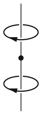

(a)

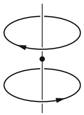

natural_image

Pure diagram of two elliptical loops with directional arrows and a central dot, no text or symbols present

(b)

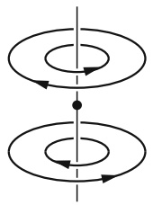

natural_image

Two identical elliptical loops with directional arrows, centered vertically (no text or symbols)

(c)

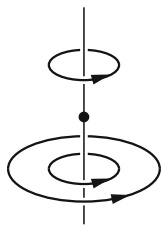

(d)

## Der Beweis von Gl. 25.28

Abbildung 25.19 zeigt die rückwärtige Hälfte einer kreisförmigen Schleife mit Radius R, in der ein Strom i fließt. Wir betrachten einen Punkt P auf der zentralen Achse der Schleife in einem Abstand z von ihrem Mittelpunkt. Wir wenden das Biot-Savartsche Gesetz auf ein differenzielles Längenelement ds auf der linken Seite der Schleife an. Der Längenvektor d⃗s zeigt senkrecht aus der Papierebene heraus; der Winkel θ zwischen d⃗s und ⃗r in Abb. 25.19 ist 90°. Die von diesen beiden Vektoren aufgespannte Ebene steht senkrecht auf der Papierebene. Aus dem Biot-Savartschen Gesetz (und mithilfe der Rechte-Hand-Regel) folgt, dass das von dem Strom in diesem Längenelement erzeugte differenzielle Feld dB⃗ am Punkt P senkrecht auf dieser Ebene und au $\mathrm { ~ f ~ } \vec { r }$ steht und wie in Abb. 25.19 gezeigt in der Ebene der Zeichnung liegt.

Nun wollen wir $\mathrm { d } \vec { B }$ in zwei Komponenten zerlegen: $\mathrm { d } B _ { \parallel }$ parallel zur Achse der Schleife und $\mathrm { d } B _ { \perp }$ senkrecht zu dieser Achse. Aus Symmetriegründen muss die

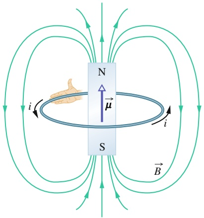

text_image

N
↑
μ
S
i
i
B

Abb. 25.18

Eine stromdurchflossene Schleife erzeugt ein Magnetfeld ähnlich dem eines Stabmagneten; es besitzt wie dieses einen Nord- und einen Südpol. Das magnetische Dipolmoment $\vec { \mu }$ der Schleife wird durch eine Rechte-Hand-Regel bestimmt; es zeigt vom Süd- zum Nordpol und damit in dieselbe Richtung wie das Magnetfeld der Schleife.

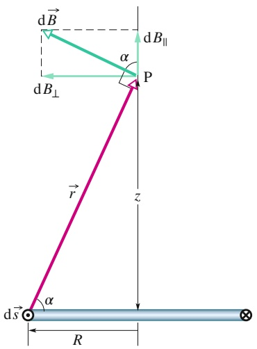

text_image

d B
α
P
d B⊥
d B∥
r
z
d s
α
R

Abb. 25.19

Eine Stromschleife mit Radius R. Die Schleifenebene steht senkrecht auf der Papierebene; nur die rückwärtige Hälfte der Schleife ist gezeigt. Wir benutzen das Biot-Savartsche Gesetz, um das Magnetfeld am Punkt P auf der zentralen Achse der Schleife zu bestimmen.

607

---

25 Magnetfelder aufgrund von Strömen

Vektorsumme aller senkrechten Komponenten aufgrund aller Längenelemente ds der Schleife null sein. Damit bleiben nur die Komponenten parallel zur Achse der Schleife übrig:

$$
B = \int \mathrm{d} B _ {| |}.
$$

Das Biot-Savartsche Gesetz (Gl. 25.3) zeigt, dass das Magnetfeld des Längenelements d⃗s in Abb. 25.19 im Abstand r gleich

$$
\mathrm{d} B = \frac {\mu_ {0}}{4 \pi} \frac {i \mathrm{d} s \sin 9 0 ^ {\circ}}{r ^ {2}}
$$

ist. Außerdem gilt

$$
\mathrm{d} B _ {| |} = \mathrm{d} B \cos \alpha .
$$

Durch Kombination dieser beiden Beziehungen erhalten wir

$$
\mathrm{d} B _ {| |} = \frac {\mu_ {0} i \cos \alpha \mathrm{d} s}{4 \pi r ^ {2}}. \tag {25.30}
$$

Abbildung 25.19 zeigt, dass r und α nicht unabhängig, sondern miteinander ver knüpft sind. Wenn wir beide durch die Variable z ausdrücken, den Abstand zwischen der Mitte der Schleife und dem Punkt P, dann gelten die Beziehungen

$$
r = \sqrt {R ^ {2} + z ^ {2}} \tag {25.31}
$$

und

$$
\cos \alpha = \frac {R}{r} = \frac {R}{\sqrt {R ^ {2} + z ^ {2}}} . \tag {25.32}
$$

Nun setzen wir die Gln. 25.31 und 25.32 in Gl. 25.30 ein und erhalten so

$$
\mathrm{d} B _ {| |} = \frac {\mu_ {0} i R}{4 \pi (R ^ {2} + z ^ {2}) ^ {3 / 2}} \mathrm{d} s.
$$

Bei der Integration über die geschlossene Schleife haben i, R und z an allen Punkten denselben Wert, daher ist

$$
\begin{array}{l} B = \int \mathrm{d} B _ {| |} \\ = \frac {\mu_ {0} i R}{4 \pi (R ^ {2} + z ^ {2}) ^ {3 / 2}} \int \mathrm{d} s \\ \end{array}
$$

oder – da ∫ ds einfach den Umfang 2πR der Schleife ergibt –

$$
B (z) = \frac {\mu_ {0} i R ^ {2}}{2 (R ^ {2} + z ^ {2}) ^ {3 / 2}}.
$$

Damit haben wir Gl. 25.28 wie geplant erhalten und somit bewiesen.

608

---

25.7 Fragen

25

## 25.6 Zusammenfassung

**Das Biot-Savartsche Gesetz** Das Magnetfeld eines stromdurchflossenen Leiters kann mithilfe des Biot-Savartschen Gesetzes bestimmt werden. Es besagt, dass der Feldbeitrag dB⃗ eines Strom-Längen-Elements i d⃗s an einem Punkt P im Abstand r von dem Strom-Längen-Element durch

$$
\mathrm{d} \vec {B} = \frac {\mu_ {0}}{4 \pi} \frac {i \mathrm{d} \vec {s} \times \vec {r}}{r ^ {3}} \tag {25.5}
$$

gegeben ist. Dabei ist ⃗r ein Vektor, der von dem Strom-Längen-Element zu P zeigt. Die Konstante $\mu _ { 0 } ,$ die magnetische Feldkonstante (oder Vakuumpermeabilität), hat den Wert 4π ⋅ $1 0 ^ { - 7 }   \mathrm { T } \cdot \mathrm { m } / \mathrm { A } \approx 1 { , } 2 6 \cdot 1 0 ^ { \frac { 1 } { - 6 } }   \mathrm { T } \cdot \mathrm { m } / \mathrm { A } { . }$

**Das Magnetfeld eines langen geraden Leiters** Für einen langen geraden Leiter, durch den ein Strom i fließt, liefert das Biot-Savartsche Gesetz für das Magnetfeld in einer Entfernung R

$$
B = \frac {\mu_ {0} i}{2 \pi R}. \tag {25.6}
$$

**Das Magnetfeld eines Kreisbogens** Die Feldstärke im Zentrum eines kreisförmigen Bogens mit Radius R und Zentrumswinkel $\varphi ,$ durch den ein Strom i fließt, ist

$$
B = \frac {\mu_ {0} i \varphi}{4 \pi R}. \tag {25.11}
$$

**Die Kräfte zwischen stromdurchflossenen Leitern** Parallele Leiter, in denen Ströme in dieselbe Richtung fließen, ziehen einander an, wohingegen parallele Leiter, in denen Ströme in entgegengesetzte Richtungen fließen, einander abstoßen. Der Betrag der Kraft auf eine Länge L eines der Leiter ist

$$
F _ {\mathrm{ba}} = i _ {\mathrm{b}} L B _ {\mathrm{a}} \sin 9 0 ^ {\circ} = \frac {\mu_ {0} L i _ {\mathrm{a}} i _ {\mathrm{b}}}{2 \pi d}, \tag {25.15}
$$

wobei d der Abstand der Leiter und $i _ { \mathrm { a } }$ und $i _ { \mathrm { b } }$ die Ströme in diesen sind.

## 25.7 Fragen

**1.** Abbildung 25.F1 zeigt vier Anordnungen, in denen lange parallele Drähte an den Ecken identischer Quadrate identische Ströme entweder in die Papierebene hineinoder aus ihr herausführen. Ordnen Sie die Anordnungen in absteigender Reihenfolge nach der Feldstärke des Magnetfelds in ihrem Mittelpunkt.

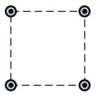

(a)

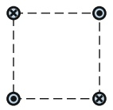

(b)

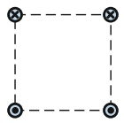

(c)

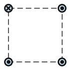

(d)

Abb. 25.F1

**Das Ampèresche Gesetz** Das Ampèresche Gesetz besagt

$$
\oint \vec {B} \cdot \mathrm{d} \vec {s} = \mu_ {0} i _ {\mathrm{um}}. \tag {25.16}
$$

Das Linienintegral in dieser Gleichung wird entlang einer geschlossenen Schleife berechnet. Der Strom $i _ { \mathrm { u m } }$ ist der Gesamtstrom, der von der Schleife umschlossen wird. Für manche Stromverteilungen ist Gl. 25.16 einfacher auszuwerten als Gl. 25.5, wenn das Magnetfeld berechnet werden soll.

**Die Felder von Zylinder- und Ringspulen** Im Inneren einer langen Zylinderspule, durch die ein Strom i fließt, herrscht an Punkten nicht zu nahe an den Enden der Spule eine Feldstärke

$$
B = \mu_ {0} i n, \tag {25.25}
$$

wobei n die Zahl der Windungen der $\mathrm { Z y l }$ inderspule pro Längeneinheit ist. Im Inneren einer Ringspule herrscht die Feldstärke

$$
B = \frac {\mu_ {0} i N}{2 \pi} \frac {1}{r}, \tag {25.26}
$$

wobei r der Abstand vom Zentrum der Ringspule bis zu dem betrachteten Punkt ist.

**Das Feld eines magnetischen Dipols** Eine stromdurchflossene Spule wirkt als magnetischer Dipol. An einem Punkt P in einem Abstand z entlang der zentralen Achse der Spule ist das Feld der Spule parallel zur Achse und besitzt die Feldstärke

$$
\vec {B} (z) = \frac {\mu_ {0}}{2 \pi} \frac {\vec {\mu}}{z ^ {3}}, \tag {25.29}
$$

wobei $1 \vec { \mu }$ das magnetische Dipolmoment der Spule ist. Diese Gleichung gilt nur, solange z viel größer ist als die Abmessungen der Spule.

**2.** Abbildung 25.F2 zeigt die Querschnitte zweier langer gerader Leiter; in dem linken fließt ein Strom $i _ { 1 }$ aus der Papierebene heraus. Das resultierende Magnetfeld aufgrund der beiden Ströme an Punkt P ist null. (a) Zeigt der Strom $i _ { 2 }$ im rechten Leiter aus der Papierebene heraus oder in sie hinein? (b) Ist $i _ { 2 }$ größer oder kleiner als $i _ { 1 }$ oder gleich groß?

Abb. 25.F2

**3.** Abbildung 25.F3 zeigt drei Stromkreise, die jeweils aus zwei konzentrischen Kreisen mit Radius r und $R > r$ sowie zwei geraden radialen Verbindungsstücken bestehen. In allen Kreisen fließt derselbe Strom, und der Winkel zwi-

609

---

25 Magnetfelder aufgrund von Strömen

schen den beiden radialen Abschnitten ist immer gleich groß. Ordnen Sie die Kreise in absteigender Reihenfolge nach der magnetischen Feldstärke im Zentrum.

(a)

(b)

(c)

## Abb. 25.F3

**4.** Abbildung 25.F4 zeigt vier Anordnungen, in denen in äquidistanten, langen parallelen Leitern gleiche Ströme entweder in die Papierebene hinein- oder aus ihr herausfließen. Ordnen Sie die Anordnungen in absteigender Reihenfolge nach der Kraft auf den zentralen Leiter aufgrund der Ströme in den anderen Drähten.

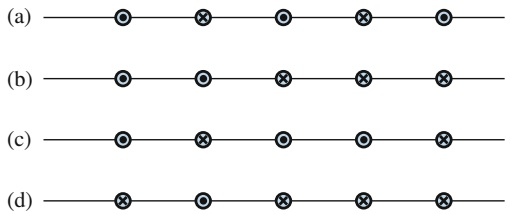

text_image

(a)
(b)
(c)
(d)

Abb. 25.F4

**5.** Abbildung 25.F5 zeigt drei Anordnungen von jeweils drei langen parallelen Leitern, die gleiche Ströme entweder in die Papierebene hinein- oder aus ihr herausführen. (a) Ordnen Sie die Anordnungen in absteigender Reihenfolge nach der Kraft auf den Leiter, in dem der Strom aus der Papierebene herausfließt, aufgrund der Ströme in den anderen Drähten. (b) Ist der Winkel zwischen der resultierenden Kraft auf diesen Leiter und der gestrichelten Linie in Anordnung 3 größer oder kleiner als oder gleich 45°?

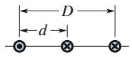

(1)

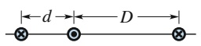

(2)

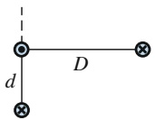

(3)

## Abb. 25.F5

**6.** Abbildung 25.F6 zeigt ein homogenes Magnetfeld $\vec { B }$ und vier gleich lange gerade Strecken. Ordnen Sie diese Strecken in absteigender Reihenfolge nach dem Wert des Integrals ∫ B⃗ ⋅ d⃗s entlang dieser Strecken.

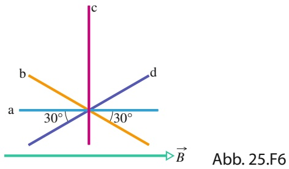

line

| Line | Description |
| --- | --- |
| a | Horizontal line segment |
| b | Overlapping diagonal line segment |
| c | Vertical line segment |
| d | Overlapping diagonal line segment |

**7.** Abbildung 25.F7a zeigt vier konzentrische geschlossene Schleifen um einen Leiter, in dem ein Strom aus der Papierebene herausfließt. Der Strom ist homogen über den Querschnitt des Leiters verteilt. Ordnen Sie die Schleifen in absteigender Reihenfolge nach dem Wert des Integrals ∫ $\vec { B }$ ⋅ d⃗s entlang ihres Umfangs.

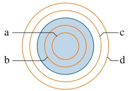

text_image

a
b
c
d

(a)

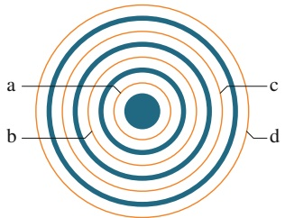

text_image

a
b
c
d

(b)

## Abb. 25.F7

Fragen 7 und 8.

**8.** Abbildung 25.F7b zeigt vier konzentrische kreisförmige Schleifen (a–d, orange) sowie vier lange kreisförmige Leiter (im Querschnitt, blau), die ebenfalls konzentrisch zu den Schleifen liegen. Drei dieser Leiter sind Hohlzylinder; der zentrale ist ein Vollzylinder. In den Leitern fließen die Strö- me (mit zunehmendem Radius): 4 A aus der Papierebene heraus; 9 A in die Papierebene hinein; 5 A aus der Papierebene heraus; 3 A in die Papierebene hinein. Ordnen Sie die Schleifen in absteigender Reihenfolge nach dem Wert des Integrals ∮ $\vec { B }$ ⋅ d⃗s entlang ihres Umfangs.
**9.** Abbildung 25.F9 zeigt vier identische Ströme i und fünf Schleifen, die sie umschließen. Ordnen Sie die Schleifen in absteigender Reihenfolge nach dem Wert des Integrals ∮ B⃗ ⋅d⃗s, wenn die Integration in der gezeigten Richtung vorgenommen wird.

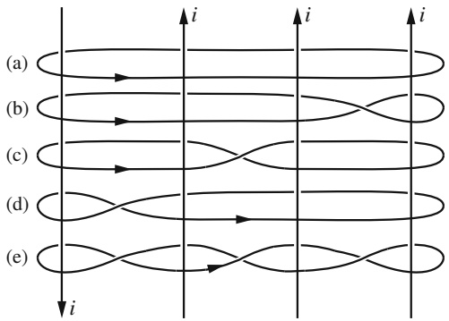

text_image

(a)
(b)
(c)
(d)
(e)

Abb. 25.F9

**10.** Die Tabelle zeigt für sechs ideale Zylinderspulen die Zahl n ihrer Windungen pro Längeneinheit und den Strom i in ihnen. Das Ziel ist, mehrere von ihnen konzentrisch so anzuordnen, dass das Feld auf der zentralen Achse verschwindet. Ist dies mit (a) zwei, (b) drei, (c) vier und (d) fünf Spulen möglich? Falls ja, geben Sie die benutzten Spulen und die Richtung der Ströme in ihnen an.

610

---

25.7 Fragen

25

| Zylinderspule | 1 | 2 | 3 | 4 | 5 | 6 |
| --- | --- | --- | --- | --- | --- | --- |
| n | 5 | 4 | 3 | 2 | 10 | 8 |
| i | 5 | 3 | 7 | 6 | 2 | 3 |

**11.** Abbildung 25.F11 zeigt eine Momentaufnahme der Geschwindigkeitsvektoren von vier Elektronen in der Nä- he eines Drahts, durch den ein Strom i fließt. Die vier Geschwindigkeiten haben den gleichen Betrag; Geschwindigkeit ${ \vec { \nu } } _ { 2 }$ zeigt in die Papierebene hinein. Die Elektronen 1 und 2 haben den gleichen Abstand vom Draht, ebenso die Elektronen 3 und 4. Ordnen Sie die Elektronen in absteigender Reihenfolge nach dem Betrag der magnetischen Kraft, die aufgrund des Stroms i auf sie einwirkt.

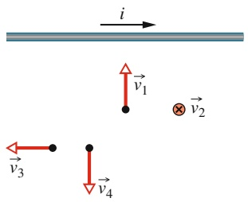

text_image

i
v₁
× v₂
v₃
v₄

Abb. 25.F11

**12.** Abbildung 25.F12 zeigt die Beträge B des Magnetfelds innerhalb und außerhalb von vier Drähten (a, b, c und d) als Funktion des radialen Abstands r von dem jeweiligen Draht. Durch jeden Strom fließt ein homogen über den Drahtquerschnitt verteilter Strom; Abschnitte, in denen zwei Kurven übereinstimmen, sind mit doppelten Bezeichnungen versehen (z. B. „a, b“). Ordnen Sie die Drähte in absteigender Reihenfolge nach (a) ihrem Radius, (b) dem Betrag des Magnetfelds auf ihrer Oberfläche und (c) der Stromstärke. (d) Ist die Stromdichte in Draht a größer als, kleiner als oder genauso groß wie in Draht c?

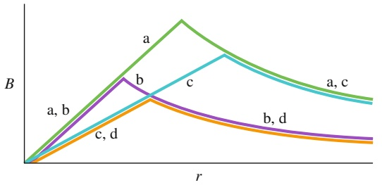

line

| Series | Trend Description |
| --- | --- |
| a | Steep increase followed by a gradual decline |
| b | Sharp initial rise followed by a moderate decline |
| c | Moderate increase followed by a steady decrease |
| d | Gradual decline after an initial peak |

Abb. 25.F12

611

---

