# 26 Induktion und Induktivität

原始 PDF 第 627–654 页。

# 26 Induktion und Induktivität

## 26.1 Das Faradaysche Gesetz und die Lenzsche Regel

## Physikalische Motivation

In Kapitel 25 hatten wir uns mit der Tatsache beschäftigt, dass ein elektrischer Strom ein magnetisches Feld erzeugt. Das war für die Physiker des frühen 19. Jahrhunderts, die dieses Phänomen entdeckten, eine große Überraschung. Vielleicht noch überraschender war jedoch die Entdeckung des umgekehrten Effekts: Ein magnetisches Feld kann ein elektrisches Feld hervorrufen oder „induzieren“, welches dann einen Strom antreibt. Diese zweite Verbindung zwischen magnetischem und elektrischem Feld wird heute das Faradaysche Induktionsgesetz genannt.

Die Beobachtungen von Michael Faraday und anderen Wissenschaftlern, die zu diesem Gesetz geführt haben, waren zunächst reine Grundlagenforschung. Heute sind seine Anwendungen jedoch buchstäblich allgegenwärtig. Nur ein Beispiel: Die Funktion der E-Gitarre, die die Rockmusik revolutioniert und modernere Stile wie Punk oder Metal überhaupt erst möglich gemacht hat, beruht auf elektromagnetischer Induktion. Sie ist auch die Grundlage von elektromagnetischen Generatoren und Motoren. Induktionsöfen findet man heute nicht nur in den Gießereien der Metallindustrie, sondern auch in immer mehr Küchenzeilen in ganz normalen Haushalten.

Bevor wir uns jedoch den Anwendungen zuwenden, müssen wir zuerst einige Grundlagen legen.

## 26.1.1 Zwei symmetrische Situationen

In Abschn. 24.7 hatten wir gesehen, dass wenn wir eine geschlossene Leiterschleife in ein Magnetfeld bringen und einen Strom durch sie hindurchfließen lassen, magnetische Kräfte ein Drehmoment auf die Schleife ausüben und versuchen, sie zu drehen:

$$
\text {Stromschleife} + \text {Magnetfeld} \Rightarrow \text {Drehmoment}. \tag {26.1}
$$

Was wird wohl passieren, wenn wir keinen Strom durch die Schleife leiten, sondern sie von Hand drehen? Wird dann vielleicht in Umkehrung von Gl. 26.1 ein Strom in der Schleife fließen? Gilt also entsprechend

$$
\text {Drehmoment} + \text {Magnetfeld} \Rightarrow \text {Strom}? \tag {26.2}
$$

Die Antwort ist ja – es entsteht ein Strom. Die Situationen in Gl. 26.1 und Gl. 26.2 sind symmetrisch. Das physikalische Gesetz hinter Gl. 26.2 heißt Faradaysches Induktionsgesetz. Während Gl. 26.1 die Grundlage des Elektromotors ist, stellt Gl. 26.2 bzw. das Faradaysche Gesetz die Grundlage des elektrischen Generators dar. Dieses Kapitel ist dem Faradayschen Induktionsgesetz und dem Prozess der Induktion gewidmet.

Halliday Physik für natur- und ingenieurwiss. Studiengänge, 3. Auflage. D. Halliday, R. Resnick und J. Walker. © 2020 WILEY-VCH Verlag GmbH & Co. KGaA. Published 2020 by WILEY-VCH Verlag GmbH & Co. KGaA.

613

---

26 Induktion und Induktivität

## 26.1.2 Zwei Experimente

Um unsere eingehende Diskussion des Faradayschen Induktionsgesetzes vorzubereiten, betrachten wir zunächst zwei einfache Experimente.

## Leiterschleife und Stabmagnet

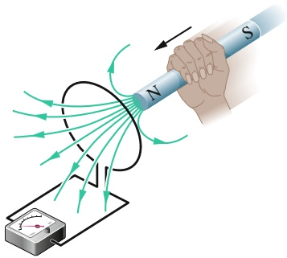

text_image

Diagram illustrating magnetic field lines around a conductor with labeled N and S poles, showing current direction and coil path

Abb. 26.1

Ein Amperemeter registriert in der Leiterschleife einen Strom, wenn der Magnet relativ zu der Schleife bewegt wird.

Abbildung 26.1 zeigt eine Leiterschleife, die mit einem empfindlichen Amperemeter verbunden ist. Da keine Batterie oder sonstige Spannungsquelle vorhanden ist, fließt in der Schleife kein Strom. Während wir jedoch einen Stabmagneten in die Nähe der Schleife bringen, messen wir plötzlich einen Strom, der wieder aufhört, sobald der Magnet ruht, sich also relativ zu der Schleife nicht mehr bewegt. Wenn wir den Magneten wieder entfernen, messen wir wieder einen Strom, dieses Mal aber in umgekehrter Richtung. Würden wir das Experiment wiederholen und verfeinern, könnten wir Folgendes herausfinden:

1. Ein Strom tritt immer dann auf, wenn der Magnet sich relativ zu der Leiterschleife bewegt; er hört auf, wenn die Relativbewegung endet.
2. Eine schnellere Bewegung erzeugt einen größeren Strom.
3. Wenn eine Bewegung des magnetischen Nordpols auf die Schleife zu einen Strom im Uhrzeigersinn bewirkt, dann bewirkt eine Bewegung des magnetischen Nordpols von der Schleife weg einen Strom im Gegenuhrzeigersinn. Bewegungen des magnetischen Südpols relativ zu der Schleife erzeugen entsprechend Ströme in entgegengesetzten Richtungen.

Den Strom in der Schleife nennen wir einen **induzierten Strom**. Die Arbeit, die wir pro Ladungseinheit verrichten müssen, um diesen Strom zu erzeugen, nennen wir **induzierte Spannung**, und den Prozess der Stromerzeugung auf diesem Weg nennen wir **Induktion**.

## Zwei Leiterschleifen

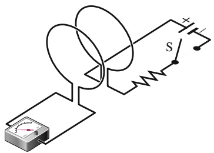

text_image

Electrical circuit diagram with ammeter, switch, and power source labeled S

Abb. 26.2

Das Amperemeter registriert in dem Moment einen Strom in der linken Schleife, in dem der Schalter S geschlossen (um den Strom in der rechten Schleife einzuschalten) oder geöffnet (um den Strom in der rechten Schleife auszuschalten) wird. Dabei bewegt sich keine der beiden Schleifen.

Für dieses Experiment benutzen wir die Anordnung aus Abb. 26.2, in der die beiden Schleifen dicht beieinander stehen, einander aber nicht berühren. Wenn wir den Schalter S schließen, um den Strom in der rechten Schleife einzuschalten, zeigt das Amperemeter plötzlich für einen kurzen Moment einen Strom – einen induzierten Strom – in der linken Schleife an, der aber schon nach kurzer Zeit wieder abebbt. Wenn wir den Schalter danach wieder öffnen (den Strom in der rechten Schleife also abschalten), fließt wieder für einen kurzen Moment ein Strom in der linken Schleife, nun aber in entgegengesetzter Richtung. Zusammengefasst bedeutet das: Wir beobachten immer dann einen induzierten Strom (und folglich eine induzierte Spannung) in der linken Schleife, wenn sich der Strom in der rechten Schleife ändert (wie beim Ein- oder Ausschalten), aber nicht, wenn er konstant bleibt (selbst wenn er groß ist).

Die induzierte Spannung und der induzierte Strom in diesen Experimenten hängen offensichtlich damit zusammen, dass sich etwas verändert – aber was? Faraday fand die Antwort.

## 26.1.3 Das Faradaysche Induktionsgesetz

Faraday erkannte, dass eine Spannung und ein Strom in einer Leiterschleife induziert werden, wenn sich die „Menge“ des Magnetfelds ändert, die durch die Schleife hindurchtritt (wie in unseren beiden Experimenten). Er erkannte weiter, dass diese „Menge“ des Magnetfelds mit den Feldlinien zusammenhängen musste, die durch die Schleife traten. In seiner modernen Formulierung lautet das **Faradaysche Induktionsgesetz**:

614

---

26.1 Das Faradaysche Gesetz und die Lenzsche Regel

26

In der Leiterschleife auf der linken Seite von Abb. 26.1 bzw. 26.2 wird eine Spannung induziert, wenn sich die Zahl der magnetischen Feldlinien ändert, die durch die Schleife hindurchtreten.

Es kommt dabei nicht auf die absolute $\mathrm { ,   Z a h i ^ { a } }$ der Feldlinien an, die durch die Schleife hindurchtreten; die induzierte Spannung und der induzierte Strom hängen nur von der Geschwindigkeit ab, mit der sich diese $\mathrm { ,   Z a h i ^ { a } }$ ändert.

In unserem ersten Experiment (Abb. 26.1) entspringen die Feldlinien am Nordpol des Magneten und laufen auseinander. Wenn wir den Magneten näher an die Schleife bringen, treten damit immer mehr Feldlinien durch die Schleife hindurch. Diese Zunahme bringt die Elektronen in der Schleife offensichtlich dazu, sich zu bewegen (der induzierte Strom) und die dafür notwendige Energie pro Ladung aufzubringen (die induzierte Spannung). Wenn der Magnet sich nicht mehr bewegt, ändert sich die Zahl der durch die Schleife hindurchtretenden Feldlinien nicht mehr und der induzierte Strom und die induzierte Spannung verschwinden.

Solange der Schalter geöffnet ist, gibt es in unserem zweiten Experiment (Abb. 26.2) gar keine Feldlinien (es fließt kein Strom in der rechten Schleife). Wenn wir den Strom einschalten, baut der ansteigende Strom ein Magnetfeld um diese Schleife auf. Dabei ändert sich die Zahl der Feldlinien, die durch die benachbarte linke Schleife hindurchtreten. Wie im ersten Experiment bewirkt diese Zunahme der Feldlinien einen induzierten Strom und eine induzierte Spannung in der linken Schleife. Sobald der Strom in der rechten Schleife einen stationären Zustand und seinen Maximalwert erreicht, ändert sich die Zahl der Feldlinien durch die linke Schleife nicht mehr und der induzierte Strom und die induzierte Spannung verschwinden wieder.

Das Faradaysche Gesetz erklärt nicht, warum in diesen Experimenten ein Strom und eine Spannung induziert werden.

## Eine quantitative Behandlung

Um mit dem Faradayschen Gesetz arbeiten zu können, brauchen wir einen Weg, die durch eine Leiterschleife hindurchtretende „Menge“ des Magnetfelds zu quantifizieren und zu berechnen. In Kapitel 19 mussten wir in einer ähnlichen Situation die „Menge“ eines elektrischen Felds berechnen, die durch eine Oberfläche hindurchtritt, und hatten zu diesem Zweck einen elektrischen Fluss $\varPhi _ { E } = \int \vec { E } \cdot \mathbf { d } \vec { A }$ definiert. Jetzt definieren wir den magnetischen Fluss: Dazu denken wir uns eine Schleife, die eine Fläche A umschließt und die wir in ein Magnetfeld $\vec { B }$ bringen. Dann ist der magnetische Fluss durch die Schleife gleich

$$
\varPhi_ {B} = \int \vec {B} \cdot \mathrm{d} \vec {A}. \tag {26.3}
$$

Wie in Kapitel 19 bezeichnet $\mathrm { d } \vec { A }$ einen Vektor mit dem Betrag $\mathbf { d } A ,$ der senkrecht auf dem differenziellen Flächenelement dA steht. Als Spezialfall von Gl. 26.3 betrachten wir den Fall, dass die Schleife in einer Ebene liegt und das Magnetfeld senkrecht auf dieser Ebene steht. Dann können wir das Skalarprodukt aus Gl. 26.3 als $B   \mathrm { d } A$ cos $0 ^ { \circ } = B   \mathsf { d } A$ schreiben. Das verbleibende Integral ∫ dA ergibt einfach die Fläche der Schleife. Aus Gl. 26.3 wird somit

$$
\Phi_ {B} = B A. \tag {26.4}
$$

Aus den Gln. 26.3 und 26.4 sehen wir, dass die SI-Einheit des magnetischen Flusses Tesla mal Quadratmeter ist. Sie hat die eigene Bezeichnung Weber (abgekürzt Wb):

$$
1 \mathrm{Weber} = 1 \mathrm{Wb} = 1 \mathrm{T} \cdot \mathrm{m} ^ {2}. \tag {26.5}
$$

Mithilfe des magnetischen Flusses können wir das Faradaysche Gesetz nun in einer quantitativen und gleichzeitig praktischeren Weise formulieren:

615

---

26 Induktion und Induktivität

Die in einer Leiterschleife induzierte Spannung  ist gleich der zeitlichen Änderung des magnetischen Flusses durch die Schleife.

Wie wir im nächsten Abschnitt sehen werden, wirkt die induzierte Spannung der auslösenden Flussänderung stets entgegen; die mathematische Formulierung des Faradayschen Induktionsgesetzes lautet daher

$$
\mathcal {E} = - \frac {\mathrm{d} \varPhi_ {B}}{\mathrm{d} t}, \tag {26.6}
$$

wobei das Minuszeichen diese entgegengesetzte Richtung anzeigt. Wenn wir nur am Betrag der induzierten Spannung interessiert sind, werden wir dieses Minuszeichen oft auch ignorieren.

Wenn wir den magnetischen Fluss durch eine Spule aus N Windungen verändern, wird in jeder einzelnen Windung eine Spannung gemäß dem Faradayschen Gesetz induziert; die gesamte in der Spule induzierte Spannung ergibt sich als Summe dieser Einzelbeiträge. Wenn die Spule eng gewickelt (dicht gepackt) ist, sodass durch alle Windungen derselbe magnetische Fluss hindurchtritt, gilt für die induzierte Gesamtspannung

$$
\mathcal {E} = - N \frac {\mathrm{d} \varPhi_ {B}}{\mathrm{d} t}. \tag {26.7}
$$

Wir können den magnetischen Fluss durch eine Spule grundsätzlich auf verschiedene Arten ändern:

1. Indem wir die Feldstärke des Magnetfelds innerhalb der Spule ändern;
2. Indem wir die Fläche der Spule oder den Anteil ihrer Fläche, der von dem Magnetfeld durchdrungen wird, ändern (z. B. können wir die Spule vergrößern oder sie in das Feld hineinschieben bzw. aus ihm herausziehen);
3. Indem wir den Winkel zwischen der Richtung des Magnetfelds $\vec { B }$ und der Fläche der Spule ändern (z. B. indem wir die Spule drehen, sodass das Feld, das zuerst senkrecht auf ihr stand, nun parallel zur Ebene der Spule anliegt).

## KONTROLLFRAGE 1

Die Skizze zeigt die Feldstärke B(t) eines homogenen Magnetfelds, das überall senkrecht auf einer Leiterschleife steht. Ordnen Sie die fünf gekennzeichneten Zeitintervalle in absteigender Reihenfolge nach der Größe der jeweils in der Schleife induzierten Spannung.

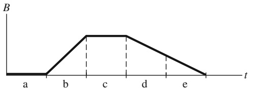

line

| Time (t) | B |
| --- | --- |
| a | 0 |
| b | 0 |
| c | Peak |
| d | Peak |
| e | 0 |

## 26.1.4 Die Lenzsche Regel

Schon bald nachdem Faraday sein Induktionsgesetz aufgestellt hatte, entwickelte Heinrich Friedrich Lenz eine Regel – heute als **Lenzsche Regel** bekannt –, um die Richtung des induzierten Stroms in einer Schleife vorherzusagen:

Ein induzierter Strom ist so gerichtet, dass das von ihm erzeugte Magnetfeld der Änderung des magnetischen Flusses entgegenwirkt, die den Strom hervorruft.

Die Richtung der induzierten Spannung ist dieselbe wie die des induzierten Stroms. Um ein Gefühl für die Lenzsche Regel zu entwickeln, wollen wir sie auf

616

---

26.1 Das Faradaysche Gesetz und die Lenzsche Regel

26

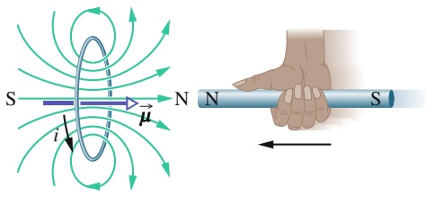

text_image

S
i
μ
N
N
S

zwei unterschiedliche, aber äquivalente Weisen auf die in Abb. 26.3 dargestellte Situation anwenden.

In der Abbildung wird der Nordpol eines Magneten auf eine Leiterschleife zu bewegt. Wir können die Situation auf zwei Weisen analysieren:

1. Hemmung der Bewegung des Pols. Die Annäherung des magnetischen Nordpols in Abb. 26.3 vergrößert den magnetischen Fluss durch die Schleife und induziert damit einen Strom in ihr. Aus Abb. 25.18 wissen wir, dass die Schleife dann wie ein magnetischer Dipol mit einem Nord- und einem Südpol wirkt, wobei das magnetische Dipolmoment vom Süd- zum Nordpol zeigt. Um dem Anstieg des magnetischen Flusses aufgrund des sich nähernden magnetischen Nordpols entgegenzuwirken, muss der Nordpol des Dipolmoments der Schleife (und damit $\vec { \mu }$ selbst) dem Magneten entgegen zeigen und ihn abstoßen. Die Rechte-Hand-Regel für $\vec { \mu }$ aus Abb. 25.18 zeigt uns, dass der induzierte Strom in der Schleife demzufolge im Gegenuhrzeigersinn fließen muss.

Wenn wir anschließend den Magneten wieder entfernen, wird wieder ein Strom in der Schleife induziert. Dieses Mal wird die Schleife aber ihren Südpol in Richtung des Magneten richten, um ihn anzuziehen und so seine Entfernung zu erschweren. Der induzierte Strom fließt nun also im Uhrzeigersinn.

2. Hemmung der Änderung des magnetischen Flusses. Solange der Magnet in Abb. 26.3 weit von der Schleife entfernt ist, tritt kein magnetischer Fluss durch sie hindurch. Wenn der Nordpol des Magneten sich dann mit seinem nach links zeigenden Magnetfeld der Schleife nähert, nimmt der Fluss durch die Schleife zu. Um dieser Zunahme entgegenzuwirken, muss der induzierte Strom i ein eigenes, nach rechts gerichtetes Magnetfeld erzeugen, wie in Abb. 26.4a gezeigt. Der nach rechts gerichtete Fluss des Felds $\vec { B } _ { i }$ wirkt dann dem nach links gerichteten, ansteigenden Fluss des Felds $\vec { B }$ entgegen. Die Rechte-Hand-Regel aus Abb. 25.18 zeigt uns, dass der induzierte Strom in Abb. 26.4a hierzu im Gegenuhrzeigersinn fließen muss.

Der Fluss von $\vec { B } _ { i }$ wirkt immer der Änderung des Flusses von $\vec { B }$ entgegen, das bedeutet aber keineswegs, dass ${ \vec { B } } _ { i }$ immer auch $\vec { B }$ entgegengerichtet ist. Wenn wir nämlich als Nächstes den Magneten von der Schleife entfernen, dann ist der Fluss von $\vec { B }$ immer noch nach links gerichtet, aber er nimmt nun ab. Jetzt muss der Fluss von $\vec { B } _ { i }$ in der Schleife ebenfalls nach links zeigen, um der Abnahme von $\varPhi _ { B }$ entgegenzuwirken, wie Abb. 26.4b zeigt. ${ \vec { B } } _ { i }$ und $\vec { B }$ zeigen jetzt in dieselbe Richtung.

Die Abb. 26.4c und d zeigen die Situationen, in denen sich der Südpol des Magneten auf die Schleife zu bzw. von ihr weg bewegt.

## Abb. 26.3

Die Lenzsche Regel in Aktion. Wenn der Magnet auf die Schleife zu bewegt wird, induziert er in der Schleife einen Strom. Der induzierte Strom erzeugt sein eigenes Magnetfeld, dessen Dipolmoment so orientiert ist, dass es der Bewegung des Magneten entgegenwirkt. Der induzierte Strom muss folglich wie gezeigt im Gegenuhrzeigersinn fließen.

## Abb. 26.4

Der in einer Schleife induzierte Strom ist so gerichtet, dass das Magnetfeld ${ \vec { B } } _ { i } ^ { - }$ des Stroms der Änderung des Magnetfelds entgegenwirkt, die den Strom induziert. Einem zunehmenden Feld B⃗ ist das Feld ${ \vec { B } } _ { i }$ stets entgegen gerichtet (a, c), während es im Fall eines abnehmenden Felds $\vec { B }$ in dieselbe Richtung wie dieses zeigt (b, d). Die Rechte-Hand-Regel gibt uns die Richtung des induzierten Stroms, wenn wir die Richtung des von ihm induzierten Felds kennen.

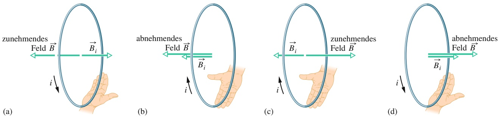

617

---

26 Induktion und Induktivität

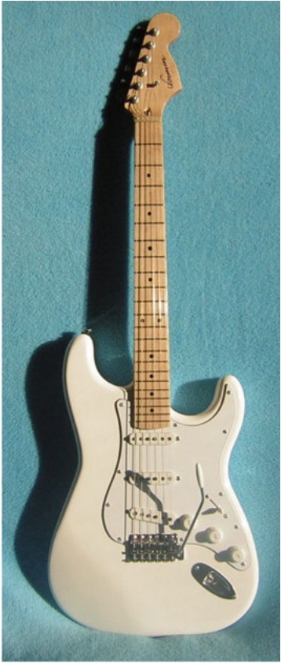

natural_image

White electric guitar with F490F6 model and visible fretboard, placed against a blue textured background (no text or symbols)

Abb. 26.5

Eine Fender Stratocaster besitzt drei Gruppen von jeweils sechs elektrischen Abnehmern (im Körper der Gitarre). Mit einem Umschalter (unten) kann der Musiker auswählen, welche Gruppe von Abnehmern die Signale an den Verstärker und dann zu den Lautsprechern schickt [Quelle: Zlajo007/CC-AS-3.0].

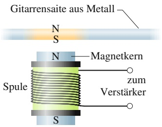

text_image

Gitarrensaite aus Metall
N
S
N
Magnetkern
Spule
zum
Verstärker
S

Abb. 26.6

Eine Seitenansicht eines elektrischen Abnehmers in einer E-Gitarre. Wenn die Saite (die als Magnet wirkt) in Schwingungen versetzt wird, bewirkt sie eine periodische Variation des magnetischen Flusses, die einen Strom in der Spule induziert.

## Die E-Gitarre

Abbildung 26.5 zeigt eine Fender Stratocaster, die legendäre E-Gitarre, die Jimi Hendrix und viele andere Musiker verwendeten. Für den Klang einer akustischen Gitarre ist die akustische Resonanz verantwortlich, die von den schwingenden Saiten im hohlen Körper des Instruments aufgebaut wird. Eine elektrische Gitarre besitzt keinen Resonanzkörper, es gibt folglich auch keine (akustische) Resonanz. Hier werden die Schwingungen der Metallsaiten von elektromagnetischen Abnehmern aufgenommen und an den Verstärker weitergegeben.

Das Konstruktionsprinzip eines solchen Abnehmers ist in Abb. 26.6 gezeigt. Die Leitung zum Verstärker ist im Abnehmer zu einer Spule um einen kleinen Magneten gewickelt. Das Feld dieses Magneten erzeugt in dem direkt darüberliegenden Abschnitt der Saite ebenfalls einen schwachen Magneten mit einem Nordund einem Südpol, der sein eigenes schwaches Magnetfeld besitzt. Wenn die Saite schwingt, verändert ihre Bewegung relativ zu dem (unbeweglichen) Abnehmer den magnetischen Fluss durch die Spule und induziert einen Strom in ihr. Wenn die Saite vor- und zurückschwingt, ändert der induzierte Strom seine Richtung mit der gleichen Frequenz wie die schwingende Saite und leitet so diese Frequenz an den Verstärker und die Lautsprecher weiter.

An einer Stratocaster gibt es drei Gruppen solcher Abnehmer in der Nähe des unteren Endes der Gitarre (im Gitarren-„Körper“). Die Gruppe ganz am unteren Ende nimmt die hohen Schwingungsfrequenzen am besten auf; die Gruppe weiter in der Mitte reagiert besser auf die tiefen Frequenzen. Über einen Umschalter kann der Musiker jederzeit entscheiden, welche Gruppe(n) von Abnehmern zum Einsatz kommt bzw. kommen.

Um eine noch weitergehende Kontrolle über seine Musik zu bekommen, wickelte Hendrix oft sogar die Spulen in den Abnehmern neu und änderte die Zahl der Windungen. Dadurch veränderte er die in den Spulen induzierten Spannungen und damit deren relative Empfindlichkeit für die Schwingungen der Saiten. Aber auch ohne derartige Eingriffe bietet die elektrische Gitarre ganz offensichtlich weitaus vielfältigere Möglichkeiten als eine akustische Gitarre, den erzeugten Klang zu beeinflussen.

## KONTROLLFRAGE 2

Die Abbildung zeigt drei identische kreisförmige Leiterschleifen in Magnetfeldern, deren Feldstärke mit identischen Geschwindigkeiten entweder zu- (Bezeichnung $\mathbf { , } \mathbf { , } \mathbf { Z } \mathbf { u } ^ { \alpha } \mathbf { ) }$ oder abnimmt (Bezeichnung „ab“). Punkte bzw. Kreuze zeigen entgegengesetzte Richtungen des Magnetfelds an (aus der Papierebene heraus bzw. in sie hinein). Die gestrichelte Linie teilt die Schleifen jeweils in zwei gleich große Hälften. Ordnen Sie die drei Schleifen in absteigender Reihenfolge nach dem in ihnen induzierten Strom.

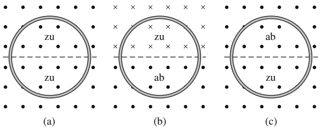

618

---

26.2 Induktion und Energietransfer

26

## 26.2 Induktion und Energietransfer

## Lernziele

Nach dem Durcharbeiten dieses Abschnitts sollten Sie in der Lage sein, . . .

• die Energiedissipationsrate (Umwandlung von elektrischer in thermische Energie) für eine Leiterschleife zu berechnen, die in ein magnetisches Feld hineingeschoben oder aus ihm herausgezogen wird,
• die Beziehung zwischen induzierter Stromstärke und Energiedissipationsrate anzuwenden,
• Wirbelströme zu beschreiben.

## Schlüsselideen

• Wenn ein veränderlicher magnetischer Fluss einen Strom induziert, wird Energie auf diesen Strom übertragen. Diese Energie kann anschließend in andere Formen umgewandelt werden, z. B. in Wärme.

## 26.2.1 Induktion und Energietransfer

Unabhängig davon, ob wir den Magneten in Abb. 26.1 auf die Schleife zu oder von ihr weg bewegen, stets tritt nach der Lenzschen Regel eine magnetische Kraft auf, die der Bewegung entgegenwirkt, sodass wir für die Bewegung des Magneten Arbeit verrichten müssen. Gleichzeitig wird in der Schleife Wärmeenergie produziert, da das Material der Schleife dem induzierten Strom einen elektrischen Widerstand entgegensetzt. Die Energie, die wir beim Bewegen des Magneten an dem geschlossenen Gesamtsystem Schleife und Magnet verrichten, endet so schließ- lich als Wärmeenergie. (Für den Moment vernachlässigen wir die Energie, die in Form elektromagnetischer Wellen von der Schleife abgestrahlt wird.) Je schneller wir den Magneten bewegen, desto schneller verrichten wir Arbeit, und desto schneller wird die Arbeit in Wärmeenergie in der Schleife umgewandelt; d. h., die Leistung der Umwandlung steigt.

Ganz gleich, auf welche Weise ein Strom in einer Schleife induziert wird, wegen des elektrischen Widerstands der Schleife wird bei der Induktion immer Energie in Wärmeenergie umgewandelt (es sei denn, die Schleife wäre supraleitend). Beispielsweise wird durch das Schließen des Schalters S in Abb. 26.2 kurzzeitig ein Strom in der Schleife auf der linken Seite induziert und dabei Energie aus der Batterie in Wärmeenergie umgewandelt.

Abbildung 26.7 zeigt eine andere Situation. Eine rechteckige Schleife der Breite L befindet sich zum Teil in einem homogenen äußeren Magnetfeld, das senkrecht in die Ebene der Schleife hineinzeigt. (Das Feld kann z.B. durch einen großen Elektromagneten erzeugt werden.) Die gestrichelten Linien in Abb. 26.7 zeigen die ange nommenen Grenzen des Magnetfelds; das graduelle Abfallen des Felds an diesen Grenzen wollen wir vernachlässigen. Wir wollen nun die Schleife mit einer konstanten Geschwindigkeit v nach rechts aus dem Magnetfeld herausziehen.

Die Situation in Abb. 26.7 unterscheidet sich nicht entscheidend von der in Abb. 26.1. In beiden Fällen bewegen sich eine geschlossene Leiterschleife und ein Magnetfeld relativ zueinander, und in beiden Fällen ändert sich der Fluss des magnetischen Felds durch die Schleife. Zwar ändert sich der magnetische Fluss in Abb. 26.1, weil das Magnetfeld B⃗ sich ändert, während sich in Abb. 26.7 die Fläche der Schleife ändert, die von dem Magnetfeld durchdrungen wird; dieser Unterschied ist aber nicht bedeutsam. Der für uns wichtige Unterschied ist, dass die Anordnung aus Abb. 26.7 unsere Berechnungen einfacher macht. Wir wollen jetzt die mechanische Leistung berechnen, die wir erbringen, während wir die Schleife mit konstanter Geschwindigkeit aus dem Magnetfeld ziehen.

Wir werden sehen, dass wir eine konstante Kraft $\vec { F }$ ausüben müssen, um die Schleife mit konstanter Geschwindigkeit v aus dem Magnetfeld zu ziehen, da ei-

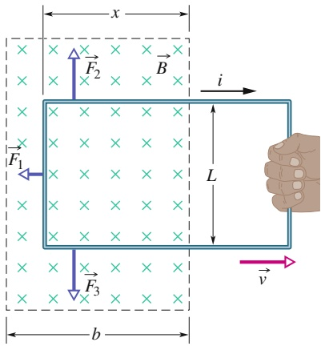

text_image

x
F₂
B
i
L
F₁
F₃
b
v

Abb. 26.7

Eine geschlossene Leiterschleife wird mit konstanter Geschwindigkeit v aus einem Magnetfeld gezogen. Solange die Schleife sich bewegt, wird in ihr ein Strom i im Uhrzeigersinn induziert, sodass auf die noch im Magnetfeld befindlichen Schleifenabschnitte die Kräfte $\vec { F } _ { 1 } , \vec { F } _ { 2 }$ und $\vec { F } _ { 3 }$ wirken.

619

---

26 Induktion und Induktivität

ne magnetische Kraft mit gleichem Betrag in entgegengesetzter Richtung auf die Schleife wirkt und unsere Arbeit behindert. Gleichung 3.46 liefert uns dann für die Leistung, die wir erbringen müssen,

$$
P = F \nu . \tag {26.8}
$$

Hierbei ist $F$ die Kraft, mit der wir an der Schleife ziehen (müssen). Wir wollen nun nach einem Ausdruck suchen, der $P$ auf die Feldstärke B des Magnetfelds und die Eigenschaften der Schleife zurückführt (d. h. auf ihre Breite L und ihren elektrischen Widerstand R).

Während wir die Schleife in Abb. 26.7 nach rechts bewegen, reduziert sich die Fläche der Schleife, die sich innerhalb des Magnetfelds befindet. Damit verringert sich auch der magnetische Fluss durch sie und nach der Lenzschen Regel wird ein Strom in der Schleife induziert. Dieser Strom verursacht die Kraft, gegen die wir Arbeit verrichten müssen.

Um den Strom zu erhalten, wenden wir zunächst das Faradaysche Gesetz an. Wenn wir die Länge der Schleife, die sich noch im Bereich des Magnetfelds befindet, mit x bezeichnen, dann ist Lx die zugehörige Fläche. Aus Gl. 26.4 erhalten wir für den magnetischen Fluss durch diesen Teil der Schleife

$$
\Phi_ {B} = B A = B L x. \tag {26.9}
$$

Wenn x abnimmt, nimmt folglich auch der magnetische Fluss ab. Das Faradaysche Gesetz besagt, dass dabei eine Spannung in der Schleife induziert wird. Wir ignorieren das Minuszeichen in Gl. 26.6, setzen Gl. 26.9 dort ein und erhalten für den Betrag der Spannung

$$
\mathcal {E} = \frac {\mathrm{d} \varPhi_ {B}}{\mathrm{d} t} = \frac {\mathrm{d}}{\mathrm{d} t} B L x = B L \frac {\mathrm{d} x}{\mathrm{d} t} = B L \nu , \tag {26.10}
$$

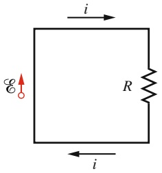

text_image

i
E
R
i

Abb. 26.8

Ein Ersatzschaltbild für die Schleife aus Abb. 26.7 während ihrer Bewegung.

wobei wir für dx∕dt die Geschwindigkeit v eingesetzt haben, mit der wir die Schleife aus dem Feld ziehen.

Abbildung 26.8 zeigt ein Ersatzschaltbild für die Schleife: Die induzierte Spannung $\varepsilon$ ist auf der linken Seite angegeben; auf der rechten Seite repräsentiert R den gesamten Leitungswiderstand der Schleife. Die Richtung des induzierten Stroms i erhalten wir mit einer Rechte-Hand-Regel wie in Abb. 26.4; die induzierte Spannung $\varepsilon$ muss in dieselbe Richtung zeigen.

Um den Betrag des induzierten Stroms zu bestimmen, können wir nicht einfach die Kirchhoffsche Maschenregel verwenden, da wir – wie wir in Abschn. 26.3 noch sehen werden – für einen induzierten Strom keine Potenzialdifferenz definieren können. Wir können aber wie in Beispielaufgabe 26.2 im Übungsbuch die Gleichung $i = \mathcal { E } / R$ verwenden. Damit wird aus Gl. 26.10

$$
i = \frac {B L \nu}{R}. \tag {26.11}
$$

Da dieser Strom durch drei Abschnitte im Bereich des Magnetfelds fließt, wirkt auf jeden dieser Abschnitte eine Kraft seitwärts (Index s). Aus Gl. 24.23 wissen wir, dass eine solche Kraft allgemein durch

$$
\vec {F} _ {\mathrm{s}} = i \vec {L} \times \vec {B} \tag {26.12}
$$

gegeben ist. In Abb. 26.7 sind diese Kräfte als $\vec { F } _ { 1 } , \vec { F } _ { 2 }$ und $\vec { F } _ { 3 }$ bezeichnet. Aus Symmetriegründen müssen die Kräfte $\vec { F } _ { 2 }$ und $\vec { F } _ { 3 }$ aber gleich groß sein und sich daher aufheben. Es bleibt daher nur ${ \vec { F } } _ { 1 }$ übrig, und diese Kraft ist es, gegen die wir die Schleife aus dem Feld ziehen müssen; es gilt also $\vec { F } = \vec { F } _ { 1 }$

Aus Gl. 26.12 erhalten wir den Betrag von ${ \vec { F } } _ { 1 } ,$ und da der Winkel zwischen $\vec { B }$ und dem Längenvektor $\vec { L }$ für das linke Schleifensegment $9 0 ^ { \circ }$ beträgt, gilt

$$
F = F _ {1} = i L B \sin 9 0 ^ {\circ} = i L B. \tag {26.13}
$$

620

---

26.2 Induktion und Energietransfer

26

Nun setzen wir Gl. 26.11 für i in diese Gleichung ein und bekommen so

$$
F = \frac {B ^ {2} L ^ {2} \nu}{R}. \tag {26.14}
$$

Da B, L und R Konstanten sind, ist die Geschwindigkeit v der Schleife genau dann konstant, wenn auch die Kraft F konstant ist, mit der wir an der Schleife ziehen.

Jetzt setzen wir Gl. 26.14 in Gl. 26.8 ein, um die mechanische Leistung zu erhalten, während wir die Schleife aus dem Feld ziehen:

$$
P = F \nu = \frac {B ^ {2} L ^ {2} \nu^ {2}}{R}. \tag {26.15}
$$

Zum Schluss unserer Analyse berechnen wir noch, wie schnell die Wärmeenergie sich in der Schleife aufbaut, wenn sie mit konstanter Geschwindigkeit aus dem Feld gezogen wird. Nach Gl. 22.22 gilt für die Leistung

$$
P = i ^ {2} R. \tag {26.16}
$$

Hier setzen wir unseren Strom aus Gl. 26.11 ein und erhalten das Ergebnis

$$
P = \left(\frac {B L \nu}{R}\right) ^ {2} R = \frac {B ^ {2} L ^ {2} \nu^ {2}}{R}, \tag {26.17}
$$

also genau das Resultat, das wir auch für unsere mechanische Leistung erhalten haben (Gl. 26.15). Die mechanische Arbeit, die wir leisten, wird somit direkt in thermische Energie in der Schleife umgewandelt.

## Wirbelströme

Nun ersetzen wir die Leiterschleife aus Abb. 26.7 durch eine leitfähige Platte. Wenn wir diese Platte wie zuvor die Schleife aus dem Magnetfeld bewegen (Abb. 26.9a), induziert die Relativbewegung zwischen Feld und Leiter wieder einen Strom in Letzterem. Wir beobachten also wieder eine Kraft, gegen die wir die Platte aus dem Feld ziehen müssen, und müssen wieder aufgrund des induzierten Stroms Arbeit leisten. In der Platte folgen die Leitungselektronen, die den induzierten Strom bilden, jedoch nicht wie in der Leiterschleife einem vorgegebenen Pfad, sondern wirbeln wie in einem Wasserstrudel im Kreis. Einen solchen Strom nennen wir Wirbelstrom; wir können ihn wie in Abb. 26.9a so darstellen, als ob er einem festgelegten Weg folgen würde.

Wie bei der Leiterschleife aus Abb. 26.7 bewirkt der in der Platte induzierte Strom die Dissipation der mechanischen Energie als Wärmeenergie in der Platte. Die Dissipation wird bei der Anordnung in Abb. 26.9b noch deutlicher: Hier kann die Platte frei um ihre Aufhängung schwingen und bewegt sich dabei durch den Bereich eines Magnetfelds. Jedes Mal, wenn die Platte in das Feld ein- oder aus ihm austritt, werden in ihr Wirbelströme induziert und ein Teil ihrer mechanischen Energie wird in Wärmeenergie verwandelt. Nach einigen Schwingungen ist ihre gesamte mechanische Energie in Wärmeenergie umgewandelt und die Platte hängt unbewegt an ihrer Aufhängung.

## KONTROLLFRAGE 3

Die Abbildung zeigt vier Stromschleifen mit Seitenlängen von L bzw. 2L. Sie wer den alle mit identischer konstanter Geschwindigkeit durch den Bereich eines ho mogenen Magnetfelds (das aus der Papierebene herauszeigt) bewegt. Ordnen Sie die vier Schleifen in absteigender Reihenfolge nach dem Maximalwert der in ihnen beim Durchgang durch das Feld induzierten Spannung.

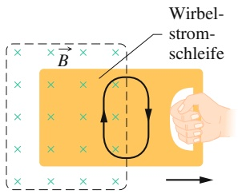

text_image

Wirbel-
strom-
schleife
B

(a)

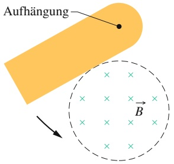

text_image

Aufhängung
B

(b)

## Abb. 26.9

(a) Wenn wir eine Leiterplatte aus einem Magnetfeld herausziehen, werden in der Platte Wirbelströme induziert. (b) Eine Leiterplatte kann wie ein Pendel um eine Aufhängung in den Wirkungsbereich eines Magnetfelds schwingen. Bei jedem Ein- und Austritt in das bzw. aus dem Feld werden Wirbelströme in der Platte induziert.

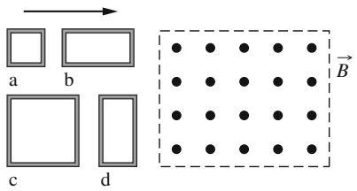

text_image

a b
c d
B

621

---

26 Induktion und Induktivität

## 26.3 Induzierte elektrische Felder

## Lernziele

Nach dem Durcharbeiten dieses Abschnitts sollten Sie in der Lage sein, . . .

• zu verstehen, dass ein veränderliches Magnetfeld immer ein elektrisches Feld induziert, egal ob es eine Leiterschleife gibt oder nicht,
mithilfe des Faradayschen Gesetzes den Zusammenhang zwischen dem auf einem geschlossenen Pfad (egal ob sich auf ihm ein Leiter befindet oder nicht) induzierten elektrischen Feld $\vec { E }$ und der zeitlichen Änderung $\mathsf { d } \varPhi / \mathsf { d } t$ des von dem Pfad umschlossenen magnetischen Flusses anzugeben,
• zu verstehen, dass man einem induzierten elektrischen Feld kein elektrisches Potenzial zuordnen kann.

## Schlüsselideen

• Ein veränderlicher magnetischer Fluss induziert auch dann eine Spannung, wenn die ihn umgebende Schleife keine reale Leiterschleife ist, sondern nur eine gedachte Linie. Das sich ändernde magnetische Feld induziert an jedem Punkt einer solchen imaginären Schleife ein elektrisches Feld $\vec { E }$ mit einer zugehörigen induzierten Spannung

$$
\mathcal {E} = \oint \vec {E} \cdot \mathrm{d} \vec {s}.
$$

• Mithilfe des induzierten elektrischen Felds erhalten wir das Faradaysche Gesetz in seiner allgemeinsten Form:

$$
\oint \vec {E} \cdot \mathrm{d} \vec {s} = - \frac {\mathrm{d} \varPhi_ {B}}{\mathrm{d} t} \quad \text {(Faradaysches Gesetz)}.
$$

Abb. 26.10

(a) Wenn das magnetische Feld mit konstanter Geschwindigkeit zunimmt, wird ein konstanter Strom in dem Kupferring induziert. (b) Das induzierte elektrische Feld (hier an vier Punkten gezeigt) existiert auch dann noch, wenn der Kupferring entfernt wird. (c) Eine vollständige Darstellung des induzierten elektrischen Felds durch Feldlinien. (d) Vier ähnliche geschlossene Wege, die gleiche Flächen umschließen. In den Wegen 1 und 2, die vollständig im Bereich des veränderlichen Magnetfelds liegen, wird dieselbe Spannung induziert. In Weg 3 wird eine geringere Spannung induziert, da er nur teilweise im Bereich des veränderlichen Magnetfelds liegt. Im Weg 4 wird gar keine Spannung induziert, da er komplett außerhalb des Bereichs des Magnetfelds liegt.

Ein zeitlich veränderliches Magnetfeld induziert ein elektrisches Feld ${ \vec { E } } .$

## 26.3.1 Induzierte elektrische Felder

Wir bringen nun wie in Abb. 26.10a gezeigt einen Kupferring mit dem Radius r in ein homogenes äußeres Magnetfeld. Das Feld erfüllt – unter Vernachlässigung des graduellen Abklingens am Rand – ein zylindrisches Volumen mit dem Radius R. Nun erhöhen wir die Feldstärke dieses Felds mit konstanter Geschwindigkeit, indem wir beispielsweise den Strom in dem Elektromagneten, der das Feld erzeugt, in geeigneter Weise erhöhen. Der magnetische Fluss durch den Ring nimmt dann stetig zu und daher muss nach dem Faradayschen Gesetz eine Spannung und in deren Folge ein Strom in dem Ring induziert werden. Aus der Lenzschen Regel können wir ableiten, dass der induzierte Strom in Abb. 26.10a im Gegenuhrzeigersinn fließt.

Wenn in dem Kupferring ein Strom fließt, muss um ihn herum ein elektrisches Feld existieren, das die Leitungselektronen in Bewegung versetzt. Dieses Feld muss

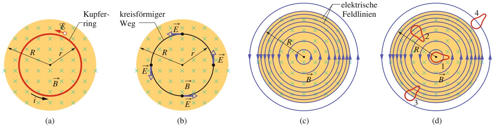

622

---

26.3 Induzierte elektrische Felder

26

durch den sich ändernden magnetischen Fluss hervorgerufen worden sein. Dieses sogenannte **induzierte elektrische Feld** $\vec { E }$ ist ebenso real wie ein elektrisches Feld aufgrund von statischen Ladungen; wie jedes andere elektrische Feld übt es auf eine Ladung $q _ { 0 }$ eine Kraft $q _ { 0 } \vec { E }$ aus.

Durch diese Argumentation gelangen wir zu einer sehr nützlichen und hilfreichen Neuformulierung des Faradayschen Induktionsgesetzes:

Ein zeitlich veränderliches Magnetfeld erzeugt ein elektrisches Feld.

Das Verblüffende an dieser Aussage ist, dass das elektrische Feld auch dann induziert wird, wenn es gar keinen Kupferring gibt, in dem Leitungselektronen fließen können!

Um diese Gedanken zu präzisieren, betrachten wir Abb. 26.10b, die genau Abb. 26.10a entspricht, nur dass der Kupferring durch eine hypothetische kreisförmige Bahn mit Radius $r$ ersetzt wurde. Wie zuvor nehmen wir an, dass das Magnetfeld $\vec { B }$ mit einer konstanten Geschwindigkeit d $1 B / \mathrm { d }$ t zunimmt. Das an verschiedenen Punkten entlang der Kreisbahn induzierte elektrische Feld muss aus Symmetriegründen1) wie in Abb. 26.10b gezeigt tangential an dem Kreis anliegen. Damit ist die Kreisbahn selbst eine Feldlinie des elektrischen Felds. Die gezeichnete Bahn mit dem Radius r ist durch nichts vor anderen möglichen Bahnen ausgezeichnet, folglich müssen die von dem veränderlichen Magnetfeld induzierten elektrischen Feldlinien wie in Abb. 26.10c dargestellt konzentrische Kreise sein.

Solange das Magnetfeld zunimmt, existiert das durch die konzentrischen elektri schen Feldlinien in Abb. 26.10c dargestellte elektrische Feld. Wenn das Magnetfeld konstant bleibt, gibt es kein induziertes elektrisches Feld und folglich auch keine elektrischen Feldlinien mehr. Wenn das Magnetfeld anschließend wieder abnimmt, entsprechen die elektrischen Feldlinien immer noch den konzentrischen Kreisen aus Abb. 26.10c, nur zeigen sie nun in die entgegengesetzte Richtung.

All diese Fakten stecken in der simplen Aussage „Ein zeitlich veränderliches Magnetfeld erzeugt ein elektrisches Feld“.

## Eine Neuformulierung des Faradayschen Gesetzes

Wir betrachten ein Teilchen mit Ladung $q _ { 0 } ,$ das sich auf der Kreisbahn aus Abb. 26.10b bewegt. Das induzierte elektrische Feld verrichtet an ihm pro Umlauf die Arbeit $W = \mathcal { E } q _ { 0 } ,$ wenn  die induzierte Spannung ist (die Arbeit pro Ladungs einheit für einen Umlauf der Testladung). Wir können die verrichtete Arbeit auch als

$$
W = \int \vec {F} \cdot \mathrm{d} \vec {s} = (q _ {0} E) (2 \pi r) \tag {26.18}
$$

schreiben, wobei $q _ { 0 } E$ der Betrag der auf das Teilchen wirkenden Kraft ist und 2πr die Wegstrecke, entlang derer die Kraft wirkt. Die beiden Ausdrücke für W setzen wir gleich und eliminieren $q _ { 0 } ;$ so erhalten wir

$$
\mathcal {E} = 2 \pi r E. \tag {26.19}
$$

Wir können Gl. 26.18 auch allgemeiner formulieren, sodass sie uns die Arbeit angibt, die wir an einem Teilchen mit der Ladung $q _ { 0 }$ verrichten müssen, um es entlang eines beliebigen geschlossenen Wegs zu bewegen:

$$
W = \oint \vec {F} \cdot \mathrm{d} \vec {s} = q _ {0} \oint \vec {E} \cdot \mathrm{d} \vec {s}. \tag {26.20}
$$

1) Symmetrieargumente würden auch radiale anstelle von tangentialen Feldlinien von E⃗ entlang der Kreisbahn erlauben; radiale Feldlinien würden aber das Vorhandensein freier Ladungen implizieren, die symmetrisch um die Symmetrieachse verteilt sein müssten und auf denen die Feldlinien beginnen oder enden könnten; in dem hier diskutierten Fall existieren aber keine solchen Ladungen.

623

---

26 Induktion und Induktivität

(Der Kreis an dem Integralzeichen zeigt an, dass wir entlang eines geschlossenen Wegs integrieren.) Wir setzen $W = \mathcal { E } q _ { 0 }$ ein und finden so

$$
\mathcal {E} = \oint \vec {E} \cdot \mathrm{d} \vec {s}. \tag {26.21}
$$

Diese Gleichung reduziert sich auf Gl. 26.19, wenn wir sie für den speziellen Fall von Abb. 26.10b auswerten.

Mithilfe von Gl. 26.21 können wir den Begriff der induzierten Spannung verallgemeinern. Bisher hatten wir unter einer induzierten Spannung die Arbeit pro Ladungseinheit verstanden, die nötig ist, um einen Strom aufgrund eines veränderlichen magnetischen Flusses fließen zu lassen oder um ein geladenes Teilchen in einem veränderlichen magnetischen Fluss entlang eines geschlossenen Pfads zu bewegen. Nach Abb. 26.10b und Gl. 26.21 kann eine induzierte Spannung aber auch unabhängig von einem Strom oder geladenen Teilchen existieren: Eine induzierte Spannung ist demnach die Summe bzw. das Integral der Größe $\vec { E } \cdot \mathrm { d } \vec { s }$ über einen geschlossenen $\operatorname { w e g } ; \vec { E }$ ist dabei das elektrische Feld, das von einem veränderlichen magnetischen Fluss induziert wird und d⃗s ist ein differenzielles Längenelement entlang des geschlossenen Wegs.

Wenn wir Gl. 26.21 mit dem Faradayschen Gesetz aus Gl. 26.6 $( \mathcal { E } = -   \mathrm { d } \varPhi _ { B } / \mathrm { d } t )$ kombinieren, gelangen wir zu einer neuen Formulierung für das Faradaysche Gesetz:

$$
\oint \vec {E} \cdot \mathrm{d} \vec {s} = - \frac {\mathrm{d} \varPhi_ {B}}{\mathrm{d} t} \quad (\text {Faradaysches Gesetz}). \tag {26.22}
$$

Diese Gleichung besagt einfach, dass ein veränderliches magnetisches Feld ein elektrisches Feld induziert. Das veränderliche magnetische Feld erscheint auf der rechten Seite, das induzierte elektrische Feld auf der linken Seite der Gleichung.

Das Faradaysche Gesetz in der Form von Gl. 26.22 kann auf jeden beliebigen geschlossenen Weg in einem veränderlichen magnetischen Fluss angewendet werden. In Abb. 26.10d sind vier solcher Wege gezeigt, die alle dieselbe Form besitzen und dieselbe Fläche umschließen, aber an unterschiedlichen Stellen in dem veränderlichen Magnetfeld liegen. Für die Wege 1 und 2 sind die induzierten Spannungen $\mathcal { E } ( = \oint \vec { E } \cdot \vec { \mathbf { d } s } )$ gleich groß, weil beide Wege komplett innerhalb des Magnetfelds liegen und daher die jeweiligen Beträge von d $\varPhi _ { B } / \mathrm { d } t$ gleich groß sind. Dies gilt, obwohl die elektrischen Feldvektoren entlang der Wege unterschiedlich sind, wie die elektrischen Feldlinien in der Abbildung zeigen. Für Weg 3 ist die induzierte Spannung geringer, weil der eingeschlossene Fluss $\varPhi _ { B }$ (und damit auch $\mathrm { d } \varPhi _ { B } / \mathrm { d } t )$ kleiner ist, und für Weg 4 wird gar keine Spannung induziert, obwohl das elektrische Feld nicht an allen Punkten des Wegs verschwindet.

## Eine neue Sicht auf das elektrische Potenzial

Induzierte elektrische Felder werden nicht durch statische elektrische Ladungen verursacht, sondern durch veränderliche Magnetfelder. Obwohl elektrische Felder unabhängig von ihrem Ursprung die gleichen Kräfte auf elektrische Ladungen ausüben, gibt es doch einen bedeutsamen Unterschied zwischen ihnen. Das offensichtlichste Zeichen für diesen Unterschied ist die Form der elektrischen Feldlinien, die bei induzierten elektrischen Feldern wie in Abb. 26.10c geschlossene Schleifen bilden. Feldlinien aufgrund statischer Ladungen beginnen dagegen stets auf positiven und enden auf negativen Ladungen.

Wir können den Unterschied zwischen elektrischen Feldern aufgrund statischer Ladungen und induzierter elektrischer Felder auch formaler fassen:

Das elektrische Potenzial hat nur für elektrische Felder eine Bedeutung, die von statischen Ladungen hervorgerufen werden; für elektrische Felder, die auf Induktion zurückzuführen sind, ist es bedeutungslos.

624

---

26.4 Induktivität

26

Diese Aussage können wir verstehen, wenn wir ein geladenes Teilchen betrachten, das einen vollen Umlauf entlang der Kreisbahn aus Abb. 26.10b zurücklegt. Es startet an einem beliebigen Punkt und hat nach seiner Rückkehr an denselben Punkt eine Spannung von z. B. 5 V durchlaufen; d. $\mathrm { h } ,$ an ihm wurde eine Arbeit von 5 J/C verrichtet. Es sollte sich nun an einem Punkt mit einem um 5 V höheren Potenzial befinden. Das ist aber unmöglich, weil es sich wieder an seinem Ausgangspunkt befindet, der nicht zwei verschiedene elektrische Potenziale besitzen kann. Wir müssen daraus schließen, dass das elektrische Potenzial für induzierte elektrische Felder keine Bedeutung besitzt.

Dieses Resultat können wir auch auf formalem Weg erhalten. Dazu erinnern wir uns an Gl. 20.18, mit der wir die Potenzialdifferenz zwischen zwei Punkten i und f in einem elektrischen Feld $\vec { E }$ wie folgt definiert hatten:

$$
V _ {\mathrm{f}} - V _ {\mathrm{i}} = \int_ {\mathrm{i}} ^ {\mathrm{f}} \vec {E} \cdot \mathrm{d} \vec {s}. \tag {26.23}
$$

In Kapitel 20 waren wir dem Faradayschen Induktionsgesetz noch nicht begegnet; alle elektrischen Felder, die wir für die Herleitung von Gl. 20.18 verwendet hatten, gingen daher auf statische Ladungen zurück. Wenn nun in Gl. 26.23 i und f denselben Punkt bezeichnen, dann erfolgt die Integration entlang eines geschlossenen Wegs. $V _ { \mathrm { i } }$ und $V _ { \mathrm { f } }$ sind dann identisch, und aus Gl. 26.23 wird:

$$
\oint \vec {E} \cdot \mathrm{d} \vec {s} = 0. \tag {26.24}
$$

Sobald in dem Bereich des Integrals jedoch ein zeitlich veränderlicher magnetischer Fluss existiert, ist das Integral nicht null, sondern gleich $- \mathsf { d } \varPhi _ { B } / \mathsf { d } t$ (siehe Gl. 26.22). Damit gelangen wir zu einem Widerspruch, wenn wir versuchen, einem induzierten elektrischen Feld ein elektrisches Potenzial zuzuordnen. Wir müssen daraus schließen, dass ein elektrisches Potenzial in einem induzierten elektrischen Feld keine Bedeutung haben kann.

## KONTROLLFRAGE 4

Die Abbildung zeigt fünf mit Buchstaben bezeichnete gleich große Gebiete, in de nen ein homogenes Magnetfeld entweder in die Papierebene hinein oder aus der Papierebene heraus (wie in Gebiet a) zeigt. In allen fünf Gebieten nimmt das Feld mit der gleichen Geschwindigkeit zu. Außerdem sind vier nummerierte geschlossene Wege gezeigt, entlang derer das Integral ∮ $\vec { E }$ ⋅d⃗s die unten angegebenen Werte (in willkürlichen Einheiten) annimmt. In welchen der Gebiete b bis e zeigt das Feld in die Papierebene hinein, in welchen zeigt es aus der Papierebene heraus?

| Weg | 1 | 2 | 3 | 4 |
| --- | --- | --- | --- | --- |
| $\oint \vec{E} \cdot \mathrm{d}\vec{s}$ | 1 | 2 | 3 | 0 |

## 26.4 Induktivität

## Lernziele

Nach dem Durcharbeiten dieses Abschnitts sollten Sie in der Lage sein, . . .

• eine Induktivität als solche zu erkennen,
• für eine Induktivität (das Bauelement!) die Beziehung zwischen ihrer Induktivität (der physikalischen Größe!) $L ,$ dem Gesamtfluss NΦ und der Stromstärke i anzuwenden,
• für eine Spule die Beziehung zwischen der Induktivität pro Längeneinheit $L / l ,$ ihrer Querschnittsfläche $A$ und ihrer Windungszahl pro Längeneinheit n anzuwenden.

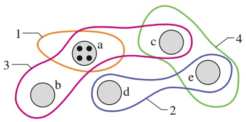

text_image

1
3
b
a
c
d
2
e
4

625

---

26 Induktion und Induktivität

## Schlüsselideen

Eine Induktivität ist einerseits ein Bauteil, mit dessen Hilfe sich in einem vorgegebenen Gebiet ein definiertes magnetisches Feld erzeugen lässt. Wenn ein Strom i durch die N Windungen einer solchen Induktivität fließt, tritt ein magnetischer Fluss $\Phi _ { B }$ durch diese Windungen. Eine Induktivität L ist andererseits die physikalische Größe, die dieses Bauteil charakterisiert; für sie gilt

$$
L = \frac {N \Phi_ {B}}{i} \quad \text {(Definition der Induktivität)}.
$$

• Die SI-Einheit der Induktivität ist das Henry (H); es gilt $1   \mathrm { H } = 1   \mathrm { T } \cdot \mathrm { m } ^ { 2 } / \mathrm { A }$
• Die Induktivität pro Längeneinheit einer langen Spule mit der Querschnittsflä- che A und n Windungen pro Längeneinheit beträgt in der Nähe ihrer Mittelachse

$$
\frac {L}{l} = \mu_ {0} n ^ {2} A \qquad (\text {Spule}).
$$

## 26.4.1 Induktivität

In Kapitel 21 hatten wir festgestellt, dass wir einen Kondensator verwenden können, um ein elektrisches Feld zu erzeugen; als Prototyp eines Kondensators hatten wir anschließend den Plattenkondensator betrachtet. Entsprechend können wir eine **Induktivität** (Symbol ) verwenden, um ein definiertes Magnetfeld zu erzeugen. Als Prototyp einer Induktivität verwenden wir eine lange Zylinderspule (ein Solenoid) bzw. genauer gesagt einen kleinen Ausschnitt aus der Mitte einer solchen Zylinderspule.

Wenn in den Windungen einer Zylinderspule ein Strom i fließt, entsteht in ihrem Inneren ein magnetischer Fluss $\varPhi _ { B } ,$ Die **Induktivität**2) einer solchen Zylinderspule ist dann

$$
L = \frac {N \Phi_ {B}}{i} \quad (\text {Definition der Induktivität}), \tag {26.25}
$$

wobei N die Zahl ihrer Windungen angibt. Man spricht davon, dass die Windun gen der Zylinderspule von diesem gemeinsamen magnetischen Fluss verkettet wer den und bezeichnet die Größe N $[ \varPhi _ { B }$ als magnetischen Verkettungsfluss oder Induk tionsfluss. Die Induktivität L ist somit ein Maß für den Verkettungsfluss, den die Zylinderspule pro Stromeinheit erzeugt. Es handelt sich bei diesem Verkettungsfluss jedoch nicht um eine neue physikalische Größe, sondern nur um den gewöhn lichen magnetischen Fluss für den Spezialfall der Querschnittsfläche einer Spule.

Da die SI-Einheit des magnetischen Flusses Tesla mal Quadratmeter ist, ist die Einheit der Induktivität folglich Tesla mal Quadratmeter pro Ampere $( \mathrm { T } \cdot \mathrm { m } ^ { 2 } / \mathrm { A } )$ Wir bezeichnen diese Einheit auch als Henry (H), nach Joseph Henry, dem Mitentdecker des Induktionsgesetzes und Zeitgenossen Faradays:

$$
1 \text {Henry} = 1 \mathrm{H} = 1 \mathrm{T} \cdot \mathrm{m} ^ {2} / \mathrm{A}. \tag {26.26}
$$

Für den gesamten Rest des Kapitels gehen wir immer davon aus, dass sich keine magnetischen Substanzen wie Eisen in der Nähe einer Induktivität befinden, da sie das von der Induktivität erzeugte Magnetfeld verzerren würden.

## Die Induktivität einer Zylinderspule

Wir betrachten eine lange Zylinderspule mit der Querschnittsfläche A. Wie groß ist ihre Induktivität pro Längeneinheit in der Nähe der Mitte?

2) Im Deutschen wird sowohl das Bauelement, z. B. eine Spule, als auch die charakteristische Größe L als Induktivität bezeichnet – ähnlich wie ein Kondensator häufig als eine „Kapazität“ genannt wird. Verwechslungen dürften jedoch aufgrund des Kontextes weitgehend ausgeschlossen sein.

626

---

26.5 Selbstinduktion

26

Um die Definitionsgleichung der Induktivität (Gl. 26.25) verwenden zu können, müssen wir den Verkettungsfluss $N \varPhi _ { B }$ berechnen, der von einem Strom i in den Windungen der Zylinderspule erzeugt wird. Wir betrachten einen Abschnitt der Länge l in der Nähe der Mitte der Zylinderspule. In diesem Abschnitt gilt

$$
N \varPhi_ {B} = (n l) (B A),
$$

wenn n die Zahl der Windungen pro Längeneinheit und B die Feldstärke des Magnetfelds im Inneren der Zylinderspule sind.

Die Feldstärke B ist nach Gl. 25.25

$$
B = \mu_ {0} i n.
$$

Damit erhalten wir aus Gl. 26.25

$$
\begin{array}{l} L = \frac {N \varPhi_ {B}}{i} = \frac {(n l) (B A)}{i} = \frac {(n l) (\mu_ {0} i n) A}{i} \\ = \mu_ {0} n ^ {2} l A. \tag {26.27} \\ \end{array}
$$

Somit hat die Induktivität pro Längeneinheit in der Mitte einer langen Zylinderspule den Betrag

$$
\frac {L}{l} = \mu_ {0} n ^ {2} A \quad (\text {Zylinderspule}). \tag {26.28}
$$

Die Induktivität hängt – ebenso wie die Kapazität – nur von der Geometrie der Anordnung ab. Die quadratische Abhängigkeit von der Zahl der Windungen pro Längeneinheit kommt nicht unerwartet. Wenn wir n z. B. verdreifachen, verdreifachen wir nicht nur die Gesamtzahl N der Windungen, sondern wir verdreifachen auch den magnetischen Fluss $\left( \varPhi _ { B } = B A = \mu _ { 0 } i n A \right)$ durch jede Windung, wir vergrößern die Induktivität somit gleich um einen Faktor neun.

Gleichung 26.27 gilt in sehr guter Näherung, sofern die Länge der Zylinderspule sehr viel größer als ihr Radius ist $( L \gg r )$ . Sie vernachlässigt jedoch die Divergenz des Magnetfelds an den Enden der Zylinderspule, ähnlich wie die Gleichung für den Plattenkondensator $\left( C = \varepsilon _ { 0 } A / d \right)$ das graduelle Abklingen des elektrischen Felds in der Nähe der Ränder der Kondensatorplatten vernachlässigt.

Wenn wir uns erinnern, dass n die Zahl der Windungen pro Längeneinheit angibt, sehen wir aus Gl. 26.27, dass wir die Induktivität als Produkt aus der magneti schen Feldkonstante $\mu _ { 0 }$ und einer Größe mit der Dimension einer Länge schreiben können. Das bedeutet wiederum, dass wir $\mu _ { 0 }$ in der Einheit Henry pro Meter angeben können:

$$
\begin{array}{l} \mu_ {0} = 4 \pi \cdot 1 0 ^ {- 7} \mathrm{T} \cdot \mathrm{m/A} \\ = 4 \pi \cdot 1 0 ^ {- 7} \mathrm{H/m}. \tag {26.29} \\ \end{array}
$$

## 26.5 Selbstinduktion

## Lernziele

Nach dem Durcharbeiten dieses Abschnitts sollten Sie in der Lage sein, . . .

• zu verstehen, dass in einer Spule eine induzierte Spannung auftritt, wenn sich der Strom durch die Spule ändert,
• die Beziehung zwischen induzierter Spannung, Induktivität L der Spule und zeitlicher Änderung di∕dt des Stroms anzuwenden,
• die Richtung der aufgrund einer Stromänderung in einer Spule induzierten Spannung mithilfe der Lenzschen Regel zu bestimmen und damit zu zeigen, dass die Spannung immer der Änderung des Stroms entgegenwirkt, also den ursprünglichen Strom aufrechtzuerhalten versucht.

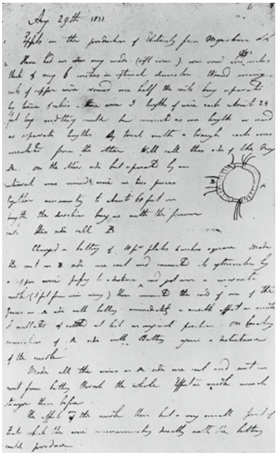

text_image

Agy 2g#t (100)
3/4th on the production of 'B'h#y, you agree with
the D or to my mind (off course), one and two parties,
had it my 6 miles in front of the house. The D is an
way of the mine, one and 2 feet of the ship, one and 2
to move from the move 3 feet of the ship, each about 29
(1⁄2) by and they make me a move by the ship or a
opposite to the D, head with a long, and one
and it's just the other well all the ship of the D,
on the ship, who he's open by one
whole one 5 miles in two parties.
to the ship, but not 6 feet on
long the vessel, like with the founor
with the ship still B.
(Bay) - litty of up-jo plots under again
The ship and a ship are now and I am
the afternoon of
a day now (1⁄2) for one and two
when (1⁄2) for one and two are a separate
of the ship. The ship is now at the top of the
founor, and all the ship, I am good, and some
and you have a good, and some
from the ship. Butty goes a together
of the ship.
And all the ship, a ship, and one are
and you have a good, and some
and you have a good, and some
to be before
the ship. Butty is the ship then he's my own, and I am
but which the ship remains by both and the batters
will be done.

## Abb. 26.11

Seite aus dem Laboratoriums-Tagebuch Faradays vom 29. August 1831, auf welcher die Entdeckung der elektromagnetischen Induktion beschrieben ist [Quelle: Deutsches Museum München].

627

---

26 Induktion und Induktivität

## Schlüsselideen

• Wenn sich der Strom i in einer Spule zeitlich ändert, wird in ihr eine Spannung induziert. Diese durch Selbstinduktion hervorgerufene Spannung beträgt

$$
\mathcal {E} _ {L} = - L \frac {\mathrm{d} i}{\mathrm{d} t}.
$$

• Die Richtung von $\mathcal { E } _ { L }$ ergibt sich aus der Lenzschen Regel: Die selbstinduzierte Spannung wirkt der Stromänderung entgegen, durch die sie verursacht wird.

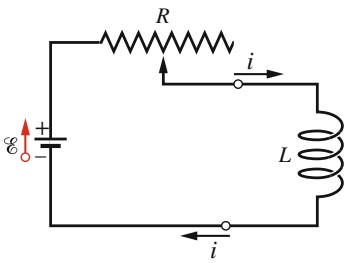

text_image

R
i
L
i
E

Abb. 26.12

Wenn wir den Strom in einer Spule ändern, indem wir z. B. einen variablen Widerstand verändern, dann tritt durch Selbstinduktion in der Spule eine Spannung auf, solange der Strom sich ändert.

## 26.5.1 Selbstinduktion

Wenn zwei Spulen – die wir jetzt auch als Induktivitäten bezeichnen können – nahe beieinander liegen, dann erzeugt ein Strom in der einen Spule einen magnetischen Fluss $\varPhi _ { B }$ durch die zweite Spule. Wenn wir diesen magnetischen Fluss verändern, indem wir beispielsweise den Strom durch die erste Spule ändern, dann wird nach dem Faradayschen Gesetz eine Spannung in der zweiten Spule induziert. Natürlich wird dabei auch in der ersten Spule eine Spannung induziert.

In jeder Spule, in der sich der Strom ändert, entsteht eine induzierte Spannung $\mathcal { E } _ { L }$

Dieser Prozess (siehe Abb. 26.12) wird als **Selbstinduktion** bezeichnet und die induzierte Spannung nennen wir die **Selbstinduktionsspannung**. Sie befolgt wie alle anderen induzierten Spannungen das Faradaysche Gesetz.

Nach Gl. 26.25 gilt für beliebige Induktivitäten

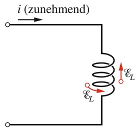

text_image

i (zunehmend)
εL
εL

(a)

$$
N \Phi_ {B} = L i. \tag {26.30}
$$

Das Faradaysche Gesetz besagt wiederum

$$
\mathcal {E} _ {L} = - \frac {\mathrm{d} (N \varPhi_ {B})}{\mathrm{d} t}. \tag {26.31}
$$

Wir kombinieren diese beiden Gleichungen und erhalten so

$$
\mathcal {E} _ {L} = - L \frac {\mathrm{d} i}{\mathrm{d} t}. \tag {26.32}
$$

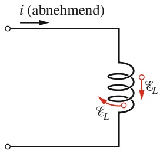

text_image

i (abnehmend)
εL
εL

(b)

Abb. 26.13

(a) Der Strom i nimmt zu und die Selbstinduktionsspannung $\mathcal { E } _ { L }$ in der Spule ist nach oben gerichtet, um dieser Zunahme entgegenzuwirken. Der Pfeil, der $\mathcal { E } _ { L }$ darstellt, kann dabei entweder entlang einer Windung der Spule oder entlang der ganzen Spule eingezeichnet werden. (b) Hier nimmt der Strom ab und die Selbstinduktionsspannung ist nach unten gerichtet, um der Abnahme des Stroms entgegenzuwirken.

In jeder Induktivität (z. B. einer einfachen Spule oder auch einer Zylinder- oder Ringspule) entsteht also immer dann eine Spannung durch Selbstinduktion, wenn der Strom zeitlich variiert. Die Stromstärke selbst hat keinen Einfluss auf die Selbstinduktionsspannung, nur die Geschwindigkeit ihrer Änderung zählt.

Die Richtung der Selbstinduktionsspannung erhalten wir wieder mithilfe der Lenzschen Regel. Das Minuszeichen in Gl. 26.32 zeigt, dass die Selbstinduktionsspannung $\mathcal { E } _ { L }$ so gerichtet ist, dass sie der verursachenden Änderung des Stroms i entgegenwirkt. Wenn wir nur am Betrag der Selbstinduktionsspannung interessiert sind, können wir das Minuszeichen in Gl. 26.32 ignorieren.

Wir nehmen nun an, dass wir einen Strom i, der mit einer Geschwindigkeit di∕dt zunimmt, durch eine Spule schicken (Abb. 26.13). In der Sprache der Lenzschen Regel heißt das, dass di∕dt die Änderung ist, der die Selbstinduktion entgegenwirken muss. Dazu muss eine Selbstinduktionsspannung auftreten, die dem ansteigenden Strom i wie in Abb. 26.13a entgegenzeigt. Wenn wir die Anordnung so ändern, dass der Strom durch die Spule mit der Zeit abnimmt (Abb. 26.13b), dann zeigt die Selbstinduktionsspannung entsprechend in die Richtung des Stroms, da sie auf diese Weise seiner Abnahme entgegenwirkt.

In Abschn. 26.3 hatten wir gesehen, dass wir für ein induziertes elektrisches Feld (und damit auch für die zugehörige Spannung) kein elektrisches Potenzial definieren können. Das bedeutet, dass wir auch für die Selbstinduktionsspannung im

628

---

26.6 RL-Kreise

26

Inneren der Induktivität aus Abb. 26.12, wo sich das magnetische Feld ändert, kein elektrisches Potenzial definieren können. Trotzdem können wir für Punkte in dem Stromkreis außerhalb der Induktivität Potenziale angeben – dort ist das elektrische Feld durch Ladungsverteilungen und ihre elektrischen Potenziale gegeben.

Außerdem können wir eine Potenzialdifferenz $V _ { L }$ der Selbstinduktion über eine Induktivität angeben (zwischen ihren Endpunkten, von denen wir annehmen, dass sie außerhalb des Bereichs des veränderlichen magnetischen Flusses liegen). Für eine ideale Induktivität (für die der elektrische Widerstand ihrer Leitungen vernachlässigbar ist) ist die Potenzialdifferenz $V _ { L }$ dem Betrag nach gleich der Selbstinduktionsspannung.

Wenn die Leitungen in der Induktivität einen Widerstand r besitzen, können wir die Induktivität gedanklich in eine ideale Induktivität mit einer Selbstinduktionsspannung $\mathcal { E } _ { L }$ und einen Widerstand r außerhalb des Bereichs des veränderlichen magnetischen Flusses auftrennen. Genau wie bei einer realen Batterie mit der Spannung  und dem Innenwiderstand r unterscheidet sich dann die Potenzialdifferenz zwischen den Anschlüssen einer realen Induktivität von der Spannung zwischen ihnen. Wenn nichts anderes angegeben ist, setzen wir im Folgenden stets ideale Induktivitäten voraus.

## KONTROLLFRAGE 5

Die Abbildung zeigt eine in einer Spule induzierte Spannung $\mathcal { E } _ { L }$ . Welche Beschreibung des Stroms durch die Spule trifft zu: (a) konstant und nach rechts; (b) konstant und nach links; (c) zunehmend und nach rechts; (d) abnehmend und nach rechts; (e) zunehmend und nach links; (f ) abnehmend und nach links?

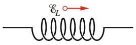

## 26.6 RL-Kreise

## Lernziele

Nach dem Durcharbeiten dieses Abschnitts sollten Sie in der Lage sein, . . .

• einen RL-Stromkreis zu skizzieren, in dem der Strom zunimmt,
• eine Differenzialgleichung für einen solchen RL-Kreis aufzustellen,
• die Funktion i(t) für einen RL-Stromkreis mit zunehmendem Strom anzugeben,
• für einen RL-Stromkreis mit zunehmendem Strom die Gleichungen für die Potenzialdifferenz $V _ { R }$ am Widerstand, die zeitliche Änderung $\mathrm { d } i / \mathrm { d } t$ der Stromstärke und die Spannung $V _ { L }$ an der Induktivität als Funktionen der Zeit anzugeben,
• die induktive Zeitkonstante $\tau _ { L }$ zu berechnen,
• einen RL-Stromkreis zu skizzieren, in welchem der Strom abnimmt,
• eine Differenzialgleichung für einen solchen RL-Kreis aufzustellen,
• die Funktion i(t) für einen RL-Stromkreis mit abnehmendem Strom anzugeben,
• für einen RL-Stromkreis mit abnehmendem Strom die Gleichungen für die Potenzialdifferenz $V _ { R }$ am Widerstand, die Änderung di∕dt der Stromstärke und die Spannung $V _ { L }$ an der Induktivität als Funktionen der Zeit anzugeben,
• Strom und Spannung an der Induktivität in einem RL-Kreis für den Moment, in dem der Strom sich zu ändern beginnt (Anfangszustand) sowie für einen Zeitpunkt im Gleichgewicht (Endzustand) anzugeben.

## Schlüsselideen

• Wird eine konstante Spannung an einen einfachen Stromkreis mit einem Widerstand R und einer Induktivität L angelegt, nähert sich der Strom gemäß

$$
i = \frac {\mathcal {E}}{R} \left(1 - \mathrm{e} ^ {- t / \tau_ {L}}\right) \quad \text {(zunehmender Strom)}
$$

seinem Gleichgewichtswert $\mathcal { E } / R .$ Dabei bestimmt die Größe $\tau _ { L } = L / R$ den Anstieg des Stroms, sie wird induktive Zeitkonstante des Stromkreises genannt.

629

---

26 Induktion und Induktivität

• Wird die Spannungsquelle entfernt, fällt der Strom von seinem Anfangswert $i _ { 0 }$ exponentiell auf null gemäß

$$
i = i _ {0} \mathrm{e} ^ {- t / \tau_ {L}} \qquad (\text {abnehmender Strom}).
$$

## 26.6.1 RL-Kreise

In Abschn. 23.4 hatten wir gesehen, dass die Ladung in einem Kondensator der $\mathrm { K a } .$ pazität C nicht plötzlich auf ihren Endwert C springt, wenn wir an einen Stromkreis mit dem Widerstand R die Spannung $\varepsilon$ anlegen, sondern dass sie sich diesem Wert gemäß

$$
q = C \mathcal {E} \left(1 - \mathrm{e} ^ {- t / \tau_ {C}}\right) \tag {26.33}
$$

exponentiell nähert. Die Geschwindigkeit, mit der sich die Ladung aufbaut, wird dabei durch die kapazitive Zeitkonstante $\tau _ { C }$ bestimmt, die wir in Gl. 23.29 als

$$
\tau_ {C} = R C \tag {26.34}
$$

definiert hatten.

Wenn wir die Spannung von einem solchen Stromkreis plötzlich abklemmen, geht die Ladung auf den Kondensatorplatten ebenfalls nicht plötzlich auf null zurück, sondern klingt exponentiell ab:

$$
q = q _ {0} \mathrm{e} ^ {- t / \tau_ {C}}. \tag {26.35}
$$

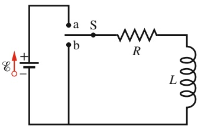

text_image

a S
b R L

Abb. 26.14

Ein RL-Kreis. Wenn der Schalter zu Punkt a umgelegt wird, steigt der Strom an und strebt seinem Grenzwert $\mathcal { E } / R$ zu.

Die kapazitive Zeitkonstante $\tau _ { C }$ gilt sowohl für den Aufbau als auch für den Abbau der Ladung.

Eine analoge Verzögerung des Anstiegs bzw. Abklingens des Stroms gilt auch für Stromkreise aus einem Widerstand R und einer Induktivität $L ,$ an die wir eine Spannung $\varepsilon$ anlegen. Wenn wir beispielsweise den Schalter in Abb. 26.14 zu Punkt a umlegen, dann beginnt sich ein Strom in dem Widerstand aufzubauen. Ohne die Induktivität würde er sehr schnell auf den Wert $\mathcal { E } / R$ ansteigen. Die Induktivität erzeugt jedoch durch Selbstinduktion eine Spannung $\mathcal { E } _ { L }$ in dem Stromkreis, die dem Anstieg des Stroms gemäß der Lenzschen Regel entgegenwirkt, d. h., sie ist der Batteriespannung $\varepsilon$ entgegen gerichtet. Der Strom folgt daher der Differenz zweier Spannungen – der konstanten Batteriespannung $\varepsilon$ und der variablen Selbstinduktionsspannung $\mathcal { E } _ { L } = - L   \mathrm { d } i / \mathrm { d } t .$ Solange $\mathcal { E } _ { L }$ vorhanden ist, wird der tatsächliche Strom unter dem Wert $\mathcal { E } / R$ liegen.

Nach einiger Zeit nimmt die Geschwindigkeit des Stromanstiegs ab und die Selbstinduktionsspannung $\mathcal { E } _ { L }$ , die proportional zu $\mathrm { d } i / \mathrm { d } t$ ist, wird kleiner. Die Stromstärke in dem Schaltkreis nähert sich deshalb asymptotisch ihrem Grenzwert $\mathcal { E } / R .$

Wir können dieses Verhalten wie folgt verallgemeinern:

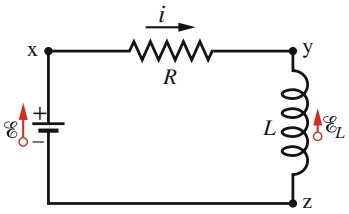

text_image

x
i
R
y
L
E_L
Z
+

Abb. 26.15

Der Schaltkreis aus Abb. 26.14 mit dem Schalter in Stellung a (geschlossen).

Eine Induktivität wirkt einer Änderung des sie durchfließenden Stroms zunächst entgegen. Im stationären Zustand (wenn keine Änderungen mehr eintreten) verhält sie sich wie eine gewöhnliche leitende Verbindung.

Nun wollen wir die Situation quantitativ analysieren. Wenn wir den Schalter in Abb. 26.14 zu Punkt a umlegen, erhalten wir den Stromkreis aus Abb. 26.15. Wir wenden die Kirchhoffsche Maschenregel an, wobei wir bei Punkt x beginnen und uns im Uhrzeigersinn um den Stromkreis mit dem Strom i vorarbeiten:

1. Widerstand. Da wir uns in Stromrichtung durch den Widerstand bewegen, nimmt das elektrische Potenzial um iR ab. Zwischen Punkt x und Punkt y ändert sich das Potenzial somit um −iR.

630

---

26.6 RL-Kreise

26

2. Induktivität. Da der Strom i sich ändert, entsteht in der Induktivität eine Selbstinduktionsspannung $\mathcal { E } _ { L } ,$ deren Betrag nach Gl. 26.32 gleich $L   \mathsf { d } i / \mathsf { d } t$ ist. Sie zeigt in Abb. 26.15 nach oben, da der Strom i nach unten durch die Induktivität fließt und zunimmt. Wenn wir uns von Punkt y nach Punkt z bewegen, entgegen der Richtung von $\mathcal { E } _ { L } ,$ ändert sich das Potenzial somit um $- L   \mathrm { d } i / \mathrm { d } t .$
3. Batterie. Wenn wir uns von Punkt z nach Punkt x bewegen, ändert sich das Potenzial aufgrund der Batteriespannung um +.

Die Maschenregel liefert demzufolge

$$
- i R - L \frac {\mathrm{d} i}{\mathrm{d} t} + \mathcal {E} = 0
$$

oder

$$
L \frac {\mathrm{d} i}{\mathrm{d} t} + R i = \mathcal {E}. \tag {26.36}
$$

Gleichung 26.36 ist eine Differenzialgleichung, in der sowohl die Variable i als auch ihre Zeitableitung $\mathrm { d } i / \mathrm { d } t$ auftreten. Um sie zu lösen, müssen wir eine Funktion i(t) suchen, die Gl. 26.36 und gleichzeitig die Anfangsbedingung $i ( 0 ) = 0$ erfüllt.

Sowohl Gl. 26.36 als auch die Anfangsbedingung entsprechen genau Gl. 23.25 für das RC-Glied, wenn wir $q$ durch i, R durch L und $1 / C$ durch R ersetzen. Die Lö- sung von Gl. 26.36 muss daher auch genau die Form der Gl. 23.26 mit eben diesen Ersetzungen haben; sie lautet demzufolge

$$
i = \frac {\mathcal {E}}{R} (1 - \mathrm{e} ^ {- R t / L}) \tag {26.37}
$$

oder

$$
i = \frac {\mathcal {E}}{R} \left(1 - \mathrm{e} ^ {- t / \tau_ {L}}\right) \tag {26.38}
$$

mit der induktiven Zeitkonstante

$$
\tau_ {L} = \frac {L}{R}. \tag {26.39}
$$

Wir wollen nun das Verhalten von Gl. 26.38 für zwei Zeitpunkte untersuchen, einmal für den Moment $t = 0 ,$ , in dem wir den Schalter schließen, und für einen Zeitpunkt lange danach $( t \to \infty )$ . Wenn wir $t = 0$ in Gl. 26.38 einsetzen, wird aus der Exponentialfunktion $\mathbf { e } ^ { - 0 } = 1$ . Wie zu erwarten ist der Strom nach Gl. 26.38 zu Beginn also null. Wenn wir nun t gegen unendlich gehen lassen, wird aus der Exponentialfunktion $\mathrm { e } ^ { - \infty } = 0 ;$ der Strom strebt also seinem Gleichgewichtswert $\mathcal { E } / R$ entgegen.

Zusätzlich können wir auch die Potenzialdifferenzen in dem Stromkreis analy sieren. Abbildung 26.16 zeigt, wie sich die Potenzialdifferenzen $V _ { R } ( = i R )$ über dem Widerstand und $V _ { L } \left( = L   \mathrm { d } i / \mathrm { d } t \right)$ über der Induktivität für bestimmte Werte von $\mathcal { E } ,$ L und R mit der Zeit verändern. Vergleichen Sie diese Abbildung sorgfältig mit der entsprechenden Abbildung für ein RC-Glied (Abb. 23.8).

Um zu zeigen, dass die Größe $\tau _ { L } \left( = L / R \right)$ die Dimension einer Zeit hat, rechnen wir Henry pro Ohm wie folgt um:

$$
1 \frac {\mathrm{H}}{\Omega} = 1 \frac {\mathrm{H}}{\Omega} \left(\frac {1 \mathrm{V} \cdot \mathrm{s}}{1 \mathrm{H} \cdot \mathrm{A}}\right) \left(\frac {1 \Omega \cdot \mathrm{A}}{1 \mathrm{V}}\right) = 1 \mathrm{s}.
$$

Der erste Klammerausdruck auf der rechten Seite ist dabei ein Umrechnungsfaktor aus Gl. 26.32, der zweite Klammerausdruck entstammt der Beziehung $V = i R$

Die physikalische Bedeutung der Zeitkonstante $\tau _ { L }$ folgt aus Gl. 26.38. Wenn wir hier $t = \tau _ { L }$ einsetzen, erhalten wir

$$
i = \frac {\mathcal {E}}{R} (1 - \mathrm{e} ^ {- 1}) = 0, 6 3 \frac {\mathcal {E}}{R}. \tag {26.40}
$$

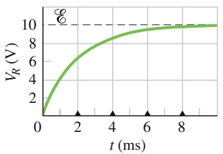

line

| t (ms) | V_R (V) |
| --- | --- |
| 0 | 0 |
| ~2 | ~6.5 |
| ~4 | ~8.5 |
| ~6 | ~9.5 |
| ~8 | ~9.8 |
| ~10 | 10 |

(a)

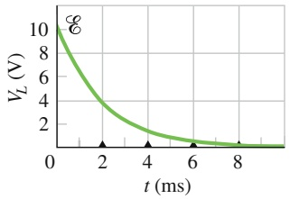

line

| t (ms) | VL (V) |
| --- | --- |
| 0 | 10 |
| 2 | ~4 |
| 4 | ~1.5 |
| 6 | ~0.8 |
| 8 | ~0.4 |

(b)

## Abb. 26.16

Die zeitliche Änderung (a) der Potenzialdifferenz $V _ { R }$ über dem Widerstand und (b) der Potenzialdifferenz $V _ { L }$ über der Induktivität in dem Stromkreis aus Abb. 26.15. Die kleinen Dreiecke entsprechen aufeinanderfolgenden Intervallen der Länge $\tau _ { L } = L / R$ . Die Abbildung ist für $R = 2 0 0 0   \Omega$ $L = 4 \mathrm { , } 0$ H und $\mathcal { E } \overset { \rightharpoonup } { = } 1 0   \mathrm { V }$ gezeichnet.

631

---

26 Induktion und Induktivität

Die Zeitkonstante $\tau _ { L }$ gibt also die Zeit an, in der der Strom in einem RL-Glied 63 % seines Endwerts $\mathcal { E } / R$ erreicht. Da die Potenzialdifferenz $V _ { R }$ über dem Widerstand proportional zum Strom i ist, sieht die Auftragung des ansteigenden Stroms gegen die Zeit genauso aus wie die von $V _ { R }$ in Abb. 26.16a.

Wenn der Schalter S in Abb. 26.14 lange genug auf Position a stand, damit sich der stationäre Zustand einstellen konnte, und er dann auf b umgelegt wird, wird die Batterie aus dem Stromkreis entfernt. (Genau genommen muss die Verbindung zu b einen Augenblick vor der Trennung des Kontakts zu a hergestellt werden. Ein Schalter, der so arbeitet, wird Wechselschalter ohne Unterbrechung oder Folge wechsler genannt, engl. Make-before-break-Schalter.)

Nachdem die Batterie aus dem Stromkreis entfernt wurde, nimmt der Strom ab. Er kann jedoch nicht plötzlich auf null zurückgehen, sondern muss wieder allmählich abklingen. Wir erhalten die Differenzialgleichung für das Abklingen, indem wir in Gl. 26.36 $\mathcal { E } = 0$ einsetzen:

$$
L \frac {\mathrm{d} i}{\mathrm{d} t} + i R = 0. \tag {26.41}
$$

Die Lösung dieser Differenzialgleichung, die auch die Anfangsbedingung $i ( 0 ) =$ $i _ { 0 }   =   \mathcal { E } / R$ erfüllt, erhalten wir durch Analogiebetrachtung aus den Gln. 23.31 und 23.32:

$$
i = \frac {\mathcal {E}}{R} \mathrm{e} ^ {- t / \tau_ {L}} = i _ {0} \mathrm{e} ^ {- t / \tau_ {L}}. \tag {26.42}
$$

Wir erkennen daraus, dass sowohl der Anstieg (Gl. 26.38) als auch das Abklingen (Gl. 26.42) des Stroms in einem RL-Glied durch dieselbe Zeitkonstante $\tau _ { L }$ beschrieben werden.

In Gl. 26.42 ist $i _ { 0 }$ der Strom zur Zeit $t = 0 .$ . In unserem Fall betrug dieser Strom zufällig gerade $\mathcal { E } / R _ { 1 }$ , wir können aber auch jeden anderen Anfangswert einsetzen.

## KONTROLLFRAGE 6

Die Abbildung zeigt drei Schaltkreise mit identischen Widerständen, Induktivitä ten und Batterien. Ordnen Sie die Schaltkreise in absteigender Reihenfolge nach dem Strom durch die Batterie (a) direkt nach dem Schließen des Schalters und (b) lange Zeit nach dem Schließen des Schalters.

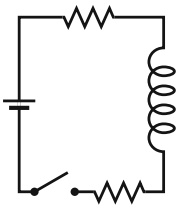

(1)

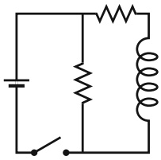

natural_image

Pure electrical circuit diagram with battery, switch, and coil (no text or symbols)

(2)

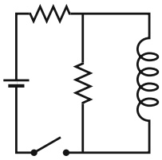

natural_image

Pure electrical circuit diagram with battery, switch, and coil (no text or symbols)

(3)

## 26.7 Energiespeicherung im Magnetfeld

## Lernziele

Nach dem Durcharbeiten dieses Abschnitts sollten Sie in der Lage sei $\mathbf { 1 } , \ldots$

• die Herleitung der Gleichung für die magnetische Feldenergie einer Induktivität in einem RL-Stromkreis mit konstanter Spannung zu beschreiben,
• die Beziehung zwischen der magnetischen Feldenergie $U ,$ der Induktivität L und der Stromstärke i einer Spule in einem RL-Kreis anzuwenden.

## Schlüsselideen

• Wenn ein Strom i durch eine Induktivität L fließt, speichert das magnetische Feld der Induktivität die Energie

$$
U _ {B} = \frac {1}{2} L i ^ {2} \qquad (\text {magnetische Energie}).
$$

632

---

26.7 Energiespeicherung im Magnetfeld

26

## 26.7.1 Energiespeicherung im Magnetfeld

Wenn wir zwei Teilchen mit entgegengesetzten Ladungen auseinanderziehen, sagen wir, dass die resultierende potenzielle Energie des Systems in dem elektrischen Feld der Teilchen gespeichert ist. Wir können sie aus dem Feld zurückerhalten, indem wir erlauben, dass sich Teilchen wieder aufeinander zu bewegen. Ganz entsprechend können wir auch in einem Magnetfeld Energie speichern.

Um einen Ausdruck für diese gespeicherte Energie zu finden, greifen wir nochmals auf Abb. 26.15 zurück, in der eine Spannungsquelle der Spannung  mit einem Widerstand R und einer Induktivität L verbunden ist. Der Bequemlichkeit halber wiederholen wir auch Gl. 26.36 noch einmal:

$$
\mathcal {E} = L \frac {\mathrm{d} i}{\mathrm{d} t} + i R. \tag {26.43}
$$

Diese Differenzialgleichung beschreibt den Anstieg des Stroms in dem Schaltkreis. Wir erinnern uns, dass Gl. 26.43 direkt aus der Kirchhoffschen Maschenregel folgt, die wiederum ein Ausdruck der Energieerhaltung in Stromkreisen ist. Nun multi-plizieren wir beide Seiten der Gleichung mit i und erhalten so

$$
\mathcal {E} i = L i \frac {\mathrm{d} i}{\mathrm{d} t} + i ^ {2} R, \tag {26.44}
$$

wofür wir die folgende energetische Interpretation geben können:

1. Wenn in Abb. 26.15 in der Zeit dt eine Ladung dq durch die Batterie mit der Spannung  hindurchtritt, verrichtet die Batterie an ihr die Arbeit ${ \mathcal { E } }   \mathrm { d } q .$ Die Leistung der Batterie in diesem Zeitintervall ist dann $\mathcal { E }   \mathrm { d } q / \mathrm { d } t$ oder i. Die linke Seite der Gl. 26.44 gibt folglich die Leistung an, die die Batterie an den Stromkreis abgibt.
2. Der zweite Term auf der rechten Seite von Gl. 26.44 ist dann die Leistung, mit der Energie in dem Widerstand R in Wärmeenergie umgewandelt wird.
3. Die Energie, die von der Batterie abgegeben, aber nicht in Wärmeenergie umgewandelt wird, muss aus Gründen der Energieerhaltung in dem Magnetfeld der Induktivität gespeichert werden. Da Gl. 26.44 die Energieerhaltung in einem RL-Glied formuliert, muss der erste Term auf der rechten Seite die Leistung $\mathsf { d } U _ { B } / \mathsf { d } t$ beschreiben, mit der Energie im Magnetfeld gespeichert wird.

Folglich ist

$$
\frac {\mathrm{d} U _ {B}}{\mathrm{d} t} = L i \frac {\mathrm{d} i}{\mathrm{d} t} \tag {26.45}
$$

oder

$$
\mathrm{d} U _ {B} = L i \mathrm{d} i.
$$

Durch Integration erhalten wir daraus

$$
\int_ {0} ^ {U _ {B}} \mathrm{d} U _ {B} = \int_ {0} ^ {i} L i \mathrm{d} i
$$

oder

$$
U _ {B} = \frac {1}{2} L i ^ {2}. \tag {26.46}
$$

Gleichung 26.46 gibt die Gesamtenergie an, die in einer Induktivität L gespeichert ist, die von einem Strom i durchflossen wird. Die Gleichung ähnelt sehr der analogen Beziehung für die in einem Kondensator mit der Kapazität C und der Ladung q gespeicherten Energie:

$$
U _ {E} = \frac {q ^ {2}}{2 C}. \tag {26.47}
$$

Der Variable $i ^ { 2 }$ entspricht hier $q ^ { 2 }$ und die Konstante L ist durch $1 / C$ ersetzt.

633

---

26 Induktion und Induktivität

## 26.8 Die Energiedichte eines Magnetfelds

## Lernziele

Nach dem Durcharbeiten dieses Abschnitts sollten Sie in der Lage sein, . . .

• zu verstehen, dass mit jedem Magnetfeld eine zugehörige Energie verknüpft ist,
• die Beziehung zwischen der Energiedichte $u _ { B }$ eines Magnetfelds und seiner Feldstärke B anzuwenden.

## Schlüsselideen

Wenn B der Betrag des Magnetfelds an einem beliebigen Punkt (in einer Induk tivität oder wo auch immer) ist, beträgt die Dichte der in diesem Feld gespeicherten magnetischen Energie an diesem Punkt

$$
u _ {B} = \frac {B ^ {2}}{2 \mu_ {0}} \quad (\text {magnetische Energiedichte}).
$$

## 26.8.1 Die Energiedichte eines Magnetfelds

Wir betrachten einen Abschnitt der Länge l aus der Mitte einer langen Zylinder spule mit dem Querschnitt A, durch die ein Strom i fließt; das Volumen dieses Abschnitts ist Al. Die in ihm gespeicherte Energie $U _ { B }$ muss vollständig innerhalb des Volumens Al untergebracht sein, da das magnetische Feld außerhalb einer Zylinderspule in guter Näherung null ist. Weil das Magnetfeld im Inneren der Zylinder spule annähernd homogen ist, muss auch die Energie homogen über das Volumen verteilt sein. Folglich ist die pro Volumeneinheit gespeicherte Feldenergie

$$
u _ {B} = \frac {U _ {B}}{A l}
$$

oder mit $U _ { B } = L i ^ { 2 } / 2$

$$
u _ {B} = \frac {L i ^ {2}}{2 A l} = \frac {L}{l} \frac {i ^ {2}}{2 A}.
$$

L bezeichnet dabei die Induktivität eines Abschnitts der Länge l der Zylinderspule. Wenn wir $L / l$ aus Gl. 26.28 einsetzen, erhalten wir

$$
u _ {B} = \frac {1}{2} \mu_ {0} n ^ {2} i ^ {2}, \tag {26.48}
$$

wobei n die Zahl der Windungen der Zylinderspule pro Längeneinheit ist. Mithilfe von Gl. 25.25 $( B = \mu _ { 0 } i n )$ erhalten wir für die Energiedichte des Magnetfelds

$$
u _ {B} = \frac {B ^ {2}}{2 \mu_ {0}} \quad (\text {magnetische Energiedichte}). \tag {26.49}
$$

Die Gleichung gibt die Dichte der gespeicherten Energie an einem Punkt mit der Feldstärke B an. Obwohl wir sie für den Spezialfall einer Zylinderspule hergeleitet haben, gilt sie für alle Magnetfelder, egal wodurch sie hervorgerufen werden. Die Gleichung ähnelt Gl. 21.23,

$$
u _ {E} = \frac {1}{2} \varepsilon_ {0} E ^ {2}, \tag {26.50}
$$

die die Energiedichte eines elektrischen Felds angibt. Sowohl $u _ { B }$ als auch $u _ { E }$ sind proportional zum Quadrat der Feldstärke des jeweiligen Felds.

634

---

26.9 Gegeninduktion

26

## KONTROLLFRAGE 7

Die Tabelle gibt die Zahl der Windungen pro Längeneinheit, den Strom und die Querschnittsfläche für drei Zylinderspulen an. Ordnen Sie die Zylinderspulen in absteigender Reihenfolge nach der Energiedichte des magnetischen Felds in ihrem Inneren.

| Zylinderspule | Windungen pro Längeneinheit | Strom | Querschnitt |
| --- | --- | --- | --- |
| a | $2n_{1}$ | $i_{1}$ | $2A_{1}$ |
| b | $n_{1}$ | $2i_{1}$ | $A_{1}$ |
| c | $n_{1}$ | $i_{1}$ | $6A_{1}$ |

## 26.9 Gegeninduktion

## Lernziele

Nach dem Durcharbeiten dieses Abschnitts sollten Sie in der Lage sein, . . .

• die Gegeninduktion zwischen zwei Spulen zu beschreiben und die zugehörige Anordnung zu skizzieren,
• die Gegeninduktivität einer Spule in Bezug auf eine zweite Spule (oder einen anderen veränderlichen Strom) zu berechnen,
• die von einer Spule in einer anderen Spule induzierte Spannung als Funktion der Gegeninduktivität und der zeitlichen Änderung des Stroms in der ersten Spule zu berechnen.

## Schlüsselideen

• Wenn zwei Spulen 1 und 2 einander nahe sind, kann ein veränderlicher Strom in einer der Spulen eine Spannung in der anderen induzieren. Diese sogenannte Gegeninduktion wird durch die Gleichungen

$$
\mathcal {E} _ {2} = - M \frac {\mathrm{d} i _ {1}}{\mathrm{d} t} \quad \text {und} \quad \mathcal {E} _ {1} = - M \frac {\mathrm{d} i _ {2}}{\mathrm{d} t}
$$

beschrieben. Dabei ist M die (in Henry gemessene) Gegeninduktivität.

## 26.9.1 Gegeninduktion

In dem folgenden Abschnitt wollen wir noch einmal auf den Fall zweier wechselwirkender Spulen zurückkommen, den wir bereits in Abschn. 22.1 kurz gestreift hatten. Wir wollen uns nun an eine formalere und quantitative Beschreibung dieser Situation wagen. Wir hatten bereits gesehen, dass wenn die beiden Spulen einander nahe genug sind (wie in Abb. 22.2), ein Strom in der einen Spule einen magnetischen Fluss durch die andere Spule zur Folge hat. Wenn sich der Strom i zeitlich ändert, ändert sich auch der magnetische Fluss durch die zweite Spule und in ihr wird nach dem Faradayschen Gesetz eine Spannung  induziert; diesen Prozess hatten wir als Induktion bezeichnet. Noch besser hätten wir gleich von **Gegeninduktion** gesprochen, um die gegenseitige Wechselwirkung der beiden Spulen zu verdeutlichen und um das Phänomen von der Selbstinduktion abzugrenzen, an der nur eine Spule beteiligt ist.

Nun wollen wir die Gegeninduktion quantitativer betrachten. Abbildung 26.17a zeigt zwei benachbarte runde, dicht gepackte Spulen, die konzentrisch zueinander ausgerichtet sind. In Spule 1 fließt ein konstanter Strom $i _ { 1 } ,$ , der von der Batterie in Stromkreis 1 erzeugt wird. Dieser Strom erzeugt ein Magnetfeld $\vec { B } _ { 1 } ,$ dessen Feldlinien in der Abbildung eingezeichnet sind. Spule 2 ist mit einem empfindlichen Messgerät verbunden, aber nicht mit einer Batterie. Ein magnetischer Fluss $\Phi _ { 2 1 }$ (der Fluss durch Spule 2 aufgrund des Stroms in Spule 1) durchströmt die $N _ { 2 }$ Windungen von Spule 2.

635

---

26 Induktion und Induktivität

Abb. 26.17

Das Prinzip der Gegeninduktion. (a) Wenn der Strom in Spule 1 sich ändert, wird eine Spannung in Spule 2 induziert. (b) Wenn der Strom in Spule 2 sich ändert, wird eine Spannung in Spule 1 induziert.

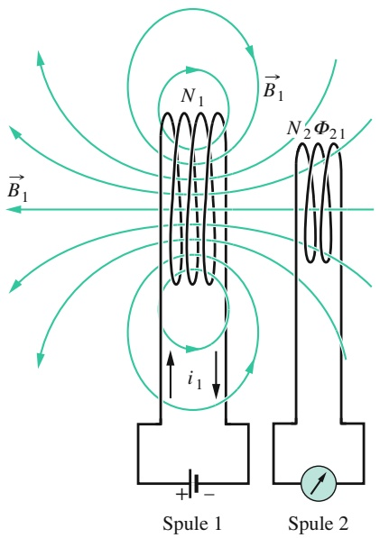

text_image

B₁
N₁
i₁
Spule 1
N₂ Φ₂₁
Spule 2

(a)

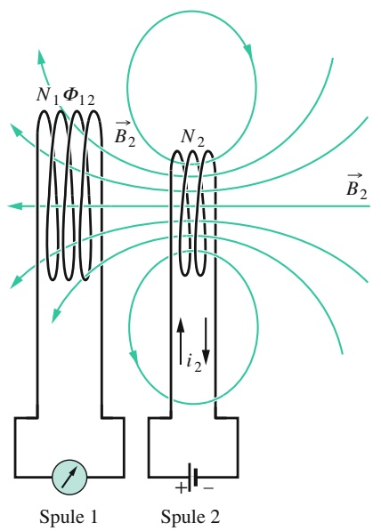

text_image

N₁ Φ₁₂
B₂
N₂
i₂
Spule 1 Spule 2
B₂

(b)

Wir definieren die Gegeninduktivität $M _ { 2 1 }$ von Spule 2 bezüglich Spule 1 als

$$
M _ {2 1} = \frac {N _ {2} \varPhi_ {2 1}}{i _ {1}}. \tag {26.51}
$$

Diese Beziehung hat die gleiche Form wie die Definition der Selbstinduktivität aus Gl. 26.25 $\left( L = N \varPhi / i \right)$ . Wir schreiben sie nun in der Form

$$
M _ {2 1} i _ {1} = N _ {2} \varPhi_ {2 1}.
$$

Wenn wir durch irgendwelche Maßnahmen dafür sorgen, dass der Strom $i _ { 1 }$ zeitlich variiert, erhalten wir

$$
M _ {2 1} \frac {\mathrm{d} i _ {1}}{\mathrm{d} t} = N _ {2} \frac {\mathrm{d} \varPhi_ {2 1}}{\mathrm{d} t}.
$$

Die rechte Seite dieser Gleichung beschreibt nach dem Faradayschen Gesetz genau die Spannung $\mathcal { E } _ { 2 } ,$ die aufgrund des sich ändernden Stroms durch Spule 1 in Spule 2 induziert wird. Wir führen noch ein Minuszeichen ein, um die Richtung zu symbolisieren und bekommen so

$$
\mathcal {E} _ {2} = - M _ {2 1} \frac {\mathrm{d} i _ {1}}{\mathrm{d} t}. \tag {26.52}
$$

Wieder entspricht die Gleichung genau Gl. 26.32 für die Selbstinduktion $( \mathcal { E } _ { L } =$ $- L   \mathrm { d } i / \mathrm { d } t )$

Jetzt vertauschen wir wie in Abb. 26.17b die Rollen von Spule 1 und Spule 2, d. h., wir erzeugen mithilfe einer Batterie einen Strom $i _ { 2 }$ in Spule 2, der einen magnetischen Fluss $\Phi _ { 1 2 }$ durch Spule 1 bewirkt. Wenn wir wieder den Strom zeitlich variieren lassen, so gilt analog zur obigen Situation

$$
\mathcal {E} _ {1} = - M _ {1 2} \frac {\mathrm{d} i _ {2}}{\mathrm{d} t}. \tag {26.53}
$$

Allgemein ist also die in der einen Spule induzierte Spannung proportional zur zeitlichen Änderung des Stroms in der anderen. Die Proportionalitätskonstanten $M _ { 1 2 }$ und $M _ { 2 1 }$ scheinen zunächst verschieden zu sein; wir stellen nun aber ohne Beweis fest, dass sie in Wirklichkeit identisch sind, sodass wir keine Indizes benötigen (diese Tatsache ist alles andere als offensichtlich). Es gilt also

$$
M _ {1 2} = M _ {2 1} = M \tag {26.54}
$$

636

---

26.10 Zusammenfassung

26

und wir können daher die Gln. 26.52 und 26.53 als

$$
\mathcal {E} _ {2} = - M \frac {\mathrm{d} i _ {1}}{\mathrm{d} t} \tag {26.55}
$$

bzw.

$$
\mathcal {E} _ {1} = - M \frac {\mathrm{d} i _ {2}}{\mathrm{d} t} \tag {26.56}
$$

schreiben. Die Induktion erfolgt tatsächlich gegenseitig. Die SI-Einheit für M ist das Henry (genau wie für L).

## 26.10 Zusammenfassung

**Magnetischer Fluss** Der magnetische Fluss $\Phi _ { B }$ durch eine Fläche A in einem Magnetfeld B⃗ ist

$$
\varPhi_ {B} = \int \vec {B} \cdot \mathrm{d} \vec {A}, \tag {26.3}
$$

wobei über die Fläche integriert wird. Die SI-Einheit des magnetischen Flusses ist das Weber mit 1 $\mathrm { W b } = 1   \mathrm { T } \cdot \mathrm { m } ^ { 2 }$ Wenn $\vec { B }$ senkrecht auf der Fläche A steht und in ihrem Bereich homogen ist, dann vereinfacht sich Gl. 26.3 zu:

$$
\Phi_ {B} = B A. \tag {26.4}
$$

**Faradaysches Induktionsgesetz** Wenn sich der magnetische Fluss durch eine von einer geschlossenen Leiterschleife umschlossene Fläche zeitlich ändert, werden eine Spannung und ein Strom in der Leiterschleife erzeugt; diesen Prozess nennen wir Induktion. Die induzierte Spannung beträgt

$$
\mathcal {E} = - \frac {\mathrm{d} \varPhi_ {B}}{\mathrm{d} t}. \tag {26.6}
$$

Wenn wir die Leiterschleife durch eine dicht gepackte Spule mit N Windungen ersetzen, ist die induzierte Spannung

$$
\mathcal {E} = - N \frac {\mathrm{d} \varPhi_ {B}}{\mathrm{d} t}. \tag {26.7}
$$

**Lenzsche Regel** Ein induzierter Strom ist so gerichtet, dass sein Magnetfeld die Änderung des äußeren Magnetfelds zu kompensieren versucht, die ihn induziert. Die induzierte Spannung hat dieselbe Richtung wie der induzierte Strom.

**Spannung und induziertes elektrisches Feld** Ein veränderlicher magnetischer Fluss induziert eine Spannung, auch wenn die Schleife, die den sich ändernden Fluss umschließt, keine reale Leiterschleife ist, sondern nur eine gedachte Linie. Das veränderliche Magnetfeld induziert ein elektrisches Feld $\vec { E }$ an jedem Punkt einer solchen Schleife; die induzierte Spannung in der Schleife hängt gemäß

$$
\mathcal {E} = \oint \vec {E} \cdot \mathrm{d} \vec {s} \tag {26.21}
$$

mit diesem induzierten elektrischen Feld zusammen, wobei die Integration entlang der (gedachten oder realen) Schleife erfolgt. Mithilfe dieser Gleichung erhalten wir die allgemeinste Formulierung des Faradayschen Gesetzes:

$$
\oint \vec {E} \cdot \mathrm{d} \vec {s} = - \frac {\mathrm{d} \varPhi_ {B}}{\mathrm{d} t}. \tag {26.22}
$$

In Worten bedeutet das: Ein veränderliches Magnetfeld induziert ein elektrisches Feld.

**Induktivität** Als Induktivität bezeichnen wir einerseits eine Spule oder ein anderes Bauelement, mit dem wir in einem bestimmten Bereich ein definiertes Magnetfeld erzeugen können. Als Induktivität eines solchen Bauelements bezeichnen wir aber auch die physikalische Größe

$$
L = \frac {N \Phi_ {B}}{i}, \tag {26.25}
$$

wobei N die Windungszahl ist, $\Phi _ { B }$ der erzeugte magnetische Fluss und i der Strom. Die SI-Einheit der Induktivität ist das Henry:

$$
1 \mathrm{Henry} = 1 \mathrm{H} = 1 \mathrm{T} \cdot \mathrm{m} ^ {2} / \mathrm{A}. \tag {26.26}
$$

Die Induktivität pro Längeneinheit eines Abschnitts der Länge l aus der Mitte einer langen Zylinderspule mit n Windungen pro Längeneinheit ist

$$
\frac {L}{l} = \mu_ {0} n ^ {2} A. \tag {26.28}
$$

**Selbstinduktion** Wenn sich der Strom i in einer Spule ändert, wird in dieser eine Spannung

$$
\mathcal {E} _ {L} = - L \frac {\mathrm{d} i}{\mathrm{d} t} \tag {26.32}
$$

induziert. Die Richtung von $\mathcal { E } _ { L }$ ergibt sich aus der Lenzschen Regel: Die Spannung durch Selbstinduktion wirkt der Änderung entgegen, durch die sie induziert wird.

**RL-Glieder** Wenn an einen einfachen Stromkreis aus einem Widerstand R und einer Induktivität L eine konstante

637

---

26 Induktion und Induktivität

Spannung  angelegt wird, nähert sich der Strom exponentiell seinem Gleichgewichtswert $\mathcal { E } / R ;$

$$
i = \frac {\mathcal {E}}{R} \left(1 - \mathrm{e} ^ {- t / \tau_ {L}}\right). \tag {26.38}
$$

Hierbei ist $\tau _ { L } = L / R$ die **induktive Zeitkonstante**, die den Anstieg und das Abklingen des Stroms bestimmt – wenn die Spannungsquelle entfernt wird, klingt der Strom exponentiell von seinem Wert $i _ { 0 }$ auf null ab:

$$
i = i _ {0} \mathrm{e} ^ {- t / \tau_ {L}}. \tag {26.42}
$$

**Energie des Magnetfelds** Wenn eine Induktivität L von einem Strom i durchflossen wird, dann wird in dem erzeugten Magnetfeld die Energie

$$
U _ {B} = \frac {1}{2} L i ^ {2} \tag {26.46}
$$

## 26.11 Fragen

**1.** Abbildung 26.F1 zeigt einen langen, geraden Draht, der einen Strom führt und durch drei rechteckige Leiterschleifen mit den Kantenlängen L, 1,5L und 2L verläuft (ohne diese zu berühren). Die Schleifen sind so weit voneinander entfernt, dass sie sich nicht gegenseitig beeinflussen. Die Schleifen 1 und 3 liegen symmetrisch bezüglich des Drahts. Ordnen Sie die drei Schleifen in absteigender Reihenfolge nach dem in ihnen induzierten Strom, wenn der Strom i (a) konstant ist oder (b) zunimmt.

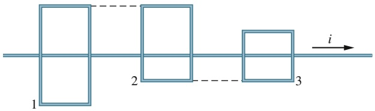

text_image

1
2
3
i

Abb. 26.F1

**2.** Der runde Draht in Abb. 26.F2 befindet sich in einem homogenen Magnetfeld. Wenn er sich aufgrund von Erwärmung ausdehnt, wird um ihn ein Strom im Uhrzeigersinn induziert. Zeigt das Magnetfeld in die Papierebene oder aus ihr heraus?

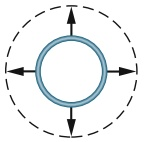

Abb. 26.F2

**3.** Abbildung 26.F3 zeigt zwei Stromkreise, in denen ein leitfähiger Stab mit derselben Geschwindigkeit v über eine U-förmige Drahtschleife durch ein homogenes Magnetfeld gezogen wird. Die parallelen Drahtabschnitte haben in Kreis 1 einen Abstand 2L voneinander, in Kreis 2 nur den Abstand L. In Kreis 1 wird ein Strom gegen den Uhrzeigersinn induziert. (a) Zeigt das Magnetfeld in die Papierebene hinein oder aus ihr heraus? (b) Fließt der induzierte gespeichert. Wenn die magnetische Feldstärke an einem beliebigen Punkt im Raum B beträgt, ist die Energiedichte des Magnetfelds an diesem Punkt

$$
u _ {B} = \frac {B ^ {2}}{2 \mu_ {0}}. \tag {26.49}
$$

**Gegeninduktion** Wenn zwei Spulen (mit 1 und 2 bezeichnet) benachbart sind, kann ein veränderlicher Strom in der einen eine Spannung in der anderen induzieren. Diese wechselseitige Induktion wird durch zwei symmetrische Gleichungen

$$
\mathcal {E} _ {2} = - M \frac {\mathrm{d} i _ {1}}{\mathrm{d} t} \quad \text {und} \quad \mathcal {E} _ {1} = - M \frac {\mathrm{d} i _ {2}}{\mathrm{d} t}, \quad (2 6. 5 5, 2 6. 5 6)
$$

beschrieben, wobei M (mit der Einheit Henry) die Gegeninduktivität der Anordnung ist.

Strom in Kreis 2 im Uhrzeiger- oder im Gegenuhrzeigersinn? (c) In welchem der beiden Kreise wird die größere Spannung induziert?

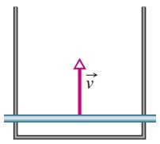

(1)

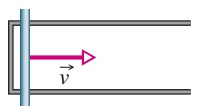

(2)

Abb. 26.F3

**4.** Abbildung 26.F4 zeigt zwei Spulen, die um nichtleitende Stäbe gewickelt sind. Spule X ist mit einer Batterie und einem variablen Widerstand verbunden. In welcher Richtung fließt der induzierte Strom durch das mit Spule Y verbundene Amperemeter, wenn (a) Spule Y auf Spule X zubewegt wird oder (b) der Strom durch Spule X verringert wird, ohne die Position der Spulen zueinander zu verändern?

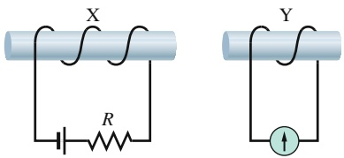

Abb. 26.F4

**5.** Abbildung 26.F5a zeigt einen kreisförmigen Bereich, in dem ein stärker werdendes homogenes Magnetfeld aus der Papierebene herauszeigt, sowie einen kreisförmigen Integrationsweg, über den das Integral $\oint \vec { E }$ ⋅ d⃗s zu berechnen ist. Die Tabelle gibt die anfängliche Feldstärke des Magnetfelds, die Zunahme des Magnetfelds und das Zeitintervall für diese Zunahme für drei Fälle an. Ordnen Sie die drei Fälle in absteigender Reihenfolge nach der Feldstärke des induzierten elektrischen Felds entlang des Integrationswegs.

638

---

26.11 Fragen

26

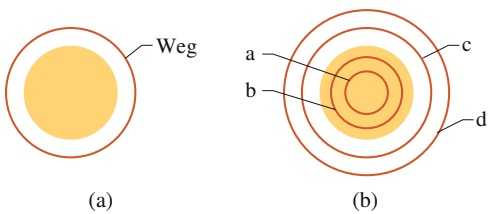

Abb. 26.F5

Fragen 5 und 6.

| Fall | anf. Feldstärke | Zunahme | Zeitintervall |
| --- | --- | --- | --- |
| a | $B_{1}$ | $\Delta B_{1}$ | $\Delta t_{1}$ |
| b | $2B_{1}$ | $\Delta B_{1}/2$ | $\Delta t_{1}$ |
| c | $B_{1}/4$ | $\Delta B_{1}$ | $\Delta t_{1}/2$ |

**6.** Abbildung 26.F5b zeigt einen kreisförmigen Bereich, in dem ein abnehmendes homogenes Magnetfeld aus der Papierebene herauszeigt, sowie vier konzentrische kreisförmige Integrationswege. Ordnen Sie die Wege in absteigender Reihenfolge nach dem Wert des Integrals $\oint { \vec { E } } \cdot \mathbf { d } { \vec { s } } .$
**7.** Abbildung 26.F7 zeigt die zeitliche Veränderung der Potenzialdifferenz $V _ { R }$ über einem Widerstand in den drei RL-Schaltkreisen wie in Abb. 26.15. Die Schaltkreise enthalten denselben Widerstand R und dieselbe Spannung $\mathcal { E } ,$ unterscheiden sich aber in der Induktivität L. Ordnen Sie die Schaltkreise in absteigender Reihenfolge nach der jeweiligen Induktivität L.

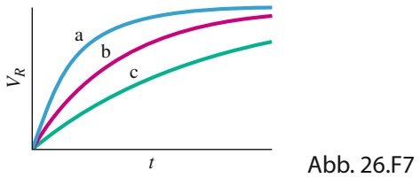

line

| t | VR (a) | VR (b) | VR (c) |
| --- | --- | --- | --- |
| 0 | 0 | 0 | 0 |
| ~1 | ~0.85 | ~0.65 | ~0.45 |
| ~2 | ~0.95 | ~0.85 | ~0.65 |
| ~3 | ~0.98 | ~0.92 | ~0.75 |
| ~4 | ~0.99 | ~0.96 | ~0.82 |
| ~5 | ~1.00 | ~0.98 | ~0.88 |

**8.** Abbildung 26.F8 zeigt drei Schaltkreise mit identischen Batterien, Widerständen und Induktivitäten. Ordnen Sie die Schaltkreise in absteigender Reihenfolge nach der Zeit, die der Strom benötigt, um nach dem Schließen des Schalters 50 % seines Gleichgewichtswerts zu erreichen.

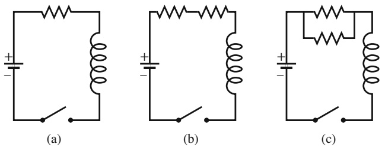

Abb. 26.F8

**9.** Abbildung 26.F9 zeigt einen Schaltkreis mit zwei identischen Widerständen und einer idealen Induktivität. Ist der Strom durch den mittleren Widerstand zu den folgenden Zeiten größer als, gleich groß wie, oder kleiner als derjenige durch den anderen Widerstand: (a) unmittelbar nach dem Schließen von ${ \sf S } ,$ (b) lange nach dem Schließen von ${ \sf S } ,$ (c) unmittelbar nachdem S lange Zeit später wieder geöffnet wurde, (d) lange nachdem $\mathsf { S }$ wieder geöffnet wurde?

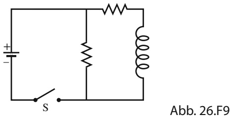

text_image

+
-
S
Abb. 26.F9

**10.** Der Schalter in dem Stromkreis aus Abb. 26.14 war sehr lange in Richtung von Punkt a geschlossen und wird dann zu Punkt b umgelegt. Abbildung 26.F10 zeigt den Verlauf des Stroms durch die Induktivität für vier Wertepaare des Widerstands R und der Induktivität L: (1) $R _ { 0 }$ und $L _ { 0 } ,$ (2) $2 R _ { 0 }$ und $L _ { 0 } ,$ (3) $R _ { 0 }$ und $2 L _ { 0 } ,$ (4) $2 R _ { 0 }$ und $2 L _ { 0 ^ { \circ } }$ Welches Wertepaar gehört zu welcher Kurve?

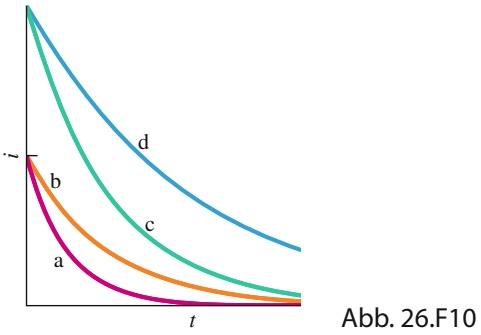

line

| Curve | Trend |
| --- | --- |
| a (Purple) | Decaying curve |
| b (Orange) | Decaying curve |
| c (Green) | Decaying curve |
| d (Blue) | Decaying curve |

**11.** Die Leiterschleife in Abb. 26.F11a wird der Reihe nach sechs homogenen magnetischen Feldern ausgesetzt, die alle parallel zur z-Achse gerichtet sind, die ihrerseits aus der Papierebene herauszeigen soll. Abbildung 26.F11b zeigt den zeitlichen Verlauf der jeweiligen z-Komponente $B _ { z } ( t )$ der Felder. (Die Graphen 1 und 3 verlaufen parallel zueinander, ebenso 4 und 6. Die Graphen 2 und 5 sind horizontal.) Ordnen Sie die sechs Graphen nach der jeweils in der Schleife induzierten Spannung – die im Uhrzeigersinn größte Spannung zuerst, die gegen den Uhrzeigersinn größte Spannung zuletzt.

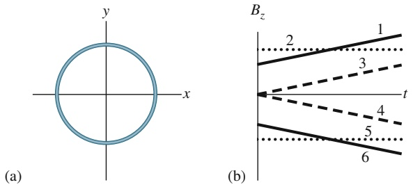

Abb. 26.F11

**12.** In Abb. 26.F12 wurde eine Drahtschleife so gebogen, dass sie aus drei Segmenten besteht: Segment bc (ein Viertelkreis), ac (ein rechter Winkel) und ab (eine gerade Strecke). Gegeben seien die drei folgenden durch die Schleife hindurchtretenden Magnetfelder:

(1) $\vec { B } _ { 1 } = 3 \vec { e } _ { x } + 7 \vec { e } _ { y } - 5 t \vec { e } _ { z }$
(2) $\vec { B } _ { 2 } = 5 t \vec { e } _ { x } - 4 \vec { e } _ { y } - 1 5 \vec { e } _ { z }$
(3) $\vec { B } _ { 3 } = 2 \vec { e } _ { x } - 5 t \vec { e } _ { y } - 1 2 \vec { e } _ { z }$

639

---

26 Induktion und Induktivität

(B in Millitesla, t in Sekunden). Ordnen Sie die Magnetfelder ohne schriftliche Rechnung in absteigender Reihenfolge (a) nach der pro Ladungseinheit durch Induktion verrichteten Arbeit und (b) nach der induzierten Stromstärke. (c) In welche Richtung zeigt jeweils der induzierte Strom in der Abbildung?

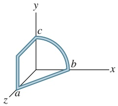

text_image

y
c
b
x
a
z

Abb. 26.F12

**13.** Abbildung 26.F13 zeigt drei Situationen, in denen eine Drahtschleife teilweise in einem magnetischen Feld liegt. Der Betrag des Felds nimmt wie angegeben entweder ab oder zu. Die Schleife enthält in allen Fällen eine Batterie. In welcher oder welchen der Situationen zeigen die induzierte Spannung und die Batteriespannung in dieselbe Richtung?

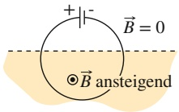

(a)

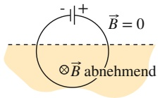

(b)

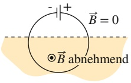

(c)

Abb. 26.F13

**14.** Abbildung 26.F14 zeigt vier Situationen, in denen eine rechteckige Leiterschleife mit der gleichen Geschwindigkeit aus demselben (in die Papierebene hinein gerichteten) Magnetfeld herausgezogen wird. Die Schleifen haben Kantenlängen von entweder L oder 2L. Ordnen Sie die vier Fälle in absteigender Reihenfolge (a) nach dem Betrag der zum Herausziehen erforderlichen Kraft und (b) nach der Energiedissipationsrate (elektrische in thermische Energie).

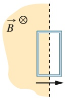

(1 )

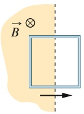

(2)

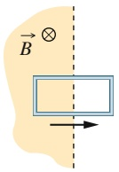

(3)

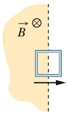

(4)

Abb. 26.F14

640
