# 27 Elektromagnetische Schwingkreise und Wechselstrom

原始 PDF 第 655–684 页。

# 27 Elektromagnetische Schwingkreise und Wechselstrom

## 27.1 LC-Schwingungen

## Physikalische Motivation

In diesem Kapitel werden wir das zeitliche Verhalten der elektrischen Ladung q in einem Stromkreis aus einer Spule mit der Induktivität L, einem Kondensator mit der Kapazität C und einem Ohmschen Widerstand R untersuchen. (Da wir neben dem Ohmschen Widerstand noch induktive und kapazitive Widerstände einführen werden, bezeichnen wir den Ohmschen Widerstand häufig auch als Wirkwiderstand, weil an diesem Widerstand die „wirkende“ Leistung verbraucht wird.) Im Grunde genommen untersuchen wir, wie die Energie in diesem System zwischen dem Magnetfeld der Spule und dem elektrischen Feld des Kondensators hin- und herfließt, während sie im Wirkwiderstand nach und nach in Wärmeenergie umgewandelt wird.

Schwingungen hatten wir schon in einem anderen Zusammenhang untersucht. In Kapitel 11 hatten wir die Auslenkung x eines mechanischen Oszillators aus einer Masse m, einer Feder mit einer Federkonstante k und einem viskosen bzw. reibenden Element wie Öl untersucht. In diesem Fall hatten wir beobachtet, wie die Energie zwischen der kinetischen Energie der Masse und der potenziellen Energie der Feder hin- und herfloss und durch die Reibung langsam in Wärmeenergie umgesetzt wurde.

Die Analogie zwischen diesen beiden idealisierten Systemen gilt exakt und die zugrunde liegenden Differenzialgleichungen sind identisch. Wir werden also keine neue Mathematik erlernen müssen, sondern können einfach die Symbole ändern und uns ansonsten ganz auf die Physik dieser Systeme konzentrieren.

## 27.1.1 LC-Schwingungen: Eine qualitative Betrachtung

Von den drei Elementen in einem Stromkreis – dem Wirkwiderstand R, der Kapazität C und der Induktivität L – haben wir bisher die in Reihe geschalteten Kombinationen RC (Abschn. 23.4) und RL (Abschn. 26.6) behandelt. Für beide Strom kreise gilt, dass die Ladung, der Strom und die Spannung nach Exponentialgesetzen zu- bzw. abnehmen. Die Zeitskalen für diese Zu- bzw. Abnahme waren durch die kapazitive bzw. induktive Zeitkonstante τ gegeben.

Nun betrachten wir die dritte mögliche Kombination zweier Elemente in einem Stromkreis: den LC-Kreis. Wir werden sehen, dass die Ladung, der Strom und die Spannung in diesem Fall nicht exponentiell von der Zeit abhängen, sondern sinusförmig (mit einer Periode T und einer Kreis- bzw. Winkelfrequenz ω). Die Schwingungen des elektrischen Felds im Kondensator und des magnetischen Felds in der Spule bezeichnet man als **elektromagnetische Schwingungen**; den Stromkreis nennt man oszillierend oder schwingend.

Die Teilbilder (a) bis (h) in Abb. 27.1 zeigen aufeinanderfolgende Zustände der Schwingungen in einem einfachen LC-Kreis. Nach Gl. 21.21 ist die Energie des

Halliday Physik für natur- und ingenieurwiss. Studiengänge, 3. Auflage. D. Halliday, R. Resnick und J. Walker. © 2020 WILEY-VCH Verlag GmbH & Co. KGaA. Published 2020 by WILEY-VCH Verlag GmbH & Co. KGaA.

641

---

27 Elektromagnetische Schwingkreise und Wechselstrom

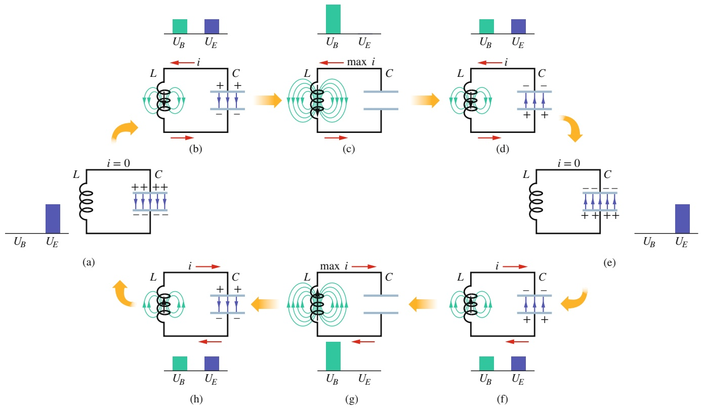

flowchart

This diagram illustrates a multi-stage system process involving inductors, coils, and voltage sources (UB, UE) with current flow indicators (i, max i), showing how different input conditions affect the output.

Abb. 27.1

Acht Zustände im Verlauf einer Schwingung in einem widerstandsfreien LC-Kreis. Die Balkendiagramme zu jeder Abbildung deuten die zum jeweiligen Zeitpunkt in den Feldern gespeicherte elektrische und magnetische Energie an. Die magnetischen Feldlinien der Spule und die elektrischen Feldlinien des Kondensators sind ebenfalls dargestellt. (a) Auf dem Kondensator befindet sich die maximale Ladung, es fließt kein Strom. (b) Der Kondensator wird entladen, der Strom nimmt zu. (c) Der Kondensator ist vollkommen entladen, der Strom ist maximal. (d) Der Kondensator wird wieder geladen, allerdings im Vergleich zu (a) mit entgegengesetzter Polarisation, der Strom nimmt ab. (e) Auf dem Kondensator befindet sich wieder eine maximale Ladung, jedoch mit umgekehrter Polarisation im Vergleich zu (a), es fließt kein Strom. (f ) Der Kondensator wird wieder entladen, der Strom nimmt relativ zu (b) in umgekehrter Richtung zu. (g) Der Kondensator ist vollkommen entladen, der Strom ist maximal. (h) Der Kondensator wird geladen, der Strom nimmt ab.

elektrischen Felds in einem Kondensator zu einem beliebigen Zeitpunkt gleich

$$
U _ {E} = \frac {q ^ {2}}{2 C}, \tag {27.1}
$$

wobei $q$ die Ladung auf dem Kondensator zu diesem Zeitpunkt ist. Nach Gl. 26.46 ist außerdem die Energie des Magnetfelds in einer Spule zu einem beliebigen Zeitpunkt gleich

$$
U _ {B} = \frac {L i ^ {2}}{2}, \tag {27.2}
$$

wobei i der Strom durch die Spule zu diesem Zeitpunkt ist.

Wir werden im Folgenden die Konvention verwenden, die Momentanwerte der elektrischen Größen in einem sinusförmig schwingenden Stromkreis mit kleinen Buchstaben zu bezeichnen (beispielsweise $q )$ und für die zugehörigen Amplituden (in der Elektrotechnik spricht man auch von Scheitelwerten) dieser Größen Groß- buchstaben, beispielsweise $Q ,$ zu verwenden.

Abbildung 27.1a zeigt einen Moment, in dem die Ladung $q$ auf dem Kondensator ihren Maximalwert Q besitzt und der Strom i durch die Spule null ist. Aus den Balkendiagrammen für die Energie wird deutlich, dass in diesem Augenblick die Energie $U _ { B }$ des Magnetfelds null und die Energie $U _ { E }$ des elektrischen Felds maximal ist.

Nun beginnt der Kondensator sich über die Spule zu entladen, wobei sich die positiven Ladungsträger wie in Abb. 27.1b angedeutet gegen den Uhrzeigersinn bewegen. Es entsteht ein in der Spule nach unten gerichteter Strom $i = \mathsf { d } q / \mathsf { d } t$ Mit abnehmender Ladung im Kondensator wird auch die Energie des elektrischen Felds im Kondensator kleiner. Diese Energie wird auf das Magnetfeld übertragen, das sich aufgrund des Stroms i um die Spule herum aufbaut. Beim Abbau des elektrischen Felds und Aufbau des Magnetfelds fließt somit Energie vom elektrischen Feld in das magnetische Feld.

642

---

27.1 LC-Schwingungen

27

Schließlich hat der Kondensator seine gesamte Ladung und damit auch sein elek trisches Feld sowie die in diesem Feld gespeicherte Energie verloren (Abb. 27.1c). Diese Energie wurde vollständig dem Magnetfeld der Spule zugeführt. Zu diesem Zeitpunkt besitzt das Magnetfeld seine maximale Stärke, und auch der Strom durch die Spule hat seinen Scheitelwert I erreicht.

Auf dem Kondensator befindet sich nun zwar keine Ladung mehr, aber der Strom fließt trotzdem weiter, da die Spule einen plötzlichen Abfall auf null verhindert. Der Strom transportiert also weiterhin positive Ladung von der oberen zur unteren Kondensatorplatte (Abb. 27.1d). Auf diese Weise fließt die Energie von der Spule wieder zum Kondensator zurück, in dem sich erneut ein elektrisches Feld aufbaut. Der Strom nimmt dabei langsam ab. Wenn die Energie schließlich wieder vollständig im elektrischen Feld des Kondensators steckt (Abb. 27.1e), kommt der Strom (für einen kurzen Augenblick) zum Stillstand. Dieser Zustand in Abb. 27.1e gleicht der Ausgangssituation aus Abb. 27.1a, allerdings ist der Kondensator jetzt entgegengesetzt gepolt.

Nun beginnt sich der Kondensator wieder zu entladen, diesmal über einen Strom im Uhrzeigersinn (Abb. 27.1f ). Wie vorher erreicht der Strom seinen Scheitelwert (Abb. 27.1g) und nimmt anschließend wieder ab (Abb. 27.1h), bis sich im Stromkreis wieder die Ausgangssituation (Abb. 27.1a) einstellt. Dieser Prozess wiederholt sich mit einer Frequenz f bzw. mit einer Kreisfrequenz $\omega = 2 \pi f .$ In einem idealen LC-Kreis ohne jeglichen Wirkwiderstand gibt es außer der Energieübertragung zwischen dem elektrischen Feld des Kondensators und dem Magnetfeld der Spule keine anderen Energieflüsse. Wegen der Energieerhaltung kommt diese Schwingung nie zum Stillstand. Im Anfangszustand muss die Energie natürlich nicht ausschließlich im elektrischen Feld gespeichert sein; jeder andere Zustand während der Schwingung könnte ebenfalls Anfangszustand sein.

Wir können die Zeitabhängigkeit der Ladung q im Kondensator bestimmen, indem wir mit einem Voltmeter die zeitabhängige Spannung $\nu _ { C }$ am Kondensator messen. Nach Gl. 21.1 ist

$$
\nu_ {C} = \left(\frac {1}{C}\right) q,
$$

woraus wir $q$ berechnen können. Zur Bestimmung des Stroms können wir einen kleinen Wirkwiderstand R in Reihe zum Kondensator schalten und die zeitabhängige Spannung

$$
\nu_ {R} (t) = i (t) R
$$

an diesem Widerstand messen. R sollte dabei so klein sein, dass sein Einfluss auf den Schwingkreis vernachlässigbar ist. Die Zeitabhängigkeiten von $\nu _ { C }$ und $\nu _ { R }$ (und damit die Zeitabhängigkeiten von q und i) sind in Abb. 27.2 gezeigt; alle vier variieren sinusförmig.

In Wirklichkeit dauern die Schwingungen in einem LC-Kreis nie unendlich lange an, da es immer einen Wirkwiderstand gibt, der dem Magnetfeld und dem elektri schen Feld Energie entzieht und sie in thermische Energie umwandelt (die Kompo nenten des Schaltkreises werden wärmer). Abbildung 27.3 zeigt, wie die einmal in Gang gesetzten Schwingungen langsam abklingen. Man vergleiche dieses Bild mit Abb. Ü11.3 im Übungsbuch, die das Abklingen einer mechanischen Schwingung aufgrund von Reibungseffekten im System Masse–Feder zeigt.

## KONTROLLFRAGE 1

Ein geladener Kondensator und eine Spule werden zum Zeitpunkt $t = 0$ in Reihe geschaltet. Wann (ausgedrückt durch die Schwingungsperiode T) erreichen die folgenden Größen ihren Maximalwert: (a) die Kondensatorladung, (b) die Spannung am Kondensator (ursprüngliches Vorzeichen), (c) die Energie des elektri schen Felds und (d) der Strom?

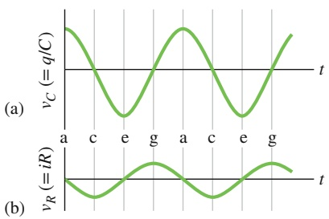

line

| Time (t) | vC (=q/C) | vR (=iR) |
| --- | --- | --- |
| a | High | Low |
| c | 0 | ~-1.5 |
| e | Negative | 0 |
| g | 0 | Positive |
| a | High | 0 |
| c | 0 | ~-1.5 |
| e | Negative | 0 |
| g | 0 | Positive |

Abb. 27.2

(a) Die Spannung am Kondensator des Schaltkreises aus Abb. 27.1 als Funktion der Zeit; sie ist proportional zur Kondensatorladung. (b) Die Spannung am Wirkwiderstand ist proportional zum Strom. Die Buchstaben beziehen sich auf die entsprechenden Zustände in Abb. 27.1.

643

---

27 Elektromagnetische Schwingkreise und Wechselstrom

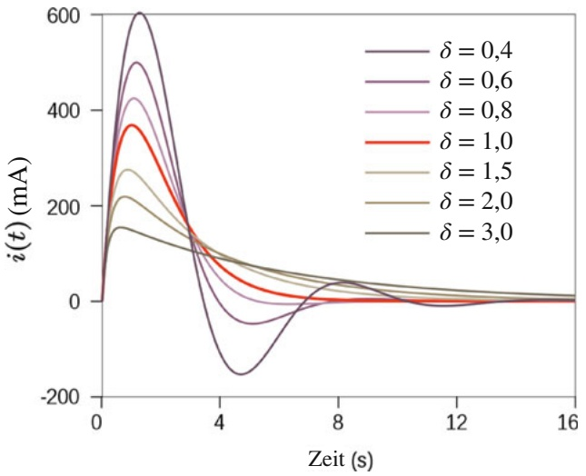

line

| Zeit (s) | \(\delta = 0,4 (\)mA) | \(\delta = 0,6 (\)mA) | \(\delta = 0,8 (\)mA) | \(\delta = 1,0 (\)mA) | \(\delta = 1,5 (\)mA) | \(\delta = 2,0 (\)mA) | \(\delta = 3,0 (\)mA) |
| --- | --- | --- | --- | --- | --- | --- | --- |
| 0 | 0 | 0 | 0 | 0 | 0 | 0 | 0 |
| ~1.5 | ~600 | ~500 | ~420 | ~370 | ~280 | ~220 | ~160 |
| ~4.5 | ~-150 | ~-50 | ~-20 | ~50 | ~80 | ~90 | ~80 |
| ~8.5 | ~40 | ~10 | ~5 | ~10 | ~30 | ~40 | ~40 |
| 16 | ~10 | ~5 | ~2 | ~2 | ~15 | ~20 | ~20 |

Abb. 27.3 Abklingende Schwingungen in einem Reihen-LC-Kreis für verschiedene Werte des Dämpfungsfaktors $\delta ,$ der Ausdruck der in dem LC-Kreis vorhandenen Wirkwiderstände R ist [Quelle: SpinningSpark/CC-SA-3.0].

## 27.1.2 Die Analogie zwischen elektrischen und mechanischen Oszillatoren

Wir wollen die Parallelen zwischen dem LC-Schwingkreis aus Abb. 27.1 und einem oszillierenden Masse-Feder-System noch etwas genauer untersuchen. In dem System Masse–Feder treten zwei Energieformen auf: die potenzielle Energie der zusammengedrückten bzw. gedehnten Feder und die kinetische Energie der Masse. In der linken Hälfte von Tab. 27.1 sind beide zusammen mit den zugehörigen Gleichungen aufgeführt.

In der rechten Hälfte der Tabelle sind die beiden Energiearten gezeigt, die in einem LC-Schwingkreis auftreten. Die Ähnlichkeiten zwischen den mechanischen Energien des Systems Masse–Feder und den elektromagnetischen Energien des LC-Schwingkreises sind offensichtlich. Die Gleichungen für v und i im unteren Teil der Tabelle präzisieren die Analogie: Die Ladung q entspricht im Schwingkreis der Auslenkung x des Systems Masse–Feder, wohingegen der Strom i der Geschwindigkeit v entspricht (in beiden Fällen ist die zweite Größe die zeitliche Ableitung der ersten). Weiter entspricht nach dieser Analogie die inverse Kapazität $1 / C$ der Federkonstante k und die Induktivität L der Masse m:

$$
q \widehat {=} x, \quad 1 / C \widehat {=} k, \quad i \widehat {=} v, \quad L \widehat {=} m.
$$

Oder nochmals anders ausgedrückt: Der Kondensator in einem LC-Schwingkreis entspricht der Feder in einem Masse-Feder-System, die Induktivität der Masse.

In Abschn. 11.1 hatten wir festgestellt, dass die Kreisfrequenz der Schwingung eines (reibungsfreien) Masse-Feder-Systems gleich

$$
\omega = \sqrt {\frac {k}{m}} \quad \text {(Masse - Feder - System)} \tag {27.3}
$$

TABELLE 27.1: Vergleich der Energieformen in zwei Arten von schwingenden Systemen.

<table><tr><td colspan="2">System Masse-Feder</td><td colspan="2">LC-Schwingkreis</td></tr><tr><td>Element</td><td>Energie</td><td>Element</td><td>Energie</td></tr><tr><td>Feder</td><td>potenziell,  $\frac{1}{2}kx^{2}$ </td><td>Kondensator</td><td>elektrisch,  $\frac{1}{2}(1/C)q^{2}$ </td></tr><tr><td>Gewicht</td><td>kinetisch,  $\frac{1}{2}mv^{2}$ </td><td>Induktivität</td><td>magnetisch,  $\frac{1}{2}Li^{2}$ </td></tr><tr><td colspan="2"> $\nu = dx/dt$ </td><td colspan="2"> $i = dq/dt$ </td></tr></table>

644

---

27.1 LC-Schwingungen

27

ist. Nach obiger Analogie sollten wir die Kreisfrequenz der Schwingung eines (widerstandsfreien) LC-Kreises erhalten, wenn wir k durch $1 / C$ und m durch L ersetzen, also

$$
\omega = \frac {1}{\sqrt {L C}} \quad (L C \text {-Kreis}). \tag {27.4}
$$

Im nächsten Abschnitt werden wir diese Beziehung herleiten.

## 27.1.3 LC-Schwingungen: Eine quantitative Diskussion

Wir wollen nun Gl. 27.4 für die Kreisfrequenz eines LC-Schwingkreises beweisen. Gleichzeitig werden wir die Parallelen zwischen einem LC-Schwingkreis und einem Masse-Feder-System noch eingehender untersuchen. Wir beginnen mit einigen Betrachtungen zum mechanischen System Masse-Feder.

## Das System Masse–Feder

In Kapitel 11 hatten wir das System Masse–Feder analysiert und dabei den Energiefluss zwischen potenzieller und kinetischer Energie untersucht. Die grundlegende Differenzialgleichung für solche Schwingungen hatten wir damals noch nicht hergeleitet; das wollen wir nun nachholen.

Die Gesamtenergie U eines aus einer Masse und einer elastischen Feder bestehenden Systems ist zu jedem Zeitpunkt gleich der Summe der kinetischen Energie $U _ { \mathrm { k i n } }$ der Masse und der potenziellen Energie $U _ { \mathrm { p o t } }$ der gespannten oder gedehnten Feder:

$$
U = U _ {\mathrm{kin}} + U _ {\mathrm{pot}} = \frac {1}{2} m v ^ {2} + \frac {1}{2} k x ^ {2}. \tag {27.5}
$$

Ohne Reibung (was wir zunächst annehmen) bleibt die Gesamtenergie U erhalten, obwohl sich v und x laufend ändern. Formal ausgedrückt bedeutet das, dass $\mathrm { d } U / \mathrm { d } t = 0$ sein muss. Das führt uns auf die Beziehung

$$
\frac {\mathrm{d} U}{\mathrm{d} t} = \frac {\mathrm{d}}{\mathrm{d} t} \left(\frac {1}{2} m v ^ {2} + \frac {1}{2} k x ^ {2}\right) = m v \frac {\mathrm{d} v}{\mathrm{d} t} + k x \frac {\mathrm{d} x}{\mathrm{d} t} = 0. \tag {27.6}
$$

Mit $\nu = \mathrm { d } x / \mathrm { d } t$ und $\mathrm { d } \nu / \mathrm { d } t = \mathrm { d } ^ { 2 } x / \mathrm { d } t ^ { 2 }$ wird daraus

$$
m \frac {\mathrm{d} ^ {2} x}{\mathrm{d} t ^ {2}} + k x = 0 \quad \text {(mechanische Schwingung)}. \tag {27.7}
$$

Diese Gleichung ist die fundamentale Differenzialgleichung der reibungsfreien Schwingung eines aus einer Masse und einer Feder bestehenden Systems.

Die allgemeine Lösung zu Gl. 27.7 – also die Funktion x(t), welche die Schwingungen des Systems Masse–Feder beschreibt – lautet (vgl. Gl. 11.3)

$$
x (t) = X \cos (\omega t + \varphi) \quad \text {(Auslenkung)}. \tag {27.8}
$$

Hierbei sind X die Amplitude der mechanischen Schwingungen (die wir in Kapitel 11 mit $x _ { \mathrm { m } }$ bezeichnet hatten), ω die Kreisfrequenz der Schwingung und 𝜑 die Phasenkonstante.

## Der LC-Schwingkreis

Nun untersuchen wir die Schwingungen eines widerstandsfreien LC-Kreises in Analogie zu dem System Masse–Feder. Die Gesamtenergie U lässt sich zu jedem Zeitpunkt als Summe der Energie $U _ { B }$ des Magnetfelds an der Spule und der Energie $U _ { E }$ des elektrischen Felds im Kondensator schreiben, also

$$
U = U _ {B} + U _ {E} = \frac {L i ^ {2}}{2} + \frac {q ^ {2}}{2 C}. \tag {27.9}
$$

645

---

27 Elektromagnetische Schwingkreise und Wechselstrom

Der Wirkwiderstand in diesem Schaltkreis soll verschwinden, daher erfolgt keine Umwandlung von Energie in Wärmeenergie und U bleibt zeitlich konstant. Das bedeutet auch in diesem Fall $\mathrm { d } U / \mathrm { d } t = 0$ bzw.

$$
\frac {\mathrm{d} U}{\mathrm{d} t} = \frac {\mathrm{d}}{\mathrm{d} t} \left(\frac {L i ^ {2}}{2} + \frac {q ^ {2}}{2 C}\right) = L i \frac {\mathrm{d} i}{\mathrm{d} t} + \frac {q}{C} \frac {\mathrm{d} q}{\mathrm{d} t} = 0. \tag {27.10}
$$

Mit $i = \mathrm { d } q / \mathrm { d }$ t und $\mathrm { d } i / \mathrm { d } t = \mathrm { d } ^ { 2 } q / \mathrm { d } t ^ { 2 }$ erhalten wir weiter

$$
L \frac {\mathrm{d} ^ {2} q}{\mathrm{d} t ^ {2}} + \frac {1}{C} q = 0 \quad (L C \text {-Schwingkreis}). \tag {27.11}
$$

Diese Differenzialgleichung beschreibt die Schwingungen eines wirkwiderstandsfreien LC-Kreises: Mathematisch gesehen sind die beiden Differenzialgleichungen in Gl. 27.11 und Gl. 27.7 identisch.

## Ladungs- und Stromschwingungen

Da die Differenzialgleichungen mathematisch dieselbe Form haben, müssen auch ihre Lösungen mathematisch gleich sein. Die Ladung q entspricht der Auslenkung x, daher folgt für die allgemeine Lösung von Gl. 27.11 in Analogie zu Gl. 27.8

$$
q (t) = Q \cos (\omega t + \varphi) \quad \text {(Ladung)}, \tag {27.12}
$$

wobei $Q$ die Amplitude der Ladungsschwingungen ist, $\omega$ die Kreisfrequenz der elektromagnetischen Schwingungen und 𝜑 eine Phasenkonstante.

Die erste Ableitung von Gl. 27.12 nach der Zeit liefert uns eine Gleichung für den Strom in dem LC-Kreis:

$$
i = \frac {\mathrm{d} q}{\mathrm{d} t} = - \omega Q \sin (\omega t + \varphi) \qquad (\text {Strom}). \tag {27.13}
$$

Die Amplitude I dieser sinusförmigen Stromschwingung ist

$$
I = \omega Q; \tag {27.14}
$$

damit wird aus Gl. 27.13

$$
i (t) = - I \sin (\omega t + \varphi). \tag {27.15}
$$

## Kreisfrequenzen

Dass es sich bei Gl. 27.12 tatsächlich um eine Lösung von Gl. 27.11 handelt, können wir leicht überprüfen, indem wir diese Gleichung und ihre zweite Ableitung nach der Zeit in Gl. 27.11 einsetzen. Die erste Ableitung von Gl. 27.12 nach der Zeit ist Gl. 27.13. Die zweite Ableitung lautet

$$
\frac {\mathrm{d} ^ {2} q}{\mathrm{d} t ^ {2}} = - \omega^ {2} Q \cos (\omega t + \varphi).
$$

Damit wird aus Gl. 27.11

$$
- L \omega^ {2} Q \cos (\omega t + \varphi) + \frac {1}{C} Q \cos (\omega t + \varphi) = 0.
$$

Wir dividieren diese Gleichung durch $Q \cos ( \omega t + \varphi )$ und erhalten so für die Kreisfrequenz

$$
\omega = \frac {1}{\sqrt {L C}}.
$$

Gleichung 27.12 löst also tatsächlich Gl. 27.11, sofern die Kreisfrequenz ω den konstanten Wert $1 / \sqrt { L C }$ besitzt. Dieser Ausdruck stimmt mit Gl. 27.4 überein, auf die wir durch eine Analogie geführt wurden.

646

---

27.2 Gedämpfte Schwingungen in einem RLC-Kreis

27

Die Phasenkonstante $\varphi$ in Gl. 27.12 erhalten wir aus dem Zustand des Schwingkreises zu einem bestimmten Zeitpunkt, beispielsweise für $t = 0$ . Für $\varphi = 0$ und $t = 0$ ergibt sich aus Gl. $2 7 . 1 2   q = Q$ und aus Gl. $2 7 . 1 3 \; i = 0$ . Diese Anfangsbedingungen entsprechen der Situation aus Abb. 27.1a.

## Schwingungen der elektrischen und magnetischen Energie

Aus den Gln. 27.1 und 27.12 folgt für die elektrische Energie in einem LC-Kreis

$$
U _ {E} = \frac {q ^ {2}}{2 C} = \frac {Q ^ {2}}{2 C} \cos^ {2} (\omega t + \varphi). \tag {27.16}
$$

Entsprechend liefern die Gln. 27.2 und 27.13 für die Zeitabhängigkeit der magnetischen Energie

$$
U _ {B} = \frac {1}{2} L i ^ {2} = \frac {1}{2} L \omega^ {2} Q ^ {2} \sin^ {2} (\omega t + \varphi).
$$

Mit ω aus Gl. 27.4 folgt dann

$$
U _ {B} = \frac {Q ^ {2}}{2 C} \sin^ {2} (\omega t + \varphi). \tag {27.17}
$$

Abbildung 27.4 zeigt den zeitlichen Verlauf von $U _ { E } ( t )$ und $U _ { B } ( t )$ für den Fall $\varphi = 0$ . Wir können daraus drei wichtige Punkte erkennen:

1. Die Maximalwerte von $U _ { E }$ und $U _ { B }$ sind beide gleich $Q ^ { 2 } / ( 2 C )$
2. Die Summe von $U _ { E }$ und $U _ { B }$ ist zu jedem Zeitpunkt gleich $Q ^ { 2 } / ( 2 C ) ,$ , also konstant.
3. Wenn $U _ { E }$ maximal ist, ist $U _ { B }$ null und umgekehrt.

## KONTROLLFRAGE 2

Die maximale Spannung an einem Kondensator in einem LC-Kreis sei 17 V und die maximale Energie auf dem Kondensator betrage 160 μJ. Zu einem bestimmten Zeitpunkt habe dieser Kondensator die Spannung 5 V und die Energie 10 μJ. Wie groß sind zu diesem Zeitpunkt (a) die Spannung an der Spule und (b) die Energie des magnetischen Felds?

## 27.2 Gedämpfte Schwingungen in einem RLC-Kreis

## Lernziele

Nach dem Durcharbeiten dieses Abschnitts sollten Sie in der Lage sein, . . .

• einen gedämpften RLC-Kreis zu skizzieren und zu erklären, warum seine Schwingungen gedämpft sind,
• aus den Ausdrücken für die Feldenergien und deren zeitlichen Ableitungen die Differenzialgleichung für die Ladung q auf dem Kondensator in einem gedämpften RLC-Kreis herzuleiten,
• die Beziehung für die Ladung $q ( t )$ als Funktion der Zeit für einen gedämpften RLC-Kreis anzuwenden,
• zu verstehen, dass und warum die Ladungsamplitude und die Amplitude der elektrischen Feldenergie in einem gedämpften RLC-Kreis exponentiell mit der Zeit abnehmen,
• den Zusammenhang zwischen der Kreisfrequenz $\omega ^ { \prime }$ eines gegebenen gedämpf ten RLC-Schwingkreises und der Kreisfrequenz ω des entsprechenden ungedämpften Systems anzugeben,
• den Ausdruck für die elektrische Feldenergie $U _ { E }$ eines gedämpften RLC-Kreises als Funktion der Zeit anzuwenden.

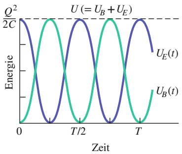

line

| Zeit | UE(t) | UB(t) |
| --- | --- | --- |
| 0 | \(Q^{2}/2C\) | 0 |
| T/2 | 0 | \(Q^{2}/2C\) |
| T | \(Q^{2}/2C\) | 0 |

Abb. 27.4

Die magnetische und elektrische Energie des Schaltkreises aus Abb. 27.1 als Funktion der Zeit. Ihre Summe ist konstant. T ist die Periode der Schwingung.

647

---

27 Elektromagnetische Schwingkreise und Wechselstrom

## Schlüsselideen

• Die Schwingungen in einem LC-Stromkreis werden gedämpft, wenn zusätzlich auch ein dissipatives Element R (d. h. ein Ohmscher bzw. Wirkwiderstand) im Stromkreis vorhanden ist. Die Differenzialgleichung für q hat in diesem Fall die Form

$$
L \frac {\mathrm{d} ^ {2} q}{\mathrm{d} t ^ {2}} + R \frac {\mathrm{d} q}{\mathrm{d} t} + \frac {1}{C} q = 0 \quad (R L C \text {-Stromkreis}).
$$

• Die Lösung dieser Differenzialgleichung ist

$$
q = Q \mathrm{e} ^ {- R t / (2 L)} \cos (\omega^ {\prime} t + \varphi)
$$

mit

$$
\omega^ {\prime} = \sqrt {\omega^ {2} - (R / (2 L)) ^ {2}}.
$$

Wir betrachten im Folgenden nur Situationen, in denen R klein ist und daher nur eine schwache Dämpfung vorliegt; in diesem Fall ist $\omega ^ { \prime } \approx \omega .$

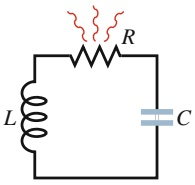

Abb. 27.5

Ein Reihen-RLC-Kreis. Die Ladungen strömen durch den Widerstand hin und her. Dabei wird elektromagnetische Energie in Wärmeenergie umgewandelt und die Schwingungsamplituden des Systems nehmen ab.

## 27.2.1 Gedämpfte Schwingungen in einem RLC-Kreis

Einen Stromkreis mit einem Wirkwiderstand, einer Spule und einem Kondensator bezeichnet man als RLC-Kreis. Wir betrachten im Folgenden nur Reihen-RLC Kreise wie den in Abb. 27.5. Da wir nun einen Wirkwiderstand R berücksichtigen, bleibt die gesamte elektromagnetische Energie U des Stromkreises (die Summe aus elektrischer und magnetischer Energie) nicht mehr erhalten, sondern nimmt mit der Zeit ab, da im Widerstand kontinuierlich Energie in Wärmeenergie umgewandelt wird. Wegen dieses Energieverlusts nehmen die Scheitelwerte der Ladungs-, Strom- und Spannungsschwingungen kontinuierlich ab; wir sprechen in diesem Fall von gedämpften Schwingungen. Wie wir sehen werden, handelt es sich hierbei um gedämpfte Schwingungen in demselben Sinn wie bei dem gedämpften Masse-Feder-System aus Abschn. 11.5.

Zur Untersuchung der Schwingungen in diesem Stromkreis stellen wir zunächst eine Gleichung für die gesamte elektromagnetische Energie U auf, die für jeden Zeitpunkt gilt. Da im Widerstand keine elektromagnetische Energie gespeichert wird, können wir zunächst von Gl. 27.9 ausgehen:

$$
U = U _ {B} + U _ {E} = \frac {L i ^ {2}}{2} + \frac {q ^ {2}}{2 C}. \tag {27.18}
$$

Diese elektromagnetische Energie nimmt mit der Zeit ab und wird in Wärmeenergie umgewandelt. Die Umwandlungsrate ist dabei nach Gl. 22.22

$$
\frac {\mathrm{d} U}{\mathrm{d} t} = - i ^ {2} R, \tag {27.19}
$$

wobei das Minuszeichen die Abnahme von U andeutet. Wir leiten Gl. 27.18 nach der Zeit ab und setzen das Ergebnis in Gl. 27.19 ein. So erhalten wir

$$
\frac {\mathrm{d} U}{\mathrm{d} t} = L i \frac {\mathrm{d} i}{\mathrm{d} t} + \frac {q}{C} \frac {\mathrm{d} q}{\mathrm{d} t} = - i ^ {2} R.
$$

Nun ersetzen wir wieder i durch $\mathrm { d } q / \mathrm { d } t$ und $\mathrm { d } i / \mathrm { d } t$ durch $\mathrm { d } ^ { 2 } q / \mathrm { d } t ^ { 2 }$ und bekommen

$$
L \frac {\mathrm{d} ^ {2} q}{\mathrm{d} t ^ {2}} + R \frac {\mathrm{d} q}{\mathrm{d} t} + \frac {1}{C} q = 0 \quad (R L C \text {-Kreis}). \tag {27.20}
$$

648

---

27.3 Erzwungene Schwingungen

27

Dies ist die Differenzialgleichung für die gedämpften Schwingungen in einem RLC-Kreis, das elektromagnetische Analogon zu Gl. 11.30, der Schwingungsgleichung für das gedämpfte Masse-Feder-System. Nun teilen wir alle Terme in Gl. 27.20 durch $L ,$ das ergibt

$$
\frac {\mathrm{d} ^ {2} q}{\mathrm{d} t ^ {2}} + \frac {R}{L} \frac {\mathrm{d} q}{\mathrm{d} t} + \frac {1}{C L} q = 0
$$

bzw.

$$
\frac {\mathrm{d} ^ {2} q}{\mathrm{d} t ^ {2}} + 2 \delta \frac {\mathrm{d} q}{\mathrm{d} t} + \omega^ {2} q = 0,
$$

wobei wir die Kreisfrequenz $\omega = 1 / \sqrt { L C }$ und die Dämpfung $\delta = R / ( 2 L )$ eingesetzt haben. Die Zahlenwerte von δ und ω definieren die drei Fälle für das zeitliche Verhalten von $q ( t )$ . Für $\omega > \delta$ finden wir den so genannten Schwingungsfall, für $\omega = \delta$ den aperiodischen Grenzfall und für $\omega < \delta$ den Kriechfall.

An dieser Stelle wollen wir uns auf den Fall kleiner Dämpfung konzentrieren. Für diesen lautet die allgemeine Lösung von Gl. 27.20

$$
q (t) = Q \mathrm{e} ^ {- R t / (2 L)} \cos (\omega^ {\prime} t + \varphi) \tag {27.21}
$$

mit

$$
\omega^ {\prime} = \sqrt {\omega^ {2} - (R / 2 L) ^ {2}}. \tag {27.22}
$$

Gleichung 27.21 beschreibt die Ladungsschwingung auf dem Kondensator in einem RLC-Kreis. Sie ist das elektromagnetische Analogon zu Gl. 11.31, der Gleichung für die Auslenkung eines gedämpften Systems aus Masse und Feder.

Gleichung 27.21 entspricht einer sinusförmigen Schwingung (der Kosinusfunktion) mit einer exponentiell abnehmenden Amplitude $Q \mathrm { e } ^ { - \stackrel { \leftrightarrow } { R t } / ( 2 \stackrel { \leftrightarrow } { L } ) }$ (dieser Faktor wird mit der Kosinusfunktion multipliziert). Die Kreisfrequenz $\omega ^ { \prime }$ des gedämpften Oszillators ist immer kleiner als die Kreisfrequenz ω der ungedämpften Schwingung. Da wir uns jedoch auf den Grenzfall schwacher Dämpfung konzentrieren, nehmen wir an, dass R hinreichend klein ist, sodass wir $\omega ^ { \prime }$ durch ω ersetzen dürfen.

Anstatt die gesamte elektromagnetische Energie U des Stromkreises als Funktion der Zeit herzuleiten, betrachten wir die Energie des elektrischen Felds im Kondensator, die durch Gl. 27.1 $( U _ { E } = q ^ { 2 } / 2 C )$ gegeben ist. Wir setzen Gl. 27.21 in Gl. 27.1 ein; das ergibt

$$
\begin{array}{l} U _ {E} = \frac {q ^ {2}}{2 C} = \frac {[ Q \mathrm{e} ^ {- R t / (2 L)} \cos (\omega^ {\prime} t + \varphi) ] ^ {2}}{2 C} \\ = \frac {Q ^ {2}}{2 C} \mathrm{e} ^ {- R t / L} \cos^ {2} (\omega^ {\prime} t + \varphi). \tag {27.23} \\ \end{array}
$$

Die Energie des elektrischen Felds oszilliert somit wie das Quadrat einer Kosinus funktion und die Amplitude dieser Schwingung fällt exponentiell mit der Zeit ab.

## 27.3 Erzwungene Schwingungen

## Lernziele

Nach dem Durcharbeiten dieses Abschnitts sollten Sie in der Lage sein, . . .

• den Unterschied zwischen Wechselstrom und Gleichstrom zu verstehen,
• die elektrische Spannung an einem Wechselstromgenerator als Funktion der Zeit zu schreiben und dabei Spannungsamplitude und antreibende Kreisfrequenz zu benennen,

649

---

27 Elektromagnetische Schwingkreise und Wechselstrom

• die Stromstärke an einem Wechselstromgenerator als Funktion der Zeit zu schreiben und dabei die Stromamplitude und die Phasenverschiebung zur Spannung zu identifizieren,
• einen von einem Generator gespeisten (Reihen-)RLC-Kreis zu skizzieren,
• zwischen der antreibenden Kreisfrequenz $\omega _ { \mathrm { a } }$ und der natürlichen Kreisfrequenz ω zu unterscheiden,
• die Resonanzbedingungen in einem angetriebenen (Reihen-)RLC-Kreis anzugeben und zu erklären, was im Resonanzfall mit der Stromamplitude geschieht,
• für jede der drei Grundschaltungen (reiner Lastwiderstand, reine Lastkapazität und reine Lastinduktivität) den Stromkreis sowie die Graphen und Zeigerdiagramme für Spannung und Strom zu skizzieren,
• für jede der drei Grundschaltungen die Gleichungen für Spannung und Strom anzugeben,
• in Zeigerdiagrammen der drei Grundschaltungen die Winkelgeschwindigkeit, die Amplitude, die Projektion auf die vertikale Achse und den Drehwinkel anzugeben,
• für jede der Grundschaltungen die Phasenkonstante im Zeigerdiagramm zu identifizieren und mit der relativen Orientierung von Strom- und Spannungszeiger in Beziehung zu setzen,
• die Beziehung zwischen Spannungsamplitude V und Stromamplitude I für die drei Grundschaltungen anzuwenden,
• den kapazitiven Widerstand $X _ { C }$ und den induktiven Widerstand $X _ { L }$ im RLC-Kreis zu berechnen.

## Schlüsselideen

• Man kann einen Reihen-RLC-Kreis in erzwungene Schwingungen bzw. Oszillationen versetzen. Mit der antreibenden Kreisfrequenz $\omega _ { \mathrm { a } }$ gilt dann für die externe Spannung

$$
\mathcal {E} = \mathcal {E} _ {\mathrm{m}} \sin \omega_ {\mathrm{a}} t.
$$

• Der im Stromkreis erzwungene Strom ist

$$
i = I \sin (\omega_ {\mathrm{a}} t - \varphi),
$$

wobei $\varphi$ die Phasenkonstante ist.

• Die Wechselspannung am Widerstand hat die Amplitude $V _ { R } = I R ;$ der Strom ist in Phase mit der Spannung.
• Für einen Kondensator ist $V _ { C } = I X _ { C }$ mit dem kapazitiven Widerstand $X _ { C } = 1 /$ $( \omega _ { \mathrm { a } } C ) ;$ der Strom eilt hier der Spannung um $9 0 ^ { \circ }$ voraus $\left( \varphi = - 9 0 ^ { \circ } = - \pi / 2 \right.$ rad).
• Für eine Induktivität ist $V _ { L } = I X _ { L }$ mit dem induktiven Widerstand $X _ { L } = \omega _ { \mathrm { a } } L ;$ der Strom eilt hier der Spannung um 90° nach $\left( \varphi = + 9 0 ^ { \circ } = + \pi / 2   \mathrm { r a d } \right)$

## 27.3.1 Wechselstrom

Die Schwingungen in einem RLC-Kreis können durch eine äußere Spannungsquelle aufrechterhalten werden, die dem Stromkreis ausreichend Energie zuführt, um den Verlust an elektromagnetischer Energie im Wirkwiderstand auszugleichen. Die Stromkreise (darunter zahllose RLC-Kreise) in Privathaushalten, Büroräumen, Fabriken usw. erhalten diese Energie von den örtlichen Elektrizitätswerken. In den meisten Ländern wird diese Energie durch oszillierende Spannungen und Strö- me zur Verfügung gestellt – man spricht in diesem Fall von **Wechselstrom** (im Gegensatz zu dem nichtoszillierenden Strom einer Batterie, der als **Gleichstrom** bezeichnet wird) bzw. **Wechselspannung**. Diese Spannungs- und Stromschwingungen haben einen sinusförmigen Zeitverlauf und wechseln in fast allen europäischen Ländern rund hundertmal in der Sekunde ihr Vorzeichen. Sie haben somit eine Frequenz von $f = 5 0   \mathrm { H z }$ (in Nordamerika meist 60 Hz.)

Das mag zunächst erstaunen. Wie wir gesehen haben, liegt die Driftgeschwindigkeit der Leitungselektronen in einem typischen Leiter bei rund $4 \cdot 1 0 ^ { - 5 }   \mathrm { m / s }$ . Wenn

650

---

27.3 Erzwungene Schwingungen

27

nun die Richtung des Stroms alle 0,01 s wechselt, bewegen sich solche Elektronen in einer halben Periode nur um $4 \cdot 1 0 ^ { - 7 }$ m vorwärts, das entspricht rund 10 Atomdurchmessern; anschließend kehren die Elektronen ihre Richtung schon wieder um. Wie kann ein Elektron unter diesen Umständen irgendwo hinkommen?

Diese Frage mag im ersten Moment verblüffen, ist aber eigentlich ohne Belang. Ein Leitungselektron muss nämlich nirgendwo „hinkommen“. Wenn wir von einer Stromstärke von einem Ampere in einem Draht sprechen, dann bedeutet dies nur, dass durch jede Ebene senkrecht zu diesem Draht Ladung mit einer Rate von einem Coulomb pro Sekunde fließt. Dabei spielt die Geschwindigkeit der Ladungsträger zunächst keine Rolle. Ein Ampere kann einer großen Ladungsmenge entsprechen, die sich sehr langsam bewegt, oder auch sehr wenigen, aber schnellen Ladungsträgern. Das Signal zur Richtungsumkehr der Elektronen, das die Wechselspannung aus den Stromgeneratoren des Elektrizitätswerks gibt, breitet sich nahezu mit Lichtgeschwindigkeit durch die Leitung aus. Das bedeutet, dass alle Elektronen dieses Umkehrsignal fast zu demselben Zeitpunkt erhalten, ganz egal, wo sie sich befinden. Außerdem sollte man noch anmerken, dass die Stromrichtung für viele elektrische Geräte wie z. B. Glühbirnen oder Elektrotoaster ohnehin keine Bedeutung hat. Für sie ist allein entscheidend, dass die Elektronen bei ihren Stößen mit den Atomen innerhalb des Geräts ausreichend Energie abgeben.

Wechselstrom hat für viele Anwendungen einen entscheidenden Vorteil: Wenn der Strom seine Richtung umdreht, ändert auch das Magnetfeld um den Draht seine Richtung. Damit können wir das Faradaysche Induktionsgesetz ausnutzen und beispielsweise den Betrag der Wechselspannung nach Belieben hoch- oder herabsetzen. Dazu benötigen wir nur einen sogenannten Transformator, den wir in diesem Kapitel noch kennenlernen werden. Außerdem eignet sich Wechselstrom für Maschinen mit rotierenden Teilen wie z. B. Generatoren und Motoren besser als Gleichstrom.

Abbildung 27.6 illustriert das Prinzip eines Wechselstromgenerators. Die leitende Drahtschleife wird (unter Kraftaufwand) in einem äußeren Magnetfeld B⃗ ge dreht, wodurch in ihr nach dem Faradayschen Induktionsgesetz eine sinusförmig oszillierende Spannung

$$
\mathcal {E} = \mathcal {E} _ {\mathrm{m}} \sin \omega_ {\mathrm{a}} t \tag {27.24}
$$

induziert wird. Die Kreisfrequenz $\omega _ { \mathrm { a } }$ der erzeugten Spannung ist gleich der Winkelgeschwindigkeit, mit der die Schleife in dem Magnetfeld rotiert. Die Phase dieser Spannung ist $\omega _ { \mathrm { a } } t$ und ihre Amplitude ist $\mathcal { E } _ { \mathrm { m } }$ (wobei der Index $\mathrm { { _ { \mathrm { { \it { p } } } } m } ^ { \it { \it { \it { \it { a } } } } } }$ für „maximal steht). Ist die rotierende Schleife Teil eines geschlossenen Stromkreises, so indu ziert die erzeugte Spannung in diesem Stromkreis einen sinusförmigen Strom mit derselben Kreisfrequenz $\omega _ { \mathrm { a } } ,$ die man auch als die **antreibende Kreisfrequenz** des Generators bezeichnet. Für den Strom gilt

$$
i = I \sin (\omega_ {\mathrm{a}} t - \varphi), \tag {27.25}
$$

wobei I die Amplitude (der Scheitelwert) des erzeugten Stroms ist. (Die Phase des Stroms wird üblicherweise mit einem Minuszeichen in der Form $\omega _ { \mathrm { a } } t - \varphi$ anstelle von $\omega _ { \mathrm { a } } t + \varphi$ geschrieben.) Gleichung 27.25 enthält eine Phasenkonstante $\varphi ,$ die berücksichtigt, dass der Strom i nicht unbedingt in Phase mit der erzeugten Spannung $\varepsilon$ sein muss. (Wir werden später sehen, dass der Wert der Phasenkonstante von den Eigenschaften des Stromkreises abhängt, mit dem der Generator verbunden ist.) Wir können den Strom i auch durch die **antreibende Frequenz** $f _ { \mathrm { a } }$ der Spannung ausdrücken, indem wir in Gl. 27.25 $\omega _ { \mathrm { a } }$ durch 2π $f _ { \mathrm { a } }$ ersetzen.

## 27.3.2 Erzwungene Schwingungen

Wie wir gesehen haben, schwingen die Ladung, die Spannung und der Strom in einem ungedämpften LC-Kreis ebenso wie in einem gedämpften RLC-Kreis (so lange der Wirkwiderstand R hinreichend klein ist) mit der Kreisfrequenz $\omega = 1 / \sqrt { L C } ,$

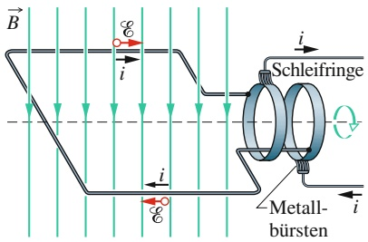

text_image

B
i
i
Schleifringe
i
Metall-
bürsten
i

Abb. 27.6 Das Funktionsprinzip eines Wechselstromgenerators. Eine leitende Stromschleife dreht sich in einem äußeren Magnetfeld, sodass eine Spannung nach dem Faradayschen Gesetz in ihr induziert wird. In der Praxis wird die in einer Spule mit vielen Windungen erzeugte Wechselspannung von Schleifringen an der rotierenden Spule abgegriffen. Jeder dieser Ringe ist mit einem Ende der Spule verbunden. Gegen diesen Schleifring drückt eine leitende Bürste, die den Strom in den Generatorstromkreis überträgt.

651

---

27 Elektromagnetische Schwingkreise und Wechselstrom

sofern die Schwingung einmal in Gang gesetzt wurde. Solche Schwingungen bezeichnet man alsfrei oder ungezwungen und die Kreisfrequenz ω als die **natürliche Kreisfrequenz** des Stromkreises.

Wird an den RLC-Kreis eine äußere Wechselspannungsquelle (Gl. 27.24) angeschlossen, bezeichnet man die Schwingungen von Ladung, Spannung und Strom als angetrieben oder erzwungen. Die Kreisfrequenz solcher erzwungener Schwingungen entspricht immer der treibenden Kreisfrequenz $\omega _ { \mathrm { a ^ { \circ } } }$

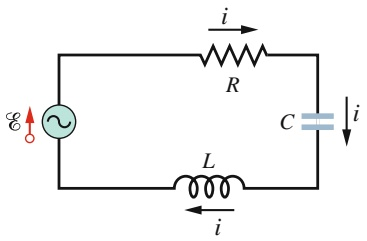

text_image

i
R
C
L
i
E

Abb. 27.7

Ein einzelner Stromkreis mit einem Wirkwiderstand, einem Kondensator und einer Spule. Ein Generator, durch eine Sinuswelle in einem

Kreis gekennzeichnet, liefert eine Wechselspannung, die einen Wechselstrom erzeugt. Die angegebenen

Richtungen der äußeren Spannung und des Stroms wechseln periodisch.

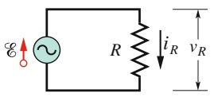

(a)

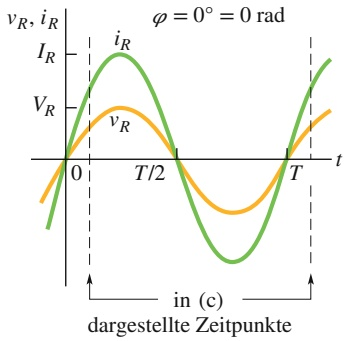

line

| Time (t) | vR | iR |
| --- | --- | --- |
| 0 | 0 | 0 |
| T/2 | 0 | 0 |
| T | 0 | 0 |

(b)

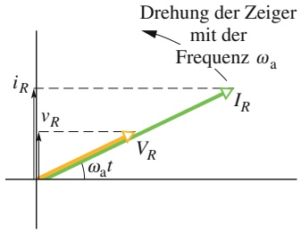

line

| Variable | Description |
| --- | --- |
| Frequency \((\omega a)\) | Frequency of the Zeiger with respect to the Freqenz \(\omega a\) |
| Current (IR) | Current measured by the Zeiger |
| Voltage (VR) | Voltage measured by the Zeiger |
| Resistance (iR) | Resistance measured by the Zeiger |
| Time (t) | Time of the Zeiger measurement |

(c)

Unabhängig von der natürlichen Kreisfrequenz ω eines Stromkreises erfolgt die erzwungene Schwingung der Ladung, des Stroms und der Spannung in diesem Kreis immer mit der antreibenden Kreisfrequenz $\omega _ { \mathrm { a } }$

Wie wir in Abschn. 27.4 sehen werden, hängen die Amplituden dieser Schwingungen jedoch empfindlich davon ab, wie nahe $\omega _ { \mathrm { a } }$ bei ω liegt. Sind beide Frequenzen gleich – diese Bedingung bezeichnet man als **Resonanz** – ist die Amplitude I des Stroms maximal.

## 27.3.3 Drei einfache Stromkreise

In einem späteren Abschnitt dieses Kapitels werden wir, wie in Abb. 27.7 dargestellt, eine äußere Wechselspannung an einen Reihen-RLC-Kreis anschließen. Wir werden dann die Amplitude I und die Phasenkonstante $\varphi$ der sinusförmigen Stromschwingung durch die Amplitude $\mathcal { E } _ { \mathrm { m } }$ und die Kreisfrequenz $\omega _ { \mathrm { a } }$ der äußeren Spannung ausdrücken. Zunächst betrachten wir jedoch drei einfachere Schaltkreise, von denen jeder eine äußere Wechselspannungsquelle und eines der Stromkreiselemente R, C oder L enthält. Wir beginnen mit einem Wirkwiderstand (man spricht auch von einem reinen Lastwiderstand, der an den Wechselspannungsgenerator angeschlossen ist).

## Ein Lastwiderstand

Abbildung 27.8a zeigt einen Stromkreis mit einem Wirkwiderstand R und einem Wechselstromgenerator, der eine Wechselspannung gemäß Gl. 27.24 liefert. Nach der Maschenregel gilt

$$
\mathcal {E} - \nu_ {R} = 0,
$$

woraus mit Gl. 27.24 folgt

$$
\nu_ {R} = \mathcal {E} _ {\mathrm{m}} \sin \omega_ {\mathrm{a}} t.
$$

Da die Amplitude der Spannung am Wirkwiderstand gleich der Amplitude $\mathcal { E } _ { \mathrm { m } }$ der Wechselspannungsquelle ist, können wir für sie

$$
\nu_ {R} = V _ {R} \sin \omega_ {\mathrm{a}} t \tag {27.26}
$$

schreiben. Nach der Definition des Wirkwiderstands $( R \; = \; V / i )$ gilt für den Strom $i _ { R }$ durch den Widerstand

$$
i _ {R} = \frac {\nu_ {R}}{R} = \frac {V _ {R}}{R} \sin \omega_ {\mathrm{a}} t, \tag {27.27}
$$

## Abb. 27.8

(a) Ein Wirkwiderstand ist an einen Wechselstromgenerator angeschlossen. (b) Der Strom $i _ { R }$ und die Spannung $\nu _ { R }$ am Wirkwiderstand als Funktionen der Zeit t. Beide sind in Phase; ihre Periode ist T. Ein solches Diagramm bezeichnet man auch als Liniendiagramm. (c) Eine Darstellung des Sachverhalts aus (b) in einem Zeigerdiagramm.

652

---

27.3 Erzwungene Schwingungen

27

oder unter Verwendung von Gl. 27.25

$$
i _ {R} = I _ {R} \sin (\omega_ {\mathrm{a}} t - \varphi), \tag {27.28}
$$

wobei $I _ { R }$ die Amplitude des Stroms $i _ { R }$ durch den Wirkwiderstand ist. Ein Vergleich von Gl. 27.27 mit Gl. 27.28 zeigt, dass die Phasenkonstante $\varphi$ im Fall eines reinen Lastwiderstands verschwindet, es gilt also $\varphi = 0 ^ { \circ }$ . Zwischen den Scheitelwerten von Strom und Spannung gilt die Beziehung

$$
V _ {R} = I _ {R} R \quad (\text {Wirkwiderstand}). \tag {27.29}
$$

Auch wenn wir diese Relation für den Schaltkreis in Abb. 27.8a hergeleitet haben, gilt sie für jeden Wirkwiderstand in jedem Schaltkreis.

Ein Vergleich der Gln. 27.26 und 27.27 zeigt, dass die zeitabhängigen Größen $\nu _ { R } ( t )$ und $i _ { R } ( t )$ beide Funktionen von sin $\omega _ { \mathrm { a } } t$ mit $\varphi = 0 ^ { \circ }$ sind. Sie sind also in Phase, d. h., sie erreichen ihre Scheitelwerte gleichzeitig. Diese Tatsache bringt Abb. 27.8b (ein sogenanntes Liniendiagramm) zum Ausdruck, die den Verlauf von $\nu _ { R } ( t )$ und $i _ { R } ( t )$ grafisch darstellt. Man beachte, dass $\nu _ { R }$ und $i _ { R }$ nicht mit der Zeit abnehmen, da der Generator dem Stromkreis die Energie zuführt, die im Wirkwiderstand R in Wärme umgesetzt wird.

In einem Zeigerdiagramm können wir die zeitabhängigen Größen $\nu _ { R }$ und $i _ { R }$ geometrisch durch zweidimensionale Vektoren (Zeiger) darstellen. In Abschn. 12.6 hatten wir solche Zeiger zur Darstellung von Wellen eingeführt. Die Zeiger für die Spannung an dem Wirkwiderstand aus Abb. 27.8a und den Strom durch denselben sind in Abb. 27.8c für einen willkürlichen Zeitpunkt t gezeigt. Die Zeiger haben die folgenden Eigenschaften:

1. Winkelgeschwindigkeit: Beide Zeiger drehen sich mit einer Winkelgeschwindigkeit gleich der Kreisfrequenz $\omega _ { \mathrm { a } }$ von $\nu _ { R }$ und $i _ { R }$ im Gegenuhrzeigersinn um den Ursprung.
2. Länge: Die Länge der Zeiger entspricht der Amplitude der zugrunde liegenden veränderlichen Größe, also $V _ { R }$ für die Spannung und $I _ { R }$ für den Strom.
3. Projektion: Die Projektion der Zeiger auf die vertikale Achse gibt den Wert der veränderlichen Größe zum Zeitpunkt t an, entspricht also $\nu _ { R } ( t )$ für die Spannung und $i _ { R } ( t )$ für den Strom.
4. Drehwinkel: Der Drehwinkel der Zeiger ist gleich der Phase der veränderlichen Größe zum Zeitpunkt t. In Abb. 27.8c sind Spannung und Strom in Phase, daher haben ihre Zeiger immer dieselbe Phase $\omega _ { \mathrm { a } } t$ und denselben Drehwinkel. Sie rotieren also gemeinsam.

Versuchen Sie, sich diese Drehung in Gedanken vorzustellen: Wenn die beiden Zeiger sich um den Winkel $\omega _ { \mathrm { a } } t = 9 0 ^ { \circ }$ gedreht haben (sie zeigen in diesem Augenblick beide senkrecht nach oben), entsprechen ihre Projektionen gerade den Amplituden $\nu _ { R } = V _ { R }$ und $i _ { R } = I _ { R }$ . Dasselbe Ergebnis erhalten wir natürlich auch aus den Gln. 27.26 und 27.28.

## KONTROLLFRAGE 3

Angenommen, wir erhöhen die Frequenz der antreibenden Wechselspannung in einem Stromkreis mit einem reinen Lastwiderstand. Wie verhalten sich (a) die Amplitude $V _ { R }$ bzw. (b) die Amplitude $I _ { R } ;$ nehmen sie zu, bleiben sie gleich oder nehmen sie ab?

## Eine Lastkapazität

Abbildung 27.9a zeigt einen Stromkreis mit einem Kondensator und einem Generator für die Wechselspannung nach Gl. 27.24. Mithilfe der Maschenregel und der gleichen Argumentation, die uns zu Gl. 27.26 führte, erhalten wir für die Spannung am Kondensator

$$
\nu_ {C} (t) = V _ {C} \sin \omega_ {\mathrm{a}} t, \tag {27.30}
$$

653

---

27 Elektromagnetische Schwingkreise und Wechselstrom

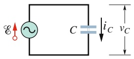

(a)

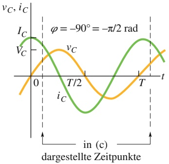

line

| Time (t) | vC (Green Line) | ic (Orange Line) |
| --- | --- | --- |
| 0 | ~1.5 | ~-1.5 |
| T/2 | ~-1.5 | ~1.5 |
| T | ~1.5 | ~-1.5 |

(b)

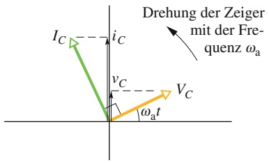

text_image

Drehung der Zeiger
mit der Fre-
quenz ωₐ
I_C --- i_C
v_C --- V_C
ωₐt

(c)

Abb. 27.9

(a) An einen Wechselstromgenerator wird ein Kondensator angeschlossen. (b) In einem Liniendiagramm eilt der Strom in dem Kondensator der Spannung um 90° $( = \pi / 2$ rad) voraus. (c) Ein Zeigerdiagramm illustriert dieselbe Tatsache.

wobei $V _ { C }$ die Amplitude der Wechselspannung am Kondensator ist. Aus der Definition der Kapazität folgt

$$
q _ {C} (t) = C \nu_ {C} (t) = C V _ {C} \sin \omega_ {\mathrm{a}} t. \tag {27.31}
$$

Wir sind jedoch weniger an der Ladung als am Strom interessiert. Daher leiten wir Gl. 27.31 einmal nach der Zeit ab; das ergibt

$$
i _ {C} (t) = \frac {\mathrm{d} q _ {C} (t)}{\mathrm{d} t} = \omega_ {\mathrm{a}} C V _ {C} \cos \omega_ {\mathrm{a}} t. \tag {27.32}
$$

An dieser Gleichung nehmen wir zwei $\ddot { \mathrm { A } }$ nderungen vor: Erstens führen wir aus Symmetriegründen die Größe $X _ { C }$ ein, die man als **kapazitiven Widerstand** eines Kondensators bezeichnet und die wie folgt definiert ist:

$$
X _ {C} = \frac {1}{\omega_ {\mathrm{a}} C} \quad (\text {kapazitiver   Widerstand}). \tag {27.33}
$$

Der Wert des kapazitiven Widerstands eines Kondensators hängt nicht nur von dessen Kapazität ab, sondern auch von der antreibenden Kreisfrequenz $\omega _ { \mathbf { a } ^ { * } }$ Aus der Definition der kapazitiven Zeitkonstante $\left( \tau = R C \right)$ wissen wir, dass die SI-Einheit für C auch als Sekunde pro Ohm geschrieben werden kann. Damit erkennen wir aus Gl. 27.33, dass die SI-Einheit von $X _ { C }$ das Ohm ist, ebenso wie für den (Ohmschen) Wirkwiderstand R.

Zweitens ersetzen wir die Kosinusfunktion in Gl. 27.32 durch eine phasenverschobene Sinusfunktion, wir schreiben also

$$
\cos \omega_ {\mathrm{a}} t = \sin (\omega_ {\mathrm{a}} t + 9 0 ^ {\circ}).
$$

Diese Identität lässt sich leicht grafisch überprüfen, indem man die Sinusfunktion um 90° in die negative Richtung verschiebt.

Mit diesen beiden Veränderungen wird Gl. 27.32 zu

$$
i _ {C} (t) = \left(\frac {V _ {C}}{X _ {C}}\right) \sin (\omega_ {\mathrm{a}} t + 9 0 ^ {\circ}). \tag {27.34}
$$

Nach Gl. 27.25 können wir den Strom $i _ { C } ( t )$ im Kondensator auch in der Form

$$
i _ {C} = I _ {C} \sin (\omega_ {\mathrm{a}} t - \varphi) \tag {27.35}
$$

schreiben, wobei $I _ { C }$ die Amplitude von $i _ { C }$ ist. Für eine reine Lastkapazität ist die Phasenkonstante $\varphi$ des Stroms folglich −90°. Außerdem hängen die Spannungsund die Stromamplitude gemäß

$$
V _ {C} = I _ {C} X _ {C} \quad (\text {Kondensator}) \tag {27.36}
$$

miteinander zusammen. Obwohl wir diese Beziehung für den Stromkreis in Abb. 27.9a hergeleitet haben, gilt sie für jeden Kondensator in einem Wechselstromkreis.

Aus den Gln. 27.30 und 27.34 sowie Abb. 27.9b erkennen wir, dass $\nu _ { C }$ und $i _ { C }$ um $9 0 ^ { \circ }$ bzw. eine Viertelperiode außer Phase sind, wobei der Strom $i _ { C }$ der Spannung $\nu _ { C }$ vorauseilt: Das Liniendiagramm (Abb. 27.9b) für den Strom $i _ { C } ( t )$ und die Spannung $\nu _ { C } ( t )$ des Stromkreises aus Abb. 27.9a zeigt, dass $i _ { C }$ sein Maximum eine Viertelperiode vor $\nu _ { C }$ erreicht.

Diese Beziehung zwischen $i _ { C }$ und $\nu _ { C }$ bringt auch das Zeigerdiagramm in Abb. 27.9c zum Ausdruck. Die Zeiger der beiden Größen rotieren gegen den Uhrzeigersinn. Der Zeiger für $I _ { C }$ eilt dem Zeiger $V _ { C }$ um $9 0 ^ { \circ }$ voran; der Winkel zwischen den Zeigern bleibt konstant. Überzeugen Sie sich, dass die Zeigerdarstellung in Abb. 27.9c mit der Aussage der Gln. 27.30 und 27.34 übereinstimmt.

654

---

27.3 Erzwungene Schwingungen

27

## KONTROLLFRAGE 4

Die Abbildung zeigt in (a) eine Sinuskurve $S ( t ) = \sin ( \omega _ { \mathrm { a } } t )$ sowie drei weitere sinusförmige Kurven A(t), B(t) und $C ( t ) ,$ die alle die Form sin( $( \omega _ { \mathrm { a } } t - \varphi )$ haben. (a) Ord nen Sie die drei anderen Kurven in absteigender Reihenfolge nach dem Wert von $\varphi .$ (b) Welche der Kurven in (a) entspricht welchem Zeiger in (b)? (c) Welche Kurve eilt den anderen Kurven voran?

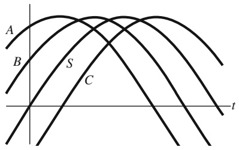

text_image

A
B S C
t

(a)

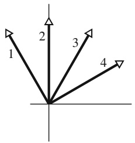

text_image

1
2
3
4

(b)

## KONTROLLFRAGE 5

Angenommen, wir erhöhen die Frequenz der Wechselstromquelle in einem Schaltkreis, der neben der Spannungsquelle nur einen Kondensator enthält. Wie verhalten sich (a) die Amplitude $V _ { C }$ und (b) die Amplitude $I _ { C ^ { \vdots } }$ nehmen sie zu, bleiben sie gleich oder nehmen sie ab?

## Eine reine Lastinduktivität

Abbildung 27.10a zeigt einen Schaltkreis mit einer Spule und einem Generator für die Wechselspannung aus Gl. 27.24. Mithilfe der Maschenregel erhalten wir (ähn lich wie bei den anderen einfachen Stromkreisen) für die Spannung an der Spule

$$
\nu_ {L} (t) = V _ {L} \sin \omega_ {\mathrm{a}} t, \tag {27.37}
$$

wobei $V _ { L }$ die Amplitude von $\nu _ { L }$ ist. Nach Gl. 26.32 gilt für die Spannung an einer Spule mit der Induktivität $L ,$ in der sich der Strom mit der Rate $\mathrm { d } i _ { L } / \mathrm { d } t$ verändert,

$$
\nu_ {L} (t) = L \frac {\mathrm{d} i _ {L}}{\mathrm{d} t}. \tag {27.38}
$$

Zusammen mit Gl. 27.37 folgt daraus

$$
\frac {\mathrm{d} i _ {L}}{\mathrm{d} t} = \frac {V _ {L}}{L} \sin \omega_ {\mathrm{a}} t. \tag {27.39}
$$

Unser Interesse gilt allerdings mehr dem Strom als seiner zeitlichen Ableitung. Den Strom erhalten wir, indem wir Gl. 27.39 integrieren:

$$
i _ {L} = \int \mathrm{d} i _ {L} = \frac {V _ {L}}{L} \int \sin \omega_ {\mathrm{a}} t \mathrm{d} t = - \left(\frac {V _ {L}}{\omega_ {\mathrm{a}} L}\right) \cos \omega_ {\mathrm{a}} t. \tag {27.40}
$$

Ähnlich wie schon bei der Kapazität ändern wir diese Gleichung in zweifacher Hinsicht: Zunächst führen wir die Größe $X _ { L }$ ein, die man als den induktiven Wider**stand** einer Induktivität bezeichnet und die wie folgt definiert ist:

$$
X _ {L} = \omega_ {\mathrm{a}} L \quad (\text {induktiver Widerstand}). \tag {27.41}
$$

$X _ { L }$ hängt außer von der Induktivität L auch von der Frequenz $\omega _ { \mathrm { a } }$ der Spannungsquelle ab. Aus der Einheit der induktiven Zeitkonstante $\tau _ { L }$ können wir ablesen, dass die SI-Einheit von $X _ { L }$ das Ohm ist, ebenso wie für $X _ { C }$ und R.

Außerdem ersetzen wir in Gl. 27.40 den Term − cos $\omega _ { \mathrm { a } } t$ durch eine phasenverschobene Sinusfunktion:

$$
- \cos \omega_ {\mathrm{a}} t = \sin (\omega_ {\mathrm{a}} t - 9 0 ^ {\circ}).
$$

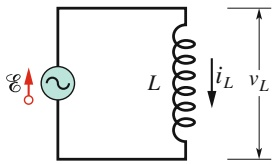

text_image

E
L
iL
vL

(a)

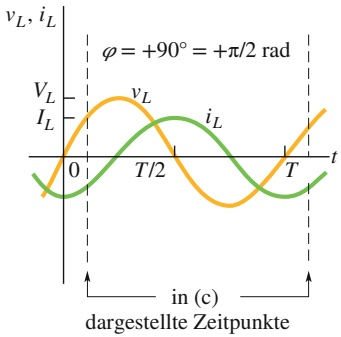

line

| Time (t) | vL | iL |
| --- | --- | --- |
| 0 | 0 | ~-1.5 |
| T/2 | 0 | 0 |
| T | 0 | ~-1.5 |

(b)

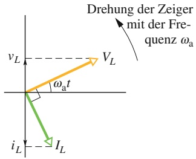

line

| Variable | Symbol |
| --- | --- |
| vL | Yellow arrow pointing down |
| V_L | Orange arrow pointing up |
| iL | Green arrow pointing down |
| I_L | Green arrow pointing up |
| \(\omega a t\) | Angle measurement indicator |

(c)

## Abb. 27.10

(a) Eine Spule ist mit einem Wechselstromgenerator verbunden. (b) In einem Liniendiagramm eilt der Strom in der Spule der Spannung um 90° $( = \pi / 2$ rad) nach. (c) Das zugehörige Zeigerdiagramm.

655

---

27 Elektromagnetische Schwingkreise und Wechselstrom

Auch diese Identität kann man sich grafisch veranschaulichen, indem man die Sinusfunktion entlang der Abszisse um $9 0 ^ { \circ }$ in die positive Richtung verschiebt.

Mit diesen beiden Veränderungen wird Gl. 27.40 zu

$$
i _ {L} (t) = \left(\frac {V _ {L}}{X _ {L}}\right) \sin (\omega_ {\mathrm{a}} t - 9 0 ^ {\circ}). \tag {27.42}
$$

Nach Gl. 27.25 gilt für den Strom in der Spule allgemein

$$
i _ {L} (t) = I _ {L} \sin (\omega_ {\mathrm{a}} t - \varphi). \tag {27.43}
$$

$I _ { L }$ ist die Amplitude des Stroms $i _ { L }$ . Durch Vergleich dieser beiden Gleichungen erkennen wir, dass die Phasenkonstante 𝜑 des Stroms für eine reine Lastinduktivität gleich $+ 9 0 ^ { \circ }$ ist. Außerdem besteht zwischen der Spannungsamplitude und der Stromamplitude die Beziehung

$$
V _ {L} = I _ {L} X _ {L} \quad (\text {Spule}). \tag {27.44}
$$

Diese Gleichung haben wir zwar für den Schaltkreis aus Abb. 27.10a hergeleitet, sie gilt jedoch für beliebige Spulen in Wechselstromkreisen.

Einem Vergleich von Gl. 27.37 mit Gl. 27.42 bzw. Abb. 27.10b entnehmen wir auch, dass die Größen $i _ { L }$ und $\nu _ { L }$ um $9 0 ^ { \circ }$ außer Phase sind, und zwar eilt $\nu _ { L }$ diesmal $i _ { L }$ voran. Trägt man den Strom $i _ { L }$ und die Spannung $\nu _ { L }$ in dem Stromkreis aus Abb. 27.10a in einem Liniendiagramm auf, erkennt man, dass $i _ { L }$ seinen Scheitelwert immer eine Viertelperiode nach $\nu _ { L }$ erreicht.

Diese Aussage stützt auch das Zeigerdiagramm in Abb. 27.10c. Der Zeiger $I _ { L }$ eilt dem Zeiger $V _ { L }$ um $9 0 ^ { \circ }$ nach, während sich beide gegen den Uhrzeigersinn um den Ursprung drehen. Überzeugen Sie sich, dass Abb. 27.10c tatsächlich eine grafische Darstellung der Gln. 27.37 und 27.42 ist.

## LÖSUNGSSTRATEGIEN

**Strategie 1: Phasenkonstanten für Größen in Wechselstromkreisen** Tabelle 27.2 fasst die Beziehungen zwischen dem Strom i und der Spannung v für alle drei bisher betrachteten Schaltkreiselemente nochmals zusammen. Wenn eine Wechselspannung in einem solchen Schaltkreis einen Wechselstrom erzeugt, befindet sich der Strom bei einem Wirkwiderstand in Phase mit der Spannung, an einem Kondensator eilt er der Spannung voraus und an einer Spule eilt er der Spannung nach.

## KONTROLLFRAGE 6

Angenommen, wir erhöhen die Frequenz der Wechselspannung in einem Schaltkreis mit einer reinen Lastinduktivität. Wie verhalten sich (a) die Amplitude $V _ { L }$ und (b) die Amplitude $I _ { L } ;$ nehmen sie zu, nehmen sie ab oder bleiben sie gleich?

TABELLE 27.2: Phasen- und Amplitudenbeziehungen für Wechselströme und Wechselspannungen.

| Schaltkreiselement | Symbol | Widerstand | Phase des Stroms | Phasenkonstante(oder Winkel) $\varphi$ | Amplituden-beziehung |
| --- | --- | --- | --- | --- | --- |
| Wirkwiderstand | $R$ | $R$ | in Phase mit $\nu_{R}$ | $0^{\circ} (= 0 \text{ rad})$ | $V_{R} = I_{R} R$ |
| Kondensator | $C$ | $X_{C} = 1/(\omega_{\text{a}} C)$ | eilt $\nu_{R}$ um $90^{\circ} (= \pi/2 \text{ rad})$ voraus | $-90^{\circ} (= -\pi/2 \text{ rad})$ | $V_{C} = I_{C} X_{C}$ |
| Induktivität | $L$ | $X_{L} = \omega_{\text{a}} L$ | eilt $\nu_{R}$ um $90^{\circ} (= \pi/2 \text{ rad})$ nach | $+90^{\circ} (= +\pi/2 \text{ rad})$ | $V_{L} = I_{L} X_{L}$ |

656

---

27.4 Der Reihen-RLC-Kreis

27

## 27.4 Der Reihen-RLC-Kreis

## Lernziele

Nach dem Durcharbeiten dieses Abschnitts sollten Sie in der Lage sein, . . .

• einen Reihen-RLC-Stromkreis zu skizzieren,
• anzugeben, wann sich ein RLC-Kreis überwiegend induktiv, kapazitiv oder resonant verhält,
• die Graphen für die Spannung V(t) und den Strom i(t) sowie die relevanten Zeigerdiagramme für einen überwiegend induktiven, kapazitiven bzw. resonanten Stromkreis zu skizzieren,
• die Impedanz Z auszurechnen,
• die Beziehung zwischen Stromamplitude I, Impedanz Z und Spannungsamplitude $\mathcal { E } _ { \mathrm { m } }$ anzuwenden,
• die Beziehungen zwischen der Phasenkonstante 𝜑 und den Spannungsamplituden $V _ { L }$ und $V _ { C }$ sowie zwischen der Phasenkonstante 𝜑, dem Wirkwiderstand R und dem kapazitiven bzw. dem induktiven Widerstand, $X _ { C }$ und $X _ { L } ,$ anzugeben,
• aus dem Wert der Phasenkonstante 𝜑 zu erkennen, ob es sich um einen überwiegend induktiven, kapazitiven oder resonanten Stromkreis handelt,
• im Resonanzfall die Beziehung zwischen der antreibenden Winkelfrequenz $\omega _ { \mathrm { a } } ,$ der natürlichen Winkelfrequenz $\omega ,$ der Induktivität L und der Kapazität C anzuwenden,
• die Stromamplitude gegen das Verhältnis $\omega _ { \mathrm { a } } / \omega$ aufzutragen und darin anzugeben, welche Bereiche einem überwiegend induktiven, kapazitiven bzw. resonanten Stromkreis entsprechen.

## Schlüsselideen

• In einem Reihen-RLC-Kreis mit der äußeren Spannung

$$
\mathcal {E} = \mathcal {E} _ {\mathrm{m}} \sin \omega_ {\mathrm{a}} t
$$

und dem Strom

$$
i = I \sin (\omega_ {\mathrm{a}} t - \varphi)
$$

ist die Stromamplitude

$$
\begin{array}{l} I = \frac {\mathcal {E} _ {\mathrm{m}}}{\sqrt {R ^ {2} + (X _ {L} - X _ {C}) ^ {2}}} \\ = \frac {\mathcal {E} _ {\mathrm{m}}}{\sqrt {R ^ {2} + (\omega_ {\mathrm{a}} L - 1 / (\omega_ {\mathrm{a}} C)) ^ {2}}} \quad \text {(Stromamplitude)}. \\ \end{array}
$$

• Die Phasenkonstante ist gegeben durch

$$
\tan \varphi = \frac {X _ {L} - X _ {C}}{R} \quad \text {(Phasenkonstante)}.
$$

• Die Impedanz Z ist

$$
Z = \sqrt {R ^ {2} + (X _ {L} - X _ {C}) ^ {2}} \qquad (\text {Impedanz}).
$$

• Der Zusammenhang zwischen der Stromamplitude und der Impedanz lautet

$$
I = \frac {\mathcal {E} _ {\mathrm{m}}}{Z}.
$$

• Die Stromamplitude I wird maximal $( I = \mathcal { E } _ { \mathrm { m } } / R )$ , wenn die antreibende Winkelfrequenz $\omega _ { \mathrm { a } }$ gleich der natürlichen Winkelfrequenz ω des Stromkreises ist, also im Resonanzfall. Dann gelten $X _ { C } = X _ { L }$ und $\varphi = 0$ und Strom und Spannung sind in Phase.

657

---

27 Elektromagnetische Schwingkreise und Wechselstrom

## 27.4.1 Der Reihen-RLC-Kreis

Wir betrachten im Folgenden den Fall, dass die Wechselspannung

$$
\mathcal {E} (t) = \mathcal {E} _ {\mathrm{m}} \sin \omega_ {\mathrm{a}} t \quad (\text {angelegte Wechselspannung}) \tag {27.45}
$$

aus Gl. 27.24 an den $R L C \cdot$ Kreis in Abb. 27.7 angelegt ist. Da $R ,   C$ und L in Reihe geschaltet sind, fließt durch alle drei Komponenten derselbe Strom

$$
i (t) = I \sin (\omega_ {\mathrm{a}} t - \varphi). \tag {27.46}
$$

Die Amplitude I und die Phasenkonstante 𝜑 dieses Stroms wollen wir nun bestimmen. Die Lösung dieser Aufgabe wird durch die Verwendung von Zeigerdiagrammen vereinfacht.

## Die Stromamplitude

Wir beginnen mit Abb. 27.11a, die ein Zeigerdiagramm für den Strom aus Gl. 27.46 zu einem beliebigen Zeitpunkt zeigt. Die Länge des grünen Zeigers ist gleich der Stromamplitude I, seine Projektion auf die vertikale Achse gibt den Momentanwert i des Stroms an und seine Orientierung entspricht dem Momentanwert der Phase $\omega _ { \mathrm { a } } t - \varphi .$

Abbildung 27.11b zeigt drei Zeiger für die Spannungen an $R , L$ und C zu demselben Zeitpunkt t. Die Orientierung der einzelnen Zeiger relativ zu dem Zeiger für I aus Abb. 27.11a entspricht den Angaben aus Tab. 27.2:

1. Wirkwiderstand: An einem Wirkwiderstand sind Strom und Spannung in Pha-${ \mathfrak { s e } } ,$ der Winkel des Spannungszeigers zu $V _ { R }$ ist daher derselbe wie der zu dem Stromzeiger I.
2. Kapazität: In diesem Fall eilt der Strom der Spannung um 90°voraus, der Winkel des Spannungszeigers $V _ { C }$ ist daher um 90° kleiner als der des Stromzeigers I.
3. Induktivität: In diesem Fall eilt der Strom der Spannung um $9 0 ^ { \circ }$ nach, der Winkel des Spannungszeigers $V _ { L }$ ist daher um 90° größer als der des Stromzeigers I.

Abbildung 27.11b zeigt auch die Momentanwerte der Spannungen $V _ { R } ,   V _ { C }$ und $V _ { L }$ an R, C und L zum Zeitpunkt $t ;$ sie sind die Projektionen der entsprechenden Zeiger auf die vertikale Achse des Diagramms.

Abbildung 27.11c zeigt das Zeigerdiagramm für die angelegte Wechselspannung aus Gl. 27.45. Die Länge des Zeigers entspricht der Wechselspannungsamplitude $\mathcal { E } _ { \mathrm { m } } ,$ seine Projektion auf die vertikale Achse gibt den Momentanwert  der Wechselspannung zum Zeitpunkt t an und sein Winkel beschreibt die Phase $\omega _ { \mathrm { a } } t$ der Wechselspannung zum Zeitpunkt t.

Nach der Maschenregel muss die Summe der Spannungen $V _ { R } , \; V _ { C }$ und $V _ { L }$ zu jedem Zeitpunkt gleich der angelegten Spannung $\mathcal { E } ( t )$ sein, also

$$
\mathcal {E} (t) = \nu_ {R} (t) + \nu_ {C} (t) + \nu_ {L} (t). \tag {27.47}
$$

Die Projektion  in Abb. 27.11c muss zu jedem Zeitpunkt t gleich der algebrai schen Summe der Projektionen $\nu _ { R } , \nu _ { C }$ und $\nu _ { L }$ in Abb. 27.11b sein. Da die Zeiger synchron rotieren, ist diese Bedingung automatisch erfüllt, wenn der Zeiger für $\mathcal { E } _ { \mathrm { m } }$

Abb. 27.11 (a) Ein Zeiger für den Wechselstrom in dem RLC-Kreis aus Abb. 27.7 zum Zeitpunkt t. Die Amplitude I, der Momentanwert i und die Phase $\omega _ { \mathrm { a } } t - \varphi$ sind angegeben. (b) Die drei Zeiger für die Spannungen an der Spule, dem Wirkwiderstand und dem Kondensator relativ zu dem Stromzeiger aus (a). (c) Der Zeiger für die angelegte Wechselspannung, die den in (a) dargestellten Strom erzeugt. (d) Der Wechselspannungszeiger muss gleich der Vektorsumme der drei Spannungszeiger aus (b) sein. Aus den Spannungszeigern für $V _ { L }$ und $V _ { C }$ wurde bereits die Differenz $\stackrel { \circ } { ( V _ { L } \mathrm { ~ - ~ } V _ { C } ) }$ gebildet.

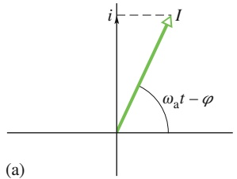

text_image

i --- I
ωₐt - φ
(a)

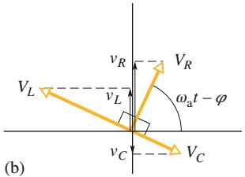

text_image

vR
V_R
ω_a t - φ
vL
vL
vC
V_C
(b)

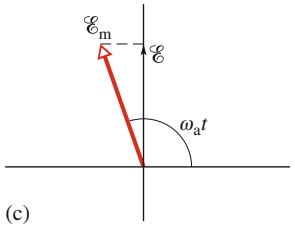

text_image

Em
ε
ωa t
(c)

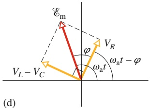

text_image

E_m
φ
V_R
ω_a t - φ
V_L - V_C
(d)

658

---

27.4 Der Reihen-RLC-Kreis

27

in Abb. 27.11c gleich der Vektorsumme der drei Zeiger für die Spannungen $V _ { R } ,   V _ { C }$ und $V _ { L }$ in Abb. 27.11b ist.

Diese Forderung illustriert Abb. 27.11d: Der Zeiger für $\mathcal { E } _ { \mathrm { m } }$ ist gleich der Summe der drei Zeiger für $V _ { R } , \; V _ { C }$ und $V _ { L } .$ . Da die beiden Zeiger für $V _ { L }$ und $V _ { C }$ entgegengesetzt gerichtet sind, können wir die Vektorsumme vereinfachen, indem wir zunächst $V _ { L }$ und $V _ { C }$ zu einem einzelnen Zeiger $V _ { L } - V _ { C }$ vereinen. Anschließend bilden wir die Summe aus diesem Zeiger und dem Zeiger für $V _ { R ^ { 1 } }$ . Diese Summe muss wie in der Abbildung dargestellt gleich dem Zeiger für $\mathcal { E } _ { \mathrm { m } }$ sein.

Beide Dreiecke in Abb. 27.11d sind rechtwinklig; nach dem Satz des Pythagoras gilt daher

$$
\mathcal {E} _ {\mathrm{m}} ^ {2} = V _ {R} ^ {2} + (V _ {L} - V _ {C}) ^ {2}. \tag {27.48}
$$

Mithilfe der Angaben aus Tab. 27.2 können wir die Amplituden auch durch die Stromamplitude und die Widerstände ausdrücken:

$$
\mathcal {E} _ {\mathrm{m}} ^ {2} = (I R) ^ {2} + (I X _ {L} - I X _ {C}) ^ {2}. \tag {27.49}
$$

Damit folgt für die Stromamplitude

$$
I = \frac {\mathcal {E} _ {\mathrm{m}}}{\sqrt {R ^ {2} + (X _ {L} - X _ {C}) ^ {2}}}  . \tag {27.50}
$$

Den Nenner in dieser Gleichung bezeichnet man als **Impedanz** $Z$ (oder den **Scheinwiderstand**) des Stromkreises für die antreibende Kreisfrequenz $\omega _ { \mathrm { a } } !$ :

$$
Z = \sqrt {R ^ {2} + (X _ {L} - X _ {C}) ^ {2}} \quad (\text {Definition der Impedanz}). \tag {27.51}
$$

Damit können wir Gl. 27.50 in der Form

$$
I = \frac {\mathcal {E} _ {\mathrm{m}}}{Z} \tag {27.52}
$$

schreiben. Wenn wir nun noch $X _ { L }$ und $X _ { C }$ nach den Gln. 27.34 bzw. 27.41 ersetzen, wird aus Gl. 27.50

$$
I = \frac {\mathcal {E} _ {\mathrm{m}}}{\sqrt {R ^ {2} + (\omega_ {\mathrm{a}} L - 1 / (\omega_ {\mathrm{a}} C)) ^ {2}}} \quad \text {(Stromamplitude)}. \tag {27.53}
$$

Die Hälfte unseres Ziels haben wir damit erreicht: Wir haben einen Ausdruck für die Stromstärke I als Funktion der antreibenden Spannung und der Komponenten des in Reihe geschalteten RLC-Kreises erhalten.

Die Stromamplitude I hängt nach Gl. 27.53 von der Differenz zwischen $\omega _ { \mathrm { a } } L$ und $1 / ( \omega _ { \mathrm { a } } C )$ bzw. nach Gl. 27.50 von der Differenz zwischen $X _ { L }$ und $X _ { C }$ ab. Welcher dieser beiden Widerstände größer ist, spielt dabei keine Rolle, da die Differenz quadratisch in die Stromamplitude eingeht.

Bei dem in diesem Abschnitt betrachteten Strom handelt es sich um den Dauerstrom, der sich nach längerer Zeit einstellt. Beim Einschalten einer Spannungsquelle kann ein kurzer Start- oder Einschaltstrom auftreten. Seine Dauer (bevor er in den Dauerstrom übergeht) hängt von den Zeitkonstanten $\tau _ { L }   =   L / R$ und $\tau _ { C } = R C$ ab, mit denen die induktiven und kapazitiven Komponenten des Stromkreises „eingeschaltet“ werden. Ein solcher Einschaltstrom kann sehr groß werden und beispielsweise einen Motor beim Anlassen zerstören, wenn er nicht bereits beim Entwurf der elektrischen Schaltkreise berücksichtigt wird.

## Die Phasenkonstante

Aus dem rechtwinkligen Zeigerdreieck in Abb. 27.11d sowie Tab. 27.2 entnehmen wir die Beziehung

$$
\tan \varphi = \frac {V _ {L} - V _ {C}}{V _ {R}} = \frac {I X _ {L} - I X _ {C}}{I R} \tag {27.54}
$$

659

---

27 Elektromagnetische Schwingkreise und Wechselstrom

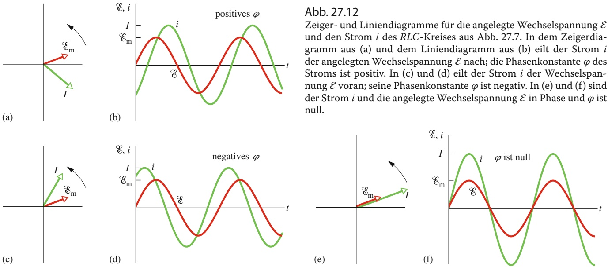

bzw.

$$
\tan \varphi = \frac {X _ {L} - X _ {C}}{R} \quad (\text {Phasenkonstante}). \tag {27.55}
$$

Damit haben wir auch unser zweites Ziel erreicht: Wir haben eine Gleichung für die Phasenkonstante $\varphi$ in einem Reihen-RLC-Kreis hergeleitet. Je nach den relativen Werten von $X _ { L }$ und $X _ { C }$ können wir drei Situationen unterscheiden:

1. $X _ { L } > X _ { C } ;$ In diesem Fall sagt man, der Schaltkreis habe induktiven Charakter. Nach Gl. 27.55 ist $\varphi$ für diesen Schaltkreis positiv, der Zeiger für I rotiert daher stets hinter dem Zeiger für $\mathcal { E } _ { \mathrm { m } }$ (Abb. 27.12a). In einem Liniendiagramm von  und i als Funktionen der Zeit erhält man einen Graphen wie in Abb. 27.12b. (Dieser Fall wird auch durch die Abb. 27.11c und d beschrieben.)
2. $X _ { C }   >   X _ { L }$ : In diesem Fall hat der Schaltkreis kapazitiven Charakter. Nach Gl. 27.55 ist $\varphi$ für diesen Schaltkreis negativ, der Zeiger für I rotiert demzufolge vor dem Zeiger für $\mathcal { E } _ { \mathrm { m } }$ (Abb. 27.12c). Trägt man  und i als Funktion der Zeit auf, erhält man das Liniendiagramm aus Abb. 27.12d.
3. $X _ { C } = X _ { L } ;$ In diesem Fall sagt man, der Schaltkreis befinde sich in Resonanz. Diesen Zustand behandeln wir im kommenden Abschnitt. Nach Gl. 27.55 gilt für einen solchen Schaltkreis $\varphi = 0 ^ { \circ }$ , die Zeiger für $\mathcal { E } _ { \mathrm { m } }$ und I liegen folglich übereinander und rotieren gemeinsam (Abb. 27.12e). Das Liniendiagramm für  und i als Funktion der Zeit hat die in Abb. 27.12f dargestellte Form.

Zur Illustration wollen wir nochmals die beiden Extremfälle betrachten: In dem rein induktiven Stromkreis aus Abb. 27.10a ist $X _ { L }$ von null verschieden und $X _ { C } =$ $R = 0$ . Nach Gl. 27.55 ist dann $\varphi = + 9 0 ^ { \circ }$ (der größtmögliche Werte für 𝜑), im Einklang mit Abb. 27.10c. In dem rein kapazitiven Stromkreis aus Abb. 27.9a ist $X _ { C }$ von null verschieden und $X _ { L } = R = 0$ . Nach Gl. 27.55 ist hier $\varphi = - 9 0 ^ { \circ }$ (der kleinstmögliche Wert für $\varphi )$ , was auch aus dem Liniendiagramm in Abb. 27.9c zu erkennen ist.

## Resonanz

Gleichung 27.53 gibt uns die Stromamplitude I eines RLC-Kreises als Funktion der Kreisfrequenz $\omega _ { \mathrm { a } }$ der äußeren Wechselspannung an. Für einen gegebenen Wirkwiderstand R nimmt diese Amplitude ihren Maximalwert an, wenn der Term $\omega _ { \mathrm { a } } L -$ $1 / ( \omega _ { \mathrm { a } } C )$ im Nenner null wird, also für

$$
\omega_ {\mathrm{a}} L = \frac {1}{\omega_ {\mathrm{a}} C}
$$

660

---

27.4 Der Reihen-RLC-Kreis

27

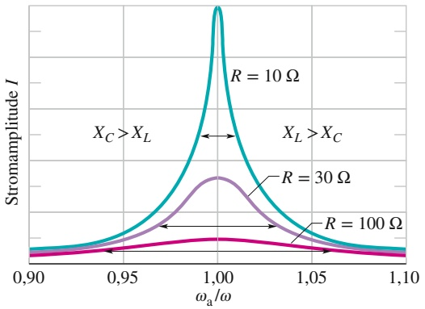

line

| \(\omega a/\omega\) | R = \(10 \Omega\) | R = \(30 \Omega\) | R = \(100 \Omega\) |
| --- | --- | --- | --- |
| 0.90 | ~0.05 | ~0.02 | ~0.01 |
| 0.95 | ~0.15 | ~0.10 | ~0.05 |
| 1.00 | ~1.00 | ~0.45 | ~0.15 |
| 1.05 | ~0.15 | ~0.10 | ~0.05 |
| 1.10 | ~0.05 | ~0.02 | ~0.01 |

oder

$$
\omega_ {\mathrm{a}} = \frac {1}{\sqrt {L C}} \quad (\text {maximaler Strom} I). \tag {27.56}
$$

Dies ist gleichzeitig die natürliche Kreisfrequenz ω eines RLC-Kreises. I wird also maximal, wenn die Kreisfrequenz der angelegten Spannung gleich der natürlichen Kreisfrequenz ist – d. h. im Resonanzfall. Die Bedingung für Resonanz und eine maximale Stromamplitude in einem Reihen-RLC-Kreis ist daher

$$
\omega_ {\mathrm{a}} = \omega = \frac {1}{\sqrt {L C}} \quad (\text {Resonanz}). \tag {27.57}
$$

Abbildung 27.13 zeigt drei Resonanzkurven für sinusförmig angetriebene Schwingungen von drei Reihen-RLC-Kreisen, die sich nur in ihrem Wirkwiderstand R unterscheiden. In allen Kurven erreicht die Stromamplitude für $\omega _ { \mathrm { a } } / \omega = 1 \mathrm { , } 0 0$ ihr Maximum, allerdings nimmt die maximale Amplitude mit zunehmendem R ab. (Der Maximalwert ist immer gleich $\mathcal { E } _ { \mathrm { m } } / R ,$ wie die Gln. 27.51 und 27.52 zeigen.) Außerdem nimmt die Breite der Kurven (die in Abb. 27.13 jeweils in halber Maximalhöhe gemessen wurde) mit zunehmendem R stark zu.

Um die Kurven in Abb. 27.13 physikalisch zu interpretieren, betrachten wir die Widerstände $X _ { L }$ und $X _ { C }$ als Funktionen der angelegten Kreisfrequenz $\omega _ { \mathrm { a } }$ . Wir beginnen bei Werten weit unterhalb der natürlichen Kreisfrequenz ω. In diesem Fall ist der induktive Widerstand $X _ { L } ~ ( = \omega _ { \mathrm { a } } L )$ sehr klein und der kapazitive Widerstand $X _ { C } \left( = 1 / \omega _ { \mathrm { a } } C \right)$ sehr groß. Der Stromkreis ist also überwiegend kapazitiv und die Impedanz ist vorwiegend durch den großen Wert von $X _ { C }$ bestimmt. Der Strom ist aus diesem Grund klein.

Mit zunehmendem $\omega _ { \mathrm { a } }$ dominiert $X _ { C }$ zwar zunächst weiterhin, nimmt aber allmählich ab, wohingegen $X _ { L }$ zunimmt. Die Abnahme von $X _ { C }$ verringert die Impedanz, der Strom nimmt daher zu, wie man auf der linken Seite der Resonanzkurven in Abb. 27.13 erkennt. Wenn $X _ { L }$ und $X _ { C }$ schließlich gleich groß sind, ist $\omega _ { \mathrm { a } } = \omega ,$ der Strom ist maximal und der Stromkreis befindet sich in Resonanz.

Wenn $\omega _ { \mathrm { a } }$ weiter zunimmt, steigt auch $X _ { L }$ weiter und überwiegt schließlich über das immer kleiner werdende $X _ { C ^ { \prime } }$ . Die Impedanz steigt nun wegen $X _ { L }$ und der Strom nimmt ab, wie man auf der rechten Seite der Kurven in Abb. 27.13 erkennt.

Zusammenfassend können wir sagen: Die niederfrequente Seite einer Resonanzkurve wird vorwiegend durch den kapazitiven Widerstand bestimmt, die hochfrequente Seite durch den induktiven Widerstand. Genau in der Mitte der Kurve tritt Resonanz auf.

## KONTROLLFRAGE 7

Die kapazitiven und induktiven Widerstände dreier RLC-Wechselstromkreise seien: (1) 50 Ω∕100 Ω, (2) 100 Ω∕50 Ω und (3) 50 Ω∕50 Ω. (a) In welchem der Fälle eilt der Strom der angelegten Spannung nach, in welchem der Fälle eilt er voran und in welchem der Fälle sind Strom und Spannung in Phase? (b) Welcher der Stromkreise befindet sich in Resonanz?

## Abb. 27.13

Resonanzkurven für den RLC-Kreis aus Abb. 27.7 mit $L   =   1 0 0   \mu \mathrm { H } ,$ $C = 1 0 0   \mathrm { p F }$ und drei verschiedenen Werten für R. Die Amplitude I des Wechselstroms hängt von der Differenz zwischen der antreibenden Frequenz $\omega _ { \mathrm { a } }$ und der natürlichen Kreisfrequenz ω ab. Die horizontalen Pfeile an den Kurven zeigen die Breite der Kurven in halber Höhe und sind ein Maß für die Schärfe der Resonanz. Links von $\omega _ { \mathrm { a } } / \omega = 1 \mathrm { , } 0 0$ ist der Stromkreis vorwiegend kapazitiv mit $X _ { C } > X _ { L } ;$ rechts davon ist er überwiegend induktiv mit $X _ { L } > X _ { C }$

661

---

27 Elektromagnetische Schwingkreise und Wechselstrom

## 27.5 Leistung in Wechselstromkreisen

## Lernziele

Nach dem Durcharbeiten dieses Abschnitts sollten Sie in der Lage sein, . . .

• den Zusammenhang zwischen Amplituden und Effektivwerten von Wechselstromgrößen wie Strom und Spannung zu verstehen,
den sinusförmigen Verlauf von Strom und Spannung an dem Bauelement zu skizzieren, wenn eine Wechselspannung an einen Widerstand, einen Kondensator oder eine Induktivität angelegt wird, und in dem Diagramm die Spitzenund Effektivwerte des Stroms bzw. der Spannung zu identifizieren,
• die Beziehung zwischen gemittelter Leistung $P _ { \mathrm { g e m } }$ , Effektivwert des Stroms $I _ { \mathrm { e f f } }$ und Widerstand R anzuwenden,
• die Leistung aller Bauelemente in einem periodisch angetriebenen RLC-Kreis zu berechnen,
• zu erklären, was in einem angetriebenen RLC-Kreis im stationären Zustand mit der mittleren gespeicherten Energie sowie der vom Generator in den Stromkreis eingebrachten Energie geschieht,
• die Beziehung zwischen dem Leistungsfaktor cos 𝜑, dem Widerstand R und der Impedanz Z anzuwenden,
• die Beziehung zwischen der gemittelten Leistung $P _ { \mathrm { g e m } } ,$ dem Effektivwert $\mathcal { E } _ { \mathrm { e f f } }$ der Spannung, dem Effektivwert $I _ { \mathrm { e f f } }$ des Stroms und dem Leistungsfaktor cos 𝜑 anzuwenden,
• zu verstehen, welcher Leistungsfaktor erforderlich ist, um die Energieübertragungsrate auf einen Lastwiderstand (also die dort anfallende Leistung) zu maximieren.

## Schlüsselideen

• In einem Reihen-RLC-Kreis ist die gemittelte Leistung $P _ { \mathrm { g e m } }$ des Generators gleich der Produktionsrate von thermischer Energie im Widerstand (also der dortigen Wärmeleistung):

$$
P _ {\mathrm{gem}} = I _ {\mathrm{eff}} ^ {2} R = I _ {\mathrm{eff}} \mathcal {E} _ {\mathrm{eff}} \cos \varphi .
$$

• Die Effektivwerte hängen mit den Amplituden bzw. Spitzenwerten der Wechselstromgrößen gemäß

$$
I _ {\mathrm{eff}} = \frac {I}{\sqrt {2}} \quad \mathrm{bzw.} \quad \mathcal {E} _ {\mathrm{eff}} = \frac {\mathcal {E} _ {\mathrm{m}}}{\sqrt {2}}
$$

zusammen. Der Term cos 𝜑 heißt Leistungsfaktor des Stromkreises.

## 27.5.1 Leistung in Wechselstromkreisen

In dem RLC-Kreis aus Abb. 27.7 ist der Wechselstromgenerator die Energiequelle. Ein Teil der von ihm gelieferten Energie wird im elektrischen Feld des Kondensators gespeichert, ein Teil im Magnetfeld der Spule und ein Teil wird im Wirkwider stand in Wärmeenergie umgewandelt. Im Dauerbetrieb – den wir hier annehmen – bleibt die mittlere Energie im Kondensator und in der Spule konstant. Im Wesentlichen fließt die Energie des Wechselstromgenerators dann in den Wirkwiderstand, wo sie in Wärmeenergie umgewandelt (dissipiert) wird.

Für die momentane Leistung, d. h. die Rate, mit der Energie in einem bestimmten Augenblick im Wirkwiderstand dissipiert wird, erhalten wir mithilfe der Gln. 22.22 und 27.25

$$
P = i ^ {2} R = [ I \sin (\omega_ {\mathrm{a}} t - \varphi) ] ^ {2} R = I ^ {2} R \sin^ {2} (\omega_ {\mathrm{a}} t - \varphi). \tag {27.58}
$$

Die mittlere Leistung am Wirkwiderstand erhalten wir durch Mittelung von Gl. 27.58 über die Zeit. Der Mittelwert von sin θ (wobei θ eine beliebige Varia-

662

---

27.5 Leistung in Wechselstromkreisen

27

ble ist) über eine ganze Periode verschwindet (Abb. 27.14a), aber der Mittelwert von $\sin ^ { 2 } \theta$ ist gleich 1/2 (Abb. 27.14b). (Man kann in Abb. 27.14b erkennen, dass die schattierte Fläche unter der Kurve oberhalb der gestrichelten horizontalen Linie bei sin2 $^ { 2 } \theta = + 1 / 2$ exakt gleich der nicht schattierten Fläche unterhalb dieser Linie ist.) Damit erhalten wir aus Gl. 27.58

$$
P _ {\mathrm{gem}} = \frac {I ^ {2} R}{2} = \left(\frac {I}{\sqrt {2}}\right) ^ {2} R. \tag {27.59}
$$

Die Größe $I / \sqrt { 2 }$ bezeichnet man als **quadratisches Mittel** oder **Effektivwert** des Stroms i:

$$
I _ {\mathrm{eff}} = \frac {I}{\sqrt {2}} \quad (\text {Effektivwert des Stroms}). \tag {27.60}
$$

Damit wird Gl. 27.59 zu

$$
P _ {\mathrm{gem}} = I _ {\mathrm{eff}} ^ {2} R \quad (\text {mittlere Leistung}). \tag {27.61}
$$

Gleichung 27.61 hat dieselbe mathematische Form wie Gl. 26.22 $( P = i ^ { 2 } R )$ . Das zeigt uns, dass wir die mittlere Leistung (Energiedissipationsrate) eines Wechselstromkreises auf dieselbe Weise wie bei einem Gleichstromkreis berechnen können, wenn wir für den Strom seinen Effektivwert einsetzen.

Ebenso wie für den Strom können wir auch für die Spannungen Effektivwerte einführen:

$$
V _ {\text {eff}} = \frac {V}{\sqrt {2}} \quad \text {und} \quad \mathcal {E} _ {\text {eff}} = \frac {\mathcal {E} _ {\mathrm{m}}}{\sqrt {2}} \quad \text {(Effektivwerte der Spannungen). (27.62)}
$$

Messgeräte für Wechselstromschaltungen wie Amperemeter und Voltmeter sind gewöhnlich so kalibriert, dass sie die Effektivwerte $I _ { \mathrm { e f f } }$ und $\mathcal { E } _ { \mathrm { e f f } }$ anzeigen. Wenn Sie also ein Voltmeter in eine gewöhnliche Steckdose stecken und 230 V ablesen, handelt es sich dabei um den Effektivwert der Spannung. Der maximale Momentanwert der Spannung an dieser Steckdose ist ${ \sqrt { 2 } } \cdot ( 2 3 0   \mathrm { V } ) = 3 2 5   \mathrm { V } .$

Der Proportionalitätsfaktor $1 / \sqrt { 2 }$ ist in den Gln. 27.60 und 27.62 für alle drei Größen derselbe, daher können wir die Gln. 27.52 und 27.50 auch in die Form

$$
I _ {\mathrm{eff}} = \frac {\mathcal {E} _ {\mathrm{eff}}}{Z} = \frac {\mathcal {E} _ {\mathrm{eff}}}{\sqrt {R ^ {2} + (X _ {L} - X _ {C}) ^ {2}}} \tag {27.63}
$$

bringen. In dieser Form werden wir diese Beziehung meist verwenden.

Mit dieser Gleichung können wir auch Gl. 27.61 in eine äquivalente und oft verwendete Form bringen. Dazu schreiben wir zunächst

$$
P _ {\mathrm{gem}} = \frac {\mathcal {E} _ {\mathrm{eff}}}{Z} I _ {\mathrm{eff}} R = \mathcal {E} _ {\mathrm{eff}} \mathrm{I} _ {\mathrm{eff}} \frac {R}{Z}. \tag {27.64}
$$

Aus Abb. 27.11d, Tab. 27.2 und Gl. 27.52 können wir jedoch ablesen, dass $R / Z$ gerade der Kosinus der Phasenkonstante 𝜑 ist:

$$
\cos \varphi = \frac {V _ {R}}{\mathcal {E} _ {\mathrm{m}}} = \frac {I R}{I Z} = \frac {R}{Z}. \tag {27.65}
$$

Damit erhalten wir Gl. 27.64 in der Form

$$
P _ {\mathrm{gem}} = \mathcal {E} _ {\mathrm{eff}} I _ {\mathrm{eff}} \cos \varphi \quad \text {(mittlere Leistung)}. \tag {27.66}
$$

Den Faktor cos 𝜑 in dieser Gleichung bezeichnet man als **Leistungsfaktor**. Da cos $\varphi = \cos ( - \varphi )$ ist, hängt Gl. 27.66 nicht vom Vorzeichen der Phasenkonstante 𝜑 ab.

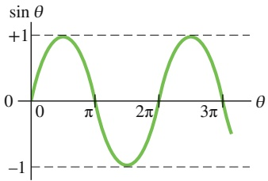

line

| \(\theta\) | sin \(\theta\) |
| --- | --- |
| 0 | 0 |
| ~\(0.5\pi\) | +1 |
| \(\pi\) | 0 |
| ~\(1.5\pi\) | -1 |
| \(2\pi\) | 0 |
| ~\(2.5\pi\) | +1 |
| \(3\pi\) | 0 |

(a)

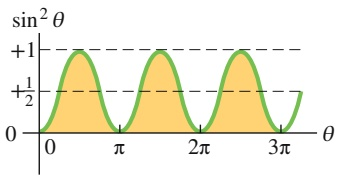

area

| \(\theta\) | \(sin^{2}\theta\) |
| --- | --- |
| 0 | 0 |
| ~\(0.5\pi\) | +1 |
| \(\pi\) | 0 |
| ~\(1.5\pi\) | +1 |
| \(2\pi\) | 0 |
| ~\(2.5\pi\) | +1 |
| \(3\pi\) | 0 |

(b)

## Abb. 27.14

(a) Die Auftragung von sin θ als Funktion von $\theta ;$ der Mittelwert über eine ganze Periode ist null. (b) Die Auftragung von sin2 θ als Funktion von θ; der Mittelwert über eine Periode ist 1/2.

663

---

27 Elektromagnetische Schwingkreise und Wechselstrom

Wenn die dem Lastwiderstand in einem RLC-Kreis zugeführte Leistung möglichst groß sein soll, sollte der Leistungsfaktor cos 𝜑 möglichst nahe bei eins liegen. Das ist gleichbedeutend mit der Forderung, dass die Phasenkonstante $\varphi$ in Gl. 27.25 möglichst nahe bei null liegen soll. Einen stark induktiven Charakter eines Stromkreises können wir durch die Reihenschaltung von Kapazitäten abschwä- chen. (Schaltet man zusätzliche Kapazitäten in Reihe mit bereits vorhandenen Kapazitäten, so wird die Gesamtkapazität $C _ { \mathrm { E r s } }$ dieser Reihe kleiner und damit $X _ { C }   { \bf g r } { \ddot { \bf o } } \cdot$ ßer.) Die resultierende Abnahme von $C _ { \mathrm { E r s } }$ verkleinert daher die Phasenkonstante und erhöht den Leistungsfaktor in Gl. 27.66. Diese Eigenschaft wird von Elektrizitätswerken ausgenutzt, die in ihren Stromkreisen an geeigneten Stellen zusätzliche Kondensatoren in Reihe schalten.

## KONTROLLFRAGE 8

(a) Angenommen, der Strom in einem Reihen-RLC-Kreis an einer sinusförmigen Wechselspannung eilt dieser Spannung voran. Sollte man die Kapazität erhöhen oder verringern, um die Leistung am Wirkwiderstand zu erhöhen? (b) Wird sich durch diese Veränderung die Resonanzfrequenz des Stromkreises der angelegten Wechselspannungsfrequenz nähern oder sich von ihr entfernen?

## 27.6 Transformatoren

## Lernziele

Nach dem Durcharbeiten dieses Abschnitts sollten Sie in der Lage sein, . . .

• zu erklären, warum bei der Spannungsübertragung in Überlandleitungen der Strom gering und die Spannung hoch sein sollte,
• die Aufgaben der Transformatoren an den Enden einer solchen Leitung zu beschreiben,
• die Energiedissipation in einer Hochspannungsleitung zu berechnen,
• die Primär- und Sekundärseite eines Transformators zu identifizieren,
• die Beziehung zwischen Spannungen und Windungszahlen auf den beiden Seiten eines Transformators anzuwenden,
• zwischen einem Aufwärts- und einem Abwärtstransformator zu unterscheiden,
• die Beziehung zwischen Strömen und Windungszahlen auf den beiden Seiten eines Transformators anzuwenden,
• die Beziehung zwischen der in einen Transformator hineingesteckten und der aus ihm herauskommenden Leistung zu kennen,
• den äquivalenten Ersatzwiderstand aus Sicht der Primärseite eines Transformators anzugeben,
• die Beziehung zwischen äquivalentem Ersatzwiderstand und realem Widerstand anzuwenden,
• die Rolle des Transformators bei der Impedanzanpassung zu erläutern.

## Schlüsselideen

Ein idealer Transformator ist ein ringförmiger Eisenkern, auf dessen einer Seite eine Primärspule mit $N _ { \mathrm { p } }$ Windungen und auf dessen anderer Seite eine Se kundärspule mit $N _ { s }$ Windungen gewickelt ist. Wenn die Primärspule an einen Wechselstromgenerator angeschlossen wird, gilt folgende Beziehung zwischen den Windungszahlen beider Spulen und der Primär- und Sekundärspannung:

$$
V _ {\mathrm{s}} = V _ {\mathrm{p}} \frac {N _ {\mathrm{s}}}{N _ {\mathrm{p}}} \quad \text {(Transformation der Spannungen)}.
$$

• Für die Ströme durch die Spulen gilt entsprechend

$$
I _ {\mathrm{s}} = I _ {\mathrm{p}} \frac {N _ {\mathrm{p}}}{N _ {\mathrm{s}}} \quad \text {(Transformation der Ströme)}.
$$

664

---

27.6 Transformatoren

27

• Der äquivalente Ersatzwiderstand des Sekundärkreises (aus Sicht des Primärkreises bzw. des Generators) ist

$$
R _ {\mathrm{Ers}} = \left(\frac {N _ {\mathrm{p}}}{N _ {\mathrm{s}}}\right) ^ {2} R,
$$

wobei R der Lastwiderstand am Sekundärkreis ist. Das Verhältnis $N _ { \mathrm { p } } / N _ { \mathrm { s } }$ nennt man das Übersetzungsverhältnis des Transformators.

## 27.6.1 Transformatoren

## Anforderungen an die Energieübertragung

Enthält ein Wechselstromkreis nur einen Wirkwiderstand, so ist der Leistungsfaktor in Gl. 27.66 cos $0 ^ { \circ } = 1$ und die angelegte Wechselspannung $\mathcal { E } _ { \mathrm { e f f } }$ ist gleich dem Effektivwert der Spannung $\mathcal { E } _ { \mathrm { e f f } }$ am Lastwiderstand. Wenn durch den Lastwiderstand ein Strom mit dem Effektivwert $I _ { \mathrm { e f f } }$ fließt, ist die mittlere Leistung

$$
P _ {\mathrm{gem}} = \mathcal {E} I = I V. \tag {27.67}
$$

(In dieser Gleichung und dem Rest dieses Abschnitts folgen wir der gängigen Praxis und lassen die Indizierung $\mathrm { { _ { v } e f f ^ { \omega } } }$ weg. Techniker und Ingenieure sind es gewohnt, alle zeitabhängigen Ströme und Spannungen durch ihre Effektivwerte anzugeben, die auch von den Messgeräten angezeigt werden.) Eine vorgegebene elektrische Leistung lässt sich nach dieser Gleichung auf viele verschiedene Arten realisieren, angefangen bei vergleichsweise großen Strömen I und kleinen Spannungen V bis hin zum umgekehrten Fall kleiner Ströme und großer Spannungen. Die Voraussetzung ist nur, dass das Produkt IV aus Strom und Spannung den erforderlichen Wert hat.

Im Rahmen der öffentlichen Stromversorgung ist es aus Sicherheitsgründen sowie der Möglichkeit einfacherer Konstruktionen wünschenswert, sowohl am Erzeugerende (dem Kraftwerk) als auch am Verbraucherende (den Haushalten oder der Industrie) vergleichsweise niedrige Spannungen zu verwenden. Niemand hätte gerne einen elektrischen Toaster oder eine elektrische Kindereisenbahn im Haus, die bei 10 kV betrieben wird. Andererseits sollte die Übertragung der elektrischen Energie vom Kraftwerk zum Verbraucher bei möglichst niedrigen Strömen (und damit der höchstmöglichen Spannung) erfolgen, damit der Ohmsche Verlust $I ^ { 2 } R$ in den Leitungen möglichst gering bleibt.

Betrachten wir als Beispiel die 735-kV-Hochspannungsleitung vom Wasserkraftwerk La Grande 2 in Quebec nach Montreal, die über eine Entfernung von rund 1000 km führt. Angenommen, der Strom beträgt 500 A und der Leistungsfaktor liegt nahe bei eins. Nach Gl. 27.67 gilt dann für die mittlere übermittelte Leistung

$$
P _ {\mathrm{gem}} = \mathcal {E} I = (7, 3 5 \cdot 1 0 ^ {5} \mathrm{V}) (5 0 0 \mathrm{A}) = 3 6 8 \mathrm{MW}.
$$

Der Wirkwiderstand der Hochspannungsleitungen beträgt rund 0,220 Ω/km. Auf eine Entfernung von 1000 km beträgt der Gesamtwiderstand daher 220 Ω. Aufgrund dieses Widerstands geht im Mittel eine Leistung

$$
P _ {\mathrm{gem}} = I ^ {2} R = (5 0 0 \mathrm{A}) ^ {2} (2 2 0 \Omega) = 5 5, 0 \mathrm{MW}
$$

verloren, was ungefähr 15 % der Gesamtleistung ausmacht.

Angenommen, wir würden nun den Strom verdoppeln und die Spannung halbieren. Am Erzeugerende käme dann immer noch eine Leistung von 368 MW an, aber die Verlustleistung wäre jetzt

$$
P _ {\mathrm{gem}} = I ^ {2} R = (1 0 0 0 \mathrm{A}) ^ {2} (2 2 0 \Omega) = 2 2 0 \mathrm{MW},
$$

was ungefähr 60 % der Gesamtleistung entspricht. Daraus ergibt sich die allgemeine Regel: Für die Übertragung elektrischer Energie über längere Strecken wähle man immer die größtmögliche Spannung und den kleinstmöglichen Strom!

natural_image

Silhouette of a modern city skyline at dusk with water reflection, no visible text or symbols

## Abb. 27.15

Am 9. November 1965 um 5 Uhr 17 morgens wurde in einem Elektrizitätswerk in der Nähe der Niagarafälle durch ein defektes Relais ein Stromkreisunterbrecher der Hochspannungsleitung geöffnet, wodurch der Strom automatisch auf andere Leitungen umgelenkt wurde. Durch die Überlastung dieser Leitungen wurden weitere Stromkreisunterbrecher geöffnet. Innerhalb von Minuten kam es zu einem weiträumigen Stromausfall in großen Teilen New Yorks, New Englands und Ontarios.

665

---

27 Elektromagnetische Schwingkreise und Wechselstrom

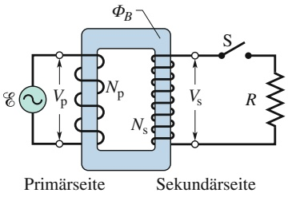

text_image

ΦB
Vp
Np
Ns
S
R
Primärseite
Sekundärseite

Abb. 27.16

Ein idealer Transformator (zwei um einen Eisenring gewickelte Spulen) in einem einfachen Transformatorschaltkreis. Der Wechselstromgenerator erzeugt in der linken Spule (der Primärspule) einen Strom. Die rechte Spule (die Sekundärspule) ist bei geschlossenem Schalter S mit einem Wirkwiderstand R verbunden.

## Der ideale Transformator

Die Forderung nach der Verwendung von Hochspannung für die Energieübertragung steht im Widerspruch zu dem Wunsch, dem Endverbraucher aus Sicherheitsgründen nur eine möglichst geringe Spannung zur Verfügung zu stellen. Man benötigt also ein Gerät, mit dem man die Wechselspannung zur Übertragung anheben und zum Gebrauch wieder absenken kann, sodass das Produkt aus Strom und Spannung im Wesentlichen konstant bleibt. Ein solches Gerät ist ein **Transformator**. Er enthält keine beweglichen Teile, sondern arbeitet auf der Grundlage des Faradayschen Induktionsgesetzes; aus diesem Grund existiert kein entsprechendes Gerät für Gleichstrom.

Der ideale Transformator in Abb. 27.16 besteht aus zwei Wicklungen (Spulen) mit unterschiedlichen Windungszahlen um zwei Abschnitte eines ringförmigen Eisenkerns. (Zwischen den Wicklungen und dem Eisenkern befindet sich eine Isolierung.) Die Primärwicklung mit einer Windungszahl $N _ { \mathrm { p } }$ ist mit einem Wechselstromgenerator verbunden, der eine Momentanspannung

$$
\mathcal {E} = \mathcal {E} _ {\mathrm{m}} \sin \omega t \tag {27.68}
$$

liefert. Die Sekundärwicklung mit $N _ { s }$ Windungen ist bei geschlossenem Schalter S mit einem Lastwiderstand R verbunden. Wir gehen zunächst davon aus, dass der Schalter geöffnet und der Stromkreis unterbrochen ist; durch die Sekundärspule fließt also noch kein Strom. Außerdem nehmen wir an, dass die Wirkwiderstände in der Primär- und Sekundärwicklung vernachlässigbar sind, ebenso wie Energieverluste durch magnetische Hystereseeffekte im Eisenkern. Gute Hochleistungstransformatoren haben einen Energieverlust von unter 1 $\% ,$ unsere Annahmen sind also berechtigt.

Unter diesen Bedingungen ist die Primärwicklung eine reine Induktivität und der Primärkreis entspricht dem Stromkreis aus Abb. 27.10a. Der (sehr kleine) Primärstrom, manchmal auch Magnetisierungsstrom $I _ { \mathrm { M a g } }$ genannt, eilt der Primärspannung $V _ { \mathrm { p } }$ um $9 0 ^ { \circ }$ nach. Der Leistungsfaktor des Primärkreises (= cos 𝜑 in Gl. 27.66) ist null, sodass vom Generator keine Leistung auf den Transformator übertragen wird.

Der kleine Primärwechselstrom $I _ { \mathrm { M a g } }$ induziert jedoch in dem Eisenkern einen alternierenden magnetischen Fluss $\phi _ { B } ^ { \phantom { \dagger } } .$ Der Eisenkern bündelt den Fluss und führt ihn durch die Sekundärwicklung, wo er eine Spannung induziert. Nach dem Faradayschen Induktionsgesetz (Gl. 26.6) ist die induzierte Spannung $\mathcal { E } _ { \mathrm { W } }$ pro Windung für die Primär- und die Sekundärwicklung gleich. Außerdem ist die Spannung $V _ { \mathrm { p } }$ an der Primärwicklung gleich der angelegten Wechselspannung und die Spannung $V _ { s }$ in der Sekundärwicklung ist gleich der induzierten Spannung in der Sekundärwicklung. Es gilt daher

$$
\mathcal {E} _ {\mathrm{W}} = \frac {\mathrm{d} \varPhi_ {B}}{\mathrm{d} t} = \frac {V _ {\mathrm{p}}}{N _ {\mathrm{p}}} = \frac {V _ {\mathrm{s}}}{N _ {\mathrm{s}}}
$$

und somit

$$
V _ {\mathrm{s}} = V _ {\mathrm{p}} \frac {N _ {\mathrm{s}}}{N _ {\mathrm{p}}} \quad (\text {Transformation der Spannung}). \tag {27.69}
$$

Für $N _ { \mathrm { s } } > N _ { \mathrm { p } }$ spricht man von einem Aufwärtstransformator, weil die Primärspannung $V _ { \mathrm { p } }$ auf eine höhere Spannung $V _ { s }$ transformiert wird. Entsprechend spricht man für $N _ { \mathrm { s } } < N _ { \mathrm { p } }$ von einem Abwärtstransformator.

Solange der Schalter offen bzw. der Stromkreis unterbrochen ist, wird keine Energie vom Generator auf den Rest des Stromkreises übertragen. Nun schließen wir den Schalter S und verbinden den Sekundärkreis mit der Wirklast R. Im Allge meinen enthält der Sekundärkreis auch induktive und kapazitive Elemente, doch hier betrachten wir nur den Wirkwiderstand R. In diesem Fall wird Energie vom Generator übertragen, was wir nun untersuchen wollen.

666

---

27.6 Transformatoren

27

Wenn der Schalter S geschlossen wird, passieren mehrere Dinge:

1. Im Sekundärkreis fließt ein Wechselstrom $I _ { s } ,$ wodurch an der Wirklast mit der Leistung $I _ { s } ^ { 2 } R \left( = V _ { s } ^ { 2 } / R \right)$ Energie verbraucht wird.
2. Dieser Strom erzeugt seinen eigenen alternierenden magnetischen Fluss im Ei senkern, der (nach dem Faradayschen Gesetz und der Lenzschen Regel) eine entgegengesetzt gerichtete Spannung in den Primärwicklungen induziert.
3. Die Spannung $V _ { \mathrm { p } }$ im Primärkreis kann sich jedoch aufgrund dieser induzierten Spannung nicht ändern, da sie immer gleich der angelegten Wechselspannung vom Generator sein muss. An dieser Tatsache kann auch die Schließung des zweiten Stromkreises nichts ändern.
4. Zur Aufrechterhaltung der Spannung $V _ { \mathrm { p } }$ erzeugt der Generator einen Wechselstrom $I _ { \mathrm { p } }$ zusätzlich zu $I _ { \mathrm { M a g } }$ im Primärkreis. Der Betrag und die Phasenkonstante von $I _ { \mathrm { p } }$ haben gerade solche Werte, dass die von $I _ { \mathrm { p } }$ im Primärkreis induzierte Spannung die von $I _ { \mathrm { s } }$ induzierte Spannung aufhebt. Da die Phasenkonstante von $I _ { \mathrm { p } }$ im Gegensatz zu der von $I _ { \mathrm { M a g } }$ nicht $9 0 ^ { \circ }$ ist, kann dieser Strom $I _ { \mathrm { p } }$ Energie auf den Primärkreis übertragen.

Wir wollen eine Beziehung zwischen $I _ { s }$ und $I _ { \mathrm { p } }$ finden. Anstatt jedoch den zuvor be schriebenen komplizierten Prozess im Detail zu verfolgen, nutzen wir einfach die Energieerhaltung. Der Generator überträgt Energie mit der Leistung $I _ { \mathrm { p } }   V _ { \mathrm { p } }$ auf den Primärkreis. Der Primärkreis überträgt (über das alternierende Magnetfeld zwischen den beiden Spulen) wiederum Energie mit der Leistung $I _ { s }   V _ { s }$ auf den Sekun därkreis. Da wir einen Verlust an Energie bei diesem Prozess explizit ausschließen wollten, folgt aus der Energieerhaltung

$$
I _ {\mathrm{p}} V _ {\mathrm{p}} = I _ {\mathrm{s}} V _ {\mathrm{s}}.
$$

Wir ersetzen $V _ { s }$ nach Gl. 27.69 und erhalten so

$$
I _ {\mathrm{s}} = I _ {\mathrm{p}} \frac {N _ {\mathrm{p}}}{N _ {\mathrm{s}}} \quad (\text {Transformation des Stroms}). \tag {27.70}
$$

Der Strom $I _ { s }$ auf der Sekundärseite unterscheidet sich also um das Übersetzungsverhältnis $N _ { \mathrm { p } } / N _ { \mathrm { s } }$ von dem Strom $I _ { \mathrm { p } }$ auf der Primärseite.

Der Strom $I _ { \mathrm { p } }$ im Primärkreis beruht auf der Wirklast R auf der Sekundärseite. Um $I _ { \mathrm { p } }$ zu berechnen, setzen wir $I _ { \mathrm { s } } = V _ { \mathrm { s } } / R$ in Gl. 27.70 ein und substituieren $V _ { s }$ aus Gl. 27.69; auf diese Weise erhalten wir

$$
I _ {\mathrm{p}} = \frac {1}{R} \left(\frac {N _ {\mathrm{s}}}{N _ {\mathrm{p}}}\right) ^ {2} V _ {\mathrm{p}}. \tag {27.71}
$$

Diese Gleichung hat die Form $I _ { \mathrm { p } } = V _ { \mathrm { p } } / R ^ { \prime }$ mit

$$
R ^ {\prime} = \left(\frac {N _ {\mathrm{p}}}{N _ {\mathrm{s}}}\right) ^ {2} R. \tag {27.72}
$$

$R ^ { \prime }$ ist ein effektiver Wirkwiderstand (manchmal spricht man auch von einem reduzierten Widerstand), wie er vom Generator auf der Primärseite „gesehen“ wird. Der Generator liefert die Spannung $V _ { \mathrm { p } }$ und erzeugt den Strom $I _ { \mathrm { p } } ,$ als ob er mit einem Wirkwiderstand $R ^ { \prime }$ verbunden wäre.

## Impedanzanpassung

Gleichung 27.72 gibt einen Hinweis auf eine weitere Anwendungsmöglichkeit des Transformators. Damit ein Generator Energie mit optimaler Leistung auf eine Wirklast übertragen kann, müssen der Widerstand im Generator und der Lastwi derstand gleich sein. Eine entsprechende Beziehung existiert auch für Wechsel-

667

---

27 Elektromagnetische Schwingkreise und Wechselstrom

stromkreise, nur dass in diesem Fall die Impedanzen anstelle der Wirkwiderstände zwischen Generator und Belastung gleich sein müssen; man bezeichnet dies als Impedanzanpassung. Diese Bedingung ist oft nicht erfüllt. So hat beispielsweise bei einer Stereoanlage der Verstärker eine hohe Impedanz, während die Lautsprecher eine niedrige Impedanz haben. Die Impedanzen lassen sich jedoch angleichen, indem man sie über einen Transformator mit einem geeignet gewählten Übersetzungsverhältnis $N _ { \mathrm { p } } / N _ { \mathrm { s } }$ koppelt.

## KONTROLLFRAGE 9

Eine Wechselspannungsquelle habe einen kleineren Widerstand als die Wirklast. Zur Erhöhung der Leistungsübertragung vom Generator zum Verbraucher wird zwischen beide Stromkreise ein Transformator geschaltet. (a) Sollte $N _ { s }$ in diesem Fall größer oder kleiner als $N _ { \mathrm { p } }$ sein? (b) Wird der Transformator dadurch zu einem Aufwärts- oder einem Abwärtstransformator?

## 27.7 Zusammenfassung

**Energieübertragung in einem LC-Kreis** In einem oszillierenden LC-Kreis fließt die Energie periodisch zwischen dem elektrischen Feld des Kondensators und dem Magnetfeld der Spule hin und her. Die Momentanwerte der beiden Energieformen sind

$$
U _ {E} = \frac {q ^ {2}}{2 C} \quad \text {und} \quad U _ {B} = \frac {L i ^ {2}}{2}, \tag {27.1,27.2}
$$

wobei $q$ der Momentanwert der Ladung auf dem Kondensator und i der Momentanwert des Stroms durch die Spule sind. Die Gesamtenergie $U = U _ { E } + U _ { B }$ bleibt konstant.

**Ladungs- und Stromschwingungen in einem LC-Kreis** Aus der Energieerhaltung folgt die Differenzialgleichung einer LC-Schwingung (ohne Wirkwiderstand):

$$
L \frac {\mathrm{d} ^ {2} q}{\mathrm{d} t ^ {2}} + \frac {1}{C} q = 0 \quad (L C \text {-Schwingungen}). \tag {27.11}
$$

Die Lösung dieser Gleichung lautet

$$
q (t) = Q \cos (\omega t + \varphi) \quad \text {(Ladung)}, \tag {27.12}
$$

wobei $Q$ die Ladungsamplitude (maximale elektrische Ladung auf dem Kondensator) ist. Für die Kreisfrequenz ω der Schwingung gilt

$$
\omega = \frac {1}{\sqrt {L C}}. \tag {27.14}
$$

Die Phasenkonstante $\varphi$ in Gl. 27.12 folgt aus den Anfangsbedingungen (zum Zeitpunkt $t = 0 )$ des Systems.

Der Momentanwert des Stroms i in diesem Schwingkreis folgt der Gleichung

$$
i (t) = - \omega Q \sin (\omega t + \varphi) \quad \text {(Strom)} \tag {27.13}
$$

mit der Stromamplitude $I = \omega Q$

**Gedämpfte Schwingungen** Die Schwingungen in einem LC-Kreis sind gedämpft, wenn der Stromkreis zusätzlich eine dissipative Komponente R enthält. In diesem Fall lautet die Differenzialgleichung

$$
L \frac {\mathrm{d} ^ {2} q}{\mathrm{d} t ^ {2}} + R \frac {\mathrm{d} q}{\mathrm{d} t} + \frac {1}{C} q = 0 \quad (R L C \text {-Kreis}). \tag {27.20}
$$

Die Lösung dieser Gleichung ist

$$
q (t) = Q \mathrm{e} ^ {- \mathrm{Rt} / (2 L)} \cos (\omega^ {\prime} t + \varphi) \tag {27.21}
$$

mit

$$
\omega^ {\prime} = \sqrt {\omega^ {2} - (R / 2 L) ^ {2}}. \tag {27.22}
$$

Wir betrachten nur den Fall kleiner Wirkwiderstände R und daher geringer Dämpfung. In diesem Fall gilt $\omega ^ { \prime } \approx \omega .$

**Wechselstromkreise; erzwungene Schwingung** Ein Reihen-RLC-Kreis kann durch eine von außen angelegte Wechselspannung

$$
\mathcal {E} = \mathcal {E} _ {\mathrm{m}} \sin \omega_ {\mathrm{a}} t \tag {27.24}
$$

zu einer erzwungenen Schwingung mit einer antreibenden Kreisfrequenz $\omega _ { \mathrm { a } }$ angeregt werden. Der durch die Quellenspannung erzeugte Strom ist

$$
i (t) = I \sin (\omega_ {\mathrm{a}} t - \varphi), \tag {27.25}
$$

wobei $\varphi$ die Phasenkonstante des Stroms bezeichnet.

**Resonanz** Die Stromamplitude I eines Reihen-RLC-Kreises, der durch eine sinusförmige Quellenspannung angetrieben wird, erreicht ihren Maximalwert, wenn die antreibende Kreisfrequenz $\omega _ { \mathrm { a } }$ gleich der natürlichen Kreisfrequenz des Stromkreises ist (Resonanzfall). In diesem Fall sind $X _ { C } = X _ { L }$ und $\varphi = 0 ;$ Strom und Quellenspannung sind also in Phase.

**Die einzelnen Komponenten des Stromkreises** Eine Wechselspannung an einem Wirkwiderstand hat die Amplitude $V _ { R } = I R .$ Strom und Potenzial sind in Phase.

Für eine Kapazität gilt $V _ { C } = I X _ { C } ,$ wobei $X _ { C } = 1 / ( \omega _ { \mathrm { a } } C )$ der **kapazitive Widerstand** ist. Der Strom eilt der Spannung um 90° voraus $\left( \varphi = - 9 0 ^ { \circ } = - \pi / 2   \mathrm { r a d } \right)$

668

---

27.8 Fragen

27

Für eine Induktivität gilt $V _ { L } = I X _ { L }$ , wobei $X _ { L } = \omega _ { \mathrm { a } } L$ der **induktive Widerstand** ist. Der Strom eilt der Spannung um $9 0 ^ { \circ }$ nach $\left( \varphi = + 9 0 ^ { \circ } = + \pi / 2   \mathrm { r a d } \right)$

**Reihen-RLC-Kreise** Für eine Reihen-RLC-Schaltung mit einer angelegten Wechselspannung gemäß Gl. 27.24 und einem Strom gemäß Gl. 27.25 gilt

$$
\begin{array}{l} I = \frac {\mathcal {E} _ {\mathrm{m}}}{\sqrt {R ^ {2} + (X _ {L} - X _ {C}) ^ {2}}} \\ = \frac {\mathcal {E} _ {\mathrm{m}}}{\sqrt {R ^ {2} + \left(\omega_ {\mathrm{a}} L - 1 / \left(\omega_ {\mathrm{a}} C\right)\right) ^ {2}}} \quad \text {(Stromamplitude)} \tag {27.50, 27.53} \\ \end{array}
$$

und

$$
\tan \varphi = \frac {X _ {L} - X _ {C}}{R} \quad (\text {Phasenkonstante}). \tag {27.55}
$$

Die Impedanz Z eines Wechselstromkreises ist durch

$$
Z = \sqrt {R ^ {2} + (X _ {L} - X _ {C}) ^ {2}} \qquad (\text {Impedanz}) \tag {27.51}
$$

definiert. Damit lässt sich Gl. 27.50 in der Form $I = \mathcal { E } _ { \mathrm { m } } / Z$ schreiben.

**Leistung** In einer RLC-Reihenschaltung ist die **mittlere Leistung** $P _ { \mathrm { g e m } }$ des Generators gleich der Erzeugungsrate von Wärmeenergie im Wirkwiderstand:

$$
P _ {\mathrm{gem}} = I _ {\mathrm{eff}} ^ {2} R = \mathcal {E} _ {\mathrm{eff}} I _ {\mathrm{eff}} \cos \varphi . \tag {27.61,27.66}
$$

## 27.8 Fragen

**1.** Ein geladener Kondensator und eine Spule werden zum Zeitpunkt t = 0 miteinander verbunden. Zu welchem Zeitpunkt (ausgedrückt durch die Periode T der resultierenden Schwingungen) erreichen die folgenden Größen ihren Maximalwert: (a) $U _ { B } ,$ (b) der magnetische Fluss durch die Spule, (c) $\mathrm { d } i / \mathrm { d } t$ und (d) die Spannung an der Spule?
**2.** Für welche Werte der Phasenkonstante 𝜑 in Gl. 27.12 erhält man zur Zeit $t = 0$ die Situationen (a), (c), (e) bzw. (g) aus Abb. 27.1?
**3.** Abbildung 27.F3 zeigt drei LC-Kreise mit identischen Spulen und Kondensatoren. Ordnen Sie die Schwingkreise in absteigender Reihenfolge nach der Zeit, die die Kondensatoren während der Schwingungszyklen zur vollständigen Entladung benötigen.

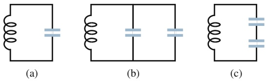

Abb. 27.F3

Der Index $\mathrm { _ { v } e f f ^ { \omega } }$ steht für Effektivwert. Die Effektivwerte hängen mit den Amplituden über die Beziehungen $I _ { \mathrm { e f f } } = I / \sqrt { 2 } ,   \mathcal { E } _ { \mathrm { e f f } } = V / \sqrt { 2 }$ und $\mathcal { E } _ { \mathrm { e f f } } = \mathcal { E } _ { \mathrm { m } } / \sqrt { 2 }$ zusammen. Den Term cos 𝜑 bezeichnet man als **Leistungsfaktor** des Stromkreises.

**Transformatoren** Ein (idealer) Transformator besteht aus einem ringförmigen Eisenkern, um den eine Primärspule mit $N _ { \mathrm { p } }$ Windungen und eine Sekundärspule mit $N _ { s }$ Windungen gewickelt sind. Die Primärspule ist mit einem Wechselstromgenerator verbunden. Primär- und Sekundärspannung hängen gemäß

$$
V _ {\mathrm{s}} = V _ {\mathrm{p}} \frac {N _ {\mathrm{s}}}{N _ {\mathrm{p}}} \quad \text {(Transformation der Spannung)} \tag {27.69}
$$

zusammen. Für die Ströme in den Spulen gilt

$$
I _ {\mathrm{s}} = I _ {\mathrm{p}} \frac {N _ {\mathrm{p}}}{N _ {\mathrm{s}}} \quad (\text {Transformation des Stroms}). \tag {27.70}
$$

Der Wirkwiderstand R auf der Sekundärseite wird vom Generator effektiv als

$$
R ^ {\prime} = \left(\frac {N _ {\mathrm{p}}}{N _ {\mathrm{s}}}\right) ^ {2} R \tag {27.72}
$$

wahrgenommen. Das Verhältnis $N _ { \mathrm { p } } / N _ { \mathrm { s } }$ bezeichnet man als das Übersetzungsverhältnis des Transformators.

**4.** Abbildung 27.F4 zeigt den Verlauf der Kondensatorspannung in zwei LC-Kreisen 1 und 2 mit zwei identischen Kondensatoren und derselben maximalen Ladung Q. Sind (a) die Induktivität L und (b) der Scheitelwert des Stroms I in Stromkreis 1 größer oder kleiner als in Stromkreis 2, oder sind sie gleich?

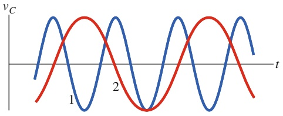

line

| t | vC (Curve 1) | vC (Curve 2) |
| --- | --- | --- |
| 0 | ~0.5 | ~-1.5 |
| 1 | ~1.5 | ~-0.5 |
| 2 | ~0.5 | ~1.5 |
| 3 | ~-1.5 | ~0.5 |
| 4 | ~-1.5 | ~-1.5 |
| 5 | ~0.5 | ~-0.5 |
| 6 | ~1.5 | ~0.5 |
| 7 | ~0.5 | ~1.5 |
| 8 | ~-1.5 | ~0.5 |
| 9 | ~-1.5 | ~-1.5 |
| 10 | ~0.5 | ~-0.5 |
| 11 | ~1.5 | ~0.5 |
| 12 | ~0.5 | ~1.5 |
| 13 | ~-1.5 | ~0.5 |
| 14 | ~-1.5 | ~-1.5 |
| 15 | ~0.5 | ~-0.5 |
| 16 | ~1.5 | ~0.5 |
| 17 | ~0.5 | ~1.5 |
| 18 | ~-1.5 | ~0.5 |
| 19 | ~-1.5 | ~-1.5 |
| 20 | ~0.5 | ~-0.5 |
| 21 | ~1.5 | ~0.5 |
| 22 | ~0.5 | ~1.5 |
| 23 | ~-1.5 | ~0.5 |
| 24 | ~-1.5 | ~-1.5 |
| 25 | ~0.5 | ~-0.5 |
| 26 | ~1.5 | ~0.5 |
| 27 | ~0.5 | ~1.5 |
| 28 | ~-1.5 | ~0.5 |
| 29 | ~-1.5 | ~-1.5 |
| 30 | ~0.5 | ~-0.5 |
| 31 | ~1.5 | ~0.5 |
| 32 | ~0.5 | ~1.5 |
| 33 | ~-1.5 | ~0.5 |
| 34 | ~-1.5 | ~-1.5 |
| 35 | ~0.5 | ~-0.5 |
| 36 | ~1.5 | ~0.5 |
| 37 | ~0.5 | ~1.5 |
| 38 | ~-1.5 | ~0.5 |
| 39 | ~-1.5 | ~-1.5 |
| 40 | ~0.5 | ~-0.5 |
| 41 | ~1.5 | ~0.5 |
| 42 | ~0.5 | ~1.5 |
| 43 | ~-1.5 | ~0.5 |
| 44 | ~-1.5 | ~-1.5 |
| 45 | ~0.5 | ~-0.5 |
| 46 | ~1.5 | ~0.5 |
| 47 | ~0.5 | ~1.5 |
| 48 | ~-1.5 | ~0.5 |
| 49 | ~-1.5 | ~-1.5 |
| 50 | ~0.5 | ~-0.5 |
| 51 | ~1.5 | ~0.5 |
| 52 | ~0.5 | ~1.5 |
| 53 | ~-1.5 | ~0.5 |
| 54 | ~-1.5 | ~-1.5 |
| 55 | ~0.5 | ~-0.5 |
| 56 | ~1.5 | ~0.5 |
| 57 | ~0.5 | ~1.5 |
| 58 | ~-1.5 | ~0.5 |
| 59 | ~-1.5 | ~-1.5 |
| 60 | ~0.5 | ~-0.5 |
| 61 | ~1.5 | ~0.5 |
| 62 | ~0.5 | ~1.5 |
| 63 | ~-1.5 | ~0.5 |
| 64 | ~-1.5 | ~-1.5 |
| 65 | ~0.5 | ~-0.5 |
| 66 | ~1.5 | ~0.5 |
| 67 | ~0.5 | ~1.5 |
| 68 | ~-1.5 | ~0.5 |
| 69 | ~-1.5 | ~-1.5 |
| 70 | ~0.5 | ~-0.5 |
| 71 | ~1.5 | ~0.5 |
| 72 | ~0.5 | ~1.5 |
| 73 | ~-1.5 | ~0.5 |
| 74 | ~-1.5 | ~-1.5 |
| 75 | ~0.5 | ~-0.5 |
| 76 | ~1.5 | ~0.5 |
| 77 | ~0.5 | ~1.5 |
| 78 | ~-1.5 | ~0.5 |
| 79 | ~-1.5 | ~-1.5 |
| 80 | ~0.5 | ~-0.5 |
| 81 | ~1.5 | ~0.5 |
| 82 | ~0.5 | ~1.5 |
| 83 | ~-1.5 | ~0.5 |
| 84 | ~-1.5 | ~-1.5 |
| 85 | ~0.5 | ~-0.5 |
| 86 | ~1.5 | ~0.5 |
| 87 | ~0.5 | ~1.5 |
| 88 | ~-1.5 | ~0.5 |
| 89 | ~-1.5 | ~-1.5 |
| 90 | ~0.5 | ~-0.5 |
| 91 | ~1.5 | ~0.5 |
| 92 | ~0.5 | ~1.5 |
| 93 | ~-1.5 | ~0.5 |
| 94 | ~-1.5 | ~-1.5 |
| 95 | ~0.5 | ~-0.5 |
| 96 | ~1.5 | ~0.5 |
| 97 | ~0.5 | ~1.5 |
| 98 | ~-1.5 | ~0.5 |
| 99 | ~-1.5 | ~-1.5 |
| 100 | — | — |

Note: The label 'vc' is positioned above the y-axis at the top left.

Abb. 27.F4

**5.** Die Ladungen auf den Kapazitäten in zwei LC-Schwingkreisen variieren folgendermaßen mit der Zeit: (1) $q =$ 2 cos 4t, (2) $q = 4$ cos t, (3) $q = 3$ cos 4t (q in Coulomb und t in Sekunden). Ordnen Sie die Stromkreise in absteigender Reihenfolge nach (a) der Stromamplitude und (b) der Periode.

**6.** Angenommen, Sie erhöhen in einem LC-Schwingkreis mit einer gegebenen maximalen Ladung Q die Induktivität. Wie verhalten sich (a) die Stromamplitude und (b) die

669

---

27 Elektromagnetische Schwingkreise und Wechselstrom

maximale magnetische Energie $U _ { B } ;$ bleiben sie gleich, nehmen sie zu oder nehmen sie ab?
**7.** Eine Wechselspannung mit einer bestimmten Spannungsamplitude werde nacheinander an einen Wirkwiderstand, einen Kondensator und eine Spule angeschlossen. In allen drei Fällen wird anschließend die Wechselspannungsfrequenz $f _ { \mathrm { a } }$ verändert und die Amplitude I des Stroms in dem Schaltkreis gemessen und gegen die Frequenz aufgetragen. Welche der drei Kurven in Abb. 27.F7 entspricht welchem Schaltkreis?

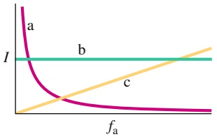

line

| Category | Value |
| --- | --- |
| I (constant) | b |
| Curve a | Starts at high value, decreases rapidly, approaches zero as fa increases |
| Curve b | Constant value across the range of fa |
| Curve c | Increases linearly from zero to higher values as fa increases |

Abb. 27.F7

**8.** Die Werte der Phasenkonstante in vier RLC-Kreisen mit einer antreibenden sinusförmigen Wechselspannung sind (1) −15°, (2) +35°, (3) $\pi / 3$ rad und (4) −π∕6 rad. (a) Für welchen Fall ist die Belastung überwiegend kapazitiv? (b) In welchem Fall eilt der Strom der Wechselspannung nach?
**9.** Abbildung 27.F9 zeigt den Strom i und die angelegte Spannung  eines in Reihe geschalteten RLC-Kreises. (a) Eilt der Strom der Spannung voraus oder nach? (b) Ist die Belastung überwiegend kapazitiv oder induktiv? (c) Ist die Kreisfrequenz $\omega _ { \mathrm { a } }$ der angelegten Spannung größer oder kleiner als die natürliche Kreisfrequenz ω?

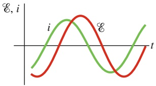

line

| Category | i | E |
| --- | --- | --- |
| Peak | ~0.8 | ~1.0 |
| Trough | ~-0.8 | ~-0.8 |

Abb. 27.F9

Fragen 9 und 11.

**10.** Die drei Zeigerdiagramme in Abb. 27.F10 entsprechen ähnlichen Situationen wie in Abb. 27.12. Ist die Kreisfrequenz der angelegten Spannung in den einzelnen Fällen größer als die Resonanzkreisfrequenz des Schaltkreises, ist sie kleiner oder ist sie gleich?

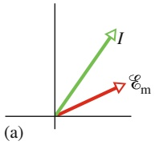

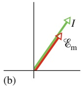

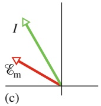

Abb. 27.F10

**11.** Abbildung 27.F9 zeigt den Strom i und die angelegte Spannung  eines Reihen-RLC-Kreises. Wie verhält sich die Kurve für den Strom relativ zu der Kurve für die angelegte Spannung, wenn wir (a) L, (b) C und (c) $\omega _ { \mathrm { a } }$ etwas erhöhen? Verschiebt sich die Kurve nach links oder rechts? Wird die Amplitude größer oder kleiner?
**12.** Abbildung 27.F12 zeigt den Strom i und die angelegte Spannung  einer Reihen-RLC-Schaltung. (a) Ist die Phasenkonstante positiv oder negativ? (b) Muss L größer oder kleiner werden, wenn die Leistung am Wirkwiderstand zunehmen soll? (c) Sollte für den gleichen Fall C zu- oder abnehmen?

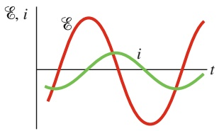

line

| t | E | i |
| --- | --- | --- |
| 0 | ~-1.5 | ~-0.8 |
| 1 | ~0.5 | ~-0.2 |
| 2 | ~1.8 | ~0.3 |
| 3 | ~0.5 | ~0.8 |
| 4 | ~-1.2 | ~0.5 |
| 5 | ~-1.8 | ~-0.2 |
| 6 | ~-0.5 | ~-0.8 |
| 7 | ~1.2 | ~-0.5 |
| 8 | ~2.5 | ~0.2 |

Abb. 27.F12

**13.** Kurve a in Abb. 27.F13 zeigt die Impedanz Z eines angetriebenen RC-Stromkreises in Abhängigkeit von der antreibenden Kreisfrequenz $\omega _ { \mathrm { a } } .$ Die anderen beiden Kurven sind ähnlich, aber für andere Werte von Widerstand R und Kapazität C. Ordnen Sie die drei Kurven in absteigender Reihenfolge nach dem jeweiligen Wert von R.

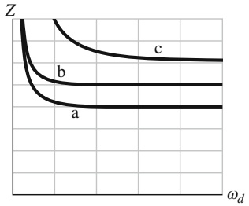

line

| \(\omega d\) | Curve a (Z) | Curve b (Z) | Curve c (Z) |
| --- | --- | --- | --- |
| Low | High | High | High |
| Medium | Low | Medium | Medium |
| High | Low | Low | Low |

Abb. 27.F13

**14.** (a) Entspricht das Zeigerdiagramm in Abb. 27.F14 einer Wechselspannungsquelle, die mit einem Widerstand, einem Kondensator oder einer Induktivität verbunden ist? (b) Wird die Länge des Stromzeigers größer oder kleiner, wenn die Winkelgeschwindigkeit des Zeigers zunimmt (die Diagrammskala bleibt gleich)?

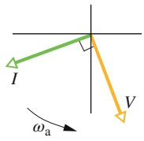

Abb. 27.F14

670
