# 28 Magnetismus und Materie

原始 PDF 第 685–712 页。

# 28 Magnetismus und Materie

## 28.1 Der Gaußsche Satz für Magnetfelder

## Physikalische Motivation

Dieses Kapitel zeigt, wie breit die Physik aufgestellt ist: Es reicht von den physikalischen Grundlagen der elektrischen und magnetischen Felder bis zu ganz praktischen Anwendungen von magnetischen Materialien. Zuerst schließen wir die grundlegende Diskussion der elektrischen und magnetischen Felder ab – als krö nenden Höhepunkt besprechen wir die vier fundamentalen Maxwellschen Gleichungen, die den überwiegenden Teil der letzten elf Kapitel dieses Buchs auf den Punkt bringen.

Danach diskutieren wir Wissenschaft und Technik von magnetischen Materialien. Viele Wissenschaftler und Ingenieure verbringen ihr Berufsleben damit, deren Natur zu entschlüsseln und neue nützliche Anwendungen zu finden. Sie fragen sich, warum Erde und Sonne ein magnetisches Feld haben, sie (und Sie!) dagegen nicht. Es gibt zahllose Anwendungen preiswerter magnetischer Werkstoffe in Autos, Küchen, Büros oder Krankenhäusern, und oft tauchen magnetische Materialien auch dort auf, wo man kaum mit ihnen rechnen würde. Sollten Sie beispielsweise ein Tattoo tragen und eine MRT-Untersuchung (Magnetresonanz-Tomografie) über sich ergehen lassen müssen, werden Sie vielleicht feststellen, dass die dort eingesetzten starken Magnetfelder merklich an Ihrer Haut ruckeln, da die für Tä- towierungen verwendete Tinte manchmal magnetische Teilchen enthält. Ein anderes Beispiel sind Frühstücksflocken, die als „mit Eisen angereichert“ beworben werden – sie enthalten tatsächlich kleine Eisenkügelchen und lassen sich mit einem Haushaltsmagneten aus der Frühstücksschüssel herausfischen!

## 28.1.1 Der Gaußsche Satz für Magnetfelder

Die magnetischen Eigenschaften eines Materials entstehen in seinen Atomen und Elektronen. Wir wollen aber zunächst von der makroskopischen Ebene ausgehen und beginnen daher mit dem Stabmagneten in Abb. 28.1. Wir hatten bereits gesehen, dass sich Eisenfeilspäne entlang der Magnetfeldlinien anordnen und uns so zeigen, wie die Feldlinien verlaufen. Das Zusammenlaufen der Linien an den Enden des Magneten zeigt, dass das eine Ende eine Quelle der Feldlinien ist (hier entspringt das Feld) und das andere eine Senke der Feldlinien (hier verschwindet das Feld). Die Quelle nennen wir den Nordpol des Magneten und das entgegengesetzte Ende (die Senke) den Südpol. Der Magnet mit seinen beiden Polen ist ein Beispiel für einen magnetischen Dipol.

Angenommen, wir brechen einen Stabmagneten auseinander wie ein Stück Kreide (Abb. 28.2). Man sollte meinen, dass wir auf diese Weise (wenn wir es geschickt anstellen) einen isolierten Pol erhalten sollten, einen Monopol. Das gelingt jedoch nicht – selbst wenn wir den Magneten bis in seine einzelnen Atome und sogar in die Atomkerne und Elektronen zerlegen könnten. Stets besteht jedes Bruchstück aus einem Nord- und einem Südpol. Wir schließen daraus:

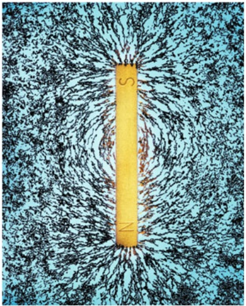

natural_image

Illustration of magnetic field lines around a vertical bar labeled 'S', with no text or symbols present.

Abb. 28.1 Ein Stabmagnet ist ein magnetischer Dipol. Eisenfeilspäne zeigen hier den Verlauf der magnetischen Feldlinien [Quelle: Richard Megna/Fundamental Photographs].

Halliday Physik für natur- und ingenieurwiss. Studiengänge, 3. Auflage. D. Halliday, R. Resnick und J. Walker. © 2020 WILEY-VCH Verlag GmbH & Co. KGaA. Published 2020 by WILEY-VCH Verlag GmbH & Co. KGaA.

671

---

28 Magnetismus und Materie

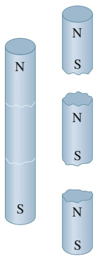

text_image

N
S
N
S
N
S

Abb. 28.2

Wenn wir einen Magneten zerbrechen, ist jedes Bruchstück selbst wieder ein vollständiger Magnet mit Nord- und Südpol.

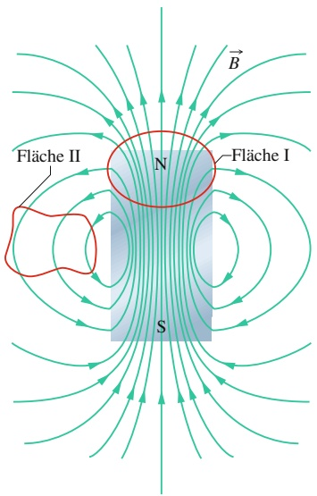

text_image

Fläche II
N
Fläche I
S
B

Abb. 28.3

Die Feldlinien für das Magnetfeld B⃗ eines kurzen Stabmagneten. Die roten Linien zeigen Schnitte durch geschlossene, dreidimensionale Gaußsche Oberflächen.

Das einfachste magnetische System ist ein magnetischer Dipol. Magnetische Monopole existieren nicht (nach heutigem Wissensstand).

Der Gaußsche Satz ist nichts weiter als eine formale Fassung der Feststellung, dass keine magnetischen Monopole existieren. Er besagt, dass der gesamte magnetische Fluss durch eine geschlossene Gaußsche Fläche verschwindet:

$$
\varPhi_ {B} = \oint \vec {B} \cdot \mathrm{d} \vec {A} = 0. \tag {28.1}
$$

Zum Vergleich betrachten wir noch einmal den Gaußschen Satz für elektrische Felder (Abschn. 28.2):

$$
\varPhi_ {E} = \oint \vec {E} \cdot \mathrm{d} \vec {A} = \frac {q _ {\text {innen}}}{\varepsilon_ {0}}.
$$

In beiden Fällen wird über eine geschlossene Gaußsche Oberfläche integriert. Der Gaußsche Satz für elektrische Felder besagt, dass dieses Integral (der gesamte Fluss des elektrischen Felds durch die Oberfläche) proportional zur Gesamtladung $q _ { \mathrm { i n n e n } }$ ist, die von der Oberfläche umschlossen wird. Der Gaußsche Satz für Magnetfelder besagt, dass der Fluss des Magnetfelds durch eine solche Oberfläche verschwindet, da es keine „magnetischen Ladungen“ (keine magnetischen Monopole) gibt, die von der Oberfläche umschlossen werden könnten. Die einfachste magnetische Struktur, die existiert und folglich von einer Oberfläche eingeschlossen werden kann, sind magnetische Dipole, die aus einer Quelle und einer Senke des magnetischen Felds bestehen. Der Fluss des Magnetfelds in die Oberfläche hinein muss deshalb immer genau gleich groß sein wie der Fluss aus ihr heraus, also muss der Gesamtfluss stets null sein.

Der Gaußsche Satz für Magnetfelder gilt auch für kompliziertere Systeme als magnetische Dipole und er gilt sogar dann, wenn die Oberfläche nicht das gesamte System umgibt. Die Gaußsche Fläche II in der Nähe des Stabmagneten in Abb. 28.3 umschließt keine Pole, sodass wir sofort sagen können, dass der Gesamtfluss des magnetischen Felds durch sie null sein muss. Die Oberfläche I macht da mehr Schwierigkeiten. Es sieht so aus, als ob sie nur den Nordpol des Magneten umschlösse, da sie zwar dessen Bezeichnung $_ { p } \mathrm { N } ^ { \alpha }$ enthält, nicht aber die Bezeichnung ${ } _ { p } S ^ { \alpha }$ des Südpols. Aber mit der unteren Begrenzung dieser Fläche muss ein magnetischer Südpol verbunden sein, da hier die Feldlinien in die Oberfläche eintreten. (Der eingeschlossene Teil des Magneten entspricht einem der Bruchstücke des Stabmagneten aus Abb. 28.2.) Auch Oberfläche I umschließt somit einen magnetischen Dipol und der Gesamtfluss des Magnetfelds durch sie ist null.

## KONTROLLFRAGE 1

Die Abbildung zeigt vier geschlossene Oberflächen mit flachen oberen und unte ren Abschlüssen und gekrümmten Seiten. Die Tabelle zeigt die Flächeninhalte $A _ { \mathrm { o } }$ und $A _ { \mathfrak { u } }$ der oberen bzw. unteren Abschlüsse sowie die Feldstärken $B _ { \mathrm { o } }$ und $B _ { \mathrm { u } }$ der homogenen und senkrechten Magnetfelder durch sie in willkürlichen, aber konsistenten Einheiten. Ordnen Sie die Oberflächen in absteigender Reihenfolge nach dem magnetischen Fluss durch ihre gekrümmten Seiten.

| Oberfläche | $A_{o}$ | $B_{o}$ | $A_{u}$ | $B_{u}$ |
| --- | --- | --- | --- | --- |
| a | 2 | 6, nach außen | 4 | 3, nach innen |
| b | 2 | 1, nach innen | 4 | 2, nach innen |
| c | 2 | 6, nach innen | 2 | 8, nach außen |
| d | 2 | 3, nach außen | 3 | 2, nach außen |

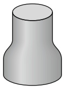

(a)

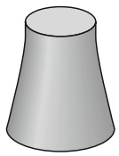

(b)

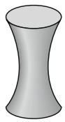

(c)

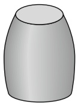

(d)

672

---

28.2 Induzierte magnetische Felder

28

## 28.2 Induzierte magnetische Felder

## Lernziele

Nach dem Durcharbeiten dieses Abschnitts sollten Sie in der Lage sein, . . .

• zu verstehen, dass ein veränderlicher elektrischer Fluss ein magnetisches Feld induziert,
• das Maxwellsche Induktionsgesetz anzuwenden, um aus der Änderungsgeschwindigkeit des elektrischen Flusses durch eine geschlossene Schleife das um diese induzierte Magnetfeld zu bestimmen,
• die Feldlinien des induzierten magnetischen Felds innerhalb eines Kondensators mit parallelen kreisförmigen Platten zu skizzieren, der gerade geladen wird, und die Richtung der elektrischen und magnetischen Feldvektoren anzugeben,
• das Ampère-Maxwellsche Gesetz auf den allgemeinen Fall induzierter magnetischer Felder anzuwenden.

## Schlüsselideen

• Ein veränderlicher elektrischer Fluss induziert ein magnetisches Feld:

$$
\oint \vec {B} \cdot \mathrm{d} \vec {s} = \mu_ {0} \varepsilon_ {0} \frac {\mathrm{d} \varPhi_ {E}}{\mathrm{d} t} \quad (\text {Maxwellsches Induktionsgesetz}).
$$

Diese Beziehung gibt den Zusammenhang zwischen der zeitlichen Ableitung des elektrischen Flusses $\Phi _ { E }$ durch eine geschlossene Schleife und dem um sie induzierten magnetischen Feld an.

• Das Ampèresche Gesetz $\oint \vec { B } \cdot \mathrm { d } \vec { s } = \mu _ { 0 } i _ { \mathrm { u m } }$ beschreibt das Magnetfeld aufgrund des von einer geschlossenen Schleife umschlossenen Stroms $i _ { \mathrm { u m } }$ . Beide Gesetze lassen sich zu einer einzigen Gleichung kombinieren:

$$
\oint \vec {B} \cdot \mathrm{d} \vec {s} = \mu_ {0} \varepsilon_ {0} \frac {\mathrm{d} \varPhi_ {E}}{\mathrm{d} t} + \mu_ {0} i _ {\mathrm{um}} \quad (\text {Ampère - Maxwellsches Gesetz}).
$$

## 28.2.1 Induzierte magnetische Felder

In Kapitel 26 hatten wir gesehen, dass ein veränderlicher magnetischer Fluss ein elektrisches Feld induziert, und hatten das Faradaysche Induktionsgesetz in der Form

$$
\oint \vec {E} \cdot \mathrm{d} \vec {s} = - \frac {\mathrm{d} \varPhi_ {B}}{\mathrm{d} t} \tag {28.2}
$$

erhalten. Dabei ist $\vec { E }$ das elektrische Feld, das entlang einer geschlossenen Schleife durch den sich ändernden magnetischen Fluss $\varPhi _ { B }$ im Inneren dieser Schleife induziert wird. Da Symmetrieargumente in der Physik häufig sehr nützlich sind, könnten wir nun fragen, ob die Induktion auch in umgekehrter Richtung erfolgen kann, d. h., ob ein sich ändernder elektrischer Fluss vielleicht auch ein Magnetfeld induzieren kann.

Die Antwort auf diese Frage ist ja. Auch die Gleichung, die diese Induktion beschreibt, ist nahezu symmetrisch zu Gl. 28.2. Sie wird oft (nach James Clerk Maxwell) als Maxwellsches Induktionsgesetz bezeichnet:

$$
\oint \vec {B} \cdot \mathrm{d} \vec {s} = \mu_ {0} \varepsilon_ {0} \frac {\mathrm{d} \varPhi_ {E}}{\mathrm{d} t}. \tag {28.3}
$$

Hier ist $\vec { B }$ das Magnetfeld, das entlang einer geschlossenen Schleife durch den sich ändernden elektrischen Fluss $\Phi _ { E }$ im Inneren dieser Schleife induziert wird.

Als Beispiel für diese Art der Induktion betrachten wir das Laden eines Plattenkondensators mit kreisförmigen Platten (Abb. 28.4a). (Obwohl wir uns aus

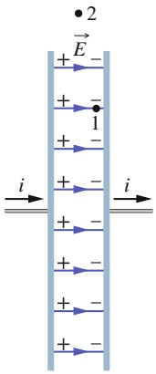

text_image

+ E -
+ - 1
+ - -
+ - -
+ - -
+ - -
+ - -
+ - -
+ - -
+ - -
+ - -
+ - -
+ - -
+ - -
+ - -
+ - -
+ - -
+ - -
+ - -
+ - -
+ - -
+ - -
+ - -
+ - -
+ - -
+ - -
+ - -
+ - -
+ - -
+ - -
+ - -
+ - -
+ - -
+ - -
+ - -
+ - -
i → i →

(a)

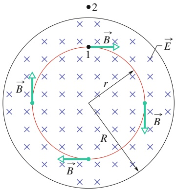

text_image

2
1
B
E
r
R
B
B

(b)

## Abb. 28.4

(a) Ein zylindrischer Plattenkondensator beim Laden mit einem konstanten Strom i von der Seite. (b) Blick aus dem Innenraum des Kondensators auf die rechte Platte. Das elektrische Feld E⃗ ist homogen, zeigt in die Seite (auf die Platte zu) und die Feldstärke steigt während des Ladevorgangs an. Das durch dieses veränderliche elektrische Feld induzierte Magnetfeld B⃗ ist an vier Punkten auf einem Kreis mit Radius r gezeigt (r kleiner als der Plattenradius R).

673

---

28 Magnetismus und Materie

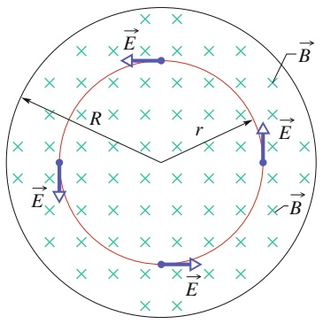

text_image

R
r
E
B
E
B
E

Abb. 28.5

Ein homogenes Magnetfeld B⃗ in einem kreisförmigen Raumbereich. Das Feld zeigt in die Seite hinein und nimmt zu. Das von diesem Magnetfeld induzierte elektrische Feld $\vec { E }$ ist an vier Punkten auf einem Kreis eingezeichnet.

praktischen Gründen auf diese Anordnung konzentrieren werden, induziert ein veränderlicher elektrischer Fluss natürlich immer ein Magnetfeld, egal in welcher Anordnung.) Wir nehmen an, dass die Ladung auf den Platten durch einen kon stanten Strom i in den Zuleitungen stetig steigt, wodurch auch die Feldstärke des elektrischen Felds zwischen den Platten stetig zunimmt.

Abbildung 28.4b zeigt den Blick aus dem Innenraum des Kondensators auf die rechte Platte aus Abb. 28.4a; das elektrische Feld zeigt hier in die Seite hinein. Wir betrachten jetzt eine kreisförmige Schleife durch Punkt 1 in Abb. 28.4a und $^ \mathrm { b , }$ die kleiner ist als die Platten und konzentrisch zu ihnen. Da das elektrische Feld durch die Schleife sich ändert, muss sich auch der elektrische Fluss durch sie ändern. Nach Gl. 28.3 induziert dieser veränderliche elektrische Fluss ein Magnetfeld um die Schleife.

Experimente zeigen, dass tatsächlich ein Magnetfeld $\vec { B }$ in der eingezeichneten Richtung um eine solche Schleife induziert wird. Das induzierte Feld hat an allen Punkten um die Schleife dieselbe Feldstärke, ist also rotationssymmetrisch um die zentrale Achse des Kondensators.

Nun betrachten wir eine weitere, größere kreisförmige Schleife, z. B. durch Punkt 2 in Abb. 28.4a und b. Auch um diese Schleife wird ein Magnetfeld induziert. Solange das elektrische Feld sich ändert, wird also sowohl innerhalb der Platten als auch außerhalb ein magnetisches Feld zwischen den Platten induziert. Sobald das elektrische Feld sich nicht mehr ändert, verschwindet das induzierte Magnetfeld.

Obwohl die Gln. 28.3 und 28.2 einander sehr ähneln, unterscheiden sie sich in zwei Punkten. Erstens tauchen in Gl. 28.3 die beiden zusätzlichen Größen $\mu _ { 0 }$ und $\varepsilon _ { 0 }$ auf, die jedoch nur damit zusammenhängen, dass wir in den Gleichungen das SI-System benutzen. Zweitens fehlt in Gl. 28.3 das Minuszeichen aus Gl. 28.2. Das bedeutet, dass das induzierte elektrische Feld $\vec { E }$ und das induzierte Magnetfeld $\vec { B }$ in entgegengesetzte Richtungen zeigen, wenn sie auf ansonsten sehr ähnliche Weise erzeugt werden. Um diesen Unterschied zu erkennen, betrachten wir Abb. 28.5, in der ein zunehmendes, in die Seite gerichtetes Magnetfeld $\vec { B }$ ein elektrisches Feld $\vec { E }$ induziert. Das induzierte Feld $\vec { E }$ ist im Gegenuhrzeigersinn gerichtet, entgegen dem induzierten Magnetfeld $\vec { B }$ aus Abb. 28.4b.

## Das Ampère-Maxwellsche Gesetz

Wir erinnern uns, dass die linke Seite aus Gl. 28.3, das Integral über das Skalarprodukt $\vec { B }$ ⋅ d⃗s über eine geschlossene Schleife, auch in einer anderen Gleichung auftritt – dem Ampèreschen Gesetz:

$$
\oint \vec {B} \cdot \mathrm{d} \vec {s} = \mu_ {0} i _ {\mathrm{um}}. \tag {28.4}
$$

Hier ist $i _ { \mathrm { u m } }$ der von der Schleife umschlossenen Strom. Beide Gleichungen beschreiben ein induziertes Magnetfeld (das einmal durch einen Strom erzeugt wird und einmal durch ein veränderliches elektrisches Feld) und haben genau dieselbe Form. Wir können die Gleichungen daher zum Ampère-Maxwellschen Gesetz kombinieren:

$$
\oint \vec {B} \cdot \mathrm{d} \vec {s} = \mu_ {0} \varepsilon_ {0} \frac {\mathrm{d} \varPhi_ {E}}{\mathrm{d} t} + \mu_ {0} i _ {\mathrm{um}}. \tag {28.5}
$$

Wenn ein Strom fließt, der elektrische Fluss sich aber nicht ändert (z. B. im Fall eines konstanten Stroms in einem Leiter), ist der erste Term auf der rechten Seite von Gl. 28.5 null und die Gleichung reduziert sich auf Gl. 28.4, das Ampèresche Gesetz. Wenn sich umgekehrt der elektrische Fluss ändert, aber kein Strom fließt (wie zwischen den Platten eines Kondensators beim Laden), ist der zweite Term auf der rechten Seite von Gl. 28.5 null und die Gleichung reduziert sich auf Gl. 28.3, das Maxwellsche Induktionsgesetz.

674

---

28.3 Der Verschiebungsstrom und die Maxwell-Gleichungen

28

## KONTROLLFRAGE 2

Die Abbildung zeigt Auftragungen der elektrischen Feldstärke E gegen die Zeit für vier homogene elektrische Felder in identischen kreisförmigen Raumbereichen wie in Abb. 28.4b. Ordnen Sie die Felder in absteigender Reihenfolge nach der Feldstärke der induzierten Magnetfelder am Rand dieses Bereichs.

## 28.3 Der Verschiebungsstrom und die Maxwell-Gleichungen

## Lernziele

Nach dem Durcharbeiten dieses Abschnitts sollten Sie in der Lage sein, . . .

zu verstehen, dass man den Beitrag des veränderlichen elektrischen Flusses im Ampère-Maxwellschen Gesetz einem gedachten elektrischen Strom zuordnen kann, dem sogenannten $_ { p } \mathrm { V }$ erschiebungsstrom“, was die Formulierung vereinfacht,
• zu verstehen, dass nach diesem Konzept beim Laden oder Entladen eines Kondensators ein homogen über die Platten verteilter Verschiebungsstrom zwischen den Platten „fließt“,
• die Beziehung zwischen der zeitlichen Änderung des elektrischen Flusses und dem zugehörigen Verschiebungsstrom anzuwenden,
den Zusammenhang zwischen dem Verschiebungsstrom und dem realen Strom für einen Kondensator beim Laden oder Entladen anzugeben und zu verstehen, dass es nur dann einen Verschiebungsstrom gibt, wenn sich das elektrische Feld im Kondensator ändert,
• das Magnetfeld in einem Gebiet mit Verschiebungsstrom zu bestimmen, indem Sie einen Strom durch einen fiktiven Draht annehmen,
• das magnetische Feld von realen und Verschiebungsströmen mithilfe des Ampère-Maxwellschen Gesetzes zu berechnen,
• die magnetischen Feldlinien aufgrund des Verschiebungsstroms beim Laden oder Entladen eines Kondensators zu skizzieren,
• die Maxwellschen Gleichungen anzugeben und die Bedeutung aller vier Gleichungen zu verstehen.

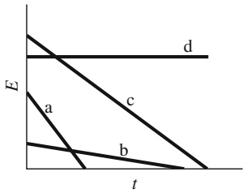

line

| Category | Trend |
| --- | --- |
| a | Downward sloping line |
| b | Downward sloping line |
| c | Downward sloping line |
| d | Horizontal line |

## Schlüsselideen

• In einem veränderlichen elektrischen Feld definieren wir einen gedachten Verschiebungsstrom als

$$
i _ {\mathrm{V}} = \varepsilon_ {0} \frac {\mathrm{d} \varPhi_ {E}}{\mathrm{d} t}.
$$

• Das Ampère-Maxwellsche Gesetz lautet dann

$$
\oint \vec {B} \cdot \mathrm{d} \vec {s} = \mu_ {0} (i _ {\mathrm{V,um}} + i _ {\mathrm{um}}) \qquad (\text {Ampère - Maxwellsches Gesetz}),
$$

wobei $i _ { \mathrm { V , u m } }$ den von der Integrationsschleife umschlossenen Verschiebungsstrom darstellt.

Das Konzept des Verschiebungsstroms ermöglicht es uns, uns einen kontinuierlichen Stromfluss durch einen Kondensator vorzustellen. Allerdings ist ein Verschiebungsstrom nicht mit einem Ladungstransport verbunden.
– Die Maxwellschen Gleichungen in Tab. 28.1 fassen alle Aspekte des Elektromagnetismus einschließlich der Optik zusammen.

675

---

28 Magnetismus und Materie

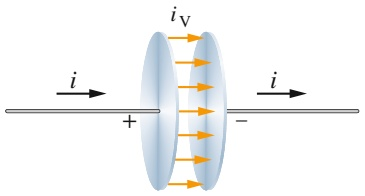

text_image

i
+
-
iV
i

(a)

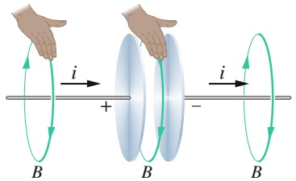

text_image

i
+
B
B
i
-
B

Feld des Stroms i

Feld des Stroms iV

Feld des Stroms i

(b)

## Abb. 28.6

(a) Der Verschiebungsstrom $i _ { \mathrm { V } }$ zwischen den Platten eines Kondensators, der durch einen Strom i geladen wird.
(b) Die Rechte-Hand-Regel zur Bestimmung der Richtung des Magnetfelds um einen stromführenden Leiter (wie z. B. auf der linken Seite) liefert auch die Richtung des Magnetfelds um einen Verschiebungsstrom (Mitte).

## 28.3.1 Der Verschiebungsstrom

Wenn wir die beiden Terme auf der rechten Seite von Gl. 28.5 vergleichen, sehen wir, dass das Produkt $\varepsilon _ { 0 } ( \mathrm { d } \varPhi _ { E } / \mathrm { d } t )$ die Dimension eines Stroms haben muss. Es wird häufig als fiktiver Strom $i _ { \mathrm { V } }$ betrachtet, den man als **Verschiebungsstrom** bezeichnet:

$$
i _ {\mathrm{V}} = \varepsilon_ {0} \frac {\mathrm{d} \varPhi_ {E}}{\mathrm{d} t}. \tag {28.6}
$$

Der Begriff $_ { p } \mathrm { V }$ erschiebung“ ist insofern unglücklich gewählt, als hier nichts wirklich verschoben wird, aber der Begriff ist historisch bedingt und allgemein etabliert. Mit dieser Definition lautet das Ampère-Maxwellsche Gesetz nun

$$
\oint \vec {B} \cdot \mathrm{d} \vec {s} = \mu_ {0} i _ {\mathrm{V,um}} + \mu_ {0} i _ {\mathrm{um}}, \tag {28.7}
$$

wobei $i _ { \mathrm { V , u m } }$ der von der Leiterschleife umschlossene Verschiebungsstrom ist.

Wir betrachten wieder den Ladevorgang eines Kondensators mit kreisförmigen Platten (Abb. 28.6a). Der reale Strom i, der die Platten lädt, verändert das elektrische Feld $\vec { E }$ zwischen den Platten; diese Änderung des Felds bewirkt einen fiktiven Verschiebungsstrom $i _ { \mathrm { V } }$ zwischen den Platten. Wir wollen nun einen Zusammenhang zwischen den beiden Strömen – dem realen Ladestrom und dem fiktiven Verschiebungsstrom – herstellen.

Zwischen der Ladung $q$ auf den Platten und der elektrischen Feldstärke $E$ zwischen den Platten gilt zu jedem Zeitpunkt die Beziehung aus Gl. 21.4,

$$
q = \varepsilon_ {0} A E, \tag {28.8}
$$

wenn A die Fläche der Platte ist. Um den realen Strom i zu erhalten, differenzieren wir Gl. 28.8 nach der Zeit und bekommen

$$
\frac {\mathrm{d} q}{\mathrm{d} t} = i = \varepsilon_ {0} A \frac {\mathrm{d} E}{\mathrm{d} t}. \tag {28.9}
$$

Den Verschiebungsstrom $i _ { \mathrm { V } }$ erhalten wir aus Gl. 28.6. Wenn wir annehmen, dass das elektrische Feld $E$ zwischen den Platten homogen ist, dann können wir den elektrischen Fluss in dieser Gleichung durch EA ersetzen. Gleichung 28.6 wird dann zu

$$
i _ {\mathrm{V}} = \varepsilon_ {0} \frac {\mathrm{d} \varPhi_ {E}}{\mathrm{d} t} = \varepsilon_ {0} \frac {\mathrm{d} (E A)}{\mathrm{d} t} = \varepsilon_ {0} A \frac {\mathrm{d} E}{\mathrm{d} t}. \tag {28.10}
$$

Durch Vergleich der Gln. 28.9 und 28.10 sehen wir, dass der reale Strom $i ,$ der den Kondensator lädt, und der fiktive Verschiebungsstrom $i _ { \mathrm { V } }$ gleich groß sind:

$$
i _ {\mathrm{V}} = i. \tag {28.11}
$$

Wir können den fiktiven Verschiebungsstrom $i _ { \mathrm { V } }$ folglich als Fortsetzung des realen Stroms i von der einen Platte durch den Zwischenraum zwischen den Platten auf die andere Platte auffassen. Da das elektrische Feld homogen über die Platten verteilt ist, gilt dasselbe auch für den Verschiebungsstrom $i _ { \mathrm { V } } ,$ , wie in Abb. 28.6a durch die Pfeile angedeutet ist. Obwohl in Wirklichkeit keine Ladung über den Zwischenraum zwischen den Platten transportiert wird, kann die Vorstellung eines fiktiven Stroms $i _ { \mathrm { V } }$ uns helfen, schnell Richtung und Betrag eines induzierten Magnetfelds zu bestimmen.

## Die Bestimmung des induzierten Magnetfelds

In Kapitel 25 hatten wir die Richtung des von einem realen Strom erzeugten Magnetfelds mithilfe der Rechte-Hand-Regel aus Abb. 25.4 bestimmt. Dieselbe Regel können wir nun auch anwenden, um die Richtung des von dem fiktiven Verschiebungsstrom $i _ { \mathrm { V } }$ induzierten Magnetfelds zu bestimmen. Das Vorgehen ist in Abb. 28.6b am Beispiel eines Kondensators illustriert.

676

---

28.3 Der Verschiebungsstrom und die Maxwell-Gleichungen

28

Mithilfe des Verschiebungsstroms $i _ { \mathrm { V } }$ können wir auch die Feldstärke des Ma gnetfelds bestimmen, das ein Kondensator mit runden parallelen Platten mit dem Radius R beim Laden erzeugt. Dazu stellen wir uns den Zwischenraum zwischen den Platten einfach als runden Draht der Dicke R vor, in dem der fiktive Strom $i _ { \mathrm { V } }$ fließt. Dann folgt aus Gl. 25.22 für die Feldstärke des Magnetfelds im Inneren des Kondensators im Abstand r von der Mittelachse

$$
B = \left(\frac {\mu_ {0} i _ {\mathrm{V}}}{2 \pi R ^ {2}}\right) r. \tag {28.12}
$$

Analog erhalten wir aus Gl. 25.19 für die Feldstärke des Magnetfelds außerhalb des Kondensators im Abstand r von der Mittelachse

$$
B = \frac {\mu_ {0} i _ {\mathrm{V}}}{2 \pi r}. \tag {28.13}
$$

## KONTROLLFRAGE 3

Das Bild zeigt einen Blick aus dem Zwischenraum zwischen den Platten eines Plattenkondensators auf eine der Platten. Die gestrichelten Linien zeigen vier Integrationswege (Weg b folgt dem Rand der Platte). Ordnen Sie die Wege in absteigender Reihenfolge nach dem Wert des Integrals ∮ B⃗ ⋅ d⃗s entlang ihres Umfangs während der Entladung des Kondensators.

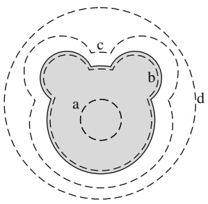

text_image

c
b
a
d

## 28.3.2 Die Maxwell-Gleichungen

Bevor wir elektromagnetische Wellen und ihre Ausbreitung untersuchen, wollen wir in diesem Abschnitt die wichtigsten Grundgleichungen der Elektrodynamik zusammenstellen. Das gekoppelte System der vier grundlegenden Gleichungen des Elektromagnetismus ist als die integrale Form der Maxwell-Gleichungen bekannt (Tab. 28.1).

Für viele Anwendungen und speziell auch für die numerische Behandlung auf modernen Computern erweist es sich als sehr nützlich, die in der Tabelle aufgeführten **Maxwell-Gleichungen in Integralform** in ein System gekoppelter, partieller Differenzialgleichungen umzuformen. Das Konzept der partiellen Ableitungen besagt, dass bei der Ableitung einer Funktion F(x, $y , z , t )$ mehrerer Variablen beispielsweise nach x alle anderen Variablen festgehalten, d. h. als konstant betrachtet werden (vgl. Anhang D):

$$
\frac {\partial F}{\partial x} \equiv \left. \frac {\partial F}{\partial x} \right| _ {y, z, t = \mathrm{const}}.
$$

TABELLE 28.1: Die Maxwell-Gleichungen.a)

| Bezeichnung | Gleichung |  | Anmerkung |
| --- | --- | --- | --- |
| Gaußscher Satz für elektrische Felder | $\oint \vec{E} \cdot d\vec{A} = q_{innen}/\varepsilon_0$ | (28.14a) | verknüpft elektrischen Gesamtfluss mit umschlossener Gesamtladung |
| Gaußscher Satz für Magnetfelder | $\oint \vec{B} \cdot d\vec{A} = 0$ | (28.14b) | verknüpft magnetischen Gesamtfluss mit umschlossener magnetischer Gesamtladung |
| Faradaysches Gesetz | $\oint \vec{E} \cdot d\vec{s} = -\frac{d\Phi_B}{dt}$ | (28.14c) | verknüpft induziertes elektrisches Feld mit Änderung des magnetischen Flusses |
| Ampère-Maxwellsches Gesetz | $\oint \vec{B} \cdot d\vec{s} = -\mu_0\varepsilon_0\frac{d\Phi_E}{dt} = \mu_0i_{um}$ | (28.14d) | verknüpft induziertes magnetisches Feld mit Änderung des elektrischen Flusses und Strom |

a) Wir betrachten hier den Fall, dass keine dielektrischen oder magnetischen Substanzen anwesend sind.

677

---

28 Magnetismus und Materie

In partiellen Differenzialgleichungen treten partielle Ableitungen nach verschiedenen Variablen auf, $\mathrm { z .   B .   } \partial F / \partial t$ und $\partial F / \partial x .$ . Weiterhin verwenden wir die Vektorableitungen Divergenz (div) und Rotation (rot; siehe auch hierzu Anhang D).

Damit erhalten wir die Maxwell-Gleichungen in Differenzialform als

$$
\operatorname{div} \vec {E} = \frac {\rho}{\varepsilon_ {0}}, \tag {28.15a}
$$

$$
\operatorname{div} \vec {B} = 0, \tag {28.15b}
$$

$$
\mathrm{rot} \vec {E} + \frac {\partial \vec {B}}{\partial t} = 0, \tag {28.15c}
$$

$$
\mathrm{rot} \vec {B} - \mu_ {0} \varepsilon_ {0} \frac {\partial \vec {E}}{\partial t} = \mu_ {0} \vec {j}. \tag {28.15d}
$$

Hierbei bezeichnet $\rho$ immer die elektrische Ladungsdichte und $\vec { j }$ ist die elektrische Stromdichte.

Weiterhin finden Sie in Anhang D, dass die Divergenz eines Vektorfelds gerade dessen Quellenfeld liefert. Damit sehen wir aus Gl. 28.15a, dass die elektrische Ladungsdichte $\rho$ die Quelle des elektrischen Felds $\vec { E }$ ist. Gleichung 28.15b hingegen zeigt, dass das magnetische Feld $\vec { B }$ keine Quellen besitzt.

Die physikalische Interpretation der Rotation identifiziert rot $\vec { E }$ mit den Wirbeln des Vektorfelds ${ \vec { E } } .$ Demzufolge besagt Gl. 28.15c, dass die zeitliche Änderung (Ableitung nach der Zeit) des Magnetfelds $\vec { B }$ ein elektrisches Wirbelfeld erzeugt. Analog sehen wir an Gl. 28.15d, dass sowohl ein sich zeitlich änderndes elektrisches Feld als auch ein fließender elektrischer Strom $\vec { j }$ ein magnetisches Wirbelfeld erzeugen.

Insgesamt erklären die Maxwell-Gleichungen zahlreiche elektromagnetische Erscheinungen, angefangen bei der Frage, warum Kompassnadeln nach Norden zeigen, bis hin zu der Frage, warum ein Auto anspringt, wenn man den Zündschlüssel dreht (oder die aus heutiger Sicht ebenso interessante Frage, wie das Auto „spürt“, dass Sie auf den Funkschlüssel drücken, um die Türen zu öffnen). Sie sind die Grundlage zahlloser elektromagnetischer Geräte wie Elektromotoren, Funksender und -empfänger, Festnetz- oder Mobiltelefone, Radargeräte und Mikrowellenöfen, um nur einige wenige Beispiele zu nennen.

Viele der seit Kapitel 17 vorgestellten Gleichungen lassen sich aus den Maxwell-Gleichungen herleiten. Außerdem sind sie auch Voraussetzung für die vielen Gleichungen in diesem Kapitel sowie in den nachfolgenden Kapiteln, in denen wir uns mit Optik beschäftigen.

## 28.4 Magnete

## Lernziele

Nach dem Durcharbeiten dieses Abschnitts sollten Sie in der Lage sei $1 , \ldots$

• Magneteisensteine zu erkennen,
• zu verstehen, dass das Erdmagnetfeld annähernd ein Dipolfeld ist, und die ungefähre Lage der geomagnetischen Pole der Erde anzugeben,
• Deklination und Inklination des Erdmagnetfelds anzugeben.

## Schlüsselideen

• Die Erde ist annähernd ein magnetischer Dipol, dessen Achse etwas gegen die Rotationsachse der Erde geneigt ist. Der magnetische Südpol liegt dabei auf der Nordhalbkugel (in der kanadischen Arktis).
• Die Feldrichtung an einem Ort wird durch die Felddeklination (den Winkel zwischen der horizontalen Feldkomponente und der geografischen Nordrichtung) und die Feldinklination (den Winkel zwischen der Horizontalen und der Feldrichtung) angegeben.

678

---

28.4 Magnete

28

## 28.4.1 Magnete

Die ersten bekannten Magnete waren Magneteisensteine, natürlich magnetisierte Steine. Als die Griechen und Chinesen in der Antike solche Steine fanden, wunderten sie sich über die scheinbar magische Fähigkeit der Steine, Metalle über kurze Entfernungen anzuziehen. Erst viel später lernten sie, Magneteisenstein in Kompassen als Hilfe zur Orientierung einzusetzen.

Heute sind Magnete und magnetische Materialien aus unserem Leben nicht mehr wegzudenken. Wir finden sie in nahezu allen elektronischen Geräten, in Kreditkarten, Kopfhörern und in den Druckfarben für Banknoten. Sogar manche Frühstückszerealien, die mit besonders hohem Eisengehalt werben, enthalten winzige magnetische Partikel (die man mit einem Magneten aus einer Aufschwemmung mit Wasser herausfischen kann). Viel wichtiger ist jedoch, dass die moderne Elektronikindustrie (inklusive Computer- und Musikindustrie) ohne magnetische Materialien nicht existieren würde.

## Der Erdmagnetismus

Die Erde ist ein riesiger Magnet; für Punkte in der Nähe der Erdoberfläche können wir uns das Magnetfeld der Erde näherungsweise als das Feld eines großen Stabma gneten – eines magnetischen Dipols – vorstellen, der durch den Mittelpunkt der Erde verläuft. Abbildung 28.7 zeigt eine idealisierte, symmetrische Darstellung des Dipolfelds ohne die durch die Wirkung des Sonnenwinds verursachte Verzerrung.

Da das Magnetfeld der Erde das eines magnetischen Dipols ist, ist damit auch ein magnetisches Dipolmoment $\vec { \mu }$ verbunden. Für das idealisierte Feld aus Abb. 28.7 beträgt das Dipolmoment $8 , 0 \cdot 1 0 ^ { 2 2 }   \mathrm { J / T } ;$ es schließt einen Winkel von $^ { 1 1 , 5 ^ { \circ } }$ mit der Rotationsachse der Erde (RR′) ein. Die Dipolachse (MM′) zeigt in die Richtung des Dipolmoments und schneidet die Erdoberfläche am geomagnetischen Nordpol in der kanadischen Arktis und am geomagnetischen Südpol in der Antarktis. Die Feldlinien des Magnetfelds B treten auf der Südhalbkugel aus der Erde aus und auf der Nordhalbkugel wieder in die Erde ein. Der Pol auf der Nordhalbkugel der Erde, den wir üblicherweise als „geomagnetischen Nordpol“ kennen, ist damit in Wirklichkeit der Südpol des magnetischen Dipols Erde.

Die Richtung des Magnetfelds an einem beliebigen Punkt auf der Erdoberflä- che wird meist durch zwei Winkel angegeben. Die **Deklination** ist der Winkel (nach rechts oder links) zwischen der horizontalen Komponente des Magnetfelds und der Nordrichtung (der Richtung zum 90. Breitengrad). Die **Inklination** ist der Winkel (nach oben oder unten) zwischen der Horizontalen und der Feldrichtung.

Magnetometer messen diese Winkel und die Feldstärke sehr genau; mit einem Kompass und einem Inklinationsmesser geht es jedoch auch einfacher. Ein Kompass ist ein nadelförmiger Magnet, der so aufgehängt ist, dass er sich frei um eine vertikale Achse drehen kann. Wenn er waagrecht gehalten wird, zeigt der Nordpol der Nadel in Richtung des magnetischen Nordpols der Erde (der ja in Wirklichkeit ein magnetischer Südpol ist). Der Winkel zwischen der Nadel und der Nordrichtung ist die Deklination des Felds. Ein Inklinationsmesser ist ein ähnlicher Magnet, der diesmal aber frei um eine horizontale Achse rotieren kann. Wenn man seine vertikale Rotationsebene (mithilfe eines Kompasses) nach Norden ausrichtet, dann ist der Winkel zwischen der Nadel des Inklinationsmessers und der Horizontalen die Inklination.

In Wirklichkeit können Richtung und Stärke des Magnetfelds auf der Erdoberfläche deutlich von dem idealen Dipolfeld aus Abb. 28.7 abweichen. Zum Beispiel liegt der Punkt, an dem das Magnetfeld senkrecht auf der Erdoberfläche (einwärts) steht, nicht etwa am geomagnetischen Nordpol im äußersten Nordosten von Kanada, sondern dieser sogenannte arktischer Magnetpol befindet sich im Nordpolarmeer, mehrere hundert Kilometer nördlich der kanadischen Nordküste.

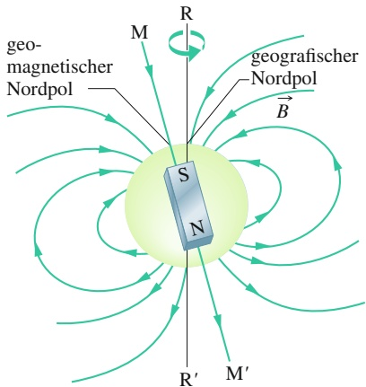

text_image

geo-
magnetischer
Nordpol
M
R
S
N
B
geografischer
Nordpol
R'
M'

Abb. 28.7 Das Magnetfeld der Erde als Dipolfeld. Die Dipolachse MM′ liegt in einem Winkel von 11,5° zur Rotationsachse RR′ der Erde. Der Südpol des Dipols liegt auf der Nordhalbkugel der Erde.

679

---

28 Magnetismus und Materie

## Abb. 28.8

Ein Magnetprofil des Meeresbodens zu beiden Seiten des Mittelatlantischen Rückens. Der Meeresboden wird in dem Rücken aus heißem Magma gebildet und bewegt sich auf beiden Seiten von dem Rücken weg. Die

Magnetisierung des Meeresbodens speichert die magnetische Umgebung zur Zeit der Erstarrung des Magmas. Ungefähr alle Million Jahre wechselt das Erdmagnetfeld seine Richtung.

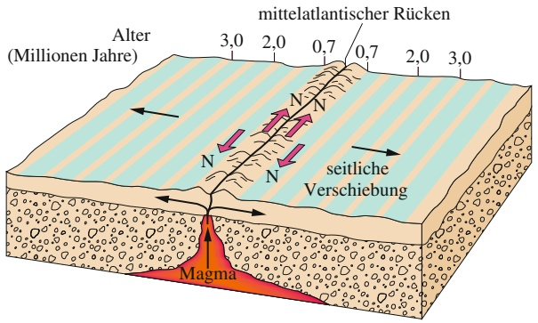

text_image

mittelatlantischer Rücken
Alter
(Millionen Jahre)
3,0 2,0 0,7 0,7 2,0 3,0
seitliche Verschiebung
Magma

Außerdem variiert das Magnetfeld an einem beliebigen Punkt der Erdoberfläche mit der Zeit, und zwar schon über einen Zeitraum von einigen Jahren messbar und über Zeiträume von einigen 100 Jahren ganz wesentlich. Zum Beispiel änderte sich die Richtung, in die Kompassnadeln in London zeigten, zwischen 1580 und 1820 um 35°.

Trotz dieser lokalen Variationen ändert sich das mittlere Dipolfeld über solche relativ kurzen Zeiträume nur langsam. Änderungen über längere Zeiträume lassen sich durch Untersuchung der schwachen Magnetisierung des Meeresbodens zu beiden Seiten des Mittelatlantischen Rückens verfolgen (Abb. 28.8). Der Meeresboden entstand dort aus Magma, das aus dem Erdinneren nach oben stieg, erstarrte und seither mit einer Geschwindigkeit von einigen Zentimetern pro Jahr von dem Rücken weggezogen wird. Beim Erstarren wurde das Magma durch das Erdmagnetfeld magnetisiert und speicherte so die Richtung des Erdmagnetfelds zum Zeitpunkt des Erstarrens. Die Untersuchung der Magnetisierung des Meeresbodens zeigt, dass das Erdmagnetfeld seine Richtung etwa alle Million Jahre umgedreht hat. Die Ursache für diese Umkehrung muss in Instabilitäten des sogenannten Geodynamos im zähflüssigen Erdkern liegen, dessen Funktion aber noch lange nicht voll verstanden ist.

## 28.5 Der Magnetismus von Elektronen

## Lernziele

Nach dem Durcharbeiten dieses Abschnitts sollten Sie in der Lage sein, . . .

• zu verstehen, dass der Spindrehimpuls (kurz Spin) und das damit verbundene magnetische Dipolmoment fundamentale Eigenschaften des Elektrons (und ebenso von Proton und Neutron) sind,
• die Beziehung zwischen Spinvektor $\vec { S }$ und zugehörigem magnetischem Dipolmoment $\vec { \mu } _ { s }$ anzuwenden,
• zu verstehen, dass $\vec { S }$ und $\vec { \mu } _ { s }$ nicht vollständig beobachtet (gemessen) werden können, sondern nur ihr Betrag und eine ihrer Komponenten entlang einer gewählten Achse (meist der z-Achse) bestimmt werden können,
• zu verstehen, dass die beobachtbaren Komponenten $S _ { z }$ und $\mu _ { s , z }$ quantisiert sind und was das bedeutet,
• die Beziehung zwischen $S _ { z }$ und der magnetischen Spinquantenzahl $m _ { s }$ anzuwenden,
• die Spinorientierungen $\mathrm { { \mathfrak { p } } u p } ^ { \alpha }$ und „down“ eines Elektrons voneinander zu unterscheiden,
• die z-Komponente $\mu _ { s , z }$ des von einem Spin erzeugten magnetischen Dipolmoments zu bestimmen und sowohl als Absolutwert als auch als Vielfaches des Bohrschen Magnetons $\mu _ { \mathrm { B } }$ anzugeben,
• die Orientierungsenergie U eines Elektronenspins in einem äußeren magnetischen Feld zu anzugeben,
• zu verstehen, dass ein Elektron in einem Atom einen Bahndrehimpuls $\vec { L } _ { \mathrm { B a h n } }$ und ein zugehöriges magnetisches Bahndipolmoment $\vec { \mu } _ { \mathrm { B a h n } }$ hat,

680

---

28.5 Der Magnetismus von Elektronen

28

• die Beziehung zwischen dem Bahndrehimpuls $\vec { L } _ { \mathrm { B a h n } }$ und dem zugehörigen magnetischen Dipolmoment $\vec { \mu } _ { \mathrm { B a h n } }$ anzuwenden,
• zu verstehen, dass $\vec { L } _ { \mathrm { B a h n } }$ und $\vec { \mu } _ { \mathrm { B a h n } }$ nicht vollständig beobachtet (gemessen) werden können, sondern nur ihre Komponenten entlang einer gewählten Achse (meist der z-Achse) bestimmt werden können,
• die Beziehung zwischen $L _ { \mathrm { B a h n } , i }$ und der Bahndrehimpulsquantenzahl $m _ { l }$ anzuwenden.
• die z-Komponente $\mu _ { \mathrm { B a h n } , z }$ des von einem Bahndrehimpuls erzeugten magnetischen Dipolmoments zu bestimmen und sowohl als Absolutwert als auch als Vielfaches des Bohrschen Magnetons $\mu _ { \mathrm { B } }$ anzugeben,
• die Orientierungsenergie U eines Atoms aufgrund des Bahndrehimpulses seiner Elektronen in einem äußeren magnetischen Feld zu bestimmen,
• den Betrag des magnetischen Moments eines (klassischen) geladenen Teilchens zu berechnen, das sich mit konstanter Winkelgeschwindigkeit auf einer Kreisbahn bewegt,
• das klassische Ringstrommodell eines kreisenden Elektrons sowie die auf einen solchen Ringstrom in einem inhomogenen Magnetfeld wirkenden Kräfte zu beschreiben,
• die Unterschiede zwischen Diamagnetismus, Paramagnetismus und Ferromagnetismus erklären zu können.

## Schlüsselideen

• Ein Elektron hat einen als $, \mathrm{Spim}^{\omega}$ bezeichneten intrinsischen Drehimpuls ${ \vec { S } } ,$ der mit dem magnetischen Dipolmoment $\vec { \mu } _ { s }$ verbunden ist:

$$
\vec {\mu} _ {s} = - \frac {e}{m} \vec {S}.
$$

• Wenn man die Komponente von $\vec { S }$ entlang der z-Achse misst, kann man nur die Werte

$$
S _ {z} = m _ {s} \frac {h}{2 \pi} \quad \text {mit} \quad m _ {s} = \pm \frac {1}{2}
$$

erhalten. Dabei ist $h   =   6 { , } 6 3   \cdot   1 0 ^ { - 3 4 }   \mathrm { J }$ ⋅ s die Plancksche Konstante (oder das Plancksche Wirkungsquantum).

• Entsprechend gilt

$$
\mu_ {z} = \pm \frac {e h}{4 \pi m} = \pm \mu_ {\mathrm{B}}
$$

mit dem Bohrschen Magneton

$$
\mu_ {\mathrm{B}} = \frac {e h}{4 \pi m} = 9, 2 7 \cdot 1 0 ^ {- 2 4}   \mathrm{J/T}.
$$

• Die Energie $U ,$ die mit der Orientierung des Spinmoments in einem äußeren Magnetfeld $\vec { B } _ { \mathrm { e x t } }$ verbunden ist, beträgt

$$
U = - \vec {\mu} _ {s} \cdot \vec {B} _ {\mathrm{ext}} = - \mu_ {s, z} \cdot B _ {\mathrm{ext}}.
$$

• Ein Elektron in einem Atom besitzt noch einen weiteren Drehimpuls, den Bahndrehimpuls $\vec { L } _ { \mathrm { B a h n } }$ . Das damit verbundene magnetische Dipolmoment beträgt

$$
\vec {\mu} _ {\mathrm{Bahn}} = - \frac {e}{2 m} \vec {L} _ {\mathrm{Bahn}}.
$$

• Auch der Bahndrehimpuls ist quantisiert und kann nur die folgenden Messwerte zwischen den Grenzen $\pm m _ { \mathrm { m a x } }$ annehmen:

$$
L _ {\mathrm{Bahn}, z} = m _ {l} \frac {h}{2 \pi} \quad \mathrm{mit} \quad m _ {l} = 0, \pm 1, \pm 2, \dots , \pm m _ {\mathrm{max}}.
$$

681

---

28 Magnetismus und Materie

• Das zugehörige magnetische Dipolmoment ist

$$
\mu_ {\mathrm{Bahn}, z} = - m _ {l} \frac {e h}{4 \pi m} = - m _ {l} \mu_ {\mathrm{B}}.
$$

• Die Energie $U ,$ die mit der Orientierung des magnetischen Bahnmoments in einem äußeren Magnetfeld $\vec { B } _ { \mathrm { e x t } }$ verbunden ist, beträgt

$$
U = - \vec {\mu} _ {\mathrm{Bahn}} \cdot \vec {B} _ {\mathrm{ext}} = - \mu_ {\mathrm{Bahn}, z} \cdot B _ {\mathrm{ext}}.
$$

## 28.5.1 Der Magnetismus von Elektronen

Die magnetischen Eigenschaften von Materialien, egal ob von Magneteisenstein oder von Computerfestplatten, lassen sich immer auf die darin enthaltenen Elektronen zurückführen. Eine Möglichkeit, wie Elektronen ein Magnetfeld erzeugen können, haben wir bereits kennen gelernt: Wenn wir sie als elektrischen Strom durch einen Draht schicken, bewirkt ihre Bewegung ein Magnetfeld um den Draht. Es gibt aber noch zwei weitere Möglichkeiten, die beide damit zu tun haben, dass Elektronen sich wie kleine magnetische Dipole verhalten. Eine genaue Erklärung dieser Tatsache kann jedoch nur die Quantenphysik geben, die über den in diesem Buch behandelten Stoff hinausgeht, sodass wir vorerst die Ergebnisse nur skizzieren können.

## Das magnetische Dipolmoment des Spins

Elektronen besitzen einen intrinsischen Drehimpuls, den **Spindrehimpuls** oder einfach **Spin** $\vec { S } ;$ mit diesem Spin ist das **magnetische Spindipolmoment** $\vec { \mu } _ { s }$ (meist einfach als **Spinmoment** bezeichnet) verbunden. (Intrinsisch bedeutet in diesem Zusammenhang, dass $\vec { S }$ und $\vec { \mu } _ { s }$ fundamentale Eigenschaften eines Elektrons sind, ähnlich wie Masse oder Ladung.) $\vec { S }$ und $\vec { \mu } _ { s }$ hängen über

$$
\vec {\mu} _ {s} = - \frac {e}{m} \vec {S} \tag {28.16}
$$

zusammen, wobei $e$ die Elementarladung $( 1 , 6 0 \cdot 1 0 ^ { - 1 9 }   \mathrm { C } )$ und m die Masse des Elektrons $( 9 { , } 1 1 \cdot 1 0 ^ { - 3 1 }$ kg) sind. Das Minuszeichen zeigt, dass $\vec { \mu } _ { s }$ und $\vec { S }$ entgegengesetzt gerichtet sind.

Der Spin $\vec { S }$ unterscheidet sich von den Drehimpulsen aus Kapitel $7$ in zweierlei Hinsicht:

1. Der Spindrehimpuls $\vec { S }$ ist selbst nicht messbar; nur sein Betrag und seine Komponente bezüglich einer frei gewählten Achse lassen sich messen.
2. Die Komponenten von $\vec { S }$ sind quantisiert oder gequantelt, d. h. auf bestimmte diskrete Werte beschränkt. Genauer gesagt kann die Messung einer Komponente von $\vec { S }$ nur einen von zwei Werten ergeben, die sich nur im Vorzeichen unterscheiden.

Wir wollen annehmen, dass wir die Komponente von $\vec { S }$ entlang der z-Achse eines Koordinatensystems messen. Dann kann die gemessene Komponente $S _ { z }$ nur die Werte

$$
S _ {z} = m _ {s} \frac {h}{2 \pi} = m _ {s} \hbar \quad \text {mit} \quad m _ {s} = \pm \frac {1}{2} \tag {28.17}
$$

annehmen, wobei $m _ { s }$ als magnetische Spinquantenzahl bezeichnet wird und $h =$ $6 { , } 6 3 \cdot 1 0 ^ { - 3 4 } \mathrm { J } \cdot \mathrm { s }$ die in der Quantenphysik allgegenwärtige Plancksche Konstante (auch als Plancksches Wirkungsquantum bezeichnet) ist (vgl. Gl. 34.3). Die Kombination $h / ( 2 \pi )$ tritt in Gleichungen so häufig auf, dass man ihr ein spezielles Symbol ℏ (gesprochen „h quer“) gibt und sie manchmal auch als reduziertes Plancksches Wirkungsquantum bezeichnet.

682

---

28.5 Der Magnetismus von Elektronen

28

Die Vorzeichen in Gl. 28.17 geben die Richtung von $S _ { z }$ bezüglich der z-Achse an. Wenn $S _ { z }$ in die positive z-Richtung zeigt, ist $m _ { s } = + 1 / 2$ und wir bezeichnen den Zustand als spin $u p .$ Wenn $S _ { z }$ in die negative z-Richtung zeigt, ist $m _ { s } = - 1 / 2$ und wir bezeichnen den Zustand als spin down.

Das magnetische Spinmoment $\vec { \mu } _ { s }$ des Elektrons ist ebenfalls nicht messbar, nur seine Komponente entlang einer Achse. Auch diese ist gequantelt und kann nur zwei Werte mit gleichem Betrag, aber unterschiedlichem Vorzeichen annehmen. Die Komponente $\mu _ { s , z }$ entlang der z-Achse hängt mit der Spinkomponente $S _ { z }$ über

$$
\mu_ {s, z} = - \frac {e}{m} S _ {z}
$$

zusammen. Wenn wir $S _ { z }$ aus Gl. 28.17 in diese Gleichung einsetzen, erhalten wir

$$
\mu_ {s, z} = \pm \frac {e h}{4 \pi m}, \tag {28.18}
$$

wobei das Plus- bzw. Minuszeichen dem Zustand mit $\mu _ { s , z }$ parallel bzw. antiparallel zur $z - \mathrm { A }$ chse entsprechen.

Die Größe auf der rechten Seite von Gl. 28.18 wird als Bohrsches Magneton $\mu _ { \mathrm { B } }$ bezeichnet:

$$
\mu_ {\mathrm{B}} = \frac {e h}{4 \pi m} = 9, 2 7 \cdot 1 0 ^ {- 2 4}   \mathrm{J/T}  . \tag {28.19}
$$

$\mu _ { \mathrm { B } }$ wird verwendet, um die magnetischen Spinmomente von Elektronen und anderen Elementarteilchen anzugeben. Für ein Elektron ist die gemessene z-Komponente des Spins

$$
\left| \mu_ {s, z} \right| = 1 \cdot \mu_ {\mathrm{B}}. \tag {28.20}
$$

(Die exakte Quantentheorie des Elektrons, die Quantenelektrodynamik, zeigt, dass $\mu _ { s , z }$ in Wirklichkeit etwas größer als $1 \mu _ { \mathrm { B } }$ ist, aber das wollen wir für den Moment vernachlässigen.)

Wenn wir ein Elektron in ein äußeres Magnetfeld $\vec { B } _ { \mathrm { e x t } }$ bringen, dann führt die Orientierung seines Spinmoments $\vec { \mu } _ { s }$ relativ zu dem äußeren Feld zu einer potenziellen Energie $U$ (genau wie das im Fall des magnetischen Moments $\vec { \mu }$ einer Stromschleife in einem Feld $\vec { B } _ { \mathrm { e x t } }$ der Fall war). Aus Gl. 24.33 entnehmen wir, dass die potenzielle Energie des Elektrons durch

$$
U = - \vec {\mu} _ {s} \cdot \vec {B} _ {\mathrm{ext}} = - \mu_ {s, z} B _ {\mathrm{ext}} \tag {28.21}
$$

gegeben ist, wenn die Richtung des Felds $B _ { \mathrm { e x t } }$ die z-Achse definiert.

Wenn wir uns das Elektron als mikroskopisch kleine Kugel vorstellen (was es nicht ist!), können wir den Spin ${ \vec { S } } ,$ das magnetische Spinmoment $\vec { \mu } _ { s }$ und das dadurch verursachte magnetische Dipolfeld $\vec { \vec { B } }$ wie in Abb. 28.9 darstellen. Obwohl $\mathrm { { , } s p i n ^ { \omega } }$ auf Englisch so viel wie „sich drehen“ bedeutet, rotiert das Elektron nicht etwa wie ein kleiner Kreisel. Wie kann aber etwas einen Drehimpuls haben, ohne wirklich zu rotieren? Diese Frage kann uns wieder nur die Quantenphysik beantworten.

Auch Protonen und Neutronen besitzen einen intrinsischen Drehimpuls, der als Spin bezeichnet wird, und damit auch ein intrinsisches magnetisches Spinmoment. Bei einem Proton zeigen die beiden Vektoren in dieselbe Richtung, bei einem Neutron sind sie entgegengesetzt gerichtet. Da die Beiträge dieser magnetischen Momente zum magnetischen Gesamtmoment eines Atoms ungefähr 1000-mal kleiner sind als die der Elektronen, werden wir sie hier nicht weiter betrachten.

## KONTROLLFRAGE 4

Die Abbildung zeigt die Orientierung der Spins zweier Teilchen in einem äußeren Magnetfeld $\vec { B } _ { \mathrm { e x t ^ { * } } } ^ { \mathrm { ~   ~ } }$ (a) Welche Spinorientierung hat die niedrigere potenzielle Energie, wenn die Teilchen Elektronen sind? (b) Welche Spinorientierung hat die niedrigere potenzielle Energie, wenn die Teilchen Protonen sind?

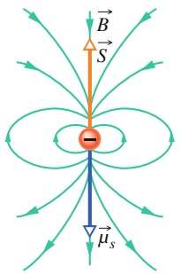

text_image

B
S
μs

Abb. 28.9

Der Spin $\vec { S } ,$ das magnetische Spinmoment $\vec { \mu } _ { s }$ und das magnetische Dipolfeld $\vec { B }$ eines als mikroskopisch kleine Kugel dargestellten Elektrons.

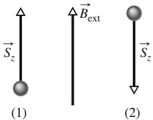

text_image

S_z
(1)
B_ext
(2)
S_z

683

---

28 Magnetismus und Materie

## Das magnetische Dipolmoment des Bahndrehimpulses

Außer ihrem Spin besitzen Elektronen in einem Atom noch einen weiteren Drehimpuls, den **Bahndrehimpuls** $\vec { L } _ { \mathrm { B a h n } }$ . Zu ihm gehört ein magnetisches Bahndi**polmoment** $\vec { \mu } _ { \mathrm { B a h n } }$ (meist einfach als **Bahnmoment** bezeichnet) mit

$$
\vec {\mu} _ {\mathrm{Bahn}} = - \frac {e}{2 m} \vec {L} _ {\mathrm{Bahn}}. \tag {28.22}
$$

Das Minuszeichen zeigt wieder an, dass Bahndrehimpuls und magnetisches Mo ment in entgegengesetzte Richtungen zeigen.

Der Bahndrehimpuls $\vec { L } _ { \mathrm { B a h n } }$ ist nicht messbar; wie beim Spin kann nur seine Komponente entlang einer Achse gemessen werden, und diese Komponente ist gequantelt. Die z-Komponente des Bahndrehimpulses kann nur die Werte

$$
L _ {\mathrm{Bahn}, z} = m _ {l} \frac {h}{2 \pi} = m _ {l} \hbar \quad \mathrm{mit} \quad m _ {l} = 0, \pm 1, \pm 2, \dots , \pm m _ {\mathrm{max}} \tag {28.23}
$$

annehmen, wobei $m _ { l }$ die magnetische Quantenzahl des Bahndrehimpulses ist und $, m_{ max }  \text{" }$ den maximal erlaubten Betrag von $m _ { l }$ bedeutet. Die Vorzeichen in Gl. 28.23 zeigen die Richtung von $L _ { \mathrm { B a h n } , z }$ entlang der z-Achse an.

Auch das magnetische Bahnmoment $\vec { \mu } _ { \mathrm { B a h n } }$ ist nicht komplett messbar, sondern wieder nur sein Betrag und seine Komponente bezüglich der z-Achse, die wiederum gequantelt ist. Wenn wir Gl. 28.22 für die Komponente entlang derselben z-Achse wie oben schreiben und $L _ { \mathrm { B a h n } , z }$ aus Gl. 28.23 einsetzen, erhalten wir für die z-Komponente $\mu _ { \mathrm { B a h n } , z }$ des magnetischen Bahnmoments

$$
\mu_ {\mathrm{Bahn}, z} = - m _ {l} \frac {e h}{4 \pi m} \tag {28.24}
$$

bzw. in Einheiten des Bohrschen Magnetons

$$
\mu_ {\mathrm{Bahn}, z} = - m _ {l} \mu_ {\mathrm{B}}. \tag {28.25}
$$

Wenn sich ein Atom in einem äußeren Magnetfeld $\vec { B } _ { \mathrm { e x t } }$ befindet, führt die Orien tierung des magnetischen Bahnmoments jedes einzelnen Elektrons in dem Atom relativ zum äußeren Feld zu einer potenziellen Energie

$$
U = - \vec {\mu} _ {\mathrm{Bahn}} \cdot \vec {B} _ {\mathrm{ext}} = - \mu_ {\mathrm{Bahn}, z} B _ {\mathrm{ext}}, \tag {28.26}
$$

wobei die Richtung von $\vec { B } _ { \mathrm { e x t } }$ wieder die $z - \mathrm { A }$ chse festlegt.

Obwohl wir in den vergangenen Abschnitten stets das Wort „Bahn“ verwendet haben, kreisen die Elektronen in Wirklichkeit nicht um den Atomkern wie z. B. Planeten um die Sonne. Wie kann aber ein Elektron einen Bahndrehimpuls haben, ohne wirklich auf einer Bahn um ein Zentrum zu kreisen? Auch hier lässt sich nur mit der Quantenphysik eine sinnvolle Antwort angeben.

## Das Ringstrommodell für Elektronenbahnen

Wir können Gl. 28.22 mithilfe einer klassischen (d. h. nicht quantenphysikalischen) Argumentation herleiten, indem wir annehmen, dass sich das Elektron auf einer Kreisbahn bewegt, deren Radius viel größer als der Radius eines Atoms ist (daher der Name „Ringstrommodell“). Diese Herleitung gilt jedoch nicht für ein Elektron in einem Atom (dafür brauchen wir wirklich die Quantenphysik).

Wir stellen uns ein Elektron vor, das sich wie in Abb. 28.10 gezeigt mit konstanter Geschwindigkeit v im Gegenuhrzeigersinn auf einer Kreisbahn mit dem Radius r bewegt. Die Bewegung der negativen Ladung des Elektrons entspricht einem konventionellen Strom i (mit positiver Ladung), der – wie ebenfalls in Abb. 28.10 angedeutet – im Uhrzeigersinn fließt. Für den Betrag des magnetischen Bahnmoments eines solchen Ringstroms erhalten wir aus Gl. 24.30 mit $N = 1$

$$
\mu_ {\mathrm{Bahn}} = i A, \tag {28.27}
$$

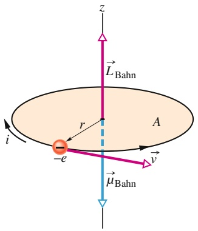

text_image

z
L_Bahn
r
A
-i
-e
v
μ_Bahn

Abb. 28.10

Ein Elektron bewegt sich mit konstanter Geschwindigkeit v auf einer Kreisbahn mit Radius r, die eine Fläche A umschließt. Der Bahndrehimpuls des Elektrons ist $\vec { L } _ { \mathrm { B a h n } }$ und das damit verbundene magnetische Bahnmoment $\vec { \mu } _ { \mathrm { B a h n } } .$ . Dem im Gegenuhrzeigersinn umlaufenden negativ geladenen Elektron entspricht ein Strom i (positiver Ladungsträger) im Uhrzeigersinn.

684

---

28.5 Der Magnetismus von Elektronen

28

wenn A die von der Schleife umschlossene Fläche ist. Nach der Rechte-Hand-Regel aus Abb. 25.18 zeigt dieses magnetische Bahnmoment in Abb. 28.10 nach unten.

Um Gl. 28.27 zu benutzen, benötigen wir den Strom i. Elektrischer Strom ist allgemein die Geschwindigkeit, mit der eine Ladung durch einen bestimmten Punkt transportiert wird. In unserem Fall benötigt die Ladung e die Zeit $T = 2 \pi r / \nu$ , um den Kreis einmal zu umrunden, folglich ist

$$
i = \frac {\text {Ladung}}{\text {Zeit}} = \frac {e}{2 \pi r / \nu}  . \tag {28.28}
$$

Wenn wir dieses Ergebnis und die Fläche $A = \pi r ^ { 2 }$ in Gl. 28.27 einsetzen, bekommen wir

$$
\mu_ {\mathrm{Bahn}} = \frac {e}{2 \pi r / \nu} \pi r ^ {2} = \frac {e \nu r}{2}. \tag {28.29}
$$

Um den Bahndrehimpuls $\vec { L } _ { \mathrm { B a h n } }$ des Elektrons zu erhalten benutzen wir Gl. 7.16, $\vec { \ell } = m ( \vec { r } \times \vec { \nu } )$ . Da ⃗r und v⃗ senkrecht aufeinander stehen, hat $\vec { L } _ { \mathrm { B a h n } }$ den Betrag

$$
L _ {\mathrm{Bahn}} = m r v \sin 9 0 ^ {\circ} = m r v. \tag {28.30}
$$

$\vec { L } _ { \mathrm { B a h n } }$ zeigt in Abb. 28.10 nach oben (siehe auch Abb. 7.10). Wir kombinieren nun die Gln. 28.29 und 28.30, verallgemeinern das Ergebnis auf Vektoren und zeigen die entgegengesetzten Richtungen der Vektoren durch ein Minuszeichen an. So erhalten wir die Beziehung

$$
\vec {\mu} _ {\mathrm{Bahn}} = - \frac {e}{2 m} \vec {L} _ {\mathrm{Bahn}},
$$

also genau Gl. 28.22. Wir haben damit aus einer klassischen (nicht quantenme chanischen) Analyse sowohl nach Betrag als auch nach Richtung dasselbe Resultat erhalten wie aus der Quantenphysik. Man kann sich nun fragen, warum diese Herleitung, die ja auch für ein Elektron in einem Atom das richtige Resultat liefert, hier trotzdem nicht gelten soll. Die Antwort ist, dass die klassische Betrachtungsweise auch Ergebnisse liefert, die im Widerspruch zu den experimentellen Befunden stehen, sie kann daher nur in den Fällen herangezogen werden, in denen sie durch die Quantenphysik bestätigt werden.

## Das Ringstrommodell in einem inhomogenen Feld

Wir betrachten wieder ein Elektron auf einer Kreisbahn als Ringstrom wie in Abb. 28.10. Dieses Mal denken wir uns die Schleife jedoch in einem inhomogenen Magnetfeld wie in Abb. 28.11a. (Zum Beispiel könnten wir das divergierende Feld in der Nähe des Nordpols des Magneten aus Abb. 28.3 verwenden.) Mit dieser modifizierten Anordnung wollen wir die folgenden Abschnitte vorbereiten, in denen wir die Kräfte untersuchen, die auf magnetische Substanzen in inhomogenen Magnetfeldern wirken. Dabei werden wir die Elektronenbahnen in den Atomen als winzige Ringströme analog zu Abb. 28.11a auffassen.

Wir nehmen an, dass das äußere Magnetfeld entlang der Kreisbahn des Elektrons einen konstanten Betrag hat und dass es überall denselben Winkel zur Senkrechten einschließt (Abb. 28.11b und d). Außerdem nehmen wir an, dass alle Elektronen in einem Atom entweder im Gegenuhrzeigersinn (Abb. 28.11b) oder im Uhrzeigersinn (Abb. 28.11d) kreisen. Für beide Bewegungsrichtungen sind der entsprechende konventionelle Strom i in der Stromschleife sowie das durch ihn hervorgerufene magnetische Bahnmoment $\vec { \mu } _ { \mathrm { B a h n } }$ eingezeichnet. Die Abb. 28.11c und e zeigen jeweils zwei Längenelemente dL⃗ an entgegengesetzten Punkten der Schleife, die in die Richtung des Stroms i zeigen. An diesen Längenelementen ist jeweils auch das äußere Feld $\vec { B } _ { \mathrm { e x t } }$ und die auf dL⃗ wirkende magnetische Kraft $\mathrm { d } \vec { F }$ eingezeichnet. Dazu erinnern wir uns, dass auf einen Strom i entlang eines Längenelements dL⃗ in

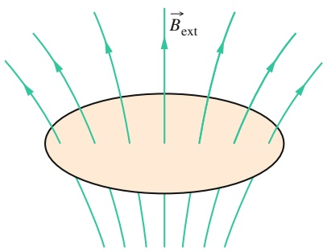

text_image

B$_{ext}$

(a)

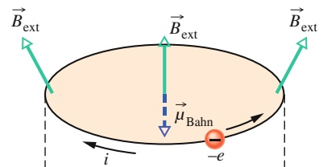

text_image

B_ext
B_ext
μ_Bahn
-i
-e
B_ext

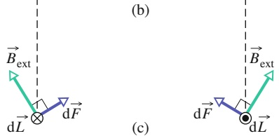

text_image

(b)
→
B_ext
×
dF
→
dL
→
(b)
→
B_ext
×
dF
→
dL
→

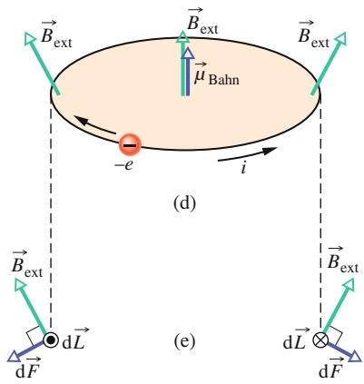

text_image

B_ext
μ_Bahn
-e
i
(d)
B_ext
dL
dF
(e)
B_ext
dL
dF

## Abb. 28.11

Ein Ringstrommodell für ein Elektron auf einer Bahn in einem Atom im inhomogenen Magnetfeld $\vec { B } _ { \mathrm { e x t } ^ { * } }$ (b) Eine Ladung −e bewegt sich im Gegenuhrzeigersinn; der entsprechende konventionelle Strom i im Uhrzeigersinn. (c) Die magnetischen Kräfte $\check { \mathrm { d } } \vec { F }$ auf der linken bzw. rechten Seite der Leiterschleife, aus der Schleifenebene gesehen. Die resultierende Kraft auf die Schleife zeigt nach oben. (d) Die Ladung −e bewegt sich im Uhrzeigersinn. (e) Die resultierende Kraft auf die Schleife zeigt nach unten.

685

---

28 Magnetismus und Materie

einem Magnetfeld $\vec { B } _ { \mathrm { e x t } }$ nach Gl. 24.25 eine Kraft

$$
\mathrm{d} \vec {F} = i \mathrm{d} \vec {L} \times \vec {B} _ {\text {ext}} \tag {28.31}
$$

wirkt.

Mithilfe von Gl. 28.31 können wir sehen, dass die Kraft $\mathrm { d } \vec { F }$ auf der linken Seite in Abb. 28.11c nach rechts oben zeigen muss. Auf der rechten Seite ist $\mathrm { d } \vec { F }$ gleich groß und zeigt nach links oben. Da die Winkel beider Kräfte zur Vertikalen identisch sind, gleichen sich die horizontalen Komponenten dieser beiden Kräfte genau aus, während sich die vertikalen Komponenten addieren. Dasselbe gilt für alle anderen Paare von gegenüberliegenden Punkten in der Schleife, daher muss die resultierende Kraft auf die Stromschleife in Abb. 28.11b nach oben zeigen. Analog erhalten wir für die Situation in Abb. 28.11d eine nach unten gerichtete resultierende Kraft.

Wir werden diese beiden Resultate in Kürze verwenden, wenn wir das Verhalten magnetischer Substanzen in inhomogenen Magnetfeldern untersuchen.

## 28.5.2 Magnetische Materialien

Jedes Elektron in einem Atom besitzt ein magnetisches Bahnmoment und ein magnetisches Spinmoment, die sich vektoriell addieren. Die Resultierende dieser beiden Vektoren addiert sich vektoriell zu den entsprechenden Resultierenden aller anderen Elektronen in dem Atom, und die Resultierenden der einzelnen Atome in einer Probe addieren sich wiederum vektoriell zu einer Resultierenden für die gesamte Probe. Wenn die Kombination all dieser einzelnen Dipolmomente ein Magnetfeld ergibt, ist die Probe magnetisch.

Wir unterscheiden grundsätzlich drei Arten von Magnetismus:

1. **Diamagnetismus** tritt in allen Substanzen auf; er ist aber so schwach, dass er normalerweise nicht mehr zu beobachten ist, wenn ein Material auch eine der beiden anderen Arten von Magnetismus zeigt. Beim Diamagnetismus werden in den Atomen einer Probe schwache magnetische Dipolmomente erzeugt, wenn sie in ein externes Magnetfeld $\vec { B } _ { \mathrm { e x t } }$ gebracht wird; die Kombination dieser Dipolmomente bewirkt eine schwache Magnetisierung der Probe. Die Dipolmomente und damit auch das resultierende Magnetfeld verschwinden, wenn das äußere Feld $\vec { B } _ { \mathrm { e x t } }$ entfernt wird. Üblicherweise bezeichnet man als diamagnetische Materialien nur die Substanzen, die keine andere Art von Magnetismus zeigen.
2. **Paramagnetismus** tritt in Materialien auf, die Übergangsmetalle, Lanthanoide oder Actinoide enthalten (siehe das Periodensystem auf der vorderen Umschlagseite). Alle Atome aus diesen Gruppen besitzen ein permanentes magnetisches Dipolmoment, die verschiedenen Dipolmomente sind in einer Probe aber zufällig angeordnet, sodass die Probe insgesamt kein resultierendes magnetisches Dipolmoment besitzt. Ein externes Magnetfeld $\vec { B } _ { \mathrm { e x t } }$ kann die ato maren Dipolmomente jedoch (teilweise) ausrichten und so ein resultierendes magnetisches Dipolmoment der Probe erzeugen. Die Ausrichtung und damit das Dipolmoment verschwinden, sobald das äußere Feld entfernt wird. Als paramagnetische Materialien bezeichnet man meist Materialien, die vorwiegend Paramagnetismus zeigen.
3. **Ferromagnetismus** ist eine Eigenschaft von Eisen, Nickel und einigen anderen Elementen (sowie von Verbindungen und Legierungen dieser Elemente). Einige der Elektronen in diesen Materialien richten ihre permanenten magnetischen Dipolmomente parallel zueinander aus und erzeugen so Bereiche mit starken resultierenden magnetischen Dipolmomenten in der Probe. Ein externes Feld $\vec { B } _ { \mathrm { e x t } }$ kann die resultierenden Dipolmomente dieser Bereiche ausrichten und so eine starke Magnetisierung einer Probe bewirken; diese Magnetisierung bleibt zumindest teilweise bestehen, wenn $\vec { B } _ { \mathrm { e x t } }$ wieder entfernt wird. In der Regel verwendet man den Begriff ferromagnetisches Material oder sogar den üblicheren Begriff magnetisches Material für Substanzen, die vorwiegend Ferromagnetismus zeigen.

686

---

28.6 Diamagnetismus

28

In den nächsten drei Abschnitten werden wir diese drei Arten von Magnetismus näher betrachten.

## 28.6 Diamagnetismus

## Lernziele

Nach dem Durcharbeiten dieses Abschnitts sollten Sie in der Lage sein, . . .

• zu verstehen, dass und wie in einer diamagnetischen Substanz in einem äußeren Magnetfeld ein magnetisches Dipolmoment entsteht, und die relative Orientierung von Moment und äußerem Feld anzugeben,
• die auf eine diamagnetische Substanz in einem inhomogenen magnetischen Feld wirkende Kraft sowie die daraus resultierende Bewegung zu beschreiben.

## Schlüsselideen

• Diamagnetische Materialien zeigen nur dann ein magnetisches Verhalten, wenn sie in ein äußeres Magnetfeld gebracht werden. Sie bilden dann magnetische Dipole, die sich entgegen der äußeren Feldrichtung ausrichten.
• In einem inhomogenen Magnetfeld werden diamagnetische Materialien aus den Gebieten mit großer Feldstärke herausgetrieben.

## 28.6.1 Diamagnetismus

Wir können die quantenphysikalische Erklärung des Diamagnetismus noch nicht diskutieren, aber wir können mithilfe des Ringstrommodells aus den Abb. 28.10 und 28.11 eine klassische Erklärung für ihn geben. Zunächst nehmen wir an, dass ein Elektron in einem Atom eines diamagnetischen Materials nur entweder im Uhrzeigersinn wie in Abb. 28.11d oder im Gegenuhrzeigersinn wie in Abb. 28.11b kreisen kann. Der fehlende Magnetismus in Abwesenheit eines äußeren Magnetfelds $\vec { B } _ { \mathrm { e x t } }$ zeigt, dass das Atom kein resultierendes magnetisches Dipolmoment besitzt. Daraus folgt, dass vor dem Anlegen von $\vec { B } _ { \mathrm { e x t } }$ gleich viele Elektronen im Atom in die eine wie in die andere Richtung kreisen. Damit gleichen sich die Summe der nach oben gerichteten Dipolmomente und die Summe der nach unten gerichteten Dipolmomente im Atom genau aus.

Nun schalten wir das inhomogene Magnetfeld aus Abb. 28.11a ein. $\vec { B } _ { \mathrm { e x t } }$ ist nach oben gerichtet, aber divergierend (die Feldlinien streben auseinander). Wir können das zum Beispiel erreichen, indem wir den Strom durch einen Elektromagneten allmählich erhöhen oder indem wir den Nordpol eines Stabmagneten immer näher an das betrachtete Atom bringen. Wenn sich die Feldstärke des äußeren Felds von null auf den Endwert $\vec { B } _ { \mathrm { e x t } }$ im stationären Zustand ändert, wird nach dem Faradayschen Gesetz und der Lenzschen Regel ein im Uhrzeigersinn gerichtetes elektrisches Feld um die Bahnschleife des kreisenden Elektrons induziert. Wir wollen nun betrachten, wie dieses induzierte elektrische Feld die kreisenden Elektronen in Abb. 28.11b und d beeinflusst.

In Abb. 28.11b wird das im Gegenuhrzeigersinn umlaufende Elektron von dem induzierten elektrischen Feld beschleunigt. Wenn $\vec { B } _ { \mathrm { e x t } }$ seinen Maximalwert erreicht, erreicht auch das Elektron seine maximale Geschwindigkeit. Das bedeutet, dass der Strom i und das von ihm verursachte nach unten gerichtete magnetische Dipolmoment $\vec { \mu }$ ebenfalls zunehmen.

In Abb. 28.11d wird das im Uhrzeigersinn kreisende Elektron durch das im Uhr zeigersinn orientierte elektrische Feld abgebremst. In diesem Fall müssen die Ge schwindigkeit des Elektrons, der Strom i und das aufwärts gerichtete magnetische Dipolmoment $\vec { \mu }$ alle abnehmen. Durch Einschalten des Felds $\vec { B } _ { \mathrm { e x t } }$ haben wir also dem Atom ein nach unten gerichtetes resultierendes magnetisches Dipolmoment gegeben. Dieses Resultat träfe auch zu, wenn das Magnetfeld homogen wäre.

687

---

28 Magnetismus und Materie

natural_image

Close-up of a small frog inside a transparent circular container (no text or symbols visible)

Abb. 28.12

Ein Frosch schwebt in einem Magnetfeld, das von einem Strom in einer vertikalen Zylinderspule unter dem Tier erzeugt wird. Die aufwärts gerichtete Kraft des inhomogenen Magnetfelds auf das diamagnetische Tier gleicht die abwärts gerichtete Schwerkraft aus. Der Frosch fühlt sich dabei etwa so, als würde er im Wasser schweben [Quelle: Lijnis Nelemans/CC-SA-3.0].

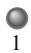

Die Inhomogenität des Magnetfelds beeinflusst das Atom aber auch. Da der Strom i in Abb. 28.11b zunimmt, nimmt auch die aufwärts gerichtete Kraft $\mathrm { d } \vec { F }$ in Abb. 28.11c zu und damit die aufwärts gerichtete Kraft auf die Stromschleife. In Abb. 28.11d nimmt der Strom i ab, folglich nimmt auch die abwärts gerichtete Kraft $\mathrm { d } \vec { F }$ in Abb. 28.11e ab und damit die abwärts gerichtete Kraft auf die Stromschleife. Durch das Anlegen des inhomogenen Magnetfelds $\vec { B } _ { \mathrm { e x t } }$ haben wir also eine resultierende Kraft auf das Atom erzeugt, die von der Gegend des stärkeren Magnetfelds weg zeigt.

Wir haben jetzt zwar mit fiktiven Elektronenbahnen (Ringströmen) argumentiert, haben dabei aber genau das Verhalten abgeleitet, das diamagnetische Substanzen in einem inhomogenen Magnetfeld tatsächlich zeigen: Wenn wir das Magnetfeld wie in Abb. 28.11 anlegen, erhält die Probe ein nach unten gerichtetes magnetisches Dipolmoment und erfährt eine nach oben gerichtete Kraft. Wenn das Feld abgeschaltet wird, verschwinden sowohl das Dipolmoment als auch die Kraft. Dabei muss das externe Feld nicht wie gezeigt anliegen; analoge Argumente gelten für beliebige Orientierungen von $\vec { B } _ { \mathrm { e x t } }$ . Allgemein gilt:

Eine diamagnetische Probe erhält in einem äußeren Magnetfeld $\vec { B } _ { \mathrm { e x t } }$ ein magnetisches Dipolmoment, das dem äußeren Feld entgegengesetzt ist. Wenn das äußere Feld inhomogen ist, wird die Probe aus dem Bereich größerer Feldstärke heraus- und in den Bereich kleinerer Feldstärke hineingedrängt.

Der Frosch in Abb. 28.12 ist diamagnetisch (wie jedes andere Lebewesen auch). In dem divergierenden Magnetfeld in der Nähe des oberen Endes eines stromdurchflossenen Solenoids wird jedes seiner Atome nach oben abgestoßen, weg von dem Bereich des stärkeren Magnetfelds am Ende des Solenoids. Das Tier bewegt sich daher so weit aufwärts in den Bereich des schwächeren Magnetfelds, bis die aufwärts gerichtete magnetische Kraft gerade die abwärts gerichtete Schwerkraft ausgleicht und er schwebt. Wenn wir eine hinreichend große Zylinderspule bauen könnten, könnten wir damit auch Menschen aufgrund ihres Diamagnetismus frei in der Luft schweben lassen.

## KONTROLLFRAGE 5

Die Abbildung zeigt zwei diamagnetische Kugeln in der Nähe des Südpols eines Stabmagneten. Sind (a) die magnetischen Kräfte und (b) die magnetischen Dipolmomente der Kugeln auf den Magneten zu oder von ihm weg gerichtet? (c) Ist die magnetische Kraft auf Kugel 1 größer, gleich groß oder kleiner als die auf Kugel 2?

## 28.7 Paramagnetismus

## Lernziele

Nach dem Durcharbeiten dieses Abschnitts sollten Sie in der Lage sein, . . .

• zu verstehen, dass und in welche Richtung sich die magnetischen Momente in einer paramagnetischen Substanz in einem äußeren Magnetfeld ausrichten,
• die Kraft auf eine paramagnetische Substanz in einem inhomogenen magnetischen Feld anzugeben und die aus ihr resultierende Bewegung zu beschreiben,
• die Beziehung zwischen der Magnetisierung M einer paramagnetischen Substanz, dem gemessenen magnetischen Moment und dem Volumen des Stoffs anzuwenden,
• die Magnetisierung M einer Probe mithilfe des Curieschen Gesetzes mit ihrer Temperatur $T ,$ ihrer Curie-Konstante C und dem Betrag B des externen Felds in Beziehung zu setzen,
• anhand einer gegebenen Magnetisierungskurve für ein paramagnetisches Ma terial die Temperaturabhängigkeit der Magnetisierung bei einem bestimmten magnetischen Feld zu erklären,

688

---

28.7 Paramagnetismus

28

• die magnetische Orientierungsenergie einer paramagnetischen Probe bei gegebener Temperatur und gegebenem Magnetfeld mit der Energie der thermischen Bewegung zu vergleichen.

## Schlüsselideen

Paramagnetische Materialien enthalten Atome mit einem permanenten magnetischen Dipolmoment. Diese Momente sind in einer Probe jedoch normalerweise zufällig orientiert und ergeben kein nach außen wahrnehmbares magnetisches Moment. Wird das Material jedoch in ein äußeres magnetisches Feld gebracht, richten sich die Dipole in Feldrichtung aus und es tritt eine messbare Magnetisierung auf.

• Die Magnetisierung M gibt an, wie stark die Momente in einem gegebenen Volumen $\bar { V }$ ausgerichtet sind:

$$
M = \frac {\text {gemessenes magnetisches Moment}}{V}.
$$

• Eine vollständige Ausrichtung (Sättigung) aller N Dipole im Volumen ergibt den Maximalwert $M _ { \operatorname* { m a x } } = N \mu / V$ der Magnetisierung.

• Für kleine Werte des Verhältnisses $B _ { \mathrm { e x t } } / T$ gilt

$$
M = C \frac {B _ {\mathrm{ext}}}{T} \quad \text {(Curiesches Gesetz)};
$$

dabei sind $T$ die absolute Temperatur und C die Curie-Konstante des betrachteten Materials.

• In einem inhomogenen äußeren Feld wird ein paramagnetisches Material in Bereiche mit größerer magnetischer Feldstärke gezogen.

## 28.7.1 Paramagnetismus

In paramagnetischen Substanzen heben sich die verschiedenen magnetischen Spin- und Bahnmomente der Elektronen in den Atomen nicht gegenseitig auf, sondern addieren sich vektoriell und geben dem Atom ein resultierendes permanentes magnetisches Dipolmoment $i \vec { \mu } .$ In Abwesenheit eines externen Magnetfelds sind diese magnetischen Dipole in einer Probe jedoch zufällig orientiert und das resultierende Dipolmoment der Probe ist daher null. Wenn die Probe aber in ein externes Magnetfeld $\vec { B } _ { \mathrm { e x t } }$ gebracht wird, so tendieren die individuellen Dipolmomente der Atome dazu, sich parallel zum äußeren Feld auszurichten und geben so der Probe ein resultierendes magnetisches Moment. Die parallele Ausrichtung zum äußeren Feld ist das Gegenteil dessen, was wir bei diamagnetischen Proben hergeleitet hatten.

Eine paramagnetische Substanz, die in ein äußeres Magnetfeld $\vec { B } _ { \mathrm { e x t } }$ gebracht wird, entwickelt ein magnetisches Dipolmoment in Richtung von $\vec { B } _ { \mathrm { e x t } }$ . Wenn das Feld inhomogen ist, wird die Probe in den Bereich höherer Feldstärke hineingezogen.

Wenn die Ausrichtung der magnetischen Dipolmomente vollständig wäre, besä- ße eine paramagnetische Probe mit N Atomen ein resultierendes Dipolmoment in der Größenordnung $N \mu .$ . Stöße zwischen den Atomen aufgrund der thermischen Bewegung stören die Ausrichtung jedoch und verringern das tatsächliche Dipolmoment der Probe.

Als Maß für die Bedeutung der thermischen Bewegung können wir zwei Energien vergleichen. Aus Gl. 15.23 erhalten wir für die mittlere kinetische Energie eines Atoms bei einer Temperatur $T$ einen Wert von $K = ( 3 / 2 ) k T ,$ , wobei k die Boltz mann-Konstante ist $\bar { ( } 1 , 3 8 \cdot 1 0 ^ { - 2 3 }   \mathrm { J / K ) }$ und $T$ die Temperatur in Kelvin (nicht in

689

---

28 Magnetismus und Materie

Grad Celsius!). Aus Gl. 24.33 erhalten wir eine Energiedifferenz $\Delta U _ { B } = 2 \mu B _ { \mathrm { e x t } }$ zwischen der parallelen und der antiparallelen Ausrichtung des magnetischen Dipolmoments eines Atoms und des äußeren Felds. Wie wir weiter unten zeigen werden, gilt selbst für gewöhnliche Temperaturen und Feldstärken $K \gg \Delta U _ { B } .$ . Der Energietransfer durch Stöße zwischen den Atomen kann daher die Ausrichtung der magnetischen Dipolmomente empfindlich stören und hält so das magnetische Dipolmoment einer Probe deutlich unter dem erwarteten Wert von $N \mu .$

Das Ausmaß der Ausrichtung der magnetischen Dipolmomente in einer paramagnetischen Probe können wir durch das Verhältnis ihres resultierenden magnetischen Dipolmoments zu ihrem Volumen V ausdrücken. Die resultierende Vektorgröße, das magnetische Dipolmoment pro Volumeneinheit, ist die **Magnetisierung** M⃗ der Probe; ihr Betrag ist

$$
M = \frac {\text {gemessenes magnetisches Moment}}{V}. \tag {28.32}
$$

M hat die Einheit Ampere pro Meter $( \mathrm { A } / \mathrm { m } )$ . Die vollständige Ausrichtung aller magnetischen Dipolmomente, als Sättigung der Probe bezeichnet, entspricht dem Maximalwert $M _ { \operatorname* { m a x } } = N \mu / V .$

1895 entdeckte Pierre Curie, dass die Magnetisierung einer Probe direkt proportional zur Feldstärke des angelegten Magnetfelds $\vec { B } _ { \mathrm { e x t } }$ und umgekehrt proportional zur Temperatur $T$ ist:

$$
M = C \frac {B _ {\mathrm{ext}}}{T}. \tag {28.33}
$$

Gleichung 28.33 ist als Curiesches Gesetz bekannt; C ist die Curie-Konstante. Das Curiesche Gesetz steht im Einklang mit unserem bisherigen Kenntnisstand – wie wir bereits wissen, richtet ein stärkeres Feld $B _ { \mathrm { e x t } }$ die magnetischen Dipole in der Probe stärker aus und vergrößert dadurch $M ,$ während eine steigende Temperatur $T$ die Ausrichtung durch verstärkte thermische Bewegung stört und M folglich verringert. Streng genommen ist das Gesetz aber nur eine Näherung, die solange gilt, wie das Verhältnis $B _ { \mathrm { e x t } } / T$ nicht zu groß wird.

Abbildung 28.13 zeigt das Verhältnis $M / M _ { \mathrm { m a x } }$ als Funktion von $B _ { \mathrm { e x t } } / T$ für das Salz Kaliumchromsulfat, in dem die Chrom-Ionen für den Paramagnetismus verantwortlich sind. Diese Art der Darstellung wird als Magnetisierungskurve bezeichnet. Auf der linken Seite, bis etwa $B _ { \mathrm { e x t } } / \dot { T } = 0 , 5   \mathrm { T / K } ,$ beschreibt die Gerade aus dem Curieschen Gesetz die Messwerte gut; danach werden die Abweichungen aber groß. Die Kurve, die alle Messwerte gut beschreibt, basiert auf der Quantenphysik. Die Messpunkte auf der rechten Seite, in der Nähe der Sättigung, sind experimentell sehr schwer zu bestimmen, da hierfür selbst bei niedrigen Temperaturen sehr hohe Feldstärken notwendig sind (etwa das 100 000-Fache des Erdmagnetfelds).

Abb. 28.13

Eine Magnetisierungskurve für Kaliumchromsulfat, ein paramagnetisches Salz. Aufgetragen ist das Verhältnis der Magnetisierung M zur maximalen Magnetisierung $M _ { \mathrm { m a x } }$ des Salzes gegen das Verhältnis $\overset { \mathrm { m a x } } { B } _ { \mathrm { e x t } } / T$ der Feldstärke des äußeren Felds und der Temperatur. Das Curiesche Gesetz beschreibt die Daten auf der linken Seite der Kurve gut; die Vorhersage aus der Quantentheorie stimmt für alle Werte (nach W.E. Henry).

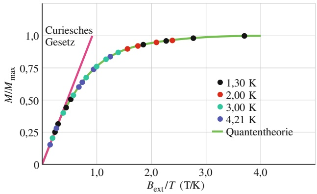

scatter

| Bext/T (T/K) | 1,30 K | 2,00 K | 3,00 K | 4,21 K |
| --- | --- | --- | --- | --- |
| ~0.25 | — | — | ~0.22 | ~0.16 |
| ~0.35 | ~0.32 | — | ~0.38 | ~0.27 |
| ~0.45 | ~0.45 | — | ~0.48 | ~0.39 |
| ~0.55 | ~0.52 | — | ~0.58 | ~0.48 |
| ~0.65 | — | — | ~0.65 | ~0.58 |
| ~0.75 | — | — | ~0.72 | ~0.65 |
| ~0.85 | — | — | ~0.76 | ~0.72 |
| ~0.95 | — | — | ~0.81 | ~0.76 |
| ~1.15 | — | — | ~0.85 | ~0.83 |
| ~1.35 | — | — | ~0.88 | ~0.86 |
| ~1.55 | — | ~0.91 | — | — |
| ~1.75 | — | ~0.93 | — | — |
| ~1.95 | ~0.94 | — | — | — |
| ~2.15 | — | ~0.96 | — | — |
| ~2.35 | — | ~0.97 | — | — |
| ~2.75 | ~0.99 | — | — | — |
| ~3.75 | 1.00 | — | — | — |

690

---

28.8 Ferromagnetismus

28

## 28.8 Ferromagnetismus

## Lernziele

Nach dem Durcharbeiten dieses Abschnitts sollten Sie in der Lage sein, . . .

• zu verstehen, dass der Ferromagnetismus von einer quantenmechanischen Wechselwirkung mit der Bezeichnung „Austauschkopplung“ verursacht wird,
• zu erklären, warum der Ferromagnetismus verschwindet, wenn die Temperatur die Curie-Temperatur des betrachteten Materials übersteigt,
• die Beziehung zwischen der Magnetisierung einer ferromagnetischen Probe und dem magnetischen Moment ihrer Atome anzuwenden,
• die magnetische Orientierungsenergie einer ferromagnetischen Probe bei gegebener Temperatur und gegebenem Magnetfeld mit der Energie der thermischen Bewegung zu vergleichen,
• einen Rowland-Ring zu beschreiben und zu skizzieren,
• magnetische Domänen als solche zu erkennen,
• die relative Orientierung von äußerem Feld und magnetischem Dipolmoment einer ferromagnetischen Probe anzugeben,
• die Bewegung einer ferromagnetischen Probe in einem inhomogenen Magnetfeld zu verstehen,
• Drehmoment und Orientierungsenergie eines ferromagnetischen Objekts in einem homogenen Magnetfeld zu berechnen,
• zu erklären, was man unter dem Begriff Hysterese versteht und was eine Hystereseschleife ist,
• die natürliche Magnetisierung von Magnetitbrocken zu erklären.

## Schlüsselideen

Die magnetischen Dipolmomente in einem ferromagnetischen Material können durch ein externes magnetisches Feld ausgerichtet werden. Wird das äußere Feld entfernt, bleiben sie innerhalb sogenannter Domänen zumindest teilweise einheitlich ausgerichtet.
• Die Ausrichtung verschwindet, wenn die Temperatur die Curie-Konstante des betrachteten Materials übersteigt.
• In einem inhomogenen äußeren Feld wird ein ferromagnetisches Material in Gebiete mit großer magnetischer Feldstärke hineingezogen.

## 28.8.1 Ferromagnetismus

Wenn wir im Alltag von Magnetismus sprechen, haben wir fast immer ein Bild von einem Stabmagneten oder einem Haftmagneten (vielleicht an einer Kühlschranktür) vor unserem geistigen Auge. Wir denken also an eine ferromagnetische Sub stanz mit einem starken, permanenten magnetischen Dipolmoment und nicht an diamagnetische oder paramagnetische Substanzen mit ihrem schwachen, temporären Magnetismus.

Eisen, Cobalt, Nickel, Gadolinium und einige weitere Metalle sowie Legierungen zeigen Ferromagnetismus. Die Ursache dafür ist ein quantenphysikalischer Effekt, der alsAustauschkopplung bezeichnet wird und der eine Wechselwirkung der Elektronenspins eines Atoms mit denen benachbarter Atome bewirkt. Das Ergebnis ist eine Ausrichtung der magnetischen Dipolmomente der verschiedenen Atome anstelle der zufälligen Orientierung der Dipolmomente, die wir in einer paramagnetischen Probe vorgefunden hatten. Diese immer vorhandene Ausrichtung gibt den ferromagnetischen Materialien ihren permanenten Magnetismus.

Wenn die Temperatur eines ferromagnetischen Materials über einen kritischen Wert, die sogenannte Curie-Temperatur, erhöht wird, verliert die Austauschkopplung ihre Wirkung. Die meisten Substanzen werden dann einfach paramagnetisch, d. h., die magnetischen Dipolmomente tendieren immer noch dazu, sich im exter-

691

---

28 Magnetismus und Materie

text_image

Eisen-
kern
iP
iP
P
B
S
iS
iS

Abb. 28.14

Ein Rowland-Ring. Ein Strom fließt durch die Primärspule P, in deren Kern sich das zu untersuchende ferromagnetische Material (hier Eisen) befindet, das durch den Strom magnetisiert wird. (Die Windungen der Spule sind hier als Punkte eingezeichnet.) Die Stärke der Magnetisierung des Spulenkerns bestimmt das Gesamtmagnetfeld B⃗ in der Spule P, das mithilfe der Sekundärspule S gemessen wird.

line

| B0 (10^-4 T) | BM/BM,max |
| --- | --- |
| 0 | 0 |
| ~1 | ~0.25 |
| ~2 | ~0.5 |
| ~4 | ~0.63 |
| ~6 | ~0.67 |
| ~8 | ~0.69 |
| ~10 | ~0.7 |
| ~12 | ~0.72 |
| 14 | ~0.76 |

Abb. 28.15

Eine Magnetisierungskurve für eine ferromagnetische Substanz im Spulenkern des Rowland-Rings aus Abb. 28.14. Der Wert 1,0 auf der vertikalen Achse entspricht einer vollständigen Ausrichtung der atomaren Dipole (Sättigung) in der Probe.

nen Feld auszurichten, nur sehr viel schwächer als unterhalb der Curie-Temperatur und die thermische Bewegung kann die Ausrichtung nun leichter stören. Die Curie-Temperatur für Eisen beträgt 1043 K $( = 7 7 0 ^ { \circ } C )$ .

Die Magnetisierung einer ferromagnetischen Substanz wie z. B. Eisen kann mit einem Rowland-Ring untersucht werden (Abb. 28.14). Man formt das Material dabei zu einem dünnen Torus mit kreisförmigem Querschnitt. Um den Torus wird eine Primärspule P mit n Windungen pro Längeneinheit gewickelt, die einen Strom $i _ { \mathrm { P } }$ führt (die Spule ist im Prinzip ein langes Solenoid, das zu einem Kreis gebogen ist). Ohne den Eisenkern wäre die Feldstärke im Inneren der Spule nach Gl. 25.25

$$
B _ {0} = \mu_ {0} i _ {\mathrm{P}} n. \tag {28.34}
$$

Mit dem Eisenkern finden wir in der Spule ein stärkeres, in der Regel sogar deutlich stärkeres Magnetfeld als $B _ { 0 }$ . Wir schreiben die Stärke dieses Felds als

$$
B = B _ {0} + B _ {M}, \tag {28.35}
$$

wobei $B _ { M }$ die zusätzliche Feldstärke ist, die von dem Eisenkern hervorgerufen wird. Dieser zusätzliche Beitrag entsteht durch die Ausrichtung der magnetischen Dipolmomente der Eisenatome, die von dem äußeren Feld mithilfe der Austauschkopplung hervorgerufen wird; er ist proportional zur Magnetisierung M des Eisens. Der Beitrag $B _ { M }$ ist also proportional zum magnetischen Dipolmoment des Eisens pro Volumeneinheit. Um $B _ { M }$ zu bestimmen, messen wir B mithilfe einer Sekundärspule S, berechnen aus Gl. 28.34 $B _ { 0 }$ und erhalten $B _ { M }$ gemäß Gl. 28.35 aus der Differenz beider Werte.

Abbildung 28.15 zeigt die Magnetisierungskurve einer ferromagnetischen Substanz in einem Rowland-Ring: Aufgetragen ist das Verhältnis $B _ { M } / B _ { M , \operatorname* { m a x } }$ gegen $B _ { 0 } ,$ wobei $B _ { M , \operatorname* { m a x } }$ der Maximalwert von $B _ { M }$ (entsprechend der Sättigung) ist. Die Kurve entspricht der in Abb. 28.13 für eine paramagnetische Probe gezeigten; beide Kurven illustrieren, wie stark das äußere Feld die magnetischen Dipolmomente der Atome in der Probe ausrichten kann.

Bei dem ferromagnetischen Material aus Abb. 28.15 sind die Dipolmomente bei einem Feld von $1 \cdot \bar { 1 0 } ^ { - 3 \cdot \prime }$ T zu etwa 70 % ausgerichtet. Wenn wir $B _ { 0 }$ auf 1 T erhöhen würden, wäre die Ausrichtung praktisch vollständig (eine Feldstärke $B _ { 0 } = 1$ T und damit die Sättigung ist in der Praxis allerdings schon recht schwierig zu erreichen).

## Magnetische Domänen

Die Austauschkopplung bewirkt bei Temperaturen unterhalb der Curie-Temperatur eine Ausrichtung benachbarter magnetischer Dipole in einer ferromagnetischen Substanz. Warum erreicht ein solches Material dann nicht ganz von selbst und ohne äußeres Feld $B _ { 0 }$ die Sättigung? Mit anderen Worten, warum ist nicht jedes Stück Eisen wie z. B. ein Nagel immer ein starker Magnet?

Um das zu verstehen, betrachten wir eine einkristalline Probe eines ferromagnetischen Materials, d. h. eine Probe, in der sich die regelmäßige Anordnung der Atome – das Kristallgitter – ohne Störung oder Unregelmäßigkeit durch das gesamte Volumen der Probe erstreckt. Ein solcher Kristall besteht normalerweise aus einer Anzahl von magnetischen Domänen. Damit bezeichnen wir Bereiche, in denen die Ausrichtung der atomaren Dipole praktisch perfekt ist. Die Domänen untereinander sind jedoch nicht ausgerichtet. Für den gesamten Kristall bedeutet das, dass die magnetischen Momente der Domänen sich weitgehend gegenseitig aufheben.

Abbildung 28.16 zeigt eine vergrößerte Fotografie derartiger Domänen an der Oberfläche eines Nickel-Einkristalls. Sie wurden sichtbar gemacht, indem eine kolloidale Suspension von fein verteiltem Eisenoxid auf die Oberfläche des Kristalls aufgesprüht wurde. An den Grenzen der Domänen ändert sich die Ausrichtung der atomaren Dipole beim Übergang von der einen zur anderen Domäne; an diesen Stellen existieren sehr starke, eng lokalisierte und sehr inhomogene Magnetfel-

692

---

28.8 Ferromagnetismus

28

der. Zu diesen Domänengrenzen werden die suspendierten Eisenoxidteilchen hingezogen, die daher die Grenzen als weiße Linien sichtbar machen (in Abb. 28.16 sind jedoch nicht alle Domänengrenzen zu sehen). Obwohl innerhalb der Domä- nen praktisch alle atomaren Dipole wie durch die Pfeile angedeutet ausgerichtet sind, kann die Probe als Ganzes trotzdem ein sehr geringes resultierendes magnetisches Moment besitzen.

Das Eisen, das wir normalerweise in der Hand haben, ist kein Einkristall, sondern besteht aus vielen winzigen Kristallen, die zufällig zueinander orientiert sind; man spricht von einem polykristallinen Material. Jeder der winzigen Kristalle in einer solchen Probe besteht wiederum aus magnetischen Domänen mit zufälliger Ausrichtung zueinander wie in Abb. 28.16. Wenn wir eine solche Probe magnetisieren, indem wir sie in ein äußeres Magnetfeld mit allmählich ansteigender Feldstärke bringen, dann bewirken wir zweierlei Effekte, die insgesamt eine Magnetisierungskurve der Form von Abb. 28.15 erzeugen. Der erste dieser Effekte ist, dass die Domänen, die zufällig parallel zum äußeren Feld orientiert sind, auf Kosten der benachbarten Domänen wachsen. Der zweite Effekt ist, dass sich die Dipole von Domänen, die nicht parallel zum äußeren Feld ausgerichtet sind, geschlossen in Richtung des äußeren Felds umorientieren können.

Die Austauschkopplung und die Domänenumorientierung bewirken gemeinsam folgendes Ergebnis:

Eine ferromagnetische Substanz entwickelt in einem äußeren Magnetfeld $\vec { B } _ { \mathrm { e x t } }$ ein starkes magnetisches Dipolmoment in Richtung von $\vec { B } _ { \mathrm { e x t } } ,$ das zu einem erheblichen Teil auch nach dem Abschalten von $\vec { B } _ { \mathrm { e x t } } ^ { - }$ erhalten bleibt. Wenn das Feld inhomogen ist, wird die ferromagnetische Substanz aus dem Bereich kleinerer Feldstärke zum Bereich größerer Feldstärke hingezogen.

Die Umorientierung magnetischer Domänen kann man sogar hörbar machen: Dazu holen wir unseren alten Kassettenrekorder vom Dachboden, schalten ihn auf Wiedergabe, ohne eine Kassette einzulegen, und drehen die Lautstärke auf maximal. Dann bringen wir einen starken Magneten in die Nähe des (ferromagnetischen) Tonkopfs. Das Magnetfeld bewirkt eine plötzliche Umorientierung der Domänen im Tonkopf, wodurch sich das Magnetfeld in einer Spule um den Tonkopf ändert. Dadurch werden Ströme in der Spule induziert, die verstärkt und an den Lautsprecher geleitet werden, der ein pfeifendes Geräusch von sich gibt.

## Hysterese

Wenn wir an eine ferromagnetische Substanz ein Magnetfeld $B _ { 0 }$ anlegen und dann wieder entfernen, geht die Magnetisierung nicht auf demselben Weg wie beim Aufmagnetisieren zurück. Abbildung 28.17 zeigt die Auftragung von $B _ { M }$ gegen $B _ { 0 }$ für einen Rowland-Ring während der folgenden Schritte: (1) Beginnend mit einem unmagnetisierten Stück Eisen (Punkt a) wird der Strom in der Spule erhöht, bis die Feldstärke $B _ { 0 } \: ( = n i \mu _ { 0 } )$ dem Punkt b entspricht. Daraufhin wird der Strom in der Spule (und damit die Feldstärke $B _ { 0 } )$ bis auf null reduziert (Punkt c) und schließlich umgekehrt, bis die Feldstärke Punkt d entspricht. Zuletzt wird der Strom wieder bis auf null reduziert (Punkt e) und nochmals umgekehrt, bis die Feldstärke wieder den Punkt b erreicht.

Die Eigenschaft, dass die Magnetisierung wie in Abb. 28.17 beim Entfernen eines Magnetfelds nicht entlang derselben Kurve zum Anfangspunkt zurückkehrt, der sie beim Einschalten des Felds gefolgt war, nennt man **Hysterese**. Die Kurve bcdeb heißt entsprechend Hystereseschleife. An den Punkten c und e ist das Eisen magnetisiert, obwohl in den Windungen der Spule kein Strom fließt; hier haben wir die für ferromagnetische Substanzen typische permanente Magnetisierung vorliegen.

Das Auftreten der Hysterese können wir mithilfe des Konzepts der magnetischen Domänen verstehen. Offensichtlich sind die Verschiebungen der Domänengren-

natural_image

Abstract black-and-white maze pattern with white directional arrows (no text or symbols)

Abb. 28.16

Eine Fotografie der Domänengrenzen an der Oberfläche eines Nickel-Einkristalls. Die eingezeichneten weißen Pfeile zeigen die Orientierungen der magnetischen Dipole in den verschiedenen Domänen und damit die Orientierung der resultierenden magnetischen Dipole der Domänen. Der Kristall als Ganzes ist nicht magnetisiert, wenn die Vektorsumme der magnetischen Dipole aller Domänen (annähernd) null ergibt [Quelle: Ralph W. DeBlois].

text_image

B_M
c
b
a
B_0
d
e

Abb. 28.17

Eine Magnetisierungskurve (ab) einer ferromagnetischen Probe und die zugehörige Hystereseschleife (bcdeb).

693

---

28 Magnetismus und Materie

zen und die Umorientierung der Richtung der Domänen nicht vollständig reversibel. Wenn das äußere Feld $B _ { 0 }$ erhöht und anschließend wieder reduziert wird, kehren die Domänen nicht vollständig in ihren Ausgangszustand zurück, sondern behalten eine Art „Erinnerung“ an ihre Orientierung im Magnetfeld. Dieses Erinnerungsvermögen ist die Grundlage der Datenspeicherung auf magnetischen Medien wie Tonbändern, Magnetstreifen oder Computerfestplatten.

Eine Speicherung der Orientierung von Domänen kommt auch in der Natur vor. Wenn Blitze im Boden einschlagen und hohe Ströme durch die Erde schicken, dann entstehen um diese Ströme starke Magnetfelder, die ferromagnetische Materialien (z. B. Magnetit) in der Nähe magnetisieren können. Aufgrund der Hysterese bleibt ein Teil dieser Magnetisierung auch nach dem Blitz (nachdem die Ströme abgeklungen sind) erhalten. Bruchstücke derartiger magnetisierter Steine können dann später als Magnetitklumpen an der Erdoberfläche auftauchen.

## 28.9 Zusammenfassung

**Gaußscher Satz für Magnetfelder** Die einfachsten magnetischen Systeme sind magnetische Dipole. Magnetische Monopole existieren – soweit wir heute wissen – nicht. Der Gaußsche Satz für Magnetfelder besagt, dass der magnetische Fluss durch eine beliebige geschlossene Gaußsche Flä- che verschwindet:

$$
\varPhi_ {B} = \oint \vec {B} \cdot \mathrm{d} \vec {A} = 0. \tag {28.1}
$$

Das ist eine andere Formulierung für die Tatsache, dass keine magnetischen Monopole existieren.

**Ampère-Maxwellsches Gesetz** Ein veränderlicher elektrischer Fluss induziert ein Magnetfeld $\vec { B } .$ Das Maxwellsche Induktionsgesetz stellt einen Zusammenhang zwischen der Änderung des elektrischen Flusses $\Phi _ { E }$ durch eine Leiterschleife und dem dadurch induzierten Magnetfeld $\vec { B }$ entlang dieser Schleife her:

$$
\oint \vec {B} \cdot \mathrm{d} \vec {s} = \mu_ {0} \varepsilon_ {0} \frac {\mathrm{d} \varPhi_ {E}}{\mathrm{d} t}. \tag {28.3}
$$

Das Ampèresche Gesetz beschreibt $\oint \vec { B }   \cdot   \mathrm { d } \vec { s } ~ = ~ \mu _ { 0 } i _ { \mathrm { u m } }$ (Gl. 28.4) das Magnetfeld, das ein von einer Leiterschleife eingeschlossener Strom in dieser induziert. Beide Beziehungen können zu einer einzigen Gleichung zusammengefasst werden, welche man das Ampère-Maxwellsche Gesetz nennt:

$$
\oint \vec {B} \cdot \mathrm{d} \vec {s} = \mu_ {0} \varepsilon_ {0} \frac {\mathrm{d} \varPhi_ {E}}{\mathrm{d} t} + \mu_ {0} i _ {\mathrm{um}}. \tag {28.5}
$$

**Verschiebungsstrom** Der fiktive Verschiebungsstrom, der durch ein zeitlich veränderliches elektrisches Feld verursacht wird, ist definiert als

$$
i _ {\mathrm{V}} = \varepsilon_ {0} \frac {\mathrm{d} \varPhi_ {E}}{\mathrm{d} t}. \tag {28.6}
$$

Damit wird aus Gl. 28.5

$$
\oint \vec {B} \cdot \mathrm{d} \vec {s} = \mu_ {0} i _ {\mathrm{V,um}} + \mu_ {0} i _ {\mathrm{um}}, \tag {28.7}
$$

wobei $i _ { \mathrm { V , u m } }$ der Verschiebungsstrom ist, der von der Inte grationsschleife umschlossen wird. Das Konzept des Verschiebungsstroms erlaubt es uns, an der Vorstellung eines kontinuierlichen Stroms auch durch einen Kondensator festzuhalten. Mit dem Verschiebungsstrom ist jedoch kein Ladungstransport verbunden.

**Integrale Maxwell-Gleichungen** In integraler Form lauten die Maxwell-Gleichungen für das elektrische und magnetische Feld (vgl. Tab. 28.1)

$$
\oint \vec {E} \cdot \mathrm{d} \vec {A} = \frac {q _ {\text {innen}}}{\varepsilon_ {0}}, \tag {28.14a}
$$

$$
\oint \vec {B} \cdot \mathrm{d} \vec {A} = 0, \tag {28.14b}
$$

$$
\oint \vec {E} \cdot \mathrm{d} \vec {s} + \frac {\mathrm{d} \varPhi_ {B}}{\mathrm{d} t} = 0, \tag {28.14c}
$$

$$
\oint \vec {B} \cdot \mathrm{d} \vec {s} - \mu_ {0} \varepsilon_ {0} \frac {\mathrm{d} \varPhi_ {E}}{\mathrm{d} t} = \mu_ {0} i _ {\mathrm{um}}. \tag {28.14d}
$$

**Differenzielle Maxwell-Gleichungen** Für viele Anwendungen und speziell auch für die numerische Behandlung auf modernen Computern ist die integrale Form der Maxwell-Gleichungen weniger geeignet und man verwendet sie lieber in ihrer differenziellen Form

$$
\mathrm{div} \vec {E} = \frac {\rho}{\varepsilon_ {0}}, \tag {28.15a}
$$

$$
\mathrm{div} \vec {B} = 0, \tag {28.15b}
$$

$$
\mathrm{rot} \vec {E} + \frac {\partial \vec {B}}{\partial t} = 0, \tag {28.15c}
$$

$$
\mathrm{rot} \vec {B} - \mu_ {0} \varepsilon_ {0} \frac {\partial \vec {E}}{\partial t} = \mu_ {0} \vec {j}. \tag {28.15d}
$$

Hierbei sind $\rho$ die elektrische Ladungsdichte und $\vec { j }$ die elektrische Stromdichte. Die differenziellen Maxwell-Gleichungen bilden ein System gekoppelter, partieller Differenzialgleichungen. Das Konzept der partiellen Ableitungen besagt, dass bei der Ableitung einer Funktion $F ( x , y , z , t )$ von mehreren Variablen beispielsweise nach x alle anderen

694

---

28.9 Zusammenfassung

28

Variablen festgehalten, d. h. als konstant betrachtet werden (vgl. Anhang D):

$$
\frac {\partial F}{\partial x} \equiv \left. \frac {\partial F}{\partial x} \right| _ {y, z, t = \text {const.}}.
$$

In partiellen Differenzialgleichungen treten partielle Ableitungen nach verschiedenen Variablen auf, $\mathrm { z .   B . } ~ \partial F / \partial t$ und $\partial F / \partial x$ usw. Weiterhin werden die Vektorableitungen Divergenz (div) und Rotation (rot) verwendet; vgl. ebenfalls Anhang D.

**Erdmagnetfeld** Das Erdmagnetfeld kann näherungsweise als magnetisches Dipolfeld beschrieben werden, wobei die Dipolachse einen Winkel von 11,5° mit der Achse der Erdrotation einschließt und der Südpol des magnetischen Dipols auf der Nordhalbkugel der Erde liegt. Die Richtung des lokalen Magnetfelds wird an einem beliebigen Punkt der Erdoberfläche durch die Deklination (den Winkel rechts oder links von der Nordrichtung) und die Inklination (den Winkel zur Horizontalen) beschrieben.

**Magnetisches Spindipolmoment** Ein Elektron besitzt einen intrinsischen Drehimpuls, den Spindrehimpuls oder kurz Spin ${ \vec { S } } ,$ mit dem ein intrinsisches magnetisches Spinmoment $\vec { \mu } _ { s }$ verbunden ist:

$$
\vec {\mu} _ {s} = - \frac {e}{m} \vec {S}. \tag {28.16}
$$

Der Spin $\vec { S }$ selbst ist nicht komplett messbar, sondern es können nur sein Betrag sowie eine Komponente bezüglich einer beliebigen Koordinatenachse gemessen werden. Die Komponente $S _ { z }$ bezüglich einer gewählten z-Achse kann nur die Werte

$$
S _ {z} = m _ {s} \frac {h}{2 \pi} \quad \text {mit} \quad m _ {s} = \pm \frac {1}{2} \tag {28.17}
$$

annehmen, wobei $h \; = \; 6 { , } 6 3   { \cdot }   1 0 ^ { - 3 4 }   \mathrm { J } \cdot \mathrm { s }$ die Plancksche Konstante ist. Ebenso kann das magnetische Spinmoment selbst nicht gemessen werden, sondern nur sein Betrag und seine Komponente bezüglich einer Achse. Auch hier ist die z-Komponente auf die Werte

$$
\mu_ {s, z} = \pm \frac {e h}{4 \pi m} = \pm \mu_ {\mathrm{B}}, \tag {28.16,28.18}
$$

beschränkt, wobei $\mu _ { \mathrm { B } }$ das Bohrsche Magneton ist:

$$
\mu_ {\mathrm{B}} = \frac {e h}{4 \pi m} = 9, 2 7 \cdot 1 0 ^ {- 2 4}   \mathrm{J/T}  . \tag {28.19}
$$

Die potenzielle Energie U eines Spins mit dem magnetischen Moment $\vec { \mu } _ { s }$ in einem Magnetfeld $\vec { B } _ { \mathrm { e x t } }$ ist

$$
U = - \vec {\mu} _ {s} \cdot \vec {B} _ {\mathrm{ext}} = - \mu_ {s, z} B _ {\mathrm{ext}}. \tag {28.21}
$$

**Magnetisches Bahndipolmoment** Ein Elektron in einem Atom besitzt noch einen weiteren Drehimpuls, den Bahndrehimpuls $\vec { L } _ { \mathrm { B a h n } } ,$ , mit dem ein magnetisches Bahnmoment $\vec { \mu } _ { \mathrm { B a h n } }$ verbunden ist:

$$
\vec {\mu} _ {\mathrm{Bahn}} = - \frac {e}{2 m} \vec {L} _ {\mathrm{Bahn}}. \tag {28.22}
$$

Auch der Bahndrehimpuls ist nur bezüglich einer Achse messbar und seine Komponente bezüglich dieser Achse ist gequantelt und auf die Werte

$$
L _ {\mathrm{Bahn}, z} = m _ {l} \frac {h}{2 \pi} \tag {28.23}
$$

mit $m _ { l } = 0 , \pm 1 , \pm 2 , \pm m _ { \mathrm { m a x } }$ beschränkt. Damit kann der Betrag des magnetischen Bahnmoments die Werte

$$
\mu_ {\mathrm{Bahn}, z} = - m _ {l} \frac {e h}{4 \pi m} = - m _ {l} \mu_ {\mathrm{B}}, \tag {28.24,28.25}
$$

annehmen. Die potenzielle Energie U des magnetischen Bahnmoments in einem Magnetfeld $B _ { \mathrm { e x t } }$ ist

$$
U = - \vec {\mu} _ {\mathrm{Bahn}} \cdot \vec {B} _ {\mathrm{ext}} = - \mu_ {\mathrm{Bahn}, z} B _ {\mathrm{ext}}. \tag {28.26}
$$

**Diamagnetismus** Diamagnetische Substanzen zeigen kein magnetisches Verhalten, bis sie in ein äußeres Magnetfeld $\vec { B } _ { \mathrm { e x t } }$ gebracht werden, wo sie ein magnetisches Dipolmoment entwickeln, das $\vec { B } _ { \mathrm { e x t } }$ entgegengesetzt ist. Wenn das Feld inhomogen ist, wird die Probe von dem Bereich größerer Feldstärke abgestoßen.

**Paramagnetismus** Jedes Atom in einer paramagnetischen Substanz besitzt ein permanentes magnetisches Dipolmoment $\vec { \mu } ,$ die einzelnen Dipole sind jedoch zufällig orientiert und die Substanz als Ganzes besitzt kein magnetisches Moment. Ein externes Magnetfeld $\vec { B } _ { \mathrm { e x t } }$ kann die Dipolmomente der Atome zumindest teilweise ausrichten, wodurch die Probe ein resultierendes magnetisches Dipolmoment in Richtung von $\vec { B } _ { \mathrm { e x t } }$ erhält. Wenn das Feld $\vec { B } _ { \mathrm { e x t } }$ inhomogen ist, wird die Probe von dem Bereich grö- ßerer Feldstärke angezogen.

Die Ausrichtung der atomaren Dipolmomente ist umso stärker, je stärker das äußere Feld $\vec { B } _ { \mathrm { e x t } }$ ist, und wird umso geringer, je höher die Temperatur T ist. Das Ausmaß der Ausrichtung der Dipolmomente in einer Probe mit dem Volumen V wird durch die Magnetisierung M⃗ beschrieben, deren Betrag durch

$$
M = \frac {\text {gemessenes magnetisches Moment}}{V} \tag {28.32}
$$

gegeben ist. Die vollständige Ausrichtung aller magnetischen Dipolmomente in der Probe, als Sättigung bezeichnet, entspricht einem maximalen Wert der Magnetisierung $M _ { \operatorname* { m a x } } = \bar { N } \mu / V$ . Für kleine Werte von $B _ { \mathrm { e x t } } / T$ gilt das Curiesche Gesetz

$$
M = C \frac {B _ {\mathrm{ext}}}{T}, \tag {28.33}
$$

wobei C die Curie-Konstante ist.

695

---

28 Magnetismus und Materie

**Ferromagnetismus** In einer ferromagnetischen Substanz sind auch in Abwesenheit eines äußeren Magnetfelds einige der atomaren magnetischen Dipole parallel ausgerichtet, sodass in einer Probe Bereiche (Domänen) mit einer starken permanenten Magnetisierung existieren. Für die Ausrichtung der atomaren magnetischen Dipole ist ein quantenphysikalischer Effekt, die Austauschkopplung, verantwortlich. Ein äußeres Magnetfeld $\vec { B } _ { \mathrm { e x t } }$ kann die magnetischen Momente dieser Domänen ausrichten und so für

## 28.10 Fragen

**1.** Ein Elektron in einem äußeren Magnetfeld $\vec { B } _ { \mathrm { e x t } }$ hat seinen Spindrehimpuls $S _ { z }$ antiparallel zu $\vec { B } _ { \mathrm { e x t } }$ eingestellt. Wird Energie frei oder muss dem Elektron Energie zugeführt werden, wenn der Spin umklappt und sich parallel zu $\vec { B } _ { \mathrm { e x t } }$ einstellt?
**2.** Abbildung 28.F2a zeigt die beiden entgegengesetzten Spinorientierungen für ein Elektron in einem äußeren Magnetfeld $\vec { B } _ { \mathrm { e x t } }$ . Abbildung 28.F2b gibt dazu drei Varianten für die Auftragung der potenziellen Energie dieser Orientierungen gegen die Feldstärke von $\vec { B } _ { \mathrm { e x t } }$ . Bei den Möglichkeiten b und c schneiden sich die Linien, bei Möglichkeit a sind beide Linien parallel. Welche Variante ist richtig?

Abb. 28.F2

**3.** Abbildung 28.F3 zeigt drei Ringstrommodelle für ein Elektron, das in einem Magnetfeld im Gegenuhrzeigersinn kreist. In den Fällen 1 und 2 sind die Magnetfelder inhomogen, in Fall 3 ist es homogen. In welche Richtung (nach oben oder nach unten oder sind sie null) zeigen in jedem der drei Fälle (a) das magnetische Dipolmoment der Schleife und (b) die magnetische Kraft auf die Schleife?

Abb. 28.F3

Fragen 3, 5 und 6.

**4.** Nimmt der Betrag der resultierenden Kraft auf die Schleife aus Abb. 28.11a und b zu, ab oder bleibt sie gleich, wenn (a) die Feldstärke von $\vec { B } _ { \mathrm { e x t } }$ oder (b) die Divergenz von $\vec { B } _ { \mathrm { e x t } }$ erhöht wird?

die gesamte Probe ein starkes magnetisches Moment parallel zu $\vec { B } _ { \mathrm { e x t } }$ erzeugen. Dieses magnetische Moment kann teilweise weiterbestehen, nachdem $\vec { B } _ { \mathrm { e x t } }$ entfernt wurde. Wenn $\vec { B } _ { \mathrm { e x t } }$ inhomogen ist, wird eine ferromagnetische Probe von dem Bereich größerer Feldstärke angezogen. Die Austauschkopplung verschwindet, wenn eine Probe über ihre Curie-Temperatur hinaus erhitzt wird; die Probe ist dann nur noch paramagnetisch.

**5.** Ersetzen sie die Stromschleifen aus Frage 3 durch diamagnetische Kugeln. In welche Richtung (nach oben oder nach unten oder sind sie null) zeigen in jedem der drei Fälle (a) das magnetische Dipolmoment der Kugel und (b) die magnetische Kraft auf die Kugel?
**6.** Ersetzen sie die Stromschleifen aus Frage 3 durch paramagnetische Kugeln. In welche Richtung (nach oben oder nach unten oder sind sie null) zeigen in jedem der drei Fälle (a) das magnetische Dipolmoment der Kugel und (b) die magnetische Kraft auf die Kugel?
**7.** Abbildung 28.F7 zeigt die magnetischen Dipole in einer diamagnetischen Substanz für drei verschiedene Situationen. (Der Einfachheit halber sei angenommen, dass die Dipole nur in der Papierebene entweder nach oben oder nach unten zeigen können.) Die Situationen unterscheiden sich durch die Feldstärke des angelegten Felds. (a) Zeigt das jeweils angelegte Feld nach oben oder nach unten? Ordnen Sie die drei Situationen in absteigender Reihenfolge (b) nach der Feldstärke des angelegten Felds und (c) nach der Magnetisierung der Probe.

text_image

Diagram showing nine directional arrows arranged in a 3x3 grid, each with an upward arrow and one downward arrow.

(1)

text_image

Grid of eight directional symbols (up, down, up, down, up, down, up) arranged in three rows and three columns.

(2)

text_image

Grid of directional arrows in blue, arranged in 3 rows and 5 columns

(3)

Abb. 28.F7

**8.** Abbildung 28.F8 zeigt jeweils einen elektrischen Feldvektor und eine Feldlinie eines induzierten magnetischen Felds. Nimmt die Feldstärke von E⃗ in den beiden Fällen zu oder ab?

(a)

(b)

Abb. 28.F8

696

---

28.10 Fragen

28

**9.** Abbildung 28.F9 zeigt einen Plattenkondensator und einen Strom in den Anschlussleitungen, der den Kondensator entlädt. Zeigen (a) das elektrische Feld E⃗ und (b) der Verschiebungsstrom zwischen den Platten nach rechts oder nach links? (c) Zeigt das Magnetfeld im Punkt P in die Seite oder aus der Seite heraus?

text_image

P
i
i

Abb. 28.F9

**10.** Ein Plattenkondensator mit rechteckigen Platten wird entladen. Eine rechteckige Schleife mit den Abmessungen L mal 2L ist zentriert zwischen den Platten mit den Maßen 2L mal 4L angebracht. Welcher Bruchteil des Verschiebungsstroms wird von der Schleife umschlossen, wenn dieser homogen verteilt ist?
**11.** Abbildung 28.F11a zeigt einen Kondensator mit runden Platten beim Laden. Punkt a (in der Nähe einer der Anschlussleitungen) und Punkt b (im Zwischenraum zwischen den Kondensatorplatten) sind gleich weit von der zentralen Achse entfernt, dasselbe gilt für die Punkte c (etwas weiter von der Zuleitung entfernt als a) und d (zwischen den Kondensatorplatten, aber außerhalb). In Abb. 28.F11b zeigt eine der Kurven den Verlauf der Feldstärke des Magnetfelds innerhalb und außerhalb der Zuleitung als Funktion des Abstands r von der zentralen Achse. Die andere Kurve zeigt den Verlauf der Feldstärke des Magnetfelds innerhalb und außerhalb des Kondensators als Funktion des Abstands r von der zentralen Achse. Welcher der drei Punkte auf den Kurven entspricht welchem der vier Punkte in Abb. 28.F11a?

Abb. 28.F11

**12.** Abbildung 28.F12 zeigt eine Draufsicht auf einen quadratischen Plattenkondensator. Zwischen den Platten befinden sich die vier mit a–d markierten Schleifen. Der Kondensator wird entladen. (a) Ordnen Sie die Schleifen in absteigender Reihenfolge nach dem Betrag des Integrals $\vec { \oint _ { \mathrm { S c h l e i f e } } B \cdot d \vec { s } }$ (vernachlässigen Sie Randeffekte). (b) Entlang welcher Schleife(n) ist der Winkel zwischen B⃗ und d⃗s konstant (oder ist dies nirgendwo der Fall), sodass ihr Skalarprodukt einfach berechnet werden kann? (c) Entlang welcher Schleife ist B konstant (wenn überhaupt)?

text_image

a
b
c
d

Abb. 28.F12

**13.** Abbildung 28.F13 stellt drei rechteckige Materialproben eines ferromagnetischen Materials dar. Die magnetischen Dipole der Domänen (hellblau) wurden durch ein sehr starkes äußeres Feld $B _ { 0 }$ aus der Papierebene heraus ausgerichtet. In jeder Probe gibt es einen kleinen Bereich (weiß), in dem das magnetische Feld in die Papierebene hineinzeigt. Probe 1 ist ein (idealer) Kristall. Die anderen beiden Proben enthalten Versetzungen, d. h. linienartige Kristalldefekte; Domänen können sich nur schwer über solche Versetzungen hinweg ausdehnen. Das äußere Feld wird jetzt umgedreht und sein Betrag wird moderat gehalten. Diese Veränderung bewirkt, dass sich der „Inselbereich“ausdehnt. (a) Ordnen Sie die drei Proben in absteigender Reihenfolge nach dem Ausmaß dieses Wachstums. Ferromagnetische Materialien, in denen sich die magnetischen Dipole leicht ändern lassen, nennt man magnetisch weich; solche, bei denen dies starke äußere Felder erfordert, magnetisch hart. (b) Welche der drei Proben ist magnetisch am härtesten?

(1)

(2)

(3)

Abb. 28.F13

**14.** Abbildung 28.F14 zeigt vier Stahlstäbe, von denen drei Permanentmagnete sind. Ein Magnetpol ist angegeben. Experimentell finden wir heraus, dass die Enden a und d einander anziehen, c und f einander abstoßen und e und h sowie a und h einander jeweils anziehen. (a) Welche Stabenden sind magnetische Nordpole? (b) Welcher Stab ist kein Magnet?

text_image

a
c
e
g
S
b
d
f
h
Abb. 28.F14

697

---

