# 31 Interferenz

原始 PDF 第 771–794 页。

## 31 Interferenz

## 31.1 Licht als Welle

## Physikalische Motivation

Der Regenbogen beweist, dass Sonnenlicht alle Farbkomponenten des sichtbaren Spektrums enthält. Wir können die einzelnen Komponenten sehen, weil sie – entsprechend ihren Wellenlängen – beim Durchgang durch Regentropfen unterschiedlich stark gebrochen werden. Auch Seifenblasen oder ein Ölfilm auf einer Pfütze können leuchtend bunt aussehen, aber diese Farben werden nicht durch Brechung von Licht hervorgerufen, sondern durch konstruktive und destruktive **Interferenz** von Lichtwellen. Die interferierenden Wellen überlagern einander so, dass bestimmte Farbkomponenten des einfallenden Sonnenlichts entweder unterdrückt oder verstärkt werden. Die Interferenz von Lichtwellen können wir demnach als Superposition behandeln, wie wir sie bereits in Abschn. 12.5 eingeführt hatten.

Diese selektive Verstärkung oder Unterdrückung einzelner Wellenlängen wird in vielfältiger Weise praktisch angewendet. Fällt Licht zum Beispiel auf eine gewöhnliche Glasfläche, so werden rund 4 % der einfallenden Energie reflektiert; d. h., der transmittierte Strahl ist entsprechend schwächer. In optischen Systemen, die aus vielen Elementen bestehen, können sich diese unerwünschten Verluste zu einem ernsthaften Problem summieren. Eine dünne „Interferenzschicht“ auf der Glasflä- che (als Vergütung bezeichnet) kann durch destruktive Interferenz den Anteil des reflektierten Lichts herabsetzen und so den Anteil des transmittierten Lichts erhö- hen. Vergütete Kameraobjektive sind beispielsweise am bläulichen Schimmern der Linse zu erkennen. Andererseits kann man mithilfe solcher Schichten die Reflexion an Glasflächen nicht nur mindern, sondern gegebenenfalls auch steigern.

Um das Phänomen der Interferenz zu verstehen, müssen wir über die geometrische Optik hinausgehen und uns mit der Wellenoptik befassen. Gerade das Auftreten der Interferenz ist, wie wir sehen werden, der vielleicht stichhaltigste Beweis für die Wellennatur des Lichts, denn Interferenz lässt sich ausschließlich durch Wellen erklären.

## 31.1.1 Das Huygenssche Prinzip

Die erste überzeugende Wellentheorie des Lichts wurde 1678 von dem niederlän dischen Physiker Christiaan Huygens vorgelegt. Huygens’ Theorie ist zwar weniger umfassend als die später von Maxwell entwickelte Theorie des Elektromagnetismus, dafür aber mathematisch einfacher, und wird auch heute noch angewendet. Zu ihren Errungenschaften zählt, dass sie das Reflexions- und das Brechungsgesetz auf der Grundlage von Wellen erklärt und den Brechungsindex eines Materials mit der Lichtgeschwindigkeit in diesem Material verknüpft.

Halliday Physik für natur- und ingenieurwiss. Studiengänge, 3. Auflage. D. Halliday, R. Resnick und J. Walker. © 2020 WILEY-VCH Verlag GmbH & Co. KGaA. Published 2020 by WILEY-VCH Verlag GmbH & Co. KGaA.

757

---

31 Interferenz

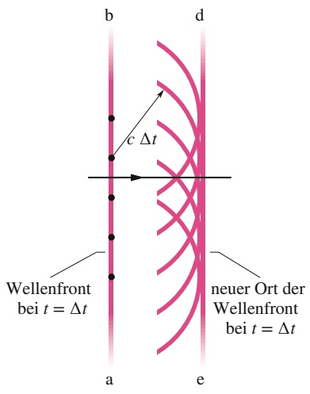

text_image

b
d
c Δt
Wellenfront
bei t = Δt
neuer Ort der
Wellenfront
bei t = Δt
a
e

Abb. 31.1

Die Ausbreitung einer ebenen Welle im Vakuum und ihre Erklärung mithilfe des Huygensschen Prinzips.

Huygens’ Wellentheorie beruht auf einem geometrischen Verfahren, mit dessen Hilfe man aus dem momentanen Ort einer Wellenfront deren Position zu jeder zukünftigen Zeit voraussagen kann. Grundlage dieses Verfahrens ist das **Huygenssche Prinzip**:

Jeder Punkt einer Wellenfront ist Ausgangspunkt sekundärer kugelförmiger Elementarwellen. Der Ort der Wellenfront zu einer beliebigen Zeit t ergibt sich aus den Tangenten an alle diese sekundären Elementarwellen.

Betrachten wir ein einfaches Beispiel: In Abb. 31.1 sehen Sie links eine Wellenfront (dargestellt durch die zur Papierebene senkrechte Fläche ‚ab‘) einer ebenen Welle, die sich im Vakuum nach rechts ausbreitet. Wo befindet sich die Wellenfront nach der Zeit Δt? Einige (eingezeichnete) Punkte der Fläche ‚ab‘ behandeln wir als Quellen kugelförmiger sekundärer Elementarwellen, die zum Zeitpunkt $t = 0$ ausgesendet werden. Nach der Zeit $\Delta t$ ist der Radius aller dieser Elementarwellen auf cΔt angewachsen, wenn c die Lichtgeschwindigkeit im Vakuum ist. Als Tangente an die Elementarwellen zur Zeit $\Delta t$ zeichnen wir die Fläche ‚de‘. Diese Fläche entspricht der Wellenfront der ebenen Welle bei $\Delta t ;$ sie verläuft parallel zu $,ab ^{\prime}  ,$ und ihr senkrechter Abstand zu $\mathrm { , a b ^ { \prime } }$ beträgt cΔt.

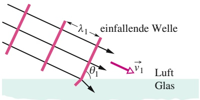

text_image

einfallende Welle
λ₁
θ₁
ν₁
Luft
Glas

(a)

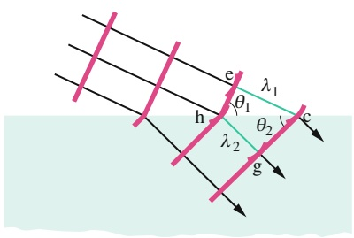

text_image

e
λ₁
θ₁
h
λ₂
θ₂
c
g

(b)

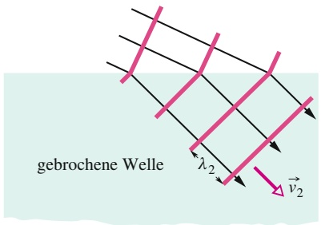

text_image

gebrochene Welle
λ₂
v₂

(c)

Abb. 31.2

Die Brechung einer ebenen Welle an der Grenzfläche zwischen Luft und Glas und ihre Erklärung mithilfe des Huygensschen Prinzips (ohne die reflektierte Welle). Die Wellenlänge in Glas ist kleiner als die in Luft. (a) bis (c) zeigen drei aufeinanderfolgende Zeitpunkte.

## Das Brechungsgesetz

Mithilfe des Huygensschen Prinzips wollen wir nun das Brechungsgesetz (Gl. 29.40, Snelliussches Gesetz) herleiten. Abbildung 31.2 zeigt drei Stadien der Brechung einiger Wellenfronten an einer ebenen Grenzfläche zwischen Luft (Medium 1) und Glas (Medium 2). Die Wellenfronten im einfallenden Lichtstrahl sollen den Abstand $\lambda _ { 1 }$ (die Wellenlänge in Medium 1) voneinander haben. Die Lichtgeschwindigkeit sei $\nu _ { 1 }$ in Luft und $\nu _ { 2 }$ in Glas; es gilt $\nu _ { 2 } < \nu _ { 1 }$

In Abb. 31.2a ist $\theta _ { 1 }$ der Winkel zwischen der Wellenfront und der Grenzfläche, der ebenso groß ist wie der Winkel zwischen der Normalen zur Wellenfront (also dem einfallenden Strahl) und der Normalen der Grenzfläche; $\theta _ { 1 }$ ist somit der Einfallswinkel.

Beim Eintreten der Welle in das Glas breitet sich zu einem gegebenen Zeitpunkt eine Huygenssche Elementarwelle von Punkt e nach Punkt c aus. Der Abstand zwischen e und c beträgt $\lambda _ { 1 }$ und die Welle benötigt für diese Entfernung eine Zeit $\lambda _ { 1 } / \nu _ { 1 }$ . Zur selben Zeit startet eine andere Elementarwelle von Punkt $\mathrm { h } ,$ aber mit der (kleineren) Geschwindigkeit $\nu _ { 2 }$ und der Wellenlänge $\lambda _ { 2 } ;$ sie gelangt in dem zuvor berechneten Zeitintervall daher nur bis Punkt g. Dieses Zeitintervall muss also auch gleich $\lambda _ { 2 } / \nu _ { 2 }$ sein. Wir setzen die Laufzeiten gleich und erhalten auf diese Weise

$$
\frac {\lambda_ {1}}{\lambda_ {2}} = \frac {\nu_ {1}}{\nu_ {2}}, \tag {31.1}
$$

woraus wir ablesen können, dass die Wellenlänge von Licht in einem Medium proportional zur Lichtgeschwindigkeit in diesem Medium ist.

Nach dem Huygensschen Prinzip muss die gebrochene Wellenfront (z. B. an Punkt g) tangential an einem Kreisbogen mit dem Radius $\lambda _ { 2 }$ um den Punkt h lie gen; gleichzeitig muss sie (z. B. an Punkt c) tangential an einem Bogen mit dem Radius $\lambda _ { 1 }$ um Punkt e liegen. Der daraus folgende Verlauf der Wellenfront ist in Abb. 31.2b gezeigt. Wir erkennen daraus, dass der Winkel $\theta _ { 2 }$ zwischen der gebrochenen Wellenfront und der Grenzfläche gleich dem Brechungswinkel ist.

Für die rechtwinkligen Dreiecke hce und hcg in Abb. 31.2b gilt

$$
\sin \theta_ {1} = \frac {\lambda_ {1}}{\overline {{\mathrm{hc}}}}
$$

758

---

31.1 Licht als Welle

31

und

$$
\sin \theta_ {2} = \frac {\lambda_ {2}}{\overline {{\mathrm{hc}}}}
$$

Wir teilen die obere Gleichung durch die untere und verwenden Gl. 31.1; das ergibt

$$
\frac {\sin \theta_ {1}}{\sin \theta_ {2}} = \frac {\lambda_ {1}}{\lambda_ {2}} = \frac {\nu_ {1}}{\nu_ {2}}. \tag {31.2}
$$

Nun definieren wir einen **Brechungsindex** n für jedes Medium als das Verhältnis zwischen der Lichtgeschwindigkeit im Vakuum und der Lichtgeschwindigkeit in diesem Medium, also

$$
n = \frac {c}{\nu}. \tag {31.3}
$$

Für die beiden Medien in unserem Beispiel gilt damit

$$
n _ {1} = \frac {c}{\nu_ {1}} \quad \text {und} \quad n _ {2} = \frac {c}{\nu_ {2}}. \tag {31.4}
$$

Durch Zusammenfassen der Gln. 31.2 und 31.4 erhalten wir

$$
\frac {\sin \theta_ {1}}{\sin \theta_ {2}} = \frac {c / n _ {1}}{c / n _ {2}} = \frac {n _ {2}}{n _ {1}}, \tag {31.5}
$$

was nichts anderes ist als das in Kapitel 29 eingeführte Brechungsgesetz

$$
n _ {1} \sin \theta_ {1} = n _ {2} \sin \theta_ {2}. \tag {31.6}
$$

## KONTROLLFRAGE 1

Die Abbildung zeigt einen monochromatischen Lichtstrahl, der sich von einem Medium a kommend durch zwei Medien b und c ausbreitet und schließlich wieder in Medium a eintritt; alle Grenzflächen sind parallel. Ordnen Sie die Medien in absteigender Reihenfolge nach der Geschwindigkeit, mit der sich das Licht in ihnen ausbreitet.

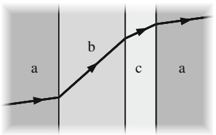

text_image

a
b
c
a

## Wellenlänge und Brechungsindex

Wir haben gesehen, dass sich die Wellenlänge von Licht ändert, wenn sich die Lichtgeschwindigkeit ändert, beispielsweise beim Übergang der Lichtwellen von einem Medium in ein anderes. Die Lichtgeschwindigkeit in einem Medium hängt, wie außerdem gezeigt wurde, gemäß Gl. 31.3 vom Brechungsindex des Mediums ab. Das bedeutet, dass auch die Wellenlänge des Lichts in einem Medium direkt mit dessen Brechungsindex zusammenhängt. Wir wollen nun einen monochromatischen Lichtstrahl betrachten. Im Vakuum habe er die Wellenlänge λ und die Ausbreitungsgeschwindigkeit $c ,$ in einem Medium mit dem Brechungsindex n die Wellenlänge $\lambda _ { n }$ und die Ausbreitungsgeschwindigkeit v. Gleichung 31.1 können wir dann in der Form

$$
\lambda_ {n} = \lambda \frac {\nu}{c} \tag {31.7}
$$

schreiben. Mithilfe von Gl. 31.3 substituieren wir $\nu / c$ durch $1 / n$ und erhalten so

$$
\lambda_ {n} = \frac {\lambda}{n}. \tag {31.8}
$$

Diese Gleichung gibt den Zusammenhang zwischen der Wellenlänge von Licht in einem bestimmten Medium und seiner Wellenlänge im Vakuum an: Je größer der Brechungsindex eines Mediums ist, desto kleiner ist die Wellenlänge des Lichts in diesem Medium.

759

---

31 Interferenz

Können wir einen ähnlichen Zusammenhang für die Frequenz finden? Wir be zeichnen die Frequenz von Licht in einem Medium mit dem Brechungsindex n mit $f _ { n } .$ . Aus der allgemeinen Beziehung $\nu = \lambda f$ (Gl. 12.12) folgt dann

$$
f _ {n} = \frac {\nu}{\lambda_ {n}}.
$$

Wir setzen hier die Gln. 31.3 und 31.8 ein und finden

$$
f _ {n} = \frac {c / n}{\lambda / n} = \frac {c}{\lambda} = f,
$$

wenn $f$ die Frequenz des Lichts im Vakuum bedeutet. In Worten bedeutet das: Die Geschwindigkeit und die Wellenlänge des Lichts in einem beliebigen Medium unterscheiden sich von ihren Werten im Vakuum, die Frequenzen hingegen sind gleich.

In manchen Situationen, in denen die Interferenz von Lichtwellen eine Rolle spielt, ist der durch Gl. 31.8 gegebene Zusammenhang zwischen der Wellenlänge und dem Brechungsindex von Bedeutung. Warum das so ist, illustriert Abb. 31.3. Die rot gezeichneten einfallenden Lichtstrahlen haben dieselbe Wellenlänge und sind in Phase, während sie sich zunächst in Luft $( n \approx 1 )$ ausbreiten. Der untere Strahl fällt dann durch ein Medium 1 mit dem Brechungsindex $n _ { 1 }$ und der Länge $L ,$ der obere Strahl fällt durch ein Medium 2 mit dem Brechungsindex $n _ { 2 }$ und derselben Länge L. Nachdem die Strahlen die beiden Medien verlassen haben, sind ihre Wellenlängen beide wieder gleich λ. Da ihre Wellenlängen in den Medien aber verschieden waren, sind die Wellen jetzt möglicherweise außer Phase.

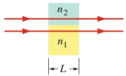

text_image

n₂
n₁
L

Abb. 31.3

Zwei Lichtwellen breiten sich in Medien mit verschiedenen Brechungsindizes aus.

Die Phasendifferenz zwischen zwei Lichtwellen kann sich ändern, wenn sich die Wellen durch Medien mit verschiedenen Brechungsindizes ausbreiten.

Wie wir noch sehen werden, kann sich diese Veränderung der Phasendifferenz auf eine mögliche Interferenz der Lichtwellen auswirken, wenn sie sich später in einem Punkt treffen.

Um die Phasendifferenz nach dem Austritt aus den Medien 1 bzw. 2 zu ermitteln, zählen wir zunächst ab, wie viele Wellenlängen $N _ { 1 }$ in die Weglänge L passen, die in Medium 1 zurückgelegt wird. Aus Gl. 31.8 folgt für die Wellenlänge in Medium $1 \lambda _ { n 1 } = \lambda / n _ { 1 }$ , also ist

$$
N _ {1} = \frac {L}{\lambda_ {n 1}} = \frac {L n _ {1}}{\lambda}. \tag {31.9}
$$

Analog zählen wir die Wellenlängen $N _ { 2 } ,$ die in die im Medium 2 zurückgelegte Weglänge (ebenfalls L) passen. Hier gilt $\lambda _ { n 2 } = \lambda / n _ { 2 }$ und daher ist

$$
N _ {2} = \frac {L}{\lambda_ {n 2}} = \frac {L n _ {2}}{\lambda}. \tag {31.10}
$$

Die neue Phasendifferenz erhalten wir, indem wir den kleineren Wert $( N _ { 1 }$ oder $N _ { 2 } )$ vom größeren Wert abziehen. Für $n _ { 2 } > n _ { 1 }$ erhalten wir so

$$
N _ {2} - N _ {1} = \frac {L n _ {2}}{\lambda} - \frac {L n _ {1}}{\lambda} = \frac {L}{\lambda} (n _ {2} - n _ {1}). \tag {31.11}
$$

Nehmen wir an, Gl. 31.11 liefere uns eine Phasendifferenz von 45,6 Wellenlängen nach dem Durchgang durch die Medien. Stattdessen könnten wir auch eine von zwei phasengleichen Wellen um 45,6 Wellenlängen verschoben haben. Eine Ver schiebung um ein ganzzahliges Vielfaches (z. B. 45) der Wellenlänge ergibt jedoch wieder phasengleiche Wellen; für die Phasendifferenz sind daher ausschließlich die Nachkommastellen (0,6) von Bedeutung – eine Phasendifferenz von 45,6 Wellenlängen entspricht einer effektiven Phasendifferenz von 0,6 Wellenlängen.

760

---

31.2 Beugung am Doppelspalt

31

Bei einer Phasendifferenz von 0,5 Wellenlängen schwingen die beiden Wellen exakt gegenphasig. Wenn die Wellen außerdem dieselbe Amplitude haben und sich in einem Punkt treffen, kommt es an diesem Punkt zu vollständig destruktiver Interferenz: Die Wellen löschen einander aus, es entsteht ein dunkler Punkt. Beträgt die Phasendifferenz stattdessen 0,0 oder (gleichbedeutend) 1,0 Wellenlängen, so kommt es zu vollständig konstruktiver Interferenz: Die Wellen verstärken einander, es entsteht ein heller Punkt. Unsere angenommene Situation liegt mit einer Phasendifferenz von 0,6 Wellenlängen zwischen diesen beiden Extremen, aber nä- her an der destruktiven Interferenz. Der Treffpunkt der Wellen ist also schwach beleuchtet.

Eine Phasendifferenz können wir auch im Bogenmaß oder Grad ausdrücken, wie wir es zuvor schon getan haben. Eine Differenz von einer Wellenlänge entspricht dabei einer Differenz von 2π rad oder 360°.

## KONTROLLFRAGE 2

Angenommen, die zu den Strahlen in Abb. 31.3 gehörenden Wellen haben gleiche Wellenlängen, gleiche Amplituden und sind phasengleich. (a) In die oben zurückgelegte Weglänge passen 7,60 Wellenlängen, in die unten zurückgelegte Weglänge nur 5,60. Welches Medium hat den größeren Brechungsindex? (b) Nun sollen die Strahlen nicht parallel, sondern geringfügig gegeneinander geneigt verlaufen und sich in einem Punkt auf einem weit entfernten Schirm treffen. Ist der Treffpunkt sehr hell, recht hell, nur schwach beleuchtet oder dunkel?

## 31.2 Beugung am Doppelspalt

## Lernziele

Nach dem Durcharbeiten dieses Abschnitts sollten Sie in der Lage sein, . . .

• die Beugung von Licht an einem schmalen Spalt einschließlich der Auswirkung einer Änderung der Spaltbreite zu beschreiben,
• das Entstehen eines Interferenzmusters in einem Doppelspaltexperiment mit monochromatischem Licht zu skizzieren,
• zu verstehen, dass sich die Phasendifferenz zwischen zwei Wellen ändern kann, wenn die Wellen wie im Youngschen Experiment verschieden lange Wege zurücklegen,
• die Beziehung zwischen Weglängendifferenz ΔL und Wellenlänge λ für ein Doppelspaltexperiment anzuwenden und das Ergebnis als Interferenz zu interpretieren,
die Weglängendifferenz ΔL zweier in einem Punkt im Interferenzmuster eines Doppelspaltexperiments zusammenlaufender Strahlen durch den Spaltabstand d und den Winkel θ zur Normalen auszudrücken,
• für ein Youngsches Doppelspaltexperiment die Beziehung zwischen dem Spaltabstand d, der Lichtwellenlänge λ und dem Winkel θ von Minima (dunklen Streifen) bzw. Maxima (hellen Streifen) im Interferenzmuster anzuwenden,
• das Interferenzmuster eines Doppelspaltexperiments zu skizzieren und die verschiedenen hellen und dunklen Streifen zu benennen (z. B. „erstes Nebenmaximum“ oder „dritter Ordnung“),
• die Beziehung zwischen dem Abstand D zwischen Doppelspalt und Beobachtungsschirm, dem Winkel θ zu einem Punkt im Interferenzmuster und dem Abstand y dieses Punkts von der Mitte des Musters anzuwenden,
• an einem Doppelspalt-Interferenzmuster die Auswirkung einer Änderung von d oder λ zu beschreiben und zu verstehen, was die Winkelauflösung des Musters bestimmt,
• die Dicke bzw. den Brechungsindex eines transparenten Materials zu bestimmen, das in einem Youngschen Experiment über dem Spalt angebracht wird und eine bestimmte Verschiebung des Interferenzmusters bewirkt.

761

---

31 Interferenz

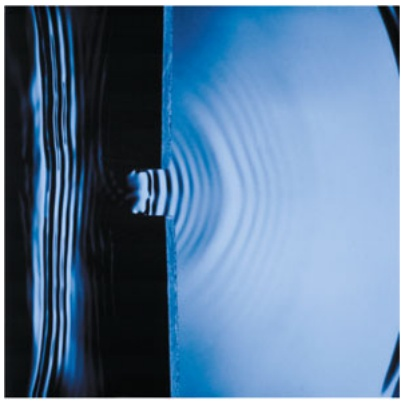

natural_image

Abstract blue and black wavy pattern with no text or symbols

Abb. 31.4

Die Beugung von Wasserwellen in einem Becken. Die Wellen werden auf der linken Seite durch eine Art schwingendes Paddel erzeugt. Auf ihrem Weg nach rechts treffen die Fronten auf ein Hindernis mit einer kleinen Öffnung, hinter der sie sich halbkreisförmig über die gesamte Wasseroberfläche ausbreiten [Quelle: George Resch/Fundamental Photographs].

Eine schematische Darstellung der Beugung von Wellen. Für eine gegebene Wellenlänge λ ist die Beugung umso stärker ausgeprägt, je kleiner die Spaltbreite a ist. Gezeigt sind Spaltbreiten von $(a) \; a = 6 , 0 \lambda ,$ (b) $a = 3 { , } 0 \lambda$ und $( \mathsf { c } ) \: a = 1 { , } 5 \lambda$ . In allen drei Fällen stehen Schirm und Spalt senkrecht zur Papierebene und reichen hinreichend weit in diese hinein bzw. aus ihr heraus.

Abb. 31.5

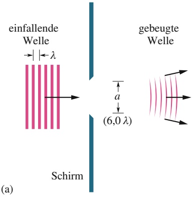

text_image

einfallende
Welle
λ
a
(6,0 λ)
gebeugte
Welle
Schirm
(a)

## Schlüsselideen

Im Youngschen Interferenzexperiment passiert Licht zuerst einen schmalen Einzelspalt und anschließend zwei dicht benachbarte Spalte in einer Blende, bevor es auf einen Schirm auftrifft. Das Licht wird an dem Doppelspalt gebeugt und als Folge tritt Interferenz zwischen den von den beiden Spalten ausgehenden Lichtwellen auf. Auf dem Schirm entsteht daher ein charakteristisches Streifenmuster.
• Die Bedingungen für maximale bzw. minimale Intensität sind

$$
d \sin \theta = m \lambda \quad \text {mit} \quad m = 0, 1, 2, \dots \quad \text {(Maxima, helle Streifen)}
$$

und

$$
d \sin \theta = \left(m + \frac {1}{2}\right) \lambda \quad \text {mit} \quad m = 0, 1, 2, \dots \quad (\text {Minima, dunkle Streifen})
$$

Dabei ist θ der Winkel zwischen dem Lichtweg vom Doppelspalt zu einem Punkt auf dem Schirm und der Normalen auf Spalt und Schirm; d ist der Spaltabstand.

## 31.2.1 Beugung

Im folgenden Abschnitt wollen wir das Experiment diskutieren, mit dessen Hilfe erstmals bewiesen werden konnte, dass Licht Welleneigenschaften hat. Zu diesem Zweck führen wir zunächst den Begriff der **Beugung** ein, den wir in Kapitel 32 noch wesentlich ausführlicher behandeln werden. Kurz erklärt handelt es sich um folgendes Phänomen: Trifft eine Welle auf ein Hindernis, in dem sich eine Öffnung mit einer Abmessung in der Größenordnung der Wellenlänge befindet, so breitet sich der Teil der Welle, der durch die Öffnung gelangt, dahinter in alle Richtungen im Raum aus – er wird gebeugt. Diese Ausbreitung lässt sich durch eine Konstruktion von Elementarwellen im Huygensschen Sinne (siehe Abb. 31.1) erklären. Beugung tritt nicht nur bei Lichtwellen auf, sondern bei jeder Art von Wellen. Abbildung 31.4 zeigt die Beugung von Wasserwellen an einem Hindernis in einem flachen Becken.

Abbildung 31.5 zeigt eine schematische Darstellung der Situation. Eine ebene Welle mit der Wellenlänge λ trifft auf einen Spalt mit der Breite $a = 6 { , } 0 \lambda$ , der sich senkrecht in die Papierebene hinein und aus ihr heraus erstreckt (Abb. 31.5a). Auf der Rückseite des Hindernisses breiten sich die Wellen (halb-)kreisförmig in der Papierebene aus. Abbildung 31.5b $( a = 3 { , } 0 \lambda )$ und c $\left( a = 1 { , } 5 \lambda \right)$ illustrieren ein wesentliches Merkmal des Phänomens: Je enger der Spalt ist, desto stärker wird der einfallende Strahl gebeugt.

Das Auftreten der Beugung beschränkt die Anwendbarkeit der geometrischen Optik. Dort hatten wir eine elektromagnetische Welle durch einen Strahl darge stellt; wenn wir aber versuchen, einen solchen Strahl tatsächlich zu erzeugen, indem wir Licht durch einen engen Spalt (oder mehrere solcher Spalte) schicken, so

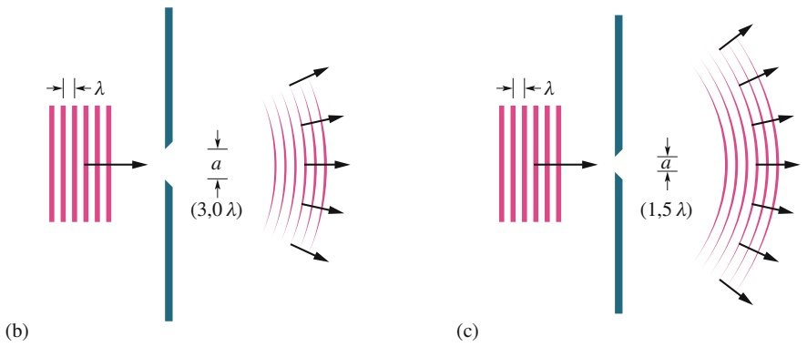

762

---

31.2 Beugung am Doppelspalt

31

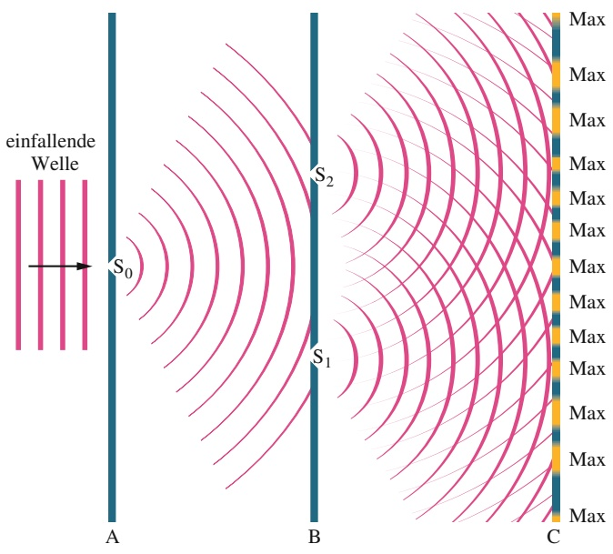

text_image

einfallende
Welle
S₀
S₂
S₁
A
B
C
Max
Max
Max
Max
Max
Max
Max
Max
Max
Max
Max
Max
Max
Max
Max

haben wir nur beschränkten Erfolg. Die Beugung sorgt stets dafür, dass sich das Licht hinter dem Spalt wieder in alle Richtungen im Raum ausbreitet – und je enger wir den Spalt machen (in der Hoffnung, einen besonders eng begrenzten Strahl zu erzeugen), desto größer wird das Ausmaß der Beugung. Die Gesetze der geometrischen Optik gelten deshalb nur, solange die Abmessungen von Spalten oder anderen im Strahlengang befindlichen Öffnungen deutlich (um Größenordnungen) größer sind als die Wellenlängen des betrachteten Lichts.

## 31.2.2 Der Doppelspaltversuch

1801 konnte Thomas Young beweisen, dass Licht – im Gegensatz zu der damals unter Naturwissenschaftlern verbreiteten Vorstellung – eine Welle ist: Er demonstrierte, dass Lichtwellen ebenso wie Wasser- oder Schallwellen oder Wellen jeder anderen Art interferieren können. Außerdem bestimmte er die mittlere Wellenlänge des Sonnenlichts mit bemerkenswerter Genauigkeit zu 570 nm (der heute akzeptierte Wert liegt bei 555 nm). Im Folgenden wollen wir Youngs Experiment als ein Beispiel für die Interferenz von Lichtwellen kennenlernen.

Das Prinzip von Youngs Anordnung ist in Abb. 31.6 gezeigt. Monochromatisches Licht aus einer entfernten Quelle fällt auf einen Spalt $S _ { 0 }$ in einem Schirm A. Beim Durchgang durch den Spalt werden die Wellen gebeugt; hinter dem Spalt breiten sie sich kreisförmig aus und fallen auf einen zweiten Schirm B mit den Spalten $S _ { 1 }$ und $\mathsf { S } _ { 2 }$ . Aus beiden Öffnungen treten hinter B wieder kreisförmige Elementarwellen aus. Die Wellen aus $S _ { 1 }$ und $\mathsf { S } _ { 2 }$ überlagern einander: Es kommt zur Interferenz.

Die Momentaufnahme in Abb. 31.6 veranschaulicht die Interferenz einander überlagernder Wellen. Um den Effekt jedoch tatsächlich sehen zu können, müssen wir das Licht hinter B auf einem dritten Schirm C auffangen. Wir erkennen dort ein Muster aus abwechselnd hellen und dunklen Interferenzstreifen (sie erstrecken sich senkrecht zur Papierebene in Abb. 31.6). Die hellen Streifen gehören zu Maxima der Interferenz (zu vollständig konstruktiver Überlagerung), die dazwischenliegenden dunklen Streifen gehören zu Minima (zu vollständig destruktiver Überlagerung). Streng genommen beziehen sich die Begriffe Maximum und Minimum hier auf die Mitte des jeweiligen Streifens. Die Anordnung heller und dunkler Streifen auf dem Schirm nennt man **Interferenzmuster**. Abbildung 31.7 zeigt einen Ausschnitt des Interferenzmusters, das man auf Schirm C in Abb. 31.6 sehen kann.

## Abb. 31.6

Der Interferenzversuch von Young. Einfallendes monochromatisches Licht wird am Spalt $\mathsf { S } _ { 0 }$ gebeugt, der als Punktquelle halbkreisförmiger Wellenfronten wirkt. Diese Wellenfronten erreichen den Schirm B und werden hier an zwei Spalten $S _ { 1 }$ und $\mathsf { S } _ { 2 }$ gebeugt, die wiederum als Punktquellen wirken. Hinter B überlagern die von $S _ { 1 }$ und $S _ { 2 }$ ausgehenden Wellen einander, es kommt zur Interferenz und auf dem Schirm C entsteht ein aus Maxima und Minima bestehendes Muster. Die Abbildung zeigt einen Querschnitt der Anordnung; Schirme, Spalte und das Interferenzmuster erstrecken sich senkrecht aus der Papierebene heraus und in sie hinein. Zwischen B und C sind halbkreisförmige Wellenfronten mit dem Mittelpunkt in $S _ { 2 }$ eingezeichnet; wäre der Spalt $\mathsf { S } _ { 1 }$ geschlossen, so wären in dieser Region nur diese Fronten vorhanden; Entsprechendes gilt für die halbkreisförmigen Fronten mit dem Mittelpunkt in $S _ { 1 }$

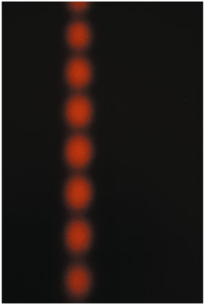

natural_image

A vertical row of glowing orange dots on a black background, resembling a minimalist image with no text or symbols.

## Abb. 31.7

Das Interferenzmuster, das in einer Anordnung wie der in Abb. 31.6 gezeigten auf Schirm $\mathbf { C }$ entsteht. Die abwechselnd roten und dunklen Streifen nennt man Interferenzstreifen [Quelle: Jearl Walker].

763

---

31 Interferenz

## Die Positionen der Interferenzstreifen

Im Doppelspaltversuch von Young, wie man das in Abb. 31.6 gezeigte klassische Experiment auch nennt, erzeugen Lichtwellen ein Interferenzmuster. Aber was bestimmt die Lage der einzelnen Streifen und ihre Abstände voneinander? Zur Beantwortung dieser Frage betrachten wir die Anordnung in Abb. 31.8a. Eine ebene Welle monochromatischen Lichts fällt hier auf zwei Spalte $S _ { 1 }$ und $\mathsf { S } _ { 2 }$ in einem Schirm B. An den Spalten wird das Licht gebeugt, auf dem dahinter befindlichen Schirm C entsteht ein Interferenzmuster. Als Bezugsachse zeichnen wir die Senkrechte auf $C ,$ ausgehend vom Mittelpunkt zwischen den beiden Spalten. Dann wählen wir einen beliebigen Punkt P auf $\mathsf { C } ;$ die von P ausgehende Verbindungslinie mit dem Mittelpunkt zwischen den Spalten schließt mit der Bezugsachse einen Winkel θ ein. In P treffen sich der von $S _ { 1 }$ (unten) ausgehende Strahl $\mathbf { r } _ { 1 }$ und der von $\mathsf { S } _ { 2 }$ (oben) ausgehende Strahl $\mathbf { r } _ { 2 }$

Die zu $\mathbf { r } _ { 1 }$ und $\mathbf { r } _ { 2 }$ gehörenden Wellen sind phasengleich, denn es handelt sich um Teile einer einzigen auf B auftreffenden Welle. Hinter B müssen die Wellen aber verschiedene Wege zurücklegen, um von $S _ { 1 }$ bzw. $\mathsf { S } _ { 2 }$ nach P zu gelangen. In Abschn. 13.3 war uns eine ähnliche Situation bereits mit Schallwellen begegnet; dort war unsere Schlussfolgerung:

Die Phasendifferenz zwischen zwei Wellen kann sich ändern, wenn die Wellen verschieden lange Wege zurücklegen.

Die Änderung der Phasendifferenz ist auf den Unterschied ΔL der optischen Weglängen der beiden Wellen zurückzuführen. Wir betrachten nun zwei exakt phasengleiche Wellen. Sie legen Wege zurück, deren Längen sich um $\Delta L$ unterscheiden, und treffen einander dann in einem gemeinsamen Punkt. Wenn ΔL null oder ein ganzzahliges Vielfaches der Wellenlänge ist, sind die Wellen auch an diesem Punkt noch exakt phasengleich und eine vollständig konstruktive Interferenz ist die Folge. Sofern diese Bedingung auf die in Abb. 31.8 gezeigten Strahlen $\mathbf { r } _ { 1 }$ und $\mathbf { r } _ { 2 }$ zutrifft, gehört der Punkt P zu einem hellen Streifen. Wenn ΔL hingegen ein ungeradzahliges Vielfaches einer halben Wellenlänge ist, sind die Wellen an ihrem Treffpunkt exakt gegenphasig und es kommt zu einer vollständig destruktiven Interferenz. Sofern diese Bedingung auf die Strahlen $\mathbf { r } _ { 1 }$ und $\mathbf { r } _ { 2 }$ zutrifft, gehört P zu einem dunklen Streifen. (Natürlich treten ebenso alle dazwischenliegenden Stufen der Interferenz auf – P kann also auch mäßig hell beleuchtet sein.) Wir fassen zusammen:

Ob ein bestimmter Punkt des Interferenzmusters auf dem Beobachtungsschirm des Doppelspaltversuchs von Young hell oder dunkel ist, hängt vom Weglängenunterschied ΔL der Strahlen ab, die an diesem Punkt ankommen.

Abb. 31.8

(a) Wellen, die von den (sich senkrecht zur Papierebene erstreckenden) Spalten $\mathsf { S } _ { 1 }$ und $S _ { 2 }$ ausgehen, treffen in Punkt P aufeinander. P ist ein zufällig ausgewählter Punkt auf dem Beobachtungsschirm C in einem Abstand y von der Bezugsachse. Wir geben P durch den Winkel θ an. (b) Für D ≫ d sind die Strahlen r1 und $\mathbf { r } _ { 2 }$ in guter Näherung parallel; beide schließen dann den Winkel θ mit der Bezugsachse ein.

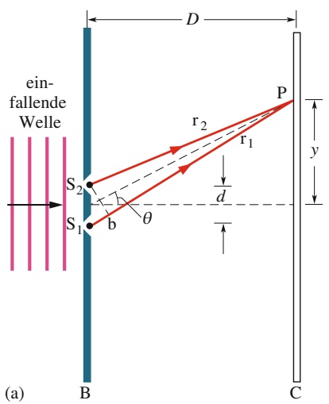

text_image

ein-fallende
Welle
S₂
S₁
b
θ
r₂
r₁
d
P
y
B
C
(a)

(b)

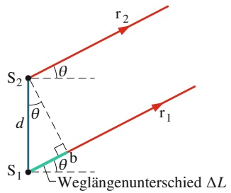

text_image

S₂
θ
d
θ
S₁
b
r₁
r₂
Weglängenunterschied ΔL

764

---

31.2 Beugung am Doppelspalt

31

Die Position der hellen und dunklen Streifen auf dem Schirm geben wir mithilfe des Winkels θ zwischen der Bezugsachse und dem jeweiligen Streifen an. Um θ zu erhalten, benötigen wir einen Zusammenhang zwischen diesem Winkel und $\Delta L$ Dazu wählen wir zunächst (siehe Abb. 31.8a) einen Punkt b auf dem Strahl $\mathbf { r } _ { 1 } ,$ für den die Weglänge von b zu P gleich der Weglänge von $\mathsf { S } _ { 2 }$ zu P ist. Der Weglängenunterschied $\Delta L$ zwischen den beiden Strahlen ist dann einfach der Abstand von $S _ { 1 }$ zu b.

Der exakte Zusammenhang zwischen θ und dem Abstand $\overline { { S _ { 1 } \mathrm { b } } }$ ist recht kompliziert. Wir können die Situation jedoch deutlich vereinfachen, indem wir dafür sorgen, dass der Abstand D zwischen den Spalten und Schirm C viel größer ist als der Abstand d der Spalte voneinander. In diesem Fall können wir die Strahlen $\mathbf { r } _ { 1 }$ und $\mathbf { r } _ { 2 }$ in guter Näherung als parallel betrachten; beide schließen dann den Winkel θ mit der Bezugsachse ein (Abb. 31.8b). Das Dreieck $S _ { 1 } S _ { 2 } \mathsf { b }$ nehmen wir – ebenfalls nä- herungsweise – als rechtwinklig an, und den Innenwinkel mit dem Scheitelpunkt $S _ { 2 }$ setzen wir gleich θ. Für dieses Dreieck gilt sin $\theta = \Delta L / d$ und daher

$$
\Delta L = d \sin \theta . \tag {31.12}
$$

Wie bereits bemerkt, muss ΔL gleich null oder einem ganzzahligen Vielfachen der Wellenlänge sein, wenn ein heller Streifen entstehen soll. Mithilfe von Gl. 31.12 formulieren wir diese Forderung als Bedingung für Interferenzmaxima in der Form

$$
\Delta L = d \sin \theta = \text {ganze Zahl} \cdot \lambda \tag {31.13}
$$

bzw.

$$
d \sin \theta = m \lambda \quad \text {mit} \quad m = 0, 1, 2, \dots \tag {31.14}
$$

Bei dunklen Streifen muss $\Delta L$ ein ungeradzahliges Vielfaches der halben Wellenlänge sein. Wieder mithilfe von Gl. 31.12 schreiben wir diese Bedingung für Interferenzminima in der Form

$$
\Delta L = d \sin \theta = \text {ungerade Zahl} \cdot \frac {1}{2} \lambda \tag {31.15}
$$

oder

$$
d \sin \theta = \left(m + \frac {1}{2}\right) \cdot \lambda \quad \text {mit} \quad m = 0, 1, 2, \dots \tag {31.16}
$$

Die Gln. 31.14 und 31.16 liefern uns die Winkel θ und damit die Positionen aller Streifen, die wir anhand der zugehörigen Werte von m voneinander unterscheiden. Für $m = 0$ entsteht laut Gl. 31.14 ein heller Streifen bei $\theta = 0 ,$ also auf der Bezugsachse. An diesem Hauptmaximum treffen die Wellen von beiden Spalten mit einem Weglängenunterschied $\Delta L = 0$ ein, sind also in Phase.

Für $m = 2$ finden wir gemäß Gl. 31.14 helle Streifen unter dem Winkel

$$
\theta = \sin^ {- 1} \left(\frac {2 \lambda}{d}\right)
$$

oberhalb und unterhalb der Bezugsachse. Die von den Spalten ausgehenden Wellen treffen hier mit $\Delta L = 2 \lambda$ und einer Phasendifferenz von zwei Wellenlängen ein (also einer effektiven Phasendifferenz von null). Es handelt sich um Nebenmaxima, genauer gesagt um Maxima zweiter Ordnung (wegen $m = 2 )$ , also die zweiten Maxima vom Hauptmaximum aus nach beiden Seiten gezählt (die ersten Nebenmaxima ergeben sich aus Gl. 31.14 mit $m = 1 )$ .

Zur Bestimmung der Minima wenden wir Gl. 31.16 an, z. B. mit $m = 1$ . In diesem Fall entstehen dunkle Streifen unter dem Winkel

$$
\theta = \sin^ {- 1} \left(\frac {1 , 5 \lambda}{d}\right)
$$

765

---

31 Interferenz

oberhalb und unterhalb der Bezugsachse. Hier treffen die Wellen mit einem Weglängenunterschied $\Delta L = 1 { , } 5 \lambda$ und einer Phasendifferenz von 1,5 Wellenlängen ein (also einer effektiven Phasendifferenz von 0,5 Wellenlängen). Wir nennen diese Streifen Minima zweiter Ordnung; es sind die zweiten Minima, vom Hauptmaximum aus nach beiden Seiten gezählt (die ersten Minima ergeben sich aus Gl. 31.16 mit $m = 0 )$

Wir haben die Gln. 31.14 und 31.16 unter der Bedingung $D \gg d$ hergeleitet. Sie gelten aber auch, wenn wir eine Sammellinse zwischen die Spalte und den Beobachtungsschirm bringen und diesen Schirm dann so lange bewegen, bis er den Brennpunkt der Linse enthält. (Man sagt dann, der Schirm befinde sich in der Brennebene der Linse – der Ebene senkrecht zur optischen Achse, welche den Brennpunkt enthält.) Eine Eigenschaft der Sammellinse besteht darin, alle parallel einfallenden Strahlen in einem gemeinsamen, auf der Brennebene liegenden Punkt zu fokussieren. Die Strahlen, die sich nun in einem beliebigen Punkt des Schirms (der Brennebene) treffen, müssen also exakt (nicht nur näherungsweise) parallel gewesen sein, als sie aus den Spalten austraten. Sie entsprechen den in Abb. 30.14a gezeigten parallelen Strahlen, die von einer Linse in einem Punkt (dem Brennpunkt) fokussiert werden.

## KONTROLLFRAGE 3

Geben Sie für die beiden Strahlen in Abb. 31.8a die Weglängendifferenz ΔL (als Vielfaches der Wellenlänge) und die Phasendifferenz (in Wellenlängen) an, wenn sich in P (a) ein Nebenmaximum dritter Ordnung und (b) ein Minimum dritter Ordnung befindet.

## 31.3 Interferenz und Intensität

## Lernziele

Nach dem Durcharbeiten dieses Abschnitts sollten Sie in der Lage sein, . . .

• kohärentes und inkohärentes Licht zu unterscheiden,
• Ausdrücke für die elektrischen Feldkomponenten zweier Lichtwellen, die sich in einem gemeinsamen Punkt treffen, als Funktionen der Zeit und einer Phasenkonstante anzugeben,
• zu verstehen, dass die Phasendifferenz zwischen zwei Wellen ihr Interferenzverhalten bestimmt,
die Intensität an einem bestimmten Punkt in einem Doppelspalt-Interferenzmuster als Funktion der Phasendifferenz der ankommenden Wellen anzugeben und diese Phasendifferenz mit dem Winkel θ in Beziehung zu setzen, der diesem Punkt in dem Muster entspricht,
• die resultierende Welle (Amplitude und Phasenkonstante) von zwei oder mehr Lichtwellen, die sich in einem gemeinsamen Punkt treffen, mit einem Zeigerdiagramm zu ermitteln und daraus dann die resultierende Intensität zu bestimmen,
• die Beziehung zwischen der Kreisfrequenz ω einer Lichtwelle und die der Winkelgeschwindigkeit ω des Zeigers anzuwenden, welcher diese Welle repräsentiert.

## Schlüsselideen

Damit zwei Lichtwellen in einem Punkt wahrnehmbar interferieren können, muss ihre Phasendifferenz zeitlich konstant sein, d. h., die Wellen müssen kohärent sein. Wenn zwei kohärente Wellen aufeinandertreffen, lässt sich die resultierende Intensität mithilfe von Zeigern bestimmen.
• Im Youngschen Interferenzexperiment ergeben zwei Wellen mit derselben Intensität $I _ { 0 }$ eine resultierende Welle mit der Intensität

$$
I = 4 I _ {0} \cos^ {2} \frac {\varphi}{2} \quad \text {mit} \quad \varphi = \frac {2 \pi d}{\lambda} \sin \theta .
$$

766

---

31.3 Interferenz und Intensität

31

## 31.3.1 Kohärenz

Damit auf dem Beobachtungsschirm C in Abb. 31.6 ein Interferenzmuster erscheint, darf sich die Phasendifferenz der Wellen, die in einem beliebigen Punkt P auf C eintreffen, zeitlich nicht ändern. Diese Bedingung ist in Abb. 31.6 erfüllt: Die Wellen, die durch die Spalte $S _ { 1 }$ und $\mathsf { S } _ { 2 }$ gelangen, sind Teile einer einzelnen Lichtwelle, die von vorne auf den Schirm B fällt. Weil ihre Phasendifferenz konstant bleibt, nennt man die von $S _ { 1 }$ und $\mathsf { S } _ { 2 }$ ausgehenden Wellen vollständig **kohärent**.

Direktes Sonnenlicht ist teilweise kohärent: Die Phasendifferenz von Sonnenlichtwellen, die auf zwei voneinander getrennte Punkte treffen, ist nur dann konstant, wenn diese Punkte sehr nahe beieinander liegen. Schauen Sie einmal in hellem Sonnenlicht aus kurzer Entfernung auf Ihren Fingernagel: Sie sehen ein blasses, aus Flecken bestehendes Interferenzmuster. Lichtwellen, die an dicht nebeneinander liegenden Punkten des Nagels gestreut werden, sind ausreichend kohärent, dass es im Auge zur Interferenz kommen kann. Für die Spalte in einem Doppelspaltversuch gilt dies nicht: Sie liegen so weit auseinander, dass die hindurchtretenden Wellen im direkten Sonnenlicht **inkohärent** sind. Um kohärentes Licht zu erhalten, müssen wir das Sonnenlicht zunächst wie in Abb. 31.6 durch einen Einzelspalt fallen lassen. Dieser Spalt ist so eng, dass das hindurchtretende Licht kohä- rent ist. Außerdem bewirkt der enge Spalt eine effektive Beugung des kohärenten Lichts, sodass beide Spalte in dem dahinter angeordneten Schirm beleuchtet werden.

Wir ersetzen den Doppelspalt nun durch zwei ähnliche, aber voneinander unabhängige Lichtquellen, etwa zwei Glühdrähte. Die Phasendifferenz zwischen den von ihnen emittierten Wellen ändert sich jetzt schnell und zufällig. (Der Grund dafür ist, dass das Licht von einer großen Zahl von Atomen in den Drähten emittiert wird; diese Emissionen finden zufällig, voneinander unabhängig und in extrem kurzen Zeitspannen in der Größenordnung von Nanosekunden statt.) Betrachten wir einen beliebigen Punkt auf Schirm $C ,$ so variiert die Interferenz der Wellen aus den beiden Quellen schnell und in zufälliger Weise zwischen den beiden Extremen. Unser Auge und die meisten gebräuchlichen Detektoren können solche Änderungen nicht verfolgen – wir sehen kein Interferenzmuster. Die Streifen verschwinden und der Schirm erscheint uns gleichmäßig beleuchtet.

Laser (Abschn. 36.7) unterscheiden sich von gewöhnlichen Lichtquellen unter anderem dadurch, dass hier sehr viele Atome synchronisiert Licht aussenden; diese Wellen sind kohärent. Darüber hinaus ist das emittierte Licht nahezu monochromatisch und der austretende Strahl ist sehr eng gebündelt (kollimiert) und lässt sich mit geeigneten Vorrichtungen noch weiter bis auf einen Durchmesser in der Größenordnung der Wellenlänge des Lichts fokussieren.

## 31.3.2 Die Intensitäten bei der Interferenz am Doppelspalt

Die Gln. 31.14 und 31.16 liefern uns die Orte der Maxima und Minima im Interferenzmuster am Doppelspalt als Funktion des Winkels θ (siehe Abb. 31.8). Nun wollen wir einen Ausdruck für die Intensität I der Streifen als Funktion von θ herleiten.

Das aus den Spalten austretende Licht ist in Phase. Wir wollen aber annehmen, dass die Wellen in Punkt P außer Phase ankommen. Die elektrischen Feldkomponenten der Wellen sind in P folglich gegeneinander phasenverschoben und haben daher die Form

$$
E _ {1} = E _ {0} \sin \omega t \tag {31.17}
$$

und

$$
E _ {2} = E _ {0} \sin (\omega t + \varphi), \tag {31.18}
$$

767

---

31 Interferenz

wobei ω die Kreisfrequenz der Wellen ist und 𝜑 die Phasenkonstante der Welle $E _ { 2 }$ Wie Sie bemerken werden, sind die Amplituden der Wellen identisch $( E _ { 0 } )$ und die Phasendifferenz ist gleich 𝜑. Weil die Phasendifferenz zeitlich konstant ist, sind die Wellen kohärent. Wir werden nun zeigen, dass die Intensität an dem Punkt P, an dem die Wellen einander überlagern, durch

$$
I = 4 I _ {0} \cos^ {2} \frac {\varphi}{2} \tag {31.19}
$$

mit

$$
\varphi = \frac {2 \pi d}{\lambda} \sin \theta \tag {31.20}
$$

gegeben ist.

In Gl. 31.19 beschreibt $I _ { 0 }$ die von einem Spalt ausgehende, auf dem Schirm eintreffende Intensität, wenn der andere Spalt vorübergehend abgedeckt wird. Wir gehen davon aus, dass die Spalte im Vergleich zur Wellenlänge so eng sind, dass diese von einem Spalt hervorgerufene Intensität in dem Bereich des Schirms, wo wir das Interferenzmuster beobachten wollen, nahezu gleichmäßig ist.

Die Gln. 31.19 und 31.20 geben gemeinsam an, wie die Intensität I der Streifen von dem Winkel θ in Abb. 31.8 abhängt. Dazu müssen sie offensichtlich Informationen über die Lage der Maxima und Minima enthalten. Wir wollen versuchen, diese Informationen aus den Gleichungen zu extrahieren und eigenständige Beziehungen für die Positionen der Streifen zu erhalten.

Aus Gl. 31.19 folgt für die Intensitätsmaxima

$$
\frac {1}{2} \varphi = m \pi \quad \text {mit} \quad m = 0, 1, 2, \dots \tag {31.21}
$$

Setzen wir dies in Gl. 31.20 ein, so erhalten wir

$$
2 m \pi = \frac {2 \pi d}{\lambda} \sin \theta \quad \mathrm{mit} \quad m = 0, 1, 2, \ldots
$$

oder

$$
d \sin \theta = m \lambda \quad \text {mit} \quad m = 0, 1, 2, \dots \tag {31.22}
$$

Dies entspricht exakt Gl. 31.14 für die Positionen der Maxima, die wir bereits weiter oben hergeleitet hatten.

Für die Intensitätsminima gilt

$$
\frac {1}{2} \varphi = \left(m + \frac {1}{2}\right) \pi \quad \text {mit} \quad m = 0, 1, 2, \dots
$$

Wenn wir diese Beziehung mit Gl. 31.20 zusammenfassen, gelangen wir unmittelbar zu

$$
d \sin \theta = \left(m + \frac {1}{2}\right) \lambda \quad \text {mit} \quad m = 0, 1, 2, \dots , \tag {31.23}
$$

was wir auch weiter oben für die Minima erhalten haben (Gl. 31.16).

Abbildung 31.9 zeigt die Auftragung der Intensität I eines Interferenzmusters am Doppelspalt als Funktion der Phasendifferenz der beiden Wellen beim Eintreffen

## Abb. 31.9

Auftragung der Funktion aus Gl. 31.19. Dargestellt ist die Intensität eines Interferenzmusters am Doppelspalt als Funktion der Phasendifferenz zwischen den von den Spalten ausgehenden Wellen bei der Ankunft auf dem Schirm. Wenn man einen der Spalte abdeckt, ist der Schirm homogen mit der Intensität $I _ { 0 }$ beleuchtet. Die mittlere Intensität des Streifenmusters ist $2 I _ { 0 } ,$ die maximale Intensität beträgt $4 I _ { 0 }$ (bei kohärentem Licht).

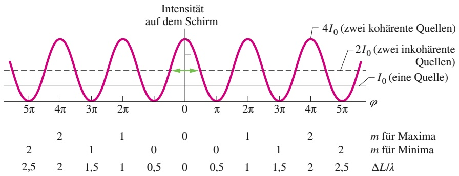

line

| \(\phi (\)Range) | Intensität auf dem Schirm (Value) |
| --- | --- |
| \(-5\pi\) ~ \(0\) | 4I0 (zwei kohärente Quellen) |
| \(0\) ~ \(5\pi\) | 2I0 (zwei inkohärente Quellen) |
| N/A | I0 (eine Quelle) |

768

---

31.3 Interferenz und Intensität

31

auf dem Schirm gemäß Gl. 31.19. Die durchgezogene waagerechte Linie entspricht $I _ { 0 } ,$ der (homogenen) Intensität, wenn einer der beiden Spalte abgedeckt wird. Wie Sie aus Gl. 31.19 und dem Graphen der Funktion entnehmen können, variiert I zwischen null (Minima) und $4 I _ { 0 }$ (Maxima).

Wenn die von den beiden Spalten ausgehenden Wellen inkohärent sind (also kei ne zeitlich konstante Phasenbeziehung zwischen ihnen besteht), so entsteht kein Interferenzmuster; der Schirm ist dann gleichmäßig mit der Intensität $2 I _ { 0 }$ ausgeleuchtet. Zu diesem Wert gehört die gestrichelte waagerechte Linie in Abb. 31.9.

Die Interferenz kann Energie natürlich nicht erschaffen oder vernichten; sie wird im Bereich des Schirms lediglich umverteilt. Die mittlere Intensität muss deshalb stets $2 I _ { 0 }$ betragen, unabhängig davon, ob die von den beiden Spalten ausgehenden Wellen kohärent sind. Dies folgt auch aus Gl. 31.19: Wenn wir hier den Mittelwert $\frac { 1 } { 2 }$ der Kosinusquadrat-Funktion einsetzen, erhalten wir gerade $I _ { \mathrm { m i t t e l } } = 2 I _ { 0 }$

## Die Herleitung der Gln. 31.19 und 31.20

Wir wollen die in den Gln. 31.17 und 31.18 angegebenen elektrischen Feldkomponenten $E _ { 1 }$ und $E _ { 2 }$ nun mithilfe von Zeigern addieren; diese Methode hatten wir bereits in Abschn. 12.6 eingeführt. In Abb. 31.10a sind die Wellen mit den Komponenten $E _ { 1 }$ und $E _ { 2 }$ durch Zeiger mit der Länge $E _ { 0 }$ dargestellt, die mit der Winkelgeschwindigkeit ω um den Ursprung rotieren. Die Beträge von $E _ { 1 }$ und $E _ { 2 }$ zu einem beliebigen Zeitpunkt sind durch die Projektionen der zugehörigen Zeiger auf die senkrechte Achse gegeben. In Abb. 31.10a sind die Zeiger und ihre Projektionen zu einem Zeitpunkt t dargestellt. In Übereinstimmung mit den Gln. 31.17 und 31.18 sind ωt der Winkel des Zeigers von $E _ { 1 }$ und (ωt + 𝜑) der Zeigerwinkel von $E _ { 2 } .$

Um die elektrischen Feldkomponenten $E _ { 1 }$ und $E _ { 2 }$ an einem beliebigen Punkt P in Abb. 31.8 zu überlagern, addieren wir die zugehörigen Zeiger vektoriell (siehe Abb. 31.10b). Der Betrag der Vektorsumme ist gleich der Amplitude E der resultierenden Welle in Punkt P, die Phasenkonstante dieser Welle ist $\beta .$ Wir wollen zunächst die Amplitude E in Abb. 31.10b ermitteln. Dazu stellen wir fest, dass die beiden mit β bezeichneten Winkel gleich groß sind, weil sie Gegenwinkel der Schenkel eines gleichschenkligen Dreiecks sind. Weiterhin wissen wir, dass ein Außenwinkel eines Dreiecks (hier $\varphi ,$ siehe Abb. 31.10b) gleich der Summe der gegenüberliegenden Innenwinkel (hier $\beta + \beta )$ ist, es gilt also $\beta = \varphi / 2$ . Somit ist

$$
\begin{array}{l} E = 2 (E _ {0} \cos \beta) \\ = 2 E _ {0} \cos \frac {1}{2} \varphi . \tag {31.24} \\ \end{array}
$$

Quadrieren dieser Gleichung ergibt

$$
E ^ {2} = 4 E _ {0} ^ {2} \cos^ {2} \frac {1}{2} \varphi . \tag {31.25}
$$

Nach Gl. 29.24 ist die Intensität einer elektromagnetischen Welle proportional zum Quadrat ihrer Amplitude. Die Wellen, die wir in Abb. 31.10b überlagern, haben jeweils die Amplitude $E _ { 0 }$ und folglich eine Intensität $I _ { 0 }$ proportional zu $E _ { 0 } ^ { 2 } ;$ die resultierende Welle mit der Amplitude E hat die Intensität $I ,$ die proportional zu $E ^ { 2 }$ ist. Also gilt

$$
\frac {I}{I _ {0}} = \frac {E ^ {2}}{E _ {0} ^ {2}}.
$$

Wir setzen hier Gl. 31.25 ein, stellen um und erhalten

$$
I = 4 I _ {0} \cos^ {2} \frac {1}{2} \varphi .
$$

Dies ist gerade Gl. 31.19, die wir herleiten wollten.

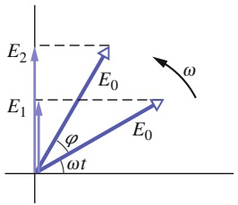

text_image

E₂
E₁
φ
ωt
E₀
E₀
ω

(a)

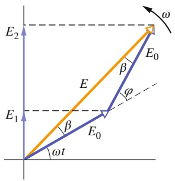

text_image

E₂
ω
β
E₀
φ
E
E₁
β
E₀
ωt

(b)

## Abb. 31.10

(a) Zeigerdarstellung der elektrischen Feldkomponenten aus den Gln. 31.17 und 31.18 zur Zeit t. Beide Zeiger haben die Länge $E _ { 0 }$ und rotieren mit der Winkelgeschwindigkeit ω. Ihre Phasendifferenz ist $\varphi .$ (b) Durch Vektoraddition der beiden Zeiger erhalten wir den zur resultierenden Welle (mit der Amplitude E und der Phasenkonstante $\bar { \beta ) }$ gehörenden Zeiger.

769

---

31 Interferenz

Wir wenden uns nun der Herleitung von Gl. 31.20 zu, der Beziehung zwischen der Phasendifferenz $\varphi$ der beiden in einem Punkt P auf dem Schirm eintreffenden Wellen (siehe Abb. 31.8) und dem Winkel θ, anhand dessen wir die Position dieses Punkts angeben.

Die Phasendifferenz 𝜑 in Gl. 31.18 hängt mit dem Weglängenunterschied $\overline { { S _ { 1 } \mathrm { b } } }$ in Abb. 31.8b zusammen: Für $\overline { { \mathsf { S } _ { 1 } \mathsf { b } } } = \lambda / 2$ ist $\varphi = \pi ;$ für $\overline { { S _ { 1 } \mathsf { b } } } = \lambda$ ist $\varphi = 2 \pi$ usw. Wir nehmen deshalb den folgenden Zusammenhang zwischen Phasendifferenz und Weglängenunterschied an:

$$
(\text {Phasendifferenz}) = \frac {2 \pi}{\lambda} \quad (\text {Weglängenunterschied}). \tag {31.26}
$$

Der Weglängenunterschied $\overline { { S _ { 1 } \mathrm { b } } }$ in Abb. 31.8b ist gleich d sin $\theta ;$ aus Gl. 31.26 ergibt sich daher

$$
\varphi = \frac {2 \pi d}{\lambda} \sin \theta .
$$

Dies entspricht Gl. 31.20, welche wir herleiten wollten.

## Zeigeraddition von mehr als zwei Wellen

In einem allgemeineren Fall müssen wir möglicherweise die Resultierende von mehr als zwei sinusförmig schwingenden Wellen an einem Punkt bestimmen. Dazu gehen wir folgendermaßen vor:

1. Wir konstruieren zu jeder der zu addierenden Wellen den entsprechenden Zeiger. Diese Zeiger fügen wir zusammen (jeweils Ende an Spitze), wobei wir die korrekte Phasenbeziehung zwischen benachbarten Zeigern beibehalten.
2. Nun konstruieren wir die Vektorsumme dieser Anordnung von Zeigern. Die Länge des Summenvektors gibt die Amplitude des resultierenden Zeigers an. Der Winkel zwischen dem Summenvektor und dem ersten Zeiger entspricht der Phase der Resultierenden relativ zu der des ersten Zeigers. Die Projektion des zu der Vektorsumme gehörenden Zeigers auf die senkrechte Achse liefert die zeitliche Variation der resultierenden Welle.

## KONTROLLFRAGE 4

Vier Paare von Lichtwellen (alle mit gleicher Wellenlänge) treffen einander jeweils an einem Punkt auf einem Schirm. Die Amplituden und Phasendifferenzen der jeweiligen Wellen an diesen Punkten sind $\left( \mathsf{a} \right) 2E_{0}, 6E_{0}$ und π rad, (b) $3 E _ { 0 } , 5 E _ { 0 }$ und π rad, $(c) $9 E _ { 0 } ,$ $7 E _ { 0 }$$ und 3π rad und $(d) $2 E _ { 0 } ,$ $2 E _ { 0 }$$ und 0 rad. Ordnen Sie die Paare in absteigender Reihenfolge nach der Intensität am Treffpunkt auf dem Schirm. (Hinweis: Verwenden Sie Zeigerdiagramme.)

## 31.4 Interferenz an dünnen Schichten

## Lernziele

Nach dem Durcharbeiten dieses Abschnitts sollten Sie in der Lage sein, . . .

die Vorgänge bei der Interferenz an dünnen Schichten zu skizzieren und dabei den einfallenden und die reflektierten Strahlen (der Übersichtlichkeit halber leicht schräg, obwohl sie senkrecht auf der Schicht stehen) sowie die Schichtdicke und die drei Brechungsindizes einzuzeichnen,
• zu beschreiben, unter welcher Bedingung eine Reflexion eine Phasenverschiebung verursacht, und den Wert dieser Phasenverschiebung anzugeben,
• die drei Faktoren zu nennen, die das Interferenzverhalten der reflektierten Wellen bestimmen: Phasenverschiebung durch Reflexion, Weglängendifferenz und Brechungsindex der dünnen Schicht,

770

---

31.4 Interferenz an dünnen Schichten

31

• die Phasenverschiebung durch Reflexion mit der für die reflektierte bzw. die transmittierte Welle jeweils gültigen Interferenzbedingung zu vergleichen, die den Zusammenhang zwischen Schichtdicke L, Wellenlänge λ (in Luft) und Brechungsindex n der Schicht angibt,
• zu erklären, warum eine sehr dünne (Schichtdicke viel kleiner als die Wellenlänge von sichtbarem Licht) Schicht in Luft stets dunkel ist,
die Gleichung zwischen Schichtdicke L, Wellenlänge λ (in Luft) und Brechungs index n der Schicht an beiden Enden einer dünnen keilförmigen Schicht aufzustellen und anzuwenden und anzugeben, wie viele helle und dunkle Bänder über die gesamte Länge der Schicht auftreten.

## Schlüsselideen

• Wenn Licht aus Luft auf eine dünne transparente Schicht fällt, interferieren die von der oberen und der unteren Grenzfläche reflektierten Lichtwellen. Bei nahezu senkrechtem Einfall sind die Interferenzbedingungen

$$
2 L = \left(m + \frac {1}{2}\right) \frac {\lambda}{n _ {2}} \quad \text {mit} \quad m = 0, 1, 2, \dots \quad (\text {Maxima, helle Schicht}),
$$

$$
2 L = m \frac {\lambda}{n _ {2}} \quad \text {mit} \quad m = 0, 1, 2, \dots \quad (\text {Minima, dunkle Schicht})
$$

Dabei sind L die Schichtdicke, $n _ { 2 }$ der Brechungsindex der Schicht und λ die Wellenlänge des Lichts in Luft.

• Wenn sich eine Schicht zwischen anderen Medien als Luft befindet, müssen die Gleichungen für helle und dunkle Schichten je nach den relativen Brechungsindizes möglicherweise vertauscht werden.
Wenn Licht auf eine Grenzfläche zwischen Medien mit unterschiedlichen Bre chungsindizes fällt und dabei aus dem Medium mit dem kleineren Brechungsindex kommt, erzeugt die Reflexion einen Phasensprung um π rad bzw. eine halbe Wellenlänge in der reflektierten Welle. Andernfalls gibt es keine Phasenänderung durch Reflexion. Brechung bewirkt keine Phasenänderung.

## 31.4.1 Interferenz an dünnen Schichten

Wenn die Sonne auf eine Seifenblase oder einen Ölfleck auf einer Pfütze scheint, sehen wir farbige Effekte. Diese Farben kommen durch die Interferenz von Lichtwellen zustande, die an der Vorder- und an der Rückseite einer dünnen transparenten Schicht reflektiert wurden. Die Dicke des Seifenhäutchens oder Ölfilms liegt dabei typischerweise in der Größenordnung der Wellenlänge des (sichtbaren) Lichts, welches das Phänomen hervorruft. (Wenn die Schicht dicker ist, geht die Kohärenz der beiden Lichtwellen verloren und es tritt keine Interferenz mehr auf.)

In Abb. 31.11 sehen Sie eine dünne, transparente Schicht mit der gleichmäßigen Dicke L und dem Brechungsindex $n _ { 2 } .$ Sie wird von einer weit entfernten Lichtquelle mit hellem Licht der Wellenlänge λ beleuchtet. Vorerst wollen wir annehmen, die Schicht sei auf beiden Seiten von Luft eingeschlossen, also $n _ { 1 } = n _ { 3 }$ . Der Einfachheit halber gehen wir außerdem davon aus, dass die Strahlen fast senkrecht zur Schicht einfallen $( \theta \approx 0 )$ . Wir wollen nun wissen, ob die Schicht für einen nahezu senkrecht darauf blickenden Beobachter hell oder dunkel erscheint. (Sie wundern sich, warum eine hell beleuchtete Schicht dunkel erscheinen sollte? Warten Sie unsere Diskussion ab!)

Das einfallende Licht – dargestellt durch den Strahl i – fällt von links in Punkt a auf die Vorderseite der Schicht, wo es teilweise reflektiert und teilweise gebrochen wird. Der reflektierte Strahl $\mathbf { r } _ { 1 }$ fällt ins Auge des Beobachters, der gebrochene Strahl läuft durch die Schicht bis zu Punkt b auf der rückseitigen Grenzfläche, wo er wiederum reflektiert und gebrochen wird. Das in b reflektierte Licht läuft zurück zur vorderen Grenzfläche zu Punkt c und wird dort nochmals reflektiert und

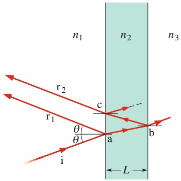

text_image

n₁
r₂
r₁
c
θ
θ
a
b
L
n₂
n₃
i

Abb. 31.11

Eine Lichtwelle, dargestellt durch den Strahl i, fällt auf eine dünne transparente Schicht der Dicke L mit dem Brechungsindex $n _ { 2 } ,$ Die Strahlen $\mathbf { r } _ { 1 }$ und $\mathbf { r } _ { 2 }$ gehören zu Lichtwellen, die an der Vorder- bzw. an der Rückseite der Schicht reflektiert wurden. (In Wirklichkeit verlaufen alle drei Strahlen nahezu senkrecht zur Schicht.) Die Interferenz der Strahlen $\mathbf { r } _ { 1 }$ und $\mathbf { r } _ { 2 }$ hängt von deren Phasendifferenz ab. Die Brechungsindizes $n _ { 1 }$ und $n _ { 3 }$ der Medien rechts und links von der Schicht müssen nicht notwendigerweise gleich sein; der Einfachheit halber nehmen wir jedoch an, es handele sich in beiden Fällen um Luft, also $n _ { 1 } = n _ { 3 } = 1 { , } 0 < n _ { 2 }$

771

---

31 Interferenz

gebrochen. Nach der Brechung verlässt ein Teil des Lichts, dargestellt durch den Strahl $\mathbf { r } _ { 2 } ,$ die Schicht und wird vom Beobachter wahrgenommen.

Wenn die Wellen von $\mathbf { r } _ { 1 }$ und $\mathbf { r } _ { 2 }$ im Auge des Beobachters exakt in Phase sind, entsteht dort ein Interferenzmaximum, und das Gebiet ac auf der Vorderseite der Schicht erscheint hell. Sind sie exakt gegenphasig, entsteht ein Interferenzminimum, und das Gebiet ac erscheint dunkel, obwohl es von der Quelle beleuchtet wird. Liegt die Phasendifferenz im mittleren Bereich, so nimmt der Beobachter das Gebiet ac mäßig hell wahr; die Interferenz liegt dort zwischen den Extremen.

Was der Beobachter sieht, hängt also von der Phasendifferenz zwischen den zu $\mathbf { r } _ { 1 }$ und $\mathbf { r } _ { 2 }$ gehörenden Wellen ab. Beide Strahlen entstehen aus dem gleichen einfallenden Strahl i; $\mathbf { r } _ { 2 }$ verlässt die Schicht jedoch erst, nachdem er sie zweimal (von a nach b und von b nach c) durchlaufen hat, während $\mathbf { r } _ { 1 }$ sofort an der ersten Grenzflä- che reflektiert wurde. Den Weglängenunterschied zwischen $\mathbf { r } _ { 1 }$ und $\mathbf { r } _ { 2 }$ können wir näherungsweise gleich 2L setzen, weil wir oben von $\theta \approx 0$ ausgegangen waren. Um die Phasendifferenz der beiden Wellen zu ermitteln, dürfen wir nun allerdings nicht einfach ausrechnen, wie viele Wellenlängen in $\Delta L$ passen. Dies hat zwei Gründe: Erstens liegt $\Delta L$ in einem anderen Medium als Luft und zweitens tritt unterwegs eine Reflexion auf, die die Phase der Wellen ändern kann.

Die Phasendifferenz zwischen zwei Wellen kann sich ändern, wenn mindestens eine von ihnen reflektiert wird.

Bevor wir also unsere Betrachtungen zur Interferenz an dünnen Schichten fortsetzen können, müssen wir uns mit den Phasenänderungen im Zuge von Reflexionen befassen.

## Phasenverschiebungen durch Reflexion

Bei der Brechung an einer Grenzfläche ändert sich die Phase der beteiligten Welle grundsätzlich nicht. Bei Reflexionen hingegen können Phasenverschiebungen auftreten, deren Betrag von den Brechungsindizes auf beiden Seiten der Grenzfläche abhängt. Abbildung 31.12 veranschaulicht solche Verschiebungen am Beispiel eines Seilwellenpulses, wobei das Seil in einem Teil dichter ist (der Puls bewegt sich hier relativ langsam) als im anderen (hier bewegt sich der Puls schneller).

Wir betrachten einen Puls, der sich relativ langsam die dichtere Hälfte des Seils entlang bewegt (Abb. 31.12a). Er erreicht die Grenze zur weniger dichten Hälfte, wo er teils durchgelassen, teils reflektiert wird; seine Orientierung ändert sich dabei nicht. Dies entspricht der Situation, dass Licht aus einem Medium mit grö- ßerem Brechungsindex in ein Medium mit kleinerem Brechungsindex eintritt. (Sie erinnern sich, dass die Ausbreitungsgeschwindigkeit mit zunehmendem n kleiner wird.) In diesem Fall ändert sich die Phase der Welle bei der Reflexion an der Grenze nicht: Die resultierende Phasenverschiebung ist null.

Nun soll der Puls die Grenze zwischen den Seilen von der weniger dichten Seilhälfte her erreichen (Abb. 31.12b). Wieder wird er teilweise transmittiert und reflektiert. Der durchgelassene Puls hat dieselbe Orientierung wie der einfallende, aber der reflektierte Puls kehrt nun seine Orientierung um. Für eine sinusförmige Welle entspricht diese Änderung einer Phasenverschiebung von π rad bzw. einer halben Wellenlänge. Die hierzu analoge Situation ist, dass eine Lichtwelle aus einem Medium mit kleinerem Brechungsindex in ein Medium mit größerem Brechungsindex (und folglich größerer Ausbreitungsgeschwindigkeit) eintritt. Auch in diesem Fall wird die Phase der Welle bei der Reflexion um π rad bzw. eine halbe Wellenlänge verschoben.

Wir fassen unsere Ergebnisse für die Phasenverschiebung bei der Reflexion von Licht zusammen in Abhängigkeit vom Brechungsindex des Mediums, an dem die Reflexion stattfindet:

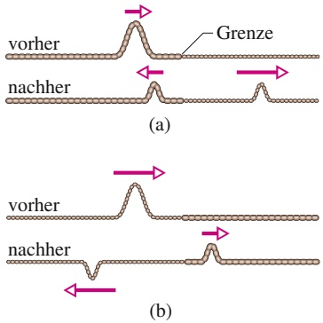

Abb. 31.12

Phasenverschiebung bei der Reflexion eines Wellenpulses in einer Seilwelle an der Grenze zwischen zwei gespannten Seilen verschiedener linearer Dichte. In dem weniger dichten Seil bewegt sich der Puls schneller. (a) Der Puls kommt aus dem dichteren Seil. (b) Der Puls kommt aus dem weniger dichten Seil. Nur in diesem Fall – und nur im reflektierten Puls! – ändert sich die Phase.

772

---

31.4 Interferenz an dünnen Schichten

31

| Reflexion am Medium ... | Phasenverschiebung durch Reflexion |
| --- | --- |
| ... mit kleinerem Brechungsindex | keine |
| ... mit größerem Brechungsindex | 1/2 Wellenlänge |

Als Eselsbrücke können Sie sich merken: höherer Index – halbe Wellenlänge.

## Gleichungen für die Interferenz an dünnen Schichten

In diesem Kapitel haben wir drei Situationen kennengelernt, in denen sich die Phasenbeziehung zwischen zwei Wellen ändern kann:

1. durch Reflexion,
2. durch Unterschiede der Weglängen, die von den Wellen zurückgelegt werden, und
3. durch Unterschiede der Brechungsindizes der Medien, in denen die Wellen sich ausbreiten.

An der Reflexion von Licht an einer dünnen Schicht, bei der die in Abb. 31.11 durch die Strahlen $\mathbf { r } _ { 1 }$ und $\mathbf { r } _ { 2 }$ dargestellten Wellen entstehen, sind alle drei Faktoren beteiligt. Wir wollen diese jetzt getrennt voneinander betrachten und unsere Erkenntnisse in Tab. 31.1 zusammenfassen.

Zunächst wenden wir uns noch einmal den beiden in Abb. 31.11 gezeigten Reflexionen zu. An Punkt a wird die aus Luft einfallende Welle an einem Medium mit größerem Brechungsindex reflektiert; Strahl $\mathbf { r } _ { 1 }$ erfährt demzufolge eine Phasenverschiebung um 0,5 Wellenlängen. An Punkt b wird die aus der Schicht einfallende Welle an dem Medium mit kleinerem Brechungsindex $( \mathrm { L u f t } )$ reflektiert; die Phase der in die Schicht zurückreflektierten Welle bleibt folglich unverändert und dasselbe gilt für den Strahl $\mathbf { r } _ { 2 }$ nach seinem Austritt aus der Schicht, da er ja keine weitere Reflexion mehr erfährt. Diese Informationen tragen wir in die erste Zeile von Tab. 31.1 ein: Durch die beiden Reflexionen an der Vorder- bzw. Rückseite der dünnen Schicht ergibt sich vorerst eine Phasenverschiebung von 0,5 Wellenlängen zwischen den Strahlen $\mathbf { r } _ { 1 }$ und $\mathbf { r } _ { 2 } ,$ die Wellen schwingen also exakt gegenphasig.

Als Nächstes untersuchen wir den Weglängenunterschied; er kommt zustande, weil $\mathbf { r } _ { 2 }$ die Schicht zweimal durchläuft; in der zweiten Zeile von Tab. 31.1 notieren wir daher $\Delta L = 2 L$ . Damit $\mathbf { r } _ { 1 }$ und $\mathbf { r } _ { 2 }$ am Ende exakt in Phase sind und vollständig konstruktive Interferenz die Folge ist, muss der Weglängenunterschied von 2L folglich eine zusätzliche Phasendifferenz von $^ { 0 , 5 , 1 , 5 , 2 , 5 , . . }$ . Wellenlängen hervorrufen, denn nur dann ergibt sich insgesamt eine Phasendifferenz, die einem ganzzahligen Vielfachen der Wellenlänge entspricht. Der Beobachter sieht die Schicht folglich dann hell, wenn die Bedingung

$$
2 L = \frac {\text {ungerade Zahl}}{2} \cdot \text {Wellenlänge} \tag {31.27}
$$

erfüllt ist. Dabei ist die Wellenlänge $\lambda _ { n _ { 2 } }$ des Lichts in dem Medium einzusetzen, in dem der Weglängenunterschied 2L durchlaufen wird, also in dem Medium mit dem Brechungsindex $n _ { 2 }$ (diese Information halten wir in der dritten Zeile von

TABELLE 31.1:

Interferenz an einer dünnen Schicht in $\mathrm { L u f t ^ { a ) } }$

| Phasenverschiebung durch Reflexion | $r_{1}$: 0,5 Wellenlängen, $r_{2}$: 0 |
| --- | --- |
| Weglängenunterschied | 2L |
| Brechungsindex des Mediums, in dem $\Delta L$ entsteht | $n_{2}$ |
| Bedingung für phasengleiche Strahlen | $2L = \frac{\text{ungerade Zahl}}{2} \cdot \lambda / n_{2}$ |
| Bedingung für gegenphasige Strahlen | $2L = \text{ganze Zahl} \cdot \lambda / n_{2}$ |

a) Für $n _ { 2 } > n _ { 1 }$ und $n _ { 2 } > n _ { 3 } .$

773

---

31 Interferenz

Tab. 31.1 fest). Damit erhält Gl. 31.27 die Form

$$
2 L = \frac {\text {ungerade Zahl}}{2} \cdot \lambda_ {n _ {2}}. \tag {31.28}
$$

Sollen die Wellen hingegen exakt gegenphasig schwingen, sodass vollständig de struktive Interferenz resultiert und der Beobachter die Schicht dunkel wahrnimmt, so darf durch den Weglängenunterschied 2L entweder überhaupt keine Phasendifferenz hinzukommen oder sie muss ein ganzzahliges Vielfaches der Wellenlänge betragen. Nur dann ist die gesamte Phasenverschiebung gleich einem ungeradzahligen Vielfachen einer halben Wellenlänge. Hierfür muss die Bedingung

$$
2 L = \text { ganze   Zahl } \cdot \text { Wellenlänge } \tag {31.29}
$$

erfüllt sein, wobei wir für die Wellenlänge wieder $\lambda _ { n _ { 2 } }$ in dem Medium einsetzen müssen, in dem der Weglängenunterschied 2L tatsächlich entsteht; es gilt daher

$$
2 L = \text {ganze Zahl} \cdot \lambda_ {n _ {2}}. \tag {31.30}
$$

Für die Wellenlänge von $\mathbf { r } _ { 2 }$ innerhalb der Schicht gilt nach Gl. 31.8 $( \lambda _ { n } = \lambda / n )$

$$
\lambda_ {n _ {2}} = \frac {\lambda}{n _ {2}}, \tag {31.31}
$$

wenn λ die Wellenlänge des einfallenden Lichts im Vakuum (bzw. näherungsweise in Luft) ist. Durch Einsetzen von Gl. 31.31 in Gl. 31.28 und Ersetzen von (ungerade Zahl/2) durch $( m + 1 / 2 )$ erhalten wir somit als Bedingung dafür, dass die Schicht hell erscheint,

$$
2 L = \left(m + \frac {1}{2}\right) \frac {\lambda}{n _ {2}} \quad \text {mit} \quad m = 0, 1, 2, \dots \tag {31.32}
$$

Diese Bedingung halten wir in der vierten Zeile von Tab. 31.1 fest.

Analog ergibt sich durch Ersetzen von (ganze Zahl) durch m in Gl. 31.30 als Bedingung dafür, dass die Schicht dunkel erscheint,

$$
2 L = m \frac {\lambda}{n _ {2}} \quad \mathrm{mit} \quad m = 0, 1, 2, \dots \tag {31.33}
$$

Diese Bedingung halten wir in der letzten Zeile von Tab. 31.1 fest.

Bei gegebener Schichtdicke L können wir anhand der Gln. 31.32 und 31.33 entscheiden, bei welchen Wellenlängen des einfallenden Lichts der Beobachter die Schicht hell bzw. dunkel wahrnimmt; zu jedem m gehört dabei eine Wellenlänge. Für zwischen diesen Extremen liegende Wellenlängen erscheint die Schicht mä- ßig hell. Bei gegebener Wellenlänge λ ergibt sich umgekehrt aus den Gln. 31.32 und 31.33, wie dick die Schicht sein muss, damit sie in dem gegebenen Licht hell oder dunkel erscheint; zu jedem m gehört ein Wert für die Dicke. Für dazwischenliegende Werte erscheint die Schicht mäßig hell.

Eine spezielle Situation tritt bei besonders dünnen Schichten ein, bei denen L wesentlich kleiner wird als λ (etwa $L < 0 ,   1 \lambda )$ . Dann ist der Weglängenunterschied 2L vernachlässigbar und die Phasendifferenz zwischen $\mathbf { r } _ { 1 }$ und $\mathbf { r } _ { 2 }$ wird allein durch die Reflexion bestimmt. Angenommen, die Schicht aus Abb. 31.11, an der die Reflexionen eine Phasenverschiebung von 0,5 Wellenlängen verursachen, sei derart dünn. Dann schwingen die Wellen in den austretenden Strahlen $\mathbf { r } _ { 1 }$ und $\mathbf { r } _ { 2 }$ exakt gegenphasig und die Schicht erscheint dunkel, unabhängig von der Wellenlänge und der Intensität des einfallenden Lichts. Diese Situation entspricht $m = 0$ in Gl. 31.33. Schichtdicken mit $L < 0 ,$ 1λ betrachten wir grundsätzlich als die geringste von Gl. 31.33 erfasste Dicke, für die in Abb. 31.11 eine dunkle Schicht wahrgenommen wird (d. h., jede derartige Dicke entspricht $m = 0 )$ . Die nächstgrößere Schichtdicke, die die Schicht dunkel erscheinen lässt, entspricht dann $m = 1$

In Abb. 31.13 sehen Sie ein senkrecht stehendes Seifenhäutchen, dessen Dicke infolge der Wirkung der Schwerkraft von oben nach unten zunimmt (die Seifenlö- sung wird nach unten gezogen) und das hell beleuchtet ist. Trotzdem erscheint der

774

---

31.4 Interferenz an dünnen Schichten

31

obere Teil dunkel, weil das Häutchen dort so dünn ist. Im etwas dickeren mittleren Abschnitt sehen wir ein Muster aus Streifen, deren Farbe in erster Linie davon abhängt, bei welcher Wellenlänge (reflektiertes) Licht bei der jeweiligen Schichtdicke vollständig konstruktiv interferiert. Zum unteren (dicksten) Ende der Schicht hin werden die Streifen immer schmaler, die Farben beginnen einander zu überlagern und verblassen.

## Schmetterlingsflügel

Eine Oberfläche, deren Farbigkeit durch Interferenz an dünnen Schichten zustande kommt, irisiert (von griechisch iris, „Regenbogen“): Sie ändert ihren Farbton je nach der Blickrichtung des Beobachters. Der irisierende Glanz der Flügeloberseiten vieler Schmetterlinge entsteht durch Interferenz an dachziegelartig angeordneten, durchscheinenden Schüppchen. Die Schichten sind wie breite, flache Verzweigungen baumartiger Strukturen senkrecht zur Flügelfläche aufgebaut.

Wenn man senkrecht auf einen solchen Flügel schaut, der von oben mit weißem Licht beleuchtet wird, dann interferiert das von den Schüppchen reflektierte Licht im blaugrünen Spektralbereich vollständig konstruktiv, Licht mit Wellenlängen vom anderen Ende des sichtbaren Spektrums (rot und gelb) dagegen nur teilweise konstruktiv und erscheint deshalb schwächer. Der Flügel wirkt unter diesen Bedingungen folglich blaugrün.

Wenn man jedoch schräg auf den Flügel blickt, dann hat auch das wahrgenommene Licht die Schuppenschicht auf einem geneigten Weg durchlaufen. Vollständig konstruktive Interferenz tritt deshalb jetzt bei einer im Vergleich zu einer senkrechten Betrachtung geringfügig verschobenen Wellenlänge auf. Wenn sich der Flügel so bewegt, dass man ihn unter ständig wechselnden Winkeln sieht, verschiebt sich die intensivste Wellenlänge des reflektierten Lichts dauernd – der Farbton ändert sich, der Flügel irisiert.

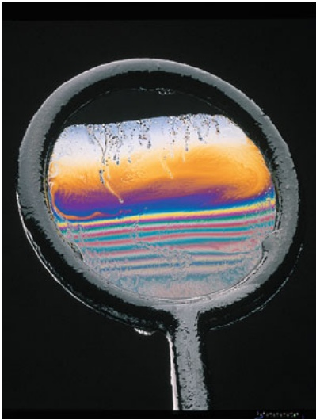

natural_image

Close-up of a glass bowl with a colorful liquid layer inside, showing no text or symbols.

Abb. 31.13

Reflexion von Licht an einem Seifenhäutchen, das senkrecht in einer Drahtschleife aufgespannt ist. Der obere Teil des Häutchens ist so dünn, dass das reflektierte Licht destruktiv interferiert und die Schicht dunkel erscheint. Auf dem Rest des Häutchens erkennen wir farbige Streifen, teilweise verformt durch die Bewegung der Flüssigkeit, die durch die Schwerkraft nach unten gezogen wird [Quelle: Richard Megna/Fundamental Photographs].

## LÖSUNGSSTRATEGIEN

**Strategie 1: Gleichungen für die Interferenz an dünnen Schichten** Die Gln. 31.32 und 31.33 gelten nicht für alle Situationen der Interferenz an dünnen Schichten! Wir hatten sie nur für den Fall hergeleitet, dass in Abb. 31.11 $n _ { 2 } > n _ { 1 }$ und $n _ { 2 } > n _ { 3 }$ ist.

Entsprechende Gleichungen für andere Situationen erhalten Sie, wenn sie dem in diesem Kapitel vorgestellten schrittweisen Verfahren folgend neue Tabellen analog zu Tab. 31.1 erstellen. Im Ergebnis gelangen Sie zwar stets zu den Gln. 31.32 und 31.33, aber je nach der spezifischen Situation kann auch Gl. 31.32 die Minima und Gl. 31.33 die Maxima angeben – also genau umgekehrt wie zuvor beschrieben. Welche Gleichung für welchen Fall zutrifft, hängt von der durch die Reflexion an den beiden Grenzflächen bewirkten Phasenverschiebung ab.

## KONTROLLFRAGE 5

In den vier auf der nächsten Seite abgebildeten Situationen wird Licht senkrecht an einer dünnen Schicht der Dicke L reflektiert (siehe Abb. 31.11). Alle Brechungsindizes sind angegeben. (a) In welchen Fällen verursacht die Reflexion an der Schicht keine Phasenverschiebung zwischen den reflektierten Strahlen? (b) In welchen Fällen erscheint die Schicht einem Beobachter dunkel, wenn der Weglängenunterschied 2L eine Phasenverschiebung von 0,5 Wellenlängen hervorruft?

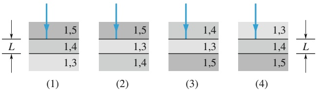

775

---

31 Interferenz

## 31.5 Das Michelson-Interferometer

## Lernziele

Nach dem Durcharbeiten dieses Abschnitts sollten Sie in der Lage sein, . . .

• anhand einer Skizze zu erklären, wie ein Interferometer funktioniert,
die Beziehung zwischen der Phasenänderung des Lichts (als Funktion der Wellenlänge, der Schichtdicke und des Brechungsindexes im Material) anzuwenden, wenn ein transparentes Material in den Strahlengang eines Interferometers gebracht wird,
• die Beziehung zwischen der Verschiebung des beweglichen Spiegels und der daraus resultierenden Verschiebung des Interferenzmusters anzuwenden.

## Schlüsselideen

• In einem Michelson-Interferometer wird eine Lichtwelle in zwei Teilstrahlen aufgespalten, die auf unterschiedlichen Wegen durch das Interferometer laufen und dann wieder in einem Punkt zusammengeführt werden.
• Das sich ergebende Interferenzmuster hängt von der Längendifferenz der beiden Wege sowie den Brechungsindizes entlang dieser Wege ab.
• Wenn sich ein transparentes Material mit dem Brechungsindex n und der Dicke L in einem Arm des Interferometers befindet, ist die Phasendifferenz bei Überlagerung der beiden Strahlen

$$
\text {Phasendifferenz} = \frac {2 L}{\lambda} (n - 1),
$$

wenn λ die Wellenlänge des Lichts ist.

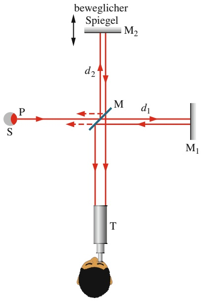

text_image

beweglicher
Spiegel
M2
d2
P
S
M
d1
M1
T

Abb. 31.14

Das Michelson-Interferometer. Eingezeichnet ist der Weg eines Lichtstrahls, der von Punkt P auf einer ausgedehnten Quelle ausgeht. Am Spiegel M wird das Licht in zwei Teilstrahlen aufgespalten, diese werden an den Spiegeln $M _ { 1 }$ und $M _ { 2 }$ zurück zu M und dann zum Teleskop T reflektiert. Durch das Teleskop erkennt ein Beobachter ein Muster aus Interferenzstreifen.

## 31.5.1 Das Michelson-Interferometer

Mit einem **Interferometer** kann man kleinste Längen oder Längenänderungen hochpräzise messen. Das Grundprinzip besteht in der Erzeugung und Auswertung von Interferenzmustern. Wir lernen hier die klassische, von Albert A. Michelson im Jahr 1881 entwickelte und gebaute Anordnung kennen.

Betrachten wir einen Lichtstrahl (Abb. 31.14), der eine ausgedehnte Quelle S im Punkt P verlässt und auf einen Strahlteiler M trifft. Unter einem Strahlteiler versteht man einen Spiegel, der das einfallende Licht zur Hälfte durchlässt und zur Hälfte reflektiert. Der Einfachheit halber wollen wir hier annehmen, die Dicke des Spiegels sei vernachlässigbar gering. In M spaltet sich der einfallende Strahl in zwei Teilstrahlen auf. Einer von ihnen durchläuft M in Richtung des Spiegels $M _ { 1 } ,$ der andere wird zum Spiegel $M _ { 2 }$ reflektiert. An $\mathbf { M } _ { 1 }$ und $M _ { 2 }$ findet eine vollständige Reflexion statt: Beide Strahlen kehren genau auf dem Einfallsweg zurück und treten schließlich in ein Fernrohr T ein. Der Beobachter sieht ein Muster aus geraden oder leicht gekrümmten Interferenzstreifen; im letzteren Fall ähnelt das Muster der Zeichnung eines Zebras.

Wenn sich die beiden Teilstrahlen am Fernrohr wieder treffen, beträgt ihr Weglängenunterschied $2 d _ { 2 } - 2 d _ { 1 }$ . Jeder Faktor, der diese Differenz beeinflusst, verändert gleichzeitig die Phasendifferenz der beiden Wellen am Auge des Beobachters. Bewegt man zum Beispiel den Spiegel $M _ { 2 }$ um eine Strecke $\lambda / 2 ,$ so ändert sich der Weglängenunterschied um λ und das Muster verschiebt sich um einen Streifen (als ob jeder dunkle Streifen auf dem Rücken eines Zebras an die Stelle des benachbarten dunklen Streifens rückte). Eine Bewegung von $M _ { 2 }$ um $\lambda / 4$ verschiebt das Muster um einen halben Streifen (als ob jeder dunkle Streifen eines Zebras an die Stelle des benachbarten hellen Streifens rückte).

Das Streifenmuster verschiebt sich auch, wenn man ein Stückchen eines dünnen, transparenten Materials in den Strahlengang eines der Spiegel bringt, beispielsweise von Spiegel $M _ { 1 }$ . Das Material habe die Dicke L und den Brechungsindex n; in einen Hin- und Rückweg des Strahls durch das Material passen dann gemäß Gl. 31.9

776

---

31.6 Zusammenfassung

31

$N _ { m }$ Wellenlängen mit

$$
N _ {m} = \frac {2 L}{\lambda_ {n}} = \frac {2 L n}{\lambda}. \tag {31.34}
$$

In eine Luftschicht derselben Dicke (also vor dem Einfügen des zusätzlichen Mediums) passen dagegen

$$
N _ {\mathrm{L}} = \frac {2 L}{\lambda} \tag {31.35}
$$

Wellenlängen. Nachdem das transparente Material in den Strahlengang gebracht wurde, ist die Phase des von Spiegel $\mathbf { M } _ { 1 }$ zurückkehrenden Lichts folglich um

$$
N _ {m} - N _ {\mathrm{L}} = \frac {2 L n}{\lambda} - \frac {2 L}{\lambda} = \frac {2 L}{\lambda} (n - 1) \tag {31.36}
$$

Wellenlängen verschoben.

Bei jeder Phasenänderung um eine Wellenlänge verschiebt sich das Muster um einen Streifen. Man kann also die Anzahl der Streifen ermitteln, um die das Muster durch das Einfügen des Materials verschoben wird, und diese Zahl in Gl. 31.36 für $N _ { m }   -   N _ { \mathrm { L } }$ einsetzen; daraus erhält man die Dicke L des Materials (in Wellenlängen).

Dieses Verfahren ermöglicht es, die Länge von Objekten als Vielfaches der Wellenlänge des eingestrahlten Lichts anzugeben. Zu Michelsons Lebzeiten wurde noch das Urmeter als Standard der Längenmessung verwendet, eine Metallschiene mit zwei dünnen Markierungen, die in Sèvres bei Paris aufbewahrt wurde. Mithilfe seines Interferometers konnte Michelson zeigen, dass der Abstand zwischen den Markierungen – ein Meter – genau dem 1 553 163,5-Fachen der Wellenlänge einer bestimmten monochromatischen Strahlung entspricht, die von einer cadmiumhaltigen Lichtquelle ausgesendet wird. Unter anderem für diese sorgfältige Messung erhielt Michelson 1907 den Physik-Nobelpreis. Später wurden seine Arbeiten fortgesetzt, bis man 1961 ganz auf das Urmeter verzichtete und das Meter anhand der Wellenlänge einer bestimmten Strahlung definierte. 1983 erwies sich auch dieser Standard als nicht mehr exakt genug, um den gestiegenen Anforderungen von Naturwissenschaft und Technik zu entsprechen. Der seitdem gültige neue Standard beruht auf einem definierten Wert für die Lichtgeschwindigkeit.

## 31.6 Zusammenfassung

**Das Huygenssche Prinzip** Die dreidimensionale Ausbreitung von Wellen, darunter Lichtwellen, kann häufig mit hilfe des Huygensschen Prinzips erklärt werden. Es besagt, dass alle Punkte einer Wellenfront Ausgangspunkte sekundärer kugelförmiger Elementarwellen sind. Der Ort einer Wellenfront nach einer Zeit t ist durch die tangential an diesen Elementarwellen verlaufende Fläche gegeben.

Aus dem Huygensschen Prinzip kann das Brechungsgesetz abgeleitet werden. Dazu setzt man den Brechungsindex eines Mediums gleich $n = c / \nu ,$ wobei v die Lichtgeschwindigkeit in dem betreffenden Medium ist und c die Lichtgeschwindigkeit im Vakuum.

**Wellenlänge und Brechungsindex** Die Wellenlänge $\lambda _ { n }$ von Licht in einem Medium mit dem Brechungsindex n beträgt

$$
\lambda_ {n} = \frac {\lambda}{n} \tag {31.8}
$$

(λ ist die Wellenlänge des Lichts im Vakuum). Aufgrund dieses Zusammenhangs kann sich die Phasendifferenz zwischen zwei Wellen ändern, wenn die Wellen sich in Medien mit unterschiedlichen Brechungsindizes ausbreiten.

**Der Versuch von Young** Beim Doppelspaltversuch von Young fällt Licht durch einen Einzelspalt auf zwei Spalte in einem Schirm. Das aus diesen Spalten austretende Licht breitet sich infolge von Beugung in alle Richtungen aus, weshalb hinter dem Schirm Interferenz auftritt. Auf einem Beobachtungsschirm entsteht ein aus hellen und dunklen Streifen bestehendes Interferenzmuster.

Die Lichtintensität in einem beliebigen Punkt auf dem Beobachtungsschirm hängt zum Teil vom Unterschied der Weglängen ab, welche die beiden Wellen von den Spalten bis zu diesem Punkt zurückgelegt haben. Ist der Unterschied gleich einem ganzzahligen Vielfachen der Wellenlänge, so interferieren die Wellen konstruktiv, was sich als Maximum der Intensität bemerkbar macht. Ist der Unterschied gleich einem ungeradzahligen Vielfachen einer halben Wellenlänge, so kommt es zur destruktiven Interferenz, es entsteht ein Intensitätsminimum. Die Bedingun-

777

---

31 Interferenz

gen für die Maxima und Minima der Intensität sind

$$
d \sin \theta = m \lambda \quad \text {mit} \quad m = 0, 1, 2, \dots
$$

(31.14)

und

$$
d \sin \theta = \left(m + \frac {1}{2}\right) \lambda \quad \text {mit} \quad m = 0, 1, 2, \dots
$$

(31.16)

θ ist der Winkel zwischen dem Weg des Lichts und der Bezugsachse, d ist der Abstand der beiden Spalte voneinander.

**Kohärenz** Die Interferenz zweier Lichtwellen, die sich in einem Punkt treffen, kann von einem Beobachter nur registriert werden, wenn die Phasendifferenz zwischen den Wellen zeitlich konstant ist. Solche Wellen heißen **kohä- rent**. Die beim Aufeinandertreffen zweier kohärenter Wellen entstehende Intensität kann man mithilfe von Zeigerdiagrammen ermitteln.

**Intensitäten bei der Interferenz am Doppelspalt** Beim Youngschen Doppelspaltexperiment überlagern sich zwei Wellen, jeweils mit der Intensität $I _ { 0 } ,$ auf dem Beobachtungsschirm zu einer Resultierenden mit der Intensität I. Dabei gilt:

$$
I = 4 I _ {0} \cos^ {2} \frac {1}{2} \varphi \tag {31.19}
$$

mit

$$
\varphi = \frac {2 \pi d}{\lambda} \sin \theta . \tag {31.20}
$$

In dieser Beziehung sind die Gln. 31.14 und 31.16 enthalten, die die Positionen der Streifenminima und Streifenmaxima angeben.

## 31.7 Fragen

**1.** Abbildung 31.F1 zeigt drei Lichtpulse gleicher Wellenlänge, die jeweils durch eine Kunststoffschicht geschickt werden; die zugehörigen Brechungsindizes sind angegeben. Ordnen Sie die Pulse in absteigender Reihenfolge nach der Zeit, die sie zum Durchlaufen der Kunststoffschicht benötigen.

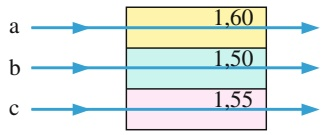

bar_stacked

| Category | Value |
| --- | --- |
| a | 1,60 |
| b | 1,50 |
| c | 1,55 |

Abb. 31.F1

**2.** Eine Lichtwelle breitet sich durch eine 1500 nm lange Nanostruktur aus. An einem Ende der Struktur befindet sich zu einem gegebenen Zeitpunkt gerade ein Wellenberg. Befindet sich dann am anderen Ende ein Wellenberg oder ein Wellental, wenn die Wellenlänge des Lichts (a) 500 nm und (b) 1000 nm beträgt?

**Interferenz an dünnen Schichten** Fällt Licht auf eine dünne Schicht eines transparenten Materials, so interferieren die an der vorderen bzw. hinteren Grenzfläche reflektierten Wellen. Bei nahezu senkrechtem Einfall lauten die Bedingungen für maximale und minimale Intensität des an der (in Luft befindlichen) Schicht reflektierten Lichts

$$
2 L = \left(m + \frac {1}{2}\right) \frac {\lambda}{n _ {2}} \quad \text {mit} \quad m = 0, 1, 2, \dots , \tag {31.32}
$$

(Maxima-Schicht erscheint hell)

$$
2 L = m \frac {\lambda}{n _ {2}} \quad \text {mit} \quad m = 0, 1, 2, \dots \tag {31.33}
$$

Hier sind $n _ { 2 }$ der Brechungsindex der Schicht, L die Schichtdicke und λ die Wellenlänge des Lichts in Luft.

Fällt Licht aus einem Medium mit kleinerem Brechungsindex auf eine Grenzfläche zu einem Medium mit größerem Brechungsindex, so verursacht die Reflexion in der reflektierten Welle eine Phasenverschiebung um π rad (bzw. eine halbe Wellenlänge). In allen anderen Fällen der Reflexion tritt keine Phasenverschiebung auf. Auch die Brechung an beliebigen Grenzflächen beeinflusst die Phase nicht.

**Das Michelson-Interferometer** Im Michelson-Interferometer wird ein Lichtstrahl in zwei Teilstrahlen aufgespal ten, welche unterschiedlich lange Wege durchlaufen und sich anschließend wieder treffen. Im Treffpunkt kommt es zur Interferenz und ein Streifenmuster ist zu beobachten. Indem man die Weglänge eines der beiden Teilstrahlen verändert, kann man sehr genaue Längenmessungen vornehmen: Man zählt die Streifen, um die sich das Interferenzmuster durch das Einfügen einer Probe in einen der Strah lengänge verändert, und kann dann die Dicke der Probe als Vielfaches der Wellenlänge des Lichts angeben.

**3.** Abbildung 31.F3 zeigt zwei Lichtstrahlen mit einer Wellenlänge von 600 nm, die an zwei 150 nm hintereinander angeordneten Glasflächen reflektiert werden. Vor der Reflexion sind die Wellen in Phase. (a) Geben Sie den Weglängenunterschied der Strahlen an. (b) Schwingen die zugehörigen Wellen exakt gleichphasig, exakt gegenphasig oder liegt die Phasenbeziehung irgendwo dazwischen, wenn die Strahlen die dargestellte Umgebung der Glasscheiben verlassen haben?

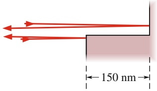

text_image

150 nm

Abb. 31.F3

778

---

31.7 Fragen

31

**4.** Abbildung 31.F4 zeigt zwei anfangs exakt phasengleiche Lichtstrahlen, die wie gezeigt an mehreren Glasflächen reflektiert werden. Die geringfügige Neigung der Strahlen rechts in der Anordnung ist zu vernachlässigen. (a) Geben Sie den Weglängenunterschied der Strahlen in Vielfachen der Strecke d an. (b) Wie groß müsste der Weglängen-

unterschied sein, damit die Strahlen exakt gegenphasig aus der Anordnung austreten? (c) Wie groß muss d mindestens sein, damit die in (b) geforderte Phasendifferenz erreicht werden kann?

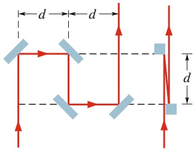

text_image

d
d
d

Abb. 31.F4

**5.** Nehmen Sie an, der Weglängenunterschied der in Abb. 31.8 gezeigten Strahlen betrage (a) 2,2λ, (b) 3,5λ, (c) 1,8λ und (d) 1,0λ. Befindet sich dann in Punkt P ein Minimum, Maximum oder ein mittlerer Zustand (näher dem Minimum oder dem Maximum?) der Interferenz? Geben Sie für jeden Fall den Wert von m zu dem betreffenden Maximum oder Minimum an.
**6.** Sie schauen von einem hellen Streifen eines Zweistrahl-Interferenzmusters (am Doppelspalt) auf den nächstäuße ren hellen Streifen. (a) Nimmt der Weglängenunterschied $\Delta L$ dabei von einem zum nächsten Streifen ab oder zu? (b) Um wie viel (in Wellenlängen λ) ändert sich der Weglängenunterschied?
**7.** Nimmt der Abstand zwischen zwei Streifen in einem Interferenzmuster am Doppelspalt ab, zu oder bleibt er gleich, wenn (a) der Abstand zwischen den Spalten vergrö- ßert wird, (b) anstelle von rotem Licht blaues eingestrahlt wird, (c) die gesamte Anordnung in kochendes Wasser getaucht wird? (d) Die Spalte werden nun mit weißem Licht beleuchtet. Befindet sich in den Nebenmaxima auf beiden Seiten das Maximum der blauen oder der roten Komponente näher am Hauptmaximum?
**8.** In Abb. 31.F8 sehen Sie vier Paare von Zeigern, die je weils zwei Lichtwellen in einem Doppelspalt-Interferenzversuch darstellen. Jeder Abbildungsteil gehört zu einem bestimmten Punkt auf dem Beobachtungsschirm zu einer bestimmten Zeit. Alle Zeiger sollen gleich lang sein. Ordnen Sie die zugehörigen Punkte auf dem Schirm in absteigender Reihenfolge nach ihrer Helligkeit.

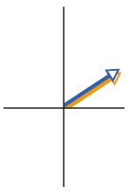

(a)

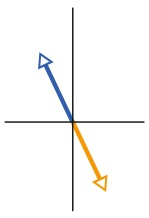

(b)

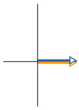

(c)

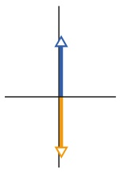

(d)

Abb. 31.F8

**9.** Abbildung 31.F9 zeigt zwei Quellen $S _ { 1 }$ und $S _ { 2 } ,$ die Radiowellen mit der Wellenlänge λ in alle Raumrichtungen emittieren. Die Quellen sind exakt in Phase, der Abstand zwischen ihnen beträgt 1,5λ. Die senkrechte Strichpunktlinie halbiert die Entfernung zwischen den Quellen. (a) Nehmen Sie an, wir bewegen uns vom angegebenen Startpunkt aus den $\mathrm { W e g }$ 1 entlang. Treffen wir dabei abwechselnd auf Interferenzmaxima und -minima, oder liegt der gesamte Weg auf einem einzigen Maximum/Minimum? Wiederholen Sie die Aufgabe für (b) Weg 2 und (c) Weg 3.

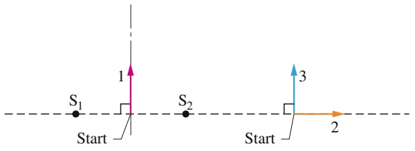

text_image

S₁
Start
1
S₂
Start
2
3

Abb. 31.F9

**10.** Abbildung 31.F10 zeigt, wie zwei Lichtstrahlen an einer Grenzfläche gebrochen und reflektiert werden. Welche der auslaufenden Wellen wurden in ihrer Phase verschoben?

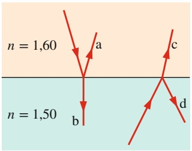

text_image

n = 1,60
a
c
b
d
n = 1,50

Abb. 31.F10

**11.** In Abb. 31.F11a sehen Sie den Querschnitt einer dünnen, nach unten dicker werdenden Schicht. Abbildung 31.F11b zeigt dieselbe Schicht von vorn, während sie mit einem senkrecht einfallenden Strahl roten Lichts beleuchtet wird, wobei ein Muster aus vier hellen Streifen entsteht. Die Punkte, die helle Streifen verursachen, sind auf dem Querschnitt markiert. Geben Sie den Unterschied der Dicke der Schicht (a) zwischen den Punkten a und b und (b) zwischen den Punkten c und d an, jeweils als Vielfaches der Wellenlänge des Lichts innerhalb der Schicht.

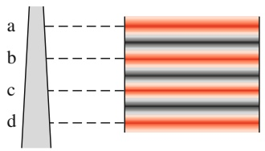

text_image

a
b
c
d

(a)

(b)

Abb. 31.F11

**12.** Abbildung 31.F12 zeigt den Durchgang eines senkrecht einfallenden Lichtstrahls durch eine dünne, von Luft umgebene Schicht (der Strahl wurde der besseren Verständlichkeit halber geringfügig geneigt gezeichnet). (a) Ist die Phase von $\mathbf { r } _ { 3 }$ infolge der Reflexion verschoben? (b) Geben Sie die Phasenverschiebung von Strahl $\mathbf { r } _ { 4 }$ aufgrund der Reflexion als Vielfaches der Wellenlänge an. (c) Ermitteln

779

---

31 Interferenz

Sie den Weglängenunterschied zwischen $\mathbf { r } _ { 3 }$ und $\mathbf { r } _ { 4 } ,$ wenn die Dicke der Schicht gleich L ist.

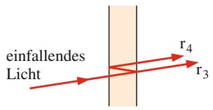

text_image

einfallendes
Licht
r₄
r₃

Abb. 31.F12

**13.** In Abb. 31.F13a ist die Lichtintensität I gegen die Position x auf dem Beobachtungsschirm für den zentralen Bereich eines Doppeltspalt-Interferenzmusters aufgetragen. Die übrigen Teilabbildungen zeigen Zeigerdiagramme für die elektrischen Feldkomponenten der Lichtwellen, die von den beiden Spalten ausgehend an dem Schirm ankommen (wie in Abb. 31.10a). Welcher der fünf Punkte 1–5 gehört zu welchem Zeigerdiagramm?

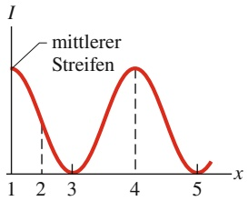

line

| X | I |
| --- | --- |
| 1 | ~0.8 |
| 2 | ~0.3 |
| 3 | 0 |
| 4 | ~0.8 |
| 5 | 0 |

(a)

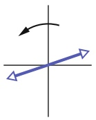

(b)

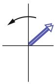

(c)

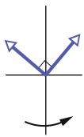

(d)

Abb. 31.F13

**14.** Abbildung 31.F14 zeigt vier Situationen, in denen Licht senkrecht von einer dünnen Schicht der Dicke L reflektiert wird, die sich zwischen zwei viel dickeren Materialien befindet; die drei beteiligten Brechungsindizes sind in der Ab bildung angegeben. In welchen Situationen ergibt Gl. 31.32, dass die Reflexion zu einem Maximum der reflektierten Intensität (d. h. einer hellen Schicht) führt?

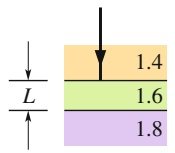

(a)

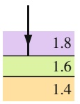

(b)

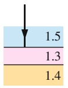

(c)

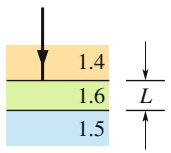

(d)

Abb. 31.F14

**15.** Abbildung 31.F15 zeigt drei Situationen, in denen zwei Strahlen Sonnenlicht etwas in den Mondboden eindringen und dann wieder herausgestreut werden. Nehmen Sie an, dass die Strahlen anfänglich in Phase sind. In welcher Situation sind die zugehörigen Wellen auch am Ende in Phase? (Bei Vollmond macht die Mondhelligkeit einen plötzlichen Sprung um etwa 25 %, weil wir dann Lichtwellen empfangen, die vom Mondboden zurück in Richtung Sonne – d. h. bei Vollmond zu uns – gestreut werden und dabei konstruktiv interferieren. Bevor die ersten Astronauten auf dem Mond landeten, befürchtete die NASA, dass die Astronauten durch das vom Mondboden rückgestreute Sonnenlicht möglicherweise erblinden würden, wenn sie keinen geeigneten Blendschutz an ihren Helmen hätten.)

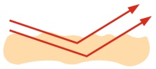

(a)

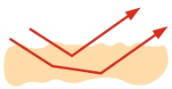

(b)

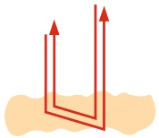

(c)

Abb. 31.F15

780
