# 32 Beugung

原始 PDF 第 795–820 页。

## 32 Beugung

## 32.1 Beugung am Einzelspalt

## Physikalische Motivation

Ein Schwerpunkt der physikalischen Untersuchung der Eigenschaften von Licht liegt auf der Erforschung und Anwendung von Beugungserscheinungen, wie sie an engen Spalten oder (was wir später besprechen werden) Hindernissen und Kanten auftreten können. Wir haben dieses Phänomen bereits in Kapitel 31 gestreift, als wir die Aufweitung des Lichts an den Spalten im Youngschen Interferenzexperiment bemerkt haben. Bei der Beugung an einem Spalt passiert jedoch mehr als nur eine einfache Strahlaufweitung, da das Licht auch mit sich selbst interferiert und so ein Interferenzmuster erzeugt. Aufgrund derartiger Komplikationen bietet das Licht vielfältige Anwendungsmöglichkeiten, denn obwohl die Beugung des Lichts an einem idealen Spalt oder einem rechteckigen Hindernis zunächst ausgesprochen akademisch klingt, verdienen unzählige Ingenieure und Wissenschaftler ihren Lebensunterhalt mit dieser Art von Physik, und der weltweite Umsatz mit Anwendungen von Beugungsphänomenen ist kaum zu berechnen.

Bevor wir aber einige dieser vielen Anwendungen diskutieren können, müssen wir zunächst diskutieren, wie die Beugung mit der Wellennatur des Lichts zusammenhängt.

## 32.1.1 Beugung und die Wellentheorie des Lichts

In Kapitel 31 haben wir die Beugung etwas ungenau als „Aufweitung“ des Lichts nach dem Durchgang durch eine eng begrenzte Öffnung erklärt. Ein weiterer, wesentlicher Effekt der Beugung kam dabei jedoch nicht zur Sprache: Es entsteht ein Interferenzmuster, genauer gesagt ein **Beugungsmuster**. Tritt zum Beispiel monochromatisches Licht aus einer weit entfernten Quelle (oder einem Laser) durch einen engen Spalt, so erkennt man auf einem hinter der Öffnung aufgestellten Beobachtungsschirm ein Muster ähnlich dem in Abb. 32.1 gezeigten: Zu beiden Seiten eines breiten, sehr hellen Streifens – des Hauptmaximums – befinden sich schmalere und weniger helle Nebenmaxima. Je zwei Maxima sind durch ein Minimum voneinander getrennt.

Die geometrische Optik kann das Auftreten von Beugungsmustern nicht erklä- ren: Wenn man davon ausgeht, dass Licht sich in Form von Strahlen geradlinig ausbreitet, so wäre zu erwarten, dass ein im Strahlengang befindlicher Spalt einige dieser Strahlen durchlässt; auf einem hinter dem Spalt angebrachten Beobachtungsschirm sollte man folglich ein scharfes, helles Abbild der Öffnung sehen. Die Existenz der Beugung (ebenso wie die der Interferenz in Kapitel 31) beweist, dass die geometrische Optik nur eine genährte Beschreibung der tatsächlichen Verhältnisse ist.

Beugungseffekte beobachtet man nicht nur, wenn Licht durch eine eng begrenzte Öffnung – etwa einen Spalt oder ein Nadelöhr – tritt: Auch an scharfen Kanten,

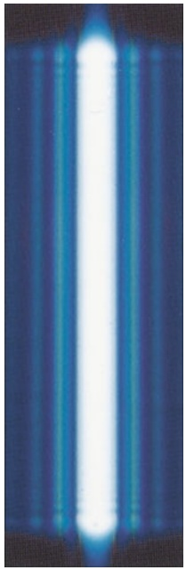

natural_image

Abstract blue vertical gradient with a bright white vertical stripe at the center (no text or symbols)

Abb. 32.1

Licht tritt durch einen engen senkrechten Spalt und fällt auf einen Beobachtungsschirm. Durch die Beugung breitet sich das Licht senkrecht zur längsten Ausdehnung des Spalts aus: Es entsteht ein Interferenzmuster aus einem breiten Hauptmaximum und schmaleren, weniger hellen Nebenmaxima; zwischen je zwei Maxima befindet sich ein Minimum [Quelle: Ken Kay/Fundamental Photographs].

Halliday Physik für natur- und ingenieurwiss. Studiengänge, 3. Auflage. D. Halliday, R. Resnick und J. Walker. © 2020 WILEY-VCH Verlag GmbH & Co. KGaA. Published 2020 by WILEY-VCH Verlag GmbH & Co. KGaA.

781

---

32 Beugung

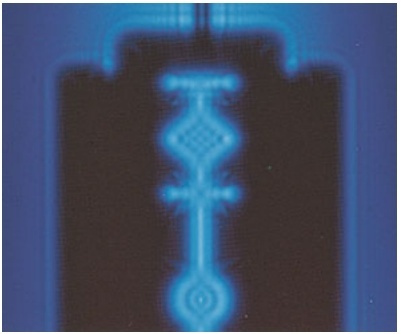

natural_image

Abstract blue and white pattern with glowing shapes, no text or symbols present

Abb. 32.2

Beugungsmuster an einer Rasierklinge in monochromatischem Licht. Beachten Sie die linienförmigen Minima und Maxima [Quelle: Ken Kay/Fundamental Photographs].

zum Beispiel denjenigen einer Rasierklinge, wird Licht gebeugt, wie Sie in Abb. 32.2 sehen können. Wie Sie bemerken werden, verlaufen die aus Maxima und Minima bestehenden Beugungsmuster ungefähr parallel sowohl zu den Innen- als auch zu den Außenkanten der Klinge. Strahlt das Licht beispielsweise an der linken senkrechten Kante vorbei, so breitet es sich nach links und rechts aus, es kommt zur Interferenz; so entsteht das Muster entlang der linken Kante. Der äußere rechte Teil dieses Musters liegt innerhalb des (scharf begrenzten) Schattens, den wir im Rahmen der geometrischen Optik erwarten würden.

Eine alltägliche Beugungserscheinung können Sie beobachten, wenn Sie gegen helles Licht – zum Beispiel den klaren Taghimmel – schauen. Sie sehen dann häufig kleine Flecken und härchenartige Strukturen, die sich durch ihr Gesichtsfeld bewegen. Sie entstehen, wenn das Licht an den Kanten winziger Zell- und Gewebebestandteile im Glaskörper (einer durchsichtigen, den Augapfel ausfüllenden gallertartigen Substanz) gebeugt wird. Streng genommen sind es die Beugungsmuster dieser Partikel, die Sie auf Ihrer Netzhaut wahrnehmen. Wenn Sie das Licht als annähernd ebene Welle auf Ihr Auge fallen lassen (z. B. indem Sie durch ein kleines Loch in einem ansonsten undurchsichtigen Stück Pappe schauen), können Sie auf diese Weise sogar einzelne Maxima und Minima der Beugungsmuster erkennen.

## Der Poissonsche Fleck

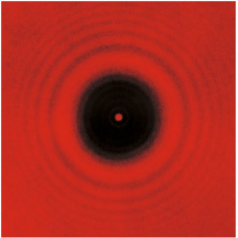

natural_image

Abstract red concentric circle pattern with a central dark center and a small red dot at the center (no text or symbols)

Abb. 32.3

Das Beugungsmuster eines kreisrunden Hindernisses (einer Scheibe). Die konzentrischen Beugungsringe und der Poissonsche Fleck in der Mitte des Schattenbilds sind gut zu erkennen. Im Wesentlichen entspricht diese Anordnung dem Experiment, das 1819 an der Académie Française zur Überprüfung von Poissons Vorhersage ausgeführt wurde: Dort verwendete man als Hindernis eine Kugel, deren Querschnitt ebenfalls kreisförmig ist [Quelle: Jearl Walker].

Im Rahmen der Wellentheorie des Lichts ist das Phänomen der Beugung problemlos zu erklären. Trotzdem dauerte es geraume Zeit, bis diese Theorie allgemein anerkannt war. Gegen Ende des 17. Jahrhunderts ursprünglich von Huygens entwickelt und über hundert Jahre später von Young zur Erklärung der Interferenzeffekte am Doppelspalt herangezogen, musste sich die Wellentheorie vor allem gegen Newtons Auffassung von Licht als Teilchenstrom behaupten.

Als Augustin Fresnel im frühen 19. Jahrhundert als junger Ingenieur beim Militär beschäftigt war, war die Teilchenbeschreibung des Lichts unter den französischen Naturwissenschaftlern allgemein akzeptiert. Fresnel hingegen war von der Wellennatur überzeugt und reichte bei der Académie Française eine Arbeit ein, in der er seine Experimente mit Licht und ihre aus der Wellentheorie hergeleiteten Erklärungen darlegte.

Die in der Akademie stark vertretenen Anhänger Newtons beschlossen, diesen Standpunkt öffentlich zur Diskussion zu stellen. 1819 wurde zu einem Wettbewerb von Arbeiten über die Beugungstheorie aufgerufen. Fresnel gewann nach einer längeren Diskussion schließlich den ersten Preis. Siméon D. Poisson, ein überzeugter Verfechter der Teilchenbeschreibung, hatte ein merkwürdiges Resultat erhalten: Falls Fresnels Theorie korrekt war, sollten Lichtwellen so in den Schatten eines kreisförmigen Gegenstands hinein gebeugt werden, dass man im Mittelpunkt des Schattenbilds einen hellen Fleck sehen müsste. Die Jury des Wettbewerbs sorgte sofort für eine Überprüfung der Vorhersage des berühmten Mathematikers – und tatsächlich fand man den inzwischen nach seinem Entdecker benannten Poissonschen Fleck (in der angelsächsischen Literatur auch als „Fresnel bright spot“bezeichnet, Abb. 32.3). Nichts spricht so überzeugend für eine Theorie wie ein unerwarteter, der Intuition widersprechender experimenteller Beweis ihrer Voraussagen.

## 32.1.2 Beugung am Einzelspalt: Die Lage der Minima

Wir wollen nun das Beugungsmuster untersuchen, das beim Einfall ebener Licht wellen der Wellenlänge λ auf einen einzelnen, langen, engen Spalt in einem ansonsten undurchsichtigen Schirm entsteht. Den Querschnitt der Anordnung zeigt Abb. 32.4; a ist die Breite des Spalts, der sich in die Papierebene hinein und aus ihr heraus erstreckt, und die Wellenfronten treffen parallel zu B ein. Bei der An-

782

---

32.1 Beugung am Einzelspalt

32

kunft des gebeugten Lichts am Beobachtungsschirm C kommt es zur Interferenz von Wellen, die von verschiedenen Punkten innerhalb des Spalts ausgehen. Auf dem Schirm wird ein Muster aus hellen und dunklen Streifen (Interferenzmaxima bzw. -minima) sichtbar. Zur Ermittlung der Streifenpositionen gehen wir ähnlich vor wie bei der Beschreibung des Interferenzmusters am Doppelspalt (siehe Abschn. 31.2). Allerdings sind die Beugungseffekte am Einzelspalt mathematisch schwieriger zu erfassen, weshalb wir an dieser Stelle lediglich Gleichungen für die Positionen der dunklen Streifen (der Minima) herleiten werden.

Zuvor wollen wir jedoch die Entstehung des mittleren hellen Streifens in Abb. 32.1 klären. Huygenssche Elementarwellen von allen Punkten innerhalb des Spalts müssen ungefähr die gleiche Weglänge durchlaufen, bis sie in der Mitte des Musters angekommen sind; folglich sind alle diese Wellen dort in Phase. Für alle anderen hellen Streifen können wir nur aussagen, dass sie etwa in der Mitte zwischen zwei benachbarten dunklen Streifen liegen.

Um die dunklen Streifen zu finden, benutzen wir, etwas vereinfachend, einen kleinen Trick: Wir fassen die aus dem Spalt austretenden Strahlen paarweise zusammen und überlegen dann, unter welchen Bedingungen die Elementarwellen der beiden Strahlen einander auslöschen. Mithilfe dieser Strategie ermitteln wir in Abb. 32.4a $\mathrm { P } _ { 1 }$ als Position des ersten dunklen Streifens. Dazu teilen wir den Spalt zunächst gedanklich in zwei gleich breite Abschnitte $( a / 2 )$ . Dann verlängern wir sowohl den Strahl $\mathbf { r } _ { 1 } ,$ der von der Oberkante des oberen Abschnitts ausgeht, als auch den Strahl $\mathbf { r } _ { 2 } ,$ der von der Oberkante des unteren Abschnitts ausgeht, bis zu $\mathrm { P } _ { 1 } .$ Abschließend verbinden wir die Mitte des Spalts durch eine Bezugsachse mit dem Beobachtungsschirm, wodurch wir die Position von $\mathrm { P } _ { 1 }$ anhand des Winkels θ bezüglich dieser Achse angeben können.

Die Elementarwellen zu den Strahlen $\mathbf { r } _ { 1 }$ und $\mathbf { r } _ { 2 }$ befinden sich innerhalb des Spalts in Phase, denn sie gehören zu ein und derselben Wellenfront, die über dessen ganze Breite durch den Spalt tritt. Damit der erste dunkle Streifen entstehen kann, müssen die beiden Wellen $\mathrm { P } _ { 1 }$ aber exakt gegenphasig (mit einer Phasenverschiebung von $\lambda / 2 )$ erreichen; diese Phasendifferenz kann nur durch einen Weglängenunterschied entstehen (der Weg von $\mathbf { r } _ { 1 }$ bis $\mathrm { P } _ { 1 }$ ist kürzer als der von $\mathbf { r } _ { 2 } )$ . Um diesen Weglängenunterschied darzustellen, suchen wir auf $\mathbf { r } _ { 2 }$ einen Punkt b, für den die Entfernung $\overline { { \mathrm { b P _ { 1 } } } }$ gerade der Länge von $\mathbf { r } _ { 1 }$ entspricht. Der Weglängenunterschied zwischen $\mathbf { r } _ { 1 }$ und $\mathbf { r } _ { 2 }$ ist dann durch den Abstand des Punkts b vom Mittelpunkt des Spalts (der Oberkante der unteren Hälfte) gegeben.

Wenn sich der Beobachtungsschirm $\mathbf { C }$ nahe an Schirm B befindet, lässt sich das Beugungsmuster auf C nur schwer mathematisch beschreiben. Wir können uns die Arbeit aber beträchtlich erleichtern, wenn wir den Abstand D zwischen den

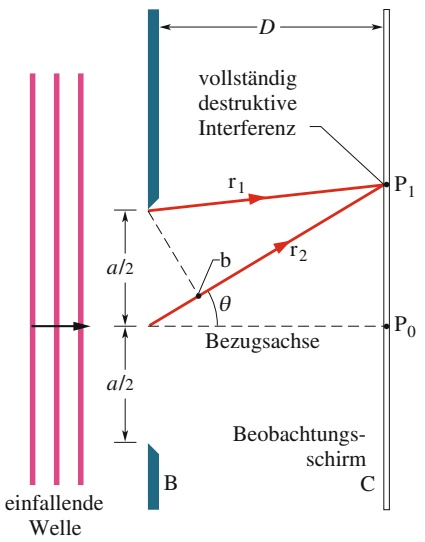

text_image

einfallende
Welle
D
vollständig
destruktive
Interferenz
r₁
P₁
r₂
b
θ
Bezugsachse
P₀
B
Beobachtungsschirm
C

(a)

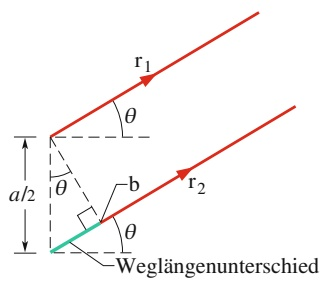

text_image

r₁
θ
a/2
θ
b
θ
r₂
Weglängenunterschied

(b)

## Abb. 32.4

(a) Wellen, die von den oberen Enden zweier Spaltabschnitte mit einer Breite von jeweils $a / 2$ ausgehen, interferieren im Punkt $\mathrm { P _ { 1 } }$ auf dem Beobachtungsschirm C vollständig destruktiv. (b) Für D ≫ a können wir $\mathbf { r } _ { 1 }$ und $\mathbf { r } _ { 2 }$ näherungsweise als parallel betrachten; beide Strahlen schließen mit der Bezugsachse den Winkel θ ein.

783

---

32 Beugung

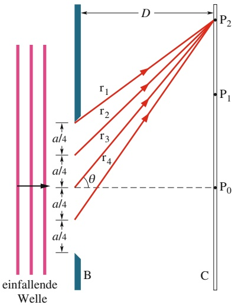

text_image

einfallende
Welle
B
r1
r2
r3
r4
a/4
a/4
a/4
a/4
D
P2
P1
P0
C

(a)

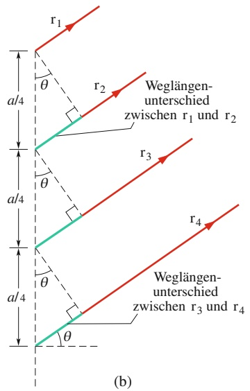

text_image

r₁
θ
r₂
Weglängen-
unterschied
zwischen r₁ und r₂
r₃
θ
a/4
a/4
r₄
θ
a/4
r₄
weglängen-
unterschied
zwischen r₃ und r₄
(b)

Abb. 32.5

(a) Wellen, die von den oberen Enden der vier Spaltabschnitte (jeweils mit der Breite $a / 4 )$ ausgehen, interferieren in $\mathrm { P } _ { 2 }$ vollständig destruktiv. (b) Für $D \gg$ a können wir $\mathbf { r } _ { 1 } , \mathbf { r } _ { 2 } ,$ $\mathbf { r } _ { 3 }$ und $\mathbf { r } _ { 4 }$ näherungsweise als parallel betrachten; alle schließen mit der Bezugsachse den Winkel θ ein.

Schirmen viel größer wählen als die Spaltbreite a. Die Strahlen $\mathbf { r } _ { 1 }$ und $\mathbf { r } _ { 2 }$ sind dann näherungsweise parallel und schließen beide einen Winkel θ mit der Bezugsachse ein (Abb. 32.4b). Das von Punkt $^ \mathrm { b , }$ dem Mittelpunkt des Spalts und dessen oberer Begrenzung gebildete Dreieck können wir als rechtwinklig ansehen (mit θ als einem der Innenwinkel). So erhalten wir für den Weglängenunterschied zwischen $\mathbf { r } _ { 1 }$ und $\mathbf { r } _ { 2 }$ (also den Abstand zwischen dem Mittelpunkt des Spalts und b) den Wert $( a / 2 )$ sin θ.

Für jedes Paar von Strahlen, die von einander entsprechenden Punkten (etwa von den Mittelpunkten) der beiden Abschnitte ausgehen und $\mathrm { P } _ { 1 }$ erreichen, können wir nun analog vorgehen. Zu jedem solchen Strahlenpaar finden wir dann den Weglängenunterschied $( a / 2 )$ sin θ. Wir setzen diesen für alle Paare gleich großen Unterschied gleich $\lambda / 2$ (unsere Bedingung für das Auftreten des ersten dunklen Streifens):

$$
\frac {a}{2} \sin \theta = \frac {\lambda}{2}.
$$

Daraus erhalten wir für das erste Minimum im Beugungsmuster

$$
a \sin \theta = \lambda . \tag {32.1}
$$

Bei gegebener Spaltbreite $\alpha$ und Wellenlänge λ liefert Gl. 32.1 den Winkel $\theta ,$ unter dem (aus Symmetriegründen oberhalb und unterhalb der Bezugsachse) der erste dunkle Streifen entsteht.

Beginnen wir mit $\alpha > \lambda$ und lassen den Spalt bei konstanter Wellenlänge immer schmaler werden, dann wird der Winkel $\theta ,$ unter dem der erste dunkle Streifen erscheint, immer größer; das bedeutet, das Ausmaß der Beugung (die Ausdehnung des Beugungsmusters) ist umso größer, je schmaler der Spalt ist. Erreicht die Spaltbreite schließlich die Wellenlänge $( \alpha = \lambda )$ , so ist $\theta = 9 0 ^ { \circ } -$ da die beiden ersten Minima dann auf dem Schirm quasi im Unendlichen verschwinden, muss das zwischen ihnen liegende erste Maximum den gesamten Schirm einnehmen.

Um den zweiten dunklen Streifen oberhalb und unterhalb der Bezugsachse zu lokalisieren, gehen wir analog vor. Allerdings teilen wir den Spalt jetzt in vier Abschnitte gleicher Breite $( a / 4 )$ , wie in Abb. 32.5a gezeigt ist. Die oberen Enden der Abschnitte verbinden wir durch die Strahlen $\mathbf { r } _ { 1 } ,   \mathbf { r } _ { 2 } ,   \mathbf { r } _ { 3 }$ und $\mathbf { r } _ { 4 }$ mit dem Punkt $\mathrm { P } _ { 2 } ,$ der die Position des zweiten dunklen Streifens angibt. Damit in $\mathrm { P } _ { 2 }$ vollständig destruktive Interferenz auftritt, müssen die Weglängenunterschiede zwischen $\mathbf { r } _ { 1 }$ und $\mathbf { r } _ { 2 } ,$ zwischen $\mathbf { r } _ { 2 }$ und $\mathbf { r } _ { 3 }$ sowie zwischen $\mathbf { r } _ { 3 }$ und $\mathbf { r } _ { 4 }$ sämtlich gleich $\lambda / 2$ sein.

Für $D \gg a$ können wir die vier Strahlen näherungsweise als parallel betrachten; sie alle schließen mit der Bezugsachse den Winkel θ ein. Die Weglängenunterschiede stellen wir dar, indem wir je zwei benachbarte Strahlen durch eine Linie senkrecht zum Strahlenverlauf verbinden (Abb. 32.5b); so entstehen drei rechtwinklige Dreiecke, deren eine Seite jeweils dem Weglängenunterschied entspricht. Aus dem obersten Dreieck entnehmen wir für den Weglängenunterschied zwischen $\mathbf { r } _ { 1 }$ und $\mathbf { r } _ { 2 }$ den Wert $( a / 4 )$ sin $\theta ;$ das unterste Dreieck liefert denselben Unterschied zwischen $\mathbf { r } _ { 3 }$ und $\mathbf { r } _ { 4 } .$ Zu jedem Paar von Strahlen, die von einander entsprechenden Punkten in benachbarten Abschnitten ausgehen, ergibt sich genau dieser Weglängenunterschied von $( a / 4 )$ sin $\theta ,$ der gleich $\lambda / 2$ sein muss, damit unsere Bedingung für destruktive Interferenz erfüllt ist. Es muss also

$$
\frac {a}{4} \sin \theta = \frac {\lambda}{2}
$$

gelten, woraus für das zweite Minimum im Beugungsmuster folgt

$$
a \sin \theta = 2 \lambda . \tag {32.2}
$$

Die Positionen weiterer dunkler Streifen finden wir, indem wir den Spalt sukzessive in immer mehr Abschnitte gleicher Breite aufteilen und wie gezeigt vorgehen. Dabei wählen wir stets eine gerade Anzahl von Abschnitten, um die Strahlen (und

784

---

32.2 Intensitäten bei der Beugung am Einzelspalt

32

die zugehörigen Wellen) paarweise behandeln zu können. So ergibt sich für die Position des m-ten Minimums im Beugungsmuster der allgemeine Ausdruck

$$
a \sin \theta = m \lambda \quad \text {mit} \quad m = 1, 2, 3, \dots \tag {32.3}
$$

Damit Sie sich diese Beziehung besser einzuprägen können, zeichnen Sie ein Drei eck wie in Abb. 32.4b, aber für die gesamte Spaltbreite a. Der Weglängenunterschied zwischen den Strahlen, die von der oberen bzw. unteren Kante des Spalts ausgehen, ist dann gleich a sin θ, und Gl. 32.3 besagt:

Beugungsmuster am Einzelspalt zeigen Minima, wenn der Weglängenunterschied a sin θ zwischen dem von der oberen und dem von der unteren Kante des Spalts ausgehenden Strahl gleich λ, 2λ, 3λ, … ist.

Auf den ersten Blick könnte man diese Aussage für falsch halten, weil sich die Wellen zu den beiden genannten Strahlen ja gerade exakt in Phase befinden, wenn ihr Weglängenunterschied einem ganzzahligen Vielfachen der Wellenlänge entspricht. Es gibt aber zu jeder der beiden Wellen einen exakt gegenphasigen Partner, daher wird jede Welle von einer anderen ausgelöscht und es entsteht ein dunkler Streifen.

Wir haben die Gln. 32.1–32.3 unter der Bedingung D ≫ a hergeleitet. Wir können sie aber auch anwenden, wenn wir eine Sammellinse zwischen den Spalt und den Beobachtungsschirm bringen und den Schirm verschieben, bis er in der Brennebene der Linse liegt. Die Strahlen, die sich jetzt in einem beliebigen Punkt auf dem Schirm treffen, sind in diesem Fall exakt (nicht nur näherungsweise) parallel aus dem Spalt ausgetreten. Sie sind vergleichbar mit den Parallelstrahlen, die in Rich tung des Brennpunkts einer Sammellinse umgelenkt werden (siehe Abb. 30.14a).

## KONTROLLFRAGE 1

Ein langer, schmaler Spalt wird mit blauem Licht beleuchtet. Auf einem hinter dem Spalt liegenden Schirm entsteht ein Beugungsmuster. Wird die Ausdehnung dieses Musters größer oder kleiner (d. h., bewegen sich die Minima und Maxima von der Mitte des Musters weg oder auf dieses zu), wenn (a) gelbes Licht anstelle des blauen verwendet oder (b) die Spaltbreite verringert wird?

## 32.2 Intensitäten bei der Beugung am Einzelspalt

## Lernziele

Nach dem Durcharbeiten dieses Abschnitts sollten Sie in der Lage sein, . . .

einen dünnen Spalt gedanklich in eine Ansammlung von vielen Streifen gleicher Breite aufzuteilen und dann einen Ausdruck für die Phasendifferenz der von benachbarten Streifen ausgehenden Wellen als Funktion des Winkels θ zu einem Punkt auf dem Beobachtungsschirm anzugeben,
für die Beugung am Einzelspalt Zeigerdiagramme für das zentrale Maximum und einige Minima und Maxima auf jeder Seite zu zeichnen und dabei die Phasendifferenz zwischen benachbarten Zeigern anzugeben, zu erklären, wie das resultierende elektrische Feld zu berechnen ist, und jeweils die zugehörigen Bereiche im Beugungsmuster zu markieren,
• das resultierende elektrische Feld an bestimmten Stellen im Beugungsmuster zu beschreiben,
• die Größe α zu berechnen, die den Zusammenhang zwischen einem Winkel θ zu einem Punkt im Beugungsmuster und der Intensität I an diesem Punkt beschreibt,
• für einen gegebenen Punkt in einem Beugungsmuster, d. h. einen gegebenen Beugungswinkel, die Intensität I als Funktion der Intensität $I _ { \mathrm { m } }$ in der Mitte des Beugungsmusters zu ermitteln.

785

---

32 Beugung

## Schlüsselideen

• Die Intensität des Beugungsmusters bei einem Winkel θ ist

$$
I (\theta) = I _ {\mathrm{m}} \left(\frac {\sin \alpha}{\alpha}\right) ^ {2}.
$$

Dabei ist $I _ { \mathrm { m } }$ die Intensität in der Mitte des Beugungsmusters und es gilt

$$
\alpha = \frac {\pi a}{\lambda} \sin \theta .
$$

## 32.2.1 Intensitäten bei der Beugung am Einzelspalt: Eine qualitative Betrachtung

In Abschn. 32.1 haben wir die Positionen der Maxima und Minima von Beugungsmustern ermittelt, die am Einzelspalt entstehen. Nun wenden wir uns einem allgemeineren Problem zu, nämlich der Intensität I des Musters als Funktion des Winkels $\theta ,$ anhand dessen wir die Position eines Punkts auf dem Beobachtungsschirm angeben.

Wir teilen dazu den Spalt in Abb. 32.4a zunächst in N Abschnitte gleicher Breite $\Delta x ;$ dabei soll Δx hinreichend klein sein, damit wir jeden Abschnitt als Quelle sekundärer Huygensscher Elementarwellen ansehen können. Die Elementarwellen, die in einem beliebigen Punkt P (unter dem zugehörigen Winkel $\theta )$ auf dem Beobachtungsschirm eintreffen, wollen wir nun überlagern und die Amplitude $E _ { \theta }$ der elektrischen Feldkomponente der resultierenden Welle in P bestimmen. Die Intensität des Lichts in diesem Punkt ist dann proportional zum Quadrat dieser Amplitude.

Zur Berechnung von $E _ { \theta }$ benötigen wir die Phasenbeziehungen zwischen den eintreffenden Elementarwellen. Die Phasendifferenz zwischen zwei von benachbarten Abschnitten des Spalts ausgehenden Elementarwellen ist

$$
(\text {Phasendifferenz}) = \left(\frac {2 \pi}{\lambda}\right) \quad (\text {Weglängenunterschied}).
$$

Für einen Punkt P unter dem Winkel θ beträgt der Weglängenunterschied zwischen Elementarwellen benachbarter Abschnitte $\Delta x$ sin $\theta ;$ für die Phasendifferenz Δ𝜑 dieser Wellen gilt demzufolge

$$
\Delta \varphi = \left(\frac {2 \pi}{\lambda}\right) (\Delta x \sin \theta). \tag {32.4}
$$

## Abb. 32.6

Zeigerdiagramme für $N = 1 8 ; \mathrm { d . h }$ h. für eine Unterteilung des Spalts in 18 gleich große Abschnitte. Dargestellt sind die resultierenden Amplituden für (a) das Hauptmaximum mit $\theta = 0 ,$ (b) einen Punkt auf dem Schirm unter einem kleinen Winkel θ bezüglich der Achse, (c) das erste Minimum und (d) das erste Nebenmaximum.

Wir nehmen nun $\mathbf { a n } ,$ dass alle in P ankommenden Elementarwellen dieselbe Am plitude $\Delta E$ haben. Die Amplitude $E _ { \theta }$ der Resultierenden in P erhalten wir dann durch Zeigeraddition aller Amplituden ΔE in diesem Punkt. Dazu konstruieren wir ein Diagramm mit N Zeigern, jeweils einen zu jedem Abschnitt des Spalts.

An dem Punkt $\mathrm { P _ { 0 } }$ mit $\theta = 0$ (auf der Bezugsachse) in Abb. 32.4a ist die Phasendifferenz Δ𝜑 zwischen den Elementarwellen nach Gl. 32.4 null: Alle Elementarwellen treffen phasengleich ein. Das zugehörige Zeigerdiagramm sehen Sie in Abb. 32.6a.

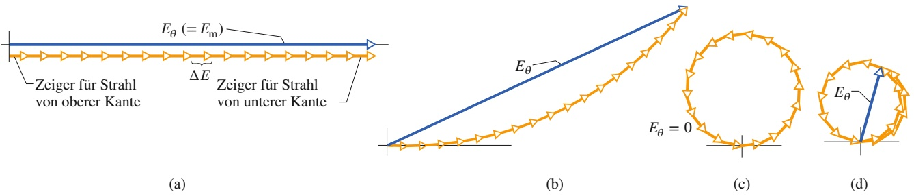

786

---

32.2 Intensitäten bei der Beugung am Einzelspalt

32

Benachbarte Zeiger gehören zu Elementarwellen, die von benachbarten Abschnitten des Spalts ausgehen. Die Zeiger wurden fortlaufend (Ende an Spitze) aneinandergereiht. Da die Phasendifferenz der Elementarwellen null ist, ist auch der Winkel zwischen benachbarten Zeigern null. Die Amplitude $E _ { \theta }$ in $\mathrm { P } _ { 0 }$ ergibt sich als Vektorsumme all dieser Zeiger. Wie sich herausstellt, ist $E _ { \theta }$ für $\theta = 0$ (also den hier beschriebenen Fall) am größten. Wir nennen diesen Maximalwert $E _ { \mathrm { m } }$

Wir betrachten nun einen Punkt P unter einem kleinen, aber von null verschiedenen Winkel θ zur Bezugsachse. Ein Blick auf Gl. 32.4 zeigt, dass die Phasendifferenz $\Delta \varphi$ der Elementarwellen aus benachbarten Abschnitten dann nicht mehr null ist. In Abb. 32.6b ist das zugehörige Zeigerdiagramm dargestellt; wieder wurden die Zeiger fortlaufend angeordnet, aber der Winkel $\Delta \varphi$ zwischen aneinanderstoßenden Zeigern ist ungleich null. Auch hier ergibt sich die Amplitude $E _ { \theta }$ als Vektorsumme aller Zeiger, wir erhalten jedoch einen kleineren Wert als für $\theta = 0$ (Abb. 32.6a). Die Intensität des Lichts ist in P demnach geringer als in $\mathbf { P } _ { 0 } .$

Je größer wir nun θ wählen, desto größer wird auch der Winkel $\Delta \varphi$ zwischen benachbarten Zeigern. Die Kette der Zeiger krümmt sich daher immer stärker und schließt sich schließlich zum Kreis (Abb. 32.6c). In diesem Fall ist die resultierende Amplitude $E _ { \theta }$ null und der Punkt auf dem Schirm folglich dunkel: Wir haben den ersten dunklen Streifen, das erste Minimum des Beugungsmusters erreicht. Die Phasendifferenz zwischen dem ersten und dem letzten Zeiger ist gleich 2π rad, d. h., der Weglängenunterschied zwischen dem von der oberen und dem von der unteren Kante ausgehenden Strahl entspricht gerade einer Wellenlänge – wir erinnern uns, dass das genau unsere Bedingung für das Auftreten des ersten Beugungsminimums war.

Vergrößern wir θ über diesen Punkt hinaus, so nimmt $\Delta \varphi$ noch weiter zu. Die Zeigerkette bildet nun eine Spirale (Abb. 32.6d), die sich immer stärker zusammenzieht. Die Amplitude nimmt dabei wieder zu und erreicht bei der in Abb. 32.6d dargestellten Anordnung einen maximalen Wert, der dem ersten Nebenmaximum im Beugungsmuster entspricht.

Wenn θ weiter zunimmt, nimmt $E _ { \theta }$ wieder ab (die Spirale schrumpft); die Intensität in dem zugehörigen Punkt ist kleiner als am ersten Nebenmaximum. Das zweite Minimum ist erreicht, wenn die Spitze des letzten Zeigers wieder mit dem Ende des ersten Zeigers zusammentrifft.

Dieses qualitative Verfahren zur Lokalisierung der Maxima und Minima im Beugungsmuster ließe sich beliebig fortsetzen. Statt dies zu tun, wollen wir nun jedoch eine quantitative Methode kennenlernen.

## KONTROLLFRAGE 2

Die Abbildung zeigt zwei Zeigerdiagramme analog zu Abb. 32.6 (die Kurven sind hier glatter, weil mehr Zeiger verwendet wurden). Sie gehören zu zwei Punkten auf entgegengesetzten Seiten eines Maximums in einem Beugungsmuster. (a) Um welches Maximum handelt es sich? (b) Welcher Wert von m (siehe Gl. 32.3) gehört ungefähr zu diesem Maximum?

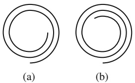

## 32.2.2 Intensitäten bei der Beugung am Einzelspalt: Eine quantitative Betrachtung

Gleichung 32.3 liefert uns die Minima im Beugungsmuster eines Einzelspalts auf einem Beobachtungsschirm C als Funktion des in Abb. 32.4a eingezeichneten Winkels θ. Wir wollen nun einen Ausdruck für die Intensität $I ( \theta )$ in Abhängigkeit von diesem Winkel herleiten. Wie weiter unten bewiesen werden soll, ist gilt für die Intensität

$$
I (\theta) = I _ {\mathrm{m}} \left(\frac {\sin \alpha}{\alpha}\right) ^ {2} \tag {32.5}
$$

787

---

32 Beugung

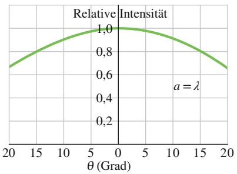

line

| \(\theta (\)Grad) | Relative Intensität |
| --- | --- |
| 20 | ~0.68 |
| 15 | ~0.83 |
| 10 | ~0.94 |
| 5 | ~0.99 |
| 0 | 1.0 |
| 5 | ~0.99 |
| 10 | ~0.94 |
| 15 | ~0.83 |
| 20 | ~0.68 |

(a)

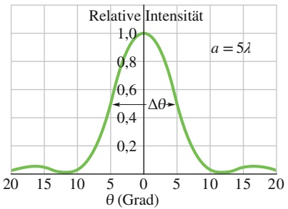

line

| \(\theta (\)Grad) | Relative Intensität |
| --- | --- |
| -20 | ~0.05 |
| -15 | ~0.08 |
| -10 | ~0.05 |
| -5 | ~0.45 |
| 0 | 1.0 |
| 5 | ~0.45 |
| 10 | ~0.05 |
| 15 | ~0.08 |
| 20 | ~0.05 |

(b)

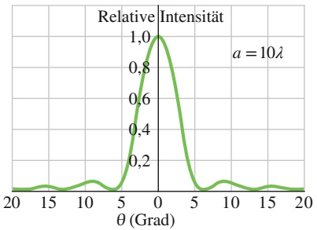

line

| \(\theta (\)Grad) | Relative Intensität |
| --- | --- |
| -20 | ~0.01 |
| -15 | ~0.03 |
| -10 | ~0.08 |
| -5 | ~0.01 |
| 0 | 1.0 |
| 5 | ~0.01 |
| 10 | ~0.08 |
| 15 | ~0.03 |
| 20 | ~0.01 |

(c)

Abb. 32.7

Relative Intensitäten bei der Beugung am Einzelspalt für drei Werte des Verhältnisses $a / \lambda$ . Das Hauptmaximum wird umso schmaler, je breiter der Spalt ist.

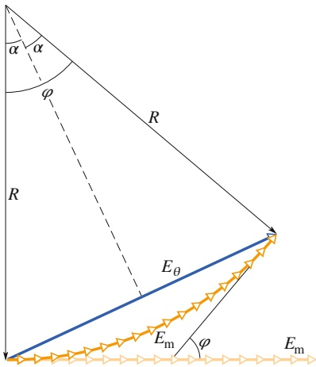

text_image

α
α
φ
R
R
Eθ
Em
φ
Em

Abb. 32.8

Die Konstruktion zur Berechnung der Intensitäten bei der Beugung am Einzelspalt. Die gezeigte Situation entspricht Abb. 32.7b.

mit

$$
\alpha = \frac {1}{2} \varphi = \frac {\pi a}{\lambda} \sin \theta . \tag {32.6}
$$

Die Hilfsgröße α ist einfach eine praktische Verbindung zwischen dem Winkel θ, anhand dessen wir die Position eines Punkts auf dem Beobachtungsschirm festlegen, und der Intensität $I _ { \mathrm { m } }$ des Lichts in diesem Punkt. Der Maximalwert $I _ { \mathrm { m } }$ der Intensität $I ( \theta )$ in diesem Muster entspricht dem Hauptmaximum (mit $\theta = 0 ) ;$ 𝜑 ist die Phasendifferenz (im Bogenmaß) zwischen Strahlen, die von der oberen bzw. der unteren Kante des Spalts mit der Breite a ausgehen.

Nach Gl. 32.5 gilt für die Intensitätsminima

$$
\alpha = m \pi \quad \text {mit} \quad m = 1, 2, 3, \dots \tag {32.7}
$$

Setzen wir dies in Gl. 32.6 ein, so erhalten wir als Bedingung für Minima im Beugungsmuster

$$
m \pi = \frac {\pi a}{\lambda} \sin \theta \quad \text {mit} \quad m = 1, 2, 3, \dots
$$

oder

$$
a \sin \theta = m \lambda \quad \text {mit} \quad m = 1, 2, 3, \dots \tag {32.8}
$$

Dieser Ausdruck entspricht exakt der zuvor hergeleiteten Gl. 32.3.

Abbildung 32.7 zeigt Intensitäten von Beugungsmustern an Einzelspalten, die mithilfe der Gln. 32.5 und 32.6 berechnet wurden, für Spalte mit den Breiten $\alpha = \lambda _ { i }$ $\alpha = 5 \lambda$ und $a = 1 0 \lambda$ . Man erkennt, dass die Breite des Hauptmaximums (des mittleren Maximums der gezeigten Kurven) mit zunehmender Spaltbreite (relativ zur Wellenlänge) abnimmt; das Ausmaß der Beugung wird also umso geringer, je breiter die Öffnung ist. Gleichzeitig wird auch das zweite Nebenmaximum schmaler und weniger intensiv. Wenn die Spaltbreite groß gegen die Wellenlänge des einstrahlenden Lichts ist, verschwindet das zweite Nebenmaximum und wir können nicht mehr von Beugung am Einzelspalt sprechen. (Stattdessen beobachten wir dann Beugungsmuster, die an den Kanten der Öffnung entstehen wie an der Rasierklinge in Abb. 32.2.)

## Herleitung der Gln. 32.5 und 32.6

Der aus Zeigern zusammengesetzte Bogen in Abb. 32.8 stellt die Elementarwellen dar, die einen beliebigen Punkt P auf dem Beobachtungsschirm in Abb. 32.4 erreichen; der zu P gehörende Winkel θ ist klein, aber von null verschieden. Die Ampli tude $E _ { \theta }$ der Resultierenden in P ergibt sich als Vektorsumme der Zeiger. Wenn wir den Spalt in Abb. 32.4 in infinitesimale Abschnitte mit der Breite Δx teilen, nähert sich die Anordnung der Zeiger in Abb. 32.8 einem Kreisbogen an, dessen Radius wir wie in der Abbildung mit R bezeichnen. Die Länge des Bogens muss gleich $E _ { \mathrm { m } }$ sein, der Amplitude in der Mitte des Beugungsmusters: Würden wir den Bogen „gerade biegen“, so ergäbe sich die Anordnung aus Abb. 32.6a (in Abb. 32.8 ganz unten angedeutet).

Der Winkel 𝜑 im unteren Teil von Abb. 32.8 gibt die Phasendifferenz zwischen den (infinitesimalen) Zeigern ganz links und ganz rechts in dem Bogen $E _ { \mathrm { m } }$ an. Aus geometrischen Überlegungen folgt, dass 𝜑 gleichzeitig dem Winkel zwischen den mit R bezeichneten Radien entspricht. Die gestrichelte Linie teilt 𝜑 in zwei gleiche Teile, wodurch zwei kongruente Dreiecke entstehen. Für jedes von ihnen gilt

$$
\sin \frac {1}{2} \varphi = \frac {E _ {\theta}}{2 R}. \tag {32.9}
$$

Im Bogenmaß entspricht dies (unter der Annahme, dass $E _ { \mathrm { m } }$ ein Kreisbogen ist) einem Winkel

$$
\varphi = \frac {E _ {\mathrm{m}}}{R}.
$$

788

---

32.3 Beugung an einer kreisrunden Öffnung

32

Das lösen wir nach R auf und setzen den Ausdruck in Gl. 32.9 ein; so erhalten wir

$$
E _ {\theta} = \frac {E _ {\mathrm{m}}}{\frac {1}{2} \varphi} \sin \left(\frac {1}{2} \varphi\right). \tag {32.10}
$$

Aus Abschn. 29.2 wissen wir, dass die Intensität einer elektromagnetischen Welle proportional zum Quadrat der Amplitude ihres elektrischen Felds ist. In unserem Fall bedeutet das, dass die maximale Intensität $I _ { \mathrm { m } }$ (im Hauptmaximum) proportional zu $E _ { \mathrm { m } } ^ { 2 }$ ist und die Intensität $I ( \theta )$ bei einem Winkel θ proportional zu $\overline { { E _ { \theta ^ { \prime } } ^ { 2 } } }$ Wir können also schreiben

$$
\frac {I (\theta)}{I _ {\mathrm{m}}} = \frac {E _ {\theta} ^ {2}}{E _ {\mathrm{m}} ^ {2}}. \tag {32.11}
$$

Hier setzen wir $E _ { \theta }$ aus Gl. 32.10 sowie $\begin{array} { r } { \alpha = \frac { 1 } { 2 } \varphi . } \end{array}$ ein und erhalten für die Intensität als Funktion von θ

$$
I (\theta) = I _ {\mathrm{m}} \left(\frac {\sin \alpha}{\alpha}\right) ^ {2}.
$$

Damit haben wir Gl. 32.5 hergeleitet.

Jetzt wollen wir noch den Zusammenhang zwischen α und θ nachprüfen, also Gl. 32.6. Die Phasendifferenz 𝜑 zwischen zwei Strahlen, die von der oberen bzw. von der unteren Kante des Spalts ausgehen, lässt sich mithilfe von Gl. 32.4 als

$$
\varphi = \left(\frac {2 \pi}{\lambda}\right) (a \sin \theta)
$$

schreiben, wobei a die Summe aller Breiten Δx unserer infinitesimalen Abschnitte ist. Mit $\varphi = 2 \alpha$ geht diese Gleichung unmittelbar in Gl. 32.6 über.

## KONTROLLFRAGE 3

Ein Einzelspalt wird separat mit Licht der Wellenlängen 650 nm und 430 nm be leuchtet. Die Abbildung zeigt für beide Beugungsmuster die Intensität I als Funktion des Winkels θ. Anschließend wird der Spalt mit Licht beleuchtet, das beide angegebenen Wellenlängen enthält. Welche Farbe erkennt man im zugehörigen Beugungsmuster unter den Winkeln (a) A und (b) B?

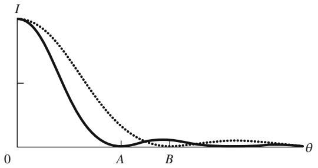

line

| \(\theta\) | I (Solid Line) | I (Dotted Line) |
| --- | --- | --- |
| 0 | High | High |
| A | ~0 | ~0.2 |
| B | ~0.1 | ~0 |

## 32.3 Beugung an einer kreisrunden Öffnung

## Lernziele

Nach dem Durcharbeiten dieses Abschnitts sollten Sie in der Lage sein, . . .

• das Beugungsmuster hinter einer kleinen kreisförmigen Öffnung oder einem runden Hindernis zu beschreiben und zu skizzieren,
bei der Beugung an einer kleinen kreisförmigen Öffnung oder einem entsprechenden Hindernis die Beziehungen zwischen dem Winkel θ zum ersten Minimum, der Lichtwellenlänge λ, dem Durchmesser d von Öffnung bzw. Hindernis, der Distanz D zum Beobachtungsschirm und dem Abstand y zwischen dem Minimum und der Mitte des Beugungsmusters anzuwenden,

789

---

32 Beugung

• anhand der Beugungsmuster von Punktobjekten zu erklären, wie Beugungseffekte die visuelle Auflösung von Objekten begrenzen,
• das Rayleigh-Kriterium für die Auflösbarkeit von zwei benachbarten Punktobjekten zu verstehen,
• die Beziehungen zwischen dem Winkel $\theta _ { \mathrm { R } }$ im Rayleigh-Kriterium, der Wellenlänge λ, dem Durchmesser d der Öffnung (z. B. des Pupillendurchmessers), dem Winkel θ, unter dem zwei Punktobjekte aus der Ferne gesehen werden, und dem Abstand L zu diesen Objekten anzuwenden.

## Schlüsselideen

• Die Beugung an einer kreisförmigen Öffnung oder Linse mit Durchmesser d erzeugt ein zentrales Maximum und konzentrische Maxima und Minima. Der Winkel θ zum ersten Minimum erfüllt die Bedingung

$$
\sin \theta = 1, 2 2 \frac {\lambda}{d}.
$$

Das Rayleigh-Kriterium besagt, dass zwei Objekte gerade noch getrennt wahrgenommen („aufgelöst“) werden können, wenn das zentrale Beugungsmaxi mum des einen sich im ersten Minimum des anderen befindet. Ihr Winkelabstand muss dafür mindestens

$$
\theta_ {\mathrm{R}} = 1, 2 2 \frac {\lambda}{d} \qquad (\text {Rayleigh - Kriterium})
$$

sein, worin d der Durchmesser der Öffnung ist, die das Licht passieren muss.

## 32.3.1 Beugung an einer kreisrunden Öffnung

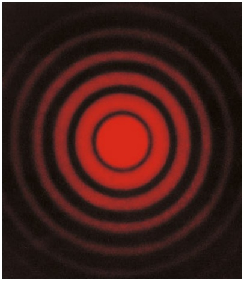

natural_image

Concentric red and black rings on a dark background, no text or symbols present

Abb. 32.9

Ein an einer kreisrunden Öffnung entstandenes Beugungsmuster: zu erkennen sind ein Hauptmaximum und mehrere ringförmige Nebenmaxima.

Letztere erscheinen normalerweise nur sehr schwach; damit sie hier besser sichtbar werden, wurde das Foto überbelichtet [Quelle: Jearl Walker].

Wir wenden uns nun der Beugung an einer kreisrunden Öffnung zu, etwa einer Linse, die von einer Blende eingefasst ist und durch die Licht fällt. In Abb. 32.9 sehen Sie das Bild einer weit entfernten Punktquelle (beispielsweise eines Sterns) auf einem fotografischen Film, der sich in der Brennebene einer Sammellinse befindet. Vom Standpunkt der geometrischen Optik aus betrachtet, sollte das Bild punktförmig sein. Das ist offensichtlich nicht der Fall: Wir erkennen eine Scheibe, umgeben von Ringen, deren Helligkeit von innen nach außen abnimmt. Ein Vergleich mit Abb. 32.1 lässt keinen Zweifel: Wir haben es mit einer Beugungserscheinung zu tun. Gebeugt wird das Licht hier allerdings nicht an einem rechteckigen Spalt, sondern an einer kreisrunden Öffnung mit dem Durchmesser d.

Die mathematische Analyse eines derartigen Musters ist kompliziert. Sie liefert als Position des ersten Beugungsminimums an einer kreisrunden Öffnung

$$
\sin \theta = 1, 2 2 \frac {\lambda}{d}, \tag {32.12}
$$

wobei d der Durchmesser der Öffnung ist und θ den Winkel zwischen der Bezugsachse und einem beliebigen Punkt des (ringförmigen) Minimums angibt. Vergleichen Sie diesen Ausdruck mit Gl. 32.1,

$$
\sin \theta = \frac {\lambda}{a}, \tag {32.13}
$$

für die Position des ersten Minimums im Beugungsmuster an einem langen, engen Spalt mit der Breite a. Der Unterschied liegt im Wesentlichen in dem Faktor 1,22; er kommt durch die Kreisform der Öffnung zustande.

## Optische Auflösbarkeit

Wir haben gesehen, dass die durch Linsen erzeugten Abbildungen Beugungsmuster sind. Von Bedeutung ist diese Tatsache beispielsweise, wenn es darum geht,

790

---

32.3 Beugung an einer kreisrunden Öffnung

32

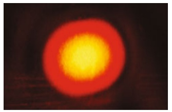

natural_image

Circular glowing orange-yellow object against a dark background, resembling a glowing red-orange magnet or flame (no text or symbols visible)

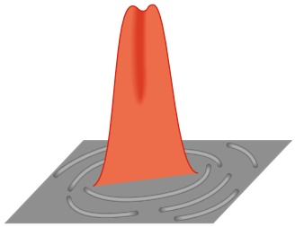

natural_image

Illustration of a red-orange peak on a gray surface with circular patterns (no text or symbols)

(a)

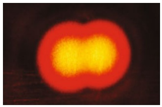

natural_image

Abstract glowing orange-yellow shape against dark background, resembling a stylized heart or starburst (no text or symbols)

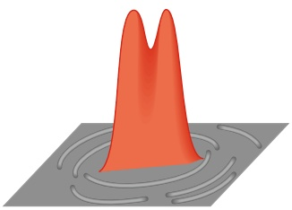

natural_image

Illustration of a red, bimodal peak on a gray surface with concentric circular patterns (no text or symbols)

(b)

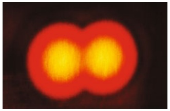

natural_image

Two glowing yellow circular shapes against a dark background, resembling a stylized letter or symbol (no text or symbols present)

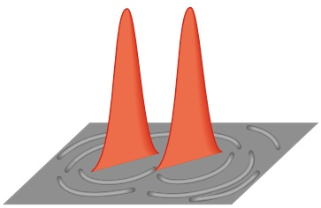

natural_image

Illustration of two orange conical spikes on a gray surface with ripple patterns (no text or symbols)

(c)

zwei weit entfernte, punktförmige Objekte mit kleinem Winkelabstand aufzulö- sen, d. h. separat wahrnehmbar abzubilden.

Betrachten Sie dazu in Abb. 32.10 die Abbildungen zweier eng benachbarter Objekte (z. B. Sterne) mit den zugehörigen Intensitätsverteilungen. In Abb. 32.10a verhindert die Beugung, dass die Objekte getrennt wahrgenommen werden: Die Beugungsmuster, insbesondere deren Hauptmaxima, überlagern einander so stark, dass man im Ergebnis nicht unterscheiden kann, ob es sich um ein Objekt oder mehrere handelt. In Abb. 32.10b sind die Objekte gerade eben aufgelöst, in Abb. 32.10c erkennt man die Objekte eindeutig als zwei separate Einheiten.

In Abb. 32.10b ist der Winkelabstand zwischen den Punktquellen so groß, dass das Hauptmaximum des Beugungsmusters einer Quelle mit dem ersten Minimum der anderen Quelle zusammenfällt. Diese Bedingung nennt man das **Rayleigh-Kriterium der Auflösbarkeit**. Aus Gl. 32.12 folgt für zwei Objekte, die diesem Kriterium gemäß gerade eben getrennt wahrgenommen werden können, ein Winkelabstand $\theta _ { \mathrm { R } }$ von

$$
\theta_ {\mathrm{R}} = \sin^ {- 1} \frac {1 , 2 2 \lambda}{d}.
$$

Da die hier beteiligten Winkel klein sind, können wir sin $\theta _ { \mathrm { R } }$ durch $\theta _ { \mathrm { R } }$ (im Bogenmaß) ersetzen; mit dieser Näherung folgt

$$
\theta_ {\mathrm{R}} = 1, 2 2 \frac {\lambda}{d}. \tag {32.14}
$$

Das Rayleigh-Kriterium ist nur eine Näherung, denn die Auflösbarkeit hängt von vielen Faktoren ab: von der relativen Helligkeit der Quellen und ihrer Umgebung, von Turbulenzen in der Luft zwischen Objekt und Betrachter und nicht zuletzt von der Leistungsfähigkeit des visuellen Systems des Betrachters. Experimente zeigen, dass der kleinste Winkelabstand, bei dem eine Person zwei Objekte noch getrennt wahrnimmt, in der Regel etwas größer ist als der von Gl. 32.14 gegebene Wert. Soweit es unsere folgenden Berechnungen betrifft, wollen wir Gl. 32.14 jedoch als präzises Kriterium ansehen: Ist der Winkelabstand θ zwischen den Objekten grö- ßer als $\theta _ { \mathrm { R } } ,$ so können die Objekte aufgelöst werden, ansonsten nicht.

Mithilfe des Rayleigh-Kriteriums lassen sich die Farben in den Gemälden der sogenannten Pointillisten erklären. Diese malten ihre Bilder nicht mit den üblichen Pinselstrichen, sondern setzten ihre Motive aus unzähligen farbigen Pünktchen zusammen. Wenn Sie in einem Museum aus geringer Entfernung auf ein solches Bild schauen, ist der Winkelabstand θ zwischen benachbarten Farbpunkten größer als $\theta _ { \mathrm { R } }$ und Sie nehmen die Punkte getrennt voneinander wahr; ihre Farbigkeit entspricht dem vom Maler (oder der Malerin) ausgewählten Pigment. Wenn Sie aber

## Abb. 32.10

Oben: Die von einer Sammellinse erzeugten Abbildungen zweier Punktquellen (Sterne). Unten: Die zugehö- rigen Intensitätsverteilungen. (a) Der Winkelabstand der Objekte ist so gering, dass sie nicht getrennt wahrgenommen werden können. (b) Die Objekte sind gerade eben unterscheidbar. (c) Die Objekte sind getrennt wahrnehmbar. In (b) ist das Rayleigh-Kriterium genau erfüllt: Das Hauptmaximum des einen Beugungsmusters fällt mit dem ersten Minimum des anderen zusammen [Quelle: Jearl Walker].

791

---

32 Beugung

natural_image

Microscopic view of blood cells with red blood cells and orange cytoplasm (no text or symbols visible)

Abb. 32.11

Ein Falschfarbenbild einer Vene mit roten Blutkörperchen; aufgenommen mit einem Rasterelektronenmikroskop [Quelle: Scott Camazine/Alamy Stock Photo].

weiter zurückgehen, werden die Winkelabstände der einzelnen Punkte irgendwann kleiner als $\theta _ { \mathrm { R } }$ und Sie nehmen anstelle einzelner Punkte Flächen in Farbtönen wahr, die Ihr visuelles System aus den Farben der vorhandenen Punkte „mischt“, wobei möglicherweise Farbtöne zustande kommen, die nirgendwo im Bild verwendet wurden! Der „Schöpfer“ des Bilds – zumindest, soweit es die farbige Gestaltung betrifft – ist also nicht nur der Maler, sondern vor allem Ihre Wahrnehmung.

Wenn wir Objekte durch eine Linse betrachten und dabei eine optimale Auflösung erreichen wollen, müssen wir dafür sorgen, dass wir die Beugungseffekte möglichst gering halten. Gemäß Gl. 32.14 verringert sich die Ausdehnung des Beugungsmusters mit zunehmendem Durchmesser der Linse oder mit abnehmender Wellenlänge des einstrahlenden Lichts.

Aus diesem Grund verwendet man für die Mikroskopie häufig ultraviolettes Licht. Dessen kurze Wellenlängen erlauben die Beobachtung von Details, die man durch ein mit sichtbarem Licht arbeitendes Mikroskop nicht erkennen könnte. In Kapitel 34 werden wir sehen, dass sich auch Elektronenstrahlen unter bestimmten Bedingungen wellenähnlich verhalten. Man erreicht in Elektronenmikroskopen Wellenlängen im Bereich des $1 0 ^ { - 5 }$ -Fachen der Wellenlängen von sichtbarem Licht. Daher kann man mit dem Elektronenmikroskopwinzigste Strukturen untersuchen (siehe Abb. 32.11), die in einem optischen Mikroskop durch Beugungseffekte verschwimmen würden.

## KONTROLLFRAGE 4

Stellen Sie sich zwei rote Punkte in einiger Entfernung vor, die Sie aufgrund der Beugungseffekte an der Pupille Ihrer Augen gerade noch getrennt wahrnehmen können. Nun wird die Umgebungshelligkeit erhöht, sodass der Durchmesser der Pupille abnimmt. Können Sie die Punkte jetzt besser auflösen oder überhaupt nicht mehr? Berücksichtigen Sie ausschließlich die Beugung. (Überprüfen Sie Ihre Antwort mit einem entsprechenden Experiment.)

## 32.4 Beugung am Doppelspalt

## Lernziele

Nach dem Durcharbeiten dieses Abschnitts sollten Sie in der Lage sein, . . .

• in einer Skizze eines Doppelspaltexperiments zu erklären, wie die Beugung an den beiden Spalten das Doppelspalt-Interferenzmuster verändert, und die Einhüllende des Beugungsmusters sowie das Haupt- und die Nebenmaxima dieser Einhüllenden zu identifizieren,
• für einen gegebenen Punkt in einem Doppelspalt-Beugungsmuster die Lichtintensität I in Abhängigkeit von der Intensität $I _ { \mathrm { m } }$ in der Mitte des Musters zu berechnen,
• in der Intensitätsgleichung für ein Doppelspalt-Beugungsmuster anzugeben, welcher Anteil auf die Interferenz zwischen den zwei Spalten zurückgeht und welcher Anteil der Beugung an den Spalten entspricht,
für die Beugung am Doppelspalt die Beziehung zwischen dem Verhältnis d∕a und den Positionen der Minima im Einzelspalt-Beugungsmuster anzuwenden und dann die Anzahl der Doppelspaltmaxima im zentralen Peak und den Seitenpeaks der Umhüllenden des Beugungsmusters zu bestimmen.

## Schlüsselideen

• Wellen, die durch zwei benachbarte Spalte treten, erfahren eine Kombination aus Doppelspaltinterferenz und Beugung an den Einzelspalten.
• Für identische Spalte mit der Breite a und dem Mitte-zu-Mitte-Abstand d variiert die Intensität im Beugungsmuster mit dem Winkel θ von der zentralen

792

---

32.4 Beugung am Doppelspalt

32

Achse gemäß

$$
I (\theta) = I _ {\mathrm{m}} (\cos^ {2} \beta) \left(\frac {\sin \alpha}{\alpha}\right) ^ {2} \qquad \text {(Doppelspalt)}.
$$

Dabei sind $I _ { \mathrm { m } }$ die Intensität in der Mitte des Musters,

$$
\beta = \left(\frac {\pi d}{\lambda}\right) \sin \theta
$$

und

$$
\alpha = \left(\frac {\pi a}{\lambda}\right) \sin \theta .
$$

## 32.4.1 Beugung am Doppelspalt

Bei der Besprechung von Doppelspaltexperimenten in Kapitel 31 sind wir implizit stets davon ausgegangen, dass die Spaltbreite klein ist verglichen mit der Wellenlänge des einstrahlenden Lichts, dass also $\alpha \ll \lambda$ gilt. In diesen Fällen nimmt das Hauptmaximum des von jedem Spalt einzeln erzeugten Beugungsmusters den gesamten Beobachtungsschirm ein. Durch die Interferenz der von den beiden Spalten ausgehenden Wellen entsteht ein Muster aus nahezu gleich intensiven Streifen (vgl. Abb. 31.9).

In der Praxis arbeitet man häufig mit sichtbarem Licht und die Bedingung $\alpha \ll \lambda$ ist nicht erfüllt. Wenn die Spalte relativ breit sind, entstehen am Doppelspalt In terferenzmuster aus Streifen verschiedener Helligkeit: Die Intensitäten der Interferenzstreifen werden durch die Beugung des Lichts an jedem einzelnen Spalt beeinflusst (siehe dazu unsere Diskussion in Kapitel 31).

Betrachten wir dazu ein Beispiel. In Abb. 32.12a sehen Sie das Interferenzmuster zweier unendlich schmaler Spalte (mit $\alpha \ll \lambda )$ ; alle hellen Streifen sind gleich intensiv. Abbildung 32.12b zeigt das Beugungsmuster eines Einzelspalts endlicher Breite; man erkennt ein breites Hauptmaximum und schwächere Nebenmaxima bei $\pm 1 7 ^ { \circ }$ . In Abb. 32.12c schließlich ist das Interferenzmuster zweier Spalte mit endlicher Breite dargestellt: Die Kurve aus Abb. 32.12b bildet die Hüllkurve für die

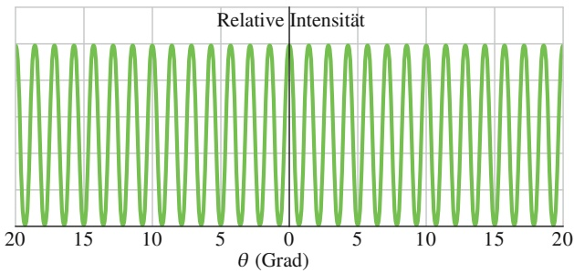

line

| \(\theta (\)Grad) | Relative Intensität |
| --- | --- |
| -20 | ~1.0 |
| -19 | ~-1.0 |
| -18 | ~1.0 |
| -17 | ~-1.0 |
| -16 | ~1.0 |
| -15 | ~-1.0 |
| -14 | ~1.0 |
| -13 | ~-1.0 |
| -12 | ~1.0 |
| -11 | ~-1.0 |
| -10 | ~1.0 |
| -9 | ~-1.0 |
| -8 | ~1.0 |
| -7 | ~-1.0 |
| -6 | ~1.0 |
| -5 | ~-1.0 |
| -4 | ~1.0 |
| -3 | ~-1.0 |
| -2 | ~1.0 |
| -1 | ~-1.0 |
| 0 | 0.0 |
| 1 | ~-1.0 |
| 2 | ~1.0 |
| 3 | ~-1.0 |
| 4 | ~1.0 |
| 5 | ~-1.0 |
| 6 | ~1.0 |
| 7 | ~-1.0 |
| 8 | ~1.0 |
| 9 | ~-1.0 |
| 10 | ~1.0 |
| 11 | ~-1.0 |
| 12 | ~1.0 |
| 13 | ~-1.0 |
| 14 | ~1.0 |
| 15 | ~-1.0 |
| 16 | ~1.0 |
| 17 | ~-1.0 |
| 18 | ~1.0 |
| 19 | ~-1.0 |
| 20 | ~1.0 |

(a)

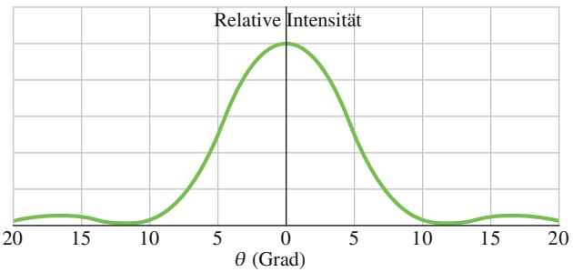

line

| \(\theta (\)Grad) | Relative Intensität |
| --- | --- |
| -20 | ~0.1 |
| -15 | ~0.2 |
| -10 | ~0.1 |
| -5 | ~0.8 |
| 0 | 1.0 |
| 5 | ~0.8 |
| 10 | ~0.1 |
| 15 | ~0.2 |
| 20 | ~0.1 |

(b)

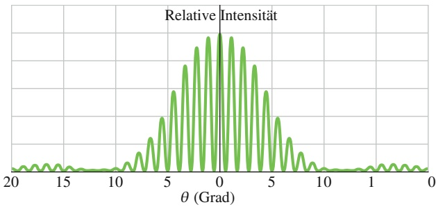

line

| \(\theta (\)Grad) | Relative Intensität |
| --- | --- |
| -20 | ~0.05 |
| -18 | ~0.15 |
| -16 | ~0.15 |
| -14 | ~0.15 |
| -12 | ~0.15 |
| -10 | ~0.15 |
| -9 | ~0.25 |
| -8 | ~0.35 |
| -7 | ~0.55 |
| -6 | ~0.75 |
| -5 | ~0.95 |
| -4 | ~1.05 |
| -3 | ~1.05 |
| -2 | ~1.05 |
| -1 | ~1.05 |
| 0 | 1.0 |
| 1 | ~1.05 |
| 2 | ~1.05 |
| 3 | ~1.05 |
| 4 | ~1.05 |
| 5 | ~0.95 |
| 6 | ~0.75 |
| 7 | ~0.55 |
| 8 | ~0.35 |
| 9 | ~0.25 |
| 10 | ~0.15 |
| 12 | ~0.15 |
| 14 | ~0.15 |
| 16 | ~0.15 |
| 18 | ~0.15 |
| 20 | ~0.05 |

(c)

## Abb. 32.12

(a) Intensitätsverteilung bei der Interferenz an zwei unendlich schmalen Spalten. (b) Intensitätsverteilung bei der Beugung an einem einzelnen Spalt der endlichen Breite a. (c) Intensitätsverteilung bei der Interferenz an zwei Spalten mit der endlichen Breite $^ { a . }$ Die Verteilung aus (b) begrenzt als Hüllkurve die Intensität der Streifen aus (a). Die ersten Minima des Musters aus (b) sorgen dafür, dass die Interferenzstreifen bei etwa $\pm 1 2 ^ { \circ }$ in (c) verschwinden.

793

---

32 Beugung

Abb. 32.13 (a) Interferenzmuster eines realen Doppelspaltsystems; vergleichen Sie mit Abb. 32.12c. (b) Beugungsmuster eines realen Einzelspalts; vergleichen Sie mit Abb. 32.12b [Quelle: Jearl Walker].

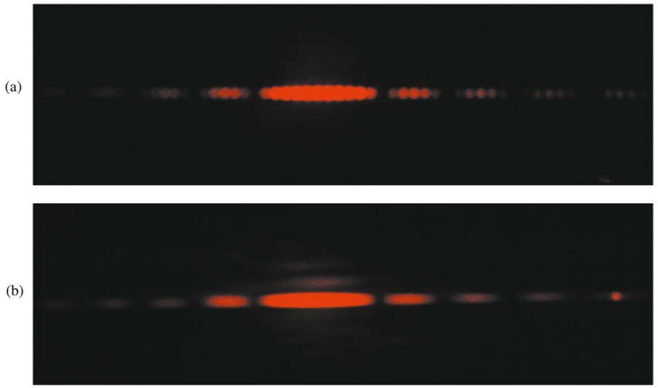

Intensitätsverteilung aus Abb. 32.12a. Offensichtlich ändern sich nicht die Positionen der Streifen, sondern nur ihre Intensitäten.

Abbildung 32.13a zeigt ein reales Muster, in dem sowohl die Interferenz am Doppelspalt als auch die Einflüsse der Beugung zu erkennen sind. Wenn man einen Spalt abdeckt, so erscheint das in Abb. 32.13b gezeigte Beugungsmuster. Beachten Sie die Beziehungen zwischen den Abb. 32.13a und 32.12c bzw. 32.13b und 32.12b. Berücksichtigen Sie bei Ihrem Vergleich, dass die Fotos in Abb. 32.13 absichtlich überbelichtet wurden, um die intensitätsschwachen Nebenmaxima sichtbar zu machen, und dass Abb. 32.13 im Gegensatz zu Abb. 32.12 auch die zweiten Nebenmaxima enthält.

Die Intensitätsverteilung des Interferenzmusters an einem Doppelspalt ist bei Einbeziehung der Beugungseffekte durch

$$
I (\theta) = I _ {\mathrm{m}} (\cos^ {2} \beta) \left(\frac {\sin \alpha}{\alpha}\right) ^ {2} \tag {32.15}
$$

mit

$$
\beta = \frac {\pi d}{\lambda} \sin \theta \tag {32.16}
$$

und

$$
\alpha = \frac {\pi a}{\lambda} \sin \theta \tag {32.17}
$$

gegeben; dabei ist d der Abstand zwischen den Spalten und a ist die Spaltbreite. Die rechte Seite von Gl. 32.15 ist das Produkt aus der Intensität $I _ { \mathrm { m } }$ und zwei zusätzlichen Faktoren: Der erste ist der Interferenzterm $\cos ^ { 2 } \beta ,$ der durch die Interferenz an zwei Spalten im Abstand $d$ entsteht (siehe die Gln. 32.16 und 32.17), der zweite der Beugungsterm [(sin α) ${ \mathrm { ~  ~ } } ) / \alpha ] ^ { 2 }$ aufgrund der Beugung an einem Einzelspalt der Breite a (siehe die Gln. 32.5 und 32.6).

Beide Faktoren wollen wir näher betrachten. Wenn in Gl. 32.17 $\alpha \rightarrow 0$ geht, so gilt ebenfalls $\alpha \to 0$ und (sin $\alpha ) / \alpha \rightarrow 1$ . Dadurch reduziert sich Gl. 32.15 wie erwartet auf die Beschreibung der Intensitätsverteilung bei der Interferenz an zwei unendlich schmalen Spalten im Abstand d. Wenn wir hingegen in Gl. 32.16 $d = 0$ setzen, entspricht das physikalisch einer Verschmelzung der beiden Spalte zu einem Einzelspalt der Breite $a .$ In Gl. 32.16 wird dann $\beta = 0$ und $\cos ^ { 2 } \beta = 1 ,$ , und Gl. 32.15 beschreibt die Situation richtig als Beugung am Einzelspalt der Breite a.

Das durch Gl. 32.15 beschriebene und in Abb. 32.13a dargestellte Doppelspaltmuster illustriert die Verknüpfung von Beugung und Interferenz. Beide Effekte

794

---

32.5 Beugungsgitter

32

entstehen durch Superposition, d. h. Überlagerung von Elementarwellen unterschiedlicher Phase in einem bestimmten Punkt. Gehen diese Elementarwellen von einer kleinen Zahl von Quellen aus – wie im Falle des Doppelspaltversuchs mit $a \ll \lambda - ,$ so nennen wir das Phänomen Interferenz; treffen die Elementarwellen in einer gemeinsamen Wellenfront ein – wie beim Versuch am Einzelspalt –, so sprechen wir von Beugung. Diese begriffliche Unterscheidung ist willkürlich (und wird auch nicht immer exakt befolgt), vereinfacht aber die Diskussion. Wir dürfen dabei jedoch nicht vergessen, dass es sich in beiden Fällen um Auswirkungen der Überlagerung von Wellen handelt und dass Interferenz und Beugung in der Regel gemeinsam auftreten (wie in Abb. 32.13a).

## KONTROLLFRAGE 5

Nehmen wir an, in dem zuvor beschriebenen Versuch wird Licht mit einer Wellenlänge von 550 nm verwendet. Nehmen dann (a) die Breite des Hauptmaximums der Beugungskurve und (b) die Anzahl der hellen Interferenzstreifen innerhalb dieses Maximums zu, ab oder bleiben sie gleich?

## 32.5 Beugungsgitter

## Lernziele

Nach dem Durcharbeiten dieses Abschnitts sollten Sie in der Lage sein, . . .

• ein Beugungsgitter zu beschreiben und das von ihm erzeugte Interferenzmuster für monochromatisches Licht zu skizzieren,
• die Interferenzmuster von Beugungsgitter und Doppelspalt zu vergleichen,
• die Begriffe „Linie“ und „Ordnung“ im Zusammenhang mit Beugungsgittern zu verstehen,
• für ein Beugungsgitter die Beziehung zwischen der Ordnung m und der Weglängendifferenz von Strahlen anzugeben, die zu einem hellen Streifen im Beugungsmuster führen,
• für ein Beugungsgitter die Beziehung zwischen dem Spaltabstand d, dem Winkel θ zu einem hellen Streifen, der Ordnung m dieses Streifens und der Wellenlänge λ des Lichts anzugeben,
• zu verstehen, dass und warum es für ein gegebenes Beugungsgitter eine maximale Ordnung gibt,
• die Herleitung der Gleichung für die halbe Breite einer Linie im Beugungsmuster eines Beugungsgitters zu erklären,
• die halbe Breite einer Linie bei einem gegebenen Beugungswinkel an einem Beugungsgitter zu berechnen,
• zu erklären, inwiefern eine große Zahl von Spalten in einem Beugungsgitter von Vorteil ist,
• die Funktionsweise eines Gitterspektrometers zu erläutern.

## Schlüsselideen

Ein Beugungsgitter ist eine Anordnung einer großen Zahl von gleichartigen „Spalten“, durch die eine einfallende Welle in ihre spektralen Komponenten (d. h. ihre einzelnen Wellenlängen) zerlegt werden kann, indem ihre jeweiligen Beugungsmaxima getrennt werden. Beugung an N Spalten ergibt Maxima (Linien) bei Winkeln θ, die die Bedingung

$$
d \sin \theta = m \lambda , \quad m = 0, 1, 2, \dots \tag {Maxima}
$$

erfüllen.

• Die halbe Breite $\Delta \theta _ { 1 / 2 }$ einer Linie ist der Winkel von ihrer Mitte bis zu dem Punkt, an dem die Intensität verschwindet; für sie gilt

$$
\Delta \theta_ {1 / 2} = \frac {\lambda}{N d \cos \theta}.
$$

795

---

32 Beugung

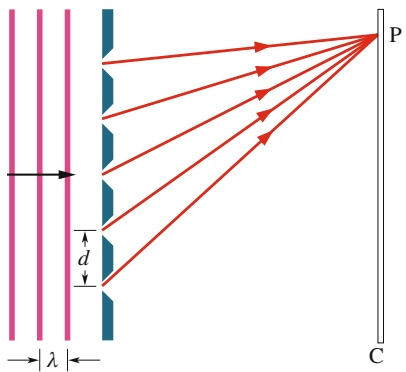

text_image

λ
d
P
C

Abb. 32.14

Ein idealisiertes Beugungsgitter aus fünf Spalten. Auf dem weit entfernten Beobachtungsschirm C entsteht ein Interferenzmuster.

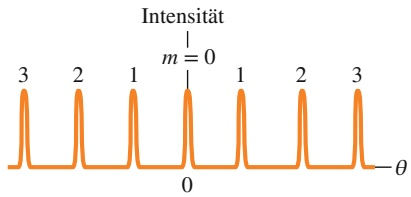

line

| Peak Label | Intensity Level |
| --- | --- |
| 3 | High |
| 2 | High |
| 1 | High |
| 0 | Low |
| 1 | High |
| 2 | High |
| 3 | High |

(a)

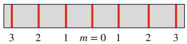

(b)

Abb. 32.15

(a) An einem Beugungsgitter mit sehr vielen Öffnungen oder Rillen entsteht eine Intensitätsverteilung mit schmalen Maxima, die hier mit dem zugehö- rigen Wert von m bezeichnet wurden. (b) Das auf dem Schirm erscheinende Muster besteht aus dünnen, hier entsprechend zu (a) beschrifteten Linien. Eingezeichnet sind die Linien nullter, erster, zweiter und dritter Ordnung.

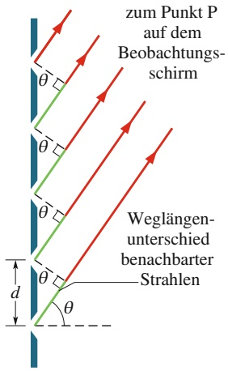

text_image

zum Punkt P
auf dem
Beobachtungsschirm
Weglängen-
unterschied
benachbarter
Strahlen
θ
θ
θ
d

## 32.5.1 Beugungsgitter

Eines der nützlichsten Hilfsmittel zur Untersuchung von Licht und dessen Absorption oder Emission durch verschiedenste Objekte ist das **Beugungsgitter**. Die Anordnung ähnelt dem in Abb. 31.9 gezeigten Doppelspalt – allerdings ist die Anzahl N der Öffnungen (Striche) viel größer (sie kann in der Größenordnung von mehreren Tausend pro Millimeter liegen). Das in Abb. 32.14 gezeigte idealisierte Gitter besteht aus nur fünf Spalten. Beleuchtet man es mit monochromatischem Licht, so entsteht ein Muster aus schmalen Interferenzstreifen, aus deren Lage sich die Wellenlänge des Lichts bestimmen lässt. (Es gibt viele verschiedene Formen von Beugungsgittern. Anstelle von parallelen Öffnungen kann man in eine undurchsichtige Fläche auch parallele Rillen einritzen, an denen das Licht gestreut wird und zur Interferenz kommt.)

Wir wollen uns vorstellen, dass wir eine Anordnung von Spalten mit monochromatischem Licht beleuchten und dabei die Spaltanzahl allmählich von 2 auf eine große Zahl N erhöhen. Die für den Doppelspalt typische Intensitätsverteilung (Abb. 32.12c) wird dabei zunächst immer komplizierter und geht schließlich in die in Abb. 32.15a dargestellte Funktion über. Abbildung 32.15b zeigt das Interferenzmuster bei Verwendung von monochromatischem rotem Licht – etwa aus einem Helium-Neon-Laser. Die Maxima sind jetzt sehr schmal, man nennt sie Linien; zwischen ihnen liegen relativ breite dunkle Bereiche.

Um die Lage der hellen Streifen auf dem Beobachtungsschirm zu ermitteln, gehen wir in gewohnter Weise vor. Dabei nehmen wir an, die Entfernung zwischen Gitter und Schirm sei so groß, dass die in einem Punkt P auf dem Schirm eintreffenden Strahlen näherungsweise parallel sind (siehe Abb. 32.16). Dann behandeln wir nebeneinander liegende Spalte paarweise so, wie es weiter oben für die Interferenz am Doppelspalt vorgeführt wurde. Den Abstand d zwischen zwei Gitterstrichen nennt man Gitterkonstante. (Liegen N Striche innerhalb einer Gesamtbreite w des Gitters, so gilt $d = w / N )$ . Wieder ist der Weglängenunterschied zwischen benachbarten Strahlen gleich d sin θ (Abb. 32.16) mit θ als Winkel zwischen der Bezugsachse (bzw. der Achse des Beugungsmusters) und dem Punkt P. In P befindet sich eine Interferenzlinie (ein Maximum), wenn der Weglängenunterschied zwischen benachbarten Strahlen ein ganzzahliges Vielfaches der Wellenlänge λ ist:

$$
d \sin \theta = m \lambda \quad \text {mit} \quad m = 0, 1, 2, \dots \tag {32.18}
$$

Jede Zahl m gehört zu einer bestimmten Linie, weshalb man die Ordnung m wie in Abb. 32.15 zur Bezeichnung des Musters verwenden kann. Man spricht dann von Linien nullter, erster, zweiter usw. Ordnung; die Linie nullter Ordnung ist das Hauptmaximum mit $m = 0 .$

Wenn wir Gl. 32.18 in der Form $\theta = \sin ^ { - 1 } ( m \lambda / d )$ schreiben, wird deutlich, dass der Winkel zwischen der Bezugsachse und einer beliebigen Interferenzlinie für ein gegebenes Beugungsgitter von der Wellenlänge des eingestrahlten Lichts abhängt. Wenn ein Gitter mit Licht unbekannter Wellenlänge bestrahlt wird, können wir λ daher mithilfe von Gl. 32.18 aus den Positionen der Linien höherer Ordnung berechnen. Diese Methode lässt sich ebenso zur Unterscheidung und Identifikation verschiedener in einem Strahl enthaltener Wellenlängen verwenden. Mit der Doppelspaltanordnung, wie wir sie in Abschn. 31.2 besprochen haben, ist dies nicht möglich, obwohl dieselben Gleichungen und Beziehungen gelten. Hier überlagern sich die von verschiedenen Wellenlängen erzeugten hellen Streifen nämlich zu stark, um einzeln analysiert werden zu können.

## Abb. 32.16

Strahlen, die von den Strichen (Spalten) eines Beugungsgitters zu einem entfernten Punkt P verlaufen, sind näherungsweise parallel. Der Weglängenunterschied zwischen zwei benachbarten Strahlen beträgt d sin $\theta ,$ wobei θ in der Skizze angegeben ist. (Das Gitter erstreckt sich senkrecht zur Papierebene).

796

---

32.5 Beugungsgitter

32

## Linienbreiten am Beugungsgitter

Die Fähigkeit eines Gitters, Linien zu verschiedenen Wellenlängen des eingestrahlten Lichts getrennt abbilden (auflösen) zu können, hängt von der Breite dieser Linien ab. Wir wollen im Folgenden einen Ausdruck für die halbe Breite der mittleren Linie (derjenigen mit $m = 0 )$ herleiten und daraus eine entsprechende Beziehung für die Linien höherer Ordnung entwickeln. Die halbe Breite der zentralen Linie messen wir als den Winkel $\Delta \theta _ { 1 / 2 }$ von der Mitte der Linie $( \theta = 0 )$ nach außen zum Beginn des dunklen Bereichs des ersten Minimums (siehe Abb. 32.17). In einem solchen Minimum löschen die von einem Gitter mit N Strichen ausgehenden N Strahlen einander aus. (Die tatsächliche Linienbreite beträgt natürlich $2 \Delta \theta _ { 1 / 2 } ,$ zum Vergleich von Linienbreiten zieht man aber gewöhnlich den Wert $\Delta \theta _ { 1 / 2 }$ heran.)

In Abschn. 32.1 haben wir uns bereits mit dem gegenseitigen Auslöschen sehr vieler Strahlen (bei der Beugung am Einzelspalt) beschäftigt. Dabei erhielten wir Gl. 32.3, die wir aufgrund der Ähnlichkeiten beider Situationen auch jetzt zum Auffinden des ersten Minimums verwenden können. Gleichung 32.3 zufolge tritt das erste Minimum dort auf, wo der Weglängenunterschied zwischen dem von der oberen und dem von der unteren Kante des Spalts ausgehenden Strahl gleich λ ist. Im Falle der Beugung am Einzelspalt war dieser Unterschied gleich a sin θ. Für ein Gitter mit N Strichen und der Gitterkonstante d beträgt die Entfernung zwischen dem oberen und dem unteren Strich Nd (Abb. 32.18), der Weglängenunterschied zwischen dem Strahl vom oberen und dem vom unteren Strich ist deshalb Nd sin $\Delta \theta _ { 1 / 2 ^ { \circ } }$ Folglich erscheint das erste Minimum bei

$$
N d \sin \Delta \theta_ {1 / 2} = \lambda . \tag {32.19}
$$

Weil $\Delta \theta _ { 1 / 2 }$ klein ist, können wir sin $\Delta \theta _ { 1 / 2 } = \Delta \theta _ { 1 / 2 }$ setzen (im Bogenmaß). Damit liefert uns Gl. 32.19 für die halbe Breite der mittleren Linie

$$
\Delta \theta_ {1 / 2} = \frac {\lambda}{N d}. \tag {32.20}
$$

Ohne Beweis stellen wir fest, dass die halbe Breite einer beliebigen anderen Linie von deren Position relativ zur Bezugssache abhängt und durch

$$
\Delta \theta_ {1 / 2} = \frac {\lambda}{N d \cos \theta} \tag {32.21}
$$

gegeben ist. In Worten bedeutet das, dass die Linienbreite für Licht einer bestimmten Wellenlänge λ abnimmt, wenn die Anzahl N der Gitterstriche zunimmt (bei konstantem Abstand d der Striche). Man kann mit einem Gitter die verschiedenen in einem Lichtstrahl enthaltenen Wellenlängen demzufolge umso besser auftrennen, je mehr Striche das Gitter enthält: Die Linien werden mit steigendem N schmaler und das Ausmaß ihrer Überlagerung nimmt ab.

## Eine Anwendung von Beugungsgittern

Beugungsgitter benutzt man häufig, um herauszufinden, welche Wellenlängen das Licht einer bestimmten Quelle – einer Flamme, einer Glühlampe, eines Sterns – enthält. In Abb. 32.19 sehen Sie das Schema eines einfachen Gitterspektrografen. Das von der Quelle Q ausgesendete Licht wird durch die Linse $\mathrm { L } _ { 1 }$ auf einen vertikalen Spalt $S _ { 1 }$ fokussiert, der sich in der Brennebene der Linse $\mathrm { L } _ { 2 }$ befindet. Aus dem Rohr $C ,$ dem Kollimator, tritt das Licht als ebene Welle aus; es fällt senkrecht auf das Gitter G und wird gebeugt, wobei das Maximum nullter Ordnung $( m = 0 )$ bei $\theta = 0$ entsteht, also auf der Bezugsachse des Gitters.

Das Beugungsmuster, das auf einem Beobachtungsschirm entstünde, beobach tet man durch ein Fernrohr T, das man im gewünschten Winkel θ zur Achse des Gitters ausrichten kann. Die Fernrohrlinse $\mathrm { L } _ { 3 }$ fokussiert das unter dem Winkel θ

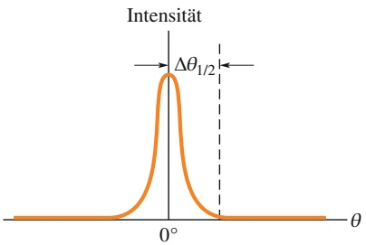

line

| \(\theta\) | Intensität |
| --- | --- |
| \(0{}^{\circ}\) | Peak Value |

Abb. 32.17

Die halbe Breite $\Delta \theta _ { 1 / 2 }$ der mittleren Linie messen wir von der Mitte der Linie nach außen bis zum Beginn des benachbarten Minimums in einem Diagramm von I als Funktion von θ wie in Abb. 32.16a.

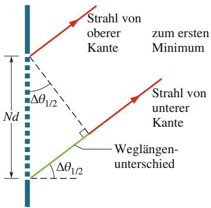

text_image

Strahl von
oberer
Kante
zum ersten
Minimum
Δθ₁/₂
Nd
Strahl von
unterer
Kante
Weglängen-
unterschied
Δθ₁/₂

Abb. 32.18

Der Abstand zwischen dem obersten und dem untersten Strich eines Gitters mit N Strichen ist gleich Nd. Folglich ist der Weglängenunterschied zwischen dem Strahl von dem oberen und dem von dem unteren Strich gleich Nd sin $\Delta \theta _ { 1 / 2 } ,$ wenn $\Delta \theta _ { 1 / 2 }$ der Winkel bis zum ersten Minimum ist. (Der Übersichtlichkeit halber sind die Winkel hier übertrieben groß dargestellt.)

797

---

32 Beugung

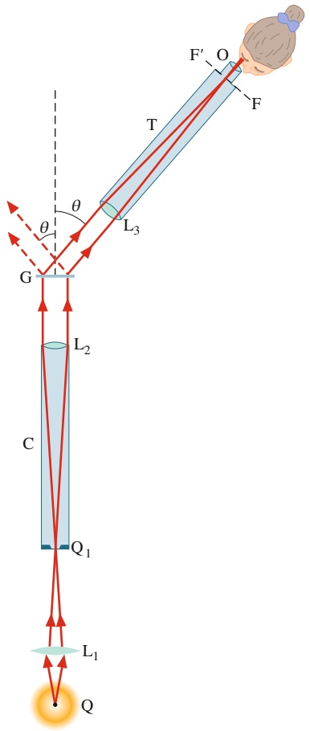

text_image

F'
O
F
T
L3
θ
θ
G
L2
C
Q1
L1
Q

Abb. 32.19

Ein einfacher Gitterspektrograf zur Spektralanalyse der Lichtquelle Q.

(sowie unter geringfügig kleineren und größeren Winkeln) gebeugte Licht in eine Brennebene $\widetilde { \mathrm { F F } ^ { \prime } }$ innerhalb des Fernrohrs. Durch das Okular O sieht man dieses Bild vergrößert.

Durch Variation des Winkels θ kann man nun das gesamte Muster betrachten. Die Maxima jeder Ordnung (mit Ausnahme der nullten) werden entsprechend der im Licht vorhandenen Wellenlängen (Farben) aufgespalten. Anhand von Gl. 32.18 lässt sich dann feststellen, um welche Wellenlängen es sich handelt. Während wir das Fernrohr horizontal in dem zu einem Maximum bestimmter Ordnung m gehörenden Winkelbereich drehen, sehen wir für jede im Spektrum der Quelle enthaltene Farbe eine vertikale Linie (vorausgesetzt, die Quelle emittiert diskrete Wellenlängen). Dabei nimmt die beobachtete Wellenlänge mit $\theta \; \mathbf { z u } ,$

Eine Wasserstofflampe, die gasförmigen Wasserstoff enthält, emittiert zum Beispiel vier diskrete Wellenlängen im sichtbaren Bereich. Wir empfinden das gemischte Licht als weiß. Blicken wir jedoch durch einen Gitterspektrografen, so können wir die vier zu den einzelnen Wellenlängen gehörenden Emissionslinien separat und in mehreren Ordnungen beobachten. Abbildung 32.20 zeigt drei dieser Ordnungen. In der Mitte des Musters $( m = 0 )$ liegen die vier Linien übereinander, sodass bei $\theta = 0$ eine einzige helle weiße Linie erscheint. Erst in den höheren Ordnungen spaltet das Spektrum auf.

Der Klarheit halber wurde in Abb. 32.20 die dritte Ordnung weggelassen, denn sie überlappt mit den Linien zweiter und vierter Ordnung. Außerdem fehlt die rote Linie vierter Ordnung, die an dem gezeigten Gitter nicht entsteht: Wenn wir Gl. 32.18 für die rote Linie mit $m = 4$ lösen wollen, so ergibt sich für sin θ ein Wert größer als 1. Man sagt, die vierte Ordnung an diesem Gitter sei unvollständig. Dieses Problem ließe sich durch Verwendung eines Gitters mit größerem d beheben, an dem die Linien weniger stark aufspalten als in Abb. 32.20 gezeigt. Abbildung 32.21 zeigt die Emissionslinien von Cadmium im sichtbaren Spektralbereich.

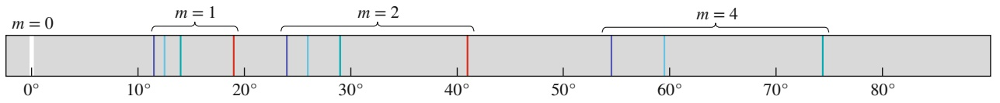

text_image

m = 0
m = 1
m = 2
m = 4

## Abb. 32.20

Sichtbare Emissionslinien von Wasserstoff in nullter, erster, zweiter und vierter Ordnung. Beachten Sie, dass der Abstand zwischen den Linien mit dem Winkel zunimmt. (Gleichzeitig nimmt die Intensität der Linien ab und die Breite nimmt zu, was hier nicht gezeigt wird.)

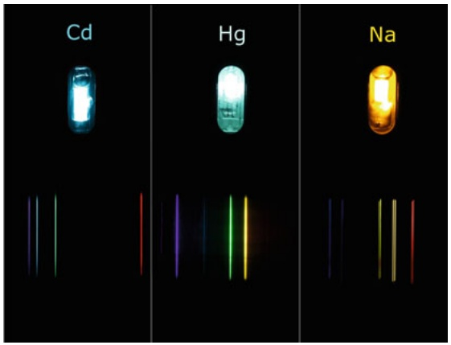

text_image

Cd
Hg
Na

Abb. 32.21

Emissionslinien von Cadmium, Quecksilber und Natrium im sichtbaren Spektralbereich in einem Gitterspektrografen [Quelle: Herbertweidner].

## KONTROLLFRAGE 6

Die Abbildung zeigt Linien verschiedener Ordnung, die bei Bestrahlung eines Beugungsgitters mit monochromatischem rotem Licht entstanden sind. (a) Befindet sich die Mitte des Musters rechts oder links des gezeigten Ausschnitts? (b) Werden die halben Breiten der Linien in diesen Ordnungen kleiner, größer oder bleiben sie gleich, wenn das rote Licht durch grünes ersetzt wird?

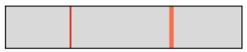

798

---

32.6 Beugungsgitter: Dispersion und Auflösungsvermögen

32

## 32.6 Beugungsgitter: Dispersion und Auflösungsvermögen

## Lernziele

Nach dem Durcharbeiten dieses Abschnitts sollten Sie in der Lage sein, . . .

• Dispersion als Aufspaltung der Beugungslinien von Licht mit unterschiedlichen Wellenlängen zu verstehen,
• die Beziehung zwischen der Dispersion D, der Wellenlängendifferenz Δλ, dem Winkelabstand Δθ, dem Spaltabstand d, der Ordnung m und dem zu dieser Ordnung gehörenden Winkel θ anzuwenden,
• die Auswirkungen einer Veränderung des Spaltabstands auf die Dispersion eines Beugungsgitters zu kennen,
• die Beziehung zwischen dem Auflösungsvermögen R, der Wellenlängendifferenz $\Delta \lambda ,$ der mittleren Wellenlänge $\lambda _ { \mathrm { g e m } } ,$ der Anzahl N der Spalte (bzw. Striche) im Gitter und der Ordnung m der Linien anzuwenden,
• zu wissen, wie sich das Auflösungsvermögen R ändert, wenn die Anzahl N der Spalte (bzw. Striche) im Gitter erhöht wird.

## Schlüsselideen

• Die Dispersion D eines Beugungsgitters ist ein Maß für den Winkelabstand Δθ zweier Linien, deren Wellenlängen sich um Δλ unterscheiden. Für eine Linie der Ordnung m mit dem Beugungswinkel θ ist die Dispersion

$$
D = \frac {\Delta \theta}{\Delta \lambda} = \frac {m}{d \cos \theta} \qquad (\text {Dispersion}).
$$

• Das Auflösungsvermögen R eines Beugungsgitters ist ein Maß für seine Fähig keit, die Emissionslinien von zwei nah benachbarten Wellenlängen noch getrennt darzustellen. Für zwei Wellenlängen, die sich um Δλ unterscheiden und deren Mittelwert $\lambda _ { \mathrm { g e m } }$ ist, gilt

$$
R = \frac {\lambda_ {\mathrm{gem}}}{\Delta \lambda} = N m \quad \text {(Auflösungsvermögen)}.
$$

## 32.6.1 Dispersion

Mit einem Gitterspektrografen will man auch nahe beieinander liegende Wellenlängenkomponenten des eingestrahlten Lichts einzeln erkennen können. Dies wird umso einfacher, je deutlicher die Beugungslinien örtlich voneinander getrennt sind. Die Fähigkeit eines Gitters, Beugungslinien aufzuspalten, bezeichnet man als **Winkeldispersion** $D$ und definiert

$$
D = \frac {\Delta \theta}{\Delta \lambda}. \tag {32.22}
$$

Hier gibt $\Delta \theta$ den Winkelabstand zweier Linien an, deren Wellenlängen sich um Δλ unterscheiden. Je größer D ist, desto größer ist der Abstand zwischen zwei Linien mit gegebenem Unterschied Δλ der Wellenlänge. Wie wir weiter unten herleiten werden, ist die Dispersion eines Gitters für den Winkel θ

$$
D = \frac {m}{d \cos \theta}. \tag {32.23}
$$

Um eine hohe Dispersion zu erzielen, müssen wir demnach ein Gitter mit mög lichst geringem Abstand d zwischen den Strichen wählen und bei einer möglichst hohen Ordnung m arbeiten. Dagegen hängt die Dispersion nicht von der Anzahl N der Gitterstriche ab. Die SI-Einheit für D ist Grad (oder Radiant) pro Meter.

natural_image

Close-up of a reflective CD or DVD disc with rainbow diffraction pattern (no text or symbols visible)

Abb. 32.22

Die feinen, nur 0,5 μm breiten Rillen auf einer Compact Disc wirken als Beugungsgitter. Beleuchtet man die CD mit weißem Licht, so überlagern sich die Beugungsmuster zu farbigen Streifen [Quelle: Spike Mafford/Getty Images].

799

---

32 Beugung

## 32.6.2 Auflösungsvermögen

Zwei nahe beieinander liegende Beugungslinien kann man gut voneinander unterscheiden (auflösen), wenn jede einzelne Linie möglichst schmal ist. Die entsprechende Kenngröße des Gitters ist das **Auflösungsvermögen** $R ,$ definiert als

$$
R = \frac {\lambda_ {\mathrm{gem}}}{\Delta \lambda}. \tag {32.24}
$$

In dieser Gleichung ist $\lambda _ { \mathrm { g e m } }$ die mittlere Wellenlänge zweier Emissionslinien, die gerade noch als getrennt wahrgenommen werden, und Δλ ist der Unterschied zwischen den Wellenlängen dieser Linien. Je größer R ist, desto kleiner darf der Abstand zwischen zwei Linien sein, die gerade noch aufgelöst werden sollen. (Machen Sie sich an dieser Stelle den Unterschied zwischen Auflösungsvermögen und Winkeldispersion klar! Beide Parameter gemeinsam bestimmen, wie gut sich einzelne Linien in einem Gitterspektrografen voneinander unterscheiden lassen.) Für das Auflösungsvermögen eines Gitters gilt

$$
R = N m . \tag {32.25}
$$

Ein gutes Auflösungsvermögen haben folglich Gitter mit einer möglichst hohen Anzahl N von Strichen.

## 32.6.3 Die Herleitung von Gl. 32.23

Wir gehen von Gl. 32.18 für die Position der Linien im Beugungsmuster eines Gitters aus,

$$
d \sin \theta = m \lambda .
$$

Nun betrachten wir $\theta$ und λ als Variable und differenzieren die Gleichung; das liefert uns

$$
d \cos \theta \mathrm{d} \theta = m \mathrm{d} \lambda .
$$

Für hinreichend kleine Winkel können wir die Differenziale näherungsweise als Differenzen schreiben:

$$
d \cos \theta \Delta \theta = m \Delta \lambda \tag {32.26}
$$

oder

$$
\frac {\Delta \theta}{\Delta \lambda} = \frac {m}{d \cos \theta}.
$$

Das Verhältnis auf der linken Seite ist gerade die Definition von D (siehe Gl. 32.22). Wir haben damit wie gewünscht Gl. 32.23 hergeleitet.

## 32.6.4 Die Herleitung von Gl. 32.25

Wir gehen von Gl. 32.26 aus, die wir aus der Beziehung für die Position der Linien im Beugungsmuster eines Gitters (Gl. 32.18) hergeleitet hatten. Δλ ist der (kleine) Unterschied der Wellenlängen zweier gebeugter Wellen und $\Delta \theta$ ist der Winkelab stand zwischen den entsprechenden Linien im Beugungsmuster. Nun nehmen wir an, Δθ sei der kleinste Winkel, der die Auflösung der beiden Linien noch zulässt. Dann muss gemäß dem Rayleigh-Kriterium $\Delta \theta$ gleich der halben Breite $\Delta \theta _ { 1 / 2 }$ der Linien sein, für die nach Gl. 32.21 gilt

$$
\Delta \theta_ {1 / 2} = \frac {\lambda}{N d \cos \theta}.
$$

800

---

32.7 Röntgenbeugung

32

Wir setzen $\Delta \theta _ { 1 / 2 }$ aus dieser Beziehung für Δθ in Gl. 32.26 ein und erhalten so

$$
\frac {\lambda}{N} = m \Delta \lambda ,
$$

woraus unmittelbar folgt

$$
R = \frac {\lambda}{\Delta \lambda} = N m.
$$

Dies ist gerade Gl. 32.25, die wir herleiten wollten.

## 32.6.5 Ein Vergleich zwischen Dispersion und Auflösungsvermögen

Achten Sie darauf, sorgfältig zwischen Dispersion und Auflösungsvermögen eines Gitters zu unterscheiden. Tabelle 32.1 zeigt einige Kenngrößen dreier Beugungsgitter. Sie alle werden mit Licht der Wellenlänge $\lambda = 5 8 9$ nm beleuchtet und das Beugungsmuster erster Ordnung (m = 1 in Gl. 32.18) wird analysiert. Prüfen Sie nach, dass aus den Gln. 32.23 bzw. 32.25 tatsächlich die angegebenen Werte für D und R folgen. (Bei der Berechnung von D müssen Sie die Einheit rad/min Grad∕μm umrechnen.)

TABELLE 32.1: Kenngrößen dreier Beugungsgittera).

| Gitter | N | d (nm) | θ (°) | D (°/μm) | R |
| --- | --- | --- | --- | --- | --- |
| A | 10 000 | 2540 | 13,4 | 23,2 | 10 000 |
| B | 20 000 | 2540 | 13,4 | 23,2 | 20 000 |
| C | 10 000 | 1370 | 25,5 | 46,3 | 10 000 |

a) Angaben für $\lambda = 5 8 9$ nm und $m = 1$

Unter den in Tab. 32.1 angegebenen Bedingungen haben die Gitter A und B dieselbe Dispersion, A und C hingegen dasselbe Auflösungsvermögen.

Abbildung 32.23 zeigt die Intensitätsverteilungen (auch Linienformen genannt), die sich im Beugungsmuster der drei Gitter für zwei Linien mit den Wellenlängen λ1 $\lambda _ { 1 }$ und $\lambda _ { 2 }$ ergeben $( \lambda _ { 1 }$ und $\lambda _ { 2 }$ liegen in unmittelbarer Nachbarschaft von $\lambda   =   589    nm$ . Gitter B hat das beste Auflösungsvermögen und erzeugt deshalb die schmalsten Linien. Man könnte mit diesem Gitter auch Linien unterscheiden, deren Wellenlängen viel näher beieinander liegen als im hier gezeigten Fall. Die Winkeldispersion ist für das Gitter C am größten, die Linien haben dort den größten Abstand voneinander.

## 32.7 Röntgenbeugung

## Lernziele

Nach dem Durcharbeiten dieses Abschnitts sollten Sie in der Lage sein, . . .

• den Bereich der Röntgenstrahlen innerhalb des elektromagnetischen Spektrums einzuordnen,
• eine Elementarzelle in einem Kristall zu definieren,
• Kristallebenen und deren Abstände zu definieren,
• die Streuung von zwei Strahlen an benachbarten Ebenen zu skizzieren und die für die Berechnungen benötigten Winkel einzutragen,
• für die Röntgenstreuung an einem Kristall die Beziehung zwischen dem Abstand d der Kristallebenen, dem Streuwinkel θ, der Ordnung m der Intensitätsmaxima und der Wellenlänge λ der Röntgenstrahlen anzuwenden,

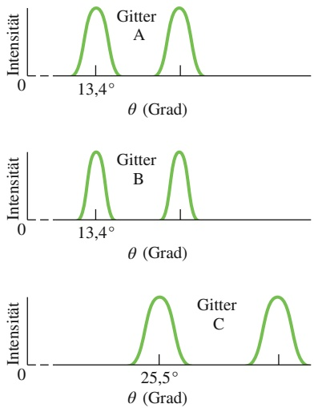

## Abb. 32.23

Die Intensitätsverteilungen der Beugungsmuster, wenn aus zwei Wellenlängen bestehendes Licht durch die in Tab. 32.1 beschriebenen Gitter fällt. Gitter B hat das beste Auflösungsvermögen, Gitter C die höchste Winkeldispersion.

801

---

32 Beugung

• anhand einer Skizze der Elementarzelle zu demonstrieren, wie sich der Abstand der Kristallebenen durch Röntgenbeugung bestimmen lässt.

## Schlüsselideen

• Richtet man Röntgenstrahlen auf einen Kristall, erfahren sie Bragg-Streuung. Diese lässt sich am leichtesten veranschaulichen, wenn man sich vorstellt, dass die Atome in dem Kristall in parallelen Ebenen angeordnet sind.
• Für Röntgenstrahlen der Wellenlänge λ, die an Kristallebenen in einem Abstand d voneinander gestreut werden, ist der Winkel θ zu den Maxima der Streuintensität durch

$$
2 d \sin \theta = m \lambda \quad m = 1, 2, 3, \dots \qquad (\text {Braggsches Gesetz})
$$

gegeben.

## 32.7.1 Röntgenbeugung

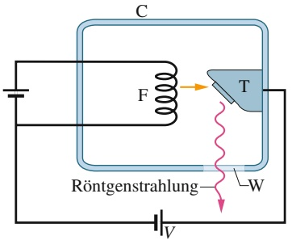

text_image

C
F → T
Röntgenstrahlung
W
V

Abb. 32.24

Röntgenstrahlung entsteht, wenn Elektronen nach dem Austritt aus einem beheizten Draht F durch eine Potenzialdifferenz V beschleunigt werden und auf ein metallisches Ziel T treffen. Das Austrittsfenster W in der evakuierten Kammer C ist für Röntgenstrahlung durchlässig.

Röntgenstrahlung ist ein Teil des elektromagnetischen Spektrums. Ihre Wellenlänge liegt in der Größenordnung von wenigen Nanometern und darunter (vergleichen Sie dies mit der mittleren Wellenlänge von sichtbarem Licht im Bereich von 550 nm!). Abbildung 32.24 zeigt die Entstehung von Röntgenstrahlung schematisch: Elektronen, die aus einem beheizten Draht F ausgetreten sind, werden durch eine Potenzialdifferenz V beschleunigt und treffen auf ein metallisches Ziel T.

Wellenlängen im Bereich der Röntgenstrahlung lassen sich durch optische Beugungsgitter nicht mehr voneinander trennen. Für $\lambda   =   1   \mathring { \mathrm { A } }   =   0 { , } 1$ nm und d = 3000 nm liefert Gl. 32.18 beispielsweise für die Winkelposition des Maximums erster Ordnung

$$
\theta = \sin^ {- 1} \frac {m \lambda}{d} = \sin^ {- 1} \frac {1 \cdot 0 , 1 \mathrm{nm}}{3 0 0 0 \mathrm{nm}} = 0, 0 0 1 9 ^ {\circ}.
$$

Das bedeutet, das Maximum erster Ordnung liegt so nahe am (zentralen) Maximum nullter Ordnung, dass keine Auswertung erfolgen kann. Wünschenswert wä- ren hier Gitter mit $d \approx \lambda ;$ da aber die Wellenlängen der Röntgenstrahlung im Bereich der Atomdurchmesser liegen, kann man derartige Beugungsgitter zumindest nicht mechanisch herstellen.

Im Jahr 1912 kam der deutsche Physiker Max von Laue auf die Idee, einen kristallinen Festkörper, in dem die Atome eine regelmäßige Anordnung bilden, als dreidimensionales „Beugungsgitter“ für Röntgenstrahlung zu verwenden. Betrachten wir dazu als Beispiel Natriumchlorid: Der NaCl-Kristall entsteht durch eine Aneinanderreihung sehr vieler Elementarzellen, bestimmter Grundmuster aus Natrium- und Chlor-Ionen. Zu jeder Elementarzelle von NaCl gehören vier Natriumund vier Chlor-Ionen. Einen Querschnitt durch einen NaCl-Kristall sehen Sie in Abb. 32.25a; die Elementarzelle, ein Würfel mit der Kantenlänge $a _ { 0 } ,$ ist farbig hervorgehoben.

Ein Röntgenstrahl, der auf einen solchen Kristall trifft, wird an den Ionen gestreut, d. h. in alle Raumrichtungen abgelenkt. In manchen Richtungen findet eine destruktive Interferenz der gestreuten Wellen statt, dort treten Minima der Intensität auf; analog beobachtet man Intensitätsmaxima in den Raumrichtungen, in denen die gestreuten Wellen konstruktiv interferieren. Dieser Prozess der Streuung und Interferenz kann als eine Form der Beugung bezeichnet werden. Sie unterscheidet sich allerdings grundlegend von der zuvor besprochenen Beugung von Licht an einer Kante oder einem Spalt.

Die Beugung von Röntgenstrahlung an Kristallen ist mathematisch nicht leicht zu beschreiben. Ein Ergebnis der Analyse ist: Die Maxima befinden sich an den räumlichen Positionen, wo man sie unter der Annahme erwarten würde, dass die

802

---

32.7 Röntgenbeugung

32

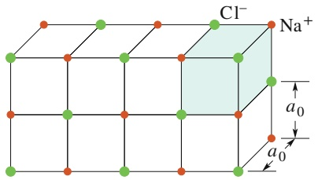

chemical

Crystal lattice structure diagram showing Na⁺ and Cl⁻ ions with lattice parameters a₀ and a₀↑

(a)

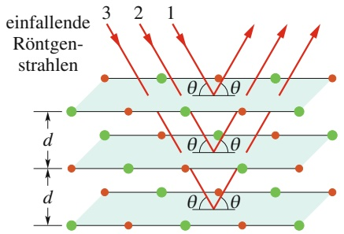

text_image

einfallende
Röntgen-
strahlen
3 2 1
θ θ
d
θ θ
d
θ θ

(b)

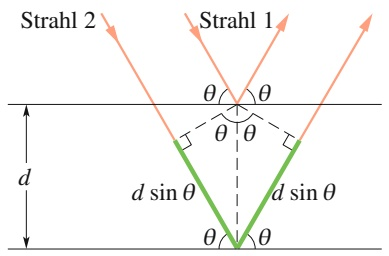

text_image

Strahl 2
Strahl 1
θ θ
θ θ
d
d sin θ
d sin θ
θ θ

(c)

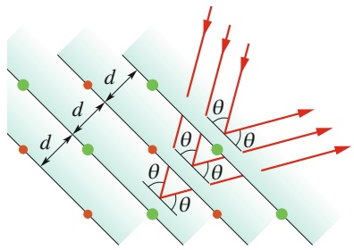

text_image

d
d
θ
θ
θ
θ

(d)

## Abb. 32.25

(a) Kubische Struktur eines Natriumchlorid-Kristalls. Eingezeichnet sind die Natrium- und die Chlor-Ionen, die Elementarzelle ist schattiert. (b) Einfallende Röntgenstrahlung wird an der in (a) dargestellten Struktur gebeugt. Das Ergebnis dieses Prozesses ist das gleiche, als wenn die Strahlung an einer Schar paralleler Ebenen gebeugt würde. Der Einfallswinkel ist dabei gleich dem Reflexionswinkel, wobei die Winkel relativ zur Fläche selbst (nicht zu ihrer Normalen, wie ansonsten in der Optik üblich) gemessen werden. (c) Der Weglängenunterschied zwischen Wellen, die an zwei benachbarten Ebenen reflektiert wurden, beträgt 2d sin θ. (d) Die Röntgenstrahlung fällt hier unter einem anderen Winkel bezüglich der Kristallstruktur ein als in (b). Die Reflexion findet deshalb an einer anderen Schar paralleler Ebenen statt.

Strahlen von einer Schar paralleler reflektierender Ebenen (den Kristallebenen) zurückgeworfen werden, die sich durch den gesamten Kristall erstrecken und regel mäßige Anordnungen von Atomen enthalten. (In Wirklichkeit werden die Röntgenstrahlen nicht reflektiert. Wir verwenden die gedachten Ebenen nur, um uns die Analyse des tatsächlichen Beugungsvorgangs zu erleichtern.)

Abbildung 32.25b zeigt drei Vertreter einer solchen Schar von Kristallebenen. Der Abstand zwischen ihnen beträgt jeweils d. Die Strahlen 1, 2 und 3 sollen an der ersten, zweiten bzw. dritten Ebene „reflektiert“ werden. Der Einfallswinkel und der Reflexionswinkel sind überall mit θ bezeichnet. Im Gegensatz zur sonst in der Optik gültigen Festlegung werden die Winkel hier relativ zur reflektierenden Flä- che angegeben, nicht relativ zur Normalen auf dieser Fläche. In Abb. 32.25b ist der Abstand zwischen den Ebenen zufällig gerade genau so groß wie die Kantenlänge $a _ { 0 }$ der Elementarzelle.

Eine Seitenansicht der Reflexion an zwei benachbarten Ebenen ist in Abb. 32.25c dargestellt. Die Wellen 1 und 2 erreichen den Kristall in Phase. Die Reflexion selbst kann keine Phasendifferenz hervorrufen, da wir sie nur als Hilfsmittel verwendet haben, um die Maxima im Beugungsmuster der Röntgenstrahlung am Kristall erklären zu können. Im Unterschied zu Lichtstrahlen werden Röntgenstrahlen beim Eintritt in den Kristall nicht gebrochen; wir definieren für diese Situation auch keinen Brechungsindex. Die relative Phase der Wellen 1 und 2 beim Austritt aus dem Kristall wird also ausschließlich vom Weglängenunterschied bestimmt. Damit die Wellen den Kristall in Phase verlassen, muss der Weglängenunterschied ein ganzzahliges Vielfaches der Wellenlänge λ der Röntgenstrahlung sein.

Wir zeichnen in Abb. 32.25c senkrechte Linien ein und finden einen Weglängenunterschied von 2d sin θ. Er gilt für jedes Paar benachbarter Ebenen aus der in Abb. 32.25b dargestellten Ebenenschar gleichermaßen. Als Kriterium für die Intensitätsmaxima bei der Beugung von Röntgenstrahlung ergibt sich damit das **Braggsche Gesetz**

$$
2 d \sin \theta = m \lambda \quad \text {mit} \quad m = 1, 2, 3, \dots , \tag {32.27}
$$

mit m als Ordnung des jeweiligen Maximums. Benannt wurde das Gesetz nach dem britischen Physiker William L. Bragg, der es als Erster herleitete. (Für die Anwendung der Röntgenstrahlung zur Untersuchung von Kristallstrukturen wurde Bragg 1915 gemeinsam mit seinem Vater William H. Bragg mit dem Nobelpreis

803

---

32 Beugung

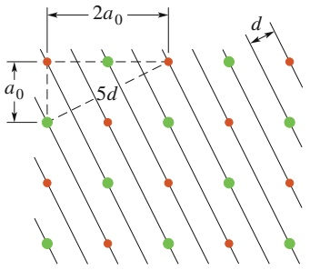

text_image

2a₀
a₀
5d
d

Abb. 32.26

Eine Ebenenschar, die durch die in Abb. 32.25a gezeigte Kristallstruktur verläuft und die Beziehung zwischen der Kantenlänge $\alpha _ { 0 }$ der Elementarzelle und dem Abstand d zwischen den Kristallebenen verdeutlicht.

für Physik geehrt.) Der Einfalls- und Reflexionswinkel in Gl. 32.27 wird als Braggscher Winkel bezeichnet.

Für jeden Winkel, unter dem die Röntgenstrahlung auf den Kristall trifft, gibt es eine Schar von Ebenen, für die das Braggsche Gesetz erfüllt und eine Reflexion möglich ist. Die Kristallstruktur in Abb. 32.25d ist genauso ausgerichtet wie die aus Abb. 32.25a, nur fällt die Strahlung jetzt aus einer anderen Richtung ein als in Abb. 32.25b. Um die Beugung der Röntgenstrahlung mithilfe des Braggschen Gesetzes erklären zu können, muss man jetzt eine andere Schar reflektierender Ebenen mit anderem Abstand d und anderem Braggschen Winkel θ heranziehen.

Abbildung 32.26 veranschaulicht, wie der Abstand d zwischen den Ebenen mit der Kantenlänge $a _ { 0 }$ der Elementarzelle zusammenhängt. Für die hier gezeigte Schar von Ebenen liefert der Satz des Pythagoras

$$
5 d = \sqrt {\frac {5}{4}} a _ {0}
$$

oder

$$
d = \frac {a _ {0}}{\sqrt {2 0}} = 0, 2 2 3 6 a _ {0}. \tag {32.28}
$$

Mithilfe dieser oder ähnlicher Beziehungen kann man die Dimensionen der Ele mentarzelle eines Kristallgitters (auch für andere Gittertypen als das Natriumchlo rid-Gitter) berechnen, wenn man den Abstand zwischen den Kristallebenen mittels Röntgenbeugung experimentell bestimmt hat.

Die Röntgenbeugung ist ein leistungsfähiges Hilfsmittel zur Untersuchung von Röntgenspektren und Kristallstrukturen. Zur Aufnahme eines Röntgenspektrums wählt man eine bestimmte Schar von Kristallebenen mit bekanntem Abstand d. An diesen Ebenen wird Strahlung verschiedener Wellenlängen unter unterschiedlichen Winkeln „reflektiert“. Mit einem Detektor, der diese Winkel registriert und unterscheidet, lässt sich das Wellenlängenspektrum der auf den Kristall treffenden Röntgenstrahlung ermitteln. Wenn die Kristallstruktur selbst Gegenstand der Untersuchung ist, arbeitet man mit monochromatischer Röntgenstrahlung. So kann man den Abstand der Ebenen verschiedener Ebenenscharen feststellen und daraus die Abmessungen der Elementarzelle berechnen.

## 32.8 Zusammenfassung

**Beugung** Treffen Wellen auf eine Kante, eine Öffnung oder ein Hindernis, deren Dimensionen in der Größenordnung der Wellenlänge liegen, so werden sie auf ihrem weiteren Weg im Raum aufgeweitet und es kommt zur Interferenz. Diesen Effekt nennt man Beugung.

**Beugung am Einzelspalt** Beim **Durchgang** durch einen langen, schmalen Spalt der Breite a erzeugen Wellen auf einem Beobachtungsschirm ein **Beugungsmuster**, das aus einem Hauptmaximum und mehreren Nebenmaxima besteht; jeweils zwei Maxima sind durch ein Minimum voneinander getrennt. Die Minima treten bei Winkeln θ relativ zur Bezugsachse auf, für die die Beziehung

$$
a \sin \theta = m \lambda \quad \text {mit} \quad m = 1, 2, 3, \dots \tag {32.3}
$$

gilt. Die Intensität des Beugungsmusters bei einem beliebigen Winkel θ ist

$$
I (\theta) = I _ {\mathrm{m}} \left(\frac {\sin \alpha}{\alpha}\right) ^ {2} \tag {32.5}
$$

mit

$$
\alpha = \frac {\pi a}{\lambda} \sin \theta . \tag {32.6}
$$

$I _ { \mathrm { m } }$ ist dabei die Intensität in der Mitte des Musters.

**Beugung an einer kreisrunden Öffnung** Beugungsmuster, die an einer kreisrunden Öffnung oder einer Linse mit dem Durchmesser d entstehen, besitzen ein zentrales Hauptmaximum und mehrere konzentrisch angeordnete Nebenmaxima und Minima. Die Position des ersten Minimums liegt unter einem Winkel θ relativ zur Achse des Musters, für den

$$
\sin \theta = 1, 2 2 \frac {\lambda}{d} \tag {32.12}
$$

gilt.

**Rayleigh-Kriterium** Das Rayleigh-Kriterium besagt, dass zwei eng benachbarte Objekte gerade noch getrennt wahrgenommen (aufgelöst) werden, wenn das Hauptmaximum

804

---

32.9 Fragen

32

des Beugungsmusters des einen Objekts mit dem ersten Minimum des Beugungsmusters des anderen Objekts zusammenfällt. Der Winkelabstand der Objekte muss dann mindestens gleich

$$
\theta_ {\mathrm{R}} = 1, 2 2 \frac {\lambda}{d} \tag {32.14}
$$

sein; d ist der Durchmesser der Öffnung, durch welche das Licht fällt.

**Beugung am Doppelspalt** Beim Durchgang von Wellen durch zwei Spalte mit der Breite a, die in einem Abstand d nebeneinander angeordnet sind, entsteht ein Beugungsmuster. Die Intensität I des Musters bei einem Winkel θ berechnet sich zu

$$
I (\theta) = I _ {\mathrm{m}} (\cos^ {2} \beta) \left(\frac {\sin \alpha}{\alpha}\right) ^ {2} \tag {32.15}
$$

mit $\beta = ( \pi d / \lambda )$ sin $\theta ;$ α ist wie oben für den Einzelspalt angegeben definiert.

**Beugung an vielen Spalten** Bei der Beugung von Wellen an einem System aus N Spalten entstehen Muster, deren Maxima (Linien) sich bei Winkeln θ mit

$$
d \sin \theta = m \lambda \quad \text {mit} \quad m = 0, 1, 2, \dots \tag {32.18}
$$

befinden. Die halbe Breite der Linien beträgt

$$
\Delta \theta_ {1 / 2} = \frac {\lambda}{N d \cos \theta}. \tag {32.21}
$$

**Beugungsgitter** Unter einem Beugungsgitter versteht man eine Anordnung paralleler „Spalte“, mit deren Hilfe man eine einfallende Welle in ihre Wellenlängenkomponenten zerlegen kann, indem man die einzelnen Beugungslinien auftrennt und darstellt. Die Kenngrößen eines Gitters sind seine Winkeldispersion D und sein Auflösungsvermögen R:

$$
D = \frac {\Delta \theta}{\Delta \lambda} = \frac {m}{d \cos \theta}, \tag {32.22,32.23}
$$

$$
R = \frac {\lambda_ {\mathrm{gem}}}{\Delta \lambda} = N m. \tag {32.24,32.25}
$$

**Röntgenbeugung** Die regelmäßige Anordnung von Atomen in einem Kristall kann als dreidimensionales Beugungsgitter für sehr kurzwellige Strahlung (Röntgenstrahlung) wirken. Um die Situation zu analysieren, kann man gedachte Scharen paralleler Ebenen mit dem Abstand d voneinander durch die Atomlagen konstruieren. Beugungsmaxima infolge konstruktiver Interferenz entstehen, wenn der Einfallswinkel der Welle, gemessen von den Ebenen aus, und die Wellenlänge λ der Strahlung das **Braggsche Gesetz** erfüllen:

$$
2 d \sin \theta = m \lambda \quad \text {mit} \quad m = 1, 2, 3, \dots \tag {32.27}
$$

## 32.9 Fragen

**1.** Licht mit der Frequenz f fällt auf einen langen, schmalen Spalt; dabei entsteht ein Beugungsmuster. (a) Die Frequenz wird auf 1,3 f erhöht – dehnt sich hierdurch das Beugungsmuster aus oder schrumpft es zusammen? (b) Wie verändert sich die Ausdehnung des Musters, wenn die ganze Anordnung in klares Wasser getaucht wird?
**2.** Wir betrachten ein Beugungsexperiment am Einzelspalt mit Licht der Wellenlänge λ. Was sieht man an einem Punkt des Beobachtungsschirms, an dem die Wellen von der oberen und von der unteren Kante des Spalts mit einem Weglängenunterschied von (a) 5λ und (b) 4,5λ eintreffen?
**3.** Stellen Sie sich vor, Sie sprechen zu einer Person, die direkt vor Ihnen steht. Wann nimmt die Person Ihre Stimme lauter wahr: Wenn Sie ein Megafon vor Ihren Mund halten oder wenn Sie mit gleicher Lautstärke ohne Megafon sprechen?
**4.** In Abb. 32.F4 sehen Sie vier verschiedene rechteckige Öffnungen einer Quelle von Schall- oder Lichtwellen. Die Seitenlängen betragen L oder 2L; L sei dreimal so groß wie die jeweils eingestrahlte Wellenlänge. Ordnen Sie die Öffnungen in absteigender Reihenfolge nach dem Ausmaß der Verbreiterung der Wellen aufgrund von Beugungseffekten (a) nach links und rechts und (b) nach oben und unten.

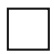

(1)

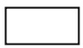

(2)

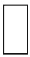

(3)

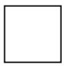

(4)

Abb. 32.F4

**5.** Wir betrachten wieder ein Beugungsexperiment am Einzelspalt. Die beiden von der oberen und unteren Kante des Spalts ausgehenden Strahlen treffen mit einem Weglängenunterschied von 4,0 Wellenlängen an einem bestimmten Punkt des Beobachtungsschirms ein. Die Situation soll in einem Zeigerdiagramm analog zu Abb. 32.6 dargestellt werden. Wie viele einander überlagernde Kreise bildet die Zeigerkette?
**6.** In abgedunkelter Umgebung, etwa bei Nacht, sehen viele Menschen Ringe (sogenannte entoptische Halos) um helle Lampen (z. B. Straßenlaternen). Es handelt sich dabei um die ersten Nebenmaxima von Beugungsmustern, die an kleinen Strukturen vermutlich in der Hornhaut oder der Linse des Auges entstehen. (Die Hauptmaxima dieser Muster sind dem Bild der Lampe überlagert.) (a) Wird der Durchmesser eines solchen Rings größer oder kleiner, wenn man die entsprechende Lampe von blauem auf rotes Licht umschaltet? (b) Eine Lampe emittiere weißes Licht. Erscheint die Außenkante des Rings dann rot oder blau?

805

---

32 Beugung

**7.** Abbildung 32.F7 zeigt Beugungsmuster aus zwei Doppelspaltexperimenten. Eingezeichnet wurden jeweils die hellen Streifen, die innerhalb des mittleren Maximums der Beugungshüllkurve liegen; die verwendeten Wellenlängen sind identisch. Ist (a) die Spaltbreite $a ,$ (b) der Abstand d der Spalte und (c) das Verhältnis $d / a$ in Experiment B grö- ßer als, kleiner als oder ebenso groß wie in Experiment A?

A

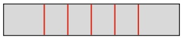

B

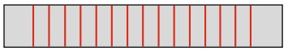

Abb. 32.F7

**8.** Abbildung 32.F8 zeigt eine rote und eine grüne Linie gleicher Ordnung aus dem Beugungsmuster eines Gitters. Stellen Sie sich vor, wir vergrößern die Anzahl der Gitterstriche, indem wir ein Klebeband entfernen, das zuvor die Hälfte der Striche verdeckte. Werden dadurch (a) die halben Breiten der Linien und (b) der Abstand zwischen den Linien kleiner, größer oder bleiben sie gleich? (c) Verschieben sich die Linien? Wenn ja, in welche Richtung?

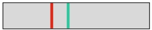

Abb. 32.F8

Fragen 8 und 9.

**9.** Betrachten Sie noch einmal die Situation in Frage 8 und Abb. 32.F8. Was geschieht (a) mit den halben Breiten der Linien und (b) mit dem Abstand zwischen den Linien, wenn der Abstand zwischen den Gitterstrichen vergrößert wird? (c) Verschieben sich hierdurch die Linien? Wenn ja, in welche Richtung?
**10.** (a) Abbildung 32.F10a zeigt zwei Beugungsmuster, die mit Licht identischer Wellenlänge an zwei Gittern A und B entstanden sind. Die Linien gehören jeweils zur gleichen Ordnung und erscheinen unter gleichen Winkeln θ. Welches Gitter hat mehr Striche? (b) In Abb. 32.F10b sehen Sie Beugungslinien zweier verschiedener Ordnungen, die beim Einstrahlen von Licht mit zwei Wellenlängenkomponenten auf ein einzelnes Beugungsgitter entstanden sind. Beide Wellenlängen liegen im roten Bereich des sichtbaren Spektrums. Zu welchem Linienpaar, dem rechten oder dem linken, gehört der größere Wert von m? Befindet sich die Mitte des Beugungsmusters links oder rechts von (c) Abb. 32.F10a und (d) Abb. 32.F10b?

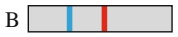

(a)

(b)

Abb. 32.F10

**11.** (a) Ein Beugungsgitter wird mit Licht bestrahlt, das zwei Komponenten mit nahe beieinander liegenden Wellenlängen enthält. Die mittlere Wellenlänge der Komponenten wird nun langsam erhöht. Nimmt dadurch die

kleinstmögliche Wellenlängendifferenz Δλ, bei der man die beiden Komponenten noch auflösen kann, zu, ab oder bleibt sie gleich? (b) Ist Δλ in einem bestimmten Wellenlängenbereich (beispielsweise um 500 nm) in der ersten oder in der dritten Ordnung größer?
**12.** Abbildung 32.F12 zeigt drei Messkurven von Doppelspalt-Interferenzversuchen, bei denen jeweils der Parameter $\beta$ gegen den Winkel θ aufgetragen wurde. Die verwendete Wellenlänge war 500 nm. Die Spaltabstände sind in den drei Experimenten unterschiedlich. Ordnen Sie die Experimente in absteigender Reihenfolge (a) nach den Spaltabständen und (b) nach der Gesamtzahl der Maxima im Interferenzmuster.

line

| \(\pi/2\) | Curve A \((\beta)\) | Curve B \((\beta)\) | Curve C \((\beta)\) |
| --- | --- | --- | --- |
| 0 | 0 | 0 | 0 |
| \(\pi/2\) | ~High | ~Medium-High | ~Low-Medium |

(rad)

Abb. 32.F12

**13.** Abbildung 32.F13 zeigt die Messkurven von drei Versuchen zur Beugung am Einzelspalt mit Licht der Wellenlänge 500 nm. Ordnen Sie die Experimente in absteigender Reihenfolge (a) nach der Spaltbreite und (b) nach der Gesamtzahl der Minima im Beugungsmuster.

line

| X | A | B | C |
| --- | --- | --- | --- |
| 0 | 0 | 0 | 0 |
| \(\pi/2\) | ~High | ~Medium-High | ~Low |

(rad)

Abb. 32.F13

**14.** Sie verwenden drei unterschiedliche Anordnungen, um zwei eng benachbarte kleine Objekte zu beobachten, die beide gleich weit von Ihnen entfernt sind (viel weiter als ihre Abmessungen und ihr Abstand voneinander). Der Winkel, den die Objekte jeweils in Ihrem Gesichtsfeld einnehmen, und die Entfernungen zu Ihnen betragen in den drei Fällen (1) 2𝜑 und R, (2) 2𝜑 und 2R und (3) $\varphi / 2$ und $R / 2 .$ (a) Ordnen Sie die Anordnungen in absteigender Reihenfolge nach dem Abstand, in dem Sie die Objekte sehen. Können Sie die beiden Objekte (b) in Aufbau 1 und (c) in Aufbau 3 getrennt wahrnehmen, wenn Sie sie in Versuch 2 so gerade noch auflösen können?
**15.** Für ein Beugungsgitter beträgt das Verhältnis $\lambda / a$ (also Wellenlänge zu Gitterabstand) 1/3,5. Geben Sie ohne Rechnung an, welche Ordnungen (außer der nullten) im Beugungsmuster zu sehen sind.

806
