# 33 Relativitätstheorie

原始 PDF 第 821–850 页。

# 33 Relativitätstheorie

## 33.1 Gleichzeitigkeit und Zeitdilatation

## Physikalische Motivation

Gegenstand der **Relativitätstheorie** sind zum großen Teil Messungen an physika lischen **Ereignissen:** Wo und wann geschieht etwas, und wie weit sind zwei Ereignisse räumlich oder zeitlich voneinander entfernt? Die Theorie beschreibt außer dem die Übertragung solcher und anderer Messungen zwischen Bezugssystemen, die sich relativ zueinander bewegen (daher die Bezeichnung Relativitätstheorie). Wir hatten solche Situationen bereits in den Abschnitten 1.11 und 1.12 diskutiert.

Bis zum Jahr 1905 meinten die Physiker, gut über bewegte Bezugssysteme und die erwähnten Transformationen zwischen ihnen Bescheid zu wissen, und betrachteten die Arbeit mit diesen Zusammenhängen als Routine. Dann legte Albert Einstein (Abb. 33.1) seine **Spezielle Relativitätstheorie** vor. Das Adjektiv speziell bedeutet hier, dass sich die Theorie ausschließlich mit **inertialen Bezugssystemen** beschäftigt, also Bezugssystemen, in denen die Newtonschen Gesetze gelten. Solche Bezugssysteme bewegen sich relativ zueinander nur mit konstanter Geschwindigkeit, d. h., sie dürfen nicht beschleunigt sein. (Den anspruchsvolleren Fall beschleunigter Bezugssysteme behandelt Einsteins Allgemeine Relativitätstheorie, die wir hier nicht diskutieren werden. Wenn wir im Folgenden von Relativitätstheorie sprechen, setzen wir stets inertiale Bezugssysteme voraus.)

Ausgehend von zwei täuschend einfach erscheinenden Postulaten verblüffte Einstein die Naturwissenschaftler seiner Zeit, indem er zeigte, dass die althergebrach ten Auffassungen der Relativität schlicht falsch waren – ungeachtet dessen, dass man sich im Lauf der Jahrhunderte dermaßen an sie gewöhnt hatte, dass niemand sie mehr ernsthaft infrage stellte. Der gesunde Menschenverstand orientiert sich aber an alltäglich vorkommenden, vergleichsweise langsamen Bewegungen. Einsteins Theorie, die – wie sich herausstellen sollte – für alle Geschwindigkeitsbereiche korrekte Ergebnisse liefert, sagt etliche Effekte voraus, die auf den ersten Blick seltsam erscheinen, weil sie sich der Alltagserfahrung entziehen.

Einstein zeigte, wie Raum und Zeit miteinander verknüpft sind: Welche Zeit zwischen zwei Ereignissen vergeht, hängt von der räumlich-zeitlichen Entfernung der Ereignisse ab und umgekehrt. Beobachter, die sich relativ zueinander bewegen, nehmen diese Verknüpfung außerdem unterschiedlich wahr. Daraus folgt beispielsweise, dass die Zeit nicht mit einer festgelegten Geschwindigkeit vergeht: Das Universum wird nicht von einer Art riesiger mechanischer Pendeluhr dirigiert, die ihren Takt ewig und unveränderlich einhält. Stattdessen kann die Zeit unterschiedlich schnell ablaufen, und verantwortlich dafür sind Relativbewegungen. Vor 1905 hätte man solche Ideen als Spinnerei abgetan. Inzwischen sind Naturwissenschaftler und Ingenieure von der Gültigkeit der Einsteinschen Theorie überzeugt, weil die Erfahrungen mit der Speziellen Relativitätstheorie ihre Denkweise verändert haben.

Die Spezielle Relativitätstheorie steht in dem Ruf, äußerst kompliziert zu sein. Zu Unrecht, soweit es die Mathematik betrifft (zumindest in dem Rahmen, den wir

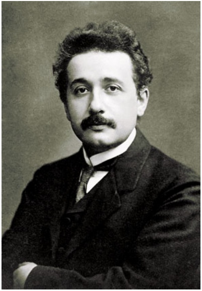

natural_image

Portrait of a man with mustache and formal attire (no visible text or symbols)

Abb. 33.1

Albert Einstein zu Beginn des 20. Jahrhunderts. Als er seine Spezielle Relativitätstheorie veröffentlichte, arbeitete er im Berner Patentbüro [Quelle: Corbis-Bettmann].

Halliday Physik für natur- und ingenieurwiss. Studiengänge, 3. Auflage. D. Halliday, R. Resnick und J. Walker. © 2020 WILEY-VCH Verlag GmbH & Co. KGaA. Published 2020 by WILEY-VCH Verlag GmbH & Co. KGaA.

807

---

33 Relativitätstheorie

hier behandeln werden); zu Recht insofern, als wir stets sehr genau darauf achten müssen, wer an einem Ereignis welche Messung vornimmt und wie er das bewerkstelligt. Und Sie dürfen sich nicht wundern, wenn Ergebnisse gelegentlich Ihrer Erfahrung widersprechen sollten.

## 33.1.1 Die Postulate

Zunächst sollen die beiden Postulate erläutert werden, auf die sich Einsteins Relativitätstheorie gründet:

1. Das Relativitätspostulat: Die Gesetze der Physik gelten für Beobachter in allen Inertialsystemen gleichermaßen. Kein Bezugssystem ist gegenüber einem anderen bevorzugt.

Galilei ging davon aus, dass die Gesetze der Mechanik in allen inertialen Bezugssystemen gelten. (Eine wichtige Folge ist das erste Newtonsche Bewegungsgesetz.) Einstein erweiterte diese Idee auf alle physikalischen Gesetze, insbesondere diejenigen der Optik und des Elektromagnetismus. Das Postulat sagt nicht aus, dass Beobachter in beliebigen Inertialsystemen für alle physikalischen Größen dieselben Werte messen; tatsächlich stimmen diese Werte in der Praxis sehr oft nicht überein. Ausgesagt wird lediglich, dass die physikalischen Beziehungen, die diese Größen miteinander verknüpfen, in allen inertialen Bezugssystemen gleich sind.

2. Das Postulat der konstanten Lichtgeschwindigkeit: Im Vakuum breitet sich Licht in allen Richtungen und in allen inertialen Bezugssystemen mit derselben Geschwindigkeit c aus.

Wir können diesen Satz auch folgendermaßen formulieren: In der Natur gibt es eine Höchstgeschwindigkeit c, die in allen Raumrichtungen und in allen inertialen Bezugssystemen gleich ist. Mit dieser Geschwindigkeit breiten sich außer Licht auch alle anderen masselosen Teilchen aus (etwa die Gluonen, welche die Quarks in Proton und Neutron zusammenhalten). Kein Träger von Energie oder Information kann diese Geschwindigkeit überschreiten; massebehaftete Teilchen können c nicht einmal erreichen, gleichgültig, wie sehr oder wie lange sie beschleunigt werden.

Beide Postulate wurden in einer Vielzahl von Experimenten nachgeprüft und bislang wurde kein Fall gefunden, in dem sie verletzt waren.

## Die größtmögliche Geschwindigkeit

1964 zeigte W. Bertozzi experimentell, dass sich Elektronen nicht über eine bestimmte Geschwindigkeit hinaus beschleunigen lassen. Bertozzi beschleunigte Elektronen auf mehrere Geschwindigkeiten (siehe Abb. 33.2); durch ein davon unabhängiges Verfahren ermittelte er gleichzeitig ihre kinetische Energie. Er stellte fest, dass die kinetische Energie eines Elektrons umso mehr zunahm, je mehr Kraft darauf ausgeübt wurde, ohne dass dabei jedoch seine Geschwindigkeit noch merklich zunahm. Inzwischen wurden Elektronen mindestens auf das 0,999 999 999 95-Fache der Lichtgeschwindigkeit beschleunigt, was dem Wert von c tatsächlich sehr nahe kommt, ihn aber eben nicht exakt erreicht.

Definitionsgemäß ist der Zahlenwert der Lichtgeschwindigkeit gleich

$$
c = 2 9 9   7 9 2   4 5 8 \mathrm{m/s}. \tag {33.1}
$$

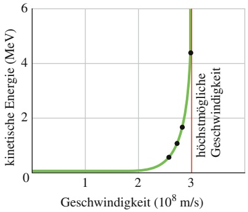

line

| Geschwindigkeit (10^8 m/s) | kinetische Energie (MeV) |
| --- | --- |
| ~2.5 | ~0.6 |
| ~2.7 | ~1.1 |
| ~2.8 | ~1.7 |
| 3 | ~4.4 |

Abb. 33.2

Die gemessene kinetische Energie eines Elektrons als Funktion seiner gemessenen Geschwindigkeit. Wie viel Energie man einem Elektron (oder einem beliebigen anderen massebehafteten Teilchen) auch immer zuführt, niemals erreicht oder überschreitet seine Geschwindigkeit den Grenzwert c. (Die durch die Punkte gelegte grüne Kurve veranschaulicht die Vorhersage von Einsteins Spezieller Relativitätstheorie.)

In diesem Buch haben wir bisher meist mit dem Näherungswert $c = 3 { , } 0 \cdot 1 0 ^ { 8 }$ m/s gearbeitet; für das aktuelle Kapitel wollen wir den etwas genaueren Zahlenwert $\tilde { c } = 2 { , } 9 9 8 \cdot 1 0 ^ { 8 }$ m/s verwenden. Vielleicht geben Sie die Zahl gleich in den Spei-

808

---

33.1 Gleichzeitigkeit und Zeitdilatation

33

cher Ihres Taschenrechners ein (falls nicht bereits geschehen), denn wir werden sie häufiger benötigen.

## Überprüfung des Postulats der Lichtgeschwindigkeit

Wenn die Lichtgeschwindigkeit in allen inertialen Bezugssystemen gleich ist, so sollte sich Licht, das von einer bewegten Quelle emittiert wird, gleich schnell im Raum ausbreiten wie von einer im Laborsystem ruhenden Quelle ausgesendetes Licht. Diese Behauptung wurde in einem hochpräzisen Experiment nachgeprüft. Als $_ { r ^ { \mathrm { I } } }$ ichtquelle“ verwendete man das neutrale Pion π0, ein instabiles, kurzlebiges Teilchen, das durch Stoßprozesse in einem Teilchenbeschleuniger erzeugt werden kann. Es zerfällt in zwei Gammaquanten gemäß der Gleichung

$$
\pi^ {0} \rightarrow \gamma + \gamma . \tag {33.2}
$$

Gammastrahlen bilden den höchstfrequenten Teil des elektromagnetischen Spek trums und sind deshalb – ebenso wie sichtbares Licht – vom Postulat der Lichtgeschwindigkeit betroffen.

Physiker am CERN, der Europäischen Organisation für Kernforschung in Genf, erzeugten 1964 einen Strahl von Pionen, die sich mit dem 0,999 75-Fachen der Lichtgeschwindigkeit bezüglich des Labors fortbewegten. Die Experimentatoren bestimmten nun die Geschwindigkeit der von diesen sehr schnell bewegten Quellen emittierten Gammaquanten und stellten fest, dass diese ebenso groß war wie die Geschwindigkeit von Gammaquanten, die von im Laborsystem ruhenden Pionen ausgesendet werden.

## 33.1.2 Die Messung von Ereignissen

Ein **Ereignis** im physikalischen Sinn ist ein Vorfall, dem ein Beobachter drei Ortsund eine Zeitkoordinate zuordnen kann. Beispiele für physikalische Ereignisse sind das An- und Ausschalten einer Lichtquelle, der Zusammenstoß zweier Teilchen, der Durchgang eines Lichtpulses durch einen bestimmten Punkt im Raum, eine Explosion und das Zusammentreffen der Spitze eines Uhrzeigers mit einer Markierung auf dem Zifferblatt. Ein Beobachter, der sich in einem bestimmten inertialen Bezugssystem befindet, kann einem Ereignis A beispielsweise die in Tab. 33.1 angegebenen Koordinaten zuordnen. Wir bezeichnen sie als Raumzeit-Koordinaten, weil in der Relativitätstheorie Raum und Zeit miteinander verknüpft sind. Das Koordinatensystem ist ein Teil des Bezugssystems, in dem sich der Beobachter aufhält.

Ein gegebenes Ereignis kann von beliebig vielen Beobachtern registriert werden; dabei kann sich jeder Beobachter in einem anderen Inertialsystem befinden. Die Raumzeit-Koordinaten ein und desselben Ereignisses werden in der Regel von jedem Beobachter anders angegeben. Beachten Sie dabei, dass ein Ereignis nicht zu einem Bezugssystem „gehört“. Ein Ereignis ist nichts weiter als ein Vorfall, der von jedem denkbaren Bezugssystem aus betrachtet werden kann und dem Raumzeit-Koordinaten zugeordnet werden können.

In der Praxis kann die Zuordnung solcher Koordinaten durchaus kompliziert sein. Angenommen, um exakt 09:00 Uhr MEZ platzt 1 km rechts von Ihnen ein Ballon und 2 km links von Ihnen explodiert ein Feuerwerkskörper. Keines der beiden Ereignisse registrieren Sie genau um 09:00 Uhr, denn von keinem der Ereignisse hat Sie zu diesem Zeitpunkt Licht erreicht. Das von dem Feuerwerkskörper ausgehende Licht muss einen weiteren Weg zurücklegen; sie erfahren von diesem Ereignis deshalb später als vom Platzen des Ballons. Um die tatsächlichen Zeitpunkte zu ermitteln, zu denen die Ereignisse stattfanden, müssen Sie die jeweiligen Laufzeiten des Lichts berechnen und von den zugehörigen Ankunftszeiten abziehen.

TABELLE 33.1: Raumzeit-Koordinaten eines Ereignisses A.

| Koordinate | Wert |
| --- | --- |
| x | 3,58 m |
| y | 1,29 m |
| z | 0 m |
| t | 34,5 s |

809

---

33 Relativitätstheorie

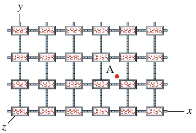

text_image

y
A
z
x

Abb. 33.3

Eine Ebene eines dreidimensionalen Gitters aus Messstäben und Uhren, mit dessen Hilfe ein Beobachter einem Ereignis – etwa einem Lichtblitz in Punkt A – Raumzeit-Koordinaten zuordnen kann. Die Ortskoordinaten sind ungefähr x = 3,7 Stablängen, y = 1,2 Stablängen, $z = 0 ,$ Die Zeitkoordinate ist im Moment des Blitzes an der Uhr abzulesen, die A am nächsten liegt.

In anspruchsvolleren Situationen kann dieses Verfahren sehr mühsam sein. Wir benötigen eine einfachere Methode, die das Problem der Laufzeit des Lichts zwischen Ereignis und Beobachter automatisch eliminiert. Ein Ansatz hierzu ist die Konstruktion eines gedachten Gitters, bestehend aus Messstäben (Linealen) und Uhren, das sich durch das gesamte Bezugssystem des Beobachters erstreckt und sich starr mit diesem bewegt. Diese Konstruktion mag etwas künstlich erscheinen – sie erspart uns aber Verwirrung und Rechenaufwand und sie erlaubt die einfache Bestimmung von Raum-, Zeit- und Raumzeit-Koordinaten, wie im Folgenden gezeigt werden soll.

1. Raumkoordinaten. Wir stellen uns vor, auf dem Koordinatensystem des Beob achters liege eine dicht gepackte dreidimensionale Anordnung von Messstäben in der Weise, dass die Stäbe jeweils parallel zu den Achsen verlaufen (Abb. 33.3). Mithilfe der Stäbe können wir die Koordinaten auf den Achsen ablesen. Das Er eignis bestehe beispielsweise im Anschalten einer kleinen Glühlampe. Um den Ort des Ereignisses festzustellen, zählen wir lediglich die Messstäbe, die in allen drei Raumrichtungen zwischen dem Koordinatenursprung und der Position der Glühlampe liegen.

2. Zeitkoordinate. Wir denken uns hierfür in jedem Kreuzungspunkt der Messstä be unseres Gitters eine kleine Uhr, die ein Beobachter im Schein des Lichts ablesen kann, das die Uhr vom Ereignis ausgehend erreicht. Abbildung 33.3 zeigt eine Ebene in dem so entstehenden Dickicht aus Stäben und Uhren.

Nun müssen wir für eine geeignete Synchronisation aller Uhren sorgen. Es genügt nicht, identische Uhren zu wählen, sie alle auf die gleiche Zeit einzustellen und dann an ihren jeweiligen Positionen zu befestigen – z. B. könnte es ja sein, dass sich die Ganggeschwindigkeit der Uhren bereits durch diese Bewegung ändert (was in der Tat der Fall ist). Das bedeutet, wir können die Uhren erst dann synchronisieren, wenn sie am gewünschten Ort angekommen sind.

Gäbe es ein Verfahren, Signale unendlich schnell zu übertragen, dann wäre eine solche Synchronisation nicht schwierig. Kein Signal kann jedoch diese Eigenschaft haben. Die größte physikalisch mögliche Geschwindigkeit c hat Licht (wobei diese Bezeichnung hier stellvertretend für das gesamte elektromagnetische Spektrum stehen soll), daher verwenden wir Lichtwellen für die Übertragung der für die Synchronisation erforderlichen Signale.

Eine der vielen Möglichkeiten, die beschriebene Anordnung von Uhren mithilfe von Lichtsignalen zu synchronisieren, ist die folgende: Der Beobachter bittet viele Helfer, sich bei je einer Uhr aufzustellen, wobei sein eigener Standpunkt zum Ursprung des Koordinatensystems erklärt wird. Wenn die Uhr im Ursprung $t = 0$ anzeigt, sendet der Beobachter einen Lichtpuls aus. Sobald der Puls eine der anderen Uhren erreicht, wird diese vom dort wartenden Helfer auf die Zeit $t = r / c$ gestellt; r ist der Abstand zwischen dem Ursprung und der betreffenden Uhr. Wurde für alle Uhren in dieser Weise verfahren, so ist die Synchronisation erfolgt.

3. Raumzeit-Koordinaten. Um einem Ereignis Raumzeit-Koordinaten zuzuordnen, muss der Beobachter nun lediglich die Uhr ablesen, die dem Ereignis am nächsten steht, und die räumliche Position anhand der nächstliegenden Mess stäbe ermitteln. Der zeitliche und räumliche Abstand zweier Ereignisse kann durch Subtraktion der zugehörigen Messwerte festgestellt werden. So umgehen wir die problematische Berechnung der Laufzeiten der Signale, die ein Beobachter von den Ereignissen empfängt.

## 33.1.3 Die Relativität der Gleichzeitigkeit

Nehmen wir an, ein Beobachter (Sam) registriert zwei voneinander unabhängige Ereignisse (Ereignis Rot und Ereignis Blau) gleichzeitig. Eine andere Beobachterin (Sally), die sich relativ zu Sam mit konstanter Geschwindigkeit v⃗ bewegt, zeichnet die Ereignisse ebenfalls auf. Nimmt auch Sally Rot und Blau als gleichzeitig wahr?

810

---

33.1 Gleichzeitigkeit und Zeitdilatation

33

Die Antwort lautet in der Regel nein:

Zwei relativ zueinander bewegte Beobachter sind sich im Allgemeinen nicht einig darüber, ob zwei Ereignisse gleichzeitig stattfinden oder nicht. Nimmt ein Beobachter die Ereignisse gleichzeitig wahr, so trifft das für den anderen in der Regel nicht zu.

Wir können nicht behaupten, einer der Beobachter habe Recht, der andere nicht. Beide Beobachtungen sind gleichermaßen gültig, und es gibt keinen Grund, eine gegenüber der anderen zu bevorzugen.

Ein Ergebnis von Einsteins Theorie ist also, dass zwei widersprüchliche Aussagen über ein und denselben realen Vorgang gleichermaßen korrekt sein können. Das mag auf den ersten Blick seltsam erscheinen. Sicherlich erinnern Sie sich aber daran, dass wir bereits in Kapitel 13 diskutiert hatten, wie sich Bewegung auf das Ergebnis einer Messung auswirken kann, ohne uns dabei jedoch Gedanken über die widersprüchlichen Resultate zu machen: Die Frequenz, die ein Beobachter für eine Schallwelle misst, hängt von der Bewegung des Beobachters relativ zur Schallquelle ab; wir bezeichnen dies als Doppler-Effekt. Zwei Beobachter, die sich relativ zueinander bewegen, können demnach gleichzeitig verschiedene Frequenzen derselben Welle messen – und beide Ergebnisse sind richtig.

Wir können nun folgenden Schluss ziehen:

Die Gleichzeitigkeit von Ereignissen ist niemals absolut, sondern stets relativ, denn sie hängt von der Bewegung des Beobachters ab.

Ist die Relativgeschwindigkeit zweier Beobachter sehr viel kleiner als die Lichtgeschwindigkeit, so weichen die von beiden gemessenen Zeitkoordinaten eines Ereignisses so wenig voneinander ab, dass man den Unterschied nicht feststellen kann. Dies deckt sich mit unserer Alltagserfahrung, und deshalb ist die Relativität der Gleichzeitigkeit etwas Ungewohntes für uns.

## Mehr zur Gleichzeitigkeit

Wir wollen die Relativität der Gleichzeitigkeit nun an einem Beispiel erläutern, das auf den Relativitätspostulaten fußt und nicht unmittelbar mit Messstäben oder Uhren zu tun hat. In Abb. 33.4 sehen Sie zwei lange Raumschiffe, Sally und Sam, die als inertiale Bezugssysteme für die beiden Beobachter Sally und Sam dienen sollen. Die Beobachter stehen jeweils in der Mitte ihres Raumschiffs; die Flugkörper entfernen sich entlang der gemeinsamen x-Achse voneinander, wobei die Geschwindigkeit von Sally relativ zu Sam gleich v⃗ ist. Abbildung 33.4a zeigt den Moment, in dem die Beobachter einander gerade genau gegenüberstehen.

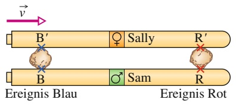

text_image

→
v
B'      ♀ Sally      R'
Ereignis Blau      Sam      R
Ereignis Rot

(a)

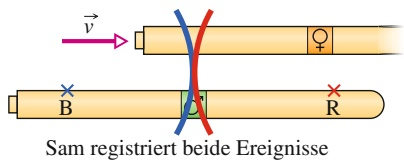

text_image

v
B
C
R
Sam registriert beide Ereignisse

(c)

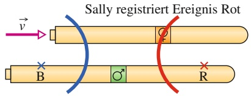

text_image

Sally registriert Ereignis Rot
→
B
Q
R

(b)

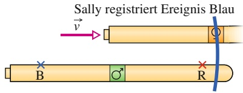

text_image

Sally registriert Ereignis Blau
→
v
B
O
R

(d)

## Abb. 33.4

Die Raumschiffe von Sally und Sam und die Abfolge der Ereignisse aus Sams Sicht. Sallys Schiff bewegt sich mit der Geschwindigkeit ν⃗ nach rechts. (a) Das Ereignis Rot erfolgt am Ort (R, R′), das Ereignis Blau in (B, B′). Beide Ereignisse senden eine Lichtwelle aus. (b) Sally registriert die Wellenfront von Rot. (c) Sam registriert gleichzeitig die Wellenfronten von Rot und Blau. (d) Sally registriert die Wellenfront von Blau.

811

---

33 Relativitätstheorie

Jetzt werden die Schiffe von zwei großen Meteoriten getroffen, wobei – nicht unbedingt gleichzeitig – ein roter Blitz (Ereignis Rot) und ein blauer Blitz (Ereignis Blau) aufleuchten. Die Positionen des Auftreffens, (R, R′) und (B, B′), bleiben auch nach den Ereignissen sichtbar.

Nehmen wir an, die von den beiden Ereignissen ausgehenden Wellenfronten erreichen Sam zur gleichen Zeit (Abb. 33.4c). Sam stellt außerdem durch Nachmessen fest, dass er sich im Augenblick der beiden Ereignisse tatsächlich exakt zwischen den Markierungen R und B auf seinem Schiff befand. Er kann dann Folgendes aussagen:

1. (Sam): „Das Licht von Ereignis Rot und das Licht von Ereignis Blau sind gleichzeitig bei mir eingetroffen. Aus den Markierungen der Einschläge habe ich entnommen, dass ich mich genau zwischen den beiden Quellen befand, als mich das Licht erreichte. Daraus schließe ich, dass Rot und Blau gleichzeitig stattgefunden haben.“

Bei der Betrachtung von Abb. 33.4 stellen wir fest, dass sich die Wellenfront des Ereignisses Rot auf Sally zu ausbreitet, während die des Ereignisses Blau sich in gleicher Richtung bewegt wie Sally. Die Wellenfront von Rot erreicht Sally deswegen eher als die Wellenfront von Blau, und die Beobachterin fasst zusammen:

2. (Sally): „Das Licht von Ereignis Rot erreichte mich eher als das Licht von Ereignis Blau. Aus den Markierungen der Einschläge habe ich entnommen, dass ich mich zu diesem Zeitpunkt genau zwischen den beiden Quellen befand. Folglich fand Ereignis Rot vor Ereignis Blau statt.“

Die Berichte stimmen offensichtlich nicht überein. Trotzdem sind beide richtig.

Führen Sie sich noch einmal vor Augen, dass vom Ort jedes Ereignisses nur jeweils eine Wellenfront ausgesendet wird und dass sich diese Wellenfronten in beiden Bezugssystemen mit derselben Geschwindigkeit c ausbreiten, wie es das Postulat der Lichtgeschwindigkeit fordert.

Die Meteoriten hätten die Raumschiffe auch so treffen können, dass Sally die Einschläge gleichzeitig wahrgenommen hätte. In diesem Fall wäre Sams Urteil gewesen, dass die Ereignisse nacheinander erfolgt seien.

## 33.1.4 Die Relativität der Zeit

Wenn relativ zueinander bewegte Beobachter das Zeitintervall (die zeitliche Entfernung) zwischen zwei Ereignissen messen, erhalten sie im Allgemeinen verschie dene Resultate. Der Grund dafür ist, dass der räumlich-zeitliche Abstand zwischen Ereignissen die gemessenen Zeitintervalle beeinflussen kann.

Das Zeitintervall zwischen zwei Ereignissen hängt von der räumlichen und zeitlichen Entfernung ab, in der die Ereignisse erfolgen. Das bedeutet, dass das räumliche und das zeitliche Intervall zwischen Ereignissen miteinander verknüpft sind.

In diesem Abschnitt wollen wir die Verknüpfung von Raum und Zeit anhand eines Beispiels diskutieren. Dieses Beispiel unterliegt allerdings einer wesentlichen Einschränkung: Einer der beiden Beobachter nimmt die beiden Ereignisse am gleichen Ort wahr. Erst in Abschn. 33.7 werden wir auch allgemeinere Beispiele besprechen.

In Abb. 33.5a sehen Sie die Anordnung eines Experiments, das Sally in einem bezüglich des nächsten Bahnhofs mit der konstanten Geschwindigkeit ⃗v fahrenden Zug ausführt. Ein Lichtpuls verlässt die Quelle B (Ereignis 1) senkrecht nach oben, wird an einem Spiegel nach unten reflektiert und am Ort der Quelle wieder registriert (Ereignis 2). Zwischen den Ereignissen vergeht Sallys Messung zufolge das Zeitintervall $\Delta t _ { 0 } ,$ das wie folgt mit dem Abstand zwischen Quelle und Spiegel zusammenhängt:

$$
\Delta t _ {0} = \frac {2 D}{c}. \tag {33.3}
$$

812

---

33.1 Gleichzeitigkeit und Zeitdilatation

33

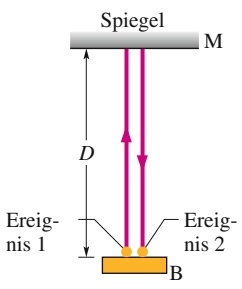

text_image

Spiegel
M
D
Ereig-
nis 1
B
Ereig-
nis 2

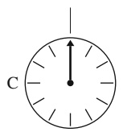

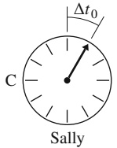

(a)

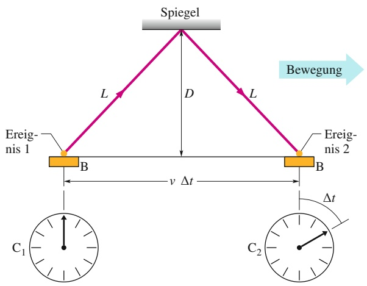

flowchart

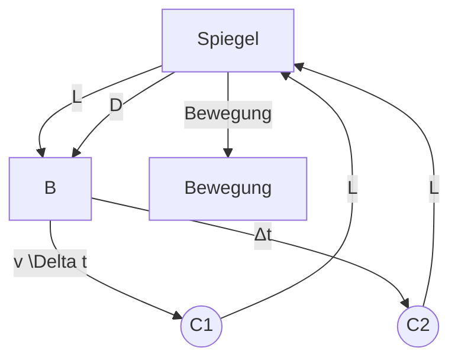

Sam

(b)

Beide Ereignisse finden in Sallys Bezugssystem am gleichen Ort statt. Um das Zeitintervall zu messen, benötigt Sally nur eine einzige Uhr in C. In Abb. 33.5a ist diese Uhr zweimal dargestellt, einmal zu Beginn und einmal am Ende des Intervalls.

Betrachten wir nun, welche Ergebnisse Sam erhält, der seine Messungen beim Vorbeifahren des Zugs vom Bahnsteig aus vornimmt. Die Anordnung des Experiments bewegt sich mit dem Zug; Sam sieht den Weg des Lichts deswegen so wie in Abb. 33.5b gezeigt und in seinem Bezugssystem finden die beiden Ereignisse an verschiedenen Orten statt. Um das Zeitintervall zwischen den Ereignissen zu messen, benötigt Sam folglich zwei synchronisierte Uhren $C _ { 1 }$ und $C _ { 2 }$ an den Orten von Ereignis 1 bzw. 2. Einsteins Postulat von der Lichtgeschwindigkeit zufolge bewegt sich das Licht für Sam und für Sally gleich schnell, nämlich mit der Geschwindig keit c. Zwischen den Ereignissen vergeht für Sam daher das Zeitintervall

$$
\Delta t = \frac {2 L}{c} \tag {33.4}
$$

mit

$$
L = \sqrt {\left(\frac {1}{2} \nu \Delta t\right) ^ {2} + D ^ {2}}. \tag {33.5}
$$

Mithilfe von Gl. 33.3 können wir dies auch in der Form

$$
L = \sqrt {\left(\frac {1}{2} \nu \Delta t\right) ^ {2} + \left(\frac {1}{2} c \Delta t _ {0}\right) ^ {2}} \tag {33.6}
$$

schreiben. Setzen wir L in Gln. 33.4 und 33.6 gleich und lösen nach Δt auf, so ergibt sich

$$
\Delta t = \frac {\Delta t _ {0}}{\sqrt {1 - (\nu / c) ^ {2}}} . \tag {33.7}
$$

Gleichung 33.7 gibt das Verhältnis zwischen dem von Sam (Δt) und dem von Sally $( \Delta t _ { 0 } )$ gemessenen Zeitintervall an. Weil v kleiner als c sein muss, ist der Nenner in Gl. 33.7 stets kleiner als 1, und folglich ist Δt größer als $\Delta t _ { 0 } ;$ Aus Sams Sicht vergeht zwischen den Ereignissen mehr Zeit als aus Sallys Sicht. Sam und Sally messen das Zeitintervall zwischen den beiden gleichen Ereignissen, aber infolge ihrer Bewegung relativ zueinander erhalten sie unterschiedliche Ergebnisse. Wir schließen

## Abb. 33.5

(a) Sally misst im fahrenden Zug das Zeitintervall $\Delta t _ { 0 }$ zwischen den Ereig nissen 1 und 2 mithilfe einer einzigen im Zug befindlichen Uhr C. Diese ist zweimal abgebildet, je einmal für Ereignis 1 bzw. 2. (b) Sam beobachtet die Ereignisse vom Bahnsteig aus. Er benötigt zwei synchronisierte Uhren $C _ { 1 }$ (für Ereignis 1) und $C _ { 2 }$ (für Ereignis 2), um das Zeitintervall festzustellen, und sein Resultat ist Δt.

813

---

33 Relativitätstheorie

daraus, dass sich durch eine Relativbewegung die Geschwindigkeit ändern kann, mit der die Zeit zwischen zwei Ereignissen vergeht. Die Ursache dieses Phänomens ist, dass die Lichtgeschwindigkeit für beide Beobachter gleich groß ist.

Zur Unterscheidung der Messungen von Sam und Sally führen wir die folgenden Begriffe ein:

Finden zwei Ereignisse in einem inertialen Bezugssystem an demselben Ort statt, so nennt man das in demselben Bezugssystem gemessene Zeitintervall zwischen ihnen das **Eigenzeitintervall** oder die **Eigenzeit**. Misst man dieses Intervall von einem beliebigen anderen Bezugssystem aus, so erhält man stets einen größeren Wert.

Das bedeutet, Sally misst im obigen Beispiel ein Eigenzeitintervall; folglich ist das von Sam gemessene Intervall länger. Den Betrag, um den ein gemessenes Zeitintervall vom zugehörigen Eigenzeitintervall abweicht, nennt man **Zeitdilatation** (Zeitdehnung).

Das dimensionslose Verhältnis v∕c in Gl. 33.7 wird oft als **Geschwindigkeitsparameter** $\beta$ bezeichnet und der Kehrwert der Quadratwurzel in dieser Gleichung wird zu dem sogenannten **Lorentz-Faktor** γ zusammengefasst:

$$
\gamma = \frac {1}{\sqrt {1 - \beta^ {2}}} = \frac {1}{\sqrt {1 - (\nu / c) ^ {2}}} . \tag {33.8}
$$

Damit lautet Gl. 33.7 für die Zeitdilatation („Zeitdehnung“)

$$
\Delta t = \gamma \Delta t _ {0}. \tag {33.9}
$$

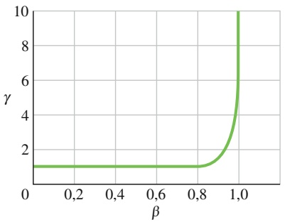

line

| \(\beta\) | \(\gamma\) |
| --- | --- |
| 0 | ~1 |
| 0.2 | ~1 |
| 0.4 | ~1 |
| 0.6 | ~1 |
| 0.8 | ~1 |
| 0.9 | ~2 |
| 1.0 | >10 |

Abb. 33.6

Der Lorentz-Faktor γ als Funktion des Geschwindigkeitsparameters $\beta = \nu / c$ (fällt Ihnen die Ähnlichkeit zu Abb. 33.2 auf?).

Der Geschwindigkeitsparameter $\cdot \beta$ ist stets kleiner als 1; γ hingegen ist stets größer als 1, sofern v größer als null ist. Die Differenz zwischen $\gamma$ und 1 wird aber erst für $\nu > 0 ,$ 1c relevant; in der Regel lässt sich die klassische Theorie der Relativität für $\nu < 0 ,$ ,1c noch sinnvoll anwenden. Erst wenn v größer wird, müssen wir mit der Speziellen Relativitätstheorie arbeiten. Wie das Diagramm in Abb. 33.6 zeigt, nimmt der Betrag von γ für $\cdot \beta \rightarrow 1$ (also $\nu \to c )$ schnell zu. Je schneller sich also Sally relativ zu Sam bewegt, umso größer wird das von Sam gemessene Zeitintervall. Ist die Relativgeschwindigkeit hinreichend hoch, so empfindet Sam das Intervall als „unendlich lang“.

Vielleicht fragen Sie sich nun, wie Sally die Abweichung der beiden Messungen voneinander kommentiert. Dass Sam einen größeren Wert erhalten hat, wird Sally nicht überraschen – aus ihrer Sicht hat Sam seine Uhren $C _ { 1 }$ und $C _ { 2 }$ (allen gegenteiligen Beteuerungen zum Trotz) nicht korrekt synchronisiert. Wie Sie sich erinnern werden, herrscht unter Beobachtern, die sich relativ zueinander bewegen, keine Einigkeit über die Gleichzeitigkeit von Ereignissen. Sam ist der Meinung, seine Uhren hätten im Moment von Ereignis 1 beide dieselbe Zeit angezeigt. Sally dagegen vertritt die Auffassung, Sam habe die Uhr $C _ { 2 }$ während der Synchronisation fälschlicherweise vorgestellt. Die von Sam an $C _ { 2 }$ für Ereignis 2 abgelesene Zeitkoordinate ist in Sallys Augen zu groß, weshalb Sam ein zu langes Zeitintervall erhalten musste.

## Experimentelle Nachweise der Zeitdilatation

1. Mikroskopische Uhren. Myonen (subatomare Teilchen, die mit dem Elektron verwandt sind) sind instabil – sie zerfallen kurze Zeit nach ihrer Entstehung, d. h., sie wandeln sich in andere Teilchen um. Als Lebensdauer eines Myons bezeichnet man das Zeitintervall zwischen seiner Erzeugung (Ereignis 1) und seinem Zerfall (Ereignis 2). Die mittlere Lebensdauer von Myonen beträgt $\mathrm { 2 , } 2 0 0   \mu \mathrm { s } ,$ gemessen an stationären Myonen mit stationären Uhren (z. B. in einem Labor). Es handelt sich dabei um das Eigenzeitintervall, denn die Er eignisse 1 und 2 finden am gleichen Ort – am Ort des Myons selbst – statt.

814

---

33.1 Gleichzeitigkeit und Zeitdilatation

33

Wir nennen dieses Intervall deshalb $\Delta t _ { 0 }$ und bezeichnen das Bezugssystem, in welchem es gemessen wurde, als Ruhesystem des Myons.

Wenn man dagegen die Lebensdauer eines bewegten (durch das Labor fliegenden) Myons mit einer im Labor stationären Uhr misst, erhält man aufgrund der Zeitdilatation eine längere mittlere Lebensdauer. Um diese Vorhersage nachzu prüfen, wurde die mittlere Lebensdauer von Myonen, die sich relativ zur Labor uhr mit einer Geschwindigkeit von 0,9994c bewegten, experimentell bestimmt. Aus Gl. 33.8 erhalten wir mit $\beta = 0 { , } 9 9 9 4$ den Lorentz-Faktor

$$
\begin{array}{l} \gamma = \frac {1}{\sqrt {1 - \beta^ {2}}} = \frac {1}{\sqrt {1 - (0 , 9 9 9 4) ^ {2}}} \\ = 2 8, 8 7. \\ \end{array}
$$

Gleichung 33.9 liefert dann für die mittlere Lebensdauer

$$
\Delta t = \gamma \Delta t _ {0} \cdot 2 8, 8 7 \cdot 2, 2 0 0 \mu \mathrm{s} = 6 3, 5 1 \mu \mathrm{s}.
$$

Der gemessene Wert stimmte innerhalb der experimentellen Fehlergrenzen des Experiments mit diesem Resultat überein.

2. Makroskopische Uhren. Im Oktober 1977 führten Joseph Hafele und Richard Keating ein Experiment aus, das sehr arbeitsaufwändig klingt. Sie luden vier tragbare Atomuhren in Maschinen öffentlicher Fluglinien und ließen sie je zweimal um die Welt fliegen, einmal in jeder Richtung. Ihr erklärtes Ziel war die Überprüfung von Einsteins Relativitätstheorie mit makroskopischen Uhren. Wie oben gezeigt wurde, gab es bereits Beweise für die Richtigkeit der Theorie im mikroskopischen Maßstab. Es erschien ihnen jedoch überzeugender, den Nachweis auch mit einer „richtigen“ Uhr zu führen. Die zugehörigen Messungen rückten erst nach der Erfindung hochpräziser moderner Atomuhren in den Bereich des Möglichen. Hafele und Keating bestätigten die Vorhersagen der Theorie innerhalb eines Toleranzbereichs von 10 %. (In diesem Experiment spielt auch die Allgemeine Relativitätstheorie eine Rolle. Sie beschreibt den Einfluss der auf eine Uhr wirkenden Gravitationskraft auf die Geschwindigkeit, mit der die Zeit an dieser Uhr vergeht.)

Einige Jahre später wiederholten Physiker von der Universität Maryland das Experiment mit noch höherer Genauigkeit. Sie ließen ein Flugzeug mit einer Atomuhr 15 Stunden lang Runden über der Chesapeake Bay fliegen und erhielten Werte für die Zeitdilatation, die um weniger als ein Prozent von den theoretischen Vorhersagen abwichen. Beim Transport von Atomuhren (z. B. zur Kalibrierung) wird heutzutage immer die Auswirkung der Bewegung auf die an gezeigte Zeit berücksichtigt.

## KONTROLLFRAGE 1

Stellen Sie sich vor, Sie stehen neben den Bahngleisen, als plötzlich ein relativistischer Güterwagen an Ihnen vorbeifährt (siehe Abbildung). Im Inneren des Güterwagens schießt jemand einen Laserpuls von der Frontseite in Richtung Rückseite und misst dessen Geschwindigkeit. (a) Würden Sie, außerhalb des Güterwagens stehend, eine größere, kleinere oder die gleiche Geschwindigkeit des Pulses messen wie die Person im Wagen? (b) Misst der Mann im Wagen als Flugzeit ein Eigenzeitintervall? (c) Ist der Zusammenhang zwischen seinem Messwert und Ihrem Messwert durch Gl. 33.9 gegeben?

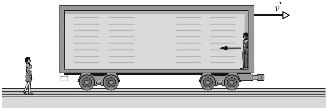

text_image

Diagram showing a person standing next to a cart with a truck, labeled with velocity vector v and directional arrows.

815

---

33 Relativitätstheorie

## 33.2 Die Relativität der Länge

## Lernziele

Nach dem Durcharbeiten dieses Abschnitts sollten Sie in der Lage sein, . . .

• zu verstehen, dass Messungen der Länge eines Objekts aufgrund der Verknüp fung von räumlichen und zeitlichen Abständen in zwei relativ zueinander be wegten Bezugssystemen unterschiedliche Ergebnisse liefern können,
• die Bedingung zu kennen, unter der eine gemessene Länge eine Eigenlänge ist,
• zu verstehen, dass wenn eine in einem Bezugssystem gemessene Länge eine Eigenlänge ist, diese Länge in einem anderen, relativ zum ersten (in Richtung dieser Länge) bewegten System kleiner ist,
• die Beziehung zwischen verkürzter Länge L, Eigenlänge $L _ { 0 }$ und Relativgeschwindigkeit v zweier Bezugssysteme anzuwenden.

## Schlüsselideen

Die Länge $L _ { 0 }$ eines Objekts, die ein Beobachter in einem Inertialsystem misst, in welchem das Objekt ruht, nennt man seine **Eigenlänge**. Beobachter in anderen Bezugssystemen, die sich relativ zum ersten in Richtung dieser Länge bewegen, werden immer eine kürzere Länge für dieses Objekt messen. Dieser Effekt wird als Längenkontraktion bezeichnet.
• Wenn die Relativgeschwindigkeit zwischen zwei Bezugssystemen v beträgt, hängen verkürzte (kontrahierte) Länge L und Eigenlänge $L _ { 0 }$ gemäß

$$
L = L _ {0} \sqrt {1 - \beta^ {2}} = \frac {L _ {0}}{\gamma}
$$

zusammen. Dabei sind $\beta = \nu / c$ der Geschwindigkeitsparameter und $\gamma = ( 1 -$ $\beta ^ { 2 } ) ^ { - 1 / 2 }$ der Lorentz-Faktor.

## 33.2.1 Die Relativität der Länge

Möchten Sie die Länge eines relativ zu Ihnen ruhenden Stabs feststellen, so kön nen Sie ohne Eile die Positionen der beiden Enden nacheinander auf einem hinreichend langen, ruhenden Lineal abtragen und die Werte anschließend voneinander abziehen. Bewegt sich der Stab jedoch relativ zu Ihnen, so müssen Sie entweder die Endpunkte gleichzeitig (in Ihrem Bezugssystem) markieren, oder Ihr Ergebnis kann nicht tatsächlich als „Länge des Stabs“ bezeichnet werden. Abbildung 33.7 zeigt als Beispiel, wie schwierig es sein kann, die Länge eines watschelnden Pinguins zu messen: Wenn Sie die Vorder- und die Rückseite der Kontur zu verschiedenen Zeitpunkten aufzeichnen, erhalten Sie einen offensichtlich unsinnigen Wert. Da aber Gleichzeitigkeit, wie wir bereits wissen, relativ ist und in die Längenmessung einfließt, sollte auch die Länge relativ sein. Das trifft in der Tat zu.

Es sei $L _ { 0 }$ die Länge eines Stabs, die Sie unter stationären Bedingungen gemessen haben (der Stab und Sie befanden sich im gleichen Bezugssystem, dem Ruhesystem des Stabs). Dann ist L die Länge, die Sie im Falle einer Bewegung des Stabs relativ zu Ihnen mit der Geschwindigkeit v (in Längsrichtung des Stabs) erhalten, sofern

Abb. 33.7

Wenn Sie die Länge eines watschelnden Pinguins vom Vorderende seiner Füße bis zur Schwanzspitze messen wollen, müssen Sie beide Punkte (in Ihrem Bezugssystem) simultan markieren (a), nicht nacheinander (b).

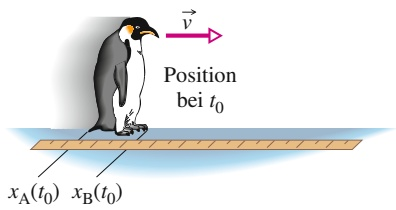

text_image

Position
bei t₀
xA(t₀) xB(t₀)

(a)

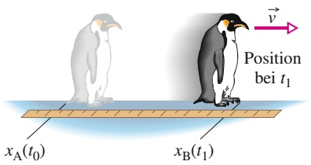

text_image

Position
bei t₁
xₐ(t₀)
xₑ(t₁)

(b)

816

---

33.2 Die Relativität der Länge

33

Sie die Positionen beider Enden gleichzeitig notieren:

$$
L = L _ {0} \sqrt {1 - \beta^ {2}} = \frac {L _ {0}}{\gamma}. \tag {33.10}
$$

Wenn v größer als null ist, also eine Relativbewegung stattfindet, ist der Lorentz-Faktor γ stets größer als 1 und L ist kleiner als $L _ { 0 } .$ Wir bezeichnen diesen Effekt deshalb als **Längenkontraktion** („Längenverkürzung“). Da $\gamma$ mit steigender Geschwindigkeit v zunimmt, nimmt auch die Längenkontraktion mit v zu.

Die Länge $L _ { 0 }$ eines Objekts, gemessen in dessen Ruhesystem, ist die Eigen**länge** oder Ruhelänge. Misst man die Länge des gleichen Objekts von einem Bezugssystem aus, das sich relativ zur Richtung der Längsausdehnung des Objekts bewegt, so erhält man stets einen kleineren Wert als $L _ { 0 }$

Vorsicht: Die Längenkontraktion macht sich nur in Richtung der Relativbewegung bemerkbar! Unter einer „Länge“ verstehen wir in diesem Zusammenhang auch nicht nur die Abmessung eines einzelnen Objekts (etwa eines Stabs oder eines Kreises), sondern auch einen Abstand zwischen zwei Objekten im gleichen Bezugssystem (etwa zwischen der Sonne und einem nahe gelegenen Stern, die, zumindest näherungsweise, relativ zueinander ruhen).

Schrumpft ein bewegtes Objekt tatsächlich zusammen? Die Realität gründet sich auf Erfahrung und auf Messungen: Sind die Resultate konsistent und lässt sich kein Fehler finden, so ist für uns $\mathbf { , } \mathbf { r e a l } ^ { \alpha } ,$ was wir sehen und messen. In dieser Hinsicht schrumpft ein bewegtes Objekt wirklich, obwohl man eigentlich exakter sagen muss: Wir messen tatsächlich, dass es schrumpft, wobei die Bewegung die Messung und damit die Realität beeinflusst.

Sie messen die Längenkontraktion eines relativ zu Ihnen bewegten Stabs. Was hält ein Beobachter, der sich gemeinsam mit dem Stab bewegt, von Ihrem Ergebnis? Für ihn erhalten Sie ein falsches Ergebnis, weil Sie die Enden des Stabs nicht exakt gleichzeitig abgetragen haben. (Wie Sie sich erinnern, herrscht unter relativ zueinander bewegten Beobachtern keine Einigkeit über die Gleichzeitigkeit von Ereignissen.) Der Beobachter wird behaupten, Sie hätten zuerst die Position des vorderen Endes aufgezeichnet und dann, einen winzigen Moment später, die des hinteren Endes. Folglich müssen Sie eine Länge erhalten, die kleiner ist als die Eigenlänge des Stabs.

## Herleitung von Gl. 33.10

Die Längenkontraktion ist eine direkte Folge der Zeitdilatation. Betrachten wir wieder Sally und Sam. Wieder sitzt Sally in einem Zug und fährt an Sam vorbei, der auf dem Bahnsteig steht. Beide wollen die Länge des Bahnsteigs messen. Mit dem Maßband ermittelt Sam die Eigenlänge $L _ { 0 } ,$ weil er sich relativ zum Bahnsteig nicht bewegt. Sam registriert außerdem, dass Sally (im Zug) die Zeit $\Delta t = L _ { 0 } / \nu$ benötigt (wenn v die Geschwindigkeit des Zugs ist), um den Bahnsteig zu passieren. Für Sam ist demnach

$$
L _ {0} = \nu \Delta t. \tag {33.11}
$$

Dabei ist $\Delta t$ kein Eigenzeitintervall, weil die beiden Ereignisse, welche die Länge des Intervalls festlegen (das Passieren des Anfangs und des Endes des Bahnsteigs), an zwei verschiedenen Orten stattfinden. Sam muss daher zwei synchronisierte Uhren verwenden, um Δt zu messen.

Aus Sallys Sicht hingegen bewegt sich der Bahnsteig am Zug vorbei. In ihrem Bezugssystem finden die von Sam gemessenen Ereignisse am gleichen Ort statt, weswegen sie eine einzige stationäre Uhr verwenden kann. Sie misst folglich $\Delta t _ { 0 } ,$ das Eigenzeitintervall. Die Länge L des Bahnsteigs ist für sie gegeben durch

$$
L = \nu \Delta t _ {0}. \tag {33.12}
$$

817

---

33 Relativitätstheorie

Nun teilen wir Gl. 33.12 durch Gl. 33.11 und verwenden Gl. 33.9 für die Zeitdilatation; das ergibt

$$
\frac {L}{L _ {0}} = \frac {\nu \Delta t _ {0}}{\nu \Delta t} = \frac {1}{\gamma}
$$

oder

$$
L = \frac {L _ {0}}{\gamma}. \tag {33.13}
$$

Dies entspricht genau Gl. 33.10 für die Längenkontraktion.

## KONTROLLFRAGE 2

In Beispielaufgabe 33.3 im Übungsbuch misst Sally die Zeit, die das Raumschiff zum Vorbeiflug benötigt. Nehmen wir an, Sam hätte diese Zeit auch gemessen. (a) Wer von beiden erhält eine Eigenzeit? (b) Wer misst den kleineren Wert?

## 33.3 Die Lorentz-Transformation

## Lernziele

Nach dem Durcharbeiten dieses Abschnitts sollten Sie in der Lage sein, . . .

• die Galilei-Transformation auf Bezugssysteme in relativer Bewegung anzuwenden, um den Ort eines Ereignisses vom einen Bezugssystem in das andere zu transformieren,
zu verstehen, dass die Galilei-Transformationen eine zulässige Näherung für kleine Relativgeschwindigkeiten sind, aber nur die Lorentz-Transformatio nen für alle physikalisch möglichen Geschwindigkeiten bis hinauf zur Lichtgeschwindigkeit korrekte Ergebnisse liefern,
• die Lorentz-Transformationen für räumliche und zeitliche Abstände von Ereignissen aus Sicht zweier Bezugssysteme mit der Relativgeschwindigkeit v anzuwenden,
• die Gleichung für Zeitdilatation und Längenkontraktion aus den Lorentz-Transformationen herzuleiten,
• mithilfe der Lorentz-Transformationen zu zeigen, dass wenn zwei Ereignisse in einem Bezugssystem gleichzeitig an verschiedenen Orten stattfinden, sie in keinem anderen, relativ zum ersten bewegten Bezugssystem gleichzeitig geschehen können.

## Schlüsselideen

Die Gleichungen der Lorentz-Transformationen geben den Zusammenhang zwischen den Raumzeit-Koordinaten eines einzelnen Ereignisses aus Sicht von Beobachtern in zwei unterschiedlichen inertialen Bezugssystemen S und $\mathsf { S } ^ { \prime }$ an, wenn sich $\mathsf { S } ^ { \prime }$ und S mit der Geschwindigkeit v gegeneinander bewegen (aus Sicht von S bewege sich $\mathsf { S } ^ { \prime }$ in die positive x-Richtung). Es gilt

$$
\begin{array}{l} x ^ {\prime} = \gamma (x - \nu t), \\ y ^ {\prime} = y, \\ z ^ {\prime} = z, \\ t ^ {\prime} = \gamma (t - \nu x / c ^ {2}). \\ \end{array}
$$

## 33.3.1 Die Lorentz-Transformation

Abbildung 33.8 zeigt ein inertiales Bezugssystem $\mathsf { S } ^ { \prime } ,$ das sich relativ zu einem zweiten Inertialsystem S mit der Geschwindigkeit v in positiver Richtung der gemeinsamen horizontalen Achse (x′ bzw. x) bewegt. Ein Beobachter in S registriert zu

818

---

33.3 Die Lorentz-Transformation

33

einem bestimmten Ereignis die Raumzeit-Koordinaten x, $y , z ,$ t; ein Beobachter in $\mathsf { S } ^ { \prime }$ ordnet demselben Ereignis die Koordinaten $x ^ { \prime } ,   y ^ { \prime } ,   z ^ { \prime } ,   \dot { t ^ { \prime } }$ zu. Welche Beziehung besteht zwischen den beiden Koordinatensätzen?

Wir behaupten vorläufig, dass die senkrecht zur Bewegungsrichtung liegenden Koordinaten y und z von der Bewegung nicht beeinflusst werden (dies wird später noch zu beweisen sein); es gilt also $y = y ^ { \prime }$ und $z = z ^ { \prime }$ . Damit beschäftigen uns nur noch die Beziehungen zwischen x und $x ^ { \prime }$ sowie zwischen t und $t ^ { \prime } ,$

## Die Galilei-Transformation

Bevor Einstein seine Spezielle Relativitätstheorie veröffentlicht hatte, ging man von folgendem Zusammenhang zwischen den vier genannten Koordinaten aus:

$$
\begin{array}{l} x ^ {\prime} = x - \nu t, \\ x ^ {\prime} = x - \nu t. \end{array} \tag {33.14}
$$

$$
t ^ {\prime} = t.
$$

Diese Gleichungen der Galilei-Transformation wurden hier unter der Annahme formuliert, dass die Koordinatenursprünge von S und $\mathsf { S } ^ { \prime }$ zum Zeitpunkt $t = 0$ zusammenfallen. Mithilfe von Abb. 33.8 können Sie die erste Gleichung sofort nachprüfen. Die zweite Gleichung sagt im Prinzip aus, dass die Zeit für Beobachter in beiden Systemen gleich schnell vergeht – ein Fakt, der für einen Physiker vor Einstein zu selbstverständlich war, als dass es hätte erwähnt werden müssen. Solange die Geschwindigkeit v viel kleiner als c ist, liefern die Gl. 33.14 im Wesentlichen korrekte Ergebnisse.

## Die Lorentz-Transformation

Ohne es hier beweisen zu wollen, halten wir fest, dass sich die korrekten, also bei beliebigen Geschwindigkeiten bis hin zu c gültigen Transformationsgleichungen aus den Relativitätspostulaten herleiten lassen. Die Gleichungen der Lorentz-Transformation1) lauten

$$
x ^ {\prime} = \gamma (x - \nu t),
$$

$$
y ^ {\prime} = y, \tag {33.15}
$$

$$
z ^ {\prime} = z,
$$

$$
t ^ {\prime} = \gamma (t - \nu x / c ^ {2}).
$$

(Wieder wurde bei der Formulierung angenommen, dass die Koordinatenursprünge von S und $\mathsf { S } ^ { \prime }$ zum Zeitpunkt $t = 0$ zusammenfallen.) Wie Sie bemerken, treten in der ersten und in der letzten Gleichung sowohl die Ortskoordinate x als auch die Zeitkoordinate t auf. Diese Verknüpfung von Raum und Zeit, eine der zentralen Aussagen von Einsteins Theorie, wurde von Einsteins Zeitgenossen lange angezweifelt.

Formal fordern wir, dass die relativistischen Gleichungen in die gewohnten klassischen Beziehungen übergehen, wenn wir c gegen Unendlich gehen lassen. Anders ausgedrückt: Wenn die Lichtgeschwindigkeit unendlich wäre, wären im Vergleich dazu alle anderen Geschwindigkeiten „klein“ und die klassischen Gleichungen wä- ren ohne Einschränkung anwendbar. Geht in Gl. 33.15 $c \to \infty$ , so geht $\gamma \rightarrow 1$ und die Beziehungen in der ersten und in der letzten Zeile reduzieren sich auf die Galilei-Transformation aus Gl. 33.14 – überzeugen Sie sich selbst!

text_image

y
S
y'
S'
→ v
vt
x
x'
Ereignis
x

Abb. 33.8

Zwei inertiale Bezugssysteme; System $\mathsf { S } ^ { \prime }$ bewegt sich relativ zu System S mit der Geschwindigkeit ⃗v.

<small>1) Vielleicht fragen Sie sich, warum man Gl. 33.15 nicht als Einstein-Transformation und γ nicht als Einstein-Faktor bezeichnet. Tatsächlich hatte Hendrik A. Lorentz diese Gleichungen schon vor Einstein hergeleitet, aber es dabei versäumt, den letzten Schritt zu vollziehen – ihre Interpretation als den wahren Zusammenhang zwischen Raum und Zeit in der Natur. Erst durch die von Einstein vorgenommene Deutung wurde diese Transformation zum Kern der Relativitätstheorie.</small>

819

---

33 Relativitätstheorie

Die angegebene Form von Gl. 33.15 ist besonders nützlich, wenn aus gegebenen Werten für x und t die Koordinaten $x ^ { \prime }$ und $t ^ { \prime }$ berechnet werden sollen. Manchmal will man umgekehrt vorgehen. Dazu müssen wir die Gleichungen nach x und t auflösen:

$$
x = \gamma (x ^ {\prime} + \nu t ^ {\prime}) \quad \text {und} \quad t = \gamma (t ^ {\prime} + \nu x ^ {\prime} / c ^ {2}). \tag {33.16}
$$

Ein Vergleich der Gln. 33.15 und 33.16 zeigt, dass sich der jeweils andere Satz von Koordinaten ergibt, wenn man gestrichene und ungestrichene Größen vertauscht sowie das Vorzeichen der Relativgeschwindigkeit v umkehrt.

Die Gln. 33.15 und 33.16 geben die Raumzeit-Koordinaten desselben Ereignisses an, nur eben aus Sicht zweier verschiedener Beobachter. Es kommt auch vor, dass man sich nicht für die Koordinaten eines einzelnen Ereignisses interessiert, sondern für die Differenz der Koordinaten zweier Ereignisse, die wir mit den Indizes 1 und 2 bezeichnen wollen. Gefragt sind dann die Beziehungen

$$
\Delta x = x _ {2} - x _ {1} \quad \text {und} \quad \Delta t = t _ {2} - t _ {1},
$$

gemessen von einem Beobachter in S, sowie

$$
\Delta x ^ {\prime} = x _ {2} ^ {\prime} - x _ {1} ^ {\prime} \quad \text {und} \quad \Delta t ^ {\prime} = t _ {2} ^ {\prime} - t _ {1} ^ {\prime},
$$

gemessen von einem Beobachter in $\mathsf { S } ^ { \prime } .$

In Tab. 33.2 finden Sie die Lorentz-Gleichungen in Differenzenform zur Analyse von Ereignispaaren. Sie ergeben sich einfach durch Einsetzen von Differenzgrößen wie $\Delta x$ oder $\Delta x ^ { \prime }$ für die entsprechenden Variablen in die Gln. 33.15 und 33.16.

Wenn Sie Zahlenwerte für diese Differenzen einsetzen wollen, müssen Sie die Koordinaten der Ereignisse 1 und 2 in den beiden Bezugssystemen sorgfältig auseinanderhalten. Achten Sie auch darauf, eventuell vorkommende negative Vorzeichen der Differenzen mit zu übernehmen.

TABELLE 33.2: Die Gleichungen der Lorentz-Transformation für Ereignispaare.a)

<table><tr><td colspan="2">S&#x27; nach S</td><td colspan="2">S nach S&#x27;</td></tr><tr><td>1.</td><td> $\Delta x = \gamma(\Delta x' + \nu\Delta t')$ </td><td>1&#x27;.</td><td> $\Delta x' = \gamma(\Delta x - \nu\Delta t)$ </td></tr><tr><td>2.</td><td> $\Delta t = \gamma(\Delta t' + \nu\Delta x'/c^2)$ </td><td>2&#x27;.</td><td> $\Delta t' = \gamma(\Delta t - \nu\Delta x/c^2)$ </td></tr><tr><td></td><td colspan="3"> $\gamma = \frac{1}{\sqrt{1-(\nu/c)^2}} = \frac{1}{\sqrt{1-\beta^2}}$ </td></tr></table>

a) Das Bezugssystem $\mathsf { S } ^ { \prime }$ bewegt sich relativ zum Bezugssystem S mit der Geschwindigkeit v.

## KONTROLLFRAGE 3

Die Abbildung zeigt drei Situationen, in denen sich ein blaues und ein grünes Bezugssystem relativ zueinander in der gemeinsamen x- bzw. $x ^ { \prime } .$ -Richtung bewegen, wie der an einem der Systeme eingezeichnete Geschwindigkeitsvektor angibt. Nehmen wir an, in allen Fällen ruhe das blaue Bezugssystem. Ist v in den Gleichungen aus Tab. 33.2 dann jeweils positiv oder negativ?

(a)

(b)

(c)

820

---

33.3 Die Lorentz-Transformation

33

## 33.3.2 Einige Folgen aus den Lorentz-Gleichungen

Mithilfe der in Tab. 33.2 angegebenen Transformationsgleichungen wollen wir jetzt einige der Schlussfolgerungen untermauern, die wir weiter oben bereits mit qualitativen Argumenten aus den Relativitätspostulaten gezogen haben.

## Gleichzeitigkeit

Betrachten wir Gl. 2 in Tab. 33.2,

$$
\Delta t = \gamma \left(\Delta t ^ {\prime} + \frac {\nu \Delta x ^ {\prime}}{c ^ {2}}\right). \tag {33.17}
$$

Wenn die beiden betrachteten Ereignisse an verschiedenen Orten im Bezugssystem $S ^ { \prime }   ( \mathrm { A b b . }   3 3 . 8 )$ stattfinden, ist $\Delta x ^ { \prime }$ hier ungleich null. Selbst wenn die Ereignisse in $\mathsf { S } ^ { \prime }$ gleichzeitig ablaufen $( \Delta t ^ { \prime } = 0 ) ,$ , gilt dies nicht für das Bezugssystem ${ \sf S } .$ (Dies steht im Einklang mit unserer Schlussfolgerung aus Abschn. 33.4.) Das Zeitintervall zwischen den Ereignissen in S ist dann

$$
\Delta t = \gamma \frac {\nu \Delta x ^ {\prime}}{c ^ {2}}.
$$

## Zeitdilatation

Nehmen wir nun an, die beiden Ereignisse finden in $\mathsf { S } ^ { \prime }$ am gleichen Ort statt $( \Delta x ^ { \prime } = 0 )$ , aber zu verschiedenen Zeiten $( \Delta t ^ { \prime } \neq 0 )$ . Gleichung 33.17 wird dann zu

$$
\Delta t = \gamma \Delta t ^ {\prime}, \tag {33.18}
$$

einer Beziehung für die Zeitdilatation. Da die beiden Ereignisse in $\mathsf { S } ^ { \prime }$ am gleichen Ort ablaufen, darf das Zeitintervall $\Delta t ^ { \prime }$ zwischen ihnen mit einer einzigen, ebenfalls an diesem Ort befindlichen Uhr gemessen werden. Es handelt sich dann um ein Eigenzeitintervall, das wir mit $\Delta t _ { 0 }$ bezeichnen können, und aus Gl. 33.18 wird

$$
\Delta t = \gamma \Delta t _ {0},
$$

also genau zu Gl. 33.9, die wir oben für die Zeitdilatation erhalten hatten.

## Längenkontraktion

Abschließend betrachten wir Gl. $1 ^ { \prime }$ aus Tab. 33.2,

$$
\Delta x ^ {\prime} = \gamma (\Delta x - \nu \Delta t). \tag {33.19}
$$

Liegt ein im System $\mathsf { S } ^ { \prime }$ ruhender Stab parallel zu den Achsen x und $x ^ { \prime }$ in Abb. 33.8, so kann ein Beobachter in $\mathsf { S } ^ { \prime }$ seine Länge ohne Weiteres messen. Dazu kann er beispielsweise die Koordinaten der Endpunkte des Stabs voneinander subtrahieren. Der Wert, den er dabei für $\Delta x ^ { \prime }$ erhält, ist die Eigenlänge $L _ { 0 }$ des Stabs.

Nehmen wir nun $\mathbf { a n } ,$ der Stab bewege sich im System S. Die Differenz $\Delta x$ kann nur dann als Länge $L$ des Stabs in $\mathsf { S }$ bezeichnet werden, wenn die Messung der Koordinaten der Endpunkte simultan vorgenommen wird (wenn also $\Delta t = 0$ ist). Setzen wir in Gl. 33.19 $\Delta x ^ { \prime } = L _ { 0 } ,   \Delta x = L$ und $\Delta t = 0 ,$ , so ergibt sich

$$
L = \frac {L _ {0}}{\gamma}. \tag {33.20}
$$

Das ist exakt Gl. 33.10, die wir oben für die Längenkontraktion gefunden hatten.

821

---

33 Relativitätstheorie

## 33.4 Die Relativität der Geschwindigkeiten

## Lernziele

Nach dem Durcharbeiten dieses Abschnitts sollten Sie in der Lage sein, . . .

• anhand einer Skizze zu erklären, wie man relativistisch korrekt die Geschwindigkeit eines Teilchens relativ zu zwei Bezugssystemen misst, die sich relativ zueinander bewegen,
• die Beziehung für die relativistische Geschwindigkeitstransformation zwischen zwei Bezugssystemen, die sich relativ zueinander bewegen, anzuwenden.

## Schlüsselideen

Wenn ein Teilchen sich mit der Geschwindigkeit $u ^ { \prime }$ in die positive $x ^ { \prime } .$ Richtung eines Inertialsystems $\mathsf { S } ^ { \prime }$ bewegt, das sich seinerseits mit der Geschwindigkeit v parallel zur x-Richtung eines zweiten Inertialsystems S bewegt, dann misst man im System S die Teilchengeschwindigkeit

$$
u = \frac {u ^ {\prime} + \nu}{1 + u ^ {\prime} \nu / c ^ {2}}.
$$

## 33.4.1 Die Relativität der Geschwindigkeiten

flowchart

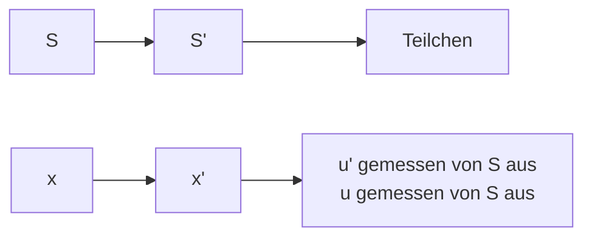

Abb. 33.9

Das Bezugssystem $\mathsf { S } ^ { \prime }$ bewegt sich mit der Geschwindigkeit ⃗v relativ zu dem Bezugssystem ${ \sf S } .$ Ein Teilchen bewegt sich gemessen von $\mathsf { S } ^ { \prime }$ aus mit der Geschwindigkeit $\vec { u } ^ { \prime } ,$ gemessen von S aus mit der Geschwindigkeit u⃗.

Mithilfe der Lorentz-Transformation wollen wir nun die Geschwindigkeiten vergleichen, die zwei Beobachter in verschiedenen Bezugssystemen (S und $S ^ { \prime } )$ für ein und dasselbe bewegte Teilchen messen. Das System $\bar { S ^ { \prime } }$ bewege sich relativ zu $\mathsf { S }$ mit der Geschwindigkeit v.

Während sich das Teilchen mit konstanter Geschwindigkeit parallel zu den Achsen x und $x ^ { \prime }$ in Abb. 33.9 fortbewegt, sende es zwei Signale aus. Jeder der beiden Beobachter misst den räumlichen und den zeitlichen Abstand dieser Ereignisse. Der Zusammenhang zwischen den insgesamt vier Messwerten ist gegeben durch die Gln. 1 und 2 aus Tab. 33.2:

$$
\Delta x = \gamma (\Delta x ^ {\prime} + \nu \Delta t ^ {\prime})
$$

und

$$
\Delta t = \gamma \left(\Delta t ^ {\prime} + \frac {\nu \Delta x ^ {\prime}}{c ^ {2}}\right).
$$

Wir teilen die obere Gleichung durch die untere und erhalten so

$$
\frac {\Delta x}{\Delta t} = \frac {\Delta x ^ {\prime} + \nu \Delta t ^ {\prime}}{\Delta t ^ {\prime} + \nu \Delta x ^ {\prime} / c ^ {2}}.
$$

Auf der rechten Seite dieser Beziehung teilen wir Zähler und Nenner durch $\Delta t ^ { \prime } ;$ das ergibt

$$
\frac {\Delta x}{\Delta t} = \frac {\Delta x ^ {\prime} / \Delta t ^ {\prime} + \nu}{1 + \nu (\Delta x ^ {\prime} / \Delta t ^ {\prime}) / c ^ {2}}.
$$

Wenn die Differenzen in Ableitungen übergehen, ist $\Delta x / \Delta t = u$ (die in S gemessene Geschwindigkeit des Teilchens) und $\Delta x ^ { \prime } / \Delta t ^ { \prime } = u ^ { \prime }$ (die in $\mathsf { S } ^ { \prime }$ gemessene Geschwindigkeit). Für die relativistische Transformation der Geschwindigkeit ergibt sich somit

$$
u = \frac {u ^ {\prime} + \nu}{1 + u ^ {\prime} \nu / c ^ {2}}. \tag {33.21}
$$

Wenn wir formal $c \rightarrow$ ∞ gehen lassen, so reduziert sich dieser Ausdruck auf die klassische (Galilei-)Transformation der Geschwindigkeit:

$$
u = u ^ {\prime} + \nu . \tag {33.22}
$$

822

---

33.5 Der Doppler-Effekt für Lichtwellen

33

Mit anderen Worten: Gleichung 33.21 gilt für beliebige physikalisch mögliche Geschwindigkeiten, während Gl. 33.22 eine geeignete Näherung für Geschwindigkeiten ist, die viel kleiner als c sind.

## 33.5 Der Doppler-Effekt für Lichtwellen

## Lernziele

Nach dem Durcharbeiten dieses Abschnitts sollten Sie in der Lage sein, . . .

• zu verstehen, dass die Frequenz von Licht aus Sicht eines Bezugssystems, in welchem die Lichtquelle ruht, die Eigenfrequenz ist,
• bei zu- bzw. abnehmendem Abstand zwischen Quelle und Detektor anzugeben, ob die gemessene Frequenz höher oder niedriger als die Eigenfrequenz liegt, zu verstehen, dass die Frequenzänderung mit steigender Relativgeschwindigkeit zunimmt, und mit den Begriffen Blau- und Rotverschiebung umzugehen,
• zu verstehen, was eine Radialgeschwindigkeit ist,
• bei zu- bzw. abnehmendem Abstand zwischen Quelle und Detektor die Beziehungen zwischen Eigenfrequenz $f _ { 0 } ,$ gemessener Frequenz f und Radialgeschwindigkeit v anzuwenden,
• zwischen den Gleichungen für die Frequenzverschiebung und die Wellenlängenänderung hin- und herzuwechseln,
• für Radialgeschwindigkeiten, die viel kleiner als die Lichtgeschwindigkeit sind, die Näherungslösung für Wellenlängenänderung $\Delta \lambda ,$ Eigenwellenlänge $\lambda _ { 0 }$ und Radialgeschwindigkeit v anzuwenden,
• zu wissen, dass es bei Licht (anders als bei Schall) selbst dann eine Frequenzverschiebung gibt, wenn die Quelle sich senkrecht zur Verbindungslinie von Quelle und Detektor bewegt (dies liegt an der Zeitdilatation),
• die Beziehung für den transversalen Doppler-Effekt anzuwenden, indem Sie gemessene Frequenz $f ,$ Eigenfrequenz $f _ { 0 }$ und Relativgeschwindigkeit v zueinander in Beziehung setzen.

## Schlüsselideen

• Wenn sich eine Lichtquelle und ein Lichtdetektor relativ zueinander bewegen, ist die im Ruhesystem der Quelle gemessene Wellenlänge die Eigenwellenlänge $\lambda _ { 0 }$ . Die gemessene Wellenlänge λ kann sowohl länger (Rotverschiebung) als auch kürzer (Blauverschiebung) sein, je nachdem ob der Abstand zwischen Quelle und Detektor zu- oder abnimmt.

• Wenn der Abstand zunimmt, hängen die Wellenlängen gemäß

$$
\lambda = \lambda_ {0} \sqrt {\frac {1 + \beta}{1 - \beta}}
$$

zusammen, wobei $\beta = \nu / c$ ist und v die relative radiale Geschwindigkeit entlang der Verbindungslinie von Quelle und Detektor bezeichnet. Wenn der Abstand abnimmt, muss man die Vorzeichen vor dem $\beta$ jeweils umkehren.

• Für Geschwindigkeiten, die viel kleiner als c sind, gilt für den Betrag der Doppler-Verschiebung $\Delta \lambda = \lambda - \lambda _ { 0 }$ der Wellenlängen näherungsweise

$$
\nu = \frac {| \Delta \lambda |}{\lambda_ {0}} c \quad (\nu \ll c).
$$

• Wenn die relative Bewegung der Lichtquelle senkrecht auf der Verbindungslinie von Quelle und Detektor steht, hängt die gemessene Frequenz $f$ mit der Eigenfrequenz $f _ { 0 }$ gemäß

$$
f = f _ {0} \sqrt {1 - \beta^ {2}}
$$

zusammen. Dieser transversale Doppler-Effekt wird von der Zeitdilatation verursacht.

823

---

33 Relativitätstheorie

## 33.5.1 Der Doppler-Effekt für Lichtwellen

In Abschn. 13.7 hatten wir den Doppler-Effekt (eine Verschiebung der gemessenen Wellenlänge) für Schallwellen in Luft besprochen. In diesem Fall hing der Doppler-Effekt von zwei Geschwindigkeiten ab, derjenigen der Quelle und derjenigen des Detektors jeweils bezüglich des Trägermediums der Welle (Luft).

Anders gestaltet sich die Situation bei Lichtwellen (und allen anderen elektromagnetischen Wellen): Wie wir wissen, benötigen diese Wellen kein Ausbreitungsmedium, sie können sich sogar im Vakuum ausbreiten. Der Doppler-Effekt für Lichtwellen hängt deshalb nur von einer Geschwindigkeit ab, nämlich der Geschwindigkeit $\vec { \nu }$ der Quelle relativ zum Detektor, gemessen von einem beliebigen der beiden Bezugssysteme aus. Es sei $f _ { 0 }$ die **Eigenfrequenz** der Quelle – die Frequenz, die ein Beobachter im Ruhesystem der Quelle misst. Ein Beobachter, der sich mit der Geschwindigkeit $\vec { \nu }$ relativ zu diesem Ruhesystem bewegt, messe die Frequenz $f .$ Wenn v⃗ direkt von der Quelle weg gerichtet ist, gilt

$$
f = f _ {0} \sqrt {\frac {1 - \beta}{1 + \beta}} \tag {33.23}
$$

mit $\beta = \nu / c$ . Wenn v⃗ hingegen direkt auf die Quelle gerichtet ist, müssen wir die Vorzeichen vor $\beta$ im Zähler und im Nenner von Gl. 33.23 umkehren.

Da man bei Licht oft die Wellenlänge statt der Frequenz misst, schreiben wir Gl. 33.23 um, indem wir $f$ durch $c / \lambda$ und $f _ { 0 }$ durch $c / \lambda _ { 0 }$ ersetzen, wobei λ die gemessene Wellenlänge und $\lambda _ { 0 }$ die Eigenwellenlänge bezeichnen soll. Wir kürzen c auf beiden Seiten heraus und erhalten für den Fall, dass Quelle und Detektor sich voneinander entfernen,

$$
\lambda = \lambda_ {0} \sqrt {\frac {1 + \beta}{1 - \beta}}. \tag {33.24}
$$

Wenn v⃗ direkt auf die Quelle zu gerichtet ist, müssen wir in den Gln. 33.23 und 33.24 lediglich überall das Vorzeichen von $\beta$ umkehren.

Wenn der Abstand zwischen Quelle und Detektor zunimmt, erkennen wir aus Gl. 33.24 (eine Addition im Zähler und eine Subtraktion im Nenner), dass die gemessene Wellenlänge größer ist als die Eigenwellenlänge. Solch eine Doppler-Verschiebung nennt man eine Rotverschiebung, was aber nicht bedeutet, dass irgendwelche „roten“ Wellenlängen im Spiel wären – es bedeutet lediglich, dass die Wellenlänge zunimmt (die roten Farbtöne bilden das langwellige Ende des sichtbaren Spektrums). Entsprechend spricht man bei kleiner werdendem Abstand zwischen Quelle und Detektor, wenn λ kleiner als $\lambda _ { 0 }$ ist, von einer Blauverschiebung.

## Der Doppler-Effekt bei niedrigen Geschwindigkeiten

Für niedrige Geschwindigkeiten (also $\beta \ll 1 )$ kann Gl. 33.23 in eine Potenzreihe in $\beta$ entwickelt werden. Näherungsweise gilt dann

$$
f = f _ {0} \left(1 - \beta + \frac {1}{2} \beta^ {2}\right). \tag {33.25}
$$

In der entsprechenden, bei geringer Geschwindigkeit gültigen Gleichung für den Doppler-Effekt des Schalls (oder beliebiger anderer nicht elektromagnetischer Wellen) treten die ersten beiden Terme ebenfalls auf, der Koeffizient des dritten Terms ist jedoch ein anderer. Die relativistische Natur des Doppler-Effekts für Lichtquellen und -detektoren äußert sich folglich nur im $\beta ^ { 2 }$ -Term.

Radarmessgeräte, wie sie die Polizei zur Messung der Geschwindigkeit von Fahr zeugen verwendet, nutzen den Doppler-Effekt bei Mikrowellen aus. Eine Quelle in nerhalb der Radareinheit emittiert einen Mikrowellenstrahl mit einer bestimmten (Eigen-)Frequenz $f _ { 0 }$ entlang der Straße. Auf ein Fahrzeug, das sich auf die Quelle

824

---

33.5 Der Doppler-Effekt für Lichtwellen

33

zubewegt, trifft dieser Strahl mit einer entsprechend dem Doppler-Effekt infolge der Relativbewegung von Auto und Sender erhöhten Frequenz. Der Strahl wird an dem Fahrzeug reflektiert; aufgrund der Relativbewegung ist die Frequenz des Strahls, der schließlich wieder am Detektor eintrifft, nochmals nach oben verschoben. Das Messgerät vergleicht die Frequenz des empfangenen Signals mit $f _ { 0 }$ und berechnet aus der Differenz die Geschwindigkeit v des Fahrzeugs.

## Der Doppler-Effekt in der Astronomie

Aus den Daten astronomischer Beobachtungen von Sternen, Galaxien und anderen Lichtquellen kann man berechnen, wie schnell sich diese Objekte direkt von uns weg- oder auf uns zubewegen. Dazu misst man die Doppler-Verschiebung des auf der Erde eintreffenden Lichts. Von einem relativ zur Erde ruhenden Stern würden wir Licht mit einer bestimmten Eigenfrequenz $f _ { 0 }$ empfangen. Bewegt sich der Stern jedoch von der Erde weg oder auf sie zu, so empfangen wir Licht mit der Frequenz $f ,$ welche infolge des Doppler-Effekts relativ zu $f _ { 0 }$ verschoben ist. Diese Doppler-Verschiebung wird ausschließlich von der Radialbewegung des Objekts bezüglich der Erde (in direkter Linie auf sie zu oder von ihr weg) verursacht. Das bedeutet, eine derartige Messung berücksichtigt lediglich die radiale Komponente der Bewegung des Sterns relativ zur Erde.

Nehmen wir an, die Radialgeschwindigkeit v einer Lichtquelle sei hinreichend klein $( \beta$ ist hinreichend klein), sodass wir den $\beta ^ { 2 } \text {-} \mathrm { T e r m }$ in Gl. 33.25 vernachlässigen können. Außerdem wollen wir den β-Term explizit mit einem ±-Zeichen versehen: Das Minuszeichen steht für die radiale Bewegung von der Erde weg, das Pluszeichen die radiale Bewegung auf sie zu. Gleichung 33.25 wird somit zu

$$
f = f _ {0} (1 \pm \beta). \tag {33.26}
$$

In der Astronomie charakterisiert man Lichtwellen in der Regel nicht durch ihre Frequenz, sondern durch ihre Wellenlänge. Wir ersetzen also $f$ durch $c / \lambda$ und $f _ { 0 }$ durch $c / \lambda _ { 0 } ; \lambda$ ist die gemessene Wellenlänge, $\lambda _ { 0 }$ die **Eigenwellenlänge**. In Gl. 33.26 setzen wir noch $\beta = \nu / c$ ein. Wir erhalten dann

$$
\frac {c}{\lambda} = \frac {c}{\lambda_ {0}} \left(1 \pm \frac {\nu}{c}\right)
$$

und daraus

$$
\nu = \pm \frac {\lambda - \lambda_ {0}}{\lambda} c.
$$

Üblicherweise schreibt man diesen Ausdruck in der Form

$$
\nu = \frac {\Delta \lambda}{\lambda} c \tag {33.27}
$$

mit $\Delta \lambda = | \lambda - \lambda _ { 0 } |$ als Doppler-Verschiebung der Wellenlänge der Lichtquelle.

## KONTROLLFRAGE 4

Die Abbildung zeigt eine Quelle, die Licht mit der Eigenfrequenz $f _ { 0 }$ emittiert, während sie sich mit der Geschwindigkeit $c / 4$ (gemessen vom Bezugssystem S aus) nach rechts bewegt. Ein Detektor (links) misst die Frequenz $f$ des emittierten Lichts mit $f > f _ { 0 ^ { \cdot } } ( { \mathsf { a } } )$ Bewegt sich der Detektor nach rechts oder nach links? (b) Ist die Geschwindigkeit des Detektors, gemessen vom Bezugssystem S aus, größer als, kleiner als oder gleich $c / 4 ?$

text_image

Detektor
Quelle
c/4
S

825

---

33 Relativitätstheorie

text_image

S
v
P
D

Abb. 33.10

Eine Lichtquelle S bewegt sich mit der Geschwindigkeit ⃗v an einem Detektor D vorbei. Die Spezielle Relativitätstheorie sagt einen transversalen Doppler-Effekt voraus, der in dem Moment wirkt, wo die Quelle Punkt P passiert (dort steht ihre Bewegungsrichtung senkrecht auf der Verbindungslinie zwischen P und D). Die klassische Theorie erfasst diesen Effekt nicht.

## Der transversale Doppler-Effekt

Bisher – sowohl hier als auch in Kapitel 13 – haben wir den Doppler-Effekt nur für den Fall diskutiert, dass sich Quelle und Detektor direkt aufeinander zu oder voneinander wegbewegen. Abbildung 33.10 zeigt eine prinzipiell andere Anordnung: Eine Strahlungsquelle S bewegt sich am Detektor D vorbei. In Punkt P ist die Geschwindigkeit von S senkrecht zur Verbindungslinie zwischen D und S gerichtet; in diesem Moment bewegt sich S weder auf D zu noch davon weg. Emittiert die Quelle Schallwellen der Frequenz $f _ { 0 } ,$ so empfängt der Detektor Wellen exakt dieser Frequenz (ohne Doppler-Verschiebung), vorausgesetzt, diese wurden genau in P abgestrahlt. Sendet die Quelle hingegen Lichtwellen aus, so macht sich der **transversale Doppler-Effekt** bemerkbar. Lichtwellen, die in P mit der Frequenz $f _ { 0 }$ emittiert wurden, kommen dann mit der Frequenz

$$
f = f _ {0} \sqrt {1 - \beta^ {2}} \tag {33.28}
$$

am Detektor D an.

Bei kleinen Geschwindigkeiten (also $\beta \ll 1 )$ kann Gl. 33.28 in eine Potenzreihe in $\beta$ entwickelt werden, und es gilt näherungsweise

$$
f = f _ {0} \left(1 - \frac {1}{2} \beta^ {2}\right). \tag {33.29}
$$

Der erste Term entspricht unseren Erwartungen für Schallwellen; der relativistische Effekt für Lichtquellen und -detektoren mit niedriger Relativgeschwindigkeit kommt auch hier ausschließlich durch den $\beta ^ { 2 } \cdot$ Term zum Ausdruck.

Im Prinzip kann ein Radarmessgerät der Polizei auch die Geschwindigkeit eines Autos messen, das sich senkrecht zur Ausbreitungsrichtung des Messstrahls bewegt. Auch für ein sehr schnelles Auto ist $\beta$ jedoch klein; der relativistische Term $\beta ^ { 2 } / 2$ in Gl. 33.29 wird dann extrem klein. Daher gilt $f \approx f _ { 0 } ,$ und das Messgerät ermittelt eine Geschwindigkeit von null. Der Polizist versucht das Messgerät deshalb stets entlang der Bewegungsrichtung des Fahrzeugs (der Straße) auszurichten, um dessen tatsächliche Geschwindigkeit zu ermitteln. Jede Abweichung von der idealen Richtung wirkt zugunsten des Autofahrers, denn sie führt zu einer kleineren gemessenen Geschwindigkeit.

Anhand des transversalen Doppler-Effekts können wir ein weiteres Mal die Zeitdilatation überprüfen. Wir formulieren Gl. 33.28 dazu nicht als Funktion von $f ,$ sondern von $T ,$ der Schwingungsperiode des emittierten Lichts. Wegen $T = 1 / f$ ist dann

$$
T = \frac {T _ {0}}{\sqrt {1 - \beta^ {2}}} = \gamma T _ {0} \tag {33.30}
$$

mit $T _ { 0 } = 1 / f _ { 0 }$ als der **Eigenperiode** der Quelle. Wie ein Vergleich mit Gl. 33.9 zeigt, gibt Gl. 33.30 einfach die Zeitdilatation an, weil eine Schwingungsperiode eine Zeitspanne ist.

## Das Navigationssystem GPS

Die Satelliten des GPS-Ortungssystems senden ständig Radiosignale auf einer festen, durch hochpräzise Atomuhren geregelten Frequenz. Ein Empfänger beispielsweise in einem Flugzeug registriert ein solches Signal auf einer infolge des Doppler-Effekts gegenüber dem Ausgangswert verschobenen Frequenz. Werden nun Signale von mehreren GPS-Satelliten gleichzeitig empfangen, kann der Detektor die Richtung jedes einzelnen Senders sowie die Bewegungsrichtungen aller Sender ermitteln. Aus der Doppler-Verschiebung des Signals berechnet der Detektor schließlich die Geschwindigkeit des Flugzeugs.

826

---

33.6 Impuls und Energie

33

Die Funktionsweise dieses Verfahrens wollen wir an einem Beispiel mit gerundeten Zahlenwerten erläutern. Relativ zum Erdmittelpunkt bewege sich ein GPS-Satellit mit einer Geschwindigkeit von $^ { 1 , 0   \cdot   1 0 ^ { 4 } }$ m/s. Der zugehörige Wert von $\beta$ ist ungefähr $^ { 3 , 0 \cdot 1 0 ^ { - 5 } . }$ . Für den Relativitätsterm $\beta ^ { 2 } / 2$ in Gl. 33.25 und Gl. 33.29 erhalten wir damit $4 \mathrm { , } 5 \cdot 1 0 ^ { - 1 0 }$ . Die relativistischen Effekte machen in anderen Worten gerade $4 { , } 5 / 1 0 ^ { 1 0 }$ der Doppler-Verschiebung des Signals aus – ein so geringer Wert scheint kaum erwähnenswert zu sein.

Wie wir jetzt zeigen werden, täuscht dieser Eindruck. Die Atomuhren an Bord der Satelliten sind so präzise, dass die Frequenz des Signals maximal um $2 / 1 0 ^ { 1 2 }$ abweicht. Gleichung 33.29 entnehmen wir, dass $\beta$ (und damit v) von der Quadratwurzel aus $f / f _ { 0 }$ abhängt. Die Frequenzvariation des Senders um $2 \cdot 1 0 ^ { - 1 2 }$ verursacht demnach eine Abweichung von

$$
\sqrt {2 \cdot 1 0 ^ {- 1 2}} = 1, 4 \cdot 1 0 ^ {- 6}
$$

des Messwerts für die Geschwindigkeit v des Flugzeugs relativ zum Satelliten.

Die Relativgeschwindigkeit v entsteht vorrangig durch die schnelle Bewegung des Satelliten mit $1 , 0 \cdot 1 0 ^ { 4 }   \mathrm { m / s }$ . Das bedeutet, $\nu$ (und folglich die Geschwindigkeit des Flugzeugs) kann mit einer Genauigkeit von ungefähr

$$
(1, 4 \cdot 1 0 ^ {- 6}) (1, 0 \cdot 1 0 ^ {4} \mathrm{m/s}) = 1, 4 \mathrm{cm/s}
$$

ermittelt werden. Nehmen wir $\mathbf { a n } ,$ das Flugzeug fliege eine Stunde (3600 s) lang. Kennt man die Geschwindigkeit auf rund 1,4 cm/s genau, lässt sich die Position am Ende der Flugzeit auf

$$
(0, 0 1 4) (3 6 0 0 \mathrm{s}) = 5 0 \mathrm{m}
$$

genau vorhersagen. Für die moderne Navigation ist dieser Toleranzbereich akzeptabel.

Ohne Berücksichtigung relativistischer Effekte könnte die Geschwindigkeit des Flugzeugs auf höchstens 21 cm/s genau bestimmt werden. Der Variationsbereich der Position am Ende einer Flugstunde wäre dann mindestens 760 m groß!

## 33.6 Impuls und Energie

## Lernziele

Nach dem Durcharbeiten dieses Abschnitts sollten Sie in der Lage sein, . . .

zu verstehen, dass die klassischen Ausdrücke für Impuls und kinetische Energie gute Näherungen für langsame Geschwindigkeiten darstellen, während die relativistischen Ausdrücke für alle physikalisch möglichen Geschwindigkeiten korrekte Ergebnisse liefern,
• die relativistische Beziehung zwischen Impuls, Masse und Relativgeschwindigkeit anzuwenden,
• zu verstehen, dass ein Objekt eine Ruheenergie besitzt, die unmittelbar mit seiner Masse verknüpft ist,
• die Beziehungen zwischen Gesamtenergie, Ruheenergie, kinetischer Energie, Impuls, Masse, Geschwindigkeit, Geschwindigkeitsparameter $\beta$ und Lorentz-Faktor γ anzuwenden,
• die kinetische Energie gegen das Verhältnis $\nu / c$ (Geschwindigkeit zu Lichtgeschwindigkeit) aufzutragen, und zwar sowohl für den klassischen wie für den relativistischen Ausdruck der kinetischen Energie,
• die Beziehung zwischen dem Q-Wert einer chemischen oder Kernreaktion und der Änderung der Ruheenergie anzuwenden,
• zu verstehen, wie das Vorzeichen von $Q$ einer chemischen oder Kernreaktion bestimmt, ob Energie freigesetzt oder absorbiert wird.

827

---

33 Relativitätstheorie

## Schlüsselideen

• Die folgenden Definitionen von linearem Impuls $\vec { p } ,$ kinetischer Energie K und Gesamtenergie $E$ eines Teilchens der Masse m gelten für jede physikalisch mögliche Geschwindigkeit:

$$
\vec {p} = \gamma m \vec {\nu} \quad (\text {Impuls})
$$

$$
K = m c ^ {2} (\gamma - 1) \quad \text {(kinetische Energie)}
$$

$$
E = m c ^ {2} + K = \gamma m c ^ {2} \quad (\text {Gesamtenergie})
$$

Hierbei sind $\gamma$ der Lorentz-Faktor für die Bewegung des Teilchens und $m c ^ { 2 }$ die mit der Masse des Teilchens verbundene Ruheenergie.

• Diese Gleichungen führen auf die Beziehungen

$$
(p c) ^ {2} = K ^ {2} + 2 K m c ^ {2} \quad \text {und} \quad E ^ {2} = (p c) ^ {2} + (m c ^ {2}) ^ {2}.
$$

• Wenn ein System von Teilchen eine chemische oder nukleare Reaktion eingeht, ist der Q-Wert der Reaktion das Negative der Änderung der Gesamtruhemasse des Systems:

$$
Q = M _ {\mathrm{i}} c ^ {2} - M _ {\mathrm{f}} c ^ {2} = - \Delta M c ^ {2}.
$$

Dabei sind $M _ { \mathrm { i } }$ die anfängliche (initiale) Gesamtmasse des Systems vor der Reaktion und $M _ { \mathrm { f } }$ die finale Gesamtmasse nach der Reaktion.

## 33.6.1 Eine neue Sicht auf den Impuls

Betrachten wir folgende Situation: Mehrere Beobachter – jeder in einem eigenen Inertialsystem – verfolgen einen isolierten Zusammenstoß zweier Teilchen. In der klassischen Mechanik stellen alle Beobachter fest, dass bei diesem Prozess der Impuls erhalten bleibt (obwohl sie unterschiedliche Geschwindigkeiten der kollidierenden Teilchen messen). In allen Fällen ist der Gesamtimpuls des Teilchensystems nach dem Stoß gleich dem Gesamtimpuls des Systems vor dem Stoß.

Wie ist die Situation relativistisch zu beschreiben? Wenn wir den Impuls $\vec { p }$ eines Teilchens wie gehabt als Produkt mv⃗ aus Masse und Geschwindigkeit definieren, dann gilt, wie wir feststellen werden, der Impulserhaltungssatz nicht mehr, sobald die Beobachter sich in verschiedenen Inertialsystemen befinden. Wir stehen nun vor der Wahl, entweder den Impulserhaltungssatz zu verwerfen oder den Impuls eines Teilchens auf eine Weise neu zu definieren, die die Gültigkeit des Satzes rettet. Dieser letzte Weg führt tatsächlich zum Erfolg.

Ein Teilchen bewege sich mit der konstanten Geschwindigkeit v in positiver x-Richtung. Klassisch ist der Betrag seines Impulses

$$
p = m \nu = m \frac {\Delta x}{\Delta t} \tag {33.31}
$$

mit Δx als der im Zeitraum Δt zurückgelegten Strecke. Um einen Ausdruck für einen relativistischen Impuls zu erhalten, definieren wir

$$
p = m \frac {\Delta x}{\Delta t _ {0}}.
$$

Wieder ist $\Delta x$ die Strecke, die das von einem Beobachter verfolgte Teilchen zurücklegt. Die Zeit $\Delta t _ { 0 : }$ , die das Teilchen für die Strecke $\Delta x$ benötigt, wird jetzt aber nicht von diesem Beobachter selbst gemessen, sondern von einem zweiten, sich mit dem Teilchen bewegenden Beobachter, relativ zu dem das Teilchen ruht. Der zweite Beobachter misst folglich eine Eigenzeit.

Mithilfe der Gleichung für die Zeitdilatation (Gl. 33.9) erhalten wir

$$
p = m \frac {\Delta x}{\Delta t _ {0}} = m \frac {\Delta x}{\Delta t} \frac {\Delta t}{\Delta t _ {0}} = m \frac {\Delta x}{\Delta t} \gamma .
$$

828

---

33.6 Impuls und Energie

33

Weil $\Delta x / \Delta t$ gerade der Geschwindigkeit v des Teilchens entspricht, ist

$$
p = \gamma m \nu . \tag {33.32}
$$

Beachten Sie, dass der Unterschied zwischen dieser Beziehung und der klassischen Definition (Gl. 33.31) ausschließlich im Lorentz-Faktor besteht! Dieser Unterschied aber ist entscheidend: Im Gegensatz zum klassischen Impuls wird der relativistische Impuls unendlich groß, wenn v sich c nähert.

In Vektorschreibweise lautet Gl. 33.32 verallgemeinert

$$
\vec {p} = \gamma m \vec {\nu}. \tag {33.33}
$$

Dies ist eine für alle physikalisch möglichen Geschwindigkeiten gültige Definition des Impulses. Für Geschwindigkeiten, die viel kleiner als c sind, reduziert sie sich auf die klassische Definition des Impulses: $\vec { p } = m \vec { \nu } .$

## 33.6.2 Eine neue Sicht auf die Energie

## Die relativistische Energie

Lange Zeit gingen die Naturwissenschaftler davon aus, dass Masse und Energie in chemischen Reaktionen unabhängig voneinander erhalten bleiben. 1905 zeigte Albert Einstein in seiner Speziellen Relativitätstheorie, dass die Masse eines Körpers nichts anderes als dessen mit einem konstanten Faktor multiplizierte Energie ist. Der Energieerhaltungssatz umfasst also im Grunde die Erhaltung von Masse und Energie.

In einer chemischen Reaktion (einer Wechselwirkung zwischen Atomen oder Molekülen) wird nur ein äußerst geringer Teil der Masse des Systems in andere Energieformen umgewandelt (oder umgekehrt), sodass man die Massenänderung auch mit den genauesten Laborwaagen nicht messen kann. In der Tat scheint es daher so, als sei die Erhaltung der Masse von der Erhaltung der Energie unabhängig. In Kernreaktionen hingegen (einer Wechselwirkung zwischen Atomkernen oder Elementarteilchen) wird häufig Millionen Mal mehr Energie freigesetzt als in chemischen Reaktionen und die Massenänderung lässt sich problemlos ermitteln. Die korrekte Berücksichtigung von Masse-Energie-Umwandlungen ist bei der Untersuchung von Kernreaktionen unerlässlich.

Für die Umrechnung zwischen der Masse m eines Objekts und dem Energieäquivalent dieser Masse gilt die Formel

$$
E _ {0} = m c ^ {2}. \tag {33.34}
$$

Dies ist (abgesehen vielleicht vom Index 0) die bekannteste Gleichung der Naturwissenschaften überhaupt. Die mit der Masse eines Objekts verknüpfte Energie wird **Ruheenergie** genannt, womit ausgedrückt werden soll, dass das Objekt auch dann die Energie $E _ { 0 }$ besitzt, wenn es ruht – allein aufgrund seiner Masse. (Wenn Sie sich über dieses Buch hinausgehend mit der Relativitätstheorie beschäftigen, werden Sie feststellen, dass die Beziehung zwischen Masse und Energie nach wie vor diskutiert wird und selbst über die grundsätzliche Aussage von Gl. 33.34 nicht immer Einigkeit herrscht.)

Tabelle 33.3 zeigt die Ruheenergien verschiedener Objekte. Die Ruheenergie einer kleinen Münze (etwa eines Eurocent-Stücks) ist enorm – die äquivalente Menge an elektrischer Energie würde in Deutschland viele Millionen Euro kosten. Andererseits entspricht beispielsweise die Jahresproduktion an elektrischer Energie in den USA einer Masse von nur wenigen hundert Kilogramm Materie (Feldsteine, Ziegel oder irgendetwas anderem).

In der Praxis rechnet man mit Gl. 33.34 häufig nicht in SI-Einheiten – diese sind zu groß und deshalb unbequem. Massen gibt man in der Regel in atomaren Mas-

829

---

33 Relativitätstheorie

TABELLE 33.3: Energieäquivalente einiger Objekte.

| Objekt | Masse (kg) | Energieäquivalent (J) | Umrechnung |
| --- | --- | --- | --- |
| Elektron | $9,11 \cdot 10^{-31}$ | $8,19 \cdot 10^{-14}$ | (= 511 keV) |
| Proton | $1,67 \cdot 10^{-27}$ | $1,50 \cdot 10^{-10}$ | (= 938 MeV) |
| Uranatom | $3,95 \cdot 10^{-25}$ | $3,55 \cdot 10^{-8}$ | (= 225 GeV) |
| Staubkorn | $1 \cdot 10^{-13}$ | $1 \cdot 10^{4}$ | (= 2 kcal) |
| Eurocent-Stück | $2,3 \cdot 10^{-3}$ | $2,1 \cdot 10^{14}$ | (= 58 Mio. kWh) |

seneinheiten an,

$$
1 \mathrm{u} = 1, 6 6 \cdot 1 0 ^ {- 2 7} \mathrm{kg}, \tag {33.35}
$$

und Energien werden in Elektronenvolt (eV) oder Vielfachen davon (keV, MeV) gemessen:

$$
1 \mathrm{eV} = 1, 6 0 \cdot 1 0 ^ {- 1 9} \mathrm{J}. \tag {33.36}
$$

In den Einheiten der Gln. 33.35 und 33.36 gilt

$$
\begin{array}{l} c ^ {2} = 9, 3 1 5 \cdot 1 0 ^ {8} \mathrm{eV/u} = 9, 3 1 5 \cdot 1 0 ^ {5} \mathrm{keV/u} \\ = 9 3 1, 5 \mathrm{MeV/u}. \tag {33.37} \\ \end{array}
$$

## Die Gesamtenergie

Gleichung 33.34 gibt die Ruheenergie $E _ { 0 }$ eines Objekts an, die nur von dessen Masse m bestimmt wird und nicht davon abhängt, ob das Objekt ruht oder sich bewegt. Im letzteren Fall besitzt das Objekt zusätzlich eine kinetische Energie K. Unter der Annahme, dass die potenzielle Energie null ist, ergibt sich die Gesamtenergie E als Summe aus der Ruheenergie und der kinetischen Energie:

$$
E = E _ {0} + K = m c ^ {2} + K. \tag {33.38}
$$

Eine alternative Formulierung (die wir hier ohne Beweis angeben wollen) ist

$$
E = \gamma m c ^ {2} \tag {33.39}
$$

mit γ als dem Lorentz-Faktor der Bewegung des Objekts.

Seit Kapitel 3 haben wir zahlreiche Situationen diskutiert, in denen sich die Gesamtenergie eines Teilchens oder Teilchensystems aus dem einen oder anderen Grund änderte. Die Ruheenergie haben wir dabei bisher nicht berücksichtigt, weil ihre Änderung in den besprochenen Fällen entweder null oder vernachlässigbar klein war. Der Satz von der Erhaltung der Gesamtenergie gilt aber auch dann, wenn die Änderung der Ruheenergie signifikant wird; ungeachtet derartiger Effekte gilt der in Abschn. 4.5 formulierte Satz deshalb weiterhin:

Die Gesamtenergie eines isolierten Systems ändert sich nicht.

Wenn beispielsweise die gesamte Ruheenergie zweier miteinander wechselwirkender Teilchen in einem isolierten System abnimmt, dann muss in diesem System die Energie einer anderen Energieform zunehmen, weil die Gesamtenergie konstant bleiben muss.

Für Systeme, in denen chemische Reaktionen oder Kernreaktionen stattfinden, gibt man die Änderung der gesamten Ruheenergie im Verlauf dieser Reaktionen häufig mithilfe des Q-Werts an. Er ergibt sich aus der Beziehung

$$
\binom{\text {Anfangswert (i) der}}{\text {Gesamtruheenergie}} = \binom{\text {Endwert (f) der}}{\text {Gesamtruheenergie}} + Q
$$

830

---

33.6 Impuls und Energie

33

oder

$$
E _ {0 \mathrm{i}} = E _ {0 \mathrm{f}} + Q. \tag {33.40}
$$

Mithilfe von Gl. 33.34 $( E _ { 0 } = m c ^ { 2 } )$ können wir diese Beziehung auch für die Gesamtmassen des Systems vor und nach der Reaktion als

$$
M _ {\mathrm{i}} c ^ {2} = M _ {\mathrm{f}} c ^ {2} + Q
$$

oder

$$
Q = M _ {\mathrm{i}} c ^ {2} - M _ {\mathrm{f}} c ^ {2} = - \Delta M c ^ {2} \tag {33.41}
$$

formulieren, wobei $\Delta M = M _ { \mathrm { f } } - M _ { \mathrm { i } }$ die Massenänderung des Systems im Verlauf der Reaktion angibt.

Wird während einer Reaktion beispielsweise Ruheenergie der Ausgangsstoffe in kinetische Energie der Produkte umgewandelt, so nimmt die Gesamt-Ruheenergie $E _ { 0 }$ (und die Gesamtmasse $M )$ ab; Q ist dann positiv. Erfordert eine Reaktion hingegen, dass Energie einer anderen Form in Ruheenergie umgewandelt wird, so nimmt die Gesamtruheenergie $E _ { 0 }$ (und die Gesamtmasse M) des Systems zu und Q ist negativ.

Betrachten wir dies anhand eines Beispiels. Zwei Wasserstoffkerne verschmelzen in einer Fusionsreaktion unter Aussendung zweier Teilchen zu einem neuen Kern. Die Gesamtruheenergie (und Gesamtmasse) dieses Kerns und der beiden Teilchen ist geringer als die Gesamtruheenergie (und Gesamtmasse) der ursprünglich vorhandenen Wasserstoffkerne. Der Q-Wert der Fusion ist folglich positiv, die Reaktion setzt also Energie frei (Ruheenergie wird abgegeben). Diese Tatsache ist für uns Menschen von erheblicher Bedeutung: Eine derartige Fusion ist Teil des Energiehaushalts der Sonne, eines Prozesses also, als dessen Ergebnis Sonnenenergie zur Erde gelangt und das Leben ermöglicht.

## Die kinetische Energie

Nach Kapitel 3 ist die kinetische Energie K eines Objekts der Masse $m ,$ das sich mit einer Geschwindigkeit v weit unterhalb von c bewegt,

$$
K = \frac {1}{2} m v ^ {2}. \tag {33.42}
$$

Diese klassische Näherung liefert aber nur im angegebenen Geschwindigkeitsbereich vernünftige Ergebnisse.

Wir wollen nun einen Ausdruck für die kinetische Energie entwickeln, der für alle physikalisch möglichen Geschwindigkeiten bis hin zu c gilt. Dazu lösen wir Gl. 33.38 nach K auf und substituieren E aus Gl. 33.39. So erhalten wir

$$
\begin{array}{l} K = E - m c ^ {2} = \gamma m c ^ {2} - m c ^ {2} \\ = m c ^ {2} (\gamma - 1) \tag {33.43} \\ \end{array}
$$

mit $\gamma = 1 / \sqrt { 1 - ( \nu / c ) ^ { 2 } }$ als Lorentz-Faktor der Bewegung des Objekts.

In Abb. 33.11 ist die kinetische Energie eines Elektrons als Funktion von $\nu / c$ aufgetragen, berechnet einmal mit der allgemeingültigen Definition (Gl. 33.43) und einmal mit der klassischen Näherung (Gl. 33.42). Sie sehen, dass die Graphen im linken Teil des Diagramms deckungsgleich sind – bisher hatten wir nur kinetische Energien in diesem Bereich von $\nu / c$ (also bei niedrigen Geschwindigkeiten) berechnet. Offensichtlich war unsere Anwendung der klassischen Beziehung Gl. 33.42 hier berechtigt. Im rechten Teil des Diagramms jedoch, bei Geschwindigkeiten nahe $c ,$ weichen die Graphen deutlich voneinander ab. Die Kurve für die klassisch berechnete kinetische Energie steigt nur mäßig an, während v∕c sich

line

| v/c | K (MeV) (Solid Blue Line) | K (MeV) (Dashed Purple Line) |
| --- | --- | --- |
| 0.2 | ~0.02 | ~0.01 |
| 0.4 | ~0.08 | ~0.06 |
| 0.6 | ~0.25 | ~0.15 |
| 0.8 | ~0.65 | ~0.25 |
| 0.9 | ~1.3 | ~0.35 |

Abb. 33.11

Die kinetische Energie eines Elektrons als Funktion von $\nu / c ,$ berechnet einmal mit der klassischen (Gl. 33.42) und einmal mit der relativistischen Beziehung (Gl. 33.43); v ist die Geschwindigkeit des Elektrons, c ist die Lichtgeschwindigkeit. Bei kleinen Geschwindigkeiten fallen die Kurven zusammen, bei hohen Geschwindigkeiten weichen sie dagegen deutlich voneinander ab. Experimentelle Daten (×) bei hohen Geschwindigkeiten reproduzieren die relativistische, nicht die klassische Gleichung.

831

---

33 Relativitätstheorie

dem Wert 1,0 nähert; der Anstieg der Kurve für die relativistisch berechnete kinetische Energie ist hingegen dramatisch, denn für $\nu / c \to 1 { , } 0$ gilt jetzt $K \to \infty$ Liegt die Geschwindigkeit eines Objekts nahe bei c, sind wir also gezwungen, bei der Berechnung seiner kinetischen Energie Gl. 33.43 heranzuziehen.

Aus Abb. 33.11 können wir auch entnehmen, welche Arbeit wir an einem Objekt verrichten müssen, um seine Geschwindigkeit beispielsweise um 1 % zu erhöhen. Die erforderliche Arbeit W ist gleich der damit verbundenen Änderung ΔK der kinetischen Energie des Objekts. Findet die Änderung bei kleiner Geschwindigkeit (links in Abb. 33.11) statt, muss mäßig viel Arbeit geleistet werden. Findet die Änderung hingegen bei hoher Geschwindigkeit (rechts in Abb. 33.11) statt, so kann die erforderliche Arbeit enorme Ausmaße erreichen, weil die kinetische Energie K hier außerordentlich schnell mit der Geschwindigkeit v zunimmt. Um ein Objekt auf die Geschwindigkeit c zu beschleunigen, müsste man dann im Prinzip eine unendlich große Arbeit leisten. Dies ist unmöglich.

Zur Angabe der kinetischen Energie von Elektronen, Protonen oder anderen Teilchen verwendet man den Zahlenwert mit der Einheit Elektronenvolt (oder einem Vielfachen davon) oft als eine Art Präfix. Unter einem 20-MeV-Elektron verstehen wir ein Elektron mit einer kinetischen Energie von 20 MeV.

## Kinetische Energie und Impuls

In der klassischen Mechanik ist der Impuls p eines Teilchens gleich mv, seine kinetische Energie K ist (1/2) mv2. Setzen wir diese Beziehungen in v gleich, so können wir eine direkte Beziehung zwischen Impuls und kinetischer Energie angeben:

$$
p ^ {2} = 2 K m. \tag {33.44}
$$

In der Relativitätstheorie erhalten wir eine ähnliche Beziehung, wenn wir die relativistischen Definitionen des Impulses (Gl. 33.32) und der kinetischen Energie (Gl. 33.43) in v gleichsetzen. Nach einigen Umformungsschritten ergibt sich

$$
(p c) ^ {2} = K ^ {2} + 2 K m c ^ {2}. \tag {33.45}
$$

Mithilfe von Gl. 33.38 erhalten wir daraus eine Beziehung zwischen dem Impuls p und der Gesamtenergie E eines Teilchens:

$$
E ^ {2} = (p c) ^ {2} + (m c ^ {2}) ^ {2}. \tag {33.46}
$$

Das in Abb. 33.12 dargestellte rechtwinklige Dreieck kann als Gedankenstütze für diese nützlichen Zusammenhänge dienen. In ihm gelten

$$
\sin \theta = \beta \quad \text {und} \quad \cos \theta = 1 / \gamma . \tag {33.47}
$$

Aus Gl. 33.46 folgt, dass das Produkt pc dieselbe Dimension wie die Energie E haben muss; die Einheit des Impulses ist folglich eine Energieeinheit dividiert durch c. In der Teilchenphysik gibt man den Impuls daher häufig in den Einheiten MeV∕c oder $\mathrm { G e V } / c$ an.

## KONTROLLFRAGE 5

Sind (a) die kinetische Energie und (b) die Gesamtenergie eines 1-GeV-Elektrons größer als, kleiner als oder gleich den entsprechenden Werten eines 1-GeV-Protons?

text_image

E
mc²
K
pc
θ
mc²

Abb. 33.12

Eine Gedankenstütze für die relativistischen Beziehungen zwischen der Gesamtenergie E, der Ruheenergie $m c ^ { 2 }$ , der kinetischen Energie K und dem Impuls $p .$

832

---

33.7 Zusammenfassung

33

## 33.7 Zusammenfassung

**Zwei Postulate** Die Grundlage der von Einstein entwickelten **Speziellen Relativitätstheorie** bilden die Postulate

1. Die Gesetze der Physik gelten für Beobachter in allen Inertialsystemen gleichermaßen. Kein Bezugssystem ist gegenüber den anderen bevorzugt.
2. Im Vakuum breitet sich Licht in allen Richtungen und in allen inertialen Bezugssystemen mit derselben $\mathbf { G e } -$ schwindigkeit c aus.

Die Lichtgeschwindigkeit c im Vakuum ist die höchste physikalisch mögliche Geschwindigkeit. Kein Träger von Energie oder Information kann sie überschreiten.

**Koordinaten eines Ereignisses** Ein physikalisches **Ereignis** wird durch drei Raumkoordinaten und eine Zeitkoordinate festgelegt. Eine Aufgabe der Speziellen Relativitätstheorie besteht darin, einen Zusammenhang zwischen den Raum- und Zeitkoordinaten herzustellen, die relativ zueinander gleichförmig bewegte Beobachter für ein und dasselbe Ereignis messen.

**Gleichzeitige Ereignisse** Unter Beobachtern, die sich relativ zueinander bewegen, herrscht keine Einigkeit über die Gleichzeitigkeit von Ereignissen. Nimmt einer der Beobachter zwei an verschiedenen Orten ablaufende Ereignisse gleichzeitig wahr, so gilt dies für den anderen nicht und umgekehrt. Gleichzeitigkeit ist niemals absolut, sondern sie bezieht sich stets auf einen Beobachter und dessen Bewegungszustand. Die Relativität der Gleichzeitigkeit ist eine direkte Folge davon, dass c die Obergrenze der physikalisch möglichen Geschwindigkeiten bildet.

**Zeitdilatation** Finden zwei Ereignisse nacheinander am gleichen Ort eines inertialen Bezugssystems statt, so kann man das Zeitintervall zwischen ihnen mit einer einzigen Uhr am Ort des Ereignisses messen. Man erhält auf diese Weise das **Eigenzeitintervall** $\Delta t _ { 0 }$ . Beobachter in Bezugssystemen, die sich relativ zu diesem System mit der Geschwindigkeit v bewegen, messen stets eine Zeitspanne größer als $\Delta t _ { 0 } ,$ und zwar

$$
\begin{array}{l} \Delta t = \frac {\Delta t _ {0}}{\sqrt {1 - (\nu / c) ^ {2}}} \\ = \frac {\Delta t _ {0}}{\sqrt {1 - \beta^ {2}}} \\ = \gamma \Delta t _ {0}. \tag {33.7-33.9} \\ \end{array}
$$

Dabei sin<u>d</u> $\beta = \nu / c$ der Geschwindigkeitsparameter und $\gamma = 1 / \sqrt { 1 - \beta ^ { 2 } }$ der **Lorentz-Faktor**. Eine wichtige Konsequenz der Zeitdilatation ist, dass bewegte Uhren für einen ruhenden Beobachter stets nachgehen.

**Längenkontraktion** Die Länge $L _ { 0 }$ eines Objekts, gemessen von einem Beobachter, in dessen Bezugssystem das Objekt ruht, ist die **Eigenlänge**. Beobachter in Bezugssystemen, die sich relativ zum ersten System mit der Geschwindigkeit v bewegen, messen stets eine geringere Länge als $L _ { 0 } ,$ und zwar

$$
L = L _ {0} \sqrt {1 - \beta^ {2}} = \frac {L _ {0}}{\gamma}. \tag {33.10}
$$

Die Lorentz-Transformation Die Gleichungen der Lorentz-Transformation geben die Beziehung zwischen den Raumzeit-Koordinaten eines einzelnen Ereignisses an, die von zwei Bezugssystemen S und $\mathsf { S } ^ { \prime }$ aus beobachtet werden. Dabei bewegen sich S und $\mathsf { S } ^ { \prime }$ mit der Geschwindigkeit v entlang der gemeinsamen $x -$ bzw. $x ^ { \prime } .$ -Richtung relativ zueinander. Die Zusammenhänge zwischen den gestrichenen und den ungestrichenen Koordinaten lauten

$$
x ^ {\prime} = \gamma (x - \nu t),
$$

$$
y ^ {\prime} = y, \tag {33.15}
$$

$$
z ^ {\prime} = z,
$$

$$
t ^ {\prime} = \gamma (t - \nu x / c ^ {2}).
$$

**Die Relativität der Geschwindigkeiten** Ein Teilchen bewege sich mit der Geschwindigkeit $u ^ { \prime }$ in positiver $x ^ { \prime } .$ -Richtung in einem inertialen Bezugssystem $\mathsf { S } ^ { \prime } ,$ welches sich seinerseits mit der Geschwindigkeit v parallel zur x-Richtung eines zweiten Bezugssystems S bewege. Die Geschwindigkeit u des Teilchens, gemessen in ${ \sf S } ,$ ist dann

$$
u = \frac {u ^ {\prime} + \nu}{1 + u ^ {\prime} \nu / c ^ {2}}. \tag {33.21}
$$

**Der relativistische Doppler-Effekt** Eine Lichtquelle, die elektromagnetische Wellen mit der Frequenz $f _ { 0 }$ aussendet, entfernt sich mit der relativen radialen Geschwindigkeit v (und dem Geschwindigkeitsparameter $\beta = \nu / c )$ von einem Detektor. Die vom Detektor gemessene Frequenz f der dort eintreffenden Wellen ist dann

$$
f = f _ {0} \sqrt {\frac {1 - \beta}{1 + \beta}}. \tag {33.23}
$$

Bewegt sich die Quelle direkt auf den Detektor zu, so kehren sich die Vorzeichen in Gl. 33.23 um.

In der Astronomie misst man den Doppler-Effekt auf die Wellenlänge. Bei Geschwindigkeiten, die klein gegen c sind, führt Gl. 33.23 zu

$$
\nu = \frac {\Delta \lambda}{\lambda} c \tag {33.27}
$$

mit Δλ als Doppler-Verschiebung der Wellenlänge (Betrag der Änderung der Wellenlänge) infolge der Bewegung.

**Der transversale Doppler-Effekt** Bewegt sich die Lichtquelle relativ zum Detektor senkrecht zur Verbindungslinie zwischen Detektor und Quelle, so registriert der Detektor die Frequenz:

$$
f = f _ {0} \sqrt {1 - \beta^ {2}}. \tag {33.28}
$$

Die Ursache für diesen transversalen Doppler- $. E \mathit { f f e k t }$ ist die Zeitdilatation.

833

---

33 Relativitätstheorie

**Energie und Impuls** Folgende Definitionen des linearen Impulses $\vec { p } ,$ der kinetischen Energie K und der Gesamtenergie $E$ eines Teilchens der Masse m gelten bei allen physikalisch möglichen Geschwindigkeiten:

$$
\vec {p} = \gamma m \vec {\nu}, \tag {33.33}
$$

$$
E = m c ^ {2} + K = \gamma m c ^ {2}, \tag {33.38,33.39}
$$

$$
K = m c ^ {2} (\gamma - 1). \tag {33.43}
$$

Dabei sind γ der Lorentz-Faktor für die Bewegung des Teilchens und $i _ { m c ^ { 2 } }$ die mit der Teilchenmasse m verknüpfte **Ruheenergie**. Aus diesen Gleichungen folgen die Beziehungen

$$
(p c) ^ {2} = K ^ {2} + 2 K m c ^ {2} \tag {33.45}
$$

## 33.8 Fragen

**1.** Raumschiff A in Abb. 33.F1 sendet einen Laserpuls in Richtung des entgegenkommenden Raumschiffs B, während der Aufklärer C schnell davonfliegt. Alle angegebenen Geschwindigkeiten wurden vom gleichen Bezugssystem aus gemessen. Ordnen Sie die Raumschiffe in absteigender Reihenfolge nach der Geschwindigkeit, die jedes von ihnen für den Laserpuls misst.

text_image

0,5c
C
A
0,4c
0,3c
B

Abb. 33.F1

Fragen 1 und 7.

**2.** Abbildung 33.F2a zeigt zwei Uhren in einem ruhenden Bezugssystem S, in dem sie synchronisiert sind, und eine weitere Uhr im bewegten System $\mathsf { S } ^ { \prime } .$ Wenn sich die Uhren $C _ { 1 }$ und $C ^ { \prime }$ aneinander vorbeibewegen, stehen beide auf null. Wir betrachten nun den Moment, in dem sich $C ^ { \prime }$ an $C _ { 2 }$ vorbeibewegt. (a) Auf welcher der beiden Uhren ist weniger Zeit vergangen? (b) Welche Uhr misst eine Eigenzeit?

Abb. 33.F2

Fragen 2 und 3.

**3.** Abbildung 33.F2b zeigt zwei Uhren im ruhenden Bezugssystem $\check { \mathsf { S } ^ { \prime } } ,$ in dem sie synchronisiert sind, und eine weitere Uhr im bewegten System S. Wenn sich die Uhren $C _ { 1 }$ und $C ^ { \prime }$ aneinander vorbeibewegen, stehen beide auf null.

und

$$
E ^ {2} = (p c) ^ {2} + (m c ^ {2}) ^ {2}. \tag {33.46}
$$

Findet zwischen den Teilchen eines Systems eine chemische oder nukleare Reaktion statt, ist der Q-Wert der Reaktion gleich dem Negativen der Änderung der Gesamtruheenergie des Systems

$$
\begin{array}{l} Q = M _ {\mathrm{i}} c ^ {2} - M _ {\mathrm{f}} c ^ {2} \\ = - \Delta M c ^ {2}, \tag {33.41} \\ \end{array}
$$

mit $M _ { \mathrm { i } }$ als Gesamtmasse des Systems vor der Reaktion und $M _ { \mathrm { f } }$ als Gesamtmasse des Systems danach.

Wir betrachten den Moment, in dem sich $C _ { 1 }$ an $\mathrm { C ^ { \prime } }$ vorbeibewegt. (a) Auf welcher der beiden Uhren ist weniger Zeit vergangen? (b) Welche Uhr misst eine Eigenzeit?

**4.** Sam fliegt mit einem Raumschiff von der Venus zum Mars und passiert Sally, die sich auf einem Beobachtungsposten auf der Erde befindet, mit einer relativen Geschwindigkeit von 0,5c. (a) Wer misst ein Eigenzeitintervall für die Dauer des gesamten Flugs: Sam, Sally oder keiner von beiden? (b) Unterwegs sendet Sam einen Lichtpuls in Richtung Mars aus. Sam und Sally ermitteln die Flugzeit des Pulses. Wer misst eine Eigenzeit?
**5.** In Abb. 33.F5 sehen Sie ein Raumschiff mit eigenem (an Bord befindlichem) Bezugssystem S′. Es fliegt an einem Beobachter im Bezugssystem S vorbei. Ein Proton wird mit nahezu Lichtgeschwindigkeit vom Bug des Raumschiffs in Richtung Heck abgeschossen. (a) Ist der räumliche Abstand $\Delta x ^ { \prime }$ zwischen dem Abschussort und dem Auftreffort des Protons eine positive oder eine negative Größe? (b) Ist der zeitliche Abstand Δt zwischen den beiden Ereignissen positiv oder negativ?

text_image

y
S
x
y'
S'
Proton
v
x'

Abb. 33.F5

**6.** (a) Wir betrachten noch einmal Abb. 33.8. Ein Beobachter im Bezugssystem $\mathsf { S } ^ { \prime }$ registriert zwei Ereignisse am gleichen Ort $x ^ { \prime } ,$ aber zu verschiedenen Zeitpunkten. Ist es möglich, dass ein Beobachter in S ebenfalls den gleichen Ort für die Ereignisse misst? (b) Wenn zwei Ereignisse aus der Sicht eines Beobachters gleichzeitig am gleichen Ort stattfinden, werden sie dann auch von allen anderen Beob achtern als gleichzeitig empfunden und (c) am gleichen Ort gemessen?

834

---

33.8 Fragen

33

**7.** Die Raumschiffe A und B in Abb. 33.F1 bewegen sich direkt aufeinander zu. Alle angegebenen Geschwindigkeiten wurden von ein und demselben Bezugssystem aus gemessen. Ist die Geschwindigkeit von A relativ zu B kleiner als, größer als oder gleich 0,7c?
**8.** Abbildung 33.F8 zeigt eins von vier Raumschiffen bei einem Wettflug: Jedes der Raumschiffe, das die Startlinie überquert, setzt eine kleinere Fähre aus, die auf die Ziellinie zurast. Stellen Sie sich vor, Sie wären der Schiedsrichter und befänden sich relativ zu Start und Ziel in Ruhe. Die Geschwindigkeiten $\nu _ { \mathrm { R } }$ der Raumschiffe (relativ zu Ihnen) und die Geschwindigkeiten $\nu _ { \mathrm { F } }$ der Fähren relativ zum jeweiligen Raumschiff sind (1) 0,70c, 0,40c; (2) 0,40c, 0,70c; (3) 0,20c, 0,90c und (4) 0,50c, 0,60c.
(a) Ordnen Sie die Fähren ohne schriftliche Rechnung in absteigender Reihenfolge nach ihrer Geschwindigkeit relativ zu Ihnen. (b) Ordnen Sie die Fähren ohne explizite Berechnung in absteigender Reihenfolge nach der Entfernung, die ihre Piloten zwischen Start und Ziel messen (beginnend mit dem größten Wert). (c) Jedes Raumschiff sendet seiner Fähre ein Signal mit einer bestimmten Frequenz $f _ { 0 } ,$ gemessen an Bord des Raumschiffs. Ordnen Sie, wiederum ohne Rechnung, die Fähren in absteigender Reihenfolge nach der Frequenz des empfangenen Signals.

flowchart

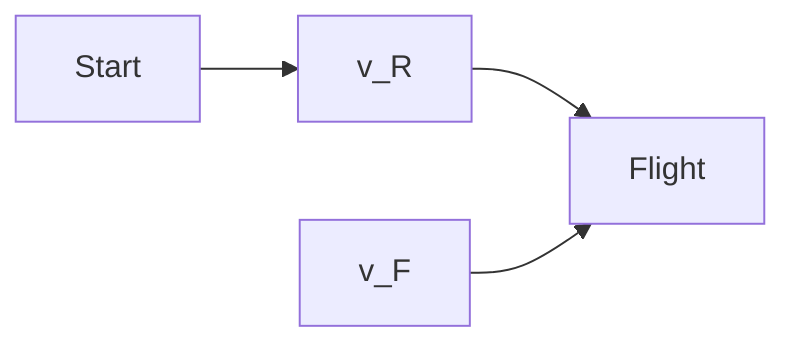

Abb. 33.F8

**9.** An Bord eines der in Frage 8 beschriebenen Raumschiffe empfangen Sie Signale, die von Ihrer Fähre ausgesendet werden. Dabei bewegt sich die Fähre einmal direkt auf das Raumschiff $\mathbf { Z } \mathbf { u } ,$ einmal direkt davon weg. Beide Signale haben die Eigenfrequenz $f _ { 0 } .$ . Für die Geschwindigkeit und die Richtung der Fähre relativ zu Ihnen sind gegeben: (a) 0,3c auf Sie zu, (b) 0,6c auf Sie zu, (c) 0,3c von Ihnen weg, (d) 0,6c von Ihnen weg. Ordnen Sie die Situationen nach der Frequenz, die Sie von der Fähre empfangen (beginnend mit dem größten Wert).
**10.** Drei Teilchen haben folgende Ruheenergien und Gesamtenergien, angegeben in Vielfachen der Größe A: (1) A, 2A; (2) A, 3A und (3) 3A, 4A. Ordnen Sie die Teilchen in absteigender Reihenfolge nach (a) ihrer Masse, (b) ihrer kinetischen Energie, (c) ihrem Lorentz-Faktor und (d) ihrer Geschwindigkeit, jeweils ohne schriftliche Rechnung.
**11.** Bezugssystem $S ^ { \prime }$ bewegt sich an Bezugssystem S mit der Geschwindigkeit v in Richtung der parallelen $x ^ { \prime } -$ und x-Achsen vorbei, wie in Abb. 33.8 dargestellt. Ein Beobachter, der mit Bezugssystem $S ^ { \prime }$ mitreist, wartet 25 s auf seiner Armbanduhr ab. Das entsprechende Zeitintervall $\Delta t$ soll von einem Beobachter in Bezugssystem $\mathsf { S }$ gemessen werden. Welche der Kurven in Abb. 33.F11 beschreibt Δt (vertikale Achse des Graphen) als Funktion des Geschwindigkeitsparameters $\beta$ am besten?

line

| \(\beta\) | a | b | c | d | e |
| --- | --- | --- | --- | --- | --- |
| 0 | 0 | 0 | 0 | 0 | 0 |
| 0.2 | ~0.35 | ~0.15 | ~0.15 | ~0.15 | ~0.15 |
| 0.4 | ~0.65 | ~0.35 | ~0.15 | ~0.15 | ~0.15 |
| 0.6 | ~0.95 | ~0.65 | ~0.15 | ~0.15 | ~0.15 |
| 0.8 | >1.2 | ~1.0 | ~0.15 | ~0.15 | ~0.15 |

Abb. 33.F11

**12.** Das Gitter aus Messstäben und Uhren in Abb. 33.F12 ist wie das aus Abb. 33.3 angelegt. Die Uhren auf der x-Achse sind (Mitte zu Mitte) genau 1 Lichtsekunde voneinander entfernt, ebenso die Uhren auf der y-Achse. Alle Uhren wurden synchronisiert wie in Abschn. 33.1 beschrieben. Wenn das anfängliche Synchronisationssignal für $t = 0$ vom Ursprung aus bei (a) Uhr A, (b) Uhr B und (c) Uhr C ankommt, welche Startzeit wird dann auf diesen Uhren eingestellt? Ein Ereignis geschieht bei Uhr A, wenn diese 10 s anzeigt. (d) Wie lange braucht das Signal von diesem Ereignis, um zu einem Beobachter im Ursprung zu gelangen? (e) Welche Zeit schreibt der Beobachter diesem Ereignis zu?

text_image

y
B 1-20 1-20 1-20 1-20 1-20 1-20 1-20 1-20 1-20 1-20 1-20 1-20 1-20 1-20 1-20 1-20 1-20 1-20 1-20 1-20 1-2
C
1-20 1-20 1-20 1-20 1-20 1-20 1-20 1-20 1-20 1-20 1-20 1-20 1-20 1-20
z
A x

Abb. 33.F12

**13.** Abbildung 33.F13 zeigt das Dreieck aus Abb. 33.12 für sechs Teilchen; die Strecken 2 und 4 haben die gleiche Län-${ \mathfrak { g e } } .$ Ordnen Sie die Teilchen in absteigender Reihenfolge nach (a) ihrer Masse, (b) ihrem Impulsbetrag und (c) ihrem Lorentz-Faktor. (d) Geben Sie an, welche zwei Teilchen die gleiche Gesamtenergie haben. (e) Ordnen Sie die drei Teilchen mit der geringsten Masse in absteigender Reihenfolge nach ihrer kinetischen Energie.

text_image

1
2
3
4
5
6

Abb. 33.F13

835

---

