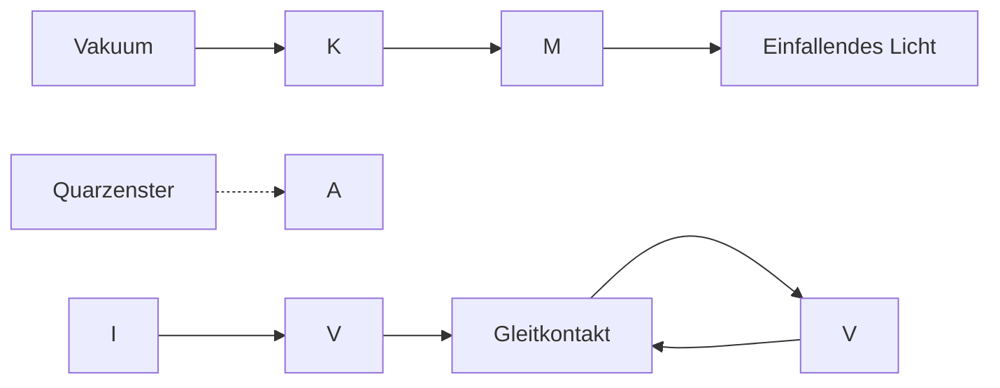
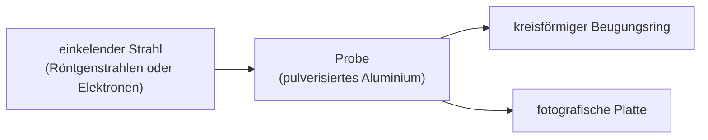

# 34 Photonen und Materiewellen

原始 PDF 第 851–880 页。

# 34 Photonen und Materiewellen

## 34.1 Das Photon: Teilchen des Lichts

## Physikalische Motivation

Unsere Diskussion der Speziellen Relativitätstheorie Einsteins führte uns in eine Welt weit jenseits der Alltagserfahrungen – in die Welt von Gegenständen, die sich mit nahezu Lichtgeschwindigkeit bewegen. Neben anderen überraschenden Schlussfolgerungen besagt die Relativitätstheorie beispielsweise, dass der Gang einer Uhr von ihrer Geschwindigkeit relativ zu einem Beobachter abhängt: Je grö- ßer diese Relativgeschwindigkeit ist, umso langsamer geht aus Sicht des Beobachters diese Uhr. Diese und andere Vorhersagen haben bisher allen experimentellen Überprüfungen standgehalten, und die Spezielle Relativitätstheorie hat uns zu einem tieferen und besseren Verständnis der Natur von Raum und Zeit geführt.

Nun betreten wir eine zweite Welt jenseits unserer Alltagserfahrung – die subatomare Welt. Wieder werden wir eine Fülle von Überraschungen erleben, die Physiker trotz ihrer oft seltsam anmutenden Konsequenzen Schritt für Schritt zu einem tieferen und besseren Verständnis der Realität geführt haben.

Die **Quantenphysik**, wie unser neues Thema heißt, beantwortet Fragen wie: Weshalb leuchten Sterne? Weshalb lassen sich die chemischen Elemente in ein Periodensystem einordnen? Wie arbeiten Transistoren und andere mikroelektronische Bauteile? Weshalb ist Kupfer elektrisch leitend, Glas aber nicht? Die Quantenphysik ist die Grundlage der gesamten Chemie einschließlich der Bioche mie – wir müssen also die Quantenphysik verstehen, wenn wir das Leben verstehen wollen.

Einige der Vorhersagen der Quantenphysik erscheinen selbst den Physikern und den Philosophen, die sich mit ihren Grundlagen beschäftigen, außerordentlich bizarr. Trotzdem hat sich die Theorie in bisher jedem Experiment als richtig erwie sen, und ständig offenbaren sich noch seltsamere Aspekte der Quantenphysik. Die Quantenwelt ist wie ein Vergnügungspark, voll wilder Fahrten, die Ihnen Ihre von Kindheit an vertrauten und vernünftig erscheinenden Ansichten über die Welt gehörig durcheinanderrütteln werden. Wir beginnen unsere Erkundung des Quantenparks mit dem Photon.

## 34.1.1 Das Photon: Teilchen des Lichts

Die **Quantenphysik** (man spricht auch von Quantentheorie) beschäftigt sich hauptsächlich mit der Mikrowelt. Dort stellt sich in vielen Fällen heraus, dass bestimmte Größen nur in ganzzahligen Vielfachen von bestimmten kleinsten Beträgen (elementaren Einheiten) auftreten können. In solchen Fällen sagt man, diese Größen seien quantisiert oder gequantelt. Die elementare Einheit einer solchen Größe wird auch als **Quant** dieser Größe bezeichnet.

In einem gewissen Sinn ist auch eine Währung wie der Euro quantisiert, denn die Münze mit dem kleinsten Wert ist der Cent oder die 0,01-Euro-Münze. Die

Halliday Physik für natur- und ingenieurwiss. Studiengänge, 3. Auflage. D. Halliday, R. Resnick und J. Walker. © 2020 WILEY-VCH Verlag GmbH & Co. KGaA. Published 2020 by WILEY-VCH Verlag GmbH & Co. KGaA.

837

---

34 Photonen und Materiewellen

Werte aller anderen Münzen und Scheine sind dadurch eingeschränkt, dass es sich immer um ganzzahlige Vielfache dieser kleinsten Menge handelt. Mit anderen Worten, das Geldquant ist 0,01  und alle größeren Geldbeträge sind von der Form n(0,01 ), wobei n eine positive ganze Zahl ist. Einen Betrag von $0 { , } 7 5 5   \in { }$ 75,5 ⋅ (0,01 ) können Sie nicht bar bezahlen.

Im Jahr 1905 schlug Einstein vor, dass die elektromagnetische Strahlung (oder einfacher Licht) quantisiert ist und nur in Vielfachen einer zunächst „Lichtquant genannten kleinsten Einheit vorkommt. Heute heißen die Lichtquanten meist **Photonen**. Ein solcher Vorschlag sollte Ihnen merkwürdig erscheinen, denn in den vergangenen Kapiteln haben wir ausgiebig darüber diskutiert, dass es sich bei der klas sischen Vorstellung von Licht um eine sinusförmige Welle mit einer Wellenlänge λ, einer Frequenz $f$ und einer Geschwindigkeit c handelt, die über die Beziehung

$$
f = \frac {c}{\lambda} \tag {34.1}
$$

zusammenhängen.

Außerdem haben wir in Kapitel 29 argumentiert, dass es sich bei der klassischen Lichtwelle um eine Kombination aus elektrischen und magnetischen Feldern handelt, die mit derselben Frequenz $f$ oszillieren. Wie kann eine solche Welle aus elementaren Einheiten – Lichtquanten – bestehen? Was ist ein Photon?

Das Konzept eines Lichtquants oder Photons stellte sich als weitaus subtiler und geheimnisvoller heraus, als es Einstein zunächst vorschwebte. Im Grunde genommen ist es immer noch nicht ganz verstanden. In diesem Buch werden wir nur einige der grundlegenden Aspekte des Photons diskutieren.

Nach Einsteins Vorstellungen hat das Quant einer Lichtwelle der Frequenz $f$ die Energie

$$
E = h f \quad (\text {Energie eines Photons}). \tag {34.2}
$$

Das **Plancksche Wirkungsquantum** (oder die **Plancksche Konstante**) h hat den Wert

$$
h = 6, 6 3 \cdot 1 0 ^ {- 3 4} \mathrm{J} \cdot \mathrm{s} = 4, 1 4 \cdot 1 0 ^ {- 1 5} \mathrm{eV} \cdot \mathrm{s}. \tag {34.3}
$$

Die minimale Energie, die eine Lichtwelle der Frequenz f haben kann, beträgt $h f -$ die Energie eines einzelnen Photons. Wenn die Welle eine größere Energie besitzt, muss ihre Gesamtenergie ein ganzzahliges Vielfaches von $h f$ sein, ähnlich wie in unserem vorherigen Beispiel bei der Währung. Licht kann keine Energie von 0,6hf oder 75,5hf haben.

Außerdem erklärte Einstein, dass und wie Licht von den Atomen in einem Gegenstand (Materie) absorbiert oder emittiert wird. Absorbiert ein Atom Licht einer Frequenz $f ,$ so wird die Energie $h f$ eines Photons von dem Licht auf das Atom übertragen. Bei dieser Photonenabsorption verschwindet das Photon, es wurde von dem Atom absorbiert. Wird Licht der Frequenz f von einem Atom emittiert, wird die Energie $h f$ von dem Atom auf das Licht übertragen. Bei dieser Photonenemission entsteht plötzlich ein Photon und man sagt, das Atom habe das Photon emittiert.

Bei großen Gegenständen aus vielen Atomen können auch sehr viele Photonen absorbiert (beispielsweise in einer Sonnenbrille) oder emittiert werden (beispielsweise von einer Lampe). Trotzdem wird bei jedem Einzelereignis einer Photonenabsorption oder -emission immer nur die Energie eines einzelnen Photons übertragen.

Wenn wir in den vergangenen Kapiteln Beispiele für eine Absorption oder Emission von Licht diskutiert haben, war immer so viel Licht beteiligt, dass wir die Quantenphysik nicht benötigten und mit der klassischen Physik auskamen. Doch seit den 1980er Jahren ist die Technologie so ausgereift, dass Experimente mit einzelnen Photonen ausgeführt werden können und auch praktische Anwendung finden. Seitdem gehört die Quantenphysik zum alltäglichen Ingenieursgeschäft, besonders im Bereich der Optoelektronik.

838

---

34.2 Der photoelektrische Effekt

34

## KONTROLLFRAGE 1

Ordnen Sie die folgenden Strahlungen in absteigender Reihenfolge nach den zugehörigen Photonenenergien: (a) das gelbe Licht einer Natriumdampflampe, (b) ein von einem radioaktiven Kern emittierter Gammastrahl, (c) die von einer Antenne eines Radiosenders emittierte Radiowelle, (d) ein Mikrowellenstrahl eines Flughafenradars.

## 34.2 Der photoelektrische Effekt

## Lernziele

Nach dem Durcharbeiten dieses Abschnitts sollten Sie in der Lage sein, . . .

• einen Versuchsaufbau zum photoelektrischen Effekt in einer einfachen Skizze darzustellen, welche das einfallende Licht, die Metallplatte, die emittierten Elektronen (Photoelektronen) und den Kollektor enthält,
• die Probleme zu erklären, die Physiker mit dem photoelektrischen Effekt vor Einsteins Erklärung des Effekts hatten, und anzugeben, worin die historische Bedeutung seiner Hypothese besteht,
• den Zusammenhang zwischen dem Stopppotenzial $V _ { \mathsf { s t o p } }$ und der maximalen kinetischen Energie $K _ { \mathrm { m a x } }$ der entkommenden Photoelektronen anzugeben,
• beim Photoeffekt die Beziehungen zwischen Frequenz und Wellenlänge des einfallenden Lichts, der maximalen kinetischen Energie $K _ { \mathrm { m a x } }$ der Photoelektronen, der Austrittsarbeit Φ und dem Stopppotenzial $V _ { \mathrm { s t o p } }$ anzuwenden,
• für einen Versuchsaufbau zum photoelektrischen Effekt das Stopppotenzial $V _ { \mathrm { s t o p } }$ gegen die Lichtfrequenz aufzutragen und auf diese Weise die Grenzfrequenz $f _ { 0 }$ zu bestimmen sowie die Steigung der Kurve mit dem Planckschen Wirkungsquantum h und der Elementarladung e in Beziehung zu setzen.

## Schlüsselideen

Wenn Licht mit ausreichend hoher Frequenz auf eine Metalloberfläche trifft, können die Elektronen des Metalls durch Absorption der Photonen genug Energie aufnehmen, um das Metall zu verlassen. Dies nennt man den photoelektrischen Effekt (Photoeffekt).
• Die Energieerhaltungsgleichung für einen solchen Absorptionsvorgang lautet

$$
h f = K _ {\mathrm{max}} + \varPhi ,
$$

wobei $h f$ die absorbierte Photonenenergie ist und $K _ { \mathrm { m a x } }$ die maximale kinetische Energie der freigesetzten Elektronen. Die Austrittsarbeit Φ ist die Energie, die mindestens erforderlich ist, um ein durch elektrische Kräfte im Metallverband gebundenes Elektron aus dem Metall herauszuschlagen.

• Für $h f = \varPhi$ können die Elektronen gerade eben entkommen, haben aber keine kinetische Energie; die zugehörige Lichtfrequenz ist die Grenzfrequenz $f _ { 0 } .$

• Für $h f < \varPhi$ können keine Elektronen aus dem Metall entkommen; es tritt kein photoelektrischer Effekt auf.

## 34.2.1 Der photoelektrische Effekt

Trifft ein Lichtstrahl mit einer hinreichend kleinen Wellenlänge auf eine glatte Metalloberfläche, so verlassen Elektronen diese Oberfläche (das Licht schlägt die Elektronen aus der Oberfläche heraus). Dieser **photoelektrische Effekt** (oder Pho toeffekt) wird in vielen Geräten wie z. B. Fernsehkameras, Camcordern oder Nachtsichtgeräten ausgenutzt. Einstein begründete sein Photonenkonzept mit der Erklä- rung dieses Effekts, der sich ohne die Quantenphysik nicht verstehen lässt.

Wir wollen nun zwei Experimente zum photoelektrischen Effekt untersuchen, die beide die Apparatur aus Abb. 34.1 verwenden. Hier trifft Licht der Frequenz f auf eine Metallplatte M und löst dort Elektronen heraus. Zwischen der Metallplat-

flowchart

Abb. 34.1

Eine Apparatur zur Untersuchung des photoelektrischen Effekts. Das einfallende Licht trifft auf eine Metallplatte M und schlägt dort Elektronen heraus, die von einem Kollektor K aufgesammelt werden. In dem Stromkreis bewegen sich die Elektronen entgegen der üblichen Stromrichtung. Die Batterien und der verstellbare Widerstand dienen zur Anpassung der elektrischen Potenzialdifferenz zwischen M und K.

839

---

34 Photonen und Materiewellen

te M und einem Kollektor K zur Aufnahme dieser sogenannten **Photoelektronen** wird eine Potenzialdifferenz V aufrechterhalten. In dieser Anordnung entsteht ein **photoelektrischer Strom** $I ,$ der mit einem Amperemeter A gemessen wird.

## Das erste photoelektrische Experiment

Wir stellen zunächst mithilfe des Gleitkontakts in Abb. 34.1 die Potenzialdiffer enz $V$ so ein, dass der Kollektor K relativ zur Metallplatte M schwach negativ geladen ist. Diese Potenzialdifferenz dient zum Abbremsen der herausgeschlagenen Elektronen. Anschließend verändern wir V bis zu einem gewissen Wert $V _ { \mathrm { s t o p } }$ (manchmal **Stopppotenzial** genannt), bei dem die Anzeige des Amperemeters gerade auf null sinkt. Bei $V = V _ { \mathrm { s t o p } }$ werden auch die energiereichsten der aus dem Metall herausgelösten Elektronen wieder zurückgelenkt, bevor sie den Kollektor erreichen. Für die kinetische Energie $K _ { \mathrm { m a x } }$ dieser energiereichsten Elektronen gilt

$$
K _ {\max} = e V _ {\text {stop}}, \tag {34.4}
$$

wobei e die Elektronenladung ist.

Experimentell findet man nun, dass $K _ { \mathrm { m a x } }$ für Licht einer gegebenen Frequenz nicht von der Intensität der Lichtquelle abhängt. Die maximale kinetische Energie der herausgeschlagenen Elektronen hat immer denselben Wert, unabhängig davon, ob es sich um eine blendend helle oder kaum wahrnehmbar schwache Lichtquelle handelt (oder eine beliebige Intensität dazwischen).

Dieses experimentelle Ergebnis lässt sich im Rahmen der klassischen Physik nicht erklären. Klassisch handelt es sich bei dem einfallenden Licht um eine sinusförmige elektromagnetische Welle. Ein Elektron in der Metallplatte sollte durch die oszillierende elektrische Kraft des elektrischen Felds ebenfalls zu Schwingungen angeregt werden. Ist die Amplitude der Elektronenschwingung groß genug, sollte sich das Elektron von der Metalloberfläche lösen können und so aus dem Metall herausgeschlagen werden. Wenn wir die Amplitude der Welle bzw. des oszillierenden elektrischen Felds erhöhen, sollte das Elektron einen stärkeren „Stoß“ bekommen. Das ist jedoch nicht, was wir beobachten! Bei einer gegebenen Frequenz übertragen die intensiven wie auch die schwachen Lichtstrahlen den herausgeschlagenen Elektronen exakt denselben maximalen Stoß.

Dieses Ergebnis klingt jedoch natürlich, wenn wir an Photonen denken. In diesem Fall entspricht die von dem einfallenden Licht auf ein Elektron übertragene Energie der Energie eines einzelnen Photons. Wenn wir die Lichtintensität erhö- hen, erhöhen wir die Anzahl der Photonen in dem Licht. Die Photonenenergie (Gl. 34.2) bleibt dabei jedoch unverändert, da sich die Frequenz nicht geändert hat. Damit bleibt auch die auf ein Elektron übertragene und teilweise in dessen kinetische Energie umgewandelte Energie unverändert.

## Das zweite photoelektrische Experiment

Nun verändern wir die Frequenz f des einfallenden Lichts und messen das zugehörige Potenzial $V _ { \mathrm { s t o p } } .$ In Abb. 34.2 ist $V _ { \mathrm { s t o p } }$ gegen die Frequenz f aufgetragen. Zunächst fällt auf, dass der photoelektrische Effekt unterhalb einer bestimmten Frequenz $f _ { 0 }$ (der **Grenzfrequenz**) nicht auftritt. Äquivalent können wir auch von einer **Grenzwellenlänge** $\lambda _ { 0 } = c / f _ { 0 }$ sprechen, oberhalb derer der Effekt nicht beobachtet wird. Dies gilt unabhängig von der Intensität des einfallenden Lichts.

Auch dieses Verhalten ist im Rahmen der klassischen Physik rätselhaft. Stellt man sich Licht als elektromagnetische Welle vor, würde man erwarten, dass unabhängig von der Frequenz immer Elektronen herausgeschlagen werden können, wenn nur die Lichtintensität und damit die Energie des Lichts genügend groß sind. Das ist jedoch nicht, was wir beobachten! Unterhalb der Frequenz $f _ { 0 }$ tritt der pho toelektrische Effekt überhaupt nicht auf, gleichgültig wie hell die Lichtquelle ist.

840

---

34.2 Der photoelektrische Effekt

34

line

| Freqenz des einfallenden Lichts f (10^14 Hz) | Stoppotenzial Vstop (V) |
| --- | --- |
| ~7.2 | ~0.7 |
| ~7.6 | ~0.9 |
| ~8.0 | ~1.15 |
| ~10.4 | 2.0 |
| ~12.6 | ~2.9 |

## Abb. 34.2

Das Potenzial $V _ { \mathrm { s t o p } }$ als Funktion der Frequenz $f$ des einfallenden Lichts für eine Natriumprobe M in der $\mathrm { A } \mathrm { p } \mathrm { - }$ paratur von Abb. 34.1. (Die Daten stammen von R.A. Millikan aus dem Jahr 1916.)

Das Vorhandensein einer Grenzfrequenz ist jedoch genau, was man bei einer Energieübertragung durch diskrete Photonen erwarten würde. Die Elektronen werden durch elektrische Kräfte in dem Metall festgehalten. (Anderenfalls würden sie schon aufgrund der Schwerkraft aus der Probe herausfallen.) Um der Metallplatte entfliehen zu können, benötigen die Elektronen eine bestimmte Mindestenergie $\varPhi .$ Sie ist eine Materialeigenschaft der Probe und wird als **Austrittsarbeit** bezeichnet. Wenn die von einem Photon auf das Elektron übertragene Energie $h f$ größer ist als die Austrittsarbeit, also $h f > \varPhi$ gilt, kann das Elektron der Platte entkommen. Ist die übertragene Energie kleiner als die Austrittsarbeit $( h f < \varPhi )$ , bleibt das Elektron in dem Metall. Genau das zeigt Abb. 34.2.

## Die photoelektrische Gleichung

Einstein hat die Ergebnisse solcher photoelektrischer Experimente in der **photoelektrischen Gleichung** zusammengefasst:

$$
h f = K _ {\max} + \Phi \quad (\text {photoelektrische Gleichung}). \tag {34.5}
$$

Diese Gleichung ist eine direkte Konsequenz der Energieerhaltung bei der Absorp tion eines einzelnen Photons in einem Material mit der Austrittsarbeit Φ. Die Energie $h f$ eines Photons wird auf ein einzelnes Elektron in der Probe übertragen. Soll das Elektron aus dem Material herausgelöst werden, muss es mindestens die Energie Φ aufnehmen. Was das Elektron an zusätzlicher Energie $( h f - \phi )$ von dem Photon mitbekommt, behält es in Form von kinetischer Energie K. Im günstigsten Fall kann das Elektron der Oberfläche entkommen, ohne bei diesem Prozess weitere kinetische Energie zu verlieren. In diesem Fall hat das Elektron außerhalb der Probe die maximal mögliche Energie $K _ { \mathrm { m a x } } .$

Wir ersetzen in Gl. 34.5 die maximale kinetische Energie $K _ { \mathrm { m a x } }$ mithilfe von Gl. 34.4 und formen etwas um; so erhalten wir die Beziehung

$$
V _ {\mathrm{stop}} = \left(\frac {h}{e}\right) f - \frac {\Phi}{e}. \tag {34.6}
$$

Die Verhältnisse $( h / e )$ und $( \varPhi / e )$ sind Konstanten. Wenn wir das gemessene Potenzial $V _ { \mathrm { s t o p } }$ gegen die Frequenz $f$ des einfallenden Lichts auftragen, erwarten wir demzufolge eine gerade Linie, genau wie in Abb. 34.2. Die Steigung dieser Geraden sollte gleich $h / e$ sein. Zur Überprüfung messen wir die Strecken $\mathrm { , } \mathrm { a b } ^ { \prime }$ und ‚bc in Abb. 34.2 aus und finden

$$
\begin{array}{l} \frac {h}{e} = \frac {\mathrm{ab}}{\mathrm{bc}} = \frac {2 , 3 5 \mathrm{V} - 0 , 7 2 \mathrm{V}}{(1 1 , 2 \cdot 1 0 ^ {1 4} - 7 , 2 \cdot 1 0 ^ {1 4}) \mathrm{Hz}} \\ = 4, 1 \cdot 1 0 ^ {- 1 5} \mathrm{V} \cdot \mathrm{s}. \\ \end{array}
$$

841

---

34 Photonen und Materiewellen

Wir multiplizieren dieses Ergebnis mit der Elementarladung e und erhalten

$$
h = (4, 1 \cdot 1 0 ^ {- 1 5} \mathrm{V} \cdot \mathrm{s}) (1, 6 \cdot 1 0 ^ {- 1 9} \mathrm{C}) = 6, 6 \cdot 1 0 ^ {- 3 4} \mathrm{J} \cdot \mathrm{s},
$$

in Übereinstimmung mit Messwerten, die auf anderen Wegen erhalten wurden.

Eine Nebenbemerkung: Eine Erklärung des photoelektrischen Effekts erfordert sicherlich die Quantenphysik. Für viele Jahre galt die Erklärung Einsteins auch als zwingendes Argument für die Existenz von Photonen. Im Jahr 1969 fand man jedoch eine alternative Erklärung, die zwar auf der Quantenphysik basiert, aber ohne das Konzept der Photonen auskommt. Licht ist zwar in Form von Photonen quantisiert, doch die Einsteinsche Erklärung des photoelektrischen Effekts ist kein zwingender Beweis dafür.

## KONTROLLFRAGE 2

Die Abbildung zeigt Messkurven von der Art der in Abb. 34.2 gezeigten. Als Me tallproben wurden Caesium, Kalium, Natrium und Lithium verwendet. (a) Ordnen Sie die Proben in absteigender Reihenfolge nach ihrer Austrittsarbeit. (b) Ordnen Sie die Geraden in absteigender Reihenfolge nach dem Wert, den sie für h liefern.

line

| Species | f (10^14 Hz) range | Vstop (range) |
| --- | --- | --- |
| Caesium | 5.15~5.35 | 0~>6 |
| Kalium | 5.4~5.65 | 0~>6 |
| Natrium | 5.5~5.7 | 0~>6 |
| Lithium | 5.85~6.05 | 0~>6 |

## 34.3 Photonenimpuls, Compton-Verschiebung und Lichtinterferenz

## Lernziele

Nach dem Durcharbeiten dieses Abschnitts sollten Sie in der Lage sein, . . .

• die Beziehungen zwischen Impuls, Energie, Frequenz und Wellenlänge eines Photons anzuwenden,
• die wesentlichen Aspekte eines Experiments zur Untersuchung der Compton-Streuung zu skizzieren,
• die historische Bedeutung des Compton-Effekts zu verstehen,
• anzugeben, welche der folgenden Größen im gestreuten Röntgenstrahl mit dem Compton-Streuwinkel 𝜑 zu- oder abnehmen: kinetische Energie, Impuls und Wellenlänge,
• zu beschreiben, wie bei der Compton-Streuung die Erhaltung von Impuls und kinetischer Energie auf die Gleichung für die Wellenlängenverschiebung Δλ führt,
• die Beziehungen zwischen den Wellenlängen von einfallendem und gestreutem Strahl, der Wellenlängenverschiebung Δλ, dem Streuwinkel 𝜑 der Röntgenphotonen und der finalen Werte von Energie und Impuls der Elektronen anzuwenden (beim Impuls nach Betrag und Winkel),
• die Standardversion, die Ein-Photon-Version und die Weitwinkelversion des Doppelspaltexperiments im Photonenbild zu erklären.

## Schlüsselideen

• Obwohl es masselos ist, hat das Photon einen Impuls, der mit seiner Energie E, Frequenz $f$ und Wellenlänge λ wie folgt zusammenhängt:

$$
p = \frac {h f}{c} = \frac {h}{\lambda}.
$$

• Bei der Compton-Streuung werden Röntgenstrahlen wie Teilchen (Photonen) an schwach in einem Target gebundenen Elektronen gestreut.

842

---

34.3 Photonenimpuls, Compton-Verschiebung und Lichtinterferenz

34

• Bei dieser Streuung werden Energie und Impuls auf ein Elektron des Targets übertragen.
• Die daraus resultierende Zunahme der Photonenwellenlänge, die Compton-Verschiebung, ist

$$
\Delta \lambda = \frac {h}{m _ {\mathrm{e}} c} (1 - \cos \varphi),
$$

wobei $m _ { \mathrm { e } }$ die Elektronenmasse ist und $\varphi$ der Winkel, um den das Photon aus seiner Einfallsrichtung herausgestreut wird.

• Photonen: Wenn Licht mit Materie wechselwirkt, ist die Wechselwirkung teil chenartig, geschieht an einem Punkt im Raum und es werden Energie und Impuls übertragen.
• Welle: Wenn ein einzelnes Photon von einer Quelle emittiert wird, interpretieren wir seine Bewegung als die Ausbreitung einer Wahrscheinlichkeitswelle.
• Welle: Wenn viele Photonen von einer Quelle emittiert oder absorbiert werden, interpretieren wir sie alle gemeinsam als klassische elektromagnetische bzw. Lichtwelle.

## 34.3.1 Photonen besitzen einen Impuls

Im Jahr 1916 erweiterte Einstein sein Konzept der Lichtquanten (Photonen), indem er für ein Lichtquant einen Impuls postulierte. Für ein Photon der Energie hf gilt für den Betrag dieses Impulses

$$
p = \frac {h f}{c} = \frac {h}{\lambda} \quad (\text {Photonenimpuls}), \tag {34.7}
$$

wobei wir $f$ mithilfe von Gl. 34.1 $\left( f = c / \lambda \right)$ ersetzt haben. Bei der Wechselwirkung zwischen einem Photon und Materie werden daher Energie und Impuls übertragen, als ob es sich um einen Stoß zwischen einem Photon und einem Materieteilchen im klassischen Sinn handelte (wie in Kapitel 5).

Im Jahr 1923 führte Arthur Compton von der Washington University in St. Louis ein Experiment durch, das die Möglichkeit einer Impuls- und Energieübertragung durch Photonen untermauerte. Bei diesem Experiment trafen Röntgenstrahlen der Wellenlänge λ wie in Abb. 34.3 auf eine Kohlenstoffprobe. Röntgenstrahlung ist eine Form von elektromagnetischer Strahlung mit großen Frequenzen, also kleinen Wellenlängen. Compton maß die Wellenlängen und Intensitäten der Röntgenstrahlen, die unter verschiedenen Winkeln von der Kohlenstoffprobe gestreut wurden.

Abbildung 34.4 gibt seine Ergebnisse wieder. Obwohl im einfallenden Röntgenstrahl nur eine einzige Wellenlänge (λ = 71,1 pm) vertreten ist, erkennt man bei den gestreuten Röntgenstrahlen ein breites Spektrum an Wellenlängen mit zwei ausgeprägten Intensitätsmaxima. Ein Maximum liegt bei der Wellenlänge λ der einfallenden Strahlung, das zweite Maximum bei einer Wellenlänge $\lambda ^ { \prime } ,$ , die um eine Wellenlängendifferenz Δλ (die sogenannte **Compton-Verschiebung**) größer ist. Der Wert der Compton-Verschiebung hängt von dem Winkel ab, unter dem die Röntgenstrahlen gestreut werden.

Auch die Ergebnisse in Abb. 34.4 sind im Rahmen der klassischen Physik ein Rätsel. Klassisch sollte es sich bei dem einfallenden Röntgenstrahl um eine sinusförmig oszillierende elektromagnetische Welle handeln. Ein Elektron in der Kohlenstoffprobe sollte durch die oszillierende elektrische Kraft des elektrischen Felds ebenfalls in Schwingung geraten. Außerdem sollte die Frequenz, mit der das Elektron schwingt, gleich der Frequenz der einfallenden Strahlung sein. Und das Elektron sollte wie eine winzige Antenne selbst Strahlung mit derselben Frequenz aussenden. Die gestreuten Röntgenstrahlen sollten daher dieselbe Frequenz und damit auch dieselbe Wellenlänge haben wie die einfallende Strahlung – das ist aber nicht der Fall.

flowchart

## Abb. 34.3

Der Aufbau von Comptons Experiment. Ein Röntgenstrahl der Wellenlänge λ = 71,1 pm trifft auf ein Kohlenstoff-Target M. Die gestreuten Röntgenstrahlen werden unter verschiedenen Winkeln 𝜑 zum einfallenden Strahl beobachtet. Der Detektor misst sowohl die Intensität als auch die Wellenlänge der gestreuten Röntgenstrahlen.

843

---

34 Photonen und Materiewellen

Abb. 34.4 Comptons Ergebnisse für vier verschiedene Streuwinkel 𝜑. Man beachte, dass die Compton-Verschiebung Δλ mit zunehmendem Winkel größer wird.

line

| Feature | Description |
| --- | --- |
| X-axis | x (horizontal) |
| Y-axis | y (vertical) |
| Function | Röntgenstrahl (red line) |
| Vector | Elektron (green dot) |
| Condition | v = 0 (voltage vector) |
| Note | vorher |

text_image

Röntgen-
strahl
φ
λ'
x
θ
Elektron
v
nachher

Abb. 34.5

Ein Röntgenstrahl der Wellenlänge λ wechselwirkt mit einem ruhenden freien Elektron. Der Röntgenstrahl wird unter einem Winkel 𝜑 gestreut und hat nun die größere Wellenlänge $\lambda ^ { \prime } .$ Das Elektron bewegt sich mit der Geschwindigkeit v in die Richtung θ.

Compton interpretierte die Streuung von Röntgenstrahlen am Kohlenstoff als Energie- und Impulsübertragung (vermittelt durch Photonen) zwischen dem einfallenden Röntgenstrahl und locker gebundenen Elektronen im Kohlenstoff. Wir wollen nun, zunächst konzeptuell und später quantitativ, untersuchen, wie diese quantenmechanische Interpretation die Ergebnisse Comptons erklären kann.

Wir nehmen an, ein einzelnes Photon der Energie $E = h f$ sei an der Wechselwirkung zwischen dem einfallenden Röntgenstrahl und dem ruhenden Elektron beteiligt. Im Allgemeinen wird sich die Ausbreitungsrichtung des Röntgenstrahls ändern (der Röntgenstrahl wird gestreut) und das Elektron erleidet einen Rückstoß. Dem Elektron wurde also ein gewisser Betrag an kinetischer Energie übertragen. Bei diesem einzelnen Prozess ist die Energie erhalten. Die Energie des gestreuten Photons $( E ^ { \prime } = h f ^ { \prime } )$ muss daher kleiner sein als die des einfallenden Photons. Also müssen die gestreuten Röntgenstrahlen eine kleinere Frequenz $f ^ { \prime }$ und damit eine größere Wellenlänge $\lambda ^ { \prime }$ als die einfallenden Röntgenstrahlen haben. Genau das zeigen die in Abb. 34.4 dargestellten experimentellen Ergebnisse von Compton.

Für eine quantitative Behandlung dieser Streuung wenden wir zunächst die Energieerhaltung an. Abbildung 34.5 zeigt einen $_ { p } \mathrm { Z }$ usammenstoß“ zwischen einem Röntgenstrahl und einem zunächst ruhenden freien Elektron in der Probe. Nach dem Stoß bewegt sich ein Röntgenstrahl mit der Wellenlänge $\lambda ^ { \prime }$ in die durch den Winkel $\varphi$ gekennzeichnete Richtung und das Elektron bewegt sich in die Richtung θ. Die Energieerhaltung erfordert dann

$$
h f = h f ^ {\prime} + K,
$$

wobei $h f$ die Energie des einfallenden Röntgenphotons ist, $h f ^ { \prime }$ die Energie des gestreuten Röntgenphotons und K die kinetische Energie des zurückgestoßenen Elektrons. Da der Rückstoß des Elektrons mit nahezu Lichtgeschwindigkeit erfolgen kann, müssen wir für die kinetische Energie des Elektrons den relativistischen Ausdruck aus Gl. 33.43 verwenden:

$$
K = m c ^ {2} (\gamma - 1).
$$

Hierbei sind m die Elektronenmasse und γ der Lorentz-Faktor:

$$
\gamma = \frac {1}{\sqrt {1 - (\nu / c) ^ {2}}}.
$$

844

---

34.3 Photonenimpuls, Compton-Verschiebung und Lichtinterferenz

34

Wir setzen den obigen Ausdruck für K in die Gleichung für die Energieerhaltung ein; das ergibt

$$
h f = h f ^ {\prime} + m c ^ {2} (\gamma - 1).
$$

Außerdem ersetzen wir noch f durch $c / \lambda$ und $f ^ { \prime }$ durch $c / \lambda ^ { \prime }$ und erhalten eine neue Form der Gleichung für die Energieerhaltung:

$$
\frac {h}{\lambda} = \frac {h}{\lambda^ {\prime}} + m c (\gamma - 1). \tag {34.8}
$$

Nun wenden wir auch die Impulserhaltung auf die Streuung zwischen Röntgenstrahl und Elektron in Abb. 34.5 an. Nach Gl. 34.7 ist der Impulsbetrag des einfallenden Photons gleich $h / \lambda$ und der des gestreuten Photons gleich $\bar { h / \lambda ^ { \prime } }$ . Nach Gl. 33.32 ist der Impulsbetrag des gestreuten Elektrons gleich $\gamma m \nu .$ Da wir es hier mit einer zweidimensionalen Situation zu tun haben, formulieren wir die Bedingungen für die Impulserhaltung entlang der x- und y-Achse getrennt:

$$
\frac {h}{\lambda} = \frac {h}{\lambda^ {\prime}} \cos \varphi + \gamma m \nu \cos \theta \quad (x \text {-Achse}) \tag {34.9}
$$

und

$$
0 = \frac {h}{\lambda^ {\prime}} \sin \varphi + \gamma m \nu \sin \theta \quad (y - A c h s e). \tag {34.10}
$$

Wir wollen die Compton-Verschiebung $\Delta \lambda   =   \lambda ^ { \prime } - \lambda$ der gestreuten Röntgenstrahlen bestimmen. Von den fünf Stoßparametern $( \lambda , \lambda ^ { \prime } , \nu ,$ 𝜑 und θ), die in den Gln. 34.8–34.10 auftauchen, eliminieren wir v und $\theta ,$ die sich auf das gestreute Elektron beziehen. Einige (kompliziertere) Umformungen führen auf die folgende Gleichung für die Compton-Verschiebung als Funktion des Streuwinkels 𝜑:

$$
\Delta \lambda = \frac {h}{m c} (1 - \cos \varphi) \quad \text {(Compton - Verschiebung)}  . \tag {34.11}
$$

Diese Gleichung stimmt genau mit den experimentellen Ergebnissen von Compton überein.

Die Größe $h / m c$ in Gl. 34.11 ist eine Konstante, die man als Compton-Wel**lenlänge** bezeichnet. Ihr Wert hängt von der Masse m des Teilchens ab, an dem die Röntgenstrahlen gestreut werden. Im vorliegenden Fall handelt es sich um ein locker gebundenes Elektron, daher setzen wir für m die Elektronenmasse ein und erhalten so die Compton-Wellenlänge für die Compton-Streuung an einem Elektron.

## Eine offene Frage

Wir müssen noch eine Erklärung für das Maximum bei der einfallenden Wellenlän-$\mathrm { g e }   \lambda   ( = 7 1 , 1   \mathrm { p m } )$ in Abb. 34.4 finden. Dieses Maximum beruht nicht auf der Wechselwirkung zwischen den Röntgenstrahlen und den locker gebundenen Elektronen in der Probe, sondern auf der Wechselwirkung zwischen den Röntgenstrahlen und den fest gebundenen Elektronen in den Kohlenstoffatomen der Probe. Praktisch handelt es sich dabei um einen Stoß zwischen einem Röntgenstrahl und einem ganzen Kohlenstoffatom. Ersetzen wir m in Gl. 34.11 durch die Masse eines Kohlenstoffatoms (das ungefähr 22 000-mal schwerer ist als ein Elektron), wird Δλ offensichtlich um den Faktor 22 000 kleiner als die Compton-Verschiebung für ein Elektron. Das ist zu klein für einen Nachweis. Die bei solchen Stößen gestreuten Röntgenstrahlen haben in der Praxis daher dieselbe Wellenlänge wie die einfallenden Röntgenstrahlen.

## KONTROLLFRAGE 3

Vergleichen Sie die Compton-Streuung für Röntgenstrahlen $( \lambda \approx 2 0   \mathrm { p m } )$ für einen festen Streuwinkel mit der von sichtbarem Licht $( \lambda   \approx   5 0 0   \mathrm { n m } )$ . In welchem Fall findet man die größere (a) Compton-Verschiebung, (b) relative Wellenlängenverschiebung, (c) relative Energieänderung der Photonen und (d) Energieübertragung auf das Elektron?

845

---

34 Photonen und Materiewellen

## 34.3.2 Licht als Wahrscheinlichkeitswelle

Eines der grundlegenden Rätsel in der Physik besteht darin, wie sich Licht in der klassischen Physik als Welle verhalten kann (die sich über ein vergleichsweise großes Gebiet verteilt), während es in der Quantenphysik in Form von diskreten Photonen emittiert und absorbiert wird (die an bestimmten Orten entstehen und verschwinden). Das Doppelspaltexperiment aus Abschn. 31.2 steht im Zentrum dieser Problematik. Wir wollen nun drei verschiedene Versionen dieses Experiments diskutieren.

## Das Standardexperiment

text_image

ein-
fallendes
Licht
B
Interferenz-
streifen
D
C

Abb. 34.6

Licht trifft auf einen Schirm B mit zwei parallelen Spalten. Hinter den beiden Spalten wird das Licht gebeugt und breitet sich über einen großen Bereich aus. Die beiden Beugungswellen überlagern sich bei dem Schirm C und bilden ein Interferenzmuster. Ein kleiner Photonendetektor D in der Ebene von C zeigt jedes auftreffende Photon durch ein scharfes Klicken an.

Abbildung 34.6 zeigt den Aufbau des Originalexperiments von Thomas Young aus dem Jahr 1801 schematisch (siehe auch Abb. 31.6). Licht scheint auf einen Schirm B, in dem sich zwei enge, parallele Spalte befinden. Hinter den Spalten breiten sich zwei gebeugte Lichtwellen aus und überlagern sich in der Ebene von Schirm C. Dort entsteht durch Interferenz das Muster von abwechselnden Intensitätsmaxima und -minima. In Abschn. 31.2 haben wir das Vorhandensein dieser Interferenzstreifen als zwingenden Beweis für die Wellennatur des Lichts gedeutet.

Nun stellen wir einen winzigen Photonendetektor D in der Ebene von Schirm C auf. Der Detektor bestehe aus einem photoelektrischen Bauteil, das bei jeder Absorption eines Photons ein scharfes Klicken von sich gibt. Bei dem vorliegenden Experiment würden wir feststellen, dass der Detektor eine zeitlich zufällige Folge von Klicktönen von sich gibt. Jeder dieser Töne signalisiert die Absorption eines Photons, also eine Energieübertragung von der Lichtwelle auf den Schirm.

Würden wir den Detektor langsam entlang des Schirms verschieben, wie in Abb. 34.6 durch die schwarzen Pfeile angedeutet, würde die Klickrate zu- bzw. abnehmen, je nachdem ob wir uns gerade bei einem Maximum oder einem Minimum der Interferenzstreifen befinden.

Dieses Gedankenexperiment zeigt uns Folgendes: Wir können nicht vorhersagen, wann ein Photon an einem bestimmten Punkt des Schirms C nachgewiesen wird. Die Photonen treffen mehr oder weniger zufällig zu bestimmten Zeiten bei bestimmten Punkten auf den Schirm. Wir können jedoch die jeweilige Wahrscheinlichkeit vorhersagen, mit der ein Photon an einem bestimmten Punkt in einem vorgegebenen Zeitintervall auf dem Schirm auftreffen wird: Diese Wahrscheinlichkeit ist proportional zur Intensität des einfallenden Lichts an diesen Punkt.

In Abschn. 29.2 hatten wir gesehen, dass die Intensität I einer Lichtwelle an je dem Punkt proportional zum Quadrat der Amplitude $E _ { \mathrm { m } }$ des oszillierenden elektrischen Feldvektors der Welle an diesem Punkt ist. Das bedeutet:

Die Wahrscheinlichkeit (pro Zeitintervall), mit der ein Photon in einem kleinen Volumen um einen gegebenen Punkt in einer Lichtwelle nachgewiesen wird, ist proportional zum Quadrat der Amplitude des elektrischen Feldvektors der Welle an diesem Punkt.

Wir sind damit zu einer probabilistischen Beschreibung (einer Wahrscheinlich keitsbeschreibung) einer Lichtwelle gelangt – eine neue Sichtweise auf die Natur des Lichts. Es handelt sich bei Licht nicht nur um eine elektromagnetische Welle, sondern auch um eine **Wahrscheinlichkeitswelle**. Jedem Punkt in einer Lichtwelle können wir eine numerische Wahrscheinlichkeit zuordnen, in einer kleinen Umgebung dieser Stelle pro Zeitintervall ein Photon nachzuweisen.

## Das Experiment mit einzelnen Photonen

Eine Variante des Doppelspaltexperiments mit einzelnen Photonen wurde zuerst von G.I. Taylor im Jahr 1909 durchgeführt und seitdem mehrmals wiederholt.

846

---

34.3 Photonenimpuls, Compton-Verschiebung und Lichtinterferenz

34

Im Gegensatz zur Standardversion ist bei diesem Experiment die Lichtquelle so schwach, dass die Photonen nur einzeln und in zufälligen Zeitabständen emittiert werden. Erstaunlicherweise entstehen trotzdem wieder die gewohnten Interferenzstreifen auf dem Schirm C, sofern das Experiment lange genug läuft (mehrere Monate in Taylors ersten Experimenten).

Welche Erklärung können wir für das Ergebnis dieses Doppelspaltexperiments mit einzelnen Photonen anbieten? Bevor man das Ergebnis überhaupt betrachtet, ist man geneigt, Fragen der folgenden Art zu stellen: Wenn sich die Photonen einzeln durch die Apparatur bewegen, durch welchen der beiden Spalte in Schirm B tritt ein gegebenes Photon hindurch? Woher „weiß“ ein bestimmtes Photon überhaupt, dass es einen zweiten Spalt gibt, sodass Interferenz erst möglich wird? Kann ein einzelnes Photon irgendwie durch beide Spalte hindurchtreten und anschlie ßend mit sich selbst interferieren?

Wir sollten nicht vergessen, dass wir nur die Wechselwirkung von Photonen mit Materie wahrnehmen – wir können Photonen nie ohne eine solche Wechselwirkung mit Materie, beispielsweise in einem Detektor oder auf einem Schirm, nachweisen. In dem Experiment von Abb. 34.6 wissen wir daher nur, dass die Photonen in der Lichtquelle entstehen und an dem Schirm wieder verschwinden. Wir können nicht beobachten, wo das Photon zwischen Quelle und Schirm ist oder was es macht. Da sich jedoch auf dem Schirm schließlich ein Interferenzmuster aufbaut, können wir vermuten, dass sich jedes einzelne Photon von der Quelle zum Detektor als Welle ausbreitet, die den Raum zwischen den Gegenständen ausfüllt und schließlich in einer Photonenabsorption, also mit einer Energie- und Impulsübertragung an einem bestimmten Punkt auf dem Schirm, wieder verschwindet.

Für ein gegebenes Photon können wir nicht vorhersagen, wo dieser Energieübertrag stattfinden wird (wo ein Photon nachgewiesen wird). Wir können jedoch vorhersagen, mit welcher Wahrscheinlichkeit eine Energieübertragung an einem bestimmten Punkt auf dem Schirm stattfinden wird. Eine Energieübertragung durch die Absorption von Photonen wird bevorzugt in solchen Bereichen des Schirms auftreten, wo sich die hellen Interferenzstreifen aufbauen. Umgekehrt wird in den Bereichen, wo sich auf dem Schirm die dunklen Interferenzstreifen befinden, eine Energieübertragung seltener nachgewiesen (d. h., dort werden Photonen seltener absorbiert). In diesem Sinn können wir davon sprechen, dass es sich bei der Welle, die sich zwischen Quelle und Schirm ausbreitet, um eine Wahrscheinlichkeitswelle handelt, die auf dem Schirm ein Muster von „Wahrscheinlichkeitsstreifen“erzeugt.

## Das Experiment mit einzelnen Photonen bei großen Winkeln

In der Vergangenheit haben Physiker immer wieder versucht, das Doppelspalt experiment mit einzelnen Photonen dadurch zu erklären, dass kleine Pakete von klassischen Lichtwellen durch die beiden Spalte treten. Diese kleinen Pakete könnte man dann als Photonen definieren. Doch eine solche Erklärung und eine solche Definition werden durch neuere Experimente ausgeschlossen. Abbildung 34.7 zeigt die Versuchsanordnung eines dieser Experimente, über das erstmals 1992 von Ming Lai und Jean-Claude Diels von der University of New Mexico berichtet wurde. Die Quelle S enthält Moleküle, die in größeren Zeitabständen Photonen emittieren. Zwei Spiegel $M _ { 1 }$ und $M _ { 2 }$ reflektieren das von der Quelle in zwei verschiedene Richtungen 1 und 2 emittierte Licht. Der Winkel θ zwischen diesen beiden Richtungen liegt nahe bei 180°. Diese Anordnung unterscheidet sich daher von den üblichen Doppelspaltexperimenten, bei denen die beiden Wege zu den beiden Spalten sehr nahe beieinander liegen.

Nachdem sie an den Spiegeln $M _ { 1 }$ und $M _ { 2 }$ reflektiert wurden, treffen sich die beiden Lichtstrahlen wieder an dem Strahlteiler B. (Ein Strahlteiler ist eine optische Vorrichtung, beispielsweise ein halbdurchlässiger Spiegel, welche die Hälfte des auftreffenden Lichts durchlässt und die andere Hälfte reflektiert.) Auf der rechten Seite des Strahlteilers in Abb. 34.7 trifft die entlang Weg 2 laufende und von B re flektierte Lichtwelle wieder auf die zweite Lichtwelle, die entlang Weg 1 lief und

text_image

ein einzelnes Molekül
Weg 1
S
θ
Weg 2
M₁
B
M₂
D

Abb. 34.7

Das Licht einer einzelnen Photonenemission aus der Quelle S breitet sich über zwei weit voneinander entfernte Wege aus und interferiert schließlich am Detektor D, nachdem es von einem Strahlteiler B wieder zusammengeführt wurde. (Aus Lai, M. und Diels J.-C. (1992). Journal of the Optical Society of America B, 9: 2290–2294.)

847

---

34 Photonen und Materiewellen

von B durchgelassen wurde. Diese beiden Lichtwellen erreichen den Detektor D (ein Photomultiplier oder Photovervielfacher, der selbst einzelne Photonen nachweisen kann) und interferieren dort.

Der Detektor misst eine zeitlich zufällige Folge von elektronischen Impulsen, einen für jedes nachgewiesene Photon. Die Position des Strahlteilers wird nun langsam nach rechts bzw. links verschoben (bei dem zitierten Experiment betrug der maximale Abstand zwischen den Positionen der Strahlteiler nur ungefähr 50 μm), und die Signale des Detektors werden aufgezeichnet. Durch die Verschiebung des Strahlteilers verändern sich die Weglängen 1 und 2, was zu einem Gangunterschied zwischen den am Detektor ankommenden Lichtwellen führt. Das Detektorsignal zeigt dabei deutliche Interferenzmaxima und -minima.

Dieses Experiment lässt sich mit der traditionellen Begriffsbildung nur schwer verstehen. Wenn beispielsweise ein Molekül in der Quelle ein einzelnes Photon emittiert, wie gelangt dieses Photon in Abb. 34.7 zu dem Detektor – über Weg 1 oder Weg 2 (oder entlang irgendeines anderen Wegs)? Wie kann es sich gleichzeitig entlang beider Wege ausbreiten? Die Antwort im Rahmen der Quantenmechanik lautet: Wir nehmen an, dass sich bei der Emission eines Photons von einem Molekül aus eine Wahrscheinlichkeitswelle in alle Richtungen ausbreitet. Bei dem Experiment werden zwei dieser Richtungen, fast gegenüberliegend, ausgewählt. Die Wahrscheinlichkeitswelle breitet sich also entlang beider Wege aus.

Mit den folgenden Annahmen können wir also alle drei Versionen des Doppelspaltexperiments interpretieren: (1) Licht wird von einer Quelle in Form von Photonen erzeugt, (2) Licht wird an einem Detektor in Form von Photonen absorbiert und (3) zwischen Quelle und Detektor breitet sich Licht als Wahrscheinlichkeitswelle aus.

## 34.4 Die Geburtsstunde der Quantenphysik

## Lernziele

Nach dem Durcharbeiten dieses Abschnitts sollten Sie in der Lage sein, . . .

• die Definition eines idealen schwarzen Körpers sowie sein Emissionsspektrum zu beschreiben,
• zu verstehen, warum die Strahlung des schwarzen Körpers vor Plancks Arbeit ein Problem für die Physik darstellte, und zu erklären, wie Planck und Einstein dieses Problem lösten,
• das Plancksche Strahlungsgesetz für eine gegebene Wellenlänge und Temperatur anzuwenden.

## Schlüsselideen

• In Abschn. 14.6 hatten wir einen idealen schwarzen Körper bzw. schwarzen Strahler als einen Körper mit maximalem Abstrahlvermögen definiert, dessen Wärmestrahlung nur von seiner Temperatur abhängt.
• Das Plancksche Strahlungsgesetz geht davon aus, dass atomare Oszillatoren die thermische Strahlung erzeugen, es lautet

$$
u (f) \mathrm{d} f = \frac {8 \pi f ^ {2}}{c ^ {3}} \frac {h f}{\mathrm{e} ^ {h f / (k _ {\mathrm{B}} T)} - 1} \mathrm{d} f,
$$

wobei f die Frequenz der Strahlung ist, h das Plancksche Wirkungsquantum, k die Boltzmann-Konstante und $T$ die absolute (also in Kelvin angegebene) Temperatur der strahlenden Fläche.

• Das Plancksche Strahlungsgesetz war der erste Hinweis darauf, dass die von atomaren Oszillatoren abgegebenen Energien quantisiert sein müssen.

848

---

34.4 Die Geburtsstunde der Quantenphysik

34

## 34.4.1 Die Geburtsstunde der Quantenphysik

Bereits fünf Jahre vor Einsteins Erklärung des photoelektrischen Effekts durch die Quantisierung des Lichtfelds in Photonen postulierte Max Planck bei der Berechnung des Spektrums der Strahlung schwarzer Körper eine quantisierte Strahlungsenergie. Plancks Arbeit entstand vor dem Hintergrund, dass die zu diesem Zeitpunkt existierenden Theorien nicht in der Lage waren, das experimentell gemessene Emissionsspektrum eines schwarzen Körpers im gesamten Wellenlängenbereich korrekt zu berechnen. Die bereits in Abschn. 14.6 diskutierte Wärmestrahlung des schwarzen Körpers zeigt ein Spektrum, das bei kleinen und großen Wellenlängen jeweils gegen Null geht und dazwischen ein Maximum zeigt, das mit steigenden Temperaturen immer ausgeprägter wird und zu kleineren Wellenlängen verschoben wird, siehe Abb. 34.8.

Theoretische Analysen auf der Basis der klassischen Physik können die experi mentell gemessenen Spektren nicht vollständig erklären. Unter der Annahme, dass die Schwarzkörperstrahlung durch thermisch oszillierende elektrische Ladungen der den Körper aufbauenden Moleküle zustande kommt, leiteten die englischen Physiker Lord John William S. Rayleigh und James Jeans das nach ihnen benannte **Rayleigh-Jeans-Gesetz** her:

$$
u (f) \mathrm{d} f = \frac {8 \pi f ^ {2}}{c ^ {3}} k _ {\mathrm{B}} T \mathrm{d} f. \tag {34.12}
$$

Hier ist $u ( f )$ u( f ) die Energiedichte der Strahlung im Frequenzintervall d $f .$ Wie wir in Abb. 34.9 sehen, kann das Rayleigh-Jeans-Gesetz das korrekte Spektrum nur im Bereich großer Wellenlängen $\dot { \lambda } = c / f$ reproduzieren.

Auch das von dem Physiker Wilhelm Wien (1864–1928) empirisch gefundene **Wiensche Strahlungsgesetz**

$$
u (f) \mathrm{d} f = \frac {8 \pi f ^ {2}}{c ^ {3}} h f \mathrm{e} ^ {- h f / (k _ {\mathrm{B}} T)} \mathrm{d} f \tag {34.13}
$$

weicht deutlich vom Experiment ab. Wie Abb. 34.9 zeigt, stimmt es für kleine Wellenlängen gut mit dem Experiment überein, bei großen Wellenlängen liefert es jedoch systematisch zu niedrige Werte.

Diese Problematik konnte Planck durch sein berühmtes Strahlungsgesetz

$$
u (f) \mathrm{d} f = \frac {8 \pi f ^ {2}}{c ^ {3}} \frac {h f}{\mathrm{e} ^ {h f / (k _ {\mathrm{B}} T)} - 1} \mathrm{d} f \quad \text {(Plancksches Strahlungsgesetz)} \tag {34.14}
$$

zufriedenstellend lösen. Wie sich mit etwas Mathematik zeigen lässt, erhält man das **Plancksche Strahlungsgesetz**, indem man die mittlere thermische Energie $k _ { \mathrm { B } } T$ in Gl. 34.12 durch die mittlere Energie

$$
\overline {{E}} = \frac {h f}{\mathrm{e} ^ {h f / (k _ {\mathrm{B}} T)} - 1} \tag {34.15}
$$

line

| \(\lambda (\mu m)\) | Orange Line (u(f)) | Red Line (u(f)) | Dark Red Line (u(f)) |
| --- | --- | --- | --- |
| 0 | 0 | 0 | 0 |
| ~1.2 | Peak | Peak | — |
| 2 | ~0.4 | ~0.3 | ~0.1 |
| 4 | ~0.15 | ~0.1 | ~0.05 |
| 6 | ~0.08 | ~0.05 | ~0.03 |
| 8 | ~0.05 | ~0.03 | ~0.02 |
| 10 | ~0.03 | ~0.02 | ~0.01 |

## Abb. 34.8

Spektrum der Schwarzkörperstrahlung für T = 2500 K (untere Kurve), T = 4000 K (mittlere Kurve) und T = 6000 K (obere Kurve).

849

---

34 Photonen und Materiewellen

## Abb. 34.9

Spektrum der Schwarzkörperstrahlung für T = 4000 K (rot) gemäß dem Planckschen Strahlungsgesetz. Die lang gestrichelte Kurve zeigt die Vorhersage des Rayleigh-Jeans-Gesetzes und die gepunktete Kurve illustriert den Verlauf der Kurve nach dem Wienschen Strahlungsgesetz.

line

| \(\lambda (\mu m)\) | Solid Line (u(f)) | Dotted Line (u(f)) | Dashed Line (u(f)) |
| --- | --- | --- | --- |
| 0 | 0 | 0 | — |
| ~1.2 | Peak | Peak | — |
| 2 | ~0.6 | ~0.4 | ~0.9 |
| 4 | ~0.25 | ~0.15 | ~0.35 |
| 6 | ~0.15 | ~0.08 | ~0.18 |
| 8 | ~0.1 | ~0.05 | ~0.12 |

eines Ensembles harmonischer Oszillatoren mit der quantisierten Energie

$$
E _ {n} = n h f, \quad n = 0, 1, 2, \dots \tag {34.16}
$$

ersetzt. Diese **Energiequantisierung** wurde von Planck ad hoc eingeführt. Sie erwies sich später im Rahmen einer quantenmechanischen Analyse als die korrekte Energierelation für einen harmonischen Quantenoszillator.

Das Plancksche Strahlungsgesetz erklärt nicht nur die experimentellen Messungen mit großer Genauigkeit, sondern es enthält auch die anderen Strahlungsformeln als Grenzfälle. Für $\begin{array} { r } { h f \gg k _ { \mathrm { B } } T , } \end{array}$ , d. h. für große Energien, ist $\mathrm { e } ^ { h f / ( k _ { \mathrm { B } } T ) } \gg \stackrel { \circ } { 1 }$ und man kann den Summanden −1 im Nenner von Gl. 34.14 vernachlässigen; man gelangt so zu Gl. 34.13. In dem entgegengesetzten Grenzfall, $\begin{array} { r } { h f \ll k _ { \mathrm { B } } T , } \end{array}$ kann man die Exponentialfunktion in eine Taylorreihe entwickeln:

$$
\mathrm{e} ^ {\hbar f / (k _ {\mathrm{B}} T)} \approx 1 + \frac {h f}{k _ {\mathrm{B}} T}. \tag {34.17}
$$

Damit reduziert sich Gl. 34.14 auf das Rayleigh-Jeans-Gesetz (Gl. 34.12).

## 34.5 Elektronen und Materiewellen

## Lernziele

Nach dem Durcharbeiten dieses Abschnitts sollten Sie in der Lage sein, . . .

• zu verstehen, dass Elektronen (ebenso wie Protonen und alle anderen Elementarteilchen) Materiewellen sind,
• sowohl für relativistische als auch für nichtrelativistische Teilchen die Beziehungen zwischen De-Broglie-Wellenlänge, Impuls, Geschwindigkeit und kinetischer Energie anzuwenden,
• ein Doppelspalt-Interferenzmuster zu beschreiben, das mit Materiewellen wie z. B. Elektronen erzeugt wurde,
• die Gleichungen für optische Interferenz am Doppelspalt (Abschn. 31.2) und optische Beugung (Abschn. 32.1) auf Materiewellen zu übertragen.

## Schlüsselideen

• Ein sich bewegendes Teilchen wie etwa ein Elektron kann als eine sich ausbreitende Materiewelle beschrieben werden.
• Die Wellenlänge der Materiewelle eines Teilchens ist die De-Broglie-Wellenlänge $\lambda = h / p ,$ wobei p der Impuls des Teilchens ist.
• Teilchenbild: Die Wechselwirkung eines Elektrons mit Materie erfolgt teilchenartig; sie geschieht an einem spezifischen Punkt im Raum und es werden Energie und Impuls übertragen.
• Wellenbild: Wir interpretieren die Bewegung eines Elektrons im Raum als die Ausbreitung einer Wahrscheinlichkeitswelle.

850

---

34.5 Elektronen und Materiewellen

34

## 34.5.1 Elektronen und Materiewellen

Im Jahr 1924 kam der junge französische Physiker Louis de Broglie aus Symmetrieüberlegungen auf eine interessante Idee: Ein Lichtstrahl ist eine Welle, die jedoch nur an lokalisierten Punkten (durch Photonen) Energie und Impuls an Materie überträgt. Weshalb kann ein Teilchenstrahl nicht dieselben Eigenschaften haben? Weshalb kann beispielsweise ein Elektron – oder auch jedes andere Teilchen – nicht ebenfalls eine **Materiewelle** sein, die jedoch nur an lokalisierten Punkten Energie und Impuls mit anderer Materie austauscht?

Aus dieser Überlegung heraus schlug de Broglie vor, dass Gl. 34.7 $( p = h / \lambda )$ nicht nur für Photonen, sondern auch für Elektronen gelten solle. In Abschn. 34.3 hatten wir mithilfe dieser Gleichung jedem Photon einer Lichtwelle der Wellenlänge λ den Impuls $p$ zugeschrieben. Nun verwenden wir dieselbe Gleichung in der Form

$$
\lambda = \frac {h}{p} \quad (\text {De - Broglie - Wellenlänge}), \tag {34.18}
$$

um einem Teilchen mit dem Impuls $p$ eine Wellenlänge λ zuzuschreiben. Die nach dieser Gleichung berechnete Wellenlänge bezeichnet man als die **De-Broglie-Wellenlänge** eines Teilchens mit dem Impuls $p .$ De Broglies Vorhersage der Existenz von Materiewellen wurde 1927 von Clinton J. Davisson und Lester H. Germer von den Bell Telephone Laboratories sowie von George P. Thomson von der University of Aberdeen, Schottland, experimentell bestätigt.

Abbildung 34.10 zeigt einen fotografischen „Beweis“ der Existenz von Materiewellen aus einem etwas jüngeren Experiment. Bei diesem Experiment entstand das

851

---

34 Photonen und Materiewellen

Interferenzmuster, nachdem die Elektronen einzeln durch eine Doppelspaltapparatur getreten waren. Der experimentelle Aufbau war vergleichbar mit den bisher betrachteten Apparaturen zum Nachweis der optischen Interferenz, außer dass der Nachweisschirm eher einem gewöhnlichen Fernsehbildschirm entsprach. Wenn ein Elektron auf diesen Schirm traf, erzeugte es einen kurzen Lichtblitz, dessen Position aufgezeichnet wurde.

Die ersten Elektronen (die oberen beiden Bilder) zeigen keine interessante Struktur und scheinen an zufälligen Stellen auf den Schirm zu treffen. Nachdem jedoch mehrere Tausend Elektronen durch die Apparatur getreten sind, wird auf dem Schirm ein Muster erkennbar. Es werden Streifen sichtbar, wo viele Elektronen auf den Schirm getroffen sind, und Streifen, wo nur wenige den Schirm erreicht haben. Das Muster entspricht vollkommen dem, was wir bei der Interferenz einer Welle erwarten würden. Wir können daher schließen, dassjedes einzelne Elektron als Materiewelle durch die Apparatur getreten ist und anschließend der Teil der Welle, der durch den einen Spalt getreten ist, mit dem Teil, der durch den anderen Spalt getreten ist, interferiert hat. Diese Interferenz bestimmte dann die Wahrscheinlichkeit, mit der sich ein Elektron an einem bestimmten Punkt an dem Schirm materialisierte und dort auf den Schirm traf. Viele Elektronen materialisierten in den Bereichen der hellen Streifen und nur wenige Elektronen in den Bereichen der dunklen Streifen; so entstand insgesamt das charakteristische Muster einer optischen Interferenz.

Ähnliche Interferenzerscheinungen wurden bei Protonen, Neutronen und verschiedenen Atomen nachgewiesen. Im Jahr 1994 wurde ein entsprechendes Experiment mit Iodmolekülen $\mathrm { I } _ { 2 }$ durchgeführt, die nicht nur 500 000-mal schwerer sind als Elektronen, sondern auch wesentlich komplexer. Im Jahr 1999 konnte der Effekt sogar mit den noch komplexeren Fullerenen (oder Buckyballs) $C _ { 6 0 }$ und $C _ { 7 0 }$ nachgewiesen werden. (Fullerene sind fußballartige Moleküle aus Kohlenstoffatomen; 60 Kohlenstoffatome in $C _ { 6 0 }$ und 70 in $\mathbb { C } _ { 7 0 ^ { \circ } } )$ Offensichtlich breiten sich kleine Objekte wie Elektronen, Protonen, Atome und Moleküle in Form von Materiewellen aus. Doch wenn wir immer größere und komplexere Gegenstände betrachten, muss es einen Punkt geben, an dem wir einen Gegenstand nicht länger als Welle ansehen dürfen. An diesem Punkt kommen wir wieder in die uns vertraute Nicht-Quantenwelt mit ihrer Physik, wie wir sie in den früheren Kapiteln dieses Buchs behandelt haben. Kurz: Ein Elektron ist eine Materiewelle, die mit sich selbst interferieren kann, aber eine Katze ist keine Materiewelle und kann auch nicht mit sich selbst interferieren.

Die Wellennatur von Teilchen und Atomen wird mittlerweile in den meisten wissenschaftlichen und technischen Bereichen als selbstverständlich angenommen. So wird beispielsweise die Beugung von Elektronen und Neutronen bei der Untersuchung des atomaren Aufbaus von Festkörpern und Flüssigkeiten eingesetzt, und mithilfe von Elektronenbeugung kann man mittlerweile atomare Strukturen in den Oberflächen von Festkörpern erkennen.

Abbildung 34.11a zeigt eine Anordnung, mit deren Hilfe sich die Streuung von Röntgen- und Elektronenstrahlen an Kristallen nachweisen lässt. Dabei trifft ein Photonen- bzw. Elektronenstrahl auf eine Probe aus pulverisierten kleinen Aluminiumkristallen. Die Röntgenstrahlen haben eine bestimmte Wellenlänge λ und die Elektronen haben eine kinetische Energie, die zu einer De-Broglie-Wellenlänge von λ führt. Die Streuung der Röntgen- oder Elektronenstrahlen an den Kristallen erzeugt auf einer fotografischen Platte ein kreisförmiges Beugungs- bzw. Interferenzmuster. Abbildung 34.11b zeigt dieses Muster für die Streuung von Röntgenstrahlen und Abb. 34.11c zeigt das entsprechende Muster für Elektronenstrahlen. Beide Muster sind grundsätzlich gleich – sowohl Röntgenstrahlen als auch Elektronen sind Wellen.

852

---

34.5 Elektronen und Materiewellen

34

flowchart

(a)

natural_image

Circular gradient pattern with concentric rings and a central bright center (no text or symbols)

(b)

natural_image

Concentric circular pattern with a central dark circle, resembling a diffraction or interference effect (no text or symbols)

(c)

## Abb. 34.11

(a) Eine experimentelle Anordnung zum Nachweis des Wellencharakters eines einfallenden Strahls mithilfe von Beugungserscheinungen. Die Beugungsmuster eines einfallenden (b) Röntgenstrahls (Lichtwelle) und (c) Elektronenstrahls (Materiewelle). Die Geometrie beider Beugungsmuster ist grundsätzlich gleich [Quelle für Teil (b) und (c): chemgapedia/Wiley].

## Wellen und Teilchen

Die Wellennatur der Materie wird durch die Abb. 34.10 und 34.11 überzeugend nahegelegt, doch es gibt mindestens ebenso viele Experimente, die den Teilchencharakter der Materie aufzeigen. Stellen Sie sich eine sogenannte Blasenkammeraufnahme vor, mit der man früher Elementarteilchen sichtbar gemacht hat. Man sah dort geradlinige oder gekrümmte (wenn die Teilchen geladen waren und sich in einem Magnetfeld befanden) Spuren. Diese Spuren – Ketten von winzigen Bläschen in flüssigem Wasserstoff – zeigen an, dass an diesen Stellen ein Teilchen vorbeigeflogen ist. Wo aber befindet sich die Welle?

Um die Situation nicht komplizierter zu machen als nötig, lassen wir das Magnetfeld abgeschaltet, sodass die Blasenkette eine gerade Linie bildet. Wir können uns jede Blase als einen Nachweispunkt für das fliegende Elektron vorstellen. Wenn sich eine Materiewelle zwischen den Nachweispunkten I und F in Abb. 34.12 ausbreitet, so überstreicht sie alle möglichen Wege zwischen ihnen, von denen einige angedeutet sind.

Im Allgemeinen gibt es zu jedem Weg (abgesehen von der geraden Verbindungslinie) zwischen I und F einen benachbarten Weg mit der Eigenschaft, dass sich die Materiewellen entlang dieser beiden Wege durch Interferenz gegenseitig aufheben. Das gilt jedoch nicht für die gerade Verbindungslinie zwischen I und F. In diesem Fall verstärken die Materiewellen entlang der benachbarten Wege die Welle entlang des direkten Wegs. Sie können sich die Blasen entlang der Teilchenspur als eine Folge von Nachweispunkten vorstellen, an denen die Materiewelle konstruktiv interferiert.

flowchart

## Abb. 34.12

Einige der vielen Verbindungswege zwischen zwei Teilchennachweispunkten I und F. Nur Materiewellen, die Wegen in unmittelbarer Nachbarschaft der geraden Verbindungslinie zwischen diesen Punkten folgen, interferieren konstruktiv. Für alle anderen möglichen Wege interferieren die Wellen zu benachbarten Wegen destruktiv. In diesem Sinne hinterlässt eine Materiewelle eine gerade Spur.

853

---

34 Photonen und Materiewellen

## KONTROLLFRAGE 4

Ein Elektron und ein Proton haben (a) dieselbe kinetische Energie, (b) denselben Impuls und (c) dieselbe Geschwindigkeit. Welches Teilchen hat jeweils die kürzere De-Broglie-Wellenlänge?

## 34.6 Die Schrödinger-Gleichung

## Lernziele

Nach dem Durcharbeiten dieses Abschnitts sollten Sie in der Lage sein, . . .

• zu verstehen, dass Materiewellen Lösungen der Schrödinger-Gleichung sind,
• die Schrödinger-Gleichung für ein nichtrelativistisches Teilchen, das sich entlang der x-Achse bewegt, aufzustellen und die allgemeine Lösung für den räumlichen Anteil der Wellenfunktion aufzuschreiben,
• für ein nichtrelativistisches Teilchen die Beziehungen zwischen Wellenzahl, Energie, potenzieller Energie, kinetischer Energie, Impuls und De-Broglie-Wellenlänge anzuwenden,
• zu einer gegebenen räumlichen Lösung der Schrödinger-Gleichung die volle zeitabhängige Lösung zu bestimmen,
• zu einer gegebenen komplexen Zahl deren komplex Konjugierte anzugeben,
• zu einer gegebenen Wellenfunktion die Wahrscheinlichkeitsdichte an einem gegebenen Ort zu einer gegebenen Zeit zu berechnen.

## Schlüsselideen

• Eine Materiewelle (etwa eines Elektrons) wird durch eine Wellenfunktion $\Psi ( x , y , z , t )$ beschrieben, die sich in einen ortsabhängigen Anteil $\psi ( x , y , z )$ und einen zeitabhängigen Anteil $\mathrm { e } ^ { - \mathrm { i } \omega t }$ zerlegen lässt, wobei ω die (Kreis-)Frequenz der Welle ist.
Für ein nichtrelativistisches Teilchen der Masse m, das sich mit der Energie E und der potenziellen Energie U entlang der x-Achse bewegt, lässt sich der ortsabhängige Anteil der Wellenfunktion durch Lösen der Schrödinger-Gleichung

$$
\frac {\mathrm{d} ^ {2} \psi}{\mathrm{d} x ^ {2}} + k ^ {2} \psi = 0
$$

bestimmen, wobei k die Wellenzahl ist.

• Ein Teilchen hat keinen spezifischen Aufenthaltsort, solange dieser nicht explizit gemessen wurde.
• Die Wahrscheinlichkeit, ein Teilchen in einem kleinen Volumen um einen gegebenen Punkt anzutreffen, ist proportional zur Wahrscheinlichkeitsdichte $| \dot { \psi } | ^ { 2 }$ der zugehörigen Materiewelle an diesem Punkt.

## 34.6.1 Die Schrödinger-Gleichung

Alle bisher behandelten Wellen, sei es eine Welle auf einem Seil, eine Schallwelle oder eine Lichtwelle, werden durch irgendeine Größe beschrieben, deren Wert sich räumlich und zeitlich wellenartig verändert. Bei Lichtwellen ist diese Größe die elektrische Feldstärke der Welle, $\vec { E } ( x , y , z , t )$ . Ihr gemessener Wert hängt von dem Raum- und Zeitpunkt ab, an dem die Messung erfolgt.

Doch durch welche Größe sollen wir eine Materiewelle beschreiben? Von die ser Größe, die wir als **Wellenfunktion** $\Psi ( x , y , z , t )$ bezeichnen, steht zu erwarten, dass sie komplizierter ist als die entsprechende Größe für eine Lichtwelle; denn eine Materiewelle transportiert nicht nur Energie und Impuls wie eine Lichtwelle, sondern auch Masse und (oft) Ladung. Es zeigt sich, dass $\Psi$ (der griechische Groß- buchstabe Psi) meist eine Funktion ist, die im mathematischen Sinne komplex ist. Mehr über komplexe Zahlen erfahren Sie in Ihrem Mathematik-Lehrbuch.

854

---

34.6 Die Schrödinger-Gleichung

34

In allen Fällen, die wir in diesem Buch behandeln werden, lassen sich die Raumund Zeitvariablen separieren, d. $\mathrm { h } _ { \star } ,$ die Wellenfunktion $\Psi$ kann in der Form

$$
\Psi (x, y, z, t) = \psi (x, y, z) \mathrm{e} ^ {- \mathrm{i} \omega t} \tag {34.19}
$$

geschrieben werden, wobei $\omega = 2 \pi f$ die Kreisfrequenz der Materiewelle ist (wenn keine Verwechslungsgefahr besteht, wird $\omega$ oft einfach als Frequenz bezeichnet). Die Funktion $\psi$ (der griechische Kleinbuchstabe psi) stellt nur den ortsabhängigen Teil der vollständigen, zeitabhängigen Wellenfunktion $\Psi$ dar. Wir werden es im Folgenden fast ausschließlich mit $\psi$ zu tun haben. Es stellen sich an dieser Stelle sofort zwei Fragen: Was hat man unter der Wellenfunktion zu verstehen und wie können wir sie berechnen?

Was hat man unter der Wellenfunktion zu verstehen? Die Antwort hängt damit zusammen, dass es sich bei der Materiewelle, wie bei einer Lichtwelle, um eine Wahrscheinlichkeitswelle handelt. Angenommen, eine Materiewelle erreicht einen kleinen Teilchendetektor; dann ist die Wahrscheinlichkeit, mit der ein Teilchen in einem bestimmten Zeitintervall von diesem Detektor nachgewiesen wird, proportional zu dem Betragsquadrat

$$
| \psi | ^ {2} = \psi \psi^ {*}
$$

der Wellenfunktion am Ort des Detektors. In der Mathematik der komplexen $\mathrm { Z a h } \cdot$ len bezeichnet $\psi ^ { * }$ die zu $\psi$ konjugiert komplexe Funktion, die wir erhalten, indem wir überall in $\psi$ die imaginäre Einheit i durch −i ersetzen.

Physikalisch wird $| \psi | ^ { 2 }$ als **Wahrscheinlichkeitsdichte** (d. h. als Wahrscheinlich | |keit pro Volumeneinheit) interpretiert. Mathematisch nicht ganz rigoros ausgedrückt können wir sagen:

Die Wahrscheinlichkeit (pro Zeiteinheit), ein Teilchen in einem kleinen Volumen um einen gegebenen Punkt in einer Materiewelle nachzuweisen, ist proportional zu dem Wert von $| \psi | ^ { 2 }$ an diesem Punkt.

Wie kann man die Wellenfunktion bestimmen? Schallwellen und Wellen auf einem Seil werden durch die Gleichungen der Newtonschen Mechanik beschrieben, Lichtwellen durch die Maxwellschen Gleichungen. Ganz analog werden Materiewellen durch die **Schrödinger-Gleichung** beschrieben, die 1926 von dem österreichischen Physiker Erwin Schrödinger aufgestellt wurde.

Die sogenannte zeitabhängige Schrödinger-Gleichung ist eine Differenzialgleichung für die Wellenfunktion $\Psi ( x , y , z , t )$ . Durch die Separation von Raum- und Zeitvariablen (Gl. 34.19) erhalten wir die stationäre Schrödinger-Gleichung für die Wellenfunktion $\psi ( x , y , z )$ . Wenn wir im Folgenden von der Schrödinger-Gleichung sprechen, ist implizit immer die stationäre Schrödinger-Gleichung gemeint.

In vielen physikalischen Situationen, die wir untersuchen werden, handelt es sich um ein Teilchen, das sich entlang der x-Richtung ausbreitet. Dabei wirken Kräfte auf das Teilchen, die wir dadurch beschreiben können, dass wir dem Teilchen eine potenzielle Energie $U ( x )$ zuschreiben. In diesem speziellen Fall hat die (stationäre) Schrödinger-Gleichung die Form

$$
\frac {\mathrm{d} ^ {2} \psi}{\mathrm{d} x ^ {2}} + \frac {8 \pi^ {2} m}{h ^ {2}} [ E - U (x) ] \psi = 0 \quad \text {(eindimensionale stationäre Schrödinger - Gleichung).} \tag {34.20}
$$

Hierbei ist $E$ die gesamte mechanische Energie (potenzielle plus kinetische Ener-$\mathrm { g i e ) }$ des Teilchens. (Bei dieser nichtrelativistischen Gleichung berücksichtigen wir keine Massenenergie.) Wir können die Schrödinger-Gleichung nicht aus fundamentaleren Prinzipien herleiten; sie ist das fundamentale Prinzip.

Wenn $U ( x )$ in Gl. 34.20 verschwindet, beschreibt diese Gleichung ein freies Teil**chen**, also ein Teilchen, auf das keine resultierenden Kräfte wirken. Die Gesamtenergie des Teilchens besteht in diesem Fall nur aus kinetischer Energie und daher

855

---

34 Photonen und Materiewellen

ist $E$ in Gl. 34.19 gleich $( 1 / 2 ) m \nu ^ { 2 }$ . In diesem Fall vereinfacht sich die Schrödinger-Gleichung zu

$$
\frac {\mathrm{d} ^ {2} \psi}{\mathrm{d} x ^ {2}} + \frac {8 \pi^ {2} m}{h ^ {2}} \left(\frac {m v ^ {2}}{2}\right) \psi = 0,
$$

was wir auch als

$$
\frac {\mathrm{d} ^ {2} \psi}{\mathrm{d} x ^ {2}} + \left(2 \pi \frac {p}{h}\right) ^ {2} \psi = 0
$$

schreiben können; dabei haben wir lediglich mv durch den Impuls $p$ ersetzt und die einzelnen Terme umgeschrieben.

Nach Gl. 34.18 entspricht $p / h$ in dieser Gleichung $1 / \lambda$ , wobei λ die De-Broglie-Wellenlänge des Teilchens ist. Weiterhin ist $2 \pi / \lambda$ die Wellenzahl $k ,$ die wir in Gl. 12.5 definiert hatten. Mit diesen Ersetzungen wird aus der obigen Gleichung

$$
\frac {\mathrm{d} ^ {2} \psi}{\mathrm{d} x ^ {2}} + k ^ {2} \psi = 0 \quad \text {(Schrödinger - Gleichung, freies Teilchen)}.\tag {34.21}
$$

Die allgemeinste Lösung dieser Gleichung hat die Form

$$
\psi (x) = A \mathrm{e} ^ {\mathrm{i} k x} + B \mathrm{e} ^ {- \mathrm{i} k x} \tag {34.22}
$$

mit zwei beliebigen Konstanten A und B. Dass es sich hierbei tatsächlich um eine Lösung von Gl. 34.21 handelt, sieht man sofort, wenn man die Wellenfunktion $\psi$ und ihre zweite Ableitung in die obige Gleichung einsetzt.

Die zeitabhängige Wellenfunktion $\Psi$ für ein freies Teilchen in einer Dimension erhalten wir, indem wir Gl. 34.22 in Gl. 34.19 einsetzen:

$$
\begin{array}{l} \Psi (x, t) = \psi (x) \mathrm{e} ^ {- \mathrm{i} \omega t} = (A \mathrm{e} ^ {\mathrm{i} k x} + B \mathrm{e} ^ {- \mathrm{i} k x}) \mathrm{e} ^ {- \mathrm{i} \omega t} \\ = A \mathrm{e} ^ {\mathrm{i} (k x - \omega t)} + B \mathrm{e} ^ {- \mathrm{i} (k x + \omega t)}. \tag {34.23} \\ \end{array}
$$

## Die Wahrscheinlichkeitsdichte $| \psi | ^ { 2 }$

In Abschn. 12.1 hatten wir gesehen, dass jede Funktion der Form $F ( k x \pm \omega t )$ eine sich ausbreitende Welle beschreibt. Das gilt für Exponentialfunktionen wie in Gl. 34.23 ebenso wie für die sinusförmigen Funktionen, mit denen wir die Wellen auf einem Seil beschrieben hatten. Tatsächlich hängen diese beiden Darstellungen von Funktionen in der Welt der komplexen Zahlen eng zusammen; es gelten

$$
\mathrm{e} ^ {\mathrm{i} \theta} = \cos \theta + \mathrm{i} \sin \theta \quad \text {und} \quad \mathrm{e} ^ {- \mathrm{i} \theta} = \cos \theta - \mathrm{i} \sin \theta ,
$$

wobei θ ein beliebiger Winkel ist.

Der erste Term auf der rechten Seite von Gl. 34.23 beschreibt daher eine Welle, die sich in die positive x-Richtung ausbreitet, und der zweite Term eine Welle, die sich in die negative x-Richtung ausbreitet. Wollen wir ein Teilchen beschreiben, das sich in die positive x-Richtung bewegt, können wir in der allgemeinen Lösung (Gl. 34.23 bzw. Gl. 34.22) die freie Konstante $B$ gleich null setzen. Gleichzeitig bezeichnen wir die Konstante A mit $\psi _ { 0 } .$ Damit wird aus Gl. 34.22

$$
\psi (x) = \psi_ {0} \mathrm{e} ^ {\mathrm{i} k x}. \tag {34.24}
$$

Die Wahrscheinlichkeitsdichte erhalten wir aus dem Quadrat des Absolutbetrags von ψ(x):

$$
| \psi | ^ {2} = | \psi_ {0} \mathrm{e} ^ {\mathrm{i} k x} | ^ {2} = (\psi_ {0}) ^ {2} | \mathrm{e} ^ {\mathrm{i} k x} | ^ {2}.
$$

Mit

$$
| \mathrm{e} ^ {\mathrm{i} k x} | ^ {2} = (\mathrm{e} ^ {\mathrm{i} k x}) (\mathrm{e} ^ {\mathrm{i} k x}) ^ {*} = \mathrm{e} ^ {\mathrm{i} k x} \mathrm{e} ^ {- \mathrm{i} k x} = \mathrm{e} ^ {\mathrm{i} k x - \mathrm{i} k x} = \mathrm{e} ^ {0} = 1
$$

856

---

34.7 Die Heisenbergsche Unschärferelation

34

folgt sofort

$$
| \psi | ^ {2} = \left(\psi_ {0} ^ {2}\right) (1) ^ {2} = \psi_ {0} ^ {2}.
$$

Abbildung 34.13 zeigt die Wahrscheinlichkeitsdichte $| \psi | ^ { 2 }$ eines freien Teilchens | |als Funktion von x: eine gerade Linie parallel zur x-Achse von −∞ bis +∞. Die Wahrscheinlichkeitsdichte $| \psi | ^ { 2 }$ ist für alle x-Werte dieselbe, das Teilchen kann | |also mit derselben Wahrscheinlichkeit an jedem Punkt der x-Achse beobachtet werden. Es gibt keinen Anhaltspunkt, über den wir irgendeinen wahrscheinlichsten Ort für das Teilchen vorhersagen können. Alle Orte sind gleich wahrscheinlich.

Was das bedeutet, werden wir im nächsten Abschnitt sehen.

## 34.7 Die Heisenbergsche Unschärferelation

## Lernziele

Nach dem Durcharbeiten dieses Abschnitts sollten Sie in der Lage sein, . . .

• die Heisenbergsche Unschärferelation beispielsweise auf ein Elektron anzuwenden, das sich entlang der x-Achse bewegt, und ihre Bedeutung zu erklären.

## Schlüsselideen

Die probabilistische Natur der Quantenphysik setzt der Messung von Ort und Impuls eines Teilchens eine fundamentale Grenze. Es ist nicht möglich, die Position und den Impuls eines Teilchens gleichzeitig mit beliebiger Genauigkeit zu bestimmen oder anzugeben. Die Mindestwerte für die Unsicherheit in den Komponenten dieser Größen sind

$$
\Delta x \cdot \Delta p _ {x} \geq \hbar , \quad \Delta y \cdot \Delta p _ {y} \geq \hbar , \quad \Delta z \cdot \Delta p _ {z} \geq \hbar.
$$

## 34.7.1 Die Heisenbergsche Unschärferelation

Die in Abb. 34.13 zum Ausdruck gebrachte Unmöglichkeit, die Position eines freien Teilchens vorherzusagen, ist ein erstes Beispiel für die **Heisenbergsche Unschärferelation**, die von dem deutschen Physiker Werner Heisenberg im Jahr 1927 formuliert wurde. Sie besagt, dass wir einem Teilchen nicht gleichzeitig mit beliebiger Genauigkeit einen $\operatorname { O r t } { \vec { \vec { r } } }$ und einen Impuls $\vec { p }$ zuschreiben können.

Ausgedrückt durch die Komponenten von $\vec { r }$ und $\vec { p }$ liefern die Heisenbergschen Relationen die folgenden Schranken (die Konstante $\hbar = h / 2 \pi$ wird $\mathrm { h - q u e r } ^ { a }$ ausgesprochen):

$$
\Delta x \cdot \Delta p _ {x} \geq \hbar ,
$$

$$
\Delta y \cdot \Delta p _ {y} \geq \hbar , \quad \text {(Heisenbergsche Unschärferelation)} \tag {34.25}
$$

$$
\Delta z \cdot \Delta p _ {z} \geq \hbar .
$$

In diesem Fall bezeichnen beispielsweise $\Delta x$ und $\Delta p _ { x }$ die Unsicherheiten in den Messungen der x-Komponenten von $\vec { r }$ und $\vec { p } .$ Selbst mit den besten Messinstrumenten, die jemals technisch möglich sein werden, werden die Produkte aus den Ortsungenauigkeiten und den Impulsungenauigkeiten in Gl. 34.25 immer größer gleich ℏ sein; sie können prinzipiell niemals kleiner sein.

Bei dem Teilchen, dessen Wahrscheinlichkeitsdichte in Abb. 34.13 aufgetragen ist, handelt es sich um ein freies Teilchen. Es unterliegt keiner Kraft, daher muss sein Impuls $\vec { p }$ konstant sein. Wir sind davon ausgegangen – ohne dass wir es besonders betont hätten –, dass wir $\vec { p }$ mit absoluter Genauigkeit bestimmen können, d. h., wir haben implizit $\Delta p _ { x } = \Delta p _ { y } = \Delta p _ { z } = 0$ angenommen. Nach Gl. 34.25 impliziert diese Annahme $\Delta x \to \infty , \dot { \Delta } y \to$ ∞ und $\Delta z \to \infty$ . Bei diesen unendlich

line

| < 0 | N/A |
| --- | --- |
| 0 | N/A |
| > 0 | N/A |

Abb. 34.13

Wahrscheinlichkeitsdichte $| \psi | ^ { 2 }$ eines | |freien Teilchens, das sich in die positive x-Richtung bewegt. Da $| \psi | ^ { 2 } ]$ für | |alle Werte von x denselben konstanten Wert hat, kann das Teilchen mit derselben Wahrscheinlichkeit an jedem Punkt auf der x-Achse nachgewiesen werden.

857

---

34 Photonen und Materiewellen

großen Unsicherheiten kann über den Ort des Teilchens keinerlei Aussage getroffen werden – genau das bringt Abb. 34.13 zum Ausdruck.

Man darf in diesem Fall aber nicht denken, dass sich das Teilchen in Wirklichkeit doch an einem wohldefinierten Ort befindet, der uns aus irgendwelchen Gründen aber verborgen bleibt. Vielmehr verliert der Begriff $\mathrm { { } _ { v } O r t }$ des Teilchens“ jegliche Bedeutung, wenn der Impuls eines Teilchens mit absoluter Sicherheit bekannt ist. Das Teilchen in Abb. 34.13 kann mit gleicher Wahrscheinlichkeit überall auf der x-Achse sein.

## 34.8 Reflexion an einer Potenzialschwelle

## Lernziele

Nach dem Durcharbeiten dieses Abschnitts sollten Sie in der Lage sein, . . .

• die allgemeine Wellenfunktion als Lösung der Schrödinger-Gleichung eines Elektrons in einem Gebiet mit konstanter potenzieller Energie (also z. B. auch null) zu formulieren,
• eine Potenzialschwelle für ein Elektron einschließlich ihrer Höhe $U _ { 0 }$ schematisch zu skizzieren,
• die Wahrscheinlichkeitsamplituden (Koeffizienten) der Wellenfunktionen von Elektronen in zwei benachbarten Gebieten zu bestimmen, indem Sie die Werte und Steigungen der Funktionen an der Grenze zwischen den Gebieten anpassen,
• die Reflexions- und Transmissionskoeffizienten für Elektronen zu bestimmen, die auf eine Potenzialschwelle treffen, wenn die einfallenden Elektronen keine potenzielle Energie haben $( U = 0 )$ und ihre mechanische Energie $E$ größer ist als die Schwellenhöhe $U _ { 0 } ,$
• zu verstehen, dass Elektronen wegen ihrer Welleneigenschaften an einer Potenzialschwelle reflektiert werden können, selbst wenn sie mehr als genug Energie besitzen, um die Schwelle zu überwinden,
die Reflexions- und Transmissionskoeffizienten mithilfe der Wahrscheinlichkeiten für die Reflexion bzw. Transmission eines Elektrons oder die mittlere Zahl der tatsächlich reflektierten bzw. durchgelassenen Elektronen zu erklären.

## Schlüsselideen

• Ein Teilchen kann an einer Grenzfläche reflektiert werden, wenn sich dort seine potenzielle Energie ändert, selbst wenn dies klassisch unmöglich wäre (weil es genügend Energie besitzt, um die Schwelle zu überwinden).
• Der Reflexionskoeffizient R gibt die Wahrscheinlichkeit für die Reflexion eines individuellen Teilchens an der Grenzfläche an.
• Für einen Strahl aus einer sehr großen Zahl von Teilchen gibt R auch die relative Häufigkeit der tatsächlich reflektierten Teilchen an.
• Der Transmissionskoeffizient T gibt die Wahrscheinlichkeit für die Transmission durch die Grenzfläche an; es gilt

$$
T = 1 - R.
$$

text_image

V = 0
V₀ < 0
x = 0
x

Abb. 34.14

Ein Elektron (roter Punkt) nä- hert sich einem Gebiet mit negativem elektrischem Potenzial $V _ { 0 } .$

## 34.8.1 Reflexion an einer Potenzialschwelle

Im Folgenden erhalten Sie einen kurzen Vorgeschmack auf das, was Sie in einer vertieften quantenphysikalischen Diskussion erwarten würde. Abbildung 34.14 zeigt einen Strahl aus sehr vielen nichtrelativistischen Elektronen, jeweils mit der Gesamtenergie $E ,$ die entlang der x-Achse durch eine enge Röhre geschickt werden. Anfänglich befinden sie sich in Gebiet 1, in dem ihre potenzielle Energie $U = 0$ ist, aber bei $x = 0$ gelangen sie in ein Gebiet mit dem negativen elektrischen Potenzial $V _ { 0 } .$ . Solch einen Übergang nennt man eine Potenzialschwelle oder auch Potenzialbarriere. Die Schwelle hat eine $\mathrm { H } \ddot { \mathrm { o } } \mathrm { h } \mathrm { e } ^ { \alpha } U _ { 0 } ,$ dies ist die potenzielle Energie,

858

---

34.8 Reflexion an einer Potenzialschwelle

34

die ein Elektron hat, wenn es die Grenzfläche bei $x = 0$ durchschritten hat. Abbildung 34.15 zeigt die potenzielle Energie als Funktion von x (rufen Sie sich wieder ins Gedächtnis, dass $U = q V$ ist – hier ist das Potenzial $V _ { 0 }$ negativ, die Elektronenladung q ebenfalls, also ist die potenzielle Energie $U _ { 0 }$ positiv).

Betrachten wir zunächst die Situation $E > U _ { 0 }$ . Klassisch sollten alle Elektronen die Grenzfläche passieren – sie haben ganz sicher genügend Energie dafür. Wir haben diese Art von Bewegungen ausführlich in den Kapiteln 18–20 diskutiert, als wir Elektronen durch elektrische Potenziale fliegen ließen, wobei sich dabei ihre potenziellen und kinetischen Energien verändert hatten. Wir hatten dort einfach die Energieerhaltung ausgenutzt und beachtet, dass bei zunehmender potenzieller Energie die kinetische Energie um denselben Betrag abnimmt und somit auch die Geschwindigkeit kleiner wird. Es war für uns selbstverständlich, dass die Elektronen die Grenze passieren, wenn sie ausreichend Energie dafür besitzen. Wenn wir jedoch die Schrödinger-Gleichung anwenden, erleben wir eine Überraschung: da Elektronen Materiewellen sind und keine winzigen kleinen Kügelchen, werden doch einige von ihnen an der Grenzfläche reflektiert. Lassen Sie uns ausrechnen, welcher Bruchteil R der einlaufenden Elektronen reflektiert wird.

In Gebiet 1 mit $U = 0$ ist die Wellenzahl (vgl. Gl. 34.36)

$$
k _ {1} = \frac {2 \pi \sqrt {2 m E}}{h} \tag {34.26}
$$

und Gl. 34.22 liefert uns die allgemeine ortsabhängige Lösung der Schrödinger-Gleichung

$$
\psi_ {1} (x) = A \mathrm{e} ^ {\mathrm{i} k _ {1} x} + B \mathrm{e} ^ {- \mathrm{i} k _ {1} x} \quad \text {(Gebiet 1)}. \tag {34.27}
$$

In Gebiet 2 mit der potenziellen Energie $U = U _ { 0 }$ ist die Wellenzahl

$$
k _ {2} = \frac {2 \pi \sqrt {2 m (E - U _ {0})}}{h} \tag {34.28}
$$

und die allgemeine ortsabhängige Lösung der Schrödinger-Gleichung lautet

$$
\psi_ {2} (x) = C \mathrm{e} ^ {\mathrm{i} k _ {2} x} + D \mathrm{e} ^ {- \mathrm{i} k _ {2} x} \quad \text {(Gebiet 2)}. \tag {34.29}
$$

Dabei werden sich die Koeffizienten A, B bzw. $C , D$ im Allgemeinen voneinander unterscheiden (ebenso wie $k _ { 1 }$ und $k _ { 2 } )$ .

Die Terme mit positiven Exponenten entsprechen Teilchen, die sich in x-Richtung bewegen bzw. ausbreiten, Teilchen mit negativen Exponenten bewegen sich in (−x)-Richtung. Da sich allerdings rechts von Abb. 34.14 bzw. 34.15 keine Elektronenquelle befindet, müssen sich alle Elektronen von links nach rechts bewegen; folglich muss $B = D = 0$ sein und die Lösung in Gebiet 2 ist einfach

$$
\psi_ {2} (x) = C \mathrm{e} ^ {\mathrm{i} k _ {2} x} \qquad (\text {Gebiet 2}). \tag {34.30}
$$

Als Nächstes müssen wir sicherstellen, dass sich unsere Lösungen an der Grenzfläche „gut benehmen“. Das heißt, sie müssen bei $x = 0$ sowohl im Funktionswert als auch in der ersten Ableitung (der Steigung) übereinstimmen. Solche Forderungen nennt man **Randbedingungen**. Als erstes setzen wir $x = 0$ in die Gln. 34.27 und 34.30 ein und setzen die Ausdrücke dann gleich. Dies liefert unsere erste Randbedingung:

$$
A + B = C. \tag {34.31}
$$

Wenn Gl. 34.31 erfüllt ist, haben die Funktionen bei $x = 0$ denselben Wert.

Nun leiten wir die Gln. 34.27 und 34.30 nach x ab, setzen wiederum $x = 0$ ein und setzen die erhaltenen Ausdrücke gleich. Wir finden so

$$
A k _ {1} + B k _ {1} = C k _ {2}. \tag {34.32}
$$

Wenn Gl. 34.31 erfüllt ist, stimmen auch die Steigungen bei $x = 0$ überein.

area

| Position (x) | Energy Level |
| --- | --- |
| < 0 | 0 |
| 0 | 0 |
| > 0 | U0 |

Abb. 34.15

Die Energie der Elektronen aus Abb. 34.14 als Funktion der Ortsvariable x. Schwarz gestrichelt ist die Energie E eines Elektrons aufgetragen, die potenzielle Energie (und insbesondere ihren Sprung um $U _ { 0 }$ bei $x = 0 )$ zeigt die grüne Kurve.

859

---

34 Photonen und Materiewellen

Wir möchten die Wahrscheinlichkeit dafür bestimmen, dass ein Elektron an der Schwelle bzw. Barriere reflektiert wird. Erinnern Sie sich daran, dass die Wahrscheinlichkeitsdichte proportional zu $| \psi | ^ { 2 }$ ist. Hier bilden wir jetzt das Verhältnis | |aus der Wahrscheinlichkeitsdichte im reflektierten Strahl (die proportional zu $| B | ^ { 2 }$ ist) und derjenigen des einfallenden Strahls (die proportional zu $\lceil A \rceil ^ { 2 }$ | |ist) und definieren so den **Reflexionskoeffizienten**

$$
R = \frac {| B | ^ {2}}{| A | ^ {2}}. \tag {34.33}
$$

R ist ein Maß für die Wahrscheinlichkeit einer Reflexion und damit auch für den Anteil (d. h. die relative Häufigkeit) der reflektierten Elektronen, wenn eine große Zahl von ihnen einläuft. Der **Transmissionskoeffizient** (die Transmissions- bzw. Durchlasswahrscheinlichkeit) ist dann einfach die komplementäre Wahrscheinlichkeit

$$
T = 1 - R. \tag {34.34}
$$

Nehmen wir beispielsweise an, es sei $R = 0 { , } 0 1 0$ . Das würde bedeuten, dass von 10 000 auf die Schwelle zufliegenden Elektronen im Mittel 100 reflektiert werden. Wir können jedoch niemals sagen, welche 100 Elektronen dies sein werden (oder ob ein einzelnes herausgegriffenes Elektron reflektiert wird oder nicht). Wir haben immer nur die Wahrscheinlichkeit. Ein einzelnes Elektron wird also mit einer Wahrscheinlichkeit von 1,0 % reflektiert und dringt mit einer Wahrscheinlichkeit von 99 % in Gebiet 2 ein. Die Wellennatur des Elektrons erlaubt uns keine klareren Aussagen.

Um R für gegebene Werte von E und $U _ { S }$ zu berechnen, lösen wir erst die Gln. 34.31 und 34.32 nach B als Funktion von A auf (indem wir C eliminieren) und setzten dann das Ergebnis in Gl. 34.33 ein. Schließlich ersetzen wir noch mithilfe der Gln. 34.26 und 34.28 die Werte für $k _ { 1 }$ und $k _ { 2 }$ . Und tatsächlich: R ist nicht einfach null (und T nicht einfach 1), wie es unsere (klassische) Intuition unzutreffenderweise erwartet hätte.

## 34.9 Der Tunneleffekt

## Lernziele

Nach dem Durcharbeiten dieses Abschnitts sollten Sie in der Lage sein, . . .

• eine Potenzialbarriere für ein Elektron zu skizzieren und die Höhe $U _ { 0 }$ der Barriere und deren Breite L einzutragen,
• zu verstehen, welche Energie klassisch erforderlich ist, damit ein Teilchen die Potenzialbarriere passieren kann,
• den Transmissionskoeffizienten für den Tunneleffekt anzugeben,
• den Transmissionskoeffizienten T für den Tunneleffekt aus der Teilchenenergie $E ,$ der Teilchenmasse m und der Höhe $U _ { 0 }$ und Breite L der Barriere zu berechnen,
• einen Transmissionskoeffizienten durch die Wahrscheinlichkeit für das Tunneln eines Teilchens oder die relative Häufigkeit der tatsächlich tunnelnden Teilchen zu erklären,
• in einem Experiment zum Tunneleffekt die Wahrscheinlichkeitsdichte vor, innerhalb und hinter der Potenzialbarriere zu beschreiben,
• zu beschreiben, wie ein Raster-Tunnelmikroskop funktioniert.

## Schlüsselideen

• Eine Potenzialbarriere ist ein Gebiet, in dem ein durchziehendes Teilchen eine um den Wert $U _ { 0 }$ erhöhte potenzielle Energie besitzt.
• Das Teilchen kann passieren, wenn seine Gesamtenergie $E > U _ { 0 }$ ist.

860

---

34.9 Der Tunneleffekt

34

Klassisch betrachtet kann es die Barriere für $E < U _ { 0 }$ nicht überwinden, quantenmechanisch existiert jedoch eine gewisse (meist sehr kleine) Wahrscheinlichkeit dafür, dass dies trotzdem geschieht; man bezeichnet dieses Phänomen als den Tunneleffekt.
• Für ein Teilchen mit Masse m vor einer Barriere mit der Breite L ist der Tunnel-Transmissionskoeffizient

$$
T \approx \mathrm{e} ^ {- 2 k L}
$$

mit

$$
k = \sqrt {\frac {8 \pi^ {2} m (U _ {0} - E)}{h ^ {2}}}.
$$

## 34.9.1 Der Tunneleffekt

Wir ersetzen nun die Potenzialschwelle aus Abb. 34.14 durch eine Potenzialbarriere, bei der nur in einem Gebiet mit endlicher Dicke bzw. Breite L das elektrische Potenzial den Wert $V _ { 0 } ( < 0 )$ besitzt und die Höhe der Barriere $U _ { 0 } ( = q V )$ ist, wie in Abb. 34.16 gezeigt. Rechts von der Barriere befindet sich das Gebiet 3 mit $V = 0 ,$ Wie zuvor schicken wir einen Strahl aus sehr vielen nichtrelativistischen Elektronen, jedes mit der Gesamtenergie $E ,$ auf die Barriere zu. Wenn wieder $E > U _ { 0 }$ ist, wird die Situation insofern komplizierter als in Abschn. 34.8, als es nun zwei Möglichkeiten für die Elektronen gibt, an einer Grenzfläche reflektiert zu werden, nämlich bei $x = 0$ und $x = L$

Anstelle dieser Komplikation wollen wir aber die Situation $E < U _ { 0 }$ betrachten – die Energie der Elektronen soll also klassisch gesehen zu klein sein, um auch nur die erste Schwelle zu überwinden. Dazu müsste nämlich ihre kinetische Energie $K = E - U _ { 0 }$ in Gebiet 2 negativ werden, was offensichtlich unsinnig ist, weil die kinetische Energie immer positiv sein muss (es gibt keine Möglichkeit, den Ausdruck $m \nu ^ { 2 }$ negativ zu machen). Daher ist Gebiet 2 für ein Elektron mit $E < U _ { 0 }$ klassisch gesehen absolut unerreichbar.

Stellen Sie sich dazu als Beispiel vor, dass Sie eine Murmel mehrmals über eine Tischplatte schießen, auf der irgendwo in ihrer Bahn ein dickes Buch oder ein anderes unüberwindliches Hindernis liegt – Sie wären vermutlich sehr erstaunt, die Murmel irgendwann tatsächlich auf der anderen Seite des Buchs auftauchen zu sehen. Eine Murmel tut so etwas nicht. Etwas sehr Ähnliches passiert aber mit Elektronen und anderen leichten Teilchen. Dieses Phänomen bezeichnet man als

## Tunneleffekt.

In Abb. 34.17a sehen Sie ein Elektron mit einer Gesamtenergie $E ,$ das sich parallel zur x-Achse auf eine **Potenzialbarriere** der Höhe $U _ { 0 }$ und der Breite L zubewegt. Da $E < U _ { 0 }$ ist, würde das Elektron klassisch betrachtet von der Potenzialschwelle reflektiert werden und wieder in die Richtung zurücklaufen, aus der es gekommen ist. Im Rahmen der Quantenmechanik ist das Elektron jedoch eine Materiewelle, und es besteht eine nicht verschwindende Wahrscheinlichkeit, dass es durch die Barriere „hindurchschlüpft“ und auf der anderen Seite wieder auftaucht. In der Abbildung besteht also eine gewisse Wahrscheinlichkeit, dass sich das Elektron auf der anderen Seite der Barriere nach rechts weiterbewegt.

Die Wellenfunktion ψ(x) für das Elektron erhält man, indem man die Schrö- dinger-Gleichung (Gl. 34.20) für die drei Bereiche in Abb. 34.17a getrennt löst: (1) auf der linken Seite der Potenzialbarriere, (2) innerhalb der Potenzialbarriere und (3) rechts der Potenzialbarriere. Die freien Konstanten in der Lösung können (und müssen) dann so gewählt werden, dass die Werte von $\psi ( x )$ und ihrer ersten Ableitung nach x an den Stellen $x = 0$ und $x = L$ glatt ineinander übergehen (keine Sprünge und keine Knicke). Das Betragsquadrat von $\psi ( x )$ liefert dann die Wahr scheinlichkeitsdichte.

text_image

V = 0
V₀ < 0
V = 0
-x
L
x = 0 x = L

Abb. 34.16

Ein Elektron (roter Punkt) fliegt in einer engen Röhre auf ein negatives elektrisches Potenzial $V _ { 0 }$ im Bereich zwischen $x = 0$ und $x = L$ zu.

Abb. 34.17

(a) Eine Potenzialbarriere der Höhe $U _ { 0 }$ und der Breite L. Ein Elektron mit der Energie E nähert sich dem Hindernis von links. (b) Die Wahrscheinlichkeitsdichte $| \psi | ^ { 2 }$ der Materiewelle des | |Elektrons zeigt das Tunneln des Elektrons durch die Potenzialschwelle. Die Kurve links von der Potenzialschwelle entspricht einer stehenden Welle, die sich aus der Superposition der einfallenden und der reflektierten Welle ergibt.

861

---

34 Photonen und Materiewellen

Abbildung 34.17b zeigt das Ergebnis. Die oszillierende Kurve links von der Potenzialschwelle $( x < 0 )$ entsteht aus der Überlagerung der einlaufenden und der reflektierten Materiewelle (die eine kleinere Amplitude als die einlaufende Welle hat). Diese Oszillationen entstehen durch Interferenz der beiden in entgegengesetzte Richtungen laufenden Wellen, was zu einer stehenden Welle führt.

Innerhalb der Potenzialschwelle $( 0 < x < L )$ fällt die Wahrscheinlichkeitsdichte als Funktion von x exponentiell ab. Ist L nicht zu groß, ist die Wahrscheinlichkeitsdichte allerdings bei $x = L$ noch nicht ganz auf null abgefallen.

Auf der rechten Seite der Potenzialschwelle von Abb. 34.17 $( x > L )$ beschreibt der Graph für die Wahrscheinlichkeitsdichte eine durch die Barriere hindurchgetretene Welle mit einer kleinen konstanten Amplitude. In diesem Bereich kann das Elektron also mit einer kleinen Wahrscheinlichkeit nachgewiesen werden. (Vergleichen Sie diesen Teil der Abbildung mit Abb. 34.13 für ein freies Teilchen.)

Wir können der einlaufenden Materiewelle und der Potenzialschwelle in Abb. 34.17a einen Transmissionskoeffizienten (oder auch Durchlasskoeffizienten) T zuordnen. Dieser Koeffizient gibt die Wahrscheinlichkeit an, mit der ein Elek tron durch die Barriere hindurchtritt – also Tunneln auftritt. Ist beispielsweise $T = 0 { , } 0 2 0 { , }$ , dann werden von 1000 auf die Barriere zufliegenden Elektronen im Mittel 20 hindurchtunneln und 980 reflektiert werden.

Der **Transmissionskoeffizient** T ist näherungsweise durch

$$
T \approx \mathrm{e} ^ {- 2 k L} \tag {34.35}
$$

mit

$$
k = \sqrt {\frac {8 \pi^ {2} m (U _ {0} - E)}{h ^ {2}}} \tag {34.36}
$$

gegeben.

Wegen der exponentiellen Form von Gl. 34.35 hängt der Wert von T sehr empfindlich von den drei dort auftretenden Variablen ab: der Teilchenmasse m, der Schwellendicke L und der Energiedifferenz $U _ { 0 } - E$

Der Tunneleffekt wird mittlerweile in vielen technischen Anwendungen ausgenutzt, unter anderem bei der Tunneldiode, bei der ein Elektronenstrom (die Elektronen tunneln durch ein bestimmtes Bauteil) schnell ein- oder ausgeschaltet wird, indem man die Höhe der Potenzialschwelle verändert. Da dies sehr rasch geschehen kann (innerhalb von 5 ps), eignet sich dieses Bauteil für Anwendungen, bei denen sehr schnelle Reaktionszeiten erforderlich sind. Im Jahr 1973 teilten sich drei „Tunnelbauer“ den Nobelpreis für Physik: Leo Esaki (für Tunneleffekte in Halbleitern), Ivar Giaever (für Tunneleffekte in Supraleitern) und Brian Josephson (für den Josephson-Kontakt, ebenfalls auf dem Tunneleffekt basierend, mit dessen Hilfe außerordentlich schnelle Schaltvorgänge möglich werden). Im Jahr 1986 wurde der Nobelpreis für Physik an Gerd Binnig und Heinrich Rohrer verliehen, die eine weitere Anwendung des Tunneleffekts entwickelt hatten: das Raster-Tunnelmikroskop (Scanning Tunneling Microscope, STM).

## KONTROLLFRAGE 5

Wie verhält sich die Wellenlänge der durchgetunnelten Welle zur Wellenlänge der einfallenden Welle in Abb. 34.17b: Ist sie größer, kleiner oder gleich groß?

## Das Raster-Tunnelmikroskop

Mithilfe eines Raster-Tunnelmikroskops lassen sich detaillierte Karten von Oberflächen anfertigen, auf denen Strukturen von atomarer Größenordnung sichtbar sind und deren Auflösung wesentlich größer ist als die eines optischen oder Elektronenmikroskops. Ein Beispiel ist in Abb. 34.18 gezeigt, wo die einzelnen Atome auf einer Siliciumoberfläche deutlich zu erkennen sind.

862

---

34.10 Zusammenfassung

34

natural_image

Microscopic view of cellular structures with red and blue staining (no text or symbols)

Abb. 34.18

Ein Muster aus Siliciumatomen, aufgenommen mit einem Raster-Tunnelmikroskop [Quelle: IBM Research/ Science Source].

Abbildung 34.19 zeigt das Funktionsprinzip eines Raster-Tunnelmikroskops. Eine winzige Metallspitze am Kreuzungspunkt dreier senkrecht aufeinander stehender Quarzstäbe wird sehr nahe an die zu untersuchende Oberfläche gebracht. Zwischen Spitze und Oberfläche wird eine kleine Spannung von etwa 10 mV angelegt.

Quarzkristalle haben eine interessante Eigenschaft, die man als Piezoelektrizität bezeichnet: Wenn man an eine Quarzprobe eine elektrische Spannung anlegt, verändern sich ihre Abmessungen ein wenig. Dadurch kann man die Länge der drei Stäbe aus Abb. 34.19 sehr gleichmäßig um winzige Beträge verändern und so mit der Metallspitze die Oberfläche abtasten. Die Metallspitze fährt die Oberfläche dabei rasterförmig (daher der Name) in x- und y-Richtung ab und kann gleichzeitig ihren Abstand zur Oberfläche (in z-Richtung) verändern.

Der schmale Spalt zwischen der Oberfläche und der Metallspitze bildet eine Potenzialschwelle ähnlich der aus Abb. 34.17a. Wenn die Spitze sich nahe genug an der Oberfläche befindet, tunneln Elektronen aus der Probe durch die Barriere auf die Metallspitze und erzeugen einen Tunnelstrom.

Gewöhnlich versucht man, die vertikale Position der Spitze über eine elektronische Rückkopplung so zu regeln, dass der Tunnelstrom konstant bleibt, während die Spitze die Oberfläche abtastet. Damit bleibt aber auch der Abstand zwischen Spitze und Oberfläche konstant. Das Ergebnis ist eine Karte der unterschiedlichen vertikalen Positionen der Spitze (wie in Abb. 34.18) und damit der Kontur der Oberfläche als Funktion der Position in der xy-Ebene.

Raster-Tunnelmikroskope sind mittlerweile kommerziell erhältlich und werden in Forschungslaboratorien auf der ganzen Welt eingesetzt.

text_image

y
z
Quarz-
stäbe
x
Spitze
Ober-
fläche

Abb. 34.19

Das Prinzip eines Raster-Tunnelmikroskops. Drei Quarzstäbe steuern eine außerordentlich dünne, leitende Metallspitze über eine Oberfläche und sorgen gleichzeitig dafür, dass der Abstand zwischen Oberfläche und Spitze konstant bleibt. Dabei bewegt sich die Spitze auf und $\mathbf { a } \mathbf { b } ,$ um sich den Konturen der Oberfläche anzupassen. Diese Bewegung wird aufgezeichnet und liefert schließlich eine Karte der Oberfläche wie die in Abb. 34.18 gezeigte.

## 34.10 Zusammenfassung

**Lichtquanten – Photonen** Eine elektromagnetische Welle (Licht) ist quantisiert; die Quanten bezeichnet man als Photonen. Für eine Lichtwelle mit der Frequenz $f ,$ der Wellenlänge λ, der Energie $E$ und dem Impuls $p$ gelten

$$
E = h f \quad (\text {Photonenenergie}) \tag {34.2}
$$

und

$$
p = \frac {h f}{c} = \frac {h}{\lambda} \quad (\text {Photonenimpuls}). \tag {34.7}
$$

**Photoelektrischer Effekt** Wenn Licht genügend hoher Frequenz auf eine saubere Metalloberfläche trifft, werden durch die Wechselwirkung mit Photonen Elektronen aus der Oberfläche herausgeschlagen. Die Energiebilanz ergibt

$$
h f = K _ {\mathrm{max}} + \varPhi , \tag {34.5}
$$

wobei $h f$ die Photonenenergie ist, $K _ { \mathrm { m a x } }$ die kinetische Energie der energiereichsten herausgeschlagenen Elektronen und $\varPhi$ die **Austrittsarbeit**.

**Compton-Effekt** Bei der Streuung von Röntgenstrahlen an locker gebundenen Elektronen in einer Probe haben einige der gestreuten Röntgenstrahlen eine längere Wellenlänge als die einfallenden Strahlen. Diese **Compton-Verschiebung** der Wellenlänge beträgt:

$$
\Delta \lambda = \frac {h}{m c} (1 - \cos \varphi), \tag {34.11}
$$

wobei $\varphi$ der Streuwinkel der Röntgenstrahlen ist.

**Lichtwellen und Photonen** Bei der Wechselwirkung zwischen Licht und Materie werden durch Photonen Energie

863

---

34 Photonen und Materiewellen

und Impuls übertragen. Bei der Ausbreitung von Licht interpretieren wir die Lichtwelle jedoch als **Wahrscheinlichkeitswelle**. Die Wahrscheinlichkeit (pro Zeiteinheit), ein Photon nachzuweisen, ist proportional zu $E _ { \mathrm { m ^ { \prime } } } ^ { 2 }$ wobei $E _ { \mathrm { m } }$ die Amplitude des elektrischen Felds der Lichtwelle am Ort des Detektors ist.

**Strahlung schwarzer Körper** Zur theoretischen Modellierung der Strahlung schwarzer Körper liefert die Rechnung auf der Basis der klassischen Physik das Rayleigh-Jeans-Gesetz

$$
u (f) \mathrm{d} f = \frac {8 \pi f ^ {2}}{c ^ {3}} k _ {\mathrm{B}} T \mathrm{d} f, \tag {34.12}
$$

wobei $u ( f )$ die Energiedichte in dem Intervall d f ist. Da dies nur im Bereich großer Wellenlängen $\lambda   =   c / f$ mit dem Experiment übereinstimmt, postulierte Wien das spä- ter nach ihm benannte, empirisch verbesserte Strahlungsgesetz

$$
u (f) \mathrm{d} f = \frac {8 \pi f ^ {2}}{c ^ {3}} h f \mathrm{e} ^ {- h f / (k _ {\mathrm{B}} T)} \mathrm{d} f. \tag {34.13}
$$

Es beschreibt zwar das Verhalten bei kleinen Wellenlängen und im Bereich des Maximums korrekt, weicht aber bei großen Wellenlängen vom experimentellen Spektrum ab.

**Plancksches Strahlungsgesetz** Auf der Basis des Postulats quantisierter Energien

$$
E _ {n} = n h f, \quad n = 0, 1, 2, \dots \tag {34.16}
$$

erhielt Planck das Strahlungsgesetz

$$
u (f) \mathrm{d} f = \frac {8 \pi f ^ {2}}{c ^ {3}} \frac {h f}{\mathrm{e} ^ {h f / (k _ {\mathrm{B}} T)} - 1} \mathrm{d} f,
$$

(34.14)

das nicht nur hervorragend mit den Experimenten übereinstimmt, sondern auch das Rayleigh-Jeans-Gesetz und das Wiensche Strahlungsgesetz als Grenzfälle enthält.

**Materiewellen** Ein Teilchen wie z. B. ein Elektron oder Proton lässt sich durch eine Materiewelle beschreiben. Seine Wellenlänge (**De-Broglie-Wellenlänge**) ist $\lambda   =   h / p ,$ wobei p der Impuls des Teilchens ist.

**Die Wellenfunktion** Eine Materiewelle wird durch ihre Wellenfunktion $\Psi ( x , y , z , t )$ beschrieben. Diese Wellenfunktion lässt sich in einen ortsabhängigen Teil $\psi ( x ,   y ,   z )$ und einen zeitabhängigen Teil $\mathrm { e } ^ { - \mathrm { i } \omega t }$ aufspalten. Für ein Teilchen der Masse m, das sich mit der Gesamtenergie $E$ entlang der x-Achse durch ein Gebiet bewegt, in dem seine potenzielle Energie $U ( x )$ ist, erhält man $\psi ( x )$ als Lösung der vereinfachten **Schrödinger-Gleichung**

$$
\frac {\mathrm{d} ^ {2} \psi}{\mathrm{d} x ^ {2}} + \frac {8 \pi^ {2} m}{h ^ {2}} [ E - U (x) ] \psi = 0. \tag {34.20}
$$

Genau wie eine Lichtwelle ist auch eine Materiewelle eine Wahrscheinlichkeitswelle. Die Wahrscheinlichkeit, mit der ein Teilchendetektor ein Teilchen in einem bestimmten Zeitintervall nachweist, ist proportional zu $| \psi | ^ { 2 }$ . Die-| |se Größe bezeichnet man auch als **Wahrscheinlichkeitsdichte**.

Für ein freies Teilchen $\left( U ( x ) = 0 \right)$ , das sich in eine Richtung entlang der x-Achse bewegt, ist $| \psi | ^ { 2 }$ für alle Orte x konstant.

**Die Heisenbergsche Unschärferelation** Aus der probabilistischen Natur der Quantenphysik folgt eine wichtige Einschränkung für die Messung von Ort und Impuls eines Teilchens. Es ist nicht möglich, den Ort $\vec { r }$ eines Teilchens und seinen Impuls $\vec { p }$ gleichzeitig mit beliebiger Genauigkeit anzugeben. Die Unsicherheiten in den Komponenten dieser Größen unterliegen folgenden Schranken:

$$
\Delta x \cdot \Delta p _ {x} \geq \hbar ,
$$

$$
\Delta z \cdot \Delta p _ {z} \geq \hbar . \tag {34.25}
$$

**Potenzialschwelle** Als Potenzialschwelle wird ein Gebiet bezeichnet, in dem die potenzielle Energie eines Teilchens auf Kosten seiner kinetischen Energie um $U _ { 0 }$ zunimmt. Klassisch gesehen wird ein Teilchen, dessen anfängliche kinetische Energie größer als $U _ { 0 }$ ist, beim Übergang in dieses Gebiet niemals reflektiert. Aufgrund der quantenphysikalischen Wellennatur aller Teilchen gibt es jedoch einen Reflexionskoeffizienten $R > 0$ , der eine endliche Wahrscheinlichkeit für eine Reflexion liefert. Die Transmissionswahrscheinlichkeit ist $T = 1 - R$

**Tunneleffekt** Nach den Gesetzen der klassischen Physik wird ein einfallendes Teilchen von einer Potenzialschwelle, deren Höhe größer als die kinetische Energie des Teilchens ist, zwingend reflektiert. Nach den Gesetzen der Quantenphysik kann das Teilchen jedoch mit einer gewissen Wahrscheinlichkeit durch diese Barriere hindurchtunneln. Die Wahrscheinlichkeit, mit der ein Teilchen der Masse m und der Energie E durch eine Potenzialschwelle der Höhe $U _ { 0 }$ und der Dicke L hindurchtunnelt, ist durch den Transmissionskoeffizienten

$$
T \approx \mathrm{e} ^ {- 2 k L} \tag {34.35}
$$

mit

$$
k = \sqrt {\frac {8 \pi^ {2} m (U _ {0} - E)}{h ^ {2}}} \tag {34.36}
$$

gegeben.

864

---

34.11 Fragen

34

## 34.11 Fragen

**1.** Vergleichen Sie die elektromagnetischen Wellen eines Mikrowellenherds und eines Röntgenapparats. Welche dieser Wellen hat die größere (a) Wellenlänge, (b) Frequenz und (c) Photonenenergie?
**2.** Welche der folgenden Behauptungen zum photoelektrischen Effekt sind wahr und welche falsch? (a) Je größer die Frequenz des einfallenden Lichts, desto größer ist das Stopppotenzial. (b) Je größer die Intensität des einfallenden Lichts, desto größer ist die Grenzfrequenz. (c) Je größer die Austrittsarbeit aus der Probe, desto größer ist das Stopppotenzial. (d) Je größer die Austrittsarbeit aus der Probe, desto größer ist die Grenzfrequenz. (e) Je größer die Frequenz des einfallenden Lichts, desto größer ist die maximale kinetische Energie der Elektronen. (f ) Je größer die Energie der Photonen, desto kleiner ist das Stopppotenzial.
**3.** Für welches Metall, Kalium oder Natrium, ist die maximale kinetische Energie der herausgelösten Elektronen nach der Abbildung zu Kontrollfrage 2 bei gegebener Frequenz für das einfallende Licht größer?
**4.** Welche der folgenden Größen (wenn überhaupt eine) hängen beim photoelektrischen Effekt für eine gegebene Probe und eine feste Frequenz des einfallenden Lichts von der Intensität des Lichtstrahls ab: (a) die maximale kinetische Energie der Elektronen, (b) der maximale photoelektrische Strom, (c) das Stopppotenzial, (d) die Grenzfrequenz?
**5.** Wenn auf eine isolierte Metallplatte ultraviolettes Licht trifft, werden von dieser Platte für eine Weile Elektronen emittiert. Weshalb hört diese Emission schließlich auf?
**6.** Eine Metallplatte wird mit Licht einer bestimmten Frequenz bestrahlt. Welche der folgenden Größen haben einen Einfluss darauf, ob Elektronen aus dem Metall herausgelöst werden: (a) die Lichtintensität, (b) die Zeitdauer der Lichteinstrahlung, (c) die thermische Leitfähigkeit der Platte, (d) die Fläche der Platte, (e) das Material der Platte?
**7.** Bei einem Experiment zum Compton-Effekt wird ein Röntgenphoton in Vorwärtsrichtung (𝜑 = 0 in Abb. 34.3) gestreut. Welche Energie nimmt das Elektron bei dieser Wechselwirkung auf?
**8.** Nach Gl. 34.11 ist die Compton-Verschiebung für Röntgenstrahlen und für sichtbares Licht gleich. Weshalb kann die Compton-Verschiebung trotzdem für Röntgenstrahlen vergleichsweise leicht, für sichtbares Licht aber nur sehr schwer gemessen werden?
**9.** Photon A besitzt die doppelte Energie wie Photon B. (a) Ist der Impuls von A kleiner, größer oder gleich dem Impuls von B? (b) Ist die Wellenlänge von A kleiner, größer oder gleich der Wellenlänge von B?
**10.** Photon A stammt aus einer Ultraviolettlampe und Photon B von einem Fernsehsender. Welches Photon hat

(a) die größere Wellenlänge, (b) die größere Energie, (c) die größere Frequenz und (d) den größeren Impuls?

**11.** Die Daten in Abb. 34.4 entstammen einem Experiment, bei dem Röntgenstrahlen auf eine Kohlenstoffprobe gelenkt wurden. In welcher Hinsicht, falls überhaupt, würden sich diese Daten qualitativ von Daten unterscheiden, die an einer Schwefelprobe statt an Kohlenstoff gewonnen wurden?
**12.** Ein Elektron und ein Proton haben dieselbe kinetische Energie. Welches Teilchen hat die größere De-Broglie-Wellenlänge?
**13.** (a) Wie verändert sich die De-Broglie-Wellenlänge, wenn Sie die kinetische Energie eines nichtrelativistischen Teilchens verdoppeln? (b) Wie verändert sich die De-Broglie-Wellenlänge, wenn Sie stattdessen die Geschwindig keit des Teilchens verdoppeln?
**14.** Die folgenden nichtrelativistischen Teilchen sollen alle dieselbe kinetische Energie haben. Ordnen Sie die Teilchen in absteigender Reihenfolge nach ihrer De-Broglie-Wellenlänge: Elektron, Alpha-Teilchen, Neutron.
**15.** Abbildung 34.F15 zeigt vier Situationen, bei denen sich ein Elektron durch ein Feld bewegt. Es bewegt sich (a) entgegengesetzt zum elektrischen Feld, (b) in die gleiche Richtung wie das elektrische Feld, (c) in die gleiche Richtung wie das magnetische Feld, (d) senkrecht zum magnetischen Feld. Nimmt die De-Broglie-Wellenlänge in den einzelnen Situationen zu, ab oder bleibt sie gleich?

(a)

(b)

(c)

(d)

## Abb. 34.F15

**16.** Ein Proton und ein Deuteron mit einer kinetischen Energie von jeweils 3 MeV nähern sich einer Potenzialschwelle der Höhe $U _ { 0 } = 1 0$ MeV. Welches der beiden Teilchen wird mit größerer Wahrscheinlichkeit hindurchtunneln? (Ein Deuteron ist doppelt so schwer wie ein Proton.)
**17.** Was hat den größeren Einfluss auf den Transmissionskoeffizienten T für ein Elektron, das durch eine Potenzialschwelle tunnelt: (a) die Anhebung der Potenzialhöhe um 1 % oder (b) die Verringerung der kinetischen Energie des Elektrons um 1 %?
**18.** Weshalb sind die Werte der Minima von $| \psi | ^ { 2 }$ auf der linken Seite in Abb. 34.17b größer als null?
**19.** Angenommen, die Potenzialschwelle in Abb. 34.17a sei unendlich hoch. (a) Welchen Wert würden Sie für den Transmissionskoeffizienten für Elektronen durch diese Barriere erwarten? (b) Entspricht Gl. 34.35 Ihrem Resultat?

865

---

34 Photonen und Materiewellen

**20.** In der Tabelle finden Sie Relativwerte für drei verschiedene Experimente zum Tunneleffekt von Abb. 34.17. Ordnen Sie die Experimente in absteigender Reihenfolge nach der Wahrscheinlichkeit, mit der ein Elektron durch die Barriere hindurchtunnelt.

|  | Elektronenenergie | Potenzialhöhe | Potenzialbreite |
| --- | --- | --- | --- |
| (a) | E | 5E | L |
| (b) | E | 17E | L/2 |
| (c) | E | 2E | 2L |

866
