# 35 Mehr über Materiewellen

原始 PDF 第 881–908 页。

# 35 Mehr über Materiewellen

## 35.1 Die Energie eines Elektrons in einer Elektronenfalle

## Physikalische Motivation

Zu Beginn des zwanzigsten Jahrhunderts war nichts darüber bekannt, wo sich die Elektronen in einem Atom befinden, welche Bewegungsform sie haben, wie Atome Licht emittieren oder absorbieren können, oder auch nur, weshalb Atome überhaupt stabil sind. Ohne dieses Wissen kann man aber unmöglich verstehen, wie sich Atome zu Molekülen oder zu einem Kristallgitter in einem Festkörper zusammenfinden. Dementsprechend waren die Grundlagen der Chemie – einschließlich der Biochemie, der Grundlage des Lebens – mehr oder weniger rätselhaft.

In den 1920er Jahren fanden all diese Fragen (und noch viele mehr) durch die Entwicklung der Quantenmechanik eine Antwort. Die Grundannahme der Quantenmechanik besteht darin, dass Elektronen, Protonen und andere Teilchen sich am besten als Materiewellen darstellen lassen, deren Verhalten durch die Schrö- dinger-Gleichung bestimmt wird. Obwohl die Quantenmechanik auch für schwere Teilchen gilt, gibt es keinen Grund Fußbälle, Autos, Planeten oder ähnliche Gegenstände quantentheoretisch zu behandeln. Für solche schweren, langsamen Gegenstände sind die Vorhersagen der Newtonschen Physik und der Quantenphysik identisch.

Bevor wir jedoch den Formalismus der Quantenphysik auf das Problem des Atomaufbaus anwenden können, müssen wir anhand von einfacheren Beispielen einige Einsichten in das Wesen der Quantenmechanik gewinnen. Diese „Übungsaufgaben“ mögen etwas künstlich erscheinen, aber sie bilden eine gute Grundlage für das Verständnis einer realen Situation, die wir in Abschn. 35.5 untersuchen wollen: die Struktur des Wasserstoffatoms.

## 35.1.1 Seil- und Materiewellen

In Kapitel 12 hatten wir gesehen, dass es zwei Arten von Wellen auf einem gespannten Seil gibt: laufende Wellen und stehende Wellen. Auf einem (im Prinzip) unendlich langen Seil kann sich eine Welle von praktisch jeder Frequenz ausbreiten. Wenn das gespannte Seil jedoch eine endliche Länge besitzt, weil es beispielsweise an beiden Enden fest eingespannt ist, können wir auf diesem Seil nur stehende Wellen mit definierten, diskreten Frequenzen erzeugen. Mit anderen Worten: Wenn eine Welle auf ein endliches Raumgebiet beschränkt ist, werden die möglichen Bewegungsformen der Welle quantisiert. Es gibt nur noch diskrete Zustände für die Welle, die jeweils eine scharf definierte Frequenz haben.

Diese Beobachtung trifft für sämtliche Arten von Wellen zu, einschließlich Mate riewellen. Für Materiewellen ist es jedoch sinnvoller, statt von der Frequenz f der Welle von der Energie E des zugehörigen Teilchens zu sprechen. Bei den folgenden Überlegungen beziehen wir uns zwar meist auf die Materiewellen eines Elektrons, sie treffen aber grundsätzlich für jede Form von Materiewelle in einem begrenzten Raumgebiet zu.

Halliday Physik für natur- und ingenieurwiss. Studiengänge, 3. Auflage. D. Halliday, R. Resnick und J. Walker. © 2020 WILEY-VCH Verlag GmbH & Co. KGaA. Published 2020 by WILEY-VCH Verlag GmbH & Co. KGaA.

867

---

35 Mehr über Materiewellen

Betrachten Sie die Materiewelle eines Elektrons, das sich ohne Einfluss einer äußeren Kraft in die positive x-Richtung bewegt – ein freies Teilchen. Die Energie eines solchen Elektrons kann jeden beliebigen Wert annehmen, ebenso wie die sich ausbreitende Welle auf einem unendlich langen Seil jede beliebige Frequenz haben kann.

Betrachten Sie nun die Materiewelle eines Elektrons in einem Atom, beispielsweise des Valenzelektrons (des am schwächsten gebundenen Elektrons) in einem Natriumatom. Dieses Elektron wird durch die anziehende Coulomb-Kraft zwischen ihm und dem positiv geladenen Atomkern im Atomverband gehalten: Es ist kein freies Teilchen. Es kann demzufolge nur in bestimmten Zuständen existieren, von denen jeder eine diskrete Energie E besitzt. Das klingt sehr nach den diskreten Zuständen der quantisierten Frequenzen auf einem gespannten Seil endlicher Länge. Für Materiewellen gilt ebenso wie für alle anderen Wellenarten die folgende Feststellung, die manchmal als Einschlussprinzip bezeichnet wird:

Eine Welle in einem endlichen Raumgebiet ist quantisiert, d. h., es gibt einen diskreten Satz von Zuständen mit diskreten Energien. Die Welle kann nur diese Energien haben.

## 35.1.2 Eindimensionale Elektronenfallen

Wir untersuchen zunächst die Materiewelle eines Elektrons, das sich nur in einem endlichen Raumbereich aufhalten kann, analog zu den stehenden Wellen auf einem in x-Richtung zwischen zwei Punkten gespannten Seil. Da die Enden fixiert sind, müssen die beiden Endpunkte des Seils Knotenpunkte sein, an denen sich das Seil nicht bewegt. Es kann noch weitere Knoten geben, aber diese beiden müssen immer vorhanden sein, wie Abb. 12.20 verdeutlicht.

Die Zustände bzw. die diskreten Wellenformen, in denen das Seil schwingen kann, erhält man aus der Bedingung, dass die Seillänge L ein ganzzahliges Vielfaches der halben Wellenlänge sein muss. Die Schwingungsmoden n des Seils erfüllen also die Bedingung

$$
L = \frac {n \lambda}{2} \quad \text {fur} \quad n = 1, 2, 3, \dots \tag {35.1}
$$

Jeder Wert von n entspricht einem Zustand des schwingenden Seils. In der Sprache der Quantenphysik bezeichnen wir die ganze Zahl n in dieser Bedingung als **Quantenzahl**.

Für jeden nach Gl. 35.1 erlaubten Zustand des Seils ist die transversale Auslenkung des Seils an der Stelle x durch

$$
y _ {n} (x) = A \sin \left(\frac {n \pi}{L} x\right) \quad \text {fur} \quad n = 1, 2, 3, \dots \tag {35.2}
$$

text_image

V → -∞ V = 0 V → -∞
← L →
x = 0 x = L
-x

Abb. 35.1

Das Prinzip einer idealisierten Elektronenfalle, in der ein Elektron auf dem mittleren Zylinder „gefangen“ist. Die beiden jeweils zu einer Seite unendlich langen Zylinder haben (im Idealfall) ein unendlich hohes negatives Potenzial, der Zylinder in der Mitte hat das Potenzial null.

gegeben, wobei die Quantenzahl n das Schwingungsmuster festlegt und A von dem Beobachtungszeitpunkt abhängt. (Gl. 35.2 ist eine Kurzfassung von Gl. 12.55.) Offensichtlich sind die Punkte $x = 0$ und $x = L$ für alle Werte von n und für jeden Zeitpunkt Knotenpunkte (mit der Auslenkung null), wie es auch sein muss. In Abb. 12.19 sind Momentaufnahmen von Seilwellen zu diesen Zuständen für $n = 2 ,$ 3 und 4 wiedergegeben.

Nun wenden wir uns den Materiewellen zu. Unser erstes Problem besteht darin, wie man diese Situation, dass ein Elektron auf der x-Achse in einem endlichen Streckenbereich „eingesperrt“ ist, physikalisch realisieren kann. Abbildung 35.1 zeigt eine solche eindimensionale Elektronenfalle. Sie besteht aus zwei sich jeweils nach einer Seite ins Unendliche erstreckenden Zylindern, von denen jeder ein elektrisches Potenzial von $V \to - \infty$ hat. Zwischen diesen Zylindern befindet sich ein Zylinder der Länge L mit dem elektrischen Potenzial null. Auf diesen mittleren Zylinder setzen wir ein einzelnes Elektron, das dort gefangen ist.

868

---

35.1 Die Energie eines Elektrons in einer Elektronenfalle

35

Die Elektronenfalle von Abb. 35.1 lässt sich zwar rechnerisch leicht behandeln, ist aber nicht sehr praktisch. In einem Labor verwendet man vom Aufbau her etwas kompliziertere Elektronenfallen, die aber im Prinzip den gleichen Effekt haben. An der Universität von Washington wurde beispielsweise ein einzelnes Elektron über mehrere Monate in einer solchen Falle gehalten, wodurch die Wissenschaftler sehr genaue Messungen der Elektroneneigenschaften vornehmen konnten.

## Berechnung der quantisierten Energien

Abbildung 35.2 zeigt die potenzielle Energie des Elektrons als Funktion seiner Position auf der x-Achse für die idealisierte Falle aus Abb. 35.1. Für ein Elektron auf dem mittleren Zylinder verschwindet die potenzielle Energie $U ( = - e V )$ , weil das Potenzial V null ist. Könnte das Elektron diesen Bereich verlassen, wäre seine potenzielle Energie positiv und unendlich, weil dort $V \to - \infty$ gilt. Die Potenzialform in Abb. 35.2 bezeichnen wir als **unendlich hohes Kastenpotenzial** (oder auch **unendlich hohen – oder tiefen – Potenzialtopf**), weil das Elektron in einem solchen Potenzial wie in einem Kasten oder Topf gefangen ist. Nähert sich das Elektron in Abb. 35.1 einem der beiden Zylinderenden, wird seine Bewegung durch eine praktisch unendliche Kraft umgelenkt. Da sich das Elektron zusätzlich auch nur entlang einer einzigen Achse bewegen kann, bezeichnet man dieses Potenzial auch als eindimensionales unendlich hohes Kastenpotenzial.

Genau wie eine stehende Welle auf einem endlich langen gespannten Seil muss auch die Materiewelle des Elektrons in dem Kastenpotenzial Knoten bei $x = 0$ und $x = L$ haben. Und auch Gl. 35.1 gilt für Materiewellen, wenn wir λ als die De-Broglie-Wellenlänge des Elektrons interpretieren.

Die De-Broglie-Wellenlänge λ hatten wir in Gl. 34.18 als $\lambda = h / p$ definiert, wobei p der Betrag des Elektronenimpulses ist. Dieser Betrag <u>hängt</u> mit der kinetischen Energie K und der Masse m des Elektrons über $p = { \sqrt { 2 m K } }$ zusammen. Für ein Elektron auf dem mittleren Zylinder in Abb. 35.1, wo $U = 0$ gilt, ist die gesamte mechanische Energie gleich seiner kinetischen Energie. Damit gilt für die De-Broglie-Wellenlänge dieses Elektrons

$$
\lambda = \frac {h}{p} = \frac {h}{\sqrt {2 m E}}. \tag {35.3}
$$

Wir setzen diese Gleichung in Gl. 35.1 ein und lösen nach der Energie E auf. Wir erhalten die Energie E als Funktion der Quantenzahl n:

$$
E _ {n} = \left(\frac {h ^ {2}}{8 m L ^ {2}}\right) n ^ {2} \quad \text {fur} \quad n = 1, 2, 3, \dots \tag {35.4}
$$

Die ganze Zahl n ist die Quantenzahl für den Zustand des Elektrons in der Elektronenfalle.

Aus Gl. 35.4 lernen wir etwas sehr Wichtiges: Da das Elektron in der Falle fest sitzt, kann es nur die durch obige Gleichung gegebenen Energien besitzen. Es kann keine Energie haben, die beispielsweise in der Mitte zwischen den Werten für $n = 1$ und $n = 2$ liegt. Weshalb diese Einschränkung? Weil es sich bei einem Elektron um eine Materiewelle handelt. Wäre ein Elektron ein klassisches Teilchen, könnte seine Energie auch innerhalb der Falle jeden Wert annehmen.

Abbildung 35.3 zeigt die fünf niedrigsten erlaubten Energiewerte für ein Elektron in einem unendlich hohen Kastenpotenzial mit $L = 1 0 0$ pm (das entspricht ungefähr der Größe eines typischen Atoms). Diese Energiewerte bezeichnet man auch als Energieniveaus, und in Abb. 35.3 sind sie als „Leitersprossen“ in einer Energieniveaudarstellung bzw. einem Energieniveauschema eingezeichnet. Die Energie ist vertikal aufgetragen; die horizontale Achse hat keine Bedeutung.

Den Quantenzustand mit der niedrigsten nach Gl. 35.4 erlaubten Energie $E _ { 1 }$ zur Quantenzahl $n = 1$ bezeichnet man als Grundzustand des Elektrons. Ein Elektron

text_image

U(x)
0 L x

Abb. 35.2

Die potenzielle elektrische Energie U(x) eines Elektrons auf dem mittleren Zylinder in Abb. 35.1. Für $0 < x < L$ ist U = 0 und für x < 0 bzw. x > L gilt $U \to \infty .$

line

| State | Energy Level (eV) |
| --- | --- |
| 1. angeregter Zustand | ~150 |
| 2. angeregter Zustand | ~340 |
| 3. angeregter Zustand | ~600 |
| 4. angeregter Zustand | ~950 |
| Grundzustand | ~30 |

Abb. 35.3

Einige der nach Gl. 35.4 erlaubten Energien eines Elektrons in dem unendlich hohen Kastenpotenzial aus Abb. 35.2. Im vorliegenden Fall ist die Breite $L = 1 0 0   \mathrm { p m }$ . Diese Art der Darstellung von erlaubten Energien bezeichnet man als Energieniveauschema oder Energieniveaudarstellung.

869

---

35 Mehr über Materiewellen

hält sich nach Möglichkeit in diesem niedrigsten Energiezustand auf. Alle anderen Quantenzustände mit höheren Energien (zu den Quantenzahlen $n = 2$ oder hö- her) bezeichnet man als angeregte Zustände. Der Zustand mit der Energie $E _ { 2 }$ zur Quantenzahl $n = 2$ ist der erste angeregte Zustand, weil es sich um den ersten der angeregten Zustände handelt, wenn man die Leiter der Energieniveaus nach oben klettert. Entsprechend bezeichnet man den Zustand zur Energie $E _ { 3 }$ als den zweiten angeregten Zustand.

## Übergänge zwischen Zuständen

Ein gebundenes Elektron hält sich nach Möglichkeit in dem Zustand der niedrigsten erlaubten Energie auf, d. h. im Grundzustand. In einen angeregten Zustand (mit einer höheren Energie) kann es nur wechseln, wenn eine äußere Quelle die dafür notwendige Energie zur Verfügung stellt. Sei $E _ { \mathrm { t i e f } }$ die Anfangsenergie des Elektrons und $E _ { \mathrm { h o c h } }$ die Energie eines höheren Energieniveaus, dann ist die für den Zustandswechsel des Elektrons notwendige Energie

$$
\Delta E = E _ {\mathrm{hoch}} - E _ {\mathrm{tief}}. \tag {35.5}
$$

Wenn diese Energie auf ein Elektron übertragen wird, macht es einen Quantensprung (oder auch Quantenübergang) von dem niedrigeren in den höheren $\mathbf { Z u } \cdot$ stand. Man sagt in diesem Fall auch, dass das Elektron von dem tieferen in den höheren Zustand angeregt wird. Abbildung 35.4a zeigt einen Quantensprung vom Grundzustand (Energieniveau $E _ { 1 } )$ in den dritten angeregten Zustand (Energieniveau $E _ { 4 } )$ . Wie man in der Abbildung erkennt, muss der Zustand von einem Energieniveau zu einem anderen Energieniveau erfolgen, er kann dabei aber ein oder mehrere dazwischenliegende Energieniveaus überspringen.

Eine Möglichkeit, einem Elektron die für einen Quantensprung notwendige Energie zu übertragen, ist die Absorption eines Photons. Eine solche Absorption und der entsprechende Quantensprung können jedoch nur auftreten, wenn die folgende Bedingung erfüllt ist:

Damit ein gebundenes Elektron ein Photon absorbieren kann, muss die Energie $h f$ des Photons gleich der Energiedifferenz $\Delta E$ zwischen dem Anfangsniveau des Elektrons und einem höheren Niveau sein.

Bei der Anregung eines Elektrons durch Absorption eines Photons muss daher im Potenzialtopf gelten

$$
h f = \Delta E = E _ {\mathrm{hoch}} - E _ {\mathrm{tief}}. \tag {35.6}
$$

Ohne äußere Einflüsse bleibt ein Elektron nie lange in einem angeregten Zustand, sondern fällt bald auf ein tieferes Energieniveau zurück. In den Abb. 35.4b bis d sind einige Möglichkeiten angegeben, wie ein Elektron vom dritten angeregten $\mathrm { Z u - }$ stand in den Grundzustand zurückgelangen kann. Das Elektron kann entweder direkt (Abb. 35.4b) oder in mehreren kürzeren Sprüngen über dazwischenliegende Energieniveaus (Abb. 35.4c und d) in den Grundzustand zurückspringen.

Abb. 35.4

(a) Die Anregung eines Elektrons in einem Kastenpotenzial von seinem Grundzustand in den dritten angeregten Zustand. (b)–(d) Drei von vier Möglichkeiten, wie das Elektron in seinen Grundzustand zurückkehren kann (Welche Möglichkeit fehlt?).

text_image

E
E₄
E₃
E₂
E₁

(a)

(b)

(c)

(d)

870

---

35.2 Die Wellenfunktionen eines Elektrons in einem Kastenpotenzial

35

Um bei der Rückkehr in einen tieferen Zustand seine überschüssige Energie abzugeben, kann ein Elektron ein Photon emittieren; man spricht in diesem Zusammenhang von spontaner Emission oder Lumineszenz bzw. Fluoreszenz. Auch für diesen Vorgang gilt die entsprechende Bedingung für die Energie:

Wenn ein gebundenes Elektron ein Photon emittiert, muss dessen Energie hf gleich der Energiedifferenz ΔE zwischen dem anfänglichen Energieniveau des Elektrons und seinem niedrigeren Endniveau sein.

Gleichung 35.6 gilt daher sowohl für die Absorption als auch für die Emission von Licht durch ein gebundenes Elektron. Das absorbierte oder emittierte Licht kann immer nur bestimmte Werte von $h f$ und damit auch nur bestimmte Werte der Frequenz f und der Wellenlänge λ besitzen.

Anmerkung: Obwohl Gl. 35.6 und unsere Anmerkungen zur Photonenabsorption und -emission für alle physikalischen (tatsächlich existierenden) Elektronenfallen zutreffen, gelten sie streng genommen nicht für eindimensionale (nicht wirklich existierende) Elektronenfallen. Der Grund hängt damit zusammen, dass bei einer Photonenabsorption bzw. -emission auch der Drehimpuls erhalten bleiben muss. In diesem Buch werden wir diese Komplikation allerdings unberücksichtigt lassen und Gl. 35.6 auch auf eindimensionale Elektronenfallen anwenden.

## KONTROLLFRAGE 1

Ordnen Sie die folgenden Paare von Quantenzuständen eines Elektrons in einem unendlich hohen Kastenpotenzial in absteigender Reihenfolge nach den Energiedifferenzen zwischen ihnen: (a) $n = 3$ und n = 1, (b) n = 5 und n = 4, (c) n = 4 und $n = 3$

## 35.2 Die Wellenfunktionen eines Elektrons in einem Kastenpotenzial

## Lernziele

Nach dem Durcharbeiten dieses Abschnitts sollten Sie in der Lage sein, . . .

• die Wellenfunktion eines Elektrons in einem eindimensionalen unendlichen Po tenzialtopf als Funktion seiner Position und der Quantenzahl n zu formulieren,
• zu verstehen, was eine Wahrscheinlichkeitsdichte ist,
die Wahrscheinlichkeitsdichte eines Elektrons in einem eindimensionalen unendlichen Potenzialtopf für einen gegebenen Zustand als Funktion seiner Position anzugeben, zu verstehen, dass die Wahrscheinlichkeitsdichte außerhalb des Potenzialtopfs null ist, und die Wahrscheinlichkeit dafür zu berechnen, das Elektron zwischen zwei gegebenen Positionen innerhalb des Topfs anzutreffen,
• das Korrespondenzprinzip zu erläutern,
• eine gegebene Wellenfunktion zu normieren und zu verstehen, inwiefern dieser Vorgang mit der Aufenthaltswahrscheinlichkeit des Teilchens zusammenhängt,
• zu verstehen, dass die niedrigste erlaubte Energie (die Nullpunktsenergie) eines Elektrons in einem Potenzialtopf nicht null ist.

## Schlüsselideen

• Die Wellenfunktionen eines Elektrons in einem unendlichen, eindimensionalen Potenzialtopf der Länge L entlang der x-Achse haben die Form

$$
\psi_ {n} (x) = \sqrt {\frac {2}{L}} \sin \left(\frac {n \pi}{L} x\right) \quad \text {mit} \quad n = 1, 2, 3, \dots ,
$$

wobei n die Quantenzahl ist.

• Das Produkt $\psi _ { n } ^ { 2 } ( x )$ dx gibt die Wahrscheinlichkeit an, das Elektron im Intervall zwischen den Koordinaten x und x + dx anzutreffen.

871

---

35 Mehr über Materiewellen

• Wenn die Wahrscheinlichkeitsdichte eines Elektrons über die gesamte x-Achse integriert wird, muss die resultierende Wahrscheinlichkeit immer 1 sein (irgendwo muss es sein!), also

$$
\int_ {- \infty} ^ {\infty} \psi_ {n} ^ {2} (x) \mathrm{d} x = 1.
$$

## 35.2.1 Die Wellenfunktionen eines Elektrons in einem Kastenpotenzial

Wenn wir die Schrödinger-Gleichung für ein Elektron in einem eindimensionalen unendlich hohen Kastenpotenzial der Breite L lösen, erhalten wir die Wellenfunktionen

$$
\psi_ {n} (x) = A \sin \left(\frac {n \pi}{L} x\right) \quad \mathrm{mit} \quad n = 1, 2, 3, \dots ; \tag {35.7}
$$

dies gilt für den Bereich $0 < x < L$ (außerhalb dieses Bereichs ist die Wellenfunktion null). Die Konstante A (die Amplitude der Wellenfunktion) werden wir noch berechnen.

Die Wellenfunktionen $\psi _ { n } ( x )$ haben also dieselbe Form wie die Auslenkungsfunktionen $y _ { n } ( x )$ einer stehenden Welle auf einem zwischen zwei festen Punkten gespannten Seil (siehe Gl. 35.2). In diesem Sinn können wir uns ein Elektron in einem eindimensionalen unendlich hohen Kastenpotenzial als eine stehende Materiewelle vorstellen.

## Die Nachweiswahrscheinlichkeit

Die Wellenfunktion $\psi _ { n } ( x )$ kann direkt weder nachgewiesen noch in irgendeiner Form gemessen werden – wir können nicht in ein Kastenpotenzial hineinschauen und die Welle beobachten, wie wir eine Wasserwelle in einer Badewanne beob achten können. Wir können lediglich einen Detektor in das Potenzial bringen und versuchen, das Elektron nachzuweisen. Im Augenblick des Nachweises materialisiert sich das Elektron am Nachweispunkt, irgendwo auf der x-Achse innerhalb des Kastenpotenzials.

Würden wir diese Nachweisprozedur an sehr vielen gleichartigen Systemen an verschiedenen Positionen innerhalb des Kastenpotenzials wiederholen, würden wir eine Abhängigkeit der Nachweiswahrscheinlichkeit für das Elektron von dessen Position finden. Diese Abhängigkeit wird durch die Wahrscheinlichkeitsdichte $\psi _ { n } ^ { 2 } ( x )$ beschrieben. In Abschn. 34.6 hatten wir festgestellt, dass die Wahrscheinlichkeit, ein Teilchen in einem infinitesimalen Volumen um einen bestimmten Punkt anzutreffen, im Allgemeinen proportional zu $| \psi _ { n } ^ { 2 } |$ ist. Im vorliegenden Fall | |ist das Elektron in einem eindimensionalen Kastenpotenzial gefangen und wir interessieren uns nur für den Nachweis des Elektrons entlang der x-Achse. Die Wahrscheinlichkeitsdichte $\psi _ { n } ^ { 2 } ( x )$ ist daher eine Wahrscheinlichkeit pro Länge entlang der x-Achse. (Wir können die Betragsstriche hier weglassen, weil $\psi _ { n }$ in Gl. 35.7 eine reelle Größe ist, keine komplexe.) Die Wahrscheinlichkeit $p ( x ) ,$ , ein Elektron in einem Intervall der Breite dx um den Punkt x innerhalb des Kastens nachzuweisen, ist somit

$$
\begin{array}{l} \left( \begin{array}{c} \text {Nachweiswahrscheinlichkeit} p (x) \\ \text {innerhalb des Intervalls} \\ \text {der Breite} \mathrm{d} x \text {um den Punkt} x \end{array} \right) \\ = \binom{\text {Wahrscheinlichkeitsdichte} \psi_ {n} ^ {2} (x)}{\text {am Punkt} x} (\text {Breite}   \mathrm{d} x)  , \\ \end{array}
$$

872

---

35.2 Die Wellenfunktionen eines Elektrons in einem Kastenpotenzial

35

bzw.

$$
p (x) = \psi_ {n} ^ {2} (x) \mathrm{d} x. \tag {35.8}
$$

Nach Gl. 35.7 ist die Wahrscheinlichkeitsdichte $\psi _ { n } ^ { 2 } ( x )$ für ein Elektron im Kastenpotenzial

$$
\psi_ {n} ^ {2} (x) = A ^ {2} \sin^ {2} \left(\frac {n \pi}{L} x\right) \quad \text {fur} \quad n = 1, 2, 3, \dots , \tag {35.9}
$$

wieder für den Bereich $0 \leq x \leq L$ (außerhalb dieses Bereichs ist die Wahrscheinlichkeitsdichte genau wie die Wellenfunktion null). Abbildung 35.5 zeigt die Funktion $\psi _ { n } ^ { 2 } ( x )$ für $n = 1 , 2 , 3$ und 15 für ein Elektron in einem unendlich hohen Kastenpotenzial der Breite $L = 1 0 0$ pm.

Zur Berechnung der Wahrscheinlichkeit, mit der man das Elektron in einem endlichen Bereich des Kastens – beispielsweise zwischen den Punkten $x _ { 1 }$ und $x _ { 2 } -$ nachweisen kann, muss man $p ( x )$ über diesen Bereich integrieren. Aus den Gln. 35.8 und 35.9 folgt

$$
= \int_ {x _ {1}} ^ {x _ {2}} p (x) = \int_ {x _ {1}} ^ {x _ {2}} A ^ {2} \sin^ {2} \left(\frac {n \pi}{L} x\right) \mathrm{d} x. \tag {35.10}
$$

Im Rahmen der klassischen Physik würden wir erwarten, dass das Elektron an jedem Punkt des Kastens mit derselben Wahrscheinlichkeit anzutreffen ist. Aus Abb. 35.5 wird deutlich, dass das nicht der Fall ist. Betrachten wir als Beispiel den Zustand mit $n = 2$ . Aus der Abbildung oder Gl. 35.9 wird deutlich, dass das Elektron am wahrscheinlichsten in der Nähe von $x = 2 5$ pm und $x = 7 5$ pm zu finden ist. Die Wahrscheinlichkeit für einen Nachweis in der Nähe von $x = 0 , x = 5 0$ p m und $x = 1 0 0$ pm ist fast null.

Wenn wir jedoch in Abb. 35.5 den Fall $n = 1 5$ betrachten, so wird deutlich, dass mit wachsendem n die Nachweiswahrscheinlichkeit immer gleichmäßiger über den Kasten verteilt ist. Dieses Ergebnis ist ein Spezialfall eines allgemeinen Prinzips, des sogenannten **Korrespondenzprinzips**:

Bei hinreichend hohen Quantenzahlen gehen die Vorhersagen der Quantenmechanik in die Vorhersagen der klassischen Physik über.

Dieses Prinzip wurde von dem dänischen Physiker Niels Bohr formuliert und es gilt für alle quantenphysikalischen Vorhersagen. Es sollte Sie an ein ähnliches Prinzip aus der Speziellen Relativitätstheorie erinnern: Wenn die Teilchengeschwindigkeiten hinreichend klein sind, gehen die Vorhersagen der Speziellen Relativitätstheorie in die Vorhersagen der klassischen Physik über.

## KONTROLLFRAGE 2

Die Abbildung zeigt drei unendlich hohe Kastenpotenziale mit den Breiten $L ,$ 2L und 3L, die jeweils ein Elektron im Zustand $n = 1 0$ enthalten. Ordnen Sie die Kästen in absteigender Reihenfolge nach (a) der Anzahl der Maxima der Wahrschein lichkeitsdichte des Elektrons und (b) der Energie des Elektrons.

text_image

L
(a)
2L
(b)
3L
(c)

contour

| x (pm) | \(\psi_{1}^{2}\) |
| --- | --- |
| 0 | 0 |
| ~50 | ~peak |
| 100 | 0 |

line

| x (pm) | \(\psi^{2}_{2}\) |
| --- | --- |
| 0 | 0 |
| ~25 | ~peak |
| 50 | 0 |
| ~75 | ~peak |
| 100 | 0 |

line

| x (pm) | \(\psi^{2}_{3}\) |
| --- | --- |
| 0 | 0 |
| ~15 | ~peak |
| ~35 | 0 |
| ~50 | ~peak |
| ~65 | 0 |
| ~85 | ~peak |
| 100 | 0 |

line

| x (pm) | \(\psi^{2}_{15}\) |
| --- | --- |
| 0 | 0 |
| ~5 | ~1.0 |
| ~10 | 0 |
| ~15 | ~1.0 |
| ~20 | 0 |
| ~25 | ~1.0 |
| ~30 | 0 |
| ~35 | ~1.0 |
| ~40 | 0 |
| ~45 | ~1.0 |
| ~50 | 0 |
| ~55 | ~1.0 |
| ~60 | 0 |
| ~65 | ~1.0 |
| ~70 | 0 |
| ~75 | ~1.0 |
| ~80 | 0 |
| ~85 | ~1.0 |
| ~90 | 0 |
| ~95 | ~1.0 |
| 100 | 0 |

## Abb. 35.5

Die Wahrscheinlichkeitsdichte $\psi _ { n } ^ { 2 } ( x )$ für vier Zustände eines Elektrons in einem eindimensionalen unendlich hohen Kastenpotenzial. Die zugehö- rigen Quantenzahlen sind $n = \bar { 1 } , 2 , 3$ und 15. Mit der größten Wahrscheinlichkeit findet man das Elektron an den Stellen, an denen $\psi _ { n } ^ { 2 } ( x )$ maximal ist, und mit der kleinsten Wahrscheinlichkeit an den Stellen, wo $\psi _ { n } ^ { 2 } ( x )$ am kleinsten ist.

873

---

35 Mehr über Materiewellen

## Die Normierung der Wellenfunktion

Das Produkt $\psi _ { n } ^ { 2 } ( x )$ dx entspricht der Wahrscheinlichkeit, ein Elektron innerhalb des unendlich hohen Kastenpotenzials in dem Intervall zwischen x und $x +$ dx nachzuweisen. Wir wissen aber, dass sich das Elektron irgendwo in dem Kasten befinden muss, also muss

$$
\int_ {- \infty} ^ {+ \infty} \psi_ {n} ^ {2} (x) \mathrm{d} x = 1 \qquad (\text {Normierungsbedingung}) \tag {35.11}
$$

sein, denn die Wahrscheinlichkeit 1 (oder 100 %) entspricht einer absoluten Sicherheit. Obwohl das Integral sich formal über die gesamte x-Achse erstreckt, trägt nur der Bereich von $x = 0$ bis $x = L$ zu seinem Wert und damit zur Wahrscheinlichkeit bei. Grafisch entspricht das Integral in Gl. 35.11 der Fläche unter den Kurven in Abb. 35.5.

In Beispielaufgabe 35.3 im Übungsbuch sehen Sie, dass wir für die Amplitude in Gl. 35.9 den Ausdruck $A = \sqrt { 2 / L }$ erhalten, wenn wir Gl. 35.9 in die Normierungsbedingung einsetzen und nach A auflösen. Die Amplitude einer Wellenfunktion mithilfe von Gl. 35.11 zu berechnen, bezeichnet man als **Normierung** der Wellenfunktion; sie lässt sich auf alle eindimensionalen Wellenfunktionen anwenden.

## Die Nullpunktsenergie

Der Wert $n = 1$ in Gl. 35.4 definiert den Zustand niedrigster Energie – den Grundzustand – für ein Elektron in einem unendlich hohen Kastenpotenzial. In diesem Zustand befindet sich das Elektron, solange ihm keine Energie zugeführt wird, die es in einen angeregten Zustand anhebt.

Damit stellt sich sofort die Frage, warum wir nicht auch den Fall $n = 0$ zu den Möglichkeiten in Gl. 35.4 hinzuzählen dürfen. Für $n = 0$ erhielten wir tatsächlich die Energie null für den Grundzustand. Allerdings erhalten wir für $n = 0$ aus Gl. 35.9 auch sofort $\psi _ { n } ^ { 2 } ( x ) = 0$ für alle x. Das können wir nur so interpretieren, dass sich in diesem Fall kein Elektron in dem Kasten befindet. Wenn wir nun aber wissen, dass ein Elektron in dem Kasten enthalten sein muss, ist $n = 0$ keine erlaubte Quantenzahl.

Dies ist eine wichtige Schlussfolgerung aus der Quantenphysik: Systeme mit einem endlichen Volumen können keinen Zustand mit der Energie null haben. Es muss immer eine bestimmte Minimalenergie, die sogenannte **Nullpunktsenergie**, vorhanden sein.

Wir können die Nullpunktsenergie so klein machen, wie wir wollen, indem wir das Kastenpotenzial breiter machen und so L in Gl. 35.4 vergrößern. Nur im Grenz fall $L \to \infty$ geht die Nullpunktsenergie gegen null. In diesem Grenzfall wird das Elektron zu einem freien Teilchen, das entlang der x-Achse keinen Einschränkungen mehr unterliegt. Seine Energie ist nichtquantisiert; sie kann jeden Wert annehmen, einschließlich null. Ein Teilchen in einem begrenzten Gebiet muss dagegen eine Nullpunktsenergie haben und kann niemals vollkommen in Ruhe sein.

## KONTROLLFRAGE 3

In einem unendlich hohen Kastenpotenzial mit einer gegebenen Breite befindet sich (a) ein Elektron, (b) ein Proton, (c) ein Deuteron und (d) ein Alpha-Teilchen. Ordnen Sie die Teilchen in absteigender Reihenfolge nach ihrer Nullpunktsenergie. Die Masse der Teilchen nimmt in der angegebenen Reihenfolge zu.

874

---

35.3 Das eindimensionale endliche Kastenpotenzial

35

## 35.3 Das eindimensionale endliche Kastenpotenzial

## Lernziele

Nach dem Durcharbeiten dieses Abschnitts sollten Sie in der Lage sein, . . .

• einen endlichen eindimensionalen Potenzialtopf zu skizzieren und seine Länge und Höhe anzugeben,
• das Energieniveauschema eines Elektrons in einem endlichen Potenzialtopf zu skizzieren, das nichtquantisierte Gebiet anzugeben und die Energien und De-Broglie-Wellenlängen mit denen eines unendlichen Potenzialtopfs gleicher Länge zu vergleichen,
• zu erklären, wie (im Prinzip) die Wellenfunktionen der erlaubten Zustände eines Elektrons in einem endlichen Potenzialtopf bestimmt werden,
• die Wahrscheinlichkeitsdichte eines Elektrons in einem endlichen Potenzialtopf mit gegebener Quantenzahl n als Funktion seiner Position innerhalb des Topfs und im Bereich der Wände zu skizzieren,
• zu verstehen, dass ein im Potenzialtopf gefangenes Elektron nur in den erlaubten Zuständen existieren kann, und den Zusammenhang zwischen den Energien der Zustände und der kinetischen Energie des Elektrons anzugeben,
• die Energie zu berechnen, die ein Elektron absorbieren oder emittieren muss, damit es zwischen erlaubten Zuständen oder zwischen einem erlaubten Zustand und dem nichtquantisierten Bereich hin- und herwechseln kann,
• für einen durch Licht ausgelösten Quantensprung die Beziehung zwischen der Energieänderung und der Frequenz und Wellenlänge des Photons anzuwenden,
für einen erlaubten Zustand in einem endlichen Potenzialtopf zu berechnen, welche Energie das Elektron mindestens braucht, um aus dem Topf entkommen zu können, bzw. welche kinetische Energie ein entkommenes Elektron besitzt, auf das mehr als diese Mindestenergie übertragen wurde,
die Emissions- und Absorptionsspektren eines Elektrons in einem eindimensionalen endlichen Potenzialtopf zu verstehen, einschließlich der Übergänge, die dem Entkommen aus dem bzw. dem Hineinfallen in den Topf entsprechen.

## Schlüsselideen

• Die Wellenfunktion eines Elektrons in einem endlichen eindimensionalen Potenzialtopf erstreckt sich in die Wände hinein, wobei die Wellenfunktion dort exponentiell mit der Eindringtiefe abnimmt.
• Verglichen mit den Zuständen in einem unendlichen Potenzialtopf gleicher Größe haben die Zustände in einem endlichen Topf eine begrenzte Anzahl, längere De-Broglie-Wellenlängen und niedrigere Energien.

## 35.3.1 Ein Elektron in einem endlichen Kastenpotenzial

Ein unendlich hohes Kastenpotenzial ist eine Idealisierung. Abbildung 35.6 zeigt ein realistisches Kastenpotenzial, bei dem die potenzielle Energie eines Elektrons außerhalb des Kastens nicht unendlich groß ist, sondern einen endlichen positiven Wert $U _ { 0 }$ hat, den man auch als die **Potenzialtiefe** (oder, je nach Standpunkt, Potenzialhöhe) bezeichnet. Die Analogie zwischen Wellen auf einem gespannten Seil und Materiewellen gilt für endliche Kastenpotenziale nicht mehr, da die Materiewellen bei den Stellen $x = 0$ und $x = L$ keine Knotenpunkte mehr haben müssen (und auch nicht haben, wie wir sehen werden).

Wenn wir die Wellenfunktionen zu den Quantenzuständen eines Elektrons in dem endlichen Kastenpotenzial von Abb. 35.6 bestimmen wollen, müssen wir von der Schrödinger-Gleichung ausgehen, der Grundgleichung der Quantenmechanik. Nach Abschn. 34.6 ist die Schrödinger-Gleichung für die eindimensionale Bewe-

text_image

U
U₀
0
0
L
x
U(x)

Abb. 35.6

Ein endliches Kastenpotenzial. Die Potenzialtiefe ist $U _ { 0 }$ und die Breite ist L. Wie bei dem unendlich hohen Kastenpotenzial aus Abb. 35.2 soll sich das eingefangene Elektron nur in x-Richtung bewegen können.

875

---

35 Mehr über Materiewellen

Abb. 35.7

Drei Wahrscheinlichkeitsdichten $\psi _ { n } ^ { 2 } ( x )$ für ein Elektron in einem endlichen Kastenpotenzial der Tiefe $U _ { 0 } = 4 5 0   \mathrm { e V }$ und der Breite L = 100 pm.

line

| Energy Level | Value (eV) |
| --- | --- |
| E1 | 24 |
| E2 | 109 |
| E3 | 280 |
| E4 | 393 |

Abb. 35.8

Ein Elektron in dem vorgegebenen endlichen Kastenpotenzial mit $U _ { 0 } = 4 5 0   \mathrm { e V }$ und $L = 1 0 0$ pm kann nur in den Zuständen mit den Quantenzahlen $n = 1 , 2 , 3$ oder 4 vorliegen.

Hat das Elektron eine Energie von 450 eV oder mehr, ist es nicht mehr in dem Kasten gefangen und seine Energie ist nicht mehr quantisiert.

gung eines Teilchens in einem Potenzial $U ( x )$ durch Gl. 34.20 gegeben:

$$
\frac {\mathrm{d} ^ {2} \psi}{\mathrm{d} x ^ {2}} + \frac {8 \pi^ {2} m}{h ^ {2}} [ E - U (x) ] \psi = 0. \tag {35.12}
$$

An dieser Stelle wollen wir nur das Ergebnis dieser Gleichung für bestimmte numerische Werte von $U _ { 0 }$ und L diskutieren. Abbildung 35.7 zeigt drei mögliche Wahrscheinlichkeitsdichten $\psi _ { n } ^ { 2 } ( x )$ für ein Kastenpotenzial mit $U _ { 0 } = 4 5 0   \mathrm { e V }$ und $L = 1 0 0   \mathrm { p m } .$

Alle drei Wahrscheinlichkeitsdichten $\psi _ { n } ^ { 2 } ( x )$ in Abb. 35.7 erfüllen die Normierungsbedingung der Gl. 35.11; die Flächen unter den Wahrscheinlichkeitsdichten sind also alle 1.

Wenn Sie Abb. 35.7 für das endliche Kastenpotenzial mit Abb. 35.5 für ein unendliches Kastenpotenzial vergleichen, bemerken Sie einen wichtigen Unterschied: Bei dem endlichen Kastenpotenzial kann die Materiewelle des Elektrons in die Wände des Kastens eindringen, also in einen Bereich, in dem das Elektron sich nach der Newtonschen Mechanik nicht aufhalten darf. Dieses Eindringen in die Wände sollte jedoch nicht überraschen, denn in Abschn. 34.9 haben wir bereits gesehen, dass ein Elektron durch eine Potenzialbarriere hindurchtunneln kann. Das „Hineintunneln“ in die Wände einer endlichen Potenzialwand ist ein ähnliches Phänomen. Aus den drei Kurven für $\psi ^ { 2 }$ in Abb. 35.7 wird deutlich, dass dieses Eindringen mit wachsenden Quantenzahlen n zunimmt.

Da ein Elektron in die Wände eines endlichen Potenzials eindringt, ist die Wellenlänge λ zu einem gegebenen Quantenzustand in einem endlichen Potenzialkasten größer, als wenn das Elektron in einem unendlichen Potenzialkasten gefangen wäre. Nach Gl. 35.3 ist daher die Energie E eines Elektrons für einen bestimmten Zustand im endlichen Potenzialkasten kleiner als im unendlichen Potenzialkasten.

Mit diesen Informationen können wir die Energieniveaus für ein Elektron in einem endlichen Kastenpotenzial näherungsweise bestimmen. Als Beispiel betrachten wir die Energieniveaus zu den Kurven in Abb. 35.7, die zu einem Kastenpotenzial der Breite $L = 1 0 0$ pm und der Tiefe $U _ { 0 } = 4 5 0   \mathrm { e V }$ gehören. Die entsprechenden Energieniveaus zu dem unendlichen Kastenpotenzial findet man in Abb. 35.3. $\mathrm { Z u - }$ nächst entfernen wir in Abb. 35.3 den gesamten Bereich oberhalb von 450 eV. Die drei verbliebenen Energieniveaus verschieben wir etwas nach unten, das Niveau zu n = 4 am meisten, denn das Eindringen der Materiewelle in die Wände ist für $n = 4$ am größten. Als Ergebnis erhalten wir eine Näherung für die Energieniveaus des endlichen Kastens. Die tatsächlichen Niveaus sind in Abb. 35.8 gezeigt.

In diesem Bild hat ein Elektron mit einer Energie größer als $U _ { 0 }   ( = 4 5 0   \mathrm { e V } )$ zu viel Energie, um in dem endlichen Kasten gefangen zu sein. Seine Bewegung ist daher auch nicht auf ein endliches Gebiet eingeschränkt und seine Energie nichtquantisiert, also nicht nur auf einen diskreten Satz von Werten eingeschränkt. Um diesen nichtquantisierten Teil in der Energieniveaudarstellung erreichen und frei sein zu können, muss ein gefangenes Elektron irgendwoher eine ausreichende Menge an Energie erhalten, sodass seine mechanische Energie größer als 450 eV wird.

## 35.4 Zwei- und dreidimensionale Elektronenfallen

## Lernziele

Nach dem Durcharbeiten dieses Abschnitts sollten Sie in der Lage sein, . . .

• Nanokristallite hinsichtlich ihrer Eigenschaft als Elektronenfallen zu diskutieren und zu erklären, wie deren Schwellenwellenlänge ihre Farbe bestimmen kann,
• Herstellung und Eigenschaften von Quantenpunkten und Quantenpferchen zu verstehen,
• die Gleichungen für die Wellenfunktion und Wahrscheinlichkeitsdichte eines Elektrons in einem unendlichen Potenzialtopf in zwei oder drei Dimensionen

876

---

35.4 Zwei- und dreidimensionale Elektronenfallen

35

zu formulieren und aus ihnen die Aufenthaltswahrscheinlichkeit des Elektrons in einem gegebenen Bereich um den Topf zu berechnen,

die erlaubten Energien eines Elektrons in einem unendlichen zwei- bzw. dreidi mensionalen Potenzialtopf zu berechnen und das Energieniveauschema zu skiz zieren, einschließlich der Beschriftungen für die Quantenzahlen, den Grundzu stand und einige angeregte Zustände,
• zu erklären, was entartete Zustände sind,
die Energie zu berechnen, die ein Elektron absorbieren oder emittieren muss, um zwischen den erlaubten Zuständen in einer zwei- oder dreidimensionalen Elektronenfalle hin- und herzuwechseln,
• bei Quantensprüngen unter Beteiligung von Licht die Beziehungen zwischen Energieänderung, Frequenz und Wellenlänge der Photonen anzuwenden.

## Schlüsselideen

• Die quantisierten Energien eines Elektrons in einem zweidimensionalen unendlichen Potenzialtopf in Form eines Rechtecks sind

$$
E _ {n _ {x}, n _ {y}} = \frac {h ^ {2}}{8 m _ {\mathrm{e}}} \left(\frac {n _ {x} ^ {2}}{L _ {x} ^ {2}} + \frac {n _ {y} ^ {2}}{L _ {y} ^ {2}}\right).
$$

Dabei sind $n _ { x }$ die Quantenzahl für die Topfbreite $L _ { x }$ und $n _ { y }$ diejenige für die Topfbreite $L _ { y } .$

• Die Wellenfunktionen für ein Elektron in einem zweidimensionalen Potenzialtopf sind

$$
\psi_ {n _ {x}, n _ {y}} (x) = \sqrt {\frac {2}{L _ {x}}} \sin \left(\frac {n _ {x} \pi}{L _ {x}} x\right) \sqrt {\frac {2}{L _ {y}}} \sin \left(\frac {n _ {y} \pi}{L _ {y}} y\right).
$$

## 35.4.1 Elektronenfallen in der Praxis

Im Folgenden wollen wir einige Arten von Elektronenfallen beschreiben, die prak tisch realisierbar und realisiert sind und teilweise bereits Anwendungen finden.

## Nanokristallite

Der vermutlich direkteste Weg, Potenzialbarrieren für Elektronen im Labor zu realisieren, besteht in der Herstellung einer Halbleiterprobe in Form eines Pulvers aus sehr kleinen (Abmessungen im Nanometerbereich) Kristallen mit möglichst homogener Größe. Solche Nanokristallite wirken für die in ihnen gefangenen Elektronen wie ein Kastenpotenzial.

Nach Gl. 35.4, $E _ { n } = ( h ^ { 2 } / 8 m L ^ { 2 } ) n ^ { 2 }$ , können wir die Energie des niedrigsten Quantenzustands eines Elektrons in einem unendlich hohen Kastenpotenzial erhöhen, indem wir die Breite L des Kastens verkleinern. Je kleiner ein solcher Nanokristall ist, desto höher liegen die erlaubten Energieniveaus und desto größer sind auch die Energien der Photonen, die von einem darin gefangenen Elektron absorbiert werden können.

Wenn Sonnenlicht auf ein nanokristallines Pulver fällt, können die Kristallite al le Photonen absorbieren, deren Energie oberhalb einer bestimmten Grenzenergie $E _ { G } \: ( = h f _ { G } )$ bzw. deren Wellenlänge unterhalb einer bestimmten Grenzwellenlän-$\mathrm { g e }   \lambda _ { \mathrm { G } }$ liegt. Dabei ist

$$
\lambda_ {\mathrm{G}} = \frac {c}{f _ {\mathrm{G}}} = \frac {c h}{E _ {\mathrm{G}}} . \tag {35.13}
$$

Nicht absorbiertes Licht wird gestreut, daher streut unser Pulver aus Nanokristalliten alle Wellenlängen oberhalb von $\lambda _ { \mathrm { G } } .$

877

---

35 Mehr über Materiewellen

natural_image

Close-up of colorful powder on a blue surface, including red and yellow powders in clear glass containers (no text or symbols visible)

Abb. 35.9

Mehrere Proben des pulverisierten Halbleiters Cadmiumselenid, die sich nur in der Größe ihrer Kristalle unterscheiden. Jeder Nanokristall bildet eine Elektronenfalle. Das rote Pulver enthält die größten Kristalle und besitzt dementsprechend die kleinsten Abstände zwischen den Energieniveaus und eine niedrigere Energieschwelle für die Lichtabsorption [Quelle: ©1992 Scientific American].

text_image

Leitungs-
draht
Metall
Isolator
Halbleiter
Isolator
Metall
+ Leitungs-
draht
≈ 500 nm

Abb. 35.10

Ein Quantenpunkt oder „künstliches Atom“. Eine mittlere Schicht aus Halbleitermaterial (violett) bildet einen Potenzialkasten, in dem die Elektronen gefangen sind.

Wir sehen das Pulver in dem Licht, das zu unseren Augen zurückgestreut wird. Indem man die Größe der Nanokristallite in einer Probe verändert, kann man folg lich auch die Wellenlänge des von dieser Probe gestreuten Lichts und damit die Farbe der Probe ändern.

In Abb. 35.9 erkennt man mehrere Proben des Halbleiters Cadmiumselenid, jeweils als nanokristallines Pulver. Das rote Pulver streut Licht am langwelligen Ende des Spektrums. Das gelbe Pulver unterscheidet sich von dem roten nur in der Grö- ße der Nanokristallite. Es enthält die kleineren Kristallite, daher ist seine Grenzenergie $E _ { \mathrm { G } }$ größer und nach Gl. 35.13 die zugehörige Grenzwellenlänge kürzer. Die Farbe dieses Pulvers entspricht daher einer kürzeren Wellenlänge – im vorliegenden Fall gelb. Die beeindruckenden Farbunterschiede zwischen den Proben sind gleichzeitig ein überzeugendes Indiz für die Quantisierung der Energien von eingefangenen Elektronen und die Abhängigkeit dieser Energien von der Größe der Elektronenfalle.

## Quantenschichten, Quantendrähte und Quantenpunkte

Die modernen Methoden der Halbleiterepitaxie machen es möglich, komplizierte Halbleiterstrukturen dadurch aufzubauen, dass man eine Atomlage nach der anderen auf einen Substrat genannten Untergrund aufbringt. Dabei ist es möglich, die Zusammensetzung des Materials von einer Atomlage zur nächsten zu ändern. Auf diese Weise kann man einige wenige Atomlagen mit einer speziellen Zusammensetzung zwischen Atomlagen einer anderen Zusammensetzung einbauen – quasi ein Nano-Sandwich.

Beispielsweise kann man mit einem Material beginnen, in dem die minimale Energie der Elektronen relativ hoch ist, und darauf eine Schicht eines zweiten Materials mit etwas kleinerer Elektronenenergie auftragen. Wenn man anschließend eine weitere Schicht des ersten Materials aufbringt, hat man für die Elektronen effektiv eine Potenzialbarriere geschaffen. Innerhalb der Atomlage können sich die Elektronen ungestört bewegen, aber in der Richtung senkrecht zu den Atomlagen, d. h. in der Wachstumsrichtung der Struktur, existiert ein eindimensionaler Potenzialtopf für die Elektronen. Solche Strukturen bezeichnet man als Halbleiter-Quantenschichten. Sie haben in der Optoelektronik große Bedeutung, da viele Halbleiterlaser und Leuchtdioden auf solchen Strukturen basieren.

Bei Quantenschichten ist die Elektronenbewegung nur in einer Richtung eingeschränkt, d. h., in den restlichen beiden Raumdimensionen können sich die Elek tronen frei bewegen. Daher bezeichnet man diese Quantenschichten oft als „zweidimensionale Strukturen“.

Die Einschränkung der Freiheitsgrade für die Elektronenbewegung ist aber kei neswegs auf Quantenschichten beschränkt. Beispielsweise kann man aus Quantenschichten lange dünne Streifen herausätzen, sodass eine freie Bewegung der Elektronen nur noch in einer Richtung möglich ist; die entstehenden Strukturen bezeichnet man entsprechend als Quantendrähte. Durch geeignete Wachstumsprozesse kann man solche quasi-eindimensionalen Systeme auch direkt herstellen.

Noch weiter geht man bei den sogenannten Quantenpunkten. Hier wird die freie Bewegung der Elektronen komplett unterdrückt, indem man beispielsweise einen kleinen Ausschnitt aus einer Quantenschicht freiätzt. Unter geeigneten Bedingungen wachsen solche Quantenpunkte auch von allein; man spricht dann von sogenannten selbstorganisierten Quantenpunkten.

Neben diesen Strukturen, die ausschließlich aus verschiedenen Halbleitermate rialien bestehen, gibt es noch viele andere Arten von Systemen, in denen die Elek tronenbeweglichkeit auf die eine oder andere Art eingeschränkt wird. Ein Beispiel ist in Abb. 35.10a dargestellt. Auch hier handelt es sich um einen Quantenpunkt, allerdings wurde hier die violett dargestellte dünne Halbleiterschicht zwischen zwei isolierende Schichten gebracht, von denen eine sehr viel dünner als die andere ist. An den Enden werden Metallkappen mit Leitungsdrähten angebracht. Die Mate-

878

---

35.4 Zwei- und dreidimensionale Elektronenfallen

35

rialien sind so gewählt, dass die potenzielle Energie eines Elektrons in der mittleren Schicht kleiner als in den beiden nichtleitenden Schichten ist, womit die mittlere Halbleiterschicht wie ein Potenzialkasten wirkt. Abbildung 35.10b zeigt einen realen Quantenpunkt. Der Kasten, in dem die einzelnen Elektronen gefangen sind, entspricht dem violetten Bereich.

Die untere nichtleitende Schicht ist (im Gegensatz zur oberen Schicht) so dünn, dass Elektronen durch sie hindurchtunneln können, wenn eine entsprechende Spannung zwischen den Metallkappen angelegt wird. Auf diese Weise lässt sich die Anzahl der Elektronen innerhalb des Kastens verändern. Eine solche Anordnung verhält sich daher wie ein künstliches Atom, bei dem die Anzahl der Elektronen gezielt eingestellt werden kann. Quantenpunkte lassen sich in Form von zweidimensionalen Gittern anordnen und könnten in dieser Form die Grundlage für sehr schnelle Computersysteme mit einer großen Speicherkapazität werden.

## Quantenpferche

Wenn ein Raster-Tunnelmikroskop (wie in Abschn. 34.9 beschrieben) eine Oberfläche abtastet, übt seine Spitze eine schwache Kraft auf isolierte Atome aus, die sich auf der ansonsten glatten Oberfläche befinden. Wenn man die Position der Spitze vorsichtig verändert, können solche Atome über die Oberfläche „gezogen“und an einen anderen Ort gebracht werden. Mit dieser Technik gelang es Wissenschaftlern am IBM-Forschungszentrum Almaden (Silicon Valley, Kalifornien), Eisenatome auf einer sorgsam präparierten Kupferoberfläche zu verschieben und zu einem Kreis anzuordnen, den sie **Quantenpferch** (**quantum corral**) nannten.

In einem solchen Quantenpferch können ebenfalls Elektronen eingefangen werden, die sich ansonsten frei über die Kupferoberfläche bewegen würden, aber das „Gatter“ der Eisenatome nicht überwinden können.

## 35.4.2 Die theoretische Analyse zwei- und dreidimensionaler Potenzialtöpfe

Im nächsten Abschnitt werden wir das Wasserstoffatom in Analogie zu einem dreidimensionalen endlichen Potenzialtopf behandeln. Als Vorbereitung wollen wir nun unsere Untersuchung des unendlich hohen Kastenpotenzials bzw. Potenzialtopfs auf zwei und drei Dimensionen ausdehnen.

## Ein rechteckiger Potenzialtopf

Abbildung 35.11 zeigt die rechteckige Fläche, auf der ein Elektron in einer zweidimensionalen Ausführung des unendlich hohen Kastenpotenzials aus Abb. 35.2 gefangen gehalten wird. Die Seitenlängen der Fläche seien $L _ { x }$ und $L _ { y } .$ Ein solches Potenzial bezeichnet man als rechteckigen Potenzialtopf. Es kann sich beispielsweise auf der Oberfläche eines Körpers befinden, wobei das Elektron irgendwie an der Bewegung parallel zur z-Achse und damit am Verlassen der Oberfläche gehindert wird. Entlang jeder der Seiten des Rechtecks muss man sich eine unendlich hohe Potenzialwand vorstellen (ähnlich wie U(x) in Abb. 35.2), die das Elektron innerhalb des Rechtecks gefangen hält.

Die Lösung der Schrödinger-Gleichung für den rechteckigen Potenzialtopf aus Abb. 35.11 zeigt, dass die Materiewelle des Elektrons nun bezüglich beider Richtungen in das Rechteck passen muss, ebenso wie vorher die Materiewelle des Elektrons in den eindimensionalen Potenzialtopf passen musste. Das bedeutet, dass die Welle nun sowohl bezüglich der Breite $L _ { x }$ als auch bezüglich der Breite $L _ { y }$ quantisiert ist. $n _ { x }$ sei die Quantenzahl bezüglich der Breite $L _ { x }$ und $n _ { y }$ die Quantenzahl

text_image

Potenzial-topf
Lx
Ly
x
y
z

Abb. 35.11

Ein rechteckiger Potenzialtopf – ein zweidimensionales Analogon zu dem unendlich hohen Kastenpotenzial aus Abb. 35.2 – mit den Seitenlängen $L _ { x }$ und $L _ { y } .$

879

---

35 Mehr über Materiewellen

bezüglich der Breite $L _ { y } .$ Wie bei dem eindimensionalen Kastenpotenzial können auch hier die Quantenzahlen nur positive ganze Zahlen sein.

Die Energie des Elektrons hängt nun von beiden Quantenzahlen ab und ist gleich der Summe aus den beiden Energien, die das Elektron hätte, wenn es nur entlang der x-Achse oder nur entlang der y-Achse gefangen wäre. Nach Gl. 35.4 können wir dafür schreiben

$$
E _ {n _ {x}, n _ {y}} = \left(\frac {h ^ {2}}{8 m L _ {x} ^ {2}}\right) n _ {x} ^ {2} + \left(\frac {h ^ {2}}{8 m L _ {y} ^ {2}}\right) n _ {y} ^ {2} = \frac {h ^ {2}}{8 m} \left(\frac {n _ {x} ^ {2}}{L _ {x} ^ {2}} + \frac {n _ {y} ^ {2}}{L _ {y} ^ {2}}\right). (3 5. 1 4)
$$

Die Anregung eines Elektrons durch Photonenabsorption oder auch das Zurückspringen des Elektrons in ein tieferes Niveau durch Photonenemission unterliegen denselben Bedingungen wie im eindimensionalen Fall. Der einzige wesentliche Unterschied für den zweidimensionalen Potenzialtopf besteht darin, dass die Energie eines gegebenen Zustands nun von zwei Quantenzahlen $( n _ { x }$ und $n _ { y } )$ abhängt. Im Allgemeinen haben verschiedene Zustände (zu unterschiedlichen Werten von $n _ { x }$ und $n _ { y } )$ auch verschiedene Energien. In manchen Fällen können verschiedene $\mathrm { Z u - }$ stände jedoch dieselben Energien haben. Solche Zustände (und die zugehörigen Energieniveaus) bezeichnet man als entartet. In eindimensionalen Potenzialtöpfen können solche entarteten Zustände nicht auftreten.

text_image

z
Lz
y
Lx
Ly
x

Abb. 35.12

Ein quaderförmiger Kasten – ein dreidimensionales Analogon zu dem unendlich hohen Kastenpotenzial aus Abb. 35.2 – mit den Kantenlängen $L _ { x } , L _ { y }$ und $L _ { z } .$

## Der dreidimensionale rechteckige Potenzialtopf

Ein Elektron kann auch in einem dreidimensionalen unendlich hohen Potenzialtopf gefangen sein. Wenn ein solcher Kasten die in Abb. 35.12 gezeigte Form besitzt, dann folgt aus der Schrödinger-Gleichung für die Energie des Elektrons

$$
E _ {n _ {x}, n _ {y}, n _ {z}} = \frac {h ^ {2}}{8 m} \left(\frac {n _ {x} ^ {2}}{L _ {x} ^ {2}} + \frac {n _ {y} ^ {2}}{L _ {y} ^ {2}} + \frac {n _ {z} ^ {2}}{L _ {z} ^ {2}}\right). \tag {35.15}
$$

Hierbei ist $n _ { z }$ eine dritte Quantenzahl, welche die Wellenfunktion in z-Richtung charakterisiert, die nun an die Kastenbreite $L _ { z }$ angepasst sein muss.

## KONTROLLFRAGE 4

Was ist in der Notation von Gl. 35.14 die Grundzustandsenergie eines Elektrons in einem rechteckigen Potenzialtopf: $E _ { 0 , 0 } , E _ { 1 , 0 } , E _ { 0 , 1 }$ oder $E _ { 1 , 1 ^ { \frac { 7 } { } } }$

## 35.5 Das Wasserstoffatom

## Lernziele

Nach dem Durcharbeiten dieses Abschnitts sollten Sie in der Lage sein, . . .

• das Bohrsche Modell des Wasserstoffatoms zu verstehen und zu erklären, wie Bohr die quantisierten Radien und Energien herleitete,
• zu einer gegebenen Quantenzahl n im Bohr-Modell den Bahnradius des Elek trons, seine kinetische, potenzielle und Gesamtenergie, seine Bahnperiode und -frequenz sowie seinen Impuls und seinen Drehimpuls zu berechnen,
• die Unterschiede zwischen Bohrs und Schrödingers Beschreibung des Wasserstoffatoms zu erläutern, insbesondere im Hinblick auf die erlaubten Werte des Drehimpulses,
• die Beziehung zwischen den quantisierten Energien $E _ { n }$ und der Quantenzahl n für das Wasserstoffatom anzuwenden,
• für einen gegebenen Übergang im Wasserstoffatom (entweder zwischen zwei quantisierten Zuständen oder zwischen einem quantisierten und einem nichtquantisierten Zustand) die Energieänderung zu berechnen, sowie – falls dabei

880

---

35.5 Das Wasserstoffatom

35

Licht im Spiel ist – die zugehörige Energie, Frequenz und Wellenlänge und den Impuls des Photons zu bestimmen,

das Energieniveauschema des Wasserstoffs zu skizzieren, den Grundzustand und einige angeregte Zustände anzugeben und den nichtquantisierten Bereich sowie die Paschen-, Balmer- und Lyman-Serie einschließlich der Seriengrenzen zu bezeichnen,
• für jede Spektralserie die Übergänge mit den größten und kleinsten Wellenlängen, die Seriengrenzen und die Ionisierungsenergie anzugeben,
• alle Quantenzahlen eines Atoms aufzuführen und ihre erlaubten Werte anzugeben,
• zu einer gegebenen normierten Wellenfunktion die radiale Wahrscheinlichkeitsdichte P(r) zu berechnen und die Wahrscheinlichkeit anzugeben, das Elektron in einem gegebenen Intervall von Radien anzutreffen,
• die radiale Wahrscheinlichkeitsdichte des Grundzustands des Wasserstoffatoms als Funktion der radialen Entfernung r aufzutragen und darin den Bohrschen Radius a anzugeben,
• zu verifizieren, dass eine gegebene normierte Wasserstoff-Wellenfunktion die Schrödinger-Gleichung erfüllt,
• zwischen (Haupt-)Schalen und Unterschalen in einem Atom zu unterscheiden,
• die Punktwolkendarstellung einer Wahrscheinlichkeitsdichte zu erklären.

## Schlüsselideen

• Das Bohrsche Modell des Wasserstoffatoms sagte die Energieniveaus für dieses Atom erfolgreich voraus und erklärte dessen Emissions- und Absorptionsspektrum. In fast jeder anderen Hinsicht ist es jedoch nicht korrekt.

• Das Bohr-Modell ist ein Planetenmodell, in dem das Elektron das zentrale Proton mit einem Drehimpuls L umkreist, der gemäß

$$
L = n \hbar \quad \text { mit } \quad n = 1, 2, 3, \dots
$$

quantisiert ist; dabei ist n eine Quantenzahl. Der Wert L = 0 ist fälschlicherweise ausgeschlossen.

• Die Schrödinger-Gleichung liefert die korrekten Werte für L und die quantisierten Energien:

$$
E _ {n} = \frac {m e ^ {4}}{8 \varepsilon_ {0} ^ {2} h ^ {2}} \frac {1}{n ^ {2}} = - \frac {1 3 , 6 0 \mathrm{eV}}{n ^ {2}} \quad \text {mit} \quad n = 1, 2, 3, \dots
$$

• Das Atom (bzw. genauer das Elektron im Atom) kann seine Energie nur in Sprüngen zwischen diesen erlaubten Energiewerten ändern.

• Erfolgt die Energieänderung (der Quantensprung) durch Absorption (Energie des Atoms nimmt zu) oder Emission (Energie des Atoms nimmt ab) eines Photons, führt diese Beschränkung der Energieänderungen auf die Bedingung

$$
\frac {1}{\lambda} = R \left(\frac {1}{n _ {\text {unten}} ^ {2}} - \frac {1}{n _ {\text {oben}} ^ {2}}\right)
$$

für die Lichtwellenlänge; dabei ist die Rydberg-Konstante

$$
R = \frac {m e ^ {4}}{8 \varepsilon_ {0} ^ {2} h ^ {3} c} = 1, 0 9 7 3 7 3 \cdot 1 0 ^ {7} \mathrm{m} ^ {- 1}.
$$

Die radiale Wahrscheinlichkeitsdichte P(r) für einen Zustand im Wasserstoffatom ist so definiert, dass P(r) dr die Wahrscheinlichkeit dafür angibt, das Elek tron irgendwo im Bereich zwischen einer Kugelschale mit Radius r und einer mit Radius r + dr um den Atomkern anzutreffen.

881

---

35 Mehr über Materiewellen

• Die Normierung erfordert

$$
\int_ {0} ^ {\infty} P (r) \mathrm{d} r = 1.
$$

• Die Wahrscheinlichkeit, das Elektron irgendwo zwischen zwei gegebenen Radien $r _ { 1 }$ und $r _ { 2 }$ zu finden, beträgt

$$
P (\text {Detektion zwischen} r _ {1} \text {und} r _ {2}) = \int_ {r _ {1}} ^ {r _ {2}} P (r) \mathrm{d} r.
$$

## 35.5.1 Das Wasserstoffatom als Elektronenfalle

Nachdem wir uns mit künstlichen und fiktiven Elektronenfallen beschäftigt haben, wenden wir uns nun natürlichen Fallen zu – den Atomen. In diesem Kapitel steht das einfachste Beispiel, das Wasserstoffatom, im Mittelpunkt. Dieses Atom besteht aus einem einzigen Elektron, das elektrisch an ein Proton gebunden ist, welches der einzige Bestandteil des Atomkerns im Zentrum des Atoms ist. Wir wollen uns an dieser Stelle nicht weiter mit dem Atomkern befassen, sondern ausschließlich die Tatsache berücksichtigen, dass das negativ geladene Elektron durch die Coulomb-Kraft von dem positiv geladenen Proton angezogen wird. Da die Protonenmasse wesentlich größer als die Elektronenmasse ist, können wir in guter Näherung davon ausgehen, dass das Proton fixiert ist und dass sich das Elektron in seiner Nä- he befinden muss, d. h., dass das Elektron gebunden ist. Dies bedeutet, dass die Elektronenenergie E und daher auch jegliche Veränderung $\Delta E$ seiner Energie gequantelt sein muss. In diesem Kapitel wollen wir die quantisierten Energien des Elektrons in einem Wasserstoffatom berechnen.

Bevor wir jedoch den Wellenansatz anwenden, den wir bereits von unendlichen und endlichen Potenzialtöpfen kennen, wollen wir uns kurz dem historischen Hintergrund widmen und einen Blick auf die Zeit werfen, als die Quantenphysik noch in den Kinderschuhen steckte – die Zeit also, in der Physiker erst nach und nach entdeckten, dass Atome quantisierte Systeme sind.

## 35.5.2 Das Bohrsche Atommodell

Zu Beginn des 20. Jahrhunderts hatten Wissenschaftler erkannt, dass Materie aus winzigen Teilen besteht, die man Atome nannte. Ein Wasserstoffatom trägt beispielsweise eine positive Ladung +e in seinem Zentrum und eine negative Ladung $- e$ (ein Elektron) außerhalb des Zentrums. Allerdings konnte niemand erklären, warum die starke elektrische Anziehung zwischen dem Elektron und der positiven Ladung nicht dazu führte, dass das Elektron in den Kern stürzte.

Einen Hinweis auf die Antwort auf diese Frage lieferte die Beobachtung, dass ein Wasserstoffatom nicht einfach beliebige Wellenlängen von Licht aussenden und absorbieren kann, sondern z. B. im Bereich des sichtbaren Spektrums nur vier scharf definierte Wellenlängen. Johann Balmer fand (letztlich durch Raten und Ausprobieren) die folgende Gleichung für diese Wellenlängen:

$$
\frac {1}{\lambda} = R \left(\frac {1}{2 ^ {2}} - \frac {1}{n ^ {2}}\right) \quad \text {mit} \quad n = 3, 4, 5 \text {oder} 6 \tag {35.16}
$$

und einer Konstante R. Allerdings wusste weder Balmer noch irgendein anderer Wissenschaftler, warum die sichtbare Emission und Absorption durch ein Was serstoffatom auf die vier Wellenlängen beschränkt war, die durch diese Formel angegeben wurden. Warum kann ein Wasserstoffatom nicht Licht beliebiger Wellenlängen im sichtbaren Bereich aussenden und absorbieren?

882

---

35.5 Das Wasserstoffatom

35

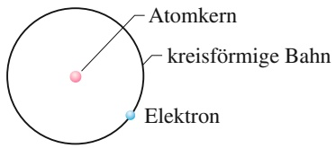

text_image

Atomkern
kreisförmige Bahn
Elektron

(a)

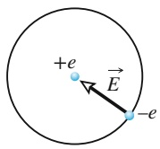

(b)

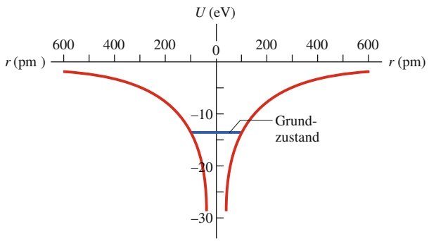

contour

| r (pm) | U (eV) |
| --- | --- |
| 0 | -13 |
| ~100 | -13 |
| ~200 | -13 |
| ~300 | -13 |
| ~400 | -13 |
| ~500 | -13 |
| ~600 | -13 |

(c)

Diese Frage konnte bis 1913 niemand beantworten. Als Niels Bohr in diesem Jahr auf Balmers Gleichung stieß, erkannte er jedoch, dass er sie herleiten konnte, indem er einige gewagte (und zu diesem Zeitpunkt völlig unbegründete) Hypo thesen aufstellte: (1) Das Elektron in einem Wasserstoffatom umkreist den Kern ähnlich wie die Erde die Sonne (Abb. 35.13a). (2) Der Betrag des Drehimpulses $\vec { L }$ des Elektrons in seiner Umlaufbahn ist auf die Werte

$$
L = n \hbar \quad \text {mit} \quad n = 1, 2, 3, \dots \tag {35.17}
$$

beschränkt, mit ℏ (gelesen $\mathrm{h}-\mathrm{q} \mathrm{u} \mathrm{e}^{\alpha}=h /(2 \pi)$ und einer Quantenzahl n.

## Im Bohr-Modell ist der Bahnradius quantisiert

Betrachten wir die Bahnbewegung des Elektrons im Bohrschen Modell. Die Zentripetalkraft, die das Elektron in einer Umlaufbahn mit dem Radius r hält, ist die Coulomb-Kraft. Wie in Kapitel 20 diskutiert, ist ihr Betrag

$$
F = k \frac {| q _ {1} | | q _ {2} |}{r ^ {2}}
$$

mit $k = 1 / ( 4 \pi \varepsilon _ { 0 } ) .$ . Hierbei ist $q _ { 1 }$ die Ladung −e des Elektrons und $q _ { 2 }$ ist die Ladung +e des Kerns (des Protons). Die Beschleunigung des Elektrons ist die Zentripetalbeschleunigung mit dem Betrag $a = \nu ^ { 2 } / r ,$ wenn v die Geschwindigkeit des Elektrons ist. Sowohl die Kraft $\vec { F }$ als auch die Beschleunigung a⃗ sind radial nach innen (negative Richtung auf einer radialen Achse) auf den Kern gerichtet (Abb. 35.13b). Daher können wir das zweite Newtonsche Gesetz $( F = m a )$ für eine radiale Koordinate in der Form

$$
- \frac {1}{4 \pi \varepsilon_ {0}} \frac {e ^ {2}}{r ^ {2}} = m \left(- \frac {\nu^ {2}}{r}\right) \tag {35.18}
$$

schreiben, wobei m die Elektronenmasse ist.

## Abb. 35.13

(a) Die kreisförmige Bahn des Elektrons im Bohrschen Modell des Was serstoffatoms. (b) Das Elektron wird durch die Coulomb-Kraft $\vec { F }$ vom Proton angezogen. (c) Die potenzielle Energie U eines Wasserstoffatoms als Funktion des Abstands r zwischen dem Elektron und dem zentralen Proton. Die Kurve wurde zweimal gezeichnet (einmal links und einmal rechts), um die dreidimensionale kugelsymmetrische Falle zu verdeutlichen, in der das Elektron sitzt.

883

---

35 Mehr über Materiewellen

Nun führen wir über Bohrs Hypothese aus Gl. 35.17 die Quantisierung ein. Der Betrag l des Drehimpulses eines einzelnen Teilchens mit der Masse m und der Geschwindigkeit $\nu ,$ das sich auf einer Kreisbahn mit dem Radius r bewegt, ist $l =$ rmv sin 𝜑, wobei $\varphi$ (der Winkel zwischen ⃗r und v⃗) gleich $9 0 ^ { \circ }$ ist. Wenn wir L in Gl. 35.17 durch rmv sin $9 0 ^ { \circ }$ ersetzen, erhalten wir

$$
r m \nu = n \hbar
$$

oder

$$
v = \frac {n \hbar}{r m}. \tag {35.19}
$$

Das setzen wir in Gl. 35.18 ein, ersetzen ℏ durch $h / ( 2 \pi )$ und stellen etwas um; damit erhalten wir

$$
r = \frac {h ^ {2} \varepsilon_ {0}}{\pi m e ^ {2}} n ^ {2} \quad \text {fur} \quad n = 1, 2, 3, \dots \tag {35.20}
$$

Das schreiben wir in der Form

$$
r = a n ^ {2} \tag {35.21}
$$

mit $n = 1 , 2 , 3 , \ldots$ und einer Konstante

$$
a = \frac {h ^ {2} \varepsilon_ {0}}{\pi m e ^ {2}} = 5, 2 9 1 7 7 2 \cdot 1 0 ^ {- 1 1} \mathrm{m} \approx 5 2, 9 2 \mathrm{pm}. \tag {35.22}
$$

Diese drei Gleichungen zeigen, dass der Radius r der Umlaufbahn des Elektrons im Bohrschen Modell des Wasserstoffatoms quantisiert und der kleinste Radius $( { \mathrm { f i r ~ } } n = 1 )$ durch a gegeben ist; dieser Radius wird **Bohrscher Radius** genannt. Dem Bohrschen Modell zufolge kann die Entfernung des Elektrons vom Kern nicht kleiner als a werden. Dies liefert dann auch den Grund dafür, dass die Anziehung zwischen dem Elektron und dem Kern nicht dazu führt, dass das Elektron in den Kern stürzt.

## Die Quantisierung der Bahnenergie

Wir wollen nun ermitteln, welche Energie das Wasserstoffatom im Bohrschen Modell hat. Das Elektron besitzt die kinetische Energie $K = ( 1 / 2 ) m \nu ^ { 2 }$ und das System Elektron–Kern eine potenzielle elektrische Energie $U = q _ { 1 } q _ { 2 } / ( 4 \pi \varepsilon _ { 0 } r )$ (Gl. 20.41). Hier sollen $q _ { 1 }$ die Ladung −e des Elektrons und $q _ { 2 }$ die Ladung +e des Kerns sein. Daraus folgt, dass die mechanische Energie insgesamt

$$
\begin{array}{l} E = K + U \\ = \frac {1}{2} m v ^ {2} + \left(- \frac {1}{4 \pi \varepsilon_ {0}} \frac {e ^ {2}}{r}\right) \tag {35.23} \\ \end{array}
$$

beträgt. Nun lösen wir Gl. 35.18 nach $m \nu ^ { 2 }$ auf und setzen das Ergebnis in Gl. 35.23 ein; das ergibt

$$
E = \frac {1}{8 \pi \varepsilon_ {0}} \frac {e ^ {2}}{r}. \tag {35.24}
$$

Ersetzen von r mithilfe von Gl. 35.20 liefert

$$
E _ {n} = - \frac {m e ^ {4}}{8 \varepsilon_ {0} ^ {2} h ^ {2}} \frac {1}{n ^ {2}} \quad \text {mit} \quad n = 1, 2, 3, \dots , \tag {35.25}
$$

wobei der Index n an E anzeigt, dass die Energie quantisiert ist. Einsetzen der Werte der Konstanten in Gl. 35.25 liefert schließlich

$$
E _ {n} = - \frac {2 , 1 8 0 \cdot 1 0 ^ {- 1 8} \mathrm{J}}{n ^ {2}} = - \frac {1 3 , 6 1 \mathrm{eV}}{n ^ {2}} \quad \text {mit} \quad n = 1, 2, 3, \dots \tag {35.26}
$$

884

---

35.5 Das Wasserstoffatom

35

Dieser Gleichung entnehmen wir die Quantisierung der Energie – sie ist auf diskrete Werte $E _ { n }$ beschränkt, die durch die Quantenzahl $n$ definiert sind. Da wir davon ausgehen, dass der Kern räumlich fixiert ist und sich nur das Elektron (um den Kern) bewegt, können wir die Energien aus Gl. 35.26 entweder dem Atom insgesamt oder dem Elektron allein zuschreiben.

## Energieänderungen

Die Energie eines Wasserstoffatoms (oder äquivalent die seines Elektrons) ändert sich, wenn das Atom Licht aussendet oder absorbiert. Bei Anregung eines Elektrons durch Absorption eines Photons gilt Gl. 35.6:

$$
h f = \Delta E = E _ {\mathrm{hoch}} - E _ {\mathrm{tief}}. \tag {35.27}
$$

Um wieder auf Balmers Gleichung (Gl. 35.16) zurückzukommen, nehmen wir drei Veränderungen an Gl. 35.27 vor. Auf der linken Seite ersetzen wir $f$ durch $c / \lambda$ und auf der rechten Seite verwenden wir zweimal Gl. 35.26, um die Energieterme zu ersetzen. Durch eine einfache Umstellung erhalten wir dann

$$
\frac {1}{\lambda} = - \frac {m e ^ {4}}{8 \varepsilon_ {0} ^ {2} h ^ {3} c} \left(\frac {1}{n _ {\mathrm{hoch}} ^ {2}} - \frac {1}{n _ {\mathrm{tief}} ^ {2}}\right) \tag {35.28}
$$

oder

$$
\frac {1}{\lambda} = R \left(\frac {1}{n _ {\text {tief}} ^ {2}} - \frac {1}{n _ {\text {hoch}} ^ {2}}\right), \tag {35.29}
$$

wobei wir die Rydberg-Konstante

$$
R = \frac {m e ^ {4}}{8 \varepsilon_ {0} ^ {2} h ^ {3} c} = 1, 0 9 7 3 7 3 \cdot 1 0 ^ {7} \mathrm{m} ^ {- 1} \tag {35.30}
$$

eingeführt haben.

Wenn wir in Gl. 35.29 $n _ { \mathrm { t i e f } }$ durch 2 ersetzen und $n _ { \mathrm { h o c h } }$ auf die Werte 3, 4, 5 und 6 beschränken, erhalten wir gerade Balmers Formel, Gl. 35.16. Diese Entsprechung war für Bohr ein großer Triumph und ebnete den Weg für die Quantenphysik der Atome.

Bohrs Erfolg war jedoch nur von kurzer Dauer. Zwar gibt das Bohrsche Modell die korrekten Emissions- und Absorptionswellenlängen für das Wasserstoffatom an, aber es ist insofern nicht korrekt, als das Elektron in Wirklichkeit den Kern nicht umkreist wie ein Planet die Sonne. Daher gelang es auch nicht, das Bohrsche Modell auf Atome anzuwenden, die komplizierter als Wasserstoff sind. Dieser Misserfolg lässt sich darauf zurückführen, dass ein Elektron in einem Atom in Wirklichkeit eine Materiewelle ist, die in einem anziehenden Potenzial lokalisiert ist. Um die daraus resultierende quantisierte Energie zu ermitteln, muss man die Schrödinger-Gleichung auf das Elektron anwenden.

## 35.5.3 Die Schrödinger-Gleichung und das Wasserstoffatom

Das auf das Elektron im Wasserstoffatom wirkende elektrische Potenzial ist

$$
U (r) = \frac {- e ^ {2}}{4 \pi \varepsilon_ {0} r}. \tag {35.31}
$$

Es handelt sich hierbei um ein dreidimensionales Potenzial, das etwas komplizierter als die bereits diskutierten Potenzialtöpfe ist. Beispielsweise hat das Potenzial

885

---

35 Mehr über Materiewellen

in Gl. 35.31 keine scharf definierten „Wände“, sondern die Wandtiefe (bzw. Po tenzialhöhe) variiert kontinuierlich als Funktion der radialen Entfernung r. Abbil dung 35.13c zeigt die grafische Darstellung des Wasserstoffpotenzials, die der Realität wahrscheinlich am ehesten entspricht. Doch auch diese Darstellung erfordert ein gewisses Maß an Interpretation.

Man kann die Schrödinger-Gleichung auf ein Elektron anwenden, das in dem durch Gl. 35.31 gegebenen Potenzial gebunden ist. Die dabei auftretenden sogenannten Kugelflächenfunktionen $Y _ { l , m } ( \theta , \varphi )$ sowie die assoziierten Laguerre-Poly nome findet man in Büchern über Quantenmechanik, in Tabellensammlungen von mathematischen Funktionen in der Physik oder in Mathematikprogrammen.

Das Ergebnis dieser Analyse ist, dass die Energien quantisiert sind und ihre er laubten Werte mit denen aus Gl. 35.26 für das (physikalisch nicht korrekte) Bohr sche Modell übereinstimmen. Daher werden auch die aufgrund von Lichtemission oder -absorption auftretenden Energieveränderungen ΔE korrekt durch Gl. 35.27 und die entsprechenden Wellenlängen durch Gl. 35.29 beschrieben. Im Folgenden wollen wir diese Ergebnisse etwas genauer betrachten.

## Energieniveaus und Spektren des Wasserstoffatoms

Abbildung 35.14 zeigt die Energieniveaus zu den unterschiedlichen Werten von n in Gl. 35.26. Das niedrigste Niveau für $n = 1$ ist der Grundzustand des Wasserstoffs. Höhere Niveaus entsprechen angeregten Zuständen, genau wie wir es von den einfacheren Potenzialfallen kennen. Es lassen sich jedoch einige Unterschiede feststellen: (1) Die Energieniveaus haben nun keine positiven Werte, wie wir sie vorher z. B. in Abb. 35.3 und 35.8 gewählt hatten, sondern negative. (2) Die höheren Niveaus liegen zunehmend dichter beisammen. (3) Die Energie für den höchsten Wert von n, $n = \infty ,$ , ist jetzt $E _ { \infty } = 0$ . Wenn die Energie größer wird als $E _ { \infty } = 0 ,$ sind Elektron und Proton nicht mehr aneinander gebunden (das Wasserstoffatom ist dann ionisiert, das Elektron ist frei). Der Bereich in Abb. 35.14 mit $E > 0$ entspricht dem nichtquantisierten Bereich des endlichen Topfs aus Abb. 35.8.

Der Zustand des Wasserstoffatoms kann zwischen den quantisierten Energieniveaus hin- und herspringen, indem Licht der durch Gl. 35.29 spezifizierten Wellenlängen emittiert oder absorbiert wird. Diese Wellenlängen werden aufgrund der $\mathrm { A r t } _ { i }$ wie sie in einem Spektroskop erscheinen, als Linien bezeichnet. Ein Wasserstoffatom hat demzufolge Absorptions- und Emissionslinien. Eine Sammlung solcher Linien nennt man das **Spektrum** des Wasserstoffatoms.

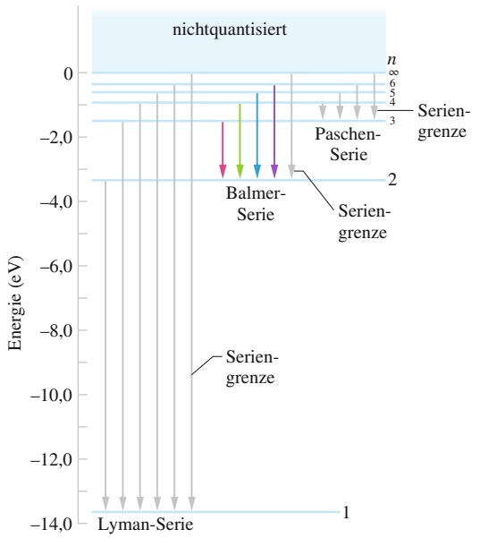

bar

| Energy Level (eV) | State / Feature |
| --- | --- |
| 0 | N/A |
| -1.5 | N/A |
| -2.8 | Balmer-Serie |
| -3.0 | Paschen-Serie |
| -3.3 | Serien-grenze |
| -13.5 | Lyman-Serie |

Abb. 35.14 Grafische Darstellung von Gl. 35.26 mit einigen der Energieniveaus des Wasserstoffatoms. Die Übergänge sind in Serien eingeteilt, die nach verschiedenen Wissenschaftlern benannt sind.

886

---

35.5 Das Wasserstoffatom

35

Die Wasserstofflinien werden nach den Niveaus, aus denen die Sprünge nach oben beginnen bzw. in denen die Sprünge nach unten enden, in Serien eingeteilt. So heißen z. B. die Emissions- und Absorptionslinien für alle möglichen Sprünge aus dem bzw. in das Niveau mit $n = 1$ Lyman-Serie, benannt nach Theodore Lyman, der diese Linien zuerst untersucht hat. Das untere Niveau der Lyman-Serie ist demnach stets das mit $n = 1$ , das der Balmer-Serie ist das Niveau mit $n = 2$ und das der Paschen-Serie das mit $n = 3 .$

Vier Linien der Balmer-Serie liegen im sichtbaren Bereich; bei ihnen handelt es sich um die Linien, die Balmer untersuchte. Sie sind in Abb. 35.14 mit Pfeilen entsprechend ihrer Farben dargestellt. Der kürzeste dieser Pfeile repräsentiert den kürzesten Sprung in der Serie, zwischen den Niveaus $n = 3$ und $n = 2$ . Diesem Sprung entsprechen daher die geringste Veränderung der Elektronenergie und die kleinste emittierte Photonenenergie innerhalb der Serie; das zugehörige Licht ist rot. Der nächste Sprung in der Serie, zwischen $n = 4$ und $n = 2$ ist weiter, die Photonenenergie ist größer, die Wellenlänge des emittierten Lichts kürzer und das Licht erscheint grün. Der dritte, vierte und fünfte Pfeil repräsentieren noch größere Sprünge und demzufolge noch kürzere Wellenlängen. Bei dem fünften Sprung liegt das zugehörige Licht im Ultravioletten und ist daher nicht sichtbar.

Die Grenze einer Serie ist die Linie, die durch den Sprung zwischen dem Grundzustandsniveau und dem Grenzniveau mit der Quantenzahl $n = \infty$ entsteht. Somit ist die Seriengrenze die kürzeste Wellenlänge in der Serie. Abbildung 35.15 zeigt eine spektroskopische Aufnahme der Balmer-Emissionslinien; die Seriengrenze ist durch ein kleines Dreieck markiert.

Bei einem Sprung nach oben in den nichtquantisierten Bereich der Energie ist die Elektronenenergie nicht mehr durch Gl. 35.26 gegeben, da das Elektron nicht mehr im Atom gebunden ist. Das Wasserstoffatom ist dann ionisiert, was bedeutet, dass das Elektron sich so weit entfernt hat, dass die Coulomb-Anziehung des Kerns vernachlässigt werden kann. Das Atom kann ionisiert werden, indem es Wellenlängen absorbiert, die kleiner als die Seriengrenze sind. Das freie Elektron hat dann nur noch eine kinetische Energie $K = ( 1 / 2 ) m \nu ^ { 2 }$ (wenn man von einer nichtrelativistischen Situation ausgeht).

## Die Quantenzahlen des Wasserstoffatoms

Obwohl sich die Energien des Wasserstoffatoms durch eine einzige Quantenzahl n kennzeichnen lassen, erfordern die Wellenfunktionen zur Charakterisierung der Zustände insgesamt drei Quantenzahlen, entsprechend der drei Dimensionen, in denen sich das Elektron bewegen kann. Diese drei Quantenzahlen sind zusammen mit ihren Bezeichnungen und ihren möglichen Werten in Tab. 35.1 angegeben.

Jeder Satz von Quantenzahlen $( n , l , m _ { l } )$ identifiziert die Wellenfunktion zu einem bestimmten Quantenzustand eindeutig. Die Quantenzahl $n ,$ die sogenannte **Hauptquantenzahl**, tritt schon in Gl. 35.26 für die Energie des Zustands auf. Die **Bahndrehimpulsquantenzahl** l ist ein Maß für den Betrag des Bahndrehimpulses des entsprechenden Quantenzustands. Die **magnetische Quantenzahl** $m _ { l }$ beschreibt die Orientierung des Drehimpulsvektors im Raum relativ zu einer Bezugsachse. Die in Tab. 35.1 angegebenen Einschränkungen für die Werte der Quantenzahlen des Wasserstoffatoms sind nicht willkürlich, sondern ergeben sich

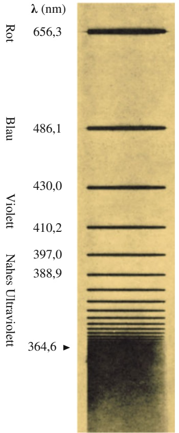

line

| Wavelength \((\lambda)\) (nm) | Band Description |
| --- | --- |
| 656.3 | Rot |
| 486.1 | Blau |
| 430.0 | Violet |
| 410.2 | Violet |
| 397.0 | Nahes Ultraviolet |
| 388.9 | Nahes Ultraviolet |
| 364.6 | Nahes Ultraviolet |

Abb. 35.15 Das Spektrum der Emissionslinien der Balmer-Serie beim Wasserstoffatom. Während in Abb. 35.14 nur vier Übergänge dieser Serie sowie der Grenzübergang eingezeichnet sind, erkennt man in diesem Bild mehr als ein Dutzend Linien. Man beachte, wie diese Linien zur Seriengrenze (durch ein Dreieck markiert) hin immer enger beieinander liegen.

TABELLE 35.1: Die Quantenzahlen des Wasserstoffatoms.

| Symbol | Name | mögliche Werte |
| --- | --- | --- |
| n | Hauptquantenzahl | 1, 2, 3, ... |
| l | Bahndrehimpulsquantenzahl | 0, 1, 2, ..., n - 1 |
| ml | magnetische Quantenzahl | -l, -(l - 1), ..., +(l - 1), +l |

887

---

35 Mehr über Materiewellen

aus der Lösung der Schrödinger-Gleichung. Für den Grundzustand $n = 1$ finden wir die Einschränkungen $l = 0$ und $m _ { l } = 0$ . Das Wasserstoffatom hat in seinem Grundzustand also einen Drehimpuls von null.

## KONTROLLFRAGE 5

Betrachten Sie die Quantenzustände des Wasserstoffatoms zur Hauptquantenzahl $n = 5$ . Welche Werte sind für l möglich? (b) Ein Teil dieser Quantenzustände des Wasserstoffatoms zu $n = 5$ habe die Quantenzahl $l = 3$ . Wie viele Werte sind für $m _ { l }$ in dieser Gruppe möglich?

## Die Grundzustandswellenfunktion des Wasserstoffatoms

Die Wellenfunktion des Grundzustands des Wasserstoffatoms erhält man als (normierte) Lösung der dreidimensionalen Schrödinger-Gleichung. Sie lautet

$$
\psi (r) = \frac {1}{\sqrt {\pi} a ^ {3 / 2}} \mathrm{e} ^ {- r / a} \quad \text {(Grundzustandswellenfunktion)}.\tag {35.32}
$$

Hierbei ist a wieder der Bohrsche Radius, der ungefähr dem effektiven Radius eines Wasserstoffatoms entspricht und damit auch in anderen Situationen eine nützliche Längeneinheit zum Vergleich atomarer Abmessungen ist.

Wie alle Wellenfunktionen besitzt auch diese keine unmittelbare physikalische Bedeutung, wohl aber $\psi ^ { 2 } ( r ) ,$ die Wahrscheinlichkeitsdichte – Wahrscheinlichkeit pro Volumen – für den Nachweis des Elektrons.1) Insbesondere ist $\psi ^ { 2 } ( r )   \mathrm { d } V$ die Wahrscheinlichkeit, das Elektron in einem (infinitesimalen) Volumenelement dV um einen Punkt im Abstand r vom Atomkern anzutreffen:

$$
\left( \begin{array}{c} \text {Nachweiswahrscheinlichkeit} \\ \text {innerhalb des Volumens d} V \\ \text {im Abstand} r \end{array} \right) = \binom{\text {Wahrscheinlichkeitsdichte}}{\psi^ {2} (r) \text {im Abstand} r} (\text {Volumen d} V). \tag {35.33}
$$

Da $\psi ^ { 2 } ( r )$ nur vom Radius r abhängt, ist es sinnvoll, als Volumenelement dV das Volumen zwischen zwei konzentrischen Kugelschalen mit den Radien r und $r   +   \mathrm { d } r$ zu wählen. Wir setzen daher

$$
\mathrm{d} V = (4 \pi r ^ {2}) \mathrm{d} r, \tag {35.34}
$$

wobei $4 \pi r ^ { 2 }$ die Fläche der inneren Kugelschale und $\mathrm { d } \boldsymbol { r }$ der radiale Abstand zwischen den beiden Kugelschalen sind. Aus den Gln. 35.32–35.34 erhalten wir dann

$$
\begin{array}{l} \left( \begin{array}{c} \text {Nachweiswahrscheinlichkeit} \\ \text {innerhalb des Volumens d} V \\ \text {im Abstand} r \end{array} \right) = \psi^ {2} (r)   \mathrm{d} V \\ = \frac {4}{a ^ {3}} \mathrm{e} ^ {- 2 r / a} r ^ {2} \mathrm{d} r. \tag {35.35} \\ \end{array}
$$

Statt mit der Wahrscheinlichkeitsdichte $\psi ^ { 2 } ( r )$ (Wahrscheinlichkeit pro Volumen) zu rechnen, ist es zur Beschreibung der Nachweiswahrscheinlichkeit bequemer, mit einer **radialen Wahrscheinlichkeitsdichte** $P ( r )$ (Wahrscheinlichkeit pro Län-$\mathtt { g e } )$ zu arbeiten. $P ( r )$ ist eine lineare Wahrscheinlichkeitsdichte; mit ihr gilt

$$
\begin{array}{l} \binom{\text {radiale Wahrscheinlichkeits - }}{\text {dichte} P (r) \text {im Abstand} r} \binom{\text {radiale}}{\text {Breite} \mathrm{d} r} \\ = \left( \begin{array}{c} \text {Wahrscheinlichkeitsdichte} \\ (\text {pro Volumen}) \psi^ {2} (r) \\ \text {im Abstand} r \end{array} \right) (\text {Volumen} \mathrm{d} V) \\ \end{array}
$$

1) In dem allgemeineren Fall komplexwertiger Wellenfunktionen ist die Wahrscheinlichkeitsdichte durch |ψ(r)|2 gegeben, also durch das Betragsquadrat der Wellenfunktion.

888

---

35.5 Das Wasserstoffatom

35

oder

$$
P (r) \mathrm{d} r = \psi^ {2} (r) \mathrm{d} V. \tag {35.36}
$$

Wir ersetzen $\psi ^ { 2 } ( r )$ dV nach Gl. 35.35 und erhalten so

$$
P (r) = \frac {4}{a ^ {3}} r ^ {2} \mathrm{e} ^ {- 2 r / a} \quad \text {(radiale Wahrscheinlichkeitsdichte für den Grundzustand des Wasserstoffatoms).} \tag {35.37}
$$

Diese Funktion ist in Abb. 35.16 dargestellt. Aufgrund der Normierung ist die Flä- che unter der Kurve gleich eins:

$$
\int_ {0} ^ {\infty} P (r) \mathrm{d} r = 1. \tag {35.38}
$$

Diese Gleichung drückt nur aus, dass sich das Elektron irgendwo zwischen dem Atomkern und dem Rand des Universums befinden muss.

Das Dreieck auf der horizontalen Achse von Abb. 35.16 markiert den Bohrschen Radius. Nach dieser Abbildung ist ein Elektron im Grundzustand des Wasserstoffatoms mit der größten Wahrscheinlichkeit in ungefähr dieser Entfernung vom Atomkern anzutreffen.

Abbildung 35.16 steht in krassem Widerspruch zu dem populären Bild, wonach sich die Elektronen in Atomen auf wohldefinierten Bahnen bewegen wie die Planeten um die Sonne. Dieses Bild ist falsch! Wir können über die Position des Elektrons im Grundzustand des Wasserstoffatoms nicht mehr wissen, als Abb. 35.16 zeigt. Die Frage kann also nicht lauten $_ { p } \mathrm { W }$ ann befindet sich das Elektron an einem bestimmten $\mathrm { O r t ? } _ { , } ^ { \omega }$ sondern nur „Mit welcher Wahrscheinlichkeit können wir das Elektron in einem kleinen Volumen um einem bestimmten Punkt nachweisen?“Die Darstellung in Abb. 35.17 soll diese probabilistische Natur der Wellenfunktion verdeutlichen und gleichzeitig eine nützliche Vorstellung vom Grundzustand des Wasserstoffatoms geben. Stellen Sie sich das Atom in diesem Zustand eher wie eine verschwommene Hülle vor, ohne scharfe Ränder und ohne irgendeinen Hinweis auf irgendwelche Elektronenbahnen.

Es ist zu Beginn oft nicht leicht, sich Elementarteilchen in dieser probabilisti schen Weise vorzustellen. Die Schwierigkeit liegt meist darin, unsere gewohnte Vorstellung von einem Elektron als einer winzigen Kugel aufzugeben, die sich zu bestimmten Zeitpunkten an bestimmten Raumpunkten befindet und einer wohldefinierten Bahn folgt. Elektronen und andere Elementarteilchen verhalten sich eben nicht nach diesen naiven Vorstellungen.

Die Energie des Grundzustands beträgt $E _ { 1 } = - 1 3 { , } 6   \mathrm { e V }$ . Wir können diesen Wert entweder aus Gl. 35.26 für $n = 1$ berechnen, oder indem wir die Schrödinger-Gleichung für das Wasserstoffatom lösen und den kleinsten gefundenen Wert der Energie auswählen. Auf diesem Weg erhalten wir praktischerweise auch gleich die zughörige Wellenfunktion des Grundzustands.

Tatsächlich kann man Lösungen der Schrödinger-Gleichung für beliebige Energien finden, also z. B. auch für $E = - 1 1 { , } 6   \mathrm { e V }$ oder $- 1 4 ,   3   \mathrm { e V }$ . Man könnte daraus schließen, die Energien des Wasserstoffatoms seien nicht quantisiert, was jedoch der Erfahrung widerspricht. Des Rätsels Lösung ist, dass solche Lösungen der Schrödinger-Gleichung physikalisch nicht sinnvoll sind, da sie für $r \rightarrow$ ∞ immer größere Werte liefern. Bei diesen „Wellenfunktionen“ wäre das Elektron mit der größten Wahrscheinlichkeit unendlich weit vom Atomkern entfernt – eine unsinnige Aussage, da dann erstens kein Wasserstoffatom mehr vorhanden wäre und diese Wellenfunktionen zweitens nicht mehr normierbar wären (und deshalb gleich mehreren Anforderungen an Wellenfunktionen nicht genügten). Um physikalisch sinnvolle Lösungen zu erhalten, muss man den Lösungen der Schrö- dinger-Gleichung noch sogenannte **Randbedingungen** auferlegen: Wir lassen nur Lösungen der Schrödinger-Gleichung zu, für die $\psi ( r )   \to   0$ für $r \to \infty$ gilt.

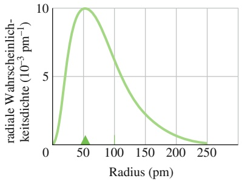

line

| Radius (pm) | radiale Wahrscheinlichkeitsdichte \((10^{-3}\) \(pm^{-1})\) |
| --- | --- |
| 0 | 0 |
| ~25 | ~6.5 |
| ~50 | 10 |
| ~75 | ~8.5 |
| ~100 | ~6.5 |
| ~125 | ~4.5 |
| ~150 | ~3.0 |
| ~175 | ~2.0 |
| ~200 | ~1.2 |
| ~225 | ~0.8 |
| 250 | 0 |

Abb. 35.16

Die radiale Wahrscheinlichkeitsdichte P(r) für den Grundzustand des Wasserstoffatoms. Das Dreieck markiert den Bohrschen Radius und der Ursprung entspricht dem Atommittelpunkt.

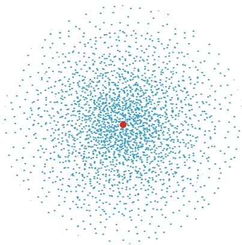

scatter

| Series | X (range) | Y (range) |
| --- | --- | --- |
| Blue | 0~100 | 0~100 |
| Red | ~35 | ~35 |

Abb. 35.17

Die Dichte der blauen Punkte in dieser Darstellung repräsentiert die $\mathrm { W a h r - }$ scheinlichkeitsdichte $\psi ^ { 2 } ( r ) - \mathrm { n i c h t }$ die radiale Wahrscheinlichkeitsdichte $P ( r )$ – für den Grundzustand des Wasserstoffatoms. Die Punktdichte nimmt exponentiell mit dem Abstand vom Kern (roter Punkt) ab. Eine solche Darstellung vermittelt eine Vorstellung von der „Elektronenwolke“ eines Atoms.

889

---

35 Mehr über Materiewellen

TABELLE 35.2: Quantenzahlen der Zustände mit $n = 2$ im Wasserstoffatom.

| n | l | $m_{l}$ |
| --- | --- | --- |
| 2 | 0 | 0 |
| 2 | 1 | +1 |
| 2 | 1 | 0 |
| 2 | 1 | -1 |

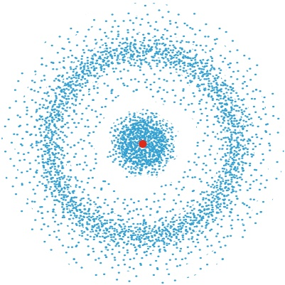

scatter

| Series | X (range) | Y (range) |
| --- | --- | --- |
| Blue points | -10~10 | -10~10 |
| Red point | 1 | 1 |

Abb. 35.18

Die Dichte der blauen Punkte in dieser Darstellung entspricht der Wahrscheinlichkeitsdichte $\psi ^ { 2 } ( r )$ für den Zustand mit $n = 2 ,   l = 0$ und $m _ { l } = 0$ des Wasserstoffatoms. Die Verteilung ist kugelsymmetrisch um den Atomkern. Die kreisförmige Lücke in der Punktdichte entspricht einer Kugeloberfläche, auf der $\psi ^ { 2 } ( r ) = 0$ ist.

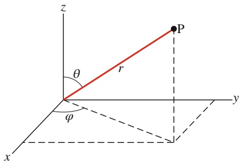

text_image

z
θ
r
P
y
φ
x

Abb. 35.19

Die Beziehungen zwischen den kartesischen Koordinaten $x ,   y$ und z und den Kugelkoordinaten $r ,$ θ und 𝜑. Kugelkoordinaten eignen sich besonders für die Analyse von kugelsymmetrischen Systemen wie beispielsweise dem Wasserstoffatom.

Die Wahrscheinlichkeitsdichten $\psi ^ { 2 } ( r , \theta )$ für die Zustände mit $n = 2$ und im Wasserstoffatom. (a) Darstellung für $m _ { l } = 0 . \left( \mathsf { b } \right)$ Darstellung für $m _ { l } = \pm 1$ . Die Wahrscheinlichkeitsdichte ist in allen Fällen rotationssymmetrisch um die z-Achse.

Abb. 35.20

Das bedeutet im Umkehrschluss, dass wir nur gebundene Elektronen betrachten. Mit dieser Einschränkung gibt es nur noch eine endliche Zahl von Lösungen der Schrödinger-Gleichung, die den quantisierten Energien aus Gl. 35.25 entsprechen.

## Die Zustände mit $n = 2$ im Wasserstoffatom

Wenn wir die in Tab. 35.1 aufgeführten Bedingungen für die Zustände des Wasserstoffatoms auf die Hauptquantenzahl $n = 2$ anwenden, so finden wir insgesamt vier Zustände. Die erlaubten Quantenzahlen sind in Tab. 35.2 aufgeführt. Wir betrachten zunächst den Zustand mit $n = 2$ und $l = m _ { l } = 0$ . Die zugehörige Wahr scheinlichkeitsdichte ist in Abb. 35.18 skizziert. Die Verteilung der Punkte in dieser Darstellung ist ebenso wie in Abb. 35.17 kugelsymmetrisch. In Kugelkoordinaten (Abb. 35.19) hängt die Wahrscheinlichkeitsdichte daher nur von der Radialkoordinate r und nicht von den Winkelkoordinaten θ und 𝜑 ab.

Es zeigt sich, dass alle Zustände mit der Quantenzahl $l = 0$ durch kugelsym metrische Wellenfunktionen dargestellt werden. Das ist auch vernünftig, denn die Quantenzahl l ist ein Maß für den Drehimpuls dieses Zustands. Für $l = 0$ verschwindet der Drehimpuls und daher ist es nur folgerichtig, dass auch die Wahrscheinlichkeitsdichte eines solchen Zustands keine Vorzugsachse besitzt.

Abbildung 35.20 zeigt Darstellungen der Wahrscheinlichkeitsdichten für die drei Zustände mit $n = 2$ und $l = 1$ . Die Wahrscheinlichkeitsdichten der Zustände mit $m _ { l } = \pm 1$ sind identisch; sie sind zwar rotationssymmetrisch um die z-Achse, aber nicht kugelsymmetrisch. Die Wahrscheinlichkeitsdichten für diese drei Zustände sind daher sowohl Funktionen von r als auch der Winkelkoordinate θ.

Ein kleines Rätsel: Welche Eigenschaft des Wasserstoffatoms bestimmt die in Abb. 35.20 so offensichtliche Symmetrieachse der Wahrscheinlichkeitsdichten? Die Antwort lautet: Überhaupt keine!

Die Lösung dieses Rätsels hängt damit zusammen, dass alle drei Zustände in Abb. 35.20 dieselbe Energie haben. Die Energie eines Zustands hängt nach Gl. 35.25 nämlich nur von der Hauptquantenzahl n ab, nicht aber von l und $m _ { l }$ Tatsächlich kann man bei einem isolierten Wasserstoffatom experimentell überhaupt nicht zwischen den drei Zuständen in Abb. 35.20 unterscheiden.

Die Summe der drei Wahrscheinlichkeitsdichten zu $n = 2$ und $l = 1$ ist eine ku gelsymmetrische Wahrscheinlichkeitsdichte ohne Vorzugsachse. Man kann sich vorstellen, dass das Elektron jeweils ein Drittel seiner Zeit in jedem der drei Zustände in Abb. 35.20 verbringt. Man fasst diese drei unabhängigen Zustände daher zu einer kugelsymmetrischen **Unterschale** zusammen, die durch die Quantenzahlen $n = 2$ und l = 1 definiert ist. Die einzelnen Zustände offenbaren ihre eigenstän-

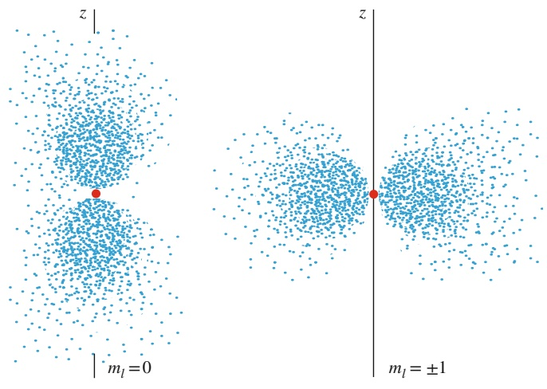

(a)

(b)

890

---

35.6 Zusammenfassung

35

dige Existenz erst, wenn sich das Wasserstoffatom in einem äußeren elektrischen oder magnetischen Feld befindet, das die Symmetrie der Umgebung aufhebt. Dann haben die drei Zustände zu den Quantenzahlen $n = 2$ und $l = 1$ auch verschiedene Energien und die Richtung des äußeren Felds definiert die Richtung der Symmetrieachse.

Der Zustand mit den Quantenzahlen $n = 2$ und $l = 0 ,$ dessen Wahrscheinlichkeitsdichte in Abb. 35.18 wiedergegeben ist, hat ebenfalls dieselbe Energie wie die drei Zustände aus Abb. 35.20. Insgesamt können wir uns alle vier Zustände, deren Quantenzahlen in Tab. 35.2 angegeben sind, als eine kugelsymmetrische **Schale** (oder auch **Hauptschale**) vorstellen, die durch die Quantenzahl n gekennzeichnet ist. Die Bedeutung von Schalen und Unterschalen wird sich erst in Kapitel 36 erschließen, wenn wir Atome mit mehr als einem Elektron behandeln.

Wir runden unser Bild des Wasserstoffatoms durch Betrachtung von Abb. 35.21 ab. Sie zeigt eine Darstellung der radialen Wahrscheinlichkeitsdichte für einen $\mathrm { Z u - }$ stand des Wasserstoffatoms mit einer vergleichsweise hohen Hauptquantenzahl $( n = 4 5 )$ und der höchsten dafür nach Tab. 35.1 erlaubten Drehimpulsquantenzahl $( l = n - 1 = 4 4 )$ . Die Wahrscheinlichkeitsdichte bildet hier einen Ring, der symmetrisch zur z-Achse ist und weitgehend in der xy-Ebene liegt. Der mittlere Radius des Rings ist $n ^ { 2 } a ,$ wobei a wieder der Bohrsche Radius ist. Dieser mittlere Radius ist folglich mehr als 2000-mal so groß wie der effektive Radius des Wasserstoffatoms in seinem Grundzustand. tatsächlich erinnert Abb. 35.21 an die Elektronenbahnen der klassischen Physik. Wir sehen hier ein weiteres Beispiel für das Bohrsche Korrespondenzprinzip: Für große Quantenzahlen gehen die Vorhersagen der Quantenphysik in die Vorhersagen der klassischen Physik über. Stellen Sie sich eine Darstellung wie in Abb. 35.21 für wirklich große Werte von n und l vor, beispielsweise $n = 1 0 0 0$ und $l = 9 9 9$

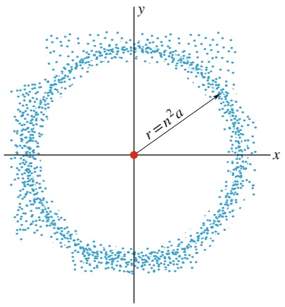

text_image

r=n²a
x
y

Abb. 35.21

Die radiale Wahrscheinlichkeitsdich-$P ( r )$ für das Wasserstoffatom in einem Quantenzustand mit einer vergleichsweise großen Hauptquantenzahl (n = 45) und Drehimpulsquantenzahl $( l = n - 1 = 4 4 )$ . Die Punkte liegen in der Nähe der xy-Ebene und der Ring erinnert schon mehr an eine klassische Elektronenbahn.

## 35.6 Zusammenfassung

**Wellen in endlichen Gebieten** Wenn eine Welle – egal ob es sich um eine Seil- oder eine Materiewelle handelt – auf ein endliches Raumgebiet beschränkt ist, ist eine Quantisierung die Folge, d. h. die Existenz diskreter Zustände mit diskreten Energien.

**Ein Elektron in einem unendlich hohen Kastenpotenzial** Wenn sich ein Elektron in einem unendlich hohen Kastenpotenzial befindet, kann die Materiewelle des gefangenen Elektrons nur in diskreten Zuständen vorliegen. Für einen eindimensionalen Potenzialtopf sind die Energien dieser Quantenzustände

$$
E _ {n} = \left(\frac {h ^ {2}}{8 m L ^ {2}}\right) n ^ {2} \quad \text { für } \quad n = 1, 2, 3, \dots , \tag {35.4}
$$

wobei L die Breite des Potenzialtopfs ist und n eine **Quantenzahl**. Wenn das Elektron von einem Zustand in einen anderen Zustand wechselt, muss sich seine Energie um den Betrag

$$
\Delta E = E _ {\mathrm{hoch}} - E _ {\mathrm{tief}} \tag {35.5}
$$

ändern, wenn $E _ { \mathrm { h o c h } }$ die höhere und $E _ { \mathrm { t i e f } }$ die niedrigere Energie ist. Erfolgt der Übergang durch Photonenabsorption oder -emission, gilt für die Energie der Photonen

$$
h f = \Delta E = E _ {\mathrm{hoch}} - E _ {\mathrm{tief}}. \tag {35.6}
$$

Die **Wellenfunktionen** zu den Quantenzuständen sind

$$
\psi_ {n} (x) = A \sin \left(\frac {n \pi}{L} x\right) \quad \text {mit} \quad n = 1, 2, 3, \dots \tag {35.7}
$$

Die Wahrscheinlichkeitsdichte $\psi _ { n } ^ { 2 } ( x )$ eines erlaubten $\mathbf { Z u } \cdot$ stands hat folgende physikalische Bedeutung: $\psi _ { n } ^ { 2 } ( x )$ dx ist die Wahrscheinlichkeit, das Elektron in dem Intervall zwischen x und x + dx nachzuweisen. Für ein Elektron in einem unendlich hohen Kastenpotenzial sind die Wahrscheinlichkeitsdichten

$$
\psi_ {n} ^ {2} (x) = A ^ {2} \sin^ {2} \left(\frac {n \pi}{L} x\right) \quad \text {mit} \quad n = 1, 2, 3, \dots \tag {35.9}
$$

Für große Quantenzahlen n geht das Verhalten des Elektrons in das klassische Verhalten über, d. h., es befindet sich mit gleicher Wahrscheinlichkeit in allen Teilen des Potenzialtopfs. Dies ist ein Beispiel für das **Korrespondenzprinzip:** Bei genügend großen Quantenzahlen gehen die Vorhersagen der Quantenphysik in die Vorhersagen der klassischen Physik über.

**Normierung und Nullpunktsenergie** Die Amplitude $A ^ { 2 }$ in Gl. 35.9 kann aus der Normierungsbedingung berechnet werden:

$$
\int_ {- \infty} ^ {+ \infty} \psi_ {n} ^ {2} (x) \mathrm{d} x = 1. \tag {35.11}
$$

891

---

35 Mehr über Materiewellen

Sie besagt, dass sich das Elektron mit Sicherheit (d. h. mit Wahrscheinlichkeit 1) irgendwo befindet.

Gleichung 35.4 können wir entnehmen, dass die niedrigste erlaubte Energie des Elektrons nicht null ist, sondern der Quantenzahl $n = 1$ entspricht. Diese niedrigste Energie bezeichnet man als die Nullpunktsenergie des Elektrons in dem Potenzialtopf.

**Ein Elektron in einem endlichen Potenzialtopf** In einem endlichen Potenzialtopf ist die potenzielle Energie eines Elektrons um einen endlichen Betrag $U _ { 0 }$ kleiner als außerhalb. Die Wellenfunktion des Elektrons in einem solchen Potenzialtopf dringt auch in dessen Wände ein.

**Zwei- und dreidimensionale Elektronenfallen** Die quantisierten Energien eines Elektrons in einem zweidimensionalen unendlich tiefen rechteckigen Potenzialtopf sind

$$
E _ {n _ {x}, n _ {y}} = \frac {h ^ {2}}{8 m} \left(\frac {n _ {x} ^ {2}}{L _ {x} ^ {2}} + \frac {n _ {y} ^ {2}}{L _ {y} ^ {2}}\right), \tag {35.14}
$$

wobei $n _ { x }$ und $n _ { y }$ Quantenzahlen sind, die sich aus der Forderung ergeben, dass die Materiewelle des Elektrons in die Breite $L _ { x }$ bzw. $L _ { y }$ des rechteckigen Kastens passen muss. Entsprechend sind die Energien für ein Elektron in einem dreidimensionalen unendlich tiefen Potenzialkasten der Kantenlängen $L _ { x } , L _ { y }$ x, Ly und $L _ { z }$

$$
E _ {n _ {x}, n _ {y}, n _ {z}} = \frac {h ^ {2}}{8 m} \left(\frac {n _ {x} ^ {2}}{L _ {x} ^ {2}} + \frac {n _ {y} ^ {2}}{L _ {y} ^ {2}} + \frac {n _ {z} ^ {2}}{L _ {z} ^ {2}}\right). \tag {35.15}
$$

$n _ { z }$ ist eine weitere Quantenzahl, die sich aus der Forderung ergibt, dass die Wellenfunktion auch in z-Richtung in das Potenzial der Breite $L _ { z }$ passen muss.

**Das Wasserstoffatom** Die potenzielle Energie des Wasserstoffatoms ist

$$
U = - \frac {1}{4 \pi \varepsilon_ {0}} \frac {e ^ {2}}{r}. \tag {35.23}
$$

Aus der dreidimensionalen Form der Schrödinger-Gleichung lassen sich die Energien der Quantenzustände des

Wasserstoffatoms berechnen:

$$
\psi_ {2 1 0} (r, \theta) = \frac {1}{4 \sqrt {2 \pi}} a ^ {- 3 / 2} \frac {r}{a} \mathrm{e} ^ {- r / (2 a)} \cos \theta ,
$$

$$
\psi_ {2 1 + 1} (r, \theta , \varphi) = \frac {1}{8 \sqrt {\pi}} a ^ {- 3 / 2} \frac {r}{a} \mathrm{e} ^ {- r / (2 a)} (\sin \theta) \mathrm{e} ^ {+ \mathrm{i} \varphi}, \tag {35.26}
$$

$$
\psi_ {2 1 - 1} (r, \theta , \varphi) = \frac {1}{8 \sqrt {\pi}} a ^ {- 3 / 2} \frac {r}{a} \mathrm{e} ^ {- r / (2 a)} (\sin \theta) \mathrm{e} ^ {- \mathrm{i} \varphi}.
$$

wobei n die Hauptquantenzahl ist. Zur vollständigen Beschreibung der Quantenzustände erfordert das Wasserstoffatom drei Quantenzahlen, deren Bezeichnungen und erlaubten Werte in Tab. 35.1 angeführt sind.

Die **radiale Wahrscheinlichkeitsdichte** $P ( r )$ eines Zustands des Wasserstoffatoms ist so definiert, dass P(r) dr gleich der Wahrscheinlichkeit ist, mit der ein Elektron zwischen zwei konzentrischen Kugelschalen um den Atomkern mit Radius r bzw. $r + \mathrm { d } r$ nachgewiesen wird. Für den Grundzustand des Wasserstoffatoms ist

$$
P (r) = \frac {4}{a ^ {3}} r ^ {2} \mathrm{e} ^ {- 2 r / a}, \tag {35.37}
$$

wobei a der **Bohrsche Radius** ist $( a   =   5 2 { , } 9   \mathrm { p m } )$ . Abbildung 35.16 zeigt $P ( r )$ für den Grundzustand.

Die Abb. 35.18 und 35.20 zeigen die Wahrscheinlichkeitsdichten (nicht die radialen Wahrscheinlichkeitsdichten) der vier Zustände des Wasserstoffatoms mit $n = 2 .$ Die Darstellung in Abb. 35.18 $( n = 2 , l = 0 , m _ { l } = 0 )$ ist kugelsymmetrisch. Die Darstellungen in Abb. 35.20 $( n = 2 ,$ $l   =   1 , m _ { l }   =   0 , \pm 1 )$ sind symmetrisch zur z-Achse; ihre Summe ist ebenfalls kugelsymmetrisch.

Alle vier Zustände mit n = 2 haben dieselbe Energie. Zu sammengenommen kann man sie als eine **Schale** auffassen, in diesem Fall die Schale mit $n = 2$ . Die drei Zustände aus Abb. 35.20 kann man zusammen als **Unterschale** mit n = 2 und l = 1 ansehen. Experimentell lassen sich die vier Zustände mit n = 2 nicht unterscheiden, solange sich das Wasserstoffatom nicht in einem elektrischen oder magnetischen Feld befindet, das eine Symmetrieachse auszeichnet.

## 35.7 Fragen

**1.** Angenommen, Sie verdoppeln die Breite eines eindimensionalen unendlichen Kastenpotenzials. (a) Wird die Grundzustandsenergie des Elektrons mit dem Faktor 4, 2, 1/2, 1/4 oder einer anderen Zahl multipliziert? (b) Werden die Energien der höheren Zustände mit demselben Faktor multipliziert oder mit einem anderen, der von ihrer Quantenzahl abhängt?
**2.** Drei Elektronen befinden sich in drei verschiedenen eindimensionalen unendlich tiefen Potenzialtöpfen der Breiten (a) 50 pm, (b) 200 pm und (c) 100 pm. Ordnen Sie die Elektronen in absteigender Reihenfolge nach ihren Grundzustandsenergien.

**3.** Wenn Sie die idealisierte Falle aus Abb. 35.1 für ein Positron verwenden wollen, müssen Sie dann (a) die Geometrie der Falle verändern, (b) das elektrische Potenzial des mittleren Zylinders oder (c) das elektrische Potenzial der beiden sich jeweils nach unendlich erstreckenden Zylinder? (Ein Positron hat dieselbe Masse wie ein Elektron, trägt aber eine positive Ladung.)

**4.** Ein Elektron befinde sich in einem eindimensionalen unendlich tiefen Potenzialtopf in dem Zustand mit der Quantenzahl $n = 1 7$ . Wie viele Punkte (a) verschwindender Nachweiswahrscheinlichkeit und (b) maximaler Nachweiswahrscheinlichkeit hat die zugehörige Materiewelle?

892

---

35.7 Fragen

35

**5.** Abbildung 35.F5 zeigt drei unendlich hohe Kastenpotenziale entlang der x-Achse. Bestimmen Sie ohne explizite Rechnung die Wellenfunktion der Grundzustände in jedem Potenzial.

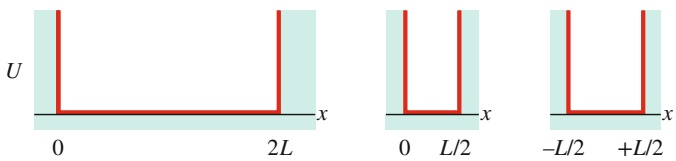

Abb. 35.F5

**6.** In Abb. 35.F6 sind die niedrigsten Energieniveaus (in Elektronenvolt) für fünf verschiedene, unendlich hohe eindimensionale Kastenpotenziale angegeben, in denen jeweils ein Elektron gefangen ist. In den Potenzialen B, $\mathbb { C } , \mathbb { D }$ und E befinden sich die Elektronen im Grundzustand. Das Elektron in Potenzial A wurde in den vierten angeregten Zustand (bei 25 eV) gehoben und kann nun durch Emission von einem oder mehreren Photonen wieder in den Grundzustand zurückkehren. Welche der bei diesen verschiedenen Möglichkeiten emittierten Photonenenergien passt zu einer Absorptionsenergie (aus dem Grundzustand) der anderen vier Elektronen? Geben Sie die zugehörigen Quantenzahlen an.

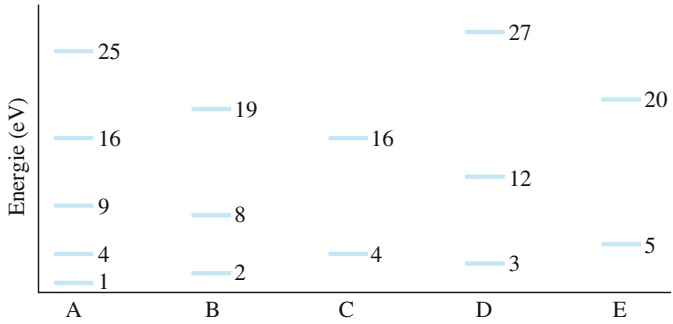

scatter

| Category | Energy Level 1 (eV) | Energy Level 2 (eV) | Energy Level 3 (eV) | Energy Level 4 (eV) | Energy Level 5 (eV) |
| --- | --- | --- | --- | --- | --- |
| A | 1 | 4 | 9 | 16 | 25 |
| B | 2 | 8 | 19 | — | — |
| C | 4 | — | 16 | — | — |
| D | 3 | — | 12 | — | 27 |
| E | 5 | — | — | — | 20 |

Abb. 35.F6

**7.** Ist die Grundzustandsenergie für ein Proton in einem eindimensionalen unendlich hohen Kastenpotenzial grö- ßer, kleiner oder gleich der Grundzustandsenergie eines Elektrons in demselben Potenzial?
**8.** Ein Proton und ein Elektron befinden sich in gleichen eindimensionalen unendlich hohen Kastenpotenzialen. Jedes der Teilchen sei in seinem Grundzustand. Ist die Nachweiswahrscheinlichkeit für das Proton in der Mitte des Potenzials größer, kleiner oder gleich der Nachweiswahrscheinlichkeit für das Elektron?
**9.** Sie wollen das endliche Kastenpotenzial aus Abb. 35.6 so verändern, dass es für das Elektron mehr als drei diskrete Quantenzustände innerhalb des Potenzials gibt. Müssen Sie dazu das Potenzial (a) breiter oder enger, (b) tiefer oder flacher machen?
**10.** Ein endlicher Potenzialtopf sei tief genug, damit sich darin ein Elektron im Zustand mit der Quantenzahl $n = 4$ befinden kann. Wie viele Punkte hat die Materiewelle des Elektrons in diesem Zustand mit (a) einer Nachweiswahrscheinlichkeit null und (b) maximaler Nachweiswahrscheinlichkeit?

**11.** Ordnen Sie die drei Quantenzustände aus Abb. 35.7 in absteigender Reihenfolge nach den De-Broglie-Wellenlängen des Elektrons.
**12.** Ein Elektron in einem endlichen Kastenpotenzial wie in Abb. 35.6 befinde sich in seinem Grundzustand. Sind (a) seine De-Broglie-Wellenlänge, (b) der Betrag seines Impulses und (c) seine Energie größer, kleiner oder gleich den entsprechenden Größen in einem gleich breiten, aber unendlich hohen Kastenpotenzial wie in Abb. 35.2?
**13.** Die Tabelle enthält die Quantenzahlen von fünf fikti ven Zuständen im Wasserstoffatom. Welche dieser Zustände kann es nicht geben?

|  | n | l | $m_{l}$ |
| --- | --- | --- | --- |
| (a) | 3 | 2 | 0 |
| (b) | 2 | 3 | 1 |
| (c) | 4 | 3 | -4 |
| (d) | 5 | 5 | 0 |
| (e) | 5 | 3 | -2 |

**14.** Im Jahr 1996 gelang es Physikern erstmals, in einem Beschleunigerlabor Antiwasserstoffatome herzustellen. Diese Atome bestehen aus einem Positron im elektrischen Feld eines Antiprotons. Ein Positron hat dieselbe Masse wie ein Elektron, aber entgegengesetzte Ladung. Ein Antiproton hat dieselbe Masse wie ein Proton, aber ebenfalls die entgegengesetzte Ladung. Was würden Sie für das Spektrum von Antiwasserstoff erwarten? Ist es das gleiche Spektrum wie das von Wasserstoff oder unterscheidet es sich?
**15.** (a) In der Energieniveaudarstellung für das Wasserstoffatom (Abb. 35.14) erkennt man, dass die Photonenenergie für die zweite Spektrallinie der Lyman-Serie gleich der Summe der Photonenenergien zweier anderer Linien ist. Um welche Linien handelt es sich? (b) Die Photonenenergie der zweiten Linie der Lyman-Serie ist auch gleich der Differenz der Photonenenergien zweier anderer Linien. Um welche Linien handelt es sich in diesem Fall?
**16.** Ein Wasserstoffatom befinde sich in seinem dritten angeregten Zustand. In welchen Zustand (geben Sie die Quantenzahl n an) sollte das Elektron springen, damit (a) das emittierte Licht eine möglichst große Wellenlänge hat, (b) das emittierte Licht eine möglichst kleine Wellenlänge hat und (c) das absorbierte Licht eine möglichst große Wellenlänge hat?
**17.** Ein Elektron ist in einem eindimensionalen unendlichen Potenzialtopf der Breite L gefangen und wird aus dem Grundzustand in den ersten angeregten Zustand angeregt. Welchen Einfluss hat die Anregung auf die Wahrscheinlichkeit, das Elektron (a) in der Mitte des Potenzialtopfs bzw. (b) in der Nähe der Wand innerhalb eines gegebenen kleinen Abschnitts der x-Achse zu detektieren (wird die Wahrscheinlichkeit größer, kleiner oder bleibt sie gleich)?

893

---

