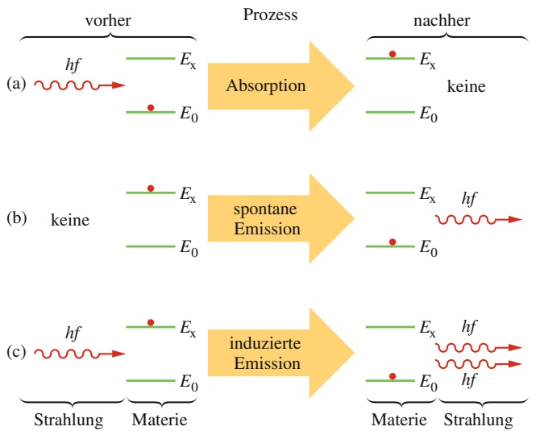
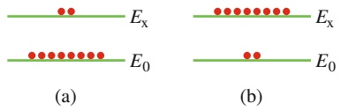
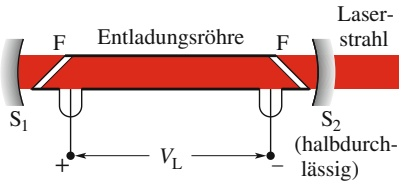
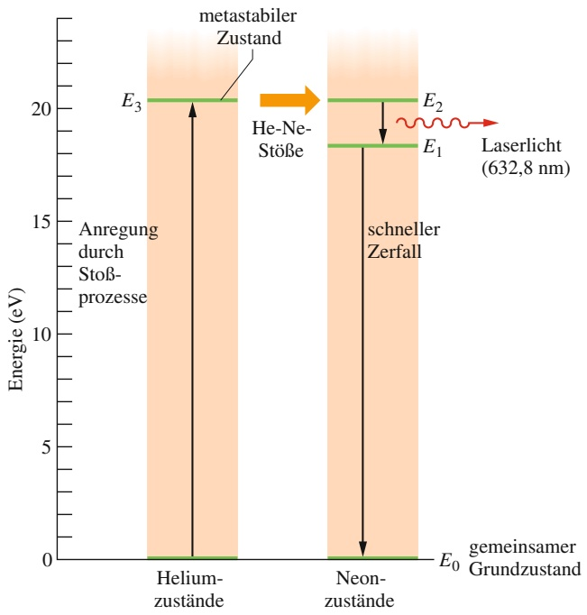
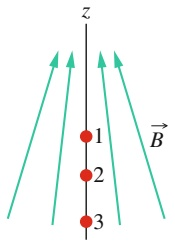

# 36 Atome

原始 PDF 第 909–936 页。

# 36 Atome

## 36.1 Eigenschaften von Atomen

## Physikalische Motivation

Noch zu Beginn des zwanzigsten Jahrhunderts glaubten viele bedeutende Wissenschaftler nicht einmal an die Existenz von Atomen. Heutzutage weiß praktisch jeder, dass es Atome gibt und dass sie die Bausteine der materiellen Welt bilden. Wir können heute sogar einzelne Atome ertasten und sie umherschieben oder in einem „Quantenpferch“ einsperren (Abschn. 35.4). Wir können sogar das Licht einzelner Atome fotografieren.

## 36.1.1 Eigenschaften von Atomen

Haben Sie manchmal das Gefühl, die moderne Atomphysik habe nichts mehr mit dem Alltag zu tun? Dann überlegen Sie sich einmal, wie die folgenden grundlegenden Eigenschaften von Atomen (deren wir uns oft kaum bewusst sind) unser Leben in dieser Welt beeinflussen:

• Atome sind stabil. Nahezu alle Atome in unserer Umgebung existieren unverändert seit Milliarden von Jahren. Wie sähe unsere Welt aus, wenn sich Atome ständig verändern würden – vielleicht im Abstand weniger Wochen oder Jahre?
• Atome können Verbindungen eingehen. Atome verbinden sich zu stabilen Molekülen oder zu Kristallgittern in Festkörpern. Ein Atom besteht zum größten Teil aus leerem Raum, und doch können Sie auf dem Fußboden stehen (der aus Atomen besteht) ohne hindurchzufallen.

Diese Eigenschaften der Atome lassen sich genauso mithilfe der Quantenphysik erklären wie die folgenden, weniger offensichtlichen drei Eigenschaften.

## Der Atomaufbau folgt einer Systematik

Abbildung 36.1 zeigt ein Beispiel für eine periodische Eigenschaft der chemischen Elemente als Funktion ihrer Stellung im Periodensystem (Umschlagseite vorne). Aufgetragen ist hier die **Ionisierungsenergie** der Elemente als Funktion ihrer Ordnungszahl. Die Ionisierungsenergie ist die zum Herauslösen des am schwächsten gebundenen Elektrons aus einem neutralen Atom notwendige Energie. Die auffallenden Ähnlichkeiten in den chemischen und physikalischen Eigenschaften der Elemente in jeder senkrechten Spalte des Periodensystems sind ein deutlicher Hinweis darauf, dass der Aufbau der Atome einer Systematik folgt.

Im Periodensystem sind die Elemente in sieben horizontalen **Perioden** angeordnet. Abgesehen von der ersten beginnt jede dieser Perioden auf der linken Seite mit einem sehr reaktionsfreudigen Alkalimetall (Lithium, Natrium, Kalium usw.) und endet auf der rechten Seite mit einem chemisch trägen Edelgas (Neon, Argon,

Halliday Physik für natur- und ingenieurwiss. Studiengänge, 3. Auflage. D. Halliday, R. Resnick und J. Walker. © 2020 WILEY-VCH Verlag GmbH & Co. KGaA. Published 2020 by WILEY-VCH Verlag GmbH & Co. KGaA.

895

---

36 Atome

Abb. 36.1 Die Ionisierungsenergien der chemischen Elemente als Funktion ihrer Ordnungszahl. Deutlich erkennbar ist die Regelmäßigkeit über die sechs ersten Perioden des Periodensystems. Die Anzahl der Elemente in jeder dieser Perioden ist ebenfalls angegeben.

line

| Element | Z | Ionisierungsergie (eV) |
| --- | --- | --- |
| H | ~2 | ~13.5 |
| He | ~4 | ~24.5 |
| Li | ~5 | ~5.5 |
| Ne | ~10 | ~21.5 |
| Na | ~11 | ~5.5 |
| Ar | ~18 | ~16 |
| K | ~20 | ~4.5 |
| Kr | ~37 | ~14 |
| Rb | ~38 | ~4.5 |
| Cs | ~55 | ~4 |
| Xe | ~56 | ~12 |
| Rn | ~85 | ~10.5 |

Krypton usw.). Mithilfe der Quantenmechanik lassen sich die chemischen Eigenschaften dieser Elemente verstehen. Die Anzahl der Elemente in den sieben Perioden sind

2, 8, 8, 18, 18, 32 und 32 .

Die Quantenmechanik kann auch diese Zahlen erklären.

## Atome emittieren und absorbieren Licht

Wir haben bereits gesehen, dass Atome nur in diskreten Quantenzuständen mit wohldefinierten Energien existieren können. Zwischen den verschiedenen Zuständen können Übergänge stattfinden, bei denen Licht emittiert (bei einem Übergang in ein tieferes Energieniveau $E _ { \mathrm { t i e f } } )$ oder absorbiert (bei einem Übergang in ein hö- heres Energieniveau $E _ { \mathrm { h o c h } } )$ wird. In Abschn. 35.1 hatten wir bereits diskutiert, dass für die Energien der absorbierten bzw. emittierten Photonen gilt

$$
h f = E _ {\mathrm{hoch}} - E _ {\mathrm{tief}}. \tag {36.1}
$$

Die Aufgabe, die Frequenzen des von den Atomen emittierten oder absorbierten Lichts zu erklären, reduziert sich daher darauf, die Energien der erlaubten Quantenzustände in einem Atom zu bestimmen. Mithilfe der Quantenmechanik können wir diese Energien berechnen.

text_image

z
L
r
m, -e
v
μ

Abb. 36.2

Ein klassisches Modell eines Teilchens der Masse m und der Ladung −e, das sich mit der Geschwindigkeit v auf einem Kreis mit Radius r bewegt. Ein solches Teilchen hat einen Drehimpuls $\vec { L } = \vec { r } \times \vec { p } ,$ wobei ⃗p der Impuls m⃗v ist. Die Bewegung dieses Teilchens entspricht einer geschlossenen Stromschleife mit dem zugehörigen magnetischen Moment μ⃗, dessen Richtung zu L⃗ entgegengesetzt ist.

## Atome haben einen Drehimpuls und ein magnetisches Moment

Abbildung 36.2 zeigt ein negativ geladenes Teilchen auf einer Kreisbahn um einen festen Mittelpunkt. Wie wir bereits in Abschn. 28.5 besprochen hatten, besitzt ein solches Teilchen neben dem Bahndrehimpuls $\vec { L }$ auch ein magnetisches Dipolmoment $\vec { \mu } ,$ da seine Bahn einer winzigen Stromschleife entspricht. (Der Einfachheit halber haben wir hier den in Kapitel 28 verwendeten Index „Bahn“ weggelassen.) In Abb. 36.2 erkennt man, dass sowohl L⃗ als auch $\vec { \mu }$ senkrecht auf der Bahnebene stehen, aber in entgegengesetzte Richtungen zeigen, weil die Ladung negativ ist.

Das in Abb. 36.2 dargestellte Modell ist rein klassisch und kann daher ein Elektron in einem Atom nicht korrekt wiedergeben. Das Modell starrer Kreisbahnen wurde in der Quantenmechanik durch das Modell der Wahrscheinlichkeitsdichten ersetzt. Trotzdem gilt auch in der Quantenmechanik, dass ein Zustand eines Elektrons in einem Atom im Allgemeinen einen Bahndrehimpuls $\vec { L }$ und dann auch ein

896

---

36.1 Eigenschaften von Atomen

36

magnetisches Dipolmoment $\vec { \mu }$ besitzt, die in entgegengesetzte Richtungen zeigen. (Man spricht daher auch von einer Kopplung der beiden Vektorgrößen.)

## Das Einstein-de-Haas-Experiment

Bereits 1915, lange vor der Entdeckung der Quantenmechanik, führten Albert Ein stein und der niederländische Physiker Wander J. de Haas ein einfaches Experi ment durch, mit dem die Kopplung zwischen dem Drehimpuls und dem magnetischen Moment einzelner Atome nachgewiesen werden sollte.

Einstein und de Haas befestigten wie in Abb. 36.3a gezeigt einen Eisenzylinder an einem dünnen Faden. Dieser Zylinder wurde in eine Spule gebracht, die den Zylinder nicht berührte. Zu Beginn zeigten die magnetischen Dipolmomente $\vec { \mu }$ der Atome in dem Zylinder in unterschiedliche, zufällige Richtungen, sodass sich ihre magnetischen Effekte gegenseitig aufhoben (Abb. 36.3a). Dann wurde jedoch ein Spulenstrom eingeschaltet und es bildete sich ein magnetisches Feld B⃗ parallel zur Zylinderachse (Abb. 36.3b). Das hatte zur Folge, dass sich die magnetischen Dipolmomente der Atome in dem Zylinder parallel zu diesem Feld ausrichteten. Wenn die Drehimpulse $\vec { L }$ der einzelnen Atome mit ihren magnetischen Momenten $\vec { \mu }$ gekoppelt sind, sollte diese Ausrichtung der atomaren magnetischen Momente gleichzeitig zu einer Ausrichtung der Drehimpulse führen, und zwar entgegen dem äußeren Magnetfeld.

Auf den Zylinder wirkten keine äußeren Drehmomente, daher muss sein Gesamtdrehimpuls seinen ursprünglichen Wert (null) behalten. Da sich jedoch aufgrund des Magnetfelds B⃗ alle atomaren Drehimpulse antiparallel zu $\vec { B }$ ausrichten, übertragen sie dem Zylinder als Ganzem einen Drehimpuls $\vec { L } _ { \mathrm { g e s } }$ (in Abb. 36.3b nach unten gerichtet). Damit der Gesamtdrehimpuls des Zylinders null bleibt, muss der Zylinder um seine Mittelachse zu rotieren beginnen, sodass sein makroskopischer Drehimpuls $\vec { L } _ { \mathrm { r o t } }$ (in Abb. 36.3b nach oben gerichtet) den Drehimpuls $\vec { L } _ { \mathrm { g e s } }$ der atomaren Momente ausgleicht.

Ohne die Schnur würde sich der Zylinder solange drehen, wie das Magnetfeld eingeschaltet ist. Die Verdrillung der Schnur erzeugt jedoch ein Drehmoment, das die Rotation des Zylinders kurz stoppt und ihn schließlich in eine harmonische Drehschwingung versetzt.

Die Beobachtung der Zylinderrotation bestätigte die Vermutung, dass der Drehimpuls und das magnetische Dipolmoment eines Atoms entgegengesetzt gekoppelt sind. Außerdem zeigt dieses Experiment deutlich, dass der Drehimpuls einzelner Quantenzustände der Atome zu einer sichtbaren Rotation eines makroskopischen Gegenstands führen kann.

text_image

Faden
Eisen-
zylinder
Spule
B=0
L_rot
μ
B
L_ges

(a)

(b)

## Abb. 36.3

Die Anordnung des Einstein-de-Haas-Experiments. (a) Zu Beginn verschwindet das magnetische Feld in dem Eisenzylinder und die magnetischen Dipolmomentvektoren μ⃗ der Atome zeigen in beliebige, unterschiedliche Richtungen. Die Drehimpulsvektoren der Atome (nicht dargestellt) zeigen entgegen der magnetischen Momente und haben daher ebenfalls zufällige Richtungen. (b) Wenn ein Magnetfeld B⃗ entlang der Zylinderachse angelegt wird, richten sich die magnetischen Momente parallel zu B⃗ aus. Damit ändern sich auch die Vektoren der atomaren Drehimpulse und zeigen entgegen der Richtung des Magnetfelds. Wenn keine äußeren Drehmomente auf den $\mathrm { Z y } _ { 1 }$ linder wirken, bleibt sein Drehimpuls erhalten und er muss daher als Ganzes zu rotieren beginnen.

897

---

36 Atome

## 36.1.2 Der Elektronenspin

Wie wir schon in Abschn. 28.5 gesehen hatten, besitzt ein Elektron (egal ob frei oder gebunden) einen intrinsischen Drehimpuls ${ \vec { S } } ,$ den man als Spin oder Spin**drehimpuls** bezeichnet. (Intrinsisch bedeutet so viel wie „eingebaut“, es handelt sich also bei $\vec { S }$ um eine fundamentale Eigenschaft eines Elektrons, vergleichbar mit seiner Masse und seiner elektrischen Ladung.) Im nächsten Abschnitt werden wir sehen, dass der Betrag von $\vec { S }$ quantisiert ist und von einer Spinquantenzahl s abhängt, die für Elektronen (ebenso wie für Protonen und Neutronen) immer den Wert $1 / 2$ hat. Zusätzlich ist auch die Komponente von S⃗ bezüglich einer Bezugsachse quantisiert und hängt von einer **magnetischen Spinquantenzahl** $m _ { s }$ ab, die nur die Werte +1∕2 und $- 1 / 2$ annehmen kann.

Es waren zwei niederländische Wissenschaftler, George Uhlenbeck und Samuel Goudsmit, die auf der Grundlage ihrer Untersuchungen von Atomspektren im Rahmen ihrer Doktorarbeiten erstmals den Elektronenspin postulierten. Die quantenmechanische Grundlage für den Elektronenspin wurde einige Jahre spä- ter durch den englischen Physiker Paul A.M. Dirac gelegt, der im Jahr 1929 eine relativistische Quantentheorie des Elektrons aufstellte.

Es liegt nahe, beim Elektronenspin an die Eigendrehung eines winzigen Teilchens um seine Achse zu denken. Dieses klassische Modell kann jedoch ebenso wie die klassischen Vorstellungen der Elektronenbahnen nicht aufrechterhalten werden. In der Quantenmechanik stellt man sich den Spin am besten als eine messbare, intrinsische Eigenschaft des Elektrons vor. Es gibt einfach kein klassisches Modell für den Spin.

Tabelle 36.1 ist eine Erweiterung von Tab. 35.1. Sie zeigt die vier Quantenzahlen $n ,   l ,   m _ { l }$ und $m _ { s } ,$ die den Zustand eines Elektrons in einem Wasserstoffatom vollständig festlegen. (Da für alle Elektronen $s = 1 / 2$ gilt, ist die Quantenzahl s nicht gesondert aufgeführt.) Dieselben Quantenzahlen charakterisieren auch die erlaubten Zustände eines Elektrons in einem Mehrelektronenatom.

TABELLE 36.1: Quantenzahlen und Zustände von Elektronen in einem Atom.

| Quantenzahl | Symbol | Erlaubte Werte | Hat zu tun mit |
| --- | --- | --- | --- |
| Hauptquantenzahl | n | 1, 2, 3, ... | Abstand vom Kern |
| Bahndrehimpulsquantenzahl | l | 0, 1, 2, ..., (n-1) | Bahndrehimpuls |
| magnetische Quantenzahl | ml | 0, ±1, ±2, ..., ±l | z-Komponente des Bahndrehimpulses |
| magnetische Spinquantenzahl | ms | ±1/2 | z-Komponente des Spins |

Alle Zustände mit demselben Wert für n bilden eine Schale.

Es gibt $2 n ^ { 2 }$ Zustände in einer Schale.

Alle Zustände mit denselben Werten für n und l bilden eine Unterschale.

Alle Zustände in einer Unterschale haben dieselbe Energie.

Es gibt 2(2l + 1) Zustände in einer Unterschale.

## 36.1.3 Drehimpulse und magnetische Momente

Jeder Quantenzustand eines Elektrons in einem Atom hat einen Bahndrehimpuls (der auch null sein kann) und ein damit zusammenhängendes magnetisches Dipolmoment. Jedes Elektron, ob in einem Atom oder frei, besitzt zusätzlich einen Spin, der ebenfalls mit einem magnetischen Dipolmoment verknüpft ist. Wir wollen diese Größen nun untersuchen, zunächst unabhängig voneinander, anschließend gemeinsam.

898

---

36.1 Eigenschaften von Atomen

36

## Bahndrehimpuls und Magnetismus

Der Betrag des **Bahndrehimpulses** $\vec { L }$ eines Elektrons in einem Atom ist quantisiert, d. h., er kann nur bestimmte diskrete Werte annehmen. Diese Werte sind

$$
L = \sqrt {l (l + 1)} \hbar , \tag {36.2}
$$

wobei l die Bahndrehimpulsquantenzahl ist (und $\hbar = h / 2 \pi )$ . Nach Tab. 36.1 muss l entweder null sein oder eine positive ganze Zahl kleiner als $n ;$ für einen Zustand mit $n = 3$ sind beispielsweise nur die Werte $l = 2 ,   l = 1$ und $l = 0$ erlaubt.

Wie wir in Abschn. 28.5 gesehen hatten, ist mit dem Bahndrehimpuls $\vec { L }$ eines Elektrons in einem Atom ein magnetischer Dipol verknüpft. Dieser magnetische Dipol besitzt ein **magnetisches Dipolmoment** $\vec { \mu } _ { \mathrm { B a h n } } ,$ der mit dem Bahndrehim puls gemäß Gl. 28.22 zusammenhängt:

$$
\vec {\mu} _ {\mathrm{Bahn}} = - \frac {e}{2 m} \vec {L}. \tag {36.3}
$$

Das Minuszeichen bedeutet, dass $\vec { \mu } _ { \mathrm { B a h n } }$ und $\vec { L }$ entgegengesetzt gerichtet sind. Da der Betrag von $\vec { L }$ quantisiert ist (Gl. 36.2), muss der Betrag von $\vec { \mu } _ { \mathrm { B a h n } }$ ebenfalls quantisiert sein:

$$
\mu_ {\mathrm{Bahn}} = \frac {e}{2 m} \sqrt {l (l + 1)} \hbar . \tag {36.4}
$$

Weder $\vec { \mu } _ { \mathrm { B a h n } }$ noch $\vec { L }$ können direkt gemessen werden. Wir können jedoch die Komponenten dieser Vektoren bezüglich einer vorgegebenen Achse messen. Wenn sich das Atom beispielsweise in einem Magnetfeld $\vec { B }$ befindet und die z-Richtung entlang der magnetischen Feldlinien verläuft, dann können wir die z-Komponenten von $\vec { \mu } _ { \mathrm { B a h n } }$ und $\vec { L }$ bezüglich dieser Achse messen.

Die Komponente $\mu _ { \mathrm { B a h n } , z }$ des magnetischen Dipolmoments ist quantisiert und durch

$$
\mu_ {\mathrm{Bahn}, z} = - m _ {l} \mu_ {\mathrm{B}} \tag {36.5}
$$

gegeben. Hierbei ist $m _ { l }$ die magnetische Quantenzahl aus Tab. 36.1 und $\mu _ { \mathrm { B } }$ ist das **Bohrsche Magneton**

$$
\mu_ {\mathrm{B}} = \frac {e h}{4 \pi m} = \frac {e \hbar}{2 m} = 9, 2 7 4 \cdot 1 0 ^ {- 2 4} \mathrm{J/T} \quad (\text {Bohrsches Magneton}) \tag {36.6}
$$

(m ist die Elektronenmasse).

Die Komponente $L _ { z }$ des Bahndrehimpulses ist ebenfalls quantisiert und auf die Werte

$$
L _ {z} = m _ {l} \hbar \tag {36.7}
$$

beschränkt.

Abbildung 36.4 zeigt die fünf quantisierten Komponenten $L _ { z }$ des Bahndrehimpulses für ein Elektron mit $l = 2$ und außerdem die zugehörigen Richtungen des Bahndrehimpulses $\vec { L } .$ . Dieses Bild ist streng genommen nicht ganz korrekt, denn $\vec { L }$ selbst können wir nicht messen; eine grafische Darstellung wie in Abb. 36.4 kann daher bestenfalls als Vorstellungshilfe dienen. Wir können diese Vorstellung trotzdem noch einen Schritt weitertreiben und durch

$$
\cos \theta = \frac {L _ {z}}{L} \tag {36.8}
$$

einen Winkel $\theta$ definieren, den wir als halbklassischen Winkel zwischen dem Vektor $\vec { L }$ und der z-Achse bezeichnen. Dieser Winkel entspringt einer klassischen Vorstellung von einer Vektorgröße, von der man gemäß der Quantentheorie immer nur den Betrag und eine Komponente messen kann.

text_image

L_z = +2ħ
+ħ
0
-ħ
-2ħ
l = 2
L = √6ħ

Abb. 36.4

Die erlaubten Werte von $L _ { z }$ für ein Elektron in einem Zustand mit $l = 2 .$ Zu jedem Bahndrehimpulsvektor L⃗ in dieser Abbildung gehört ein Vektor, der in die entgegengesetzte Richtung zeigt und den Betrag und die Richtung des magnetischen Dipolmoments $\vec { \mu } _ { \mathrm { B a h n } }$ angibt.

899

---

36 Atome

## Der Spin und sein magnetisches Moment

Der Betrag S des Spins $\vec { S }$ kann für ein Elektron, ganz gleich ob frei oder gebunden, nur den Wert

$$
\begin{array}{l} S = \sqrt {s (s + 1)} \hbar \\ = \sqrt {\left(\frac {1}{2}\right) \left(\frac {1}{2} + 1\right)} \hbar = 0, 8 6 6 \hbar , \tag {36.9} \\ \end{array}
$$

annehmen, wobei $s \; ( = 1 / 2 )$ die Spinquantenzahl des Elektrons ist.

Wie schon in Abschn. 28.5 diskutiert, ist der Spin eines Elektrons immer mit einem intrinsischen magnetischen Dipol verknüpft. Dieser magnetische Dipol besitzt ein magnetisches Dipolmoment $\vec { \mu } _ { s } ,$ das über Gl. 28.16 mit dem Spin zusammenhängt:

$$
\vec {\mu} _ {s} = - \frac {e}{m} \vec {S}. \tag {36.10}
$$

Das Minuszeichen zeigt auch hier die entgegengesetzten Richtungen von $\vec { \mu }$ und $\vec { S }$ an. Da der Betrag des Spins $\vec { S }$ quantisiert ist (Gl. 36.9), muss auch der Betrag von $\vec { \mu } _ { s }$ quantisiert sein:

$$
\mu_ {s} = \frac {e}{m} \sqrt {s (s + 1)} \hbar . \tag {36.11}
$$

Weder $\vec { S }$ noch $\vec { \mu } _ { s }$ können direkt gemessen werden. Wir können jedoch jeweils eine Komponente entlang einer gegebenen Achse – beispielsweise einer z-Achse – messen. Die Komponente $S _ { z }$ des Spins ist quantisiert und auf die Werte

$$
S _ {z} = m _ {s} \hbar \tag {36.12}
$$

beschränkt, wobei $m _ { s }$ die magnetische Spinquantenzahl aus Tab. 36.1 ist. Sie kann nur die beiden Werte $m _ { s } = + 1 / 2$ (der Spin des Elektrons zeigt nach oben, daher spricht man auch von einem Spin-up-Zustand) oder $m _ { s } = - 1 / 2$ (der Spin zeigt nach unten, der sogenannte Spin-down-Zustand) annehmen.

Die Komponenten $\mu _ { s , z }$ des mit dem Spin verknüpften magnetischen Dipolmoments sind ebenfalls quantisiert und auf die Werte

$$
\mu_ {s, z} = - 2 m _ {s} \mu_ {\mathrm{B}} \tag {36.13}
$$

beschränkt.

Abb. 36.5 Erlaubte Werte für und für ein Elektron.

Abbildung 36.5 zeigt die beiden möglichen Quantenwerte der z-Komponente $S _ { z }$ des Elektronenspins und die zugehörige (halbklassische) Orientierung des Vektors $\vec { S }$ sowie die Komponenten $\mu _ { s , z }$ des magnetischen Dipolmoments und die zugehö- rige Orientierung von $\vec { \mu } _ { s }$ .

## Bahndrehimpuls und Spin

Für ein Atom mit mehr als einem Elektron definieren wir den Gesamtdrehimpuls $\vec { J }$ als Vektorsumme aller Drehimpulse – sowohl der Bahn- als auch der Spindrehimpulse – aller einzelnen Elektronen. Die Anzahl der Elektronen (und die Anzahl der Protonen) in einem neutralen Atom bezeichnet man als die **Ordnungszahl** Z (oder auch **Kernladungszahl**). Für ein neutrales Atom gilt daher

$$
\vec {J} = (\vec {L} _ {1} + \vec {L} _ {2} + \vec {L} _ {3} + \dots + \vec {L} _ {Z}) + (\vec {S} _ {1} + \vec {S} _ {2} + \vec {S} _ {3} + \dots + \vec {S} _ {Z}). \tag {36.14}
$$

Entsprechend ist auch das gesamte magnetische Dipolmoment eines Mehrelektronenatoms gleich der Vektorsumme der Dipolmomente (sowohl aufgrund der

text_image

z
Sz = +1/2ħ
μs,z = +μB
μs
μs,z = -μB
Sz = -1/2ħ
s = 1/2
S = √3/2ħ

900

---

36.2 Das Stern-Gerlach-Experiment

36

Bahn- als auch der Spindrehimpulse) der einzelnen Elektronen. Wegen des zusätzlichen Faktors 2 in Gl. 36.13 hat das resultierende magnetische Dipolmoment eines Atoms jedoch nicht die Richtung $\begin{array} { r } { \operatorname { v o n } - \vec { J } , } \end{array}$ , sondern steht unter einem bestimmten Winkel zu diesem Vektor. Das **effektive magnetische Dipolmoment** $\vec { \mu } _ { \mathrm { e f f } }$ eines Atoms ist gleich der Komponente der Vektorsumme der einzelnen magnetischen Dipolmomente in Richtung von −⃗J (Abb. 36.6).

Wie wir im nächsten Abschnitt sehen werden, gibt es in typischen Atomen eine große Zahl von Elektronen, für die die Summe der Bahndrehimpuls- und der Spinvektoren null ist. In solchen Fällen beruhen $\vec { J }$ und $\vec { \mu } _ { \mathrm { e f f } }$ auf einer überschaubaren Zahl von Elektronen, oft sogar nur auf einem einzelnen Valenzelektron.

## KONTROLLFRAGE 1

Ein Elektron befindet sich in einem Zustand, in dem der Betrag seines Bahndrehimpulses $\vec { L }$ den Wert $2 { \sqrt { 3 } } \hbar$ hat. Wie viele Projektionen des Bahndrehimpulses auf die z-Achse sind in diesem Fall möglich?

## 36.2 Das Stern-Gerlach-Experiment

## Lernziele

Nach dem Durcharbeiten dieses Abschnitts sollten Sie in der Lage sein, . . .

• das Stern-Gerlach-Experiment zu skizzieren und zu erklären, welche Art von Atomen benötigt wird, welches Ergebnis zu erwarten ist, was man tatsächlich misst und worin die Bedeutung dieses Experiments liegt,
• die Beziehung zwischen dem magnetischen Feldgradienten und der Kraft auf ein Atom in einem Stern-Gerlach-Experiment anzuwenden.

## Schlüsselideen

• Das Stern-Gerlach-Experiment demonstriert, dass das magnetische Moment von Silberatomen quantisiert ist. Es liefert den experimentellen Beweis dafür, dass magnetische Momente auf atomarem Niveau quantisiert sind.
• Auf ein Atom mit einem magnetischen Dipolmoment wirkt in einem inhomogenen magnetischen Feld eine Kraft. Wenn sich das Feld in z-Richtung mit der Rate d $| B / \mathrm { d } z |$ ändert, hängt die Kraft entlang der z-Achse gemäß

$$
F _ {z} = \mu_ {z} \frac {\mathrm{d} B}{\mathrm{d} z}.
$$

mit der z-Komponente $\mu _ { z }$ des Dipolmoments zusammen.

## 36.2.1 Das Stern-Gerlach-Experiment

Im Jahr 1922 demonstrierten Otto Stern und Walther Gerlach experimentell, dass das magnetische Moment von Silberatomen quantisiert ist. Im Stern-Gerlach Experiment, wie man es heute nennt, wird Silber in einem Ofen verdampft, aus dem ein Teil des gasförmigen Silbers durch einen schmalen Schlitz in der Ofenwand in eine evakuierte Röhre entweichen kann. Ein Teil der dort angekommenen Atome tritt anschließend durch einen zweiten engen Schlitz und bildet einen scharf gebündelten Atomstrahl (Abb. 36.7), der zwischen den Polen eines Elektromagneten hindurchtritt und schließlich zum Nachweis auf eine Glasplatte trifft, auf der sich die Silberatome ablagern.

Solange der Magnet abgeschaltet ist, sammeln sich die Silberatome in einem kleinen Fleck auf der Glasplatte. Wird der Magnet jedoch eingeschaltet, verteilen sich die Silberatome in vertikaler Richtung. Da Silberatome ein magnetisches Dipolmoment besitzen, werden sie bei ihrem Durchtritt durch den Magneten von

text_image

z
Jz
J
μeff
μeff,z

Abb. 36.6

Ein klassisches Modell für den Gesamtdrehimpuls ⃗J und das effektive magnetische Moment $\vec { \mu } _ { \mathrm { e f f } } .$

text_image

Strahl
Blende
S
N
Elektromagnet
Glasplatte
z

Abb. 36.7

Der Aufbau des Stern-Gerlach-Experiments.

901

---

36 Atome

den vertikalen Magnetkräften beeinflusst und dadurch nach oben oder unten abgelenkt. Aus der Verteilung der Silberatome auf der Glasplatte kann man auf die Ablenkung schließen, die die Atome im Magnetfeld erfahren haben. Als Stern und Gerlach das Silbermuster auf ihrer Nachweisplatte untersuchten, fanden sie eine Überraschung. Bevor wir jedoch auf diese Überraschung eingehen und ihre Bedeutung für die Quantentheorie diskutieren, wollen wir die Art der ablenkenden Magnetkräfte untersuchen.

## Die Ablenkung der Silberatome im Magnetfeld

Wir haben bisher noch nicht untersucht, von welcher Art die Kräfte sind, die die Silberatome in einem Stern-Gerlach-Experiment ablenken. Es handelt sich dabei nicht um das Magnetfeld selbst, das auf bewegte Ladungen wirkt und sie nach Gl. 24.2 $( \vec { F } = q \vec { \nu } \times \vec { B } )$ ablenkt. Der Grund ist einfach: Ein Silberatom ist elektrisch neutral (seine Gesamtladung q ist null) und daher ist die resultierende Kraft nach dieser Gleichung null.

Die im vorliegenden Fall gesuchte magnetische Kraft beruht auf einer Wechselwirkung zwischen dem Magnetfeld $\vec { B }$ des Elektromagneten und dem magnetischen Dipol eines einzelnen Silberatoms. Einen solchen Ausdruck für die Kraft können wir aus der potenziellen Energie $U$ eines Dipols in einem Magnetfeld ableiten. Nach Gl. 24.33 gilt

$$
U = - \vec {\mu} \cdot \vec {B}, \tag {36.15}
$$

wobei $\vec { \mu }$ das magnetische Dipolmoment eines Silberatoms ist. In Abb. 36.7 zeigt die positive z-Achse vertikal nach oben und stimmt mit der Richtung des Magnetfelds $\vec { B }$ überein. Daher können wir Gl. 36.15 auch durch die Komponente $\mu _ { z }$ des magnetischen Dipolmoments entlang des Magnetfelds $\vec { B }$ ausdrücken:

$$
U = - \mu_ {z} B. \tag {36.16}
$$

Wir wenden Gl. 4.19 $( F = -   \mathrm { d } U / \mathrm { d } x )$ auf die z-Achse in Abb. 36.7 an und erhalten so

$$
F _ {z} = - \frac {\mathrm{d} U}{\mathrm{d} z} = \mu_ {z} \frac {\mathrm{d} B}{\mathrm{d} z}. \tag {36.17}
$$

Genau danach haben wir gesucht: eine Gleichung für die magnetische Kraft, die ein Silberatom bei seinem Durchtritt durch ein Magnetfeld ablenkt.

Der Ausdruck $\mathsf { d } B / \mathsf { d } z$ in Gl. 36.17 ist der Gradient des Magnetfelds entlang der z-Achse. Würde sich das Magnetfeld entlang dieser Achse nicht ändern (wenn das Magnetfeld also homogen wäre), wäre $\mathrm { d } B / \mathrm { d } z = 0$ und das Silberatom würde zwischen den Magnetpolen nicht abgelenkt. Im Stern-Gerlach-Experiment sind die Magnetpole daher so geformt, dass der Gradient $\mathrm { d } B / \mathrm { d }$ z möglichst groß wird. Die Silberatome werden dadurch zwischen den Polen so stark wie möglich abgelenkt und diese Ablenkung wird auf der Glasplatte sichtbar.

Nach den Gesetzen der klassischen Physik sollten die Werte der z-Komponenten der magnetischen Dipolmomente der Silberatome in Abb. 36.7 kontinuierlich von $- \mu$ (das Dipolmoment $i \vec { \mu }$ zeigt nach unten) bis $+ \mu$ (das Dipolmoment $\vec { \mu }$ zeigt nach oben) variieren. Daher sollten nach Gl. 36.17 auch die Kräfte auf die Silberatome einen kontinuierlichen Bereich überdecken und die Auslenkungen der Atome entsprechend alle Werte zwischen einer größten Auslenkung nach unten bis zu einer größten Auslenkung nach oben annehmen. Man sollte also erwarten, dass die $\mathrm { A t o - }$ me auf der Glasplatte gleichmäßig entlang einer vertikalen Linie verteilt sind. Das ist jedoch nicht das beobachtete Ergebnis.

902

---

36.2 Das Stern-Gerlach-Experiment

36

## Eine experimentelle Überraschung

Stern und Gerlach stellten fest, dass sich die Silberatome an zwei Punkten auf der Glasplatte sammelten. Der eine Punkt befand sich etwas oberhalb der Mitte (also der Stelle, wo sie bei abgeschaltetem Magnetfeld aufgetroffen waren), der zweite Punkt befand sich im selben Abstand unterhalb dieser Mitte. Abbildung 36.8 zeigt das Resultat einer modernen Version des Stern-Gerlach-Experiments, in dem sich dieser Effekt deutlich erkennen lässt. In diesem Fall wird ein Strahl Caesiumatome (magnetische Dipole wie die Silberatome im ursprünglichen Stern-Gerlach-Experiment) durch ein Magnetfeld mit einem sehr großen Gradienten dB∕dz gelenkt. Das Feld kann ein- und ausgeschaltet werden und ein Detektor wird vertikal durch den Strahl verschoben.

Bei abgeschaltetem Magnetfeld wird der Strahl natürlich nicht abgelenkt und der Detektor zeichnet eine Verteilung mit einem mittleren Maximum auf (blaue Kurve in Abb. 36.8). Dann wird das Magnetfeld eingeschaltet. Der ursprüngliche Strahl spaltet sich nun in zwei Teilstrahlen auf, die nach oben bzw. nach unten abgelenkt werden. Wenn nun der Detektor vertikal verschoben wird, entsteht die orange Kurve mit den beiden Maxima in Abb. 36.8.

## Die Interpretation der Ergebnisse

Im ursprünglichen Stern-Gerlach-Experiment bildeten sich auf der Glasplatte zwei winzige Silberflecken und keine durchgehende vertikale Linie aus Silber, wie man nach der klassischen Physik erwartet hätte. Das bedeutet, die Komponente $\mu _ { z }$ in ${ \vec { B } } .$ -Richtung (z-Achse) kann nicht jeden beliebigen Wert zwischen $- \mu$ und +μ annehmen, wie es die klassische Physik vorhersagt, sondern nur zwei diskrete Werte, die den beiden Flecken auf der Glasplatte entsprechen. Das ursprüngliche Stern-Gerlach-Experiment bewies somit, dass $\mu _ { z }$ (und damit auch $( \vec { \mu } )$ quantisiert ist. Und da der Drehimpuls eines Atoms mit $\vec { \mu }$ zusammenhängt, bedeutet dieses Ergebnis weiter, dass auch der Drehimpuls und seine Komponente $L _ { z }$ quantisiert sind.

Im Rahmen der Quantenmechanik können wir das Stern-Gerlach-Experiment noch umfassender deuten. Wir wissen heute, dass Silberatome aus vielen Elektronen bestehen, von denen jedes ein magnetisches Spinmoment und ein magnetisches Bahnmoment besitzt. Wir wissen weiter, dass sich die meisten dieser Spin- und Bahnmomente gegenseitig aufheben, mit Ausnahme der Momente eines einzelnen Elektrons mit verschwindendem Bahndrehimpuls $( l = 0 )$ . Das Gesamtdipolmoment $\vec { \mu }$ des Silberatoms besteht daher nur aus dem magnetischen Spinmoment dieses einen Elektrons. Nach Gl. 36.13 kann $\mu _ { z }$ daher nur zwei Werte entlang der z-Achse in Abb. 36.7 annehmen, entsprechend der Quantenzahl $m _ { s } = + 1 / 2$ (der Spin des Elektrons zeigt nach oben) bzw. der Quantenzahl $m _ { s } = - 1 / 2$ (der Elektronenspin zeigt nach unten). Mit diesen beiden Möglichkeiten folgt aus Gl. 36.13

$$
\mu_ {s, z} = - 2 \left(+ \frac {1}{2}\right) \mu_ {\mathrm{B}} = - \mu_ {\mathrm{B}} \quad \text {oder} \quad \mu_ {s, z} = - 2 \left(- \frac {1}{2}\right) \mu_ {\mathrm{B}} = + \mu_ {\mathrm{B}}. \tag {36.18}
$$

Wir setzen diese Ausdrücke für $\mu _ { z }$ in Gl. 36.17 ein und erhalten so die Komponente $F _ { z }$ der magnetischen Kraft, die die Silberatome bei ihrem Durchtritt durch das magnetische Feld ablenkt. Sie kann nur zwei Werte annehmen,

$$
F _ {z} = - \mu_ {\mathrm{B}} \left(\frac {\mathrm{d} B}{\mathrm{d} z}\right) \quad \text {und} \quad F _ {z} = + \mu_ {\mathrm{B}} \left(\frac {\mathrm{d} B}{\mathrm{d} z}\right), \tag {36.19}
$$

die den beiden Silberflecken auf der Glasplatte entsprechen.

line

| Position des Strahldetektors | Magnet aus (Intensity) | Magnet ein (Intensity) |
| --- | --- | --- |
| Left side | Low | Moderate |
| Center | High | Low |
| Right side | Low | Moderate |

## Abb. 36.8

Das Ergebnis einer modernen Version des Stern-Gerlach-Experiments mit Caesiumatomen. Bei abgeschaltetem Magnetfeld gibt es nur einen einzigen Strahl. Bei eingeschaltetem Magnetfeld spaltet sich dieser Strahl in zwei Teilstrahlen auf, die der parallelen bzw. antiparallelen Orientierung der magnetischen Momente der Caesiumatome relativ zum äußeren Magnetfeld entsprechen.

903

---

36 Atome

## 36.3 Kernspinresonanz

## Lernziele

Nach dem Durcharbeiten dieses Abschnitts sollten Sie in der Lage sein, . . .

für ein Proton in einem Magnetfeld den Feldvektor und den Vektor des magnetischen Moments des Protons in den beiden möglichen Energiezuständen zu skizzieren und die Bezeichnungen „Spin up“ und „Spin down“ zuzuweisen,
• die Energiedifferenz zwischen den beiden Spinzuständen eines Protons in einem Magnetfeld zu berechnen und die Frequenz und Wellenlänge eines Photons anzugeben, das einen Übergang zwischen den Zuständen bewirken kann,
• zu erklären, wie man ein Kernspinresonanzspektrum erhält.

## Schlüsselideen

• Ein Proton hat einen intrinsischen Spindrehimpuls $\vec { S }$ und ein intrinsisches magnetisches Spindipolmoment $\vec { \mu } _ { S } ,$ die in dieselbe Richtung zeigen (da das Proton positiv geladen ist).
• Das magnetische Dipolmoment $i \vec { \mu }$ eines Protons in einem Magnetfeld $\vec { B }$ hat zwei Möglichkeiten, sich relativ zur Feldachse zu orientieren: „Spin up“ $( \mu _ { z }$ zeigt in B⃗-Richtung) und „Spin down“ $( \mu _ { z }$ zeigt in die entgegengesetzte Richtung).
• Anders als bei einem Elektron ist für das positiv geladene Proton „Spin up“ der Zustand mit der geringeren Energie; die Energiedifferenz zwischen den beiden Orientierungen beträgt $2 \mu _ { z } B .$
• Die für einen Übergang zwischen den beiden Spinzuständen („Umklappen des Spins“) erforderliche Energie ist

$$
h f = 2 m _ {z} B.
$$

text_image

μz
μz
B

(a)

text_image

Energie
2μzB

(b)

## Abb. 36.9

(a) Ein Proton (roter Punkt), dessen Spinkomponente in Richtung eines Magnetfelds den Wert $\hbar / 2$ hat, kann in diesem Magnetfeld zwei quantisierte Orientierungen einnehmen. Wenn Gl. 36.20 erfüllt ist, kann ein Proton von der einen in die andere Orientierung umklappen. (b) Gewöhnlich befinden sich mehr Protonen im niedrigeren Energiezustand als im höheren.

• Das resultierende Feld ist die Vektorsumme aus einem äußeren Feld, das von der Umgebung (z. B. der Messapparatur) erzeugt wird, und einem inneren Feld, das von den Atomen und Kernen in der Nachbarschaft des Protons erzeugt wird.
• In Kernspinresonanzspektren wird das Umklappen von Spins zwischen den möglichen Spinzuständen als Funktion der magnetischen Feldstärke registriert, wodurch sich Substanzen hochspezifisch nachweisen lassen.

## 36.3.1 Kernspinresonanz

Wir hatten in Abschn. 28.5 bereits kurz erwähnt, dass auch ein Proton einen intrinsischen Spin $\vec { S }$ und damit zusammenhängend ein magnetisches Dipolmoment $\vec { \mu }$ besitzt. Spin und Dipolmoment zeigen in dieselbe Richtung (weil das Proton positiv geladen ist). Befindet sich ein Proton in einem konstanten äußeren Magnetfeld $\breve { B }$ parallel zur z-Achse, kann $\vec { \mu }$ nur zwei mögliche Orientierungen einnehmen: $\mu _ { z }$ kann entweder parallel oder antiparallel zu $\vec { B }$ liegen, wie in Abb. 36.9a zeigt. Aus Gl. 24.33 $( U ( \vec { \theta } ) = - \vec { \mu } \cdot \vec { B } )$ wissen wir, dass sich die Energien dieser beiden Orientierungen um einen Betrag $2 \mu _ { z } B$ unterscheiden. Diese Energie ist notwendig, um einen magnetischen Dipol in einem konstanten Magnetfeld umzuklappen. Der niedrigere Energiezustand entspricht der Konstellation, bei der $\mu _ { z }$ parallel zu $\vec { B }$ liegt, bei dem höheren Energiezustand ist $\mu _ { z }$ antiparallel zu ${ \vec { B } } .$

Wir bringen einen Tropfen Wasser in ein konstantes Magnetfeld $\vec { B }$ . Für jedes der Protonen im Wasserstoff der Wassermoleküle ist $\mu _ { z }$ entweder parallel oder anti-parallel zu ${ \vec { B } } .$ Nun überlagern wir dem konstanten Magnetfeld noch ein alternie rendes Magnetfeld einer bestimmten Frequenz $f .$ Die Protonen können jetzt aus dem niedrigeren Energiezustand in den höheren Energiezustand springen, indem

904

---

36.3 Kernspinresonanz

36

sie die Richtung ihres magnetischen Moments umkehren. Diesen Prozess bezeich net man als Umklappen des Spins (denn die Umkehr des magnetischen Dipolmoments erfordert auch die Umkehr des Spins). Die für ein derartiges Umklappen notwendige Frequenz $f$ ergibt sich aus

$$
h f = 2 \mu_ {z} B. \tag {36.20}
$$

Diese Bedingung bezeichnet man als **Kernspinresonanz** (oder **magnetische Kernresonanz**). Damit ein alternierendes elektromagnetisches Feld den Spin der Protonen in einem magnetischen Feld umkehren kann, muss die Energie der zugehörigen Photonen $h f$ gleich der Energiedifferenz $2 \mu _ { z } B$ zwischen den beiden möglichen Orientierungen von $\mu _ { z }$ (und damit des Protonenspins) in dem Feld sein.

Wenn sich ein Proton einmal in dem höheren Energiezustand befindet, kann es durch die Emission eines Photons derselben Energie $\bar { h } f$ (Gl. 36.20) wieder in den unteren Zustand zurückkehren. Gewöhnlich befinden sich mehr Protonen in dem niedrigeren Energiezustand als in dem höheren (vgl. Abb. 36.9b). Einem angelegten alternierenden elektromagnetischen Feld wird daher messbar Energie entzogen.

Bei dem konstanten Magnetfeld B⃗ in Gl. 36.20 handelt es sich in Wirklichkeit nicht nur um das angelegte äußere Feld $\vec { B } _ { \mathrm { e x t } } ,$ in das der Wassertropfen gebracht wird, sondern dieses äußere Feld wird noch durch die schwachen lokalen internen Magnetfelder $\vec { B } _ { \mathrm { l o k a l } }$ aufgrund der magnetischen Momente der Atome und Kerne in der Nähe eines gegebenen Protons modifiziert. Wir schreiben Gl. 36.20 daher in der Form

$$
h f = 2 \mu_ {z} (B _ {\mathrm{ext}} + B _ {\mathrm{lokal}}). \tag {36.21}
$$

Üblicherweise hält man die Frequenz $f$ der elektromagnetischen Feldstärkeoszillationen konstant und variiert stattdessen $B _ { \mathrm { e x t } }$ in Gl. 36.21, bis man ein Absorptionsmaximum beobachtet und daher die Bedingung der magnetischen Resonanz erfüllt ist.

Die Kernspinresonanz ist die Grundlage einer sehr hilfreichen Analysemethode zur Identifikation chemischer Verbindungen. Abbildung 36.10 zeigt das **Kernspinresonanz-** oder **NMR-Spektrum** (NMR = nuclear magnetic resonance) von Ethanol mit der chemischen Formel $\mathrm{CH_{3}{-}CH_{2}{-}OH}$ . Die unterschiedlichen Resonanzmaxima entsprechen dem Umklappen der Spinorientierungen der verschiedenen Protonen in dem Molekül. Sie treten bei unterschiedlichen Werten von $B _ { \mathrm { e x t } }$ auf, weil sich die lokalen Umgebungen der sechs Protonen innerhalb eines Ethanolmoleküls voneinander unterscheiden. Das Spektrum in Abb. 36.10 ist für Ethanol charakteristisch.

Eine Anwendung der Kernspinresonanz in der Medizin ist die **Kernspinresonanztomografie** (MRT = magnetic resonance tomography) oder NMR-Tomografie, die in der medizinischen Diagnostik mit großem Erfolg eingesetzt wird. Die Protonen in den verschiedenen Körpergeweben befinden sich in sehr unterschiedlichen lokalen magnetischen Umgebungen. Wenn man nun einen Körper (oder einen Körperteil) in ein starkes äußeres Magnetfeld bringt, können diese Unterschiede mithilfe der Kernspinresonanz nachgewiesen und die gemessenen Daten von einem Computer zu einem Bild verarbeitet werden, das in mancher Hinsicht einer Röntgenaufnahme gleicht, jedoch oft andere Kontraste verdeutlicht. Abbildung 36.11 zeigt beispielsweise einen mit diesem Verfahren erzeugten Querschnitt durch einen menschlichen Kopf.

spectrogram

| Kategorie | Absorbierte Energie |
| --- | --- |
| OH-Gruppe | ~15% |
| CH2-Gruppe | ~20% |
| CH3-Gruppe | ~95% |

Abb. 36.10

Das NMR-Spektrum von Ethanol. Die Spektrallinien entsprechen den unterschiedlichen Absorptionsenergien für das Umklappen der verschiedenen Protonen. Die drei Liniengruppen gehören zu den Protonen in der OH-, $\mathrm { C H _ { 2 } } \cdot$ und $\mathrm { C H } _ { 3 } .$ -Gruppe des Ethanolmoleküls. Die dargestellte horizontale Achse umfasst weniger als $1 0 ^ { - 4 }   \mathrm { T }$

905

---

36 Atome

## Abb. 36.11

Ein mithilfe der Kernspinresonanz erzeugtes Querschnittsbild eines menschlichen Kopfs wird digital gespeichert und kann so vom Arzt auf einem Tablet begutachtet und ausgewertet werden [Quelle: Hero Images/Getty Images].

natural_image

Medical professional examining a patient's brain scan on a tablet, no visible text or symbols

## 36.4 Das Pauli-Prinzip

## Lernziele

Nach dem Durcharbeiten dieses Abschnitts sollten Sie in der Lage sein, . . .

• das Pauli-Prinzip zu verstehen,
• zu erklären, wie man mehrere Elektronen unter Beachtung des Pauli-Prinzips und der Existenz entarteter Zustände in ein-, zwei- und dreidimensionalen Fallen platzieren kann, und die Begriffe „unbesetzte“, „teilweise besetzte“ und „voll besetzte Niveaus“ zu erläutern,
• ein Energieniveauschema für ein System aus vielen Elektronen in ein-, zwei- und dreidimensionalen Fallen zu zeichnen.

## Schlüsselideen

• Für Elektronen in Atomen und anderen Fallen gilt das Pauli-Prinzip, nach dem keine zwei Elektronen in einer Falle in allen Quantenzahlen übereinstimmen dürfen.

## 36.4.1 Das Pauli-Prinzip

In Kapitel 35 hatten wir verschiedene Elektronenfallen untersucht, angefangen bei fiktiven eindimensionalen Kastenpotenzialen bis hin zu dem realen dreidimensionalen Potenzial des Wasserstoffatoms. In allen dort behandelten Beispielen befand sich immer nur ein einzelnes Elektron in dem betrachteten Potenzial. Wenn wir uns jedoch mit Potenzialen beschäftigen, in denen sich mehr als ein Elektron be findet (was in den folgenden zwei Abschnitten der Fall sein wird), dann müssen wir uns zunächst mit einem Prinzip vertraut machen, das für jedes Teilchen gilt, dessen Spinquantenzahl s nicht null oder ganzzahlig ist. Dieses Prinzip gilt daher nicht nur für Elektronen, sondern auch für Protonen und Neutronen, für die jeweils s = 1∕2 ist. Benannt ist dieses **Pauli-Prinzip** nach Wolfgang Pauli, der es im Jahr 1925 formulierte. Für Elektronen lautet es:

Keine zwei Elektronen in derselben Elektronenfalle können denselben Satz von Quantenzahlen haben.

Wie wir in Abschn. 36.5 sehen werden, folgt aus diesem Prinzip, dass keine zwei Elektronen in einem Atom dieselben Werte für die vier Quantenzahlen $n ,   l ,$ $m _ { l }$ und $m _ { s }$ haben können (da ohnehin alle Elektronen denselben $\operatorname { \mathbb { W } e r t } s = 1 / 2$ für die Spinquantenzahl besitzen). Mit anderen Worten, die Quantenzahlen von je zwei Elektronen in einem Atom müssen sich in mindestens einem dieser vier Werte unterscheiden. Ohne dieses Prinzip würden die Atome in sich zusammenfallen und die uns vertraute Welt könnte in dieser Form nicht existieren.

906

---

36.4 Das Pauli-Prinzip

36

## 36.4.2 Mehrere Elektronen in kastenförmigen Potenzialtöpfen

Bevor wir unsere Diskussion von Mehrelektronenatomen beginnen, betrachten wir zur Vorbereitung zwei Elektronen in den kastenförmigen Potenzialen aus Kapitel 35. Wir werden die dort gefundenen Quantenzahlen verwenden, allerdings werden wir noch den Spin der beiden Elektronen berücksichtigen. Dazu nehmen wir an, die Elektronenfalle befinde sich zusätzlich noch in einem konstanten Magnetfeld. Dann kann nach Gl. 36.12 der Spin eines Elektrons entweder $\mathrm { { \mathfrak { p } } u p } ^ { \alpha }$ $( m _ { s }   =   + 1 / 2 )$ oder „down $( m _ { s }   =   - 1 / 2 )$ sein. (Wir denken uns dieses Magnetfeld als so schwach, dass wir die damit verbundenen potenziellen Energien der Elektronen vernachlässigen können.)

Da sich nun zwei Elektronen in einer Falle befinden, müssen wir das Pauli-Prinzip berücksichtigen. Die beiden Elektronen können also nicht dieselben Werte für ihre Quantenzahlen haben.

1. Eindimensionaler Potenzialtopf. In dem eindimensionalen Kastenpotenzial aus Abb. 35.2 genügt eine Quantenzahl n, um die Wellenfunktion des Elektrons an die Potenzialbreite L anzupassen. Jedes Elektron in diesem Potenzial muss daher einen definierten Wert für n haben; außerdem kann seine Quantenzahl $m _ { s }$ die $\mathrm { W e r t e + 1 / 2 }$ oder $- 1 / 2$ annehmen. Wenn die beiden Elektronen unterschiedliche Werte für n haben, können die Werte für $m _ { s }$ beliebig sein. Sind die beiden Werte für n jedoch gleich, müssen sich die Orientierungen der beiden Spins unterscheiden.
2. Rechteckiger zweidimensionaler Potenzialtopf. Die Anpassung der Wellenfunktion eines Elektrons an die Kantenlängen $L _ { x }$ und $L _ { y }$ des rechteckigen Potenzialtopfs aus Abb. 35.11 implizierte zwei Quantenzahlen $n _ { x }$ und $n _ { y } .$ Für jedes Elektron in diesem Potenzial nehmen diese beiden Quantenzahlen daher definierte Werte an, außerdem können die Quantenzahlen $m _ { s }$ wieder +1 $/ 2$ oder $- 1 / 2$ sein. Insgesamt schreiben wir nun einem Elektron drei Quantenzahlen zu. Nach dem Pauli-Prinzip müssen sich die Quantenzahlen der beiden Elektronen in diesem Potenzial in mindestens einem dieser drei Werte unterscheiden.
3. Dreidimensionaler kastenförmiger Potenzialtopf. In dem dreidimensionalen Potenzial aus Abb. 35.12 werden die Wellenfunktionen durch drei Quantenzahlen $n _ { x } ,   n _ { y }$ und $n _ { z }$ charakterisiert. Diese Quantenzahlen ergeben sich aus der Forderung, dass die Wellenfunktion nun bezüglich aller drei Kantenlängen $L _ { x } ,$ $L _ { y }$ und $L _ { z }$ die richtigen Nullstellen haben muss. Neben diesen drei Quantenzahlen kann die Quantenzahl $m _ { s }$ eines Elektrons noch die Werte $+ 1 / 2$ und $- 1 / 2$ annehmen. Insgesamt gibt es daher vier Quantenzahlen. Nach dem Pauli-Prinzip müssen sich die Zustände zweier Elektronen in diesem Potenzial hinsichtlich mindestens einer dieser vier Quantenzahlen unterscheiden.

Nun stellen wir uns vor, wir füllen die Potenziale in obiger Liste nach und nach mit weiteren Elektronen auf. Die ersten Elektronen gehen jeweils in den niedrigsten Energiezustand – man sagt auch, sie besetzen diesen Zustand. Doch irgendwann verbietet das Pauli-Prinzip die Besetzung dieses niedrigsten Energieniveaus mit weiteren Elektronen, sodass die nächsthöheren Niveaus besetzt werden müssen. Wenn ein Energieniveau wegen des Pauli-Prinzips nicht weiter besetzt werden kann, sagt man auch, dieses Niveau sei **voll** oder **voll besetzt**. Demgegenüber bezeichnet man ein Niveau, das von noch keinem Elektron besetzt ist, als **leer** oder **unbesetzt**. Anderenfalls spricht man von einem **teilweise besetzten** Niveau. Die Elektronenkonfiguration eines Systems aus mehreren gefangenen Elektronen besteht in einer Auflistung (oder einer Zeichnung) sämtlicher besetzter Energieniveaus bzw. sämtlicher Quantenzahlen der Elektronen.

907

---

36 Atome

## Die Gesamtenergie

Meist ist man daran interessiert, die Gesamtenergie eines Systems aus zwei oder mehr Elektronen zu berechnen. Wie findet man die Gesamtenergie für eine beliebige Elektronenkonfiguration in einem Kastenpotenzial?

Der Einfachheit halber nehmen wir an, es gäbe keine elektrische Wechselwirkung zwischen den Elektronen; wir vernachlässigen also die potenzielle elektrische Energie von Elektronenpaaren. In diesem Fall erhält man die Gesamtenergie einer Elektronenkonfiguration, indem man die Energien der einzelnen Elektronen wie in Kapitel 35 berechnet und diese Energien schließlich addiert. (Dies führen wir in Beispielaufgabe 36.2 im Übungsbuch für ein System aus sieben Elektronen in einem zweidimensionalen rechteckigen Potenzialtopf durch.)

Einen guten Überblick über die Energiewerte eines gegebenen Elektronensystems erhält man auch durch Energieniveaudarstellungen für ein ganzes System. Der Zustand mit der niedrigsten Energie $E _ { \mathrm { G } }$ entspricht dem Grundzustand des Systems. Der nächsthöhere Energiewert $E _ { \mathrm { a 1 } }$ entspricht dem ersten angeregten Zustand, noch eine Stufe höher erhält man den zweiten angeregten Zustand $E _ { \mathrm { a 2 } }$ usw.

## 36.5 Der Aufbau des Periodensystems

## Lernziele

Nach dem Durcharbeiten dieses Abschnitts sollten Sie in der Lage sein, . . .

• zu verstehen, dass alle Zustände in einer Unterschale dieselbe Energie haben, die im Wesentlichen von der Hauptquantenzahl n und nur zu einem kleinen Teil von der Quantenzahl l abhängt,
• die symbolischen Bezeichnungen für die verschiedenen Werte der Bahndrehimpulsquantenzahl zu kennen,
• das Auffüllen der Schalen und Unterschalen der Atome beim Aufbau des Periodensystems zu erklären (unter Vernachlässigung von Elektron-Elektron-Wechselwirkungen),
• die Besonderheiten der Edelgase im Vergleich zu den anderen chemischen Ele menten anzugeben, insbesondere im Hinblick auf Reaktivität, Gesamtdrehimpuls und Ionisierungsenergie,
• bei Übergängen zwischen atomaren Energieniveaus durch Emission oder Absorption von Licht die Beziehung zwischen Energiedifferenz und Frequenz bzw. Wellenlänge des Lichts anzuwenden.

## Schlüsselideen

• Im Periodensystem der Elemente sind die verschiedenen chemischen Elemente nach ihrer Ordnungszahl Z geordnet, wobei Z die Anzahl der Protonen im Atomkern angibt. Für ein neutrales Atom entspricht Z auch der Elektronenzahl.
• Zustände mit gleicher Quantenzahl n bilden eine Schale.
• Zustände mit gleichen Werten in den Quantenzahlen n und l bilden jeweils eine Unterschale.
Geschlossene Schalen und Unterschalen enthalten die maximale durch das Pauli-Prinzip erlaubte Zahl von Elektronen. Der Gesamtdrehimpuls und das magnetische Gesamtmoment solcher geschlossener Schalen sind immer null.

## 36.5.1 Der Aufbau des Periodensystems

Die vier Quantenzahlen aus Tab. 36.1 charakterisieren die Zustände jedes einzelnen Elektrons in einem Atom. Die Wellenfunktionen dieser Zustände sind in Mehrelektronensystemen jedoch nicht dieselben wie die Wellenfunktionen der entsprechenden Zustände beim Wasserstoffatom, weil die potenzielle Energie ei-

908

---

36.5 Der Aufbau des Periodensystems

36

nes Elektrons in einem Mehrelektronensystem nicht mehr nur von der Ladung und dem Ort des Atomkerns abhängt, sondern auch von den Ladungen und Orten aller anderen Elektronen in dem Atom. Die Schrödinger-Gleichung für Mehrelektronensysteme lässt sich – zumindest näherungsweise – mithilfe eines Computers numerisch lösen.

In Abschn. 35.5 hatten wir kurz erwähnt, dass alle Zustände mit denselben Werten für die Quantenzahlen n und l eine Unterschale bilden. Für einen gegebenen Wert von l gibt es $2 l + 1$ mögliche Werte für die magnetische Quantenzahl $m _ { l } ,$ daher existieren insgesamt $2 ( 2 l + 1 )$ Zustände in einer Unterschale. Es zeigt sich, dass alle Zustände in einer gegebenen Unterschale dieselbe Energie haben. Der Wert dieser Energie hängt in erster Linie von n und nur zu einem geringeren Teil von l ab.

Aus historischen Gründen werden die Unterschalen für verschiedene Werte von l symbolisch durch Buchstaben gekennzeichnet:

$$
\begin{array}{c c c c c c c} l = 0 & 1 & 2 & 3 & 4 & 5 & \ldots \\ \text {s} & \text {p} & \text {d} & \text {f} & \text {g} & \text {h} & \ldots \end{array}
$$

Beispielsweise wird die Unterschale mit $n = 3$ und $l = 2$ auch als 3d-Unterschale bezeichnet.

Wenn wir in einem Mehrelektronenatom die einzelnen Elektronen gewissen Zuständen zuordnen, müssen wir das Pauli-Prinzip aus Abschn. 36.4 berücksichtigen: In einem Atom können keine zwei Elektronen dieselben Werte für die Quantenzahlen $n , l , m _ { l }$ und $m _ { s }$ annehmen. Ohne dieses Prinzip würden alle Elektronen in einem Atom das niedrigste Energieniveau besetzen, und eine Chemie von Atomen und Molekülen oder gar eine Biochemie könnte es nicht geben. Wir wollen nun anhand einiger Beispielatome untersuchen, wie das Pauli-Prinzip den Aufbau des Periodensystems beeinflusst.

## Neon

Das Neonatom besitzt zehn Elektronen. Nur zwei davon passen in die Unterschale zur niedrigsten Energie, die 1s-Unterschale. Diese beiden Elektronen haben die Quantenzahlen $n = 1 ,   l = 0$ und $m _ { l } = 0 ,$ , eines von ihnen hat die Quantenzahl $m _ { s } = + 1 / 2 ,$ , das andere $m _ { s } = - 1 / 2$ . Die 1s-Unterschale besteht nach Tab. 36.1 aus genau $2 ( 2 l + 1 ) = 2$ Zuständen. Diese Unterschale enthält somit bereits die nach dem Pauli-Prinzip erlaubte maximale Anzahl von Elektronen, daher sagt man auch, sie sei **abgeschlossen**.

Zwei der verbliebenen acht Elektronen besetzen die nächste Unterschale, die 2s-Unterschale, die damit ebenfalls voll ist. Die letzten sechs Elektronen füllen die 2p-Unterschale, die mit $l = 1$ gerade $2 ( 2 l + 1 ) = 6$ Zustände enthält und damit ebenfalls abgeschlossen ist.

In einer geschlossenen Unterschale sind alle erlaubten z-Projektionen des Bahndrehimpulsvektors $\vec { L }$ auch vorhanden, wie man aus Abb. 36.4 ersehen kann. Diese Projektionen heben sich innerhalb einer Unterschale gegenseitig auf: Für jede positive Projektion gibt es eine entsprechende negative Projektion desselben Betrags. Ganz entsprechend heben sich auch die z-Projektionen des Spins gegenseitig auf. Eine abgeschlossene Unterschale besitzt daher keinen Drehimpuls und kein magnetisches Moment. Außerdem ist die Wahrscheinlichkeitsdichte kugelsymmetrisch. Damit besitzt Neon mit seinen drei abgeschlossenen Unterschalen (1s, 2s und 2p) keine „losen“ Elektronen, die eine chemische Reaktion mit anderen Atomen unterstützen würden. Ebenso wie alle anderen **Edelgase**, welche die ganz rechte Spalte des Periodensystems bilden, zählt Neon zu den chemisch extrem trä- gen Elementen.

909

---

36 Atome

## Natrium

Unmittelbar nach Neon folgt mit elf Elektronen Natrium im Periodensystem. Zehn dieser Elektronen bilden einen abgeschlossenen, neonartigen Atomrumpf, der, wie wir gesehen haben, einen verschwindenden Drehimpuls besitzt. Das verbleibende Elektron befindet sich zum größten Teil außerhalb dieses trägen Atomrumpfs in der energetisch nächstniedrigen 3s-Unterschale. Dieses sogenannte **Valenzelektron** von Natrium besetzt einen Zustand mit $l = 0$ (also einen s-Zustand). Der Drehimpuls und das magnetische Dipolmoment von Natrium beruhen ausschließ- lich auf dem Spin dieses einzelnen Elektrons.

Natrium verbindet sich sehr leicht mit anderen Atomen, die „einen Platz frei haben“, den das nur locker gebundene Valenzelektron einnehmen kann. Wie alle anderen **Alkalimetalle**, welche die ganz linke Spalte im Periodensystem bilden, ist auch Natrium chemisch sehr aktiv.

## Chlor

Das Chloratom besitzt 17 Elektronen. Zehn davon befinden sich in einem abgeschlossenen, neonartigen Atomrumpf, es verbleiben also noch sieben Elektronen. Zwei von ihnen füllen die 3s-Unterschale. Die restlichen fünf Elektronen besetzen die Zustände der 3p-Unterschale, welche die nächstniedrige Energie haben. Diese Unterschale zur Quantenzahl $l = 1$ kann $2 ( 2 l + 1 ) = 6$ Elektronen aufnehmen. Es gibt also einen freien Platz – ein $\mathrm { L o c h } ^ { a } -$ in dieser Unterschale.

Chlor reagiert sehr leicht mit Atomen mit einem Valenzelektron, das dieses Loch füllen kann. Beispielsweise ist Natriumchlorid (NaCl) eine sehr stabile Verbindung. Chlor zählt zu den chemisch sehr aktiven **Halogenen**, welche die 17. bzw. VIIA-Spalte des Periodensystems bilden.

## Eisen

Die Konfiguration der 26 Elektronen in einem Eisenatom lässt sich folgendermaßen darstellen:

$$
\underbrace {1 \mathrm{s} ^ {2} 2 \mathrm{s} ^ {2} 2 \mathrm{p} ^ {6} 3 \mathrm{s} ^ {2} 3 \mathrm{p} ^ {6}} _ {\text {}} 3 \mathrm{d} ^ {6} 4 \mathrm{s} ^ {2}.
$$

Die Unterschalen sind, wie allgemein üblich, nach ihrer numerischen Reihenfolge aufgelistet, wobei der Hochindex die Anzahl der Elektronen in jeder Unterschale angibt. Tabelle 36.1 können wir entnehmen, dass eine s-Unterschale 2 Elektronen aufnehmen kann, eine p-Unterschale 6 Elektronen und eine d-Unterschale 10 Elektronen. Die ersten 18 Elektronen bilden die fünf abgeschlossenen Unterschalen, die durch die Klammer markiert wurden, womit noch 8 Elektronen übrig bleiben. Von diesen acht Elektronen besetzen sechs die 3d-Unterschale und die verbleibenden zwei befinden sich in der 4s-Unterschale.

Die letzten beiden Elektronen füllen also nicht die 3d-Unterschale weiter auf (die insgesamt 10 Elektronen aufnehmen könnte). Die $3 \mathrm { d } ^ { 6 } 4 \mathrm { s } ^ { 2 } .$ -Konfiguration entspricht einem Zustand mit geringerer Gesamtenergie des Atoms als die $\mathsf { \Gamma } _ { \mathrm { 3 d } ^ { 8 } } .$ Konfiguration. Ein Eisenatom, dessen 8 Elektronen (statt 6) sich in der 3d-Unterschale befänden, würde sehr rasch in die $3 \mathsf { d } ^ { 6 } 4 \mathsf { s } ^ { 2 } .$ -Konfiguration übergehen und dabei elektromagnetische Strahlung emittieren. Wichtig ist an dieser Stelle, dass die Zustände (abgesehen von den einfachsten Elementen) offenbar nicht immer nach der scheinbar „logischen“ Reihenfolge aufgefüllt werden, sondern stets nach der energetisch günstigsten.

910

---

36.6 Röntgenstrahlung

36

## 36.6 Röntgenstrahlung

## Lernziele

Nach dem Durcharbeiten dieses Abschnitts sollten Sie in der Lage sein, . . .

• anzugeben, wo die Röntgenstrahlen im elektromagnetischen Spektrum angesiedelt sind,
• zu erklären, wie Röntgenstrahlen in einem Labor oder einer Arztpraxis erzeugt werden,
• zwischen einem kontinuierlichen und einem charakteristischen Röntgenspektrum zu unterscheiden,
• in einem kontinuierlichen Röntgenspektrum das Zustandekommen einer Grenzwellenlänge $\lambda _ { \mathrm { m i n } }$ zu erklären,
• zu verstehen, dass bei einem Stoß zwischen einem Elektron und einem Atom Energie und Impuls erhalten bleiben,
• die Beziehung zwischen der Grenzwellenlänge $\lambda _ { \mathrm { m i n } }$ und der kinetischen Energie $K _ { 0 }$ der einfallenden Elektronen anzuwenden,
• ein Energieniveauschema für Löcher in inneren Schalen zu zeichnen und die Übergänge zu markieren, die Röntgenstrahlen erzeugen,
• für einen gegebenen Übergang aus einem oder in ein Loch die Wellenlänge der abgegebenen Röntgenstrahlung auszurechnen,
• die Bedeutung von Moseleys Arbeit für das Verständnis des Periodensystems zu erklären,
• ein Moseley-Diagramm zu skizzieren,
• die Auswirkungen von Abschirmeffekten in Atomen mit vielen Elektronen zu beschreiben,
• die Beziehung zwischen der Frequenz von emittierten $\mathrm { K } _ { \alpha }$ -Röntgenstrahlen und der Ordnungszahl Z der emittierenden Atome anzuwenden.

## Schlüsselideen

• Wenn ein Strahl von hochenergetischen Elektronen auf einen Festkörper trifft, können die Elektronen ihre Energie durch Streuung an den Atomen abgeben und dabei ein kontinuierliches Spektrum von Röntgenstrahlen aussenden.
• Die kürzeste Wellenlänge in einem solchen Spektrum ist die Grenzwellenlänge $\lambda _ { \mathrm { m i n } }$ , die dann emittiert wird, wenn ein einfallendes Elektron seine gesamte kinetische Energie $K _ { 0 }$ in einer einzigen Kollision verliert:

$$
\lambda_ {\mathrm{min}} = \frac {h c}{K _ {0}}.
$$

Das charakteristische Röntgenspektrum entsteht, wenn einfallende Elektronen gebundene Elektronen aus den inneren Schalen der Zielatome herausschlagen. Die dabei dort entstehenden „Löcher“ werden von Elektronen aus höheren Niveaus aufgefüllt, wobei Röntgenstrahlung entsprechend der großen Energiedifferenz zwischen beiden Niveaus emittiert wird.

In einem Moseley-Diagramm wird die Quadratwurzel der charakteristischen Emissionsfrequenzen gegen die Ordnungszahl Z der emittierenden Atome aufgetragen. Die sich ergebende Gerade zeigt, dass die Position eines Elements im Periodensystem durch Z und nicht durch die Atommasse bestimmt wird.

## 36.6.1 Röntgenstrahlen und Ordnungszahlen

Wenn ein Festkörper wie Molybdän, Kupfer oder Wolfram mit Elektronen bestrahlt wird, deren kinetische Energie im Bereich einiger Kiloelektronenvolt (keV) liegt, geht von diesem Festkörper eine elektromagnetische Strahlung aus: **Röntgenstrahlen**. Die medizinische und technische Nützlichkeit von Röntgenstrahlen ist allgemein bekannt. Uns soll hier jedoch interessieren, was wir aus diesen Strah-

911

---

36 Atome

line

| Wellenlänge (pm) | Relative Intensität |
| --- | --- |
| ~35 | \(\lambda min\) |
| ~48 | Kontinuierliches Spektrum |
| ~62 | \(K\beta\) |
| ~70 | \(K\alpha\) |

Abb. 36.12

Die Wellenlängenverteilung von Röntgenstrahlung, die bei der Bestrahlung einer Molybdänprobe mit 35-keV-Elektronen erzeugt werden. Die scharfen Peaks und das kontinuierliche Spektrum entstehen durch unterschiedliche Mechanismen.

other

| Element | Energy Level |
| --- | --- |
| Atom | N/A |
| Röntgen-photon | N/A |
| K0 einfallendes Elektron | N/A |
| \(K0 - \Delta K\) | N/A |

Abb. 36.13

Ein Elektron mit der kinetischen Energie $K _ { 0 }$ wird an einem Atom in der Probe gestreut und erzeugt dabei ein Röntgenphoton. Das Elektron verliert bei diesem Prozess einen Teil seiner Energie. Auf diese Weise entsteht das kontinuierliche Röntgenspektrum.

len über den Aufbau der Atome lernen können, die Röntgenstrahlen emittieren oder absorbieren. Abbildung 36.12 zeigt das Wellenlängenspektrum von Röntgenstrahlen, das bei der Bestrahlung von Molybdän mit einem 35-keV-Elektronenstrahl erzeugt wurde. Man erkennt ein breites, kontinuierliches Strahlungsspektrum sowie zwei scharfe Spitzen („Peaks“) bei wohldefinierten Wellenlängen. Das kontinuierliche Spektrum und die Peaks haben unterschiedliche Ursachen, die wir im Folgenden getrennt untersuchen wollen.

## Das kontinuierliche Röntgenspektrum

Zunächst wollen wir das kontinuierliche Röntgenspektrum aus Abb. 36.13 verstehen und lassen daher die beiden Peaks für den Augenblick beiseite. Ein Elektron mit einer anfänglichen kinetischen Energie $K _ { 0 }$ werde an einem Atom in der Probe gestreut, wie in Abb. 36.13 dargestellt. Das Elektron verliert dabei eine bestimmte Menge an kinetischer Energie $\Delta K ,$ die in Form eines Röntgenphotons abgestrahlt wird. (Eine sehr geringe Energiemenge wird auch auf das gestreute Atom übertragen, doch wegen der vergleichsweise großen Masse des Atoms können wir diesen Betrag vernachlässigen.)

Das gestreute Elektron in Abb. 36.13 besitzt nun eine geringere Energie als $K _ { 0 }$ und kann an einem zweiten Atom streuen, wobei es wiederum ein Photon erzeugt und einen Teil seiner Energie verliert. Dieses Photon besitzt im Allgemeinen eine andere Energie als das bei der ersten Streuung erzeugte Photon. Das Elektron kann mehrfach streuen, bis es schließlich praktisch zur Ruhe kommt. Alle bei diesem Prozess erzeugten Photonen sind Teil des kontinuierlichen Röntgenspektrums.

Auffallend in Abb. 36.12 ist die scharfe **Grenzwellenlänge** $\lambda _ { \mathrm { m i n } } ,$ unterhalb de rer es kein kontinuierliches Spektrum mehr gibt. Diese minimale Wellenlänge entspricht einem Prozess, bei dem das auftreffende Elektron seine gesamte Energie $K _ { 0 }$ bei einem Frontalzusammenstoß mit einem Atom verliert. Praktisch die gesamte Energie erscheint nun als Photon, dessen Wellenlänge – die kleinstmögliche Wellenlänge – sich aus der Bedingung

$$
K _ {0} = h f = \frac {h c}{\lambda_ {\min}}
$$

bzw.

$$
\lambda_ {\min} = \frac {h c}{K _ {0}} \quad (\text {Grenzwellenlänge}) \tag {36.22}
$$

ergibt. Diese Grenzwellenlänge hat nichts mit dem Material der bestrahlten Probe zu tun. Wenn wir beispielsweise (bei gleicher Elektronenenergie) die Molybdänprobe durch eine Kupferprobe ersetzen, ändern sich sämtliche Eigenschaften des Röntgenspektrums in Abb. 36.12 – außer der Grenzwellenlänge.

## KONTROLLFRAGE 2

Wird die Grenzwellenlänge $\lambda _ { \mathrm { m i n } }$ des kontinuierlichen Teils des Röntgenspektrums größer, kleiner oder bleibt sie unverändert, wenn Sie (a) die kinetische Energie des Elektronenstrahls erhöhen, (b) den Elektronenstrahl auf eine dünne Folie statt auf eine dicke Probe lenken oder (c) die Probe durch ein Element mit einer höheren Ordnungszahl ersetzen?

## Das charakteristische Röntgenspektrum

Nun wenden wir unsere Aufmerksamkeit den beiden Peaks mit der Bezeichnung $\mathrm { K } _ { \alpha }$ und $\mathrm { K } _ { \beta }$ in Abb. 36.12 zu. Diese (und andere Peaks jenseits des in Abb. 36.12 wiedergegebenen Wellenlängenbereichs) bilden das **charakteristische Röntgenspektrum** der Probe.

912

---

36.6 Röntgenstrahlung

36

Der Prozess, bei dem diese Peaks entstehen, besteht aus zwei Schritten: (1) Ein energiereiches Elektron trifft auf ein Atom in der Probe und schlägt dort ein Elektron aus einer der tiefer liegenden Schalen (mit kleinem n) heraus. Wenn sich dieses Elektron vorher in der Schale mit $n = 1$ befand (die aus historischen Gründen K-Schale genannt wird), bleibt dort ein freier Platz – ein Loch. (2) Eines der Elektronen aus den höheren Schalen springt in die K-Schale und füllt das dort entstandene Loch. Dabei emittiert das Atom ein charakteristisches Röntgenphoton. Springt beispielsweise das Elektron aus der Schale mit $n = 2$ (der L-Schale) in die K-Schale, handelt es sich bei der emittierten Strahlung um die $\mathrm { K } _ { \alpha }$ -Linie in Abb. 36.12. Springt das Elektron aus der Schale mit $n = 3$ (der M-Schale), erzeugt es eine $\mathrm{K_{\beta} - Lini_{i}}$ , und so weiter. Das so entstandene Loch in der L- oder M-Schale wird anschließend von einem Elektron aus einer weiter außen liegenden Schale besetzt.

Bei der Untersuchung des Röntgenspektrums ist es einfacher, von dem tief in der Elektronenwolke des Atoms erzeugten Loch auszugehen, als die ganzen Ände rungen in den Quantenzahlen der Elektronen aufzuzeichnen, die dieses Loch wie der auffüllen. Genau das ist in Abb. 36.14 geschehen. Es handelt sich hierbei um die Energieniveaudarstellung für Molybdän, also das Element, auf das sich auch Abb. 36.12 bezieht. Die Grundlinie $( E = 0 )$ entspricht dem neutralen Atom in seinem Grundzustand. Das mit dem Buchstaben K gekennzeichnete Niveau (bei $E = 2 0   \mathrm { k e V } )$ entspricht der Energie des Molybdänatoms mit einem Loch in der K-Schale. Entsprechend bezieht sich das Niveau mit dem Buchstaben L (bei $E =$ 2,7 keV) auf das Atom mit einem Loch in seiner L-Schale, und so weiter.

Die Übergänge $\mathrm { K } _ { \alpha }$ und $\mathrm { K } _ { \beta }$ in Abb. 36.14 erzeugen die beiden Röntgenpeaks in Abb. 36.12. Beispielsweise entsteht die $\operatorname { K } _ { \alpha } \operatorname { - L i n i e } ,$ wenn ein Elektron aus der L-Schale ein Loch in der K-Schale füllt. In Abb. 36.14 wurde dieser Übergang als Sprung eines Lochs aus der K-Schale in die L-Schale dargestellt.

## Die Nummerierung der Elemente

Im Jahr 1913 untersuchte der britische Physiker Henry G.J. Moseley die charakteristischen Röntgenspektren von allen Elementen, die ihm zur Verfügung standen – insgesamt 38 – indem er sie in einer eigens dafür konstruierten Vakuumröhre mit Elektronen bombardierte. Mithilfe eines kleinen Wagens, den er über ein Seilsystem steuern konnte, schob er die einzelnen Proben in den Elektronenstrahl. Die Wellenlängen der emittierten Röntgenstrahlen bestimmte er mit der in Abschn. 32.7 beschriebenen Methode der Kristallbeugung.

Moseley suchte in diesen Spektren nach Regelmäßigkeiten (die er auch fand) zwischen den verschiedenen Elementen des Periodensystems. Als er die Wurzel aus der Frequenz $f$ einer bestimmten Spektrallinie (z. B. der $\mathrm { K } _ { \alpha }$ -Linie) gegen die Position des betreffenden Elements im Periodensystem auftrug (man bezeichnet diese Auftragung heute als **Moseley-Diagramm**), erhielt er eine Gerade. In Abb. 36.15 ist ein Teil seiner sehr umfangreichen Daten in dieser Form wiedergegeben. Mo seleys Schlussfolgerung daraus war:

Wir haben hier einen Beweis vor uns, dass es in einem Atom eine fundamentale Größe gibt, die von einem Element zum nächsten in gleichmäßigen Schritten zunimmt. Bei dieser Größe kann es sich nur um die Ladung des zentralen Atomkerns handeln.

Dank der Arbeit von Moseley wurde das charakteristische Röntgenspektrum ein allgemein anerkannter „Fingerabdruck“ für ein chemisches Element, mit dessen Hilfe auch einige offene Probleme bezüglich des Periodensystems geklärt werden konnten. Vor dieser Zeit (1913) wurde die Position eines Elements im Periodensystem nach dem Atomgewicht festgelegt. In manchen Fällen stellte man jedoch fest, dass die daraus resultierende Reihenfolge nicht zu den chemischen Eigenschaften der Elemente passte. Moseley zeigte nun, dass die eigentliche Grundlage für die Nummerierung der Elemente ihre Kernladung (d. h. die Ordnungszahl Z) war.

line

| State | Energy Level (keV) |
| --- | --- |
| K (n = 1) | 20 |
| L (n = 2) | ~3 |
| M (n = 3) | ~1 |
| N (n = 4) | ~0.5 |
| \(K\beta\) | ~19.5 |
| \(K\alpha\) | ~19.5 |
| \(L\beta\) | ~2.5 |
| \(L\alpha\) | ~2.5 |

Abb. 36.14 Eine vereinfachte Energieniveaudarstellung für Molybdän, in dem die Übergänge eingezeichnet wurden, zu denen einige der charakteristischen Röntgenlinien dieses Elements gehören. Jede horizontale Linie entspricht der Energie des Atoms mit einem Loch (einem herausgeschlagenen Elektron) in der angegebenen Schale.

913

---

36 Atome

scatter

| Element | Ordnungszahl im Periodensystem | Vf (10^9 Hz^1/2) |
| --- | --- | --- |
| Al | ~13 | ~0.6 |
| Si | ~13 | ~0.65 |
| K | ~17 | ~0.85 |
| Cl | ~18 | ~0.8 |
| Ca | ~20 | ~0.95 |
| Ti | ~22 | ~1.05 |
| V | ~23 | ~1.1 |
| Cr | ~24 | ~1.15 |
| Mn | ~26 | ~1.2 |
| Fe | ~26 | ~1.3 |
| Co | ~27 | ~1.35 |
| Ni | ~27 | ~1.4 |
| Cu | ~29 | ~1.45 |
| Zn | ~29 | ~1.5 |
| Y | ~38 | ~1.9 |
| Zr | ~39 | ~1.95 |
| Mo | ~40 | ~2.0 |
| Nb | ~41 | ~2.05 |
| Ru | ~43 | ~2.15 |
| Pd | ~45 | ~2.25 |
| Ag | ~46 | ~2.3 |

Abb. 36.15

Ein Moseley-Diagramm für die $\mathrm { K } _ { \alpha ^ { \circ } }$ -Linie des charakteristischen Röntgenspektrums von 21 Elementen. Die Frequenz wurde aus den gemessenen Wellenlängen berechnet.

Im Jahr 1913 enthielt das Periodensystem noch einige offene Felder, und gleichzeitig gab es eine überraschend große Anzahl von Kandidaten für neue Elemente. Mit dem Röntgenspektrum hatte man einen überzeugenden Test für solche Kandidaten. Die sogenannten Lanthanoide, auch als Seltenerdmetalle bezeichnet, waren nur ungenügend klassifiziert, weil ihre sehr ähnlichen chemischen Eigenschaften eine solche Klassifikation äußerst schwierig machten. Nachdem die Ergebnisse von Moseleys Arbeit einmal bekannt waren, konnte man auch diesen Elementen ihren Platz im Periodensystem zuordnen. Auch später noch wurde die Identität mancher Elemente jenseits von Uran erst eindeutig geklärt, nachdem sie in ausreichend großen Mengen hergestellt werden konnten, um eine Analyse ihrer Röntgenspektren zu ermöglichen.

Der Grund, weshalb das charakteristische Röntgenspektrum diese beeindruckende Regelmäßigkeit zwischen den Elementen aufweist, während das optische Spektrum im sichtbaren Bereich (oder in dessen Umgebung) diese Regelmäßigkeiten nicht zeigt, ist leicht einzusehen: Der Schlüssel zur Identifikation eines chemischen Elements ist seine Kernladungszahl. Gold beispielsweise hat eine Kernla dungszahl von +79e (d. h. Z = 79), und nur deshalb hat es auch die Eigenschaften von Gold. Quecksilber trägt eine Elementarladung mehr, Platin eine Elementarladung weniger. Die für die Erzeugung des Röntgenspektrums entscheidenden K-Elektronen befinden sich sehr nahe am Atomkern und ihre Energie hängt aus diesem Grund empfindlich von der Kernladungszahl ab – sie sind deshalb ausgesprochen gute Messsonden für die Kernladungszahl. Das optische Spektrum entsteht dagegen durch Übergänge der äußeren Elektronen, die durch die anderen Elektronen im Atom ziemlich gut vom Atomkern abgeschirmt sind und deren Energien daher nur wenig durch die Kernladung beeinflusst werden.

## Die Erklärung des Moseley-Diagramms

Mithilfe der Daten von Moseley, von denen ein kleiner Teil in dem Moseley-Diagramm in Abb. 36.15 wiedergegeben ist, konnte man den chemischen Elementen direkt ihren Platz im Periodensystem zuordnen. Das wäre sogar ohne eine theoretische Erklärung dieser Daten möglich gewesen. Doch auch eine solche Erklärung gibt es natürlich.

Nach Gl. 35.26 gilt für die Energieniveaus im Wasserstoffatom

$$
E _ {n} = - \frac {m e ^ {4}}{8 \in_ {0} ^ {2} h ^ {2}} \frac {1}{n ^ {2}} = - \frac {1 3 , 6 \mathrm{eV}}{n ^ {2}} \quad \text {mit} \quad n = 1, 2, 3, \dots \tag {36.23}
$$

914

---

36.7 Laser

36

Wir betrachten nun eines der beiden innersten Elektronen in der K-Schale eines Mehrelektronenatoms. Da noch das zweite K-Elektron vorhanden ist, $\mathrm { { \sf { w } } s i e h t { \mathrm { { \acute { e } } } } }$ unser Elektron eine effektive Kernladung von ungefähr $( Z - 1 ) e ,$ wenn e die Elementarladung und $Z$ die Ordnungszahl des Elements sind. Der Faktor $e ^ { 4 }$ in Gl. 36.23 ist das Produkt aus $e ^ { 2 } -$ dem Quadrat der Kernladung von Wasserstoff – und $( - e ) ^ { 2 } -$ dem Quadrat der Elektronenladung. Für ein Mehrelektronenatom erhalten wir eine Näherung für die effektive Energie des Niveaus mit der Hauptquantenzahl $n ,$ indem wir den Faktor $e ^ { 4 }$ durch $\tilde { ( Z - 1 ) ^ { 2 } e ^ { 2 } \cdot ( - e ) ^ { 2 } }$ bzw. $e ^ { 4 } ( Z - 1 ) ^ { \hat { 2 } }$ ersetzen. Damit folgt aus Gl. 36.23

$$
E _ {n} = - \frac {(1 3 , 6 \mathrm{eV}) (Z - 1) ^ {2}}{n ^ {2}}. \tag {36.24}
$$

Das $\mathrm { K } _ { \alpha }$ -Röntgenphoton (mit der Energie $h f )$ entsteht bei dem Übergang eines Elektrons von der L-Schale $( n = 2$ und Energie $E _ { 2 } )$ in die K-Schale $( n = 1$ und Energie $E _ { 1 } )$ . Nach Gl. 36.24 gilt somit für die Energiedifferenz

$$
\begin{array}{l} \Delta E = E _ {2} - E _ {1} \\ = \frac {- (1 3 , 6 \mathrm{eV}) (Z - 1) ^ {2}}{2 ^ {2}} - \frac {- (1 3 , 6 \mathrm{eV}) (Z - 1) ^ {2}}{1 ^ {2}} \\ = (1 0, 2 \mathrm{eV}) (Z - 1) ^ {2}. \\ \end{array}
$$

Für die Frequenz der $\mathrm { K } _ { \alpha ^ { - 1 } }$ Linie folgt damit

$$
\begin{array}{l} f = \frac {\Delta E}{h} = \frac {(1 0 , 2 \mathrm{eV}) (Z - 1) ^ {2}}{(4 , 1 4 \cdot 1 0 ^ {- 1 5} \mathrm{eV} \cdot \mathrm{s})} \\ = (2, 4 6 \cdot 1 0 ^ {1 5} \mathrm{Hz}) (Z - 1) ^ {2}. \tag {36.25} \\ \end{array}
$$

Wir ziehen auf beiden Seiten die Wurzel und erhalten so

$$
\sqrt {f} = C Z - C, \tag {36.26}
$$

wobei C eine Konstante $( = 4 { , } 9 6 { \cdot } 1 0 ^ { 7 }   \mathrm { H z } ^ { 1 / 2 } )$ ist. Gleichung 36.26 beschreibt eine Gerade. Folglich sollten wir eine gerade Linie erhalten, wenn wir die Wurzel der Frequenz der $\mathrm { K } _ { \alpha }$ -Röntgenlinie gegen die Ordnungszahl $Z$ auftragen. Wie Abb. 36.15 zeigt, war genau das das Ergebnis von Moseleys Analyse.

## KONTROLLFRAGE 3

Die $\mathrm { K } _ { \alpha }$ -Linie von Cobalt $( Z = 2 7 )$ hat eine Wellenlänge von ungefähr 179 pm. Ist die Wellenlänge der $\mathrm { K } _ { \alpha }$ -Linie von Nickel $\left( Z = 2 8 \right)$ größer oder kleiner als 179 pm?

## 36.7 Laser

## Lernziele

Nach dem Durcharbeiten dieses Abschnitts sollten Sie in der Lage sein, . . .

• Laserstrahlung von elektromagnetischen Wellen aus einer herkömmlichen Lichtquelle zu unterscheiden,
• Energieniveauschemas für die drei grundsätzlichen Möglichkeiten zu skizzieren, wie Licht mit Materie (Atomen) wechselwirken kann, und anzugeben, auf welcher der Laserprozess beruht,
• zu erklären, was man unter einem metastabilen Zustand versteht,
• für zwei gegebene Zustände die Beziehung zwischen dem Anteil von Atomen, die thermisch in den höheren Zustand angeregt wurden, der Energiedifferenz und der Temperatur anzuwenden,
• zu verstehen, was man unter „Besetzungszahlinversion“ versteht, zu erklären, warum sie für einen Laserprozess erforderlich ist und was sie mit der Lebensdauer der Zustände zu tun hat,

915

---

36 Atome

• zu diskutieren, wie ein Helium-Neon-Laser funktioniert, welches Gas den Laserprozess trägt und wozu das andere Gas benötigt wird,
• die Beziehung zwischen Energieänderung, Frequenz und Wellenlänge für die induzierte Emission anzuwenden,
• die Beziehung zwischen Energie, Leistung, Zeit, Intensität, Fläche, Photonenenergie und Photonenemissionsrate für die induzierte Emission anzuwenden.

## Schlüsselideen

Bei der induzierten Emission wird ein Atom in einem angeregten Energiezustand von einem ankommenden Photon dazu gebracht, unter Emission eines Photons in einen niedrigeren Energiezustand überzugehen. Hierzu müssen das ankommende Photon und das emittierte Photon identische Eigenschaften besitzen.
• Das durch induzierte Emission ausgesendete Licht ist in Phase mit dem induzierenden Licht und breitet sich in exakt dieselbe Richtung aus.
• Ein Laser kann durch induzierte Emission kohärentes Licht erzeugen, sofern in seinem Lasermedium eine Besetzungszahlinversion vorliegt. Das bedeutet, dass es ein Paar von Energieniveaus geben muss, bei dem sich mehr Atome im oberen als im unteren Zustand befinden, sodass die induzierte Emission stärker als die Absorption ist.

## 36.7.1 Laser und Laserlicht

Gegen Ende der 1940er Jahre und nochmals um 1960 entstanden zwei revolutionäre technische Anwendungen aus der quantenphysikalischen Grundlagenforschung: der **Transistor**, der die Computerrevolution auslöste, und der **Laser**. Wie gewöhnliches Licht wird auch Laserlicht beim Übergang eines Atoms von einem Zustand mit einer höheren Energie in einen Zustand mit einer niedrigeren Energie emittiert. Bei einem Laser agieren die Atome jedoch – in völligem Gegensatz zu anderen Lichtquellen – wie in einem Kollektiv, wodurch das Licht einige ganz besondere Eigenschaften erhält:

1. Laserlicht ist hochgradig monochromatisch. Das Licht einer gewöhnlichen Glühbirne erstreckt sich über einen relativ breiten kontinuierlichen Wellenlängenbereich und ist weit davon entfernt, monochromatisch zu sein. Das Licht einer fluoreszierenden Neonleuchte ist monochromatisch, aber ihre Wellenlängen erstrecken sich doch über ein Intervall, dessen Breite (hier Bandbreite genannt) sich zur mittleren Wellenlänge wie etwa 1 zu 106 verhält. Die relative Bandbreite von Laserlicht ist dagegen um ein Vielfaches kleiner und liegt im Bereich von 1 zu 1015.
2. Laserlicht ist hochgradig kohärent. Bei Laserlicht können sich einzelne lange Wellen (Wellenzüge) über mehrere hundert Kilometer erstrecken. Selbst wenn sich zwei Strahlen über eine entsprechende Distanz entlang verschiedener Wege ausgebreitet haben und schließlich wieder zusammengeführt werden, „erinnern“ sie sich an ihren gemeinsamen Ursprung und können interferieren. Die entsprechende Kohärenzlänge für Wellenzüge von einer gewöhnlichen Glühbirne ist kürzer als ein Meter.
3. Laserlicht ist hochgradig gerichtet. Laserstrahlen werden bei ihrer Ausbreitung kaum aufgefächert. Dass Laserstrahlen sich überhaupt verbreitern, beruht auf einem Beugungseffekt an der Austrittsöffnung des Lasers. Die Laserpulse, die verwendet werden, um den Abstand zum Mond zu vermessen, haben auf der Mondoberfläche einen Durchmesser von wenigen Metern. Das Licht einer gewöhnlichen Lichtquelle kann durch geeignete Linsensysteme ebenfalls annähernd parallel fokussiert werden, aber die Divergenz eines solchen Strahls ist immer noch wesentlich größer als die eines Laserstrahls. Jeder Punkt eines Glühfadens emittiert seinen eigenen Lichtstrahl, und die Divergenz des Gesamtstrahls entsteht durch die Ausdehnung dieses Fadens.

916

---

36.7 Laser

36

4. Laserlicht kann sehr scharf fokussiert werden. Für Lichtstrahlen einer bestimmten Energie (hier ist die Gesamtenergie des Strahls gemeint, nicht die Energie der einzelnen Photonen) hängt die Intensität des Strahls auf einer Fläche davon ab, wie scharf sich dieser Lichtstrahl bündeln lässt. Für Laserlicht kann der Strahl so scharf fokussiert werden, dass durchaus Intensitäten von $1 0 ^ { 1 7 }   \mathrm { W / c m ^ { 2 } }$ erreicht werden können. Demgegenüber erreicht eine Acetylenflamme, wie sie zum Schneiden von Metallen verwendet wird, nur eine Intensität von rund $1 0 ^ { 3 }   \mathrm { W / c m ^ { 2 } }$

## Anwendungen von Lasern

Kleine Laser, wie sie beispielsweise zur Datenübertragung durch optische Glasfaserkabel eingesetzt werden, verwenden Halbleiterkristalle von der Größe eines Stecknadelkopfs oder weniger als Lasermedium. Trotz ihrer Kleinheit können solche Laser eine Leistung von mehreren hundert Milliwatt haben. Die größten Laser werden in der Kernfusionsforschung sowie für astronomische und militärische Zwecke eingesetzt; sie füllen leicht ein ganzes Gebäude aus. Der größte dieser Laser erzeugt kurze Laserpulse und erreicht während eines solchen Pulses eine Leistung von rund $1 0 ^ { 1 5 }   \mathrm { W }$ – das ist einige hundertmal mehr als die gesamte Leistung, die von allen Elektrizitätswerken in den Vereinigten Staaten von Amerika zusammengenommen erzeugt wird. Um während eines solchen Pulses einen globalen Zusammenbruch des Stromnetzes zu vermeiden, wird die für den Puls erforderliche Energie in den vergleichsweise langen Pausen zwischen den Pulsen angesammelt und gespeichert.

Zu den vielen Anwendungsmöglichkeiten von Lasern gehören das Lesen von Strichcodes (Abb. 36.16), die Herstellung und das Abtasten von CDs, die unterschiedlichsten chirurgischen Eingriffe, Vermessungsarbeiten, das Schneiden von Stoffen in der Kleidungsindustrie (mehrere hundert Schichten auf einmal), das Schweißen von Autokarosserien oder die Herstellung von Hologrammen.

text_image

Hand holding a digital scanning machine in front of cardboard boxes with visible barcode labels and text.

Abb. 36.16

Das Scannen eines Barcodes in einem Versandzentrum [Quelle: Ermin Gutenberger/iStockphoto].

## 36.7.2 Das Funktionsprinzip von Lasern

Das Wort „Laser“ ist ein Akronym für „Light Amplification by Stimulated Emission of Radiation“ (Lichtverstärkung durch induzierte Emission von Strahlung). Daher wird es kaum überraschen, dass der Schlüssel für die Funktionsweise eines Lasers in der **induzierten Emission** liegt. Einstein erwähnte diesen Mechanismus zum ersten Mal im Jahr 1917. Obwohl die Welt noch über vierzig Jahre warten musste, bis der erste funktionsfähige Laser gebaut werden konnte, wurden die Grundlagen für seine Entwicklung schon Jahrzehnte früher gelegt.

Ein einzelnes, isoliertes Atom kann sich entweder in seinem Zustand niedrigster Energie $E _ { 0 }$ (seinem Grundzustand) oder in einem angeregten Zustand mit einer höheren Energie $E _ { \mathrm { x } }$ befinden. Es gibt mehrere Möglichkeiten für das Atom, zwischen diesen beiden Zuständen zu wechseln. Die folgenden drei Prozesse sind für die Funktionsweise eines Lasers wichtig:

1. Absorption. Abbildung 36.17a zeigt das Atom zunächst in seinem Grundzustand. In einem elektromagnetischen Wechselfeld der Frequenz $f$ kann das Atom die Energie $h f$ aus dem Feld absorbieren und in den höheren Zustand springen. Aus der Energieerhaltung folgt für diesen Vorgang

$$
h f = E _ {\mathrm{x}} - E _ {0}. \tag {36.27}
$$

Diesen Prozess bezeichnen wir als Absorption.

2. Spontane Emission. In Abb. 36.17b befindet sich das Atom in einem angeregten Zustand und es gibt kein äußeres Strahlungsfeld. Nach einer Weile (meist sehr schnell) kehrt das Atom von selbst in seinen Grundzustand zurück und emittiert dabei ein Photon der Energie $h f$ . Diesen Prozess bezeichnen wir als spontane

917

---

36 Atome

Abb. 36.17

Die Wechselwirkung zwischen Strahlung und Materie bei (a) einer Absorption, (b) einer spontanen Emission und (c) einer induzierten Emission. Der Zustand eines Atoms (Materie) wird durch den roten Punkt dargestellt: Das Atom kann sich entweder in einem niedrigeren Quantenzustand mit der Energie $E _ { 0 }$ oder einem höheren Quantenzustand mit der Energie $E _ { \mathrm { x } }$ befinden. In (a) absorbiert das Atom ein Photon der Energie $h f$ aus einer äußeren Lichtwelle. In (b) emittiert es eine Lichtwelle durch die Emission eines Photons der Energie $h f .$ In (c) ist ein Photon mit der Energie hf aus einer äußeren Lichtwelle der Auslöser für die Emission eines Photons derselben Energie, wodurch die Energie der Lichtwelle zunimmt.

Emission – spontan, weil dieses Ereignis durch keinen äußeren Einfluss ausgelöst wurde. Das Licht eines Glühfadens entsteht auf diese Weise.

Gewöhnlich beträgt die mittlere Lebensdauer eines angeregten Atoms rund $1 0 ^ { - 8 }   \mathrm { s } ,$ bevor es zur spontanen Emission kommt. Bei manchen angeregten $\mathbf { Z u } \cdot$ ständen kann die mittlere Lebensdauer jedoch bis zu $1 0 ^ { 5 }$ -mal länger sein. Solche sehr langlebigen Zustände bezeichnet man als **metastabil**. Sie spielen für die Funktionsweise von Lasern eine wichtige Rolle.

3. Induzierte Emission. In Abb. 36.17c befindet sich das Atom wieder in einem angeregten Zustand, jetzt gibt es jedoch zusätzlich noch eine äußere Strahlung mit der durch Gl. 36.27 gegebenen Frequenz. Ein Photon der Energie $h f$ kann nun einen Übergang des Atoms in seinen Grundzustand induzieren. Bei diesem Prozess wird ein zusätzliches Photon mit der Energie $h f$ emittiert. Dieses Ereignis bezeichnen wir als induzierte Emission – induziert, weil sie durch ein ankommendes Photon ausgelöst wurde. Das emittierte Photon gleicht in jeder Hinsicht dem induzierenden Photon. Die Wellen beider Photonen haben dieselbe Energie, dieselbe Phase, dieselbe Polarisation und dieselbe Ausbreitungsrichtung.

Abbildung 36.17c verdeutlicht die induzierte Emission für ein einzelnes Atom. Nun betrachten wir eine große Anzahl von Atomen, die sich bei einer Temperatur $T$ im thermischen Gleichgewicht befinden. Zunächst gebe es noch kein äußeres Strahlungsfeld. Die Zahl der Atome im Grundzustand mit der Energie $E _ { 0 }$ sei $N _ { 0 }$ und die Zahl der Atome in dem angeregten Zustand mit der höheren Energie $E _ { \mathrm { x } }$ sei $N _ { x }$ Ludwig Boltzmann konnte zeigen, dass zwischen $N _ { \mathrm { x } }$ und $N _ { 0 }$ die Beziehung

$$
N _ {\mathrm{x}} = N _ {0} \mathrm{e} ^ {- (E _ {\mathrm{x}} - E _ {0}) / (k T)} \tag {36.28}
$$

Abb. 36.18

(a) Die Verteilung von Atomen zwischen ihrem Grundzustand $E _ { 0 }$ und ihrem angeregten Zustand $E _ { \mathrm { x } }$ bei ausschließlich thermischen Einflüssen. (b) Eine invertierte Besetzungsverteilung, wie sie durch besondere Verfahren erreicht wird. Eine solche invertierte Niveaubesetzung oder Besetzungszahlinversion ist für die Funktionsweise eines Lasers notwendig.

besteht, wobei k die Boltzmann-Konstante ist. Diese Beziehung erscheint vernünftig: Die Größe $k T$ ist proportional zur mittleren kinetischen Energie eines Atoms bei der Temperatur T. Je höher die Temperatur, umso mehr Atome werden – im Mittel – durch die thermische Bewegung (d. h. durch Stöße zwischen Atomen) in den Zustand mit der höheren Energie $E _ { \mathrm { x } }$ „gestoßen“. Da $E _ { \mathrm { x } } > E _ { 0 }$ ist, folgt aus Gl. 36.28 auch $N _ { \mathrm { x } } < N _ { 0 } - \mathbf { e } \mathbf { s }$ befinden sich also weniger Atome im angeregten Zustand als im Grundzustand. Diese Situation ist zu erwarten, wenn die Besetzungszahlen $N _ { 0 }$ und $N _ { \mathrm { x } }$ der beiden Niveaus nur durch thermische Einflüsse bestimmt werden. Abbildung 36.18a verdeutlicht diese Situation.

Nun bestrahlen wir die Atome in Abb. 36.18a mit Photonen der Energie $E _ { \mathrm { x } }   -   E _ { 0 } .$ Einige dieser Photonen werden von den Grundzustandsatomen absorbiert und verschwinden, andere Photonen entstehen neu (hauptsächlich durch induzierte Emission von angeregten Atomen). Einstein konnte zeigen, dass die Wahrschein lichkeiten für diese beiden Prozesse gleich sind. Da sich normalerweise jedoch

918

---

36.7 Laser

36

mehr Atome im Grundzustand befinden als im angeregten Zustand, überwiegt insgesamt die Absorption der Photonen.

Laserlicht entsteht nun, wenn mehr Photonen emittiert als absorbiert werden, die induzierte Emission also überwiegt. Am einfachsten ist diese Situation zu erreichen, wenn sich wie in Abb. 36.18b mehr Atome im angeregten Zustand befin den als im Grundzustand. Eine solche **Besetzungszahlinversion** steht jedoch im Widerspruch zum thermischen Gleichgewicht, man muss sich also schon etwas Besonderes einfallen lassen, um eine solche Situation zu erzeugen.

## Der Helium-Neon-Laser

Abbildung 36.19 zeigt einen Lasertyp, der bereits in den frühen 1960er Jahren entwickelt wurde, aber heute immer noch häufig eingesetzt wird. Die gläserne Entladungsröhre ist mit einem Gasgemisch aus 20 % Helium und 80 % Neon gefüllt, wobei Neon das eigentliche Lasermedium ist.

Abbildung 36.20 ist eine vereinfachte Darstellung der Energieniveaus der beiden Atomarten. Ein Elektronenstrom fließt durch das Helium-Neon-Gemisch, und durch Stoßprozesse zwischen Heliumatomen und Elektronen werden viele Heliumatome in den metastabilen Zustand $E _ { 3 }$ angeregt. Die Energie dieses $\mathrm { Z u - }$ stands (20,61 eV) liegt sehr nahe bei der Energie des Zustands $E _ { 2 }$ der Neonatome (20,66 eV). Wenn daher ein Heliumatom in seinem metastabilen $E _ { 3 }$ -Zustand und ein Neonatom in seinem Grundzustand $( E _ { 0 } )$ zusammenstoßen, kann die Anregungsenergie des Heliumatoms auf das Neonatom übertragen werden, das dadurch in seinen $E_{2} -Zustand$ übergeht. Auf diese Weise wird das Neonniveau $E _ { 2 }$ in Abb. 36.20 relativ zu dem Niveau $E _ { 1 }$ überbesetzt – es liegt somit eine Besetzungsinversion vor.

Diese Besetzungszahlinversion lässt sich aus folgenden Gründen vergleichsweise leicht realisieren: (1) es gibt zunächst nahezu keine Neonatome im Zustand $E _ { 1 1 }$ (2) durch die Metastabilität des Heliumzustands $E _ { 3 }$ wird ein ständiger Nachschub an Neonatomen im Zustand $E _ { 2 }$ sichergestellt, und (3) die Neonatome in Niveau $E _ { 1 }$ zerfallen schnell (über nicht dargestellte Zwischenzustände) in den Grundzustand $E _ { 0 } .$

Angenommen, ein Neonatom springt spontan von seinem $E _ { 2 }$ -Zustand in seinen $E _ { 1 }$ -Zustand und emittiert dabei ein Photon. Ein solches Photon kann bei einem

text_image

Entladungsröhre
F
Laserstrahl
S₁
+
VL
-
S₂
(halbdurchlässig)

## Abb. 36.19

Die Bestandteile eines Helium-Neon-Lasers. Aufgrund des angelegten Potenzials $V _ { \mathrm { L } }$ fließen Elektronen durch eine Entladungsröhre, die ein Gemisch aus Helium und Neon enthält. Diese Elektronen kollidieren mit Heliumatomen, die wiederum mit Neonatomen kollidieren. Die Neonatome emittieren schließlich Licht entlang der Röhre. Dieses Licht tritt durch die Fenster F und wird von den Spiegeln $S _ { 1 }$ und $\mathsf { S } _ { 2 }$ reflektiert. Dadurch kommt es zu weiteren induzierten Lichtemissionen der Neonatome. Ein Teil des Lichts tritt durch den Spiegel $\mathsf { S } _ { 2 }$ aus und bildet den Laserstrahl.

line

| Energy Level | Description |
| --- | --- |
| E0 | gemeinsamer Grundzustand |
| E1 | schneller Zerfall |
| E2 | Laserlicht (632,8 nm) |
| E3 | Anregung durch Stoßprozesse |
| E3 | metastabiler Zustand |
| E2 | He-Ne-Stöße |

## Abb. 36.20

Vier wichtige Energieniveaus für Helium und Neon in einem Helium-Neon-Laser. Das Laserlicht entsteht bei dem Übergang zwischen den Neonniveaus $E _ { 2 }$ und $E _ { 1 } ,$ wenn sich mehr Neonatome im Niveau $E _ { 2 }$ als im Niveau $E _ { 1 }$ befinden.

919

---

36 Atome

zweiten Neonatom die induzierte Emission eines zweiten Photons auslösen, das wiederum weitere Emissionen induzieren kann. Durch eine solche lawinenartige Kettenreaktion baut sich rasch ein kohärenter Strahl von rotem Laserlicht auf, der sich parallel zur Röhrenachse ausbreitet. Dieses Licht der Wellenlänge 632,8 nm wird an den Spiegeln $S _ { 1 }$ und $S _ { 2 }$ reflektiert (Abb. 36.19). Es durchläuft die Entladeröhre auf diese Weise viele Male, und bei jedem Durchgang werden weitere Photonenemissionen induziert. $S _ { 1 }$ ist vollständig reflektierend, während es sich bei $S _ { 2 }$ um einen „halbdurchlässigen“ Spiegel handelt, der einen geringen Bruchteil des Laserlichts als den eigentlichen Laserstrahl nach außen entweichen lässt.

## KONTROLLFRAGE 4

Die Wellenlänge des Laserlichts eines Lasers A (eines Helium-Neon-Lasers) beträgt 632,8 nm, die des Lichts von Laser B (eines Kohlenstoffdioxid-Lasers) $^ { 1 0 , 6 }$ μm, und die des Lichts von Laser C (eines Galliumarsenid-Halbleiterlasers) 840 nm. Ordnen Sie diese Laser in absteigender Reihenfolge nach den Energiedif ferenzen zwischen den beiden für die Laserfunktion verantwortlichen Zuständen.

## 36.8 Zusammenfassung

**Einige Eigenschaften von Atomen** Die Energien von Atomen sind quantisiert, d. h., Atome können sich nur in bestimmten diskreten Zuständen befinden, zu denen bestimmte diskrete Energiewerte gehören. Durch Absorption bzw. Emission eines Photons können Übergänge zwischen verschiedenen Zuständen stattfinden. Wenn $E _ { \mathrm { h o c h } }$ die Energie des höheren und $E _ { \mathrm { t i e f } }$ die Energie eines tieferen Zustands ist, gilt für die Frequenz des bei diesem Übergang emittierten bzw. absorbierten Lichts

$$
h f = E _ {\mathrm{hoch}} - E _ {\mathrm{tief}}. \tag {36.1}
$$

Auch die Drehimpulse und die magnetischen Dipolmomente von Atomen sind quantisiert.

**Drehimpulse und magnetische Dipolmomente** Ein Elektron in einem Atom besitzt einen Bahndrehimpuls $\vec { L } ,$ dessen Betrag durch

$$
L = \sqrt {l (l + 1)} \hbar \tag {36.2}
$$

gegeben ist. Hierbei ist l die Bahndrehimpulsquantenzahl (die nur die in Tab. 36.1 angegebenen Werte annehmen kann) und $\hbar = h / \mathfrak { I }$ 2π ist die Konstante „h-quer“. Die Projektion $L _ { z }$ von $\vec { L }$ auf eine beliebige z-Achse ist ebenfalls quantisiert und messbar und kann die Werte

$$
L _ {z} = m _ {l} \hbar \tag {36.7}
$$

annehmen. Hierbei ist $m _ { l }$ die magnetische Quantenzahl (für die nur die in Tab. 36.1 angegebenen Werte möglich sind).

Zu dem Bahndrehimpuls $\vec { L }$ eines Elektrons in einem Atom gehört ein magnetisches Dipolmoment $\vec { \mu } _ { \mathrm { B a h n } } ,$ das $\vec { L }$ entgegengesetzt ist:

$$
\vec {\mu} _ {\mathrm{Bahn}} = - \frac {e}{2 m} \vec {L}. \tag {36.3}
$$

Die Projektion des magnetischen Dipolmoments auf die z-Achse ist quantisiert und messbar und kann die folgen-

den Werte annehmen:

$$
\mu_ {\mathrm{Bahn}, z} = - m _ {l} \mu_ {\mathrm{B}}. \tag {36.5}
$$

Hierbei ist $\mu _ { \mathrm { B } }$ das Bohrsche Magneton:

$$
\mu_ {\mathrm{B}} = \frac {e h}{4 \pi m} = 9, 2 7 4 \cdot 1 0 ^ {- 2 4} \mathrm{J/T}. \tag {36.6}
$$

Ein Elektron besitzt (egal ob es sich um ein gebundenes oder ein freies Elektron handelt) einen intrinsischen Spin ${ \vec { S } } ,$ dessen Betrag durch

$$
S = \sqrt {s (s + 1)} \hbar \tag {36.9}
$$

gegeben ist, wobei die Spinquantenzahl s des Elektrons immer den Wert $1 / 2$ hat. Die Projektion $S _ { z }$ von $\vec { S }$ auf eine beliebige z-Achse ist quantisiert und messbar und kann die Werte

$$
S _ {z} = m _ {s} \hbar \tag {36.12}
$$

annehmen. $m _ { s }$ ist die magnetische Spinquantenzahl des Elektrons, die +1∕2 oder −1∕2 sein kann.

Wegen seines Spins $\vec { S }$ ist ein Elektron ein intrinsischer magnetischer Dipol. Dieser magnetische Dipol besitzt ein magnetisches Dipolmoment $\vec { \mu } _ { s }$ und ist $\vec { S }$ entgegengesetzt:

$$
\vec {\mu} _ {s} = - \frac {e}{m} \vec {S}. \tag {36.10}
$$

Die Projektion $\mu _ { s , z }$ des mit dem Elektronenspin verknüpften magnetischen Dipolmoments auf eine beliebige z-Achse ist quantisiert und messbar und kann die folgenden Werte annehmen:

$$
\mu_ {s, z} = - 2 m _ {s} \mu_ {\mathrm{B}}. \tag {36.13}
$$

920

---

36.9 Fragen

36

**Kernspinresonanz** Ein Proton besitzt einen intrinsischen Spin $\vec { S }$ und ein zugehöriges magnetisches Dipolmoment $\vec { \mu } ,$ das immer in dieselbe Richtung wie $\vec { S }$ zeigt. Befindet sich ein Proton in einem äußeren Magnetfeld ${ \vec { B } } ,$ kann $\vec { \mu }$ nur zwei mögliche Orientierungen bezüglich der Richtung von $\vec { B }$ einnehmen: „spin $\mathtt { u p } ^ { \alpha } ( \mu _ { z }$ parallel zu $\vec { B } )$ oder „spin down $( \mu ,$ antiparallel zu $\vec { B } )$ . Die Energiedifferenz zwischen diesen beiden Orientierungen beträgt $2 \mu _ { z } B$ . Damit ein Photon ein Umklappen des Spins eines Protons zwischen diesen beiden Orientierungen auslösen kann, muss es die Energie

$$
h f = 2 \mu_ {z} (B _ {\mathrm{ext}} + B _ {\mathrm{lokal}}) \tag {36.21}
$$

haben, wobei $B _ { \mathrm { e x t } }$ für das äußere Magnetfeld und $B _ { \mathrm { l o k a l } }$ für das von den Atomen und Atomkernen in der Umgebung des Protons erzeugte lokale Magnetfeld steht. Die Messung solcher Umklappprozesse ist Gegenstand der Kernspinresonanzspektroskopie und dient zum Nachweis chemischer oder biologischer Substanzen.

**Das Pauli-Prinzip** Elektronen in Atomen oder anderen Elektronenfallen unterliegen dem **Pauli-Prinzip**, wonach keine zwei Elektronen in einem Atom (oder einer Elektronenfalle) dieselben Quantenzahlen haben können.

**Der Aufbau des Periodensystems** Im Periodensystem sind die chemischen Elemente nach aufsteigender Ordnungszahl $Z$ angeordnet. Die Kernladung beträgt $Z e ,$ daher entspricht Z sowohl der Anzahl der Protonen im Atomkern wie auch der Anzahl der Elektronen im neutralen Atom.

Alle Zustände mit demselben Wert der Hauptquantenzahl n bilden eine **Schale**, Zustände mit denselben Werten für n und l bilden eine **Unterschale**. Abgeschlossene Schalen oder Unterschalen enthalten die nach dem Pauli-Prinzip maximal mögliche Anzahl von Elektronen. In abgeschlossenen Schalen oder Unterschalen addieren sich die Drehimpulse (sowohl Bahndrehimpuls als auch Spin) und die magnetischen Momente der einzelnen Elektronen zu null.

**Röntgenstrahlung** Bei der Streuung hochenergetischer Elektronen an Atomkernen wird ein **kontinuierliches Spektrum** von Röntgenstrahlen emittiert. Die **Grenzwellenlänge** $\lambda _ { \mathrm { m i n } }$ entspricht der emittierten Wellenlänge, bei

## 36.9 Fragen

**1.** Ein Elektron in einem Goldatom befinde sich in einem Zustand mit der Hauptquantenzahl $n = 4 .$ Welche der folgenden Werte sind für l möglich: −3, 0, 2, 3, 4, 5?
**2.** Ein Silberatom besitzt abgeschlossene 3d- und 4d-Unterschalen. In welcher dieser Unterschalen befinden sich mehr Elektronen (oder enthalten beide gleich viele)?
**3.** Ein Uranatom besitzt abgeschlossene 6p- und 7s-Unterschalen. In welcher dieser Unterschalen befinden sich mehr Elektronen?

der die Elektronen ihre gesamte Energie bei einer einzigen Kollision verlieren. Sie ist durch

$$
\lambda_ {\min} = \frac {h c}{K _ {0}} \tag {36.22}
$$

gegeben, wobei $K _ { 0 }$ die anfängliche kinetische Energie der Elektronen ist.

Das **charakteristische Röntgenspektrum** entsteht, wenn hochenergetische Elektronen auf ein Atom treffen und dabei Elektronen aus einer der inneren Schalen des Atoms herausschlagen. Das so entstandene „Loch“ wird durch ein Elektron aus einer äußeren Schale gefüllt, wobei ein Photon aus dem charakteristischen Röntgenspektrum emittiert wird.

Im Jahr 1913 untersuchte der britische Physiker Henry G.J. Moseley die Frequenzen der charakteristischen Röntgenstrahlen für eine große Anzahl chemischer Elemente. Dabei fand er, dass die Quadratwurzel der Frequenz, aufgetragen gegen die Position des Elements im Periodensystem, eine gerade Linie ergibt, das sogenannte **Moseley-Diagramm** aus Abb. 36.15. Dieses Ergebnis führte Moseley zu der Schlussfolgerung, dass die Position eines Elements im Periodensystem nicht durch die atomare Masse, sondern durch die Ordnungszahl Z bestimmt sein muss, also die Anzahl der Protonen im Atomkern.

**Laser** Laserlicht entsteht durch **induzierte Emission**. Ein Photon der Energie

$$
h f = E _ {\mathrm{x}} - E _ {0} \tag {36.27}
$$

löst in diesem Fall einen Übergang eines Atoms von einem höheren Energieniveau (mit der Energie $E _ { \mathrm { x } } )$ in ein tieferes Niveau (mit Energie $\left| E _ { 0 } \right\rangle$ aus, wobei ein Photon mit der Frequenz $f$ emittiert wird. Das auslösende Photon und das emittierte Photon sind in jeder Hinsicht (einschließlich ihrer Phasen) identisch. Laserlicht besteht aus sehr vielen solchen identischen Photonen.

Damit die induzierte Emission vorherrscht, muss gewöhnlich eine **Besetzungszahlinversion** vorliegen, d. h., es müssen sich mehr Atome im oberen Energieniveau befinden als im unteren.

**4.** Ein Elektron in einem Quecksilberatom befinde sich in der 3d-Unterschale. Welche Werte sind für $m _ { l }$ möglich: $-3,-1,0,1,2?$
**5.** (a) Wie viele Unterschalen gibt es in der Schale mit $n = 2 ?$ Wie viele Elektronenzustände gibt es in dieser Schale? (b) Wiederholen Sie Teil (a) für die Schale mit $n = 5$
**6.** Aus welchem Atom der folgenden Paare lässt sich jeweils leichter ein Elektron herauslösen? (a) Krypton oder Brom? (b) Rubidium oder Cer? (c) Helium oder Wasserstoff?

921

---

36 Atome

**7.** Von welchen Quantenzahlen hängt die Energie eines Elektrons in einem (a) Wasserstoffatom und (b) Vanadiumatom ab?
**8.** Welche der folgenden Aussagen sind richtig, welche falsch? (a) Eine (und nur eine) der folgenden Unterschalen kann es nicht geben: 2p, 4f, 3d, 1p. (b) Die Anzahl der erlaubten Werte von $m _ { l }$ hängt nur von l, nicht aber von n ab. (c) Es gibt vier Unterschalen zu $n = 4 .   ( \mathsf { d } )$ Der kleinste erlaubte Wert für n für einen gegebenen Wert von l ist $l + 1$ (e) Für alle Zustände mit $l = 0$ gilt auch $m _ { l } = 0 .   \mathrm { ( f ) }$ Zu jedem n gibt es insgesamt n Unterschalen.
**9.** Welche der folgenden Aussagen gelten für das Einstein-de-Haas-Experiment bzw. lassen sich aus seinem Ergebnis folgern? (a) Atome besitzen einen Drehimpuls. (b) Der Drehimpuls von Atomen ist quantisiert. (c) Atome besitzen magnetische Momente. (d) Die magnetischen Momente von Atomen sind quantisiert. (e) Der Drehimpuls eines Atoms ist mit seinem magnetischen Moment gekoppelt. (f ) Das Experiment macht von der Drehimpulserhaltung Gebrauch.
**10.** Betrachten Sie die Elemente Krypton und Rubidium. (a) Welches der beiden Elemente eignet sich besser für einen Stern-Gerlach-Versuch, wie er im Zusammenhang mit Abb. 36.7 beschrieben wurde? (b) Welches (falls überhaupt eines) würde sich gar nicht eignen?
**11.** Das Röntgenspektrum aus Abb. 36.12 entstand bei der Bestrahlung von Molybdän $( Z = 4 2 )$ mit 35,0-keV-Elektronen. Angenommen, Sie ersetzen Molybdän durch Silber $( Z = 4 7 )$ . Welche der folgenden Größen nimmt/nehmen zu, wird/werden kleiner oder bleibt/bleiben unverändert: $\left( \mathsf{a} \right) \lambda_{\min}, \left( \mathsf{b} \right)$ die Wellenlänge der $\mathrm { K } _ { \alpha }$ -Linie und (c) die Wellenlänge der $K _{\beta} -  Line?$
**12.** Die $\mathrm{K_{\alpha}-R\ddot{o}n tg en l i n i e}$ eines Elements entsteht beim Übergang zwischen der K-Schale $( n = 1 )$ und der L-Schale $( n = 2 )$ . Abbildung 36.12 zeigt diese Linie für Molybdän bei einer einzigen Wellenlänge. Bei einer höheren Auflö- sung teilt sich diese Linie in mehrere Wellenlängenkomponenten auf, weil die L-Schale keine eindeutige Energie hat. (a) Wie viele Komponenten enthält die $\mathrm{K_{\alpha} - Line2 (b)}$ Wie viele Komponenten enthält die $K _{\beta} -  Line ?$

**13.** Welche der folgenden Aussagen ist eine Voraussetzung für die Funktionsweise eines Lasers? (a) Es gibt mehr Atome im oberen Laserniveau als im unteren. (b) Das obere Laserniveau ist metastabil. (c) Das untere Laserniveau ist metastabil. (d) Das untere Laserniveau ist der Grundzustand des Atoms. (e) Das Lasermedium ist ein Gas.
**14.** Abbildung 36.20 zeigt die Energieniveaus von Helium und Neon, die für die Funktionsweise eines Helium-Neon-Lasers wichtig sind. Es wurde behauptet, dass ein Heliumatom im Zustand $E _ { 3 }$ bei einem Zusammenstoß mit einem Neonatom in seinem Grundzustand das Neonatom in den Zustand $E _ { 2 }$ anregen kann. Die Energie des Heliumzu stands $E _ { 3 } \; ( 2 0 { , } 6 1   \mathrm { e V } )$ liegt zwar nahe bei, ist aber nicht exakt gleich der Energie des Neonzustands $E _ { 2 }   ( 2 0 { , } 6 6   \mathrm { e V } )$ . Wie kann es überhaupt zu einer Energieübertragung kommen, wenn diese beiden Energien nicht exakt gleich sind?
**15.** Abbildung 36.F15 zeigt drei Punkte, an denen sich ein Spin-up-Elektron in einem inhomogenen magnetischen Feld befinden kann (es gibt einen Feldgradienten entlang der z-Achse). (a) Ordnen Sie die drei Punkte nach der Energie U des intrinsischen magnetischen Dipolmoments $\vec { \mu } _ { s }$ des Elektrons, den positivsten Wert zuerst. (b) In welche Richtung wirkt die vom Magnetfeld ausgeübte Kraft auf das Elektron, wenn sich das Spin-up-Elektron am Punkt 2 befindet?

text_image

z
1
2
3
→
B

Abb. 36.F15

922
