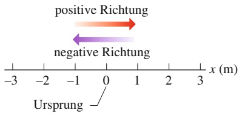
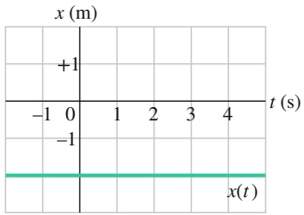
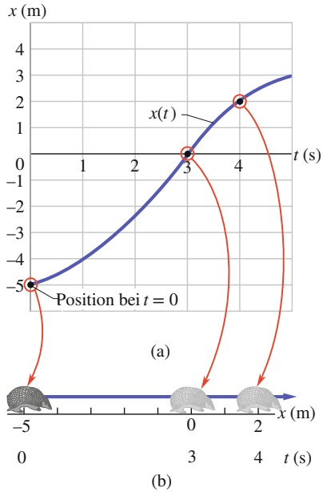
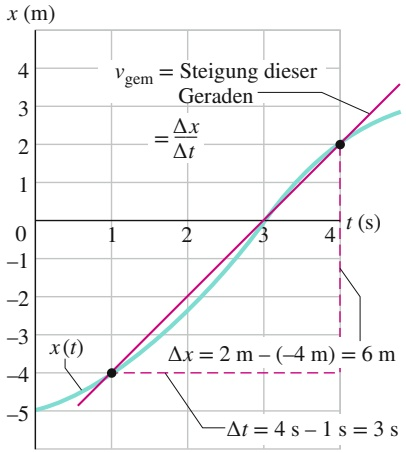
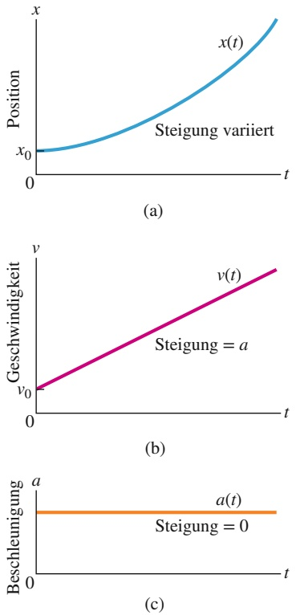
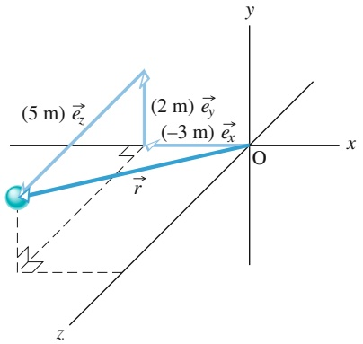
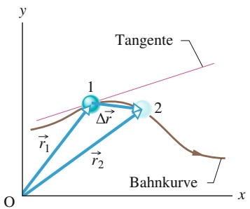
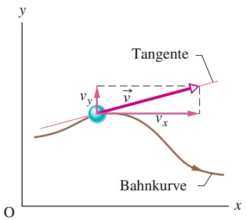
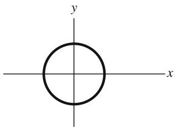

**David Halliday, Robert Resnick und Jearl Walker**

# Halliday Physik

für natur- und ingenieurwissenschaftliche Studiengänge

Übersetzung herausgegeben von Stephan W. Koch

Dritte, vollständig überarbeitete und erweiterte Auflage

natural_image

Exterior view of a modern cable-stayed bridge with metal grating against a blue sky (no signage or text visible)

**Halliday Physik**

**für natur- und ingenieurwissenschaftliche**

**Studiengänge**

## Halliday Physik für natur- und ingenieurwissenschaftliche Studiengänge

David Halliday, Robert Resnick und Jearl Walker

Herausgeber der deutschen Übersetzung Stephan W. Koch

Dritte, vollständig überarbeitete und erweiterte Auflage

## Die Autoren

## David Halliday

University of Pittsburgh, USA

## Robert Resnick

Rensselaer Polytechnic Institute, USA

## Jearl Walker

Cleveland State University, USA

## Der Übersetzungsherausgeber

## Stephan W. Koch

Philipps-Universität Marburg

Fachbereich Physik

Renthof 6

35032 Marburg

Deutschland

## Die Übersetzer

**Michael Bär**, Wiesloch, Deutschland

**Matthias Delbrück**, Dossenheim, Deutschland

## Titel der Orginalausgabe

Fundamentals of Physics / Extended 10th Edition

Copyright © 2014 John Wiley & Sons, Inc.

All Rights Reserved. This translation published under license with the original publisher John Wiley & Sons, Inc.

1. Auflage © 2003 Wiley-VCH GmbH & Co. KGaA

2. Auflage © 2009 Wiley-VCH GmbH & Co. KGaA

## Titelbild

Adelevin/Stock-Illustration-ID: 480952174

## 3. Auflage 2020

Alle Bücher von Wiley-VCH werden sorgfältig erarbeitet.

Dennoch übernehmen Autoren, Herausgeber und Verlag in keinem Fall, einschließlich des vorliegenden Werkes, für die Richtigkeit von Angaben, Hinweisen und Ratschlägen sowie für eventuelle Druckfehler irgendeine Haftung.

## Library of Congress Card No.:

applied for

## Bibliografische Information der Deutschen Nationalbibliothek

Die Deutsche Nationalbibliothek verzeichnet diese Publikation in der Deutschen Nationalbibliografie; detaillierte bibliografische Daten sind im Internet über http://dnb.d-nb.de abrufbar.

© 2020 WILEY-VCH Verlag GmbH & Co. KGaA, Boschstr. 12, 69469 Weinheim, Germany

Alle Rechte, insbesondere die der Übersetzung in andere Sprachen, vorbehalten. Kein Teil dieses Buches darf ohne schriftliche Genehmigung des Verlages in irgendeiner Form – durch Photokopie, Mikroverfilmung oder irgendein anderes Verfahren – reproduziert oder in eine von Maschinen, insbesondere von Datenverarbeitungsmaschinen, verwendbare Sprache übertragen oder übersetzt werden. Die Wiedergabe von Warenbezeichnungen, Handelsnamen oder sonstigen Kennzeichen in diesem Buch berechtigt nicht zu der Annahme, dass diese von jedermann frei benutzt werden dürfen. Vielmehr kann es sich auch dann um eingetragene Warenzeichen oder sonstige gesetzlich geschützte Kennzeichen handeln, wenn sie nicht eigens als solche markiert sind.

**Umschlaggestaltung** Formgeber, Mannheim

**Satz** le-tex publishing services GmbH, Leipzig, Deutschland

**Print ISBN** 978-3-527-41368-3

**ePDF ISBN** 978-3-527-82264-5

**ePub ISBN** 978-3-527-82266-9

Gedruckt auf säurefreiem Papier.

# Vorwort zur dritten Auflage

Diese dritte deutsche Auflage des Halliday-Lehrbuchs für ingenieur- und naturwissenschaftliche Studiengänge ist noch besser auf die Bedürfnisse dieser Studierenden abgestimmt, die im Laufe ihres Studiums mit der Physik in Berührung kommen.

Der Inhalt deckt sämtliche für diese Zielgruppe relevanten Aspekte der Experimentalphysik ab und wurde noch einmal gestrafft und auf das Wesentliche fokussiert. Angefangen von den elementaren Konzepten der Bewegung von Massepunkten und einfachen Körpern, der Newtonschen Mechanik, den Grundlagen der Thermodynamik, der Physik elektrischer und magnetischer Felder und der Optik bis hin zu den Grundkonzepten der Quantenmechanik und der Festkörperphysik wird der Lehrstoff in didaktisch hervorragender Form präsentiert.

Dabei wurde der zugrundeliegende Ansatz des „Halliday beibehalten, der zu dessen großem Erfolg und Beliebtheit beigetragen hat: Die Physik wird stets in ihrer Bedeutung motiviert, und wichtige physikalische Konzepte werden oft auf mehrere Arten präsentiert, wobei auf mögliche Verständnisprobleme besonders eingegangen wird, um typische Fallstricke zu vermeiden. Lösungsstrategien für Aufgaben nehmen einen ebenso wichtigen Platz ein wie Zusammenfassungen des präsentierten Materials in allen Kapiteln.

Um veränderten Lehr- und Lerngewohnheiten Rechnung zu tragen, wurden die Lerninhalte in der dritten Auflage modular organisiert, so dass jeder Abschnitt explizit mit Lernzielen und Schlüsselideen beginnt.

Die größte Neuerung ist das Übungsbuch, das auf das Lehrbuch abgestimmt ist, aber auch unabhängig davon verwendet werden kann. Es enthält rund 300 ausführlich durchgerechnete Beispielaufgaben und rund 1200 Aufgaben unterschiedlichen Schwierigkeitsgrads mit detaillierten Lösungen. Auch wenn man nicht jede Aufgabe rechnet: nur durch eigenständiges Üben mit der Möglichkeit der Lösungskontrolle festigt sich der Lernstoff – zur optimalen Klausur- und Prüfungsvorbereitung.

Marburg/Weinheim, Herbst 2019

Stephan W. Koch

# Zum Aufbau des Buches

Die vorliegende deutsche Ausgabe übernimmt die meisten der erfolgreichen Stilelemente der englischsprachigen Originalausgabe. Der Text wird in großzügigem Layout präsentiert, wobei wichtige Lösungsstrategien, Merksätze und Formeln besonders hervorgehoben sind.

## ¿ Kapiteleinstieg

Jedes Kapitel beginnt mit einer physikalischen Motivation, jeder Unterabschnitt mit der expliziten Nennung von Lernzielen und Schlüsselideen.

## ¿ Kontrollfragen

An diesen Haltepunkten im Textfluss werden Fragen gestellt, die Studierende anhand des vorangegangenen Textabschnitts oder der Beispielaufgabe zu lösen in der Lage sein sollten. Ist dies nicht der Fall, wird empfohlen, den Stoff vor dem Weiterlesen zu wiederholen. Die Antworten auf alle Kontrollfragen sind am Ende des Buchs zusammengestellt.

## ¿ Lösungsstrategien

Insbesondere Studienanfängern geben diese kurzen Abschnitte Hinweise zum Herangehen an Probleme und zum Vermeiden häufiger Fehler.

## ¿ Zusammenfassungen

Am Ende jedes Kapitels wird dessen Inhalt in knapper, übersichtlicher Form zusammengefasst. Das Lesen dieser Übersicht kann und soll das Studium des Kapitels jedoch nicht ersetzen.

## ¿ Fragen

Ähnlich wie bei den Kontrollfragen sind zur Beantwortung der Fragen weniger Berechnungen als vielmehr Argumente erwünscht. Die Antworten auf einen Groß- teil der Fragen sind am Ende des Buchs zusammengestellt.

Perfekt auf das Lehrbuch abgestimmt ist das Übungsbuch, das rund 300 Beispielaufgaben und rund 1200 Aufgaben enthält:

## ¿ Beispielaufgaben

Diese durchgerechneten Aufgaben helfen Studierenden, den gelernten Stoff zu organisieren und ihre Fä- higkeit zur Lösung von Problemen zu entwickeln. Die Lösungswege werden schrittweise erklärt. Dabei wird oft von speziell hervorgehobenen Lösungsideen ausgegangen, die zur Bewältigung der Aufgabe herangezogen werden müssen.

## ¿ Aufgaben

Die Übungsaufgaben unterschiedlichen Schwierigkeitsgrads helfen dabei, das Gelernte zu festigen, auf unbekannte Sachverhalte zu übertragen und sich auf Klausuren und Prüfungen vorzubereiten. Dabei ist nur in wenigen Fällen das reine Einsetzen von Zahlen in Formeln gefragt, vielmehr stehen Konzepte, Begründungen und Argumente im Vordergrund. Zu allen Aufgaben gibt es ausführliche Lösungen.

## Inhaltsverzeichnis

## 1

## Bewegung

1.1 Ort, Verschiebung und mittlere Geschwindigkeit . . . . . 1
1.2 Momentangeschwindigkeit . . . . . . 4
1.3 Beschleunigung . . 5
1.4 Konstante Beschleunigung . . . . . 8
1.5 Der freie Fall . . . 1 2
1.6 Zwei und drei Raumdimensionen . . . . . . . . 1 4
1.7 Durchschnittsgeschwindigkeit und Momentangeschwindigkeit 1 5
1.8 Durchschnittsbeschleunigung und Momentanbeschleunigung 1 8
1.9 Wurfbewegungen . . 1 9
1.10 Die gleichförmige Kreisbewegung . . . . . . . . 2 4
1.11 Relativbewegung in einer Dimension . . . . . 26
1.12 Relativbewegung in zwei Dimensionen . . . 28
1.13 Zusammenfassung . . 2 9
1.14 Fragen . . . . . . 3 1

## 2

## Kraft und Bewegung

2.1 Das erste und das zweite Newtonsche Gesetz . . . 35
2.2 Einige besondere Kräfte . . . . 4 2
2.3 Die Newtonschen Gesetze in der Praxis . . . 47
2.4 Reibung 50
2.5 Strömungswiderstand und Endgeschwindigkeit . 5 4
2.6 Gleichförmige Kreisbewegung . 5 6
2.7 Scheinkräfte . . . . . 5 8
2.8 Zusammenfassung . . . . . 61
2.9 Fragen . . . . . . . 63

## 3

## Kinetische Energie und Arbeit

3.1 Energie . . . . . . 69
3.2 Arbeit und kinetische Energie . . . . . . . . . . . 7 1
3.3 Von der Gravitationskraft verrichtete Arbeit . 7 4

3.4 Von einer Federkraft verrichtete Arbeit . . . 76
3.5 Von einer allgemeinen veränderlichen Kraft verrichtete Arbeit . . . . 80
3.6 Leistung 83
3.7 Zusammenfassung . . . . . 85
3.8 Fragen . . . . . 8 6

## 4

## Potenzielle Energie und Energieerhaltung

4.1 Potenzielle Energie . . . . . 89
4.2 Der Energieerhaltungssatz der Mechanik . . 94
4.3 Grafische Darstellung der potenziellen Energie . 9 8
4.4 Von einer äußeren Kraft an einem System verrichtete Arbeit . . 101
4.5 Energieerhaltung 104
4.6 Zusammenfassung . . . . . 107
4.7 Fragen . . . . . . 109

## 5

## Systeme von Teilchen

5.1 Der Schwerpunkt . . . . 113
5.2 Das zweite Newtonsche Gesetz für ein Teilchensystem . . . 116
5.3 Der Impuls . . . . . 119
5.4 Stoßprozesse: Der Kraftstoß . . . . . . . . . . . . 121
5.5 Die Impulserhaltung . . 125
5.6 Inelastische eindimensionale Stöße . . . . . . 127
5.7 Elastische eindimensionale Stöße . . . . . . . . 129
5.8 Zweidimensionale Stöße . . 132
5.9 Systeme mit veränderlicher Masse: Eine Rakete . . . 133
5.10 Äußere Kräfte und Änderungen der inneren Energie . . 136
5.11 Zusammenfassung . . . 138
5.12 Fragen . . . . . 139

## 6

## Die Rotation ausgedehnter Körper

6.1 Die Variablen der Rotation . . 143

6.2 Rotation mit konstanter Winkelbeschleunigung 148
6.3 Beziehungen zwischen den Variablen für lineare Bewegung und Rotation . . 149
6.4 Die kinetische Energie der Rotation . . . . . . 152
6.5 Die Berechnung des Trägheitsmoments . . . 154
6.6 Das Drehmoment . . . . . 156
6.7 Das zweite Newtonsche Gesetz für die Rotation . 158
6.8 Arbeit und kinetische Energie der Rotation . . 159
6.9 Zusammenfassung . . . . . 162
6.10 Fragen . . . . . . 164

## 7

## Rollbewegung, Drehmoment und Drehimpuls

7.1 Die Rollbewegung . . . . 167
7.2 Kräfte und die kinetische Energie der Rollbewegung . 169
7.3 Das Jo-Jo . . . . . . . 172
7.4 Eine erweiterte Definition des Drehmoments . . 173
7.5 Der Drehimpuls . . . 175
7.6 Das zweite Newtonsche Gesetz in Winkelschreibweise . . 177
7.7 Der Drehimpuls eines starren Körpers . . . . 179
7.8 Die Erhaltung des Drehimpulses . . . . . . . . . 182
7.9 Die Präzession eines Kreisels . . . . . . . . . . . 185
7.10 Zusammenfassung . . . . . 187
7.11 Fragen . . . . . . . 188

## 8

## Gleichgewicht und Elastizität

8.1 Gleichgewicht . . . 191
8.2 Beispiele für statische Gleichgewichte . . . . 195
8.3 Elastizität . . . . 198
8.4 Zusammenfassung . . . 203
8.5 Fragen . . . . . . 203

## 9

## Gravitation

9.1 Das Newtonsche Gravitationsgesetz . . . . . . 207
9.2 Gravitation und das Superpositionsprinzip . 210
9.3 Die Gravitation in der Nähe der Erdoberfläche . . 211
9.4 Die Gravitation innerhalb der Erde . . . . . . . 214
9.5 Die potenzielle Energie der Gravitation . . . 216
9.6 Planeten und Satelliten: Die Keplerschen Gesetze . 220
9.7 Satelliten: Umlaufbahnen und Energie . . . . 223
9.8 Einstein und die Gravitation . . . . . . . . . . . . 225
9.9 Zusammenfassung . . . . . 227
9.10 Fragen . . . . . . 229

## 10

## Fluide

10.1 Fluide, Dichte und Druck 233
10.2 Ruhende Fluide 235
10.3 Druckmessung . . . 238
10.4 Das Pascalsche Prinzip 240
10.5 Das archimedische Prinzip . . . . . . . . . . . 241
10.6 Die Kontinuitätsgleichung . . . . . . 245
10.7 Die Bernoulli-Gleichung . . 248
10.8 Zusammenfassung . . . . . 251
10.9 Fragen . . . . . . 252

## 11

## Schwingungen

11.1 Harmonische Schwingungen . . . . . . . . . . . . 255
11.2 Die Energie einer harmonischen Schwingung . . 260
11.3 Das Torsionspendel . . . 262
11.4 Pendel und Kreisbewegungen . . . . . . . . . . . 264
11.5 Gedämpfte harmonische Schwingungen . . 269
11.6 Erzwungene Schwingungen und Resonanz 271
11.7 Das Foucaultsche Pendel . . 273
11.8 Zusammenfassung . . . . . 274
11.9 Fragen . . . . . . 275

## 12

## Wellen – I

12.1 Transversalwellen . . . . . 279
12.2 Die Wellengeschwindigkeit eines gespannten Seils . . 285
12.3 Energie und Leistung einer sich ausbreitenden Seilwelle . . 288
12.4 Die Wellengleichung . . 290
12.5 Die Interferenz von Wellen . . . . . . . . . . 293
12.6 Darstellung von Wellen durch Zeiger . . . . . 297
12.7 Stehende Wellen und Resonanz . . . . . . . . . 298
12.8 Zusammenfassung . . . . . 304
12.9 Fragen . . . . . . 305

## 13

## Wellen – II

13.1 Die Schallgeschwindigkeit . . . 307
13.2 Die Ausbreitung von Schallwellen . . . . . . . . 310
13.3 Interferenz . . . . 314
13.4 Schallintensität und Schallpegel . . . . . . . . . 316
13.5 Musikalische Töne . . 319
13.6 Schwebungen . . . . 322
13.7 Der Doppler-Effekt 323
13.8 Überschallgeschwindigkeit und Stoßwellen . . . 328
13.9 Zusammenfassung . . . . . 329
13.10 Fragen . . . . . 330

## 14

## Temperatur, Wärme und der erste Hauptsatz der Thermodynamik

14.1 Temperatur . . . . . . 333
14.2 Die Celsius- und die Fahrenheit-Skala . . . . 336
14.3 Wärmeausdehnung . . 339
14.4 Die Absorption von Wärme . . . . . . . . 341
14.5 Der erste Hauptsatz der Thermodynamik . 347
14.6 Mechanismen der Wärmeübertragung . . . . 353
14.7 Zusammenfassung . . . 358
14.8 Fragen . . . . . . 359

## 15

## Die kinetische Gastheorie

15.1 Ein neuer Blick auf Gase . . 363
15.2 Ideale Gase . . . . 364
15.3 Druck, Temperatur und gemittelte Geschwindigkeiten . . . . 368
15.4 Kinetische Translationsenergie . . . . . . . . . . 371
15.5 Die mittlere freie Weglänge . . . . . . . . . . . . 372
15.6 Die Verteilungsfunktion der Molekülgeschwindigkeiten . . . . . . . . . . 374
15.7 Die molare Wärmekapazität idealer Gase . 377
15.8 Freiheitsgrade und molare Wärmekapazität . . . 382
15.9 Die adiabatische Expansion eines idealen Gases . 385
15.10 Reale Gase . 389
15.11 Zusammenfassung . . 392
15.12 Fragen . . . . . 393

## 16

## Entropie und der zweite Hauptsatz der Thermodynamik

16.1 Entropie . . . . . 397
16.2 Entropie in Aktion: Thermodynamische Maschinen . . . . . . . . . 402
16.3 Kältemaschinen und reale Maschinen . . . . 407
16.4 Eine statistische Interpretation der Entropie . . 411
16.5 Zusammenfassung . . . . . 414
16.6 Fragen . . . . . 416

## 17

## Elektrische Ladung

17.1 Elektromagnetismus . 419
17.2 Die elektrische Ladung ist quantisiert . . . . . 426
17.3 Die elektrische Ladung ist eine Erhaltungsgröße 427
17.4 Zusammenfassung . . . . 429
17.5 Fragen . . . . . . 429

## 18

## Elektrische Felder

18.1 Das elektrische Feld . 433
18.2 Das elektrische Feld einer Punktladung . . . 436
18.3 Das elektrische Feld eines Dipols . . . . . . . . 438
18.4 Elektrisches Feld einer linearen Ladungsverteilung . . . 440
18.5 Das elektrische Feld einer geladenen Scheibe . . 444
18.6 Punktladung im elektrischen Feld . . . . . . . . 446
18.7 Ein Dipol in einem elektrischen Feld . . . . . 448
18.8 Zusammenfassung . . . 451
18.9 Fragen . . . . . . 452

## 19

## Der Gaußsche Satz

19.1 Das Coulombsche Gesetz in neuem Licht . 455
19.2 Der Gaußsche Satz . . . . 458
19.3 Eigenschaften eines geladenen, isolierten Leiters . . . 462
19.4 Eine Anwendung des Gaußschen Satzes: Zylindersymmetrie . . 465
19.5 Eine Anwendung des Gaußschen Satzes: Ebene Symmetrie . . . 466
19.6 Eine Anwendung des Gaußschen Satzes: Kugelsymmetrie . . . 469
19.7 Zusammenfassung . . . . . 471
19.8 Fragen . . . . . . 472

## 20

## Das elektrische Potenzial

20.1 Das elektrische Potenzial . . 475
20.2 Äquipotenzialflächen . . 479
20.3 Das Potenzial von Punktladungen . . . . . . . . 482
20.4 Das Potenzial eines elektrischen Dipols . . . 485
20.5 Das Potenzial einer kontinuierlichen Ladungsverteilung . . . 487
20.6 Die Berechnung des elektrischen Felds aus dem elektrischen Potenzial . . . . . . . . 490
20.7 Die elektrische potenzielle Energie eines Systems von Punktladungen . . . . . . . 492
20.8 Das Potenzial eines geladenen, isolierten leitenden Körpers . 493
20.9 Zusammenfassung . . . . 495
20.10 Fragen . . . . . 497

## 21

## Kapazität

21.1 Kondensatoren und ihre Anwendungen . . . 499
21.2 Die Berechnung der Kapazität 502
21.3 Parallel- und Reihenschaltung von Kondensatoren . . 506

21.4 In einem elektrischen Feld gespeicherte Energie . 511
21.5 Kondensator mit Dielektrikum . . . . . . . . . . 513
21.6 Dielektrika und Gaußscher Satz . . . . . . . . . 517
21.7 Zusammenfassung . . . 519
21.8 Fragen . . . . . . 520

## 22

## Elektrischer Strom und Widerstand

22.1 Ladung in Bewegung: Elektrischer Strom . . 523
22.2 Die Stromdichte . . . 525
22.3 Widerstand und spezifischer Widerstand . . 528
22.4 Das Ohmsche Gesetz . . . 532
22.5 Elektrische Leistung in Stromkreisen . . . . . 536
22.6 Zusammenfassung . . . 541
22.7 Fragen . . . . . . 542

## 23

## Stromkreise

23.1 Unverzweigte Stromkreise . . . . . . . . . . . . . . 545
23.2 Verzweigte Stromkreise . . . . 554
23.3 Amperemeter und Voltmeter . . . . . . . . . . . 558
23.4 RC-Kreise . . . . 559
23.5 Zusammenfassung . . . 563
23.6 Fragen . . . . . . 564

## 24

## Magnetfelder

24.1 Magnetfelder und die Definition von B⃗ . . . 567
24.2 Gekreuzte Felder: Die Entdeckung des Elektrons . . . . . . . . . . 572
24.3 Gekreuzte Felder: Der Hall-Effekt . . . . . . . . 574
24.4 Geladene Teilchen auf einer Kreisbahn . . . 576
24.5 Zyklotron und Synchrotron . . . . . . . 580
24.6 Die magnetische Kraft auf einen stromdurchflossenen Draht . . . . 582
24.7 Das Drehmoment auf eine stromdurchflossene Drahtschleife . . . . . . . 584
24.8 Das magnetische Dipolmoment . . . . . . . . . 587
24.9 Zusammenfassung . . . . 589
24.10 Fragen . . . . . 590

## 25

## Magnetfelder aufgrund von Strömen

25.1 Das Magnetfeld um einen Strom . . . . . . . . . 593
25.2 Die Kraft zwischen parallelen Strömen . . . . 598
25.3 Das Ampèresche Gesetz . . 599
25.4 Zylinder- und Ringspulen . . . . . . . 603
25.5 Eine stromführende Spule als magnetischer Dipol 606
25.6 Zusammenfassung . . . 609
25.7 Fragen . . . . . . 609

## 26

## Induktion und Induktivität

26.1 Das Faradaysche Gesetz und die Lenzsche Regel 613
26.2 Induktion und Energietransfer . . . . . . . . . . 619
26.3 Induzierte elektrische Felder . . . . 622
26.4 Induktivität . . . . 625
26.5 Selbstinduktion . . 627
26.6 RL-Kreise . . . 629
26.7 Energiespeicherung im Magnetfeld . . . . . . 632
26.8 Die Energiedichte eines Magnetfelds . . . . . 634
26.9 Gegeninduktion . . 635
26.10 Zusammenfassung . 637
26.11 Fragen . . . . . 638

## 27

## Elektromagnetische Schwingkreise und Wechselstrom

27.1 LC-Schwingungen . . . 641
27.2 Gedämpfte Schwingungen in einem RLC-Kreis . . 647
27.3 Erzwungene Schwingungen . . . . . 649
27.4 Der Reihen-RLC-Kreis . . 657
27.5 Leistung in Wechselstromkreisen . . . . . . . . 662
27.6 Transformatoren . . . 664
27.7 Zusammenfassung . . . . 668
27.8 Fragen . . . . . 669

## 28

## Magnetismus und Materie

28.1 Der Gaußsche Satz für Magnetfelder . . . . . 671
28.2 Induzierte magnetische Felder . . . . . . . . . . 673
28.3 Der Verschiebungsstrom und die Maxwell-Gleichungen . . . 675
28.4 Magnete . . . . . 678
28.5 Der Magnetismus von Elektronen . . . . . . . . 680
28.6 Diamagnetismus 687
28.7 Paramagnetismus . . 688
28.8 Ferromagnetismus . 691
28.9 Zusammenfassung . . . 694
28.10 Fragen . . . 696

## 29

## Elektromagnetische Wellen

29.1 Elektromagnetische Wellen . . . . . . . . . . . . . 699
29.2 Energietransport und Poynting-Vektor . . . . 707
29.3 Der Strahlungsdruck . . . 710
29.4 Polarisation . . 712
29.5 Reflexion und Brechung . . 716
29.6 Totalreflexion . . 721
29.7 Polarisation durch Reflexion . . . . . . . . 723
29.8 Zusammenfassung . . . . 724
29.9 Fragen . . . . . 726

## 30

## Abbildungen

30.1 Bilder und ebene Spiegel . . 729
30.2 Kugelspiegel . . . 733
30.3 Sphärische brechende Flächen . . . . . 738
30.4 Dünne Linsen . . . . 740
30.5 Optische Instrumente . . 747
30.6 Drei Herleitungen . . 751
30.7 Zusammenfassung . . . . 753
30.8 Fragen . . . . . . 754

## 31

## Interferenz

31.1 Licht als Welle . 757
31.2 Beugung am Doppelspalt . . . . . . . . . . . . . . . 761
31.3 Interferenz und Intensität . . . . . . . . . 766
31.4 Interferenz an dünnen Schichten . . . . . . . . 770
31.5 Das Michelson-Interferometer . . . . . . . . . . 776
31.6 Zusammenfassung . . . . 777
31.7 Fragen . . . . . . 778

## 32

## Beugung

32.1 Beugung am Einzelspalt . . . . . . . 781
32.2 Intensitäten bei der Beugung am Einzelspalt . . 785
32.3 Beugung an einer kreisrunden Öffnung . . . 789
32.4 Beugung am Doppelspalt . . . . . . 792
32.5 Beugungsgitter . . . 795
32.6 Beugungsgitter: Dispersion und Auflösungsvermögen . 799
32.7 Röntgenbeugung . . 801
32.8 Zusammenfassung . . . 804
32.9 Fragen . . . . . . 805

## 33

## Relativitätstheorie

33.1 Gleichzeitigkeit und Zeitdilatation . . . . . . . 807
33.2 Die Relativität der Länge . . . . 816
33.3 Die Lorentz-Transformation . . . . . . . 818
33.4 Die Relativität der Geschwindigkeiten . . . . 822
33.5 Der Doppler-Effekt für Lichtwellen . . . . . . 823
33.6 Impuls und Energie . . 827
33.7 Zusammenfassung . . . . 833
33.8 Fragen . . . . . . 834

## 34

## Photonen und Materiewellen

34.1 Das Photon: Teilchen des Lichts . . . . . . . . . 837
34.2 Der photoelektrische Effekt . . . . 839
34.3 Photonenimpuls, Compton-Verschiebung und Lichtinterferenz . . . . . . . 842
34.4 Die Geburtsstunde der Quantenphysik . . . 848

34.5 Elektronen und Materiewellen . . . . . . . . . . 850
34.6 Die Schrödinger-Gleichung . . . . . 854
34.7 Die Heisenbergsche Unschärferelation . . . . 857
34.8 Reflexion an einer Potenzialschwelle . . . . . 858
34.9 Der Tunneleffekt . 860
34.10 Zusammenfassung . . 863
34.11 Fragen . . . . . 865

## 35

## Mehr über Materiewellen

35.1 Die Energie eines Elektrons in einer Elektronenfalle . 867
35.2 Die Wellenfunktionen eines Elektrons in einem Kastenpotenzial . . 871
35.3 Das eindimensionale endliche Kastenpotenzial . . 875
35.4 Zwei- und dreidimensionale Elektronenfallen . . 876
35.5 Das Wasserstoffatom . . 880
35.6 Zusammenfassung . . . . 891
35.7 Fragen . . . . . . 892

## 36

## Atome

36.1 Eigenschaften von Atomen . . 895
36.2 Das Stern-Gerlach-Experiment . . . . . . . . . . 901
36.3 Kernspinresonanz . . 904
36.4 Das Pauli-Prinzip . . 906
36.5 Der Aufbau des Periodensystems . . . . . . . . 908
36.6 Röntgenstrahlung . . . 911
36.7 Laser . . . . . . 915
36.8 Zusammenfassung . . . 920
36.9 Fragen . . . . . . 921

## 37

## Elektrische Leitfähigkeit von Festkörpern

37.1 Die elektrischen Eigenschaften von Metallen 923
37.2 Halbleiter und Dotierung 930
37.3 pn-Übergänge und Transistoren . . . . . . . . . 935
37.4 Zusammenfassung . . . 943
37.5 Fragen . . . . . . 944

## Anhang

A Das Internationale Einheitensystem (SI) . . . 948
B Astronomische Daten . 951
Umrechnungsfaktoren . . 952
D Mathematische Formeln . . 954
E Eigenschaften der Elemente . . . 959
F Antworten auf die Kontrollfragen und Fragen . . . 962
G Stichwortverzeichnis . . . 970

# 1 Bewegung

## 1.1 Ort, Verschiebung und mittlere Geschwindigkeit

## Physikalische Motivation

Eines der Ziele der Physik ist, die Bewegung von Objekten zu beschreiben – z. B. wie schnell sie sich bewegen oder welche Entfernung sie in einer bestimmten Zeit zurücklegen. Die Konstrukteure von Rennautos sind an diesem Aspekt der Physik besonders interessiert, weil diese Zusammenhänge letztlich über Sieg oder Niederlage im Rennen entscheiden. Geologen verwenden diesen Teil der Physik, um die Bewegungen von tektonischen Platten zu messen und zu versuchen, daraus Erdbeben vorherzusagen. Mediziner brauchen diese physikalischen Zusammenhänge, um aus der beobachteten Strömung des Blutes in einem Patienten den Teilverschluss einer Arterie zu diagnostizieren, und Autofahrer nutzen sie, um zu bremsen, wenn ihr Radarwarner piepst. Natürlich gibt es noch unzählige weitere Beispiele. In diesem Kapitel untersuchen wir zunächst die Grundlagen der Physik von Bewegungen, in denen sich ein Objekt (ein Rennwagen, eine tektonische Platte, rote Blutkörperchen . . . ) entlang einer einzigen Achse bewegt. Danach beschäftigen wir uns mit der Beschreibung von Bewegungen in zwei und drei Raumdimensionen.

## 1.1.1 Bewegung

Die Erde – und alles auf ihr – bewegt sich. Selbst scheinbar regungslose Dinge, wie z. B. eine Straße, bewegen sich mit der Erddrehung, der Umlaufbahn der Erde um die Sonne, der Umlaufbahn des Sonnensystems um das Zentrum der Milchstraße und der Bewegung der Galaxis relativ zu anderen Galaxien. Die Klassifizierung und der Vergleich von Bewegungen – **Kinematik** genannt – können manchmal eine große Herausforderung darstellen. Was genau messen wir dabei und wie werden die Vergleiche gezogen?

Bevor wir versuchen, diese Fragen zu beantworten, werden wir einige allgemeine Eigenschaften einer ganz bestimmten Art von Bewegung studieren. Diese wird durch drei Bedingungen eingeschränkt:

1. Die Bewegung erfolgt nur entlang einer geraden Linie. Diese Linie kann senkrecht (wie bei einem fallenden Stein), waagerecht (wie bei einem Auto auf einer geraden Straße) oder schräg verlaufen, aber sie muss eine Gerade sein.
2. Bewegung wird durch Kräfte („ziehen“ und „schieben“) verursacht – diese werden jedoch erst in Kap. 5 behandelt. In dem vorliegenden Kapitel werden wir nur die Bewegung an sich sowie Veränderungen dieser Bewegung untersuchen. Wird das bewegte Objekt schneller oder langsamer, hält es an oder wechselt es die Richtung? Welche Rolle spielt die Zeit bei der Veränderung der Bewegung?
3. Das bewegte Objekt ist entweder ein **Teilchen**, d. h. ein punktförmiges Gebilde wie z. B. ein Elektron, oder ein Objekt, das sich wie ein Teilchen bewegt (derart, dass all seine Teile sich mit exakt derselben Geschwindigkeit in dieselbe

other

| Category | X (m) |
| --- | --- |
| Positive Richtung | ~0.7 |
| Negative Richtung | ~-0.7 |

Abb. 1.1

Der Ort bzw. die Position eines Teilchens lässt sich anhand einer Achse bestimmen, die in Einheiten der Länge gekennzeichnet ist (hier in Metern) und sich unendlich weit in entgegengesetzte Richtungen erstreckt. Die Achsenbeschriftung – hier x – befindet sich immer auf der positiven Seite des Ursprungs.

Richtung bewegen). Ein Kind, das seinen Körper ganz steif macht und auf dem Spielplatz eine gerade Rutsche hinunterrutscht, bewegt sich wie ein Teilchen; ein vom Wind durch die Wüste getriebener, rollender Steppenläufer dagegen nicht, da sich verschiedene Punkte in seinem Inneren in verschiedene Richtungen bewegen.

## 1.1.2 Ort und Verschiebung

Den Ort eines Teilchens zu bestimmen bedeutet, seine Position in Bezug auf einen bestimmten Referenzpunkt festzulegen, oftmals in Bezug auf den Ursprung (oder Nullpunkt) einer Achse, wie der x-Achse in Abb. 1.1. Die **positive Richtung** der Achse ist die Richtung ansteigender Zahlen (Koordinaten), die in Abb. 1.1 nach rechts zeigt. Die entgegengesetzte Richtung wird als **negative Richtung** bezeichnet.

Ein Teilchen befindet sich z. B. am Ort x = 5 m, d. h., es befindet sich 5 m in positiver Richtung vom Ursprung entfernt. Läge es bei $x = - 5   \mathrm { m } ,$ so befände es sich genauso weit vom Ursprung entfernt, allerdings in der entgegengesetzten Richtung. Auf der Achse liegt eine Koordinate von −5 m weiter links – also zu kleineren Zahlen hin – als eine von −1 m, und beide Koordinaten befinden sich weiter links als eine Koordinate von +5 m. Das Pluszeichen einer Koordinate muss man nicht ausschreiben, das Minuszeichen dagegen muss immer aufgeführt werden.

Ein Wechsel von einem Ort $x _ { 1 }$ zu einem anderen Ort $x _ { 2 }$ wird eine **Verschiebung** Δx genannt, wobei

$$
\Delta x = x _ {2} - x _ {1}. \tag {1.1}
$$

(Das Symbol $\Delta ,$ der griechische Großbuchstabe Delta, steht für eine Veränderung einer Größe, also die Differenz von Endwert und Anfangswert dieser Größe.) Wenn für die Ortsangaben $x _ { 1 }$ und $x _ { 2 }$ Zahlenwerte eingesetzt werden, so ergibt eine Verschiebung in die positive Richtung (nach rechts in Abb. 1.1) immer einen positiven Wert, eine Verschiebung in die entgegengesetzte Richtung (nach links in der Abbildung) einen negativen Wert. Bewegt sich das Teilchen beispielsweise von $x _ { 1 } = 5$ m nach $x _ { 2 } = 1 2   \mathrm { m }$ , dann ist $\Delta x = ( 1 2   \mathrm { m } ) - ( 5   \mathrm { m } ) = + 7   \mathrm { m }$ . Der positive Wert gibt an, dass die Bewegung in die positive Richtung erfolgt. Kehrt das Teilchen dann zu $x = 5$ m zurück, so ist die Verschiebung für die ganze Bewegung gleich null. Die tatsächliche Anzahl von Metern, die auf der gesamten Strecke zurückgelegt wurde, ist irrelevant. Verschiebungen berücksichtigen nur den Anfangs- und den Endpunkt einer Bewegung.

Auch bei einer Verschiebung muss ein Pluszeichen nicht aufgeführt werden, ein Minuszeichen dagegen immer. Ignorieren wir das Vorzeichen (und damit die Richtung) einer Verschiebung, so erhalten wir den **Betrag** (oder **Absolutbetrag**) der Verschiebung. Im vorangehenden Beispiel ist der Betrag von Δx gleich 7 m.

Eine Verschiebung ist ein Beispiel für eine **Vektorgröße**, d. h., eine Größe, die sowohl über eine Richtung als auch über einen Betrag verfügt. Über Vektoren werden wir in Anhang D mehr erfahren; an dieser Stelle genügt die Feststellung, dass eine Verschiebung zwei Eigenschaften besitzt: (1) Ihr Betrag ist der Abstand (wie z. B. eine Zahl von Metern) zwischen Anfangs- und Endpunkt. (2) Die Richtung der Verschiebung zwischen Anfangs- und Endpunkt wird einfach mit einem Plusoder Minuszeichen angegeben, falls die Bewegung nur entlang einer einzigen Achse erfolgt.

Was an dieser Stelle folgt, ist die erste einer Vielzahl von „Kontrollfragen“, die Ihnen in diesem Buch begegnen werden. Sie bestehen aus einer oder mehreren Fragen, deren Beantwortung gewisse Argumentationsketten oder Kopfrechnungen erfordert und die Ihnen die Möglichkeit geben, Ihr Verständnis rasch zu überprüfen. Die Antworten finden Sie am Schluss dieses Buchs.

## KONTROLLFRAGE 1

Hier sind drei Paare von Anfangs- und Endpunkten einer Bewegung gegeben, die entlang einer x-Achse erfolgt. Welche Paare ergeben eine negative Verschiebung: (a) −3 m, 5 m; (b) −3 m, −7 m; (c) 7 m, −3 m?

## 1.1.3 Durchschnittsgeschwindigkeit

Die Position eines Teilchens lässt sich auf kompakte Weise anhand der Ort-Zeit-Kurve $x ( t )$ beschreiben. Dabei wird der Ort x als Funktion der Zeit t aufgetragen. (Dabei steht der Ausdruck $\mathbf { , } x ( t ) ^ { \omega }$ für $\scriptstyle { \pmb { \mathscr { p } } } ^ { \pmb { \mathscr { x } } }$ als Funktion von $t ^ { \alpha } ,$ nicht für das Produkt x mal t.) Abb. 1.2 zeigt als einfaches Beispiel die Ortsfunktion $x ( t )$ x(t) eines ruhenden Gürteltiers (das wir wie ein Teilchen behandeln) bei $x = - 2   \pi$ .

Abbildung 1.3a ist interessanter, da sich das Gürteltier hier bewegt. Das Tier wird offensichtlich zum ersten Mal zum Zeitpunkt $t = 0$ gesichtet, als es sich am Ort $x = - 5   \mathrm { m }$ befindet. Es bewegt sich bis $x = 0 ,$ überquert diesen Punkt bei $t = 3   ;$ s und strebt dann nach immer größer werdenden positiven Werten von x.

Abbildung 1.3b zeigt die tatsächliche geradlinige Bewegung des Gürteltiers. Sie entspricht dem, was Sie in etwa sehen würden. Die Kurve in Abb. 1.3a ist abstrakter und weiter von dem entfernt, was Sie beobachten würden, doch sie enthält mehr Information. Sie macht auch deutlich, wie schnell sich das Gürteltier bewegt.

Tatsächlich hängt der Ausdruck „wie schnell“ mit mehreren Größen zusammen. Eine von ihnen ist die **Durchschnittsgeschwindigkeit** oder **mittlere Geschwindigkeit** $\nu _ { \mathrm { g e m } } .$ Sie wird durch das Verhältnis der Verschiebung $\Delta x ,$ die in einem bestimmten Zeitintervall $\Delta t$ stattfindet, zu diesem Zeitintervall gegeben:

$$
\nu_ {\mathrm{gem}} = \frac {\Delta x}{\Delta t} = \frac {x _ {2} - x _ {1}}{t _ {2} - t _ {1}}. \tag {1.2}
$$

Diese Schreibweise bedeutet, dass die Position zum Zeitpunkt $t _ { 1 }$ gleich $x _ { 1 }$ ist und entsprechend zum Zeitpunkt $t _ { 2 }$ gleich $x _ { 2 } .$ Eine gebräuchliche Einheit für $\nu _ { \mathrm { g e m } }$ ist Meter pro Sekunde (m/s oder $\mathbf { m } \cdot \mathbf { s } ^ { - 1 } )$ . In den Aufgaben werden Ihnen eventuell auch andere Einheiten begegnen, diese haben jedoch immer die Form Länge/Zeit.

Wird x gegen t aufgetragen, so ist $\nu _ { \mathrm { g e m } }$ durch die **Steigung** der Geraden gegeben, welche zwei bestimmte Punkte der Kurve x(t) verbindet: Einer dieser Punkte entspricht $x _ { 2 }$ und $t _ { 2 } ;$ , der andere $x _ { 1 }$ und $t _ { 1 } .$ Genau wie eine Verschiebung besitzt auch $\nu _ { \mathrm { g e m } }$ einen Betrag und eine Richtung – es ist ebenfalls eine Vektorgröße. Der Betrag von $\nu _ { \mathrm { g e m } }$ entspricht dem Betrag der Steigung der Geraden. Ist $\nu _ { \mathrm { g e m } }$ (und damit die Steigung der Geraden) positiv, so steigt die Gerade nach rechts hin an; ist $\nu _ { \mathrm { g e m } }$ negativ (negative Steigung), so verläuft die Gerade von links oben nach rechts unten. Die Durchschnittsgeschwindigkeit $\nu _ { \mathrm { g e m } }$ besitzt immer das gleiche Vorzeichen wie die Verschiebung $\Delta x ,$ da $\Delta t$ in Gl. 1.2 immer positiv ist.

Abbildung 1.4 zeigt, wie man $\nu _ { \mathrm { g e m } }$ im Falle des Gürteltiers aus Abb. 1.3 für das Zeitintervall zwischen $t = 1   s$ und $t = 4   \mathrm { s }$ ermitteln kann. Dazu zeichnen wir die Gerade, die den Punkt auf der Bahnkurve am Anfang des Zeitintervalls mit demjenigen am Ende des Zeitintervalls verbindet. Dann ermitteln wir die Steigung $\Delta x / \Delta t$ der Geraden. Für das gegebene Zeitintervall ist die Durchschnittsgeschwindigkeit damit:

$$
\nu_ {\mathrm{gem}} = \frac {6 \mathrm{m}}{3 \mathrm{s}} = 2 \mathrm{m/s}.
$$

„Wie schnell“ sich ein Teilchen bewegt, lässt sich auch durch die in einem Zeitintervall insgesamt zurückgelegte Entfernung (z. B. die zurückgelegte Anzahl von Metern), unabhängig von der Richtung ausdrücken:

$$
\nu_ {\mathrm{eff}} = \frac {\text {gesamte Entfernung}}{\Delta t}  . \tag {1.3}
$$

text_image

x (m)
+1
-1 0 1 2 3 4 t (s)
-1
x(t)

Abb. 1.2

Die Kurve x(t) für ein Gürteltier, das sich unbewegt bei $x = - 2$ m aufhält. Für alle Zeiten t ist der Wert von x gleich − 2 m.

line

| Time (s) | Position (m) |
| --- | --- |
| 0 | -5 |
| 3 | 0 |
| 4 | 2 |

Abb. 1.3

(a) Die x(t)-Kurve eines sich bewegenden Gürteltiers. (b) Die Bahn, die dieser Kurve entspricht. Die Skala unterhalb der x-Achse gibt die Zeiten an, zu denen das Gürteltier bestimmte Werte von x erreicht.

line

| t (s) | x (m) (Steigung dieser Geraden) | x (m) (Nonlinear) |
| --- | --- | --- |
| 1 | -4 | -4 |
| 3 | 0 | 0 |
| 4 | 2 | 2 |

Abb. 1.4

Berechnung der Durchschnittsgeschwindigkeit zwischen t = 1 s und t = 4 s: Die Durchschnittsgeschwindigkeit entspricht der Steigung der Geraden, welche die Punkte verbindet, die diesen Zeiten auf der x(t)-Kurve entsprechen.

Diese Größe, die wir auch als **Effektivgeschwindigkeit** bezeichnen können, besitzt kein Vorzeichen, da die insgesamt zurückgelegte Entfernung keine Angaben über die Richtung der Bewegung macht. Manchmal entspricht die Effektivgeschwindigkeit $\nu _ { \mathrm { e f f } }$ (bis auf das Vorzeichen) der Durchschnittsgeschwindigkeit $\nu _ { \mathrm { g e m } }$ . Wie in der Beispielaufgabe 1.1 im Übungsbuch gezeigt wird, können sich die beiden Größen allerdings deutlich voneinander unterscheiden, wenn ein Objekt auf seinem Weg umkehrt.

## KONTROLLFRAGE 2

Ebenfalls in Beispielaufgabe 1.1 im Übungsbuch fahren Sie gleich nach dem Auftanken Ihres Fahrzeugs mit 35 km/h zum Punkt $x _ { 1 }$ zurück. Wie groß ist Ihre Durchschnittsgeschwindigkeit für die gesamte Strecke?

## LÖSUNGSSTRATEGIEN

**Strategie 1: Verstehen Sie das Problem?** Wenn man im Aufgabenlösen noch unerfahren ist, passiert es häufig, dass man die gestellte Aufgabe einfach nicht versteht. Der beste Test für Ihr Verständnis ist folgender: Können Sie die Aufgabe in Ihren eigenen Worten erklären?

Schreiben Sie die vorgegebenen Daten mit den dazugehörigen Einheiten auf, indem Sie die Symbole aus diesem Kapitel benutzen. (In der Beispielaufgabe 1.1 im Übungsbuch erlauben Ihnen die vorgegebenen Daten, in Teil (a) Ihre Verschiebung Δx und in Teil (b) das entsprechende Zeitintervall Δt herauszufinden.) Identifizieren Sie die Unbekannte und das dazugehörige Symbol. (In der gleichen Aufgabe ist die Unbekannte in Teil (c) Ihre Durchschnittsgeschwindigkeit $\nu _ { \mathrm { g e m } ^ { \cdot } } )$ Finden Sie dann die Verbindung zwischen der Unbekannten und den gegebenen Daten. (Die Verbindung ist hier Gl. 1.2, also die Definition der Durchschnittsgeschwindigkeit.)

**Strategie 2: Stimmen die Einheiten?** Stellen Sie sicher, dass Sie ein konsistentes System von Einheiten benutzen, wenn Sie die Zahlen in die Gleichungen einsetzen. In der Beispielaufgabe 1.1 im Übungsbuch sind die Einheiten durch die vorgegebenen Daten bestimmt: Kilometer für Entfernungen, Stunden für Zeitintervalle und Kilometer pro Stunde für Geschwindigkeiten. Eventuell müssen Sie ab und zu eine Einheit in eine andere umformen.

**Strategie 3: Ist Ihre Antwort plausibel?** Ist Ihre Antwort sinnvoll? Ist der Wert viel zu groß oder viel zu klein? Stimmt das Vorzeichen? Sind die Einheiten korrekt? In Teil (c) der Beispielaufgabe 1.1 im Übungsbuch z. B. ist die richtige Antwort 17 km/h. Erhalten Sie an dieser Stelle 0,000 17 km/h, −17 km/h, 17 km/s oder 17 000 km/h, so sollte Ihnen sofort klar sein, dass Sie etwas falsch gemacht haben. Der Fehler liegt möglicherweise in Ihrer Vorgehensweise, in Ihren Rechnungen oder in Tippfehlern beim Eingeben der Zahlen in Ihren Taschenrechner.

**Strategie 4: Eine Kurve lesen** Die Abb. 1.2, 1.3a und 1.4 sind Kurven, die Sie leicht lesen können sollten. In jeder Kurve ist die Variable auf der horizontalen Achse die Zeit t mit nach rechts hin ansteigenden Werten. In allen Kurven gibt die vertikale Achse den Ort x des sich bewegenden Teilchens relativ zum Ursprung an, die positive x-Richtung zeigt nach oben. Achten Sie immer auf die Einheiten (Sekunden oder Minuten; Meter oder Kilometer), in denen die Variablen angegeben werden.

## 1.2 Momentangeschwindigkeit

## Lernziele

Nach dem Durcharbeiten dieses Abschnitts sollten Sie in der Lage sein, . . .

• aus dem Ort eines Teilchens als Funktion der Zeit seine Momentangeschwindigkeit zu jedem Zeitpunkt zu berechnen,
• aus der Auftragung des Ortes eines Teilchens als Funktion der Zeit seine Momentangeschwindigkeit zu jedem Zeitpunkt zu bestimmen,

zwischen der vektoriellen Geschwindigkeit (die gerichtet bzw. im eindimensionalen Fall vorzeichenbehaftet ist) und ihrem Betrag (einer skalaren und vorzeichenlosen Größe, die im allgemeinen Sprachgebrauch auch einfach als „Geschwindigkeit“ bezeichnet wird) zu unterscheiden.

## Schlüsselideen

• Die Momentangeschwindigkeit (oder einfach Geschwindigkeit) v eines sich bewegenden Teilchens ist

$$
\nu = \lim _ {\Delta t \to 0} \frac {\Delta x}{\Delta t} = \frac {\mathrm{d} x}{\mathrm{d} t}
$$

mit $\Delta x = x _ { 2 } - x _ { 1 }$ und $\Delta t = t _ { 2 } - t _ { 1 }$

• Die zu einem bestimmten Zeitpunkt geltende Momentangeschwindigkeit kann aus der Steigung der Kurve von x als Funktion von t zu diesem Zeitpunkt bestimmt werden.
• In vielen Fällen, in denen es nicht auf die Richtung des Geschwindigkeitsvektors ankommt, bezeichnet man den Betrag dieses Vektors als „Geschwindigkeit“.

## 1.2.1 Momentangeschwindigkeit

Bisher haben Sie zwei Wege kennengelernt, anhand derer man beschreiben kann, wie schnell sich etwas bewegt: die Durchschnittsgeschwindigkeit und die Effektivgeschwindigkeit. Beide werden über ein Zeitintervall Δt gemessen. Der Ausdruck „wie schnell“ bezieht sich meist jedoch darauf, wie schnell sich ein Teilchen zu einem gegebenen Zeitpunkt bewegt – damit ist die **Momentangeschwindigkeit** v gemeint, oft auch einfach nur **Geschwindigkeit** genannt.

Die Geschwindigkeit zu einem beliebigen Zeitpunkt erhält man aus der Durchschnittsgeschwindigkeit, indem man das Zeitintervall Δt immer weiter verkürzt und gegen null gehen lässt. Je kleiner Δt wird, desto mehr nähert sich die Durchschnittsgeschwindigkeit einem Grenzwert, der der Momentangeschwindigkeit zu diesem Zeitpunkt entspricht:

$$
\nu = \lim _ {\Delta t \to 0} \frac {\Delta x}{\Delta t} = \frac {\mathrm{d} x}{\mathrm{d} t}. \tag {1.4}
$$

Diese Gleichung macht zwei Charakteristika der Momentangeschwindigkeit v deutlich: Erstens ist v die Rate, mit der sich der Ort x des Teilchens zu einem bestimmten Zeitpunkt in Abhängigkeit von der Zeit verändert. Das heißt, v ist die Ableitung von x nach t. Zweitens entspricht v zu jedem gegebenen Zeitpunkt der Steigung der Ort-Zeit-Kurve des Teilchens zu diesem bestimmten Zeitpunkt. Die Geschwindigkeit ist eine Vektorgröße und beinhaltet deshalb eine entsprechende Richtung. Der Betrag der Geschwindigkeit entspricht dem Zahlenwert ohne das Vorzeichen: Eine Geschwindigkeit von +5 m/s und eine Geschwindigkeit von −5 m/s haben damit beide den gleichen Betrag von 5 m/s. Der Geschwindigkeitsmesser in einem Auto misst den Betrag der Geschwindigkeit, nicht die Geschwindigkeit selbst, da er die Richtung nicht bestimmen kann.

## 1.3 Beschleunigung

## Lernziele

Nach dem Durcharbeiten dieses Abschnitts sollten Sie in der Lage sein, . . .

eine Beziehung zwischen der mittleren Beschleunigung, die auf ein Teilchen wirkt, der daraus resultierenden Änderung seiner Geschwindigkeit und dem für diese Änderung erforderlichen Zeitintervall anzugeben,
• aus der gegebenen Geschwindigkeit eines Teilchens als Funktion der Zeit die zu jedem Zeitpunkt wirkende Momentanbeschleunigung zu berechnen,

• aus der Auftragung der Geschwindigkeit eines Teilchens als Funktion der Zeit die zu jedem Zeitpunkt wirkende Momentanbeschleunigung sowie die in einem beliebigen Zeitintervall wirkende mittlere Beschleunigung zu ermitteln.

## Schlüsselideen

• Die mittlere Beschleunigung ist das Verhältnis aus der Änderung $\Delta \nu$ einer Geschwindigkeit und dem Zeitintervall $\Delta t ,$ in dem diese Änderung erfolgt:

$$
a _ {\mathrm{gem}} = \frac {\Delta \nu}{\Delta t}.
$$

Das Vorzeichen von $a _ { \mathrm { g e m } }$ gibt die Richtung der Beschleunigung an.

• Die Momentanbeschleunigung (oder einfach Beschleunigung) ist die erste Ableitung der Geschwindigkeit v(t) bzw. die zweite Ableitung des Ortes $x ( t )$ nach der Zeit:

$$
a _ {\mathrm{gem}} = \frac {\mathrm{d} \nu}{\mathrm{d} t} = \frac {\mathrm{d} ^ {2} x}{\mathrm{d} t ^ {2}}.
$$

• In einer Auftragung von v gegen t ist die Beschleunigung a zu einem Zeitpunkt t gleich der Steigung der Kurve am Punkt t.

## 1.3.1 Beschleunigung

Wenn sich die Geschwindigkeit eines Teilchens ändert, so sagt man, das Teilchen unterliegt einer **Beschleunigung** bzw. es wird **beschleunigt**. Erfolgt die Bewegung entlang einer Achse, so ist die **Durchschnittsbeschleunigung** $a _ { \mathrm { g e m } }$ in dem Zeitintervall Δt gleich

$$
a _ {\mathrm{gem}} = \frac {\nu_ {2} - \nu_ {1}}{t _ {2} - t _ {1}} = \frac {\Delta \nu}{\Delta t}, \tag {1.5}
$$

wobei das Teilchen zum Zeitpunkt $t _ { 1 }$ die Geschwindigkeit $\nu _ { 1 }$ und zum Zeitpunkt $t _ { 2 }$ die Geschwindigkeit $\nu _ { 2 }$ hat. Die **Momentanbeschleunigung** (oder einfach nur Be**schleunigung**) ist die Ableitung der Geschwindigkeit nach der Zeit:

$$
a = \frac {\mathrm{d} \nu}{\mathrm{d} t}. \tag {1.6}
$$

In Worten ausgedrückt ist die Beschleunigung eines Teilchens zu jedem Zeitpunkt gleich der Rate, mit der sich seine Geschwindigkeit zu diesem Zeitpunkt ändert. Grafisch entspricht die Beschleunigung an jedem Punkt der Steigung der v(t)-Kurve an diesem Punkt.

Kombinieren wir Gl. 1.6 und Gl. 1.4, so erhalten wir:

$$
a = \frac {\mathrm{d} \nu}{\mathrm{d} t} = \frac {\mathrm{d}}{\mathrm{d} t} \left(\frac {\mathrm{d} x}{\mathrm{d} t}\right) = \frac {\mathrm{d} ^ {2} x}{\mathrm{d} t ^ {2}}. \tag {1.7}
$$

Abb. 1.5 Colonel J.P. Stapp in einem Raketenschlitten, der auf sehr hohe Geschwindigkeiten gebracht wird (dabei zeigt die Beschleunigung aus der Buchseite heraus) und dann ruckartig wieder abgebremst wird (die Beschleunigung weist dabei in die Buchseite hinein) [Quelle: Mit freundlicher Erlaubnis der US Air Force].

In Worten ausgedrückt ist die Beschleunigung eines Teilchens zu jedem Zeitpunkt gleich der zweiten Ableitung seines Ortes x(t) nach der Zeit.

Eine übliche Einheit für die Beschleunigung ist Meter pro Sekunde pro Sekunde bzw. Meter pro Quadratsekunde: $\mathbf { m } / ( \mathbf { s } \cdot \mathbf { s } )$ oder $\mathbf { m } / s ^ { 2 }$ bzw. $\mathbf { m } \cdot \mathbf { s } ^ { - 2 } .$ . In den Aufgaben werden Ihnen noch andere Einheiten begegnen, sie werden jedoch immer die Form Länge∕(Zeit ⋅ Zeit) oder Länge $/ \mathrm { Z e i t } ^ { 2 }$ haben. Die Beschleunigung besitzt sowohl einen Betrag als auch eine Richtung, sie ist eine weitere Vektorgröße. Genau wie bei der Verschiebung und der Geschwindigkeit gibt das Vorzeichen der Beschleunigung ihre Richtung entlang einer Achse an. Besitzt die Beschleunigung einen positiven Wert, so erfolgt sie in positiver Richtung der Achse; ist sie negativ, erfolgt sie entsprechend in negativer Richtung.

In Abb. Ü1.2c im Übungsbuch ist die Beschleunigung der Aufzugkabine aus der dortigen Beispielaufgabe 1.2 dargestellt. Vergleichen Sie die Kurve a(t) mit derjenigen von v(t). a(t) gibt die Ableitung (Steigung) der Kurve v(t) zum entsprechenden Zeitpunkt wieder. Ist v konstant (bei 0 oder 4 m/s), so ist die Ableitung gleich null und die Beschleunigung demzufolge auch. Während der Zeit, in der sich der Aufzug in Bewegung setzt, ist die Ableitung der v(t)-Kurve positiv (die Steigung ist positiv), d. h., auch die Beschleunigung ist positiv. Während des Abbremsens sind Ableitung und Steigung der v(t)-Kurve negativ; entsprechend ist a(t) ebenfalls negativ.

Vergleichen Sie als Nächstes die Steigung der v(t)-Kurve während der beiden Beschleunigungsvorgänge. Die Steigung, die dem Abbremsen bzw. der Verzögerung des Aufzugs entspricht, ist steiler, da die Kabine zum Anhalten nur halb so viel Zeit benötigt, wie sie gebraucht hatte, um ihre übliche Fahrtgeschwindigkeit zu erreichen. Die steilere Steigung sagt aus, dass der Betrag der Verzögerung, wie in Abb. Ü1.2c im Übungsbuch dargestellt, größer ist als derjenige der Beschleunigung.

Das Gefühl, das Sie während der Fahrt mit diesem Aufzug verspüren würden, ist anhand der skizzierten Figuren angedeutet. Während der Aufzug beschleunigt, fühlen Sie sich, als würden Sie nach unten gedrückt; während des Bremsvorgangs wirkt es so, als würden Sie nach oben in die Länge gezogen. Dazwischen spüren Sie nichts Besonderes. Ihr Körper reagiert auf Beschleunigungen (er ist ein guter Beschleunigungssensor), jedoch nicht auf Geschwindigkeiten (er ist kein Geschwin digkeitsmesser). Ob Sie sich in einem Auto befinden, das sich mit 90 km/h bewegt, oder in einem mit 900 km/h fliegenden Flugzeug – Ihr Körper spürt diese Bewegung nicht. Verändern Auto oder Flugzeug jedoch abrupt ihre Geschwindigkeit, so werden Sie sich dieser Veränderung nur allzu deutlich bewusst. Der Reiz eines Freizeitparks liegt zum großen Teil in den schnellen Geschwindigkeitsänderungen, denen Sie auf den Achterbahnen ausgesetzt sind. Ein extremeres Beispiel zeigt die Fotoserie von Abb. 1.5, die aufgenommen wurde, während ein Raketenschlitten entlang einer Schiene ruckartig beschleunigt und wieder abgebremst wurde.

Abb. 1.5

Fortsetzung

Große Beschleunigungen werden oft in Einheiten von g ausgedrückt, wobei

$$
1 g = 9, 8 \mathrm{m} / \mathrm{s} ^ {2} \quad (\text {Einheit} g). \tag {1.8}
$$

(Wie wir in Abschn. 2.5 sehen werden, ist g der Betrag der Beschleunigung eines fallenden Objekts in der Nähe der Erdoberfläche.) Auf einer Achterbahn erleben Sie kurzfristig Beschleunigungen von bis zu 3g, d. h. $(3)(9,8    m/s ^2)$ , also etwa $2 9   \mathrm { m } / \mathrm { s } ^ { 2 }$ – mehr als genug, um den teuren Fahrpreis zu rechtfertigen.

## LÖSUNGSSTRATEGIEN

**Strategie 5: Das Vorzeichen einer Beschleunigung** In der Umgangssprache hat das Vorzeichen einer Beschleunigung eine nichtwissenschaftliche Bedeutung: Positive Beschleunigung bedeutet, dass der Geschwindigkeitsbetrag eines Objekts größer wird, negative Beschleunigung sagt aus, dass das Objekt langsamer wird (der Betrag der Geschwindigkeit wird kleiner). In diesem Buch bezieht sich das Vorzeichen einer Beschleunigung jedoch auf eine Richtung und nicht etwa darauf, ob die Geschwindigkeit eines Objekts größer oder kleiner wird.

Wird ein Fahrzeug mit einer ursprünglichen Geschwindigkeit $\nu   =   - 2 5$ m/s z. B. innerhalb von $^ { 5 , 0 } s$ vollständig abgebremst, so ist $a _ { \mathrm { g e m } }   =   + 5 { , } 0   \mathrm { m } / \mathrm { s } ^ { 2 }$ . Die Beschleunigung ist positiv, doch der Betrag der Geschwindigkeit des Fahrzeugs nimmt ab. Der Grund liegt in den unterschiedlichen Vorzeichen: Die Richtung der Beschleunigung ist derjenigen der Geschwindigkeit entgegengesetzt.

So interpretieren Sie die Vorzeichen korrekt:

Sind die Vorzeichen der Geschwindigkeit und der Beschleunigung eines Teilchens gleich, so nimmt der Betrag der Geschwindigkeit zu, das Teilchen wird schneller. Sind die Vorzeichen unterschiedlich, so nimmt der Geschwindigkeitsbetrag ab, das Teilchen wird langsamer.

## KONTROLLFRAGE 3

Ein Teilchen bewegt sich entlang einer x-Achse. Was ist das Vorzeichen seiner Beschleunigung, wenn es sich (a) mit ansteigendem Geschwindigkeitsbetrag in positive x-Richtung, (b) mit abfallendem Geschwindigkeitsbetrag in positive x-Richtung, (c) mit ansteigendem Geschwindigkeitsbetrag in negative x-Richtung und (d) mit abfallendem Geschwindigkeitsbetrag in negative x-Richtung bewegt?

## 1.4 Konstante Beschleunigung

## Lernziele

Nach dem Durcharbeiten dieses Abschnitts sollten Sie in der Lage sein, . . .

• die Beziehungen zwischen Ort, Verschiebung, Geschwindigkeit, Beschleunigung und Zeit (Tab. 1.1) für konstante Beschleunigungen anzuwenden,
• die Änderung der Geschwindigkeit eines Teilchens zu berechnen, indem Sie seine Beschleunigung über die Zeit integrieren,
• die Änderung des Ortes eines Teilchens zu berechnen, indem Sie seine Geschwindigkeit über die Zeit integrieren.

## Schlüsselideen

• Die folgenden fünf Gleichungen beschreiben die Bewegung eines Teilchens unter dem Einfluss einer konstanten Beschleunigung:

$$
\begin{array}{l} \nu = \nu_ {0} + a t, \quad x - x _ {0} = \nu_ {0} t + \frac {1}{2} a t ^ {2}, \\ \nu^ {2} = \nu_ {0} ^ {2} + 2 a (x - x _ {0}), \quad x - x _ {0} = \frac {1}{2} (\nu + \nu_ {0}) t, \quad x - x _ {0} = \nu t - \frac {1}{2} a t ^ {2}. \\ \end{array}
$$

Sie gelten nur für den Fall einer konstanten Beschleunigung.

## 1.4.1 Konstante Beschleunigung: Ein Sonderfall

Bei vielen Arten von Bewegungen ist die Beschleunigung entweder konstant oder zumindest annähernd gleichmäßig. Sie können z. B. ein Auto annähernd gleichmäßig beschleunigen, wenn die Ampel von Rot auf Grün springt. Die Kurven Ihrer Position, Ihrer Geschwindigkeit und Ihrer Beschleunigung würden dann denen aus Abb. 1.6 ähneln. (Beachten Sie, dass $a ( t )$ in Abb. 1.6c konstant ist, was bedeutet, dass $\nu ( t )$ in Abb. 1.6b eine konstante Steigung besitzt.) Wenn Sie das Auto danach abbremsen, um anzuhalten, so ist die Verzögerung dabei möglicherweise ebenfalls annähernd konstant.

Diese Fälle treten so häufig auf, dass ein spezieller Satz von Gleichungen aufgestellt wurde, um sie zu behandeln. Ein möglicher Weg, diese Gleichungen herzuleiten, wird in diesem Abschnitt beschrieben. Einen weiteren finden Sie im nächsten Abschnitt. Sowohl beim Studium dieser beiden Abschnitte als auch später, wenn Sie zu Hause Aufgaben lösen, sollten Sie im Hinterkopf behalten, dass diese Gleichungen nur für konstante Beschleunigungen gelten (oder für Situationen, in denen Sie die Beschleunigung näherungsweise gleich einer Konstante setzen können).

Ist die Beschleunigung konstant, so sind Durchschnittsbeschleunigung und Momentanbeschleunigung gleich. Mit kleinen Änderungen in der Schreibweise wird Gl. 1.5 damit zu:

$$
a = a _ {\mathrm{gem}} = \frac {\nu - \nu_ {0}}{t - 0}.
$$

Hierbei ist $\nu _ { 0 }$ die Geschwindigkeit zur Zeit $t = 0$ und v die Geschwindigkeit zu jedem beliebigen späteren Zeitpunkt t. Diese Gleichung lässt sich umschreiben zu:

$$
\nu = \nu_ {0} + a t. \tag {1.9}
$$

Beachten Sie, dass diese Gleichung bei $t = 0$ wie gefordert $\nu   =   \nu _ { 0 }$ ergibt. Um die Richtigkeit des Ganzen nochmals zu überprüfen, bilden Sie die Ableitung von Gl. 1.9. Damit erhalten Sie $\mathrm { d } \nu / \mathrm { d } t = a ,$ , was der Definition von a entspricht. In Abb. 1.6b ist eine Kurve von Gl. 1.9, also von der Geschwindigkeitsfunktion v(t), aufgezeichnet; die Funktion ist linear, die Kurve damit eine Gerade.

Auf ähnliche Art und Weise können wir Gl. 1.2 (mit ein paar Veränderungen in der Schreibweise) zu

$$
\nu_ {\mathrm{gem}} = \frac {x - x _ {0}}{t - 0}
$$

umschreiben und erhalten dann

$$
x = x _ {0} + \nu_ {\mathrm{gem}} t, \tag {1.10}
$$

wobei $x _ { 0 }$ die Position des Teilchens bei $t = 0$ und $\nu _ { \mathrm { g e m } }$ die Durchschnittsgeschwindigkeit zwischen $t = 0$ und einem späteren Zeitpunkt t bezeichnet.

Für die lineare Geschwindigkeitsfunktion von Gl. 1.9 ist die Durchschnittsgeschwindigkeit in einem beliebigen Zeitintervall (z. B. von $t = 0$ bis zu einem spä- teren Zeitpunkt t) der Mittelwert zwischen der Geschwindigkeit am Anfang des Intervalls $( = \nu _ { 0 } )$ und der Geschwindigkeit am Ende des Intervalls $( = \nu )$ . Für das Intervall von $t = 0$ zu einer späteren Zeit t ist die Durchschnittsgeschwindigkeit damit:

$$
\nu_ {\mathrm{gem}} = \frac {1}{2} (\nu_ {0} + \nu). \tag {1.11}
$$

Ersetzt man v durch die rechte Seite von Gl. 1.9, so erhält man nach kleinen Umformungen:

$$
\nu_ {\mathrm{gem}} = \nu_ {0} + \frac {1}{2} a t. \tag {1.12}
$$

## Abb. 1.6

- (a) Der Ort x(t) eines Teilchens, das sich unter dem Einfluss einer konstanten Beschleunigung bewegt.
- (b) Seine Geschwindigkeit v(t), die in jedem Punkt durch die Steigung der x(t)-Kurve aus (a) gegeben wird.
- (c) Seine (konstante) Beschleunigung, die der (konstanten) Steigung der v(t)-Kurve entspricht.

Einsetzen von Gl. 1.12 in Gl. 1.10 ergibt dann schließlich:

$$
x - x _ {0} = \nu_ {0} t + \frac {1}{2} a t ^ {2}. \tag {1.13}
$$

Beachten Sie, dass das Einsetzen von $t = 0$ wie gefordert $x = x _ { 0 }$ ergibt. Außerdem liefert die Ableitung von Gl. 1.13 genau Gl. 1.9 – ebenfalls wie gefordert. Abbildung 1.6a stellt Gl. 1.13 grafisch dar: Die Funktion ist quadratisch, die Kurve verläuft daher gekrümmt.

Die Gln. 1.9 und 1.13 sind die grundlegenden Gleichungen der gleichmäßig beschleunigten Bewegung. Sie können sie benutzen, um jede beliebige Aufgabe in diesem Buch zu lösen, in der eine konstante Beschleunigung angenommen wird. Zusätzlich werden wir jedoch weitere Gleichungen herleiten, die sich in bestimmten Situationen als nützlich erweisen können. Beachten Sie zunächst, dass in Aufgaben mit gleichmäßiger Beschleunigung insgesamt fünf Größen auftreten können, und zwar $x - x _ { 0 } , \nu , t , a$ und $\nu _ { 0 } .$ Üblicherweise kommt eine dieser Größen in der Übungsaufgabe nicht vor, weder als vorgegebene Größe noch als Unbekannte. Man gibt uns dann drei der verbleibenden Größen vor und fordert uns auf, die vierte zu ermitteln.

Die Gln. 1.9 und 1.13 enthalten jeweils vier dieser Größen, allerdings nicht dieselben vier. In Gl. 1.9 fehlt die Verschiebung $x   -   x _ { 0 }$ . In Gl. 1.13 ist es die Geschwindig keit v. Diese beiden Gleichungen können außerdem auf drei verschiedene Arten zu drei weiteren Gleichungen kombiniert werden, die dann jeweils eine andere „fehlende Variable“ aufweisen. In einem ersten Schritt können wir t eliminieren und erhalten damit:

$$
\nu^ {2} = \nu_ {0} ^ {2} + 2 a (x - x _ {0}). \tag {1.14}
$$

Diese Gleichung ist dann von Nutzen, wenn wir t nicht kennen und auch nicht herausfinden sollen. In einem zweiten Schritt können wir die Beschleunigung a anhand der Gln. 1.9 und 1.13 eliminieren. Wir erhalten dann eine Gleichung, in der a nicht mehr vorkommt:

$$
x - x _ {0} = \frac {1}{2} (\nu_ {0} + \nu) t. \tag {1.15}
$$

Schließlich können wir $\nu _ { 0 }$ eliminieren und bekommen:

$$
x - x _ {0} = \nu t - \frac {1}{2} a t ^ {2}. \tag {1.16}
$$

Beachten Sie den subtilen Unterschied zwischen dieser Gleichung und Gl. 1.13. Die eine beinhaltet die Anfangsgeschwindigkeit $\nu _ { 0 } ,$ , die andere die Geschwindigkeit v zur Zeit t.

In Tab. 1.1 sind die grundlegenden Gleichungen der gleichmäßig beschleunigten Bewegung (Gln. 1.9 und 1.13) sowie die spezielleren Gleichungen aufgeführt, die wir daraus abgeleitet haben. Um eine einfache Aufgabe mit konstanter Beschleunigung zu lösen, können Sie normalerweise eine der Gleichungen aus dieser Liste benutzen – falls Sie die Liste zur Hand (oder im Kopf!) haben. Wählen Sie eine Gleichung, in der die einzige Unbekannte die in der Aufgabe gesuchte Größe ist. Einfacher ist es, sich nur die Gln. 1.9 und 1.13 zu merken und beide bei Bedarf als gekoppeltes Gleichungssystem zu lösen. Ein Beispiel dafür finden Sie in Beispielaufgabe 1.4 im Übungsbuch.

## KONTROLLFRAGE 4

Die folgenden Gleichungen geben die Position x(t) eines Teilchens in vier verschiedenen Situationen an: (1) $x = 3t - 4;   (2)   x = -5t^3 + 4t^2 + 6;   (3)   x = 2/t^2 - 4/t;$ $( 4 )   x = 5 t ^ { 2 }   -   3$ . Auf welche dieser Situationen können die Gleichungen aus Tab. 1.1 angewendet werden?

TABELLE 1.1: Bewegungsgleichungen der gleichmäßig beschleunigten Bewegunga).

| Nummer der Gleichung | Gleichung | Fehlende Größe |
| --- | --- | --- |
| 1.9 | $\nu = \nu_{0} + at$ | $x - x_{0}$ |
| 1.13 | $x - x_{0} = \nu_{0}t + \frac{1}{2}at^{2}$ | $\nu$ |
| 1.14 | $\nu^{2} = \nu_{0}^{2} + 2a(x - x_{0})$ | $t$ |
| 1.15 | $x - x_{0} = \frac{1}{2}(\nu_{0} + \nu)t$ | $a$ |
| 1.16 | $x - x_{0} = vt - \frac{1}{2}at^{2}$ | $\nu_{0}$ |

a) Vergewissern Sie sich, dass die Beschleunigung tatsächlich konstant ist, bevor Sie die Gleichungen aus dieser Tabelle anwenden.

## LÖSUNGSSTRATEGIEN

**Strategie 6: Überprüfen Sie die Dimensionen** Die Dimension einer Geschwindigkeit ist $L / T -$ also die Dimension L einer Länge dividiert durch die Dimension T einer Zeit; die einer Beschleunigung ist $L / T ^ { \tilde { 2 } }$ ∕T2 . In jeder beliebigen Gleichung müssen die Dimensionen der beiden Terme links und rechts des Gleichheitszeichens die gleichen sein. Hegen Sie Zweifel an einer Gleichung, überprüfen Sie ihre Dimensionen.

Um die Dimensionen von Gl. 1.15 $\textstyle ( x   -   x _ { 0 } \; = \; \nu _ { 0 } t   +   \frac { 1 } { 2 } a t ^ { 2 } )$ zu überprüfen, stellen wir zunächst fest, dass jeder Summand auf der rechten Seite eine Länge sein muss, da dies die Dimension von x und $x _ { 0 }$ ist. Die Dimension des Ausdrucks $\nu _ { 0 } t$ ist $( L / T ) ( T ) ,$ also L. Die Dimension von $\left[ { \frac { 1 } { 2 } } a t ^ { 2 } \right.$ ist $( L / T ^ { 2 } ) ( T ^ { 2 } )$ , d. h. ebenfalls L. In dieser Gleichung gehen die Dimensionen somit auf.

## 1.4.2 Konstante Beschleunigung: ein anderer Blickwinkel1)

Die ersten beiden Gleichungen in Tab. 1.1 sind die Grundgleichungen, aus denen die anderen abgeleitet werden. Diese beiden Gleichungen können unter Ausnutzung der Bedingung, dass a konstant ist, durch Integration der Beschleunigung gewonnen werden. Um Gl. 1.9 zu erhalten, schreiben wir die Definition der Beschleunigung (Gl. 1.6) um:

$$
\mathrm{d} \nu = a \mathrm{d} t.
$$

Anschließend bilden wir das unbestimmte Integral von beiden Seiten der Gleichung:

$$
\int \mathrm{d} v = \int a \mathrm{d} t.
$$

Da die Beschleunigung a eine Konstante ist, können wir sie vor das Integralzeichen ziehen und erhalten damit:

$$
\int \mathrm{d} \nu = a \int \mathrm{d} t.
$$

oder

$$
\nu = a t + C. \tag {1.17}
$$

Um die Integrationskonstante $C$ zu ermitteln, setzen wir $t = 0 .$ Wie wir wissen, ist zu diesem Zeitpunkt $\nu = \nu _ { 0 }$ . Durch Einsetzen dieser Werte in Gl. 1.17 (die ja für alle Werte von t einschließlich $t = 0$ gelten muss) erhalten wir:

$$
\nu_ {0} = (a) (0) + C = C.
$$

1) Dieser Abschnitt ist für Studierende vorgesehen, die bereits die Integralrechnung beherrschen.

Dies schließlich in Gl. 1.17 eingesetzt ergibt Gl. 1.9.

Um Gl. 1.13 herzuleiten, schreiben wir die Definition der Geschwindigkeit (Gl. 1.4) in der Form

$$
\mathrm{d} x = \nu \mathrm{d} t
$$

und bilden dann auf beiden Seiten der Gleichung das unbestimmte Integral:

$$
\int \mathrm{d} x = \int \nu \mathrm{d} t.
$$

Im Allgemeinen ist v nicht konstant, wir können v also nicht vor das Integralzeichen ziehen. Wir können v jedoch anhand von Gl. 1.9 ersetzen und erhalten damit:

$$
\int \mathrm{d} x = \int (\nu_ {0} + a t) \mathrm{d} t.
$$

Da $\nu _ { 0 }$ ebenso wie die Beschleunigung a eine Konstante ist, lässt sich dies umschreiben als

$$
\int \mathrm{d} x = \nu_ {0} \int \mathrm{d} t + a \int t \mathrm{d} t.
$$

Nach der Integration ergibt sich nun:

$$
x = \nu_ {0} t + \frac {1}{2} a t ^ {2} + C ^ {\prime}, \tag {1.18}
$$

wobei $C ^ { \prime }$ eine weitere Integrationskonstante ist. Zum Zeitpunkt $t = 0$ ist $x = x _ { 0 }$ Einsetzen dieser Werte in Gl. 1.18 ergibt $x _ { 0 } = C ^ { \prime }$ . Ersetzen wir schließlich $C ^ { \prime }$ in Gl. 1.18 durch $x _ { 0 } ,$ so erhalten wir Gl. 1.13.

## 1.5 Der freie Fall

## Lernziele

Nach dem Durcharbeiten dieses Abschnitts sollten Sie in der Lage sein, . . .

zu verstehen, dass ein Teilchen im freien Fall (aufwärts oder abwärts) unter Vernachlässigung des Einflusses des Luftwiderstands auf seine Bewegung eine konstante nach unten gerichtete Beschleunigung mit einem Betrag g erfährt, den wir gerundet gleich $9 { , } 8   \mathrm { m } / \mathrm { s } ^ { 2 }$ setzen können,
• die Bewegungsgleichungen für konstante Beschleunigung (Tab. 1.1) auf die Bewegung im freien Fall anzuwenden.

## Schlüsselideen

Ein Objekt, das in der Nähe der Erdoberfläche frei aufsteigt oder fällt, ist ein wichtiges Beispiel einer geradlinigen Bewegung. Diese Bewegung wird durch die Gleichungen für Bewegungen unter konstanter Beschleunigung beschrieben, wir nehmen jedoch zwei Veränderungen an der Schreibweise vor: Erstens beschreiben wir die Bewegung jetzt bezüglich einer vertikalen y-Achse, deren positive Richtung nach oben zeigt, und zweitens ersetzen wir die Beschleunigung a durch $- g ,$ wobei $g$ der Betrag der Erdbeschleunigung ist. In der Nähe der Erdoberfläche ist $g = 9 , 8   \mathrm { m } / \mathrm { s } ^ { 2 }$

## 1.5.1 Der freie Fall

Sie werfen einen Gegenstand entweder nach oben oder nach unten. Könnten Sie dabei die Auswirkungen des Luftwiderstands auf seinen Flug ausschalten, so würden Sie feststellen, dass der Gegenstand mit einer bestimmten, konstanten Rate nach unten beschleunigt wird. Diese Rate wird **Gravitations-** oder **Erdbeschleunigung** genannt, ihren Betrag bezeichnet man mit $g .$ Die Beschleunigung hängt nicht von den Eigenschaften des Gegenstands, wie Masse, Dichte oder Form, ab. Sie ist für alle Objekte gleich.

Abbildung 1.7 zeigt anhand einer Reihe von Stroboskopaufnahmen einer Feder und eines Apfels zwei Beispiele von Bewegungen im freien Fall. Während des Falls werden die beiden Gegenstände nach unten beschleunigt – beide mit derselben Rate $g .$ Ihre Geschwindigkeiten nehmen in gleichem Maße zu.

Der Betrag von $g$ hängt leicht von der geografischen Breite und von der Höhe ab. Auf Höhe des Meeresspiegels in mittleren Breiten beträgt er $9 { , } 8   \mathrm { m } / \mathrm { s } ^ { 2 }$ . Diesen Wert sollten Sie für alle Aufgaben in diesem Kapitel verwenden.

Die Bewegungsgleichungen für die gleichmäßig beschleunigte Bewegung in Tab. 1.1 gelten auch für den freien Fall in der Nähe der Erdoberfläche. Das heißt, sie gelten für ein Objekt mit senkrechter Flugrichtung – entweder nach oben oder nach unten – in dem Fall, dass die Wirkung des Luftwiderstands vernachlässigt werden kann. Beachten Sie jedoch, dass für den freien Fall Folgendes gilt: (1) Die Richtung der Bewegung liegt nun entlang einer senkrechten y-Achse anstatt einer waagerechten x-Achse, wobei die positive Richtung nach oben weist. (Dies ist für spätere Kapitel wichtig, in denen Bewegungen untersucht werden, die sowohl in horizontaler als auch in vertikaler Richtung erfolgen.) (2) Die Gravitationsbeschleunigung ist nun negativ, d. h., sie zeigt auf der y-Achse nach unten in Richtung Erdmittelpunkt und hat damit in den Gleichungen den $\mathtt { W e r t - } g$

Die Gravitationsbeschleunigung in der Nähe der Erdoberfläche ist $a =$ $- g = - 9 , 8   \mathrm { m } / \mathrm { s } ^ { 2 } ;$ der Betrag der Beschleunigung ist $g = 9 , 8   \mathrm { m } / \mathrm { s } ^ { 2 }$ . Setzen Sie für g nicht $- 9 . 8   \mathrm { m } / \mathrm { s } ^ { 2 }$ ein!

Nehmen Sie an, Sie werfen eine Tomate gerade nach oben, mit einer (positiven) Anfangsgeschwindigkeit $\nu _ { 0 } ,$ und fangen sie auf ihrer Ausgangshöhe wieder auf. Während des freien Falls – also von dem Moment an, nachdem Sie die Tomate losgelassen haben, bis kurz bevor Sie sie wieder auffangen – beschreiben die Gleichungen von Tab. 1.1 die Bewegung. Die Beschleunigung ist konstant gleich $a = - g = - 9 { , } 8   \mathrm { m } / \mathrm { s } ^ { 2 }$ , sie ist also negativ und weist nach unten. Die Geschwindigkeit jedoch verändert sich wie in den Gln. 1.9 und 1.14 angegeben: Während des Aufstiegs wird der Betrag der – positiven – Geschwindigkeit immer kleiner, bis er für einen Moment gleich null ist. Die Tomate hält zu diesem Zeitpunkt an und hat den höchsten Punkt ihrer Flugbahn erreicht. Während des Herunterfallens nimmt der Betrag der – nun negativen – Geschwindigkeit zu.

## KONTROLLFRAGE 5

(a) Wie lautet in Beispielaufgabe 1.5 im Übungsbuch das Vorzeichen der Ver schiebung des Balls während des Aufstiegs, vom Ausgangspunkt bis zum höchsten Punkt gemessen? (b) Wie lautet das Vorzeichen während des Falls nach unten, vom höchsten Punkt bis zur Rückkehr an den Ausgangspunkt gemessen? (c) Wie groß ist die Beschleunigung des Balls an seinem höchsten Punkt?

## LÖSUNGSSTRATEGIEN

**Strategie 7: Die Bedeutung von Minuszeichen** In Beispielaufgabe 1.5 im Übungs buch enthalten viele der Ergebnisse automatisch ein Minuszeichen. Es ist wichtig zu wissen, was diese Zeichen bedeuten. Bei diesen Aufgaben, die beide den freien Fall behandeln, haben wir eine vertikale Achse bestimmt (die y-Achse) und – etwas willkürlich – die Aufwärtsrichtung als positive Richtung gewählt.

Anschließend haben wir den Ursprung der y-Achse (d.h. den Ort $y = 0 )$ passend zur Aufgabe gewählt. Ein negativer Wert von y bedeutet dann, dass der Körper sich unterhalb des Ursprungs befindet. Eine negative Geschwindigkeit drückt aus, dass der Körper sich in negative Richtung – also nach unten – entlang der y-Achse bewegt. Dies gilt an jedem beliebigen Ort, an dem sich der Körper befindet.

In allen Aufgaben, die mit dem freien Fall zu tun haben, setzen wir eine negative Erdbeschleunigung an $( - 9 , 8   \mathrm { m } / \mathrm { s } ^ { 2 } )$ . Dies bedeutet, dass die Geschwindig keit des Körpers im Lauf der Zeit entweder weniger positiv oder negativer wird. Dies gilt unabhängig davon, wo sich der Körper befindet, und unabhängig davon, wie schnell oder in welche Richtung er sich bewegt. In der Beispielaufgabe 1.5 im Übungsbuch ist die Beschleunigung des Balls während des gesamten Flugs negativ, d. h. nach unten gerichtet, ob der Ball nun aufsteigt oder hinunterfällt.

natural_image

Still life photo showing a white feather being placed next to several apples and a machine (no text or symbols visible)

Abb. 1.7

Eine Feder und eine Kugel, die sich im Vakuum im freien Fall befinden, bewegen sich beide unter dem Einfluss der Gravitationsbeschleunigung g nach unten. Die Beschleunigung bewirkt, dass sich der Abstand zwischen aufeinander folgenden Bildern während des Falls vergrößert. Beachten Sie, dass Feder und Apfel in Abwesenheit des Luftwiderstands jedes Mal die gleiche Strecke zurückgelegt haben [Quelle: Jim Sugar/CORBIS].

**Strategie 8: Unerwartete Ergebnisse** Die Mathematik liefert oft Antworten, an die Sie womöglich nicht gedacht haben, wie z. B. in der Beispielaufgabe 1.5c im Übungsbuch. Wenn Sie mehr Antworten erhalten, als Sie erwartet haben, verwerfen Sie nicht automatisch diejenigen, die nicht zu passen scheinen. Prüfen Sie sorgfältig, ob sie nicht doch eine physikalische Bedeutung haben. Ist die Zeit die gesuchte Variable, so können auch negative Zeiten etwas aussagen; ein negatives Vorzeichen verweist auf Zeiten vor t = 0, dem (willkürlich festgelegten) Zeitpunkt, an dem Sie Ihre Stoppuhr gestartet haben.

## 1.6 Zwei und drei Raumdimensionen

## Lernziele

Nach dem Durcharbeiten dieses Abschnitts sollten Sie in der Lage sein, . . .

• zwei- und dreidimensionale Ortsvektoren für ein Teilchen zu zeichnen und ihre Komponenten bezüglich der Achsen eines Koordinatensystems anzugeben,
• Betrag und Richtung des Ortsvektors eines Teilchens aus seinen Komponenten in einem Koordinatensystem zu bestimmen (und umgekehrt),
• die Beziehung zwischen dem Verschiebungsvektor eines Teilchens und seinen Start- und Endkoordinaten anzugeben.

## Schlüsselideen

• Die Position eines Teilchens relativ zum Ursprung eines Koordinatensystems wird durch einen Ortsvektor ⃗r beschrieben, der in Einheitsvektoren-Schreibweise die Form

$$
\vec {r} = x \vec {e} _ {x} + y \vec {e} _ {y} + z \vec {e} _ {z}
$$

hat. $x \vec { e } _ { x } ,   y \vec { e } _ { y }$ und $z \vec { e } _ { z }$ sind die Vektorkomponenten des Ortsvektors $\vec { r } ,$ dessen skalare Komponenten x, y und z sind (die auch die Koordinaten des Teilchens sind).

• Ein Ortsvektor wird entweder durch seinen Betrag und einen oder (in drei Dimensionen) zwei Winkel oder aber durch seine skalaren Komponenten spezifiziert.
• Wenn ein Teilchen sich so bewegt, dass sein Ortsvektor sich von ${ \vec { r } } _ { 1 }$ zu $\vec { r } _ { 2 }$ verändert, ist sein Verschiebungsvektor

$$
\Delta \vec {r} = \vec {r} _ {2} - \vec {r} _ {1}.
$$

Alternativ kann der Verschiebungsvektor auch wie folgt geschrieben werden:

$$
\begin{array}{l} \Delta \vec {r} = (x _ {2} - x _ {1}) \vec {e} _ {x} + (y _ {2} - y _ {1}) \vec {e} _ {y} + (z _ {2} - z _ {1}) \vec {e} _ {z} \\ = \Delta x \vec {e} _ {x} + \Delta \vec {e} _ {y} + \Delta z \vec {e} _ {z}. \\ \end{array}
$$

In den nun folgenden Abschnitten werden wir uns weiter mit der physikalischen Beschreibung von Bewegung beschäftigen, wobei nun aber Bewegungen in zwei oder drei Dimensionen zugelassen sein sollen. Beispielsweise können Sie ein Auto auf einer Autobahn oder Landstraße (zweidimensionale Bewegung) vermutlich sehr sicher fahren, hätten aber wahrscheinlich einige Probleme, ohne aufwändiges Training ebenso sicher ein Flugzeug zu landen (dreidimensionale Bewegung).

Bei unserer Untersuchung von zwei- und dreidimensionalen Bewegungen beginnen wir wieder mit den physikalischen Größen Ort und Verschiebung.

Eine allgemeine Methode, den Ort eines Teilchens (oder eines Objekts, das wie ein Teilchen behandelt werden kann) darzustellen, ist die Angabe seines **Ortsvektors** ⃗r. Dieser erstreckt sich von einem Referenzpunkt – üblicherweise dem Ursprung eines Koordinatensystems – bis zu dem entsprechenden Teilchen. In der Einheitsvektoren-Schreibweise (vergleiche Anhang D) kann ⃗r wie folgt ausgedrückt werden:

$$
\vec {r} = x \vec {e} _ {x} + y \vec {e} _ {y} + z \vec {e} _ {z}, \tag {1.19}
$$

wobei $x \vec { e } _ { x } ,   y \vec { e } _ { y }$ und $z \vec { e } _ { z }$ die Vektorkomponenten von $\vec { r }$ und die Koeffizienten x, y und z die skalaren Komponenten von ⃗r sind.

Die Koeffizienten x, y und z geben den Ort eines Teilchens entlang der Koordinatenachsen und relativ zum Ursprung an; das Teilchen besitzt also in dem rechtwinkligen Koordinatensystem die Koordinaten $( x ,   y ,   z )$ . Abbildung 1.8 zeigt z. B. ein Teilchen mit dem Ortsvektor

$$
\vec {r} = (- 3 \mathrm{m}) \vec {e} _ {x} + (2 \mathrm{m}) \vec {e} _ {y} + (5 \mathrm{m}) \vec {e} _ {z}
$$

und den rechtwinkligen Koordinaten $(-3   m , 2   m , 5   m )$ . Entlang der x-Achse befindet sich das Teilchen 3 m weit in Richtung $- \vec { e } _ { x }$ vom Ursprung entfernt. Entlang der y-Achse ist es 2 m in $+ \vec { e } _ { y }$ -Richtung und entlang der z-Achse 5 m in $+ \vec { e } _ { z }$ -Richtung vom Ursprung entfernt.

Wenn sich ein Teilchen bewegt, verändert sich sein Ortsvektor derart, dass er immer vom Referenzpunkt (dem Ursprung) zur aktuellen Position des Teilchens zeigt. Verändert sich der Ortsvektor z. B. von ${ \vec { r } } _ { 1 }$ nach $\vec { r } _ { 2 }$ innerhalb eines bestimmten Zeitintervalls, dann ist die **Verschiebung** $\Delta \vec { r }$ des Teilchens während dieses Zeitintervalls gleich

$$
\Delta \vec {r} = \vec {r} _ {2} - \vec {r} _ {1}. \tag {1.20}
$$

In der Einheitsvektoren-Schreibweise von Gl. 1.19 wird diese Verschiebung zu:

$$
\Delta \vec {r} = (x _ {2} \vec {e} _ {x} + y _ {2} \vec {e} _ {y} + z _ {2} \vec {e} _ {z}) - (x _ {1} \vec {e} _ {x} + y _ {1} \vec {e} _ {y} + z _ {1} \vec {e} _ {z})
$$

oder

$$
\Delta \vec {r} = (x _ {2} - x _ {1}) \vec {e} _ {x} + (y _ {2} - y _ {1}) \vec {e} _ {y} + (z _ {2} - z _ {1}) \vec {e} _ {z}, \tag {1.21}
$$

wobei die Koordinaten $( x _ { 1 } , y _ { 1 } , z _ { 1 } )$ zum Ortsvektor ${ \vec { r } } _ { 1 }$ und die Koordinaten $( x _ { 2 } , y _ { 2 } ,$ $z _ { 2 } )$ zum Ortsvektor $\vec { r } _ { 2 }$ gehören. Wir können die Verschiebung weiter umformen, indem wir $\Delta x$ für $( x _ { 2 } - x _ { 1 } ) ,   \Delta y$ für $( y _ { 2 } - y _ { 1 } )$ und $\Delta z$ für $( z _ { 2 } - z _ { 1 } )$ einsetzen:

$$
\Delta \vec {r} = \Delta x \vec {e} _ {x} + \Delta y \vec {e} _ {y} + \Delta z \vec {e} _ {z}. \tag {1.22}
$$

## KONTROLLFRAGE 6

(a) Eine Fledermaus fliege vom Ort mit den xyz-Koordinaten $(-2   m , 4   m , -3   m )$ nach $(6   m ,   -2   m ,   -3   m )$ . Wie lautet ihre Verschiebung $\Delta \vec { r }$ in Einheitsvektoren Schreibweise? (b) Verläuft $\Delta \vec { r }$ parallel zu einer der drei Ebenen, die von den Koordinatenachsen aufgespannt werden? Wenn ja, zu welcher?

## 1.7 Durchschnittsgeschwindigkeit und Momentangeschwindigkeit

## Lernziele

Nach dem Durcharbeiten dieses Abschnitts sollten Sie in der Lage sein, . . .

• zu verstehen, dass die Geschwindigkeit eine Vektorgröße ist und daher einen Betrag und eine Richtung sowie Komponenten besitzt,

text_image

(5 m) \vec{e}_z\n(2 m) \vec{e}_y\n(-3 m) \vec{e}_x\nO\nx\ny\n\vec{r}\nz

Abb. 1.8

Der Ortsvektor ⃗r eines Teilchens ist die Vektorsumme seiner Vektorkomponenten.

• zwei- und dreidimensionale Geschwindigkeitsvektoren für ein Teilchen zu zeichnen und ihre Komponenten bezüglich der Achsen des Koordinatensystems anzugeben,
eine Beziehung zwischen Start- und Endposition eines Teilchens, dem Zeitin tervall zwischen Start und Ankunft und dem zugehörigen Vektor der mittleren Geschwindigkeit des Teilchens sowohl in Betrag-Winkel- als auch in Einheitsvektoren-Schreibweise anzugeben,
• aus dem Ort eines Teilchens als Funktion der Zeit seinen (momentanen) Geschwindigkeitsvektor zu bestimmen.

## Schlüsselideen

• Wenn ein Teilchen im Zeitintervall Δt eine Verschiebung $\Delta \vec { r }$ erfährt, ist seine Durchschnittsgeschwindigkeit $\vec { \nu } _ { \mathrm { g e m } }$ in diesem Zeitintervall

$$
\vec {\nu} _ {\mathrm{gem}} = \frac {\Delta \vec {r}}{\Delta t}.
$$

• Wenn wir das Zeitintervall Δt gegen null gehen lassen, erhalten wir die Momentangeschwindigkeit $\vec { \nu } ( t ) = \vec { \nu }$ (oft auch einfach als Geschwindigkeit bezeichnet):

$$
\vec {\nu} = \frac {\mathrm{d} \vec {\nu}}{\mathrm{d} t},
$$

die wir in Einheitsvektoren-Schreibweise als

$$
\vec {\nu} = \nu_ {x} \vec {e} _ {x} + \nu_ {y} \vec {e} _ {y} + \nu_ {z} \vec {e} _ {z}
$$

mit $\nu _ { x } = \mathrm { d } \nu / \mathrm { d } x ,   \nu _ { y } = \mathrm { d } \nu / \mathrm { d } y$ und $\nu _ { z } = \mathrm { d } \nu / \mathrm { d }$ z schreiben können.

• Die Momentangeschwindigkeit v⃗ eines Teilchens zeigt stets in Richtung der Tangente an die Bahnkurve des Teilchens an seinem momentanen Ort.

## 1.7.1 Mittlere und Momentangeschwindigkeit

Wenn ein Teilchen in einem Zeitintervall $\Delta t$ eine Verschiebung $\Delta \vec { r }$ durchläuft, dann ist seine **Durchschnittsgeschwindigkeit** $\vec { \nu } _ { \mathrm { g e m ^ { \ast } } }$

$$
\text {Durchschnittsgeschwindigkeit} = \frac {\text {Verschiebung}}{\text {Zeitintervall}}
$$

beziehungsweise

$$
\vec {\nu} _ {\mathrm{gem}} = \frac {\Delta \vec {r}}{\Delta t}. \tag {1.23}
$$

Dies bedeutet, dass die Richtung von $\vec { \nu } _ { \mathrm { g e m } }$ (dem Vektor auf der linken Seite von Gl. 1.23) dieselbe sein muss wie die der Verschiebung $\Delta \vec { r }$ (des Vektors auf der rechten Seite). Anhand von Gl. 1.22 können wir Gl. 1.23 in Vektorkomponenten umschreiben und erhalten:

$$
\vec {\nu} _ {\mathrm{gem}} = \frac {\Delta x \vec {e} _ {x} + \Delta y \vec {e} _ {y} + \Delta z \vec {e} _ {z}}{\Delta t} = \frac {\Delta x}{\Delta t} \vec {e} _ {x} + \frac {\Delta y}{\Delta t} \vec {e} _ {y} + \frac {\Delta z}{\Delta t} \vec {e} _ {z}. \tag {1.24}
$$

Wenn sich die Fledermaus aus Kontrollfrage 6 in 2,0 s von ihrer Anfangs- zu ihrer Endposition bewegt, so ist ihre Durchschnittsgeschwindigkeit während dieses Zeitintervalls:

$$
\vec {v} _ {\mathrm{gem}} = \frac {\Delta \vec {r}}{\Delta t} = \frac {(8 \mathrm{m}) \vec {e} _ {x} - (6 , 0 \mathrm{m}) \vec {e} _ {y}}{2 , 0 \mathrm{s}} = (4, 0 \mathrm{m/s}) \vec {e} _ {x} - (3 \mathrm{m/s}) \vec {e} _ {y}.
$$

Wenn wir von der **Geschwindigkeit** eines Teilchens sprechen, so meinen wir üblicherweise die **Momentangeschwindigkeit** v⃗ des Teilchens zu einem bestimmten

Zeitpunkt. Diese Geschwindigkeit $\vec { \nu }$ ist der Grenzwert, den $\vec { \nu } _ { \mathrm { g e m } }$ anstrebt, wenn wir das Zeitintervall $\Delta t$ um diesen Zeitpunkt herum gegen null gehen lassen. Formal können wir v⃗ also als die Ableitung

$$
\vec {\nu} = \frac {\mathrm{d} \vec {r}}{\mathrm{d} t} \tag {1.25}
$$

schreiben. Abbildung 1.9 zeigt die Bahnkurve eines Teilchens, dessen Bewegung auf die $x y .$ -Ebene beschränkt ist. Während das Teilchen sich entlang der Kurve nach rechts bewegt, schwenkt auch sein Ortsvektor nach rechts. Während des Zeitintervalls $\Delta t$ ändert sich der Ortsvektor von ${ \vec { r } } _ { 1 }$ nach ${ \vec { r } } _ { 2 } ,$ die Verschiebung des Teilchens ist $\Delta \vec { r } = \vec { r } _ { 2 } - \vec { r } _ { 1 }$

Um die Momentangeschwindigkeit des Teilchens zur Zeit $t _ { 1 }$ zu bestimmen (zu der sich das Teilchen am Ort 1 befindet), lassen wir das Intervall $\Delta t$ um $t _ { 1 }$ herum gegen null gehen. Dabei passieren drei Dinge: (1) Der Ortsvektor $\vec { r } _ { 2 }$ in Abb. 1.9 bewegt sich au $\mathrm { f }   \vec { r } _ { 1 }$ zu, sodass $\Delta \vec { r }$ gegen null geht. (2) Die Richtung von $\Delta \vec { r } / \Delta t$ (also von $\vec { \nu } _ { \mathrm { g e m } } )$ nähert sich der Richtung der Tangente an die Bahnkurve des Teilchens im Punkt 1 an. (3) Die Durchschnittsgeschwindigkeit $\vec { \nu } _ { \mathrm { g e m } }$ nähert sich der Momentangeschwindigkeit $\vec { \nu }$ zum Zeitpunkt $t _ { 1 }$ an.

Für $\Delta t \rightarrow 0$ geht $\vec { \nu } _ { \mathrm { g e m } }$ im Grenzwert gegen $\vec { \nu } ;$ außerdem nimmt $\vec { \nu } _ { \mathrm { g e m } } - \mathrm { w a s }$ a n dieser Stelle besonders wichtig ist – die Richtung der Tangente an die Bahnkurve an. Also besitzt v⃗ ebenfalls diese Richtung:

Die Richtung der Momentangeschwindigkeit v⃗ eines Teilchens verläuft immer tangential zur Bahnkurve am momentanen Ort des Teilchens.

Dieses Ergebnis gilt genauso in drei Dimensionen: $\vec { \nu }$ weist immer entlang der Tangente an die (räumliche) Bahnkurve des Teilchens.

Um Gl. 1.25 in Einheitsvektoren-Schreibweise zu schreiben, ersetzen wir $\vec { r }$ anhand von Gl. 1.19:

$$
\vec {v} = \frac {\mathrm{d}}{\mathrm{d} t} (x \vec {e} _ {x} + y \vec {e} _ {y} + z \vec {e} _ {z}) = \frac {\mathrm{d} x}{\mathrm{d} t} \vec {e} _ {x} + \frac {\mathrm{d} y}{\mathrm{d} t} \vec {e} _ {y} + \frac {\mathrm{d} z}{\mathrm{d} t} \vec {e} _ {z}.
$$

Diese Gleichung lässt sich vereinfachen, indem wir sie in die Form

$$
\vec {\nu} = \nu_ {x} \vec {e} _ {x} + \nu_ {y} \vec {e} _ {y} + \nu_ {z} \vec {e} _ {z} \tag {1.26}
$$

bringen, wobei die skalaren Komponenten von v⃗ gleich

$$
\nu_ {x} = \frac {\mathrm{d} x}{\mathrm{d} t}, \quad \nu_ {y} = \frac {\mathrm{d} y}{\mathrm{d} t} \quad \text {und} \quad \nu_ {z} = \frac {\mathrm{d} z}{\mathrm{d} t} \tag {1.27}
$$

sind. So ist $\mathrm { d } x / \mathrm { d } t \mathrm {  ~ z . ~ } \mathrm { B } .$ die skalare Komponente von $\vec { \nu }$ entlang der x-Achse. Wir können also die skalaren Komponenten von v⃗ bestimmen, indem wir die skalaren Komponenten von $\vec { r }$ nach der Zeit ableiten.

Abbildung 1.10 zeigt einen Geschwindigkeitsvektor $\vec { \nu }$ und seine skalaren Komponenten in x- und $y \cdot$ Richtung. Beachten Sie, dass $\vec { \nu }$ am Ort des Teilchens tangential zur Bahnkurve des Teilchens verläuft. Vorsicht: Wenn ein Ortsvektor wie in den Abb. 1.8 und 1.9 gezeichnet wird, dann wird er durch einen Pfeil dargestellt, der sich von einem Punkt (einem „hier“) zu einem anderen Punkt (einem „dort“) erstreckt. Wenn ein Geschwindigkeitsvektor so gezeichnet wird wie in Abb. 1.10, dann erstreckt er sich nicht von einem Punkt zu einem anderen. Vielmehr zeigt er die momentane Richtung an, in der sich das Teilchen bewegt, das sich an seinem Anfang befindet. Die Länge des Pfeils (die dem Betrag der Geschwindigkeit entspricht) kann in einem beliebigen Maßstab gezeichnet werden.

## KONTROLLFRAGE 7

Die Abbildung zeigt die kreisförmige Bahn eines Teilchens. Die Momentangeschwindigkeit des Teilchens ist $\vec { \nu } = ( 2   \mathrm { m / s } ) \vec { e } _ { x } - ( 2   \mathrm { m / s } ) \vec { e } _ { y } .$ In welchem Quadranten befindet sich das Teilchen, wenn es den Kreis (a) im Uhrzeigersinn und (b) im Gegenuhrzeigersinn durchläuft? Zeichnen Sie v⃗ in beiden Fällen in die Abbildung ein.

text_image

y
Tangente
1
Δr
2
O
x
r₁
r₂
Bahnkurve

Abb. 1.9 Die Verschiebung $\Delta \vec { r }$ eines Teilchens während eines Zeitintervalls Δt von Position 1 mit Ortsvektor $\vec { r } _ { 1 }$ zur Zeit $t _ { 1 }$ zur Position 2 mit Ortsvektor $\vec { r } _ { 2 }$ zur Zeit $t _ { 2 } .$ Eingezeichnet ist auch die Tangente an die Bahnkurve des Teilchens am Ort 1.

text_image

y
Tangente
v_y
v
v_x
O
x
Bahnkurve

Abb. 1.10 Die Geschwindigkeit ⃗v eines Teilchens und die skalaren Komponenten von ⃗v.

natural_image

Simple geometric diagram showing a circle centered at the origin on a Cartesian coordinate system (x, y axes), no text or labels present.

## 1.8 Durchschnittsbeschleunigung und Momentanbeschleunigung

## Lernziele

Nach dem Durcharbeiten dieses Abschnitts sollten Sie in der Lage sein, . . .

• zu verstehen, dass die Beschleunigung eine Vektorgröße ist und daher sowohl einen Betrag als auch eine Richtung sowie Komponenten besitzt,
• zwei- und dreidimensionale Beschleunigungsvektoren für ein Teilchen zu zeichnen und ihre Komponenten anzugeben,
aus der Start- und Endgeschwindigkeit eines Teilchens und dem entsprechen den Zeitintervall den zugehörigen Vektor der mittleren Beschleunigung des Teilchens sowohl in Betrag-Winkel- als auch in Einheitsvektoren-Schreibweise anzugeben,
• aus der Geschwindigkeit eines Teilchens als Funktion der Zeit seinen (momentanen) Beschleunigungsvektor zu bestimmen,
• die Gleichungen für eine Bewegung mit konstanter Beschleunigung (siehe Abschn. 1.4) für jede Dimension der Bewegung anzuwenden, um Beschleunigung, Geschwindigkeit, Ort und Zeit in Beziehung zu setzen.

## Schlüsselideen

• Wenn sich die Geschwindigkeit eines Teilchens im Zeitintervall $\Delta t$ von ${ \vec { \nu } } _ { 1 }$ auf $\vec { \nu } _ { 2 }$ ändert, ist seine mittlere Beschleunigung $\vec { a } _ { \mathrm { g e m } }$ in diesem Zeitintervall

$$
\vec {a} _ {\mathrm{gem}} = \frac {\vec {\nu} _ {2} - \vec {\nu} _ {1}}{\Delta t} \frac {\Delta \vec {\nu}}{\Delta t}.
$$

• Wenn wir das Zeitintervall Δt gegen null gehen lassen, erhalten wir die Momentanbeschleunigung $\vec { a }$ (oft auch einfach als Beschleunigung bezeichnet):

$$
\vec {a} = \frac {\mathrm{d} \vec {v}}{\mathrm{d} t}.
$$

• In Einheitsvektoren-Schreibweise ist

$$
\vec {a} = a _ {x} \vec {e} _ {x} + a _ {y} \vec {e} _ {y} + a _ {z} \vec {e} _ {z}
$$

mit $a_{x} = \mathrm{d}a / \mathrm{d}x, a_{y} = \mathrm{d}a / \mathrm{d}y   and   a_{z} = \mathrm{d}a / \mathrm{d}z.$

## 1.8.1 Veränderliche Geschwindigkeiten

Wenn sich die Geschwindigkeit eines Teilchens innerhalb eines Zeitintervalls Δt von ${ \vec { \nu } } _ { 1 }$ auf $\vec { \nu } _ { 2 }$ ändert, dann ist seine **Durchschnittsbeschleunigung** (oder **mittlere Beschleunigung**) $\vec { a } _ { \mathrm { g e m } }$ im Zeitintervall Δt durch

$$
\text {Durchschnittsbeschleunigung} = \frac {\text {Geschwindigkeitsänderung}}{\text {Zeitintervall}}
$$

gegeben, d. h.:

$$
\vec {a} _ {\mathrm{gem}} = \frac {\vec {\nu} _ {2} - \vec {\nu} _ {1}}{\Delta t} = \frac {\Delta \vec {\nu}}{\Delta t}. \tag {1.28}
$$

Lassen wir $\Delta t$ um einen bestimmten Zeitpunkt herum gegen null gehen, dann nä- hert sich $\vec { a } _ { \mathrm { g e m } }$ im Grenzwert der **Momentanbeschleunigung** (oder Beschleuni**gung**) a⃗ zu diesem Zeitpunkt an, d. h.:

$$
\vec {a} = \frac {\mathrm{d} \vec {v}}{\mathrm{d} t}. \tag {1.29}
$$

Wenn die Geschwindigkeit sich entweder in ihrem Betrag oder in ihrer Richtung ändert (oder in beiden), dann muss das Teilchen einer Beschleunigung unterliegen.